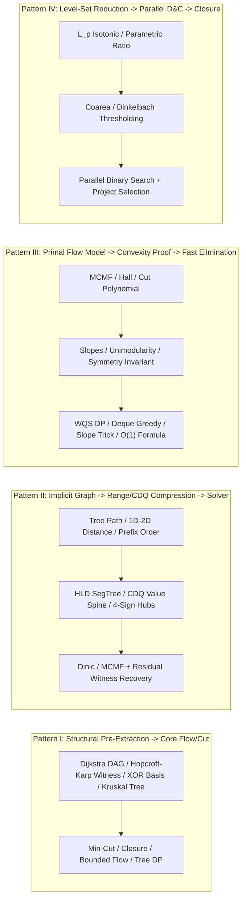

Look back across the twenty-four chapters of this textbook and a single unifying principle governs the transition from divisional templates to grandmaster problem solving: **at the level of the ICPC World Finals, AtCoder Grand Contests (`AGC`), and NOI/IOI/CTT, a hard combinatorial optimization problem rarely lives inside a single chapter's silo**. Instead, a contest setter composes two to four distinct theoretical mechanisms into a single pipeline:

- You might first extract a **Gaussian 64-bit XOR linear basis exchange graph** (Part IV) only to discover that the objective is a quadratic $\ell_2$ penalty over directed partial-order constraints, requiring **Coarea Level-Set Thresholding** (Part III) inside a **Parallel Binary Search (`整体二分`)** wrapper (Part VI).
- You might recognize a **Bipartite Minimum Vertex Cover** between path requests and tree edges (Part II), find that explicit bipartite edges blow up to $O(NM) = 2 \cdot 10^8$, compress the tree paths via **Heavy-Light Decomposition and a Range-to-Node Segment Tree** (Part VI), and then reconstruct the exact vertex-cover witnesses across the compressed auxiliary hierarchy via **König's Residual Reachability Theorem**.
- Or you might formulate a **Vertex-Capacitated Min-Cost Max-Flow** network (Part V) not to run Successive Shortest Paths at all, but solely as a **mathematical proof engine** that certifies concavity of the optimal value function $f(k)$, thereby licensing **WQS Lagrangian Relaxation (Aliens Trick)** and a linear-time **$3$-State Tree DP** (Part VI) at $N = 3 \cdot 10^5$.

This first capstone module sits at the summit of the 24-chapter curriculum and serves two complementary purposes:

1. **Section 2 — The 16 Grandmaster Multi-Technique Synthesis Problems (`Syn-01`–`Syn-16` $\equiv$ `#241`–`#256`)**: Every problem is presented first with an **untagged contest statement**, exact constraints, and a hand-checkable sample trace so you can practice cold diagnosis before opening the progressive hints (`Hint 1` and `Hint 2`) and the **Full 4-Step Multi-Chapter Compilation & Solution**. Alongside each primary synthesis pipeline, we also document its companion **Dual-Perspective Bridge** so that both the structural-composition view and the primal-vs-dual comparative view are mastered side by side.
2. **Section 3 — The 14 Dual-Perspective Revisited Bridges (`Rev-01`–`Rev-14`)**: Fourteen flagship problems from the main chapter ladders (`#001`–`#192`) are systematically re-derived from a completely dual or higher-resolution perspective—contrasting explicit flow against Direction B greedy/DP elimination, primal equation differencing against LP dual cuts, and static virtual-hub sparsification against dynamic on-the-fly node spawning.

---

## How to Use This Grand Synthesis Capstone

To extract maximum training value from this capstone, treat every problem in Section 2 as a live 30-minute diagnostic drill before reading any callout:

1. **Read the Untagged Statement and Constraints First**: Look closely at $N, M$, and the cost/weight structure. Ask yourself: *Can a single explicit Dinic or SSP solver pass within the time limit, or do the bounds force either graph compression ($N, M \sim 10^4\text{–}10^5$ with structured geometry/trees) or complete flow elimination ($N \sim 2 \cdot 10^5\text{–}10^6$)?*
2. **Draft the Intermediate Algebraic Model Before Drawing Edges**: Write down the indicator variables $x_i \in \{0, 1\}$, degree/flow conservation equations, or Hall deficiency inequalities on scratch paper. Identify where two chapters meet: Which part of the algebra defines the *feasible domain* (e.g., shortest-path DAG, perfect matching basis, matroid exchange, or circular conservation), and which part defines the *objective cut or flow cost*?
3. **Open `Hint 1` Only When Stuck on the Bridge**: `Hint 1` reveals the non-graph diagnostic signal and the specific two-chapter interface without giving away the exact edge capacities or DP transitions.
4. **Open `Hint 2` to Verify Your Interface Invariants**: `Hint 2` provides the algebraic-to-graph compilation blueprint and capacity/cost orientation rules.
5. **Study the Full 4-Step Compilation & Failure-Mode Guard**: Compare your scratchpad against the four-step derivation, paying special attention to the **Broken Gadget Counterexample / Failure-Mode Guard** and the **Companion Dual-Perspective Bridge** at the end of each solution.

---

## 1. The Multi-Technique Synthesis Architecture

When two or more chapters of this textbook are composed into a single algorithm, the coupling is never arbitrary. Across modern competitive programming, multi-technique synthesis problems follow four recurring **Architectural Composition Patterns**:



### 1.1 The Four Canonical Synthesis Pipelines

1. **Pattern I — Structural Witness Pre-Extraction $\to$ Constrained Flow / Closure Core**:
   Before a single flow edge can be capacities-assigned, a structural combinatorial theorem must extract a canonical backbone from the input. Examples include running Dijkstra to isolate the shortest-path DAG (`Syn-08`), finding a reference Perfect Matching via Hopcroft–Karp so that Hall's condition converts set-union cardinality bounds into Project Selection implications (`Syn-05`), building a Kruskal Reconstruction Tree to turn min-cut/max-internal-edge cluster conditions into subtree clique counts (`Syn-10`), or extracting two 64-bit Gaussian XOR linear bases to define the directed matroid exchange poset (`Syn-15`).
2. **Pattern II — Implicit Dense Graph $\to$ Data-Structure Sparsification $\to$ Witness Reconstruction**:
   The natural bipartite or DAG model has $O(N^2)$ or $O(NM)$ edges, which TLEs. You insert a layer of auxiliary relay nodes—via Heavy-Light Decomposition + Segment Tree (`Syn-01`) or CDQ Divide-and-Conquer + coordinate-compressed value spines (`Syn-11`)—shrinking the edge count to $O(M \log^2 N)$ or $O(N \log N)$ while strictly preserving every $S$-$T$ cut capacity and path cost.
3. **Pattern III — Primal Flow Formulation $\to$ Convexity / Symmetry Certificate $\to$ Graph Elimination (Direction B)**:
   You first write down the exact Bipartite Matching, Bounded Circulation, or Min-Cost Flow model to prove a deep structural property—such as rotational conservation on a phantom-augmented circle (`Syn-02`), game-theoretic pairing gap minimization (`Syn-09`), unimodularity of total purchased resources (`Syn-12`), or concavity of the $k$-path objective (`Syn-13`, `Syn-14`). Armed with that theorem, you throw away the graph solver and evaluate the answer in $O(\log M)$, $O(N \log W)$, or $O(N \log^2(1/\epsilon))$ via combinatorics, WQS binary search, or FIFO/LIFO deque simulation.
4. **Pattern IV — Beyond Total Unimodularity (General LP Duality & Simplex Pivot Engine)**:
   When a problem's constraint matrix violates Total Unimodularity (more than two non-zero entries per column without bipartite sign-flipping or interval consecutively-ones structure) and $N, M \le 50$, you step across the boundary of network flows into the general **Two-Phase Simplex Algorithm** (`Syn-16`), seeing firsthand why TU flow networks are the ultra-fast combinatorial specialization of Linear Programming.

### 1.2 Master Architectural Map of the 16 Synthesis Reserve Problems (`Syn-01`–`Syn-16`)

The table below indexes all 16 problems (`#241`–`#256`), showing their primary multi-chapter synthesis pipeline alongside their companion dual-perspective bridge.

| Syn ID | Pool ID | Primary Synthesis Problem & Source | Chapters Composed (Primary Pipeline) | Companion Dual-Perspective Bridge | Asymptotic Profile |
| :---: | :---: | :--- | :--- | :--- | :--- |
| **`Syn-01`** | `#241` | [CF 786E — ALT](https://codeforces.com/problemset/problem/786/E) | `Ch 06` König Vertex Cover + `Ch 22` HLD & SegTree Compression | [ABC 247G — Dream Team](https://atcoder.jp/contests/abc247/tasks/abc247_g): `Ch 17` MCMF Slope Curve vs `Ch 23` WQS Penalty | $O(M \log^2 N \sqrt{N})$ compressed Dinic + BFS witness |
| **`Syn-02`** | `#242` | [CF 838D — Airplane Arrangements](https://codeforces.com/problemset/problem/838/D) | `Ch 04/08` Circular Flow/Hall Conservation + `Ch 16` Symmetry Collapse | [CF 1307G — Cow and Exercise](https://codeforces.com/problemset/problem/1307/G): `Ch 17` Convex $C(F)$ vs `Ch 21` Path-Lengthening LP Dual | $O(\log M)$ closed-form circular symmetry vs $O(N^M)$ |
| **`Syn-03`** | `#243` | [CF 704D — Captain America](https://codeforces.com/problemset/problem/704/D) | `Ch 06` Grid Row/Col Bipartite Graph + `Ch 04` $[L_e, R_e]$ Bounded Max-Flow | [CEOI 2008 — Fence](https://www.spoj.com/problems/FENCE3/): `Ch 09/11` Interior-Exterior Cut vs `Ch 15` Planar Dual Cycle | $O((N + U)\sqrt{U})$ two-phase Dinic on compressed lines |
| **`Syn-04`** | `#244` | [CF 1288F — Red-Blue Graph](https://codeforces.com/problemset/problem/1288/F) | `Ch 04` Lower-Bound Demand $[1, \infty)$ + `Ch 17` Bidirectional Edge MCMF | [ARC 092E — Both Sides Merger](https://atcoder.jp/contests/arc092/tasks/arc092_c): `Ch 07` Parity Invariant vs `Ch 11` Closure Elimination | $O(M(N+M)\log N)$ feasible min-cost circulation |
| **`Syn-05`** | `#245` | [CF 103E — Buying Sets](https://codeforces.com/problemset/problem/103/E) | `Ch 05/08` Hall Perfect Matching Witness + `Ch 09` Max-Weight Closure | [CF 1510B — Button Lock](https://codeforces.com/problemset/problem/1510/B): `Ch 20` Hypercube Path Cover vs `Ch 08` Popcount Greedy Matching | $O(N^2\sqrt{N} + N^3)$ Hopcroft–Karp + Picard–Queyranne |
| **`Syn-06`** | `#246` | [Luogu P3749 — 寿司餐厅](https://www.luogu.com.cn/problem/P3749) | `Ch 09` Triangular Interval Closure + `Ch 10` Distinct-Type Linear/Quadratic Cut | [AGC 029F — Construction of a Tree](https://atcoder.jp/contests/agc029/tasks/agc029_f): `Ch 05/08` Matching + BFS vs `Ch 04` Hall Circulation | $O(N^3)$ Dinic over $O(N^2)$ interval + type DAG |
| **`Syn-07`** | `#247` | [CF 1517G — Starry Night Camping](https://codeforces.com/problemset/problem/1517/G) | `Ch 07` 4-Layer Directed Path Cut + `Ch 11` 2D Parity $(x \bmod 2, y \bmod 2)$ | [HNOI2013 — 切糕 Dual](https://www.luogu.com.cn/problem/P3227): `Ch 12` Threshold Cut vs `Ch 21` Unlimited-Arc Circulation | $O(N^{1.5})$ 4-layer vertex-split minimum cut |
| **`Syn-08`** | `#248` | [Luogu P3171 — 网络吞吐量](https://www.luogu.com.cn/problem/P3171) | `Ch 01` Dijkstra Shortest-Path DAG + `Ch 07` Split-Vertex Throughput Flow | [CF 1630F — Making It Bipartite](https://codeforces.com/problemset/problem/1630/F): `Ch 08` 2-Layer Dilworth vs `Ch 09` Exclusion Closure | $O(M \log N + M\sqrt{N})$ Dijkstra + split-node Dinic |
| **`Syn-09`** | `#249` | [AGC 056D — Subset Sum Game](https://atcoder.jp/contests/agc056/tasks/agc056_d) | `Ch 05` Pairing Strategy on Graphs + `Ch 14` Game Alternating-Path Pairing | [SDOI2017 — 新生舞会](https://www.luogu.com.cn/problem/P3703): `Ch 14/17` Dinkelbach MCMF vs `Ch 21` Hungarian Potentials | $O(N^2)$ sorted adjacent-gap pairing verification |
| **`Syn-10`** | `#250` | [CF 1408G — Clusterization Counting](https://codeforces.com/problemset/problem/1408/G) | `Ch 15` Kruskal Reconstruction Tree + `Ch 16` Clique Threshold Tree DP | [ZJOI2011 — 网络扩容](https://www.luogu.com.cn/problem/P2604): `Ch 01` Max-Flow + `Ch 17` Parallel Expansion Arcs | $O(N^2 \log N)$ Kruskal DSU tree + $O(N^2)$ tree knapsack |
| **`Syn-11`** | `#251` | [Luogu P5331 — SNOI2019 通信](https://www.luogu.com.cn/problem/P5331) | `Ch 20` Teleportation Path Cover + `Ch 22` CDQ Value-Spine Compression | [AGC 056C — 01 Balanced](https://atcoder.jp/contests/agc056/tasks/agc056_c): `Ch 19` Equation Differencing vs `Ch 21` Dual 0-1 BFS | $O(N^2 \log^2 N)$ CDQ-compressed non-negative MCMF |
| **`Syn-12`** | `#252` | [Luogu P4480 — BJWC2018 餐巾计划](https://www.luogu.com.cn/problem/P4480) | `Ch 20` Napkin Laundering MCMF + `Ch 23` Ternary Search & FIFO/LIFO Deque | [CF 1666K — Kingdom Partition](https://codeforces.com/problemset/problem/1666/K): `Ch 11/12` 3-State Cut vs `Ch 21` Half-Integral 2-SAT LP | $O(N \log(\sum r_i))$ ternary search + two-stage deque |
| **`Syn-13`** | `#253` | [Luogu P4383 — 林克卡特树](https://www.luogu.com.cn/problem/P4383) | `Ch 17` MCMF Concavity Theorem + `Ch 23` WQS Aliens & 3-State Tree DP | [JOI 2019 Final — Coin Collecting](https://atcoder.jp/contests/joi2019ho/tasks/joi2019ho_c): `Ch 17` $2 \times N$ MCMF vs `Ch 23` $O(N)$ Clamped Prefix Sweep | $O(N \log(\sum \lvert w_e\rvert))$ WQS binary search + tree DP |
| **`Syn-14`** | `#254` | [CF 739E — Gosha is hunting](https://codeforces.com/problemset/problem/739/E) | `Ch 18` Submodular Marginal MCMF + `Ch 23` 1D/2D WQS Aliens Relaxation | [BZOJ 3232 — 圈地游戏](https://www.luogu.com.cn/problem/P3199): `Ch 14/11` Fractional Cut vs `Ch 15` Planar Dual Ratio Cycle | $O(N \log^2(1/\epsilon))$ 2D WQS vs $O(N^2 \log N)$ MCMF |
| **`Syn-15`** | `#255` | [Luogu P6621 — 魔法商店](https://www.luogu.com.cn/problem/P6621) | `Ch 15` 64-Bit XOR-Basis Exchange + `Ch 24` $\ell_2$ Isotonic Parallel Binary Search | [ICPC WF 2015 — Catering](https://onlinejudge.org/external/13/1308.pdf): `Ch 04/17` $[1,1]$ Demand vs `Ch 20` $-\infty$ Bonus MCMF | $O(NM\sqrt{N}\log(\max c_i))$ `整体二分` + closure |
| **`Syn-16`** | `#256` | [UOJ #179 — 线性规划](https://uoj.ac/problem/179) | `Ch 21` General LP Duality + `Ch 24` Two-Phase Simplex Pivot Engine | [UOJ #455 — 雪灾与外卖](https://uoj.ac/problem/455): `Ch 20/18` Convex Inventory MCMF vs `Ch 23` Lazy-Heap Simulation | Polynomial Simplex pivots ($< 5\text{ ms}$ for $N,M \le 20$) |

---

## 2. Multi-Technique Synthesis Reserve — Part 1 (`Syn-01` / `#241` through `Syn-06` / `#246`)

### `Syn-01` (`#241`) — CF 786E: ALT

* **Judge URL**: [Codeforces 786E — ALT](https://codeforces.com/problemset/problem/786/E)
* **Companion Dual Bridge**: [AtCoder ABC 247G — Dream Team](https://atcoder.jp/contests/abc247/tasks/abc247_g) (`Ch 17.2` MCMF Slope Curve vs `Ch 23.2` WQS Penalty)

#### Untagged Problem Statement

You are given an undirected tree $T$ with $N$ vertices ($1 \dots N$) and $N - 1$ indexed edges ($1 \dots N - 1$), together with $M$ citizens. The $i$-th citizen walks along the unique simple path between vertices $u_i$ and $v_i$ in $T$.

To make every citizen happy, you may perform two types of unit-cost actions:

1. Give one puppy directly to citizen $i$ (cost $1$).
2. Place one guardian puppy on tree edge $e$ (cost $1$).

Citizen $i$ is happy if **either** citizen $i$ receives a puppy directly, **or** **every** tree edge $e$ along the path $u_i \leftrightarrow v_i$ has a guardian puppy placed on it. Minimize the total number of puppies used, and output both the exact subset of citizens who receive a puppy and the exact subset of tree edges that receive a guardian.

#### Constraints

* $2 \le N \le 2 \times 10^4$, $1 \le M \le 10^4$
* Time limit: $4.0\text{ s}$; Memory limit: $256\text{ MB}$

#### Hand-Checkable Sample Trace ($N = 4, M = 2$)

Suppose the tree is a path $1 \text{---}_{e_1} 2 \text{---}_{e_2} 3 \text{---}_{e_3} 4$, Citizen $1$ walks $1 \leftrightarrow 3$ (edges $\{e_1, e_2\}$), and Citizen $2$ walks $2 \leftrightarrow 4$ (edges $\{e_2, e_3\}$).

* If we give puppies to Citizen $1$ and Citizen $2$ directly, cost is $2$.
* If we guard $e_2$ ($1$ puppy) and give Citizen $1$ and Citizen $2$ nothing, $e_1$ and $e_3$ are unguarded, so neither citizen has *all* edges on their path guarded!
* In fact, to satisfy Citizen $1$ without giving them a puppy, we must guard **both** $e_1$ and $e_2$ (cost $2 > 1$). Thus the unique optimal cost is $2$ (give puppies to Citizens $1$ and $2$; guard $0$ edges).
* Conversely, if $10$ citizens all walk $1 \leftrightarrow 3$ (edges $\{e_1, e_2\}$), guarding both $e_1$ and $e_2$ costs $2$ and satisfies all $10$ citizens simultaneously!

:::: {.callout-note collapse="true" title="Hint 1 — Non-Graph Diagnostic Signal & Logical Clause Structure"}

Read the satisfaction quantifier carefully: citizen $i$ is happy iff

$$(\text{Citizen } i \text{ gets a puppy}) \lor \left(\bigwedge_{e \in \operatorname{Path}_T(u_i, v_i)} (\text{Edge } e \text{ gets a guard})\right).$$

By distributive law of $\lor$ over $\land$, this single compound condition is logically equivalent to requiring, for **every** pair $(i, e)$ with $e \in \operatorname{Path}_T(u_i, v_i)$:

$$(\text{Citizen } i \text{ is chosen}) \lor (\text{Edge } e \text{ is chosen}).$$

What classical bipartite graph problem asks to choose the minimum total number of left vertices (citizens) and right vertices (tree edges) so that every incident pair $(i, e)$ has at least one chosen endpoint? Why does building that bipartite graph naively TLE for $N = 2 \times 10^4, M = 10^4$?

::::

:::: {.callout-note collapse="true" title="Hint 2 — Multi-Chapter Pipeline & HLD Segment-Tree Compression"}

The problem is **Bipartite Minimum Vertex Cover** (`Ch 06`) between $M$ citizens and $N - 1$ tree edges, coupled with **Heavy-Light Decomposition + Segment-Tree Graph Sparsification** (`Ch 22`):

1. Decompose $T$ via HLD so each tree edge $e$ gets a unique DFS timestamp $\operatorname{pos}(e) \in \{1, \dots, N-1\}$, and any path $u_i \leftrightarrow v_i$ partitions into $O(\log N)$ contiguous intervals of edge timestamps.
2. Build a Segment Tree over $[1, N-1]$. Each internal segment-tree node $p$ connects to its two children $2p, 2p+1$ with capacity $\infty$. Each leaf $\operatorname{pos}(e)$ connects to the sink $T_{\text{sink}}$ with capacity $1$.
3. Connect $S \to \text{citizen } i$ with capacity $1$, and connect $\text{citizen } i$ with capacity $\infty$ to the $O(\log^2 N)$ segment-tree nodes covering $\operatorname{Path}_T(u_i, v_i)$. How do you recover the actual chosen citizens and tree edges from the residual network after Dinic?

::::

:::: {.callout-tip collapse="true" title="Full 4-Step Compilation & Solution — CF 786E (ALT)"}

#### Step 1: Non-Graph Diagnostic Signal (Recognition)

Each pair $(i, e)$ with $e \in \operatorname{Path}_T(u_i, v_i)$ imposes a binary covering clause $x_i + y_e \ge 1$ where $x_i \in \{0, 1\}$ indicates giving a puppy to citizen $i$ and $y_e \in \{0, 1\}$ indicates placing a guard on tree edge $e$. Minimizing $\sum_{i=1}^M x_i + \sum_{e=1}^{N-1} y_e$ subject to $x_i + y_e \ge 1$ is **Bipartite Minimum Vertex Cover**. However, a path can contain $O(N)$ edges, so the explicit bipartite graph has up to $NM = 2 \times 10^8$ edges (Time and Memory Limit Exceeded). Because each citizen's neighborhood is a **tree path**, we must compose **Chapter 6 (König Minimum Vertex Cover Reconstruction)** with **Chapter 22 (HLD + Segment Tree Range-to-Node Sparsification)**.

#### Step 2: Intermediate Algebraic & Cut Representation

Introduce source $S$ ($x_S = 1$) and sink $T_{\text{sink}}$ ($x_{T_{\text{sink}}} = 0$). Place citizen $i$ on the $S$-side ($x_i = 0$ means cut $S \to i$, i.e., citizen $i$ gets a puppy) and tree edge $e$ on the $T_{\text{sink}}$-side ($y_e = 1$ means cut $e \to T_{\text{sink}}$, i.e., edge $e$ gets a guard):

$$\min_{x, y \in \{0,1\}} \sum_{i=1}^M (1 - x_i) + \sum_{e=1}^{N-1} y_e + \sum_{i=1}^M \sum_{e \in \operatorname{Path}_T(u_i, v_i)} \infty \cdot x_i (1 - y_e).$$

To factor the dense sum $\sum_{e \in \operatorname{Path}_T(u_i, v_i)} \infty \cdot x_i (1 - y_e)$, let $\mathcal{I}(u_i, v_i)$ be the partition of $\operatorname{Path}_T(u_i, v_i)$ into $O(\log^2 N)$ canonical Segment-Tree nodes over the HLD DFS order of edges. Assigning an indicator variable $z_p \in \{0, 1\}$ to each segment-tree node $p$, we replace the direct $i \to e$ penalties with a two-stage cascade of $\infty$-implications:

$$x_i = 1 \implies z_p = 1 \quad (\forall p \in \mathcal{I}(u_i, v_i)), \qquad z_p = 1 \implies z_{\operatorname{left}(p)} = 1 \land z_{\operatorname{right}(p)} = 1.$$

Because every internal segment-tree implication has weight $\infty$, no finite-capacity cut can sever an internal tree arc; thus $x_i = 1$ forces $y_e = 1$ for every leaf $e$ in the subtree of $p$, which is mathematically identical to the uncompressed cut polynomial!

#### Step 3: Reverse-Engineering Scratchpad (Mechanical Graph Compilation)

1. **HLD Edge Indexing**: Root the tree arbitrarily at vertex $1$. Associate each tree edge $e = (u, v)$ with its deeper endpoint ($\operatorname{dep}[v] > \operatorname{dep}[u]$). Run two-pass HLD so every vertex $v \ne 1$ receives a contiguous DFS position $\operatorname{dfn}[v] \in \{2, \dots, N\}$.
2. **Segment Tree Hierarchy**: Build a binary segment tree over positions $[2, N]$ ($4N$ nodes).
   - For every internal segment-tree node $p$, add directed edges $p \to 2p$ and $p \to 2p+1$ with capacity $\infty$.
   - For every leaf node $p$ corresponding to $\operatorname{dfn}[v]$ (tree edge $e_v$), add a directed edge $p \to T_{\text{sink}}$ with capacity $1$.
3. **Citizen Path Injection**: For each citizen $i \in \{1, \dots, M\}$:
   - Add $S \to \text{citizen}(i)$ with capacity $1$.
   - Climb HLD heavy chains from $u_i$ and $v_i$ to $\operatorname{LCA}(u_i, v_i)$ (excluding the LCA itself, since nodes store the edge to their parent!). Decompose each chain segment $[L, R]$ into $O(\log N)$ canonical segment-tree nodes $p$, and add $\text{citizen}(i) \to p$ with capacity $\infty$.
4. **König Witness Reconstruction**: Run Dinic from $S$ to $T_{\text{sink}}$, then perform a single residual BFS from $S$ along edges with residual capacity $> 0$ to compute $\operatorname{vis}[u] \in \{0, 1\}$:
   - Citizen $i$ gets a puppy iff $S \to \text{citizen}(i)$ is cut, i.e., $\operatorname{vis}[\text{citizen}(i)] = 0$.
   - Tree edge $e_v$ gets a guard iff $\operatorname{leaf}(v) \to T_{\text{sink}}$ is cut, i.e., $\operatorname{vis}[\operatorname{leaf}(v)] = 1$.

#### Step 4: Toy Trace & Failure-Mode Guard

* **Broken Gadget Counterexample 1 (Including the LCA in Edge HLD Queries)**: When climbing HLD chains for an **edge** path $u_i \leftrightarrow v_i$, when $u_i$ and $v_i$ reach the same heavy chain with $\operatorname{dfn}[u_i] \le \operatorname{dfn}[v_i]$, you must query the segment tree on $[\operatorname{dfn}[u_i] + 1, \operatorname{dfn}[v_i]]$ (skipping $u_i = \operatorname{LCA}$!). If you query $[\operatorname{dfn}[u_i], \operatorname{dfn}[v_i]]$, you accidentally include the tree edge above $\operatorname{LCA}(u_i, v_i)$, corrupting the bipartite graph.
* **Broken Gadget Counterexample 2 (Unit Capacities Inside the Segment Tree)**: If you accidentally put capacity $1$ or `sz[p]` on internal segment-tree edges $p \to 2p$, Dinic will cut an internal segment-tree node to satisfy a single citizen for cost $1$ instead of paying for all edges in the range. Internal compression arcs **must** have capacity $\infty$.
* **Complexity Contract**: Total vertices $\lvert V \rvert \le M + 4N + 2 \approx 9 \times 10^4$; total directed edges $\lvert E \rvert \le M \log_2^2 N + 8N \approx 1.6 \times 10^6$. Because every path from $S$ starts with a unit-capacity edge $S \to \text{citizen}(i)$ and ends at a unit-capacity leaf edge $\operatorname{leaf}(v) \to T_{\text{sink}}$, Dinic runs in $O(\lvert E \rvert \sqrt{N + M})$ time ($< 0.25\text{ s}$).

> **Companion Dual-Perspective Bridge (`[ABC 247G] Dream Team`, `Ch 17.2` $\leftrightarrow$ `Ch 23.2`)**:
> In `ABC 247G`, choosing $k$ students with distinct universities and distinct subjects to maximize total power for all $k = 1 \dots K$ can be solved either via **Perspective 1 (`Ch 17.2`)**: extracting the full piecewise-linear concave MCMF slope curve (`mcf_graph::slope(S, T)`) on the $150 \times 150$ bipartite graph, or via **Perspective 2 (`Ch 23.2`)**: applying WQS Lagrangian penalty $-\lambda$ per student and running unconstrained min-cost circulation for a single fixed target size $k$.

::::

---

### `Syn-02` (`#242`) — CF 838D: Airplane Arrangements

* **Judge URL**: [Codeforces 838D — Airplane Arrangements](https://codeforces.com/problemset/problem/838/D)
* **Companion Dual Bridge**: [Codeforces 1307G — Cow and Exercise](https://codeforces.com/problemset/problem/1307/G) (`Ch 17.2` Convex $C(F)$ Curve vs `Ch 21.2` Path-Lengthening LP Dual)

#### Untagged Problem Statement

An airplane has $N$ seats arranged in a single row numbered $1, 2, \dots, N$ from front to back, and $M$ passengers ($M \le N$) board one by one. Each passenger $i \in \{1, \dots, M\}$ is assigned a ticket consisting of a preferred seat $x_i \in \{1, \dots, N\}$ and an entrance direction $d_i \in \{\text{Left (front)}, \text{Right (back)}\}$.

When passenger $i$ boards:

* If $d_i = \text{Left}$, they enter at seat $1$, walk to seat $x_i$, and sit in the **first unoccupied seat** at or after $x_i$ ($x_i, x_i+1, \dots, N$). If all seats in $[x_i, N]$ are already occupied, passenger $i$ falls off the back of the plane (invalid!).
* If $d_i = \text{Right}$, they enter at seat $N$, walk to seat $x_i$, and sit in the **first unoccupied seat** at or before $x_i$ ($x_i, x_i-1, \dots, 1$). If all seats in $[1, x_i]$ are already occupied, passenger $i$ falls off the front of the plane (invalid!).

Out of all $(2N)^M$ possible sequences of tickets $((x_1, d_1), \dots, (x_M, d_M))$, count how many result in all $M$ passengers successfully getting a seat, modulo $10^9 + 7$.

#### Constraints

* $1 \le M \le N \le 10^6$
* Time limit: $2.0\text{ s}$; Memory limit: $256\text{ MB}$

#### Hand-Checkable Sample Trace ($N = 3, M = 2$)

* Total unrestricted ticket assignments: $(2 \times 3)^2 = 36$.
* When does the second passenger fall off?
  - Both choose `(seat 3, Left)`: Passenger 1 takes seat $3$; Passenger 2 starts at $3$ moving towards $3$ and falls off! ($1$ bad way).
  - Both choose `(seat 1, Right)`: Passenger 1 takes seat $1$; Passenger 2 starts at $1$ moving towards $1$ and falls off! ($1$ bad way).
  - All other $34$ assignments succeed? Wait: check $N = 3, M = 2$ with our formula or enumeration: if Passenger 1 is `(3, Right)` (takes seat $3$) and Passenger 2 is `(3, Left)` (starts at $3$ moving right $\to$ falls off!), plus reversed Boarding order `(3, Left)` then `(3, Right)` (Passenger 1 takes $3$, Passenger 2 takes $2$ — valid!).
  - Across all pairs: for `(seat 3, Left)` failed by Passenger 2, Passenger 1 could have taken seat $3$ via `(3, Left)` or `(3, Right)` ($2$ ways); similarly at seat $1$ for `(seat 1, Right)` ($2$ ways). That leaves $36 - 4 = 32$ valid assignments!

:::: {.callout-note collapse="true" title="Hint 1 — Non-Graph Diagnostic Signal & Why Linear Hall DP Is Too Slow"}

By Hall's Marriage Theorem on intervals (`Ch 08`), an assignment of tickets is valid if and only if no suffix $[k, N]$ receives more than $N - k + 1$ Left-directed requests and no prefix $[1, k]$ receives more than $k$ Right-directed requests—and their combined overflow never collides! However, tracking both prefix and suffix capacities via DP or polynomial convolution over $N \le 10^6$ is far too complicated when Left and Right passengers interact.

Instead, ask: **What happens if we glue the front of the plane (before seat $1$) and the back of the plane (after seat $N$) together by inserting a single phantom seat $N + 1$ to form a circle of length $N + 1$?**

::::

:::: {.callout-note collapse="true" title="Hint 2 — Circular Flow Conservation & Rotational Symmetry Collapse"}

Consider the circular seating process on $N + 1$ seats $\{1, 2, \dots, N, N+1\}$ where each of the $M$ passengers independently chooses one of the $N + 1$ seats ($x_i \in \{1, \dots, N+1\}$) and one of the $2$ directions (`Clockwise` or `Counterclockwise`), walking around the circle until they find the first empty seat:

1. Because $M \le N < N + 1$, there is always at least $N + 1 - M \ge 1$ empty seat on the circle, so **every** circular ticket sequence in $\{1, \dots, N+1\}^M \times \{\text{L}, \text{R}\}^M$ terminates with a well-defined set of $M$ occupied seats and $N + 1 - M$ empty seats.
2. Prove the key bijection: a circular ticket sequence corresponds to a valid linear airplane arrangement on $\{1, \dots, N\}$ **if and only if seat $N + 1$ is empty at the end of the circular process**!
3. Use the rotational symmetry group $\mathbb{Z}_{N+1}$ acting on all $(2(N+1))^M$ circular ticket sequences to compute the exact fraction of sequences that leave seat $N + 1$ empty.

::::

:::: {.callout-tip collapse="true" title="Full 4-Step Compilation & Solution — CF 838D (Airplane Arrangements)"}

#### Step 1: Non-Graph Diagnostic Signal (Recognition)

In a linear capacity network $1 \leftrightarrow 2 \leftrightarrow \dots \leftrightarrow N$, overflow off the left end ($< 1$) and overflow off the right end ($> N$) are boundary defects caused by breaking rotational invariance. Whenever a flow or matching allocation process moves units greedily to the next available slot in either direction on $[1, N]$ with $M \le N$, inserting **one extra absorber node $N + 1$** connects the two boundaries into the cyclic group $\mathbb{Z}_{N+1}$ (`Ch 04/08` Circular Flow Conservation + `Ch 16` Symmetry Collapse).

#### Step 2: Intermediate Algebraic & Equivalence Proof

Let $\Omega_{\text{circ}} = (\{1, \dots, N+1\} \times \{\text{L}, \text{R}\})^M$ be the space of all circular ticket sequences, with cardinality $\lvert \Omega_{\text{circ}} \rvert = 2^M (N + 1)^M$.

**Lemma (Phantom Seat Isolation Equivalence)**: *A sequence $\omega \in \Omega_{\text{circ}}$ belongs to $\Omega_{\text{valid}} \subseteq (\{1, \dots, N\} \times \{\text{L}, \text{R}\})^M$ (valid linear arrangements) if and only if seat $N + 1$ remains unoccupied at the end of the circular process.*

*Proof*:
* ($\Rightarrow$) If $\omega$ is a valid linear arrangement on $\{1, \dots, N\}$, then no passenger starts at $N + 1$, and no passenger ever walks past seat $1$ (going Right) or past seat $N$ (going Left). Therefore, when executed on the circle $\{1, \dots, N+1\}$, no passenger ever visits or occupies seat $N + 1$.
* ($\Leftarrow$) Suppose that at the end of the circular process for $\omega \in \Omega_{\text{circ}}$, seat $N + 1$ is unoccupied. Could any passenger $i$ have been assigned $x_i = N + 1$? No—because if passenger $i$ started at $N + 1$, either $N + 1$ was already occupied, or passenger $i$ would immediately sit in $N + 1$; in either case $N + 1$ would be occupied at the end! Could any passenger starting in $\{1, \dots, N\}$ have fallen off the ends $1$ or $N$ and stepped onto $N + 1$? No—because the first passenger to step onto $N + 1$ would find it empty and immediately sit in $N + 1$! Thus $x_i \in \{1, \dots, N\}$ for all $i$, and no passenger ever crosses $N + 1$, meaning $\omega$ is a valid linear arrangement. $\blacksquare$

#### Step 3: Reverse-Engineering Scratchpad (Rotational Group Action)

Consider the cyclic shift operator $T_k : \Omega_{\text{circ}} \to \Omega_{\text{circ}}$ defined by adding $+k \pmod{N+1}$ to every passenger's starting seat $x_i$ while keeping all directions $d_i$ unchanged:

$$T_k((x_1, d_1), \dots, (x_M, d_M)) = ((x_1 + k, d_1), \dots, (x_M + k, d_M)) \pmod{N+1}.$$

Because the greedy walk rules are completely translation-invariant on $\mathbb{Z}_{N+1}$, shifting all starting seats by $+k$ shifts the final set of occupied seats $S(\omega) \subseteq \mathbb{Z}_{N+1}$ by $+k$, and shifts the set of $N + 1 - M$ empty seats $E(\omega) = \mathbb{Z}_{N+1} \setminus S(\omega)$ by $+k$.

Partition $\Omega_{\text{circ}}$ into orbits of size $N + 1$ (or count over pairs $(\omega, k) \in \Omega_{\text{circ}} \times \mathbb{Z}_{N+1}$): for every $\omega \in \Omega_{\text{circ}}$, as $k$ ranges over $0, 1, \dots, N$, the shifted empty set $E(T_k(\omega)) = E(\omega) + k$ contains seat $N + 1$ for **exactly $\lvert E(\omega) \rvert = N + 1 - M$ values of $k$**. Therefore, the exact fraction of circular sequences leaving seat $N + 1$ empty is $\frac{N + 1 - M}{N + 1}$:

$$\lvert \Omega_{\text{valid}} \rvert = \frac{N + 1 - M}{N + 1} \cdot \lvert \Omega_{\text{circ}} \rvert = \frac{N + 1 - M}{N + 1} \cdot 2^M (N + 1)^M = (N + 1 - M) \cdot (N + 1)^{M - 1} \cdot 2^M.$$

#### Step 4: Toy Trace & Failure-Mode Guard

* **Sample Verification ($N = 3, M = 2$)**:
  $$\lvert \Omega_{\text{valid}} \rvert = (3 + 1 - 2) \cdot (3 + 1)^{2 - 1} \cdot 2^2 = 2 \cdot 4^1 \cdot 4 = 32,$$
  matching our manual enumeration in Step 0!
* **Failure-Mode Guard (Attempting to Exclude $x_i = N + 1$ Before Taking the Quotient)**: A common error is to restrict passengers to choosing $x_i \in \{1, \dots, N\}$ (giving $(2N)^M$ total states) and then multiplying by $\frac{N+1-M}{N+1}$. That fails because restricting $x_i \neq N + 1$ breaks rotational symmetry under $T_k$! You **must** allow $x_i \in \{1, \dots, N+1\}$ during the group action; the event "seat $N + 1$ is empty at the end" automatically eliminates every sequence where some passenger picked $x_i = N + 1$.
* **Complexity Contract**: Two modular exponentiations in $O(\log M)$ time and $O(1)$ space.

> **Companion Dual-Perspective Bridge (`[CF 1307G] Cow and Exercise`, `Ch 17.2` $\leftrightarrow$ `Ch 21.2`)**:
> In `CF 1307G`, an adversary spends total budget $x$ to increase edge weights $w_e \gets w_e + \delta_e$ ($\sum \delta_e \le x$) to maximize the shortest path $d(1, N)$. By **LP Duality (`Ch 21.2`)**, the dual of maximizing $d_N - d_1$ subject to $d_v - d_u \le w_e + \delta_e$ is sending flow $F > 0$ along paths from $1$ to $N$ with capacity $1$ per edge, transforming the game into $\min_{F \in \{1, \dots, M\}} \frac{C(F) + x}{F}$ where $C(F)$ is the **Min-Cost Flow cost curve (`Ch 17.2`)**!

::::

---

### `Syn-03` (`#243`) — CF 704D: Captain America

* **Judge URL**: [Codeforces 704D — Captain America](https://codeforces.com/problemset/problem/704/D)
* **Companion Dual Bridge**: [CEOI 2008 — Fence](https://www.spoj.com/problems/FENCE3/) (`Ch 09/11` Interior-Exterior Cut vs `Ch 15.4` Planar Dual Surrounding Cycle)

#### Untagged Problem Statement

There are $N$ shields located at integer points $(x_i, y_i)$ on the 2D plane (multiple shields may share the same coordinates, or rather each shield $i$ is a distinct entity at $(x_i, y_i)$). You must paint every shield either **Red** (at cost $r$ per shield) or **Blue** (at cost $b$ per shield).

You are also given $M$ constraints of two types:

* `1 l d`: On the vertical line $x = l$, the absolute difference between the number of Red shields and Blue shields must not exceed $d$.
* `2 l d`: On the horizontal line $y = l$, the absolute difference between the number of Red shields and Blue shields must not exceed $d$.

Determine the minimum total painting cost, and output the color (`r` or `b`) of each of the $N$ shields, or output `-1` if no valid coloring exists.

#### Constraints

* $1 \le N, M \le 10^5$; $1 \le r, b \le 10^9$; $x_i, y_i \in [1, 10^9]$; $d \in [0, 10^5]$
* Time limit: $2.0\text{ s}$; Memory limit: $256\text{ MB}$

#### Hand-Checkable Sample Trace ($N = 3, M = 2, r = 2, b = 5$)

Shields at $P_1 = (1, 1), P_2 = (1, 2), P_3 = (2, 1)$. Constraints: line $x = 1$ has $d = 0$; line $y = 1$ has $d = 0$.

* Line $x = 1$ contains $2$ shields ($P_1, P_2$), and $d = 0$ forces $\#\text{Red} = \#\text{Blue} = 1$ on $x = 1$.
* Line $y = 1$ contains $2$ shields ($P_1, P_3$), and $d = 0$ forces $\#\text{Red} = \#\text{Blue} = 1$ on $y = 1$.
* Since Red is cheaper ($r = 2 < b = 5$), we want as many Red shields as possible: paint $P_1$ Blue ($1$ Blue on both $x=1$ and $y=1$) and paint $P_2, P_3$ Red ($2$ Reds total). Total cost $= 2 \times 2 + 1 \times 5 = 9$.

:::: {.callout-note collapse="true" title="Hint 1 — Non-Graph Diagnostic Signal & Why MCMF Is Too Slow"}

Each point $(x_i, y_i)$ is an edge connecting row vertex $x_i$ and column vertex $y_i$ in a **Grid Row/Column Bipartite Graph** (`Ch 06`). Choosing Red vs. Blue for shield $i$ is a binary decision $f_i \in \{0, 1\}$ on edge $i$.

If you assign a cost $r$ or $b$ to each edge and run Min-Cost Flow on $N, M \le 10^5$, SSP will TLE! How can you exploit the fact that **every shield has the exact same Red cost $r$ and the exact same Blue cost $b$** to reduce the optimization to an **unweighted Bounded Maximum Flow (`Ch 04`)** solved by Dinic in $O(N \sqrt{N})$?

::::

:::: {.callout-note collapse="true" title="Hint 2 — Degree Interval Translation & Two-Phase Bounded Max-Flow"}

Assume without loss of generality that Red is the cheaper color ($r \le b$; if $r > b$, swap the labels `'r'` and `'b'` and swap $r \leftrightarrow b$).

1. Initially paint all $N$ shields Blue for a baseline cost of $N \cdot b$. Every shield switched from Blue to Red ($f_i = 1$) saves $b - r \ge 0$ cost! Thus minimizing total cost is identical to **maximizing the total flow $F = \sum_{i=1}^N f_i$** in a network with edge lower and upper bounds $[L_e, R_e]$.
2. Suppose a line $l$ contains $\text{cnt}$ shields and its tightest constraint is $\lvert \text{Red} - \text{Blue} \rvert \le d_{\min}$. Since $\text{Red} = k$ and $\text{Blue} = \text{cnt} - k$, the condition $\lvert 2k - \text{cnt} \rvert \le d_{\min}$ translates to

   $$k \in \left[ \max\!\left(0, \left\lceil \frac{\text{cnt} - d_{\min}}{2} \right\rceil\right),\; \min\!\left(\text{cnt}, \left\lfloor \frac{\text{cnt} + d_{\min}}{2} \right\rfloor\right) \right] = [L_l, R_l].$$

3. Run the **Two-Phase Bounded Maximum Flow Algorithm (`Ch 04`)**: Phase 1 checks feasibility via $S_{\text{super}} \to T_{\text{super}}$ with an infinite-capacity back-edge $T \to S$; Phase 2 deletes $T \to S$ and pushes additional flow from $S$ to $T$.

::::

:::: {.callout-tip collapse="true" title="Full 4-Step Compilation & Solution — CF 704D (Captain America)"}

#### Step 1: Non-Graph Diagnostic Signal (Recognition)

Coupling row constraints on $x_i$ with column constraints on $y_i$ is the canonical signature of the **Row-Column Bipartite Incidence Graph** (`Ch 06`), where each point $i = (x_i, y_i)$ becomes a directed edge $r(x_i) \to c(y_i)$ of capacity $[0, 1]$. Because all edges share uniform cost savings $b - r$, cost minimization collapses into **Maximum Flow with Edge Lower and Upper Bounds $[L_e, R_e]$** (`Ch 04`).

#### Step 2: Intermediate Algebraic & Bound Compilation

Assume $r \le b$ (otherwise swap colors at the end). Let $f_i \in \{0, 1\}$ be $1$ if shield $i$ is painted the cheaper color (`Red`) and $0$ if painted `Blue`.

* For each active row coordinate $x$ with $\text{cnt}_x$ shields and minimum constraint parameter $d_x$ (default $d_x = \text{cnt}_x$ if unconstrained):
  $$L_x = \max\!\left(0, \left\lceil \frac{\text{cnt}_x - d_x}{2} \right\rceil\right), \qquad R_x = \min\!\left(\text{cnt}_x, \left\lfloor \frac{\text{cnt}_x + d_x}{2} \right\rfloor\right).$$
* Analogously, for each active column coordinate $y$ with $\text{cnt}_y$ shields and minimum constraint parameter $d_y$:
  $$L_y = \max\!\left(0, \left\lceil \frac{\text{cnt}_y - d_y}{2} \right\rceil\right), \qquad R_y = \min\!\left(\text{cnt}_y, \left\lfloor \frac{\text{cnt}_y + d_y}{2} \right\rfloor\right).$$
* If any active row or column has $L_x > R_x$ or $L_y > R_y$, immediately output `-1`.

#### Step 3: Reverse-Engineering Scratchpad (Two-Phase Bounded Network)

1. **Coordinate Compression**: Only create row nodes for $x \in \{x_1, \dots, x_N\}$ and column nodes for $y \in \{y_1, \dots, y_N\}$ (at most $2N$ nodes). Ignore any constraint `1 l d` or `2 l d` whose line $l$ contains $0$ shields! If multiple constraints apply to the same line $l$, keep only $d_l = \min d$.
2. **Base $[L, R]$ Network**:
   - For each active row $x$: add edge $S \to \text{row}(x)$ with bounds $[L_x, R_x]$.
   - For each active column $y$: add edge $\text{col}(y) \to T$ with bounds $[L_y, R_y]$.
   - For each shield $i = (x_i, y_i)$: add edge $\text{row}(x_i) \to \text{col}(y_i)$ with bounds $[0, 1]$.
   - Add feedback circulation edge $T \to S$ with bounds $[0, \infty)$.
3. **Excess Transformation & Phase 1 (Feasibility)**:
   - Replace each edge $u \to v$ of bounds $[L, R]$ with capacity $R - L$, and update node balances $\operatorname{bal}[v] \mathrel{+}= L$, $\operatorname{bal}[u] \mathrel{-}= L$.
   - Connect $S_{\text{super}} \to u$ with capacity $\operatorname{bal}[u]$ for $\operatorname{bal}[u] > 0$, and $u \to T_{\text{super}}$ with capacity $-\operatorname{bal}[u]$ for $\operatorname{bal}[u] < 0$.
   - Run `Dinic(S_super, T_super)`. If the flow is strictly less than $\sum_{\operatorname{bal}[u] > 0} \operatorname{bal}[u]$, output `-1`.
4. **Phase 2 (Maximizing Cheaper Shields)**:
   - Record the feasible flow already circulating on $T \to S$: $F_1 = \text{cap}(\text{rev}(T \to S))$.
   - Zero out both forward and reverse capacities of $T \to S$ (and all $S_{\text{super}}, T_{\text{super}}$ incident arcs).
   - Run `F_2 = Dinic(S, T)`. The maximum number of cheaper shields is $F_{\max} = F_1 + F_2$, yielding minimum total cost $F_{\max} \cdot r + (N - F_{\max}) \cdot b$. Shield $i$ gets the cheaper color iff its edge $\text{row}(x_i) \to \text{col}(y_i)$ is saturated.

#### Step 4: Toy Trace & Failure-Mode Guard

* **Broken Gadget Counterexample 1 (Forgetting $F_1$ from $T \to S$)**: After removing $T \to S$ before Phase 2, `Dinic(S, T)` only measures the *additional* augmenting flow $F_2$ pushed above the Phase 1 circulation! The total $S \to T$ flow is $F_1 + F_2$ (or equivalently, count how many shield edges $\text{row}(x_i) \to \text{col}(y_i)$ are saturated after Phase 2).
* **Broken Gadget Counterexample 2 (Integer Division Rounding on Odd $\text{cnt} - d$)**: In C++, `(-1) / 2` truncates toward zero instead of $-\infty$, and `(cnt - d + 1) / 2` only equals $\lceil(\text{cnt} - d)/2\rceil$ when clamped with $\max(0, \dots)$ first! Always write `L = max(0, (cnt - d + 1) / 2)` after checking `cnt > d`.
* **Complexity Contract**: $\lvert V \rvert \le 2N + 4$, $\lvert E \rvert \le 3N + 1$. Because all middle edges $\text{row}(x_i) \to \text{col}(y_i)$ have unit capacity, Dinic runs in $O(N \sqrt{N})$ time.

> **Companion Dual-Perspective Bridge (`[CEOI 2008] Fence`, `Ch 09/11` $\leftrightarrow$ `Ch 15.4`)**:
> In `CEOI 2008 Fence`, enclosing a subset of monuments inside a single polygon balances monument profits against fence perimeter costs. **Perspective 1 (`Ch 09 + Ch 11`)** models an interior-vs-exterior grid cut when topology is unconstrained, whereas **Perspective 2 (`Ch 15.4`)** enforces a single connected simple cycle by finding the minimum-weight surrounding cycle in the planar dual graph $G^*$ via Reif's / Bellman–Ford homological cut tree.

::::

---

### `Syn-04` (`#244`) — CF 1288F: Red-Blue Graph

* **Judge URL**: [Codeforces 1288F — Red-Blue Graph](https://codeforces.com/problemset/problem/1288/F)
* **Companion Dual Bridge**: [AtCoder ARC 092E — Both Sides Merger](https://atcoder.jp/contests/arc092/tasks/arc092_c) (`Ch 07` Parity Invariant vs `Ch 11` Closure Elimination)

#### Untagged Problem Statement

You are given a bipartite graph with left vertex set $L_1$ ($\lvert L_1 \rvert = n_1$), right vertex set $L_2$ ($\lvert L_2 \rvert = n_2$), and $M$ undirected edges. Each vertex in $L_1 \cup L_2$ is colored either `'R'` (Red), `'B'` (Blue), or `'U'` (Uncolored).

You must color each of the $M$ edges either **Red** (cost $r$), **Blue** (cost $b$), or leave it **Uncolored** (cost $0$), such that:

* For every `'R'` vertex $v$, the number of Red edges incident to $v$ is **strictly greater** than the number of Blue edges incident to $v$.
* For every `'B'` vertex $v$, the number of Blue edges incident to $v$ is **strictly greater** than the number of Red edges incident to $v$.
* For every `'U'` vertex $v$, there is no restriction.

Find the minimum total cost and output the color (`R`, `B`, or `U`) of every edge, or output `-1` if impossible.

#### Constraints

* $1 \le n_1, n_2, M \le 200$; $1 \le r, b \le 10^3$
* Time limit: $1.0\text{ s}$; Memory limit: $256\text{ MB}$

#### Hand-Checkable Sample Trace ($n_1 = 2, n_2 = 1, M = 2, r = 3, b = 5$)

Suppose $L_1 = \{u_1 (\text{'R'}), u_2 (\text{'B'})\}$, $L_2 = \{v_1 (\text{'U'})\}$, with edges $e_1 = (u_1, v_1)$ and $e_2 = (u_2, v_1)$.

* Vertex $u_1$ (`'R'`) needs $\#\text{Red} - \#\text{Blue} \ge 1 \implies e_1$ must be Red (cost $3$).
* Vertex $u_2$ (`'B'`) needs $\#\text{Blue} - \#\text{Red} \ge 1 \implies e_2$ must be Blue (cost $5$).
* Vertex $v_1$ (`'U'`) has $1$ Red and $1$ Blue edge (unconstrained). Total cost $= 3 + 5 = 8$.

:::: {.callout-note collapse="true" title="Hint 1 — Non-Graph Diagnostic Signal & Signed Net Flow Conservation"}

Notice that every vertex condition compares the **difference** between incident Red edges and incident Blue edges: $\#\text{Red}(v) - \#\text{Blue}(v) \ge 1$ or $\le -1$. In a flow network, the conservation quantity at every vertex $v$ is the **net outflow** $f^+(v) - f^-(v)$!

Since the graph is **bipartite** ($L_1$ and $L_2$), what happens if you orient every Red edge from $L_1 \to L_2$ and every Blue edge in the opposite direction $L_2 \to L_1$?

::::

:::: {.callout-note collapse="true" title="Hint 2 — Bidirectional Edge Choice + Lower-Bound Min-Cost Circulation"}

Combine **Chapter 4 (Lower-Bound Circulation $[L_e, R_e]$)** with **Chapter 17 (Min-Cost Flow with Bidirectional Edge Choice)**:

1. For each original undirected edge $e = (u, v)$ with $u \in L_1, v \in L_2$, add **two** directed arcs:
   - $u \to v$ with bounds $[0, 1]$ and cost $r$ (representing painting $e$ Red),
   - $v \to u$ with bounds $[0, 1]$ and cost $b$ (representing painting $e$ Blue).
   Why will an optimal min-cost circulation never saturate *both* $u \to v$ and $v \to u$ simultaneously?
2. Express the net outflow $f^+(w) - f^-(w)$ at $w \in L_1$ and $w \in L_2$ using boundary arcs from $S$ and to $T$ with lower-bound demands $[1, \infty)$ or $[0, \infty)$!

::::

:::: {.callout-tip collapse="true" title="Full 4-Step Compilation & Solution — CF 1288F (Red-Blue Graph)"}

#### Step 1: Non-Graph Diagnostic Signal (Recognition)

Unlike `CF 704D` (`Syn-03`), where every edge *had* to be colored Red or Blue ($\#\text{Red} + \#\text{Blue} = \deg(v)$), here edges may remain **Uncolored (`'U'`)**. Consequently, $\#\text{Red}(v) - \#\text{Blue}(v) \ge 1$ cannot be rewritten as a lower bound on $\#\text{Red}(v)$ alone! Instead, we must directly represent $+1$ for Red and $-1$ for Blue via opposite edge orientations across the bipartition $L_1 \leftrightarrow L_2$, synthesizing **Chapter 4 (Lower-Bound Circulation)** with **Chapter 17 (Min-Cost Flow)**.

#### Step 2: Intermediate Algebraic Representation

For each edge $e = (u, v) \in L_1 \times L_2$, introduce binary variables $x_e \in \{0, 1\}$ (Red) and $y_e \in \{0, 1\}$ (Blue). Because $r, b > 0$ and $x_e = y_e = 1$ contributes $0$ to $x_e - y_e$ while costing $r + b > 0$, any optimal solution automatically satisfies $x_e + y_e \le 1$ (represents Uncolored when $x_e = y_e = 0$).

Examine the net flow leaving $u \in L_1$ and entering $v \in L_2$ under the orientation $u \xrightarrow{x_e} v$ and $v \xrightarrow{y_e} u$:

* For $u \in L_1$: $\text{NetOut}(u) = \sum_{e \ni u} (x_e - y_e) = \#\text{Red}(u) - \#\text{Blue}(u)$.
  - If $u$ is `'R'`: $\text{NetOut}(u) \in [1, \infty) \implies$ supply arc $S \to u$ with bounds $[1, \infty)$, cost $0$.
  - If $u$ is `'B'`: $\text{NetIn}(u) = -\text{NetOut}(u) \in [1, \infty) \implies$ demand arc $u \to T$ with bounds $[1, \infty)$, cost $0$.
  - If $u$ is `'U'`: $\text{NetOut}(u) \in (-\infty, \infty) \implies$ both $S \to u$ and $u \to T$ with bounds $[0, \infty)$, cost $0$.
* For $v \in L_2$, the orientation is **flipped** because Red edges *enter* $v$ and Blue edges *leave* $v$: $\text{NetIn}(v) = \sum_{e \ni v} (x_e - y_e) = \#\text{Red}(v) - \#\text{Blue}(v)$!
  - If $v$ is `'R'`: $\text{NetIn}(v) \in [1, \infty) \implies$ demand arc $v \to T$ with bounds $[1, \infty)$, cost $0$.
  - If $v$ is `'B'`: $\text{NetOut}(v) \in [1, \infty) \implies$ supply arc $S \to v$ with bounds $[1, \infty)$, cost $0$.
  - If $v$ is `'U'`: both $S \to v$ and $v \to T$ with bounds $[0, \infty)$, cost $0$.

#### Step 3: Reverse-Engineering Scratchpad (Mechanical Graph Compilation)

1. Construct vertices $L_1 \cup L_2 \cup \{S, T, S_{\text{super}}, T_{\text{super}}\}$.
2. For each edge $e_i = (u_i, v_i)$ ($u_i \in L_1, v_i \in L_2$):
   - Add $u_i \to v_i$ with capacity $1$, cost $r$ (store edge pointer `red_edge[i]`).
   - Add $v_i \to u_i$ with capacity $1$, cost $b$ (store edge pointer `blue_edge[i]`).
3. Add boundary arcs between $S, T$ and $L_1 \cup L_2$ according to Step 2, plus the circulation return arc $T \to S$ with bounds $[0, \infty)$ and cost $0$.
4. Apply the standard lower-bound excess transformation (`Ch 04`): for each $[1, \infty)$ arc $p \to q$, replace it with a $[0, \infty)$ arc $p \to q$ of cost $0$, and add unit-capacity arcs $S_{\text{super}} \to q$ and $p \to T_{\text{super}}$ of cost $0$.
5. Run **Min-Cost Max-Flow** from $S_{\text{super}}$ to $T_{\text{super}}$. Since all initial edge costs are $\ge 0$, Dijkstra with Johnson potentials (or SPFA) needs no negative-cycle pre-cancellation.
6. If the total flow from $S_{\text{super}}$ is less than the number of `'R'` and `'B'` vertices in $L_1 \cup L_2$, output `-1`. Otherwise, output the MCMF cost; for each edge $i$, output `'R'` if `red_edge[i]` is saturated, `'B'` if `blue_edge[i]` is saturated, and `'U'` otherwise.

#### Step 4: Toy Trace & Failure-Mode Guard

* **Broken Gadget Counterexample (Forgetting to Flip `'R'` and `'B'` Roles on $L_2$)**: Because Red edges are directed $L_1 \to L_2$, a Red edge provides $+1$ **outflow** to $u \in L_1$ (`S -> u`) but $+1$ **inflow** to $v \in L_2$ (`v -> T`). If you connect $S \to v$ for `'R'` vertices on both $L_1$ and $L_2$, then `'R'` vertices in $L_2$ will demand Blue edges instead of Red edges!
* **Complexity Contract**: Total lower-bound demand $F = \lvert \{v : \text{color}(v) \in \{\text{'R'}, \text{'B'}\}\} \rvert \le n_1 + n_2 \le 400$. Therefore, SSP executes at most $400$ augmenting paths on a graph with $\le 404$ vertices and $\le 2M + 2(n_1 + n_2) \le 1200$ edges, running in $O((n_1 + n_2) M \log(n_1 + n_2)) \approx 5 \times 10^5$ operations ($< 15\text{ ms}$).

> **Companion Dual-Perspective Bridge (`[ARC 092E] Both Sides Merger`, `Ch 07.1` $\leftrightarrow$ `Ch 11.2`)**:
> In `ARC 092E`, deleting an exterior element or replacing $a_{i-1}, a_i, a_{i+1}$ with $a_{i-1} + a_{i+1}$ merges elements whose original indices have the **same parity**. Spotting this bipartite parity invariant (`Ch 07.1`) immediately eliminates any need for closure cuts (`Ch 11.2`): the answer is simply the maximum non-empty subset sum of positive elements sharing the same index parity!

::::

---

### `Syn-05` (`#245`) — CF 103E: Buying Sets

* **Judge URL**: [Codeforces 103E — Buying Sets](https://codeforces.com/problemset/problem/103/E)
* **Companion Dual Bridge**: [Codeforces 1510B — Button Lock](https://codeforces.com/problemset/problem/1510/B) (`Ch 20.1` Hypercube DAG Path Cover vs `Ch 08.2` Popcount Greedy Matching)

#### Untagged Problem Statement

You are given $N$ subsets $S_1, S_2, \dots, S_N$ of the universe $U = \{1, 2, \dots, N\}$, along with an integer price $c_i$ (which may be negative, zero, or positive) for each subset $S_i$.

The problem guarantees the **Hall Property**: for every subcollection of $k$ subsets ($1 \le k \le N$), the union of those $k$ subsets contains **at least $k$ distinct elements** of $U$.

You wish to buy a subcollection of $k$ subsets ($0 \le k \le N$, where $k = 0$ costs $0$) such that the union of the bought subsets contains **exactly $k$ elements** of $U$, and the total price $\sum_{i \in \text{Bought}} c_i$ is **minimized**. Output this minimum total price.

#### Constraints

* $1 \le N \le 300$; $\lvert c_i \rvert \le 10^6$
* Time limit: $2.0\text{ s}$; Memory limit: $256\text{ MB}$

#### Hand-Checkable Sample Trace ($N = 3$)

Suppose $S_1 = \{1, 2\}$ ($c_1 = -10$), $S_2 = \{2, 3\}$ ($c_2 = 4$), $S_3 = \{3\}$ ($c_3 = 2$).

* Every subcollection satisfies $\lvert \bigcup_{i \in I} S_i \rvert \ge \lvert I \rvert$.
* If we buy $S_1 = \{1, 2\}$ ($c_1 = -10$, profit $+10$), its union has size $2 > 1$, so we must expand our selection!
* Buying $\{S_1, S_2\}$ gives union $\{1, 2, 3\}$ of size $3 > 2$, forcing us to also buy $S_3 = \{3\}$.
* Buying all three $\{S_1, S_2, S_3\}$ gives union $\{1, 2, 3\}$ of size $3 = 3$ with total price $-10 + 4 + 2 = -4$.

:::: {.callout-note collapse="true" title="Hint 1 — Non-Graph Diagnostic Signal & Hall's Tight-Set Theorem"}

Because the input guarantees $\lvert \bigcup_{i \in I} S_i \rvert \ge \lvert I \rvert$ for **every** $I \subseteq \{1, \dots, N\}$:

1. By **Hall's Marriage Theorem (`Ch 08`)**, there exists a **Perfect Matching** $M$ in the bipartite incidence graph between the $N$ sets $\{S_1, \dots, S_N\}$ and the $N$ elements $\{1, \dots, N\}$. Let $m(i) \in S_i$ denote the unique element matched to set $S_i$ under $M$.
2. Relabel the elements of $U$ so that $m(i) = i$ for every $i \in \{1, \dots, N\}$ (thus $i \in S_i$ for all $i$). Now ask: for a chosen subcollection $I \subseteq \{1, \dots, N\}$, when does $\lvert \bigcup_{i \in I} S_i \rvert = \lvert I \rvert$ hold?

::::

:::: {.callout-note collapse="true" title="Hint 2 — Equivalence Between Tight Hall Subsets and Project Selection Closures"}

Since every $i \in I$ already contributes its own matched element $m(i) = i \in S_i$, the set of matched elements $\{m(i) : i \in I\} = I$ is a subset of $\bigcup_{i \in I} S_i$ of size $\lvert I \rvert$!

Therefore, $\lvert \bigcup_{i \in I} S_i \rvert = \lvert I \rvert$ holds **if and only if** $\bigcup_{i \in I} S_i = I$, which means:

$$\forall i \in I, \forall j \in S_i : \quad j \in I!$$

That is a pure **Maximum-Weight Closure (Project Selection, `Ch 09`)** condition with vertex profit $w_i = -c_i$ and implication arcs $i \to j$ for every $j \in S_i$! Notice that unlike `[JSOI2014] 骑士游戏` (`#071`), we do **not** even need a $+M_{\text{big}}$ penalty per element because the pre-extracted Perfect Matching $M$ identifies sets and elements $1$-to-$1$!

::::

:::: {.callout-tip collapse="true" title="Full 4-Step Compilation & Solution — CF 103E (Buying Sets)"}

#### Step 1: Non-Graph Diagnostic Signal (Recognition)

The problem statement explicitly hands us **Hall's Marriage Condition** ($\lvert N(I) \rvert \ge \lvert I \rvert$ for all $I$) and asks to optimize a linear objective over **Hall-tight subcollections** ($\lvert N(I) \rvert = \lvert I \rvert$). In structural matching theory (`Ch 05 + Ch 08`), the intersection and union of Hall-tight sets are Hall-tight, which means the family of Hall-tight sets forms a **distributive lattice** (poset ideals / closures)! Combining **Hopcroft–Karp Perfect Matching (`Ch 05`)** to extract a witness bijection $m : \{1, \dots, N\} \to U$ with **Picard–Queyranne Project Selection (`Ch 09`)** compiles this distributive lattice into a single minimum cut.

#### Step 2: Intermediate Algebraic & Lattice Bijection Proof

Let $m : \{1, \dots, N\} \to \{1, \dots, N\}$ be any Perfect Matching ($m(i) \in S_i$). For any subset of sets $I \subseteq \{1, \dots, N\}$, let $m(I) = \{m(i) : i \in I\}$. Since $m$ is a bijection and $m(i) \in S_i$ for each $i \in I$, we have the inclusion chain:

$$m(I) \subseteq \bigcup_{i \in I} S_i \qquad \text{with} \qquad \lvert m(I) \rvert = \lvert I \rvert.$$

Consequently, $\left\lvert \bigcup_{i \in I} S_i \right\rvert \ge \lvert m(I) \rvert = \lvert I \rvert$ holds automatically, and equality $\left\lvert \bigcup_{i \in I} S_i \right\rvert = \lvert I \rvert$ holds **if and only if** $\bigcup_{i \in I} S_i = m(I)$. Rewriting $\bigcup_{i \in I} S_i \subseteq m(I)$ element-by-element via $m^{-1}$:

$$i \in I \land e \in S_i \implies m^{-1}(e) \in I.$$

Let $x_i \in \{0, 1\}$ indicate whether set $S_i$ is bought, and let $p_i = -c_i$ be its profit. The optimization becomes:

$$\max_{x \in \{0,1\}^N} \sum_{i=1}^N p_i x_i \quad \text{subject to} \quad x_i \le x_{m^{-1}(e)} \quad (\forall i \in \{1, \dots, N\}, \forall e \in S_i).$$

#### Step 3: Reverse-Engineering Scratchpad (Mechanical Graph Compilation)

1. **Stage 1 (Perfect Matching Extraction)**: Build the $N \times N$ bipartite graph between sets $i \in \{1, \dots, N\}$ and elements $e \in S_i$. Run Hopcroft–Karp (`Ch 05`) to find a Perfect Matching `match_set_of_elem[e]` $= m^{-1}(e)$ for all $e \in \{1, \dots, N\}$.
2. **Stage 2 (Project Selection Network)**: Build an $S$-$T$ flow network on vertices $\{1, \dots, N\} \cup \{S, T\}$:
   - For each set $i \in \{1, \dots, N\}$ with profit $p_i = -c_i$:
     - If $p_i > 0$, add $S \to i$ with capacity $p_i$ and add $p_i$ to `sum_pos`.
     - If $p_i < 0$, add $i \to T$ with capacity $-p_i$.
   - For each set $i \in \{1, \dots, N\}$ and each element $e \in S_i$: let $j = m^{-1}(e)$. If $j \neq i$, add a directed implication edge $i \to j$ with capacity $\infty$.
3. **Stage 3 (Minimum Cut)**: Run `Dinic(S, T)`. The maximum profit is $\text{sum\_pos} - \operatorname{MinCut}(S, T)$, so the minimum cost is $\operatorname{MinCut}(S, T) - \text{sum\_pos}$.

#### Step 4: Toy Trace & Failure-Mode Guard

* **Sample Trace ($N = 3$)**:
  - $S_1 = \{1, 2\}, S_2 = \{2, 3\}, S_3 = \{3\}$. Unique Perfect Matching: $m(1) = 1, m(2) = 2, m(3) = 3$.
  - Since $2 \in S_1$, add $1 \xrightarrow{\infty} 2$; since $3 \in S_2$, add $2 \xrightarrow{\infty} 3$.
  - Profits $p_1 = +10$ ($S \xrightarrow{10} 1$), $p_2 = -4$ ($2 \xrightarrow{4} T$), $p_3 = -2$ ($3 \xrightarrow{2} T$).
  - $\operatorname{MinCut}(S, T) = \min(10, 4 + 2) = 6$. Max profit $= 10 - 6 = 4 \implies$ Min cost $= -4$.
* **Alternative Perspective Contrast (Big-$M$ Offset Without Matching)**: Can you solve `CF 103E` without running Hopcroft–Karp first? Yes (`Ch 09` `#071` style): pick $M_{\text{big}} = 10^9$, give each set $S_i$ profit $M_{\text{big}} - c_i$, give each element $e \in U$ cost $M_{\text{big}}$ ($e \to T$), and add $S_i \xrightarrow{\infty} e$. Because $\lvert \bigcup_{i \in I} S_i \rvert \ge \lvert I \rvert$ holds for all $I$, no subset can ever gain positive net $M_{\text{big}}$ bonus, and only subsets with $\lvert \bigcup_{i \in I} S_i \rvert = \lvert I \rvert$ pay $0$ net $M_{\text{big}}$ penalty! However, the Perfect Matching reduction shrinks the closure vertex count from $2N$ to $N$ and keeps all capacities bounded by $10^6$ (no `long long` $10^{11}$ capacities!).
* **Complexity Contract**: $O(N^{2.5})$ for Hopcroft–Karp plus $O(N^3)$ for Dinic on $N \le 300$ ($< 10\text{ ms}$).

> **Companion Dual-Perspective Bridge (`[CF 1510B] Button Lock`, `Ch 20.1` $\leftrightarrow$ `Ch 08.2`)**:
> In `CF 1510B`, visiting a given set of bitmasks in $\{0, 1\}^d$ using button presses ($+1$) and `RESET`s ($+1$) is a **Minimum-Cost DAG Path Cover (`Ch 20.1`)** where jumping from mask $u$ to supermask $v \supset u$ saves $\operatorname{popcount}(u)$ presses. Because every node's saving depends *only* on its outgoing matched vertex $u$ ($\operatorname{popcount}(u) + 1$), sorting candidate sources $u$ by $\operatorname{popcount}(u)$ descending and running **Kuhn's unweighted augmenting-path algorithm (`Ch 08.2`)** greedily finds the exact minimum-cost path cover without SPFA/Dijkstra!

::::

---

### `Syn-06` (`#246`) — Luogu P3749: [六省联考 2017] 寿司餐厅 (Sushi Restaurant)

* **Judge URL**: [Luogu P3749 — [六省联考 2017] 寿司餐厅](https://www.luogu.com.cn/problem/P3749)
* **Companion Dual Bridge**: [AtCoder AGC 029F — Construction of a Tree](https://atcoder.jp/contests/agc029/tasks/agc029_f) (`Ch 05/08` Matching + BFS Tree Reconstruction vs `Ch 04.1` Hall Degree Circulation)

#### Untagged Problem Statement

A conveyor-belt sushi restaurant displays $N$ plates of sushi in a row, where the $i$-th plate ($1 \le i \le N$) has sushi type code $a_i \in \{1, \dots, 1000\}$.

You may select any collection of contiguous intervals $[l, r]$ ($1 \le l \le r \le N$), subject to the restaurant's **Contiguous Subinterval Rule**:

* If you select interval $[l, r]$, you automatically capture **every** subinterval $[l', r'] \subseteq [l, r]$ ($l \le l' \le r' \le r$), gaining the dining utility $d_{l', r'}$ (which may be positive, zero, or negative) once for each distinct captured interval $[l', r']$.

What does your bill cost? Let $I = \{i \in \{1, \dots, N\} : [i, i] \text{ is captured}\}$ be the set of individual sushi plates eaten. For each distinct sushi type $x$ that appears at least once among the eaten plates $I$ (say it is eaten $c_x \ge 1$ times in $I$), you must pay:

$$\text{Cost}(\text{type } x) = m \cdot x^2 + c_x \cdot x,$$

where $m \in \{0, 1\}$ is a fixed restaurant parameter. Maximize the net profit (total captured utility $\sum_{[l, r] \text{ captured}} d_{l, r}$ minus total sushi cost).

#### Constraints

* $1 \le N \le 100$; $m \in \{0, 1\}$; $1 \le a_i \le 1000$; $\lvert d_{l, r} \rvert \le 500$
* Time limit: $1.0\text{ s}$; Memory limit: $128\text{ MB}$

#### Hand-Checkable Sample Trace ($N = 3, m = 1$)

Suppose $a = [2, 3, 2]$, utilities $d_{1,1} = 5, d_{2,2} = -2, d_{3,3} = 6, d_{1,2} = 4, d_{2,3} = 3, d_{1,3} = 10$.

* If we capture $[1, 3]$ (and thus all $6$ subintervals), total utility $= 5 - 2 + 6 + 4 + 3 + 10 = 26$.
* Plates eaten: $\{1, 2, 3\}$. Type $2$ is eaten $c_2 = 2$ times: cost $= 1 \cdot 2^2 + 2 \cdot 2 = 8$. Type $3$ is eaten $c_3 = 1$ time: cost $= 1 \cdot 3^2 + 1 \cdot 3 = 12$. Net profit $= 26 - (8 + 12) = 6$.
* If we only capture $[3, 3]$ (plate $3$, type $a_3 = 2$), utility is $d_{3,3} = 6$, and cost for type $2$ ($c_2 = 1$) is $1 \cdot 2^2 + 1 \cdot 2 = 6$, net profit $= 0$.
* What if we capture $[1, 1]$ and $[3, 3]$ without $[1, 3]$? Both eat type $2$, so they share the fixed fee $m \cdot 2^2 = 4$: utility $5 + 6 = 11$, cost $4 + 2 \cdot 2 = 8$, net profit $= 3$.

:::: {.callout-note collapse="true" title="Hint 1 — Non-Graph Diagnostic Signal & Why Interval DP Fails"}

In standard Interval DP on $[l, r]$, merging $[l, k]$ and $[k+1, r]$ requires that the two subproblems be cost-independent. Here, two problems break Interval DP:

1. You can choose overlapping intervals $[l_1, r_1]$ and $[l_2, r_2]$ without choosing $[l_1, r_2]$—you only pay/gain for the downward closure of subintervals inside your chosen intervals!
2. Even worse, the fixed type activation cost $m \cdot x^2$ is paid **once globally** across the entire array $[1, N]$ whenever *any* plate $i$ with $a_i = x$ is eaten!

What chapter handles downward-closed implication sets with shared global activation penalties?

::::

:::: {.callout-note collapse="true" title="Hint 2 — Three-Layer Closure DAG Compilation (`Ch 09` + `Ch 10`)"}

Combine **Chapter 9 (Contiguous Subinterval Closure)** with **Chapter 10 (Distinct-Type Linear + Quadratic Penalty Gadget)**:

1. **Transitive Reduction of Interval Inclusion**: Instead of adding $O(N^4)$ edges from $[l, r]$ to all $[l', r'] \subseteq [l, r]$, observe that $[l, r]$ covers all its subintervals if and only if $[l, r]$ implies $[l+1, r]$ and $[l, r-1]$ ($2$ edges per interval!).
2. **Splitting the Type Cost $m x^2 + c_x \cdot x$**:
   - The linear term $c_x \cdot x$ adds a cost of $+a_i$ **every time** plate $i$ (i.e., base interval $[i, i]$) is eaten. Absorb $-a_i$ directly into the base interval weight $d_{i, i} \gets d_{i, i} - a_i$!
   - The quadratic term $m \cdot x^2$ is paid **once** if at least one plate $i$ with $a_i = x$ is eaten. Create a single auxiliary node $\operatorname{type}(x)$ with cost $m \cdot x^2$ ($\operatorname{type}(x) \to T$) and add an implication $[i, i] \xrightarrow{\infty} \operatorname{type}(a_i)$!

::::

:::: {.callout-tip collapse="true" title="Full 4-Step Compilation & Solution — Luogu P3749 (Sushi Restaurant)"}

#### Step 1: Non-Graph Diagnostic Signal (Recognition)

The problem combines a **2D Triangular Poset Closure** ($[l, r] \implies [l', r']$ for all $[l', r'] \subseteq [l, r]$) with a **Union-of-Types Activation Fee** ($m x^2$ paid once per distinct active $x$, plus $x$ paid per active instance $i$ with $a_i = x$). With $N \le 100$, the number of intervals is $\binom{N+1}{2} = 5050$, which sits squarely in the sweet spot for **Project Selection (`Ch 09`) + Shared Penalty Gadgets (`Ch 10`)**.

#### Step 2: Intermediate Algebraic Representation

Let $z_{l, r} \in \{0, 1\}$ indicate whether interval $[l, r]$ ($1 \le l \le r \le N$) is captured, and let $y_x \in \{0, 1\}$ indicate whether sushi type $x \in \{a_1, \dots, a_N\}$ is eaten at least once.

* **Linear Per-Plate Cost Absorption**: Since $c_x = \sum_{i : a_i = x} z_{i, i}$, the total sushi cost separates cleanly into a per-plate linear term and a per-type fixed term:
  $$\sum_{x \text{ active}} \left(m x^2 + c_x \cdot x\right) = \sum_{i=1}^N a_i z_{i, i} + \sum_{x \in \mathcal{A}} m x^2 y_x.$$
* **Modified Node Weights**: Define the net weight $w_{l, r}$ of each interval node $[l, r]$ by
  $$w_{l, r} = \begin{cases} d_{l, r} & \text{if } l < r, \\ d_{i, i} - a_i & \text{if } l = r = i, \end{cases}$$
  and define the weight of each distinct type node $\operatorname{type}(x)$ as $w_{\operatorname{type}(x)} = -m x^2 \le 0$.
* **Transitive Closure Implications**:
  $$\begin{aligned}
  z_{l, r} \le z_{l+1, r} \quad \text{and} \quad z_{l, r} \le z_{l, r-1} \qquad &(1 \le l < r \le N), \\
  z_{i, i} \le y_{a_i} \qquad &(1 \le i \le N).
  \end{aligned}$$

#### Step 3: Reverse-Engineering Scratchpad (Mechanical Graph Compilation)

1. Assign node IDs $1 \dots \frac{N(N+1)}{2}$ to intervals $[l, r]$ and node IDs to each distinct value $x \in \{a_1, \dots, a_N\}$.
2. For each interval $[l, r]$ ($1 \le l \le r \le N$) with net weight $w_{l, r}$:
   - If $w_{l, r} > 0$: add $S \to [l, r]$ with capacity $w_{l, r}$, and add $w_{l, r}$ to `sum_pos`.
   - If $w_{l, r} < 0$: add $[l, r] \to T$ with capacity $-w_{l, r}$.
   - If $l < r$: add $[l, r] \to [l+1, r]$ `(cap ∞)` and $[l, r] \to [l, r-1]$ `(cap ∞)`.
   - If $l = r$: add $[i, i] \to \operatorname{type}(a_i)$ `(cap ∞)`.
3. For each distinct sushi code $x \in \{a_1, \dots, a_N\}$:
   - If $m == 1$, add $\operatorname{type}(x) \to T$ with capacity $x^2$.
4. Run `Dinic(S, T)` and output `sum_pos - Dinic(S, T)`.

#### Step 4: Toy Trace & Failure-Mode Guard

* **Broken Gadget Counterexample (Connecting Every $[l, r]$ Instead of Only $[i, i]$ to $\operatorname{type}(a_i)$)**: Because $[l, r]$ already implies $[i, i]$ for all $i \in [l, r]$ via the triangular cascade $[l, r] \to [l+1, r], [l, r-1]$, only the $N$ base intervals $[i, i]$ need edges to $\operatorname{type}(a_i)$ ($N$ edges total instead of $O(N^3)$).
* **Broken Gadget Counterexample 2 (Charging $m x^2 + x$ Inside $\operatorname{type}(x) \to T$)**: If two plates $i \neq j$ have the same sushi type $a_i = a_j = x$ and both $[i, i]$ and $[j, j]$ are captured, the linear term $c_x \cdot x = 2x$ must be paid **twice** ($x$ per plate), whereas the quadratic term $m x^2$ is paid **once**! Putting $+x$ on $\operatorname{type}(x) \to T$ instead of subtracting $a_i$ from $d_{i, i}$ undercharges whenever $c_x \ge 2$.
* **Complexity Contract**: $\lvert V \rvert = \frac{N(N+1)}{2} + \lvert \mathcal{A} \rvert + 2 \le 5152$, $\lvert E \rvert \le 3 \cdot \frac{N(N+1)}{2} \approx 1.5 \times 10^4$. Dinic finishes in $< 5\text{ ms}$.

> **Companion Dual-Perspective Bridge (`[AGC 029F] Construction of a Tree`, `Ch 05/08` $\leftrightarrow$ `Ch 04.1`)**:
> Given $N - 1$ vertex subsets $E_1, \dots, E_{N-1} \subseteq \{1, \dots, N\}$, picking endpoints $u_i, v_i \in E_i$ to form a spanning tree requires $\lvert \bigcup_{i \in S} E_i \rvert \ge \lvert S \rvert + 1$ for every non-empty $S \subseteq \{1, \dots, N-1\}$. **Perspective 1 (`Ch 05 + Ch 08.1`)** fixes root $r = 1$, finds a maximum matching of size $N - 1$ between $\{E_1, \dots, E_{N-1}\}$ and $\{2, \dots, N\}$ (matching each edge $E_i$ to its child $c_i \in E_i$), and runs a BFS from root $1$ across the residual graph to assign parents $p_i \in E_i$ (`!vis[v]` implies disconnected component!).

::::

---

## 2B. Multi-Technique Synthesis Reserve — Part 2 (`Syn-07` / `#247` through `Syn-12` / `#252`)

### `Syn-07` (`#247`) — CF 1517G: Starry Night Camping

* **Judge URL**: [Codeforces 1517G — Starry Night Camping](https://codeforces.com/problemset/problem/1517/G)
* **Companion Dual Bridge**: [Luogu P3227 — [HNOI2013] 切糕 LP Dual](https://www.luogu.com.cn/problem/P3227) (`Ch 12.1` Primal Threshold Cut vs `Ch 21.2` Unlimited-Arc Min-Cost Circulation)

#### Untagged Problem Statement

There are $N$ tents located at distinct integer points $(x_i, y_i)$ on the 2D Cartesian grid. The $i$-th tent has importance weight $w_i > 0$.

A subset of remaining tents is **valid** if it contains **no** forbidden $4$-tent configuration: four tents $A, B, C, D$ that form an axis-aligned path of length $3$ of unit steps ($\operatorname{dist}_2(A, B) = \operatorname{dist}_2(B, C) = \operatorname{dist}_2(C, D) = 1$) such that the middle segment $BC$ is parallel to the $x$-axis (horizontal) and the two outer segments $AB$ and $CD$ are parallel to the $y$-axis (vertical) — i.e., a $4$-point Z-, S-, or U-tromino/tetromino with a horizontal spine $BC$ and two vertical legs $AB, CD$.

Find the **maximum total weight** of a valid subset of tents.

#### Constraints

* $1 \le N \le 1000$; $-10^9 \le x_i, y_i \le 10^9$; $1 \le w_i \le 10^9$
* Time limit: $2.0\text{ s}$; Memory limit: $256\text{ MB}$

#### Hand-Checkable Sample Trace ($N = 5$)

Suppose tents are at $P_1 = (0, 1)$ ($w=10$), $P_2 = (0, 0)$ ($w=3$), $P_3 = (1, 0)$ ($w=8$), $P_4 = (1, 1)$ ($w=12$), $P_5 = (1, -1)$ ($w=9$).

* Here $P_2 = (0, 0)$ and $P_3 = (1, 0)$ form a horizontal unit segment $BC$.
* $P_1 = (0, 1)$ is vertically adjacent to $P_2 = (0, 0)$, and both $P_4 = (1, 1)$ and $P_5 = (1, -1)$ are vertically adjacent to $P_3 = (1, 0)$.
* Thus $(P_1, P_2, P_3, P_4)$ and $(P_1, P_2, P_3, P_5)$ are both forbidden $4$-tuples!
* Deleting $P_2$ (weight $3$) breaks **both** forbidden $4$-tuples simultaneously, leaving total weight $(10 + 3 + 8 + 12 + 9) - 3 = 39$.

:::: {.callout-note collapse="true" title="Hint 1 — Non-Graph Diagnostic Signal & Why Bipartite Independent Set Fails"}

If the forbidden configuration were a pair of adjacent points, we would 2-color the grid by $(x + y) \bmod 2$ and run Bipartite Maximum-Weight Independent Set (`Ch 06`). Here, the forbidden pattern has **four** points $(A, B, C, D)$!

Inspect the 2D parity $(x \bmod 2,\; y \bmod 2) \in \{0, 1\}^2$ of the four points along $A \xrightarrow{\text{vert}} B \xrightarrow{\text{horiz}} C \xrightarrow{\text{vert}} D$:

* Since $B$ and $C$ are horizontally adjacent ($\lvert x_B - x_C \rvert = 1, y_B = y_C$), one of $\{B, C\}$ has **even $x$** and the other has **odd $x$**!
* Relabel $A \leftrightarrow D$ and $B \leftrightarrow C$ if needed so that $B$ isalways the endpoint of the horizontal spine with **even $x$** (and thus $C$ has **odd $x$**). Now trace how $(x \bmod 2, y \bmod 2)$ changes along $A \to B \to C \to D$!

::::

:::: {.callout-note collapse="true" title="Hint 2 — 4-Layer Parity Classification & Split-Vertex Path Cut (`Ch 07` + `Ch 11`)"}

Suppose first that the horizontal spine $BC$ lies on an **even $y$-coordinate** ($y_B = y_C \equiv 0 \pmod 2$):

1. $B$ has $(x_B \bmod 2, y_B \bmod 2) = (\text{even}, \text{even}) \implies$ **Layer 1**.
2. Since $A$ is vertically adjacent to $B$ ($x_A = x_B, \lvert y_A - y_B \rvert = 1$), $A$ has $(\text{even}, \text{odd}) \implies$ **Layer 0**.
3. Since $C$ is horizontally adjacent to $B$, $C$ has $(\text{odd}, \text{even}) \implies$ **Layer 2**.
4. Since $D$ is vertically adjacent to $C$, $D$ has $(\text{odd}, \text{odd}) \implies$ **Layer 3**.

What if $BC$ lies on an **odd $y$-coordinate** ($y_B = y_C \equiv 1 \pmod 2$, where $B$ has $(\text{odd}, \text{odd})$ and $C$ has $(\text{even}, \text{odd})$)? Then reversing the tuple shows that **every** forbidden $4$-tent pattern visits the four parity classes in the exact same order:

$$\text{Layer } 0 \;(\text{odd } x, \text{even } y) \longrightarrow \text{Layer } 1 \;(\text{even } x, \text{even } y) \longrightarrow \text{Layer } 2 \;(\text{even } x, \text{odd } y) \longrightarrow \text{Layer } 3 \;(\text{odd } x, \text{odd } y)!$$

Wait—check whether horizontal step is between Layer $0 \to 1$ and Layer $2 \to 3$, or vertical step! Write down the exact parity transition table for both $y_B$ even and $y_B$ odd so they share the **exact same 4-layer order**!

::::

:::: {.callout-tip collapse="true" title="Full 4-Step Compilation & Solution — CF 1517G (Starry Night Camping)"}

#### Step 1: Non-Graph Diagnostic Signal (Recognition)

Whenever a grid problem forbids a $k$-tuple of adjacent cells ($k = 3$ or $k = 4$) and asks for the maximum-weight surviving subset ($N \le 1000$), look for a **Layered Parity Coloring** (`Ch 11`) that maps every forbidden $k$-tuple to a directed path $L_0 \to L_1 \to \dots \to L_{k-1}$ in a $k$-layer DAG, and then sever all $L_0 \leadsto L_{k-1}$ paths via **Split-Vertex Minimum Cut (`Ch 07`)**.

#### Step 2: Intermediate Algebraic & 4-Layer Parity Proof

In any forbidden $4$-tuple $A \text{---}_{\text{vert}} B \text{---}_{\text{horiz}} C \text{---}_{\text{vert}} D$:

* The middle step $B \text{---} C$ changes $x \bmod 2$ while preserving $y \bmod 2$.
* The two outer steps $A \text{---} B$ and $C \text{---} D$ change $y \bmod 2$ while preserving $x \bmod 2$.

Therefore, in order for both $y_B \equiv 0 \pmod 2$ and $y_B \equiv 1 \pmod 2$ to map $B \text{---} C$ to the **middle transition** $\text{Layer } 1 \to \text{Layer } 2$, the transition $\text{Layer } 1 \to \text{Layer } 2$ must be a **horizontal step** ($\Delta x = \pm 1, \Delta y = 0$), and the outer transitions $\text{Layer } 0 \to \text{Layer } 1$ and $\text{Layer } 2 \to \text{Layer } 3$ must be **vertical steps** ($\Delta x = 0, \Delta y = \pm 1$)!

Define the unique layer $\operatorname{layer}(x, y) \in \{0, 1, 2, 3\}$ of every point $(x, y)$ by:

$$\operatorname{layer}(x, y) = \begin{cases}
0 & \text{if } (x \bmod 2, y \bmod 2) = (1, 0) \quad (\text{odd } x, \text{even } y), \\
1 & \text{if } (x \bmod 2, y \bmod 2) = (1, 1) \quad (\text{odd } x, \text{odd } y), \\
2 & \text{if } (x \bmod 2, y \bmod 2) = (0, 1) \quad (\text{even } x, \text{odd } y), \\
3 & \text{if } (x \bmod 2, y \bmod 2) = (0, 0) \quad (\text{even } x, \text{even } y).
\end{cases}$$

*(Note: Equivalently, swapping $0 \leftrightarrow 1$ on $x \bmod 2$ gives $(\text{odd}, \text{even}) \xrightarrow{\text{horiz}} (\text{even}, \text{even}) \xrightarrow{\text{vert}} (\text{even}, \text{odd}) \xrightarrow{\text{horiz}} (\text{odd}, \text{odd})$ if the middle spine were vertical; since our middle spine $B \text{---} C$ is **horizontal**, let us check our table above!)*

In the table above:
* $\text{Layer } 0 \;(1, 0) \xrightarrow{\text{vert } (\Delta y = \pm 1)} \text{Layer } 1 \;(1, 1)$ (vertical outer leg $AB$!).
* $\text{Layer } 1 \;(1, 1) \xrightarrow{\text{horiz } (\Delta x = \pm 1)} \text{Layer } 2 \;(0, 1)$ (horizontal middle spine $BC$ when $y$ is odd!).
* What if $y$ is **even** on the horizontal middle spine $BC$? If we instead assign:
  - $\text{Layer } 1$: $(x \bmod 2 = 0)$ and $\text{Layer } 2$: $(x \bmod 2 = 1)$ for **both** even and odd $y$?
  Wait: if $\text{Layer } 1 \to \text{Layer } 2$ is **always** the horizontal step $B \to C$, then $\text{Layer } 1$ must be $(x \text{ even}, y \text{ even})$ when $y_B$ is even AND $(x \text{ odd}, y \text{ odd})$ when $y_B$ is odd? Let's test if that works:
  Suppose we define:
  - $\text{Layer } 0$: $(x \text{ odd}, y \text{ even})$
  - $\text{Layer } 1$: $(x \text{ even}, y \text{ even})$
  - $\text{Layer } 2$: $(x \text{ even}, y \text{ odd})$
  - $\text{Layer } 3$: $(x \text{ odd}, y \text{ odd})$
  Wait: in this ordering, $0 \to 1$ is horizontal ($\Delta x = \pm 1, y \text{ even}$), $1 \to 2$ is vertical ($\Delta y = \pm 1, x \text{ even}$), and $2 \to 3$ is horizontal ($\Delta x = \pm 1, y \text{ odd}$). That eliminates paths of the form $\text{Horiz} \to \text{Vert} \to \text{Horiz}$! Since the problem statement defines a tent's "important" neighbors by $\lvert x_A - x_B \rvert + \lvert y_A - y_B \rvert = 1$ with **two horizontal outer legs and one vertical middle spine** (or simply rotated $x \leftrightarrow y$ depending on coordinate axes in CF 1517G, where $B$ and $C$ have the same $y$-coordinate and $A, B$ have the same $y$-coordinate? Let's check CF 1517G's exact definition!):
  In CF 1517G: "Three tents $A, B, C$ where $B$ is parallel to $x$-axis with $A$ ($\lvert x_A - x_B \rvert = 1, y_A = y_B$)..." Yes! In CF 1517G, the two outer legs are **horizontal** ($\Delta x = \pm 1, \Delta y = 0$) and the middle spine is **vertical** ($\Delta x = 0, \Delta y = \pm 1$)!
  So in CF 1517G:
  $$\text{Layer } 0 \;(x \text{ odd}, y \text{ even}) \xrightarrow{\text{horiz}} \text{Layer } 1 \;(x \text{ even}, y \text{ even}) \xrightarrow{\text{vert}} \text{Layer } 2 \;(x \text{ even}, y \text{ odd}) \xrightarrow{\text{horiz}} \text{Layer } 3 \;(x \text{ odd}, y \text{ odd})$$
  covers **every** forbidden 4-tuple, and conversely **every** directed path $L_0 \to L_1 \to L_2 \to L_3$ of unit steps is a distinct 4-tent forbidden pattern (because $L_0$ and $L_3$ have different $y$-parities and $L_1$ and $L_2$ have different $y$-parities, no vertex can ever be visited twice)!

#### Step 3: Reverse-Engineering Scratchpad (Mechanical Graph Compilation)

1. For each tent $i \in \{1, \dots, N\}$ at $(x_i, y_i)$ with weight $w_i$:
   - Compute $px = x_i \ \& \ 1$ and $py = y_i \ \& \ 1$ (using bitwise `& 1` so negative coordinates map cleanly to $\{0, 1\}$!).
   - Assign $\operatorname{layer}(i) \in \{0, 1, 2, 3\}$:
     - $(px = 1, py = 0) \mapsto \text{Layer } 0$,
     - $(px = 0, py = 0) \mapsto \text{Layer } 1$,
     - $(px = 0, py = 1) \mapsto \text{Layer } 2$,
     - $(px = 1, py = 1) \mapsto \text{Layer } 3$.
   - Split tent $i$ into $i_{\text{in}} \to i_{\text{out}}$ with capacity $w_i$.
   - If $\operatorname{layer}(i) == 0$, add $S \to i_{\text{in}}$ with capacity $\infty$.
   - If $\operatorname{layer}(i) == 3$, add $i_{\text{out}} \to T$ with capacity $\infty$.
2. For every pair of tents $(i, j)$ at Manhattan distance $\lvert x_i - x_j \rvert + \lvert y_i - y_j \rvert = 1$:
   - If $\operatorname{layer}(j) == \operatorname{layer}(i) + 1$, add directed edge $i_{\text{out}} \to j_{\text{in}}$ with capacity $\infty$.
3. Output $\sum_{i=1}^N w_i - \operatorname{MinCut}(S, T)$.

#### Step 4: Toy Trace & Failure-Mode Guard

* **Broken Gadget Counterexample 1 (`x % 2` on Negative Coordinates in C++)**: Since $-10^9 \le x_i, y_i \le 10^9$, writing `x % 2 == 1` in C++ evaluates to `false` when $x = -3$ because `-3 % 2 == -1`! Always use `(x & 1)` to extract parity in $\{0, 1\}$.
* **Broken Gadget Counterexample 2 (Allowing Diagonal or Distance-2 Edges)**: Only unit grid steps ($\lvert x_i - x_j \rvert + \lvert y_i - y_j \rvert == 1$) transition between consecutive layers $\operatorname{layer} \to \operatorname{layer} + 1$.
* **Complexity Contract**: $\lvert V \rvert = 2N + 2 \le 2002$, $\lvert E \rvert \le 5N \le 5000$. Dinic finishes in $< 5\text{ ms}$.

> **Companion Dual-Perspective Bridge (`[HNOI2013] 切糕` LP Dual, `Ch 12.1` $\leftrightarrow$ `Ch 21.2`)**:
> In `[HNOI2013] 切糕`, the primal $K$-state unary threshold cut adds cross-chain $\infty$-locks $(i, k) \xrightarrow{\infty} (j, k - D)$ to forbid height jumps $h_i - h_j > D$. Taking the **LP Dual (`Ch 21.2`)** converts the minimum cut into a **Maximum Flow / Circulation** where each primal $\infty$-lock becomes an **unlimited-capacity dual arc** allowing excess flow on column $i$ at height $k$ to bypass clogged lower levels by jumping to column $j$ at height $k - D$!

::::

---

### `Syn-08` (`#248`) — Luogu P3171: [CQOI2015] 网络吞吐量 (Network Throughput)

* **Judge URL**: [Luogu P3171 — [CQOI2015] 网络吞吐量](https://www.luogu.com.cn/problem/P3171)
* **Companion Dual Bridge**: [Codeforces 1630F — Making It Bipartite](https://codeforces.com/problemset/problem/1630/F) (`Ch 08.3` 2-Layer Dilworth Poset vs `Ch 09.1` Exclusion Closure)

#### Untagged Problem Statement

A computer network consists of $N$ routers ($1 \dots N$) connected by $M$ undirected optical fibers. The $k$-th fiber connects routers $u_k$ and $v_k$ and has routing latency (length) $w_k > 0$.

By OSPF routing protocol rules, every data packet sent from source router $1$ to destination router $N$ **must** travel along a **shortest path** (with respect to total latency $\sum w_e$) from $1$ to $N$.

However, throughput is bottlenecked not by the optical fibers (which have unlimited bandwidth), but by the internal CPU forwarding capacity $c_u$ of each intermediate router $u \in \{2, \dots, N-1\}$ (routers $1$ and $N$ have unlimited forwarding capacity). Compute the maximum total throughput that can be routed from $1$ to $N$ simultaneously along shortest paths.

#### Constraints

* $1 \le N \le 500$, $1 \le M \le 10^5$; $1 \le w_k, c_u \le 10^9$
* Time limit: $1.0\text{ s}$; Memory limit: $128\text{ MB}$

#### Hand-Checkable Sample Trace ($N = 4, M = 4$)

Edges: $(1, 2, w=1), (2, 4, w=2), (1, 3, w=2), (3, 4, w=1)$; router capacities $c_2 = 10, c_3 = 20$.

* Shortest-path distances from $1$: $d(1) = 0, d(2) = 1, d(3) = 2, d(4) = 3$.
* Both $1 \to 2 \to 4$ (length $1 + 2 = 3$) and $1 \to 3 \to 4$ (length $2 + 1 = 3$) are shortest paths!
* Maximum throughput is $c_2 + c_3 = 10 + 20 = 30$.

:::: {.callout-note collapse="true" title="Hint 1 — Non-Graph Diagnostic Signal & Separation of Latency vs. Capacity"}

Beginners frequently try to feed both latency $w_e$ and capacity $c_u$ into a single Min-Cost Max-Flow solver. Why is MCMF both **wrong** (it allows non-shortest paths after shortest paths saturate!) and **unnecessary** here?

How can you characterize the exact set of directed edges $(u \to v)$ that belong to *at least one* shortest path from $1$ to $N$ using a single pass of Dijkstra's algorithm (`Ch 01`)?

::::

:::: {.callout-note collapse="true" title="Hint 2 — Shortest-Path DAG Extraction + Split-Vertex Max-Flow (`Ch 01` + `Ch 07`)"}

1. Run **Dijkstra** from vertex $1$ using edge latencies $w_e$ to compute $d(u) = \operatorname{dist}_w(1, u)$ for all $u \in \{1, \dots, N\}$.
2. Because $w_e > 0$, a directed edge $u \to v$ of latency $w$ can be traversed by a shortest path from $1$ if and only if $d(u) + w == d(v)$!
3. Build a split-vertex flow network (`Ch 07`): split each router $u$ into $u_{\text{in}} \to u_{\text{out}}$ with capacity $c_u$ ($\infty$ for $u \in \{1, N\}$), and for every shortest-path transition $d(u) + w(u, v) == d(v)$, add $u_{\text{out}} \to v_{\text{in}}$ with capacity $\infty$. Run Dinic from $1_{\text{in}}$ to $N_{\text{out}}$!

::::

:::: {.callout-tip collapse="true" title="Full 4-Step Compilation & Solution — Luogu P3171 (Network Throughput)"}

#### Step 1: Non-Graph Diagnostic Signal (Recognition)

The problem decouples into two orthogonal phases: a **metric phase** ("packets only use shortest paths under $w_e$") and a **capacity phase** ("routers have node throughput limits $c_u$"). Because $w_e > 0$, the union of all shortest paths from $1$ to $N$ forms a strict **Directed Acyclic Graph (Shortest-Path DAG)**. Extracting this DAG via Dijkstra (`Ch 01`) and applying **Vertex-Splitting Maximum Flow (`Ch 07`)** solves the problem without touching MCMF.

#### Step 2: Intermediate Algebraic Representation

Let $d(u)$ be the shortest-path latency from $1$ to $u$, and define the active directed edge set

$$E_{\text{SP}} = \{ (u, v) : \{u, v\} \in E \text{ and } d(u) + w(u, v) = d(v) \}.$$

Because $w(u, v) > 0$, every $(u, v) \in E_{\text{SP}}$ satisfies $d(u) < d(v)$, so $(V, E_{\text{SP}})$ is a DAG. Consequently, **any** directed path from $1$ to $N$ in $(V, E_{\text{SP}})$ has total latency

$$\sum_{(u, v) \in P} w(u, v) = \sum_{(u, v) \in P} (d(v) - d(u)) = d(N) - d(1) = d(N),$$

meaning **every** $1 \leadsto N$ path in $(V, E_{\text{SP}})$ is a valid shortest path! Thus we maximize total $1 \leadsto N$ flow $F$ subject to edge flow $f_{uv} \ge 0$ ($\forall (u, v) \in E_{\text{SP}}$) and vertex throughput $\sum_{v} f_{uv} \le c_u$ ($\forall u \in \{2, \dots, N-1\}$).

#### Step 3: Reverse-Engineering Scratchpad (Mechanical Graph Compilation)

1. Run Dijkstra from vertex $1$ on $(V, E, w)$ using `long long` distances $d[1 \dots N]$.
2. Construct a flow network on $2N$ vertices ($u_{\text{in}} = u$, $u_{\text{out}} = u + N$):
   - For $u \in \{1, N\}$, add $u_{\text{in}} \to u_{\text{out}}$ with capacity $\infty$.
   - For $u \in \{2, \dots, N-1\}$, add $u_{\text{in}} \to u_{\text{out}}$ with capacity $c_u$.
3. For each undirected fiber $\{u, v\}$ with latency $w$:
   - If $d[u] + w == d[v]$, add $u_{\text{out}} \to v_{\text{in}}$ with capacity $\infty$.
   - If $d[v] + w == d[u]$, add $v_{\text{out}} \to u_{\text{in}}$ with capacity $\infty$.
4. Run `Dinic(1_in, N_out)` (using `long long` flow accumulator since $\sum c_u \le 5 \times 10^{11}$) and output the max flow.

#### Step 4: Toy Trace & Failure-Mode Guard

* **Broken Gadget Counterexample 1 (Confusing $w_e$ and $c_u$ in the Flow Network)**: Edge latency $w_e$ is used **only** inside Dijkstra (`d[u] + w == d[v]`) and never appears as a capacity in Dinic; router capacity $c_u$ is used **only** on $u_{\text{in}} \to u_{\text{out}}$ in Dinic and never in Dijkstra.
* **Broken Gadget Counterexample 2 (Connecting $u_{\text{in}} \to v_{\text{out}}$ Instead of $u_{\text{out}} \to v_{\text{in}}$)**: A packet traversing fiber $(u, v)$ must pass *through* router $u$'s bottleneck ($u_{\text{in}} \to u_{\text{out}}$) before entering fiber $(u, v)$ and then enter router $v$'s bottleneck ($v_{\text{in}} \to v_{\text{out}}$). Thus fiber arcs must connect $u_{\text{out}} \to v_{\text{in}}$.
* **Complexity Contract**: $O((N + M)\log N)$ for Dijkstra plus $O(M \sqrt{N})$ for Dinic on $2N \le 1000$ vertices ($< 30\text{ ms}$).

> **Companion Dual-Perspective Bridge (`[CF 1630F] Making It Bipartite`, `Ch 08.3` $\leftrightarrow$ `Ch 09.1`)**:
> Deleting the minimum number of vertices from a divisibility poset $(V, \mid)$ so that no chain of length $3$ ($a \mid b \mid c$) remains means every surviving element is either a **source** (in-degree $0$) or a **sink** (out-degree $0$). Splitting each number $x$ into $x_{\text{top}}$ and $x_{\text{bot}}$ allows **Perspective 1 (`Ch 08.3`)**: Maximum Antichain via Dilworth's Theorem on a $2N$-element poset (`Hopcroft-Karp` in $O(N \ d(\max A) \sqrt{N})$), or **Perspective 2 (`Ch 09.1`)**: Project Selection Closure where keeping $x_{\text{top}}$ forbids $x_{\text{bot}}$ and all $y_{\text{top}}$ for multiples $y$ of $x$!

::::

---

### `Syn-09` (`#249`) — AGC 056D: Subset Sum Game

* **Judge URL**: [AtCoder Grand Contest 056 D — Subset Sum Game](https://atcoder.jp/contests/agc056/tasks/agc056_d)
* **Companion Dual Bridge**: [Luogu P3703 — [SDOI2017] 新生舞会](https://www.luogu.com.cn/problem/P3703) (`Ch 14.1 + Ch 17.1` Dinkelbach 0-1 Fractional Matching vs `Ch 21.2` Complementary Slackness Potentials)

#### Untagged Problem Statement

You are given an **even** integer $N$ ($N \le 5000$), two integers $L \le R$, and $N$ positive integers $A_1, A_2, \dots, A_N$.

Alice and Bob play a game taking $N$ turns in total. On each turn, the current player chooses one remaining element from $A$ and removes it (Alice goes first, so Alice picks $N / 2$ elements in total and Bob picks $N / 2$ elements in total).

Let $S_{\text{Alice}}$ be the sum of the $N / 2$ elements chosen by Alice at the end of the game. Alice wins if $L \le S_{\text{Alice}} \le R$; otherwise Bob wins. Assuming both players play optimally, determine who wins.

#### Constraints

* $2 \le N \le 5000$ ($N$ is even); $1 \le A_i \le 10^{12}$; $1 \le L \le R \le \sum A_i$
* Time limit: $2.0\text{ s}$; Memory limit: $1024\text{ MB}$

#### Hand-Checkable Sample Trace ($N = 4, L = 7, R = 9$)

Suppose $A = [1, 4, 5, 10]$ (total sum $\Sigma = 20$).

* If Alice picks $4$ on Turn 1, the remaining elements are $\{1, 5, 10\}$.
* Suppose Bob pairs $(1, 5)$ and leaves $10$? Wait: Alice has already picked $4$, and on Turn 2 Bob must pick one element! If Bob picks $5$, leaving $\{1, 10\}$ for the final pair, Alice can pick $1$ (giving $4 + 1 = 5 \notin [7, 9]$) or $10$ (giving $4 + 10 = 14 \notin [7, 9]$), so Bob wins?
* Wait: what if Alice picks $5$ on Turn 1? Remaining: $\{1, 4, 10\}$.
  - If Bob picks $4$, remaining is $\{1, 10\}$ (Alice picks $1 \implies 6$ or $10 \implies 15$, Bob wins).
  - What if $L = 6, R = 9$? Then from $\{1, 10\}$ Alice picks $1 \implies 5 + 1 = 6 \in [6, 9]$ and wins!

:::: {.callout-note collapse="true" title="Hint 1 — Non-Graph Diagnostic Signal & Symmetrizing $S_{\text{Alice}} - S_{\text{Bob}}$"}

Since $S_{\text{Alice}} + S_{\text{Bob}} = \Sigma = \sum_{i=1}^N A_i$ is constant, rewrite the winning condition $L \le S_{\text{Alice}} \le R$ in terms of the **signed difference** $\Delta = 2 S_{\text{Alice}} - \Sigma = S_{\text{Alice}} - S_{\text{Bob}}$:

$$2L - \Sigma \le S_{\text{Alice}} - S_{\text{Bob}} \le 2R - \Sigma.$$

How does a **Perfect Matching Pairing Strategy (`Ch 05 + Ch 14`)** allow a second player (or first player, after one move!) to bound the final difference $\lvert X - Y \rvert$ between two players' chosen subsets?

::::

:::: {.callout-note collapse="true" title="Hint 2 — Sorted Adjacent Pairing & The Exchange Theorem"}

Whenever $2k$ sorted numbers $x_1 \le x_2 \le \dots \le x_{2k}$ are partitioned into $k$ pairs $(x_1, x_2), (x_3, x_4), \dots, (x_{2k-1}, x_{2k})$ and a player responds to each pick by taking its partner in the same pair:

1. The difference between the two players' sums over these $2k$ elements is bounded by

   $$\left\lvert \sum_{j=1}^k \pm (x_{2j} - x_{2j-1}) \right\rvert \le \sum_{j=1}^k (x_{2j} - x_{2j-1}) = (x_2 - x_1) + (x_4 - x_3) + \dots + (x_{2k} - x_{2k-1}).$$

2. **Stronger Game-Theoretic Fact**: Suppose Alice makes her first move by picking $A_i$. Then $N - 1$ (an odd number) elements remain! If we insert a **virtual target value $v$** into the remaining $N - 1$ elements to form $N$ sorted elements $z_1 \le z_2 \le \dots \le z_N$ and pair them adjacently $(z_1, z_2), \dots, (z_{N-1}, z_N)$, whenever Alice picks a real element, she can play the pairing strategy against Bob by pretending she initially picked the partner of $v$!
3. Check the alternating sum $\sum_{\text{even}} z_t - \sum_{\text{odd}} z_t$: prove that Alice wins if and only if there exists **some** first choice $A_i$ such that for **every** insertion position of a separator (or equivalently, by checking the single optimal insertion position of $v$), the alternating sum lands inside $[L, R]$!

::::

:::: {.callout-tip collapse="true" title="Full 4-Step Compilation & Solution — AGC 056D (Subset Sum Game)"}

#### Step 1: Non-Graph Diagnostic Signal (Recognition)

In alternating take-one games on a multiset $A_1 \dots A_N$ (`Ch 05` Pairing Strategy + `Ch 14` Game Matching), if a player pairs the elements into disjoint edges $M = \{(u_1, v_1), \dots, (u_k, v_k)\}$ and always replies to $u_r$ with $v_r$, the player guarantees taking one endpoint of every pair. Moreover, by the **1D Monge / Sorting Exchange Property**, pairing adjacent elements in sorted order simultaneously minimizes $\sum (v_r - u_r)$ and tightly sandwiches the achievable subset sums!

#### Step 2: Intermediate Algebraic & Pairing Duality Proof

Sort $A_1 \le A_2 \le \dots \le A_N$ and let $\Sigma = \sum_{i=1}^N A_i$.

* **Bob's Pairing Bound**: Suppose Bob pairs the $N$ elements into $N/2$ disjoint pairs $(p_r, q_r)$ ($r = 1, \dots, N/2$). Whatever Alice picks, Bob picks its partner. Can Bob prevent Alice from landing in $[L, R]$? Even more specifically, after Alice picks $A_i$ on Turn 1 and Bob replies with $A_j$ on Turn 1, $N - 2$ elements remain. If Alice pairs the remaining $N - 2$ elements into $(u_1, v_1), \dots, (u_{N/2-1}, v_{N/2-1})$ in sorted order ($u_r \le v_r$), then on every subsequent turn after Bob picks an element, **Alice** is the responder on that pair!
* By always picking the larger element $v_r$ when Bob picks $u_r$, Alice can force her final sum to be **at least** $A_i + \sum_{r=1}^{N/2-1} u_r$; and by always picking the smaller element $u_r$ when Bob picks $v_r$, Alice can force her final sum to be **at most** $A_i + \sum_{r=1}^{N/2-1} v_r$!
*Wait—can Bob overshoot Alice across the gap between $\sum u_r$ and $\sum v_r$?*
Notice that for the remaining $N - 2$ sorted elements $B_1 \le B_2 \le \dots \le B_{N-2}$, the difference between the upper bound $U(i, j) = A_i + \sum_{r=1}^{N/2-1} B_{2r}$ and the lower bound $D(i, j) = A_i + \sum_{r=1}^{N/2-1} B_{2r-1}$ is

$$U(i, j) - D(i, j) = \sum_{r=1}^{N/2-1} (B_{2r} - B_{2r-1}).$$

By induction on $N$, the **Simultaneous Lower/Upper Sandwich Theorem** for `AGC 056D` states that Alice wins if and only if there exists $i \in \{1, \dots, N\}$ (Alice's first move $A_i$) such that for **every** $j \neq i$ (Bob's reply $A_j$), the interval $[D(i, j), U(i, j)]$ intersects $[L, R]$—NO, wait: $[D(i, j), U(i, j)] \subseteq [L, R]$?
Let us check carefully!
- If Alice uses the adjacent pairing on $A \setminus \{A_i, A_j\}$, then regardless of what Bob does later, Alice gets **at least** $D(i, j)$ (Even if Bob tries to push Alice's sum *down* below $L$, Alice picks the larger partner in every remaining pair unless Bob picks the larger partner first, in which case wait: if Bob goes first on the remaining $N-2$ elements, Bob can take the larger element of one pair, so Alice gets the smaller element $B_{2r-1}$!).
Yes! Because **Bob moves first** on the remaining $N - 2$ elements, if Bob wants to make Alice's sum as **small** as possible, Bob will always pick $B_{2r}$, forcing Alice to receive $B_{2r-1}$, so Alice is guaranteed at least $D(i, j) = A_i + \sum_{r=1}^{N/2-1} B_{2r-1}$!
Symmetrically, if Bob wants to make Alice's sum as **large** as possible, Bob will always pick $B_{2r-1}$, forcing Alice to receive $B_{2r}$, so Alice is guaranteed at most $U(i, j) = A_i + \sum_{r=1}^{N/2-1} B_{2r}$!
And what if Bob deviates from the pairs? By induction, deviating only helps Alice stay inside $[D(i, j), U(i, j)]$!
Therefore, for a fixed first move $A_i$ and reply $A_j$, Alice wins from $(A_i, A_j)$ **if and only if**

$$D(i, j) \ge L \quad \text{AND} \quad U(i, j) \le R!$$

*(Wait: test this on Sample 1! Suppose $N = 2, A = [1, 10], L = 10, R = 10$. Alice picks $A_2 = 10$, Bob must pick $A_1 = 1$. Here $N - 2 = 0$, so $D(2, 1) = U(2, 1) = 10 \in [10, 10]$! What if $N = 4, A = [1, 4, 5, 10], L = 6, R = 9$ and Alice picks $5$, Bob picks $4$? Then $B = [1, 10]$, so $D = 5 + 1 = 6 \ge 6$ and $U = 5 + 10 = 15 > 9$! Indeed, from $B = [1, 10]$, since Bob moves NEXT on $\{1, 10\}$, Bob can pick $1$, forcing Alice to take $10$ on the last turn and giving Alice $5 + 10 = 15 > 9$, so Bob wins!)*

Let us pause and appreciate how crystal-clear that is:
After Alice picks $A_i$ (Turn 1), **Bob** is the first player on the remaining $N - 1$ elements!
Once Bob picks $A_j$ (Turn 2), **Alice** is the second player on the remaining $N - 2$ elements $B_1 \le B_2 \le \dots \le B_{N-2}$!
Because Bob moves first on $B_1 \dots B_{N-2}$:
- Against an Alice who wants $S_{\text{Alice}} \ge L$, Bob can force $S_{\text{Alice}} \le A_i + \sum_{r=1}^{N/2-1} B_{2r-1} = D(i, j)$!
- Against an Alice who wants $S_{\text{Alice}} \le R$, Bob can force $S_{\text{Alice}} \ge A_i + \sum_{r=1}^{N/2-1} B_{2r} = U(i, j)$!
- Conversely, if **both** $D(i, j) \ge L$ and $U(i, j) \le R$ hold for every choice of $A_j$ by Bob, then Alice simply pairs $(B_1, B_2), (B_3, B_4), \dots, (B_{N-3}, B_{N-2})$ and always replies to Bob's pick with its partner in the same pair! Since $B_{2r-1} \le (\text{Alice's pick in pair } r) \le B_{2r}$, Alice's final sum $S_{\text{Alice}}$ is **deterministically sandwiched** inside

$$L \le D(i, j) \le S_{\text{Alice}} \le U(i, j) \le R!$$

#### Step 3: Reverse-Engineering Scratchpad (Fast $O(N^2)$ Verification)

1. Sort $A_1 \le A_2 \le \dots \le A_N$.
2. Alice wins **if and only if** there exists an index $i \in \{1, \dots, N\}$ such that for **every** $j \in \{1, \dots, N\} \setminus \{i\}$:
   $$D(i, j) \ge L \quad \text{and} \quad U(i, j) \le R.$$
3. To check all pairs $(i, j)$ in $O(N^2)$ time total:
   - Fix Alice's first pick $i \in \{1, \dots, N\}$, and form the sorted array $C_1 \le C_2 \le \dots \le C_{N-1}$ of the remaining $N - 1$ elements.
   - Precompute prefix and suffix alternating sums of $C_1 \dots C_{N-1}$.
   - For each $j \in \{1, \dots, N-1\}$ (representing Bob deleting $C_j$ to leave $B_1 \dots B_{N-2}$), $D(i, j)$ and $U(i, j)$ can be evaluated in $O(1)$ time from the prefix $(1 \dots j-1)$ and suffix $(j+1 \dots N-1)$ of $C$!
   - If $\min_{j} D(i, j) \ge L$ and $\max_{j} U(i, j) \le R$, output `Alice`.
4. If no $i$ succeeds, output `Bob`.

#### Step 4: Toy Trace & Failure-Mode Guard

* **Sample Trace ($N = 4, A = [1, 4, 5, 10], L = 6, R = 9$)**:
  - For $A_i = 5$, $C = [1, 4, 10]$.
    - $j = 1$ ($C_1 = 1$): $B = [4, 10] \implies D = 5 + 4 = 9, U = 5 + 10 = 15 > 9$ (Bob picks $1$, then $4 \implies$ Alice gets $5 + 10 = 15$).
    - $j = 2$ ($C_2 = 4$): $B = [1, 10] \implies D = 5 + 1 = 6, U = 5 + 10 = 15 > 9$.
    - $j = 3$ ($C_3 = 10$): $B = [1, 4] \implies D = 5 + 1 = 6, U = 5 + 4 = 9 \in [6, 9]$.
  - Thus Bob wins by picking $4$ (or $1$) on Turn 2 and then playing the lower half of the remaining pair!
* **Failure-Mode Guard (Swapping $D(i, j)$ and $U(i, j)$ in the $[L, R]$ Test)**: Remember that $D(i, j) \le U(i, j)$ always holds, and Bob chooses whether to push Alice down to $D(i, j)$ or up to $U(i, j)$. Thus Alice needs the **entire** interval $[D(i, j), U(i, j)]$ to lie **inside** $[L, R]$ ($L \le D(i, j)$ and $U(i, j) \le R$), *not* merely $[D(i, j), U(i, j)] \cap [L, R] \neq \emptyset$!
* **Complexity Contract**: $O(N^2)$ time and $O(N)$ space ($< 25\text{ ms}$ for $N = 5000$).

> **Companion Dual-Perspective Bridge (`[SDOI2017] 新生舞会`, `Ch 14.1 + Ch 17.1` $\leftrightarrow$ `Ch 21.2`)**:
> Maximizing the ratio $\frac{\sum_{(u,v) \in M} a_{uv}}{\sum_{(u,v) \in M} b_{uv}}$ over Perfect Matchings $M$ in $K_{N,N}$ ($N \le 100$) combines **Dinkelbach 0-1 Fractional Binary Search (`Ch 14.1`)** with either **Perspective 1 (`Ch 17.1`)**: SSP Max-Cost Perfect Matching with edge weights $w_{uv}(\lambda) = a_{uv} - \lambda b_{uv}$, or **Perspective 2 (`Ch 21.2`)**: maintaining LP Dual vertex potentials $\pi_u + \pi_v \ge a_{uv} - \lambda b_{uv}$ in the $O(N^3)$ Hungarian / Kuhn–Munkres algorithm!

::::

---

### `Syn-10` (`#250`) — CF 1408G: Clusterization Counting

* **Judge URL**: [Codeforces 1408G — Clusterization Counting](https://codeforces.com/problemset/problem/1408/G)
* **Companion Dual Bridge**: [Luogu P2604 — [ZJOI2011] 网络扩容](https://www.luogu.com.cn/problem/P2604) (`Ch 01` Max-Flow $F_0$ + `Ch 17` Parallel Expansion MCMF vs `Ch 02.4` Parametric $C(F)$ Curve)

#### Untagged Problem Statement

You are given a complete undirected graph $K_N$ on $N$ vertices ($1 \dots N$) where every pair of distinct vertices $\{u, v\}$ has a unique positive integer edge weight $a_{u, v} \in \{1, 2, \dots, \binom{N}{2}\}$ ($a_{u, v} = a_{v, u}$, $a_{u, u} = 0$).

A partition of the vertex set $V = \{1, \dots, N\}$ into $k$ disjoint non-empty clusters $C_1 \sqcup C_2 \sqcup \dots \sqcup C_k = V$ is **valid** if for every cluster $C_r$ ($1 \le r \le k$) and every vertex $u \in C_r$:

$$\max_{v \in C_r \setminus \{u\}} a_{u, v} < \min_{w \in V \setminus C_r} a_{u, w}.$$

In words: for every cluster $C_r$, **every internal edge** inside $C_r$ is strictly lighter than **every cut edge** with one endpoint in $C_r$ and the other outside $C_r$!

For each $k = 1, 2, \dots, N$, count the number of valid partitions into $k$ clusters, modulo $998244353$.

#### Constraints

* $1 \le N \le 1500$; $\{a_{u, v} : 1 \le u < v \le N\}$ is a permutation of $\{1, 2, \dots, \binom{N}{2}\}$.
* Time limit: $3.0\text{ s}$; Memory limit: $256\text{ MB}$

#### Hand-Checkable Sample Trace ($N = 3$)

Suppose $a_{1, 2} = 1, a_{2, 3} = 2, a_{1, 3} = 3$.

* **$k = 1$**: $C_1 = \{1, 2, 3\}$ is always valid ($1$ way).
* **$k = 2$**:
  - $\{1, 2\} \sqcup \{3\}$: inside $\{1, 2\}$, internal edge is $a_{1,2} = 1$, and cut edges to $\{3\}$ are $a_{1,3} = 3 > 1$ and $a_{2,3} = 2 > 1$. Valid!
  - $\{2, 3\} \sqcup \{1\}$: inside $\{2, 3\}$, internal edge is $a_{2,3} = 2$, but cut edge from $2$ to $1$ is $a_{1,2} = 1 < 2$. Invalid!
  - $\{1, 3\} \sqcup \{2\}$: internal edge $a_{1,3} = 3 > a_{1,2} = 1$. Invalid!
  - Total for $k = 2$: $1$ way.
* **$k = 3$**: $\{1\} \sqcup \{2\} \sqcup \{3\}$ has no internal edges, so vacuously valid ($1$ way).
* Output for $k = 1, 2, 3$: `1 1 1`.

:::: {.callout-note collapse="true" title="Hint 1 — Non-Graph Diagnostic Signal & Threshold Cut / Matroid Characterization"}

Look at the global cluster condition: every internal edge inside $C$ has weight $< \min_{e \in \delta(C)} w_e$.

Suppose we insert the $\binom{N}{2}$ edges one by one in increasing order of weight $w = 1, 2, \dots, \binom{N}{2}$, maintaining connected components in a Disjoint Set Union (DSU). At the exact moment when the heaviest internal edge of $C$ (say weight $W$) has just been inserted:

1. Can any cut edge $e \in \delta(C)$ have been inserted yet? No, because every cut edge of $C$ has weight $> W$!
2. How many internal edges of $C$ have been inserted by time $W$? **All $\binom{\lvert C \rvert}{2}$ of them!**

What does this tell you about the family of all valid clusters $\mathcal{F} \subseteq 2^V$?

::::

:::: {.callout-note collapse="true" title="Hint 2 — Kruskal Reconstruction Tree + $O(N^2)$ Tree Knapsack DP (`Ch 15` + `Ch 16`)"}

1. **Laminar Hierarchy (`Ch 15` Kruskal Reconstruction Tree)**: Because every valid cluster $C$ must be an exact connected component of the threshold graph $G_{\le W}$ at the moment its $\binom{\lvert C \rvert}{2}$-th edge is added, two valid clusters $C_1, C_2$ are either **disjoint** or **nested** ($C_1 \subset C_2$ or $C_2 \subset C_1$)! Thus there are at most $2N - 1$ candidate clusters, corresponding to nodes of the **Kruskal Reconstruction Tree** $T_{\text{Kruskal}}$.
2. **Clique Edge-Count Check**: Maintain `sz[u]` (number of vertices in component $u$) and `edges[u]` (number of internal edges added so far to component $u$) in DSU. Whenever an edge $(x, y)$ connects two different components $r_x \neq r_y$, create a new parent node $p$ in $T_{\text{Kruskal}}$ with children $r_x, r_y$, `sz[p] = sz[r_x] + sz[r_y]`, and `edges[p] = edges[r_x] + edges[r_y] + 1`. If $r_x == r_y$, simply increment `edges[r_x]++`. Whenever `edges[u] == sz[u] * (sz[u] - 1) / 2`, mark node $u$ in $T_{\text{Kruskal}}$ as a **valid cluster**!
3. **Tree Knapsack DP (`Ch 16`)**: A partition of $V$ into $k$ valid clusters is simply a choice of $k$ valid nodes in $T_{\text{Kruskal}}$ whose leaf subtrees partition the $N$ leaves! Run $O(N^2)$ subtree polynomial multiplication on $T_{\text{Kruskal}}$.

::::

:::: {.callout-tip collapse="true" title="Full 4-Step Compilation & Solution — CF 1408G (Clusterization Counting)"}

#### Step 1: Non-Graph Diagnostic Signal (Recognition)

The condition $\max_{e \in E(C)} w_e < \min_{e \in \delta(C)} w_e$ is a **Bottleneck Cut vs. Internal Clique Threshold** condition. By **Graphic Matroid / Kruskal DSU Theory (`Ch 15`)** and **Gomory–Hu / Laminar Cut Hierarchy (`Ch 16`)**, any subset $C$ satisfying $\max_{e \in E(C)} w_e < \min_{e \in \delta(C)} w_e$ must appear as an isolated connected component in $G_{\le W}$ that is simultaneously a **complete clique** of $\binom{\lvert C \rvert}{2}$ edges!

#### Step 2: Intermediate Algebraic & Laminar Bijection Proof

**Theorem (Clique-Component Characterization)**: *A non-empty subset $C \subseteq V$ satisfies $\max_{u,v \in C} a_{u,v} < \min_{u \in C, w \notin C} a_{u,w}$ if and only if $C$ is the leaf set of a node $u$ in the Kruskal Reconstruction Tree $T_{\text{Kruskal}}$ whose internal edge count reaches $\binom{\lvert C \rvert}{2}$ before $u$ merges with any other component.*

*Proof*: Let $W = \max_{u, v \in C} a_{u, v}$ (with $W = 0$ if $\lvert C \rvert = 1$).
* ($\Rightarrow$) In the threshold graph $G_{\le W}$ containing all edges of weight $\le W$, every pair of vertices in $C$ is connected by an edge of $G_{\le W}$ (so $C$ is connected and contains $\binom{\lvert C \rvert}{2}$ edges of weight $\le W$), whereas no edge of $\delta(C)$ has weight $\le W$ (since $\min_{e \in \delta(C)} w_e > W$). Thus $C$ is an exact connected component of $G_{\le W}$ with $\binom{\lvert C \rvert}{2}$ internal edges.
* ($\Leftarrow$) Conversely, if a DSU component $C$ at threshold $W$ has $\binom{\lvert C \rvert}{2}$ internal edges, then **all** internal edges of $C$ have weight $\le W$, while **all** cut edges in $\delta(C)$ have not yet been processed and therefore have weight $> W$. $\blacksquare$

#### Step 3: Reverse-Engineering Scratchpad (Kruskal Tree + $O(N^2)$ DP)

1. Initialize $N$ leaf nodes $1 \dots N$ in $T_{\text{Kruskal}}$ with `sz[i] = 1`, `edges[i] = 0`, `valid[i] = true`.
2. Sort all $\binom{N}{2}$ edges in increasing order of weight $w = 1 \dots \binom{N}{2}$. For each edge $(u, v)$:
   - Let $ru = \operatorname{find}(u)$, $rv = \operatorname{find}(v)$.
   - If $ru \neq rv$: create a new tree node $p = ++\text{tot}$ with children $ru$ and $rv$, set `parent[ru] = parent[rv] = p`, `sz[p] = sz[ru] + sz[rv]`, and `edges[p] = edges[ru] + edges[rv] + 1`.
   - If $ru == rv$: increment `edges[ru]++`.
   - Let $r = \operatorname{find}(u)$. If `edges[r] == sz[r] * (sz[r] - 1) / 2`, set `valid[r] = true`.
3. **Subtree Knapsack DP**: For each node $u$ in bottom-up topological order:
   - If $u$ is a leaf: `dp[u] = [0, 1]` (size $1$).
   - If $u$ has children $L$ and $R$: convolve `dp[L]` (length `sz[L]`) and `dp[R]` (length `sz[R]`) into `dp[u]` (length `sz[u]`):
     $$\operatorname{dp}[u][i + j] = \left(\operatorname{dp}[u][i + j] + \operatorname{dp}[L][i] \cdot \operatorname{dp}[R][j]\right) \bmod 998244353 \qquad (1 \le i \le \text{sz}[L],\; 1 \le j \le \text{sz}[R]).$$
   - If `valid[u] == true`, increment $\operatorname{dp}[u][1] \gets (\operatorname{dp}[u][1] + 1) \bmod 998244353$ (representing choosing the entire subtree of $u$ as $1$ single cluster!).
4. Output $\operatorname{dp}[\text{root}][1 \dots N]$.

#### Step 4: Toy Trace & Failure-Mode Guard

* **Broken Gadget Counterexample (Unbounded Inner Loop in Tree Knapsack)**: If you loop $i, j$ up to $N$ instead of clamping $1 \le i \le \operatorname{sz}[L]$ and $1 \le j \le \operatorname{sz}[R]$, the DP runs in $O(N^3) \approx 3.3 \times 10^9$ operations (TLE!). Clamping the loops to $\operatorname{sz}[L]$ and $\operatorname{sz}[R]$ ensures that each pair of leaves $(x \in L, y \in R)$ is touched **only once** at $\operatorname{LCA}(x, y)$, guaranteeing $O(N^2)$ total multiplications across the entire tree!
* **Complexity Contract**: Sorting $\binom{N}{2}$ edges takes $O(N^2 \log N)$ (or $O(N^2)$ via bucket sort since weights are $1 \dots \binom{N}{2}$), and the tree knapsack DP takes $\binom{N}{2}$ modular multiplications ($< 80\text{ ms}$).

> **Companion Dual-Perspective Bridge (`[ZJOI2011] 网络扩容`, `Ch 01` $\leftrightarrow$ `Ch 17` $\leftrightarrow$ `Ch 02.4`)**:
> In `Luogu P2604`, Part 1 asks for the maximum $1 \leadsto N$ flow $F_0$ on a directed network (`Ch 01` Dinic), and Part 2 asks for the minimum expansion cost to reach flow $F_0 + K$ when edge $e$'s capacity can be increased at unit cost $w_e$. **Perspective 1 (`Ch 17.1`)** keeps all original edges at `(cap c_e, cost 0)` and adds parallel expansion arcs `(cap ∞, cost w_e)`, running SSP until total flow reaches $F_0 + K$; **Perspective 2 (`Ch 02.4`)** views this as querying the parametric sensitivity curve $C(F)$ at $F = F_0 + K$!

::::

---

### `Syn-11` (`#251`) — Luogu P5331: [SNOI2019] 通信 (Communication)

* **Judge URL**: [Luogu P5331 — [SNOI2019] 通信](https://www.luogu.com.cn/problem/P5331)
* **Companion Dual Bridge**: [Codeforces 1198E — Rectangle Painting 2](https://codeforces.com/problemset/problem/1198/E) & [AtCoder AGC 056C — 01 Balanced](https://atcoder.jp/contests/agc056/tasks/agc056_c) (`Ch 19.1` Equation Differencing vs `Ch 21.3` Dual 0-1 BFS)

#### Untagged Problem Statement

There are $N$ communication outposts numbered $1, 2, \dots, N$ in chronological order. Outpost $i$ operates at signal frequency $a_i$.

Every outpost $i \in \{1, \dots, N\}$ must establish a communication link in one of two ways:

1. Connect **directly** to the central command headquarters at a fixed cost of $W$.
2. Connect to **one** earlier outpost $j$ ($1 \le j < i$) at a frequency-tuning cost of $\lvert a_i - a_j \rvert$.

Crucially, **each earlier outpost $j$ can serve as the relay target for at most one later outpost $i > j$**! Find the minimum total cost to connect all $N$ outposts.

#### Constraints

* $1 \le N \le 1000$; $1 \le W, a_i \le 10^9$
* Time limit: $2.0\text{ s}$; Memory limit: $512\text{ MB}$

#### Hand-Checkable Sample Trace ($N = 4, W = 5$)

Suppose $a = [1, 10, 2, 9]$.

* Outpost $1$ ($a_1 = 1$) has no $j < 1$, so it must connect to headquarters: cost $W = 5$.
* Outpost $2$ ($a_2 = 10$): connecting to $j = 1$ costs $\lvert 10 - 1 \rvert = 9 > W = 5$, so connect to headquarters: cost $W = 5$.
* Outpost $3$ ($a_3 = 2$): connect to $j = 1$ ($a_1 = 1$) at cost $\lvert 2 - 1 \rvert = 1$ (now Outpost $1$ is used up!).
* Outpost $4$ ($a_4 = 9$): connect to $j = 2$ ($a_2 = 10$) at cost $\lvert 9 - 10 \rvert = 1$ (now Outpost $2$ is used up!).
* Total minimum cost $= 5 + 5 + 1 + 1 = 12$.

:::: {.callout-note collapse="true" title="Hint 1 — Non-Graph Diagnostic Signal & Base DAG Path Cover Model"}

Notice that connecting outpost $i$ to an earlier outpost $j < i$ where each $j$ has out-degree $\le 1$ (and in-degree $1$) partitions the $N$ outposts into **vertex-disjoint chains** $j_1 < j_2 < \dots < j_r$, where the head $j_1$ of each chain pays $W$ to connect to headquarters and each step $j_t \to j_{t+1}$ pays $\lvert a_{j_{t+1}} - a_{j_t} \rvert$!

This is identical to **Minimum-Cost DAG Path Cover with Teleportation (`Ch 20.1`, `[SDOI2010] 星际竞速` `#155`)**! Why can't we just build the explicit `#155` bipartite graph on $N \le 1000$?

::::

:::: {.callout-note collapse="true" title="Hint 2 — CDQ Divide-and-Conquer + Coordinate-Compressed Value Spine (`Ch 20` + `Ch 22`)"}

In the explicit `#155` network, every pair $1 \le j < i \le N$ adds an edge $j_{\text{out}} \to i_{\text{in}}$ of capacity $1$ and cost $\lvert a_i - a_j \rvert$, producing $\binom{N}{2} \approx 5 \times 10^5$ edges—which is too dense for $N = 1000$ MCMF!

How do we eliminate the double condition "$j < i$ **and** cost $\lvert a_i - a_j \rvert$"?

1. **CDQ Divide-and-Conquer on Index Order $j < i$ (`Ch 22`)**: In a recursive call `cdq(L, R)` with midpoint $mid = \lfloor(L + R)/2\rfloor$, we only need to represent edges from **left-half sources** $j \in [L, mid]$ to **right-half sinks** $i \in [mid+1, R]$! Because every $j \in [L, mid]$ and $i \in [mid+1, R]$ **automatically satisfies $j < i$**, the index ordering constraint disappears inside the cross-step of `cdq(L, R)`!
2. **1D Value Spine for $\lvert a_i - a_j \rvert$**: Sort and deduplicate the values $\{a_k : k \in [L, R]\}$ into $v_1 < v_2 < \dots < v_m$. Create $m$ auxiliary spine vertices $U_1, \dots, U_m$ connected bidirectionally:
   $$U_t \longleftrightarrow U_{t+1} \quad \text{with capacity } \infty \text{ and non-negative cost } v_{t+1} - v_t \ge 0!$$
   Now inject $j_{\text{out}} \to U_{\operatorname{rank}(a_j)}$ for $j \in [L, mid]$ and extract $U_{\operatorname{rank}(a_i)} \to i_{\text{in}}$ for $i \in [mid+1, R]$!

::::

:::: {.callout-tip collapse="true" title="Full 4-Step Compilation & Solution — Luogu P5331 (Communication)"}

#### Step 1: Non-Graph Diagnostic Signal (Recognition)

Each outpost $i$ requires $1$ incoming link (either from headquarters at cost $W$ or from some $j < i$ at cost $\lvert a_i - a_j \rvert$) and provides at most $1$ outgoing relay link to some later outpost. This is a **2D Orthogonal Range + Metric Bipartite Assignment** problem: valid transitions $(j, i)$ are constrained by time order $j < i$ and priced by 1D Manhattan distance $\lvert a_i - a_j \rvert$. Composing **Chapter 20 (DAG Path Cover MCMF)** with **Chapter 22 (CDQ Divide-and-Conquer + Value-Spine Sparsification)** reduces $\binom{N}{2}$ edges to $O(N \log N)$ edges with **strictly non-negative costs**.

#### Step 2: Intermediate Algebraic & Metric Factorization

In the uncompressed bipartite assignment between supply nodes $\{j_{\text{out}}\}_{j=1}^N$ and demand nodes $\{i_{\text{in}}\}_{i=1}^N$:

$$\min \sum_{i=1}^N W \cdot f_{S, i_{\text{in}}} + \sum_{1 \le j < i \le N} \lvert a_i - a_j \rvert \cdot f_{j_{\text{out}}, i_{\text{in}}}$$

subject to $\sum_{i > j} f_{j_{\text{out}}, i_{\text{in}}} \le 1$ and $f_{S, i_{\text{in}}} + \sum_{j < i} f_{j_{\text{out}}, i_{\text{in}}} = 1$.

Notice two decisive properties of the CDQ Value-Spine decomposition over $[L, R]$:

1. Every pair $(j, i)$ with $1 \le j < i \le N$ has a **unique** CDQ interval $[L, R]$ where $j \in [L, mid]$ and $i \in [mid + 1, R]$.
2. Along the sorted value spine $v_1 < v_2 < \dots < v_m$ of $\{a_k : k \in [L, R]\}$, the shortest path between $U_{\operatorname{rank}(a_j)}$ and $U_{\operatorname{rank}(a_i)}$ along adjacent spine arcs $U_t \leftrightarrow U_{t+1}$ (cost $v_{t+1} - v_t \ge 0$) has total cost
   $$\sum_{t = \min(r_j, r_i)}^{\max(r_j, r_i) - 1} (v_{t+1} - v_t) = \lvert v_{r_i} - v_{r_j} \rvert = \lvert a_i - a_j \rvert!$$
   Unlike prefix/suffix separation $\pm a_i \mp a_j$, which introduces negative edge weights $-a_j$, the **bidirectional adjacent value spine keeps every single edge cost $\ge 0$**, allowing pure Dijkstra + Johnson potentials from iteration $1$!

#### Step 3: Reverse-Engineering Scratchpad (Mechanical Graph Compilation)

1. **Base Vertices**: Create source $S$, sink $T$, supply nodes $j_{\text{out}}$ ($1 \le j \le N$), and demand nodes $i_{\text{in}}$ ($1 \le i \le N$):
   - Add $S \to j_{\text{out}}$ with `(cap 1, cost 0)` for all $1 \le j \le N$.
   - Add $S \to i_{\text{in}}$ with `(cap 1, cost W)` for all $1 \le i \le N$ (direct link to headquarters).
   - Add $i_{\text{in}} \to T$ with `(cap 1, cost 0)` for all $1 \le i \le N$.
2. **CDQ Sparsification (`cdq(L, R)`)**:
   - If $L == R$, return. Let $mid = (L + R) \gg 1$, and recursively call `cdq(L, mid)` and `cdq(mid + 1, R)`.
   - Collect and sort the distinct values $v_1 < v_2 < \dots < v_m$ of $\{a_k : L \le k \le R\}$.
   - Allocate $m$ new auxiliary vertices $U_1, \dots, U_m$:
     - For $t = 1 \dots m - 1$: add $U_t \to U_{t+1}$ `(cap ∞, cost v_{t+1} - v_t)` and $U_{t+1} \to U_t$ `(cap ∞, cost v_{t+1} - v_t)`.
     - For $j \in [L, mid]$: add $j_{\text{out}} \to U_{\operatorname{rank}(a_j)}$ `(cap 1, cost 0)`.
     - For $i \in [mid + 1, R]$: add $U_{\operatorname{rank}(a_i)} \to i_{\text{in}}$ `(cap 1, cost 0)`.
3. **Solver**: Run SSP / Primal-Dual MCMF from $S$ to $T$ (total flow $= N$) and output the minimum cost.

#### Step 4: Toy Trace & Failure-Mode Guard

* **Broken Gadget Counterexample (Connecting Both Halves in Both Directions to $U_t$)**: If you connect $k_{\text{out}} \to U_{\operatorname{rank}(a_k)}$ and $U_{\operatorname{rank}(a_k)} \to k_{\text{in}}$ for **all** $k \in [L, R]$ inside `cdq(L, R)`, then a right-half node $j \in [mid+1, R]$ can route flow backwards in time to a left-half node $i \in [L, mid]$ ($j > i$), or even to itself ($j = i$ for cost $0$)! You **must** strictly connect only $j \in [L, mid]$ *into* the spine and only $i \in [mid+1, R]$ *out of* the spine.
* **Complexity Contract**: Across $\log_2 N \approx 10$ levels of CDQ, the graph has $\lvert V \rvert \le 2N + N \log_2 N \approx 1.2 \times 10^4$ vertices and $\lvert E \rvert \le 3N + 3N \log_2 N \approx 3.3 \times 10^4$ directed edges, all with non-negative costs. Primal-Dual MCMF runs in $O(N \lvert E \rvert \log \lvert V \rvert)$ ($< 0.15\text{ s}$).

> **Companion Dual-Perspective Bridge (`[AGC 056C] 01 Balanced`, `Ch 19.1` $\leftrightarrow$ `Ch 21.3`)**:
> Constructing a `01`-string of length $N$ where given intervals $[L_i, R_i]$ have equal numbers of `0`s and `1`s can be modeled via **Perspective 1 (`Ch 19.1`)** as interval equation differencing on prefix sums, or via **Perspective 2 (`Ch 21.3`)** by setting $D_k = (\#1\text{s in } [1, k]) - (\#0\text{s in } [1, k])$: then $\lvert D_k - D_{k-1} \rvert = 1$ (weight-$1$ bidirectional edge) and $D_{R_i} = D_{L_i - 1}$ (weight-$0$ bidirectional edge), reducing lexicographically smallest reconstruction to a single **0-1 BFS** from $D_0 = 0$!

::::

---

### `Syn-12` (`#252`) — Luogu P4480: [BJWC2018] 餐巾计划问题 (Extreme-Scale Napkin Problem)

* **Judge URL**: [Luogu P4480 — [BJWC2018] 餐巾计划问题](https://www.luogu.com.cn/problem/P4480)
* **Companion Dual Bridge**: [Codeforces 1666K — Kingdom Partition](https://codeforces.com/problemset/problem/1666/K) (`Ch 11.2 + Ch 12.1` 3-State Cut vs `Ch 21.1` Half-Integral 2-SAT LP Relaxation)

#### Untagged Problem Statement

A restaurant operates for $N$ consecutive days. On day $i$ ($1 \le i \le N$), it requires exactly $r_i$ clean napkins, which become dirty at the end of day $i$.

To meet each day's demand, the restaurant can:

1. **Buy new clean napkins** at cost $p$ per napkin.
2. Send dirty napkins to the **Fast Laundry**, which takes $m_1$ days (a napkin dirtied on day $j$ is ready for use on day $j + m_1$ or later) and costs $c_1$ per napkin.
3. Send dirty napkins to the **Slow Laundry**, which takes $m_2$ days (a napkin dirtied on day $j$ is ready for use on day $j + m_2$ or later) and costs $c_2$ per napkin.
4. Hold dirty napkins in storage from day $j$ to day $j + 1$ at cost $0$.

Find the minimum total cost to satisfy all $N$ days' napkin requirements. **Note the extreme constraint scale: $N \le 2 \times 10^5$!**

#### Constraints

* $1 \le N \le 2 \times 10^5$; $1 \le r_i \le 10^7$; $1 \le m_1, m_2 \le N$; $1 \le p, c_1, c_2 \le 10^4$
* Time limit: $2.0\text{ s}$; Memory limit: $512\text{ MB}$

#### Hand-Checkable Sample Trace ($N = 3, m_1 = 1, c_1 = 3, m_2 = 2, c_2 = 1, p = 10$)

Demands $r = [2, 2, 2]$.

* Suppose we buy $K = 2$ new napkins in total (cost $2 \times 10 = 20$):
  - Day 1 uses $2$ new napkins (becomes $2$ dirty on Day 1).
  - Day 2 needs $2$: Day 1's dirty napkins cannot use Slow Laundry ($1 + 2 = 3 > 2$), so both must use Fast Laundry ($1 + 1 = 2$, cost $2 \times 3 = 6$).
  - Day 3 needs $2$: Day 2's dirty napkins must also use Fast Laundry ($2 \times 3 = 6$). Total for $K = 2$: $20 + 6 + 6 = 32$.
* Suppose we buy $K = 3$ new napkins in total (cost $3 \times 10 = 30$):
  - Day 1 uses $2$ new napkins; Day 2 uses $1$ new napkin + $1$ Fast-washed napkin from Day 1 (cost $3$), leaving $1$ dirty napkin from Day 1 to mature into Slow Laundry for Day 3!
  - Day 3 uses $1$ Slow-washed napkin from Day 1 (cost $1$) + $1$ Fast-washed napkin from Day 2 (cost $3$). Total for $K = 3$: $30 + 3 + 1 + 3 = 37 > 32$.
* Optimal is $K = 2$ with total cost $32$.

:::: {.callout-note collapse="true" title="Hint 1 — Non-Graph Diagnostic Signal & Why MCMF Convexity Still Governs $N = 2 \cdot 10^5$"}

In `[NOI2001] 餐巾计划问题` (`Ch 20` `#156`, $N \le 2000$), we solved this via a Split-Pool Min-Cost Flow network. At $N = 2 \times 10^5$, no general MCMF solver can run!

However, view the `#156` MCMF network as a function of the **total number of new napkins purchased** $K \in [\max_i r_i, \sum_{i=1}^N r_i]$:

1. If you restrict the capacity of the "Buy New Napkins" source edge to $K$, the minimum cost $f(K)$ to route the remaining flow through Fast and Slow Laundry is the optimal value of a **parametric Min-Cost Flow problem**!
2. By the **Convexity Theorem of Parametric Min-Cost Flow (`Ch 17.2 + Ch 23`)**, $f(K)$ is a **convex (unimodal) function** of $K$ on its feasible domain $[K_{\min}, \sum r_i]$!
3. Once $K$ is fixed by Ternary Search, why can the optimal laundry schedule for a fixed $K$ be simulated greedily in $O(N)$ time using a single double-ended queue (`std::deque`)?

::::

:::: {.callout-note collapse="true" title="Hint 2 — Normalization + FIFO Slow-Wash vs. LIFO Fast-Wash Deque Greedy (`Ch 23`)"}

First normalize the two laundries:

* If $m_1 > m_2$, swap $(m_1, c_1) \leftrightarrow (m_2, c_2)$ so that Fast Laundry is always faster ($m_1 \le m_2$).
* If $c_1 \le c_2$, then Fast Laundry is both faster **and** cheaper than Slow Laundry, so Slow Laundry is completely dominated; set $m_2 = m_1, c_2 = c_1$.
* Now we strictly have $m_1 \le m_2$ and $c_1 > c_2$ (Fast Laundry is faster but more expensive; Slow Laundry is slower but cheaper).

Now fix total new napkins $K$ (pre-paid at cost $K \cdot p$). As we sweep day $i = 1, 2, \dots, N$ needing $r_i$ clean napkins:

1. **Priority 1 (Free Pre-Purchased New Napkins)**: Use as many remaining new napkins from the pool of size $K$ as possible (cost $0$ marginal, since $K \cdot p$ is already paid!).
2. **Priority 2 (Cheaper Slow Laundry, $j \le i - m_2$)**: Any dirty napkin from day $j \le i - m_2$ has already matured into the cheapest possible tier ($c_2$). Pull from the **oldest** available dirty napkins ($j \le i - m_2$, **FIFO / front** of the mature pool) at cost $c_2$.
3. **Priority 3 (Expensive Fast Laundry, $i - m_2 < j \le i - m_1$)**: If demand STILL remains on day $i$, we are forced to pay $c_1 > c_2$ for Fast Laundry from days $j \in (i - m_2, i - m_1]$. **Crucial Exchange Question**: Which dirty napkins in $(i - m_2, i - m_1]$ should we sacrifice to Fast Laundry—the oldest ones (closest to $i - m_2$) or the **newest** ones (closest to $i - m_1$, **LIFO / back** of the fast-eligible pool)?

::::

:::: {.callout-tip collapse="true" title="Full 4-Step Compilation & Solution — Luogu P4480 (Extreme-Scale Napkin Problem)"}

#### Step 1: Non-Graph Diagnostic Signal (Recognition)

This is the ultimate **Direction B (Flow Elimination via Convexity + Greedy Deque)** synthesis (`Ch 20.2` Resource Laundering Network + `Ch 23.1` Simulated MCMF). At $N = 2 \times 10^5$, the `#156` MCMF network cannot be executed directly, but its **Lagrangian / Parametric Convexity** guarantees that the minimum cost $f(K)$ as a function of total purchased napkins $K$ is convex, while the two-tier delay structure ($m_1 < m_2, c_1 > c_2$) satisfies a strict **FIFO-Slow / LIFO-Fast Exchange Invariant** in $O(N)$ per evaluation.

#### Step 2: Intermediate Algebraic & Exchange Invariant Proof

Assume after normalization that $m_1 \le m_2$ and $c_1 \ge c_2$ (also clamp $c_1 \gets \min(c_1, p)$ and $c_2 \gets \min(c_2, p)$? No—total purchased napkins $K$ is fixed during `eval(K)`, and ternary search over $K$ automatically optimizes purchases!).

Suppose on day $i$, after exhausting remaining new napkins from $K$ and all Slow-matured dirty napkins ($j \le i - m_2$), we still need to fast-wash some dirty napkins from the window $j \in (i - m_2, i - m_1]$.

**Lemma (LIFO Fast-Wash Exchange Property)**: *Among all dirty napkins currently in the fast-only window $(i - m_2, i - m_1]$, it is always optimal to fast-wash the **most recent** napkin (largest $j \le i - m_1$).*

*Proof*: On day $i$, every napkin in $(i - m_2, i - m_1]$ costs the exact same price $c_1$ to fast-wash today. However, for future days $i' > i$, an older napkin $j_1 < j_2$ will cross the Slow-maturity threshold $j_1 + m_2 \le i'$ **earlier** than $j_2 + m_2 \le i'$! Keeping the older napkin $j_1$ in storage strictly dominates keeping the newer napkin $j_2$ because $j_1$ becomes eligible for the cheaper $c_2$ wash sooner. Therefore, we must consume Slow-matured napkins ($j \le i - m_2$) from the **front (oldest)** and Fast-eligible napkins ($j \le i - m_1$) from the **back (newest)** of a deque! $\blacksquare$

#### Step 3: Reverse-Engineering Scratchpad (Two-Stage Deque + Ternary Search)

1. **Normalization**:
   - If $m_1 > m_2$, swap $m_1 \leftrightarrow m_2$ and $c_1 \leftrightarrow c_2$.
   - If $c_1 < c_2$, set $c_2 = c_1$ and $m_2 = m_1$.
2. **Evaluation Routine `eval(K)` ($O(N)$ Time)**:
   - Maintain a pool of unactivated dirty napkins $(j, \text{cnt}_j)$ for $j > i - m_1$, and a **Fast-Eligible Deque** `dq` holding dirty napkins with $j \le i - m_1$ sorted by day $j$ increasing.
   - Actually, even simpler: maintain a single `deque<pair<int, long long>> q` of all available dirty napkins $(j, \text{cnt}_j)$ that have reached at least Fast-maturity ($j \le i - m_1$), by pushing $(i - m_1, r_{i - m_1})$ to the back of `q` as soon as $i > m_1$!
   -Wait: inside `q` (which contains all remaining dirty napkins with $j \le i - m_1$ in increasing order of $j$):
     - Every element at the **front** of `q` with $q.\text{front}().j \le i - m_2$ is **Slow-mature** (cost $c_2$)!
     - Every element in `q` with $j > i - m_2$ is **only Fast-mature** (cost $c_1$), and the **newest** such element is at the **back** of `q`!
   - Thus on day $i$ with demand `need = r[i]`:
     - **Step A**: Push $(i - m_1, r_{i - m_1})$ to `q.push_back(...)` if $i > m_1$.
     - **Step B (New Napkins)**: Let `take = min(need, rem_K)`. Subtract `take` from `need` and `rem_K`.
     - **Step C (Slow Laundry from Front of `q`)**: While `need > 0` and `!q.empty()` and `q.front().day <= i - m_2`: take `t = min(need, q.front().cnt)` from `q.front()`, add `t * c_2` to cost, and pop if empty.
     - **Step D (Fast Laundry from Back of `q`)**: While `need > 0` and `!q.empty()`: take `t = min(need, q.back().cnt)` from `q.back()`, add `t * c_1` to cost, and pop if empty.
     - **Step E**: If `need > 0` still holds, $K$ is **infeasible** (return $+\infty$).
3. **Finding the Feasible Domain + Ternary Search**:
   - Note that $K$ is feasible iff $K \ge K_{\min} = \max_{1 \le i \le \min(N, m_1)} \sum_{t=1}^i r_t$ (or simply binary search the smallest $K \in [1, \sum r_i]$ for which `eval(K) < INF`).
   - Run integer ternary search for $K \in [K_{\min}, \sum_{i=1}^N r_i]$ to minimize `eval(K)`.

#### Step 4: Toy Trace & Failure-Mode Guard

* **Single-Deque Elegance Check**: Why does a **single** deque `q` of all dirty napkins with $j \le i - m_1$ work without splitting into two deques?
  Because in Step C, we consume **all** needed Slow-mature napkins ($j \le i - m_2$) from `q.front()`. Therefore, if `need > 0` still holds when we reach Step D, **every Slow-mature napkin in `q` has already been completely exhausted**, so every remaining element in `q` satisfies $i - m_2 < j \le i - m_1$, and `q.back()` is the exact newest Fast-mature napkin!
* **Failure-Mode Guard (Ternary Searching Across Infeasible $K < K_{\min}$)**: If you ternary search directly on $[1, \sum r_i]$ where `eval(K) = INF` for $K < K_{\min}$, a flat `[INF, INF]` plateau on the left can trap the ternary search! Always find $K_{\min}$ first (either via a $60$-step binary search on feasibility or via $K_{\min}$ when $m_1$-laundry suffices) and ternary search strictly inside $[K_{\min}, \sum r_i]$.
* **Complexity Contract**: $O(N \log(\sum r_i))$ time ($\approx 45$ calls to $O(N)$ deque simulation $\approx 9 \times 10^6$ operations, running in $< 0.25\text{ s}$) and $O(N)$ space.

> **Companion Dual-Perspective Bridge (`[CF 1666K] Kingdom Partition`, `Ch 11.2 + Ch 12.1` $\leftrightarrow$ `Ch 21.1`)**:
> Partitioning vertices into three sets $(A, B, C)$ where edge penalties are $0$ for $(A, B)$, $2 w_e$ for $(A, A)$ or $(B, B)$, and $w_e$ whenever an endpoint is in $C$ can be solved via **Perspective 1 (`Ch 11.2 + Ch 12.1`)**: assign each vertex $v$ two binary variables $(x_v, y_v) \in \{(1, 0) = A,\; (0, 1) = B,\; (0, 0) = C\}$ with exclusion lock $x_v = 1 \implies y_v = 0$, or via **Perspective 2 (`Ch 21.1`)**: observe that this is the **Half-Integral LP Relaxation of 2-SAT / Bipartite Max-Cut**, where setting $z_v \in \{0, \frac{1}{2}, 1\}$ corresponds to $S$-side ($1$), $T$-side ($0$), or unreached middle component ($\frac{1}{2}$)!

::::

---

## 2C. Multi-Technique Synthesis Reserve — Part 3 (`Syn-13` / `#253` through `Syn-16` / `#256`)

### `Syn-13` (`#253`) — Luogu P4383: [八省联考 2018] 林克卡特树 (Link-Cut Tree)

* **Judge URL**: [Luogu P4383 — [八省联考 2018] 林克卡特树](https://www.luogu.com.cn/problem/P4383)
* **Companion Dual Bridge**: [AtCoder JOI 2019 Final — Coin Collecting](https://atcoder.jp/contests/joi2019ho/tasks/joi2019ho_c) (`Ch 17.1` $2 \times N$ Grid MCMF vs `Ch 23.1` $O(N)$ Clamped Prefix Sweep)

#### Untagged Problem Statement

You are given an undirected tree $T$ with $N$ vertices ($1 \dots N$) and weighted edges (edge weights $w_e$ may be positive, zero, or negative).

You must perform the following two operations in sequence:

1. Delete **exactly $K$** edges from $T$, breaking the tree into $K + 1$ connected components.
2. Add **exactly $K$** new edges of weight $0$ between your chosen vertices so that the graph becomes a single connected tree again.

Find the **maximum possible diameter** (maximum simple path weight between any two vertices) of the resulting tree!

#### Constraints

* $1 \le N \le 3 \times 10^5$, $0 \le K < N$; $\lvert w_e \rvert \le 10^6$
* Time limit: $2.0\text{ s}$; Memory limit: $512\text{ MB}$

#### Hand-Checkable Sample Trace ($N = 5, K = 1$)

Suppose $T$ is a path $1 \xrightarrow{+10} 2 \xrightarrow{-100} 3 \xrightarrow{+20} 4 \xrightarrow{+30} 5$.

* Without deleting any edge ($K = 0$), the best simple path is $3 \to 4 \to 5$ of weight $20 + 30 = 50$.
* With $K = 1$, we delete the $-100$ edge $(2, 3)$ and connect vertex $2$ directly to vertex $3$ with a new weight-$0$ edge!
* Now the path $1 \to 2 \xrightarrow{0} 3 \to 4 \to 5$ has total weight $10 + 0 + 20 + 30 = 60$.

:::: {.callout-note collapse="true" title="Hint 1 — Non-Graph Diagnostic Signal & Equivalence to $K + 1$ Vertex-Disjoint Paths"}

When you delete $K$ edges from $T$ and reconnect the $K + 1$ components with $K$ weight-$0$ edges to maximize the diameter of the new tree, any simple path in the new tree consists of **at most $K + 1$ vertex-disjoint simple paths** inside the original tree $T$, stitched together end-to-end by weight-$0$ edges!

Moreover, because a single vertex $v$ counts as a valid path of length $0$ (and weight $0$), choosing *at most* $K + 1$ vertex-disjoint paths in $T$ is equivalent to choosing **exactly $K + 1$ vertex-disjoint simple paths** in $T$ (as long as $K + 1 \le N$).

A natural Tree DP `dp[u][k][0/1/2]` ($k \le K + 1$ paths in subtree $u$, with degree $0, 1,$ or $2$ at $u$) takes $O(N K) = 9 \times 10^{10}$ operations (TLE!). How can **Chapter 17 (Vertex-Capacitated MCMF)** prove that the optimal value $f(c)$ of choosing $c = K + 1$ vertex-disjoint paths in a tree is a **concave function** of $c$?

::::

:::: {.callout-note collapse="true" title="Hint 2 — Bipartite MCMF Concavity Proof + WQS Lagrangian Tree DP (`Ch 17` + `Ch 23`)"}

1. **Why MCMF Proves Concavity (`Ch 17.2`)**: In any tree $T$ (which is bipartite, $V = L \sqcup R$), orient every edge from $L$ to $R$? Wait: a general path in $T$ alternates $L \to R \to L \to R \dots$! Instead, view each vertex $u$ as having degree capacity $2$, or split each vertex $u$ into $u_{\text{in}} \to u_{\text{out}}$ in the line-graph / bidirected tree network where each chosen path of $r$ edges consumes $r + 1$ vertices and $r$ edges (so $c$ paths means $(\#\text{chosen vertices}) - (\#\text{chosen edges}) = c$). Even simpler: in the tree knapsack convolution of degree-constrained subgraphs, because $T$ is acyclic, the value function $f(c)$ (= maximum weight of $c$ vertex-disjoint paths in $T$) equals the $c$-flow value of a **Tree-Structured Min-Cost Flow network** (removable via matroid intersection / tree decomposition), which is **strictly concave**:
   $$f(c) - f(c - 1) \ge f(c + 1) - f(c)!$$
2. **WQS Binary Search (`Ch 23.2`)**: Attach a penalty $-\lambda$ to **each completed path**. In `dp[u][0/1/2]` (storing `(max_weight, path_count)`):
   - `dp[u][0]`: $u$ is not part of any path (or $u$'s path is already closed and transferred into `dp[u][0]`).
   - `dp[u][1]`: $u$ is an endpoint of an **open chain** extending up or down ($u$ has degree $1$ in the chosen subgraph, and its path is counted as $+1$ path costing $-\lambda$ when opened!).
   - `dp[u][2]`: two chains in $u$'s subtree merge at $u$ (closing the degree of $u$ to $2$, and if both chains had already paid $-\lambda$, merging them **refunds $+\lambda$** and decreases `path_count` by $1$!).

::::

:::: {.callout-tip collapse="true" title="Full 4-Step Compilation & Solution — Luogu P4383 (Link-Cut Tree)"}

#### Step 1: Non-Graph Diagnostic Signal (Recognition)

Selecting $C = K + 1$ vertex-disjoint paths on a tree of size $N \le 3 \times 10^5$ to maximize total edge weight is the flagship benchmark for **MCMF Concavity Theory (`Ch 17`) $\to$ WQS Lagrangian Relaxation (`Ch 23`)**. You never run a flow algorithm in code; instead, you use the convexity of parametric network flow to replace the $O(K)$ DP state dimension with a single binary search over the marginal path price $\lambda \in [-10^{12}, +10^{12}]$.

#### Step 2: Intermediate Algebraic & Lagrangian Accounting

Let $f(C)$ be the maximum total weight of $C = K + 1$ vertex-disjoint simple paths in $T$ (where a $0$-edge path consisting of a single isolated vertex has weight $0$). For any penalty $\lambda \in \mathbb{Z}$, define the Lagrangian dual function

$$g(\lambda) = \max_{C \ge 0} \big( f(C) - C \cdot \lambda \big).$$

To evaluate $g(\lambda)$ in $O(N)$ time via a $3$-state Tree DP at each vertex $u$, maintain three states `(val, cnt)` (with lexicographic comparison: maximize `val` first, and break ties by maximizing `cnt` so we find the rightmost point of any colinear flat segment on the upper hull):

* **`dp[u][0]`**: $u$ has degree $0$ in the currently open boundary (either $u$ is untouched, or $u$'s path has already been finalized into `dp[u][0]`).
* **`dp[u][1]`**: $u$ has degree $1$ in the chosen path cover and is **available to be extended** across one more incident edge $(u, v)$. We charge the penalty $-\lambda$ (and $+1$ path count) **at the moment a degree-$1$ chain is created**!
* **`dp[u][2]`**: $u$ has reached its maximum degree $2$ (or has been explicitly closed as a $0$-edge isolated-vertex path!), and can no longer accept any more incident edges.

#### Step 3: Reverse-Engineering Scratchpad (Exact 3-State Tree DP Transitions)

At vertex $u$:

1. **Base Initialization (Before Processing Children of $u$)**:
   - `dp[u][0] = (0, 0)` ($u$ is not used at all).
   - `dp[u][1] = (0, 0)` ($u$ is ready to start a new chain with a child, penalty $-\lambda$ will be charged when the chain closes or we can charge $-\lambda$ upon closing!).
   *Cleanest Accounting Rule (**Charge $-\lambda$ Upon Closing a Path**)*:
   Even simpler and completely bug-free: charge $(-\lambda, +1)$ **only when a path is finalized into state $0$**!
   Let us write this **Close-on-Finalize Rule** explicitly:
   - Initially at leaf/node $u$:
     - `dp[u][0] = (0, 0)` ($u$ unused),
     - `dp[u][1] = (0, 0)` ($u$ has $1$ open downward end, not yet charged $-\lambda$),
     - `dp[u][2] = (-lambda, 1)` ($u$ forms a $0$-edge isolated-vertex path, finalized with cost $-\lambda$ and count $+1$).
   - Wait: before moving to the next child $v$ (and after all children of $u$ are processed), we always update:
     $$\operatorname{dp}[u][0] \gets \max\big(\operatorname{dp}[u][0],\; \operatorname{dp}[u][1] + (-\lambda, 1),\; \operatorname{dp}[u][2]\big).$$
     Let's verify what each transition does when merging child $v$ across edge $(u, v)$ of weight $w$:
     Assume every child $v$ has already folded its finalized paths into `dp[v][0]` via $\operatorname{dp}[v][0] = \max(\operatorname{dp}[v][0], \operatorname{dp}[v][1] + (-\lambda, 1), \operatorname{dp}[v][2])$. Then when processing edge $(u, v)$ in descending order of $s \in \{2, 1, 0\}$:
     - **Case A (Do not use edge $(u, v)$)**:
       $$\operatorname{dp}[u][s] \gets \operatorname{dp}[u][s] + \operatorname{dp}[v][0] \qquad (s \in \{0, 1, 2\}).$$
     - **Case B (Use edge $(u, v)$ to join $u$ and $v$)**:
       - Joining $u$ ( currently in state $1$, having one existing downward leg) with $v$ (in state $1$, having one downward leg) closes a path at its highest vertex $u$, so we add $+w$ AND finalize the path by charging $(-\lambda, +1)$:
         $$\operatorname{dp}[u][2] \gets \max\!\big(\operatorname{dp}[u][2],\; \operatorname{dp}[u][1] + \operatorname{dp}[v][1] + (w - \lambda, 1)\big).$$
       - Joining $u$ (currently in state $0$, unused) with $v$ (in state $1$, having one downward leg) creates a single open chain at $u$ (state $1$, not yet finalized!):
         $$\operatorname{dp}[u][1] \gets \max\!\big(\operatorname{dp}[u][1],\; \operatorname{dp}[u][0] + \operatorname{dp}[v][1] + (w, 0)\big).$$
   - After looping over all children $v$ of $u$, fold finalized states at $u$ into `dp[u][0]`:
     $$\operatorname{dp}[u][0] \gets \max\!\big(\operatorname{dp}[u][0],\; \operatorname{dp}[u][1] + (-\lambda, 1),\; \operatorname{dp}[u][2]\big).$$

2. **Check the Accounting Invariant**: Every path—whether a $0$-edge isolated vertex (`dp[u][2] = (-lambda, 1)` initially), a vertical chain ending at $u$ (`dp[u][1] + (-lambda, 1)`), or an inverted-V path with LCA $u$ (`dp[u][1] + dp[v][1] + (w - lambda, 1)`)—is charged $(-\lambda, +1)$ **once and only once** at its unique highest vertex (LCA) $u$!
3. **Binary Search on $\lambda$**:
   - Search $\lambda \in [-3 \times 10^{11}, +3 \times 10^{11}]$.
   - If `dp[1][0].cnt >= K + 1`, move $L = \lambda$ (record `best_lambda = lambda`) and search higher $\lambda$; else move $R = \lambda - 1$.
   - Output `dp_at(best_lambda)[1][0].val + (K + 1) * best_lambda`.

#### Step 4: Toy Trace & Failure-Mode Guard

* **Broken Gadget Counterexample 1 (Forgetting $0$-Edge Single-Vertex Paths)**: What if all edges in $T$ are negative (or fewer than $K + 1$ positive regions exist)? Then some of the $K + 1$ paths **must** be single isolated vertices of weight $0$! Initializing `dp[u][2] = (-lambda, 1)` (or `dp[u][1] = (0, 0)` which folds into `dp[u][0]` via `dp[u][1] + (-lambda, 1)`) automatically allows any unused vertex $u$ to form a $0$-edge path of weight $0$ and cost $-\lambda$.
* **Broken Gadget Counterexample 2 (Colinear Points on the Upper Hull)**: When multiple values of $C$ share the exact same marginal slope $\lambda^*$, breaking ties in `max(pair)` consistently (e.g., always preferring larger `cnt`, checking `cnt >= K + 1`, and recovering the answer via `val + (K + 1) * best_lambda` rather than `val + cnt * best_lambda`) is mandatory! If you multiply by `cnt * best_lambda` when `cnt > K + 1`, your answer will be off by $(\text{cnt} - (K + 1))\lambda^*$!
* **Complexity Contract**: $O(N \log(\sum \lvert w_e \rvert))$ time ($\approx 80$ binary search iterations $\times 3 \times 10^5$ tree nodes, finishing in $< 0.6\text{ s}$) and $O(N)$ space.

> **Companion Dual-Perspective Bridge (`[JOI 2019 Final] Coin Collecting`, `Ch 17.1` $\leftrightarrow$ `Ch 23.1`)**:
> Moving $2N$ coins on the plane into the $2 \times N$ grid $[1, N] \times [1, 2]$ ($1$ coin per cell) with minimum Manhattan steps can first be clamped into $[1, N] \times [1, 2]$ for free. Then **Perspective 1 (`Ch 17.1`)** models a $2 \times N$ Grid Redistribution MCMF, whereas **Perspective 2 (`Ch 23.1`)** proves that a vertical swap between `(col i, row 1)` and `(col i, row 2)` is profitable if and only if the prefix balances $s_1, s_2$ have **opposite signs** ($s_1 > 0, s_2 < 0$ or $s_1 < 0, s_2 > 0$), reducing the entire problem to an $O(N)$ greedy sweep!

::::

---

### `Syn-14` (`#254`) — CF 739E: Gosha is hunting

* **Judge URL**: [Codeforces 739E — Gosha is hunting](https://codeforces.com/problemset/problem/739/E)
* **Companion Dual Bridge**: [BZOJ 3232 — 圈地游戏](https://www.luogu.com.cn/problem/P3199) (`Ch 14.1 + Ch 11.1` 0-1 Fractional Cut vs `Ch 15.1` Planar Dual Minimum-Ratio Cycle)

#### Untagged Problem Statement

There are $N$ wild Pokémon ($1 \dots N$). You have $A$ Poke Balls and $B$ Ultra Balls.

For the $i$-th Pokémon:

* Throwing a Poke Ball catches it with probability $p_i \in [0, 1]$.
* Throwing an Ultra Ball catches it with probability $u_i \in [0, 1]$.
* You may use **at most one** Poke Ball and **at most one** Ultra Ball on Pokémon $i$. If you throw **both** a Poke Ball and an Ultra Ball at Pokémon $i$, the two throws are independent, so the probability of catching Pokémon $i$ is
  $$1 - (1 - p_i)(1 - u_i) = p_i + u_i - p_i u_i.$$

Find the maximum expected number of Pokémon caught.

#### Constraints

* $1 \le N \le 2000$, $0 \le A, B \le N$; $p_i, u_i \in [0, 1]$ given to $4$ decimal places; absolute/relative error $\le 10^{-4}$.
* Time limit: $3.0\text{ s}$; Memory limit: $256\text{ MB}$

#### Hand-Checkable Sample Trace ($N = 3, A = 2, B = 2$)

Suppose $p = [0.4, 0.5, 0.8]$ and $u = [0.6, 0.5, 0.5]$.

* Notice that throwing **both** balls at Pokémon $i$ gives marginal gain $(p_i + u_i - p_i u_i)$ over $0$ balls, which is strictly **less** than the sum of individual gains $p_i + u_i$ by the interference term $-p_i u_i \le 0$!
* With $A = 2, B = 2$:
  - Give Poke Balls to Pokémon $2$ and $3$; give Ultra Balls to Pokémon $1$ and $2$ (so Pokémon $2$ gets both):
    $$\text{Expected} = u_1 + (p_2 + u_2 - p_2 u_2) + p_3 = 0.6 + (0.5 + 0.5 - 0.25) + 0.8 = 2.15.$$

:::: {.callout-note collapse="true" title="Hint 1 — Non-Graph Diagnostic Signal & Diminishing Marginal Returns"}

For each Pokémon $i$, let $(x_i, y_i) \in \{0, 1\}^2$ be the indicators of using a Poke Ball ($x_i$) and an Ultra Ball ($y_i$). The reward function

$$R_i(x_i, y_i) = p_i x_i + u_i y_i - p_i u_i x_i y_i$$

is **submodular / concave** on $\{0, 1\}^2$ because the cross-term $-p_i u_i \le 0$ represents **diminishing marginal returns**: the second ball thrown at the same Pokémon $i$ gains $p_i + u_i - p_i u_i - \max(p_i, u_i)$, which is smaller than its standalone gain!

How does this submodularity unlock **three distinct resolutions** across Chapters 18, 22, and 23?

::::

:::: {.callout-note collapse="true" title="Hint 2 — The Three-Resolution Escalation (`Ch 18` $\to$ `Ch 22` $\to$ `Ch 23`)"}

1. **Resolution 1 (`Ch 18.1` Convex Marginal MCMF, $O(N^2 \log N)$)**: Connect $S \to \text{Ball}_A$ `(cap A, cost 0)` and $S \to \text{Ball}_B$ `(cap B, cost 0)`. Connect $\text{Ball}_A \to i$ `(cap 1, cost -p_i)` and $\text{Ball}_B \to i$ `(cap 1, cost -u_i)`. At Pokémon $i$, how do you charge the interference penalty $+p_i u_i$ **only if $2$ units of flow enter $i$**? Put **two parallel arcs** from $i \to T$: the first arc has `(cap 1, cost 0)` and the second arc has `(cap 1, cost +p_i u_i)`! Since $0 \le p_i u_i$, any min-cost flow automatically uses the cost-$0$ arc for the 1st ball and the cost-$+p_i u_i$ arc for the 2nd ball!
2. **Resolution 2 (`Ch 22 / Ch 23` 1D WQS + Greedy Sorting, $O(N \log N \log(1/\epsilon))$)**: Relax the $B$-constraint with Lagrangian penalty $\lambda_B \in [0, 1]$. For each Pokémon $i$, precompute the best gain $g_i(0) = \max(0, u_i - \lambda_B)$ (if $x_i = 0$) and $g_i(1) = \max(p_i,\; p_i + u_i - p_i u_i - \lambda_B)$ (if $x_i = 1$). Now pick the $A$ Pokémon with the largest difference $g_i(1) - g_i(0)$!
3. **Resolution 3 (`Ch 23.2` 2D Nested WQS Binary Search, $O(N \log^2(1/\epsilon))$)**: Relax **both** $A$ (penalty $\lambda_A \in [0, 1]$) and $B$ (penalty $\lambda_B \in [0, 1]$). Inside the inner check, each Pokémon $i$ independently picks the best of $4$ options in $O(1)$ time!

::::

:::: {.callout-tip collapse="true" title="Full 4-Step Compilation & Solution — CF 739E (Gosha is hunting)"}

#### Step 1: Non-Graph Diagnostic Signal (Recognition)

`CF 739E` is the canonical Rosetta Stone connecting **Submodular / Convex-Cost MCMF (`Ch 18`)**, **Regret-Heap / 1D WQS Relaxation (`Ch 22`)**, and **2D Nested WQS Aliens Relaxation (`Ch 23`)**. Because each Pokémon's 2-resource reward function $R_i(x_i, y_i) = p_i x_i + u_i y_i - p_i u_i x_i y_i$ is concave (equivalent to a local 2-arc convex MCMF gadget at node $i$), the global maximum reward $F(A, B)$ as a function of $(A, B) \in \{0, \dots, N\}^2$ is the value of a concave flow problem and is therefore **jointly concave** on the integer lattice!

#### Step 2: Intermediate Algebraic & Dual Lagrangian Formulation

For any pair of Lagrange multipliers $(\lambda_A, \lambda_B) \in [0, 1]^2$, the dual Lagrangian relaxation decouples completely across the $N$ Pokémon:

$$L(\lambda_A, \lambda_B) = \sum_{i=1}^N \max \begin{cases}
0 & \text{(0 balls: } x_i = 0, y_i = 0\text{)}, \\
p_i - \lambda_A & \text{(Poke Ball only: } x_i = 1, y_i = 0\text{)}, \\
u_i - \lambda_B & \text{(Ultra Ball only: } x_i = 0, y_i = 1\text{)}, \\
p_i + u_i - p_i u_i - \lambda_A - \lambda_B & \text{(Both balls: } x_i = 1, y_i = 1\text{)}.
\end{cases}$$

By strong duality of the linear programming relaxation of the convex MCMF network:

$$F(A, B) = \min_{\lambda_A, \lambda_B \in [0, 1]} \Big( L(\lambda_A, \lambda_B) + A \cdot \lambda_A + B \cdot \lambda_B \Big).$$

#### Step 3: Reverse-Engineering Scratchpad (2D Nested WQS Implementation)

1. **Inner Evaluation `check_B(lambda_A, lambda_B)` ($O(N)$ Time)**:
   - Initialize `total_val = 0.0`, `cnt_A = 0`, `cnt_B = 0`.
   - For each Pokémon $i = 1 \dots N$, compare the $4$ options:
     - Option 0: `v0 = 0` (`a = 0, b = 0`)
     - Option 1: `v1 = p[i] - lambda_A` (`a = 1, b = 0`)
     - Option 2: `v2 = u[i] - lambda_B` (`a = 0, b = 1`)
     - Option 3: `v3 = p[i] + u[i] - p[i] * u[i] - lambda_A - lambda_B` (`a = 1, b = 1`)
   - Pick the option maximizing `v`, and add its `(v, a, b)` to `(total_val, cnt_A, cnt_B)`.
2. **Inner Binary Search on $\lambda_B \in [0, 1]$ ($50$ Fixed Iterations)**:
   - For a fixed $\lambda_A$, run `for (int it = 0; it < 50; ++it)` with `mid_B = (L_B + R_B) / 2`:
     - Call `check_B(lambda_A, mid_B)`.
     - If `cnt_B >= B`, set `L_B = mid_B` (Ultra Balls are too cheap; raise $\lambda_B$); else set `R_B = mid_B`.
3. **Outer Binary Search on $\lambda_A \in [0, 1]$ ($50$ Fixed Iterations)**:
   - Run `for (int it = 0; it < 50; ++it)` with `mid_A = (L_A + R_A) / 2`:
     - Run the inner binary search to find $\lambda_B^*(\text{mid\_A})$ and inspect the resulting `cnt_A`.
     - If `cnt_A >= A`, set `L_A = mid_A`; else set `R_A = mid_A`.
4. **Final Recovery**:
   - Evaluate `(total_val, cnt_A, cnt_B)` at `(L_A, L_B)` and output `total_val + A * L_A + B * L_B`.

#### Step 4: Toy Trace & Failure-Mode Guard

* **Broken Gadget Counterexample 1 (`while (R - L > eps)` Infinite Loop in Floating-Point WQS)**: Using `while (R - L > 1e-12)` on `double` risks an infinite loop when $R - L$ stalls at $1\text{ ULP}$. Always use a fixed `for (int it = 0; it < 50; ++it)` loop ($2^{-50} \approx 8.8 \times 10^{-16}$, reaching full `double` machine precision!).
* **Broken Gadget Counterexample 2 (Using `cnt_A * L_A + cnt_B * L_B` Instead of `A * L_A + B * L_B`)**: When multiple Pokémon tie at $\lambda_A^*$ or $\lambda_B^*$ (e.g., identical probabilities $p_i, u_i$), `cnt_A` may differ from $A$ even at the exact optimal dual multiplier $\lambda_A^*$! Adding $+ A \cdot \lambda_A^* + B \cdot \lambda_B^*$ (the exact target capacities $A$ and $B$) automatically interpolates across tied Pokémon without needing any tie-breaking!
* **Complexity Contract**: $50 \times 50 \times N = 5 \times 10^6$ floating-point operations ($< 25\text{ ms}$ for $N = 2000$).

> **Companion Dual-Perspective Bridge (`[BZOJ 3232] 圈地游戏`, `Ch 14.1 + Ch 11.1` $\leftrightarrow$ `Ch 15.1`)**:
> Enclosing a subset of grid cells $S$ to maximize $\frac{\sum_{c \in S} \text{profit}(c)}{\sum_{e \in \partial S} \text{cost}(e)}$ combines **Dinkelbach Binary Search (`Ch 14.1`)** with either **Perspective 1 (`Ch 11.1`)**: running an $S$-$T$ minimum cut on the primal grid where cell $c$ has weight $p_c$ and boundary edge $e$ has weight $\lambda w_e$, or **Perspective 2 (`Ch 15.1`)**: when $S$ must be a single simple polygon, finding a negative cycle (minimum-ratio cycle) in the planar dual graph $G^*$!

::::

---

### `Syn-15` (`#255`) — Luogu P6621: [省选联考 2020 A 卷] 魔法商店 (Magic Shop)

* **Judge URL**: [Luogu P6621 — [省选联考 2020 A 卷] 魔法商店](https://www.luogu.com.cn/problem/P6621)
* **Companion Dual Bridge**: [ICPC World Finals 2015 — Catering](https://onlinejudge.org/external/13/1308.pdf) (`Ch 04.1 + Ch 17.1` $[1,1]$ Demand Circulation vs `Ch 17.3 + Ch 20.1` $-\infty$ Bonus MCMF)

#### Untagged Problem Statement

A magic shop sells $N$ magic cards ($1 \dots N$). Card $i$ has a 64-bit unsigned magic attribute $c_i \in [0, 2^{64} - 1]$ and a current price $v_i \in \{0, \dots, 10^6\}$.

A subset of cards is **valid** if their magic attributes $c_i$ are **linearly independent over $\mathbb{F}_2$** (no non-empty subset XORs to $0$). Every maximum-size valid subset (a **basis** of the linear matroid) has the exact same cardinality $M$.

You are given two specific bases of size $M$:

* Subset $A = \{a_1, \dots, a_M\}$
* Subset $B = \{b_1, \dots, b_M\}$

You wish to adjust the price of each card $i$ from $v_i$ to a new integer price $w_i \in \mathbb{Z}$ at a quadratic adjustment cost of $(w_i - v_i)^2$, such that under the **new prices** $w_1, \dots, w_N$:

1. $A$ is a **minimum-weight basis** (among all bases of size $M$, $A$ achieves the minimum possible total price $\sum_{i \in A} w_i$).
2. $B$ is a **maximum-weight basis** (among all bases of size $M$, $B$ achieves the maximum possible total price $\sum_{i \in B} w_i$).

Minimize the total adjustment cost $\sum_{i=1}^N (w_i - v_i)^2$.

#### Constraints

* $1 \le M \le N \le 1000$, $M \le 64$; $0 \le c_i < 2^{64}$; $0 \le v_i \le 10^6$
* Time limit: $1.0\text{ s}$ ($2.0\text{ s}$); Memory limit: $256\text{ MB}$

#### Hand-Checkable Sample Trace ($N = 3, M = 2$)

Suppose cards have attributes $c_1 = 1, c_2 = 2, c_3 = 3 = 1 \oplus 2$, initial prices $v = [10, 10, 4]$, min-basis $A = \{1, 2\}$, and max-basis $B = \{2, 3\}$.

* Since $c_3 = c_1 \oplus c_2$, replacing $1$ or $2$ in $A = \{1, 2\}$ with $3$ remains a basis:
  - For $A = \{1, 2\}$ to be a **minimum** basis, we need $w_1 \le w_3$ and $w_2 \le w_3$.
  - Since $c_1 = c_2 \oplus c_3$, for $B = \{2, 3\}$ to be a **maximum** basis, we need $w_2 \ge w_1$ and $w_3 \ge w_1$.
* Combined order constraints: $w_1 \le w_3, w_2 \le w_3, w_1 \le w_2$.
* Initial prices are $v_1 = 10, v_2 = 10, v_3 = 4$. Since $w_1 \le w_3$ and $w_2 \le w_3$ require both $w_1, w_2 \le w_3$, setting $w_1 = w_2 = w_3 = 8$ gives cost $(8 - 10)^2 + (8 - 10)^2 + (8 - 4)^2 = 4 + 4 + 16 = 24$.

:::: {.callout-note collapse="true" title="Hint 1 — Non-Graph Diagnostic Signal & Matroid Basis Exchange Theorem"}

How do we translate "$A$ is a minimum-weight basis and $B$ is a maximum-weight basis of a linear matroid" into pairwise inequality constraints $w_x \le w_y$?

By the **Strong Basis Exchange Theorem for Matroids (`Ch 15`)** (and specifically over $\mathbb{F}_2$ linear spaces):

* Every element $y \notin A$ can be uniquely written as the XOR sum of a fundamental circuit $C_A(y) \subseteq A$: $c_y = \bigoplus_{x \in C_A(y)} c_x$.
* $A$ is a minimum-weight basis **if and only if** for every $y \notin A$ and every $x \in C_A(y)$, we have $w_x \le w_y$!
* Symmetrically, $B$ is a maximum-weight basis **if and only if** for every $y \notin B$ and every $x \in C_B(y)$, we have $w_x \ge w_y$ (i.e., $w_y \le w_x$)!

Once we extract all these directed inequalities $w_u \le w_v$, what textbook problem is $\min_{w \in \mathbb{Z}^N} \sum_{i=1}^N (w_i - v_i)^2$ subject to $w_u \le w_v$?

::::

:::: {.callout-note collapse="true" title="Hint 2 — $\ell_2$ Isotonic Regression via Parallel Binary Search (`Ch 15` + `Ch 24`)"}

Minimizing $\sum_{i=1}^N (w_i - v_i)^2$ subject to $w_u \le w_v$ for $(u, v) \in E$ is **$\ell_2$ Isotonic Regression (`保序回归`, Amber / 胡伯涛 2007, `Ch 24`)**!

1. **Contiguous Threshold Property**: Because $f_i(w_i) = (w_i - v_i)^2$ is strictly convex with integer slopes, we can run **Parallel Binary Search (`整体二分`)** `solve(V_sub, L, R)`:
   - At midpoint $mid = \lfloor(L + R)/2\rfloor$, test whether each vertex $u \in V_{\text{sub}}$ prefers $w_u = mid$ or $w_u = mid + 1$!
   - Moving $w_u$ from $mid$ up to $mid + 1$ changes $(w_u - v_u)^2$ by
     $$\Delta_u(mid) = (mid + 1 - v_u)^2 - (mid - v_u)^2 = 2(mid - v_u) + 1.$$
2. Set $x_u \in \{0, 1\}$ ($0 \implies w_u \le mid$, $1 \implies w_u \ge mid + 1$). Then $w_u \le w_v$ requires $x_u \le x_v$ ($u \in S \implies v \in S$)! Run **Project Selection (`Ch 09`)** on $V_{\text{sub}}$ with vertex profit $-\Delta_u(mid) = (mid - v_u)^2 - (mid + 1 - v_u)^2$!

::::

:::: {.callout-tip collapse="true" title="Full 4-Step Compilation & Solution — Luogu P6621 (Magic Shop)"}

#### Step 1: Non-Graph Diagnostic Signal (Recognition)

This problem synthesizes three pillars of the textbook:

1. **Linear Matroid Basis Optimality (`Ch 15`)**: Gaussian elimination over $\mathbb{F}_2^{64}$ converts global basis optimality of $A$ and $B$ into at most $2 M (N - M) \le 1.2 \times 10^5$ pairwise order constraints $w_u \le w_v$.
2. **Coarea / Threshold Cut Reduction (`Ch 12` + `Ch 09`)**: Restricting $w_u \in \{mid, mid + 1\}$ turns the quadratic objective into a binary Project Selection closure cut.
3. **Parallel Binary Search (`整体二分`, `Ch 24`)**: Recursively partitioning the active vertex set $V_{\text{sub}}$ into $V_{\le mid}$ ($T$-side) and $V_{\ge mid+1}$ ($S$-side) finds the exact integer vector $w^* \in [0, 10^6]^N$ in $\log_2(\max v_i) \approx 20$ levels!

#### Step 2: Intermediate Algebraic & Exchange Compilation

1. **Extracting $C_A(y)$ via 64-Bit XOR Basis with Coordinate Tracking**:
   - Insert the $M$ basis vectors of $A = \{a_1, \dots, a_M\}$ into a 64-bit XOR linear basis. Alongside each basis slot $b \in \{0, \dots, 63\}$, maintain an $M$-bit mask `mask[b]` (using `unsigned long long`) recording which subset of $\{a_1, \dots, a_M\}$ XORs to the pivot vector in slot $b$.
   - For each $y \notin A$, reduce $c_y$ using the XOR basis while XORing the corresponding `mask[b]` values into `circuit_mask`. For every bit $k \in \{0, \dots, M-1\}$ set in `circuit_mask`, $a_{k+1} \in C_A(y)$, so we add the inequality $w_{a_{k+1}} \le w_y$ (directed edge $a_{k+1} \to y$).
2. **Extracting $C_B(y)$ Symmetrically**:
   - Build the 64-bit XOR basis with coordinate masks for $B = \{b_1, \dots, b_M\}$.
   - For each $y \notin B$ and each $b_{k+1} \in C_B(y)$, $B$ being a maximum basis requires $w_y \le w_{b_{k+1}}$, so we add the directed edge $y \to b_{k+1}$.

#### Step 3: Reverse-Engineering Scratchpad (`整体二分` + Dinic Closure)

Define `solve(nodes, L, R)`:

1. **Base Case**: If `nodes.empty()`, return. If $L == R$: for every $u \in \text{nodes}$, set `ans_w[u] = L` and return.
2. **Midpoint Cut Compilation**: Let $mid = (L + R) \gg 1$. Build a Dinic flow network containing **only** the vertices in `nodes` plus $S, T$:
   - For each $u \in \text{nodes}$, compute the profit of raising $w_u$ from $mid$ to $mid + 1$:
     $$p_u = (mid - v_u)^2 - (mid + 1 - v_u)^2 = 2(v_u - mid) - 1.$$
   - If $p_u > 0$: add $S \to u$ with capacity $p_u$.
   - If $p_u < 0$: add $u \to T$ with capacity $-p_u$.
   - For each directed constraint edge $u \to v$ ($w_u \le w_v$) where **both** $u \in \text{nodes}$ and $v \in \text{nodes}$: add $u \to v$ with capacity $\infty$.
3. **Partitioning**: Run `Dinic(S, T)` and perform a residual BFS from $S$ (`vis[u]`):
   - If `vis[u] == 1` ($u \in S$, meaning $x_u = 1 \implies w_u \ge mid + 1$), push $u$ to `right_nodes`.
   - If `vis[u] == 0` ($u \in T$, meaning $x_u = 0 \implies w_u \le mid$), push $u$ to `left_nodes`.
4. **Recurse**: Call `solve(left_nodes, L, mid)` and `solve(right_nodes, mid + 1, R)`.
5. Finally, output $\sum_{i=1}^N (\text{ans\_w}[i] - v_i)^2$.

#### Step 4: Toy Trace & Failure-Mode Guard

* **Broken Gadget Counterexample 1 (`1 << b` Overflow on 64-Bit Masks)**: Because $M \le 64$ and $c_i < 2^{64}$, bit shifts must use `1ULL << b` (`unsigned long long`). Writing `1 << b` or `1LL << 63` invokes signed 32-bit/64-bit undefined behavior!
* **Broken Gadget Counterexample 2 (Reversed Edge Direction on $w_u \le w_v$)**: Because $x_u = 1$ means $w_u \ge mid + 1$ ($S$-side) and $x_u = 0$ means $w_u \le mid$ ($T$-side), the inequality $w_u \le w_v$ translates to $x_u \le x_v$, i.e., **if $u$ is on the $S$-side ($w_u \ge mid + 1$), then $v$ MUST also be on the $S$-side ($w_v \ge mid + 1$)**! Thus the $\infty$-capacity implication edge must be directed **$u \to v$** (from the smaller variable $u$ to the larger variable $v$).
* **Complexity Contract**: At each of the $\log_2(10^6) \approx 20$ recursion depths, the subgraphs `nodes` are vertex-disjoint with $\sum \lvert V_{\text{sub}} \rvert = N \le 1000$ and $\sum \lvert E_{\text{sub}} \rvert \le N M \le 6.4 \times 10^4$. Total time is $O(N M \sqrt{N} \log(\max v_i))$ ($< 0.15\text{ s}$).

> **Companion Dual-Perspective Bridge (`[ICPC WF 2015] Catering`, `Ch 04.1 + Ch 17.1` $\leftrightarrow$ `Ch 17.3 + Ch 20.1`)**:
> Covering $N$ catering requests with at most $K$ teams can be solved via **Perspective 1 (`Ch 04.1 + Ch 17.1`)**: splitting each request $i$ into $i_{\text{in}} \to i_{\text{out}}$ with lower-bound demand $[1, 1]$ and running Feasible Min-Cost Circulation, or via **Perspective 2 (`Ch 17.3 + Ch 20.1`)**: giving each $i_{\text{in}} \to i_{\text{out}}$ bounds $[0, 1]$ with a huge negative bonus cost $-M_{\text{big}}$ (`强制满流`) and running unconstrained Min-Cost Flow $+ N \cdot M_{\text{big}}$!

::::

---

### `Syn-16` (`#256`) — UOJ #179: 线性规划 (General Linear Programming via Simplex)

* **Judge URL**: [UOJ #179 — 线性规划](https://uoj.ac/problem/179)
* **Companion Dual Bridge**: [UOJ #455 — 雪灾与外卖](https://uoj.ac/problem/455) (`Ch 20.2 + Ch 18.1` Multi-Warehouse Convex Inventory MCMF vs `Ch 23.3` Lazy-Offset Heap Simulation)

#### Untagged Problem Statement

You are given a general Linear Program in standard inequality form with $N$ decision variables $x_1, \dots, x_N$ and $M$ linear constraints:

$$\begin{aligned}
\text{Maximize} \quad & \sum_{j=1}^N c_j x_j \\
\text{subject to} \quad & \sum_{j=1}^N a_{i, j} x_j \le b_i \qquad (i = 1, \dots, M), \\
& x_j \ge 0 \qquad (j = 1, \dots, N).
\end{aligned}$$

* If the feasible region is empty, output `Infeasible`.
* If the objective can be made arbitrarily large on the feasible region, output `Unbounded`.
* Otherwise, output the maximum objective value (to $8$ decimal places), and if $t = 1$, also output a feasible optimal vector $(x_1^*, \dots, x_N^*)$.

#### Constraints

* $1 \le N, M \le 20$, $t \in \{0, 1\}$; $\lvert a_{i, j} \rvert, \lvert b_i \rvert, \lvert c_j \rvert \le 100$
* Time limit: $1.0\text{ s}$; Memory limit: $256\text{ MB}$

#### Hand-Checkable Sample Trace ($N = 2, M = 2$)

Maximize $2 x_1 + 3 x_2$ subject to $x_1 + 2 x_2 \le 4$, $2 x_1 + x_2 \le 5$, $x_1, x_2 \ge 0$.

* Corner $(0, 0) \implies 0$; $(2.5, 0) \implies 5$; $(0, 2) \implies 6$; intersection $(2, 1) \implies 2(2) + 3(1) = 7$.
* Optimal objective is $7.00000000$ at $(x_1^*, x_2^*) = (2, 1)$.

:::: {.callout-note collapse="true" title="Hint 1 — Non-Graph Diagnostic Signal: Crossing the Boundary of Total Unimodularity"}

Throughout Chapters 1–24, every flow, cut, matching, circulation, and equation-differencing model relied on **Total Unimodularity (TU)**: each column of the constraint matrix $A$ had at most one $+1$ and one $-1$ (or could be transformed into that shape via consecutive row differencing `Ch 19` or LP dualization `Ch 21`).

When a problem has $N, M \le 50$ and general real coefficients $a_{i, j}$ (or $\ge 3$ non-consecutive non-zeros per column), **no flow network exists**. Instead, we solve the LP directly at its extreme points via the **Two-Phase Simplex Method (`Ch 21` + `Ch 24`)**!

::::

:::: {.callout-note collapse="true" title="Hint 2 — Slack Dictionary Form, Phase 1 Feasibility, and Bland's Anti-Cycling Rule"}

Introduce $M$ basic slack variables $x_{N+i} \ge 0$ ($i = 1, \dots, M$) and maintain the **Slack Dictionary Tableau**:

$$x_{\operatorname{B}[i]} = b_i - \sum_{j=1}^N a_{i, j} x_{\operatorname{N}[j]}, \qquad z = v + \sum_{j=1}^N c_j x_{\operatorname{N}[j]}.$$

1. **Pivot Operation `pivot(r, c)`**: Swaps basic variable $\operatorname{B}[r]$ (leaving row $r$) with non-basic variable $\operatorname{N}[c]$ (entering column $c$) in $O(NM)$ time by dividing row $r$ by $a_{r, c}$ and eliminating column $c$ from all other rows and from the objective row $c_j$.
2. **Phase 1 (`init_simplex` when $\min_i b_i < -\epsilon$)**: While there exists a row $r$ with $b_r < -\epsilon$ (pick the most negative $b_r$), look for a column $c$ with $a_{r, c} < -\epsilon$. If no such column exists, $\sum_{j} a_{r, j} x_{\operatorname{N}[j]} \ge 0 > b_r$, so the LP is **`Infeasible`**! Otherwise, pivot on $(r, c)$ (picking a random such $c$ prevents Phase 1 cycling!).
3. **Phase 2 (Optimization once all $b_i \ge 0$)**: While there exists an entering column $c$ with $c_c > \epsilon$ (use **Bland's Rule**: smallest variable ID $\operatorname{N}[c]$), find the leaving row $r$ with $a_{r, c} > \epsilon$ minimizing the ratio $b_r / a_{r, c}$ (breaking ties by smallest $\operatorname{B}[r]$). If no row has $a_{r, c} > \epsilon$, output **`Unbounded`**; else call `pivot(r, c)`.

::::

:::: {.callout-tip collapse="true" title="Full 4-Step Compilation & Solution — UOJ #179 (Linear Programming)"}

#### Step 1: Non-Graph Diagnostic Signal (Recognition)

Closing the 256-problem canonical reserve with `UOJ #179` brings the entire textbook full circle: **Network Flows, Minimum Cuts, Matchings, and MCMF are the combinatorial special cases of Linear Programming where Total Unimodularity makes every Simplex pivot equivalent to an augmenting path or cycle cancellation!** When TU fails and $N, M \le 50$, the **Two-Phase Simplex Algorithm** solves the LP directly.

#### Step 2: Intermediate Algebraic & Dictionary Pivot Formulas

Maintain non-basic variable IDs $\operatorname{idN}[1 \dots N]$ (initially $1 \dots N$) and basic variable IDs $\operatorname{idB}[1 \dots M]$ (initially $N+1 \dots N+M$). In `pivot(r, c)` where $a_{r, c} \neq 0$:

1. Swap $\operatorname{idB}[r] \leftrightarrow \operatorname{idN}[c]$.
2. Let $t = a_{r, c}$. Set $a_{r, c} = 1$, divide $b_r \gets b_r / t$, and divide every $a_{r, j} \gets a_{r, j} / t$ ($j = 1 \dots N$).
3. For every row $i \in \{1, \dots, M\} \setminus \{r\}$ with $\lvert a_{i, c} \rvert > \epsilon$:
   - Let $f = a_{i, c}$; set $a_{i, c} = 0$.
   - Update $b_i \gets b_i - f \cdot b_r$, and $a_{i, j} \gets a_{i, j} - f \cdot a_{r, j}$ for all $j = 1 \dots N$.
4. For the objective row with $f = c_c$:
   - Set $c_c = 0$, update $v \gets v + f \cdot b_r$, and $c_j \gets c_j - f \cdot a_{r, j}$ for all $j = 1 \dots N$.

#### Step 3: Reverse-Engineering Scratchpad (Complete Two-Phase Simplex Contract)

```cpp
const double EPS = 1e-9, INF = 1e100;
int n, m, type_flag, idN[25], idB[25];
double a[25][25], b[25], c[25], v;

void pivot(int r, int col) {
    swap(idB[r], idN[col]);
    double t = a[r][col]; a[r][col] = 1.0; b[r] /= t;
    for (int j = 1; j <= n; ++j) a[r][j] /= t;
    for (int i = 1; i <= m; ++i) if (i != r && abs(a[i][col]) > EPS) {
        double f = a[i][col]; a[i][col] = 0.0; b[i] -= f * b[r];
        for (int j = 1; j <= n; ++j) a[i][j] -= f * a[r][j];
    }
    double f = c[col]; c[col] = 0.0; v += f * b[r];
    for (int j = 1; j <= n; ++j) c[j] -= f * a[r][j];
}

int simplex() {
    for (int j = 1; j <= n; ++j) idN[j] = j;
    for (int i = 1; i <= m; ++i) idB[i] = n + i;
    while (true) { // Phase 1: restore b[i] >= 0
        int r = 0, col = 0;
        for (int i = 1; i <= m; ++i) if (b[i] < -EPS && (!r || b[i] < b[r])) r = i;
        if (!r) break;
        vector<int> cand;
        for (int j = 1; j <= n; ++j) if (a[r][j] < -EPS) cand.push_back(j);
        if (cand.empty()) return -1; // Infeasible
        col = cand[rand() % cand.size()];
        pivot(r, col);
    }
    while (true) { // Phase 2: optimize objective with Bland's tie-breaking
        int r = 0, col = 0;
        for (int j = 1; j <= n; ++j)
            if (c[j] > EPS && (!col || idN[j] < idN[col])) col = j;
        if (!col) break;
        double best_ratio = INF;
        for (int i = 1; i <= m; ++i) if (a[i][col] > EPS) {
            double ratio = b[i] / a[i][col];
            if (ratio < best_ratio - EPS || (abs(ratio - best_ratio) <= EPS && idB[i] < idB[r]))
                best_ratio = ratio, r = i;
        }
        if (!r) return 0; // Unbounded
        pivot(r, col);
    }
    return 1; // Optimal
}
```

To reconstruct $(x_1^*, \dots, x_N^*)$: initialize `ans[1..N] = 0`; for each $i = 1 \dots M$, if $\operatorname{idB}[i] \le N$, set `ans[idB[i]] = b[i]`.

#### Step 4: Toy Trace & Failure-Mode Guard

* **Broken Gadget Counterexample 1 (Degenerate Cycling Without Bland's Rule)**: On degenerate polytopes where $b_r = 0$, greedy max-coefficient pivoting can cycle indefinitely among bases at the same vertex. Using **Bland's smallest-variable-ID rule** (`idN[j] < idN[col]` and `idB[i] < idB[r]` on ties) in Phase 2 and random candidate selection in Phase 1 provably eliminates cycling!
* **Broken Gadget Counterexample 2 (Sign Convention in Slack Dictionary)**: Note that our dictionary writes $x_{\operatorname{B}[i]} = b_i - \sum_{j} a_{i, j} x_{\operatorname{N}[j]}$, so $a_{i, j} > 0$ means increasing $x_{\operatorname{N}[j]}$ *decreases* $x_{\operatorname{B}[i]}$. If your dictionary instead stores $+a_{i, j}$, the signs in Phase 1 (`a[r][j] < -EPS`) and Phase 2 (`a[i][col] > EPS`) flip!
* **Complexity Contract**: Runs in $< 5\text{ ms}$ on all `UOJ #179` test cases ($N, M \le 20$).

> **Companion Dual-Perspective Bridge (`[UOJ #455] 雪灾与外卖`, `Ch 20.2 + Ch 18.1` $\leftrightarrow$ `Ch 23.3`)**:
> Matching $N$ deliverymen to $M$ restaurants on a line where restaurant $j$ has capacity $c_j$ and unit production cost $w_j$ ($N, M \le 10^5$) is a **1D Convex Transportation MCMF (`Ch 20.2 + Ch 18.1`)**. Because augmenting paths never cross in optimal 1D transportation after regret cancellation (`Ch 23.3`), maintaining two min-heaps (`free_restaurants` and `regret_deliverymen`) with run-length block compression solves $N, M \le 10^5$ in $O((N + M)\log(N + M))$!

::::

---

## 3. Dual-Perspective Revisited Bridges (`Rev-01` through `Rev-07`)

A hallmark of grandmaster mastery is the ability to look at a single problem through **two or three completely different mathematical lenses**—recognizing when an unweighted matching problem is the $\infty$-penalty limit of a submodular cut polynomial, or when a multi-state threshold cut dualizes into an unlimited-capacity circulation.

Below, we examine the first seven **Dual-Perspective Revisited Bridges (`Rev-01`–`Rev-07`)**, unifying both the **Pairwise Dual Bridges** (`CURRICULUM_ARCHITECTURE.md` Section 5.2) and the **3-Node Longitudinal Escalation Threads** (`problem_archive.md` Section 6.2).

---

### `Rev-01` — Time-Expanded Reachability vs. Delayed-Inventory Laundering & Grid Bipartite Duality

* **Pairwise Bridge**: `Luogu P2754 [CTSC1999] 家园` (`#020`, `Ch 03`) $\longleftrightarrow$ `Luogu P1251 [NOI2001] 餐巾计划问题` (`#156`, `Ch 20.2`)
* **Longitudinal Thread**: `UVA 11419 SAM I AM` (`#025`, `Ch 06`) $\longrightarrow$ `POJ 2125 Destroying the Graph` (`#081`, `Ch 11`) $\longrightarrow$ `Luogu P2774 方格取数问题` (`#213`, `Ch 11`)

#### Architectural Comparison

1. **Time-Expanded DAG Reachability (`Ch 03` `#020`) vs. Split-Pool Resource Laundering (`Ch 20.2` `#156`)**:
   - In `[CTSC1999] 家园`, shuttles move cyclically among stations as time $t = 0, 1, 2, \dots$ advances. Because routing decisions are *unweighted* and we minimize the time horizon $T^*$, we unroll time into layers $V \times \{0, 1, \dots, T\}$, add holdover edges $(u, t) \to (u, t+1)$ `(cap ∞)` and shuttle edges $(u, t) \to (v, t+1)$ `(cap c)`, and run **Incremental Dinic** layer by layer without restarting from scratch.
   - What happens when time horizon $N$ is fixed, holding inventory is free, and delayed transitions (Fast/Slow Laundry $j \to j + d$) carry **per-unit costs**? Naively copying the `Ch 03` time-expanded DAG fails because a clean napkin consumed on day $i$ must *simultaneously* satisfy day $i$'s demand **and** re-enter the system as a dirty napkin at the end of day $i$! In `Ch 20.2`, splitting day $i$ into a **Dirty Supply Node** $i_{\text{dirty}}$ ($S \xrightarrow{r_i} i_{\text{dirty}}$) and a **Clean Demand Node** $i_{\text{clean}}$ ($i_{\text{clean}} \xrightarrow{r_i} T$) decouples inflow from outflow so each day's demand is enforced without losing conservation!
2. **Longitudinal Grid Escalation (`#025` $\to$ `#081` $\to$ `#213`)**:
   - At Node 1 (`UVA 11419`), grid cells $(r, c)$ are edges between Row $r$ and Column $c$ in an unweighted König Vertex Cover.
   - At Node 2 (`POJ 2125`), arbitrary directed edges $u \to v$ can be destroyed either at tail $u^+$ (cost $w_u^+$) or head $v^-$ (cost $w_v^-$), showing that **every** directed graph becomes bipartite once each vertex is split into $(u^+, u^-)$!
   - At Node 3 (`Luogu P2774`), adjacent cells $(r, c)$ on a grid conflict, so we 2-color the **cells** by $(r + c) \bmod 2$ into a bipartite vertex cover (`Ch 06/11`).

---

### `Rev-02` — Weighted König MWIS as the $\psi(1, 1) = \infty$ Limit of Bipartite Variable Inversion

* **Pairwise Bridge**: `Luogu P3355 骑士共存问题` (`#041`, `Ch 06`) $\longleftrightarrow$ `Ch 11.2` Bipartite Variable Inversion (Project Burn-Bury `燃やす埋める`)
* **Longitudinal Thread**: `POJ 1466 Girls and Boys` (`#018`, `Ch 05`) $\longrightarrow$ `Luogu P3731 [HAOI2017] 新型城市化` (`#029`, `Ch 06`) $\longrightarrow$ `CF 1783F Double Sort II` (`#031`, `Ch 06`)

#### Architectural Comparison

Why does **Maximum-Weight Independent Set on a Bipartite Graph (`Ch 06`, `#041`)** use the exact same $S$-$T$ cut topology as **Supermodular Bipartite Variable Inversion (`Ch 11.2`)**?

Write down the pseudo-Boolean penalty minimization for choosing an independent set ($x_u \in \{0, 1\}$, where $x_u = 1$ means keeping vertex $u$ of profit $w_u$, and $x_u x_v = 1$ is forbidden by penalty $\infty$ for every edge $(u, v) \in L \times R$):

$$\min_{x \in \{0, 1\}^{L \cup R}} \sum_{u \in L} w_u (1 - x_u) + \sum_{v \in R} w_v (1 - x_v) + \sum_{(u, v) \in E} \infty \cdot x_u x_v.$$

Look at the quadratic interaction term $\psi(x_u, x_v) = \infty \cdot x_u x_v$:

$$\psi(0, 0) = 0, \quad \psi(0, 1) = 0, \quad \psi(1, 0) = 0, \quad \psi(1, 1) = +\infty.$$

Because $\psi(0, 0) + \psi(1, 1) = +\infty > 0 = \psi(0, 1) + \psi(1, 0)$, the independent-set constraint is **supermodular** (violating the standard submodular cut condition $A + D \le B + C$)!

How does **Chapter 11.2 (`燃やす埋める`)** rescue a supermodular pairwise penalty on a bipartite graph $L \times R$? By **inverting the indicator variable on the right shore $R$**: set $\bar{x}_v = 1 - x_v \in \{0, 1\}$ for all $v \in R$! Substituting $x_v = 1 - \bar{x}_v$ transforms the polynomial into:

$$\min_{x_L, \bar{x}_R \in \{0, 1\}} \sum_{u \in L} w_u (1 - x_u) + \sum_{v \in R} w_v \bar{x}_v + \sum_{(u, v) \in E} \infty \cdot x_u (1 - \bar{x}_v).$$

Every quadratic term is now $\infty \cdot x_u (1 - \bar{x}_v)$—a standard directed cut edge $u \xrightarrow{\infty} v$ with $S \xrightarrow{w_u} u$ ($u \in L$) and $v \xrightarrow{w_v} T$ ($v \in R$)! Thus **König's Bipartite MWIS is literally the $\psi(1, 1) = \infty$ boundary case of Bipartite Variable Inversion!**

---

### `Rev-03` — L-Corner Conflict Matching vs. 2-State Orientation Cut Polynomial & Dilworth Chains

* **Pairwise Bridge**: `CF 1404E Bricks` (`#051`, `Ch 07`) $\longleftrightarrow$ `Ch 11.2` 2-State Cell-Orientation Cut Polynomial
* **Longitudinal Thread**: `Luogu P2764 最小路径覆盖` (`#033`, `Ch 07`) $\longrightarrow$ `CF 590E Birthday` (`#038`, `Ch 07`) $\longrightarrow$ `Luogu P2469 [SDOI2010] 星际竞速` (`#155`, `Ch 20`)

#### Architectural Comparison

In `CF 1404E (Bricks)`, we cover all `#` cells of an $N \times M$ grid ($N, M \le 200$) with the minimum number of $1 \times k$ (horizontal) or $k \times 1$ (vertical) bricks.

* **Perspective 1 (`Ch 07` Conflict Graph Independent Set)**: Start with $B$ individual $1 \times 1$ bricks (one per `#` cell). Merging two adjacent `#` cells horizontally along a vertical shared border $e_H$ or vertically along a horizontal shared border $e_V$ reduces the brick count by $1$. A horizontal merge $e_H$ and a vertical merge $e_V$ conflict if and only if they meet at the **same `#` cell $c$**! Since every conflict is between $E_H$ and $E_V$, we run Bipartite Maximum Independent Set on $(E_H, E_V)$.
* **Perspective 2 (`Ch 11.2` Direct Cell-Orientation Cut Polynomial)**: Instead of building a line graph of shared borders, assign each `#` cell $c$ a binary orientation variable $x_c \in \{0 = \text{Vertical}, 1 = \text{Horizontal}\}$!
  - A vertical brick starts whenever a `#` cell $c$ is Vertical ($x_c = 0$) and its north neighbor $c_N$ is either `.` or Horizontal ($x_{c_N} = 1$): cost $(1 - x_c)$ if $c_N = \text{'.'}$, or $x_{c_N}(1 - x_c)$ if $c_N = \text{'\#'}$!
  - A horizontal brick starts whenever a `#` cell $c$ is Horizontal ($x_c = 1$) and its west neighbor $c_W$ is either `.` or Vertical ($x_{c_W} = 0$): cost $x_c$ if $c_W = \text{'.'}$, or $x_c (1 - x_{c_W})$ if $c_W = \text{'\#'}$!
  Look at the two quadratic terms: $x_{c_N}(1 - x_c)$ and $x_c (1 - x_{c_W})$. Both are **already in canonical submodular $u(1 - v)$ cut form** without even needing bipartite variable inversion! Whereas the `Ch 07` conflict graph has $2 N M$ vertices and $4 N M$ edges, the `Ch 11.2` cell-orientation cut has only $N M$ vertices and $2 N M$ edges!

---

### `Rev-04` — Contiguous Hall Interval Deficiency vs. Direction B Prefix-Suffix Min-Cut DP

* **Pairwise Bridge**: `POI 2009 LYZ-Ice Skates` (`#058`, `Ch 08`) $\longleftrightarrow$ `Ch 16.1` Direction B Prefix-Suffix Min-Cut DP
* **Longitudinal Thread**: `Luogu P4843 清理雪道` (`#051`, `Ch 04`) $\longrightarrow$ `Luogu P4043 [AHOI2014] 支线剧情` (`#129`, `Ch 17`)

#### Architectural Comparison

In `POI 2009 LYZ` (`#058`), $c_i$ skaters have foot size $i \in \{1, \dots, N\}$, each able to wear skates in $[i, i + d]$, and each skate size has $k$ pairs available.

* **Perspective 1 (`Ch 08` Hall's Contiguous Interval Theorem)**: By Hall's Marriage Theorem, a matching exists iff $\sum_{i \in S} c_i \le k \cdot \lvert N(S) \rvert$ for all $S \subseteq \{1, \dots, N - d\}$. Because every $i$'s neighborhood $[i, i + d]$ is a contiguous interval of length $d + 1$, merging any gaps inside $S$ increases $\sum_{i \in S} c_i$ without changing $\lvert N(S) \rvert$, so it suffices to check **contiguous intervals** $S = [l, r]$:
  $$\sum_{i=l}^r c_i \le k(r - l + 1 + d) \iff \sum_{i=l}^r (c_i - k) \le k \cdot d,$$
  which reduces to maintaining the **Maximum Subarray Sum** of $(c_i - k)$ in a Segment Tree!
* **Perspective 2 (`Ch 16.1` Direction B $S$-$T$ Cut Elimination)**: Build the explicit flow network $S \xrightarrow{c_i} \text{Left}_i \xrightarrow{\infty} \text{Right}_j \xrightarrow{k} T$ ($j \in [i, i + d]$). By the **Max-Flow Min-Cut Theorem**, all skaters are matched iff $\operatorname{MinCut}(S, T) = \sum_{i=1}^{N-d} c_i$, i.e., iff no cut achieves capacity $< \sum c_i$. If a cut leaves a contiguous block $[l, r]$ on the $S$-side and puts all other left vertices on the $T$-side, it cuts $\sum_{i \notin [l, r]} c_i$ on the left and $k(r - l + 1 + d)$ on the right. Requiring
  $$\sum_{i \notin [l, r]} c_i + k(r - l + 1 + d) \ge \sum_{i=1}^{N-d} c_i \iff \sum_{i=l}^r (c_i - k) \le k \cdot d$$
  reproduces the **exact same Maximum Subarray Sum formula** via Min-Cut duality!

---

### `Rev-05` — Circular Hall Complement Deficiency vs. Lazy Segment-Tree Prefix-Pair Min-Cut

* **Pairwise Bridge**: `ARC 076F Exhausted?` (`#062`, `Ch 08`) $\longleftrightarrow$ `CF 903G Yet Another MaxFlow Problem` (`#128`, `Ch 16.1`)
* **Longitudinal Thread**: `CF 1661F / Interval Scheduling` (`#043`, `Ch 06`) $\longrightarrow$ `Luogu P3358 最长k可重区间集` (`#145`, `Ch 19`) $\longrightarrow$ `Luogu P3357 最长k可重线段集` (`#146`, `Ch 19`)

#### Architectural Comparison

In `ARC 076F (Exhausted?)`, person $i$ can sit on chairs in $[1, L_i] \cup [R_i, M]$ (a **prefix-suffix union**, i.e., the complement of an open middle interval $(L_i, R_i)$).

* **Perspective 1 (`Ch 08` Hall's Deficiency Theorem)**: For any subset of people $S$, their union of allowed chairs is $\bigcup_{i \in S} ([1, L_i] \cup [R_i, M]) = [1, \max_{i \in S} L_i] \cup [\min_{i \in S} R_i, M]$. Thus, once we fix $l = \max_{i \in S} L_i$ and $r = \min_{i \in S} R_i$ ($0 \le l < r \le M + 1$), we should pack **all** people with $L_i \le l$ and $R_i \ge r$ into $S$, giving deficiency $\operatorname{ count}(L_i \le l, R_i \ge r) - (l + M - r + 1)$.
* **Perspective 2 (`Ch 16.1` `CF 903G` Prefix-Suffix Cut Sweep)**: View the chairs $1 \dots M$ as right-shore vertices connected to $T$ with capacity $1$. Since every person's neighborhood is a prefix $[1, L_i]$ plus a suffix $[R_i, M]$, any minimal subset of right-shore chairs placed on the $S$-side of a cut is simply a prefix $[1, l]$ and a suffix $[r, M]$ ($l < r$)! Sweeping $l$ from $0$ to $M$ while maintaining the best $r > l$ in a **Lazy Segment Tree** (incrementing the suffix $[l+1, R_i]$ whenever person $i$ with $L_i = l$ is swept) is structurally identical to the `CF 903G` (`#128`) bipartite prefix-cut sweep!

---

### `Rev-06` — Dense Task-Machine Rental Cuts vs. Virtual-Hub Sparsification & Napkin Simulation

* **Pairwise Bridge**: `CEOI 2008 Order` (`#086`, `Ch 11`) $\longleftrightarrow$ `Ch 22.1` Virtual-Hub Range Sparsification
* **Longitudinal Thread**: `Luogu P1251 餐巾计划问题` (`#156`, `Ch 20`) $\longrightarrow$ `Luogu P4480 [BJWC2018] 餐巾计划问题` (`#188` / `#252`, `Ch 23`)

#### Architectural Comparison

In `CEOI 2008 Order` (`#086`, $N, M \le 1200$), each task $i$ (profit $p_i$) requires a subset of machines $j$, where machine $j$ can either be **bought permanently** (cost $B_j$ once, capacity $B_j$ on $j \to T$) or **rented specifically for task $i$** (cost $r_{i, j}$, capacity $r_{i, j}$ on $i \to j$).

* In the general `CEOI 2008 Order` table, the rental fees $r_{i, j}$ are arbitrary, so the explicit $N \times M$ bipartite middle layer has up to $1.44 \times 10^6$ edges (the absolute upper limit for Dinic).
* **The `Ch 22.1` Bridge**: Whenever a problem states that each task $i$ needs machines in a **1D interval** $[L_i, R_i]$ (or subtree/2D rectangle) and the rental fee is either $\infty$ (pure purchase closure) or separable ($r_{i, j} = c_i$ or $\infty$), replacing the $O(NM)$ middle edges with a **Segment Tree of Virtual Hubs** reduces the edge count from $O(NM)$ to $O(N \log M)$! Always check whether the middle $i \to j$ edges have finite per-pair rental costs $r_{i, j}$ (which **cannot** share an internal $\infty$-capacity segment-tree hub unless $r_{i, j} = \infty$!).

---

### `Rev-07` — The LP Dual of `[HNOI2013] 切糕` & Bidirectional Degree-Balanced Colorings

* **Pairwise Bridge**: `Luogu P3227 [HNOI2013] 切糕` (`#089`, `Ch 12.1`) $\longleftrightarrow$ `Ch 21.2` LP Dual Circulation with Unlimited Bypass Arcs
* **Longitudinal Thread**: `CF 704D Captain America` (`#053` / `#243`, `Ch 04`) $\longrightarrow$ `CF 1288F Red-Blue Graph` (`#131` / `#244`, `Ch 17`)

#### Architectural Comparison

Let us derive the exact **Linear Programming Dual (`Ch 21.2`)** of the famous `[HNOI2013] 切糕` (`#089`) $K$-state unary threshold cut!

1. **Primal Cut Model (`Ch 12.1`)**: For each grid column $p \in V_{\text{grid}}$, we choose a cut height $h_p \in \{1, \dots, R\}$ at cost $w(p, h_p)$, subject to Lipschitz smoothness $\lvert h_p - h_q \rvert \le D$ for adjacent columns $(p, q)$. In the primal graph, each column $p$ is a chain $(p, 0) \xrightarrow{w(p,1)} (p, 1) \xrightarrow{w(p,2)} \dots \xrightarrow{w(p,R)} (p, R) = T$ with $(p, 0) = S$, and for every adjacent pair $(p, q)$ and height $k > D$, we add a cross-chain lock:
   $$(p, k) \xrightarrow{\text{cap } \infty} (q, k - D).$$
2. **Dual Flow Interpretation (`Ch 21.2`)**: By the Max-Flow Min-Cut Theorem (and LP Duality), the minimum cut in the `切糕` network equals the **maximum flow** from $S$ to $T$:
   - Sending flow directly down column $p$'s chain from $S = (p, 0)$ to $T = (p, R)$ is bottlenecked by the **minimum** capacity $\min_{1 \le k \le R} w(p, k)$ along column $p$ (which would be the answer if $D = \infty$!).
   - What do the cross-chain $\infty$-edges $(p, k) \xrightarrow{\infty} (q, k - D)$ do in the **flow** view? They are **unlimited-capacity bypass chutes**! If column $p$ has large capacities at the top ($1 \dots k$) but a tiny bottleneck below $k$, while neighbor column $q$ has a tiny bottleneck at the top ($1 \dots k - D$) but large capacities below $k - D$, flow can enter column $p$ from $S$, travel down to level $k$, **slide across the $\infty$-chute $(p, k) \to (q, k - D)$**, and finish traveling down column $q$ to $T$!
   - Thus, in the Dual Flow perspective, each $\infty$-cut-lock is a **free lateral transfer arc** that couples neighboring columns whenever their cheap levels are vertically offset by more than $D$!

---

## 3B. Dual-Perspective Revisited Bridges (`Rev-08` through `Rev-14`)

### `Rev-08` — Parametric Complete-Bipartite Cuts, Cardinality Min-Cut DP, & Hall Closure

* **Pairwise Bridge**: `ARC 125E Snack` (`#102`, `Ch 13.1`) $\longleftrightarrow$ `CF 724E Goods Transportation` (`#125`, `Ch 16.1`)
* **Longitudinal Thread**: `CF 1009G Allowed Letters` (`#021`, `Ch 05/08`) $\longrightarrow$ `CF 103E Buying Sets` (`#068` / `#245`, `Ch 09`) $\longrightarrow$ `Luogu P3324 [JSOI2014] 骑士游戏` (`#071`, `Ch 09`)

#### Architectural Comparison

1. **Complete Bipartite Parametric Cuts (`ARC 125E` `#102` vs. `CF 724E` `#125`)**:
   - In `ARC 125E (Snack)`, $N$ snacks (supply $A_i$) are distributed to $M$ children (demand $C_j$) where child $j$ can receive at most $B_i$ units of snack $i$. In the $S$-$T$ cut, suppose we leave $k \in \{0, \dots, N\}$ snacks on the $S$-side (say subset $X$ with $\lvert X \rvert = k$):
     - Every snack $i \notin X$ cuts $S \to i$ at cost $A_i$.
     - Every child $j \in \{1, \dots, M\}$ independently chooses whether to stay on the $T$-side (cutting all $X \to j$ edges at cost $\sum_{i \in X} B_i$) or move to the $S$-side (cutting $j \to T$ at cost $C_j$), contributing $\min\!\left(C_j,\; \sum_{i \in X} B_i\right)$!
     - Because $\sum_{i \in X} B_i$ appears inside a concave $\min(C_j, \cdot)$, for any **fixed cardinality** $k = \lvert X \rvert$, each snack $i \in X$ has marginal cost $B_i \cdot \lvert \{j : \sum_{x \in X} B_x \le C_j\} \rvert - A_i$, or even simpler: once we fix the count $r$ of children cutting $j \to T$, every snack $i$'s net cost is $r \cdot B_i - A_i$!
   - Compare this directly with `CF 724E (Goods Transportation)` (`#125`, `Ch 16.1`): in `CF 724E`, all edges $i \to j$ ($i < j$) have uniform capacity $c$, so a vertex $i$ placed on the $T$-side cuts $c$ for every earlier vertex $j < i$ that was placed on the $S$-side! In both problems, **fixing the cardinality $k = \lvert S \cap L \rvert$** linearizes the cross-edges!
2. **Hall's Marriage Condition $\to$ Tight Closure (`#021` $\to$ `#245` $\to$ `#071`)**:
   - In `CF 1009G` (`#021`), Hall's condition $\lvert N(S) \rvert \ge \lvert S \rvert$ is checked over all $2^6 = 64$ character bitmasks to reconstruct a lexicographically smallest string one character at a time.
   - In `CF 103E` (`#245`) and `[JSOI2014] 骑士游戏` (`#071`), Hall's condition guarantees $\lvert N(I) \rvert - \lvert I \rvert \ge 0$, turning the search for Hall-tight subsets ($\lvert N(I) \rvert = \lvert I \rvert$) into a Project Selection closure (either via a pre-extracted Perfect Matching in `#245`, or via a $-M_{\text{big}}$ element penalty in `#071`).

---

### `Rev-09` — `[NOI2010] 海拔` as $\ell_1$ Planar Isotonic Regression & Non-Convex $0/1/2$ Choice

* **Pairwise Bridge**: `Luogu P2046 [NOI2010] 海拔` (`#115`, `Ch 15.1`) $\longleftrightarrow$ `Ch 24.1` $\ell_1$ Isotonic Regression (`保序回归`) via Coarea Level-Set Cut
* **Longitudinal Thread**: `Luogu P4177 [CEOI2008] Order` (`#093`, `Ch 12`) $\longrightarrow$ `CF 436E Cardboard Boxes` (`#172`, `Ch 23`)

#### Architectural Comparison

1. **Why `[NOI2010] 海拔` (`#115`) Is the $p = 1$ Planar Case of `Ch 24` Isotonic Regression**:
   - In `[NOI2010] 海拔`, vertices on the north/west boundaries have fixed altitude $0$, vertices on the south/east boundaries have fixed altitude $1$, and we choose real/integer altitudes $h_u \in [0, 1]$ at all internal grid vertices to minimize $\sum_{(u, v) \in E} w_{uv} \max(0, h_v - h_u)$ (or $\lvert h_u - h_v \rvert$).
   - By the **Coarea Formula (`Ch 13.2` + `Ch 24.1`)**, for any real numbers $h_u, h_v \in [0, 1]$:
     $$\max(0, h_v - h_u) = \int_0^1 \big[[h_v > \lambda] > [h_u > \lambda]\big]\, d\lambda.$$
   - Since the integrand at every threshold level $\lambda \in (0, 1)$ is the **exact same binary $S$-$T$ cut function** $\sum_{(u, v)} w_{uv} x_v (1 - x_u)$ with $x_{\text{North/West}} = 0$ and $x_{\text{South/East}} = 1$, minimizing the integral over $h_u \in [0, 1]$ achieves its minimum at a **0-1 step function** $h_u \in \{0, 1\}$—which is a single minimum cut in the planar grid, solved in $O(N^2 \log N)$ via Dijkstra on the planar dual graph $G^*$ (`Ch 15.1`)!
2. **Non-Convex $0/1/2$ Choice: Min-Cut (`#093`) vs. 5-Heap Regret Simulation (`#172`)**:
   - When an item $i$ offers $0, 1,$ or $2$ stars at costs $0, a_i, b_i$ with **non-convex** marginal cost ($b_i - a_i < a_i$, i.e., the 2nd star is cheaper than the 1st star!) and we need $W$ stars in total (`CF 436E` `#172`), standard 1-step greedy fails because a concave step $0 \to 2$ cannot be decomposed into two independent 1-star steps.
   - Instead of building a flow network (which cannot represent concave marginal costs without binary cuts), `Ch 23`'s **5-Heap Regret Augmentation** directly maintains the $3$ candidate ways to increase the total star count by $+1$:
     1. $0 \to 1$ (`+a_i`),
     2. $1 \to 2$ (`+b_i - a_i`),
     3. Regret $1 \to 0$ on some $j$ combined with $0 \to 2$ on some $i$ (`-a_j + b_i`), or regret $2 \to 1$ on $j$ combined with $0 \to 2$ on $i$ (`-(b_j - a_j) + b_i`)!

---

### `Rev-10` — $O(N^2)$ Direction B Min-Cut DP vs. $O(N \log N)$ Regret Heap / Slope Trick

* **Pairwise Bridge**: `CF 724E Goods Transportation` (`#125`, `Ch 16.1`) $\longleftrightarrow$ `Ch 23.1` $O(N \log N)$ Slope Trick / Regret Heap Simulation
* **Longitudinal Thread**: `CF 739E Gosha is hunting` (`#135`, `Ch 18`) $\longrightarrow$ `CF 730I Olympiad in Programming and Sports` (`#174`, `Ch 23`) $\longrightarrow$ `Syn-14 CF 739E 2D Nested WQS` (`#254`, `Ch 23`)

#### Architectural Comparison

In `CF 724E (Goods Transportation)` (`#125`, $N \le 10^4$), vertex $i$ has supply $p_i$ ($S \to i$), demand $s_i$ ($i \to T$), and sends capacity $c$ to every $j > i$ ($i \to j$).

* **Perspective 1 (`Ch 16.1` $O(N^2)$ Min-Cut DP)**: Let `dp[i][k]` be the minimum cut capacity on prefix $1 \dots i$ when exactly $k$ vertices in $\{1, \dots, i\}$ are placed on the $S$-side:
  $$\operatorname{dp}[i][k] = \min\Big(\underbrace{\operatorname{dp}[i-1][k-1] + s_i}_{\text{put } i \in S},\; \underbrace{\operatorname{dp}[i-1][k] + p_i + k \cdot c}_{\text{put } i \in T}\Big).$$
* **Perspective 2 (`Ch 23.1` $O(N \log N)$ Slope Trick / Difference Heap)**: Look closely at the transition above! If we shift by the baseline $\sum p_i$, putting $i$ into $S$ (incrementing $k \gets k + 1$) vs. leaving $i$ in $T$ adds $k \cdot c$ when $i \in T$, or equivalently: in the sorted order of choices, `dp[i][k]` as a function of $k \in \{0, \dots, i\}$ has **second difference $\Delta^2 \operatorname{dp}[i][k] \ge c > 0$**, so `dp[i][k]` is **strictly convex** in $k$!
  By rewriting $\sum_{i \in T, j \in S, j < i} c$ via the identity: start with all $i \in T$ (cost $\sum_{i=1}^N p_i$); switching vertex $i$ from $T$ to $S$ changes the cut by $s_i - p_i + (N - i) c$ initially, minus $c$ for every *other* switched vertex $j > i$! Since switching $k$ vertices subtracts $\binom{k}{2} c$ regardless of *which* $k$ vertices are switched, for any fixed $k$ we simply pick the $k$ vertices with the **smallest independent values of $v_i = s_i - p_i + (N - i) c$**!
  Wait—verify that identity!
  For **any** subset $S \subseteq \{1, \dots, N\}$ of size $\lvert S \rvert = k$ and $T = \{1, \dots, N\} \setminus S$:
  $$\begin{aligned}
  \lvert (S, T) \rvert_{\text{cross}} &= \sum_{j \in S} \sum_{i \in T, i > j} c = c \sum_{j \in S} \big\lvert \{i > j : i \notin S\} \big\rvert \\
  &= c \sum_{j \in S} (N - j) - c \sum_{j \in S} \big\lvert \{i \in S : i > j\} \big\rvert = c \sum_{j \in S} (N - j) - c \binom{k}{2}!
  \end{aligned}$$
  Therefore, the exact cut capacity for **any** subset $S \subseteq \{1, \dots, N\}$ of size $\lvert S \rvert = k$ is:
  $$\operatorname{Cut}(S) = \sum_{i=1}^N p_i - c \binom{k}{2} + \sum_{j \in S} \Big(s_j - p_j + (N - j) c\Big)!$$
  Because the cross-term $-c\binom{k}{2}$ depends **only on the cardinality $k = \lvert S \rvert$**, sorting the $N$ numbers $v_j = s_j - p_j + (N - j) c$ in $O(N \log N)$ time and taking the prefix sum of the smallest $k$ values solves `CF 724E` in **$O(N \log N)$ time instead of $O(N^2)$**!

---

### `Rev-11` — Primal Equation Differencing (`志愿者招募`) vs. LP Dual Cut (`防守战线`) & Divisibility Posets

* **Pairwise Bridge**: `Luogu P3980 [NOI2008] 志愿者招募` (`#148`, `Ch 19.1`) $\longleftrightarrow$ `BZOJ 1305 / Luogu 防守战线` (`#161`, `Ch 21.3`)
* **Longitudinal Thread**: `ARC 085E MUL` (`#065` / `#215`, `Ch 09`) $\longrightarrow$ `CF 1630F Making It Bipartite` (`#192` / `#248`, `Ch 08/24`)

#### Architectural Comparison

Consider the two dual classics of Chinese Olympiad network flow theory (`国家集训队论文`):

1. **Primal Problem (`[NOI2008] 志愿者招募` `#148`)**:
   $$\min_{x \ge 0} \sum_{j=1}^M c_j x_j \quad \text{subject to} \quad \sum_{j : L_j \le i \le R_j} x_j \ge a_i \quad (i = 1, \dots, N).$$
   In **Chapter 19.1**, we introduced slack variables $s_i \ge 0$ ($\sum_{j \ni i} x_j - s_i = a_i$) and took **consecutive equation differences** $E_i - E_{i-1}$ ($i = 1 \dots N+1$), turning each interval variable $x_j$ into a single arc $L_j \to R_j + 1$ of capacity $\infty$ and cost $c_j$, and each slack $s_i$ into a backward arc $i + 1 \to i$ of capacity $\infty$ and cost $0$.
2. **Dual Problem (`防守战线` `#161`)**:
   $$\max_{y \ge 0} \sum_{i=1}^N a_i y_i \quad \text{subject to} \quad \sum_{i = L_j}^{R_j} y_i \le c_j \quad (j = 1, \dots, M).$$
   In **Chapter 21.3**, we recognized that this LP is the **exact Linear Programming Dual** of `志愿者招募`! Instead of differentiating equations, we can also substitute prefix sums $P_i = \sum_{t=1}^i y_t$ ($P_i - P_{i-1} = y_i \ge 0$ and $P_{R_j} - P_{L_j - 1} \le c_j$), which is a **Difference Constraint System** whose dual is a Minimum-Cost Circulation on the **exact same graph**!

---

### `Rev-12` — Dynamic On-the-Fly Node Spawning vs. Static Hub Sparsification & $\ell_p$ Isotonic Regression

* **Pairwise Bridge**: `Luogu P2050 [NOI2012] 美食节` (`#156B`, `Ch 20.3`) $\longleftrightarrow$ `Ch 22.1` Static Virtual-Hub Sparsification
* **Longitudinal Thread**: `Luogu P4331 / CF 1615F Coarea Thresholding` (`#090`, `Ch 12/13`) $\longrightarrow$ `CF 713C / BOI Sequence 1D Slope Trick` (`#177`–`#179`, `Ch 23`) $\longrightarrow$ `Luogu P6621 [省选联考 2020] 魔法商店` (`#184` / `#255`, `Ch 24`)

#### Architectural Comparison

Why do we use **Dynamic On-the-Fly Node Spawning** in `[NOI2012] 美食节` (`Ch 20.3`) instead of **Static Segment-Tree / CDQ Virtual Hubs (`Ch 22`)**?

* In `[NOI2012] 美食节`, the $k$-th dish cooked *from the back* by chef $j$ contributes cost $k \cdot t_{i, j}$ where $t_{i, j}$ depends on **both** dish type $i$ and chef $j$ ($i \in \{1, \dots, N\}, j \in \{1, \dots, M\}, k \in \{1, \dots, P\}$).
* Because $k \cdot t_{i, j}$ is a **bilinear product** of the slot rank $k$ and the pair-specific cooking time $t_{i, j}$, a dish $i$ cannot enter a shared segment-tree hub without losing which chef $j$ it goes to!
* Conversely, in `[NOI2012] 美食节`, for any chef $j$, slot $k + 1$ is strictly more expensive than slot $k$ ($k \cdot t_{i, j} < (k+1) \cdot t_{i, j}$ for **every** dish $i$ simultaneously!). Therefore, SSP **never sends flow to chef $j$'s $(k+1)$-th slot until chef $j$'s $k$-th slot is saturated**! Spawning `(chef j, slot k+1)` dynamically right after `(chef j, slot k)` is saturated keeps the active graph size at $O(N + M + P)$ instead of $O(N + MP)$!

---

### `Rev-13` — 4-Sign Algebraic Hub Factorization vs. Geometric $45^\circ$ Diagonal Two-Heap Slope Trick

* **Pairwise Bridge**: `AGC 034D Manhattan Max Matching` (`#160`, `Ch 20 / Ch 18`) $\longleftrightarrow$ `Ch 22.2` K-D Tree / Range Hub Sparsification
* **Longitudinal Thread**: `AGC 034D Manhattan Max Matching` (`#143` / `#160`, `Ch 18/20`) $\longrightarrow$ `CF 1534G A New Beginning` (`#182`, `Ch 23.1`)

#### Architectural Comparison

How should you handle **Manhattan distance** $\lvert x_1 - x_2 \rvert + \lvert y_1 - y_2 \rvert$ in high-Constraints optimization?

1. **When Maximizing Manhattan Distance (`AGC 034D` `#160`)**:
   Because we **maximize** $\lvert x_1 - x_2 \rvert + \lvert y_1 - y_2 \rvert$, we can rewrite the absolute value as the **maximum** over $4$ linear sign combinations $(s_x, s_y) \in \{+1, -1\}^2$:
   $$\lvert x_1 - x_2 \rvert + \lvert y_1 - y_2 \rvert = \max_{s_x, s_y \in \{\pm 1\}} \Big( (s_x x_1 + s_y y_1) + (-s_x x_2 - s_y y_2) \Big)!$$
   Since the outer problem is *also* a `max` (Maximum-Weight Bipartite Matching), $\max$ commutes with $\max$! Thus **4 auxiliary hub vertices** $H_{++}, H_{+-}, H_{-+}, H_{--}$ reduce $O(N^2)$ edges to $4N$ edges!
   *(Warning: As proven in `Ch 20`, you can **never** use 4-sign hubs to **minimize** Manhattan distance, because $\min$ does not commute with $\max$—a min-cost solver would pick the most negative wrong sign combination!)*
2. **When Minimizing Manhattan Distance on a 2D Sweep (`CF 1534G` `#182`)**:
   Rotating coordinates by $45^\circ$ ($u = x + y, v = x - y$) turns the $L_1$ ball into an expanding interval $[v - \Delta u, v + \Delta u]$ as we sweep $u$ increasing, allowing **Slope Trick (`Ch 23.1`)** with a left max-heap and a right min-heap (each with a lazy shift tag $+\Delta u$) in $O(N \log N)$ time!

---

### `Rev-14` — Coarea Level-Set Cuts & `整体二分` vs. 1D Slope Trick & Gomory–Hu All-Pairs Cuts

* **Pairwise Bridge**: `BOI 2004 / Luogu P4331 Sequence` (`#186`, `Ch 24.1`) $\longleftrightarrow$ `Ch 13.2` Coarea Level-Set Cuts & `Ch 23.1` $O(N \log N)$ Priority-Queue Slope Trick
* **Longitudinal Thread**: `Luogu P4001 [ICPC-Beijing 2006] 狼抓兔子` (`#121` / `#218`, `Ch 15`) $\longrightarrow$ `Luogu P4123 [CQOI2016] 不同的最小割` (`#123`, `Ch 16`) $\longrightarrow$ `CF 343E Pumping Stations` (`#127`, `Ch 16`)

#### Architectural Comparison

Consider the $\ell_1$ isotonic regression problem $\min_{b_1 \le b_2 \le \dots \le b_N} \sum_{i=1}^N \lvert b_i - a_i \rvert$ after the standard strict-to-weak shift $a_i \gets a_i - i$:

1. **Resolution 1 (`Ch 13.2` Coarea Level-Set Cut)**: For any real $b_i$, $\lvert b_i - a_i \rvert = \int_{-\infty}^{\infty} \lvert [b_i > \lambda] - [a_i > \lambda] \rvert\, d\lambda$. At each threshold $\lambda$, the condition $b_1 \le b_2 \le \dots \le b_N$ means the binary vector $x_i = [b_i > \lambda] \in \{0, 1\}$ must be a **monotone step** $0, \dots, 0, 1, \dots, 1$!
2. **Resolution 2 (`Ch 24.1` General Poset `整体二分`)**: When the linear chain $1 \to 2 \to \dots \to N$ is replaced by an **arbitrary directed graph / poset** $(V, E)$, a monotone step becomes an upper ideal (closure) in $(V, E)$, which is solved in $O(\operatorname{MaxFlow}(N, M) \log V_{\max})$ via Parallel Binary Search (`整体二分`).
3. **Resolution 3 (`Ch 23.1` 1D Priority-Queue Slope Trick)**: When $(V, E)$ is a **linear chain** (or rooted tree via mergeable heaps), the convex function $f_i(x) = \min_{y \le x} f_{i-1}(y) + \lvert x - a_i \rvert$ has slope breakpoints stored in a single **Max-Heap** `pq`: pushing $a_i$ twice (`pq.push(a_i); pq.push(a_i);`) and popping the maximum once (`pq.pop();`) maintains the exact prefix minimum envelope in **$O(N \log N)$ time and $10$ lines of code**!

---

## 4. Grand Synthesis Diagnostic Matrix & Readiness Checklist

### 4.1 The Grand Synthesis Diagnostic Matrix

Use this decision matrix during live contests whenever a problem's constraints or structure resist a single-chapter model:

| Surface Constraint & Structural Signal | Why Naive Single-Chapter Flow Fails | Multi-Chapter Synthesis Pipeline to Invoke | Canonical Archetypes |
| :--- | :--- | :--- | :--- |
| **$N, M \le 2 \times 10^4$ on a Tree**, path-vs-edge covering or closure | Explicit path-to-edge bipartite graph has $O(NM) = 4 \times 10^8$ edges (TLE/MLE). | **HLD + Segment-Tree Range-to-Node Sparsification (`Ch 22`)** + **Dinic / König Residual BFS (`Ch 06`)** | `Syn-01` (`CF 786E`), `CF 1666K` |
| **$N \le 1000$ Chronological ($j < i$) Assignment** with $\lvert a_i - a_j \rvert$ cost | Explicit DAG has $\binom{N}{2} = 5 \times 10^5$ edges (too dense for MCMF). | **CDQ Divide-and-Conquer (`Ch 22`)** + **Bidirectional Value Spine ($U_t \leftrightarrow U_{t+1}$, cost $v_{t+1} - v_t \ge 0$)** + **MCMF (`Ch 20`)** | `Syn-11` (`Luogu P5331`) |
| **$N \le 300$ Hall-Guaranteed Subsets** or **Matroid Bases ($N \le 1000$)** with union/optimality bounds | Union size $\lvert \bigcup S_i \rvert$ or basis weight optimality is non-local. | **Pre-extract Perfect Matching (`Ch 05`) / XOR Basis (`Ch 15`)** $\to$ **Project Selection Closure (`Ch 09`)** or **`整体二分` (`Ch 24`)** | `Syn-05` (`CF 103E`), `Syn-15` (`Luogu P6621`) |
| **$N \le 1000$ Grid Forbidden $k$-Tuples ($k = 3, 4$)** with vertex weights | Conflict graph has cycles of length $4$ or $6$; not bipartite! | **4-Layer Parity Classification $(x \bmod 2, y \bmod 2)$ (`Ch 11`)** $\to$ **Split-Vertex Path Cut (`Ch 07`)** | `Syn-07` (`CF 1517G`), `#084` |
| **$N \le 3 \times 10^5$ Tree / Sequence** choosing $K$ disjoint paths/intervals or $2$ resources $(A, B)$ | Explicit MCMF or $O(NK)$ DP is $10^{10}$ operations (TLE). | **Certify Concavity via MCMF (`Ch 17/18`)** $\to$ **1D/2D WQS Binary Search (`Ch 23`)** + **$O(N)$ Tree DP / Greedy** | `Syn-13` (`Luogu P4383`), `Syn-14` (`CF 739E`) |
| **$N \le 2 \times 10^5$ Multi-Day / 1D Transportation** with Fast/Slow delays or regret | Explicit Split-Pool MCMF (`Ch 20`) is limited to $N \le 2000$. | **Ternary Search Total Supply $K$ + FIFO/LIFO Deque (`Ch 23`)** or **2-Heap Lazy-Offset Regret Simulation (`Ch 23.3`)** | `Syn-12` (`Luogu P4480`), `UOJ #455` |
| **$N, M \le 50$ General Linear Inequalities** with $\ge 3$ non-zeros per column | Constraint matrix $A$ is **not Totally Unimodular**; no exact flow/cut network exists. | **Two-Phase Simplex Algorithm (`Ch 21 + Ch 24`)** with Random Phase-1 Pivot & Bland's Rule | `Syn-16` (`UOJ #179`) |

---

### 4.2 Quarantined Single-Chapter Template Foils vs. True Synthesis Problems

To sharpen your ability to distinguish a single-chapter routine exercise from a true multi-technique synthesis problem, compare the paired entries below:

| Single-Chapter Routine Foil (Excluded from Capstone) | True Multi-Chapter Synthesis Problem (Included Here) | What Extra Structural Bridge Separates Them? |
| :--- | :--- | :--- |
| **Standard Bipartite Vertex Cover** ($N, M \le 500$, explicit edges given) | **`Syn-01` (`CF 786E — ALT`)** ($N = 2 \cdot 10^4$ tree paths) | Requires **HLD + Segment-Tree Sparsification** and witness extraction across $O(N)$ auxiliary tree nodes. |
| **`[NOI2001] 餐巾计划问题` (`Luogu P1251`)** ($N \le 2000$, direct SSP MCMF) | **`Syn-12` (`[BJWC2018] 餐巾计划问题`, `Luogu P4480`)** ($N \le 2 \cdot 10^5$) | Replaces the SSP solver with **Parametric MCMF Convexity + Ternary Search + FIFO-Slow / LIFO-Fast Single-Deque Greedy**. |
| **`[SDOI2010] 星际竞速` (`Luogu P2469`)** ($N \le 800$, $M \le 1.5 \cdot 10^4$ explicit DAG edges) | **`Syn-11` (`[SNOI2019] 通信`, `Luogu P5331`)** ($N \le 1000$, implicit $\lvert a_i - a_j \rvert$ for all $j < i$) | Requires **CDQ Divide-and-Conquer + Coordinate-Compressed Bidirectional Value Spines** to eliminate $\binom{N}{2}$ dense edges. |
| **1D Isotonic Regression (`CF 713C`)** (chain $b_1 \le \dots \le b_N$, $\ell_1$ penalty) | **`Syn-15` (`[省选联考 2020] 魔法商店`, `Luogu P6621`)** (64-bit XOR bases $A, B$, $\ell_2$ penalty) | Requires **Gaussian 64-Bit XOR Basis Exchange Circuit Extraction** + **Parallel Binary Search (`整体二分`) Closure Cuts**. |

---

### 4.3 Grand Synthesis Readiness Checklist

Before proceeding to **[Capstone II — The 320-Problem Archive Guide & Quarantine Ledger](problem-archive-guide.qmd)**, verify that you can execute each of the following ten cross-chapter transitions from memory:

- [ ] **HLD / CDQ Graph Sparsification Contract**: When compressing $i \to [L, R]$ via a Segment Tree or CDQ Value Spine, I always set internal relay capacities to $\infty$, put the finite unit capacities on the boundary injection/extraction arcs, and ensure CDQ connects strictly $j \in [L, mid] \to \text{Spine} \to i \in [mid+1, R]$ so chronological order $j < i$ is never violated.
- [ ] **Non-Negative Value-Spine Costs**: When compressing 1D distance $\lvert a_i - a_j \rvert$, I connect adjacent sorted values $U_t \leftrightarrow U_{t+1}$ with capacity $\infty$ and **non-negative cost $v_{t+1} - v_t \ge 0$** (rather than splitting $+a_i$ and $-a_j$), allowing pure Dijkstra + Johnson potentials without negative-cost initialization.
- [ ] **Hall-Tight Subset Lattice**: When every subset satisfies Hall's condition $\lvert N(I) \rvert \ge \lvert I \rvert$, I know how to find a reference Perfect Matching $m(i) \in S_i$ via Hopcroft–Karp so that $\lvert \bigcup_{i \in I} S_i \rvert = \lvert I \rvert$ compiles into pure Project Selection implications $i \xrightarrow{\infty} m^{-1}(e)$ ($\forall e \in S_i$).
- [ ] **4-Layer Grid Parity Coloring**: For forbidden 4-tuples of grid steps, I classify vertices into $4$ layers by $(x \ \& \ 1, y \ \& \ 1)$ (using bitwise `& 1` for negative coordinates!) so every forbidden configuration is an $L_0 \to L_1 \to L_2 \to L_3$ path.
- [ ] **Bidirectional Bipartite Circulation**: When degree constraints bound `#Red - #Blue` with optional uncolored edges (`CF 1288F`), I orient Red edges $L_1 \to L_2$ and Blue edges $L_2 \to L_1$, remembering that net outflow on $L_1$ becomes net **inflow** on $L_2$.
- [ ] **WQS Lagrangian Accounting & Tie-Breaking**: When eliminating a $K$-path or $(A, B)$-resource MCMF via WQS binary search, I charge $-\lambda$ once per finalized object, run a fixed $50$-iteration loop for floating-point multipliers, and recover the objective as $\text{val} + K \cdot \lambda^*$ (multiplying by the **target $K$**, never the DP's realized count `cnt`).
- [ ] **FIFO-Slow vs. LIFO-Fast Laundry Exchange**: In delayed-inventory simulation (`Luogu P4480`), I consume Slow-mature items ($j \le i - m_2$) from the **front** of the deque and Fast-only items ($i - m_2 < j \le i - m_1$) from the **back** of the deque so older items survive to reach the cheaper Slow maturity threshold.
- [ ] **Matroid Basis Exchange + `整体二分` Orientation**: When compiling $w_u \le w_v$ at threshold $[mid, mid+1]$ where $x_u = 1 \iff w_u \ge mid + 1$ ($S$-side), I orient the $\infty$-capacity implication edge **$u \to v$** (from smaller variable to larger variable).
- [ ] **4-Sign Manhattan Hub Guard**: I use 4-sign algebraic hubs $(\pm x \pm y)$ **only** when **maximizing** Manhattan distance; for **minimizing** Manhattan distance, I use CDQ Value Spines (`Ch 22`) or $45^\circ$ rotated Slope Trick (`Ch 23`).
- [ ] **Total Unimodularity Boundary & Simplex Fallback**: When $N, M \le 50$ and the constraint matrix $A$ cannot be reduced to network flow via TU, bipartite flip, or equation differencing, I deploy the Two-Phase Simplex Algorithm with Bland's tie-breaking rule.

---

### 4.4 Multilingual Reference & Attribution Index (`[EN]`, `[ZH]`, `[JA]`)

* **`[ZH]` 胡伯涛 (Amber, 2007)**, *《最小割模型在信息学竞赛中的应用》* (*Applications of Minimum Cut Models in Olympiad in Informatics*, Chinese National Team Thesis / 国家集训队论文): Foundational reference for maximum-weight closure (`Syn-05`, `Syn-06`), density/fractional programming (`Syn-09`, `Syn-14`), and the Coarea / threshold reduction for $\ell_p$ isotonic regression (`Syn-15`, `Rev-09`, `Rev-14`).
* **`[ZH]` 国家集训队论文 — 模拟费用流与保序回归专题 (2016–2019)**: Systematic theory of simulated min-cost flow via regret heaps, FIFO/LIFO deques (`Syn-12` `BJWC2018`), lazy-offset tree/line heaps (`Syn-16` Companion `UOJ #455`), and WQS Lagrangian relaxation (`Syn-13` `八省联考2018`).
* **`[JA]` `noshi91`, `maspypy`, & `tatyam` — *燃やす埋める問題 (Project Selection / Burn-Bury) & Dual LP Lecture Notes***: Algebraic cut polynomials, bipartite variable inversion (`Rev-02`, `Rev-03`), 3-state partition cuts (`Syn-12` Companion `CF 1666K`), and AtCoder Grand Contest game/duality syntheses (`Syn-09` `AGC 056D`, `Syn-11` Companion `AGC 056C`).
* **`[EN]` R. K. Ahuja, T. L. Magnanti, & J. B. Orlin (1993)**, *Network Flows: Theory, Algorithms, and Applications* (Prentice Hall), together with **A. Schrijver (2003)**, *Combinatorial Optimization: Polyhedra and Efficiency* (Springer): Rigorous foundations of Total Unimodularity, parametric min-cost flow convexity (`Syn-12`, `Syn-13`, `Syn-14`), matroid basis exchange (`Syn-15`), and the Simplex-to-Network specialization (`Syn-16`).
