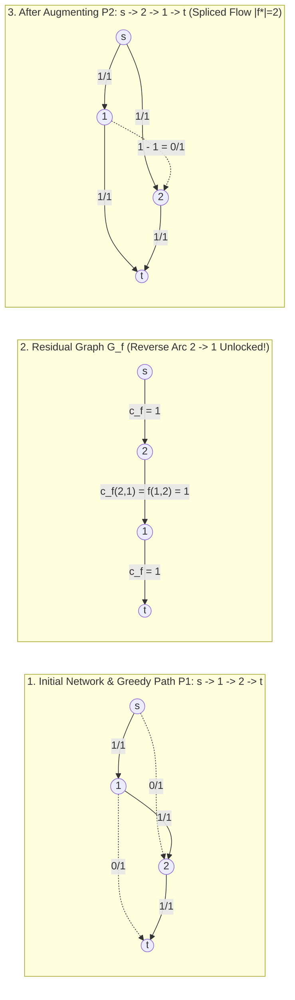

:::: {.callout-note icon="false" title="Prerequisites & Entry Contract"}

* **Graph Theory & Traversals**: Familiarity with directed multigraphs $G = (V, E)$, adjacency list representations, Breadth-First Search (BFS) shortest-path distance layers, and Depth-First Search (DFS).
* **Elementary Linear Algebra**: Vector inner products $\mathbf{x}^T \mathbf{y}$ and matrix-vector multiplication (used to derive the Cut Net-Flow Lemma in three lines via the vertex-arc incidence matrix).
* **Pre-Written Solver Assumption**: We assume you already possess a tested `Dinic` maximum-flow template in your library. Instead of re-implementing standard BFS/DFS loops from scratch, this chapter derives *why* residual reverse arcs work, proves the **Max-Flow Min-Cut Theorem** and **Dinic's Tight Complexity Regimes**, and establishes the **Black-Box Algorithmic & Structural Contract** that governs all 24 chapters of this textbook.

::::

:::: {.callout-tip icon="false" title="Learning Objectives & Chapter Blueprint"}

By the end of this chapter, you will be able to:

1. **Recognize Hidden Conservation Laws (`Direction A`)**: Diagnose when a non-graph problem statement (redistribution on cities, sports tournament elimination, prime-factor pairwise operations, or preemptive parallel machine scheduling) encodes a conserved quantity subject to capacity bounds.
2. **Master Residual Algebra & Path Splicing**: Derive the vertex-arc conservation equation $B f = |f|(\mathbf{e}_s - \mathbf{e}_t)$, the `edge_idx ^ 1` half-edge representation contract, the **Cut Net-Flow Lemma**, and why pushing flow along a reverse residual arc $e^{\text{rev}} = (v \to u)$ executes a physical **path-splicing surgery** that rescues greedy path traps (`FM-01`).
3. **Apply Max-Flow Min-Cut Duality & Integrality**: Prove the equivalence of maximum flow, absence of augmenting paths in $G_f$, and minimum cut saturation via the canonical reachable set $S_{\min} = \{v \in V : s \rightsquigarrow_{G_f} v\}$, while avoiding the **Cut Capacity Reverse-Arc Subtraction Trap (`FM-02`)** and irrational capacity pathologies.
4. **Use Dinic's Complexity Regimes as a Modelling Compass**: Predict before writing a single line of code whether a constructed graph runs in general $O(V^2 E)$, unit-capacity $O(E \min(V^{2/3}, E^{1/2}))$, unit-vertex $O(E\sqrt{V})$, or asymmetric bipartite $O(E\sqrt{|R|})$ time.
5. **Execute the 4-Step "Zero Magic Gadgets" Pipeline**: Compile eight non-template contest problems (`#001`–`#008`) from plain-English constraints into intermediate algebraic equations and normal-form flow networks.

::::

---

## 1. Motivation: Recognizing Flow Conservation When No Graph Is Given

Why do capable contestants who can type a 50-line `Dinic` template in three minutes still fail to solve flow and min-cut problems in actual contests? Because contest problems almost never hand you a directed network with a source $s$, a sink $t$, and edge capacities $c(e)$. Instead, they hand you an array of integers, a table of tournament standings, or a list of jobs with deadlines.

Before defining a single graph-theoretic term, examine three classic problem statements where **no flow network is mentioned in the input**, yet every greedy or dynamic programming attempt collapses for the exact same structural reason:

### 1.1 Three Non-Graph Vignettes with Hidden Conservation

1. **Single-Step Troop Redistribution (`CF 546E — Soldier and Traveling`, Ladder `#002`)**:
   * *Plain-English Setup*: $N$ cities initially hold $a_1, \dots, a_N$ soldiers and connect via $M$ roads. Each soldier may either stay in their starting city or walk across **at most one road** to a neighboring city. Can the army rearrange itself so that city $i$ ends up with exactly $b_i$ soldiers, and if so, what is the $N \times N$ movement table $x_{i,j}$?
   * *Why Greedy Fails*: If city $1$ has surplus soldiers needed by city $4$ along a path $1 - 2 - 3 - 4$, a soldier from $1$ cannot walk to $4$; Instead, a soldier from $1$ must step to $2$, displacing an *original* soldier from $2$ to $3$, who in turn displaces an *original* soldier from $3$ to $4$.
   * *The Hidden Conservation Law*: Every movement $x_{i,j} \ge 0$ is an atomic parcel of conserved mass leaving origin $i$ ($\sum_j x_{i,j} = a_i$) and arriving at destination $j$ ($\sum_i x_{i,j} = b_j$) across allowed pairs $(i, j) \in E \cup \{(u, u)\}$.

2. **Sports Tournament Elimination (`SGU 326 — Perspective`, Ladder `#001`)**:
   * *Plain-English Setup*: Team $1$ currently has $w_1$ wins and $r_1$ games left. Every other team $i \in \{2, \dots, N\}$ currently has $w_i$ wins, and there are $g_{ij}$ remaining games between teams $i$ and $j$ ($2 \le i < j \le N$). Can Team $1$ finish with at least as many wins as every other team?
   * *Why Greedy Fails*: Even after awarding Team $1$ all $r_1$ of its remaining games (reaching $W_1 = w_1 + r_1$ wins), deciding who wins the remaining matches $g_{ij}$ between teams $i$ and $j$ cannot be done greedily by "always letting the team with fewer current wins win." A triangle of teams $\{2, 3, 4\}$ playing each other heavily may collectively generate more wins than their combined headroom $\sum_{i \in \{2,3,4\}} (W_1 - w_i)$ can absorb!
   * *The Hidden Conservation Law*: Each remaining match $(i, j)$ generates $g_{ij}$ conserved units of "win mass" that must split into $x_{ij} + x_{ji} = g_{ij}$ between team $i$ and team $j$, while team $i$ can absorb at most $W_1 - w_i$ total wins across all opponents.

3. **Pairwise Prime-Factor Division (`CF 498C — Array and Operations`, Ladder `#004`)**:
   * *Plain-English Setup*: Given an array $a_1, \dots, a_N$ ($a_i \le 10^9$) and $M$ allowed index pairs $(i_k, j_k)$ where $i_k + j_k$ is always odd, each operation picks an allowed pair and divides both $a_{i_k}$ and $a_{j_k}$ by a common integer divisor $d > 1$. Maximize the total number of operations.
   * *Why Greedy Fails*: Dividing two numbers by a composite $d$ is always inferior to dividing sequentially by its prime factors, and different prime factors $p \neq q$ never interact. However, for a fixed prime $p$, greedily pairing $a_{i_k}$ and $a_{j_k}$ can strand prime powers along an alternating chain of indices.
   * *The Hidden Conservation Law*: Because $i_k + j_k$ is odd, every allowed pair connects an **odd index** $i \in L$ to an **even index** $j \in R$. For each fixed prime $p$, the exponent $\nu_p(a_i)$ at odd indices acts as a conserved **supply**, the exponent $\nu_p(a_j)$ at even indices acts as a **capacity-bounded sink demand**, and each operation consumes $1$ unit of $p$-exponent from $L$ and $1$ unit from $R$.

### 1.2 The Unifying Diagnostic Principle

Across all three problems, the surface story changes completely, but the underlying algebraic skeleton is identical:

$$\text{Source Supplies } (a_i) \xrightarrow{\text{Conserved Routing } x_{i,j} \ge 0} \text{Intermediate Conservation } \left(\text{inflow} = \text{outflow}\right) \xrightarrow{\text{Capacity Bounds}} \text{Sink Demands } (b_j)$$

Whenever an optimization or feasibility problem asks you to route, match, or redistribute discrete or continuous quantities subject to upper bounds without creating or destroying mass in the interior, you are looking at a **Flow Network**. And whenever the obstruction to feasibility is a subset of entities whose collective supply exceeds the collective capacity of their allowed receivers (as in the tournament triangle above), you are looking at its dual **Minimum Cut**.

---

## 2. Net Flow, Skew-Symmetry, and the Residual Graph $G_f$

Let us formalize this conservation algebra so that we can mechanically compile equations into graphs and prove why naive greedy routing fails.

### 2.1 Nonnegative Arc Flows vs. Skew-Symmetric Net Flows (`edge_idx ^ 1`)

Let $G = (V, E, c, s, t)$ be a directed multigraph with source $s \in V$, sink $t \in V$ ($s \neq t$), and a nonnegative capacity function $c: E \to \mathbb{R}_{\ge 0}$. Each directed arc $e \in E$ has a tail $\operatorname{tail}(e) \in V$ and a head $\operatorname{head}(e) \in V$. For any vertex $v \in V$, denote the sets of outgoing and incoming arcs by:

$$\delta^+(v) = \{e \in E : \operatorname{tail}(e) = v\}, \qquad \delta^-(v) = \{e \in E : \operatorname{head}(e) = v\}$$

#### Definition 2.1 (Feasible Nonnegative $s$-$t$ Flow)

A function $f: E \to \mathbb{R}$ is a **feasible $s$-$t$ flow** if it satisfies two laws:

1. **Capacity Constraints (Box Bounds)**:

   $$0 \le f(e) \le c(e) \qquad \forall e \in E$$

2. **Kirchhoff's Flow Conservation Law (Divergence-Free Interior)**: Define the net divergence (outflow minus inflow) at vertex $u \in V$ by:

   $$\nabla \cdot f(u) := \sum_{e \in \delta^+(u)} f(e) - \sum_{e \in \delta^-(u)} f(e)$$

   Then every internal vertex $u \in V \setminus \{s, t\}$ must satisfy exact conservation:

   $$\nabla \cdot f(u) = 0 \qquad \forall u \in V \setminus \{s, t\}$$

The **value** of the flow $f$, denoted $|f|$, is the net flow departing from the source $s$:

$$|f| := \nabla \cdot f(s) = \sum_{e \in \delta^+(s)} f(e) - \sum_{e \in \delta^-(s)} f(e)$$

In matrix form, if $B \in \{-1, 0, +1\}^{|V| \times |E|}$ is the **vertex-arc incidence matrix** with $B_{u,e} = +1$ if $u = \operatorname{tail}(e)$, $B_{u,e} = -1$ if $u = \operatorname{head}(e)$, and $0$ otherwise, then conservation is simply the linear system:

$$B f = |f| (\mathbf{e}_s - \mathbf{e}_t), \qquad \mathbf{0} \le f \le c$$

where $\mathbf{e}_s, \mathbf{e}_t \in \mathbb{R}^{|V|}$ are unit basis vectors. Since every column of $B$ contains one $+1$ and one $-1$, the sum of all rows is $\mathbf{1}_V^T B = \mathbf{0}^T$, which forces $\nabla \cdot f(t) = -\nabla \cdot f(s) = -|f|$: every unit of net flow leaving $s$ must arrive at $t$.

#### Skew-Symmetry on Paired Half-Edges (`edge_idx ^ 1`)

In theoretical proofs, it is convenient to view flow as a **skew-symmetric net flow** where every directed arc $e = (u \to v)$ is paired with a formal twin reverse arc $e^{\text{rev}} = (v \to u)$ satisfying:

$$f_{\text{net}}(e) = -f_{\text{net}}(e^{\text{rev}})$$

Why do we define skew-symmetry per **arc pair** $(e, e^{\text{rev}})$ rather than as a $V \times V$ matrix entry $f(u, v) = -f(v, u)$? Because a general network may contain **anti-parallel physical arcs** $e_1 = (u \to v)$ with capacity $c_1$ and $e_2 = (v \to u)$ with capacity $c_2$, or parallel multi-edges between $u$ and $v$. Merging $e_1$ and $e_2$ into a single $V \times V$ entry makes it impossible to recover the individual physical flows $f(e_1) \in [0, c_1]$ and $f(e_2) \in [0, c_2]$ (and completely breaks lower-bound flows in Chapter 4 and Min-Cost Max-Flow in Chapter 17).

> [!IMPORTANT]
> **Defensive Rule `H-01` — The `edge_idx ^ 1` Half-Edge Pairing Contract**:
> Every physical directed arc $e_k = (u \to v)$ with capacity $c(e_k)$ is allocated as an independent consecutive pair of half-edges at indices $2k$ and $2k+1$ (so `(2k) ^ 1 == 2k + 1` and `(2k + 1) ^ 1 == 2k`):
>
> * **Forward half-edge ($2k$, $u \to v$)**: initialized with residual capacity $\text{cap}[2k] = c(e_k)$.
> * **Reverse half-edge ($2k+1$, $v \to u$)**: initialized with residual capacity $\text{cap}[2k+1] = 0$.
>
> Whenever $\Delta$ units of flow are pushed along half-edge `idx`, we update $\text{cap}[\text{idx}] \gets \text{cap}[\text{idx}] - \Delta$ and $\text{cap}[\text{idx} \oplus 1] \gets \text{cap}[\text{idx} \oplus 1] + \Delta$. At any point, the physical flow on $e_k$ is uniquely recovered in $O(1)$ time as:
>
> $$f(e_k) = \text{cap}[2k+1] = c(e_k) - \text{cap}[2k]$$

---

### 2.2 $s$-$t$ Cuts, the Cut Net-Flow Lemma, and Weak Duality

#### Definition 2.2 ($s$-$t$ Cut and Cut Capacity)

An **$s$-$t$ cut** is a partition of the vertex set $V = S \sqcup T$ ($T = V \setminus S$) such that $s \in S$ and $t \in T$. Define the **forward cut-set** $\delta^+(S)$ and **backward cut-set** $\delta^-(S)$ across $(S, T)$ by:

$$\delta^+(S) = \{e \in E : \operatorname{tail}(e) \in S \land \operatorname{head}(e) \in T\}, \qquad \delta^-(S) = \{e \in E : \operatorname{tail}(e) \in T \land \operatorname{head}(e) \in S\}$$

The **capacity** of the cut $(S, T)$, denoted $c(S, T)$ or $\operatorname{cap}(S, T)$, is the sum of capacities of **strictly the forward arcs** from $S$ to $T$:

$$c(S, T) := \sum_{e \in \delta^+(S)} c(e)$$

#### Lemma 2.3 (Cut Net-Flow Lemma & Weak Duality)

For **every** feasible $s$-$t$ flow $f$ and **every** $s$-$t$ cut $(S, T)$, the flow value $|f|$ equals the net flow $f(S, T)$ crossing $(S, T)$, and is bounded above by the cut capacity $c(S, T)$:

$$|f| = f(S, T) := \sum_{e \in \delta^+(S)} f(e) - \sum_{e \in \delta^-(S)} f(e) \le c(S, T)$$

Furthermore, equality $|f| = c(S, T)$ holds **if and only if**:

1. **Forward Saturation**: Every forward cross-arc $e \in \delta^+(S)$ is fully saturated ($f(e) = c(e)$), and
2. **Backward Emptiness (Zero Backflow)**: Every backward cross-arc $e \in \delta^-(S)$ carries zero flow ($f(e) = 0$).

*Proof*: Let $\mathbf{1}_S \in \{0, 1\}^{|V|}$ be the indicator vector of $S$ ($\mathbf{1}_S(u) = 1$ if $u \in S$ and $0$ if $u \in T$). Since $s \in S$, $t \in T$, and $\nabla \cdot f(u) = 0$ for all $u \in S \setminus \{s\}$, summing the nodal divergences over $S$ (equivalently taking the inner product $\mathbf{1}_S^T (Bf)$) gives:

$$|f| = \nabla \cdot f(s) + \sum_{u \in S \setminus \{s\}} 0 = \sum_{u \in S} \nabla \cdot f(u) = \mathbf{1}_S^T (Bf) = (\mathbf{1}_S^T B) f$$

For each arc $e = (u \to v) \in E$, the $e$-th entry of $\mathbf{1}_S^T B$ is $\mathbf{1}_S(u) - \mathbf{1}_S(v)$:

* If $u \in S$ and $v \in S$, $\mathbf{1}_S(u) - \mathbf{1}_S(v) = 1 - 1 = 0$ (internal arcs inside $S$ cancel out: $f(e)$ leaves $u \in S$ and enters $v \in S$).
* If $u \in T$ and $v \in T$, $\mathbf{1}_S(u) - \mathbf{1}_S(v) = 0 - 0 = 0$ (internal arcs inside $T$ never touch $S$).
* If $u \in S$ and $v \in T$ ($e \in \delta^+(S)$), $\mathbf{1}_S(u) - \mathbf{1}_S(v) = +1$.
* If $u \in T$ and $v \in S$ ($e \in \delta^-(S)$), $\mathbf{1}_S(u) - \mathbf{1}_S(v) = -1$.

Thus $|f| = \sum_{e \in \delta^+(S)} f(e) - \sum_{e \in \delta^-(S)} f(e)$. Applying the box bounds $f(e) \le c(e)$ for every $e \in \delta^+(S)$ and $-f(e) \le 0$ for every $e \in \delta^-(S)$ yields:

$$|f| = \sum_{e \in \delta^+(S)} \underbrace{f(e)}_{\le c(e)} - \sum_{e \in \delta^-(S)} \underbrace{f(e)}_{\ge 0} \le \sum_{e \in \delta^+(S)} c(e) - 0 = c(S, T)$$

with equality if and only if $f(e) = c(e)$ on $\delta^+(S)$ and $f(e) = 0$ on $\delta^-(S)$. $\blacksquare$

> [!WARNING]
> **Failure Mode `FM-02` — The Cut Capacity Reverse-Arc Subtraction Trap**:
> Students who memorize the net-flow equation $f(S, T) = \sum_{e \in \delta^+(S)} f(e) - \sum_{e \in \delta^-(S)} f(e)$ frequently write the cut capacity as $c_{\text{wrong}}(S, T) = \sum_{e \in \delta^+(S)} c(e) - \sum_{e \in \delta^-(S)} c(e)$. **This is catastrophically false!**
>
> *Why?* In the inequality $|f| = \sum_{e \in \delta^+(S)} f(e) - \sum_{e \in \delta^-(S)} f(e)$, the second sum has a **minus sign**. Because $0 \le f(e) \le c(e)$, the *maximum* possible value of $-f(e)$ on a backward arc $e \in \delta^-(S)$ is achieved when $f(e) = 0$ (not $f(e) = c(e)$!). Backward arcs from $T$ to $S$ cannot help push flow from $S$ to $T$; at best they sit idle at $f(e) = 0$. Therefore, $c(S, T) = \sum_{e \in \delta^+(S)} c(e)$ counts **only forward arcs** $S \to T$, and backward arcs $T \to S$ contribute $0$ to $c(S, T)$.

---

### 2.3 The Residual Graph $G_f$, the 4-Vertex Diamond Trace, and `FM-01`

Suppose we hold a feasible flow $f$ and want to increase its value by adding an adjustment $\Delta: E \to \mathbb{R}$ so that $f' = f + \Delta$ remains feasible ($0 \le f(e) + \Delta(e) \le c(e)$) and satisfies conservation. For each physical arc $e = (u \to v) \in E$, the box bound $0 \le f(e) + \Delta(e) \le c(e)$ allows two opposite moves:

1. **Forward Increment ($\Delta(e) > 0$)**: We can increase $f(e)$ by up to $c_f(e) := c(e) - f(e)$ units, sending additional flow from $u$ to $v$.
2. **Backward Cancellation ($\Delta(e) < 0$)**: We can *decrease* $f(e)$ by up to $c_f(e^{\text{rev}}) := f(e)$ units. Decreasing flow on $u \to v$ by $\delta \in (0, f(e)]$ decreases $\nabla \cdot f(u)$ by $\delta$ and increases $\nabla \cdot f(v)$ by $\delta$ — which has the **exact same nodal conservation effect as pushing $+\delta$ units of flow along the reverse arc $e^{\text{rev}} = (v \to u)$**!

#### Definition 2.4 (The Residual Graph $G_f$ and Augmenting Paths)

Given a flow network $G = (V, E, c, s, t)$ and a feasible flow $f$, the **residual graph** $G_f = (V, E_f, c_f)$ consists of all forward half-edges $e = (u \to v)$ with $c_f(e) = c(e) - f(e) > 0$ and all reverse half-edges $e^{\text{rev}} = (v \to u)$ with $c_f(e^{\text{rev}}) = f(e) > 0$. An **augmenting path** is a simple directed path $P$ from $s$ to $t$ in $G_f$ with bottleneck residual capacity $\delta(P) = \min_{a \in P} c_f(a) > 0$.

#### Concrete Worked Trace: The 4-Vertex Diamond & Path Splicing (`FM-01`)

Why can't we simply find an $s$-$t$ path in the original graph $G$, subtract its bottleneck from the forward capacities, and repeat without reverse arcs? Consider the canonical **4-Vertex Diamond Network** with $V = \{s, 1, 2, t\}$ and five unit-capacity directed arcs ($c(e) = 1$):

$$e_1 = (s \to 1), \quad e_2 = (s \to 2), \quad e_3 = (1 \to 2), \quad e_4 = (1 \to t), \quad e_5 = (2 \to t)$$



Trace the two augmentations and observe how the reverse residual arc $e_3^{\text{rev}} = (2 \to 1)$ physically splices paths:

* **Augmentation 1 (Unlucky Greedy Choice)**: Suppose our first search routes $1$ unit of flow along $P_1 = (s \to 1 \to 2 \to t)$. Now $f(s \to 1) = f(1 \to 2) = f(2 \to t) = 1$, so the forward arcs $(s \to 1)$, $(1 \to 2)$, and $(2 \to t)$ all drop to $0$ forward residual capacity.
* **What happens without reverse arcs?** In the forward-only graph, $s$ can still reach $2$ via $(s \to 2)$, and $1$ can still reach $t$ via $(1 \to t)$, **but vertex $2$ is a dead end** because $(2 \to t)$ is saturated! A greedy forward-only algorithm terminates at $|f_{\text{greedy}}| = 1$, missing the true maximum flow $|f^*| = 2$.
* **How the Reverse Residual Arc Splices $P_1$ and $P_2$**: Because $f(1 \to 2) = 1$, the residual graph $G_f$ activates the reverse arc $e_3^{\text{rev}} = (2 \to 1)$ with residual capacity $c_f(2 \to 1) = f(1 \to 2) = 1$. Now $G_f$ contains the augmenting path:

  $$P_2 = (s \to 2 \xrightarrow{e_3^{\text{rev}}} 1 \to t), \qquad \delta(P_2) = 1$$

  Pushing $1$ unit along $P_2$ sets $f(s \to 2) = 1$, $f(1 \to t) = 1$, and **cancels** the bridge flow $f'(1 \to 2) = 1 - 1 = 0$. Look at what happened geometrically to the paths:

  $$\underbrace{(s \to 1 \to \cancel{2} \to t)}_{P_1} \;\oplus\; \underbrace{(s \to 2 \xrightarrow{\text{cancel}} 1 \to t)}_{P_2} \;=\; \underbrace{(s \to 1 \to t)}_{\text{Spliced Path } A} \;+\; \underbrace{(s \to 2 \to t)}_{\text{Spliced Path } B}$$

  Pushing flow along the reverse residual arc $(2 \to 1)$ did not physically send commodities backward against a one-way street; it **redirected** the unit of flow arriving at $1$ (from $s \to 1$) to exit directly via $1 \to t$, freeing the capacity of $2 \to t$ for the new flow arriving from $s \to 2$!

> [!WARNING]
> **Failure Mode `FM-01` — The Greedy Augmenting Path Trap**:
> Never solve a multi-path routing, matching, or flow problem by greedily finding one $s \rightsquigarrow t$ path (even a shortest path!), permanently deleting its edges or decrementing only forward capacities, and repeating. As the 4-vertex diamond proves, even a shortest path in an unweighted DAG can cross between two parallel lanes and lock both. Allocating the skew-symmetric reverse arc at `edge_idx ^ 1` (`H-01`) is mandatory so that later augmentations can undo and splice earlier routing commitments.


---

## 3. The Max-Flow Min-Cut Theorem & Integrality Theorem

By Lemma 2.3 (Weak Duality), every feasible $s$-$t$ flow $f$ and every $s$-$t$ cut $(S, T)$ obey $|f| \le c(S, T)$. Thus, if we ever exhibit a flow $f^*$ and a cut $(S^*, T^*)$ with $|f^*| = c(S^*, T^*)$, both are simultaneously optimal. Ford and Fulkerson proved that the **absence of augmenting paths in $G_f$** automatically constructs this exact cut.

### 3.1 Constructive Proof of the Max-Flow Min-Cut Equivalence Theorem

#### Theorem 3.1 (Ford–Fulkerson Max-Flow Min-Cut Theorem, 1956)

For any feasible $s$-$t$ flow $f$ in a capacity network $G = (V, E, c, s, t)$, the following three statements are equivalent:

1. **Primal Optimality**: $f$ is a **maximum flow** in $G$ (i.e., $|f| \ge |f'|$ for every feasible flow $f'$).
2. **Residual Optimality**: The residual network $G_f$ contains **no $s \rightsquigarrow t$ augmenting path**.
3. **Strong Duality**: There exists an $s$-$t$ cut $(S, T)$ in $G$ such that $|f| = c(S, T)$ (and therefore $(S, T)$ is a **minimum $s$-$t$ cut**).

*Constructive Proof ($(1) \implies (2) \implies (3) \implies (1)$)*:

* **$(1) \implies (2)$ (Contrapositive)**: Suppose $G_f$ contains a simple directed augmenting path $P$ from $s$ to $t$ with bottleneck residual capacity $\delta = \min_{a \in P} c_f(a) > 0$. Augmenting $f$ by $\delta$ along $P$ (increasing $f(e)$ by $\delta$ on forward arcs of $P$ and decreasing $f(e)$ by $\delta$ on physical arcs whose reverse arcs belong to $P$) preserves box bounds $0 \le f'(e) \le c(e)$ and nodal conservation at every internal vertex of $P$, while increasing the net divergence at $s$ to $|f'| = |f| + \delta > |f|$. Hence $f$ is not maximum.
* **$(2) \implies (3)$ (Canonical Cut Construction via $S_{\min}$)**: Assume $G_f$ contains no directed path from $s$ to $t$. Define the **source-reachable vertex set** in $G_f$:

  $$S_{\min} := \left\{ v \in V \;\middle|\; s \rightsquigarrow_{G_f} v \right\}, \qquad T_{\min} := V \setminus S_{\min}$$

  Since $s$ reaches itself trivially ($s \in S_{\min}$) and $s$ cannot reach $t$ by hypothesis (2) ($t \in T_{\min}$), $(S_{\min}, T_{\min})$ is a valid $s$-$t$ cut. Now inspect any physical arc crossing between $S_{\min}$ and $T_{\min}$:

  1. **Every forward cross-arc $e = (u \to v) \in \delta^+(S_{\min})$ is saturated ($f(e) = c(e)$)**: Since $u \in S_{\min}$ is reachable from $s$ in $G_f$ and $v \in T_{\min}$ is not, the forward half-edge $(u \to v)$ cannot exist in $G_f$. Therefore $c_f(e) = c(e) - f(e) = 0 \implies f(e) = c(e)$.
  2. **Every backward cross-arc $e = (v \to u) \in \delta^-(S_{\min})$ is empty ($f(e) = 0$)**: Here $v \in T_{\min}$ and $u \in S_{\min}$. If $e$ carried strictly positive flow $f(e) > 0$, then its reverse residual half-edge $e^{\text{rev}} = (u \to v)$ would have positive residual capacity $c_f(e^{\text{rev}}) = f(e) > 0$ in $G_f$, allowing $s$ to reach $v$ via $u \to v$ and contradicting $v \notin S_{\min}$! Therefore $f(e) = 0$.

  Substituting both conditions into the Cut Net-Flow Lemma (Lemma 2.3) gives:

  $$|f| = \sum_{e \in \delta^+(S_{\min})} \underbrace{f(e)}_{= c(e)} - \sum_{e \in \delta^-(S_{\min})} \underbrace{f(e)}_{= 0} = \sum_{e \in \delta^+(S_{\min})} c(e) = c(S_{\min}, T_{\min})$$

* **$(3) \implies (1)$ (Weak Duality Certificate)**: If $|f| = c(S, T)$ for some cut $(S, T)$, then by Lemma 2.3 every feasible flow $f'$ satisfies $|f'| \le c(S, T) = |f|$, proving both that $f$ is a maximum flow and that $(S, T)$ is a minimum cut. $\blacksquare$

---

### 3.2 The Integrality Theorem and Irrational Capacity Pathologies

#### Corollary 3.2 (Integrality Theorem — Dantzig & Fulkerson, 1956)

If every edge capacity $c(e) \in \mathbb{Z}_{\ge 0}$ is an integer, then there exists an **integral maximum flow** $f^*: E \to \mathbb{Z}_{\ge 0}$. Moreover, starting from $f \equiv 0$, every augmenting path $P$ in $G_f$ has an integer bottleneck $\delta(P) = \min_{a \in P} c_f(a) \ge 1$, so any augmenting-path algorithm maintains integer residual capacities at every step and terminates in at most $|f^*|$ augmentations.

*Modelling Power of Integrality*: In competitive programming, Corollary 3.2 is our license to relax discrete $0$-$1$ combinatorics (matching, tournament win assignment, prime-factor pairings, disjoint paths) into continuous flow capacities without ever worrying about fractional flow values $f^*(e) = 0.5$ — **provided all capacities are integers**!

#### What Breaks with Irrational Capacities? (Zwick's 6-Vertex Golden-Ratio Network)

If capacities are real numbers and augmenting paths are chosen poorly (without BFS shortest-path layering), Ford–Fulkerson can fail to terminate and converge to a **strictly suboptimal value**. Uri Zwick (1995) constructed the minimal 6-vertex counterexample using the reciprocal golden ratio $\phi = \frac{\sqrt{5}-1}{2} \approx 0.618$, which obeys the self-similar identity $\phi^{k-1} - \phi^k = \phi^{k+1}$:

* Let $V = \{s, t, a, b, c, d\}$. Place three central arcs $e_1 = (a \to b)$ with capacity $1$, $e_2 = (c \to b)$ with capacity $1$, and $e_3 = (c \to d)$ with capacity $\phi$.
* Connect $s$ to $\{a, c, d\}$ and $\{a, b, d\}$ to $t$, each with large capacity $X = 5$. The true maximum flow is $|f^*| = 2X + 1 = 11$.
* After an initial $1$-unit push along $s \to a \xrightarrow{e_1} b \to t$, the central residual capacities are $(r_1, r_2, r_3) = (0, 1, \phi) = (0, \phi^0, \phi^1)$. By routing alternating paths through the reverse arcs $e_1^{\text{rev}} = (b \to a)$ and $e_2^{\text{rev}} = (b \to c)$, round $k$ subtracts $\phi^k$ from $\phi^{k-1}$ to leave $\phi^{k+1}$, shifting the central state inductively from $(0, \phi^{k-1}, \phi^k)$ to $(0, \phi^{k+1}, \phi^{k+2})$ forever! The total flow pushed converges to $1 + 2\sum_{k=1}^\infty \phi^k = 2 + \sqrt{5} \approx 4.236 \ll 11$.

---

### 3.3 The Flow Decomposition Theorem (`流分解定理`)

A flow $f: E \to \mathbb{R}_{\ge 0}$ is an **edge-space** object (a single number per arc), whereas many problems (`CF 653D`, `CSES 1711`, `CF 510E`) ask about **path-space** or **cycle-space** trajectories.

#### Theorem 3.3 (Path–Cycle Flow Decomposition Theorem)

Any feasible nonnegative $s$-$t$ flow $f$ on $G = (V, E)$ can be decomposed into at most $|E|$ weighted directed $s \rightsquigarrow t$ paths $\mathcal{P} = \{P_1, \dots, P_p\}$ and directed cycles $\mathcal{C} = \{C_1, \dots, C_q\}$ ($p + q \le |E|$) with positive weights $w > 0$ such that $f(e) = \sum_{P_i \ni e} w(P_i) + \sum_{C_j \ni e} w(C_j)$ for every $e \in E$ and $|f| = \sum_{i=1}^p w(P_i)$. If $f$ is integral, all weights $w(P_i), w(C_j)$ can be chosen as positive integers.

*Proof Sketch*: While $|f| > 0$, start a walk at $s$ following only arcs with $f(e) > 0$. By conservation $\nabla \cdot f(u) = 0$ at internal vertices, the walk cannot get stuck at any $u \neq t$: within $\le |V|$ steps it either repeats a vertex (isolating a directed cycle $C$) or reaches $t$ (isolating a simple path $P$). Subtracting the bottleneck flow $\min_{e} f(e) > 0$ along $P$ or $C$ zeroes out at least one edge of $E$. Once $|f| = 0$, any remaining positive flow is a pure circulation and similarly decomposes into cycles. Since each extraction zeroes at least one edge, $p + q \le |E|$. $\blacksquare$

---

## 4. Dinic's Blocking-Flow Complexity Regimes as a Modelling Compass

Why did Zwick's irrational network loop forever? Because it augmented along winding paths that repeatedly reversed the same central arcs at the same distance. E. A. Dinic (1970) eliminated this pathology by restricting augmentations in each phase to shortest $s \rightsquigarrow t$ paths in $G_f$ via a **Level Graph**.

### 4.1 Level Graphs, Blocking Flows, and Strict Distance Monotonicity

Let $d_f(s, u)$ denote the unweighted BFS shortest-path distance (number of arcs) from $s$ to $u$ in $G_f$.

* **Level Graph $L(G_f)$**: The directed acyclic subgraph $L(G_f) = (V, E_L)$ containing only **admissible (level-advancing) residual arcs**:

  $$E_L := \left\{ a = (u \to v) \in E_f \;\middle|\; c_f(a) > 0 \;\land\; d_f(s, v) = d_f(s, u) + 1 \right\}$$

* **Blocking Flow**: A flow $\phi$ in $L(G_f)$ is a **blocking flow** if every directed $s \rightsquigarrow t$ path in $L(G_f)$ contains at least one arc $a \in E_L$ saturated by $\phi$ ($\phi(a) = c_f(a)$).

#### Theorem 4.1 (Strict Monotonicity of BFS Distance Across Phases)

If $\phi$ is a blocking flow in $L(G_f)$ and $f' = f + \phi$, then the shortest-path distance from $s$ to $t$ strictly increases:

$$d_{f'}(s, t) \ge d_f(s, t) + 1$$

Consequently, Dinic's algorithm terminates in **at most $|V| - 1$ phases** regardless of edge capacities!

*Proof*: Consider any arc $(u \to v) \in E_{f'}$ in the new residual graph. Either $(u \to v)$ was already present in $E_f$ (so $d_f(s, v) \le d_f(s, u) + 1$ by the BFS triangle inequality), or $(u \to v)$ is a newly unlocked reverse arc of some admissible arc $(v \to u) \in E_L$ that carried $\phi(v \to u) > 0$ (in which case $d_f(s, u) = d_f(s, v) + 1 \implies d_f(s, v) = d_f(s, u) - 1 < d_f(s, u) + 1$). Thus **every** arc $(u \to v) \in E_{f'}$ obeys $d_f(s, v) \le d_f(s, u) + 1$, with equality **only if** $(u \to v) \in E_L$ and $(u \to v)$ was left unsaturated by $\phi$. Summing $d_f(s, v_i) - d_f(s, v_{i-1}) \le 1$ along a shortest $s$-$t$ path $P = (s = v_0 \to \dots \to v_k = t)$ in $G_{f'}$ gives $d_f(s, t) \le k = d_{f'}(s, t)$. Equality $d_{f'}(s, t) = d_f(s, t)$ would force every arc of $P$ to be an unsaturated arc of $E_L$, contradicting that $\phi$ is a blocking flow! $\blacksquare$

> [!IMPORTANT]
> **Defensive Rule `H-03` — Current-Arc Persistence (`cur[u]`) & Dead-Node Pruning**:
> Within a single phase, reverse arcs point from level $\ell + 1$ back to level $\ell$ and can never belong to $E_L$. Thus, once an arc $a \in \delta^+_{E_L}(u)$ is saturated or its head $v$ cannot reach $t$ in $L(G_f)$, $a$ can never carry flow again during the current phase. Maintaining a per-vertex pointer `cur[u]` that only advances forward through $u$'s adjacency list guarantees that all dead-end retreats across an entire phase cost $O(E)$ total time, while at most $|E|$ edge-saturating augmentations each cost $O(V)$ stack work, giving $O(VE)$ per phase and **$O(V^2 E)$** overall. Omitting `cur[u]` degrades a single phase to $\Theta(VE^2)$!

---

### 4.2 Proving the Three Sub-Quadratic Regimes (Karzanov 1973; Even & Tarjan 1975)

In competitive programming, the general $O(V^2 E)$ bound is wildly pessimistic for almost every graph we construct. By running Dinic for $K$ phases (until $d_f(s, t) > K$) and bounding the **remaining unpushed flow** $|f^*| - |f|$ via a sparse cut across the $K$ BFS layers of $G_f$, we obtain three tight sub-quadratic complexity regimes that serve as our **modelling compass**:

#### Theorem 4.2 (Dinic's Sub-Quadratic Complexity Regimes)

1. **Unit-Capacity Networks ($c(e) = 1 \;\forall e \in E$)**: Dinic runs in **$O\big(E \min(V^{2/3}, E^{1/2})\big)$** time.
2. **Unit-Vertex Networks ($c(e) \in \{1, \infty\}$ and $\min(\text{indeg}_c(v), \text{outdeg}_c(v)) \le 1 \;\forall v \in V \setminus \{s, t\}$)**: Dinic runs in **$O(E\sqrt{V})$** time.
3. **Asymmetric Bipartite Quota Networks ($V = \{s, t\} \sqcup L \sqcup R$, unit capacity $c(r \to t) = 1$ on $R$, arbitrary capacities on $s \to L$ and $L \to R$)**: Dinic runs in **$O(E\sqrt{|R|})$** time.

*Proof*:

* **Step A ($O(E)$ Time per Phase under Unit Capacities)**: When $c_f(a) = 1$ on every admissible arc $a \in E_L$, every DFS step traversing $a = (u \to v)$ either saturates $a$ immediately or proves $v$ is a dead end. In both cases `cur[u]` advances past $a$ immediately, so each phase touches every arc at most once in **$O(E)$** time!
* **Step B ($O(E^{3/2})$ Bound for General Unit-Capacity Networks)**: Suppose $K$ phases have completed, so $d_f(s, t) > K$. Partition $G_f$ into distance layers $V_i = \{v \in V : d_f(s, v) = i\}$ for $i = 0, 1, \dots, K$. For each $i \in \{1, \dots, K\}$, the cut $S_i = \bigcup_{j=0}^{i-1} V_j$ has forward residual cut-set $\delta^+_{G_f}(S_i) \subseteq E_f(V_{i-1}, V_i)$. Since these $K$ edge sets are pairwise disjoint and $|E_f| \le 2|E|$, the Pigeonhole Principle guarantees some layer $i^*$ with $|E_f(V_{i^*-1}, V_{i^*})| \le \frac{2|E|}{K}$. By Theorem 3.1 applied to $G_f$, the remaining flow to push is $|f^*| - |f| \le c_f(S_{i^*}, V \setminus S_{i^*}) \le \frac{2|E|}{K}$. Since each subsequent phase increases $|f|$ by at least $1$, at most $\frac{2|E|}{K}$ phases remain! Choosing $K = \lceil \sqrt{E} \rceil$ bounds total phases by $3\sqrt{E}$ and total time by **$O(E^{3/2})$**.
* **Step C ($O(V^{2/3} E)$ Bound for Simple Unit-Capacity Networks)**: If $G$ has no parallel edges, there are at most $2|V_{i-1}|\cdot|V_i|$ residual arcs between $V_{i-1}$ and $V_i$. Since $\sum_{i=0}^K |V_i| \le |V|$, there exists an adjacent pair $(V_{i-1}, V_i)$ with $|V_{i-1}| + |V_i| \le \frac{2|V|}{K}$, so $|V_{i-1}|\cdot|V_i| \le \frac{|V|^2}{K^2}$. Thus $|f^*| - |f| \le \frac{2|V|^2}{K^2}$. Balancing $K$ against $\frac{|V|^2}{K^2}$ by setting $K = \lceil V^{2/3} \rceil$ bounds total phases by $O(V^{2/3})$ and total time by **$O(V^{2/3} E)$**.
* **Step D ($O(E\sqrt{V})$ and $O(E\sqrt{|R|})$ Bounds for Unit-Vertex & Bipartite Networks)**: When every internal vertex $v \in V \setminus \{s, t\}$ has either total incoming residual capacity $\le 1$ or total outgoing residual capacity $\le 1$, any flow in $G_f$ decomposes into **vertex-disjoint** $s \rightsquigarrow t$ paths! After $K$ phases, every augmenting path in $G_f$ has length $> K$ and therefore visits at least $K - 1$ distinct internal vertices. Because the $|f^*| - |f|$ remaining paths are vertex-disjoint on internal vertices, $(|f^*| - |f|)(K - 1) \le |V| \implies |f^*| - |f| \le \frac{|V|}{K-1}$. Setting $K = \lceil \sqrt{V} \rceil$ gives $\le 2\sqrt{V}$ phases and **$O(E\sqrt{V})$** time. In the asymmetric bipartite case where only $r \in R$ has unit throughput $c(r \to t) = 1$, paths are vertex-disjoint on $R$ and visit at least $K/2$ vertices of $R$ after $K$ phases, yielding **$O(E\sqrt{|R|})$** regardless of $|L|$ or $\sum_{l \in L} c(s \to l)$! $\blacksquare$

### 4.3 Scaling & Discretizing Continuous Parameters for Binary Search (`CF 653D`)

What if a problem involves a continuous parameter $w \in \mathbb{R}_{>0}$ (such as the real weight carried by each bear in `CF 653D — Delivery Bears`), where edge $e$ can support at most $k_e$ discrete agents if $k_e \cdot w \le c(e)$?

* **Never run Dinic on raw floating-point capacities $c(e) / w$!** First, fractional flow $0.4 + 0.6 = 1.0$ allows half-bears to split across paths, violating discrete agent indivisibility. Second, real capacities forfeit the Integrality Theorem and can trigger thousands of micro-augmentations.
* **The Discretization & Capping Rule**: For a fixed binary-search guess $w > 0$, an edge of capacity $c(e)$ can be traversed by at most $\lfloor c(e) / w \rfloor$ discrete bears. Furthermore, if we only need to route $X$ bears total, no edge ever needs capacity exceeding $X$. Setting:

  $$\operatorname{cap}_w(e) := \min\!\left(X,\; \left\lfloor \frac{c(e)}{w} \right\rfloor\right) \in \{0, 1, \dots, X\}$$

  keeps every capacity an exact integer bounded by $X$ and guarantees that Dinic runs in at most $\min(X, V)$ phases per binary-search step!

---

## 5. Black-Box Algorithmic Contract & Bidirectional Recognition Table

From this point forward across the textbook, we treat `Dinic` as a sealed black-box library primitive governed by the following formal interface:

### 5.1 The Black-Box Algorithmic & Structural Contract

```cpp
// Conceptual Interface Contract (Assumed in Reader's Library — Do NOT Re-Implement Boilerplate)
struct Dinic {
    struct Edge { int to, rev; long long cap; }; // Or flat arrays head[], to[], nxt[], cap[] with idx ^ 1
    int add_edge(int u, int v, long long c);     // Allocates forward (2k, cap=c) and reverse (2k+1, cap=0); returns 2k
    long long max_flow(int s, int t);            // Pushes blocking flows; returns |f*| = c(S_min, T_min)
    long long edge_flow(int e_id) const;         // Returns physical flow f(e_k) == cap[2k + 1] in O(1)
    vector<bool> min_cut_S(int s) const;         // Returns indicator of S_min = {v : s ~> v in G_f*} via residual BFS
};
```

Whenever we design a flow or min-cut solution, our responsibility is **never** to tweak the internals of `Dinic`; our responsibility is to specify:

1. **Vertex & Arc Inventory**: Exact definitions and counts of $|V|$ and $|E|$, plus capacities $c(e) \in \mathbb{Z}_{\ge 0} \cup \{\infty\}$ (where legislative $\infty$ is chosen strictly larger than the maximum finite cut value $\sum_{e \text{ finite}} c(e) + 1$, without overflowing `long long`).
2. **Complexity Regime Certification**: Matching $(|V|, |E|, \text{Capacity Structure})$ against Theorem 4.2 to prove the runtime passes well within the time limit.
3. **Post-Flow Extraction Rule**: Whether the answer is read from the scalar value $|f^*|$, from individual edge flows `edge_flow(e_id) == cap[2k + 1]`, or from the canonical cut partition $u \in S_{\min} \land v \notin S_{\min}$.

### 5.2 Bidirectional Recognition Table (`Direction A` vs. `Direction B`)

A complete competitive programmer uses flow theory in **two opposite directions**:

| Direction & Regime | Surface Clues & Typical Constraints | Strategic Action & Compilation Target |
| :--- | :--- | :--- |
| **Direction A: Non-Graph $\to$ Flow / Min-Cut** *(Polynomial Flow Regime)* | No graph in problem statement (arrays, schedules, tournaments, prime factors, matrices); conserved supplies/demands or coupled upper bounds; $N, M \le 500$ for general capacities, or $N \le 5 \cdot 10^4, M \le 1.5 \cdot 10^5$ for unit-vertex/bipartite networks. | Translate English rules into intermediate algebraic variables $x_{i,j} \ge 0$ and conservation equations; compile into an explicit `Dinic` graph via the 4-Step Pipeline. |
| **Direction A+: Parametric / Small-$K$ Dynamic Flow** | Flow network where capacities depend monotonically on a threshold $w$ (`CF 653D`), or $K \le 10$ special edges change capacity across $Q = 2 \cdot 10^5$ queries (`CF 1383F`). | Wrap `Dinic` in binary search over discretized integer capacities $\lfloor c_e / w \rfloor$, or precompute the $2^K$ cut-mask space via incremental residual DFS from parent snapshots. |
| **Direction B: Flow / Cut $\to$ Fast Non-Flow Algorithm** *(Large-$N$ Regime)* | Problem is naturally a Max-Flow or Min-Cut, **but $N, M \ge 10^5$** makes explicit `Dinic` TLE; underlying topology is planar (`Ch 15`), a tree/line/DAG (`Ch 16.1`, `Ch 21`), or convex-cost 1D/tree (`Ch 23`). | Formulate the exact primal Flow / Min-Cut algebraic model first, then **eliminate the flow solver** via Planar Dual Dijkstra (`Ch 15`), Min-Cut DP / Segment Tree (`Ch 16`), LP Dual inspection (`Ch 21`), or Priority-Queue Simulated MCMF (`Ch 23`). |


---

## 6. Curated 4-Tier Practice Ladder (`#001`–`#008`)

Every problem below follows our mandatory **Zero Magic Gadgets** standard: read the plain-English summary first, test your diagnostic instincts against **Hint 1** and **Hint 2**, and then study the **Full 4-Step Compilation & Solution**.

---

### Tier 1: Stepping Stones (`#001`–`#002`)

#### Problem `#001` — Perspective (Sports Tournament Elimination)

* **Judge & ID**: [SGU 326 — Perspective](https://codeforces.com/problemsets/acmsguru/problem/99999/326) (`[EN]`, Classic Schwartz 1966 Baseball Elimination Archetype)
* **Constraints**: $N \le 20$ teams; current wins $w_i \in [0, 10^4]$; remaining games $r_1$ for Team $1$; remaining pairwise games $g_{ij} \in [0, 10^4]$ between teams $i$ and $j$ ($2 \le i < j \le N$).
* **Plain-English Problem Summary**: A league has $N$ teams. Team $i$ currently holds $w_i$ points (1 point per win, no draws). You are given the number of remaining matches $r_1$ involving Team $1$ and the exact matrix of remaining matches $g_{ij}$ between every pair of other teams $2 \le i < j \le N$. Determine whether there exists *any* outcome of all remaining matches in which Team $1$ finishes with at least as many points as every other team ($W_1 \ge W_i$ for all $i \in \{2, \dots, N\}$).

:::: {.callout-note collapse="true" title="Hint 1 — Non-Graph Diagnostic Signal (Recognition Trigger)"}

First make the obvious greedy observation for Team $1$: since Team $1$'s remaining $r_1$ games only ever increase Team $1$'s score without helping any other team (in the standard formulation where $g_{ij}$ already excludes Team $1$'s games), we should award **all** $r_1$ wins to Team $1$, giving Team $1$ a final score of $W_1 = w_1 + r_1$. If any team $i \ge 2$ already has $w_i > W_1$, Team $1$ is trivially eliminated.

Why does greedy fail on the remaining games $g_{ij}$ ($2 \le i < j \le N$)? Because every match between $i$ and $j$ injects $1$ conserved point that **must** be absorbed by either $i$ or $j$, while team $i$ has a strict upper bound $W_1 - w_i$ on how many additional points it can absorb before overtaking Team $1$.

::::

:::: {.callout-note collapse="true" title="Hint 2 — Intermediate Algebraic Representation"}

For each pair $2 \le i < j \le N$ with $g_{ij} > 0$, introduce two nonnegative integer decision variables:

* $x_{ij} \in \mathbb{Z}_{\ge 0}$: the number of wins awarded to team $i$ in its remaining matches against $j$,
* $x_{ji} \in \mathbb{Z}_{\ge 0}$: the number of wins awarded to team $j$ in its remaining matches against $i$.

Write the exact linear system governing feasibility:

1. **Match Point Conservation**: $x_{ij} + x_{ji} = g_{ij}$ for all $2 \le i < j \le N$.
2. **Team Headroom Upper Bound**: $\sum_{j \neq i} x_{ij} \le W_1 - w_i$ for all $i \in \{2, \dots, N\}$.

::::

:::: {.callout-tip collapse="true" title="Full 4-Step Compilation & Solution — #001 (SGU 326)"}

##### Step 1: Non-Graph Diagnostic Signal

Each unordered pair $\{i, j\}$ ($2 \le i < j \le N$) is a conserved generator of $g_{ij}$ wins, and each team $i \in \{2, \dots, N\}$ is a bounded receiver of capacity $W_1 - w_i$. Since $N \le 20$, there are at most $\binom{19}{2} = 171$ match pairs and $19$ team receivers—squarely inside the small polynomial flow regime (`Direction A`).

##### Step 2: Intermediate Algebraic Model

Let $G_{\text{rem}} = \sum_{2 \le i < j \le N} g_{ij}$ be the total remaining games among teams $\{2, \dots, N\}$. We seek nonnegative integers $x_{ij}, x_{ji} \ge 0$ such that:

$$\forall\, 2 \le i < j \le N:\quad x_{ij} + x_{ji} = g_{ij}, \qquad \forall\, i \in \{2, \dots, N\}:\quad y_i := \sum_{j \neq i} x_{ij} \le W_1 - w_i$$

Equivalently, if we relax $x_{ij} + x_{ji} \le g_{ij}$ and maximize the total distributed wins $\sum_{2 \le i < j \le N} (x_{ij} + x_{ji})$ subject to $y_i \le W_1 - w_i$, Team $1$ can win if and only if the maximum distributed win total equals $G_{\text{rem}}$.

##### Step 3: Mechanical Graph Compilation (Reverse-Engineering Scratchpad)

* **Pre-Check**: Compute $W_1 = w_1 + r_1$. If $\max_{2 \le i \le N} w_i > W_1$, immediately output `NO` (this prevents negative capacities $W_1 - w_i < 0$).
* **Vertices ($|V| \le 2 + \binom{N-1}{2} + (N-1) \le 192$)**: Source $s$, sink $t$, one **match vertex** $m_{ij}$ for each pair $2 \le i < j \le N$ with $g_{ij} > 0$, and one **team vertex** $u_i$ for each $i \in \{2, \dots, N\}$.
* **Directed Arcs ($|E| \le 3 \binom{N-1}{2} + (N-1) \le 532$)**:
  1. **Match Supply**: Add $s \to m_{ij}$ with capacity $c = g_{ij}$.
  2. **Win Routing**: Add $m_{ij} \to u_i$ with capacity $\infty$ (representing $x_{ij}$) and $m_{ij} \to u_j$ with capacity $\infty$ (representing $x_{ji}$).
  3. **Team Headroom Cap**: Add $u_i \to t$ with capacity $c = W_1 - w_i$.
* **Decision Criterion**: Run `dinic.max_flow(s, t)`. Output `YES` if $|f^*| == G_{\text{rem}}$, and `NO` otherwise.
* **Min-Cut Elimination Certificate**: What does a minimum cut $(S_{\min}, T_{\min})$ with $c(S_{\min}, T_{\min}) < G_{\text{rem}}$ mean? Since inter-layer arcs $m_{ij} \to u_i, u_j$ have capacity $\infty$, if $m_{ij} \in S_{\min}$ then both $u_i \in S_{\min}$ and $u_j \in S_{\min}$. Let $R = \{i \in \{2, \dots, N\} : u_i \in S_{\min}\}$. Then $c(S_{\min}, T_{\min}) = (G_{\text{rem}} - \sum_{i,j \in R} g_{ij}) + \sum_{i \in R} (W_1 - w_i) < G_{\text{rem}}$, which rearranges to:

  $$\frac{\sum_{i \in R} w_i + \sum_{i,j \in R} g_{ij}}{|R|} > W_1$$

  That is, $S_{\min}$ automatically discovers a subset of teams $R$ whose **average** final score must strictly exceed $W_1$ under every possible outcome!

##### Step 4: Broken-Gadget Counterexample & Complexity

* **Broken Gadget Guard**: Suppose $W_1 - w_i < 0$ for some team $i$ and you pass a negative capacity $c(u_i \to t) = W_1 - w_i < 0$ into `add_edge`, or clamp it to $0$ without returning `NO`. Clamping to $0$ allows team $i$ to finish with $w_i > W_1$ wins as long as it loses all remaining games! Always abort with `NO` before graph construction if $w_i > W_1$.
* **Complexity**: $|V| \le 192, |E| \le 532$. Even under the general $O(V^2 E)$ bound, Dinic finishes in $< 0.5\text{ ms}$.

::::

---

#### Problem `#002` — Soldier and Traveling

* **Judge & ID**: [Codeforces 546E — Soldier and Traveling](https://codeforces.com/problemset/problem/546/E) (`[EN]`)
* **Constraints**: $N \le 100$ cities, $M \le 200$ undirected roads; initial soldiers $a_i \in [0, 100]$, target soldiers $b_i \in [0, 100]$.
* **Plain-English Problem Summary**: City $i$ initially contains $a_i$ soldiers. Simultaneously, every soldier either remains in their starting city $i$ or traverses **at most one** road to an adjacent city $j$. Determine whether it is possible for every city $j$ to end up with exactly $b_j$ soldiers, and if so, print the $N \times N$ movement matrix where entry $(i, j)$ is the number of soldiers moving from $i$ to $j$.

:::: {.callout-note collapse="true" title="Hint 1 — Non-Graph Diagnostic Signal (Recognition Trigger)"}

Why can't you just add $s \to i$ (capacity $a_i$), $i \to t$ (capacity $b_i$), and put infinite-capacity edges on the original graph $G$? Because in a single-layer graph, an augmenting path $s \to 1 \to 2 \to 3 \to t$ corresponds to a single soldier marching **two hops** from city $1$ to city $3$! How do you restrict every unit of flow to **at most one hop** in time?

::::

:::: {.callout-note collapse="true" title="Hint 2 — Intermediate Algebraic Representation"}

Define $x_{i,j} \in \mathbb{Z}_{\ge 0}$ as the number of soldiers who start at city $i$ at time $t = 0$ and finish at city $j$ at time $t = 1$. Then $x_{i,j}$ can only be nonzero if $i = j$ or $\{i, j\} \in E$, and conservation requires:

$$\forall i \in \{1, \dots, N\}:\; \sum_{j} x_{i,j} = a_i \quad\text{and}\quad \forall j \in \{1, \dots, N\}:\; \sum_{i} x_{i,j} = b_j$$

::::

:::: {.callout-tip collapse="true" title="Full 4-Step Compilation & Solution — #002 (CF 546E)"}

##### Step 1: Non-Graph Diagnostic Signal

Although an undirected road network is given, the constraint "each soldier moves at most once" is a **1-step temporal constraint**, not a standard connectivity constraint. We must separate the state of city $u$ at $t = 0$ (departure) from the state of city $u$ at $t = 1$ (arrival).

##### Step 2: Intermediate Algebraic Model

First check the global conservation invariant:

$$\sum_{i=1}^N a_i = \sum_{j=1}^N b_j =: \Sigma$$

If $\sum a_i \neq \sum b_j$, no valid movement can exist. Otherwise, let $x_{u,v} \ge 0$ be defined for $(u, v) \in \mathcal{A} := \{(u, u) : u \in V\} \cup \{(u, v), (v, u) : \{u, v\} \in E\}$, subject to $\sum_{v} x_{u,v} = a_u$ and $\sum_{u} x_{u,v} = b_v$.

##### Step 3: Mechanical Graph Compilation (Reverse-Engineering Scratchpad)

* **Vertices ($|V| = 2N + 2 \le 202$)**: Source $s$, sink $t$, departure layer $u_{\text{in}}$ ($t = 0$) for $u \in \{1, \dots, N\}$, and arrival layer $v_{\text{out}}$ ($t = 1$) for $v \in \{1, \dots, N\}$.
* **Directed Arcs ($|E| = 3N + 2M \le 700$)**:
  1. **Initial Supplies**: $s \to u_{\text{in}}$ with capacity $a_u$ for each $u \in \{1, \dots, N\}$.
  2. **Stay-in-Place Arcs**: $u_{\text{in}} \to u_{\text{out}}$ with capacity $\infty$ (or $a_u$), recording $x_{u,u}$ at edge index `edge_id[u][u]`.
  3. **1-Step Road Arcs**: For each undirected road $\{u, v\} \in E$, add $u_{\text{in}} \to v_{\text{out}}$ (capacity $\infty$, recording `edge_id[u][v]`) and $v_{\text{in}} \to u_{\text{out}}$ (capacity $\infty$, recording `edge_id[v][u]`).
  4. **Target Demands**: $v_{\text{out}} \to t$ with capacity $b_v$ for each $v \in \{1, \dots, N\}$.
* **Verification & Matrix Extraction**: Run `dinic.max_flow(s, t)`. A valid schedule exists iff $\sum a_i == \sum b_i$ and $|f^*| == \sum a_i$. To print the $N \times N$ matrix, read `x[u][v] = dinic.edge_flow(edge_id[u][v])` (which is `cap[edge_id[u][v] ^ 1]`) for all $(u, v) \in \mathcal{A}$, and $0$ otherwise.

##### Step 4: Broken-Gadget Counterexample & Complexity

* **Broken Gadget 1 (Single-Layer Graph)**: Without splitting $u$ into $u_{\text{in}}$ ($t=0$) and $u_{\text{out}}$ ($t=1$), path $1 - 2 - 3$ with $a = (1, 0, 0)$ and $b = (0, 0, 1)$ has max-flow $1$, falsely claiming a soldier at $1$ can jump to $3$ in one turn!
* **Broken Gadget 2 (Omitting Stay Arcs $u_{\text{in}} \to u_{\text{out}}$)**: Without $u_{\text{in}} \to u_{\text{out}}$, every soldier is forced to leave their starting city, failing on $N = 1, M = 0, a_1 = b_1 = 5$.
* **Complexity**: $|V| \le 202, |E| \le 700, |f^*| \le 10^4$. Dinic terminates in $< 1\text{ ms}$.

::::

---

### Tier 2: Intermediate (`#003`–`#004`)

#### Problem `#003` — Delivery Bears

* **Judge & ID**: [Codeforces 653D — Delivery Bears](https://codeforces.com/problemset/problem/653/D) (`[EN]`)
* **Constraints**: Directed graph $N \le 50, M \le 500$, edge weight limits $c_e \in [1, 10^6]$, $X \le 10^5$ bears. Absolute/relative error $\le 10^{-6}$.
* **Plain-English Problem Summary**: $X$ bears must travel along paths from vertex $1$ to vertex $N$ in a directed graph. Every bear must carry the **exact same** real-valued weight $w > 0$ of goods. For each directed edge $e$, if $k_e \in \mathbb{Z}_{\ge 0}$ bears traverse edge $e$, their combined load $k_e \cdot w$ cannot exceed $c_e$, and bears cannot split fractionally across edges ($k_e$ must be an integer). Maximize the total weight $X \cdot w$ delivered to vertex $N$.

:::: {.callout-note collapse="true" title="Hint 1 — Non-Graph Diagnostic Signal (Recognition Trigger)"}

Why isn't the answer simply $\text{MaxFlow}(1, N)$ on the original capacities $c_e$? Because in standard Max-Flow, one path might carry $3.7$ units of weight and another $1.3$ units, or an edge of capacity $5$ might be used by $1.25$ "fractional bears" carrying $w = 4$ each! However, notice that if we **fix** the per-bear weight $w > 0$, the constraint $k_e \cdot w \le c_e$ with $k_e \in \mathbb{Z}_{\ge 0}$ immediately becomes a pure integer upper bound on how many bears can traverse edge $e$.

::::

:::: {.callout-note collapse="true" title="Hint 2 — Intermediate Algebraic Representation"}

For a fixed candidate per-bear weight $w > 0$, an integer number of bears $k_e \in \mathbb{Z}_{\ge 0}$ can traverse edge $e$ if and only if:

$$0 \le k_e \le \left\lfloor \frac{c_e}{w} \right\rfloor$$

Since we only have $X$ bears in total, we can further cap each edge at $X$: $\operatorname{cap}_w(e) = \min\!\big(X, \lfloor c_e / w \rfloor\big)$. How do we check if $X$ bears can travel from $1$ to $N$ under these edge bounds?

::::

:::: {.callout-tip collapse="true" title="Full 4-Step Compilation & Solution — #003 (CF 653D)"}

##### Step 1: Non-Graph Diagnostic Signal

The phrase *"every bear carries the exact same real weight $w$, and the number of bears on each edge is an integer"* couples a continuous parameter $w \in \mathbb{R}_{>0}$ with discrete integer path packing. Because the maximum number of bears $\operatorname{BearFlow}(w)$ that can reach $N$ is a **monotonically non-increasing** step function of $w$, we can binary search on $w$ (`Direction A+`).

##### Step 2: Intermediate Algebraic Model

For a fixed real $w > 0$, we seek an integer flow $k: E \to \mathbb{Z}_{\ge 0}$ (where $k(e)$ counts the bears traversing edge $e$) satisfying:

$$\nabla \cdot k(u) = 0 \quad \forall u \in V \setminus \{1, N\}, \qquad 0 \le k(e) \le \min\!\left(X,\; \left\lfloor \frac{c_e}{w} \right\rfloor\right) \quad \forall e \in E, \qquad |k| \ge X$$

By the Integrality Theorem (Corollary 3.2) and Flow Decomposition Theorem (Theorem 3.3), because $\min(X, \lfloor c_e / w \rfloor)$ is an **integer**, a valid integer bear-routing $k$ of value $\ge X$ exists if and only if the maximum flow in the integer-capacitated network with capacities $\operatorname{cap}_w(e)$ is at least $X$!

##### Step 3: Mechanical Graph Compilation (Reverse-Engineering Scratchpad)

* **Binary Search Range & Iterations**: The per-bear weight $w$ lies in $[0,\; \max_{e} c_e / 1] = [0, 10^6]$. Running a fixed $80$-iteration binary search (`for (int iter = 0; iter < 80; ++iter)`) shrinks the interval length to $10^6 \cdot 2^{-80} \approx 8.27 \times 10^{-19}$, far exceeding the $10^{-6}$ precision requirement without risking infinite float loops.
* **Graph Construction for Midpoint $w = (L + R) / 2$**:
  * **Vertices ($|V| = N \le 50$)**: $1, \dots, N$ with $s = 1, t = N$.
  * **Directed Arcs ($|E| = M \le 500$)**: For each input edge $e = (u \to v)$ with limit $c_e$, add directed arc $u \to v$ with integer capacity:

    $$\operatorname{cap}_w(e) = \min\!\left((long\;long)X,\; (long\;long)\!\left\lfloor \frac{c_e}{w} \right\rfloor\right)$$

* **Decision Check**: If `dinic.max_flow(1, N) >= X`, then $w$ is feasible ($L \gets w$); else $R \gets w$. Output $X \cdot L$.

```cpp
double lo = 0.0, hi = 1e6;
for (int iter = 0; iter < 80; ++iter) {
    double mid = 0.5 * (lo + hi);
    Dinic dinic(N + 1);
    for (const auto& e : edges) {
        long long cap = min<long long>(X, static_cast<long long>(floor(e.c / mid)));
        if (cap > 0) dinic.add_edge(e.u, e.v, cap);
    }
    if (dinic.max_flow(1, N) >= X) lo = mid;
    else hi = mid;
}
```

##### Step 4: Broken-Gadget Counterexample & Complexity

* **Broken Gadget 1 (Forgetting the Floor $\lfloor c_e / w \rfloor$)**: If you pass floating-point capacity $c_e / w$ into a `double`-capacitated Dinic, two edges of capacity $c_1 = c_2 = 5$ at $w = 10$ each pass $0.5$ bears, summing to $1.0$ bear at the sink even though **zero** whole bears can cross either edge!
* **Broken Gadget 2 (Integer Overflow When $w \to 0$)**: When $w = 10^{-15}$ and $c_e = 10^6$, $\lfloor c_e / w \rfloor = 10^{21}$ overflows a 64-bit integer if cast before clamping! Always take `min<double>(X, floor(e.c / mid))` before casting to `long long`.
* **Complexity**: $80$ iterations $\times O(M \cdot \min(V^2, X)) \approx 80 \times 500 \times 2500 \approx 10^8$ worst-case operations (in practice $< 15\text{ ms}$).

::::

---

#### Problem `#004` — Array and Operations

* **Judge & ID**: [Codeforces 498C — Array and Operations](https://codeforces.com/problemset/problem/498/C) (`[EN]`)
* **Constraints**: Array length $N \le 100$, elements $a_i \in [1, 10^9]$; $M \le 100$ allowed pairs $(i_k, j_k)$ where $i_k + j_k$ is always odd.
* **Plain-English Problem Summary**: You are given an array $a_1, \dots, a_N$ and $M$ "good" pairs of indices $(i_k, j_k)$ where $i_k + j_k$ is guaranteed to be odd. In a single operation, you may choose any good pair $(i_k, j_k)$ and any integer common divisor $d > 1$ of $a_{i_k}$ and $a_{j_k}$, and replace both $a_{i_k} \gets a_{i_k} / d$ and $a_{j_k} \gets a_{j_k} / d$. Find the maximum total number of operations you can perform.

:::: {.callout-note collapse="true" title="Hint 1 — Non-Graph Diagnostic Signal (Recognition Trigger)"}

Two structural invariants jump out from the problem statement:

1. **Prime Factorization Decoupling**: Dividing by a composite number $d = p_1 p_2$ in one operation is strictly worse than dividing by $p_1$ in one operation and $p_2$ in a second operation! Moreover, dividing by prime $p$ never changes the exponent of any other prime $q \neq p$.
2. **Parity Bipartiteness**: Why did the problem author guarantee that $i_k + j_k$ is **odd** for every good pair? Because an odd sum means one index is odd and the other is even—the good pairs form a **bipartite graph**!

::::

:::: {.callout-note collapse="true" title="Hint 2 — Intermediate Algebraic Representation"}

For each distinct prime $p$ dividing at least one $a_i$, let $\nu_p(a_i) \in [0, 29]$ be the exponent of $p$ in the prime factorization of $a_i$. Partition the indices into $L = \{i \in [1, N] : i \text{ is odd}\}$ and $R = \{j \in [1, N] : j \text{ is even}\}$. Let $x^{(p)}_{i,j} \in \mathbb{Z}_{\ge 0}$ be the number of times we divide pair $(i, j) \in E$ ($i \in L, j \in R$) by prime $p$. What are the supply and demand bounds on $x^{(p)}_{i,j}$?

::::

:::: {.callout-tip collapse="true" title="Full 4-Step Compilation & Solution — #004 (CF 498C)"}

##### Step 1: Non-Graph Diagnostic Signal

By the Fundamental Theorem of Arithmetic, each integer $a_i = \prod_{p} p^{\nu_p(a_i)}$ is a bundle of independent prime-exponent supplies. Since $a_i \le 10^9 < 2^{30}$, each $a_i$ has at most $10$ distinct prime factors, so across all $N \le 100$ elements there are at most $|\mathcal{P}| \le 1000$ distinct primes in the entire array. And because $i_k + j_k$ is odd, every operation on prime $p$ consumes $1$ unit of $\nu_p(a_i)$ from an odd index $i \in L$ and $1$ unit of $\nu_p(a_j)$ from an even index $j \in R$.

##### Step 2: Intermediate Algebraic Model

The problem decomposes into $|\mathcal{P}|$ completely independent subproblems—one for each prime $p \in \mathcal{P}$:

$$\max \sum_{p \in \mathcal{P}} \sum_{(i, j) \in E} x^{(p)}_{i, j} \quad \text{subject to} \quad \begin{cases} \sum_{j : (i,j) \in E} x^{(p)}_{i, j} \le \nu_p(a_i) & \forall i \in L \text{ (odd)} \\ \sum_{i : (i,j) \in E} x^{(p)}_{i, j} \le \nu_p(a_j) & \forall j \in R \text{ (even)} \\ x^{(p)}_{i, j} \in \mathbb{Z}_{\ge 0} & \forall (i, j) \in E \end{cases}$$

##### Step 3: Mechanical Graph Compilation (Reverse-Engineering Scratchpad)

First extract all distinct prime factors of $a_1, \dots, a_N$ via trial division up to $\lfloor \sqrt{10^9} \rfloor = 31622$ (remembering that any leftover cofactor $a'_i > 1$ after trial division is itself a prime!). Then, for each distinct prime $p \in \mathcal{P}$:

* **Vertices ($|V| = N + 2 \le 102$)**: Source $s$, sink $t$, odd indices $L$, and even indices $R$.
* **Directed Arcs ($|E| \le N + M \le 200$)**:
  1. **Odd Supply Arcs**: For each odd $i \in L$ with $\nu_p(a_i) > 0$, add $s \to i$ with capacity $\nu_p(a_i)$.
  2. **Good Pair Routing Arcs**: For each good pair $\{i_k, j_k\}$ (swap if needed so $i_k \in L$ is odd and $j_k \in R$ is even), add $i_k \to j_k$ with capacity $\infty$.
  3. **Even Demand Arcs**: For each even $j \in R$ with $\nu_p(a_j) > 0$, add $j \to t$ with capacity $\nu_p(a_j)$.
* **Aggregation**: Sum `dinic.max_flow(s, t)` over all $p \in \mathcal{P}$.

##### Step 4: Broken-Gadget Counterexample & Complexity

* **Broken Gadget 1 (Ignoring Parity Orientation)**: If a good pair $(i_k, j_k)$ is given in the input with $i_k$ even and $j_k$ odd, and you blindly wire $i_k \to j_k$ without checking `i_k % 2 == 1`, that edge points backward from $R$ to $L$ and carries $0$ flow! Always orient good pairs from the odd index to the even index.
* **Broken Gadget 2 (Dropping the Cofactor $> \sqrt{a_i}$)**: If $a_1 = a_2 = 10^9 + 7$ (a prime $> 31622$) and you only check divisors up to $31622$ without recording the leftover cofactor $a'_i > 1$, you output $0$ instead of $1$.
* **Complexity**: At most $|\mathcal{P}| \le 900$ primes, and for each prime the total flow is bounded by $\sum_i \nu_p(a_i) \le 30 N$. Total time across all primes is $< 10\text{ ms}$.

::::


---

### Tier 3: Advanced (`#005`–`#006`)

#### Problem `#005` — March of the Penguins (and Preemptive Interval Scheduling)

* **Judge & ID**: [POJ 3498 — March of the Penguins](http://poj.org/problem?id=3498) (`[EN]`, also paired with Horn's Preemptive Parallel-Machine Scheduling $P \mid r_j, \text{pmtn}, d_j \mid -$)
* **Constraints**: $N \le 100$ ice floes at 2D coordinates $(x_i, y_i)$; initial penguins $n_i \in [0, 10]$; floe durability (maximum takeoffs before melting) $m_i \in [1, 200]$; maximum jump distance $D \in (0, 10^5]$.
* **Plain-English Problem Summary**: $N$ ice floes sit on a 2D lake. Floe $i$ initially holds $n_i$ penguins and can withstand at most $m_i$ penguin jumps **departing** from it before it breaks apart and disappears (landing on a floe does not damage it). A penguin can jump from floe $i$ to floe $j$ if their Euclidean distance is at most $D$. Find **all** destination floes $k \in \{1, \dots, N\}$ onto which all $\Sigma = \sum_{i=1}^N n_i$ penguins can gather simultaneously.

:::: {.callout-note collapse="true" title="Hint 1 — Non-Graph Diagnostic Signal (Recognition Trigger)"}

Why isn't this a simple edge-capacitated flow problem? Because the capacity $m_i$ restricts the total number of penguins **departing** from vertex $i$, whereas any number of penguins may **land** on the final destination floe $k$ without ever departing from $k$! How do we convert a vertex-departure bottleneck into a standard directed arc capacity?

*(Bonus Dual Connection)*: Compare this with **Horn's Preemptive Parallel Scheduling Theorem** ($N$ jobs $[r_j, d_j]$ with processing time $p_j$ on $M$ machines): there, coordinate-compressing the $2N$ endpoints $\{r_j, d_j\}$ into elementary intervals $I_k = [t_{k-1}, t_k]$ of length $\Delta_k$ creates an edge capacity $\Delta_k$ on $J_j \to I_k$ (preventing a job from running on two machines simultaneously) and a vertex/sink capacity $M \Delta_k$ on $I_k \to T$ (via McNaughton's Wrap-Around Rule).

::::

:::: {.callout-note collapse="true" title="Hint 2 — Intermediate Algebraic Representation"}

For each floe $i \in \{1, \dots, N\}$, separate the **total arrivals** (including initial penguins $n_i$) from the **total departures** $d_i$:

* Every floe $i \neq k$ (not the final gathering floe) must conserve all penguins: $\text{inflow}_i + n_i = d_i \le m_i$.
* The destination floe $k$ absorbs all $\Sigma = \sum_{i=1}^N n_i$ penguins without requiring them to depart: $\text{inflow}_k + n_k - d_k = \Sigma$.

What two-port vertex split $(i_{\text{in}}, i_{\text{out}})$ compiles both equations at once?

::::

:::: {.callout-tip collapse="true" title="Full 4-Step Compilation & Solution — #005 (POJ 3498)"}

##### Step 1: Non-Graph Diagnostic Signal

The geometric rule $(x_i - x_j)^2 + (y_i - y_j)^2 \le D^2$ defines an underlying reachability graph, while the durability $m_i$ is a **vertex takeoff capacity**. Because $N \le 100$ and $\Sigma \le 1000$, we can test all $N$ candidate destination floes $k \in \{1, \dots, N\}$ using a split-vertex flow network.

##### Step 2: Intermediate Algebraic Model

Split each floe $i$ into an **arrival port** $i_{\text{in}}$ and a **departure port** $i_{\text{out}}$. Let $f(i_{\text{in}} \to i_{\text{out}}) = d_i$ be the total number of penguins jumping *off* floe $i$, and let $f(i_{\text{out}} \to j_{\text{in}})$ be the number of penguins jumping from floe $i$ to floe $j$. Then:

$$0 \le f(i_{\text{in}} \to i_{\text{out}}) \le m_i \quad \forall i \in \{1, \dots, N\}$$

When testing whether floe $k$ can gather all $\Sigma$ penguins, arriving penguins at $k$ stop at $k_{\text{in}}$ and never need to traverse $k_{\text{in}} \to k_{\text{out}}$!

##### Step 3: Mechanical Graph Compilation (Reverse-Engineering Scratchpad)

* **Vertices ($|V| = 2N + 1 \le 201$)**: Source $s$, arrival ports $i_{\text{in}}$ ($1 \le i \le N$), and departure ports $i_{\text{out}}$ ($1 \le i \le N$).
* **Directed Arcs ($|E| \le 2N + N(N-1) \le 10,100$)**:
  1. **Initial Penguins**: Add $s \to i_{\text{in}}$ with capacity $n_i$ for each $i \in \{1, \dots, N\}$.
  2. **Takeoff Durability Internal Arcs**: Add $i_{\text{in}} \to i_{\text{out}}$ with capacity $m_i$ for each $i \in \{1, \dots, N\}$.
  3. **Geometric Jump Arcs**: For every ordered pair $(i, j)$ ($i \neq j$) with $(x_i - x_j)^2 + (y_i - y_j)^2 \le D^2$ (using `double` or `long long` squared distance to avoid `sqrt` precision bugs), add $i_{\text{out}} \to j_{\text{in}}$ with capacity $\infty$.
* **Testing All $N$ Destinations Efficiently**: Build the graph once and store the initial capacities of all half-edges in `cap_init[]`. For each candidate destination $k = 1, \dots, N$, copy `cap = cap_init` in $O(|E|)$ time and run `dinic.max_flow(s, k_in)`. Floe $k$ is valid iff $|f^*| == \Sigma$.

##### Step 4: Broken-Gadget Counterexample & Complexity

* **Broken Gadget (Setting Sink $t = k_{\text{out}}$ Instead of $k_{\text{in}}$)**: If you set the sink to $k_{\text{out}}$, every penguin arriving at floe $k$ is forced to pass through the internal durability edge $k_{\text{in}} \to k_{\text{out}}$ of capacity $m_k$. If $\Sigma = 10$ penguins gather on floe $k$ whose durability is $m_k = 2$, setting $t = k_{\text{out}}$ caps the flow at $2$ and outputs `-1`, even though no penguin ever needs to jump *off* the final gathering floe!
* **Complexity**: $N \le 100$ runs of Dinic, each pushing at most $\Sigma \le 1000$ units of flow in $O(E \cdot \min(\Sigma, V\sqrt{E}))$, finishing in $< 30\text{ ms}$.

::::

---

#### Problem `#006` — Builder Takahashi

* **Judge & ID**: [AtCoder ABC 239 G — Builder Takahashi](https://atcoder.jp/contests/abc239/tasks/abc239_g) (`[JA]`)
* **Constraints**: Undirected graph $N \le 100, M \le \binom{N}{2}$; vertex wall-building costs $c_u \in [1, 10^9]$ for $u \in \{2, \dots, N-1\}$.
* **Plain-English Problem Summary**: You are given an undirected graph with $N$ vertices and $M$ edges. You may build walls on any subset of internal vertices $u \in \{2, \dots, N-1\}$ at cost $c_u$ (vertices $1$ and $N$ cannot be walled). Once a vertex is walled, no path may pass through it. Find the minimum total cost to block all paths between vertex $1$ and vertex $N$, and print the exact count and indices of the walled vertices.

:::: {.callout-note collapse="true" title="Hint 1 — Non-Graph Diagnostic Signal (Recognition Trigger)"}

We want to select a minimum-weight subset of vertices whose removal disconnects $1$ from $N$ (**Minimum-Weight $s$-$t$ Vertex Cut**). Since our `Dinic` solver computes minimum *edge* cuts, how do we split each vertex $u$ so that cutting an internal edge corresponds to paying $c_u$ to delete vertex $u$, while original graph edges can never be cut?

::::

:::: {.callout-note collapse="true" title="Hint 2 — Intermediate Algebraic Representation"}

Split each vertex $u \in \{1, \dots, N\}$ into an entry node $u_{\text{in}}$ and an exit node $u_{\text{out}}$ connected by a directed internal arc $u_{\text{in}} \to u_{\text{out}}$ of capacity $c_u$ (with $c_1 = c_N = \infty$). Replace each undirected edge $\{u, v\} \in E$ with two directed arcs $u_{\text{out}} \to v_{\text{in}}$ and $v_{\text{out}} \to u_{\text{in}}$ of capacity $\infty$. After running Max-Flow from $s = 1_{\text{out}}$ to $t = N_{\text{in}}$, how do you extract the exact cut vertices from $S_{\min}$?

::::

:::: {.callout-tip collapse="true" title="Full 4-Step Compilation & Solution — #006 (ABC 239 G)"}

##### Step 1: Non-Graph Diagnostic Signal

Deleting vertices to disconnect $1$ and $N$ at minimum total cost $c_u$ is the dual of routing maximum flow from $1$ to $N$ subject to vertex capacities $c_u$. Because $N \le 100$, we compile directly to a split-vertex network (`Direction A`).

##### Step 2: Intermediate Algebraic Model

Associate each vertex $u$ with two binary cut-side indicators $x_{u,\text{in}}, x_{u,\text{out}} \in \{0, 1\}$ ($0 \equiv S$, $1 \equiv T$), fixed at $x_{1,\text{out}} = 0$ and $x_{N,\text{in}} = 1$:

* For every undirected road $\{u, v\} \in E$, a path entering $v_{\text{in}}$ from $u_{\text{out}}$ cannot be severed by a road cut: $x_{u,\text{out}} = 0 \implies x_{v,\text{in}} = 0$ (enforced by capacity $\infty$).
* Vertex $u$ is walled (at cost $c_u$) if and only if a path can enter $u_{\text{in}}$ from the $1$-side ($x_{u,\text{in}} = 0$) but is blocked from exiting $u_{\text{out}}$ ($x_{u,\text{out}} = 1$).

##### Step 3: Mechanical Graph Compilation (Reverse-Engineering Scratchpad)

* **Vertices ($|V| = 2N \le 200$)**: Entry port $u_{\text{in}} = u$ and exit port $u_{\text{out}} = u + N$ for $u \in \{1, \dots, N\}$. Set source $s = 1_{\text{out}}$ and sink $t = N_{\text{in}}$.
* **Directed Arcs ($|E| = N - 2 + 2M \le 10,000$)**:
  1. **Internal Vertex-Cost Arcs**: For each $u \in \{2, \dots, N-1\}$, add $u_{\text{in}} \to u_{\text{out}}$ with capacity $c_u$.
  2. **Indestructible Road Arcs**: For each undirected edge $\{u, v\} \in E$, add $u_{\text{out}} \to v_{\text{in}}$ (capacity $\infty$) and $v_{\text{out}} \to u_{\text{in}}$ (capacity $\infty$), where $\infty = 10^{15} > \sum_{u=2}^{N-1} c_u$.
* **Cut Vertex Extraction via $S_{\min}$**:
  1. Run `long long min_cost = dinic.max_flow(1_out, N_in)`.
  2. Compute the canonical reachable set `auto in_S = dinic.min_cut_S(1_out)` (a single BFS from $1_{\text{out}}$ following residual edges with `cap > 0` in $G_{f^*}$).
  3. Collect all $u \in \{2, \dots, N-1\}$ satisfying `in_S[u_in] && !in_S[u_out]`.

##### Step 4: Broken-Gadget Counterexample & Complexity

* **Broken Gadget (`FM-02` Prelude — Checking Saturation `cap == 0` Instead of $S_{\min}$ Crossing)**:
  Suppose you extract all vertices $u$ whose internal edge $u_{\text{in}} \to u_{\text{out}}$ is saturated (`edge_flow == c_u`) instead of checking `in_S[u_in] && !in_S[u_out]`. Consider $1 - 2 - 3 - 4$ ($N=4$) with $c_2 = 5, c_3 = 5$: Dinic pushes $5$ units of flow along $1 \to 2 \to 3 \to 4$, saturating **both** $2_{\text{in}} \to 2_{\text{out}}$ and $3_{\text{in}} \to 3_{\text{out}}$! If you output all saturated vertices, you print $\{2, 3\}$ (total cost $10 \neq 5$) and get `WA`! By contrast, $S_{\min} = \{1_{\text{out}}, 2_{\text{in}}\}$ crosses **only** $2_{\text{in}} \to 2_{\text{out}}$ (`in_S[2_in] == true`, `in_S[2_out] == false`), while both $3_{\text{in}}, 3_{\text{out}} \notin S_{\min}$.
* **Complexity**: $|V| \le 200, |E| \le 10^4$. Dinic runs in $< 2\text{ ms}$.

::::

---

### Tier 4: Mastery (`#007`–`#008`)

#### Problem `#007` — Fox And Dinner

* **Judge & ID**: [Codeforces 510E — Fox And Dinner](https://codeforces.com/problemset/problem/510/E) (`[EN]`)
* **Constraints**: $N \le 200$ foxes; each fox has an integer age $a_i \in [2, 10^4]$.
* **Plain-English Problem Summary**: $N$ foxes with ages $a_1, \dots, a_N \ge 2$ are attending a dinner. You must seat all $N$ foxes around one or more circular tables such that: (1) every table seats **at least $3$** foxes, and (2) for any two foxes seated next to each other around a table, the sum of their ages $a_i + a_j$ is a **prime number**. Output the tables in cyclic order, or `Impossible` if no valid seating exists.

:::: {.callout-note collapse="true" title="Hint 1 — Non-Graph Diagnostic Signal (Recognition Trigger)"}

Look closely at the constraint $a_i \ge 2$:

* Since $a_i \ge 2$ and $a_j \ge 2$, their sum satisfies $a_i + a_j \ge 4$.
* Every prime number $\ge 4$ is **strictly odd**!
* And when is the sum of two integers $a_i + a_j$ odd? **If and only if one is odd and the other is even!**

What does this parity law tell you about the graph of prime-sum pairs, and why does every simple cycle in a bipartite graph automatically have length $\ge 4$ (exceeding the $\ge 3$ requirement)?

::::

:::: {.callout-note collapse="true" title="Hint 2 — Intermediate Algebraic Representation"}

Partition the foxes into $L = \{i : a_i \text{ is odd}\}$ and $R = \{j : a_j \text{ is even}\}$. In a disjoint union of simple cycles covering all $N$ vertices, every vertex in $L$ must be adjacent to **exactly $2$ distinct** vertices in $R$, and every vertex in $R$ must be adjacent to **exactly $2$ distinct** vertices in $L$. How do you formulate a $2$-regular spanning subgraph of a bipartite graph as an integer flow?

::::

:::: {.callout-tip collapse="true" title="Full 4-Step Compilation & Solution — #007 (CF 510E)"}

##### Step 1: Non-Graph Diagnostic Signal

Because $a_i + a_j \ge 4$ can only be prime when $a_i \not\equiv a_j \pmod 2$, the allowed adjacency relation is **bipartite** between odd ages $L$ and even ages $R$. Any union of vertex-disjoint simple cycles covering a bipartite graph is simply a **$2$-regular spanning subgraph**: every vertex has degree exactly $2$, and because a simple bipartite graph has no odd cycles and no $2$-cycles (multi-edges), every connected component is a simple even cycle of length $\ge 4 \ge 3$!

##### Step 2: Intermediate Algebraic Model

First check $|L| == |R| = N / 2$ (if $|L| \neq |R|$, output `Impossible`). Let $E_{\text{prime}} = \{(i, j) \in L \times R : a_i + a_j \text{ is prime}\}$. We seek binary variables $x_{i,j} \in \{0, 1\}$ for $(i, j) \in E_{\text{prime}}$ satisfying:

$$\forall i \in L:\; \sum_{j : (i,j) \in E_{\text{prime}}} x_{i,j} = 2, \qquad \forall j \in R:\; \sum_{i : (i,j) \in E_{\text{prime}}} x_{i,j} = 2$$

##### Step 3: Mechanical Graph Compilation (Reverse-Engineering Scratchpad)

* **Sieve Precomputation**: Precompute primality up to $\max a_i + \max a_j \le 2 \cdot 10^4$.
* **Vertices ($|V| = N + 2 \le 202$)**: Source $s$, sink $t$, odd-age foxes $L$, and even-age foxes $R$.
* **Directed Arcs ($|E| \le N + (N/2)^2 \le 10,200$)**:
  1. **Odd Degree-2 Supply**: For each $i \in L$, add $s \to i$ with capacity $c = 2$.
  2. **Prime-Sum Unit Arcs**: For each $(i, j) \in L \times R$ with $a_i + a_j$ prime, add $i \to j$ with capacity **$c = 1$** (enforcing $x_{i,j} \in \{0, 1\}$ so the same two foxes are not adjacent twice!).
  3. **Even Degree-2 Demand**: For each $j \in R$, add $j \to t$ with capacity $c = 2$.
* **Cycle Decomposition Extraction**:
  1. Run `dinic.max_flow(s, t)`. If $|f^*| \neq N$ (note $2|L| = N$), output `Impossible`.
  2. Construct the undirected $2$-regular graph $H$ containing every edge $\{i, j\}$ whose directed arc $i \to j$ has `dinic.edge_flow(e_id) == 1`.
  3. Run a standard DFS on $H$ to decompose its connected components into cycles and print each cycle.

##### Step 4: Broken-Gadget Counterexample & Complexity

* **Broken Gadget (Setting Cross-Arc Capacity $c(i \to j) = \infty$ or $2$ Instead of $1$)**: If you set $c(i \to j) = \infty$ (as in `#004`), Dinic can route $2$ units of flow along a **single** edge $i \to j$, creating a degenerate 2-fox table $(i, j)$ of size $2 < 3$! The unit capacity $c(i \to j) = 1$ is what forces the two neighbors of $i$ to be distinct.
* **Complexity**: Every internal arc has capacity $1$ and internal degrees are bounded by $2$, so Dinic runs in $O(E\sqrt{V}) \approx 10^4 \times 14 \approx 1.4 \times 10^5$ operations ($< 2\text{ ms}$).

::::

---

#### Problem `#008` — Special Edges

* **Judge & ID**: [Codeforces 1383F — Special Edges](https://codeforces.com/problemset/problem/1383/F) (`[EN]`, Codeforces Round 659 Div. 1 F)
* **Constraints**: Directed graph $N, M \le 10^4$; $K \le 10$ special edges (the first $K$ edges $e_0, \dots, e_{K-1}$); all edge capacities $w_e \in [0, 25]$; $Q \le 2 \cdot 10^5$ queries, each giving new capacities $(w_0, \dots, w_{K-1}) \in [0, 25]^K$ for the $K$ special edges. Time limit: $5.0\text{ s}$.
* **Plain-English Problem Summary**: You are given a directed network with $N$ vertices and $M$ edges, where capacities never exceed $25$. The capacities of edges $K, \dots, M-1$ are fixed forever, while the capacities of the first $K \le 10$ "special" edges change in each of $Q = 2 \cdot 10^5$ independent queries. For every query, output the maximum flow from $1$ to $N$.

:::: {.callout-note collapse="true" title="Hint 1 — Non-Graph Diagnostic Signal (Recognition Trigger)"}

With $Q = 2 \cdot 10^5$ queries, running `Dinic` from scratch per query takes $Q \cdot O(M \sqrt{N}) \approx 2 \cdot 10^{11}$ operations (TLE by $1000\times$). However, look at the tiny parameter $K \le 10$ ($2^K = 1024$) and small capacity $w_e \le 25$:

Instead of thinking about how $w_0, \dots, w_{K-1}$ change the **flow**, ask how they change the **Minimum Cut**! Any $s$-$t$ cut $(S, T)$ either cuts a subset $A \subseteq \{0, \dots, K-1\}$ of the $K$ special edges, or doesn't!

::::

:::: {.callout-note collapse="true" title="Hint 2 — Intermediate Algebraic Representation"}

For each bitmask $A \subseteq \{0, \dots, K-1\}$ representing which special edges belong to $\delta^+(S)$, let $\bar{A} = \{0, \dots, K-1\} \setminus A$ be the special edges **not** cut by $(S, T)$.

* If we set the capacity of every special edge $i \in A$ to $0$ and every special edge $j \in \bar{A}$ to $\infty$ (or $25$, since $w_j \le 25$), let $\text{base}[\bar{A}]$ be the minimum cut (equivalently, maximum flow!) of this modified network.
* Then by Max-Flow Min-Cut Duality, for any query vector $(w_0, \dots, w_{K-1})$, what is the exact formula for $\text{MaxFlow}(w)$ over the $2^K = 1024$ masks $A$?

::::

:::: {.callout-tip collapse="true" title="Full 4-Step Compilation & Solution — #008 (CF 1383F)"}

##### Step 1: Non-Graph Diagnostic Signal

This is the flagship **`Direction A+` Parametric Cut-Space Precomputation** problem. A flow network has $2^{|V|-2}$ possible $s$-$t$ cuts, which is astronomical for $N = 10^4$. However, all $M - K$ non-special edges have static capacities! Grouping all $s$-$t$ cuts by the subset $A \subseteq \{0, \dots, K-1\}$ of special edges they sever collapses the entire optimization space into just $2^K = 1024$ states.

##### Step 2: Intermediate Algebraic Model

Partition all $s$-$t$ cuts $(S, T)$ according to the mask $A = \{i \in [0, K) : e_i \in \delta^+(S)\}$:

$$\min_{(S, T)} c_w(S, T) = \min_{A \subseteq [0, K)} \left( \underbrace{\min_{\substack{(S, T) \\ \delta^+(S) \cap E_{\text{spec}} = A}} \sum_{e \in \delta^+(S) \setminus E_{\text{spec}}} c(e)}_{\text{Independent of query } w!} \;+\; \sum_{i \in A} w_i \right)$$

Crucially, if we relax the inner minimum by forcing special edges in $\bar{A} = [0, K) \setminus A$ to have capacity $\infty$ (or $25$, since no query ever sets $w_i > 25$) and special edges in $A$ to have capacity $0$, its minimum cut value $\text{base}[\bar{A}]$ equals the exact max-flow when special edges in $\bar{A}$ have capacity $25$ and those in $A$ have capacity $0$! Thus for every query:

$$\operatorname{MaxFlow}(w_0, \dots, w_{K-1}) = \min_{A \subseteq [0, K)} \left( \text{base}[\bar{A}] + \sum_{i \in A} w_i \right)$$

##### Step 3: Mechanical Graph Compilation (Reverse-Engineering Scratchpad)

How do we compute $\text{base}[\text{mask}]$ for all $2^K = 1024$ masks quickly?

1. **Initial Base Max-Flow ($\text{mask} = 0$)**: Set all $K$ special edges to capacity $0$ and run `Dinic` once on the static graph to obtain $\text{base}[0]$ and the terminal residual graph $G_{f_0}$.
2. **Incremental Residual Recursion Tree ($2^K - 1$ Transitions)**: Traverse the $2^K$ masks in a binary recursion tree (or Gray code / divide-and-conquer over bit $i = 0, \dots, K-1$):
   * At tree depth $i$, we branch on whether bit $i$ is $0$ (residual graph unchanged) or $1$ (increase the residual capacity of special edge $e_i$ from $0$ to $25$).
   * When increasing $c_f(e_i)$ by $25$, the maximum flow can increase by **at most $25$ units**! Instead of running full Dinic from scratch, we snapshot the current residual `cap[]` array at depth $i$ and run **at most $25$ single-unit augmenting-path DFS/BFS searches** (visiting only reachable nodes in $G_f$) to update the residual graph in $O(25 \cdot M)$ time!
3. **Answering $Q$ Queries in $O(Q \cdot 2^K)$**: For each query, compute the subset sums $\text{sum\_w}[A] = \sum_{i \in A} w_i$ in $O(2^K)$ via `sum_w[A] = sum_w[A ^ lb] + w[__builtin_ctz(A)]`, and take $\min_{A} (\text{base}[(2^K - 1) \oplus A] + \text{sum\_w}[A])$.

```cpp
// Inside recursion build(int bit, int mask, int cur_flow):
if (bit == K) { base_flow[mask] = cur_flow; return; }
build(bit + 1, mask, cur_flow);                  // Branch 0: special edge `bit` stays cap 0
save_residual_snapshot(bit);                     // Snapshot cap[] at depth `bit` (only K=10 levels!)
dinic.cap[spec_edge_id[bit]] += 25;              // Activate special edge `bit` with cap 25
int added = dinic.augment_bounded(s, t, 25);     // At most 25 unit augmentations in G_f!
build(bit + 1, mask | (1 << bit), cur_flow + added);
restore_residual_snapshot(bit);                  // Restore cap[] for parent
```

##### Step 4: Broken-Gadget Counterexample & Complexity

* **Broken Gadget (Running Full Dinic $2^K$ Times from Scratch)**: Resetting all flows to $0$ and running full Dinic $1024$ times pushes up to $25 \cdot 10^4$ flow per mask and TLEs. Starting from the parent mask's residual graph $G_f$ ensures the flow increases by **at most $\Delta c(e_i) = 25$** per tree edge!
* **Complexity**: Initial Dinic + $\sum_{i=0}^{K-1} 2^i \cdot O(25 M)$ incremental augmentations + $Q \cdot 2^K$ query loop $\approx 1024 \times 25 \times 10^4 + 2\cdot 10^5 \times 1024 \approx 4.5 \times 10^8$ simple operations ($\approx 1.2\text{ s}$ in C++).

::::

---

## 7. Chapter 1 Verification Checklist & Failure Mode Summary

Before submitting any problem modelled with Chapter 1 techniques, audit your solution against our defensive checklist:

| Failure Mode ID | Trap Name | What Goes Wrong | Defensive Rule (`H-ID`) |
| :---: | :--- | :--- | :--- |
| **`FM-01`** | **Greedy Augmenting Path Trap** | Finding $s \rightsquigarrow t$ paths and deleting edges or decrementing only forward capacities locks flow at $1$ on the 4-vertex diamond. | **`H-01`**: Allocate every directed arc $(u \to v, c)$ alongside its reverse half-edge $(v \to u, 0)$ at `edge_idx ^ 1`. |
| **`FM-02`** | **Cut Capacity Reverse-Arc Subtraction & Saturation Trap** | Subtracting backward capacities $\sum_{e \in \delta^-(S)} c(e)$ from $c(S, T)$, or assuming every saturated arc (`cap == 0`) belongs to the minimum cut (`ABC 239 G`). | **`H-02` (Cut Extraction)**: $c(S, T) = \sum_{e \in \delta^+(S)} c(e)$ counts only forward arcs; extract cut arcs strictly via `in_S[u] && !in_S[v]` where $S_{\min} = \{v : s \rightsquigarrow_{G_f} v\}$. |
| **`FM-03` (Preview)** | **Single-Layer Cascading & Unsplit Destination Sink** | Allowing multi-hop chains in 1-step movement (`CF 546E`) or wiring sink $t = k_{\text{out}}$ instead of $k_{\text{in}}$ on destination floe $k$ (`POJ 3498`). | **`H-02B` (Port Discipline)**: Separate time steps $t=0$ vs. $t=1$; land incoming arcs on $v_{\text{in}}$ and depart from $v_{\text{out}}$. |
| **Dinic `cur[u]`** | **Resetting Adjacency Scan Inside a Phase** | Scanning from `head[u]` on every DFS call rescans dead-end subtrees $\Theta(E)$ times, degrading a single phase to $\Theta(VE^2)$. | **`H-03`**: Persist `cur[u]` across the entire blocking-flow DFS phase and set `d[u] = -1` when `pushed == 0`. |

---

## 8. Chapter Revision Summary

1. **Conservation Equivalence**: A non-graph problem hides a flow network whenever indivisible or divisible quantities move from supplies to demands while obeying interior conservation $\nabla \cdot f(u) = 0$ and capacity bounds $0 \le f(e) \le c(e)$.
2. **Cut Net-Flow & Weak Duality**: Across **every** $s$-$t$ cut $(S, T)$, net flow equals total flow value: $|f| = \sum_{e \in \delta^+(S)} f(e) - \sum_{e \in \delta^-(S)} f(e) \le \sum_{e \in \delta^+(S)} c(e) = c(S, T)$, with equality iff all forward arcs are saturated and all backward arcs are empty.
3. **Residual Path Splicing & Strong Duality**: Pushing $\Delta$ along a reverse arc $e^{\text{rev}} = (v \to u)$ with $c_f(e^{\text{rev}}) = f(e)$ cancels committed forward flow and splices paths. When no augmenting path remains in $G_f$, the reachable set $S_{\min} = \{v : s \rightsquigarrow_{G_f} v\}$ constructively proves $|f^*| = c(S_{\min}, V \setminus S_{\min})$.
4. **Dinic's Regimes as a Modelling Compass**: With `cur[u]` persistence, Dinic runs in $O(V^2 E)$ in general, $O(E \min(V^{2/3}, E^{1/2}))$ on unit-capacity networks, $O(E\sqrt{V})$ on unit-vertex networks, and $O(E\sqrt{|R|})$ on asymmetric bipartite quota networks.
5. **Next Up (`Chapter 2`)**: In `ABC 239 G` (`#006`), we saw that a saturated edge is not necessarily in the minimum cut, and that $S_{\min}$ gives *one* canonical minimum cut. In **Chapter 2**, we dissect the full anatomy of $G_{f^*}$—proving why all minimum cuts form a distributive lattice and using Tarjan's SCCs on $G_{f^*}$ to classify every edge as *feasible*, *essential*, or *inert* (`[AHOI2009] 最小割`).
