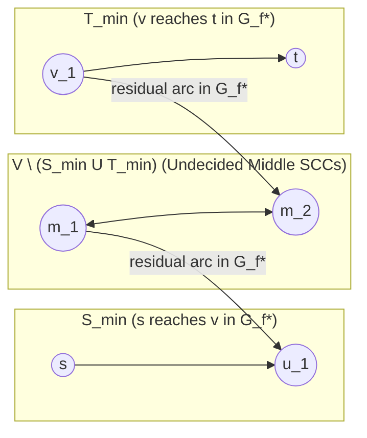

## Prerequisites & Learning Objectives

::: {.callout-note title="Prerequisites (`Ch 01`)"}
Before starting this chapter, you should be fluent in:

1. **Skew-Symmetric Net Flow & Kirchhoff Conservation (`Ch 01.1`)**: Understanding $f(u, v) = -f(v, u)$, capacity bounds $f(u, v) \le c(u, v)$, and the Cut-Value Conservation Lemma $|f| = f(S, T) \le c(S, T)$.
2. **Residual Networks & Complementary Slackness (`Ch 01.2`)**: Why an $s$-$t$ flow $f^*$ is maximum if and only if $s \not\leadsto t$ in the residual network $G_{f^*} = (V, E_{f^*})$ where $c_{f^*}(u, v) = c(u, v) - f^*(u, v) > 0$, and why $(S, T)$ is a minimum $s$-$t$ cut if and only if $\delta^+_{G_{f^*}}(S) = \emptyset$.
3. **Dinic's Blocking-Flow Black-Box Contract (`Ch 01.3`)**: Treating `dinic(s, t)` as a black box running in $O(V^2 E)$ on general networks, $O(E \min(V^{2/3}, E^{1/2}))$ on unit-capacity networks, and $O(E\sqrt{V})$ on unit-vertex / bipartite networks, plus the Flow Decomposition Theorem (`Ch 01.4`).
:::

::: {.callout-tip title="Learning Objectives"}
By the end of this chapter, you will be able to:

1. **Prove Cut Submodularity & Extract Extremal Cuts ($S_{\min}$ and $S_{\max}$)**: Use the 16-region partition identity to prove $c(A) + c(B) \ge c(A \cap B) + c(A \cup B)$, show that all minimum $s$-$t$ cuts form a finite **distributive lattice** $\mathcal{L}_{\min}$, and test minimum-cut uniqueness in $O(V + E)$ time via $S_{\min} \cup T_{\min} = V$.
2. **Construct the Picard–Queyranne Residual Condensation DAG**: Compress all minimum cuts of a network into the downward-closed ideals (closures) of the Strongly Connected Component (SCC) DAG of $G_{f^*}$.
3. **Classify Feasible (`可行割边`) vs. Essential (`必须割边`) Cut Edges in $O(V + E)$ Time**: Avoid the classic **Saturated $\implies$ Cut Edge Fallacy (`FM-02` / `FM-03`)** and prove the exact Tarjan SCC criteria for `[AHOI2009] 最小割`.
4. **Compile Lexicographic Multi-Objective Cuts**: Recover the minimum-edge-count minimum cut in a single Dinic pass via base-$W$ capacity perturbation $c'(e) = c(e) \cdot (M + 1) + 1$, or via a two-pass residual unit network when capacities approach `INT64_MAX`.
5. **Execute Dynamic Incremental & Decremental Flow Rollback (`退流`)**: Add constraints incrementally on a live residual graph (`CF 1139E`, `UVa 11248`) and delete committed edges in $O(E)$ amortized work without re-running Dinic from scratch (`[SDOI2014] LIS`).
:::

---

## 1. Motivation: Beyond the Scalar Value of Max-Flow

In Chapter 1, we treated a flow solver as an oracle that takes a capacity network $G = (V, E, c, s, t)$ and returns a **single scalar number**: the maximum flow value $|f^*| = \min_{(S, T)} c(S, T)$, along with one canonical minimum cut $(S_{\min}, V \setminus S_{\min})$ formed by the vertices reachable from $s$ in the final residual network $G_{f^*}$.

Very quickly, however, contest problems stop asking for the mere scalar value $|f^*|$ and instead interrogate the **global geometry of the family of all minimum cuts** or subject the network to **online structural edits**:

- **The Bottleneck Audit Problem (`[AHOI2009] 最小割` / `#011`)**: A telecommunications network has $N \le 4000$ routers and $M \le 6 \cdot 10^4$ directed links. An adversary wants to sever $s \to t$ connectivity at minimum total cost, while the network engineer wants to upgrade a single link to strictly increase $s \to t$ bandwidth. For *every* link $e \in E$, we must answer two questions simultaneously:
  1. *Feasibility (`可行割边`)*: Does there exist **at least one** minimum $s$-$t$ cut that severs $e$?
  2. *Essentiality (`必须割边`)*: Does **every** minimum $s$-$t$ cut sever $e$?
- **The Lexicographically First Minimum Cut Problem (`[SDOI2014] LIS` / `#015`)**: Among all minimum-weight subsets of elements whose removal decreases the Longest Increasing Subsequence length of an array ($N \le 700$), output the subset whose priority-ordered indices are **lexicographically smallest**.
- **The Dynamic Departure Problem (`[CF 1139E] Maximize Mex` / `#012`)**: $N \le 5000$ students with potentials $p_i$ belong to $M \le 5000$ clubs. On each of $D \le 5000$ days, one student permanently leaves their club; after each departure, we must report the maximum $\operatorname{mex}$ of team potentials.

### Why Naive Black-Box Re-Evaluation Fails

Suppose we try to solve `[AHOI2009] 最小割` or `[SDOI2014] LIS` by treating `dinic(s, t)` purely as a static black box:

1. **The $O(M \cdot \text{Dinic})$ Perturbation TLE**: To test whether edge $e$ belongs to some minimum cut, a naive solver decreases $c(e)$ by $1$ and re-runs Dinic from scratch to check if $|f^*|$ drops by $1$; to test whether $e$ belongs to all minimum cuts, it increases $c(e)$ by $1$ and re-runs Dinic. When $M = 6 \cdot 10^4$, running Dinic $6 \cdot 10^4$ times requires $\sim 10^{10}$ operations — an instant Time Limit Exceeded.
2. **The Exponential Cut-Enumeration Barrier**: Even in a simple network of $N$ parallel 2-edge paths $s \xrightarrow{1} v_i \xrightarrow{1} t$ for $i = 1, \dots, N-2$, each intermediate vertex $v_i$ can independently join $S$ or $T$, creating $2^{N-2}$ distinct minimum cuts! We can never afford to enumerate all minimum cuts explicitly.
3. **The Saturated-Edge Illusion**: A tempting greedy shortcut is to run Dinic once and declare every **saturated edge** ($f^*(e) = c(e)$, i.e., $c_{f^*}(e) = 0$) to be a feasible cut edge. As we will prove in Section 3, this is **catastrophically false**: a saturated edge can belong to **zero** minimum cuts if the residual graph $G_{f^*}$ contains an alternate bypass path between its endpoints!

The central revelation of Chapter 2 is that **a single converged residual network $G_{f^*}$ already encodes every minimum cut of $G$**. Once Dinic terminates, we never need to re-run max-flow from scratch to classify cut edges: a single $O(V + E)$ pass of Tarjan's Strongly Connected Components (SCC) algorithm on $G_{f^*}$ exposes the entire lattice of minimum cuts, and when we *do* need to delete an edge dynamically (`[SDOI2014] LIS`), we can surgically **un-push (rollback / `退流`)** only the flow carried by that edge inside $G_{f^*}$.

---

## 2. Submodularity of Cut Capacity & Canonical Extremal Cuts ($S_{\min}$ and $S_{\max}$)

Why does a network with potentially $2^{|V|-2}$ distinct minimum cuts admit a clean, linear-size structural description? The foundational algebraic reason is that the directed cut capacity function is **submodular**.

### 2.1 The 16-Region Partition Proof of Cut Submodularity

Let $G = (V, E, c)$ be a directed network with non-negative edge capacities $c: E \to \mathbb{R}_{\ge 0}$. For any two disjoint vertex subsets $X, Y \subseteq V$, denote the total capacity of all directed edges from $X$ to $Y$ by:

$$c(X, Y) := \sum_{\substack{e = (u \to v) \in E \\ u \in X,\, v \in Y}} c(e)$$

For any subset $A \subseteq V$, its outgoing cut capacity is $\kappa(A) := c(A, V \setminus A) = \sum_{e \in \delta^+(A)} c(e)$.

::: {.callout-important title="Theorem 2.1 (Exact Submodularity Identity of Directed Cut Capacity)"}
For **any** two vertex subsets $A, B \subseteq V$ in a directed network $G = (V, E, c)$ with $c \ge 0$:

$$\kappa(A) + \kappa(B) = \kappa(A \cup B) + \kappa(A \cap B) + c(A \setminus B,\, B \setminus A) + c(B \setminus A,\, A \setminus B)$$

In particular, since $c(e) \ge 0$ for all $e \in E$, the cut capacity function $\kappa: 2^V \to \mathbb{R}_{\ge 0}$ is **submodular**:

$$\kappa(A) + \kappa(B) \ge \kappa(A \cup B) + \kappa(A \cap B)$$
:::

#### Proof by 4-Venn Region Double-Counting

Every vertex $v \in V$ belongs to exactly one of four pairwise disjoint regions defined by its membership in $A$ and $B$:

$$R_{11} = A \cap B, \qquad R_{10} = A \setminus B, \qquad R_{01} = B \setminus A, \qquad R_{00} = V \setminus (A \cup B)$$

Every directed edge $e = (u \to v) \in E$ connects one of the $4 \times 4 = 16$ ordered pairs of regions $(R_{ij} \to R_{kl})$. Express the four sets and their complements as disjoint unions of these four regions:

- $A = R_{11} \sqcup R_{10}$ and $V \setminus A = R_{01} \sqcup R_{00}$.
- $B = R_{11} \sqcup R_{01}$ and $V \setminus B = R_{10} \sqcup R_{00}$.
- $A \cup B = R_{11} \sqcup R_{10} \sqcup R_{01}$ and $V \setminus (A \cup B) = R_{00}$.
- $A \cap B = R_{11}$ and $V \setminus (A \cap B) = R_{10} \sqcup R_{01} \sqcup R_{00}$.

Now compare how many times each cross-region capacity $c(R_{ij}, R_{kl})$ is counted on the Left-Hand Side $\kappa(A) + \kappa(B)$ versus the Right-Hand Side $\kappa(A \cup B) + \kappa(A \cap B)$:

| Directed Region Pair $(R_{ij} \to R_{kl})$ | In $\delta^+(A)$? | In $\delta^+(B)$? | LHS Count $\kappa(A) + \kappa(B)$ | In $\delta^+(A \cup B)$? | In $\delta^+(A \cap B)$? | RHS Count $\kappa(A \cup B) + \kappa(A \cap B)$ | Excess $\text{LHS} - \text{RHS}$ |
| :--- | :---: | :---: | :---: | :---: | :---: | :---: | :---: |
| $R_{11} \to R_{00}$ | $1$ | $1$ | **$2$** | $1$ | $1$ | **$2$** | $0$ |
| $R_{11} \to R_{10}$ | $0$ | $1$ | **$1$** | $0$ | $1$ | **$1$** | $0$ |
| $R_{11} \to R_{01}$ | $1$ | $0$ | **$1$** | $0$ | $1$ | **$1$** | $0$ |
| $R_{10} \to R_{00}$ | $1$ | $0$ | **$1$** | $1$ | $0$ | **$1$** | $0$ |
| $R_{01} \to R_{00}$ | $0$ | $1$ | **$1$** | $1$ | $0$ | **$1$** | $0$ |
| **$R_{10} \to R_{01}$ ($A \setminus B \to B \setminus A$)** | **$1$** | **$0$** | **$1$** | **$0$** | **$0$** | **$0$** | **$+1$** |
| **$R_{01} \to R_{10}$ ($B \setminus A \to A \setminus B$)** | **$0$** | **$1$** | **$1$** | **$0$** | **$0$** | **$0$** | **$+1$** |
| All other 9 pairs ($R_{00} \to *$, $R_{ij} \to R_{ij}$, $R_{10/01} \to R_{11}$) | $0$ | $0$ | **$0$** | $0$ | $0$ | **$0$** | $0$ |

Every single region pair matches identically on both sides except the two diagonal cross-terms $(A \setminus B \to B \setminus A)$ and $(B \setminus A \to A \setminus B)$, which appear once on the LHS and zero times on the RHS. Summing over all 16 pairs yields the exact identity. $\blacksquare$

---

### 2.2 The Distributive Lattice of Minimum Cuts $\mathcal{L}_{\min}$

Let $\lambda^* = \min_{s \in S \subseteq V \setminus \{t\}} \kappa(S)$ denote the minimum $s$-$t$ cut capacity, and let

$$\mathcal{L}_{\min} := \left\{ S \subseteq V \;\middle|\; s \in S,\; t \notin S,\; \kappa(S) = \lambda^* \right\}$$

be the family of all source-side vertex sets of minimum $s$-$t$ cuts.

::: {.callout-important title="Corollary 2.2 (Closure Under $\cap$ and $\cup$ — The Distributive Minimum-Cut Lattice)"}
If $A, B \in \mathcal{L}_{\min}$ are two minimum $s$-$t$ cuts, then **both their intersection $A \cap B$ and their union $A \cup B$ are also minimum $s$-$t$ cuts** ($A \cap B \in \mathcal{L}_{\min}$ and $A \cup B \in \mathcal{L}_{\min}$). Consequently, $(\mathcal{L}_{\min}, \subseteq, \cap, \cup)$ is a finite **distributive lattice**.
:::

#### Proof

Since $s \in A$ and $s \in B$, we have $s \in A \cap B \subseteq A \cup B$. Since $t \notin A$ and $t \notin B$, we have $t \notin A \cup B \supseteq A \cap B$. Thus both $A \cap B$ and $A \cup B$ are valid $s$-$t$ cuts, which by definition of $\lambda^*$ must satisfy $\kappa(A \cap B) \ge \lambda^*$ and $\kappa(A \cup B) \ge \lambda^*$. Applying Theorem 2.1 gives:

$$2\lambda^* = \kappa(A) + \kappa(B) \ge \kappa(A \cup B) + \kappa(A \cap B) \ge \lambda^* + \lambda^* = 2\lambda^*$$

Because the left and right endpoints of this inequality chain are both $2\lambda^*$, equality must hold everywhere: $\kappa(A \cup B) = \lambda^*$ and $\kappa(A \cap B) = \lambda^*$, plus $c(A \setminus B, B \setminus A) = c(B \setminus A, A \setminus B) = 0$. Since set union and intersection distribute over each other on any family of subsets of $V$, $(\mathcal{L}_{\min}, \subseteq, \cap, \cup)$ is a finite distributive lattice. $\blacksquare$

---

### 2.3 Canonical Extremal Cuts ($S_{\min}$ vs. $S_{\max}$) and the Uniqueness Criterion

Fix **any** maximum flow $f^*$ in $G$, and let $G_{f^*}$ be its residual network. Recall from Chapter 1 (Complementary Slackness / Cut-Value Conservation Lemma) that an $s$-$t$ cut $(S, V \setminus S)$ belongs to $\mathcal{L}_{\min}$ **if and only if** no residual arc in $G_{f^*}$ leaves $S$:

$$S \in \mathcal{L}_{\min} \iff s \in S,\;\; t \notin S,\;\; \text{and}\;\; \delta^+_{G_{f^*}}(S) = \emptyset$$

Notice that this characterization depends **only on the reachability structure of $G_{f^*}$** — showing that $\mathcal{L}_{\min}$ is invariant across all choices of maximum flow $f^*$! Moreover, because $\mathcal{L}_{\min}$ is a finite non-empty lattice closed under $\cap$ and $\cup$, taking the intersection and union over all $S \in \mathcal{L}_{\min}$ yields two canonical extremal minimum cuts:

$$\mathcal{S}_{\text{first}} := \bigcap_{S \in \mathcal{L}_{\min}} S, \qquad \mathcal{S}_{\text{last}} := \bigcup_{S \in \mathcal{L}_{\min}} S$$

How do we compute these two extremal cuts directly from $G_{f^*}$?

::: {.callout-important title="Theorem 2.3 (Residual Reachability Characterization of $S_{\min}$ and $S_{\max}$)"}
In the residual network $G_{f^*}$ of any maximum $s$-$t$ flow $f^*$, define:

$$S_{\min} := \left\{ v \in V \;\middle|\; s \leadsto_{G_{f^*}} v \right\}, \qquad T_{\min} := \left\{ v \in V \;\middle|\; v \leadsto_{G_{f^*}} t \right\}, \qquad S_{\max} := V \setminus T_{\min} = \left\{ v \in V \;\middle|\; v \not\leadsto_{G_{f^*}} t \right\}$$

Then for **every** minimum $s$-$t$ cut $(S, T)$ with $S \in \mathcal{L}_{\min}$:

$$S_{\min} \subseteq S \subseteq S_{\max} \qquad \text{and equivalently} \qquad T_{\min} \subseteq T \subseteq V \setminus S_{\min}$$

Thus $S_{\min}$ is the **unique inclusion-wise minimum** source side ($\bigcap_{S \in \mathcal{L}_{\min}} S$), and $S_{\max}$ is the **unique inclusion-wise maximum** source side ($\bigcup_{S \in \mathcal{L}_{\min}} S$).
:::

#### Proof

1. **Why $S_{\min} \subseteq S$ for every $S \in \mathcal{L}_{\min}$**: Since $S \in \mathcal{L}_{\min}$, we have $s \in S$ and $\delta^+_{G_{f^*}}(S) = \emptyset$ (no residual arc leaves $S$). By induction along any residual path $s = v_0 \to v_1 \to \dots \to v_k = v$ in $G_{f^*}$, every vertex $v \in S_{\min}$ must also lie in $S$. Since $S_{\min}$ is itself out-closed in $G_{f^*}$ and $t \notin S_{\min}$ (by optimality of $f^*$), $S_{\min} \in \mathcal{L}_{\min}$.
2. **Why $S \subseteq S_{\max}$ (i.e., $T_{\min} \subseteq V \setminus S$) for every $S \in \mathcal{L}_{\min}$**: Suppose $v \in T_{\min}$, so there exists a residual path $v = u_0 \to u_1 \to \dots \to u_r = t$ in $G_{f^*}$. If $v \in S$, then because $S$ is out-closed in $G_{f^*}$, induction along the path forces $t \in S$, contradicting $t \notin S$! Hence $v \notin S$ for every $v \in T_{\min}$, proving $S \subseteq V \setminus T_{\min} = S_{\max}$. Furthermore, if $u \in S_{\max}$ ($u \not\leadsto_{G_{f^*}} t$) and $(u \to w) \in E_{f^*}$, then $w \not\leadsto_{G_{f^*}} t$ (otherwise $u \to w \leadsto t$), so $w \in S_{\max}$. Thus $S_{\max}$ is out-closed in $G_{f^*}$ with $s \in S_{\max}$ and $t \notin S_{\max}$, confirming $S_{\max} \in \mathcal{L}_{\min}$. $\blacksquare$



Notice the orientation of residual arcs in $G_{f^*}$ shown above: because no residual arc can leave $S_{\min}$ and no residual arc can enter $T_{\min}$ from $S_{\max}$, **all residual arcs between the three zones point strictly backward from $T_{\min}$ toward $V \setminus (S_{\min} \cup T_{\min})$ and from $V \setminus (S_{\min} \cup T_{\min})$ toward $S_{\min}$**! This immediately yields a linear-time test for minimum-cut uniqueness (`[ZOJ 2587] Unique Attack` / `[UVa 10480] Sabotage`):

::: {.callout-tip title="Corollary 2.4 (Linear-Time Minimum-Cut Uniqueness Test)"}
A directed network $G$ possesses a **unique** minimum $s$-$t$ cut ($|\mathcal{L}_{\min}| = 1$) if and only if $S_{\min} = S_{\max}$, which holds if and only if the undecided middle zone is empty:

$$S_{\min} \cup T_{\min} = V \iff |S_{\min}| + |T_{\min}| = |V|$$

To verify uniqueness in $O(V + E)$ time after Dinic:

1. Run a forward BFS/DFS from $s$ in $G_{f^*}$ using arcs with $c_{f^*}(u \to v) > 0$ to mark $S_{\min}$.
2. Run a reverse BFS/DFS from $t$ in $G_{f^*}$ using incoming arcs with $c_{f^*}(u \to v) > 0$ to mark $T_{\min}$.
3. Return `true` iff every vertex $v \in V$ was visited in Step 1 or Step 2.
:::

---

## 3. Picard–Queyranne Residual Condensation DAG & Cut Edge Classification (`[AHOI2009] 最小割`)

### 3.1 The Picard–Queyranne Theorem (1980)

Suppose $S_{\min} \cup T_{\min} \neq V$, so the network has multiple minimum cuts. How are all minimum cuts $S \in \mathcal{L}_{\min}$ structured inside $G_{f^*}$?

Recall that $S \in \mathcal{L}_{\min}$ if and only if $s \in S$, $t \notin S$, and $\delta^+_{G_{f^*}}(S) = \emptyset$. Consider any two vertices $u, v \in V$ that belong to the **same Strongly Connected Component (SCC)** of the residual network $G_{f^*}$ (meaning $u \leadsto_{G_{f^*}} v$ and $v \leadsto_{G_{f^*}} u$). Because no residual path can ever cross from $S$ to $V \setminus S$, $u$ and $v$ can **never be separated by any minimum cut**: either $\{u, v\} \subseteq S$ or $\{u, v\} \subseteq V \setminus S$ for every $S \in \mathcal{L}_{\min}$!

::: {.callout-important title="Theorem 3.1 (Picard–Queyranne Characterization of All Minimum Cuts, 1980)"}
Contract every Strongly Connected Component of the final residual network $G_{f^*}$ into a single supernode to form the **Residual Condensation DAG** $\mathcal{D}(G_{f^*})$, and let $\operatorname{scc}(v)$ denote the component ID of vertex $v \in V$. Then:

1. $\operatorname{scc}(s) \neq \operatorname{scc}(t)$ (since $s \not\leadsto_{G_{f^*}} t$).
2. A vertex partition $(S, V \setminus S)$ is a minimum $s$-$t$ cut ($S \in \mathcal{L}_{\min}$) **if and only if** $S$ is the union of a **downward-closed (out-closed) ideal** of SCCs in $\mathcal{D}(G_{f^*})$ that contains $\operatorname{scc}(s)$ ( along with all SCCs reachable from $\operatorname{scc}(s)$) and excludes $\operatorname{scc}(t)$ (along with all SCCs that can reach $\operatorname{scc}(t)$).
:::

In other words, the condensation DAG $\mathcal{D}(G_{f^*})$ is a compact $O(V + E)$-size representation of the entire (potentially exponential-size) lattice $\mathcal{L}_{\min}$!

---

### 3.2 Broken-Gadget Counterexample `FM-02` / `FM-03`: The Saturated $\implies$ Cut Edge Fallacy

Before stating the exact edge classification theorem, let us expose the single most common bug in competitive programming min-cut analysis.

> [!WARNING]
> **Broken-Gadget Counterexample `FM-02` / `FM-03` ($\leftrightarrow$ `H-02`) — Saturated Edge $\neq$ Feasible Min-Cut Edge**:
>
> **The Fallacy**: *"By Complementary Slackness, every edge in a minimum cut is saturated ($c_{f^*}(u, v) = 0$). Therefore, an edge $e = (u \to v)$ belongs to at least one minimum cut if and only if $c_{f^*}(u, v) = 0$."*
>
> **Why It Fails (Concrete 5-Vertex Bypass Counterexample)**:
> Consider the 5-vertex directed network $V = \{s, u, v, w, t\}$ with 5 unit-capacity edges:
>
> - Main path: $s \xrightarrow{1} u \xrightarrow{1} v \xrightarrow{1} t$.
> - Parallel bypass around $(u \to v)$: $u \xrightarrow{1} w \xrightarrow{1} v$.
>
> Suppose Dinic's first augmenting path pushes $1$ unit of flow along $s \to u \to v \to t$. Since $\kappa(\{s\}) = c(s \to u) = 1$, this flow $|f^*| = 1$ is immediately a **maximum flow**!
>
> Look at the edge $e = (u \to v)$:
>
> - It is **completely saturated**: $f^*(u \to v) = 1 = c(u \to v)$, so $c_{f^*}(u \to v) = 0$.
> - Yet how many minimum $s$-$t$ cuts of $G$ contain $e = (u \to v)$? **ZERO!**
> - Why? Any $s$-$t$ cut $(S, T)$ that cuts $e = (u \to v)$ must place $u \in S$ and $v \in T$. Whether we place the bypass vertex $w$ in $S$ (cutting $w \to v$) or in $T$ (cutting $u \to w$), the cut must *also* sever the bypass $u \to w \to v$, giving cut capacity at least $c(u \to v) + 1 = 2 > 1 = \lambda^*$!
> - In the residual network $G_{f^*}$, the reverse arc $v \xrightarrow{1} u$ combines with the unused bypass $u \xrightarrow{1} w \xrightarrow{1} v$ to form a **directed residual cycle** $u \to w \to v \to u$. Thus $\operatorname{scc}(u) = \operatorname{scc}(v)$, locking $u$ and $v$ onto the same side of every minimum cut!
>
> **Defensive Rule `H-02`**: Never test $c_{f^*}(u, v) = 0$ alone. Always run Tarjan's SCC algorithm on $G_{f^*}$ and verify $\operatorname{scc}(u) \neq \operatorname{scc}(v)$.

---

### 3.3 The `[AHOI2009]` Tarjan SCC Edge Classification Theorem

Given a directed network $G = (V, E, c)$, we classify every physical edge $e = (u \to v) \in E$ into two categories (`[AHOI2009 / Luogu P4126] 最小割`):

1. **Feasible Minimum-Cut Edge (`可行割边`)**: There exists *at least one* minimum $s$-$t$ cut $S \in \mathcal{L}_{\min}$ such that $e \in \delta^+(S)$ ($u \in S$ and $v \notin S$).
2. **Essential Minimum-Cut Edge (`必须割边`)**: For *every* minimum $s$-$t$ cut $S \in \mathcal{L}_{\min}$, $e \in \delta^+(S)$ ($u \in S$ and $v \notin S$).

::: {.callout-important title="Theorem 3.2 (The `[AHOI2009]` Residual SCC Characterization Theorem)"}
Let $f^*$ be any maximum $s$-$t$ flow on $G$, and let $\operatorname{scc}(w)$ be the Strongly Connected Component ID of vertex $w \in V$ in the residual network $G_{f^*}$ (keeping only residual arcs with $c_{f^*} > 0$). Then for every physical edge $e = (u \to v) \in E$ with $c(e) > 0$:

1. **Feasible Cut Edge (`可行割边`)**:
   $$\exists S \in \mathcal{L}_{\min} \text{ s.t. } e \in \delta^+(S) \iff c_{f^*}(u \to v) = 0 \;\;\land\;\; \operatorname{scc}(u) \neq \operatorname{scc}(v)$$

2. **Essential Cut Edge (`必须割边`)**:
   $$\forall S \in \mathcal{L}_{\min},\; e \in \delta^+(S) \iff c_{f^*}(u \to v) = 0 \;\;\land\;\; \operatorname{scc}(u) = \operatorname{scc}(s) \;\;\land\;\; \operatorname{scc}(v) = \operatorname{scc}(t)$$
:::

#### Wait — Why Doesn't Condition (1) Need to Check $u \not\leadsto t$ and $s \not\leadsto v$?

Look closely at Condition (1): to build a valid minimum cut $S \in \mathcal{L}_{\min}$ with $u \in S$ and $v \notin S$, we must ensure that placing $u \in S$ does not force the sink $t$ into $S$ (i.e., $u \not\leadsto_{G_{f^*}} t$), and keeping $v \notin S$ does not exclude the source $s$ from $S$ (i.e., $s \not\leadsto_{G_{f^*}} v$). Why didn't Theorem 3.2(1) have to check $u \not\leadsto_{G_{f^*}} t$ or $s \not\leadsto_{G_{f^*}} v$?

The answer is a remarkable hidden invariant of saturated cross-SCC edges: **having $f^*(u \to v) = c(u \to v) > 0$ and $\operatorname{scc}(u) \neq \operatorname{scc}(v)$ automatically forces $u \leadsto_{G_{f^*}} s$ and $t \leadsto_{G_{f^*}} v$!** We give two complementary proofs of this lemma, as both techniques are indispensable for advanced flow problems.

::: {.callout-note title="Lemma 3.3 (Automatic Source/Sink Separation of Saturated Cross-SCC Edges)"}
If $e = (u \to v) \in E$ satisfies $f^*(e) = c(e) > 0$ ($c_{f^*}(u \to v) = 0$) and $\operatorname{scc}(u) \neq \operatorname{scc}(v)$ in $G_{f^*}$, then in $G_{f^*}$:

$$u \leadsto_{G_{f^*}} s \quad (\text{hence } u \not\leadsto_{G_{f^*}} t) \qquad \text{and} \qquad t \leadsto_{G_{f^*}} v \quad (\text{hence } s \not\leadsto_{G_{f^*}} v)$$
:::

#### Proof 1 (Cut-Conservation Divergence Argument)

Because $f^*(e) = c(e) > 0$, the reverse residual arc $e^{\text{rev}} = (v \to u)$ has strictly positive residual capacity $c_{f^*}(v \to u) = f^*(e) > 0$ in $G_{f^*}$. Since $\operatorname{scc}(u) \neq \operatorname{scc}(v)$ and $v \to u \in E_{f^*}$, there cannot be any residual path $u \leadsto_{G_{f^*}} v$.

Define $R(u) := \{w \in V : u \leadsto_{G_{f^*}} w\}$. By definition, $u \in R(u)$, $v \notin R(u)$, and **no residual arc in $G_{f^*}$ leaves $R(u)$** ($\delta^+_{G_{f^*}}(R(u)) = \emptyset$). Consequently:

- Every physical edge leaving $R(u)$ is completely saturated ($f^* = c$), and every physical edge entering $R(u)$ carries zero flow ($f^* = 0$).
- Since $e = (u \to v) \in \delta^+(R(u))$ has $f^*(e) = c(e) > 0$, the net physical flow divergence out of $R(u)$ is strictly positive:
  $$\sum_{w \in R(u)} \nabla \cdot f^*(w) = \sum_{e' \in \delta^+(R(u))} f^*(e') - \sum_{e' \in \delta^-(R(u))} f^*(e') \ge f^*(e) > 0$$
- However, by Kirchhoff conservation, $\nabla \cdot f^*(w) = 0$ for all $w \in V \setminus \{s, t\}$, while $\nabla \cdot f^*(t) = -|f^*| < 0$ and $\nabla \cdot f^*(s) = +|f^*| > 0$. The **only** way $\sum_{w \in R(u)} \nabla \cdot f^*(w) > 0$ can hold is if $s \in R(u)$ and $t \notin R(u)$! Thus $u \leadsto_{G_{f^*}} s$ and $u \not\leadsto_{G_{f^*}} t$. Applying the exact same divergence argument to the reverse reachability set $R^{-1}(v) := \{w \in V : w \leadsto_{G_{f^*}} v\}$ yields $t \in R^{-1}(v)$ and $s \notin R^{-1}(v)$. $\blacksquare$

#### Proof 2 (Flow Decomposition Path–Cycle Argument)

By the Flow Decomposition Theorem (`Ch 01.4`), decompose $f^*$ into positive-weight directed $s \leadsto t$ paths $\mathcal{P}$ and directed cycles $\mathcal{C}$. Since $f^*(e) = c(e) > 0$, edge $e = (u \to v)$ belongs either to some cycle $C \in \mathcal{C}$ or to some $s \leadsto t$ path $P \in \mathcal{P}$:

- If $e \in C$, then every edge on $C$ carries positive flow, so their reverse residual arcs in $G_{f^*}$ form a directed path $u \leadsto_{G_{f^*}} v$ along the reversed cycle $C$, contradicting $\operatorname{scc}(u) \neq \operatorname{scc}(v)$!
- Therefore, $e$ must lie on a flow-carrying path $P = (s \leadsto u \xrightarrow{e} v \leadsto t)$. In $G_{f^*}$, the reverse residual arcs of the prefix $s \leadsto u$ form a directed residual path $u \leadsto_{G_{f^*}} s$, and the reverse residual arcs of the suffix $v \leadsto t$ form a directed residual path $t \leadsto_{G_{f^*}} v$! Since $s \not\leadsto_{G_{f^*}} t$, these paths immediately imply $u \not\leadsto_{G_{f^*}} t$ and $s \not\leadsto_{G_{f^*}} v$. $\blacksquare$

#### Completing the Proof of Theorem 3.2

- **Part 1 (Feasible Cut Edge)**:
  - $(\implies)$ If $e \in \delta^+(S)$ for some $S \in \mathcal{L}_{\min}$, then $c_{f^*}(u \to v) = 0$ by complementary slackness, and since $u \in S$, $v \notin S$, and $\delta^+_{G_{f^*}}(S) = \emptyset$, we have $u \not\leadsto_{G_{f^*}} v$, so $\operatorname{scc}(u) \neq \operatorname{scc}(v)$.
  - $(\Longleftarrow)$ Conversely, if $c_{f^*}(u \to v) = 0$ and $\operatorname{scc}(u) \neq \operatorname{scc}(v)$, define $S := \{w \in V : s \leadsto_{G_{f^*}} w \text{ or } u \leadsto_{G_{f^*}} w\}$. By Lemma 3.3, $v \notin S$ and $t \notin S$, while $s, u \in S$ and $\delta^+_{G_{f^*}}(S) = \emptyset$. Thus $S \in \mathcal{L}_{\min}$ is a valid minimum cut that severs $e = (u \to v)$.
- **Part 2 (Essential Cut Edge)**:
  - Edge $e = (u \to v)$ belongs to $\delta^+(S)$ for **every** $S \in \mathcal{L}_{\min}$ if and only if $c_{f^*}(u \to v) = 0$, $u \in \bigcap_{S \in \mathcal{L}_{\min}} S = S_{\min}$ (so $s \leadsto_{G_{f^*}} u$), and $v \in \bigcap_{S \in \mathcal{L}_{\min}} (V \setminus S) = T_{\min}$ (so $v \leadsto_{G_{f^*}} t$).
  - Combining $s \leadsto_{G_{f^*}} u$ with Lemma 3.3's $u \leadsto_{G_{f^*}} s$ gives $\operatorname{scc}(u) = \operatorname{scc}(s)$; combining $v \leadsto_{G_{f^*}} t$ with Lemma 3.3's $t \leadsto_{G_{f^*}} v$ gives $\operatorname{scc}(v) = \operatorname{scc}(t)$. $\blacksquare$

---

### 3.4 Complete Worked End-to-End Numerical Trace (Picard–Queyranne DAG & `[AHOI2009]`)

Let us trace Theorem 3.1 and Theorem 3.2 by hand on a 6-vertex, 7-edge directed network $G = (V, E, c)$ with $V = \{s, u_1, u_2, v_1, v_2, t\}$:

- **Upper 3-edge chain**: $e_1 = (s \to u_1, c=3)$, $e_2 = (u_1 \to u_2, c=3)$, $e_3 = (u_2 \to t, c=3)$.
- **Lower 3-edge chain**: $e_4 = (s \to v_1, c=2)$, $e_5 = (v_1 \to v_2, c=4)$, $e_6 = (v_2 \to t, c=2)$.
- **Cross-chord**: $e_7 = (u_1 \to v_2, c=1)$.

#### Step 1: Maximum Flow $f^*$ and Residual Capacities in $G_{f^*}$

Push $3$ units along $s \to u_1 \to u_2 \to t$ and $2$ units along $s \to v_1 \to v_2 \to t$, achieving the maximum flow $|f^*| = 5$. The residual network $G_{f^*}$ has the following arcs:

| Edge $e_k = (x \to y)$ | Physical Cap $c(e_k)$ | Flow $f^*(e_k)$ | Forward Residual $c_{f^*}(x \to y)$ | Reverse Residual $c_{f^*}(y \to x)$ | Saturated ($c_{f^*} = 0$)? | `[AHOI2009]` Classification |
| :--- | :---: | :---: | :---: | :---: | :---: | :--- |
| $e_1 = (s \to u_1)$ | $3$ | $3$ | $0$ | $3$ ($u_1 \to s$) | **Yes** | **Feasible (`1 0`)** |
| $e_2 = (u_1 \to u_2)$ | $3$ | $3$ | $0$ | $3$ ($u_2 \to u_1$) | **Yes** | **Feasible (`1 0`)** |
| $e_3 = (u_2 \to t)$ | $3$ | $3$ | $0$ | $3$ ($t \to u_2$) | **Yes** | **Feasible (`1 0`)** |
| $e_4 = (s \to v_1)$ | $2$ | $2$ | $0$ | $2$ ($v_1 \to s$) | **Yes** | **Feasible (`1 0`)** |
| $e_5 = (v_1 \to v_2)$ | $4$ | $2$ | $2$ ($v_1 \to v_2$) | $2$ ($v_2 \to v_1$) | **No** | Neither (`0 0`) |
| $e_6 = (v_2 \to t)$ | $2$ | $2$ | $0$ | $2$ ($t \to v_2$) | **Yes** | **Feasible (`1 0`)** |
| $e_7 = (u_1 \to v_2)$ | $1$ | $0$ | $1$ ($u_1 \to v_2$) | $0$ | **No** | Neither (`0 0`) |

#### Step 2: Tarjan SCCs in $G_{f^*}$ and the 4-Element Distributive Lattice $\mathcal{L}_{\min}$

Let us inspect the Strongly Connected Components of $G_{f^*}$ (using only positive-capacity residual arcs):

1. Because $e_5 = (v_1 \to v_2)$ has both forward residual capacity $2$ ($v_1 \to v_2$) and reverse residual capacity $2$ ($v_2 \to v_1$), vertices $v_1$ and $v_2$ merge into a single component $C_{v} = \{v_1, v_2\}$.
2. No other cycles exist in $G_{f^*}$, so the 5 SCCs of $\mathcal{D}(G_{f^*})$ are $\{s\}$, $\{u_1\}$, $\{u_2\}$, $C_v = \{v_1, v_2\}$, and $\{t\}$, with directed condensation arcs:
   $$\{t\} \to \{u_2\} \to \{u_1\} \to \{s\}, \qquad \{t\} \to C_v \to \{s\}, \qquad \text{and the cross-arc } \{u_1\} \xrightarrow{e_7} C_v$$
3. **Why the cross-chord $e_7 = (u_1 \to v_2)$ matters**: Because $\{u_1\} \to C_v$ is a directed arc in $\mathcal{D}(G_{f^*})$, Theorem 3.1 dictates that any out-closed ideal $S \in \mathcal{L}_{\min}$ containing $u_1$ **must also contain $C_v = \{v_1, v_2\}$**! (Indeed, if $u_1 \in S$ and $v_2 \notin S$, then $e_7$ would be cut in addition to $e_2$ and $e_4$, raising the cut capacity to $3 + 2 + 1 = 6 > 5$.)
4. Thus $\mathcal{L}_{\min}$ consists of **4 minimum cuts** (each of capacity $5$):
   - $S_1 = S_{\min} = \{s\}$ — cuts $\{e_1, e_4\}$ ($3 + 2 = 5$).
   - $S_2 = \{s, v_1, v_2\}$ — cuts $\{e_1, e_6\}$ ($3 + 2 = 5$).
   - $S_3 = \{s, u_1, v_1, v_2\}$ — cuts $\{e_2, e_6\}$ ($3 + 2 = 5$).
   - $S_4 = S_{\max} = \{s, u_1, u_2, v_1, v_2\}$ — cuts $\{e_3, e_6\}$ ($3 + 2 = 5$).
5. **Why there are ZERO essential cut edges**: Since $\operatorname{scc}(s) = \{s\}$ and $\operatorname{scc}(t) = \{t\}$, an essential cut edge would need to go directly from $\{s\}$ to $\{t\}$. None of $e_1, \dots, e_6$ connect $\{s\} \to \{t\}$, and indeed $\bigcap_{i=1}^4 \delta^+(S_i) = \{e_1, e_4\} \cap \{e_3, e_6\} = \emptyset$.

---

## 4. Minimum-Edge-Count Minimum Cut ($W = M + 1$ Capacity Scaling vs. Two-Pass Residual Unit Network)

Many problems (`[USACO 4.4 / Luogu P1344] Polluted Milk`, `[HEOI2014] 南园满地堆轻絮`) ask for a **lexicographic dual objective**: among all minimum $s$-$t$ cuts $S \in \mathcal{L}_{\min}$ (which minimize $\kappa(S) = \sum_{e \in \delta^+(S)} c(e)$), find one that **simultaneously minimizes the number of cut edges $|\delta^+(S)|$**.

### 4.1 Method A: Lexicographic Base-$W$ Capacity Perturbation ($W = M + 1$)

How do we fold a secondary tie-breaking objective $|\delta^+(S)| \in \{0, 1, \dots, M\}$ into a single scalar capacity function $c'(e)$ without ever allowing the tie-breaker to override the primary objective $\kappa(S)$?

Choose base $W := M + 1 = |E| + 1$, and define the perturbed integer capacity of every edge $e \in E$ as:

$$c'(e) := c(e) \cdot (M + 1) + 1$$

For **any** $s$-$t$ cut $(S, T)$, its perturbed cut capacity $\kappa'(S)$ expands linearly as:

$$\kappa'(S) = \sum_{e \in \delta^+(S)} \big(c(e) \cdot (M + 1) + 1\big) = \underbrace{\kappa(S)}_{\text{primary weight}} \cdot (M + 1) \;+\; \underbrace{|\delta^+(S)|}_{\text{edge count } \in [0, M]}$$

Because every original capacity $c(e)$ is an integer and the remainder satisfies $0 \le |\delta^+(S)| \le M < M + 1$, Euclidean division of the minimum perturbed cut value $F' = \min_{S} \kappa'(S)$ by $W = M + 1$ uniquely recovers **both** answers in a **single** Dinic run:

$$\lambda^* = \min_{S} \kappa(S) = \left\lfloor \frac{F'}{M + 1} \right\rfloor, \qquad k^* = \min_{S \in \mathcal{L}_{\min}} |\delta^+(S)| = F' \bmod (M + 1)$$

> [!CAUTION]
> **Why Base $W = M$ Fails When All $M$ Edges Are Cut**:
> If you set $W = M$ instead of $M + 1$ and the unique minimum cut happens to sever all $M$ edges of the graph ($|\delta^+(S^*)| = M$), then $F' = \lambda^* \cdot M + M = (\lambda^* + 1) \cdot M + 0$. Dividing by $M$ outputs quotient $\lambda^* + 1$ (off by $+1$) and remainder $0$ (instead of $M$)! Always use $W = M + 1$ (or a convenient power of ten/two strictly exceeding $M$, such as $W = 2048$ when $M \le 1000$).

### 4.2 Method B: Two-Pass Residual Zero-Capacity / Unit-Network Reduction

What if original capacities $c(e)$ are already up to $10^{15}$ so multiplying by $M + 1$ would overflow 64-bit integers (`long long`), or what if you want the second pass to run in fast $O(E \min(V^{2/3}, E^{1/2}))$ unit-network time?

1. **Pass 1**: Run Dinic on the original capacities $c(e)$ to obtain $\lambda^* = |f^*|$ and the final residual network $G_{f^*}$.
2. **Pass 2 (Subtlety Warning!)**: It is often claimed in folklore that building a second network $G^{(2)}$ with $c^{(2)}(e) = 1$ if $c_{f^*}(e) = 0$ and $c^{(2)}(e) = \infty$ if $c_{f^*}(e) > 0$ finds $k^*$. **Wait**: what if $G$ contains a saturated non-cut edge $e = (u \to v)$ with $\operatorname{scc}(u) = \operatorname{scc}(v)$ (as in `FM-02`), or what if cutting two non-saturated edges could falsely bypass $\infty$?
   - Because $\delta^+_{G_{f^*}}(S) = \emptyset$ is the **exact** characterization of $S \in \mathcal{L}_{\min}$, a partition $(S, V \setminus S)$ belongs to $\mathcal{L}_{\min}$ **if and only if** it cuts **zero** residual arcs of $G_{f^*}$!
   - Therefore, to restrict $S$ strictly to $\mathcal{L}_{\min}$ in Pass 2: for every **residual arc** $(x \to y) \in E_{f^*}$ with $c_{f^*}(x \to y) > 0$ (including **reverse residual arcs** $v \to u$ of flow-carrying edges!), add a directed arc $x \xrightarrow{\infty} y$ in $G^{(2)}$; and for every saturated physical edge $e = (u \to v) \in E$ with $c_{f^*}(u \to v) = 0$, add $u \xrightarrow{1} v$ in $G^{(2)}$.
   - Any finite-capacity $s$-$t$ cut $(S, T)$ in $G^{(2)}$ cannot cut any $\infty$-arc of $E_{f^*}$, so $\delta^+_{G_{f^*}}(S) = \emptyset$ ($S \in \mathcal{L}_{\min}$), and its capacity in $G^{(2)}$ is precisely $|\delta^+_G(S)|$!

In practice, whenever $c(e) \cdot (M + 1) \le 4 \cdot 10^{18}$, **Method A ($W = M + 1$ perturbation)** is 10 lines shorter and avoids constructing a second graph.

---

## 5. Incremental Addition vs. Decremental Flow Rollback (`退流`) & Black-Box Contract

In dynamic or multi-query flow problems, the graph $G$ undergoes edge additions, capacity upgrades, or edge deletions. Because Dinic maintains a valid residual network $G_f$ at all times, we can operate **directly on the live residual graph $G_f$** instead of rebuilding from scratch.

### 5.1 Incremental Edge Additions & Parametric Capacity Sensitivity

Suppose we have already computed a maximum flow $f^*$ with residual network $G_{f^*}$:

1. **Differential Capacity Sensitivity ($\Delta c(e) = \pm \epsilon$ for infinitesimal $\epsilon > 0$)**:
   - Increasing $c(e)$ by $+\epsilon$ strictly increases the maximum flow ($\lambda^*(c + \epsilon \mathbf{e}_e) = \lambda^*(c) + \epsilon$) **if and only if** $e$ belongs to *every* minimum cut (**Essential Cut Edge**: $c_{f^*}(u \to v) = 0 \land u \in S_{\min} \land v \in T_{\min}$).
   - Decreasing $c(e)$ by $-\epsilon$ strictly decreases the maximum flow ($\lambda^*(c - \epsilon \mathbf{e}_e) = \lambda^*(c) - \epsilon$) **if and only if** $e$ belongs to *at least one* minimum cut (**Feasible Cut Edge**: $c_{f^*}(u \to v) = 0 \land \operatorname{scc}(u) \neq \operatorname{scc}(v)$).
2. **Finite Incremental Addition ($\Delta c(u \to v) = +K > 0$ or inserting a new edge)**:
   - Simply add $+K$ to the forward residual capacity $c_f(u \to v)$ inside the existing residual graph $G_{f^*}$ and call `dinic(s, t)` **without resetting prior flows**!
   - If $u \notin S_{\min}$ or $v \notin T_{\min}$ (for a single edge upgrade), can a large $+K$ increase flow if $e$ wasn't saturated? Only if $e$ was already saturated ($c_{f^*}(u \to v) = 0$) and $s \leadsto_{G_{f^*}} u \land v \leadsto_{G_{f^*}} t$ (`UVa 11248` / `#010`). Moreover, the re-augmentation pushes at most $\min(K, \Delta F)$ units of additional flow, running in $O(\Delta F \cdot E)$ time!

### 5.2 Decremental Flow Rollback (`退流`): Deleting an Active Edge in $O(E)$ Time

What if we must **decrease the capacity** of an edge $e = (u \to v)$ or **permanently delete $e$** ($c(e) \gets 0$) when $e$ is already carrying strictly positive flow $f_0 = f^*(u \to v) > 0$?

If we naively set $c_f(u \to v) = 0$ and $c_f(v \to u) = 0$ without adjusting the rest of the network, we **destroy Kirchhoff flow conservation**: vertex $u$ now has $+f_0$ units of stranded incoming flow from $s$ that nowhere exits $u$, and vertex $v$ has $+f_0$ units of outgoing flow to $t$ that never entered $v$!

::: {.callout-important title="Algorithm 5.1 (The 3-Step Surgical Flow Rollback / `退流` Protocol)"}
To delete a physical directed edge $e = (u \to v)$ currently carrying flow $f_0 = c(e) - c_{f^*}(u \to v) \ge 0$ in a converged residual network $G_{f^*}$:

1. **Case $f_0 = 0$ (Zero-Flow Edge)**: Simply zero out the forward residual arc $c_{f^*}(u \to v) \gets 0$ (and $c_{f^*}(v \to u) \gets 0$). Conservation is untouched; no flow adjustments are needed.
2. **Case $f_0 > 0$ (Flow-Carrying Edge)**:
   - **Step 1 (Reel Back Suffix & Prefix Flow)**: Before or immediately after zeroing out $(u, v)$, push exactly $f_0$ units of flow from $t$ to $v$ (`dinic_bounded(t, v, f_0)`) and $f_0$ units of flow from $u$ to $s$ (`dinic_bounded(u, s, f_0)`) in the residual network $G_{f^*}$ (with $e$ zeroed out: $c_f(u \to v) = c_f(v \to u) = 0$).
     - *Why does this work?* Pushing $f_0$ units along residual paths $t \leadsto_{G_{f^*}} v$ traverses the reverse residual arcs of $v \leadsto t$, **canceling $f_0$ units of suffix flow from $v$ to $t$**. Pushing $f_0$ units along $u \leadsto_{G_{f^*}} s$ traverses the reverse residual arcs of $s \leadsto u$, **canceling $f_0$ units of prefix flow from $s$ to $u$**.
   - **Step 2 (Sever the Edge)**: Ensure both half-edges of $e$ have residual capacity $0$: `cap[e] = cap[e ^ 1] = 0`. Now Kirchhoff conservation holds at every vertex $w \in V \setminus \{s, t\}$, with valid net flow $|f| = |f^*| - f_0$.
   - **Step 3 (Optional Re-Augmentation $s \leadsto t$)**: Run `dinic(s, t)` to push back any flow that can bypass $e$.
     - **Crucial Shortcut for Feasible Min-Cut Edges (`[SDOI2014] LIS` / `#015`)**: If $e = (u \to v)$ was verified to be a **Feasible Minimum-Cut Edge** ($c_{f^*}(u \to v) = 0$ and $u \not\leadsto_{G_{f^*}} v$), then deleting $e$ reduces the global minimum cut of $G$ by **exactly $f_0 = c(e)$**! Therefore, after Step 1 reels back $f_0$ units via `dinic(t, v, f_0)` and `dinic(u, s, f_0)`, the resulting flow $|f^*| - f_0$ is **already a maximum flow** of $G \setminus \{e\}$, so **Step 3 (`dinic(s, t)`) can be skipped entirely!**
:::

### 5.3 Time-Reversal for Offline Deletions (`CF 1139E`) & The 4-Step Compilation Pipeline

When a problem gives all edge deletions **offline in advance** (`CF 1139E Maximize Mex` / `#012`) and asks for the maximum flow / matching after each deletion, always ask before implementing `退流`: **Can we reverse time?** Processing queries from day $D$ backward to day $1$ turns edge deletions into **monotone edge insertions**, allowing us to maintain a single growing residual graph where the answer only increases!

| Target Structural Query | Algebraic / Residual Characterization | Mechanical Graph / Residual Compilation | Post-Dinic Time Complexity |
| :--- | :--- | :--- | :--- |
| **Source-Minimal / Source-Maximal Cut ($S_{\min}, S_{\max}$)** | $S_{\min} = \bigcap_{S \in \mathcal{L}_{\min}} S$, $S_{\max} = \bigcup_{S \in \mathcal{L}_{\min}} S$ | Forward BFS from $s$ in $G_{f^*}$ gives $S_{\min}$; reverse BFS from $t$ gives $T_{\min} = V \setminus S_{\max}$. | $O(V + E)$ |
| **Minimum-Cut Uniqueness (`ZOJ 2587`)** | $|\mathcal{L}_{\min}| = 1 \iff S_{\min} = S_{\max}$ | Check if $S_{\min} \cup T_{\min} = V$ ($|S_{\min}| + |T_{\min}| = |V|$). | $O(V + E)$ |
| **Feasible Cut Edge (`可行割边`, `P4126`)** | $\exists S \in \mathcal{L}_{\min}: e \in \delta^+(S)$ | Tarjan SCC on $G_{f^*}$: `cap[e] == 0 && scc[u] != scc[v]`. | $O(V + E)$ |
| **Essential Cut Edge (`必须割边`, `P4126`)** | $\forall S \in \mathcal{L}_{\min}: e \in \delta^+(S)$ | Tarjan SCC on $G_{f^*}$: `cap[e] == 0 && scc[u] == scc[s] && scc[v] == scc[t]`. | $O(V + E)$ |
| **Min-Edge-Count Min-Cut (`P1344`)** | $\operatorname{lex\ min} (\kappa(S), |\delta^+(S)|)$ | Perturb $c'(e) = c(e)(M+1) + 1$; output $\lfloor F'/(M+1)\rfloor$ and $F' \bmod (M+1)$. | $1 \times \text{Dinic}$ |
| **Lexicographically First Min-Cut (`P3308`)** | Commit feasible edges $e_i$ in priority order | Test $u \not\leadsto_{G_{f^*}} v$; if true, zero $e_i$ and rollback `dinic(t, v, c)` + `dinic(u, s, c)`. | $O(N \cdot M\sqrt{N})$ |

---

## 6. Curated 4-Tier Practice Ladder (`#009`–`#016`)

| Tier | Problem ID & Title | Judge URL | Core Structural Concept & Key Twist |
| :---: | :--- | :--- | :--- |
| **Stepping Stone 1 (`SS-1`)** | **`#009` [USACO 4.4 / Luogu P1344] Polluted Milk (追查坏牛奶)** | [Luogu P1344](https://www.luogu.com.cn/problem/P1344) | Lexicographic minimization of $(\text{Min-Cut Weight } C, \text{Edge Count } k)$ via base-$W$ capacity perturbation $c'_e = c_e(M+1) + 1$. |
| **Stepping Stone 2 (`SS-2`)** | **`#010` [UVa 11248] Frequency Hopping** | [UVa 11248](https://onlinejudge.org/external/112/11248.pdf) | Snapshot the converged residual network $G_{f^*}$ and test single-edge capacity upgrades on saturated cut edges $u \in S_{\min}, v \notin S_{\min}$. |
| **Intermediate 1 (`Int-1`)** | **`#011` [AHOI2009 / Luogu P4126] 最小割 (Minimum Cut)** | [Luogu P4126](https://www.luogu.com.cn/problem/P4126) | Canonical $O(N + M)$ Tarjan SCC classification of **Feasible (`可行割边`)** vs. **Essential (`必须割边`)** cut edges on $G_{f^*}$. |
| **Intermediate 2 (`Int-2`)** | **`#012` [CF 1139E] Maximize Mex** | [CF 1139E](https://codeforces.com/problemset/problem/1139/E) | Offline time-reversal ($d = D \dots 1$) converts online student deletions into monotone incremental $\operatorname{mex}$ augmentations on a live residual graph. |
| **Advanced 1 (`Adv-1`)** | **`#013` [CF 727D] T-shirts Distribution** | [CF 727D](https://codeforces.com/problemset/problem/727/D) | Equivalence-class state compression reduces $N = 10^5$ participants to $11$ aggregate demand nodes, paired with residual assignment extraction. |
| **Advanced 2 (`Adv-2`)** | **`#014` [CQOI2014 / Luogu P3163] 危桥 (Dangerous Bridges)** | [Luogu P3163](https://www.luogu.com.cn/problem/P3163) | Seymour's 2-Commodity Undirected Flow Uncrossing: eliminate cross-routing $a_1 \to b_2$ via target swap $b_1 \leftrightarrow b_2$ and $(f_1 \pm f_2)/2$. |
| **Mastery 1 (`Mas-1`)** | **`#015` [SDOI2014 / Luogu P3308] LIS** | [Luogu P3308](https://www.luogu.com.cn/problem/P3308) | Lexicographically first minimum cut on the DP-layered LIS DAG via sequential feasibility testing $u \not\leadsto_{G_{f^*}} v$ and surgical flow rollback (`退流`). |
| **Mastery 2 (`Mas-2`)** | **`#016` [CF 269C] Flawed Flow** | [CF 269C](https://codeforces.com/problemset/problem/269/C) | Reconstruct an acyclic all-saturated flow on $N, M = 2 \cdot 10^5$ in $O(N + M)$ time via Kirchhoff conservation $\text{in}(v) = \frac{1}{2}\sum_{e \ni v} c_e$ and topological peeling. |

---

### `#009` — [USACO 4.4 / Luogu P1344] Polluted Milk (追查坏牛奶)

- **Tier**: `Stepping Stone 1 (SS-1)` | **Judge URL**: [https://www.luogu.com.cn/problem/P1344](https://www.luogu.com.cn/problem/P1344)
- **Constraints**: Directed graph with $N \le 32$ vertices, $M \le 1000$ directed edges, and integer edge removal costs $c_e \in [1, 2 \cdot 10^6]$. Source $s = 1$, sink $t = N$.
- **Problem Statement**: A dairy distributor discovers that warehouse $1$ is shipping polluted milk to warehouse $N$ along a network of $M$ directed routes. Halting route $e = (u \to v)$ costs $c_e$ dollars. Find:
  1. The **minimum total cost** $C^*$ required to block all directed paths from $1$ to $N$.
  2. Among all edge cuts of minimum total cost $C^*$, the **minimum number of routes** $k^*$ that must be halted.

#### Step 1: Non-Graph Diagnostic Signal (Recognition)

Blocking all $1 \leadsto N$ paths at minimum total cost $C^*$ is the definition of a minimum $s$-$t$ cut. However, a standard max-flow call only guarantees finding *some* minimum cut $(S_{\min}, V \setminus S_{\min})$, which may sever many small edges instead of one large edge of equal total weight (e.g., cutting three edges of weight $2$ vs. one edge of weight $6$). The secondary objective asks us to break ties among cuts in $\mathcal{L}_{\min}$ by minimizing the cardinality $|\delta^+(S)| \le M = 1000$. Because $M = 1000$ is small, we can combine the primary objective $\kappa(S)$ and secondary objective $|\delta^+(S)|$ into a single linear capacity function using **base-$(M + 1)$ lexicographic scaling**.

:::: {.callout-note collapse="true" title="Hint 1 — Combining Two Objectives into One Capacity"}
Suppose you charge an extra $+1$ penalty for every edge included in the cut, and scale up every original capacity $c_e$ by a constant multiplier $W$. How large must $W$ be so that cutting $M$ edges never accumulates enough $+1$ penalties to equal even $1$ unit of original capacity?
::::

:::: {.callout-note collapse="true" title="Hint 2 — Extracting Both Answers via Quotient and Remainder"}
Set $W = M + 1 = 1001$, and assign each edge $e$ the perturbed capacity $c'_e = c_e \cdot (M + 1) + 1$. Write out the total capacity $\kappa'(S) = \sum_{e \in \delta^+(S)} c'_e$ of any $s$-$t$ cut $(S, T)$ in base $W = M + 1$. How do you recover $C^*$ and $k^*$ from the maximum flow $F'$ on $c'$?
::::

:::: {.callout-tip collapse="true" title="Full 4-Step Compilation & Solution — `#009` Polluted Milk (`Luogu P1344`)"}

#### Step 2: Intermediate Algebraic Representation

Let $x_u \in \{0, 1\}$ be the cut indicator ($x_1 = 1, x_N = 0$, where $x_u = 1 \iff u \in S$). A directed edge $e = (u \to v)$ is cut iff $x_u (1 - x_v) = 1$. We want to lexicographically minimize the ordered pair:

$$\min_{\substack{x \in \{0, 1\}^N \\ x_1 = 1,\, x_N = 0}} \left( \underbrace{\sum_{e=(u \to v) \in E} c_e\, x_u(1 - x_v)}_{C(x)},\;\; \underbrace{\sum_{e=(u \to v) \in E} 1 \cdot x_u(1 - x_v)}_{k(x)} \right)$$

Since $C(x) \in \mathbb{Z}_{\ge 0}$ and $0 \le k(x) \le M$, setting $W = M + 1$ converts the lexicographic pair $(C(x), k(x))$ into the strictly order-preserving scalar polynomial:

$$\Phi(x) = W \cdot C(x) + k(x) = \sum_{e=(u \to v) \in E} \big(c_e \cdot (M + 1) + 1\big)\, x_u(1 - x_v)$$

#### Step 3: Reverse-Engineering Scratchpad (Mechanical Graph Compilation)

1. **Vertices**: Keep the original $N$ vertices $1, \dots, N$ with $s = 1$ and $t = N$.
2. **Edges**: For each input directed edge $e = (u \to v)$ with cost $c_e$, add a directed arc $u \to v$ with 64-bit integer capacity:
   $$c'_e = c_e \cdot (M + 1) + 1$$
3. **Extraction**: Run `F_prime = dinic(1, N)` once using `long long` capacities. Because $0 \le k^* \le M < M + 1$:
   $$C^* = \left\lfloor \frac{F'}{M + 1} \right\rfloor, \qquad k^* = F' \bmod (M + 1)$$
4. **Bonus (USACO Full Requirement — Lexicographically First Edge Indices)**: In the original USACO training gate version, you are also asked to output the $k^*$ edge indices (sorted $1 \dots M$) that form the lexicographically smallest edge set! Once $c'_e$ has already guaranteed that any minimum cut of $G'$ has both minimum weight $C^*$ and minimum cardinality $k^*$, you can simply iterate $i = 1 \dots M$ in index order: test if deleting $e_i$ reduces the max-flow of $G'$ by $c'_{e_i}$ (either via `退流` rollback or re-running Dinic since $N \le 32$); if so, permanently delete $e_i$ and output $i$.

```cpp
// Core compilation & extraction for Luogu P1344 (assuming 64-bit Dinic solver `mf`)
long long W = M + 1;
for (int i = 1; i <= M; ++i) {
    int u, v;
    long long c;
    cin >> u >> v >> c;
    mf.add_edge(u, v, c * W + 1);
}
long long F_prime = mf.max_flow(1, N);
cout << (F_prime / W) << " " << (F_prime % W) << "\n";
```

#### Step 4: Hand-Checkable Toy Trace & Failure-Mode Audit

- **Toy Trace**: Suppose $N = 3, M = 3$ with path $1 \xrightarrow{6} 3$ and parallel two-hop $1 \xrightarrow{3} 2, 2 \xrightarrow{3} 3$ isn't cut together, wait: suppose $1 \xrightarrow{6} 3$ is one component, or suppose $1 \xrightarrow{6} 2$, and two parallel edges $2 \xrightarrow{3} 3, 2 \xrightarrow{3} 3$.
  - Cutting $\{1 \to 2\}$ has cost $6$ and $1$ edge; cutting both $\{2 \to 3, 2 \to 3\}$ has cost $3 + 3 = 6$ and $2$ edges.
  - With $W = M + 1 = 4$: $c'(1 \to 2) = 6 \cdot 4 + 1 = 25$, while each $c'(2 \to 3) = 3 \cdot 4 + 1 = 13$ (sum $26$).
  - Dinic finds minimum cut $F' = \min(25, 26) = 25$, recovering $C^* = \lfloor 25 / 4 \rfloor = 6$ and $k^* = 25 \bmod 4 = 1$.
- **Failure Guard**:
  1. **32-Bit Integer Overflow**: Since $c_e \le 2 \cdot 10^6$ and $M = 1000$, a single edge capacity is $\sim 2 \cdot 10^9$ and the total flow $F'$ can reach $2 \cdot 10^{12}$, overflowing 32-bit `int`. Always use `long long`.
  2. **The $W = M$ Off-By-One Bug**: If all $M$ edges are cut, $k^* = M$, which wraps around modulo $M$ to $0$ and adds $+1$ to $C^*$ unless $W \ge M + 1$.
- **Complexity**: $|V| = N \le 32$, $|E| = M \le 1000$, single Dinic call in $O(N^2 M)$ time ($\le 10^6$ operations).
::::

---

### `#010` — [UVa 11248] Frequency Hopping

- **Tier**: `Stepping Stone 2 (SS-2)` | **Judge URL**: [https://onlinejudge.org/external/112/11248.pdf](https://onlinejudge.org/external/112/11248.pdf)
- **Constraints**: Directed network with $N \le 100$ nodes, $E \le 10^4$ directed edges, and target flow requirement $C \le 2 \cdot 10^9$. Multiple test cases.
- **Problem Statement**: Given a directed network from node $1$ to node $N$ and a target demand $C$:
  1. If the initial network already supports a flow of at least $C$, output `possible`.
  2. Otherwise, you are allowed to increase the capacity of **at most one existing edge** $e = (u \to v)$ to any arbitrarily large value. Find **all** edges $e = (u \to v)$ whose individual capacity upgrade allows the network to achieve total flow $\ge C$, and output their endpoints $(u, v)$ in lexicographical order (or `not possible` if no single edge upgrade suffices).

#### Step 1: Non-Graph Diagnostic Signal (Recognition)

When the initial maximum flow $F_0 = |f^*|$ is strictly less than $C$, we need an additional $\Delta F = C - F_0$ units of flow. Which edges $e = (u \to v)$ could possibly increase the maximum flow when their capacity is raised?

If we test all $E \le 10^4$ edges from scratch, running Dinic $10^4$ times per testcase will TLE. Instead, look at the canonical source-minimal cut $(S_{\min}, V \setminus S_{\min})$ in the converged residual network $G_{f^*}$:

- By the Max-Flow Min-Cut Theorem, $|f^*| = \kappa(S_{\min})$.
- If we upgrade an edge $e = (u \to v)$ that does **not** cross from $S_{\min}$ to $V \setminus S_{\min}$ (e.g., both endpoints lie in $S_{\min}$, both lie in $V \setminus S_{\min}$, or $e$ points backward from $V \setminus S_{\min}$ to $S_{\min}$), the capacity of the cut $(S_{\min}, V \setminus S_{\min})$ **remains unchanged at $F_0 < C$**!
- Therefore, **only saturated cut edges $e \in \delta^+(S_{\min})$** ($u \in S_{\min}, v \notin S_{\min}, c_{f^*}(u \to v) = 0$) can possibly increase the maximum flow! And instead of re-running Dinic from zero for each candidate edge, we can **snapshot the residual capacities of $G_{f^*}$** and push only the remaining $\Delta F = C - F_0$ units of flow!

:::: {.callout-note collapse="true" title="Hint 1 — Pruning Non-Cut Edges via $S_{\min}$"}
After running Dinic once to get $F_0 < C$, perform a BFS from node $1$ in $G_{f^*}$ to mark $S_{\min}$. Prove that if an edge $e = (u \to v)$ does not satisfy $u \in S_{\min}$ and $v \notin S_{\min}$, increasing $c(e) \gets \infty$ leaves $\kappa(S_{\min}) = F_0$, so the new max-flow is still $F_0 < C$.
::::

:::: {.callout-note collapse="true" title="Hint 2 — Incremental Residual Snapshot Restoration"}
Save the residual capacity array `saved_cap` of $G_{f^*}$. For each candidate edge $e = (u \to v)$ with $u \in S_{\min}$ and $v \notin S_{\min}$, restore `cap = saved_cap`, set `cap[e] = C`, and run `dinic(1, N)`. Why is setting `cap[e] = C` (or $\Delta F = C - F_0$) sufficient to test if total flow reaches $C$?
::::

:::: {.callout-tip collapse="true" title="Full 4-Step Compilation & Solution — `#010` Frequency Hopping (`UVa 11248`)"}

#### Step 2: Intermediate Algebraic Representation

Let $F_0 = \min_{S} \kappa(S)$ be the original minimum cut capacity, and let $S_{\min} = \{w \in V : 1 \leadsto_{G_{f^*}} w\}$. When a single edge $e = (u \to v)$ has its capacity increased by $+C$, the new minimum cut capacity is:

$$F_{\text{new}}(e) = \min_{S:\, 1 \in S,\, N \notin S} \big( \kappa(S) + C \cdot [u \in S \land v \notin S] \big)$$

We require $F_{\text{new}}(e) \ge C$. A necessary condition is $u \in S_{\min} \land v \notin S_{\min}$ (otherwise choosing $S = S_{\min}$ gives $F_{\text{new}}(e) \le \kappa(S_{\min}) = F_0 < C$). Under this necessary condition, $F_{\text{new}}(e) = F_0 + \text{MaxFlow}_{G_{f^* + C \cdot \mathbf{e}_e}}(1, N)$.

#### Step 3: Reverse-Engineering Scratchpad (Mechanical Graph Compilation)

1. **Initial Max-Flow**: Build the directed network on $1 \dots N$ and run Dinic to obtain $F_0$ (stopping early if $F_0 \ge C$). If $F_0 \ge C$, print `possible`.
2. **Extract Candidate Cut Edges $\delta^+(S_{\min})$**: From the final BFS level array `dep[]` of Dinic, $w \in S_{\min} \iff \text{dep}[w] \neq -1$. Collect all physical edges $e = (u \to v)$ with $\text{dep}[u] \neq -1$ and $\text{dep}[v] == -1$.
3. **Incremental Residual Testing**:
   - Copy the current residual capacities of all half-edges into a backup vector `saved_cap`.
   - For each candidate edge $e = (u \to v) \in \delta^+(S_{\min})$:
     - Restore `cap = saved_cap`.
     - Add $\Delta F = C - F_0$ to the forward residual capacity of $e$: `cap[e_idx] += C - F0`.
     - Run `extra = dinic(1, N)`. If $F_0 + \text{extra} \ge C$, record $(u, v)$ as a valid upgrade.
4. Sort the valid pairs $(u, v)$ lexicographically, deduplicate if parallel edges share the same $(u, v)$, and print the result.

```cpp
long long F0 = mf.max_flow(1, N);
if (F0 >= C) {
    cout << "possible\n";
} else {
    // After mf.max_flow(1, N), mf.dep[w] != -1 iff w is in S_min
    vector<int> candidates;
    for (int i = 0; i < E; ++i) {
        int u = edge_u[i], v = edge_v[i], idx = edge_idx[i];
        if (mf.dep[u] != -1 && mf.dep[v] == -1) candidates.push_back(i);
    }
    auto saved_cap = mf.cap; // Snapshot converged residual capacities
    vector<pair<int, int>> ans;
    for (int i : candidates) {
        mf.cap = saved_cap;
        mf.cap[edge_idx[i]] += (C - F0);
        if (F0 + mf.max_flow(1, N) >= C) {
            ans.push_back({edge_u[i], edge_v[i]});
        }
    }
    sort(ans.begin(), ans.end());
    ans.erase(unique(ans.begin(), ans.end()), ans.end());
    // Output ans or "not possible" if ans.empty()
}
```

#### Step 4: Hand-Checkable Toy Trace & Failure-Mode Audit

- **Toy Trace**: Suppose $1 \xrightarrow{2} 2 \xrightarrow{3} 3$ ($N = 3$) and target $C = 3$.
  - Initial max-flow: $F_0 = 2$. In $G_{f^*}$, $1 \to 2$ is saturated ($c_{f^*}(1 \to 2) = 0$) while $2 \to 3$ has remaining residual capacity $3 - 2 = 1$.
  - Thus $S_{\min} = \{1\}$, and the only candidate edge in $\delta^+(S_{\min})$ is $e_1 = (1 \to 2)$.
  - Restoring $G_{f^*}$ and adding $C - F_0 = 1$ to $c_{f^*}(1 \to 2)$ allows pushing $1$ more unit along $1 \to 2 \to 3$, reaching $2 + 1 = 3 \ge C$. Output `(1,2)`.
- **Failure Guard**: Why couldn't we just use the `[AHOI2009]` Essential Cut Edge condition ($\operatorname{scc}(u) = \operatorname{scc}(s) \land \operatorname{scc}(v) = \operatorname{scc}(t)$) without re-running Dinic? Because `[AHOI2009]` tests whether upgrading $e$ increases flow by an **infinitesimal $+\epsilon > 0$** (or $+1$), whereas `UVa 11248` requires increasing flow by a **finite jump $\Delta F = C - F_0$**! Upgrading an essential edge might increase max-flow by $+1$ before hitting a second bottleneck cut of capacity $F_0 + 1 < C$. Hence incremental residual re-augmentation from `saved_cap` is required.
- **Complexity**: $O(\text{Dinic}(N, E) + |\delta^+(S_{\min})| \cdot \text{Dinic}_{\text{inc}})$, running in $< 15\text{ ms}$.
::::

---

### `#011` — [AHOI2009 / Luogu P4126] 最小割 (Minimum Cut)

- **Tier**: `Intermediate 1 (Int-1)` | **Judge URL**: [https://www.luogu.com.cn/problem/P4126](https://www.luogu.com.cn/problem/P4126)
- **Constraints**: Directed network with $N \le 4000$ vertices, $M \le 6 \cdot 10^4$ directed edges, $c_e \in [1, 10^5]$, given source $s$ and sink $t$. Time limit $1.0\text{ s}$.
- **Problem Statement**: Given a directed network $G = (V, E, c, s, t)$, output $M$ lines—one for each edge $e_i = (u_i \to v_i)$ in input order—containing two space-separated integers `ans1 ans2` $\in \{0, 1\}^2$:
  - `ans1 = 1` iff $e_i$ is a **Feasible Minimum-Cut Edge (`可行割边`)** (belongs to *at least one* minimum $s$-$t$ cut).
  - `ans2 = 1` iff $e_i$ is an **Essential Minimum-Cut Edge (`必须割边`)** (belongs to *every* minimum $s$-$t$ cut).

#### Step 1: Non-Graph Diagnostic Signal (Recognition)

This is the flagship canonical problem of Section 3. With $N = 4000$ and $M = 6 \cdot 10^4$, we can afford **only a single execution of Dinic** followed by an $O(N + M)$ linear pass on the final residual network $G_{f^*}$. By Theorem 3.2, every minimum cut corresponds to an out-closed ideal of the Picard–Queyranne Condensation DAG $\mathcal{D}(G_{f^*})$, reducing both queries for all $M$ edges to Tarjan's SCC algorithm on $G_{f^*}$.

:::: {.callout-note collapse="true" title="Hint 1 — Which Residual Arcs Belong to $G_{f^*}$?"}
When running Tarjan's SCC algorithm after Dinic terminates, you iterate over all half-edges `(2k, 2k+1)` in Dinic's adjacency list. Which half-edges are traversable by Tarjan's DFS? What happens if you accidentally traverse a half-edge with residual capacity `cap == 0`?
::::

:::: {.callout-note collapse="true" title="Hint 2 — The Exact Two-Line Boolean Formula"}
Once `scc[w]` is computed for every vertex $w \in \{1, \dots, N\}$, write the exact boolean expressions for `ans1` and `ans2` of physical edge $k$ ($u \to v$, stored at forward half-edge index `2*k`).
::::

:::: {.callout-tip collapse="true" title="Full 4-Step Compilation & Solution — `#011` [AHOI2009] 最小割 (`Luogu P4126`)"}

#### Step 2 & Step 3: Residual SCC Compilation

1. **Phase 1 (Max-Flow)**: Build $G$ with forward half-edge at index `2 * i` ($c_{f}(u_i \to v_i) = c_i$) and reverse half-edge at index `2 * i + 1` ($c_{f}(v_i \to u_i) = 0$) for $i = 0, \dots, M-1$. Run `dinic(s, t)` to convergence.
2. **Phase 2 (Tarjan SCC on $G_{f^*}$)**: Run Tarjan's SCC algorithm across all vertices $1 \dots N$, traversing **only** half-edges $e$ with strictly positive residual capacity `cap[e] > 0`.
3. **Phase 3 (Edge Classification via Theorem 3.2)**: For each physical edge $i \in \{0, \dots, M-1\}$ connecting $u_i \to v_i$ at forward half-edge index `2 * i`:
   - If `cap[2 * i] > 0` (the edge is unsaturated), then `ans1 = 0` and `ans2 = 0`.
   - If `cap[2 * i] == 0` (the edge is saturated):
     - `ans1 = (scc[u_i] != scc[v_i]) ? 1 : 0`
     - `ans2 = (scc[u_i] == scc[s] && scc[v_i] == scc[t]) ? 1 : 0`

```cpp
// Phase 2 & 3: Tarjan SCC on G_{f^*} (after mf.max_flow(s, t))
int timer = 0, scc_cnt = 0;
vector<int> dfn(N + 1, 0), low(N + 1, 0), scc(N + 1, 0), stk;
vector<bool> in_stk(N + 1, false);

auto tarjan = [&](auto& self, int u) -> void {
    dfn[u] = low[u] = ++timer;
    stk.push_back(u);
    in_stk[u] = true;
    for (int e = mf.head[u]; e != -1; e = mf.nxt[e]) {
        if (mf.cap[e] == 0) continue; // CRITICAL: only traverse positive residual arcs!
        int v = mf.to[e];
        if (!dfn[v]) {
            self(self, v);
            low[u] = min(low[u], low[v]);
        } else if (in_stk[v]) {
            low[u] = min(low[u], dfn[v]);
        }
    }
    if (low[u] == dfn[u]) {
        ++scc_cnt;
        while (true) {
            int x = stk.back(); stk.pop_back();
            in_stk[x] = false;
            scc[x] = scc_cnt;
            if (x == u) break;
        }
    }
};

for (int i = 1; i <= N; ++i)
    if (!dfn[i]) tarjan(tarjan, i);

for (int i = 0; i < M; ++i) {
    int u = U[i], v = V[i];
    bool saturated = (mf.cap[2 * i] == 0);
    int feasible  = (saturated && scc[u] != scc[v]) ? 1 : 0;
    int essential = (saturated && scc[u] == scc[s] && scc[v] == scc[t]) ? 1 : 0;
    cout << feasible << " " << essential << "\n";
}
```

#### Step 4: Failure-Mode Audit & Complexity

- **Failure Guard 1 (`FM-02` / `H-02`)**: Do not replace `scc[u] == scc[s]` with a simple reachability check `s reaches u` unless you *also* check that `e` is saturated! Why? If an unsaturated edge $(u \to v)$ happens to have $u \in S_{\min}$ and $v \in T_{\min}$—wait: can an unsaturated edge have $u \in S_{\min}$ and $v \in T_{\min}$? No, because if $s \leadsto u$, $u \to v$ (unsaturated), and $v \leadsto t$, then $s \leadsto t$ would exist in $G_{f^*}$! However, an unsaturated edge *can* have $u \in S_{\min}$ and $v \notin S_{\min}$ if $c(u \to v) = 0$ in the input. Always check `mf.cap[2 * i] == 0` first.
- **Failure Guard 2 (Disconnected Vertices)**: Run the outer Tarjan loop `for (int i = 1; i <= N; ++i) if (!dfn[i]) tarjan(i);` over **all** vertices $1 \dots N$, not just from $s$! Why? Because in $G_{f^*}$, vertices in $T_{\min}$ and the middle zone are **not reachable from $s$** ($s \not\leadsto t$)! Calling `tarjan(s)` alone leaves `scc[t] == 0` and corrupts every classification.
- **Complexity**: One Dinic execution plus $O(N + M)$ Tarjan SCC post-processing.
::::

---

### `#012` — [CF 1139E] Maximize Mex

- **Tier**: `Intermediate 2 (Int-2)` | **Judge URL**: [https://codeforces.com/problemset/problem/1139/E](https://codeforces.com/problemset/problem/1139/E)
- **Constraints**: $N \le 5000$ students, $M \le 5000$ clubs, potentials $p_i \in [0, 5000]$, and $D \le 5000$ days. Time limit $2.0\text{ s}$.
- **Problem Statement**: Initially, $N$ students belong to $M$ clubs; student $i$ belongs to club $c_i \in \{1, \dots, M\}$ and has integer potential $p_i \in [0, 5000]$. On each of $D$ days, one student $k_d$ permanently leaves their club. After each day's departure, you must select at most one remaining student from each club to form a team whose potentials have the **maximum possible $\operatorname{mex}$** (the smallest non-negative integer not present in the team's potentials). Output the maximum $\operatorname{mex}$ for each of the $D$ days.

#### Step 1: Non-Graph Diagnostic Signal (Recognition)

Selecting at most one student from each club to cover the prefix of potentials $\{0, 1, 2, \dots, K-1\}$ is a **bipartite matching** problem between Left = Potentials $\{0, 1, \dots, K-1\}$ and Right = Clubs $\{1, \dots, M\}$, where student $i$ creates a bipartite edge $p_i \to c_i$. We can achieve $\operatorname{mex} \ge K$ if and only if all $K$ potential nodes $\{0, 1, \dots, K-1\}$ can be simultaneously matched to distinct clubs!

However, if we process the $D$ days **forward in time**, students are *deleted*, which destroys existing matchings and forces us either to perform flow rollback (`退流`) or recompute matchings. Worse, how would we know what the new $\operatorname{mex}$ drops to?

Now apply **Section 5.3 (Offline Time-Reversal)**: process the days **backward from day $D$ down to day $1$**!

- At the end of day $D$, only the students who never left are present.
- Moving from day $d$ to day $d - 1$, student $k_d$ is **added back** into the graph!
- Because edges are only *added* as we move backward in time, the maximum achievable $\operatorname{mex}$ is **monotonically non-decreasing** from day $D$ to day $1$!

:::: {.callout-note collapse="true" title="Hint 1 — Why Naive Full-Graph Max-Flow Still Fails for MEX"}
Suppose you put all potentials $\{0, 1, \dots, 5000\}$ into a flow network connected to $S$ and compute the maximum matching size. Why does a matching of size $10$ NOT imply $\operatorname{mex} \ge 10$? How must we activate potential nodes $0, 1, 2, \dots$ so that the matching strictly covers a contiguous prefix $[0, \text{mex})$?
::::

:::: {.callout-note collapse="true" title="Hint 2 — Two-Pointer Monotone Augmentation"}
Maintain an integer pointer `mex = 0`. Only try to match potential node `mex` when `0, 1, ..., mex - 1` are **already matched**! Because augmenting along an alternating path in bipartite matching (or residual network $G_f$) **never unmatches a previously matched left vertex**, once `0, ..., mex - 1` are matched, they stay matched forever!
::::

:::: {.callout-tip collapse="true" title="Full 4-Step Compilation & Solution — `#012` Maximize Mex (`CF 1139E`)"}

#### Step 2: Intermediate Algebraic Representation

For a fixed active student set $A \subseteq \{1, \dots, N\}$, a target value $K$ is achievable ($\operatorname{mex} \ge K$) if and only if the bipartite graph with left vertices $L_K = \{0, 1, \dots, K-1\}$, right vertices $R = \{1, \dots, M\}$, and edges $E_K(A) = \{(p_i \to c_i) : i \in A,\; p_i < K\}$ admits a left-saturating matching of size $|L_K| = K$.

#### Step 3: Reverse-Engineering Scratchpad (Mechanical Graph Compilation)

1. **Bipartite Residual Network**:
   - Left vertices: Potentials $p \in \{0, 1, \dots, 5001\}$.
   - Right vertices: Clubs $c \in \{1, \dots, M\}$.
   - Adding student $i$ inserts the directed edge $p_i \to c_i$ into the adjacency list of potential $p_i$.
2. **Offline Initialization (After Day $D$)**:
   - Mark the $D$ departing students $k_1, \dots, k_D$.
   - Add all students $i \notin \{k_1, \dots, k_D\}$ into the bipartite graph.
   - Initialize `mex = 0` and `match_club[1..M] = -1` (recording which potential is currently matched to club $c$).
3. **Backward Sweep ($d = D$ down to $1$)**:
   - While `dfs_augment(mex)` succeeds (finding an alternating path from potential `mex` to an unmatched club in the current residual matching):
     - Increment `mex++` and clear the `vis` array for the next augmentation.
   - Record `ans[d] = mex`.
   - Insert student $k_d$'s edge $(p_{k_d} \to c_{k_d})$ into the graph before moving to day $d - 1$.

```cpp
vector<vector<int>> adj(5005); // adj[p] = list of clubs available for potential p
vector<int> match_club(M + 1, -1), vis(M + 1, 0);
int timer = 0;

auto dfs = [&](auto& self, int p) -> bool {
    for (int c : adj[p]) {
        if (vis[c] == timer) continue;
        vis[c] = timer;
        if (match_club[c] == -1 || self(self, match_club[c])) {
            match_club[c] = p;
            return true;
        }
    }
    return false;
};

// 1. Add all students who never leave during days 1..D
for (int i = 1; i <= N; ++i)
    if (!removed[i]) adj[P[i]].push_back(C[i]);

int mex = 0;
vector<int> ans(D + 1);
// 2. Sweep backward from day D down to day 1
for (int d = D; d >= 1; --d) {
    while (true) {
        ++timer;
        if (dfs(dfs, mex)) ++mex;
        else break;
    }
    ans[d] = mex;
    int stu = K[d];
    adj[P[stu]].push_back(C[stu]); // Re-insert student leaving on day d
}
```

#### Step 4: Hand-Checkable Toy Trace & Failure-Mode Audit

- **Why We Can Add Edges $p_i \to c_i$ Even When $p_i > \text{mex}$**: Notice that in the code above, `adj[P[i]].push_back(C[i])` adds edges to `adj[p]` even when $p > \text{mex}$. Why doesn't a large potential $p > \text{mex}$ steal a club from $0 \dots \text{mex}$? Because `dfs(p)` is **only ever called on $p = \text{mex}$** (and recursively on `match_club[c]`, which are potentials $< \text{mex}$ that were already matched earlier)! Thus no potential $p > \text{mex}$ is ever matched until the pointer `mex` actually reaches $p$!
- **Complexity Analysis**:
  - Across the entire backward sweep of $D$ days, the pointer `mex` starts at $0$ and can increment **at most $\min(N, M) + 1 \le 5001$ times**.
  - On each day $d$, there is at most **one** failed `dfs(mex)` call (plus whatever successful calls increment `mex`).
  - Therefore, `dfs` is invoked at most $D + \min(N, M) \le 10^4$ times in total! Each `dfs` visits at most $M$ clubs and $N$ student edges, yielding a total runtime of $O((D + \min(N, M)) \cdot (N + M)) \approx 5 \cdot 10^7$ operations ($\sim 30\text{ ms}$).
::::

---

### `#013` — [CF 727D] T-shirts Distribution

- **Tier**: `Advanced 1 (Adv-1)` | **Judge URL**: [https://codeforces.com/problemset/problem/727/D](https://codeforces.com/problemset/problem/727/D)
- **Constraints**: $6$ T-shirt sizes (`S, M, L, XL, XXL, XXXL`) with initial supplies $c_0, \dots, c_5 \in [0, 10^5]$. $N \le 10^5$ participants; each requests either $1$ exact size $k$ or $2$ **adjacent** sizes $(k, k+1)$. Time limit $1.0\text{ s}$.
- **Problem Statement**: Determine whether every participant can be assigned one T-shirt matching their request without exceeding the supply $c_k$ of any size $k$. If possible, output `YES` followed by the assigned size for each of the $N$ participants.

#### Step 1: Non-Graph Diagnostic Signal (Recognition)

At first glance, matching $N = 10^5$ participants to T-shirt sizes looks like a bipartite matching problem with $10^5$ left vertices—which would require $O(N\sqrt{N})$ time if built naively. However, look at the **distinct types of participant requests**:

- A participant requesting a single size $k \in \{0, \dots, 5\}$ can be satisfied immediately (decrementing $c_k$; if $c_k < 0$, output `NO`).
- Every remaining participant requests one of only **$5$ adjacent size pairs**: `(S,M)`, `(M,L)`, `(L,XL)`, `(XL,XXL)`, or `(XXL,XXXL)`.
- All participants who request the same pair $(k, k+1)$ are **completely interchangeable** in the flow network! Merging identical participants into a single aggregate node $P_{k, k+1}$ with supply capacity equal to the group count $n_{k, k+1}$ collapses a $10^5$-vertex graph into a **13-vertex network** ($S$, $T$, $5$ pair nodes, and $6$ size nodes), where Dinic runs in $< 100$ operations!

:::: {.callout-note collapse="true" title="Hint 1 — Equivalence-Class Compression & Residual Extraction"}
Group all participants requesting $(k, k+1)$ into a vector `wait[k]` ($k = 0, \dots, 4$). Build a flow network where $S \to P_k$ has capacity `wait[k].size()`, $P_k \to \text{Size}_k$ and $P_k \to \text{Size}_{k+1}$ have capacity $\infty$, and $\text{Size}_j \to T$ has capacity $c_j$. After running Dinic, how do you read the residual graph to assign specific T-shirts to the participants in `wait[k]`?
::::

:::: {.callout-note collapse="true" title="Hint 2 — Why This Specific Network Also Admits an $O(N)$ Left-to-Right Greedy Sweep"}
Because each pair node $P_k$ only connects to adjacent sizes $k$ and $k+1$, the bipartite graph is a **path (chain)**. If you sweep sizes $k = 0 \dots 4$ from left to right, which flexible group should have first priority for the remaining T-shirts of size $k+1$: group $P_k = (k, k+1)$ or group $P_{k+1} = (k+1, k+2)$?
::::

:::: {.callout-tip collapse="true" title="Full 4-Step Compilation & Solution — `#013` T-shirts Distribution (`CF 727D`)"}

#### Step 2: Intermediate Algebraic Representation

After assigning single-size requests, let $n_k$ be the number of participants requesting $\{k, k+1\}$ ($k \in \{0, \dots, 4\}$), and let $c_j \ge 0$ be the remaining supply of size $j \in \{0, \dots, 5\}$. Let $x_{k, j} \in \mathbb{Z}_{\ge 0}$ ($j \in \{k, k+1\}$) be the number of participants in group $k$ assigned size $j$. We require:

$$x_{k, k} + x_{k, k+1} = n_k \quad (\forall k \in \{0..4\}), \qquad x_{0,0} \le c_0,\qquad x_{k-1, k} + x_{k, k} \le c_k \quad (\forall k \in \{1..4\}), \qquad x_{4, 5} \le c_5$$

#### Step 3: Reverse-Engineering Scratchpad (Compressed Flow + Residual Extraction)

1. **Vertices ($|V| = 13$)**: Source $S = 0$, pair-group nodes $P_0, \dots, P_4$ (IDs $1 \dots 5$), size nodes $\text{Sz}_0, \dots, \text{Sz}_5$ (IDs $6 \dots 11$), and sink $T = 12$.
2. **Edges**:
   - $S \to P_k$ with capacity $n_k = |\text{wait}[k]|$ for $k \in \{0, \dots, 4\}$.
   - $P_k \to \text{Sz}_k$ (stored at edge handle $e_{k, 0}$) and $P_k \to \text{Sz}_{k+1}$ (stored at edge handle $e_{k, 1}$), each with capacity $\infty$.
   - $\text{Sz}_j \to T$ with capacity $c_j$ for $j \in \{0, \dots, 5\}$.
3. **Residual Assignment Reconstruction**:
   - Run `F = mf.max_flow(S, T)`. If $F < \sum_{k=0}^4 n_k$, output `NO`.
   - Otherwise, for each group $k \in \{0, \dots, 4\}$, the exact number of participants assigned size $k$ is the flow carried by $e_{k, 0}$, which equals the **reverse residual capacity** `mf.cap[e_{k,0} ^ 1]`!
   - Assign size $k$ to the first `mf.cap[e_{k,0} ^ 1]` participants in `wait[k]`, and size $k + 1$ to the remaining `mf.cap[e_{k,1} ^ 1]` participants in `wait[k]`.

```cpp
// After satisfying single-size requests and populating wait[0..4]:
long long total_flex = 0;
for (int k = 0; k < 5; ++k) {
    total_flex += wait[k].size();
    mf.add_edge(S, 1 + k, wait[k].size());
    e_left[k]  = mf.add_edge(1 + k, 6 + k, INF);     // returns forward half-edge index
    e_right[k] = mf.add_edge(1 + k, 6 + k + 1, INF);
}
for (int j = 0; j < 6; ++j) mf.add_edge(6 + j, T, supply[j]);

if (mf.max_flow(S, T) < total_flex) {
    cout << "NO\n";
} else {
    cout << "YES\n";
    for (int k = 0; k < 5; ++k) {
        int take_k = mf.cap[e_left[k] ^ 1]; // Flow on P_k -> Sz_k is reverse residual cap!
        for (int idx = 0; idx < (int)wait[k].size(); ++idx) {
            ans[wait[k][idx]] = (idx < take_k) ? k : (k + 1);
        }
    }
    // Print ans[1..N] mapped back to size strings
}
```

#### Step 4: Dual Perspective (Why Greedy Also Works Here, and Where Greedy Breaks)

- **Why Left-to-Right Greedy Works for Adjacent Pairs**: Because the incidence graph is a simple acyclic chain $Sz_0 - P_0 - Sz_1 - P_1 - \dots - Sz_5$, size $0$ can *only* be used by $P_0$. Thus $P_0$ should greedily consume as much of $Sz_0$ as possible ($x_{0,0} = \min(n_0, c_0)$) and push only its overflow $n_0 - x_{0,0}$ onto $Sz_1$, which then takes priority over $P_1$ at $Sz_1$.
- **Where Greedy Breaks (`Ch 01` Lesson)**: The moment a problem allows **non-adjacent** pairs (such as `(S, L)` or $3$-choice sets), the graph acquires cycles and greedy orderings fail, whereas the **13-node Equivalence-Class Flow Compression** continues to work without changing a single line of logic!
- **Complexity**: $O(N)$ to bucket requests and reconstruct answers, plus $O(1)$ ($\le 13^2 \cdot 16$ ops) for Dinic.
::::

---

### `#014` — [CQOI2014 / Luogu P3163] 危桥 (Dangerous Bridges)

- **Tier**: `Advanced 2 (Adv-2)` | **Judge URL**: [https://www.luogu.com.cn/problem/P3163](https://www.luogu.com.cn/problem/P3163)
- **Constraints**: Undirected graph with $N \le 50$ islands. Matrix entry `'O'` means a **dangerous bridge** (can be traversed at most $2$ times in total across both directions), `'N'` means a **sturdy bridge** (unlimited traversals), and `'X'` means no bridge. Demands $a_n, b_n \le 50$. Multiple test cases.
- **Problem Statement**: Alice wants to travel back and forth between islands $a_1$ and $a_2$ a total of $a_n$ **round-trips** ($2a_n$ one-way trips), while Bob wants to travel back and forth between islands $b_1$ and $b_2$ a total of $b_n$ **round-trips** ($2b_n$ one-way trips). Determine if both can complete their trips without any dangerous bridge being crossed more than $2$ times in total.

#### Step 1: Non-Graph Diagnostic Signal (Recognition)

First, notice the round-trip symmetry on an **undirected** graph: traversing an undirected path $a_1 \leadsto a_2$ and returning along the exact same path $a_2 \leadsto a_1$ crosses each edge twice. Therefore, routing $a_n$ round-trips where each dangerous bridge is crossed at most $2$ times is **equivalent** to routing $a_n$ one-way units of flow $a_1 \to a_2$ and $b_n$ one-way units of flow $b_1 \to b_2$ where each dangerous bridge has capacity $1$ (or routing $2a_n$ and $2b_n$ units where each dangerous bridge has capacity $2$)!

Second, spot the **Two-Commodity Trap**: we have **two distinct source-sink pairs** $(a_1 \to a_2, \text{demand } a_n)$ and $(b_1 \to b_2, \text{demand } b_n)$ sharing the same undirected edge capacities! If we build a single super-source $S$ ($S \xrightarrow{a_n} a_1, S \xrightarrow{b_n} b_1$) and super-sink $T$ ($a_2 \xrightarrow{a_n} T, b_2 \xrightarrow{b_n} T$) and check $\text{MaxFlow}(S, T) == a_n + b_n$, Dinic might cheat by routing $\delta$ units of **cross-flow** from $a_1 \to b_2$ and $\delta$ units from $b_1 \to a_2$! How do we eliminate cross-flow without solving an LP?

:::: {.callout-note collapse="true" title="Hint 1 — What Happens If We Swap Bob's Endpoints ($b_1 \leftrightarrow b_2$)?"}
Suppose Run 1 connects $S \to \{a_1, b_1\}$ and $\{a_2, b_2\} \to T$. If Run 1 succeeds only by sending $\delta$ units of illegitimate cross-flow along $a_1 \to b_2$ and $b_1 \to a_2$, what happens when we run a **second max-flow (Run 2)** where we swap $b_1$ and $b_2$ ($S \to \{a_1, b_2\}$ and $\{a_2, b_1\} \to T$)?
::::

:::: {.callout-note collapse="true" title="Hint 2 — The Half-Sum / Half-Difference Cancellation Identity"}
Let $f_1$ be a valid skew-symmetric flow for Run 1 ($a_1 \to a_2: a_n,\; b_1 \to b_2: b_n$) and $f_2$ be a valid skew-symmetric flow for Run 2 ($a_1 \to a_2: a_n,\; b_2 \to b_1: b_n$). Compute the net source/sink divergences of the two linear combinations $f_A := \frac{f_1 + f_2}{2}$ and $f_B := \frac{f_1 - f_2}{2}$, and verify that $|f_A(e)| + |f_B(e)| \le c(e)$ on every undirected edge $e$!
::::

:::: {.callout-tip collapse="true" title="Full 4-Step Compilation & Solution — `#014` 危桥 (`Luogu P3163`)"}

#### Step 2: Intermediate Algebraic Representation (Seymour's 2-Commodity Uncrossing)

To avoid half-integers when dividing by $2$, scale all demands and capacities by $2$:

- Each dangerous bridge (`'O'`) has undirected capacity $c(e) = 2$; each sturdy bridge (`'N'`) has capacity $\infty$.
- Alice requires net flow $2a_n$ from $a_1$ to $a_2$; Bob requires net flow $2b_n$ from $b_1$ to $b_2$.

Suppose **Run 1** ($S \xrightarrow{2a_n} a_1, S \xrightarrow{2b_n} b_1$ and $a_2 \xrightarrow{2a_n} T, b_2 \xrightarrow{2b_n} T$) achieves full flow $2a_n + 2b_n$. Because any flow in Run 1 might route $\delta$ units from $a_1 \to b_2$ (and hence $\delta$ units from $b_1 \to a_2$), its net vertex divergences are:

$$\nabla \cdot f_1(a_1) = 2a_n, \quad \nabla \cdot f_1(a_2) = -2a_n, \quad \nabla \cdot f_1(b_1) = 2b_n, \quad \nabla \cdot f_1(b_2) = -2b_n$$

Now suppose **Run 2** swaps $b_1$ and $b_2$ ($S \xrightarrow{2a_n} a_1, S \xrightarrow{2b_n} b_2$ and $a_2 \xrightarrow{2a_n} T, b_1 \xrightarrow{2b_n} T$) and **also** achieves full flow $2a_n + 2b_n$. Its net vertex divergences are:

$$\nabla \cdot f_2(a_1) = 2a_n, \quad \nabla \cdot f_2(a_2) = -2a_n, \quad \nabla \cdot f_2(b_1) = -2b_n, \quad \nabla \cdot f_2(b_2) = +2b_n$$

Now form the half-sum $f_A := \frac{f_1 + f_2}{2}$ and half-difference $f_B := \frac{f_1 - f_2}{2}$:

1. **Exact Commodity Separation**:
   - For $f_A$: $\nabla \cdot f_A(a_1) = 2a_n$, $\nabla \cdot f_A(a_2) = -2a_n$, and $\nabla \cdot f_A(b_1) = \frac{2b_n - 2b_n}{2} = 0$, $\nabla \cdot f_A(b_2) = 0$! Thus $f_A$ is a **pure $a_1 \to a_2$ flow of value $2a_n$** (with zero leak at $b_1, b_2$)!
   - For $f_B$: $\nabla \cdot f_B(a_1) = \frac{2a_n - 2a_n}{2} = 0$, $\nabla \cdot f_B(a_2) = 0$, and $\nabla \cdot f_B(b_1) = 2b_n$, $\nabla \cdot f_B(b_2) = -2b_n$! Thus $f_B$ is a **pure $b_1 \to b_2$ flow of value $2b_n$**!
2. **Joint Undirected Capacity Feasibility**: On every undirected edge $e$, since $|f_1(e)| \le c(e)$ and $|f_2(e)| \le c(e)$, the elementary identity $\frac{|x + y|}{2} + \frac{|x - y|}{2} = \max(|x|, |y|)$ guarantees:
   $$|f_A(e)| + |f_B(e)| = \left|\frac{f_1(e) + f_2(e)}{2}\right| + \left|\frac{f_1(e) - f_2(e)}{2}\right| = \max\big(|f_1(e)|,\, |f_2(e)|\big) \le c(e)$$

#### Step 3: Reverse-Engineering Scratchpad (Mechanical Graph Compilation)

1. Build a function `check(a1, a2, an, b1, b2, bn)` that constructs the graph on $N + 2$ vertices:
   - Source $S = 0$, Sink $T = N + 1$, islands $1 \dots N$.
   - Add directed edges $S \xrightarrow{2a_n} a_1$, $S \xrightarrow{2b_n} b_1$, $a_2 \xrightarrow{2a_n} T$, and $b_2 \xrightarrow{2b_n} T$.
   - For each pair $(i, j)$ with $i < j$:
     - If `grid[i][j] == 'O'`, add undirected edge $\{i, j\}$ of capacity $2$ (`cap[2k] = cap[2k+1] = 2`).
     - If `grid[i][j] == 'N'`, add undirected edge $\{i, j\}$ of capacity $\infty$.
   - Return `mf.max_flow(S, T) == 2 * (an + bn)`.
2. Output `Yes` if and only if **`check(a1, a2, an, b1, b2, bn) && check(a1, a2, an, b2, b1, bn)`** both return `true`!

```cpp
bool solve_case() {
    auto run_flow = [&](int b_src, int b_snk) -> bool {
        Dinic mf(N + 2);
        int S = 0, T = N + 1;
        mf.add_edge(S, a1, 2 * an);
        mf.add_edge(a2, T, 2 * an);
        mf.add_edge(S, b_src, 2 * bn);
        mf.add_edge(b_snk, T, 2 * bn);
        for (int i = 1; i <= N; ++i) {
            for (int j = i + 1; j <= N; ++j) {
                if (grid[i][j] == 'O') mf.add_undirected(i, j, 2);
                else if (grid[i][j] == 'N') mf.add_undirected(i, j, INF);
            }
        }
        return mf.max_flow(S, T) == 2 * (an + bn);
    };
    return run_flow(b1, b2) && run_flow(b2, b1);
}
```

#### Step 4: Failure-Mode Audit & Why Undirected Symmetry Is Mandatory

- **Why Does `f_B = (f_1 - f_2) / 2` Require an Undirected Graph?** Notice that in $f_2$, Bob's flow travels backward from $b_2$ to $b_1$, so $-f_2$ reverses Bob's flow back to $b_1 \to b_2$. On an **undirected** edge $e = \{u, v\}$, reversing flow from $v \to u$ to $u \to v$ obeys the same symmetric capacity bound $[-c(e), +c(e)]$. On a **directed** edge $u \to v$, reversing $f_2(v \to u)$ is illegal because $c(v \to u) \neq c(u \to v)$!
- **Complexity**: Two Dinic calls on $|V| = 52, |E| \le 1300$, taking $< 2\text{ ms}$ per testcase.
::::

---

### `#015` — [SDOI2014 / Luogu P3308] LIS

- **Tier**: `Mastery 1 (Mas-1)` | **Judge URL**: [https://www.luogu.com.cn/problem/P3308](https://www.luogu.com.cn/problem/P3308)
- **Constraints**: $T \le 5$ testcases; $N \le 700$. Array values $A_i$, deletion costs $B_i \in [1, 10^9]$, and distinct priority keys $C_i \in \{1, \dots, N\}$. Time limit $2.0\text{ s}$.
- **Problem Statement**: Given an array $A_1, \dots, A_N$, deleting element $i$ costs $B_i$. You want to delete a subset of elements $I \subseteq \{1, \dots, N\}$ so that the length of the **Longest Increasing Subsequence (LIS)** of the remaining array is strictly less than the original LIS length $L_{\max}$:
  1. Minimize the total deletion cost $\sum_{i \in I} B_i$.
  2. Among all minimum-cost subsets $I$, choose the one whose sequence of priority keys $(C_i)_{i \in I}$ (when sorted in increasing order) is **lexicographically smallest**, and output both the minimum cost and the sorted indices $i \in I$.

#### Step 1: Non-Graph Diagnostic Signal (Recognition)

This problem fuses two classic concepts:

1. **DP-Layered DAG Minimum Vertex Cut**: Let $dp[i]$ be the length of the longest increasing subsequence ending at index $i$, and let $L_{\max} = \max_{i=1}^N dp[i]$. Any LIS of length $L_{\max}$ is a directed path $i_1 \to i_2 \to \dots \to i_{L_{\max}}$ where $dp[i_k] = k$, $i_k < i_{k+1}$, and $A_{i_k} < A_{i_{k+1}}$. Destroying all LIS paths of length $L_{\max}$ at minimum vertex cost $\sum B_i$ is a **minimum $S$-$T$ vertex cut** on this layered DAG!
2. **Lexicographically First Minimum Cut via `退流` Rollback (Section 5.2)**: Once we split each vertex $i$ into $e_i = (i_{\text{in}} \xrightarrow{B_i} i_{\text{out}})$, we must greedily test vertices $i$ in increasing order of $C_i$:
   - Can $e_i$ belong to *some* minimum cut of the current graph? By Theorem 3.2(1) / Lemma 3.3, $e_i$ is a feasible cut edge if and only if $e_i$ is saturated (`cap[e_i] == 0`) and **$i_{\text{in}}$ cannot reach $i_{\text{out}}$ in the current residual network $G_{f^*}$** (`!bfs_reaches(i_in, i_out)`)!
   - If $e_i$ is feasible, we **must commit $e_i$** into our lexicographically first cut! Committing $e_i$ means permanently deleting $e_i$ from the graph so all subsequent choices $j$ are compatible with $e_i$.
   - Since $N \le 700$, re-running Dinic from scratch $700$ times per testcase would TLE. Instead, we execute **Algorithm 5.1 (3-Step Surgical Flow Rollback `退流`)**: push $B_i$ units of flow from $T \to i_{\text{out}}$ and $i_{\text{in}} \to S$ in $G_{f^*}$, and zero out $e_i$!

:::: {.callout-note collapse="true" title="Hint 1 — Building the LIS Layered Vertex-Split Network"}
Compute $dp[i] = 1 + \max_{j < i, A_j < A_i} dp[j]$ in $O(N^2)$ time. Split each $i \in \{1, \dots, N\}$ into $i_{\text{in}} = i$ and $i_{\text{out}} = i + N$ with bridge $e_i = (i_{\text{in}} \xrightarrow{B_i} i_{\text{out}})$. Which vertices connect from $S$, which connect to $T$, and which pairs $(j, i)$ get a transition arc $j_{\text{out}} \xrightarrow{\infty} i_{\text{in}}$?
::::

:::: {.callout-note collapse="true" title="Hint 2 — Testing Feasibility in $O(V + E)$ and Rolling Back in $O(E)$"}
When testing a single edge $e_i = (i_{\text{in}} \to i_{\text{out}})$ in priority order of $C_i$, you don't even need Tarjan's SCC: simply check `mf.cap[e_i] == 0 && !mf.can_reach(i_in, i_out)` using a single BFS from $i_{\text{in}}$ in $G_{f^*}$. Once committed, zero out `mf.cap[e_i] = mf.cap[e_i ^ 1] = 0` and call `mf.max_flow(T, i_out)` and `mf.max_flow(i_in, S)`. Why is no further `mf.max_flow(S, T)` needed?
::::

:::: {.callout-tip collapse="true" title="Full 4-Step Compilation & Solution — `#015` [SDOI2014] LIS (`Luogu P3308`)"}

#### Step 2: Intermediate Algebraic Representation

Let $dp[i]$ be the max LIS ending at $i$, and $L_{\max} = \max_i dp[i]$. An element subset $I \subseteq \{1, \dots, N\}$ blocks all LIS of length $L_{\max}$ iff $I$ intersects every sequence $(i_1, \dots, i_{L_{\max}})$ with $dp[i_k] = k$, $i_k < i_{k+1}$, and $A_{i_k} < A_{i_{k+1}}$. By Menger / Min-Cut duality on the vertex-split DAG, this is the minimum cut of the network where:

- Internal bridge $e_i = (i_{\text{in}} \to i_{\text{out}})$ has capacity $B_i$.
- Source arcs $S \to i_{\text{in}}$ (for $dp[i] = 1$), sink arcs $i_{\text{out}} \to T$ (for $dp[i] = L_{\max}$), and transition arcs $j_{\text{out}} \to i_{\text{in}}$ (for $j < i,\; A_j < A_i,\; dp[i] = dp[j] + 1$) all have capacity $\infty$.

#### Step 3: Reverse-Engineering Scratchpad (Sequential Greedy + `退流` Rollback)

1. **Initial Max-Flow**: Run `min_cost = mf.max_flow(S, T)` once on the $2N + 2$-vertex network.
2. **Sort by Priority $C_i$**: Create an index permutation $p_1, p_2, \dots, p_N$ sorted by $C_{p_1} < C_{p_2} < \dots < C_{p_N}$.
3. **Sequential Commit & Rollback Loop**:
   - For each $i \in (p_1, \dots, p_N)$:
     - Let $u = i_{\text{in}} = i$ and $v = i_{\text{out}} = i + N$, connected by half-edge $e_i$.
     - Check if $e_i$ is a **Feasible Cut Edge** in the current residual network $G_{f^*}$:
       $$\text{mf.cap}[e_i] == 0 \;\;\land\;\; \neg \text{mf.bfs\_reaches}(u, v)$$
     - If `true`:
       1. Record $i$ in the chosen cut set `chosen`.
       2. Permanently delete $e_i$: `mf.cap[e_i] = mf.cap[e_i ^ 1] = 0`.
       3. Reel back the $B_i$ units of suffix flow and prefix flow via two reverse Dinic calls:
          `mf.max_flow(T, v)` and `mf.max_flow(u, S)` (since $e_i$ was a cut edge of capacity $B_i$, these two calls push at most $B_i$ flow back and leave $S \not\leadsto T$ intact!).
4. Sort `chosen` in increasing order of array index $1 \dots N$ and print `min_cost`, `chosen.size()`, and the indices.

```cpp
// Inside solve_case() after building the LIS DAG and running:
long long min_cost = mf.max_flow(S, T);

vector<int> ord(N);
iota(ord.begin(), ord.end(), 1);
sort(ord.begin(), ord.end(), [&](int a, int b) { return C[a] < C[b]; });

vector<int> chosen;
for (int i : ord) {
    int u = i, v = i + N, e = bridge_edge[i];
    // Feasible cut edge iff saturated AND u cannot reach v in current G_{f^*}
    if (mf.cap[e] == 0 && !mf.can_reach(u, v)) {
        chosen.push_back(i);
        mf.cap[e] = mf.cap[e ^ 1] = 0; // Sever the bridge e_i
        mf.max_flow(T, v);             // Reel back suffix flow v ~> T
        mf.max_flow(u, S);             // Reel back prefix flow S ~> u
    }
}
sort(chosen.begin(), chosen.end());
```

#### Step 4: Hand-Checkable Toy Trace & Failure-Mode Audit

- **Why Can't We Just Pick All Feasible Edges from One Static Tarjan SCC Pass?**
  Suppose two elements $i_1$ and $i_2$ are connected in **series** along a single LIS chain $S \to i_1 \to i_2 \to T$ with $B_{i_1} = B_{i_2} = 5$. In the initial residual graph $G_{f^*}$, **both** $e_{i_1}$ and $e_{i_2}$ are feasible cut edges (`1 0`), because we can cut *either* $e_{i_1}$ *or* $e_{i_2}$! If we picked all initially feasible edges without updating $G_{f^*}$, we would output **both** $\{i_1, i_2\}$ (cost $10 > 5$)!
  By executing `退流` rollback (`max_flow(T, v)` and `max_flow(u, S)`) immediately after committing $e_{i_1}$, the $5$ units of flow on $e_{i_2}$ are reeled back to $0$, making $e_{i_2}$ **unsaturated** (`cap[e_{i_2}] = 5 > 0`) so $i_2$ is correctly skipped!
- **Why Must We Zero Out `cap[e ^ 1] = 0` Before Rolling Back?**
  If you leave the reverse residual arc $v \to u$ with capacity $B_i > 0$ during `max_flow(T, v)`, flow from $T$ can cross $v \to u$ instead of staying on the $v \leadsto T$ side! Always zero out **both** `cap[e] = 0` and `cap[e ^ 1] = 0` before calling `max_flow(T, v)` and `max_flow(u, S)`.
- **Complexity**: Initial Dinic takes $O(V \cdot E) = O(N^3)$ on the DAG; across all $N$ iterations, `can_reach(u, v)` runs $N$ BFS passes in $O(N \cdot E)$, and each committed edge rolls back its flow once, so all rollback phases amortize to a single reverse max-flow execution! Total time: $O(N \cdot E) = O(N^3) \approx 3 \cdot 10^7$ ops across 5 testcases ($\sim 150\text{ ms}$).
::::

---

### `#016` — [CF 269C] Flawed Flow

- **Tier**: `Mastery 2 (Mas-2)` | **Judge URL**: [https://codeforces.com/problemset/problem/269/C](https://codeforces.com/problemset/problem/269/C)
- **Constraints**: Undirected graph with $N \le 2 \cdot 10^5$ vertices, $M \le 2 \cdot 10^5$ edges, and positive integer capacities $c_e \in [1, 10^4]$. Source $s = 1$, sink $t = N$. Time limit $2.0\text{ s}$.
- **Problem Statement**: Little Petya constructed a directed $1 \to N$ flow network and found a valid flow $f$ that:
  1. Has **no directed cycles** of positive flow, and
  2. **Completely saturates every single edge** in the graph ($f(e) = c_e$ for every edge $e \in E$).
  Unfortunately, Petya erased the directions of all $M$ edges, leaving only an undirected graph with capacities $c_e$. Reconstruct a valid orientation for every edge ($0$ if oriented $u_i \to v_i$ as given in input, $1$ if oriented $v_i \to u_i$).

#### Step 1: Non-Graph Diagnostic Signal (Recognition)

Look at the constraints: $N, M = 2 \cdot 10^5$ and $c_e \le 10^4$. Running Dinic on a general graph of size $2 \cdot 10^5$ would TLE—and even worse, an arbitrary maximum flow found by Dinic is **not** guaranteed to saturate every edge of the graph!

Why is this problem solvable in pure $O(N + M)$ linear time without running max-flow at all? Combine the two structural promises in the problem statement:

1. **Every Edge Is Saturated ($f(e) = c_e$)**: For every internal vertex $v \in \{2, \dots, N-1\}$, every incident edge $e \in \delta(v)$ carries its full capacity $c_e$, either entering $v$ ($\delta^-(v)$) or leaving $v$ ($\delta^+(v)$).
2. **Kirchhoff Flow Conservation ($\nabla \cdot f(v) = 0$)**: For every internal vertex $v \notin \{1, N\}$, total incoming flow equals total outgoing flow:
   $$\sum_{e \in \delta^-(v)} c_e = \sum_{e \in \delta^+(v)} c_e$$
   Adding $\sum_{e \in \delta^-(v)} c_e$ to both sides reveals that **we already know the exact total incoming flow (and outgoing flow) of every internal vertex $v \notin \{1, N\}$ before orienting a single edge**:
   $$\operatorname{in-cap}(v) = \operatorname{out-cap}(v) = \frac{1}{2} \sum_{e \in \delta(v)} c_e \qquad (\forall v \in \{2, \dots, N-1\})$$

:::: {.callout-note collapse="true" title="Hint 1 — How Do We Know Which Edges Leave the Source $s = 1$?"}
Because no flow enters the source $s = 1$ (otherwise, since every edge is saturated and conserved, tracing backward from $s = 1$ would force a directed cycle!), **every** edge incident to $s = 1$ must be oriented **outward** from $1$ ($1 \to v$)!
::::

:::: {.callout-note collapse="true" title="Hint 2 — Topological Zero-Deficit Peeling (Kahn's Algorithm on Capacities)"}
For each internal vertex $v \in \{2, \dots, N-1\}$, initialize its remaining required incoming flow `need[v] = sum_incident_cap[v] / 2`. Whenever we orient an edge $u \to v$ of capacity $c_e$, we subtract $c_e$ from `need[v]`. What must be true about all **remaining unoriented edges** incident to $v$ the moment `need[v]` drops to $0$?
::::

:::: {.callout-tip collapse="true" title="Full 4-Step Compilation & Solution — `#016` Flawed Flow (`CF 269C`)"}

#### Step 2: Intermediate Algebraic Representation

Let $x_e \in \{0, 1\}$ denote the orientation of edge $e = \{u_e, v_e\}$. Because the flow is a DAG (no directed cycles) and saturates every edge, there exists a topological ordering of vertices starting at $s = 1$ and ending at $t = N$. At any step of Kahn's topological sort, if all incoming edges to an internal vertex $v \notin \{1, N\}$ have already been oriented into $v$, the sum of their capacities equals $\frac{1}{2}\sum_{e \in \delta(v)} c_e$, which implies **all remaining unoriented edges incident to $v$ must be oriented outward from $v$**!

#### Step 3: Reverse-Engineering Scratchpad (Linear-Time Topological Peeling)

1. Compute the total incident capacity $\text{deg\_cap}[v] = \sum_{e \in \delta(v)} c_e$ for each vertex $v \in \{1, \dots, N\}$.
2. For each vertex $v$, set `need[v] = deg_cap[v] / 2`.
3. Initialize a BFS queue `q` with a single vertex: the source $s = 1$.
4. Maintain `ans[e] = -1` (unoriented) for all $e \in \{0, \dots, M-1\}$.
5. While `q` is not empty, pop $u$:
   - For each incident edge $e$ connecting $u$ to $v$:
     - If `ans[e] != -1` (already oriented earlier), skip $e$.
     - Orient $e$ **outward** from $u \to v$ (setting `ans[e] = 0` if $u == u_e$, else `1`).
     - Decrement `need[v] -= c_e`.
     - If `v != N && need[v] == 0`, push $v$ into `q`!

```cpp
vector<long long> need(N + 1, 0);
for (int i = 0; i < M; ++i) {
    need[U[i]] += C[i];
    need[V[i]] += C[i];
}
for (int v = 1; v <= N; ++v) need[v] /= 2;

vector<int> ans(M, -1);
queue<int> q;
q.push(1);

while (!q.empty()) {
    int u = q.front();
    q.pop();
    for (auto [v, idx, dir] : adj[u]) {
        if (ans[idx] != -1) continue; // Already oriented
        ans[idx] = dir;               // Orient u -> v (0 if input was u->v, 1 if v->u)
        need[v] -= C[idx];
        if (v != N && need[v] == 0) {
            q.push(v);
        }
    }
}
for (int i = 0; i < M; ++i) cout << ans[i] << "\n";
```

#### Step 4: Hand-Checkable Toy Trace & Failure-Mode Audit

- **Toy Trace**: Consider the 4-vertex Wheatstone diamond $1 - 2$ ($c=10$), $1 - 3$ ($c=5$), $2 - 3$ ($c=5$), $2 - 4$ ($c=5$), $3 - 4$ ($c=10$).
  - Incident sums: $\sum_{e \ni 2} c_e = 10 + 5 + 5 = 20 \implies \text{need}[2] = 10$; $\sum_{e \ni 3} c_e = 5 + 5 + 10 = 20 \implies \text{need}[3] = 10$.
  - Pop $u = 1$: orient $1 \to 2$ ($c=10$) and $1 \to 3$ ($c=5$).
  - Now $\text{need}[2] = 10 - 10 = 0$ (push $2$ into `q`!), while $\text{need}[3] = 10 - 5 = 5 > 0$ ($3$ waits!).
  - Pop $u = 2$: orient remaining incident edges $2 \to 3$ ($c=5$) and $2 \to 4$ ($c=5$).
  - Now $\text{need}[3] = 5 - 5 = 0$ (push $3$ into `q`!).
  - Pop $u = 3$: orient remaining edge $3 \to 4$ ($c=10$). Done!
- **Failure Guard (Never Push Sink $t = N$ into the Queue!)**: Notice the condition `if (v != N && need[v] == 0)`. Why must we exclude $v = N$? Because for the sink $N$, all incident edges are *incoming*, so `need[N]` reaches `deg_cap[N] / 2 == 0` halfway through its incoming edges! If you pushed $N$ into `q`, $N$ would orient its remaining half of incident edges *outward* from $N$, violating sink conservation.
- **Complexity**: Pure linear time $O(N + M)$ and $O(N + M)$ memory.
::::

---

## 7. Chapter 2 Verification Checklist & Failure Mode Summary

Before submitting any problem involving minimum-cut classification, uniqueness, edge-count minimization, or dynamic flow updates, run through this defensive audit:

1. **Defensive Rule `H-02` (No Naked Saturation Checks)**: Did you check `cap[e] == 0` alone to classify a minimum-cut edge? **Stop!** A saturated edge $e = (u \to v)$ can lie on a zero-net-cut residual cycle (`FM-02`). Always run Tarjan's SCC on $G_{f^*}$ (traversing only half-edges with `cap > 0`) and check:
   - Feasible (`可行割边`): `cap[e] == 0 && scc[u] != scc[v]`.
   - Essential (`必须割边`): `cap[e] == 0 && scc[u] == scc[s] && scc[v] == scc[t]`.
2. **Full-Graph Tarjan Loop**: In `P4126 [AHOI2009]`, did you loop `for (int i = 1; i <= N; ++i) if (!dfn[i]) tarjan(i);` across all vertices? Calling `tarjan(s)` alone only visits $S_{\min}$ and leaves `scc[t] = 0`!
3. **Perturbation Base $W = M + 1$**: In minimum-cardinality min-cut (`P1344`), did you use $W = M + 1$ (and 64-bit `long long`) instead of $W = M$?
4. **Surgical Rollback (`退流`) Order of Operations**: When deleting a committed feasible cut edge $e = (u \to v)$ in `[SDOI2014] LIS` (`P3308`), did you zero out **both** `cap[e] = 0` and `cap[e ^ 1] = 0` *before* calling `max_flow(T, v)` and `max_flow(u, S)`?
5. **Two-Commodity Target Swap**: On an undirected 2-commodity flow problem (`P3163 危桥`), did you run Dinic **twice**—once with $(b_1 \to b_2)$ and once with $(b_2 \to b_1)$—and require *both* runs to saturate $2(a_n + b_n)$?

---

## 8. Chapter Revision Summary & Bridge to Chapter 3

| Concept | Core Formula / Residual Invariant | Canonical Problem |
| :--- | :--- | :--- |
| **Cut Submodularity** | $\kappa(A) + \kappa(B) = \kappa(A \cup B) + \kappa(A \cap B) + c(A \setminus B, B \setminus A) + c(B \setminus A, A \setminus B)$ | Foundation of $\mathcal{L}_{\min}$ |
| **Extremal Cuts $S_{\min}, S_{\max}$** | $S_{\min} = \{v : s \leadsto_{G_{f^*}} v\},\; T_{\min} = \{v : v \leadsto_{G_{f^*}} t\},\; S_{\max} = V \setminus T_{\min}$ | `UVa 11248` (`#010`) |
| **Min-Cut Uniqueness** | $\|\mathcal{L}_{\min}\| = 1 \iff S_{\min} \cup T_{\min} = V \iff \|S_{\min}\| + \|T_{\min}\| = \|V\|$ | `ZOJ 2587` |
| **Feasible & Essential Edges** | Feasible: $c_{f^*}(e)=0 \land \operatorname{scc}(u) \neq \operatorname{scc}(v)$; Essential: $c_{f^*}(e)=0 \land \operatorname{scc}(u)=\operatorname{scc}(s) \land \operatorname{scc}(v)=\operatorname{scc}(t)$ | `Luogu P4126` (`#011`) |
| **Min-Edge Min-Cut** | $c'_e = c_e(M+1) + 1 \implies C^* = \lfloor F'/(M+1)\rfloor,\; k^* = F' \bmod (M+1)$ | `Luogu P1344` (`#009`) |
| **Offline Time-Reversal** | Reverse deletions $d = D \dots 1$ into monotone insertions + two-pointer $\operatorname{mex}$ | `CF 1139E` (`#012`) |
| **2-Commodity Uncrossing** | $f_A = (f_1 + f_2)/2,\; f_B = (f_1 - f_2)/2$ via target swap $b_1 \leftrightarrow b_2$ | `Luogu P3163` (`#014`) |
| **Surgical Flow Rollback (`退流`)** | Zero `cap[e] = cap[e^1] = 0`, then `max_flow(T, v)` and `max_flow(u, S)` | `Luogu P3308` (`#015`) |

In **Chapter 3**, we move from the internal anatomy of the residual graph to our first systematic family of **structural graph compilation gadgets**: **Vertex-Capacity Splitting ($v_{\text{in}} \xrightarrow{c(v)} v_{\text{out}}$)**, **Menger's Four Edge/Vertex-Disjoint Connectivity Theorems**, and **Time-Expanded Layered DAGs (`分层图`)** with incremental horizon expansion.
