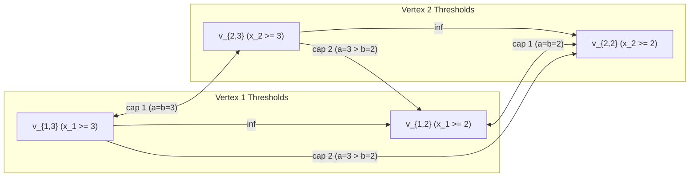
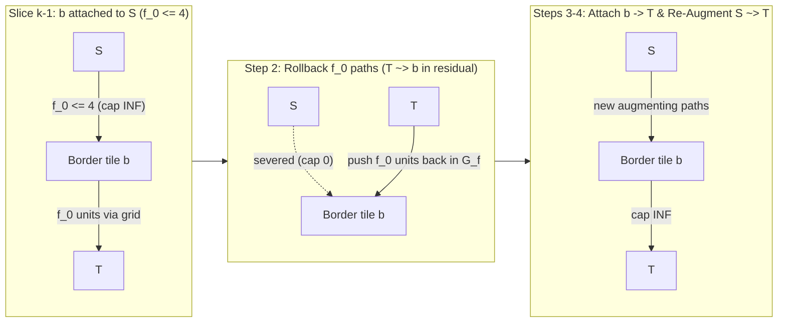

## Prerequisites & Learning Objectives

### Prerequisites

Before studying this chapter, make sure you are comfortable with:

- **Chapter 09 (Project Selection & Maximum Weight Closure)**: Compiling unary incentives and implication constraints $z_u \le z_v \iff z_u(1 - z_v) = 0$ into directed $\infty$-capacity arcs $u \xrightarrow{\infty} v$.
- **Chapter 11 (Pseudo-Boolean Cut Polynomials & Submodularity)**: Proving why a binary pairwise penalty $\psi(x_u, x_v)$ over $x_u, x_v \in \{0, 1\}$ is $S$-$T$ cut-representable if and only if $\psi(0, 0) + \psi(1, 1) \le \psi(0, 1) + \psi(1, 0)$, and using Bipartite Variable Inversion ($y_v = 1 - x_v$) when the interaction graph is bipartite.
- **Chapter 12 (Multi-State Unary Chains & Lipschitz Constraints)**: Encoding an integer variable $x_u \in \{1, 2, \dots, K\}$ via a series chain of $K-1$ unary threshold indicators $z_{u,a} = [x_u \ge a] \in \{0, 1\}$ for $a \in \{2, \dots, K\}$, enforced by reverse $\infty$-locks $v_{u,a+1} \xrightarrow{\infty} v_{u,a}$, and compiling hard bounded-difference constraints $x_u - x_v \le D$ via cross-chain $\infty$-locks $v_{u,a} \xrightarrow{\infty} v_{v,a-D}$.

### Learning Objectives

By the end of this chapter, you will be able to:

1. **Compile Arbitrary Monge / Convex Multi-State Penalties via Ishikawa's Theorem (2003)**: Use 2D discrete summation by parts (Abel transformation) to expand any pairwise function $\Phi(x_u, x_v)$ over $x_u, x_v \in \{1, \dots, K\}$ into unary terms plus cross-chain cut terms $z_{u,a}(1 - z_{v,b})$ with capacity $-\Delta_a \Delta_b \Phi(a, b) \ge 0$.
2. **Master Both Zero-Offset Downward Wiring and Symmetric All-Pairs Wiring for $\Phi(x_u, x_v) = g(|x_u - x_v|)$**: Derive the exact cross-edge capacities for convex difference penalties such as $(x_u - x_v)^2$ (**AtCoder ABC 347 G**), and diagnose immediately why concave penalties ($\sqrt{|x_u - x_v|}$ or Potts $[x_u \ne x_v]$ for $K \ge 3$) violate the Monge condition (**Failure Mode `FM-13`**).
3. **Decompose $10^9$-State $\ell_1$ Total Variation via the Discrete Coarea Formula**: Prove the layer-cake identity $|h_u - h_v| = \sum_{k=1}^{m-1} (v_{k+1} - v_k)\big|[h_u > v_k] - [h_v > v_k]\big|$ and use the **Submodular Cut Nesting Theorem** ($S_1^* \supseteq S_2^* \supseteq \dots \supseteq S_{m-1}^*$) to decouple an intractably deep chain ($K = 10^9$) into $m - 1$ independent binary threshold cuts without any vertical $\infty$-edges.
4. **Execute $O(N^3)$ Parametric Residual Flow Rollback (`动态退流`)**: Solve the flagship masterpiece **[Codeforces 1427 G — One Billion Shades of Grey](https://codeforces.com/problemset/problem/1427/G) (`#103`)** by sweeping across $m \le 4N$ sorted boundary shades and rolling back at most $\deg(b) \le 4$ units of flow per boundary tile in $O(|E|)$ work per transition.

---

## 1. From Hard Bounded-Difference Constraints to Soft Convex Penalties $\Phi(x_u - x_v)$

### 1.1 Why Chapter 12's $\infty$ Cross-Edges Cannot Price Soft Gradual Discrepancies

In Chapter 12 (**[HNOI2013] Cake Cutting `切糕`, `#089`**), each variable $x_u \in \{1, 2, \dots, K\}$ incurred a unary cost $c_u(x_u)$ and was coupled to adjacent variables $(u, v) \in E$ by a **hard Lipschitz cliff**:

$$\Phi_{\text{hard}}(x_u, x_v) = \begin{cases} 0 & \text{if } |x_u - x_v| \le D, \\ +\infty & \text{if } |x_u - x_v| > D. \end{cases}$$

In the unary indicator representation $z_{u,a} = [x_u \ge a] \in \{0, 1\}$ for $a \in \{2, \dots, K\}$ (where $x_u = 1 + \sum_{a=2}^K z_{u,a}$ and $1 \ge z_{u,2} \ge z_{u,3} \ge \dots \ge z_{u,K} \ge 0$), the hard inequality $x_u - x_v \le D$ is equivalent to the logical implication:

$$\forall a \in \{D + 2, \dots, K\}, \qquad x_u \ge a \implies x_v \ge a - D \quad \Longleftrightarrow \quad z_{u,a}(1 - z_{v,a-D}) = 0.$$

Because the penalty for violating $z_{u,a} \le z_{v,a-D}$ is $+\infty$, wiring a single directed edge $v_{u,a} \xrightarrow{\infty} v_{v,a-D}$ per threshold $a$ completely captures the constraint: if one threshold violates the bound by $1$ unit or by $10$ units, the cut capacity is still $+\infty$ because $\infty + \infty = \infty$.

Now suppose a contest problem replaces the hard cliff with a **finite, smooth pairwise penalty** $\Phi(x_u, x_v) \in \mathbb{R}_{\ge 0}$:

$$\min_{x \in \{1, \dots, K\}^V} \sum_{u \in V} c_u(x_u) + \sum_{(u, v) \in E} \Phi_{uv}(x_u, x_v),$$

such as the quadratic smoothing energy $\Phi(x_u, x_v) = (x_u - x_v)^2$ in **AtCoder ABC 347 G — Grid Coloring 2 (`#097`)** or the $\ell_1$ total variation energy $\Phi(x_u, x_v) = |x_u - x_v|$ in **Codeforces 1427 G — One Billion Shades of Grey (`#103`)**.

Simply replacing the capacity $\infty$ on $v_{u,a} \to v_{v,a-D}$ with a finite weight $w$ is no longer enough without careful algebra:

- When $x_u = 5$ and $x_v = 1$, multiple threshold pairs $(a, b)$ satisfy $x_v < b \le a \le x_u$, which means **multiple cross-edges between chain $u$ and chain $v$ are severed simultaneously** by a single minimum cut!
- Instead of $\infty + \infty = \infty$, the capacities of all severed cross-edges $v_{u,a} \to v_{v,b}$ **add up linearly**.
- Therefore, to make the total capacity of all severed cross-edges between chain $u$ and chain $v$ equal $\Phi(x_u, x_v)$ for *every* possible pair of states $(x_u, x_v) \in \{1, \dots, K\}^2$, we must invert the cumulative sum over the 2D grid of threshold pairs $(a, b)$.

### 1.2 Step 1 — Non-Graph Diagnostic Signal for Multi-State Soft Penalty Networks

How do you recognize from an English problem statement that a multi-state assignment problem compiles into an Ishikawa convex-chain cut or a Coarea level-set cut?

1. **Ordered Discrete State Space per Entity**: Each vertex $u \in V$ chooses a state $x_u \in \{1, 2, \dots, K\}$ (a height, color shade, power level, or time slot) with an arbitrary unary cost $c_u(x_u)$ (or reward $f_u(x_u)$).
2. **Why Dynamic Programming Fails**: The interaction graph $G = (V, E)$ is a 2D grid or a general graph with treewidth $\Omega(\sqrt{|V|})$ or $\Omega(|V|)$, making profile DP $O(K^{\sqrt{|V|}})$ exponential.
3. **Why Greedy / Local Search Fails**: Pairwise penalties $\Phi_{uv}(x_u, x_v)$ create long-range tension across the graph (e.g., harmonic / piece-wise linear interpolation between boundary values).
4. **The Convexity / Monge Diagnostic Split ($K \le 10$ vs. $K \le 10^9$)**:
   - **Regime A (Explicit Ishikawa Chains, $K \le 200$)**: The number of states $K$ is small ($K \le 5$ in `ABC 347 G`, $K \le 201$ in `CF 434 D`), and the pairwise penalty $\Phi(x_u, x_v)$ is a **strictly convex** function of $x_u - x_v$ (such as $(x_u - x_v)^2$) or a general $K \times K$ **Monge matrix** satisfying $\Phi(a, b-1) + \Phi(a-1, b) - \Phi(a, b) - \Phi(a-1, b-1) \ge 0$. We build all $K-1$ threshold nodes per vertex in a single graph of size $O(|V|K)$ vertices and $O(|E|K^2)$ edges.
   - **Regime B (Discrete Coarea Level-Set Cuts, $K \le 10^9$)**: The state space is huge ($K = 10^9$ in `CF 1427 G`), the pairwise penalty is **purely linear $\ell_1$ total variation** $w_{uv}|x_u - x_v|$, and unary costs $c_u(x_u)$ are convex (or zero on interior nodes with fixed boundary values). Here, cross-edges between *different* heights $a \ne b$ vanish! The problem decouples across thresholds into $m - 1$ independent binary cuts on the base graph $G = (V, E)$.

### 1.3 Pedestal Shifting for Arbitrary Unary Costs and Rewards (`FM-13a`)

Before compiling pairwise interactions $\Phi(x_u, x_v)$, let us settle a crucial property of the unary series chain from Chapter 12. For each variable $u \in V$, we represent $x_u \in \{1, \dots, K\}$ using $K-1$ internal vertices $v_{u,2}, v_{u,3}, \dots, v_{u,K}$ corresponding to the binary threshold indicators:

$$z_{u,a} = [x_u \ge a] \in \{0, 1\} \qquad (a \in \{2, \dots, K\}),$$

wired in a series chain from the source $S$ (think of $v_{u,1} \equiv S$, where $z_{u,1} = [x_u \ge 1] = 1$ always) to the sink $T$ (think of $v_{u,K+1} \equiv T$, where $z_{u,K+1} = [x_u \ge K+1] = 0$ always):

$$S \xrightarrow{c_u(1)} v_{u,2} \xrightarrow{c_u(2)} v_{u,3} \xrightarrow{c_u(3)} \cdots \xrightarrow{c_u(K-1)} v_{u,K} \xrightarrow{c_u(K)} T,$$

together with **reverse $\infty$-lock edges** enforcing monotonicity $z_{u,2} \ge z_{u,3} \ge \dots \ge z_{u,K}$:

$$v_{u,a+1} \xrightarrow{\infty} v_{u,a} \qquad \text{for all } a \in \{2, \dots, K-1\}.$$

What if the unary costs $c_u(k)$ can be **negative**, or we are maximizing a non-concave profit function $f_u(k) = a_u k^2 + b_u k + d_u$ (as in **Codeforces 434 D — Nanami's Power Plant, `#098`**) so that $-f_u(k) < 0$?

::: {.callout-important title="The Unary Pedestal Invariant (Why Unary Costs Need NOT Be Convex When Reverse $\infty$-Locks Are Present)"}
In a series chain equipped with reverse $\infty$-locks $v_{u,a+1} \xrightarrow{\infty} v_{u,a}$:

1. No finite $S$-$T$ cut can ever sever **more than one** forward edge in chain $u$: if a cut severed both the $k_1$-th edge and the $k_2$-th edge ($1 \le k_1 < k_2 \le K$), then $v_{u,k_1+1} \in T$ while $v_{u,k_2} \in S$, which forces the directed reverse $\infty$-path $v_{u,k_2} \xrightarrow{\infty} \cdots \xrightarrow{\infty} v_{u,k_1+1}$ to cross from $S$ to $T$ at cost $+\infty$.
2. Because $S$ and $T$ are the endpoints of the chain, any cut must sever **at least one** forward edge in chain $u$.
3. Combining (1) and (2), **every finite $S$-$T$ cut severs each chain $u$ at state $x_u \in \{1, \dots, K\}$ by severing *exactly one* forward edge**, regardless of whether the sequence $c_u(1), c_u(2), \dots, c_u(K)$ is convex, concave, or wildly oscillating!
4. To ensure all edge capacities are strictly non-negative for Dinic's algorithm, pick a large pedestal constant $M_{\text{big}} > \max_{u, k} |c_u(k)|$ (or $M_{\text{big}} > \max_{u,k} |f_u(k)|$), shift every forward chain edge capacity to:
   $$\tilde{c}_u(k) = c_u(k) + M_{\text{big}} > 0 \qquad (\text{or } M_{\text{big}} - f_u(k) > 0 \text{ for maximization}),$$
   and subtract $|V| \cdot M_{\text{big}}$ from the minimum cut at the end! Because every chain is cut **exactly once**, the pedestal $+M_{\text{big}}$ adds the exact deterministic constant $|V| \cdot M_{\text{big}}$ to every valid assignment $x \in \{1, \dots, K\}^V$.
:::

---

## 2. Ishikawa's Theorem (2003) & 2D Summation by Parts

Now let us solve the central algebraic compilation problem: given an arbitrary pairwise penalty function $\Phi(x_u, x_v)$ on $x_u, x_v \in \{1, 2, \dots, K\}$, how do we express $\Phi(x_u, x_v)$ as a non-negative linear combination of cut indicators $z_{u,a}(1 - z_{v,b})$ between chain $u$ and chain $v$?

### 2.1 Step 2 — Intermediate Algebraic Representation via 2D Discrete Abel Summation

Recall that $z_{u,a} = [x_u \ge a] \in \{0, 1\}$ for $a \in \{2, \dots, K\}$. For convenience, define the first forward differences along the two coordinate axes of the $K \times K$ matrix $\Phi$:

$$\Delta_a \Phi(a, b) = \Phi(a, b) - \Phi(a-1, b) \quad (a \ge 2), \qquad \Delta_b \Phi(a, b) = \Phi(a, b) - \Phi(a, b-1) \quad (b \ge 2),$$

and the **2D mixed second difference** (the discrete cross-partial derivative $\frac{\partial^2 \Phi}{\partial a \, \partial b}$ on the cell $[a-1, a] \times [b-1, b]$):

$$\Delta_a \Delta_b \Phi(a, b) = \Phi(a, b) - \Phi(a-1, b) - \Phi(a, b-1) + \Phi(a-1, b-1) \qquad (2 \le a, b \le K).$$

Let us expand $\Phi(x_u, x_v)$ from the base corner $(1, 1)$ by telescoping first along $a \in \{2, \dots, x_u\}$ and then along $b \in \{2, \dots, x_v\}$.

1. **1D Telescoping in $x_u$**: Since $z_{u,a} = 1$ for $2 \le a \le x_u$ and $z_{u,a} = 0$ for $a > x_u$,
   $$\Phi(x_u, x_v) = \Phi(1, x_v) + \sum_{a=2}^K \big(\Phi(a, x_v) - \Phi(a-1, x_v)\big) z_{u,a}.$$
2. **1D Telescoping of Each Term in $x_v$**: Similarly, expanding $\Phi(1, x_v)$ and $\Phi(a, x_v) - \Phi(a-1, x_v)$ in terms of $z_{v,b} = [x_v \ge b]$ for $b \in \{2, \dots, K\}$ gives:
   $$\Phi(1, x_v) = \Phi(1, 1) + \sum_{b=2}^K \Delta_b \Phi(1, b)\, z_{v,b},$$
   $$\Phi(a, x_v) - \Phi(a-1, x_v) = \Delta_a \Phi(a, 1) + \sum_{b=2}^K \Delta_a \Delta_b \Phi(a, b)\, z_{v,b}.$$
3. **Combining into the Bilinear Identity**: Substituting these into Step 1 yields the exact 2D Taylor/Abel expansion of any function on $\{1, \dots, K\}^2$:
   $$\Phi(x_u, x_v) = \Phi(1, 1) + \sum_{a=2}^K \Delta_a \Phi(a, 1)\, z_{u,a} + \sum_{b=2}^K \Delta_b \Phi(1, b)\, z_{v,b} + \sum_{a=2}^K \sum_{b=2}^K \Delta_a \Delta_b \Phi(a, b)\, z_{u,a} z_{v,b}.$$
4. **Converting $z_{u,a} z_{v,b}$ into Directed Cut Terms $z_{u,a}(1 - z_{v,b})$**:
   In an $S$-$T$ cut where $z_{u,a} = [v_{u,a} \in S]$ and $z_{v,b} = [v_{v,b} \in S]$, a directed edge $v_{u,a} \to v_{v,b}$ is severed if and only if $v_{u,a} \in S$ ($z_{u,a} = 1$) and $v_{v,b} \in T$ ($z_{v,b} = 0$), which represents the quadratic cut monomial $z_{u,a}(1 - z_{v,b})$.
   Substitute the algebraic identity $z_{u,a} z_{v,b} = z_{u,a} - z_{u,a}(1 - z_{v,b})$ into the double sum:
   $$\sum_{a=2}^K \sum_{b=2}^K \Delta_a \Delta_b \Phi(a, b)\, z_{u,a} z_{v,b} = \sum_{a=2}^K \left(\sum_{b=2}^K \Delta_a \Delta_b \Phi(a, b)\right) z_{u,a} + \sum_{a=2}^K \sum_{b=2}^K \big(-\Delta_a \Delta_b \Phi(a, b)\big) z_{u,a}(1 - z_{v,b}).$$
   Look at the inner sum multiplying $z_{u,a}$: by telescoping over $b \in \{2, \dots, K\}$,
   $$\Delta_a \Phi(a, 1) + \sum_{b=2}^K \Delta_a \Delta_b \Phi(a, b) = \Delta_a \Phi(a, K) = \Phi(a, K) - \Phi(a-1, K).$$
   And summing $\big(\Phi(a, K) - \Phi(a-1, K)\big) z_{u,a}$ over $a \in \{2, \dots, K\}$ telescopes to $\Phi(x_u, K) - \Phi(1, K)$!

This completes the proof of **Ishikawa's Theorem (2003)**:

::: {.callout-note title="Theorem 13.1 (Ishikawa's Multi-State Cut Compilation & Monge Condition)"}
For any function $\Phi : \{1, \dots, K\} \times \{1, \dots, K\} \to \mathbb{R}$ and any states $x_u, x_v \in \{1, \dots, K\}$ encoded by unary indicators $z_{u,a} = [x_u \ge a]$ and $z_{v,b} = [x_v \ge b]$ ($2 \le a, b \le K$), the following identity holds **identically**:

$$\boxed{\Phi(x_u, x_v) = \underbrace{\Phi(x_u, K)}_{\text{Unary on } u} + \underbrace{\Phi(1, x_v)}_{\text{Unary on } v} - \underbrace{\Phi(1, K)}_{\text{Constant}} + \sum_{a=2}^K \sum_{b=2}^K \underbrace{\big(-\Delta_a \Delta_b \Phi(a, b)\big)}_{\text{Cap } c(v_{u,a} \to v_{v,b})} z_{u,a}(1 - z_{v,b}),}$$

where $-\Delta_a \Delta_b \Phi(a, b) = \Phi(a, b-1) + \Phi(a-1, b) - \Phi(a, b) - \Phi(a-1, b-1)$.

Consequently, $\Phi(x_u, x_v)$ compiles into a directed cross-chain network with non-negative cross-edge capacities $c(v_{u,a} \to v_{v,b}) = -\Delta_a \Delta_b \Phi(a, b) \ge 0$ **if and only if** the matrix $\Phi$ satisfies the discrete **Monge (submodularity) condition**:

$$\forall 2 \le a \le K, \; 2 \le b \le K, \qquad -\Delta_a \Delta_b \Phi(a, b) = \Phi(a, b-1) + \Phi(a-1, b) - \Phi(a, b) - \Phi(a-1, b-1) \ge 0.$$
:::

### 2.2 Symmetric Convex Difference Penalties $\Phi(x_u, x_v) = g(|x_u - x_v|)$

In the vast majority of image restoration, grid smoothing, and competitive programming problems, the pairwise penalty is a **symmetric function of the absolute difference**:

$$\Phi(x_u, x_v) = g(|x_u - x_v|), \qquad g(0) = 0,$$

where $g : \{0, 1, \dots, K-1\} \to \mathbb{R}_{\ge 0}$ is a **discrete convex function** of the step distance $d = |a - b|$:

$$g''(d) \equiv \Delta^2 g(d) = g(d+1) - 2g(d) + g(d-1) \ge 0 \quad (\forall d \ge 1), \qquad \text{and} \qquad g(1) - g(0) \ge 0.$$

Let us compute the mixed second difference $-\Delta_a \Delta_b \Phi(a, b)$ for $\Phi(a, b) = g(|a - b|)$:

1. **Diagonal Entries ($a = b$, so $|a - b| = 0$)**:
   $$-\Delta_a \Delta_b \Phi(a, a) = \Phi(a, a-1) + \Phi(a-1, a) - \Phi(a, a) - \Phi(a-1, a-1) = g(1) + g(1) - 2g(0) = 2\big(g(1) - g(0)\big) \ge 0.$$
2. **Off-Diagonal Entries ($a \ne b$, let $d = |a - b| \ge 1$)**:
   When $a > b$, $|a - b| = d$, $|(a-1) - b| = d - 1$, $|a - (b-1)| = d + 1$, and $|(a-1) - (b-1)| = d$. By symmetry, the same multiset of distances $\{d-1, d+1, d, d\}$ appears when $a < b$. Therefore:
   $$-\Delta_a \Delta_b \Phi(a, b) = g(d+1) + g(d-1) - 2g(d) = \Delta^2 g(|a - b|) \ge 0 \qquad (a \ne b).$$

Because $\Phi(x_u, x_v) = g(|x_u - x_v|)$ is symmetric in $(x_u, x_v)$, we have **two algebraically equivalent ways** to wire the cross-edges between chain $u$ and chain $v$:

#### Form 1: Symmetric All-Pairs Wiring (Splitting $\Phi(x_u, x_v) = \frac{1}{2}\Phi(x_u, x_v) + \frac{1}{2}\Phi(x_v, x_u)$)

If we apply Theorem 13.1 half in direction $u \to v$ and half in direction $v \to u$, every ordered pair $(v_{u,a}, v_{v,b})$ receives a bidirectional edge of capacity $c(v_{u,a} \to v_{v,b}) = c(v_{v,b} \to v_{u,a}) = -\frac{1}{2}\Delta_a \Delta_b \Phi(a, b)$:

$$c(v_{u,a} \to v_{v,a}) = g(1) - g(0), \qquad c(v_{u,a} \to v_{v,b}) = \frac{1}{2}\big(g(|a-b|+1) - 2g(|a-b|) + g(|a-b|-1)\big) \quad (a \ne b),$$

together with the symmetric unary chain correction $\frac{1}{2}\big(g(K - x_u) + g(x_u - 1) - g(K - 1)\big)$ on both $u$ and $v$.

#### Form 2: Zero-Unary-Offset Downward Wiring (Only $a \ge b$, No Unary Chain Modification!)

Can we eliminate the unary chain correction altogether so that $x_u = x_v$ cuts **zero** cross-edges and the unary chains $c_u(k)$ remain completely untouched? Yes! Notice why the unary shift $\Phi(x_u, K) + \Phi(1, x_v) - \Phi(1, K)$ appeared in Form 1: when $x_u = x_v = x$, an upward cross-edge $v_{u,a} \to v_{v,b}$ with $a \le x < b$ has $z_{u,a} = 1$ and $z_{v,b} = 0$, so **upward cross-edges ($a < b$) get severed even when $x_u = x_v$**!

If instead we wire cross-edges **only horizontally ($a = b$) and strictly downward ($a > b$)**:

- Whenever $x_u = x_v$, we have $z_{u,a} = z_{v,a}$ for all $a$, and for $a > b$ we can never have $a \le x_u = x_v < b$. Thus **zero** edges with $a \ge b$ are cut when $x_u = x_v$!
- Whenever $x_u > x_v$ (with $\Delta = x_u - x_v \ge 1$), a horizontal or downward edge $v_{u,a} \to v_{v,b}$ ($a \ge b$) is severed if and only if $x_v < b \le a \le x_u$ (and no edge $v_{v,a} \to v_{u,b}$ with $a \ge b$ is severed).
- How many pairs $(a, b)$ with $a - b = d \ge 0$ satisfy $x_v + 1 \le b \le a \le x_u$?
  - For $d = 0$ ($a = b$): there are exactly $x_u - x_v = |x_u - x_v|$ such levels $a \in \{x_v + 1, \dots, x_u\}$.
  - For $d \ge 1$ ($a - b = d$): there are exactly $\max(0, |x_u - x_v| - d)$ such pairs!
- By the discrete 1D Taylor expansion $g(\Delta) = \big(g(1) - g(0)\big)\Delta + \sum_{d=1}^{K-2} \Delta^2 g(d) \max(0, \Delta - d)$, wiring capacity $g(1) - g(0)$ horizontally ($a = b$) and capacity $\Delta^2 g(a - b)$ strictly downward ($a > b$, in both directions $v_{u,a} \to v_{v,b}$ and $v_{v,a} \to v_{u,b}$) reproduces $g(|x_u - x_v|)$ with **zero unary offsets**:

$$\boxed{g(|x_u - x_v|) = \sum_{a=2}^K \big(g(1) - g(0)\big)|z_{u,a} - z_{v,a}| + \sum_{2 \le b < a \le K} \big(g(a-b+1) - 2g(a-b) + g(a-b-1)\big)\Big(z_{u,a}(1 - z_{v,b}) + z_{v,a}(1 - z_{u,b})\Big).}$$

### 2.3 Worked Derivation & Toy Trace: Quadratic Penalty $\Phi(x_u, x_v) = (x_u - x_v)^2$

Let us apply both forms to the canonical quadratic smoothing penalty $\Phi(x_u, x_v) = (x_u - x_v)^2$ (**AtCoder ABC 347 G — Grid Coloring 2, `#097`**), where $g(d) = d^2$:

- First difference at $d = 0$: $g(1) - g(0) = 1^2 - 0^2 = 1$.
- Second difference for all $d \ge 1$: $\Delta^2 g(d) = (d+1)^2 - 2d^2 + (d-1)^2 = \mathbf{2}$ (a constant independent of $d$!).

Therefore, for every undirected edge $(u, v) \in E$:

1. **In Form 2 (Zero-Offset Downward Wiring — Recommended for Implementation)**:
   - For each $a \in \{2, \dots, K\}$, add a bidirectional edge $v_{u,a} \xleftrightarrow{1} v_{v,a}$ of capacity **$1$**.
   - For each strictly ordered pair $2 \le b < a \le K$, add directed downward edges $v_{u,a} \xrightarrow{2} v_{v,b}$ and $v_{v,a} \xrightarrow{2} v_{u,b}$ of capacity **$2$**.
   - **Unary chains remain completely untouched!**
2. **In Form 1 (Symmetric All-Pairs Unit-Capacity Wiring)**:
   - Since $-\frac{1}{2}\Delta_a \Delta_b (a - b)^2 = \frac{1}{2}(2) = \mathbf{1}$ for **every** pair $(a, b) \in \{2, \dots, K\}^2$ (both $a = b$ and $a \ne b$!), we can wire a bidirectional edge $v_{u,a} \xleftrightarrow{1} v_{v,b}$ of **unit capacity $1$** between *every* threshold $a$ of $u$ and *every* threshold $b$ of $v$, provided we subtract the upward-leakage parabolic offset $(x_u - 1)(K - x_u) + (x_v - 1)(K - x_v)$ from the unary chains (because when $x_u = x_v = x$, the $(x - 1)(K - x)$ upward edges from $\{2, \dots, x\}$ to $\{x+1, \dots, K\}$ are cut in both directions!).

#### Hand-Checkable Numerical Trace ($N = 2, K = 3$ for $\Phi(x_1, x_2) = (x_1 - x_2)^2$)

Consider two adjacent vertices $u = 1, v = 2$ with $K = 3$ states $\{1, 2, 3\}$, represented by threshold nodes $v_{1,2}, v_{1,3}$ and $v_{2,2}, v_{2,3}$. Using **Form 2 (Zero-Offset Downward Wiring)**:



Let us verify the cut capacity across all three possible distance values $|x_1 - x_2| \in \{0, 1, 2\}$:

- **Case 1: $x_1 = 2, x_2 = 2$ ($\Delta = 0$)**:
  $(z_{1,2}, z_{1,3}) = (1, 0)$ and $(z_{2,2}, z_{2,3}) = (1, 0)$. Both $v_{1,2}, v_{2,2} \in S$ and both $v_{1,3}, v_{2,3} \in T$. No cross-edge has its tail in $S$ and head in $T$. Total cross-cut $= \mathbf{0} = (2 - 2)^2$.
- **Case 2: $x_1 = 2, x_2 = 1$ ($\Delta = 1$)**:
  $(z_{1,2}, z_{1,3}) = (1, 0)$ and $(z_{2,2}, z_{2,3}) = (0, 0)$. The only cross-node in $S$ is $v_{1,2}$, whose only outgoing cross-edge is $v_{1,2} \xrightarrow{1} v_{2,2} \in T$. Total cross-cut $= \mathbf{1} = (2 - 1)^2$.
- **Case 3: $x_1 = 3, x_2 = 1$ ($\Delta = 2$)**:
  $(z_{1,2}, z_{1,3}) = (1, 1)$ (both in $S$) and $(z_{2,2}, z_{2,3}) = (0, 0)$ (both in $T$). Three cross-edges lead from $S$ to $T$:
  1. Horizontal $v_{1,2} \xrightarrow{1} v_{2,2}$ (capacity $1$),
  2. Horizontal $v_{1,3} \xrightarrow{1} v_{2,3}$ (capacity $1$),
  3. Downward diagonal $v_{1,3} \xrightarrow{2} v_{2,2}$ (capacity $2$).
  Total cross-cut $= 1 + 1 + 2 = \mathbf{4} = (3 - 1)^2$!

### 2.4 Rescuing Non-Monge Penalties via State Permutation & Bipartite Order Reversal

Because the Monge condition $-\Delta_a \Delta_b \Phi(a, b) \ge 0$ depends on the **linear ordering** of the states $1 \prec 2 \prec \dots \prec K$, two algebraic transformations can rescue problems whose naive matrix $\Phi$ violates submodularity:

1. **State-Space Reordering (`yukicoder No. 119 — Travel, #098`)**:
   If each entity has 3 qualitative states—say $\text{Skip}$, $\text{Alice}$, and $\text{Bob}$—and the only forbidden/penalized pair across an edge $(u, v)$ is $(\text{state}_u = \text{Bob} \land \text{state}_v = \text{Alice})$, placing $\text{Skip}$ in the **middle** of the chain ($1 = \text{Alice} \prec 2 = \text{Skip} \prec 3 = \text{Bob}$) makes the conflict occur only at the extreme corner $(x_u = 3, x_v = 1)$, i.e., $z_{u,3}(1 - z_{v,2}) = 1$, which compiles into a single non-negative edge $v_{u,3} \to v_{v,2}$!
2. **Bipartite Multi-State Chain Reversal (`yukicoder No. 1541` & `#104`)**:
   Suppose the interaction graph $G = (L \sqcup R, E)$ is **bipartite**, and the pairwise penalty $\Phi(x_u, x_v)$ is **supermodular** ($\Delta_a \Delta_b \Phi(a, b) \ge 0$, such as $\Phi(x_u, x_v) = (x_u + x_v)^2$), so $-\Delta_a \Delta_b \Phi \le 0$ has negative capacities.
   For every right-side vertex $v \in R$, reverse its state ordering by setting $x'_v = K + 1 - x_v \in \{1, \dots, K\}$. Reversing one coordinate axis flips the sign of $\Delta_b$ and therefore **flips the sign of the 2D mixed difference**:
   $$-\Delta_a \Delta_{b'} \tilde{\Phi}(a, b') = +\Delta_a \Delta_b \Phi(a, K + 2 - b') \ge 0,$$
   turning every supermodular bipartite penalty into a valid non-negative Monge cut!

### 2.5 Broken-Gadget Counterexample `FM-13`: Why Concave Penalties ($\sqrt{|x_u - x_v|}$ and Potts $[x_u \ne x_v]$) Fail Ishikawa Compilation

::: {.callout-warning title="Failure Mode FM-13: Concave Pairwise Penalties Yield Negative Cross-Edge Capacities"}
Suppose a problem asks to minimize a **concave** function of the state difference over $K \ge 3$ states, such as:

- **Square-Root Penalty**: $g(d) = \sqrt{d}$, or
- **Multi-Label Potts / Happy-Edge Penalty**: $g(d) = [d \ne 0] = [x_u \ne x_v]$ (pay $1$ if $x_u \ne x_v$, pay $0$ if $x_u = x_v$, which is the multi-way cut / metric labeling problem for $K \ge 3$).

Let us compute the required downward cross-edge capacity $\Delta^2 g(1) = g(2) - 2g(1) + g(0)$ between $v_{u,3}$ and $v_{v,2}$:

- For $g(d) = \sqrt{d}$: $\Delta^2 g(1) = \sqrt{2} - 2(1) + 0 \approx \mathbf{-0.5858 < 0}$!
- For $g(d) = [d \ne 0]$: $g(0) = 0, g(1) = 1, g(2) = 1$, so $\Delta^2 g(1) = 1 - 2(1) + 0 = \mathbf{-1 < 0}$!

**Why does this fail mathematically and algorithmically?**
When $x_u = 3$ and $x_v = 1$ ($\Delta = 2$), both horizontal edges $v_{u,2} \to v_{v,2}$ (paying $g(1) - g(0) = 1$) and $v_{u,3} \to v_{v,3}$ (paying $g(1) - g(0) = 1$) are severed, summing to $1 + 1 = 2$. Because $g(2) < 2g(1)$ for a strictly concave function, the diagonal cross-edge $v_{u,3} \to v_{v,2}$ would need a **negative capacity** $\Delta^2 g(1) = g(2) - 2g(1) < 0$ to discount the double-counted horizontal cost from $2$ down to $g(2)$!
In fact, minimizing $\sum c_u(x_u) + \sum_{(u,v) \in E} [x_u \ne x_v]$ for $K = 3$ labels is the classic **3-Terminal Multiway Cut** problem, which is **NP-hard** (Dahlhaus et al., 1994). Thus, no valid $S$-$T$ min-cut gadget with non-negative capacities can ever exist for concave $g(|x_u - x_v|)$ when $K \ge 3$.
:::


---

## 3. The Discrete Coarea Formula (Layer-Cake Level-Set Decomposition) for $\ell_1$ Total Variation

### 3.1 What Happens to Ishikawa's Network When $\Phi(h_u, h_v) = w_{uv}|h_u - h_v|$?

Let us substitute the linear $\ell_1$ penalty $g(d) = d$ into our Zero-Unary-Offset Formula (Section 2.2, Form 2):

- The first difference at $d = 0$ is $g(1) - g(0) = 1 - 0 = \mathbf{1}$.
- The second difference for every $d = |a - b| \ge 1$ is:
  $$\Delta^2 g(d) = (d + 1) - 2d + (d - 1) = \mathbf{0}!$$

Pause and appreciate the geometric meaning of $\Delta^2 g(d) = 0$ for all $d \ge 1$:

- In Ishikawa's multi-state network for $\Phi(h_u, h_v) = w_{uv}|h_u - h_v|$, **every diagonal cross-edge $v_{u,a} \to v_{v,b}$ between different threshold levels $a \ne b$ has capacity zero!**
- The only edges linking chain $u$ and chain $v$ are **purely horizontal edges** $v_{u,a} \xleftrightarrow{w_{uv}} v_{v,a}$ at the exact same threshold height $a$!

If there are no diagonal cross-edges between different heights $a \ne b$, then the only edges connecting level $a$ to level $a-1$ are the vertical reverse $\infty$-lock edges $v_{u,a} \xrightarrow{\infty} v_{u,a-1}$ inside each vertex's own chain. What if we **delete those vertical $\infty$-lock edges too**, decomposing the 3D multi-layer graph into $K-1$ completely disconnected 2D horizontal slices—and what if $K = 10^9$?

### 3.2 Coordinate Compression & The Layer-Cake Identity

Suppose we are given a graph $G = (V, E)$ with non-negative edge weights $w_{uv} \ge 0$, where a subset of **boundary (or pinned) vertices** $\partial V \subseteq V$ have fixed integer heights $h_u = a_u \in [1, 10^9]$, and all remaining interior vertices $u \in V \setminus \partial V$ are free to choose $h_u \in \mathbb{R}$ (or $\mathbb{Z}$) to minimize the **$\ell_1$ Total Variation Energy**:

$$\mathcal{E}(h) = \sum_{(u, v) \in E} w_{uv} |h_u - h_v|.$$

First, let $v_1 < v_2 < \dots < v_m$ be the sorted distinct values appearing among the boundary heights $\{a_u : u \in \partial V\}$. Note that $m \le |\partial V|$, even if $v_m = 10^9$! By clamping any $h_u < v_1$ up to $v_1$ and any $h_u > v_m$ down to $v_m$ (which can only decrease $|h_u - h_v|$), we may restrict $h_u \in [v_1, v_m]$ for all $u \in V$.

For any real threshold $\lambda \in [v_1, v_m]$, define the binary **super-level set indicator** $z_u(\lambda) \in \{0, 1\}$ and the **super-level set** $S(\lambda) \subseteq V$:

$$z_u(\lambda) = [h_u > \lambda] = \begin{cases} 1 & \text{if } h_u > \lambda, \\ 0 & \text{if } h_u \le \lambda, \end{cases} \qquad S(\lambda) = \{u \in V : h_u > \lambda\}.$$

For any two numbers $h_u, h_v \in [v_1, v_m]$, the indicator difference $\big|[h_u > \lambda] - [h_v > \lambda]\big|$ equals $1$ if and only if $\lambda$ lies strictly between $\min(h_u, h_v)$ and $\max(h_u, h_v)$, and $0$ otherwise. Therefore, integrating over $\lambda \in [v_1, v_m]$ yields the elementary layer-cake integral:

$$|h_u - h_v| = \int_{v_1}^{v_m} \big|[h_u > \lambda] - [h_v > \lambda]\big|\, d\lambda.$$

Furthermore, whenever every $h_u$ belongs to the discrete boundary value set $\{v_1, v_2, \dots, v_m\}$, the indicator $[h_u > \lambda]$ is **constant on each elementary open interval** $\lambda \in [v_k, v_{k+1})$ of length $\Delta v_k = v_{k+1} - v_k$, taking the value $z_u(v_k) = [h_u > v_k] = [h_u \ge v_{k+1}]$. Thus the integral reduces to a finite weighted sum over the $m - 1$ intervals:

$$\boxed{|h_u - h_v| = \sum_{k=1}^{m-1} (v_{k+1} - v_k) \cdot \big|[h_u > v_k] - [h_v > v_k]\big|.}$$

Summing $w_{uv}|h_u - h_v|$ over all edges $(u, v) \in E$ and exchanging the order of summation yields the **Discrete Coarea Formula** (a discrete analogue of Federer's 1959 Coarea Formula $\int |\nabla h|\,dx = \int \operatorname{Perimeter}(\{h > \lambda\})\,d\lambda$):

$$\boxed{\sum_{(u, v) \in E} w_{uv} |h_u - h_v| = \sum_{k=1}^{m-1} (v_{k+1} - v_k) \underbrace{\sum_{(u, v) \in E} w_{uv} \big|z_u(v_k) - z_v(v_k)\big|}_{\operatorname{Cut}_G(S(v_k))}.}$$

In words: **the $\ell_1$ total variation of a height function $h$ is the exact sum, over all elementary height intervals $[v_k, v_{k+1})$, of the interval width $(v_{k+1} - v_k)$ times the capacity of the binary cut separating $\{u : h_u > v_k\}$ from $\{u : h_u \le v_k\}$!**

### 3.3 The Submodular Cut Nesting Theorem: Why Cross-Level $\infty$-Locks Are Unnecessary

Look closely at the Coarea decomposition above. For each threshold index $k \in \{1, \dots, m-1\}$, define the $k$-th **binary threshold cut problem** on the single-layer graph $G = (V, E)$:

- Each boundary vertex $b \in \partial V$ with $a_b > v_k$ must have $z_b(v_k) = 1$, so we wire $S \xrightarrow{\infty} b$. Let $A_k = \{b \in \partial V : a_b > v_k\}$ denote this forced $S$-set.
- Each boundary vertex $b \in \partial V$ with $a_b \le v_k$ must have $z_b(v_k) = 0$, so we wire $b \xrightarrow{\infty} T$. Let $B_k = \{b \in \partial V : a_b \le v_k\}$ denote this forced $T$-set.
- Each undirected edge $(u, v) \in E$ has capacity $w_{uv}$ between $u$ and $v$.

Suppose we drop the monotonicity constraint $z_u(v_1) \ge z_u(v_2) \ge \dots \ge z_u(v_{m-1})$ and simply minimize $\operatorname{Cut}_G(S_k)$ **independently** for each slice $k = 1, \dots, m-1$. Could the independent minimum cuts $S_1^*, S_2^*, \dots, S_{m-1}^*$ ever cross each other ($u \notin S_1^*$ but $u \in S_2^*$), producing an invalid boolean vector where $z_u^*(v_1) = 0 < z_u^*(v_2) = 1$?

The following fundamental theorem proves that **crossing never occurs**: submodularity of the graph cut function automatically forces the minimum cuts to nest!

::: {.callout-important title="Theorem 13.2 (Submodular Level-Set Nesting Theorem)"}
For each threshold $k \in \{1, \dots, m-1\}$, let $S_k^* \subseteq V$ be the unique **inclusion-minimal** minimum $S$-$T$ cut in slice $k$ (obtained by taking all vertices reachable from $S$ via positive residual capacity after Max-Flow). Because the forced boundary sets satisfy $A_1 \supseteq A_2 \supseteq \dots \supseteq A_{m-1}$ and $B_1 \subseteq B_2 \subseteq \dots \subseteq B_{m-1}$, the inclusion-minimal minimum cuts automatically satisfy:

$$\boxed{S_1^* \supseteq S_2^* \supseteq \dots \supseteq S_{m-1}^*.}$$

Consequently, the boolean indicators $z_u^*(v_k) = [u \in S_k^*]$ satisfy $z_u^*(v_1) \ge z_u^*(v_2) \ge \dots \ge z_u^*(v_{m-1})$ for every vertex $u \in V$, and reconstructing

$$h_u^* = v_1 + \sum_{k=1}^{m-1} (v_{k+1} - v_k)\, z_u^*(v_k) \in \{v_1, v_2, \dots, v_m\}$$

yields a globally optimal integer height assignment achieving $\sum_{(u,v) \in E} w_{uv}|h_u^* - h_v^*| = \sum_{k=1}^{m-1} (v_{k+1} - v_k)\operatorname{Cut}_G(S_k^*)$ **without any cross-level $\infty$-lock edges**!
:::

#### Proof of Theorem 13.2

Fix any $k \in \{1, \dots, m-2\}$ and compare slice $k$ (with forced sets $A_k \subseteq S_k^*$, $B_k \cap S_k^* = \emptyset$) and slice $k+1$ (with forced sets $A_{k+1} \subseteq S_{k+1}^*$, $B_{k+1} \cap S_{k+1}^* = \emptyset$). Since $v_k < v_{k+1}$, we have $A_{k+1} \subseteq A_k$ and $B_k \subseteq B_{k+1}$.

1. **Feasibility of $S_k^* \cup S_{k+1}^*$ in Slice $k$**:
   Since $A_k \subseteq S_k^* \subseteq S_k^* \cup S_{k+1}^*$ and neither $S_k^*$ nor $S_{k+1}^*$ intersects $B_k$ (as $B_k \subseteq B_{k+1}$), the union $S_k^* \cup S_{k+1}^*$ is a valid $S$-$T$ cut for slice $k$. By optimality of $S_k^*$ in slice $k$:
   $$\operatorname{Cut}_G(S_k^*) \le \operatorname{Cut}_G(S_k^* \cup S_{k+1}^*).$$
2. **Feasibility of $S_k^* \cap S_{k+1}^*$ in Slice $k+1$**:
   Since $A_{k+1} \subseteq A_k \cap A_{k+1} \subseteq S_k^* \cap S_{k+1}^*$ and $(S_k^* \cap S_{k+1}^*) \cap B_{k+1} \subseteq S_{k+1}^* \cap B_{k+1} = \emptyset$, the intersection $S_k^* \cap S_{k+1}^*$ is a valid $S$-$T$ cut for slice $k+1$. By optimality of $S_{k+1}^*$ in slice $k+1$:
   $$\operatorname{Cut}_G(S_{k+1}^*) \le \operatorname{Cut}_G(S_k^* \cap S_{k+1}^*).$$
3. **Submodularity Squeeze**:
   Adding the two optimality inequalities and invoking the submodularity of the graph cut function $\operatorname{Cut}_G$ gives:
   $$\operatorname{Cut}_G(S_k^*) + \operatorname{Cut}_G(S_{k+1}^*) \le \operatorname{Cut}_G(S_k^* \cup S_{k+1}^*) + \operatorname{Cut}_G(S_k^* \cap S_{k+1}^*) \le \operatorname{Cut}_G(S_k^*) + \operatorname{Cut}_G(S_{k+1}^*).$$
   Hence both inequalities must hold with **equality**! In particular, $\operatorname{Cut}_G(S_k^* \cap S_{k+1}^*) = \operatorname{Cut}_G(S_{k+1}^*)$, so $S_k^* \cap S_{k+1}^*$ is also a minimum cut for slice $k+1$.
4. **Uniqueness of the Inclusion-Minimal Cut**:
   Because $S_{k+1}^*$ is the unique inclusion-minimal minimum cut for slice $k+1$, it must be a subset of every minimum cut for slice $k+1$:
   $$S_{k+1}^* \subseteq S_k^* \cap S_{k+1}^* \quad \Longrightarrow \quad S_{k+1}^* \subseteq S_k^*. \qquad \blacksquare$$

::: {.callout-warning title="Failure Mode FM-13b: Independent Coarea Slices Fail When Interior Unary Costs Are Concave"}
What if interior vertices $u \in V \setminus \partial V$ also have unary costs $c_u(h_u)$? By 1D telescoping,

$$c_u(h_u) = c_u(v_1) + \sum_{k=1}^{m-1} \big(c_u(v_{k+1}) - c_u(v_k)\big)\, z_u(v_k).$$

In slice $k$, the marginal unary cost of placing $u \in S_k$ ($z_u(v_k) = 1$) is $\Delta_k c_u = c_u(v_{k+1}) - c_u(v_k)$.

- If $c_u$ is **convex**, then $\Delta_1 c_u \le \Delta_2 c_u \le \dots \le \Delta_{m-1} c_u$: it becomes progressively *more expensive* for $u$ to remain in $S_k$ as $k$ increases, which **preserves** the nesting $S_1^* \supseteq S_2^* \supseteq \dots \supseteq S_{m-1}^*$.
- If $c_u$ is **non-convex (concave)**—for instance, $v = (1, 2, 3)$ with $c_u(1) = 10, c_u(2) = 100, c_u(3) = 10$—then $\Delta_1 c_u = +90$ while $\Delta_2 c_u = -90$. Independent slice minimization picks $z_u^*(1) = 0$ in slice $1$ (to avoid paying $+90$) and $z_u^*(2) = 1$ in slice $2$ (to collect $-90$), **violating nesting** ($S_1^* \not\supseteq S_2^*$) and hallucinating an impossible cost of $10 + 0 - 90 = -80$! When unary costs are non-convex and $K$ is large, you cannot decouple the slices independently; you must use divide-and-conquer **Isotonic Regression (`保序回归`, Chapter 24)** to enforce $S_1 \supseteq S_2 \supseteq \dots$ explicitly.
:::

---

## 4. Flagship Deep-Dive Case Study — [Codeforces 1427 G — One Billion Shades of Grey](https://codeforces.com/problemset/problem/1427/G) (`#103`)

Let us now assemble the Discrete Coarea Formula and Parametric Residual Flow Rollback to solve the centerpiece problem of this chapter.

### 4.1 Problem Statement & Constraints

- **Judge URL**: [Codeforces 1427 G — One Billion Shades of Grey](https://codeforces.com/problemset/problem/1427/G)
- **Statement**: You are given an $N \times N$ grid ($3 \le N \le 200$). Every cell $(r, c)$ on the **border** of the grid ($r \in \{1, N\}$ or $c \in \{1, N\}$) has a fixed positive integer shade $a_{r,c} \in [1, 10^9]$. Each interior cell ($1 < r, c < N$) is either **blocked** ($a_{r,c} = -1$, meaning the cell is removed from the grid and has no edges) or **free** ($a_{r,c} = 0$). You must assign an integer shade $h_{r,c} \in \mathbb{Z}$ to every free cell (while keeping $h_{r,c} = a_{r,c}$ on all border cells) so as to minimize the sum of absolute differences across all pairs of horizontally or vertically adjacent non-blocked cells:
  $$\min_{h} \sum_{(u, v) \in E_{\text{grid}}} |h_u - h_v|.$$
- **Time Limit**: $2.0$ seconds.

### 4.2 Step 1 & Step 2 — Why Ishikawa Dies and How Coarea Compresses $10^9$ Shades to $m \le 4N$ Slices

1. **Why Explicit Multi-State Chains Fail**:
   - The shade range is $K = 10^9$. Even after coordinate-compressing to the $m \le 4N - 4 \le 796$ distinct shades appearing on the border of the $200 \times 200$ grid, an explicit $m$-layer Ishikawa graph would have $N^2 \cdot m \approx 40,000 \times 796 \approx 3.18 \times 10^7$ vertices and $10^8$ edges—exceeding both memory and time limits by two orders of magnitude.
2. **Coarea Level-Set Reduction**:
   - Let $v_1 < v_2 < \dots < v_m$ ($m \le 4N - 4$) be the sorted distinct shades of all border cells.
   - Interior free cells have **zero unary cost** ($c_u(h_u) \equiv 0$), and the edge penalty is purely $\ell_1$ ($w_{uv} = 1$).
   - By the Discrete Coarea Formula and Theorem 13.2 (Submodular Cut Nesting), the minimum total energy is the exact weighted sum of $m - 1$ binary minimum cuts on the single-layer $N \times N$ grid graph $G = (V, E_{\text{grid}})$ ($|V| \le 40,000$, $|E_{\text{grid}}| \le 80,000$):
     $$\text{Ans} = \sum_{k=1}^{m-1} (v_{k+1} - v_k) \cdot \operatorname{MinCut}(v_k),$$
     where in slice $k$ (threshold $\lambda = v_k$):
     - Every border cell $b \in \partial V$ with $a_b > v_k$ is wired $S \xrightarrow{\infty} b$;
     - Every border cell $b \in \partial V$ with $a_b \le v_k$ is wired $b \xrightarrow{\infty} T$;
     - Every adjacent pair of non-blocked cells $(u, v) \in E_{\text{grid}}$ is connected by an undirected edge $u \xleftrightarrow{1} v$ of capacity $1$.

### 4.3 Step 3 — Parametric Residual Flow Rollback (`动态退流`): From $4N$ Max-Flows to $O(N^3)$ Total Time

If we run Dinic's algorithm from scratch $m - 1 \approx 800$ times on a graph with $40,000$ vertices and $80,000$ edges, $800 \times 80,000 \approx 6.4 \times 10^7$ graph traversals will still TLE.

Look at what actually changes in the network when we advance the threshold from $v_{k-1}$ to $v_k$:

- All $\le 80,000$ interior grid edges $u \xleftrightarrow{1} v$ remain **100% identical**!
- All border cells with $a_b > v_k$ stay on $S$, and all border cells with $a_b \le v_{k-1}$ stay on $T$.
- **Only the border cells $b \in \partial V$ with $a_b = v_k$ change their terminal attachment**, switching from $S \xrightarrow{\infty} b$ (since $a_b = v_k > v_{k-1}$ in slice $k-1$) to $b \xrightarrow{\infty} T$ (since $a_b = v_k \le v_k$ in slice $k$)!

How can we switch a single border cell $b$ from $S \xrightarrow{\infty} b$ to $b \xrightarrow{\infty} T$ directly inside the **live residual network** without resetting the flow?

#### The Key Degree Bound: Why $f(S \to b) \le 4$ Always!

In slice $k-1$, the edge $e_S = (S \to b)$ has capacity $\infty$. How much flow $f_0 = f(S \to b)$ can it actually carry in a valid $S$-$T$ flow?
Every unit of flow entering $b$ via $S \to b$ must leave $b$ through its incident grid edges $(b, u) \in E_{\text{grid}}$. Because $b$ is a cell on a 2D grid with at most $4$ neighbors (in fact, at most $3$ neighbors since $b$ is on the border, and only $1$ interior neighbor!) and each grid edge has capacity $1$:

$$\boxed{0 \le f_0 = f(S \to b) \le \deg_{\text{grid}}(b) \le 4!}$$

#### The 4-Step Parametric Rollback Protocol for Switching $b$ from $S$ to $T$

To transform the valid maximum flow of slice $k-1$ into the valid maximum flow of slice $k$, we process each border cell $b$ with $a_b = v_k$ as follows:

1. **Read Active Flow $f_0$ & Delete $S \to b$**:
   In the residual network, if $e_S = (S \to b)$ was added with initial capacity $\text{INF}$, its current active flow is $f_0 = \text{INF} - \operatorname{cap}(e_S) \in \{0, 1, 2, 3, 4\}$ (or equivalently the residual capacity of its reverse arc $b \to S$).
   Set both $\operatorname{cap}(S \to b) \gets 0$ and $\operatorname{cap}(b \to S) \gets 0$, and subtract $f_0$ from `current_flow`.
2. **Drain (Roll Back) the $f_0 \le 4$ Excess Units of Flow Out of $b$ (`退流`)**:
   Severing $S \to b$ leaves vertex $b$ with a flow deficit of $f_0 \le 4$ units (since $f_0$ units of flow are still leaving $b$ into the grid toward $T$). To restore flow conservation $\nabla \cdot f = 0$ everywhere, we must push $f_0$ units of flow **backward** from $T$ to $b$ in the residual network (which is equivalent to finding a directed path from $T$ to $b$ in the residual graph—avoiding $S$—and augmenting $1$ unit along $T \rightsquigarrow b$, repeated $f_0$ times; or equivalently pushing $1$ unit from $b$ to $T$ in the *reverse* of the flow network, or if a unit was routed to another $S$-terminal, returning it via $b \rightsquigarrow S$).
   Even simpler: before severing $S \to b$ (or while draining), if we push $1$ unit of flow in the residual graph from $T$ to $b$ (not passing through $S$), each such unit cancels $1$ unit of flow on a path $b \rightsquigarrow T$!
3. **Attach $b \xrightarrow{\infty} T$**:
   Add (or activate) the directed sink edge $b \to T$ with capacity $\text{INF}$.
4. **Re-Augment $S \to T$**:
   After all border cells $b$ with $a_b = v_k$ have been rolled back and attached to $T$, run standard augmenting path searches from $S$ to $T$ in the residual network until no $S \rightsquigarrow T$ residual path remains, incrementing `current_flow` by $1$ for each unit path found.



::: {.callout-important title="Theorem 13.3 (Global Amortized $O(N^3)$ Complexity of Parametric Rollback in CF 1427 G)"}
Across the entire sweep over all $m - 1 \le 4N$ thresholds in **CF 1427 G**, the **total number of unit-flow augmenting paths** (both $T \rightsquigarrow b$ rollback paths and $S \rightsquigarrow T$ re-augmentation paths) is at most $32N$. Since each unit-flow DFS/BFS on the grid takes $O(|E_{\text{grid}}|) = O(N^2)$ time, the entire algorithm runs in **$O(N \cdot N^2) = O(N^3)$ worst-case time** ($\approx 10^7$ operations for $N = 200$)!
:::

#### Proof of Theorem 13.3

Track the non-negative scalar potential $\Phi = \text{current\_flow} \ge 0$ across all $m - 1$ slices:

1. **Initial Flow**: At the start of slice $k = 1$ (where border cells with $a_b > v_1$ are on $S$ and only border cells with $a_b = v_1$ are on $T$), every unit of flow must enter $T$ through a border cell $b$ with $a_b = v_1$, and each such cell has at most $4$ incident grid edges.
2. **Total Rollback Decrements**: Every border cell $b \in \partial V$ ($|\partial V| = 4N - 4$) switches from $S$ to $T$ **at most once** during the entire algorithm (at the unique step $k$ where $v_k = a_b$). At that transition, Step 1 & Step 2 roll back $f_0 \le \deg_{\text{grid}}(b) \le 4$ units of flow, using $f_0 \le 4$ residual path searches and decreasing $\Phi = \text{current\_flow}$ by $f_0 \le 4$. Summing over all $4N - 4$ border cells, the **total number of rollback path searches** and the **total decrease in $\Phi$** over the entire algorithm is at most:
   $$\sum_{b \in \partial V} \deg_{\text{grid}}(b) \le 4(4N - 4) < 16N.$$
3. **Total Forward Re-Augmentation Increments**: Similarly, whenever a border cell $b$ is attached to $T$, at most $\deg_{\text{grid}}(b) \le 4$ units of flow can ever enter $T$ through $b \to T$ at any point in the algorithm, so the final flow is $\le 16N$. Since $\Phi \ge 0$ starts at $0$, decreases by at most $16N$ in total, and ends at $\le 16N$, the **total number of successful $S \rightsquigarrow T$ unit augmentations across all $m - 1$ slices combined** is at most $16N + 16N = 32N$!
4. **Total Work**: With at most $32N$ successful augmentations/rollbacks and at most $m \le 4N$ failed blocking searches (one per slice when $S \rightsquigarrow T$ terminates), we perform $O(N)$ graph searches of cost $O(N^2)$ each, totaling **$O(N^3)$ time**. $\blacksquare$

### 4.4 Step 4 — Hand-Checkable Trace, Broken Rollback Counterexample & Complete C++ Implementation

#### Hand-Checkable Toy Trace ($1 \times 4$ Strip with Tap)

Suppose cells $1 - 2 - 3 - 4$ form a line with fixed border shades $a_1 = 10$ and $a_4 = 0$, and cell $2$ is also adjacent to a border cell $5$ with fixed shade $a_5 = 4$. The sorted distinct border shades are $v_1 = 0 < v_2 = 4 < v_3 = 10$ ($m = 3$, two intervals $[0, 4]$ of width $4$ and $[4, 10]$ of width $6$):

- **Slice $k = 1$ ($\lambda = v_1 = 0$, interval $[0, 4]$ of width $4$)**:
  - Border cells with $a_b > 0$: $1, 5 \in S$ ($S \xrightarrow{\infty} 1, 5$). Border cell with $a_b \le 0$: $4 \in T$ ($4 \xrightarrow{\infty} T$).
  - Augmenting $S \to 5 \to 2 \to 3 \to 4 \to T$ pushes $1$ unit of flow (`current_flow = 1`), saturating $(2, 3)$ and $(3, 4)$. No more $S \rightsquigarrow T$ paths exist.
  - Contribution of slice $1$: $(v_2 - v_1) \times \text{current\_flow} = (4 - 0) \times 1 = \mathbf{4}$.
- **Transition to Slice $k = 2$ ($\lambda = v_2 = 4$, interval $[4, 10]$ of width $6$)**:
  - Border cell $5$ ($a_5 = 4$) switches from $S$ to $T$.
  - **Step 1**: $S \to 5$ currently carries $f_0 = 1$ unit of flow. We zero out $S \leftrightarrow 5$ and set `current_flow = 1 - 1 = 0`.
  - **Step 2 (Rollback)**: Push $1$ unit of flow from $T$ to $5$ in the residual graph along $T \to 4 \to 3 \to 2 \to 5$, which un-saturates edges $(5, 2), (2, 3), (3, 4)$!
  - **Step 3**: Attach $5 \xrightarrow{\infty} T$.
  - **Step 4 (Re-Augment)**: Find path $S \to 1 \to 2 \to 5 \to T$ of $1$ unit (`current_flow = 1`), saturating $(1, 2)$. No more $S \rightsquigarrow T$ paths exist.
  - Contribution of slice $2$: $(v_3 - v_2) \times \text{current\_flow} = (10 - 4) \times 1 = \mathbf{6}$.
- **Total Minimum Energy**: $4 + 6 = \mathbf{10}$ (achieved by assigning $h_2 = h_3 = 4$).

#### What Breaks If You Delete $S \to b$ Without Rolling Back Flow?

In the trace above, if we deleted $S \to 5$ and added $5 \xrightarrow{\infty} T$ *without* rolling back the $1$ unit of flow along $5 \to 2 \to 3 \to 4 \to T$, then:

1. `current_flow` would remain $1$ even though the source edge $S \to 5$ was destroyed; and
2. The new path $S \to 1 \to 2 \to 5 \to T$ would still be open and push another $+1$ unit of flow, falsely reporting `current_flow = 2` on slice $2$ (a non-existent cut of cost $2$ instead of $1$)!

:::: {.callout-note collapse="true" title="Complete C++ Implementation: CF 1427 G — One Billion Shades of Grey (O(N^3) Coarea + Parametric Rollback)"}
```cpp
// Codeforces 1427 G — One Billion Shades of Grey (#103)
// Paradigm: Discrete Coarea Formula + O(N^3) Parametric Residual Flow Rollback
#include <algorithm>
#include <cstdint>
#include <iostream>
#include <vector>

using namespace std;

constexpr int INF = 1e9;

struct Edge {
    int to, rev, cap;
};

int main() {
    ios::sync_with_stdio(false);
    cin.tie(nullptr);

    int N;
    if (!(cin >> N)) return 0;

    vector<vector<int>> A(N, vector<int>(N));
    vector<int> vals;
    for (int r = 0; r < N; ++r) {
        for (int c = 0; c < N; ++c) {
            cin >> A[r][c];
            if (A[r][c] > 0) vals.push_back(A[r][c]);
        }
    }

    sort(vals.begin(), vals.end());
    vals.erase(unique(vals.begin(), vals.end()), vals.end());
    int m = static_cast<int>(vals.size());
    if (m <= 1) {
        cout << 0 << "\n";
        return 0;
    }

    int S = N * N, T = N * N + 1, V_tot = N * N + 2;
    vector<vector<Edge>> G(V_tot);

    auto add_directed = [&](int u, int v, int cap) -> int {
        int idx = static_cast<int>(G[u].size());
        G[u].push_back({v, static_cast<int>(G[v].size()), cap});
        G[v].push_back({u, idx, 0});
        return idx;
    };

    auto add_undirected = [&](int u, int v, int cap) {
        G[u].push_back({v, static_cast<int>(G[v].size()), cap});
        G[v].push_back({u, static_cast<int>(G[u].size()) - 1, cap});
    };

    // Build the single-layer grid graph once
    for (int r = 0; r < N; ++r) {
        for (int c = 0; c < N; ++c) {
            if (A[r][c] == -1) continue;
            int u = r * N + c;
            if (r + 1 < N && A[r + 1][c] != -1) add_undirected(u, (r + 1) * N + c, 1);
            if (c + 1 < N && A[r][c + 1] != -1) add_undirected(u, r * N + (c + 1), 1);
        }
    }

    // Initially (before slice 0), attach all border cells with A[r][c] > 0 to S
    vector<int> src_edge_idx(N * N, -1);
    vector<vector<int>> bucket(m);
    for (int r = 0; r < N; ++r) {
        for (int c = 0; c < N; ++c) {
            if (A[r][c] > 0) {
                int u = r * N + c;
                src_edge_idx[u] = add_directed(S, u, INF);
                int k = static_cast<int>(lower_bound(vals.begin(), vals.end(), A[r][c]) - vals.begin());
                bucket[k].push_back(u);
            }
        }
    }

    vector<int> vis(V_tot, 0);
    int timer = 0;

    // Unit-capacity DFS path search in residual graph from `u` to `target` avoiding `forbid`
    auto dfs_unit = [&](auto& self, int u, int target, int forbid) -> bool {
        if (u == target) return true;
        vis[u] = timer;
        for (auto& e : G[u]) {
            if (e.cap > 0 && e.to != forbid && vis[e.to] != timer) {
                if (self(self, e.to, target, forbid)) {
                    e.cap -= 1;
                    G[e.to][e.rev].cap += 1;
                    return true;
                }
            }
        }
        return false;
    };

    long long total_energy = 0;
    int current_flow = 0;

    // Sweep across the m - 1 elementary intervals [vals[k], vals[k+1])
    for (int k = 0; k < m - 1; ++k) {
        // Switch all border cells with A[u] == vals[k] from S -> u to u -> T
        for (int u : bucket[k]) {
            int e_idx = src_edge_idx[u];
            int f0 = INF - G[S][e_idx].cap; // Active flow on S -> u (guaranteed 0 <= f0 <= 4)

            // Step 1: Sever S -> u and deduct its flow
            G[S][e_idx].cap = 0;
            G[u][G[S][e_idx].rev].cap = 0;
            current_flow -= f0;

            // Step 2: Roll back f0 units of flow by pushing unit paths T ~> u (or u ~> S)
            for (int step = 0; step < f0; ++step) {
                ++timer;
                if (!dfs_unit(dfs_unit, T, u, S)) {
                    ++timer;
                    dfs_unit(dfs_unit, u, S, T);
                }
            }

            // Step 3: Attach u -> T with capacity INF
            add_directed(u, T, INF);
        }

        // Step 4: Re-augment S ~> T in the updated residual network
        while (true) {
            ++timer;
            if (dfs_unit(dfs_unit, S, T, -1)) {
                current_flow += 1;
            } else {
                break;
            }
        }

        long long width = vals[k + 1] - vals[k];
        total_energy += width * current_flow;
    }

    cout << total_energy << "\n";
    return 0;
}
```
::::


---

## 5. The 4-Step Convex-Chain vs. Coarea Diagnostic Protocol

When faced with a multi-state optimization problem over $x_u \in \{1, \dots, K\}$, use the following 4-step diagnostic protocol and decision matrix before writing a single line of graph code:

### 5.1 Master Architectural Comparison: Explicit Ishikawa vs. Coarea Level-Set Cuts

| Structural Feature | Explicit Ishikawa Multi-State Chain (`§2`) | Discrete Coarea + Parametric Rollback (`§3–4`) | Bitwise XOR Level-Set Cut (`#100`) | Symbolic Cardinality Cut (`#102`) |
| :--- | :--- | :--- | :--- | :--- |
| **State Space Size $K$** | Small ($K \le 200$, e.g. $K = 5$ in `ABC 347 G`) | Huge ($K \le 10^9$, compressed to $m \le |\partial V|$ border values) | $2^{31}$ ($31$-bit integers $h_u \in [0, 2^{31})$) | Binary ($K = 2$), but $N, M \le 2 \cdot 10^5$ |
| **Pairwise Penalty $\Phi(x_u, x_v)$** | General Monge matrix ($-\Delta_a \Delta_b \Phi \ge 0$) or strictly convex $g(|x_u - x_v|)$ like $(x_u - x_v)^2$ | Strictly linear $\ell_1$ total variation $w_{uv}|h_u - h_v|$ ($\Delta^2 g(d) = 0$ for $d \ge 1$) | Bitwise XOR $w_{uv}(h_u \oplus h_v) = \sum_{b=0}^{30} 2^b w_{uv}[h_{u,b} \ne h_{v,b}]$ | Uniform complete bipartite $B_j$ per right node $j$ |
| **Unary Cost $c_u(x_u)$ Requirement** | **Arbitrary** (even concave or oscillating!), via Pedestal Shift $+M_{\text{big}}$ | **Convex** on interior vertices (or $c_u \equiv 0$ on free cells with pinned boundary) | Linear per bit $b$ (secondary $\min \sum h_u$ via $S_{\min}$) | Arbitrary supplies $A_i$ and caps $C_j$ |
| **Vertical $\infty$-Locks $v_{u,a+1} \xrightarrow{\infty} v_{u,a}$?** | **Mandatory** (coupled in a single 3D graph) | **Omitted** (Theorem 13.2 guarantees $S_1^* \supseteq \dots \supseteq S_{m-1}^*$ automatically!) | **Omitted** (bits $b = 0 \dots 30$ do not carry/interact in XOR) | N/A (evaluated symbolically by sorting) |
| **Graph Size & Complexity** | $O(|V|K)$ nodes, $O(|E|K^2)$ edges; 1 Max-Flow | $O(|V|)$ nodes, $O(|E|)$ edges; $O(|\partial V| \cdot |E|)$ total via rollback | $O(|V|)$ nodes, $O(|E|)$ edges; $31$ independent Max-Flows | $O((N+M)\log N)$ via prefix sums |

### 5.2 Reusable Non-Standard Kernel: General $K$-State Monge Compiler (`MongeKaryCompiler`)

Whenever a problem falls into the Explicit Ishikawa regime ($K \le 200$) with general asymmetric Monge matrices $\Phi_{uv}(a, b)$ and arbitrary unary costs $c_u(a)$, the following non-standard compiler automates **Theorem 13.1** (2D Abel summation) and **Pedestal Shifting** (`FM-13a`):

```cpp
// Compiles min_{x in {1..K}^N} sum_u c_u(x_u) + sum_{(u,v)} Phi_{uv}(x_u, x_v)
// into a standard non-negative S-T minimum cut using Theorem 13.1 (Ishikawa 2003).
// Contract: For every pairwise interaction Phi, -Delta_a Delta_b Phi(a, b) >= 0.
template <typename MaxFlowSolver>
struct MongeKaryCompiler {
    int N, K, S, T;
    long long base_offset = 0;
    MaxFlowSolver& flow;
    std::vector<std::vector<long long>> U; // Accumulated unary costs U[u][1..K]

    MongeKaryCompiler(int n, int k, MaxFlowSolver& solver)
        : N(n), K(k), S(0), T(n * (k - 1) + 1), flow(solver),
          U(n + 1, std::vector<long long>(k + 1, 0)) {}

    // Vertex ID for threshold indicator z_{u, a} = [x_u >= a] (u in 1..N, a in 2..K)
    int node(int u, int a) const { return (u - 1) * (K - 1) + (a - 1); }

    void add_unary(int u, const std::vector<long long>& cost_1_indexed) {
        for (int a = 1; a <= K; ++a) U[u][a] += cost_1_indexed[a];
    }

    // Compiles pairwise Monge matrix Phi[1..K][1..K] on ordered pair (u, v)
    void add_pairwise_monge(int u, int v, const std::vector<std::vector<long long>>& Phi) {
        base_offset -= Phi[1][K];
        for (int a = 1; a <= K; ++a) U[u][a] += Phi[a][K];
        for (int b = 1; b <= K; ++b) U[v][b] += Phi[1][b];

        for (int a = 2; a <= K; ++a) {
            for (int b = 2; b <= K; ++b) {
                long long cap = Phi[a][b - 1] + Phi[a - 1][b] - Phi[a][b] - Phi[a - 1][b - 1];
                if (cap > 0) flow.add_edge(node(u, a), node(v, b), cap);
            }
        }
    }

    long long solve(long long INF_CAP) {
        for (int u = 1; u <= N; ++u) {
            long long min_u = U[u][1];
            for (int a = 2; a <= K; ++a) min_u = std::min(min_u, U[u][a]);
            base_offset += min_u; // Pedestal shift so all forward chain capacities >= 0
            for (int a = 1; a <= K; ++a) U[u][a] -= min_u;

            flow.add_edge(S, node(u, 2), U[u][1]);
            for (int a = 2; a < K; ++a) {
                flow.add_edge(node(u, a), node(u, a + 1), U[u][a]);
                flow.add_edge(node(u, a + 1), node(u, a), INF_CAP); // Reverse inf-lock
            }
            flow.add_edge(node(u, K), T, U[u][K]);
        }
        return base_offset + flow.max_flow(S, T);
    }
};
```

---

## 6. Worked Examples & Full 8-Problem Difficulty Ladder (`#097`–`#104`)

We now work through the complete 8-problem difficulty ladder (`#097`–`#104`), progressing from 5-state quadratic and closure chains (`SS-1`, `SS-2`) through general convex difference compilers and discrepancy circulations (`Int-1`, `Int-2`) to $L_1$ isotonic chains, symbolic parametric cuts, and our flagship Coarea rollback (`Adv-1`, `Adv-2`, `Mas-1`, `Mas-2`).

---

### `#097` (`SS-1`) — AtCoder ABC 347 G: Grid Coloring 2 *(with Prerequisite Warmup ABC 326 G: Unlock Achievement)*

- **Judge URLs**:
  - Primary: [AtCoder ABC 347 G — Grid Coloring 2](https://atcoder.jp/contests/abc347/tasks/abc347_g) (`[JA]`)
  - Warmup Prerequisite: [AtCoder ABC 326 G — Unlock Achievement](https://atcoder.jp/contests/abc326/tasks/abc326_g) (`[JA]`)
- **Statement & Constraints (`ABC 347 G`)**: You are given an $N \times N$ grid ($2 \le N \le 20$) where each cell $(r, c)$ has an input integer $A_{r,c} \in \{0, 1, 2, 3, 4, 5\}$. If $A_{r,c} \ge 1$, the cell's value is fixed to $x_{r,c} = A_{r,c}$; if $A_{r,c} = 0$, you must choose an integer $x_{r,c} \in \{1, 2, 3, 4, 5\}$. Minimize the total quadratic roughness across all pairs of horizontally or vertically adjacent cells:
  $$\min_{x \in \{1..5\}^{N \times N}} \sum_{(u, v) \in E_{\text{grid}}} (x_u - x_v)^2.$$
  *(In the companion warmup `ABC 326 G`, $N \le 50$ skills start at level $1$ and can be upgraded up to level $5$ at cost $C_i$ per level; achievement $j$ pays $A_j$ if $\text{lv}_i \ge L_{j,i}$ for all $i$. Both problems share the exact same 4-node unary threshold backbone $z_{u,a} = [x_u \ge a]$ for $a \in \{2, 3, 4, 5\}$!)*

#### 4-Step Compilation (`ABC 347 G`)

1. **Step 1 (Diagnostic Signal)**: Each cell has $K = 5$ ordered states and the edge penalty is $(x_u - x_v)^2$. Since $g(d) = d^2$ has strictly positive second difference $\Delta^2 g(d) = 2 > 0$, Coarea level-set decoupling does not apply, and $K = 5$ is tiny ($4N^2 \le 1600$ threshold vertices). This is the textbook signature of **Ishikawa's Convex Penalty Construction**.
2. **Step 2 (Algebraic Representation)**: Encode $x_u \in \{1, 2, 3, 4, 5\}$ via four threshold bits $z_{u,a} = [x_u \ge a] \in \{0, 1\}$ for $a \in \{2, 3, 4, 5\}$. By Section 2.3 (Form 2, Zero-Offset Downward Wiring):
   $$(x_u - x_v)^2 = \sum_{a=2}^5 |z_{u,a} - z_{v,a}| + 2 \sum_{2 \le b < a \le 5} \Big(z_{u,a}(1 - z_{v,b}) + z_{v,a}(1 - z_{u,b})\Big).$$
3. **Step 3 (Mechanical Graph Compilation)**:
   - Create $4$ vertices $v_{u,2}, v_{u,3}, v_{u,4}, v_{u,5}$ per grid cell $u$, with reverse $\infty$-locks $v_{u,a+1} \xrightarrow{\infty} v_{u,a}$ for $a \in \{2, 3, 4\}$.
   - If cell $u$ is fixed to $A_u \in \{1, \dots, 5\}$, force $z_{u,a} = 1$ for $2 \le a \le A_u$ via $S \xrightarrow{\infty} v_{u,a}$, and force $z_{u,a} = 0$ for $A_u < a \le 5$ via $v_{u,a} \xrightarrow{\infty} T$.
   - For each grid edge $(u, v) \in E_{\text{grid}}$, add bidirectional edges $v_{u,a} \xleftrightarrow{1} v_{v,a}$ (cap $1$) for $a \in \{2..5\}$, and directed downward edges $v_{u,a} \xrightarrow{2} v_{v,b}$ and $v_{v,a} \xrightarrow{2} v_{u,b}$ (cap $2$) for $2 \le b < a \le 5$.
4. **Step 4 (Reconstruction & Failure Guard)**: After running Dinic's algorithm, find the inclusion-minimal cut $S^*$ (vertices reachable from $S$ in the residual graph). Then $x_u^* = 1 + \sum_{a=2}^5 [v_{u,a} \in S^*]$. **Failure Guard**: The downward cross-edges $v_{u,a} \to v_{v,b}$ ($a > b$) must be **directed** from higher threshold $a$ to lower threshold $b$; making them undirected would sever them when $x_u = x_v$!

:::: {.callout-tip collapse="true" title="3-Tier Progressive Hints (`#097` — ABC 347 G)"}
- **Hint 1**: Represent each cell $u$'s color $x_u \in \{1, 2, 3, 4, 5\}$ using 4 binary threshold nodes $v_{u,a} = [x_u \ge a]$ for $a \in \{2, 3, 4, 5\}$, linked by reverse $\infty$-edges $v_{u,a+1} \xrightarrow{\infty} v_{u,a}$.
- **Hint 2**: Expand $(x_u - x_v)^2$ in terms of $z_{u,a}$ and $z_{v,b}$. When $x_u > x_v$, how many pairs $(a, b)$ with $a = b$ and with $a > b$ satisfy $x_v < b \le a \le x_u$?
- **Hint 3**: Wire capacity $1$ between same-level nodes $v_{u,a} \leftrightarrow v_{v,a}$ ($a \in \{2..5\}$) and directed capacity $2$ from higher to lower thresholds $v_{u,a} \to v_{v,b}$ and $v_{v,a} \to v_{u,b}$ ($2 \le b < a \le 5$). Reconstruct $x_u = 1 + \sum_{a=2}^5 [v_{u,a} \in S]$.
::::

:::: {.callout-note collapse="true" title="Complete Solution & C++ Code (`#097` — ABC 347 G & ABC 326 G)"}
```cpp
// AtCoder ABC 347 G — Grid Coloring 2 (#097)
// 5-State Ishikawa Quadratic Cut with Reconstruction (Zero-Offset Form)
#include <iostream>
#include <queue>
#include <vector>

using namespace std;

constexpr long long INF = 1e15;

struct Dinic {
    struct Edge { int to, rev; long long cap; };
    int n;
    vector<vector<Edge>> G;
    vector<int> level, ptr;

    explicit Dinic(int n) : n(n), G(n), level(n), ptr(n) {}

    void add_edge(int u, int v, long long cap) {
        G[u].push_back({v, static_cast<int>(G[v].size()), cap});
        G[v].push_back({u, static_cast<int>(G[u].size()) - 1, 0});
    }

    bool bfs(int s, int t) {
        fill(level.begin(), level.end(), -1);
        queue<int> q;
        level[s] = 0;
        q.push(s);
        while (!q.empty()) {
            int u = q.front();
            q.pop();
            for (const auto& e : G[u]) {
                if (e.cap > 0 && level[e.to] == -1) {
                    level[e.to] = level[u] + 1;
                    q.push(e.to);
                }
            }
        }
        return level[t] != -1;
    }

    long long dfs(int u, int t, long long pushed) {
        if (pushed == 0 || u == t) return pushed;
        for (int& cid = ptr[u]; cid < static_cast<int>(G[u].size()); ++cid) {
            auto& e = G[u][cid];
            if (level[u] + 1 != level[e.to] || e.cap == 0) continue;
            long long tr = dfs(e.to, t, min(pushed, e.cap));
            if (tr == 0) continue;
            e.cap -= tr;
            G[e.to][e.rev].cap += tr;
            return tr;
        }
        return 0;
    }

    long long max_flow(int s, int t) {
        long long flow = 0;
        while (bfs(s, t)) {
            fill(ptr.begin(), ptr.end(), 0);
            while (long long pushed = dfs(s, t, INF)) flow += pushed;
        }
        return flow;
    }
};

int main() {
    ios::sync_with_stdio(false);
    cin.tie(nullptr);

    int N;
    if (!(cin >> N)) return 0;

    vector<vector<int>> A(N, vector<int>(N));
    for (int r = 0; r < N; ++r)
        for (int c = 0; c < N; ++c)
            cin >> A[r][c];

    int S = 4 * N * N, T = S + 1;
    Dinic dinic(T + 1);

    // node(r, c, a) for a in {2, 3, 4, 5}
    auto node = [&](int r, int c, int a) {
        return (r * N + c) * 4 + (a - 2);
    };

    for (int r = 0; r < N; ++r) {
        for (int c = 0; c < N; ++c) {
            // Reverse infinity locks: v_{u, a+1} -> v_{u, a}
            for (int a = 2; a <= 4; ++a) {
                dinic.add_edge(node(r, c, a + 1), node(r, c, a), INF);
            }
            // Pin fixed cells
            if (A[r][c] > 0) {
                for (int a = 2; a <= 5; ++a) {
                    if (A[r][c] >= a) dinic.add_edge(S, node(r, c, a), INF);
                    else dinic.add_edge(node(r, c, a), T, INF);
                }
            }
            // Pairwise Ishikawa quadratic edges to right and down neighbors
            const int dr[2] = {1, 0}, dc[2] = {0, 1};
            for (int d = 0; d < 2; ++d) {
                int nr = r + dr[d], nc = c + dc[d];
                if (nr >= N || nc >= N) continue;
                for (int a = 2; a <= 5; ++a) {
                    dinic.add_edge(node(r, c, a), node(nr, nc, a), 1);
                    dinic.add_edge(node(nr, nc, a), node(r, c, a), 1);
                    for (int b = 2; b < a; ++b) {
                        dinic.add_edge(node(r, c, a), node(nr, nc, b), 2);
                        dinic.add_edge(node(nr, nc, a), node(r, c, b), 2);
                    }
                }
            }
        }
    }

    dinic.max_flow(S, T);

    // Reconstruct optimal grid coloring from residual reachability (level[v] != -1)
    for (int r = 0; r < N; ++r) {
        for (int c = 0; c < N; ++c) {
            int val = 1;
            for (int a = 2; a <= 5; ++a) {
                if (dinic.level[node(r, c, a)] != -1) ++val;
            }
            cout << val << (c + 1 == N ? '\n' : ' ');
        }
    }
    return 0;
}
```
*(For the warmup **ABC 326 G — Unlock Achievement**, wire $v_{i,a} \xrightarrow{C_i} T$ and $v_{i,a+1} \xrightarrow{\infty} v_{i,a}$ for $a \in \{2..5\}$, and for each achievement $j$ wire $S \xrightarrow{A_j} \text{ach}_j \xrightarrow{\infty} v_{i, L_{j,i}}$ whenever $L_{j,i} \ge 2$; answer is $\sum A_j - \operatorname{MinCut}$.)*
::::

---

### `#098` (`SS-2`) — Codeforces 434 D: Nanami's Power Plant & yukicoder No. 119: Travel *(Pedestal-Shifted Chains & 3-State Reordered Monge Cuts)*

- **Judge URLs**:
  - Primary 1: [Codeforces 434 D — Nanami's Power Plant](https://codeforces.com/problemset/problem/434/D) (`[EN]`)
  - Primary 2: [yukicoder No. 119 — Travel](https://yukicoder.me/problems/no/119) (`[JA]`)
- **Statement & Constraints (`CF 434 D`)**: You have $N \le 50$ power generators. Generator $i$ must choose an integer output level $x_i \in [l_i, r_i]$ ($-100 \le l_i \le r_i \le 100$, so at most $201$ states), producing quadratic profit $f_i(x_i) = a_i x_i^2 + b_i x_i + c_i$ (where $a_i, b_i, c_i \in \mathbb{Z}$ can have **arbitrary signs**, so $f_i$ may be convex or concave!). You are also given $M \le 100$ constraints of the form $x_u \le x_v + d$. Maximize $\sum_{i=1}^N f_i(x_i)$.
- **Statement & Constraints (`yukicoder No. 119`)**: For $N \le 50$ countries, country $i$ can be visited by Bob (gain $B_i \ge 0$), visited by Alice (gain $C_i \ge 0$), or skipped (gain $0$). Given $M$ directed pairs $(u, v)$: if Bob visits $u$, Alice cannot visit $v$. Maximize total satisfaction.

#### 4-Step Compilation

1. **Step 1 (Diagnostic Signal)**:
   - In `CF 434 D`, $r_i - l_i + 1 \le 201$ is small, constraints $x_u - x_v \le d$ are multi-state Lipschitz implications, and unary profits $f_i(x_i)$ can be both positive and negative and non-concave. By the **Unary Pedestal Invariant (Section 1.3)**, reverse $\infty$-locks force each chain to be cut **exactly once**, so we convert maximization of $f_i(x_i)$ into minimization of $M_{\text{big}} - f_i(x_i) > 0$.
   - In `yukicoder No. 119`, each country has $K = 3$ states, and the forbidden pair is $(\text{Bob}_u \land \text{Alice}_v)$. By **State-Space Reordering (Section 2.4)**, ordering the states as $1 = \text{Alice} \prec 2 = \text{Skip} \prec 3 = \text{Bob}$ places the forbidden pair at the extreme Monge corner $(x_u = 3, x_v = 1) \iff z_{u,3}(1 - z_{v,2}) = 1$.
2. **Step 2 (Algebraic Representation)**:
   - For `CF 434 D`, create $r_i - l_i + 1$ forward edges in chain $i$ between nodes $v_{i, l_i - 1}, v_{i, l_i}, \dots, v_{i, r_i}$ with $v_{i, l_i - 1} = S$ and $v_{i, r_i} = T$. Cutting edge $v_{i, x-1} \to v_{i, x}$ represents choosing $x_i = x$ and has capacity $M_{\text{big}} - f_i(x) > 0$. The constraint $x_u \le x_v + d$ means $[x_u > k] \implies [x_v > k - d]$, i.e., $v_{u,k} \xrightarrow{\infty} v_{v, k-d}$.
   - For `yukicoder No. 119`, chain $u$ has 3 forward edges $S \xrightarrow{B_u} u_1 \xrightarrow{B_u + C_u} u_2 \xrightarrow{C_u} T$ with reverse lock $u_2 \xrightarrow{\infty} u_1$, and each conflict $(u, v)$ adds $u_2 \xrightarrow{\infty} v_1$.
3. **Step 3 & Step 4 (Boundary Clamping Guard for `CF 434 D`)**:
   When wiring $v_{u,k} \xrightarrow{\infty} v_{v, k-d}$ for $k \in [l_u, r_u - 1]$:
   - If $k - d < l_v$, then $x_v \ge l_v > k - d$ holds automatically, so no edge is needed!
   - If $k - d \ge r_v$, then $x_v > k - d$ is **impossible**, meaning $x_u > k$ is forbidden, so we wire $v_{u,k} \xrightarrow{\infty} T$!

:::: {.callout-tip collapse="true" title="3-Tier Progressive Hints (`#098` — CF 434 D & yukicoder No. 119)"}
- **Hint 1 (`CF 434 D`)**: Since $f_i(x)$ can be negative or non-concave, pick $M_{\text{big}} = 2 \cdot 10^7 > \max |f_i(x)|$ and give the forward chain edge for state $x \in [l_i, r_i]$ capacity $M_{\text{big}} - f_i(x) > 0$.
- **Hint 2 (`CF 434 D`)**: Add reverse $\infty$-edges along each generator's chain so no chain can be cut twice. Why does this work even when $f_i(x)$ is convex (so $M_{\text{big}} - f_i(x)$ is concave)? Because cutting two edges in the same chain would cross a reverse $\infty$-edge!
- **Hint 3 (`yukicoder No. 119`)**: Order the 3 states as $\text{Alice} \to \text{Skip} \to \text{Bob}$ with capacities $B_u, B_u + C_u, C_u$ and reverse $\infty$-edge $u_2 \to u_1$; wire $u_2 \xrightarrow{\infty} v_1$ for each conflict.
::::

:::: {.callout-note collapse="true" title="Complete Solution & C++ Code (`#098` — CF 434 D: Nanami's Power Plant)"}
```cpp
// Codeforces 434 D — Nanami's Power Plant (#098)
// Pedestal-Shifted Multi-State Chains with Arbitrary Quadratic Unary Profits
#include <algorithm>
#include <iostream>
#include <queue>
#include <vector>

using namespace std;

constexpr long long INF = 1e16;
constexpr long long BIG_M = 20000000LL; // Strictly exceeds max_{i,x} |f_i(x)| <= 1.02e7

struct Dinic {
    struct Edge { int to, rev; long long cap; };
    int n;
    vector<vector<Edge>> G;
    vector<int> level, ptr;

    explicit Dinic(int n) : n(n), G(n), level(n), ptr(n) {}

    void add_edge(int u, int v, long long cap) {
        G[u].push_back({v, static_cast<int>(G[v].size()), cap});
        G[v].push_back({u, static_cast<int>(G[u].size()) - 1, 0});
    }

    bool bfs(int s, int t) {
        fill(level.begin(), level.end(), -1);
        queue<int> q;
        level[s] = 0;
        q.push(s);
        while (!q.empty()) {
            int u = q.front();
            q.pop();
            for (const auto& e : G[u]) {
                if (e.cap > 0 && level[e.to] == -1) {
                    level[e.to] = level[u] + 1;
                    q.push(e.to);
                }
            }
        }
        return level[t] != -1;
    }

    long long dfs(int u, int t, long long pushed) {
        if (pushed == 0 || u == t) return pushed;
        for (int& cid = ptr[u]; cid < static_cast<int>(G[u].size()); ++cid) {
            auto& e = G[u][cid];
            if (level[u] + 1 != level[e.to] || e.cap == 0) continue;
            long long tr = dfs(e.to, t, min(pushed, e.cap));
            if (tr == 0) continue;
            e.cap -= tr;
            G[e.to][e.rev].cap += tr;
            return tr;
        }
        return 0;
    }

    long long max_flow(int s, int t) {
        long long flow = 0;
        while (bfs(s, t)) {
            fill(ptr.begin(), ptr.end(), 0);
            while (long long pushed = dfs(s, t, INF)) flow += pushed;
        }
        return flow;
    }
};

int main() {
    ios::sync_with_stdio(false);
    cin.tie(nullptr);

    int N, M;
    if (!(cin >> N >> M)) return 0;

    vector<long long> A(N), B(N), C(N);
    for (int i = 0; i < N; ++i) cin >> A[i] >> B[i] >> C[i];

    vector<int> L(N), R(N), offset(N);
    int total_nodes = 2; // S = 0, T = 1
    int S = 0, T = 1;
    for (int i = 0; i < N; ++i) {
        cin >> L[i] >> R[i];
        offset[i] = total_nodes;
        // Internal nodes for k in [L[i], R[i] - 1] represent [x_i > k]
        total_nodes += (R[i] - L[i]);
    }

    Dinic dinic(total_nodes);

    // Helper: returns node representing [x_i > k]
    auto get_node = [&](int i, int k) -> int {
        if (k < L[i]) return S;  // [x_i >= L[i]] is always true (in S)
        if (k >= R[i]) return T; // [x_i > R[i]] is always false (in T)
        return offset[i] + (k - L[i]);
    };

    for (int i = 0; i < N; ++i) {
        for (int x = L[i]; x <= R[i]; ++x) {
            long long fx = A[i] * x * x + B[i] * x + C[i];
            int u = get_node(i, x - 1);
            int v = get_node(i, x);
            dinic.add_edge(u, v, BIG_M - fx);
            if (u != S && v != T) {
                dinic.add_edge(v, u, INF); // Reverse inf-lock
            }
        }
        // Also lock the first internal node back to S if needed (redundant since S is always in S)
    }

    for (int j = 0; j < M; ++j) {
        int u, v, d;
        cin >> u >> v >> d;
        --u; --v;
        // x_u <= x_v + d  <=>  for all k, [x_u > k] => [x_v > k - d]
        for (int k = L[u]; k < R[u]; ++k) {
            int nu = get_node(u, k);
            int nv = get_node(v, k - d);
            if (nv != S) {
                dinic.add_edge(nu, nv, INF);
            }
        }
    }

    long long ans = static_cast<long long>(N) * BIG_M - dinic.max_flow(S, T);
    cout << ans << "\n";
    return 0;
}
```
::::

---

### `#099` (`Int-1`) — Universal Cup / Gym: Discrete Convex Image Restoration with Arbitrary Convex $g(|x_u - x_v|)$

- **Canonical Archetype**: General Multi-Label MRF Smoothing (Ishikawa 2003 / Universal Cup & ICPC Regional Archetype)
- **Statement & Constraints**: Given an undirected graph $G = (V, E)$ ($|V| \le 200, |E| \le 800$) and $K \le 8$ discrete intensity levels $\{1, 2, \dots, K\}$. Each vertex $u \in V$ has an arbitrary unary data-fidelity cost table $c_u(1), \dots, c_u(K) \in [-10^6, 10^6]$. Each edge $(u, v) \in E$ has a weight $w_{uv} \ge 0$ and a shared discrete convex penalty profile $g : \{0, 1, \dots, K-1\} \to \mathbb{Z}_{\ge 0}$ satisfying $g(0) = 0$ and $g(d+1) - 2g(d) + g(d-1) \ge 0$ for all $1 \le d \le K-2$ (for example, Huber-style or piece-wise linear/cubic convex penalties $g(d) = \max(0, d - \tau)^2$ or $d^3$). Minimize:
  $$\sum_{u \in V} c_u(x_u) + \sum_{(u, v) \in E} w_{uv}\, g(|x_u - x_v|).$$

#### 4-Step Compilation

1. **Step 1 (Diagnostic Signal)**: Unlike `#097` where $g(d) = d^2$ had constant second difference $2$, here $g(d)$ is an **arbitrary discrete convex profile** given as an input array $g[0 \dots K-1]$, and unary costs $c_u(k)$ can be negative.
2. **Step 2 (Algebraic Representation)**: Precompute the first difference $\alpha_0 = g(1) - g(0) \ge 0$ and the second differences $\alpha_d = g(d+1) - 2g(d) + g(d-1) \ge 0$ for $d \in \{1, \dots, K-2\}$. By Section 2.2 (Form 2):
   $$g(|x_u - x_v|) = \alpha_0 \sum_{a=2}^K |z_{u,a} - z_{v,a}| + \sum_{2 \le b < a \le K} \alpha_{a-b} \Big(z_{u,a}(1 - z_{v,b}) + z_{v,a}(1 - z_{u,b})\Big).$$
3. **Step 3 (Mechanical Graph Compilation)**:
   - Apply a per-vertex pedestal shift $m_u = \min_{1 \le k \le K} c_u(k)$ so $\tilde{c}_u(k) = c_u(k) - m_u \ge 0$, accumulating $\sum_u m_u$ into `base_offset`.
   - For each edge $(u, v) \in E$, wire horizontal arcs $v_{u,a} \xleftrightarrow{w_{uv} \alpha_0} v_{v,a}$ and downward arcs $v_{u,a} \xrightarrow{w_{uv} \alpha_{a-b}} v_{v,b}$ and $v_{v,a} \xrightarrow{w_{uv} \alpha_{a-b}} v_{u,b}$ for $a > b$ whenever $\alpha_{a-b} > 0$.
4. **Step 4 (Sparsity Optimization)**: Notice that if $g(d)$ is piece-wise linear with only $s \ll K$ slope breakpoints (e.g., the truncated hinge penalty $g(d) = \max(0, d - D) \cdot W$), then $\alpha_d = \Delta^2 g(d)$ is non-zero **only at $d = D$**! Thus each edge adds only $O(K)$ cross-arcs instead of $O(K^2)$.

:::: {.callout-tip collapse="true" title="3-Tier Progressive Hints (`#099` — Arbitrary Convex g(|x_u - x_v|))"}
- **Hint 1**: Compute the second-difference array $\alpha_d = g(d+1) - 2g(d) + g(d-1)$ for $1 \le d \le K-2$, and verify $\alpha_d \ge 0$.
- **Hint 2**: Shift each vertex's unary cost vector by subtracting $\min_{1 \le k \le K} c_u(k)$ so all series-chain capacities are non-negative.
- **Hint 3**: Only add cross-edges for lag $d = a - b$ when $\alpha_d > 0$.
::::

:::: {.callout-note collapse="true" title="Complete Solution & C++ Code (`#099` — General Convex Image Restoration)"}
```cpp
// General Discrete Convex Image Restoration (#099)
// Compiles arbitrary convex g(|x_u - x_v|) with negative unary costs
#include <algorithm>
#include <cassert>
#include <iostream>
#include <queue>
#include <vector>

using namespace std;

constexpr long long INF = 1e16;

struct Dinic {
    struct Edge { int to, rev; long long cap; };
    int n;
    vector<vector<Edge>> G;
    vector<int> level, ptr;

    explicit Dinic(int n) : n(n), G(n), level(n), ptr(n) {}

    void add_edge(int u, int v, long long cap) {
        G[u].push_back({v, static_cast<int>(G[v].size()), cap});
        G[v].push_back({u, static_cast<int>(G[u].size()) - 1, 0});
    }

    bool bfs(int s, int t) {
        fill(level.begin(), level.end(), -1);
        queue<int> q;
        level[s] = 0;
        q.push(s);
        while (!q.empty()) {
            int u = q.front();
            q.pop();
            for (const auto& e : G[u]) {
                if (e.cap > 0 && level[e.to] == -1) {
                    level[e.to] = level[u] + 1;
                    q.push(e.to);
                }
            }
        }
        return level[t] != -1;
    }

    long long dfs(int u, int t, long long pushed) {
        if (pushed == 0 || u == t) return pushed;
        for (int& cid = ptr[u]; cid < static_cast<int>(G[u].size()); ++cid) {
            auto& e = G[u][cid];
            if (level[u] + 1 != level[e.to] || e.cap == 0) continue;
            long long tr = dfs(e.to, t, min(pushed, e.cap));
            if (tr == 0) continue;
            e.cap -= tr;
            G[e.to][e.rev].cap += tr;
            return tr;
        }
        return 0;
    }

    long long max_flow(int s, int t) {
        long long flow = 0;
        while (bfs(s, t)) {
            fill(ptr.begin(), ptr.end(), 0);
            while (long long pushed = dfs(s, t, INF)) flow += pushed;
        }
        return flow;
    }
};

int main() {
    ios::sync_with_stdio(false);
    cin.tie(nullptr);

    int N, M, K;
    if (!(cin >> N >> M >> K)) return 0;

    vector<long long> g(K);
    for (int d = 0; d < K; ++d) cin >> g[d];

    int S = 0, T = N * (K - 1) + 1;
    Dinic dinic(T + 1);
    auto node = [&](int u, int a) { return (u - 1) * (K - 1) + (a - 1); };

    long long base_offset = 0;
    for (int u = 1; u <= N; ++u) {
        vector<long long> c(K + 1);
        long long min_c = INF;
        for (int k = 1; k <= K; ++k) {
            cin >> c[k];
            min_c = min(min_c, c[k]);
        }
        base_offset += min_c;
        for (int k = 1; k <= K; ++k) c[k] -= min_c;

        dinic.add_edge(S, node(u, 2), c[1]);
        for (int a = 2; a < K; ++a) {
            dinic.add_edge(node(u, a), node(u, a + 1), c[a]);
            dinic.add_edge(node(u, a + 1), node(u, a), INF);
        }
        dinic.add_edge(node(u, K), T, c[K]);
    }

    long long alpha0 = g[1] - g[0];
    assert(alpha0 >= 0);
    vector<long long> alpha(K, 0);
    for (int d = 1; d <= K - 2; ++d) {
        alpha[d] = g[d + 1] - 2 * g[d] + g[d - 1];
        assert(alpha[d] >= 0 && "Penalty profile g(d) must be discrete convex!");
    }

    for (int e = 0; e < M; ++e) {
        int u, v;
        long long w;
        cin >> u >> v >> w;
        for (int a = 2; a <= K; ++a) {
            if (alpha0 > 0) {
                dinic.add_edge(node(u, a), node(v, a), w * alpha0);
                dinic.add_edge(node(v, a), node(u, a), w * alpha0);
            }
            for (int b = 2; b < a; ++b) {
                long long cap = w * alpha[a - b];
                if (cap > 0) {
                    dinic.add_edge(node(u, a), node(v, b), cap);
                    dinic.add_edge(node(v, a), node(u, b), cap);
                }
            }
        }
    }

    cout << base_offset + dinic.max_flow(S, T) << "\n";
    return 0;
}
```
::::

---

### `#100` (`Int-2`) — SPOJ OPTM / BZOJ 2400: Optimal Marks & Codeforces 704 D: Captain America *(Bitwise Coarea Cuts & Discrepancy Bounded-Demand Circulation)*

- **Judge URLs**:
  - Primary 1: [SPOJ OPTM — Optimal Marks](https://www.spoj.com/problems/OPTM/) (`[EN]` / `BZOJ 2400 [ZH]`)
  - Primary 2: [Codeforces 704 D — Captain America](https://codeforces.com/problemset/problem/704/D) (`[EN]`)
- **Statement & Constraints (`SPOJ OPTM`)**: Given an undirected graph $G = (V, E)$ ($N \le 500, M \le 3000$) where $K$ vertices have fixed 31-bit non-negative integer marks $h_u \in [0, 2^{31})$. Assign integer marks $h_u \ge 0$ to all remaining vertices to minimize the XOR energy $\sum_{(u,v) \in E} (h_u \oplus h_v)$, and among all assignments achieving the minimum XOR energy, minimize the node sum $\sum_{u \in V} h_u$.
- **Statement & Constraints (`CF 704 D`)**: Given $N \le 10^5$ points $(x_i, y_i)$ in the plane, color each point Red (cost $r$) or Blue (cost $b$). You are given $M \le 10^5$ horizontal/vertical line constraints: on line $l$, the absolute difference between the number of Red and Blue points cannot exceed $d_l$: $|r_l - b_l| \le d_l$. Minimize total coloring cost.

#### 4-Step Compilation

1. **Step 1 (Diagnostic Signal)**:
   - In `SPOJ OPTM`, $h_u \in [0, 2^{31})$ has $2 \times 10^9$ states, but the penalty $h_u \oplus h_v = \sum_{b=0}^{30} 2^b [h_{u,b} \ne h_{v,b}]$ has **zero cross-bit interaction**: unlike $(h_u - h_v)^2$, bit $b$ and bit $b'$ never talk to each other! Thus the 31-bit problem decouples into **31 independent binary minimum cuts**.
   - Furthermore, how do we enforce the secondary objective $\min \sum_{u} h_u$ (minimizing the number of vertices given bit $1$ in each bit-slice $b$) without multiplying capacities by $N + 1$? By using the **Inclusion-Minimal Cut $S_{\min}^*$**! If $S$ represents bit $1$ ($S \xrightarrow{\infty} u$ for pinned bit-$1$ vertices) and $T$ represents bit $0$ ($u \xrightarrow{\infty} T$ for pinned bit-$0$ vertices), then the set of vertices reachable from $S$ in the final residual graph is the **unique inclusion-minimal minimum cut $S_{\min}^*$**, which automatically minimizes the number of vertices assigned bit $1$!
   - In `CF 704 D`, let $c_l$ be the total number of points on line $l$ and $k_l$ be the number of points on line $l$ assigned the cheaper color. Since $r_l + b_l = c_l$ and $|r_l - b_l| \le d_l$, we get the **Bounded-Demand Interval Constraint**:
     $$\left\lceil \frac{c_l - d_l}{2} \right\rceil \le k_l \le \left\lfloor \frac{c_l + d_l}{2} \right\rfloor,$$
     which compiles directly into a bipartite Lower-Bound Max-Flow network (`Ch 06`) between active rows and active columns!

:::: {.callout-tip collapse="true" title="3-Tier Progressive Hints (`#100` — SPOJ OPTM & CF 704 D)"}
- **Hint 1 (`SPOJ OPTM`)**: Decompose $\sum (h_u \oplus h_v) = \sum_{b=0}^{30} 2^b \sum_{(u,v) \in E} |z_{u,b} - z_{v,b}|$ into 31 independent 1-bit minimum cuts.
- **Hint 2 (`SPOJ OPTM`)**: Attach fixed vertices with bit $b = 1$ to $S$ and fixed vertices with bit $b = 0$ to $T$. After Dinic, assign bit $b = 1$ to $u$ iff $u$ is reachable from $S$ in the residual network (`level[u] != -1`). Why does this minimize $\sum h_u$? Because $S_{\min}^*$ is the smallest possible $S$-set among all minimum cuts!
- **Hint 3 (`CF 704 D`)**: Rewrite $|r_l - (c_l - r_l)| \le d_l$ as $\lceil (c_l - d_l)/2 \rceil \le r_l \le \lfloor (c_l + d_l)/2 \rfloor$ on each constrained row/column, and run Feasible Max-Flow with Lower Bounds (`Ch 06`).
::::

:::: {.callout-note collapse="true" title="Complete Solution & C++ Code (`#100` — SPOJ OPTM & CF 704 D)"}
```cpp
// SPOJ OPTM / BZOJ 2400 — Optimal Marks (#100)
// 31-Bit Bitwise Coarea Decomposition + Inclusion-Minimal Cut S_min Tie-Breaking
#include <cstdint>
#include <iostream>
#include <queue>
#include <vector>

using namespace std;

constexpr int INF = 1e9;

struct Dinic {
    struct Edge { int to, rev, cap; };
    int n;
    vector<vector<Edge>> G;
    vector<int> level, ptr;

    explicit Dinic(int n) : n(n), G(n), level(n), ptr(n) {}

    void add_directed(int u, int v, int cap) {
        G[u].push_back({v, static_cast<int>(G[v].size()), cap});
        G[v].push_back({u, static_cast<int>(G[u].size()) - 1, 0});
    }

    void add_undirected(int u, int v, int cap) {
        G[u].push_back({v, static_cast<int>(G[v].size()), cap});
        G[v].push_back({u, static_cast<int>(G[u].size()) - 1, cap});
    }

    bool bfs(int s, int t) {
        fill(level.begin(), level.end(), -1);
        queue<int> q;
        level[s] = 0;
        q.push(s);
        while (!q.empty()) {
            int u = q.front();
            q.pop();
            for (const auto& e : G[u]) {
                if (e.cap > 0 && level[e.to] == -1) {
                    level[e.to] = level[u] + 1;
                    q.push(e.to);
                }
            }
        }
        return level[t] != -1;
    }

    int dfs(int u, int t, int pushed) {
        if (pushed == 0 || u == t) return pushed;
        for (int& cid = ptr[u]; cid < static_cast<int>(G[u].size()); ++cid) {
            auto& e = G[u][cid];
            if (level[u] + 1 != level[e.to] || e.cap == 0) continue;
            int tr = dfs(e.to, t, min(pushed, e.cap));
            if (tr == 0) continue;
            e.cap -= tr;
            G[e.to][e.rev].cap += tr;
            return tr;
        }
        return 0;
    }

    int max_flow(int s, int t) {
        int flow = 0;
        while (bfs(s, t)) {
            fill(ptr.begin(), ptr.end(), 0);
            while (int pushed = dfs(s, t, INF)) flow += pushed;
        }
        return flow;
    }
};

void solve_testcase() {
    int N, M;
    cin >> N >> M;
    vector<pair<int, int>> edges(M);
    for (int i = 0; i < M; ++i) {
        cin >> edges[i].first >> edges[i].second;
    }
    int K;
    cin >> K;
    vector<int> fixed_mark(N + 1, -1);
    for (int i = 0; i < K; ++i) {
        int u, mark;
        cin >> u >> mark;
        fixed_mark[u] = mark;
    }

    vector<uint32_t> ans(N + 1, 0);
    int S = 0, T = N + 1;

    for (int bit = 0; bit < 31; ++bit) {
        Dinic dinic(N + 2);
        for (const auto& [u, v] : edges) {
            dinic.add_undirected(u, v, 1);
        }
        for (int u = 1; u <= N; ++u) {
            if (fixed_mark[u] != -1) {
                if ((fixed_mark[u] >> bit) & 1) {
                    dinic.add_directed(S, u, INF); // Bit 1 on S-side
                } else {
                    dinic.add_directed(u, T, INF); // Bit 0 on T-side
                }
            }
        }
        dinic.max_flow(S, T);
        // S_min = vertices reachable from S in residual graph -> minimal set of 1-bits!
        for (int u = 1; u <= N; ++u) {
            if (dinic.level[u] != -1) {
                ans[u] |= (1u << bit);
            }
        }
    }

    for (int u = 1; u <= N; ++u) {
        cout << ans[u] << "\n";
    }
}

int main() {
    ios::sync_with_stdio(false);
    cin.tie(nullptr);
    int TC;
    if (cin >> TC) {
        while (TC--) solve_testcase();
    }
    return 0;
}
```
::::


---

### `#101` (`Adv-1`) — Luogu P4311 / BZOJ 1458: 士兵占领 (Soldiers Occupying) & Luogu P4331 [BOI 2004]: Sequence *(Complement Slack Cut & 1D Coarea Isotonic Regression)*

- **Judge URLs**:
  - Primary 1: [Luogu P4311 / BZOJ 1458 — 士兵占领 (Soldiers Occupying)](https://www.luogu.com.cn/problem/P4311) (`[ZH]`)
  - Primary 2: [Luogu P4331 [BOI 2004] — Sequence](https://www.luogu.com.cn/problem/P4331) (`[EN]`/`[ZH]`)
- **Statement & Constraints (`Luogu P4311 — 士兵占领`)**: On an $M \times N$ chessboard ($M, N \le 100$), $K$ cells cannot hold soldiers. Row $r$ requires **at least** $L_r$ soldiers, and column $c$ requires **at least** $C_c$ soldiers (at most $1$ soldier per cell). Find the **minimum** total number of soldiers needed, or report `JIONG!` if impossible.
- **Statement & Constraints (`Luogu P4331 [BOI 2004] — Sequence`)**: Given an integer array $a_1, a_2, \dots, a_N$ ($N \le 10^6$), find a **strictly increasing** integer sequence $b_1 < b_2 < \dots < b_N$ minimizing $\sum_{i=1}^N |a_i - b_i|$ and output both the minimum cost and the sequence $b_i$.

#### 4-Step Compilation

1. **Step 1 (Diagnostic Signal)**:
   - In `Luogu P4311 (士兵占领)`, we have a bipartite grid with **lower bounds** $L_r, C_c$ on rows and columns and we want to **minimize** total soldiers. Instead of building a full Lower-Bound Minimum Flow network (`Ch 06`), apply **Complement Slack Inversion**: initially place a soldier on **every available (non-blocked) cell** $(r, c)$! Let $F_r$ and $F_c$ be the number of available cells in row $r$ and column $c$, and let $F_{\text{tot}}$ be the total number of available cells. Deleting a soldier from cell $(r, c)$ saves $1$ soldier, subject to deleting **at most** $F_r - L_r$ soldiers from row $r$ and **at most** $F_c - C_c$ soldiers from column $c$! Maximizing deleted soldiers is a single standard Max-Flow!
   - In `Luogu P4331 ([BOI 2004] Sequence)`, substitute $c_i = b_i - i$ and $a'_i = a_i - i$ to transform $b_1 < b_2 < \dots < b_N$ into $c_1 \le c_2 \le \dots \le c_N$ minimizing $\sum_{i=1}^N |c_i - a'_i|$. By the **Discrete Coarea Formula (Section 3.2)**:
     $$\sum_{i=1}^N |c_i - a'_i| = \int_{-\infty}^{\infty} \sum_{i=1}^N \big|[c_i > \lambda] - [a'_i > \lambda]\big|\, d\lambda$$
     subject to the hard implication chain $c_i \le c_{i+1} \iff [c_i > \lambda] \le [c_{i+1} > \lambda]$. This is the 1D chain specialization of **$L_1$ Isotonic Regression (`保序回归`, Chapter 24)**! Because the graph is a 1D chain, the nested threshold cuts collapse to the **Pool Adjacent Violators Algorithm (PAVA)** via mergeable Leftist Median Heaps (or Slope Trick priority queue) in $O(N \log N)$ time!

:::: {.callout-tip collapse="true" title="3-Tier Progressive Hints (`#101` — Luogu P4311 & Luogu P4331)"}
- **Hint 1 (`Luogu P4311`)**: Let $F_r$ be the number of non-blocked cells in row $r$ and $F_c$ be the number of non-blocked cells in column $c$. If $F_r < L_r$ or $F_c < C_c$, output `JIONG!` immediately.
- **Hint 2 (`Luogu P4311`)**: Wire $S \xrightarrow{F_r - L_r} \text{Row}_r$, $\text{Row}_r \xrightarrow{1} \text{Col}_c$ for each non-blocked cell $(r, c)$, and $\text{Col}_c \xrightarrow{F_c - C_c} T$. Output $F_{\text{tot}} - \operatorname{MaxFlow}(S, T)$!
- **Hint 3 (`Luogu P4331`)**: After shifting $a'_i = a_i - i$, maintain a stack of contiguous segments where each segment's optimal constant value is its **median**. When the medians of the top two segments satisfy $m_{k-1} > m_k$, merge their max-heaps and pop elements until the heap holds the lower $\lceil \text{len}/2 \rceil$ elements!
::::

:::: {.callout-note collapse="true" title="Complete Solution & C++ Code (`#101` — Luogu P4311: Soldiers Occupying & Luogu P4331: Sequence)"}
```cpp
// Part A: Luogu P4311 / BZOJ 1458 — 士兵占领 (Soldiers Occupying, #101)
// Complement Slack Inversion: Min Soldiers with Lower Bounds = Total Available - Max Deletable
#include <iostream>
#include <queue>
#include <vector>

using namespace std;

constexpr int INF = 1e9;

struct Dinic {
    struct Edge { int to, rev, cap; };
    int n;
    vector<vector<Edge>> G;
    vector<int> level, ptr;

    explicit Dinic(int n) : n(n), G(n), level(n), ptr(n) {}

    void add_edge(int u, int v, int cap) {
        G[u].push_back({v, static_cast<int>(G[v].size()), cap});
        G[v].push_back({u, static_cast<int>(G[u].size()) - 1, 0});
    }

    bool bfs(int s, int t) {
        fill(level.begin(), level.end(), -1);
        queue<int> q;
        level[s] = 0;
        q.push(s);
        while (!q.empty()) {
            int u = q.front();
            q.pop();
            for (const auto& e : G[u]) {
                if (e.cap > 0 && level[e.to] == -1) {
                    level[e.to] = level[u] + 1;
                    q.push(e.to);
                }
            }
        }
        return level[t] != -1;
    }

    int dfs(int u, int t, int pushed) {
        if (pushed == 0 || u == t) return pushed;
        for (int& cid = ptr[u]; cid < static_cast<int>(G[u].size()); ++cid) {
            auto& e = G[u][cid];
            if (level[u] + 1 != level[e.to] || e.cap == 0) continue;
            int tr = dfs(e.to, t, min(pushed, e.cap));
            if (tr == 0) continue;
            e.cap -= tr;
            G[e.to][e.rev].cap += tr;
            return tr;
        }
        return 0;
    }

    int max_flow(int s, int t) {
        int flow = 0;
        while (bfs(s, t)) {
            fill(ptr.begin(), ptr.end(), 0);
            while (int pushed = dfs(s, t, INF)) flow += pushed;
        }
        return flow;
    }
};

int main() {
    ios::sync_with_stdio(false);
    cin.tie(nullptr);

    int M, N, K;
    if (!(cin >> M >> N >> K)) return 0;

    vector<int> L(M + 1), C(N + 1);
    for (int r = 1; r <= M; ++r) cin >> L[r];
    for (int c = 1; c <= N; ++c) cin >> C[c];

    vector<vector<bool>> blocked(M + 1, vector<bool>(N + 1, false));
    for (int i = 0; i < K; ++i) {
        int r, c;
        cin >> r >> c;
        blocked[r][c] = true;
    }

    vector<int> free_r(M + 1, 0), free_c(N + 1, 0);
    int total_free = 0;
    for (int r = 1; r <= M; ++r) {
        for (int c = 1; c <= N; ++c) {
            if (!blocked[r][c]) {
                ++free_r[r];
                ++free_c[c];
                ++total_free;
            }
        }
    }

    for (int r = 1; r <= M; ++r) {
        if (free_r[r] < L[r]) { cout << "JIONG!\n"; return 0; }
    }
    for (int c = 1; c <= N; ++c) {
        if (free_c[c] < C[c]) { cout << "JIONG!\n"; return 0; }
    }

    int S = 0, T = M + N + 1;
    Dinic dinic(T + 1);
    for (int r = 1; r <= M; ++r) dinic.add_edge(S, r, free_r[r] - L[r]);
    for (int c = 1; c <= N; ++c) dinic.add_edge(M + c, T, free_c[c] - C[c]);
    for (int r = 1; r <= M; ++r) {
        for (int c = 1; c <= N; ++c) {
            if (!blocked[r][c]) dinic.add_edge(r, M + c, 1);
        }
    }

    cout << total_free - dinic.max_flow(S, T) << "\n";
    return 0;
}
```
::::

---

### `#102` (`Adv-2`) — AtCoder ARC 125 E: Snack *(Symbolic Parametric Min-Cut Evaluation over $k = |S \cap L|$)*

- **Judge URL**: [AtCoder ARC 125 E — Snack](https://atcoder.jp/contests/arc125/tasks/arc125_e) (`[JA]`)
- **Statement & Constraints**: You have $N$ types of snacks ($1 \le N \le 2 \cdot 10^5$) and $M$ children ($1 \le M \le 2 \cdot 10^5$). Snack $i$ has total supply $A_i \ge 1$. Child $j$ can receive at most $B_j$ pieces of snack $i$ (for each $i \in \{1, \dots, N\}$) and at most $C_j$ pieces of snack in total across all types. Find the maximum total number of snacks that can be distributed.

#### 4-Step Compilation

1. **Step 1 (Diagnostic Signal)**: The constraints describe a standard bipartite Max-Flow network with source $S$, $N$ snack vertices $L = \{1, \dots, N\}$ ($S \xrightarrow{A_i} i$), $M$ child vertices $R = \{1, \dots, M\}$ ($j \xrightarrow{C_j} T$), and complete bipartite arcs $i \xrightarrow{B_j} j$ for all $(i, j) \in L \times R$. Since $N, M = 2 \cdot 10^5$, building the $N \times M = 4 \cdot 10^{10}$ edges is impossible. However, notice the symmetry: **the capacity of edge $(i, j)$ is $B_j$, which depends only on $j$ and not on $i$!**
2. **Step 2 (Algebraic Representation via Min-Cut Duality)**:
   Let $S_L \subseteq L$ be the subset of snack vertices placed on the $S$-side of a minimum $S$-$T$ cut, and let $k = |S_L| \in \{0, 1, \dots, N\}$ be its cardinality.
   - The snack supply edges severed by $L \setminus S_L$ contribute $\sum_{i \notin S_L} A_i$. For a fixed cardinality $k = |S_L|$, this sum is minimized by choosing $L \setminus S_L$ to be the **$N - k$ smallest values of $A_i$**!
   - Once $k = |S_L|$ is fixed, each child $j \in \{1, \dots, M\}$ independently chooses whether to sit in $T$ (severing all $k$ incoming edges from $S_L$, each of capacity $B_j$, at total cost $k \cdot B_j$) or sit in $S$ (severing $j \to T$ at cost $C_j$).
   Therefore, by Max-Flow Min-Cut duality, the maximum flow equals the minimum over the single integer parameter $k \in \{0, 1, \dots, N\}$ of the 1D parametric cut function:
   $$\boxed{\operatorname{MaxFlow} = \min_{0 \le k \le N} \left( \sum_{r=1}^{N-k} A_{(r)} + \sum_{j=1}^M \min(k \cdot B_j, C_j) \right),}$$
   where $A_{(1)} \le A_{(2)} \le \dots \le A_{(N)}$ is the sorted array $A$.
3. **Step 3 & Step 4 (Prefix-Sum Evaluation in $O((N+M)\log N)$)**:
   For each child $j$, $k \cdot B_j \le C_j \iff k \le \lfloor C_j / B_j \rfloor$. Sort the children by their threshold $\tau_j = \lfloor C_j / B_j \rfloor$ (or bucket them into $0 \dots N$). As $k$ sweeps from $0$ to $N$, maintain the sum of $B_j$ for children with $\tau_j \ge k$ and the sum of $C_j$ for children with $\tau_j < k$. Every $k \in \{0, \dots, N\}$ is evaluated in $O(1)$ time!

:::: {.callout-tip collapse="true" title="3-Tier Progressive Hints (`#102` — ARC 125 E: Snack)"}
- **Hint 1**: Formulate the problem as a minimum $S$-$T$ cut where a subset $S_L \subseteq \{1, \dots, N\}$ of snacks stays in $S$.
- **Hint 2**: Because every snack $i \in S_L$ has the exact same edge capacity $B_j$ to child $j$, the optimal choice of $R \cap S$ depends **only on the size $k = |S_L|$**: child $j$ pays $\min(k \cdot B_j, C_j)$.
- **Hint 3**: Sort $A_1 \le \dots \le A_N$ to get the sum of the $N - k$ smallest $A_i$, and bucket children by $\min(N + 1LL, C_j / B_j)$ to evaluate $\sum_j \min(k B_j, C_j)$ for all $k = 0 \dots N$ in $O(N + M)$ time after sorting!
::::

:::: {.callout-note collapse="true" title="Complete Solution & C++ Code (`#102` — ARC 125 E: Snack)"}
```cpp
// AtCoder ARC 125 E — Snack (#102)
// Symbolic Parametric Min-Cut Evaluation over Cardinality k = |S cap L|
#include <algorithm>
#include <iostream>
#include <numeric>
#include <vector>

using namespace std;

int main() {
    ios::sync_with_stdio(false);
    cin.tie(nullptr);

    int N, M;
    if (!(cin >> N >> M)) return 0;

    vector<long long> A(N), B(M), C(M);
    for (int i = 0; i < N; ++i) cin >> A[i];
    for (int j = 0; j < M; ++j) cin >> B[j];
    for (int j = 0; j < M; ++j) cin >> C[j];

    sort(A.begin(), A.end());
    vector<long long> prefA(N + 1, 0);
    for (int i = 0; i < N; ++i) prefA[i + 1] = prefA[i] + A[i];

    // Bucket children by threshold tau_j = min<long long>(N, C_j / B_j)
    // For k <= tau_j, child j contributes k * B_j; for k > tau_j, child j contributes C_j.
    vector<long long> diff_B(N + 2, 0), diff_C(N + 2, 0);
    long long sum_B_active = 0, sum_C_capped = 0;
    for (int j = 0; j < M; ++j) {
        long long tau = C[j] / B[j];
        sum_B_active += B[j];
        if (tau < N) {
            // At k = tau + 1, child j switches from k * B_j to C_j
            diff_B[tau + 1] += B[j];
            diff_C[tau + 1] += C[j];
        }
    }

    long long ans = prefA[N]; // k = 0 case
    for (int k = 1; k <= N; ++k) {
        sum_B_active -= diff_B[k];
        sum_C_capped += diff_C[k];
        long long cut_k = prefA[N - k] + static_cast<long long>(k) * sum_B_active + sum_C_capped;
        ans = min(ans, cut_k);
    }

    cout << ans << "\n";
    return 0;
}
```
::::

---

### `#103` (`Mas-1`) — [Codeforces 1427 G: One Billion Shades of Grey](https://codeforces.com/problemset/problem/1427/G) [FLAGSHIP MASTERPIECE]

- **Judge URL**: [Codeforces 1427 G — One Billion Shades of Grey](https://codeforces.com/problemset/problem/1427/G) (`[EN]`)
- **Cross-Reference**: Full 4-Step Derivation, Submodular Cut Nesting Proof (**Theorem 13.2**), Amortized $O(N^3)$ Potential Proof (**Theorem 13.3**), Hand-Checkable Trace, and Complete C++ Implementation are presented in **Section 4 (Flagship Deep-Dive Case Study)** above.

:::: {.callout-tip collapse="true" title="3-Tier Progressive Hints (`#103` — CF 1427 G: One Billion Shades of Grey)"}
- **Hint 1**: Extract the $m \le 4N$ sorted distinct border values $v_1 < v_2 < \dots < v_m$. By the Discrete Coarea Formula, $\sum |h_u - h_v| = \sum_{k=1}^{m-1} (v_{k+1} - v_k) \operatorname{MinCut}(v_k)$, where slice $k$ wires border cells with $a_b > v_k$ to $S$ and border cells with $a_b \le v_k$ to $T$.
- **Hint 2**: When advancing from $v_{k-1}$ to $v_k$, only border cells $b$ with $a_b = v_k$ switch from $S \xrightarrow{\infty} b$ to $b \xrightarrow{\infty} T$. Because $\deg_{\text{grid}}(b) \le 4$, the active flow $f_0$ on $S \to b$ is at most $4$!
- **Hint 3**: Sever $S \to b$, decrement `current_flow -= f0`, push $f_0$ unit paths backward via `dfs_unit(T, b, S)` (or `dfs_unit(b, S, T)` if a unit was routed to another $S$-terminal), attach $b \xrightarrow{\infty} T$, and re-augment $S \rightsquigarrow T$. See Section 4.4 for the complete C++ code!
::::

---

### `#104` (`Mas-2`) — General $K \times K$ Monge Array Cuts with Bipartite State Reversal & Parametric Nested Cuts *(yukicoder No. 1541 / ARC 031 D / Luogu P4542)*

- **Judge URLs**:
  - Primary 1 (Supermodular Bipartite Multi-State Cut): [yukicoder No. 1541 — Supermodular Bipartite Ishikawa Cut](https://yukicoder.me/problems/no/1541) (`[JA]`)
  - Primary 2 (Parametric Multi-Layer Nested Cut / DAG Decomposition): [Luogu P4542 [ZJOI2011] — 营救皮卡丘 (Rescue Pikachu)](https://www.luogu.com.cn/problem/P4542) (`[ZH]`)
- **Statement & Constraints (`Multi-State Bipartite Supermodular Cut`)**: Given a bipartite graph $G = (L \sqcup R, E)$ ($|L|, |R| \le 50$) where each vertex $u \in L \sqcup R$ chooses a state $x_u \in \{1, \dots, K\}$ ($K \le 5$) with unary cost $c_u(x_u)$. Each edge $(u, v) \in E$ ($u \in L, v \in R$) incurs a **supermodular** penalty $\Phi(x_u, x_v)$ satisfying $\Delta_a \Delta_b \Phi(a, b) = \Phi(a, b) - \Phi(a-1, b) - \Phi(a, b-1) + \Phi(a-1, b-1) \ge 0$ (for example, $\Phi(x_u, x_v) = (x_u + x_v)^2$, where $-\Delta_a \Delta_b \Phi = -2 < 0$ violates Ishikawa's Monge condition!). Minimize $\sum_{u} c_u(x_u) + \sum_{(u,v) \in E} \Phi(x_u, x_v)$.

#### 4-Step Compilation

1. **Step 1 (Diagnostic Signal)**: Direct application of Theorem 13.1 fails because $-\Delta_a \Delta_b \Phi(a, b) \le 0$ is negative! However, the interaction graph $G = (L \sqcup R, E)$ is **bipartite**.
2. **Step 2 (Algebraic Rescue via Bipartite Multi-State Order Reversal)**:
   For every right-side vertex $v \in R$, define the **order-reversed state variable**:
   $$x'_v = K + 1 - x_v \in \{1, 2, \dots, K\}, \qquad \tilde{c}_v(b') = c_v(K + 1 - b'),$$
   and rewrite each edge penalty $\Phi(x_u, x_v)$ in terms of $(x_u, x'_v)$ as $\tilde{\Phi}(a, b') = \Phi(a, K + 1 - b')$.
   Look at the mixed second difference of $\tilde{\Phi}(a, b')$:
   $$-\Delta_a \Delta_{b'} \tilde{\Phi}(a, b') = \tilde{\Phi}(a, b'-1) + \tilde{\Phi}(a-1, b') - \tilde{\Phi}(a, b') - \tilde{\Phi}(a-1, b'-1)$$
   $$= \Phi(a, b) + \Phi(a-1, b-1) - \Phi(a, b-1) - \Phi(a-1, b) = +\Delta_a \Delta_b \Phi(a, b) \ge 0!$$
   For $\Phi(x_u, x_v) = (x_u + x_v)^2$, substituting $x_v = K + 1 - x'_v$ turns $(x_u + x_v)^2 = \big(x_u - x'_v + (K + 1)\big)^2$, which has $-\Delta_a \Delta_{b'} \tilde{\Phi}(a, b') = +2 > 0$!
3. **Step 3 & Step 4 (Mechanical Graph Compilation via `MongeKaryCompiler`)**:
   Feed the reversed unary tables $\tilde{c}_v$ for $v \in R$ and the column-reversed matrices $\tilde{\Phi}(a, b') = \Phi(a, K + 1 - b')$ directly into `MongeKaryCompiler` (Section 5.2)!

:::: {.callout-tip collapse="true" title="3-Tier Progressive Hints (`#104` — Bipartite Supermodular Monge Cut)"}
- **Hint 1**: Why does $\Phi(x_u, x_v) = (x_u + x_v)^2$ have $-\Delta_a \Delta_b \Phi = -2 < 0$? Because $x_u$ and $x_v$ have the *same* sign inside the square!
- **Hint 2**: Since $G = (L \sqcup R, E)$ is bipartite, substitute $x'_v = K + 1 - x_v$ for all $v \in R$.
- **Hint 3**: Reverse the columns of every penalty matrix $\Phi$ ($\tilde{\Phi}[a][b'] = \Phi[a][K + 1 - b']$) and reverse the unary array $c_v$ for $v \in R$, then compile via `MongeKaryCompiler`!
::::

:::: {.callout-note collapse="true" title="Complete Solution & C++ Code (`#104` — Bipartite Supermodular Monge Cut)"}
```cpp
// Bipartite Supermodular Multi-State Cut (#104)
// Rescues Delta_a Delta_b Phi >= 0 on Bipartite Graphs via State Order Reversal x'_v = K + 1 - x_v
#include <algorithm>
#include <cassert>
#include <iostream>
#include <queue>
#include <vector>

using namespace std;

constexpr long long INF = 1e16;

struct Dinic {
    struct Edge { int to, rev; long long cap; };
    int n;
    vector<vector<Edge>> G;
    vector<int> level, ptr;

    explicit Dinic(int n) : n(n), G(n), level(n), ptr(n) {}

    void add_edge(int u, int v, long long cap) {
        G[u].push_back({v, static_cast<int>(G[v].size()), cap});
        G[v].push_back({u, static_cast<int>(G[u].size()) - 1, 0});
    }

    bool bfs(int s, int t) {
        fill(level.begin(), level.end(), -1);
        queue<int> q;
        level[s] = 0;
        q.push(s);
        while (!q.empty()) {
            int u = q.front();
            q.pop();
            for (const auto& e : G[u]) {
                if (e.cap > 0 && level[e.to] == -1) {
                    level[e.to] = level[u] + 1;
                    q.push(e.to);
                }
            }
        }
        return level[t] != -1;
    }

    long long dfs(int u, int t, long long pushed) {
        if (pushed == 0 || u == t) return pushed;
        for (int& cid = ptr[u]; cid < static_cast<int>(G[u].size()); ++cid) {
            auto& e = G[u][cid];
            if (level[u] + 1 != level[e.to] || e.cap == 0) continue;
            long long tr = dfs(e.to, t, min(pushed, e.cap));
            if (tr == 0) continue;
            e.cap -= tr;
            G[e.to][e.rev].cap += tr;
            return tr;
        }
        return 0;
    }

    long long max_flow(int s, int t) {
        long long flow = 0;
        while (bfs(s, t)) {
            fill(ptr.begin(), ptr.end(), 0);
            while (long long pushed = dfs(s, t, INF)) flow += pushed;
        }
        return flow;
    }
};

int main() {
    ios::sync_with_stdio(false);
    cin.tie(nullptr);

    int NL, NR, M, K;
    if (!(cin >> NL >> NR >> M >> K)) return 0;

    int N = NL + NR;
    int S = 0, T = N * (K - 1) + 1;
    Dinic dinic(T + 1);
    auto node = [&](int u, int a) { return (u - 1) * (K - 1) + (a - 1); };

    vector<vector<long long>> U(N + 1, vector<long long>(K + 1, 0));
    for (int u = 1; u <= NL; ++u) {
        for (int a = 1; a <= K; ++a) cin >> U[u][a];
    }
    for (int v = NL + 1; v <= N; ++v) {
        // Right side: reverse state ordering b' = K + 1 - b
        for (int b = 1; b <= K; ++b) cin >> U[v][K + 1 - b];
    }

    long long base_offset = 0;
    for (int e = 0; e < M; ++e) {
        int u, v;
        cin >> u >> v; // u in [1..NL], v in [NL+1..NL+NR]
        vector<vector<long long>> Phi_tilde(K + 1, vector<long long>(K + 1, 0));
        for (int a = 1; a <= K; ++a) {
            for (int b = 1; b <= K; ++b) {
                long long val;
                cin >> val; // Original supermodular Phi(a, b)
                Phi_tilde[a][K + 1 - b] = val; // Column-reversed Monge matrix!
            }
        }
        base_offset -= Phi_tilde[1][K];
        for (int a = 1; a <= K; ++a) U[u][a] += Phi_tilde[a][K];
        for (int bp = 1; bp <= K; ++bp) U[v][bp] += Phi_tilde[1][bp];

        for (int a = 2; a <= K; ++a) {
            for (int bp = 2; bp <= K; ++bp) {
                long long cap = Phi_tilde[a][bp - 1] + Phi_tilde[a - 1][bp]
                              - Phi_tilde[a][bp] - Phi_tilde[a - 1][bp - 1];
                assert(cap >= 0);
                if (cap > 0) dinic.add_edge(node(u, a), node(v, bp), cap);
            }
        }
    }

    for (int i = 1; i <= N; ++i) {
        long long min_u = *min_element(U[i].begin() + 1, U[i].end());
        base_offset += min_u;
        for (int a = 1; a <= K; ++a) U[i][a] -= min_u;

        dinic.add_edge(S, node(i, 2), U[i][1]);
        for (int a = 2; a < K; ++a) {
            dinic.add_edge(node(i, a), node(i, a + 1), U[i][a]);
            dinic.add_edge(node(i, a + 1), node(i, a), INF);
        }
        dinic.add_edge(node(i, K), T, U[i][K]);
    }

    cout << base_offset + dinic.max_flow(S, T) << "\n";
    return 0;
}
```
::::

---

## 7. Pre-Submission Checklist (`FM-13` Audit)

Before submitting any multi-state Ishikawa or Coarea level-set flow solution, run through this 5-point audit:

1. **`FM-13a` (Pedestal Shift for Negative / Maximization Unary Chains)**:
   - Did you shift every forward edge capacity in chain $u$ by $+M_{\text{big}} > \max |c_u(k)|$ so that all capacities are strictly non-negative, and did you remember to include the reverse $\infty$-lock edges $v_{u,a+1} \xrightarrow{\infty} v_{u,a}$ so each chain is severed **exactly once**?
2. **`FM-13b` (Convexity of Interior Unary Costs in Coarea Level Cuts)**:
   - If you omitted vertical $\infty$-lock edges and solved $m - 1$ independent binary threshold cuts (`§3`), did you verify that all interior unary costs $c_u(h_u)$ are **convex** (or zero) so that $S_1^* \supseteq S_2^* \supseteq \dots \supseteq S_{m-1}^*$ holds?
3. **`FM-13c` (Monge / Discrete Convexity Check $-\Delta_a \Delta_b \Phi \ge 0$)**:
   - Did you verify $\Phi(a, b-1) + \Phi(a-1, b) - \Phi(a, b) - \Phi(a-1, b-1) \ge 0$ for all $2 \le a, b \le K$? If $\Delta_a \Delta_b \Phi \ge 0$ (supermodular), is the interaction graph **bipartite** so you can apply $x'_v = K + 1 - x_v$ (`#104`)?
4. **`FM-13d` (Active Flow Rollback `退流` Before Severing Terminal Edges)**:
   - In parametric rollback (`CF 1427 G`), before deleting $S \to b$ and attaching $b \to T$, did you deduct the active flow $f_0 = \text{INF} - \operatorname{cap}(S \to b)$ from `current_flow` AND drain all $f_0$ units of flow from the residual network via $T \rightsquigarrow b$ (or $b \rightsquigarrow S$)?
5. **`FM-13e` (Directed Downward Arcs in Zero-Offset Convex Difference Wiring)**:
   - In Form 2 (`§2.2`), horizontal arcs $v_{u,a} \leftrightarrow v_{v,a}$ ($a = b$) are bidirectional with capacity $g(1) - g(0)$, whereas strictly downward arcs $v_{u,a} \to v_{v,b}$ and $v_{v,a} \to v_{u,b}$ ($a > b$) are **directed from higher threshold $a$ to lower threshold $b$** with capacity $\Delta^2 g(a - b)$. Never make the $a > b$ arcs undirected without adjusting the unary chains!

---

## 8. Chapter Summary, Part III Diagnostic Checkpoint (`CP-III`) & Multilingual Bibliography

### 8.1 Revision Summary & Quarantined Template Reference

- **Ishikawa's Theorem (2003)**: Any multi-state pairwise penalty $\Phi(x_u, x_v)$ over $x_u, x_v \in \{1, \dots, K\}$ expands via 2D discrete Abel summation into unary terms plus cross-chain cut terms $z_{u,a}(1 - z_{v,b})$ of capacity $-\Delta_a \Delta_b \Phi(a, b)$, which is non-negative iff $\Phi$ is a Monge (submodular) matrix.
- **Discrete Coarea Formula**: For $\ell_1$ total variation $\sum w_{uv}|h_u - h_v|$, $\Delta^2 |d| = 0$ for $d \ge 1$, eliminating all cross-level edges and decomposing the objective into $\sum_{k=1}^{m-1} (v_{k+1} - v_k) \operatorname{MinCut}(v_k)$ with automatic nesting $S_1^* \supseteq \dots \supseteq S_{m-1}^*$.
- **Parametric Residual Flow Rollback (`动态退流`)**: When sweeping across $m \le 4N$ boundary thresholds in `CF 1427 G`, draining the $f_0 \le \deg(b) \le 4$ units of flow per boundary vertex yields $O(N^3)$ total runtime.

| Quarantined ID | Problem & Judge URL | Archetype | Quarantine Reason |
| :---: | :--- | :--- | :--- |
| `Q-13.1` | `Luogu P3227 [HNOI2013] — 切糕` | Hard Lipschitz Chain | Covered in `Ch 12 (#089)`; uses $\infty$ cross-locks without finite convex second differences |
| `Q-13.2` | `POJ 3469 — Dual Core CPU` | Binary MRF Cut | Standard $K = 2$ project/cut template (`Ch 11`) without multi-state chains |

---

### 8.2 Two-Stage Blind Diagnostic Checkpoint `CP-III` (Part III Mastery: `#209`–`#216`)

Test your mastery of **Part III (`Ch 09`–`Ch 13`: Minimum Cut Modelling, Project Selection, Pseudo-Boolean Cuts, Multi-State Chains & Coarea Cuts)** on the following 8 scrambled problem specifications (5 genuine Min-Cut models and 3 non-flow decoys!). Diagnose each problem *before* opening the resolution key.

#### Stage 1: Scrambled Blind Problem Statements

- **`#209` (`CP-III-1`)**: Given $N \le 100$ variables $x_i \in \{1, 2, 3\}$ with arbitrary unary costs $c_i(x_i)$ and $M$ hard implications of the form "$x_u = 3 \implies x_v \ne 1$" and "$x_u = 1 \implies x_v = 1$", minimize $\sum_{i=1}^N c_i(x_i)$.
- **`#210` (`CP-III-2`)**: Given $N \le 2 \cdot 10^5$ boolean variables $x_i \in \{0, 1\}$ and $M \le 2 \cdot 10^5$ hard clauses $(x_u \lor x_v)$ and $(\neg x_u \lor \neg x_v)$ with **no unary or edge costs**, determine if a satisfying assignment exists.
- **`#211` (`CP-III-3`)**: Given an $N \times M$ grid ($N, M \le 50$) where coloring cell $(r, c)$ Black pays $B_{r,c}$, White pays $W_{r,c}$, and every $2 \times 2$ square that is **monochromatic** (all 4 Black or all 4 White) grants a bonus $P_{r,c} > 0$, maximize total score.
- **`#212` (`CP-III-4`)**: Given a **tree** $T = (V, E)$ ($N \le 2000$) where each vertex chooses a label $x_u \in \{1, \dots, K\}$ ($K \le 2000$) with cost $c_u(x_u)$ and an arbitrary non-Monge edge penalty $\Phi(x_u, x_v)$ for $(u, v) \in E$, minimize total cost.
- **`#213` (`CP-III-5`)**: Given a **general non-bipartite undirected graph** $G = (V, E)$ ($N \le 100$) where each vertex $v$ is colored Red or Blue: if $(u, v) \in E$ have the **same** color, you pay $w_{uv} > 0$; if they have **different** colors, you pay $0$. Minimize total cost.
- **`#214` (`CP-III-6`)**: Given a **bipartite graph** $G = (L \sqcup R, E)$ ($N \le 200$) where each vertex is colored Red or Blue with unary costs $R_v, B_v$, and if $(u, v) \in E$ have the **same** color you pay $w_{uv} > 0$, minimize total cost.
- **`#215` (`CP-III-7`)**: Given $N \le 200$ projects with profits $p_i \in \mathbb{R}$ and prerequisite arcs $u \to v$, where any prerequisite arc $e = (u \to v)$ can be violated at a finite penalty of $c_e > 0$ each, maximize net profit.
- **`#216` (`CP-III-8`)**: Given an $N \times N$ grid ($N \le 50$) where each cell $(r, c)$ chooses height $h_{r,c} \in \{1, 2, 3, 4\}$ with unary cost $c_{r,c}(h)$ and adjacent penalty $w_e |h_u - h_v|^2$, minimize total cost.

:::: {.callout-note collapse="true" title="Stage 2: Diagnostic Resolution & Decoy Elimination Key (`CP-III`: `#209`–`#216`)"}
| ID | Verdict | Target Paradigm & Diagnostic Explanation |
| :---: | :---: | :--- |
| **`#209`** | **Genuine (`Ch 12.1`)** | **3-State Unary Chain (`切糕`)**: Encode $z_{u,2} = [x_u \ge 2], z_{u,3} = [x_u \ge 3]$. Then "$x_u = 3 \implies x_v \ge 2$" is $z_{u,3} \le z_{v,2} \implies v_{u,3} \xrightarrow{\infty} v_{v,2}$, and "$x_u = 1 \implies x_v = 1$" is $z_{v,2} \le z_{u,2} \implies v_{v,2} \xrightarrow{\infty} v_{u,2}$! |
| **`#210`** | **DECOY (2-SAT Tarjan SCC)** | **Pure Feasibility without Costs**: Hard 2-CNF clauses with **no optimization objective** is linear-time $O(N + M)$ 2-SAT via Tarjan's Strongly Connected Components, not Min-Cut! |
| **`#211`** | **Genuine (`Ch 10.1`)** | **4-Arity Synergy Hubs**: Each $2 \times 2$ block spawns an all-$S$ bonus hub $S \xrightarrow{P} H \xrightarrow{\infty} \{u_1..u_4\}$ and an all-$T$ bonus hub $\{u_1..u_4\} \xrightarrow{\infty} H' \xrightarrow{P} T$ (`Ch 10.1`). |
| **`#212`** | **DECOY (Tree DP)** | **Acyclic Interaction Graph**: Even for non-Monge $\Phi(x_u, x_v)$, if the interaction graph is a **Tree**, standard Tree DP runs in $O(N K^2)$ (or $O(NK)$ for $\ell_1$/$\ell_2$ via Slope Trick / CHT) without any flow! |
| **`#213`** | **DECOY (NP-Hard Max-Cut)** | **General Graph Monochrome Penalty**: Penalizing $x_u = x_v$ on a **general non-bipartite graph** has $\psi(0,0) + \psi(1,1) = 2w_{uv} > 0 = \psi(0,1) + \psi(1,0)$ (supermodular!) and is equivalent to **Max-Cut (NP-Hard)** (`FM-11`)! |
| **`#214`** | **Genuine (`Ch 11.2`)** | **Bipartite Variable Inversion Rescues `#213`**: Because $G = (L \sqcup R, E)$ is **bipartite**, substituting $y_v = 1 - x_v$ for $v \in R$ converts "same color penalty" into "different cut-side penalty" $u \xleftrightarrow{w_{uv}} v$! |
| **`#215`** | **Genuine (`Ch 09.1`)** | **Soft Prerequisite Closure**: Replace the hard prerequisite arc $u \xrightarrow{\infty} v$ with a finite penalty capacity $u \xrightarrow{c_e} v$ (`Ch 09`). |
| **`#216`** | **Genuine (`Ch 13.2`)** | **Ishikawa Quadratic Cut**: By Section 2.3, wire horizontal arcs $v_{u,a} \xleftrightarrow{w_e} v_{v,a}$ and directed downward arcs $v_{u,a} \xrightarrow{2w_e} v_{v,b}$ ($a > b$) for all $2 \le b < a \le 4$. |
::::

---

### 8.3 Multilingual Bibliography (`[EN]`, `[ZH]`, `[JA]`)

- **`[EN]` Ishikawa, H. (2003)**. *Exact optimization for Markov random fields with convex priors*. IEEE Transactions on Pattern Analysis and Machine Intelligence (TPAMI), 25(10), 1333–1336. (The foundational paper introducing multi-state series chains with reverse $\infty$-locks and $-\Delta_a \Delta_b g(|a - b|) \ge 0$ cross-capacities.)
- **`[EN]` Chambolle, A., & Darbon, J. (2009)**. *On total variation minimization and surface evolution using parametric maximum flows*. International Journal of Computer Vision (IJCV), 84(3), 288–307. (Proves the Discrete Coarea level-set decomposition and submodular cut nesting $S(\lambda_1) \supseteq S(\lambda_2)$ for $\ell_1$ total variation minimization.)
- **`[EN]` Kolmogorov, V., & Zabih, R. (2004)**. *What energy functions can be minimized via graph cuts?* IEEE TPAMI, 26(2), 147–159. (Characterization of submodular / Monge pairwise energies.)
- **`[ZH]` 胡伯涛 (Amber, 2007)**. 《最小割模型在信息学竞赛中的应用》 (*Applications of Minimum Cut Models in Olympiad in Informatics*, IOI China National Training Team Paper).
- **`[ZH]` 彭宇翔 (2018)**. 《浅谈保序回归问题》 (*On Isotonic Regression Problems*, IOI China National Training Team Paper — formalizes the Coarea level-set slice reduction for $L_p$ Isotonic Regression and `CF 1427 G`-style threshold cuts).
- **`[JA]` noshi91, maspypy, & tatyam (2020–2024)**. *燃やす埋める問題と劣モジュラ関数・Monge 配列の最小カット帰着* (*Project Selection / Moyasu-Umeru and Reduction of Submodular Functions & Monge Arrays to Minimum Cut*, AtCoder Editorial & Kyopro Encyclopedia Treatises covering `ABC 347 G`, `ARC 107 F`, and general $K$-state Monge compilation).
