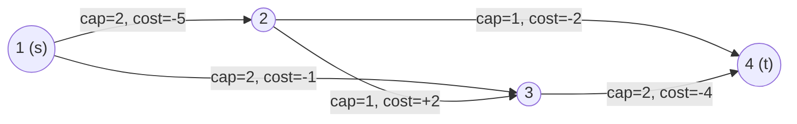
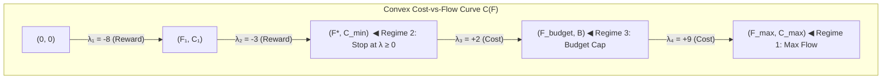
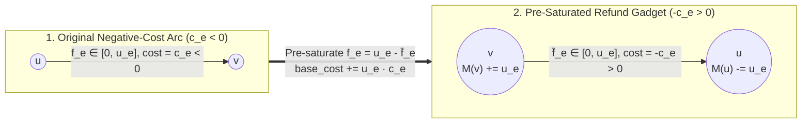

::: {.callout-note appearance="minimal"}
**Prerequisites**:

- **Chapter 1** (Residual Graphs $G_f$, Skew-Symmetry, and the Flow Decomposition Theorem into $s\text{--}t$ Paths and Directed Cycles).
- **Chapter 4** (Bounded-Demand Circulations `[l, u]`, Nodal Excess Balances $M(v) = \sum_{e \in \delta^-(v)} l_e - \sum_{e \in \delta^+(v)} l_e$, and Super-Terminal Feasibility $S^* \to T^*$).
- **Standard Shortest Paths**: Dijkstra's algorithm on non-negative edge weights in $O((V + E)\log V)$ time, and topological dynamic programming on Directed Acyclic Graphs (DAGs) in $O(V + E)$ time.

**Learning Objectives**:

1. **Master the Cycle-Optimality & Complementary Slackness Theorems**: Prove that a feasible flow $f$ has minimum cost among all flows of the same value $F$ if and only if its residual network $G_f$ contains no negative-cost directed cycle, and equivalently if and only if there exist **Johnson node potentials** $\pi: V \to \mathbb{R}$ making every residual reduced cost $c^\pi(u, v) = c(u, v) + \pi_u - \pi_v \ge 0$.
2. **Execute Primal–Dual MCMF Without SPFA Timeouts**: Implement the **Successive Shortest Path (SSP)** and **Zkw Primal–Dual** engines using Dijkstra on non-negative reduced costs, apply the **Early-Exit Capping Update** $\pi'_v \gets \pi_v + \min(d^\pi(v), d^\pi(t))$ to prevent `INF` overflow (`H-18`), and select the exact initial potential regime $\pi_0$ (Zero, $O(V + E)$ DAG Topological DP, Fixed-Hop Bipartite Shift, or Bellman–Ford) to immune your code against exponential SPFA traps (`H-17`).
3. **Exploit Cost-vs-Flow Slope Convexity (`atcoder::mcf_graph::slope`)**: Prove that the minimum cost function $C(F)$ is piecewise-linear and convex with marginal slopes $\lambda_k = \pi_k(t) - \pi_k(s)$, distinguish the **Four Augmentation Stopping Regimes** (Max-Flow, Min-Cost Feasible Flow stopping at $\lambda_k \ge 0$, Budget-Threshold Fractional Stopping, and Full Slope Profile Extraction), diagnose the **Variable-Hop $+M$ Cost-Shift Fallacy**, and bridge slope convexity to **1D/2D WQS Binary Search (Aliens Trick)**.
4. **Eliminate Initial Negative Cycles via Mandatory Saturation (`强制满流`, `H-19`)**: Resolve networks containing negative-cost arcs or negative-cost cycles *before* running a single shortest-path search by pre-saturating every arc $(u \to v, u_e, c_e < 0)$ to full capacity $f_e = u_e$, reversing it into a positive-cost residual refund arc $(v \to u, u_e, -c_e > 0)$, and restoring nodal conservation via `Ch 04` super-terminals $S^* \to T^*$.
5. **Compile Bounded-Demand Min-Cost Circulations (`[l, u]`, `c`)**: Combine lower-bound shifts $l_e$ and negative-arc pre-saturation into a unified two-phase Primal–Dual architecture (`BoundedMCMF`).
:::

---

## 1. The Residual Cost Landscape, Cycle-Optimality & Johnson Potentials

In Chapters 1 through 16, every flow and matching problem asked a purely *volumetric* or *structural* question: how much flow can cross from $s$ to $t$, what is the minimum capacity of a disconnecting cut, or what is the maximum size of a valid matching? Even when weights appeared (as in Project Selection in `Ch 05` or Closure Cuts in `Ch 07`), a single capacity $c_e$ encoded the weight directly because each arc was either cut or uncut.

Many combinatorial optimization problems, however, impose **two independent numerical parameters** on every decision:

1. **A volumetric bound (Capacity $u_e$)**: How many times can a resource, transition, or path segment $e = (u \to v)$ be used?
2. **A unit rate (Cost $c_e$)**: What is the marginal price (or negative reward) paid *per unit* of flow routed across $e$?

This decoupling produces the **Minimum-Cost Flow (MCF)** and **Minimum-Cost Maximum-Flow (MCMF)** paradigm.

### 1.1 Formal Setup & Residual Cost Skew-Symmetry

Let $G = (V, E)$ be a directed multigraph with source $s \in V$ and sink $t \in V$. Each directed arc $e = (u \to v) \in E$ is equipped with:

- a non-negative capacity $u(e) = u(u, v) \ge 0$, and
- a real-valued unit cost $c(e) = c(u, v) \in \mathbb{R}$ (which may be positive, zero, or negative).

A function $f: E \to \mathbb{R}_{\ge 0}$ is a feasible **$s\text{--}t$ flow of value $F$** if it obeys capacity bounds $0 \le f(e) \le u(e)$ for all $e \in E$ and flow conservation $\sum_{e \in \delta^+(v)} f(e) - \sum_{e \in \delta^-(v)} f(e) = 0$ for all internal nodes $v \in V \setminus \{s, t\}$, with net outflow $F$ from $s$. The **total cost** of $f$ is the linear functional:

$$
C(f) = \sum_{e \in E} c(e) \, f(e)
$$

How does $C(f)$ change when we push $\delta > 0$ units of flow in the residual network $G_f = (V, E_f)$? Recall from Chapter 1 that each original arc $e = (u \to v)$ with current flow $0 \le f(e) \le u(e)$ induces up to two residual arcs in $E_f$:

1. **Forward residual arc** $e = (u \to v)$ with residual capacity $r_f(u, v) = u(e) - f(e) > 0$. Pushing $\delta$ units along $e$ *increases* $f(e)$ by $\delta$, increasing total cost by $\delta \cdot c(u, v)$. Thus, its residual cost is $+c(u, v)$.
2. **Backward (reverse) residual arc** $e^{\text{rev}} = (v \to u)$ with residual capacity $r_f(v, u) = f(e) > 0$. Pushing $\delta$ units along $e^{\text{rev}}$ *cancels* (refunds) $\delta$ units of existing flow on $e$, decreasing $f(e)$ by $\delta$ and changing total cost by $-\delta \cdot c(u, v)$. Thus, its residual cost MUST be the exact negation:

$$
c(v, u) = -c(u, v) \quad \text{(Residual Cost Skew-Symmetry)}
$$

::: {.callout-important title="The Fundamental Law of Residual Costs"}
In every MCMF adjacency list, forward edge `e` and reverse edge `e ^ 1` form a coupled pair:

- Forward arc $u \to v$: `cap = u_e`, `cost = +c_e`
- Reverse arc $v \to u$: `cap = 0`, `cost = -c_e`

Whenever $\delta$ units of flow traverse a residual walk $W$ (whether an $s \to t$ path or a closed cycle), the new flow $f' = f \oplus \delta \chi(W)$ satisfies the exact linear identity:

$$
C(f') - C(f) = \delta \sum_{a \in W} c(a) = \delta \, c(W)
$$
:::

### 1.2 The Circulation Decomposition Lemma & Cycle-Optimality Theorem

Suppose we have already constructed a feasible flow $f$ of value $|f| = F$. How can we certify whether $f$ achieves the minimum possible cost $C(F)$ among *all* feasible flows of the same value $F$?

:::: {.callout-tip title="Lemma 17.1 (Circulation Decomposition of Equal-Value Flow Differences)"}
Let $f$ and $f^*$ be two feasible $s\text{--}t$ flows in $G$ of the **exact same value** $|f| = |f^*| = F$. Then their difference $\Delta f = f^* - f$ is a feasible **circulation** in the residual network $G_f$, and decomposes into a collection of at most $|E|$ directed simple cycles $W_1, W_2, \dots, W_k \subseteq G_f$ with positive weights $\alpha_1, \dots, \alpha_k > 0$ such that:

$$
f^* = f + \sum_{i=1}^k \alpha_i \chi(W_i) \quad \text{and} \quad C(f^*) - C(f) = \sum_{i=1}^k \alpha_i \, c(W_i)
$$

*Proof*: Because both $f$ and $f^*$ satisfy flow conservation at every $v \in V \setminus \{s, t\}$ and have identical net outflow $F$ at $s$ and inflow $F$ at $t$, their difference $\Delta f = f^* - f$ has net divergence $0$ at **every** vertex $v \in V$ (including $s$ and $t$). For each original arc $e = (u \to v)$:

- If $f^*(e) > f(e)$, then $0 < f^*(e) - f(e) \le u(e) - f(e) = r_f(u, v)$, so $\Delta f$ routes $f^*(e) - f(e)$ units along the forward residual arc $(u \to v) \in E_f$ at unit cost $+c(u, v)$.
- If $f^*(e) < f(e)$, then $0 < f(e) - f^*(e) \le f(e) = r_f(v, u)$, so $\Delta f$ routes $f(e) - f^*(e)$ units along the backward residual arc $(v \to u) \in E_f$ at unit cost $-c(u, v)$.

By the Flow Decomposition Theorem (`Ch 01`) applied to a divergence-free circulation in $G_f$, $\Delta f$ is a non-negative linear combination of directed simple cycles $\sum_{i=1}^k \alpha_i \chi(W_i)$ in $G_f$. By linearity of cost and skew-symmetry, $C(f^*) - C(f) = \sum_{i=1}^k \alpha_i \, c(W_i)$. $\blacksquare$
::::

Lemma 17.1 immediately yields the master optimality criterion of minimum-cost flow theory:

:::: {.callout-important title="Theorem 17.2 (The Residual Cycle-Optimality Theorem — Klein 1967)"}
A feasible flow $f$ of value $F$ has minimum cost among all feasible flows of value $F$ **if and only if** its residual network $G_f = (V, E_f)$ contains no directed cycle $W$ of strictly negative cost $c(W) < 0$.

*Proof*:

- **($\Rightarrow$ Necessity)**: Suppose $G_f$ contains a directed cycle $W$ with $c(W) < 0$. Let $\delta = \min_{a \in W} r_f(a) > 0$ be the bottleneck residual capacity of $W$. Routing $\delta$ units of flow around $W$ produces $f' = f \oplus \delta \chi(W)$, which preserves all vertex divergences ($|f'| = |f| = F$), obeys all capacities, and achieves $C(f') = C(f) + \delta \, c(W) < C(f)$, contradicting the optimality of $f$.
- **($\Leftarrow$ Sufficiency)**: Suppose $c(W) \ge 0$ for every directed cycle $W \subseteq G_f$. Let $f^*$ be any feasible flow with $|f^*| = F$. By Lemma 17.1, $C(f^*) - C(f) = \sum_{i=1}^k \alpha_i \, c(W_i)$ with $\alpha_i > 0$ and $W_i \subseteq G_f$. Since every $c(W_i) \ge 0$, we have $C(f^*) \ge C(f)$, proving $f$ is globally cost-optimal for flow value $F$. $\blacksquare$
::::

### 1.3 LP Duality, Complementary Slackness & Johnson Node Potentials $\pi_v$

How does the combinatorial absence of negative residual cycles connect to Linear Programming duality and fast shortest-path algorithms?

Consider the primal LP for minimum-cost circulation (or fixed-value flow $F$, which adds divergence constraints $\text{div}_f(s) = F, \text{div}_f(t) = -F$):

$$
\min \sum_{(u,v) \in E} c(u, v) f(u, v) \quad \text{s.t.} \quad \sum_{v} f(u, v) - \sum_{v} f(v, u) = b_u \;\; (\forall u \in V), \quad 0 \le f(u, v) \le u(u, v)
$$

Assigning an unrestricted dual variable $\pi_u \in \mathbb{R}$ (called the **Johnson node potential**) to the flow conservation constraint at vertex $u$, and a non-negative dual variable $z_{uv} \ge 0$ to the capacity upper bound $f(u, v) \le u(u, v)$, the dual constraint corresponding to primal variable $f(u, v)$ is $\pi_v - \pi_u - z_{uv} \le c(u, v)$, or $z_{uv} \ge \pi_v - \pi_u - c(u, v)$. Defining the **reduced cost** $c^\pi(u, v)$ of any directed arc $(u \to v)$ with respect to potential vector $\pi$ as:

$$
c^\pi(u, v) \triangleq c(u, v) + \pi_u - \pi_v
$$

LP **Complementary Slackness** states that a primal feasible flow $f$ and dual potentials $(\pi, z)$ are simultaneously optimal if and only if for every original arc $e = (u \to v) \in E$:

1. If $f(u, v) < u(u, v)$ (so forward arc $(u \to v) \in E_f$), then $z_{uv} = 0$, which forces $c^\pi(u, v) = c(u, v) + \pi_u - \pi_v \ge 0$.
2. If $f(u, v) > 0$ (so primal variable $f(u,v) > 0$ is slack and reverse arc $(v \to u) \in E_f$), then the dual constraint is tight ($\pi_v - \pi_u - c(u, v) = z_{uv} \ge 0$), which means $-c(u, v) + \pi_v - \pi_u \ge 0$, i.e., $c^\pi(v, u) \ge 0$.

Notice that these two conditions collapse into a single, breathtakingly clean invariant on the residual graph $G_f$:

$$
c^\pi(a) = c(a) + \pi_{\text{tail}(a)} - \pi_{\text{head}(a)} \ge 0 \quad \text{for every residual arc } a \in E_f
$$

Why do potentials $\pi$ alter individual edge costs without corrupting the shortest paths or cycle costs of $G_f$? Because $\pi_u - \pi_v$ is a **potential difference** (discrete gradient), which telescopes along any walk!

:::: {.callout-tip title="Lemma 17.3 (Telescoping Path Identity & Cycle Invariance of Reduced Costs)"}
For any potential assignment $\pi: V \to \mathbb{R}$:

1. **Path Telescoping**: Along any directed walk $P = (v_0 \to v_1 \to \dots \to v_k)$, the total reduced cost differs from the true cost solely by the endpoint potentials $\pi_{v_0} - \pi_{v_k}$:

   $$
   c^\pi(P) = \sum_{i=0}^{k-1} \bigl(c(v_i, v_{i+1}) + \pi_{v_i} - \pi_{v_{i+1}}\bigr) = c(P) + \pi_{v_0} - \pi_{v_k}
   $$

   In particular, because $\pi_{v_0} - \pi_{v_k}$ is a constant independent of the internal vertices of $P$, **a path $P$ is a shortest $s \to t$ path under reduced costs $c^\pi$ if and only if $P$ is a shortest $s \to t$ path under true costs $c$**.
2. **Cycle Invariance**: Around any closed directed cycle $W = (v_0 \to v_1 \to \dots \to v_k = v_0)$, all potential terms cancel identically:

   $$
   c^\pi(W) = c(W) + \pi_{v_0} - \pi_{v_0} = c(W)
   $$
3. **Reverse-Arc Skew-Symmetry**: Reduced costs obey the exact same skew-symmetry as true costs:

   $$
   c^\pi(v, u) = c(v, u) + \pi_v - \pi_u = -\bigl(c(u, v) + \pi_u - \pi_v\bigr) = -c^\pi(u, v)
   $$

   Consequently, any arc $(u \to v)$ on a shortest path tree where $c^\pi(u, v) = 0$ immediately creates a reverse residual arc $(v \to u)$ of reduced cost $c^\pi(v, u) = -0 = 0 \ge 0$! $\blacksquare$
::::

### 1.4 Successive Shortest Path (SSP) vs. Zkw Primal–Dual Engines

Lemma 17.3 and Theorem 17.2 unlock the **Successive Shortest Path (SSP)** algorithm (Jewell 1958; Iri 1960; Busacker–Gowen 1961) accelerated by **Johnson–Edmonds–Karp potentials** (Edmonds & Karp 1972; Tomizawa 1971):

Suppose flow $f$ is cost-optimal for value $F$, evidenced by potentials $\pi$ satisfying $c^\pi(a) \ge 0$ on all $a \in E_f$.

1. **Shortest-Path Search via Dijkstra**: Since $c^\pi(a) \ge 0$ everywhere in $G_f$, run Dijkstra from $s$ using edge weights $w(u, v) = c^\pi(u, v) \ge 0$ to compute reduced shortest-path distances $d^\pi(v)$ for all $v \in V$.
2. **Potential Shift**: Define updated potentials $\pi'_v \gets \pi_v + d^\pi(v)$ (or its capped variant below). For every residual arc $(u \to v) \in E_f$, the triangle inequality of shortest paths guarantees $d^\pi(v) \le d^\pi(u) + c^\pi(u, v)$, which rearranges to:

   $$
   c^{\pi'}(u, v) = c(u, v) + (\pi_u + d^\pi(u)) - (\pi_v + d^\pi(v)) = c^\pi(u, v) + d^\pi(u) - d^\pi(v) \ge 0
   $$

3. **Zero-Cost Tight Augmentation**: Along any shortest $s \to t$ path $P^*$ (or across the entire tight zero-reduced-cost subgraph $E_0 = \{a \in E_f : c^{\pi'}(a) = 0\}$), every arc satisfies $d^\pi(v) = d^\pi(u) + c^\pi(u, v)$, meaning $c^{\pi'}(u, v) = 0$. When we augment flow along $P^*$, the newly created backward residual arcs $(v \to u)$ receive reduced cost:

   $$
   c^{\pi'}(v, u) = -c^{\pi'}(u, v) = 0 \ge 0
   $$

   Therefore, **no negative reduced costs are created**, and the updated flow $f'$ is immediately certified as cost-optimal for its new value $F + \delta$!

#### Single-Path SSP vs. Zkw Multi-Augmentation (`Primal–Dual Blocking DFS`)

Once Dijkstra updates $\pi'$ so that all shortest $s \to t$ paths consist exclusively of zero-reduced-cost arcs ($c^{\pi'}(u, v) = 0$), we have two ways to push flow:

- **Standard SSP (1-Path Augmentation)**: Record parent pointers `pv[v]`, `pe[v]` during Dijkstra, find bottleneck capacity $\delta = \min_{e \in P^*} r_f(e)$ along a single shortest $s \to t$ path, and augment $\delta$ units. Best when total flow $F$ is small or when each augmentation changes the shortest-path tree topology rapidly (long sparse chains).
- **Zkw Primal–Dual (Dinic-Style Multi-Path Augmentation)**: Perform a Dinic-style DFS (`cur[u]` pointer + `vis[u]` boolean flag) over the tight subgraph $E_0 = \{(u \to v) \in E_f : r_f(u, v) > 0 \text{ and } c^{\pi'}(u, v) = 0\}$ to push as much flow as possible at the current marginal price $\pi'_t - \pi'_s$ before running the next Dijkstra.

::: {.callout-warning title="Crucial Zkw Implementation Rule: Why `vis[u]` Must Guard Against Zero-Cost Cycles"}
Unlike Dinic's level graph in `Ch 01` (where $d(v) = d(u) + 1$ strictly increases along every edge, guaranteeing a DAG), the zero-reduced-cost subgraph $E_0$ in MCMF can contain **zero-cost directed cycles** (or back-and-forth $0$-cost antiparallel arcs $(u \to v)$ and $(v \to u)$).

Therefore, Zkw's DFS MUST maintain an active boolean array `vis[u]`:

1. Set `vis[u] = true` upon entering `dfs(u, pushed)`.
2. Only traverse to neighbor $v$ if `!vis[v] && cap > 0 && cost + pi[u] - pi[v] == 0`.
3. **Dead-End Retention Rule**: If `dfs(u, pushed)` finishes its adjacency loop and still has `total_pushed < pushed` (meaning $u$ is now saturated/blocked from reaching $t$ in $E_0$), **leave `vis[u] = true` for the remainder of the current DFS phase** so later branches do not waste $O(E)$ time re-exploring dead-end zero-cost components! Only clear `vis[u] = false` when `u` successfully saturates its incoming push (`total_pushed == pushed`), or at the very start of the next Dijkstra phase.
:::

### 1.5 The Four Regimes of Initial Potential $\pi_0$ Initialization

Before the very first Dijkstra call at $f \equiv 0$, we need a valid initial potential vector $\pi_0: V \to \mathbb{R}$ such that $c^{\pi_0}(u, v) = c(u, v) + \pi_0(u) - \pi_0(v) \ge 0$ for every original forward arc $(u \to v) \in E$ with $u(u, v) > 0$. Calling SPFA blindly on every problem is unnecessary—and on dense graphs with $N \approx 2 \cdot 10^5$, fatal (`H-17`). Always classify the initial network into one of four structural regimes:

| Regime | Initial Network Condition ($f \equiv 0$) | Initialization Formula for $\pi_0(v)$ | Preprocessing Time | Canonical Contest Archetypes |
| :--- | :--- | :--- | :--- | :--- |
| **1. Non-Negative Costs** | $\forall e \in E,\; c(e) \ge 0$ | $\pi_0(v) = 0$ for all $v \in V$ | $O(V)$ | Routing costs, Euclidean distances, convex penalty pieces (`Luogu P2153`, `CF 708 D` post-saturation) |
| **2. DAG with Negative Costs** | $G = (V, E)$ is a DAG (even after SCC condensation) | Topological DP from $s$: $\pi_0(s) = 0$, $\pi_0(v) = \min_{(u \to v) \in E} \{\pi_0(u) + c(u, v)\}$ | **$O(V + E)$** | Grid / trapezoid path harvesting (`POJ 3422`, `Luogu P4013`), condensed SCC graphs (`ABC 214 H`) |
| **3. Fixed-Hop Bipartite / Layered** | $s \to L \to R \to t$ with negative rewards on $L \to R$ | $\pi_0(s) = 0, \pi_0(\ell) = 0$, $\pi_0(r) = \min_{\ell \to r} c(\ell, r)$, $\pi_0(t) = \min_{r} \pi_0(r)$ | **$O(V + E)$** | Maximum-weight bipartite matching, `ABC 247 G — Dream Team`, assignment problems |
| **4. Cyclic Graph with Negative Arcs (No Negative Cycles)** | Directed cycles exist, $c(e) < 0$ possible, but $c(W) \ge 0$ | Single initial SPFA / Bellman–Ford pass from a virtual super-source $q_0 \to \forall v$ | $O(V \cdot E)$ | General cyclic state-transition graphs without negative cycles |

*(Note: If the initial graph contains **negative-cost directed cycles** $c(W) < 0$, no valid potential $\pi_0$ exists at $f \equiv 0$! We resolve this in **Section 3** via **Mandatory Saturation** `强制满流`, which eliminates all negative arcs and reduces the graph directly to **Regime 1** with $\pi_0 \equiv 0$.)*

### 1.6 The Early-Exit Capping Update (`H-18`): Preventing Potential Overflow

In competitive programming, Dijkstra often terminates early as soon as $t$ is popped from the priority queue—or even after a full run, some vertices $v \in V$ may have $d^\pi(v) > d^\pi(t)$ or be completely unreachable ($d^\pi(v) = \infty$).

If you naively write `if (d[v] < INF) pi[v] += d[v];` when stopping Dijkstra early, or if you add `INF` to unreachable nodes, two disasters occur:

1. **Integer Overflow (`INF + INF`)**: Unreachable nodes with $d^\pi(v) = \infty$ overflow `int64_t` on the next iteration when computing `cost + pi[u] - pi[v]`.
2. **Negative Reduced Cost Creation on Unsettled Frontiers**: If you break out of Dijkstra the instant $t$ is popped, any node $v$ still sitting in the priority queue with $d^\pi(v) > d^\pi(t)$ has not yet relaxed its outgoing edges $(v \to w)$, so $d^\pi(w) \le d^\pi(v) + c^\pi(v, w)$ may be violated if $d^\pi(v)$ is left un-capped!

The universal, mathematically airtight potential update formula that supports **both** full Dijkstra and early-exit Dijkstra (breaking when $u = t$ is popped) is the **Capped Distance Shift**:

$$
\pi'_v \gets \pi_v + \min\bigl(d^\pi(v),\, d^\pi(t)\bigr) \quad \forall v \in V
$$

:::: {.callout-tip title="Lemma 17.4 (Correctness of the Capped Potential Shift $\pi'_v = \pi_v + \min(d^\pi(v), d^\pi(t))$)"}
Suppose Dijkstra runs from $s$ on non-negative reduced costs $c^\pi \ge 0$ and terminates as soon as $t$ is popped (so every node $u$ with $d^\pi(u) < d^\pi(t)$ has already been popped and fully relaxed all its outgoing residual arcs). Set $\tilde{d}(v) = \min(d^\pi(v), d^\pi(t))$ and $\pi'_v = \pi_v + \tilde{d}(v)$. Then for every residual arc $(u \to v) \in E_f$:

1. **Non-Negativity Preserved**: If $d^\pi(u) < d^\pi(t)$, then $u$ was popped before $t$, so relaxation guaranteed $d^\pi(v) \le d^\pi(u) + c^\pi(u, v)$. Taking $\min(\cdot, d^\pi(t))$ on both sides preserves the inequality $\tilde{d}(v) \le \tilde{d}(u) + c^\pi(u, v)$ (since $c^\pi(u, v) \ge 0$ and $\tilde{d}(u) = d^\pi(u)$). If instead $d^\pi(u) \ge d^\pi(t)$, then $\tilde{d}(u) = d^\pi(t) \ge \tilde{d}(v)$, so $c^{\pi'}(u, v) = c^\pi(u, v) + \tilde{d}(u) - \tilde{d}(v) \ge c^\pi(u, v) \ge 0$.
2. **Shortest $s \to t$ Paths Remain Zero-Cost**: For every node $v$ on a shortest $s \to t$ path $P^*$, $d^\pi(v) \le d^\pi(t)$ (since edge weights $c^\pi \ge 0$), so $\tilde{d}(v) = d^\pi(v)$ and $c^{\pi'}(e) = 0$ for all $e \in P^*$.
3. **Bounded Growth**: Because $\tilde{d}(v) \le d^\pi(t) < \infty$ whenever $t$ is reachable, **even completely unreachable vertices ($d^\pi(v) = \infty$) receive a finite shift $d^\pi(t)$**, making `INF` overflow impossible! $\blacksquare$
::::

### 1.7 Hand-Checkable 4-Node Negative-Cost DAG Trace

Let us trace Regime 2 ($O(V + E)$ DAG Topological DP initialization) followed by two Primal–Dual Dijkstra passes on a concrete 4-node DAG where naive Dijkstra without $\pi_0$ would fail or loop.



- **Vertices**: $V = \{1, 2, 3, 4\}$ in topological order, $s = 1, t = 4$, target flow $F = 2$.
- **Arcs `(u -> v, cap, cost)`**: $e_1 = (1 \to 2, 2, -5)$, $e_2 = (1 \to 3, 2, -1)$, $e_3 = (2 \to 3, 1, +2)$, $e_4 = (2 \to 4, 1, -2)$, $e_5 = (3 \to 4, 2, -4)$.

**Step 0: DAG Topological DP for $\pi_0$ ($O(V + E)$)**:

- $\pi_0(1) = 0$.
- $\pi_0(2) = \pi_0(1) + c(1, 2) = 0 + (-5) = -5$.
- $\pi_0(3) = \min\bigl(\pi_0(1) + c(1, 3),\, \pi_0(2) + c(2, 3)\bigr) = \min(0 - 1, -5 + 2) = -3$.
- $\pi_0(4) = \min\bigl(\pi_0(2) + c(2, 4),\, \pi_0(3) + c(3, 4)\bigr) = \min(-5 - 2, -3 - 4) = -7$.

Let us verify that all 5 forward reduced costs $c^{\pi_0}(u, v) = c(u, v) + \pi_0(u) - \pi_0(v)$ are non-negative:

- $c^{\pi_0}(1, 2) = -5 + 0 - (-5) = 0$
- $c^{\pi_0}(1, 3) = -1 + 0 - (-3) = +2$
- $c^{\pi_0}(2, 3) = +2 + (-5) - (-3) = 0$
- $c^{\pi_0}(2, 4) = -2 + (-5) - (-7) = 0$
- $c^{\pi_0}(3, 4) = -4 + (-3) - (-7) = 0$

**Pass 1 (Flow $0 \to 2$)**:

- **Dijkstra #1**: Since $c^{\pi_0}(1, 2) = c^{\pi_0}(2, 3) = c^{\pi_0}(2, 4) = c^{\pi_0}(3, 4) = 0$, Dijkstra finds $d^{\pi_0} = [0, 0, 0, 0]$.
- **Potential Update**: $\pi_1 = \pi_0 + d^{\pi_0} = [0, -5, -3, -7]$. Marginal unit cost of flow in Pass 1 is $\lambda_1 = \pi_1(4) - \pi_1(1) = -7$.
- **Augmentation along $E_0$**: Both $P_A = (1 \to 2 \to 4)$ (bottleneck $\min(2, 1) = 1$) and $P_B = (1 \to 2 \to 3 \to 4)$ (bottleneck $\min(2-1, 1, 2) = 1$) consist entirely of $0$-reduced-cost edges! Pushing $1$ unit on $P_A$ and $1$ unit on $P_B$ saturates $e_1 = (1 \to 2)$, $e_3 = (2 \to 3)$, and $e_4 = (2 \to 4)$, delivering $F = 2$ units of flow at total cost $C(2) = 2 \times (-7) = -14$.

**Pass 2 (Suppose we also had 1 extra unit of supply, testing $F = 3$)**:

- Now $e_1 = (1 \to 2)$ is saturated ($r_f(1, 2) = 0$), while backward arcs $(2 \to 1)$, $(3 \to 2)$, $(4 \to 2)$, $(4 \to 3)$ appear in $G_f$ with reduced cost $0$.
- **Dijkstra #2**: From $1$, the only available forward arc is $e_2 = (1 \to 3)$ with $c^{\pi_1}(1, 3) = +2$. Thus $d^{\pi_1}(1) = 0$, $d^{\pi_1}(3) = 2$. From $3$, we can reach $4$ via $e_5 = (3 \to 4)$ with $c^{\pi_1}(3, 4) = 0$ ($d^{\pi_1}(4) = 2$) and reach $2$ via backward arc $(3 \to 2)$ with $c^{\pi_1}(3, 2) = 0$ ($d^{\pi_1}(2) = 2$).
- **Potential Update**: $\pi_2 = \pi_1 + [0, 2, 2, 2] = [0, -3, -1, -5]$. The new marginal cost is $\lambda_2 = \pi_2(4) - \pi_2(1) = -5 > \lambda_1 = -7$ (convex slope increase!). Pushing $1$ unit along $1 \to 3 \to 4$ costs $-1 + (-4) = -5$, bringing $C(3) = -19$.

### 1.8 Broken-Gadget Counterexamples & Implementation Traps (`FM-17`)

Every competitive programmer who has written MCMF under contest pressure has encountered at least one of the following four failure modes. Understanding *why* they break mathematically makes your code immune to them:

1. **The SPFA Exponential Grid Trap (`H-17` / `FM-17a`)**:
   If you replace the Johnson potential + Dijkstra loop with repeated SPFA calls (`while (spfa(s, t)) augment();`), a maliciously constructed $K \times K$ grid or layered halving-cost gadget forces SPFA to relabel vertices $\Omega(2^{V/2})$ or $\Theta(V^2 E)$ times per augmentation. On graphs with $N \ge 2000$ (such as `AtCoder ABC 214 H` with $N = 2 \cdot 10^5$), repeated SPFA receives an instant `TLE`, whereas topological DP $\pi_0$ + Dijkstra runs in $O(K (V + E) \log V) \approx 40\text{ ms}$.
2. **Uncapped Early-Exit Potential Corruption (`H-18` / `FM-17b`)**:
   Suppose Dijkstra stops as soon as $t$ is popped at distance $d^\pi(t) = 5$, while another vertex $x$ sits in the priority queue with tentative distance $d^\pi(x) = 20$ and has an unrelaxed outgoing arc $(x \to y)$ of reduced cost $c^\pi(x, y) = 0$ to an unreachable vertex $y$ ($d^\pi(y) = \infty$). If you update $\pi'_x \gets \pi_x + 20$ and leave $\pi'_y \gets \pi_y$ (because $d^\pi(y) = \infty$), the new reduced cost becomes $c^{\pi'}(x, y) = 0 + 20 - 0 = +20$; worse, if $x$ had an incoming arc $(z \to x)$ from an unreachable node $z$ ($d^\pi(z) = \infty$) with $c^\pi(z, x) = 2$, leaving $\pi'_z = \pi_z$ while shifting $\pi'_x \gets \pi_x + 20$ makes $c^{\pi'}(z, x) = 2 + 0 - 20 = -18 < 0$, **injecting a negative reduced cost into $G_f$ and crashing the next Dijkstra**! Using $\pi'_v \gets \pi_v + \min(d^\pi(v), d^\pi(t))$ guarantees every node with $d^\pi(v) \ge d^\pi(t)$ receives the identical shift $+d^\pi(t)$, keeping $c^{\pi'}(z, x) = 2 + 5 - 5 = 2 \ge 0$.
3. **Zero or Positive Reverse-Arc Cost (`FM-15` / `FM-17c`)**:
   In max-flow (`Ch 01`), reverse edges only carry capacity `0` and have no cost. When adapting a Dinic `add_edge` helper to MCMF, setting the reverse edge cost to `0` or `+cost` instead of `-cost` destroys skew-symmetry $c(v, u) = -c(u, v)$:

   - If `rev.cost = +cost > 0`, any forward augmentation along $(u \to v)$ makes $c^{\pi'}(v, u) = +c(u, v) + \pi'_v - \pi'_u = +2 c(u, v) \ne 0$, preventing flow cancellation when a cheaper alternate crossover path is discovered (violating Suurballe's path-rerouting mechanism in `Luogu P2153`).
   - If `rev.cost = +cost < 0` on a reward arc, the forward and reverse arcs form a 2-cycle $u \to v \to u$ of negative cost $2c < 0$ immediately after the first push!
4. **The Undirected Edge Negative-Cycle Trap (`FM-17d`)**:
   In max-flow (`Ch 01`), an undirected edge $\{u, v\}$ of capacity $u_e$ can be stored cleanly by initializing both halves of a single edge pair with `cap = u_e`. **In MCMF, you can NEVER initialize a single forward/reverse edge pair with `f.cap = u_e, f.cost = +c` and `rev.cap = u_e, rev.cost = -c`!** Doing so gives the reverse arc $(v \to u)$ both positive initial capacity $u_e > 0$ and negative cost $-c < 0$, creating an immediate negative cycle $u \xrightarrow{+c} v \xrightarrow{-c} u$ (or unusable negative arc) at $f \equiv 0$.
   **Rule**: An undirected edge $\{u, v\}$ of capacity $u_e$ and traversal cost $c \ge 0$ in MCMF MUST be compiled as **two independent directed edge pairs** (4 adjacency entries total):

   - Directed pair 1: $(u \to v, \text{cap} = u_e, \text{cost} = +c)$ with reverse $(v \to u, \text{cap} = 0, \text{cost} = -c)$.
   - Directed pair 2: $(v \to u, \text{cap} = u_e, \text{cost} = +c)$ with reverse $(u \to v, \text{cap} = 0, \text{cost} = -c)$.

---

## 2. Convexity of the Cost-vs-Flow Slope Curve (`atcoder::mcf_graph::slope`)

For any flow network $G$, let $F_{\max}$ be the maximum $s\text{--}t$ flow value, and for each $F \in [0, F_{\max}]$, define the **minimum-cost profile function**:

$$
C(F) \triangleq \min\bigl\{\, C(f) : f \text{ is a feasible } s\text{--}t \text{ flow of value } |f| = F \,\bigr\}
$$

One of the deepest structural truths in combinatorial optimization—and the mathematical engine behind `atcoder::mcf_graph::slope`, fractional budget stopping, and WQS Binary Search (Aliens Trick)—is that $C(F)$ is **piecewise-linear and globally convex** on $[0, F_{\max}]$.

### 2.1 Two Independent Proofs of Slope Convexity

Why does every successive unit of flow cost at least as much as the previous unit ($\lambda_1 \le \lambda_2 \le \dots \le \lambda_{F_{\max}}$)? We give two complementary proofs: one purely geometric (via residual decomposition) and one algorithmic (via Johnson potential monotonicity).

:::: {.callout-important title="Theorem 17.5 (Convexity of the Minimum-Cost Flow Function $C(F)$)"}
Let $G = (V, E, u, c)$ have integer capacities. For every integer flow value $F \in \{1, 2, \dots, F_{\max} - 1\}$, the marginal unit cost $\lambda_F \triangleq C(F) - C(F - 1)$ satisfies the discrete convexity inequality:

$$
\lambda_F \le \lambda_{F+1} \quad \Longleftrightarrow \quad C(F - 1) + C(F + 1) \ge 2 C(F)
$$

Moreover, in the Successive Shortest Path algorithm, the $k$-th unit augmentation pushes flow at marginal unit cost $\lambda_k = \pi_k(t) - \pi_k(s)$, and the sequence of marginal slopes is monotonically non-decreasing:

$$
\lambda_1 \le \lambda_2 \le \dots \le \lambda_{F_{\max}}
$$

*Proof 1 (Midpoint Residual Decomposition — Combinatorial)*:
Let $f_{F-1}$ and $f_{F+1}$ be minimum-cost feasible flows of values $F - 1$ and $F + 1$, respectively, so $C(f_{F-1}) = C(F-1)$ and $C(f_{F+1}) = C(F+1)$. Consider their difference $\Delta f = f_{F+1} - f_{F-1}$.

Because $\Delta f$ has net divergence $(F + 1) - (F - 1) = +2$ at $s$, $-2$ at $t$, and $0$ at all internal vertices, and respects residual capacities in $G_{f_{F-1}}$, the Flow Decomposition Theorem (`Ch 01`) decomposes $\Delta f$ into **two unit $s \to t$ paths $P_1, P_2 \subseteq G_{f_{F-1}}$** plus a collection of directed cycles $\sum_{j} \alpha_j \chi(W_j) \subseteq G_{f_{F-1}}$:

$$
f_{F+1} - f_{F-1} = \chi(P_1) + \chi(P_2) + \sum_{j} \alpha_j \chi(W_j)
$$

Since $f_{F-1}$ is optimal for value $F - 1$, Theorem 17.2 guarantees $c(W_j) \ge 0$ for every residual cycle $W_j \subseteq G_{f_{F-1}}$. Furthermore, both $f^{(1)} \triangleq f_{F-1} + \chi(P_1)$ and $f^{(2)} \triangleq f_{F-1} + \chi(P_2)$ are valid feasible flows of value $F$ (since $P_1, P_2$ are disjoint or share capacity within $r_{f_{F-1}}$), so each has cost at least $C(F)$:

$$
C(F - 1) + c(P_1) = C(f^{(1)}) \ge C(F) \quad \text{and} \quad C(F - 1) + c(P_2) = C(f^{(2)}) \ge C(F)
$$

Summing these and adding the non-negative cycle costs gives:

$$
C(F + 1) - C(F - 1) = c(P_1) + c(P_2) + \sum_j \alpha_j c(W_j) \ge 2\bigl(C(F) - C(F - 1)\bigr) \implies C(F - 1) + C(F + 1) \ge 2 C(F)
$$

*Proof 2 (Primal–Dual Potential Monotonicity — Algorithmic)*:
Assume without loss of generality that $\pi_k(s) = 0$ at every step $k$ (since $d^{\pi_{k-1}}(s) = 0$). Before step $k$, every residual arc $a \in E_{f_{k-1}}$ has non-negative reduced cost $c^{\pi_{k-1}}(a) \ge 0$. Consequently, Dijkstra from $s$ on $G_{f_{k-1}}$ produces a **non-negative** shortest distance $d^{\pi_{k-1}}(t) \ge 0$. Updating $\pi_k(t) = \pi_{k-1}(t) + d^{\pi_{k-1}}(t)$ immediately yields:

$$
\lambda_k = \pi_k(t) = \pi_{k-1}(t) + d^{\pi_{k-1}}(t) = \lambda_{k-1} + d^{\pi_{k-1}}(t) \ge \lambda_{k-1} \quad \blacksquare
$$
::::

### 2.2 The Four Augmentation Stopping Regimes

Because SSP traces the convex curve $(F, C(F))$ from left to right in order of non-decreasing marginal slope $\lambda_1 \le \lambda_2 \le \dots \le \lambda_{F_{\max}}$, we can solve four distinct optimization problems simply by changing the **while-loop termination condition** of Dijkstra:



1. **Regime 1 — True Min-Cost Max-Flow (Fixed Volume $F_{\max}$ or Target $K$)**:
   - *Goal*: Maximize total flow $F$ first; among all flows of value $F_{\max}$ (or fixed $K$), minimize $C(F)$.
   - *Stopping Rule*: Run Dijkstra until $t$ is unreachable in $G_f$ (`d[t] == INF`) or until `flow == K`, regardless of whether the marginal slope $\lambda_k = \pi_k(t) - \pi_k(s)$ is negative or positive.
2. **Regime 2 — Minimum-Cost Feasible Flow / Maximum-Profit Optional Flow (`最小费用可行流`)**:
   - *Goal*: Find $F^* \in [0, F_{\max}]$ that globally minimizes $C(F)$ (equivalently, maximizes net profit $-C(F)$ when negative-cost reward arcs compete against positive-cost penalty arcs).
   - *Stopping Rule*: Because $\lambda_k$ is non-decreasing, $C(F)$ decreases strictly while $\lambda_k < 0$, plateaus while $\lambda_k = 0$, and increases strictly once $\lambda_k > 0$. Thus, **terminate the SSP loop the instant $\lambda_k = \pi_k(t) - \pi_k(s) \ge 0$**!
3. **Regime 3 — Budget-Threshold Fractional or Integral Stopping ($C(F) \le B$)**:
   - *Goal*: Maximize the total flow $F$ subject to a hard total cost budget $C(F) \le B$ (where costs are non-negative or once we are on the rising $\lambda_k > 0$ branch of $C(F)$).
   - *Stopping Rule*: Suppose the current flow $F_{\text{cur}}$ has cost $C_{\text{cur}} \le B$, and the next shortest augmenting path (or tight $E_0$ blocking flow) can push up to $\delta$ units at marginal unit cost $\lambda_k > 0$.
     - If $C_{\text{cur}} + \delta \cdot \lambda_k \le B$, push all $\delta$ units and continue.
     - If $C_{\text{cur}} + \delta \cdot \lambda_k > B$, we can afford only a partial prefix of this slope segment: push $\delta_{\text{take}} = \lfloor (B - C_{\text{cur}}) / \lambda_k \rfloor$ integer units (or $(B - C_{\text{cur}}) / \lambda_k$ fractional units) and **terminate immediately**! Convexity guarantees no later path can have a cheaper marginal rate than $\lambda_k$.
4. **Regime 4 — Full Parametric Slope Profile Extraction (`atcoder::mcf_graph::slope`)**:
   - *Goal*: Answer $Q$ offline or online queries asking for $C(F)$ at arbitrary flow values $F$, or inspect every breakpoint $(F_i, C(F_i))$ of the piecewise-linear curve.
   - *Rule*: Record a new polyline vertex $(F_{\text{cur}}, C_{\text{cur}})$ at the end of each Zkw phase (or coalesce consecutive SSP pushes sharing the same marginal slope $\lambda_k$). By Theorem 17.5, the number of distinct slope breakpoints is bounded by $\min(F_{\max}, \text{number of distinct path costs}) + 1$.

### 2.3 The Variable-Hop $+M$ Cost-Shift Fallacy & Three Exact Remedies

Suppose a problem gives a directed graph with negative edge weights $c(e) < 0$ (representing rewards $w_e = -c(e) > 0$) and asks for the maximum-weight $s\text{--}t$ flow. A classic beginner temptation is:

> *"To avoid negative edge weights and skip $\pi_0$ initialization, can I just add a large constant $+M$ (say $M = 10^9$) to every arc's cost so all $c'(e) = c(e) + M \ge 0$, and then subtract $M$ at the end?"*

::: {.callout-warning title="FM-17e: The Variable-Hop $+M$ Cost-Shift Fallacy"}
**Adding $+M$ to every edge's cost is MATHEMATICALLY INVALID unless every $s \to t$ path in the residual network has the exact same number of edges (hops)!**

Why? Along a path $P$ consisting of $|P|$ edges, shifting every edge cost by $+M$ changes the path cost to:

$$
c'(P) = \sum_{e \in P} (c(e) + M) = c(P) + |P| \cdot M
$$

Because $M$ is multiplied by the **hop count $|P|$**, a short 2-hop path with poor reward easily beats a 3-hop path with much better true reward!
:::

#### Concrete 4-Node Counterexample to $+M$ Shifting

Consider the 4-node DAG $s = 1 \to 2 \to 3 \to 4 = t$ where we want 1 unit of flow of minimum true cost:

- Path $P_{\text{long}} = (1 \xrightarrow{-4} 2 \xrightarrow{-4} 3 \xrightarrow{-4} 4)$ has $3$ hops and true cost $c(P_{\text{long}}) = -12$ (optimal!).
- Path $P_{\text{short}} = (1 \xrightarrow{-5} 3 \xrightarrow{-5} 4)$ has $2$ hops and true cost $c(P_{\text{short}}) = -10$ (suboptimal by $2$).

If we shift every edge cost by $M = +5$ so all edges become non-negative ($c'(e) = c(e) + 5 \ge 0$):

- $c'(P_{\text{long}}) = (-4 + 5) + (-4 + 5) + (-4 + 5) = 1 + 1 + 1 = +3$.
- $c'(P_{\text{short}}) = (-5 + 5) + (-5 + 5) = 0 + 0 = 0$.

Dijkstra on the $+M$-shifted graph picks $P_{\text{short}}$ (cost $-10$) instead of $P_{\text{long}}$ (cost $-12$), returning a **wrong answer**! Worse still, after pushing 1 unit on a path of length $k$, backward residual edges must have cost $-c'(e) = -c(e) - M < 0$, so even after shifting by $+M$, backward arcs immediately become negative anyway!

#### The Three Exact Remedies

Whenever you have negative edge costs $c(e) < 0$:

1. **Remedy 1 (Johnson Potentials $\pi_0$ — Universal for DAGs & Fixed-Hop Graphs)**: Keep the true costs $c(e)$ untouched and compute $\pi_0$ in $O(V + E)$ via Topological DP (Regime 2) or single-layer minimum (Regime 3). Because $c^{\pi_0}(P) = c(P) + \pi_0(s) - \pi_0(t)$ adds a constant $\pi_0(s) - \pi_0(t)$ that depends **only on the endpoints $s, t$ and NOT on the hop count $|P|$**, path rankings are 100% preserved!
2. **Remedy 2 (Per-Vertex / Per-Unit-Flow Shift — Valid ONLY on Fixed-Charge Transitions)**: If a reward $-W$ happens exactly once per unit of flow (e.g., only on edges directly leaving $s$ or only on the unique bipartite bridge layer $L \to R$), adding $+M$ **only to that single mandatory cut layer** adds exactly $+1 \cdot M$ to every $s \to t$ path regardless of internal detours.
3. **Remedy 3 (Mandatory Saturation `强制满流` — Universal for Cyclic Graphs)**: Pre-saturate all negative-cost arcs as derived in **Section 3**, turning every negative arc into a positive-cost reverse refund arc with $\pi_0 \equiv 0$.

### 2.4 Worked Slope-Extraction Model: AtCoder ABC 247 G — Dream Team

Let us see how **Regime 3 ($\pi_0$ Fixed-Hop Bipartite Initialization)**, **Regime 4 (`slope` profile extraction)**, and **Remedy 2 (Per-Unit-Flow Shift)** work together on a canonical AtCoder problem.

- **Problem (`AtCoder ABC 247 G — Dream Team`)**: You are given $N \le 3 \cdot 10^4$ candidates. Candidate $i$ belongs to university $A_i \in [1, 150]$, specializes in subject $B_i \in [1, 150]$, and has power $C_i \in [1, 10^9]$. A team of size $k$ is valid if no two members share the same university $A_i$ and no two share the same subject $B_i$. Output the maximum possible team size $k_{\max}$, and for **every** $k = 1, 2, \dots, k_{\max}$, output the maximum total power of a valid team of size $k$.
- **Why Naive Greedy Fails**: Picking the globally strongest pair $(A_i, B_i)$ for $k = 1$ may block two slightly weaker candidates who share $A_i$ and $B_i$ separately and yield a much larger sum for $k = 2$.
- **Algebraic & Graph Formulation**:
  - For each pair $(a, b) \in \{1, \dots, 150\}^2$, only the single candidate with the maximum $C_i$ in cell $(a, b)$ can ever be used (since at most one person can have university $a$ and subject $b$). Let $W_{a,b} = \max_{A_i=a, B_i=b} C_i$.
  - Create left vertices $L = \{1, \dots, 150\}$ (universities) with $s \xrightarrow{\text{cap}=1, \text{cost}=0} a$, right vertices $R = \{1, \dots, 150\}$ (subjects) with $b \xrightarrow{\text{cap}=1, \text{cost}=0} t$, and bridge arcs $a \xrightarrow{\text{cap}=1, \text{cost}=-W_{a,b}} b$.
  - Because **every** $s \to t$ augmenting path crosses the $L \to R$ cut a net total of $+1$ time (each forward $L \to R$ arc adds $+1$ to flow, and each backward $R \to L$ arc subtracts $1$ from flow), the number of net $L \to R$ crossings per unit of $s\text{--}t$ flow is **strictly invariant ($= 1$)**!
  - Therefore, either we initialize $\pi_0(s) = \pi_0(a) = 0$, $\pi_0(b) = \min_a (-W_{a,b})$, $\pi_0(t) = \min_b \pi_0(b)$ in $O(V + E)$, **or** we shift only the $L \to R$ bridge costs to $c'(a, b) = M - W_{a,b} \ge 0$ (with $M = 10^9$) while keeping $s \to a$ and $b \to t$ at cost $0$.
  - Running SSP and recording $C(k)$ after each unit augmentation $k = 1, 2, \dots, k_{\max}$ prints the exact answers $\text{ans}(k) = k \cdot M - C'(k) = -C(k)$ in $O(k_{\max} (V + E) \log V)$ time with $|V| = 302, |E| \le 150^2 + 300$.

### 2.5 Bridging Slope Convexity to WQS Binary Search (Aliens Trick)

Theorem 17.5 guarantees that the minimum cost $C(F)$ (or maximum profit $P(F) = -C(F)$) as a function of the number of augmenting paths $F = K$ is **convex** (or **concave** for maximization).

What happens when $N$ and $K$ are so large (e.g., $N, K \le 3 \cdot 10^5$ on a tree, or $N = 2000$ in a 2-resource DP) that we cannot afford to run $K$ steps of SSP or maintain a $O(N \cdot K)$ DP state?

We invoke **Lagrangian Relaxation (WQS Binary Search / Aliens Trick)** on the convex slope curve $C(F)$:

1. **Dualizing the Flow-Volume Constraint $F = K$**:
   Instead of forcing the flow (or path count) to equal $K$ via a hard capacity $s_0 \xrightarrow{K, 0} s$, we relax the constraint $F = K$ with a Lagrange multiplier (per-unit penalty/tax) $\lambda \in \mathbb{R}$:

   $$
   g(\lambda) \triangleq \min_{F \in [0, F_{\max}]} \bigl(\, C(F) - \lambda F \,\bigr)
   $$

   In the flow network, subtracting $\lambda F$ is equivalent to **adding $-\lambda$ to the cost of every arc leaving $s$** and transitions directly into **Regime 2 (Unconstrained Min-Cost Feasible Flow)**! Even better, once the global count constraint $F = K$ is removed, the problem often decouples into a fast $O(N)$ tree DP or greedy evaluation for any fixed $\lambda$.
2. **Recovering $C(K)$ and Handling Collinear Slope Plateaus**:
   By Theorem 17.5, the optimal unconstrained count $F^*(\lambda) = \arg\min_F (C(F) - \lambda F)$ is monotone in $\lambda$. Binary searching for the threshold slope $\lambda^*$ where $F^*(\lambda^*) \ge K$ (always breaking ties consistently—e.g., maximizing $F^*$ among equal-cost states) identifies the tangent line of slope $\lambda^*$ supporting $C(F)$ at $F = K$. Even if $(K, C(K))$ lies strictly in the interior of a **flat collinear plateau** where multiple values $F \in [F_L, F_R]$ share the exact same marginal slope $\lambda^*$, the supporting hyperplane identity recovers $C(K)$ from $g(\lambda^*)$ via:

   $$
   C(K) = g(\lambda^*) + K \cdot \lambda^*
   $$

#### Two Canonical Contest Bridges (`CF 739 E` & `Luogu P4383`)

- **Bridge 1 — 2D Slope Convexity (`Codeforces 739 E — Gosha is hunting`, $N, A, B \le 2000$)**:
  We have $N$ Pokémon, $A$ Pokéballs (catch probability $p_i$), and $B$ Ultra Balls (catch probability $u_i$, combined probability $1 - (1 - p_i)(1 - u_i) = p_i + u_i - p_i u_i$).
  - *Pure MCMF View*: Source $s$ sends cap $A$ to node $P$ (Pokéballs) and cap $B$ to node $U$ (Ultra Balls). For each Pokémon $i$, $P \xrightarrow{1, -p_i} i$ and $U \xrightarrow{1, -u_i} i$. Since $p_i + u_i - p_i u_i < p_i + u_i$, using both balls on Pokémon $i$ has **diminishing marginal returns** (concavity): the first ball arriving at $i$ gains its full probability, while the second ball loses $-p_i u_i$, modeled by two parallel arcs from $i \to t$: arc 1 with $(\text{cap}=1, \text{cost}=0)$ and arc 2 with $(\text{cap}=1, \text{cost}=+p_i u_i)$.
  - *Why WQS Replaces MCMF at $N = 2000$*: Because the graph is a concave flow network in both supplies $(A, B)$, the optimal profit function $P(A, B)$ is **jointly concave** in $A$ and $B$. Replacing the two supply caps $A$ and $B$ with Lagrange multipliers $\lambda_A, \lambda_B$ reduces the inner problem to $N$ independent $O(1)$ four-way choices per Pokémon (`{none, P, U, both}`), solving the problem in $O(N \log^2(1/\varepsilon))$ time ($50 \times 50 \times 2000$ operations $\approx 15\text{ ms}$)!
- **Bridge 2 — Vertex-Disjoint Path Cover Slope on Trees (`Luogu P4383 [八省联考2018] 林克卡特树`, $N, K \le 3 \cdot 10^5$)**:
  Selecting $K + 1$ vertex-disjoint simple paths in a weighted tree to maximize total edge weight is equivalent to a minimum-cost flow of volume $K + 1$ where each vertex has capacity $1$ (splitting $v_{\text{in}} \xrightarrow{1, 0} v_{\text{out}}$). By Theorem 17.5, the maximum weight $P(k)$ as a function of path count $k = K + 1$ is concave! Relaxing the path count $k$ with a per-path penalty $\lambda$ reduces each slope probe to an $O(N)$ tree DP with state `dp[u][deg in {0, 1, 2}]`, reducing $O(N K)$ to $O(N \log(\sum |w_e|))$.

---

## 3. Eliminating Initial Negative Cycles via Mandatory Saturation (`强制满流`, `H-19`)

What happens when a flow network $G = (V, E, u, c)$ contains **negative-cost directed cycles** $c(W) < 0$ at $f \equiv 0$—or when you simply want a universal, zero-SPFA method that eliminates *all* negative-cost arcs $(u \to v, u_e, c_e < 0)$ before running a single shortest-path search?

### 3.1 Why Standard SSP & SPFA Fail on Initial Negative Cycles

By Lemma 17.3(2), potential transformations $\pi: V \to \mathbb{R}$ leave the cost of every directed cycle completely invariant:

$$
c^\pi(W) = \sum_{(u,v) \in W} \bigl(c(u, v) + \pi_u - \pi_v\bigr) = c(W)
$$

Consequently, if the initial residual network $G_0 = G$ contains a directed cycle $W$ with $c(W) < 0$:

1. **No Valid Initial Potential Exists**: Since $\sum_{a \in W} c^\pi(a) = c(W) < 0$, at least one arc $a \in W$ must have $c^\pi(a) < 0$ for *every* possible potential vector $\pi \in \mathbb{R}^V$.
2. **SPFA Enters an Infinite Negative-Cycle Loop**: Attempting to compute $\pi_0$ via Bellman–Ford or SPFA loops forever around $W$.
3. **Why Naive Cycle-Cancelling (`Klein 1967`) Is Too Slow**: Detecting negative cycles via Bellman–Ford and saturating them one by one takes $O(V E \cdot F \cdot C)$ time in the worst case and requires complex cycle-detection bookkeeping.

Instead, the Chinese competitive programming literature (`强制满流` / **Mandatory Pre-Saturation**, `H-19`) resolves all negative-cost arcs and all negative-cost cycles simultaneously in $O(E)$ preprocessing by reducing the problem to a **non-negative-cost circulation with nodal demands (`Ch 04`)**!

### 3.2 Algebraic Derivation of Mandatory Pre-Saturation (`强制满流`)

Consider any original arc $e = (u \to v)$ whose unit cost is strictly negative: $c_e < 0$, with capacity bound $0 \le f_e \le u_e$.

Why would an optimal flow ever want to route flow along $e$? Because $c_e < 0$, every unit routed along $e$ *reduces* total cost! Rather than starting at $f_e = 0$ and waiting for a shortest-path algorithm to discover $e$, let us **greedily pre-saturate $e$ to its full capacity $u_e$** by defining the **refund variable** $\bar{f}_e \triangleq u_e - f_e$:

$$
f_e = u_e - \bar{f}_e, \quad \text{where } 0 \le \bar{f}_e \le u_e
$$

Substitute $f_e = u_e - \bar{f}_e$ into both the objective function and the nodal flow conservation equations:

1. **Objective Cost Transformation (Negative Cost $\to$ Positive Refund Cost)**:
   The contribution of arc $e$ to the total cost $C(f)$ becomes:

   $$
   c_e f_e = c_e (u_e - \bar{f}_e) = \underbrace{u_e c_e}_{\text{fixed constant } (< 0)} + \underbrace{(-c_e)}_{> 0} \bar{f}_e
   $$

   Here $u_e c_e$ is a fixed constant added to `base_cost`, while the decision variable $\bar{f}_e \in [0, u_e]$ has a **strictly positive unit cost** $-c_e = |c_e| > 0$!
2. **Nodal Conservation Transformation (Forward Arc $u \to v$ $\to$ Reverse Refund Arc $v \to u$)**:
   Sending $f_e = u_e - \bar{f}_e$ units from $u$ to $v$ means:
   - A fixed mandatory flow of $u_e$ leaves $u$ and enters $v$, updating the nodal excess balance (`Ch 04`):

     $$
     M(u) \mathrel{-}= u_e, \qquad M(v) \mathrel{+}= u_e
     $$

   - Choosing $\bar{f}_e$ units of refund *decreases* outflow from $u$ by $\bar{f}_e$ and *decreases* inflow to $v$ by $\bar{f}_e$—which is **mathematically identical to routing $\bar{f}_e \in [0, u_e]$ units of flow in the REVERSE direction from $v$ to $u$** at unit cost $-c_e > 0$!



3. **Restoring Nodal Conservation via Super-Terminals $S^* \to T^*$ (`Ch 04`)**:
   After applying this replacement to every negative-cost arc $e \in E$ (and adding unlimited feedback arc $t \xrightarrow{\infty, 0} s$ if solving an $s\text{--}t$ flow problem), the transformed graph $G^+$ contains **ONLY non-negative edge costs ($c \ge 0$)**!
   To reconcile the nodal imbalances $M(w)$ induced by pre-saturation:
   - Create super-source $S^*$ and super-sink $T^*$.
   - For each vertex $w \in V$ with $M(w) > 0$, add arc $S^* \xrightarrow{\text{cap} = M(w), \text{cost} = 0} w$.
   - For each vertex $w \in V$ with $M(w) < 0$, add arc $w \xrightarrow{\text{cap} = -M(w), \text{cost} = 0} T^*$.
   - Run standard Primal–Dual MCMF from $S^*$ to $T^*$ with **zero initial potentials $\pi_0 \equiv 0$**!

:::: {.callout-important title="Theorem 17.6 (Why Mandatory Saturation Correctly Resolves Negative Cycles)"}
Suppose $G$ contains a negative-cost directed cycle $W$ with bottleneck capacity $\delta$ and cost $c(W) < 0$. How does the $S^* \to T^*$ MCMF run behave on $W$?

1. Suppose every arc on $W$ had negative cost ($c_e < 0$). When we pre-saturate every $e \in W$ by $\delta$ units, the inflow and outflow at every vertex $w \in W$ increase by the exact same amount $\delta$, leaving $M(w)$ unchanged! Even better, the reverse refund cycle $W^{\text{rev}}$ has strictly positive cost $-c(W) > 0$, so the $S^* \to T^*$ MCMF leaves $\bar{f}_e = 0$ on $W^{\text{rev}}$ and keeps the negative cycle $W$ saturated in $O(1)$ time without pushing a single unit of flow from $S^*$!
2. Suppose $W$ is a **mixed negative cycle**: e.g., two negative arcs $1 \xrightarrow{-4} 2 \xrightarrow{-3} 3$ and one positive arc $3 \xrightarrow{+2} 1$ (total cycle cost $c(W) = -4 - 3 + 2 = -5 < 0$). Pre-saturating the two negative arcs creates excess $M(3) > 0$ at node $3$ and deficit $M(1) < 0$ at node $1$. Then in the $S^* \to T^*$ MCMF, $S^* \to 3$ compares two competing ways to route flow from $3$ to $1$:
   - **Option A (Complete the cycle forward)**: Route along the positive forward arc $3 \xrightarrow{+2} 1$ at cost $+2$.
   - **Option B (Cancel/Refund the negative arcs)**: Route backward along the refund arcs $3 \xrightarrow{+3} 2 \xrightarrow{+4} 1$ at cost $+7$.
   Because $+2 < +7$, Dijkstra from $S^*$ automatically picks Option A ($3 \xrightarrow{+2} 1$), completing the negative cycle $W$ at net cost $(-4 - 3) + 2 = -5$!
3. Conversely, if the positive arc had cost $+10$ (so $c(W) = -4 - 3 + 10 = +3 > 0$, a *positive* cycle that should NOT be taken), Option B (refunding at cost $+7$) is strictly cheaper than Option A (completing the cycle at cost $+10$), so Dijkstra automatically refunds the pre-saturated arcs ($-7 + 7 = 0$ net cost)! $\blacksquare$
::::

### 3.3 Hand-Checkable 3-Node Negative-Cycle Trace

Let us verify Theorem 17.6 by hand on a 3-node circulation network $V = \{1, 2, 3\}$ with no external source/sink:

- $e_1 = (1 \to 2, \text{cap} = 2, \text{cost} = -4)$
- $e_2 = (2 \to 3, \text{cap} = 1, \text{cost} = -3)$
- $e_3 = (3 \to 1, \text{cap} = 2, \text{cost} = +2)$

By inspection, the optimal circulation routes $1$ unit around the negative cycle $1 \to 2 \to 3 \to 1$ (limited by bottleneck $u(e_2) = 1$) for a minimum cost of $1 \times (-4 - 3 + 2) = -5$.

Now let us execute **Mandatory Pre-Saturation (`强制满流`)**:

1. **Initialize**: `base_cost = 0`, $M = [0, 0, 0]$.
2. **Process $e_1 = (1 \to 2, 2, -4)$ ($c < 0$)**:
   - Pre-saturate $f(e_1) = 2$: `base_cost += 2 * (-4) = -8`.
   - Update balances: $M(1) \mathrel{-}= 2 \implies -2$, $M(2) \mathrel{+}= 2 \implies +2$.
   - Add reverse refund arc $e_1^{\text{ref}} = (2 \to 1, \text{cap} = 2, \text{cost} = +4)$.
3. **Process $e_2 = (2 \to 3, 1, -3)$ ($c < 0$)**:
   - Pre-saturate $f(e_2) = 1$: `base_cost += 1 * (-3) = -11`.
   - Update balances: $M(2) \mathrel{-}= 1 \implies +1$, $M(3) \mathrel{+}= 1 \implies +1$.
   - Add reverse refund arc $e_2^{\text{ref}} = (3 \to 2, \text{cap} = 1, \text{cost} = +3)$.
4. **Process $e_3 = (3 \to 1, 2, +2)$ ($c \ge 0$)**:
   - Keep as normal forward arc $e_3 = (3 \to 1, \text{cap} = 2, \text{cost} = +2)$.
5. **Connect Super-Terminals $S^* \to T^*$**:
   - Final balances: $M(1) = -2$, $M(2) = +1$, $M(3) = +1$.
   - Since $M(2) = 1 > 0$ and $M(3) = 1 > 0$, add $S^* \xrightarrow{1, 0} 2$ and $S^* \xrightarrow{1, 0} 3$.
   - Since $M(1) = -2 < 0$, add $1 \xrightarrow{2, 0} T^*$.
6. **Run Primal–Dual MCMF from $S^*$ to $T^*$ with $\pi_0 \equiv 0$**:
   - **Unit 1**: Shortest path from $S^*$ to $T^*$ is $S^* \xrightarrow{0} 3 \xrightarrow{+2} 1 \xrightarrow{0} T^*$ of cost $+2$ (using 1 unit of $e_3$).
   - **Unit 2**: Node $3$'s supply from $S^*$ is now exhausted; the remaining supply is at node $2$. Shortest path from $S^* \to 2 \to \dots \to T^*$ compares:
     - $S^* \xrightarrow{0} 2 \xrightarrow{+4} 1 \xrightarrow{0} T^*$ (refunding 1 unit of $e_1^{\text{ref}}$ at cost $+4$), vs.
     - no forward arc from $2 \to 3$ (already pre-saturated).
     Thus Unit 2 takes $S^* \to 2 \xrightarrow{+4} 1 \to T^*$ at cost $+4$, setting $\bar{f}(e_1) = 1 \implies f(e_1) = 2 - 1 = 1$.
   - **Total Cost**: `base_cost + mcmf_cost = -11 + (2 + 4) = -5`.
   - **Recovered True Flows**: $f(e_1) = 2 - \bar{f}(e_1) = 1$, $f(e_2) = 1 - \bar{f}(e_2) = 1$, $f(e_3) = 1$. Every vertex has exact conservation, and the negative cycle is optimally saturated!

### 3.4 Flagship Case Study: Codeforces 708 D — Incorrect Flow

Let us see how Mandatory Saturation unlocks one of the most celebrated Division 1 network flow problems on Codeforces: **CF 708 D — Incorrect Flow** (also featured in full implementation detail in Problem `#135`).

- **Problem Statement**: You are given a directed graph with $N \le 100$ vertices ($s = 1, t = N$) and $M \le 100$ edges. Each edge $e = (u \to v)$ has a true capacity $c_e$ and a *corrupted* flow value $f_e$ produced by a buggy program. Both flow conservation at internal vertices $v \in \{2, \dots, N-1\}$ and capacity bounds $f_e \le c_e$ may currently be violated! In one operation of cost $1$, you may increment or decrement any $f_e$ by $1$, or increment $c_e$ by $1$ (capacities $c_e$ can never be decreased, and $f_e \ge 0$ always). Find the minimum total operations needed to transform $(f, c)$ into a valid $s\text{--}t$ flow (of ANY valid flow value).

#### Step-by-Step Algebraic-to-Graph Compilation

Let $f'_e \ge 0$ be the final repaired flow on edge $e = (u \to v)$.

1. **Step 1 — Lock In the Pre-Injected Base Flow $f_e$**:
   Initially, each edge $e = (u \to v)$ already carries $f_e$ units of flow. This pre-injected flow contributes $+f_e$ to $M(v)$ and $-f_e$ to $M(u)$. Also add the unlimited return arc $t \xrightarrow{\infty, 0} s$ because the final $s\text{--}t$ flow value is unconstrained.
2. **Step 2 — Plot the Marginal Cost Curve of Changing $f'_e$ Relative to $f_e$ and $c_e$**:
   To reach a final flow $f'_e \ge 0$, the minimum new capacity required is $c'_e = \max(c_e, f'_e)$, so the total repair cost on edge $e$ as a function of $f'_e$ is:

   $$
   \text{cost}_e(f'_e) = |f'_e - f_e| + \max(0, f'_e - c_e)
   $$

   This splits into two cases depending on whether the initial flow $f_e$ already violates the capacity $c_e$:

   - **Case A ($f_e \le c_e$ — Initially Within Capacity)**:
     Starting from $f'_e = f_e$ (base cost $0$), we have three convex decision regimes around $f_e$:
     1. **Decrease flow** ($0 \le f'_e \le f_e$): We can send up to $f_e$ units *backward* along $(v \to u)$ at unit cost $+1$ per unit.
     2. **Increase flow up to $c_e$** ($f_e \le f'_e \le c_e$): We can send up to $c_e - f_e$ units *forward* along $(u \to v)$ at unit cost $+1$ per unit (only paying $|f'_e - f_e|$).
     3. **Increase flow beyond $c_e$** ($f'_e > c_e$): Every additional unit sent *forward* along $(u \to v)$ requires incrementing **both** $f'_e$ and $c'_e$, costing $+2$ per unit with capacity $\infty$.
   - **Case B ($f_e > c_e$ — Initially Overflowing Capacity!)**:
     If we keep $f'_e = f_e$, we must already pay a **mandatory base penalty of $f_e - c_e$** to raise the capacity $c'_e$ up to $f_e$! Thus, add $f_e - c_e$ to `base_cost`, and examine the marginal cost of changing $f'_e$ from $f_e$:
     1. **Decrease flow from $f_e$ down to $c_e$** ($c_e \le f'_e \le f_e$): For each unit we reduce $f'_e$ inside $[c_e, f_e]$, our flow-change penalty $|f'_e - f_e|$ goes **up** by $+1$, while our capacity-overflow penalty $f'_e - c_e$ goes **down** by $-1$! The two changes cancel to **net marginal cost $0$**! Thus, we add a backward refund arc $(v \to u, \text{cap} = f_e - c_e, \text{cost} = 0)$.
     2. **Decrease flow below $c_e$** ($0 \le f'_e < c_e$): Once $f'_e$ drops below $c_e$, capacity overflow is already $0$, so reducing $f'_e$ further costs $+1$ per unit along backward arc $(v \to u, \text{cap} = c_e, \text{cost} = +1)$.
     3. **Increase flow above $f_e$** ($f'_e > f_e$): Increasing $f'_e$ further increments both flow and capacity, costing $+2$ per unit along forward arc $(u \to v, \text{cap} = \infty, \text{cost} = +2)$.

Notice the miracle: **every single arc in both Case A and Case B has non-negative cost ($\text{cost} \in \{0, 1, 2\}$)**! Connecting $S^* \to T^*$ via the nodal balances $M(v)$ and running standard Primal–Dual MCMF with $\pi_0 \equiv 0$ solves the entire problem in $O(M (N + M) \log N)$ time!

---

## 4. Bounded-Demand Min-Cost Circulations (`上下界最小费用可行流 / 最大流`)

In Chapter 4, we mastered feasible and maximum flows where each arc $e = (u \to v)$ has a capacity interval $[l_e, u_e]$. Extending bounded flows to **Minimum-Cost Circulations and Minimum-Cost $s\text{--}t$ Flows (`[l_e, u_e], c_e`)** requires just one extra accumulator (`base_cost`) and a clean two-phase Primal–Dual protocol.

### 4.1 Unified Transformation for Lower Bounds $l_e$ and Negative Costs $c_e < 0$

Suppose we are given a network $G = (V, E)$ where each arc $e = (u \to v)$ has lower bound $l_e$, upper bound $u_e$ ($0 \le l_e \le u_e$), and unit cost $c_e \in \mathbb{R}$. We want to find a feasible flow $f: E \to \mathbb{R}$ satisfying $l_e \le f_e \le u_e$ that minimizes $\sum_{e \in E} c_e f_e$.

We combine `Ch 04` Lower-Bound Shifting with `Sec 3` Mandatory Pre-Saturation in two steps for each arc $e = (u \to v, [l_e, u_e], c_e)$:

1. **Case 1 ($c_e \ge 0$ — Non-Negative Cost)**:
   Write $f_e = l_e + \tilde{f}_e$ with $0 \le \tilde{f}_e \le u_e - l_e$.
   - Add mandatory lower-bound cost to accumulator: $\text{base\_cost} \mathrel{+}= l_e \cdot c_e$.
   - Update nodal balances: $M(u) \mathrel{-}= l_e$, $M(v) \mathrel{+}= l_e$.
   - Add forward residual arc $(u \to v, \text{cap} = u_e - l_e, \text{cost} = +c_e)$ to $G^+$.
2. **Case 2 ($c_e < 0$ — Negative Cost, Automatic Pre-Saturation!)**:
   Pre-saturate all the way to the **upper bound $u_e$** by writing $f_e = u_e - \bar{f}_e$ with $0 \le \bar{f}_e \le u_e - l_e$ (since $f_e \ge l_e \iff \bar{f}_e = u_e - f_e \le u_e - l_e$).
   - Add pre-saturated upper-bound cost to accumulator: $\text{base\_cost} \mathrel{+}= u_e \cdot c_e$.
   - Update nodal balances: $M(u) \mathrel{-}= u_e$, $M(v) \mathrel{+}= u_e$.
   - Add reverse refund arc $(v \to u, \text{cap} = u_e - l_e, \text{cost} = -c_e > 0)$ to $G^+$.

### 4.2 The Three Bounded Min-Cost Flow Variants

Once all arcs are compiled into $G^+$ (which now has **zero negative edge costs**, so $\pi_0 \equiv 0$!), we wire $S^*$ and $T^*$ according to $M(v)$ ($S^* \xrightarrow{M(v), 0} v$ if $M(v) > 0$, $v \xrightarrow{-M(v), 0} T^*$ if $M(v) < 0$) and solve whichever variant the problem requires:

| Problem Variant | Feedback Arc $(t \to s)$ | Execution Protocol | Feasibility Check |
| :--- | :--- | :--- | :--- |
| **1. Min-Cost Feasible Circulation (`无源汇上下界最小费用可行流`)** | None | Run MCMF from $S^*$ to $T^*$. Total cost = `base_cost + phase1_cost`. | Total flow from $S^*$ must equal $\sum_{M(v)>0} M(v)$. |
| **2. Min-Cost Feasible $s\text{--}t$ Flow (`有源汇上下界最小费用可行流`)** | Add $t \xrightarrow{[0, \infty), \text{cost}=0} s$ | Run MCMF from $S^*$ to $T^*$. Total cost = `base_cost + phase1_cost`. Flow value is $f(t \to s)$. | Total flow from $S^*$ must equal $\sum_{M(v)>0} M(v)$. |
| **3. Bounded Min-Cost Max-Flow (`有源汇上下界最小费用最大流`)** | Add $t \xrightarrow{[0, \infty), \text{cost}=0} s$ | **Phase 1**: Run MCMF $S^* \to T^*$ to achieve a cost-optimal feasible flow $f_{\text{feas}}$ of value $F_0 = f(t \to s)$. Delete $S^*, T^*$, and arc $(t \to s)$.<br>**Phase 2**: Run MCMF from $s$ to $t$ on the remaining residual graph $G_{f_{\text{feas}}}$ to push maximum additional flow $F_{\text{add}}$ at minimum additional cost! | Phase 1 must saturate all $S^*$ arcs. Final flow is $F_0 + F_{\text{add}}$. |

:::: {.callout-tip title="Lemma 17.7 (Why Deleting $S^*, T^*, (t \to s)$ After Phase 1 Preserves Cycle-Optimality for Phase 2)"}
In Bounded Min-Cost Max-Flow (Variant 3), why is the feasible $s\text{--}t$ flow $f_{\text{feas}}$ obtained at the end of Phase 1 guaranteed to be **cost-optimal** for its flow value $F_0 = f(t \to s)$, allowing Phase 2 to continue directly from $s$ to $t$ without re-running negative cycle cancellation?

*Proof*: At the end of Phase 1, the Primal–Dual MCMF from $S^*$ to $T^*$ terminates with a residual network $G^{\text{aux}}_{f_{\text{feas}}}$ that contains **no negative-cost directed cycles** (Theorem 17.2). Deleting vertices $S^*, T^*$ and the single feedback arc $(t \to s)$ (along with its reverse $(s \to t)$) produces a **subgraph** $G_{f_{\text{feas}}} \subseteq G^{\text{aux}}_{f_{\text{feas}}}$. Because deleting vertices and edges from a graph can only *remove* cycles and can never create a new cycle, $G_{f_{\text{feas}}}$ is guaranteed to contain **zero negative-cost directed cycles**!

*Implementation Note*: When starting Phase 2 from $s$ to $t$, either re-initialize potentials $\pi$ on $G_{f_{\text{feas}}}$ or note that the final potentials $\pi$ from Phase 1 ALREADY satisfy $c^\pi(a) \ge 0$ for every remaining residual arc $a \in G_{f_{\text{feas}}}$ (since $G_{f_{\text{feas}}} \subseteq G^{\text{aux}}_{f_{\text{feas}}}$)! Thus Phase 2 can reuse the exact $\pi$ array from the end of Phase 1 without even running an initial Bellman–Ford pass! $\blacksquare$
::::

### 4.3 Worked Modeling Example: Codeforces 1288 F — Red-Blue Graph

Let us apply Bounded-Demand Min-Cost Circulation (`Variant 2`) to **Codeforces 1288 F — Red-Blue Graph** ($N_1, N_2, M \le 200$).

- **Problem Summary**: Given a bipartite graph $G = (L \cup R, E)$ where each vertex in $L \cup R$ is colored Red (`R`), Blue (`B`), or Uncolored (`U`). You can color each edge $e \in E$ Red (cost $r$), Blue (cost $b$), or leave it Uncolored (cost $0$).
  - For every **Red vertex**, it must be incident to **strictly more Red edges than Blue edges** ($\deg_R(v) - \deg_B(v) \ge 1$).
  - For every **Blue vertex**, it must be incident to **strictly more Blue edges than Red edges** ($\deg_B(v) - \deg_R(v) \ge 1$).
  - For every **Uncolored vertex**, there is no restriction.
  Find the minimum total cost, or output `-1`.
- **Algebraic-to-Graph Compilation (Signed Net-Color Flow)**:
  Notice that for each edge $e = (u, v)$ with $u \in L, v \in R$, choosing among `{Red, Blue, Uncolored}` is a discrete decision in $\{+1, -1, 0\}$:
  - Sending $+1$ unit of flow **from $u \in L$ to $v \in R$** means coloring $e$ **Red** at cost $+r$: create directed arc $u \xrightarrow{[0, 1], \text{cost} = r} v$.
  - Sending $+1$ unit of flow **from $v \in R$ to $u \in L$** means coloring $e$ **Blue** at cost $+b$: create directed arc $v \xrightarrow{[0, 1], \text{cost} = b} u$.
  *(Can both arcs carry flow $1$ simultaneously? Since $r, b > 0$, their 2-cycle $u \to v \to u$ has strictly positive cost $r + b > 0$, so an optimal min-cost flow will NEVER activate both on the same edge!)*
  Now inspect the net outflow $\text{out}(u) - \text{in}(u) = \deg_R(u) - \deg_B(u)$ at each vertex:
  - For $u \in L$:
    - If $u$ is `R`: $\text{out}(u) - \text{in}(u) \ge 1 \implies$ connect source $s \xrightarrow{[1, \infty), 0} u$.
    - If $u$ is `B`: $\text{in}(u) - \text{out}(u) \ge 1 \implies$ connect $u \xrightarrow{[1, \infty), 0} t$.
    - If $u$ is `U`: unrestricted $\implies$ connect $s \xrightarrow{[0, \infty), 0} u$ and $u \xrightarrow{[0, \infty), 0} t$.
  - For $v \in R$ (where Red edges *enter* $v$ and Blue edges *leave* $v$, so $\deg_R(v) - \deg_B(v) = \text{in}(v) - \text{out}(v)$):
    - If $v$ is `R`: $\text{in}(v) - \text{out}(v) \ge 1 \implies$ connect $v \xrightarrow{[1, \infty), 0} t$.
    - If $v$ is `B`: $\text{out}(v) - \text{in}(v) \ge 1 \implies$ connect $s \xrightarrow{[1, \infty), 0} v$.
    - If $v$ is `U`: connect $s \xrightarrow{[0, \infty), 0} v$ and $v \xrightarrow{[0, \infty), 0} t$.
  Add feedback arc $t \xrightarrow{[0, \infty), 0} s$ and run `BoundedMCMF` (Variant 2). Every edge cost is non-negative ($\{0, r, b\}$), so $\pi_0 \equiv 0$!

### 4.4 Reference C++ Wrapper: `BoundedMCMF` (Lower Bounds + Mandatory Saturation)

As promised in the textbook style rules, we assume you already have a standard `PrimalDualMCMF` solver (`add_edge(u, v, cap, cost)` and `solve(S, T)`). Below is the thin, self-contained **modeling wrapper** that compiles arbitrary $[l_e, u_e]$ bounds and negative costs $c_e < 0$ into a non-negative `PrimalDualMCMF` instance with $\pi_0 \equiv 0$:

```cpp
// Thin Modeling Wrapper for Bounded-Demand & Negative-Cycle MCMF
// Compiles [l, u] bounds and c < 0 mandatory saturation into a non-negative MCMF instance.
struct BoundedMCMF {
    int n, S_star, T_star;
    long long base_cost = 0, total_demand = 0;
    vector<long long> M; // Nodal excess balance M[v] = in_mandatory - out_mandatory
    PrimalDualMCMF mcmf; // Standard Dijkstra-based MCMF initialized with pi = 0

    BoundedMCMF(int n_) : n(n_), S_star(n_ + 1), T_star(n_ + 2), M(n_ + 3, 0), mcmf(n_ + 2) {}

    // Returns the edge index in mcmf (along with whether it was reversed due to c < 0)
    int add_bounded_edge(int u, int v, long long l, long long u_cap, long long cost) {
        if (cost >= 0) {
            base_cost += l * cost;
            M[u] -= l;
            M[v] += l;
            return mcmf.add_edge(u, v, u_cap - l, cost);
        } else {
            // Mandatory Saturation (强制满流) up to upper bound u_cap
            base_cost += u_cap * cost;
            M[u] -= u_cap;
            M[v] += u_cap;
            return mcmf.add_edge(v, u, u_cap - l, -cost); // Reverse refund arc with -cost > 0!
        }
    }

    // Variant 1 & 2: Min-Cost Feasible Circulation (or s-t flow after adding t -> s [0, INF, 0])
    pair<bool, long long> solve_feasible(int s = -1, int t = -1, long long INF_CAP = 1e15) {
        if (s != -1 && t != -1) {
            mcmf.add_edge(t, s, INF_CAP, 0);
        }
        for (int i = 1; i <= n; ++i) {
            if (M[i] > 0) {
                mcmf.add_edge(S_star, i, M[i], 0);
                total_demand += M[i];
            } else if (M[i] < 0) {
                mcmf.add_edge(i, T_star, -M[i], 0);
            }
        }
        auto [flow, cost] = mcmf.solve(S_star, T_star); // Runs with pi_0 = 0!
        if (flow != total_demand) return {false, -1};
        return {true, base_cost + cost};
    }
};
```

---

## 5. The 4-Step MCMF & Negative-Arc Compilation Protocol

Whenever a problem asks you to optimize a linear cost or profit objective over capacity-constrained routes, schedules, or circulations, follow this deterministic 4-step compilation checklist before writing a single line of code:

1. **Step 1 — Non-Graph Diagnostic & Complexity Audit**:
   - Identify the **flow carrier** (travelers, paths, time units, net color balance) and verify that the number of augmenting units $F$ or vertices $V$ permits Primal–Dual MCMF ($O(F (V + E) \log V)$).
   - If $V, F \ge 10^5$ on a tree or constant-resource DP, check whether **Theorem 17.5 (Slope Convexity + WQS Binary Search)** eliminates the flow graph entirely (or whether `Ch 20` Simulated MCMF applies).
2. **Step 2 — Algebraic Conservation, Disjointness & Multi-Rate Splitting**:
   - Write down the exact capacity interval $[l_e, u_e]$ and unit cost $c_e$ for every transition.
   - If an element (vertex or edge) yields a reward $w_v > 0$ on its **first** visit and $0$ on subsequent visits (`POJ 3422`), split $v_{\text{in}} \to v_{\text{out}}$ into **parallel arcs**: a harvest arc `(cap = 1, cost = -w_v)` and a bypass arc `(cap = K - 1, cost = 0)`.
   - If a problem tests multiple disjointness levels (`Luogu P4013`), isolate vertex capacity on $v_{\text{in}} \to v_{\text{out}}$ and transition capacity on $u_{\text{out}} \to v_{\text{in}}$.
3. **Step 3 — Negative-Cost & Potential Regime Selection ($\pi_0$ vs. Mandatory Saturation)**:
   - **Never call SPFA inside the augmentation loop (`H-17`)**, and **never shift variable-hop edge costs by $+M$ (`FM-17e`)**.
   - Choose your exact preprocessing weapon from the 4 regimes:
     - *Non-negative costs ($c_e \ge 0$)*: Set $\pi_0 \equiv 0$.
     - *DAG with negative rewards ($c_e < 0$)*: Condense SCCs if needed (`ABC 214 H`) and run an **$O(V + E)$ Topological DP** for $\pi_0$.
     - *Fixed-hop bipartite graph*: Set $\pi_0$ in $O(V + E)$ by taking column minima (or apply per-unit-flow $+M$ shift solely on the single mandatory cut layer).
     - *Cyclic graph with negative cycles or lower bounds $[l_e, u_e]$*: Use `BoundedMCMF` (`Sec 3–4`) to pre-saturate all negative arcs ($f_e = u_e - \bar{f}_e$) and lower bounds ($f_e = l_e + \tilde{f}_e$), reducing directly to $\pi_0 \equiv 0$!
4. **Step 4 — Stopping Rule & Capped Update Audit**:
   - Select the exact stopping regime (`Sec 2.2`): Max-Flow ($\text{d}[t] < \infty$), Min-Cost Feasible Flow ($\pi_t - \pi_s < 0$), Budget Cap ($C + \delta \lambda_k \le B$), or Full Slope Extraction.
   - Always update potentials via the **Capped Shift** $\pi'_v \gets \pi_v + \min(d^\pi(v), d^\pi(t))$ (`H-18`).

---

## 6. Practice Set: The 8-Problem Difficulty Ladder (`#129`–`#136`)

We now apply the theoretical spine of Sections 1–5 to eight carefully graduated problems spanning Stepping Stone (`SS`), Intermediate (`Int`), Advanced (`Adv`), and Mastery (`Mas`) tiers.

---

### Problem `#129` (`SS-1`): Luogu P2153 [SDOI2009] — 晨跑 (Morning Run)

- **Judge URL**: [https://www.luogu.com.cn/problem/P2153](https://www.luogu.com.cn/problem/P2153)
- **Bounds**: $n \le 200$ intersections, $m \le 2 \cdot 10^4$ directed streets with lengths $w_e \ge 0$; time limit $1.0\text{ s}$.
- **Problem Statement**: Elaxia runs from home (vertex $1$) to school (vertex $n$) every morning. To avoid boredom, he wants to choose the **maximum possible number of days** $F$ such that every day's route is a simple $1 \to n$ path, **no two routes share any intermediate intersection $v \in \{2, \dots, n-1\}$** (nor use the same directed street twice), and among all maximum-day schedules, the **total distance run across all $F$ days is minimized**. Output both $F$ and the minimum total distance.

:::: {.callout-note collapse="true" title="Hint 1 — Non-Graph Diagnostic Signal"}
Why does the greedy strategy *"find the shortest $1 \to n$ path via Dijkstra, delete its internal vertices, and repeat"* fail? Construct a 4-vertex diamond where the single shortest path blocks *both* halves of two slightly longer vertex-disjoint paths. What structure allows an earlier path to be "un-routed" and split into two disjoint paths?
::::

:::: {.callout-note collapse="true" title="Hint 2 — Node Splitting for Internal Vertex Disjointness"}
How do you enforce that each intermediate vertex $v \in \{2, \dots, n-1\}$ is visited at most once across all paths while endpoints $1$ and $n$ can be visited $F$ times? Split every vertex $v$ into $v_{\text{in}}$ and $v_{\text{out}}$ with a controlled internal bridge capacity and zero cost.
::::

:::: {.callout-note collapse="true" title="Hint 3 — Potential Regime & Suurballe Connection"}
Since all street lengths satisfy $w_e \ge 0$, what is the valid initial Johnson potential $\pi_0$? Notice that running SSP with Johnson potentials on a non-negative graph to find $F$ disjoint paths of minimum total length is **Suurballe's Algorithm (1974)**!
::::

:::: {.callout-tip collapse="true" title="Full 4-Step Derivation & C++ Model Builder"}
#### Step 1: Diagnostic Signal & Failure of Sequential Greedy
Sequential shortest-path deletion fails whenever the unique shortest path $P_1$ uses a diagonal cross-link $u \to v$ that blocks two parallel disjoint routes $1 \to u \to n$ and $1 \to v \to n$. In a residual flow network, pushing a second unit of flow along $1 \to v \xrightarrow{\text{rev}} u \to n$ traverses the **reverse residual arc** $(v_{\text{in}} \to u_{\text{out}})$ of cost $-w(u, v)$, automatically cancelling the diagonal cross-link and re-routing the two paths into $1 \to u \to n$ and $1 \to v \to n$!

#### Step 2: Algebraic Representation
Assign binary flow variable $f_e \in \{0, 1\}$ to each directed street $e = (u \to v)$ of length $w_e \ge 0$. We maximize $F = \sum_{e \in \delta^+(1)} f_e$ (and secondarily minimize $\sum_{e \in E} w_e f_e$) subject to:

$$
\sum_{e \in \delta^-(v)} f_e = \sum_{e \in \delta^+(v)} f_e \le 1 \quad \forall v \in \{2, \dots, n-1\}
$$

#### Step 3: Mechanical Graph Compilation
1. Split each vertex $v \in \{1, \dots, n\}$ into $v_{\text{in}} = v$ and $v_{\text{out}} = v + n$.
2. **Vertex Capacities**:
   - For $v \in \{2, \dots, n-1\}$: add internal arc $v_{\text{in}} \xrightarrow{\text{cap} = 1, \text{cost} = 0} v_{\text{out}}$.
   - For endpoints $v \in \{1, n\}$: add internal arc $v_{\text{in}} \xrightarrow{\text{cap} = \infty, \text{cost} = 0} v_{\text{out}}$ (or start directly from $s = 1_{\text{out}}$ and end at $t = n_{\text{in}}$).
3. **Street Transitions**: For each input street $(u \to v, w)$, add arc $u_{\text{out}} \xrightarrow{\text{cap} = 1, \text{cost} = w} v_{\text{in}}$.
4. **Regime & Execution**: All costs $w \ge 0 \implies$ **Regime 1 ($\pi_0 \equiv 0$)**, **Stopping Regime 1 (True MCMF)**.

#### Step 4: Toy Trace & Complexity
With $|V| = 2n \le 400$, $|E| \le 2 \cdot 10^4 + 200$, and $F \le n = 200$, Dijkstra-based SSP executes at most $200$ augmentations in $O(F (V + E) \log V) \approx 1.5 \cdot 10^7$ operations ($< 30\text{ ms}$).

```cpp
void build_and_solve_p2153(int n, int m) {
    int S = 1 + n, T = n; // Start at 1_out, end at n_in
    PrimalDualMCMF mcmf(2 * n);
    for (int v = 2; v <= n - 1; ++v) {
        mcmf.add_edge(v, v + n, 1, 0); // v_in -> v_out: cap 1, cost 0
    }
    for (int i = 0; i < m; ++i) {
        int u, v; long long w;
        cin >> u >> v >> w;
        mcmf.add_edge(u + n, v, 1, w); // u_out -> v_in: cap 1, cost w
    }
    auto [max_days, min_dist] = mcmf.solve(S, T); // pi_0 = 0
    cout << max_days << " " << min_dist << "\n";
}
```
::::

---

### Problem `#130` (`SS-2`): POJ 3422 / Luogu P2045 — Kaka's Matrix Travels (方格取数加强版)

- **Judge URL**: [https://www.luogu.com.cn/problem/P2045](https://www.luogu.com.cn/problem/P2045)
- **Bounds**: $N \le 50$ ($N \times N$ grid), $K \le 10$ monotone walkers, cell values $w_{r,c} \in [0, 1000]$.
- **Problem Statement**: Given an $N \times N$ matrix of non-negative integers, Kaka starts at top-left cell $(1, 1)$ and walks to bottom-right cell $(N, N)$ exactly $K$ times, stepping only Right $(r, c+1)$ or Down $(r+1, c)$. The **first time** any walker visits cell $(r, c)$, Kaka collects its reward $w_{r,c}$ and the cell's value becomes $0$ for all subsequent walkers. Maximize the total reward collected across all $K$ walks.

:::: {.callout-note collapse="true" title="Hint 1 — Non-Graph Diagnostic Signal"}
For $K = 2$, multi-dimensional DP has state $(r_1, c_1, r_2, c_2)$ of size $O(N^3)$, which is fine. Why does DP explode at $K = 10$? What happens to the marginal reward of a cell $(r, c)$ as the number of visits $f_{r,c}$ increases from $0 \to 1 \to 2 \to \dots \to K$?
::::

:::: {.callout-note collapse="true" title="Hint 2 — Parallel Harvest + Bypass Arcs"}
Because the marginal gain is $-w_{r,c}$ on the $1$-st visit and $0$ on visits $2, \dots, K$, the cost function on cell $(r, c)$ is **piecewise-linear and convex** ($-w_{r,c} \le 0$). How do two parallel arcs between $(r, c)_{\text{in}}$ and $(r, c)_{\text{out}}$ encode this exact two-slope profile?
::::

:::: {.callout-note collapse="true" title="Hint 3 — DAG $\pi_0$ Initialization"}
Since walkers only move Right or Down, the entire network is a **DAG** of topological length $2N$. How do you compute the initial Johnson potentials $\pi_0$ in $O(N^2)$ time without calling SPFA?
::::

:::: {.callout-tip collapse="true" title="Full 4-Step Derivation & C++ Model Builder"}
#### Step 1: Diagnostic Signal
At $K = 10$, tracking $K$ simultaneous walker positions in DP requires $\binom{N+K-1}{K} \approx 10^{10}$ states. However, $K \le 10$ is a tiny flow volume ($F = K$), and the diminishing return on cell $(r, c)$ (first visit collects $w_{r,c}$, later visits collect $0$) is a two-piece convex cost function!

#### Step 2: Algebraic Representation
Let $f_{r,c} \in \{0, 1, \dots, K\}$ be the total number of walkers passing through cell $(r, c)$. Decompose $f_{r,c} = x_{r,c} + y_{r,c}$ where $x_{r,c} \in \{0, 1\}$ indicates whether the cell's treasure is harvested and $y_{r,c} \in [0, K-1]$ counts unrewarded repeat visits. We minimize:

$$
\sum_{r=1}^N \sum_{c=1}^N (-w_{r,c}) x_{r,c} + 0 \cdot y_{r,c}
$$

Because $-w_{r,c} \le 0$, any minimum-cost flow automatically saturates $x_{r,c} = 1$ before routing any flow onto the bypass variable $y_{r,c}$!

#### Step 3: Mechanical Graph Compilation
1. Split each cell $u = (r, c)$ into $u_{\text{in}}$ and $u_{\text{out}}$ and connect them with **two parallel directed arcs**:
   - **Harvest arc**: $u_{\text{in}} \xrightarrow{\text{cap} = 1,\; \text{cost} = -w_{r,c}} u_{\text{out}}$.
   - **Bypass arc**: $u_{\text{in}} \xrightarrow{\text{cap} = K - 1,\; \text{cost} = 0} u_{\text{out}}$.
2. **Grid Transitions**: From $u_{\text{out}}$ of $(r, c)$, add arcs of $(\text{cap} = K, \text{cost} = 0)$ to $(r+1, c)_{\text{in}}$ and $(r, c+1)_{\text{in}}$.
3. **DAG Potential Initialization ($\pi_0$)**: Because $(r, c)$ is already topologically sorted in row-major order, we compute $\pi_0$ in a single $O(N^2)$ loop:
   - $\pi_0(u_{\text{in}}) = \min\bigl(\pi_0((r-1, c)_{\text{out}}),\, \pi_0((r, c-1)_{\text{out}})\bigr)$
   - $\pi_0(u_{\text{out}}) = \pi_0(u_{\text{in}}) - w_{r,c}$

*(Bonus Path Reconstruction Note — `Luogu P3356 火星探险问题`)*: When a problem also asks you to **print the actual step-by-step moves (`Right`/`Down`) of each of the $K$ walkers** after solving the MCMF, simply run $K$ greedy DFS walks from $(1, 1)_{\text{in}}$ to $(N, N)_{\text{out}}$ along original forward grid edges $(u_{\text{out}} \to v_{\text{in}})$ that carry positive flow (`f_e = u_e - rev.cap > 0`), decrementing their carried flow by $1$ at each step!

```cpp
long long solve_kaka_matrix(int n, int k, const vector<vector<long long>>& w) {
    auto id_in  = [&](int r, int c) { return (r * n + c) * 2 + 1; };
    auto id_out = [&](int r, int c) { return (r * n + c) * 2 + 2; };
    int S = id_in(0, 0), T = id_out(n - 1, n - 1);
    PrimalDualMCMF mcmf(2 * n * n);

    for (int r = 0; r < n; ++r) {
        for (int c = 0; c < n; ++c) {
            mcmf.add_edge(id_in(r, c), id_out(r, c), 1, -w[r][c]); // Harvest arc
            if (k > 1) mcmf.add_edge(id_in(r, c), id_out(r, c), k - 1, 0); // Bypass arc
            if (r + 1 < n) mcmf.add_edge(id_out(r, c), id_in(r + 1, c), k, 0);
            if (c + 1 < n) mcmf.add_edge(id_out(r, c), id_in(r, c + 1), k, 0);
        }
    }
    // Regime 2: O(N^2) Topological DP for pi_0 on the row-major DAG
    mcmf.pi.assign(2 * n * n + 1, 0);
    for (int r = 0; r < n; ++r) {
        for (int c = 0; c < n; ++c) {
            long long best_in = 0;
            if (r > 0 || c > 0) {
                best_in = 4e18;
                if (r > 0) best_in = min(best_in, mcmf.pi[id_out(r - 1, c)]);
                if (c > 0) best_in = min(best_in, mcmf.pi[id_out(r, c - 1)]);
            }
            mcmf.pi[id_in(r, c)] = best_in;
            mcmf.pi[id_out(r, c)] = best_in - w[r][c];
        }
    }
    auto [flow, min_cost] = mcmf.solve(S, T, k); // Push at most K units
    return -min_cost;
}
```
::::

---

### Problem `#131` (`Int-1`): Luogu P4013 — 数字梯形问题 (Number Trapezoid)

- **Judge URL**: [https://www.luogu.com.cn/problem/P4013](https://www.luogu.com.cn/problem/P4013)
- **Bounds**: Top row has $m \le 20$ numbers, trapezoid has $n \le 20$ rows (row $i$ has $m + i - 1$ numbers).
- **Problem Statement**: From each of the $m$ numbers in the top row of a number trapezoid, start a path moving down-left $(i+1, j)$ or down-right $(i+1, j+1)$ to the bottom row ($n$ steps total). The score of a set of $m$ paths is the sum of all numbers along all $m$ paths (counted with multiplicity if a cell is visited multiple times). Solve three independent subproblems maximizing the total score:
  - **Rule 1**: The $m$ paths must be ** completely vertex-disjoint** (no shared vertices and no shared edges).
  - **Rule 2**: The $m$ paths may share vertices, but must be **edge-disjoint** (no shared directed transitions, and each top-row start node initiates at most $1$ path).
  - **Rule 3**: The $m$ paths may **share both vertices and edges freely** (each top-row start node initiates $1$ path).

:::: {.callout-note collapse="true" title="Hint 1 — Isolating the Three Capacity Knobs"}
When every cell $(i, j)$ is split into $u_{\text{in}} \to u_{\text{out}}$ with cost $-w_{i,j}$, which arcs control **vertex reuse** and which arcs control **transition (edge) reuse**?
::::

:::: {.callout-note collapse="true" title="Hint 2 — The Top-Row & Bottom-Row Boundary Subtlety"}
In Rule 2 and Rule 3, each of the $m$ top-row cells can still only *start* $1$ path ($s \to u_{\text{in}}$ has capacity $1$). What should the capacity of $(n, j)_{\text{out}} \to t$ on the bottom row be under Rule 1 vs. Rules 2 and 3?
::::

:::: {.callout-note collapse="true" title="Hint 3 — Parameterizing All Three Rules in One Function"}
Write down a 3-row table mapping `Rule in {1, 2, 3}` to `(vertex_cap, edge_cap, bottom_sink_cap)` and verify why top-down DAG DP initializes $\pi_0$ in $O(nm)$ time for all three rules simultaneously.
::::

:::: {.callout-tip collapse="true" title="Full 4-Step Derivation & C++ Model Builder"}
#### Step 1–3: The 3-Rule Disjointness Compilation Table
In this problem, if a cell $(i, j)$ is visited $f$ times (under Rules 2 and 3), its number $w_{i,j}$ is added to the score **$f$ times** (unlike `POJ 3422` where subsequent visits gave $0$). Therefore, the internal vertex arc $u_{\text{in}} \to u_{\text{out}}$ carries cost $-w_{i,j}$ for **all** units of flow passing through it!

The three rules differ exclusively in three capacity parameters:

| Rule | Disjointness Requirement | Internal Vertex Arc $u_{\text{in}} \to u_{\text{out}}$ | Transition Arc $u_{\text{out}} \to v_{\text{in}}$ | Bottom-Row Sink Arc $(n, j)_{\text{out}} \to t$ |
| :--- | :--- | :---: | :---: | :---: |
| **Rule 1** | Vertex-disjoint & Edge-disjoint | $\text{cap} = 1, \text{cost} = -w_{i,j}$ | $\text{cap} = 1, \text{cost} = 0$ | $\text{cap} = 1, \text{cost} = 0$ |
| **Rule 2** | Vertex-sharing OK, Edge-disjoint | $\text{cap} = \infty, \text{cost} = -w_{i,j}$ | $\text{cap} = 1, \text{cost} = 0$ | $\text{cap} = \infty, \text{cost} = 0$ |
| **Rule 3** | Vertex-sharing & Edge-sharing OK | $\text{cap} = \infty, \text{cost} = -w_{i,j}$ | $\text{cap} = \infty, \text{cost} = 0$ | $\text{cap} = \infty, \text{cost} = 0$ |

*(Note: For top-row vertices $(1, j)$, $s \to (1, j)_{\text{in}}$ ALWAYS has $\text{cap} = 1, \text{cost} = 0$ across all three rules because each top-row vertex initiates exactly 1 path.)*

```cpp
long long solve_trapezoid_rule(int m, int n, const vector<vector<long long>>& w,
                               long long v_cap, long long e_cap, long long sink_cap) {
    vector<vector<int>> id(n, vector<int>(m + n, 0));
    int V = 0;
    for (int i = 0; i < n; ++i)
        for (int j = 0; j < m + i; ++j) id[i][j] = ++V;

    int S = 2 * V + 1, T = 2 * V + 2;
    PrimalDualMCMF mcmf(2 * V + 2);
    for (int j = 0; j < m; ++j) mcmf.add_edge(S, id[0][j], 1, 0);

    for (int i = 0; i < n; ++i) {
        for (int j = 0; j < m + i; ++j) {
            int u = id[i][j];
            mcmf.add_edge(u, u + V, v_cap, -w[i][j]); // u_in -> u_out
            if (i + 1 < n) {
                mcmf.add_edge(u + V, id[i + 1][j], e_cap, 0);
                mcmf.add_edge(u + V, id[i + 1][j + 1], e_cap, 0);
            } else {
                mcmf.add_edge(u + V, T, sink_cap, 0);
            }
        }
    }
    // O(V) DAG DP for pi_0
    mcmf.pi.assign(2 * V + 3, 0);
    for (int i = 0; i < n; ++i) {
        for (int j = 0; j < m + i; ++j) {
            int u = id[i][j];
            if (i > 0) {
                long long best = 4e18;
                if (j - 1 >= 0) best = min(best, mcmf.pi[id[i - 1][j - 1] + V]);
                if (j < m + i - 1) best = min(best, mcmf.pi[id[i - 1][j] + V]);
                mcmf.pi[u] = best;
            }
            mcmf.pi[u + V] = mcmf.pi[u] - w[i][j];
            if (i == n - 1) mcmf.pi[T] = min(mcmf.pi[T], mcmf.pi[u + V]);
        }
    }
    return -mcmf.solve(S, T).second;
}
```
::::

---

### Problem `#132` (`Int-2`): Luogu P4553 — 80人环游世界 (Around the World in 80 People)

- **Judge URL**: [https://www.luogu.com.cn/problem/P4553](https://www.luogu.com.cn/problem/P4553)
- **Bounds**: $n \le 100$ countries, $m \le 80$ travelers, required visits $V_i \in [0, m]$, flight costs $c_{i,j} \ge 0$ for $1 \le i < j \le n$.
- **Problem Statement**: $m$ travelers plan a trip across $n$ countries numbered $1, \dots, n$. Each traveler can start at any country, fly only from lower-numbered to higher-numbered countries ($i \to j$ with $i < j$ at ticket cost $c_{i,j}$), and end their trip at any country (or not travel at all). Country $i$ must be visited by **exactly $V_i$ travelers in total**. Find the minimum total flight ticket cost across all travelers.

:::: {.callout-note collapse="true" title="Hint 1 — Non-Graph Diagnostic Signal"}
Every country $i$ has an **exact visit demand** $V_i$, and the total number of active travelers is capped at $\le m$. What flow structure models an exact flow requirement $[V_i, V_i]$ through vertex $i$?
::::

:::: {.callout-note collapse="true" title="Hint 2 — Controlling the Total Traveler Count $\le m$"}
If each traveler is $1$ unit of flow starting at $s$ and ending at $t$, how do we enforce that **at most $m$ units of flow** leave the source in total? Introduce a throttled pre-source $s_0 \xrightarrow{[0, m], \text{cost}=0} s$!
::::

:::: {.callout-note collapse="true" title="Hint 3 — Compiling into `BoundedMCMF` (`Sec 4`)"}
Split country $i$ into $i_{\text{in}} \xrightarrow{[V_i, V_i], \text{cost}=0} i_{\text{out}}$. Since all flight costs $c_{i,j} \ge 0$, every edge in `BoundedMCMF` has non-negative cost!
::::

:::: {.callout-tip collapse="true" title="Full 4-Step Derivation & C++ Model Builder"}
#### Step 1–3: Algebraic-to-Graph Compilation
Let $f(i_{\text{in}} \to i_{\text{out}})$ be the number of travelers visiting country $i$. The problem requires $f(i_{\text{in}} \to i_{\text{out}}) = V_i$, which is a tight lower-and-upper-bounded arc $[l_e, u_e] = [V_i, V_i]$ of cost $0$.

1. **Throttled Source**: Create pre-source $s_0$ and dispatch source $s$ connected by $s_0 \xrightarrow{[0, m], \text{cost} = 0} s$, plus sink $t$.
2. **Country Start / End / Internal Arcs**: For each country $i \in \{1, \dots, n\}$:
   - Any traveler can start their journey at country $i$ for free: $s \xrightarrow{[0, \infty), \text{cost} = 0} i_{\text{in}}$.
   - Exact visit constraint at country $i$: $i_{\text{in}} \xrightarrow{[V_i, V_i], \text{cost} = 0} i_{\text{out}}$.
   - Any traveler can end their journey at country $i$ for free: $i_{\text{out}} \xrightarrow{[0, \infty), \text{cost} = 0} t$.
3. **Flight Transitions**: For $1 \le i < j \le n$ with flight cost $c_{i,j} \ne -1$, add $i_{\text{out}} \xrightarrow{[0, \infty), \text{cost} = c_{i,j}} j_{\text{in}}$.
4. **Solve via `BoundedMCMF` (`Variant 2`)**: Add feedback arc $t \xrightarrow{[0, \infty), 0} s_0$ and run `solve_feasible(s_0, t)` with $\pi_0 \equiv 0$.

```cpp
long long solve_around_the_world(int n, int m, const vector<int>& V,
                                 const vector<vector<long long>>& flight_cost) {
    int s0 = 2 * n + 1, s = 2 * n + 2, t = 2 * n + 3;
    BoundedMCMF bmcmf(2 * n + 3);
    bmcmf.add_bounded_edge(s0, s, 0, m, 0); // At most m travelers in total
    for (int i = 1; i <= n; ++i) {
        bmcmf.add_bounded_edge(s, i, 0, m, 0);         // Start trip at country i
        bmcmf.add_bounded_edge(i, i + n, V[i], V[i], 0); // Exact V[i] visits!
        bmcmf.add_bounded_edge(i + n, t, 0, m, 0);     // End trip at country i
        for (int j = i + 1; j <= n; ++j) {
            if (flight_cost[i][j] >= 0) {
                bmcmf.add_bounded_edge(i + n, j, 0, m, flight_cost[i][j]);
            }
        }
    }
    return bmcmf.solve_feasible(s0, t).second;
}
```
::::

---

### Problem `#133` (`Adv-1`): Luogu P2469 [SDOI2010] — 星际竞速 (Star Racing)

- **Judge URL**: [https://www.luogu.com.cn/problem/P2469](https://www.luogu.com.cn/problem/P2469)
- **Bounds**: $N \le 800$ planets, $M \le 1.5 \cdot 10^4$ directed航道 (hyperlanes $u \to v$ with $u < v$ and flight time $w_{uv} > 0$), warp-jump time $A_v > 0$ to teleport directly to planet $v$.
- **Problem Statement**: You must visit every planet $v \in \{1, \dots, N\}$ **at least once** — and because hyperlanes only go from lower to higher indices ($u < v$) and visiting a planet already visited would waste time, you must visit every planet **exactly once**! At any point (including the start, or immediately after arriving at some planet), you can either fly along a directed hyperlane $u \to v$ ($u < v$) taking time $w_{uv}$, or perform a **warp-jump** from anywhere directly to any unvisited planet $v$ taking time $A_v$. Minimize the total time required to visit all $N$ planets.

:::: {.callout-note collapse="true" title="Hint 1 — Non-Graph Diagnostic Signal (Weighted DAG Path Cover)"}
Notice that a warp-jump to planet $v$ ignores where you were previously and simply starts a **new path** at $v$ at cost $A_v$! Thus, covering all $N$ planets with hyperlane chains and warp-jumps is a **Minimum-Weight Vertex-Disjoint Path Cover on a DAG** where starting a path at $v$ costs $A_v$ and extending a path across $u \to v$ costs $w_{uv}$.
::::

:::: {.callout-note collapse="true" title="Hint 2 — Bipartite Predecessor Assignment View"}
In any vertex-disjoint path cover of $\{1, \dots, N\}$, every planet $v \in \{1, \dots, N\}$ must acquire **exactly one incoming predecessor**: either it is reached by flying from some unique predecessor $u < v$ (which can itself have at most one outgoing successor!), OR it is reached via a warp-jump at cost $A_v$.
::::

:::: {.callout-note collapse="true" title="Hint 3 — Bipartite MCMF Compilation"}
Create left nodes $u_{\text{out}}$ (offering at most $1$ outgoing hyperlane step from $u$) and right nodes $v_{\text{in}}$ (demanding exactly $1$ incoming arrival at $v$, either from $s$ via a warp-jump of cost $A_v$ or from some $u_{\text{out}}$ via a hyperlane of cost $w_{uv}$).
::::

:::: {.callout-tip collapse="true" title="Full 4-Step Derivation & C++ Model Builder"}
#### Step 1–3: Algebraic-to-Graph Compilation (Weighted DAG Path Cover)
Let $x_{uv} \in \{0, 1\}$ indicate whether our trajectory flies along hyperlane $u \to v$ ($u < v$), and let $y_v \in \{0, 1\}$ indicate whether planet $v$ is entered via a warp-jump. Because every planet $v$ must be entered **exactly once**, and each planet $u$ can be departed via a hyperlane **at most once**:

$$
y_v + \sum_{u < v} x_{uv} = 1 \quad (\forall v \in \{1, \dots, N\}), \qquad \sum_{v > u} x_{uv} \le 1 \quad (\forall u \in \{1, \dots, N\})
$$

Subject to these matching constraints, we minimize $\sum_{v=1}^N A_v y_v + \sum_{(u,v) \in E} w_{uv} x_{uv}$.

This compiles directly into a clean bipartite network $G = (S \cup L \cup R \cup T, E)$ with **non-negative edge costs**:

1. For each $u \in \{1, \dots, N\}$, create left node $u_{\text{out}} = u$ with $S \xrightarrow{\text{cap} = 1, \text{cost} = 0} u_{\text{out}}$.
2. For each $v \in \{1, \dots, N\}$, create right node $v_{\text{in}} = v + N$ with $v_{\text{in}} \xrightarrow{\text{cap} = 1, \text{cost} = 0} T$.
3. **Warp-Jump Arrival at $v$**: Add direct arc $S \xrightarrow{\text{cap} = 1, \text{cost} = A_v} v_{\text{in}}$.
4. **Hyperlane Flight $u \to v$ ($u < v$)**: Add bridge arc $u_{\text{out}} \xrightarrow{\text{cap} = 1, \text{cost} = w_{uv}} v_{\text{in}}$ (keeping only the minimum $w_{uv}$ if parallel edges exist).
5. Because every $v_{\text{in}} \to T$ has capacity $1$ and $S \to v_{\text{in}}$ is always available, the maximum $S \to T$ flow is guaranteed to be $N$, and every arc has cost $\ge 0$ (**Regime 1: $\pi_0 \equiv 0$**)!

```cpp
long long solve_star_racing(int n, int m, const vector<long long>& A,
                            const vector<tuple<int, int, long long>>& edges) {
    int S = 2 * n + 1, T = 2 * n + 2;
    PrimalDualMCMF mcmf(2 * n + 2);
    for (int i = 1; i <= n; ++i) {
        mcmf.add_edge(S, i, 1, 0);          // u_out can initiate at most 1 flight
        mcmf.add_edge(S, i + n, 1, A[i]);   // Warp-jump directly to v_in at cost A[i]
        mcmf.add_edge(i + n, T, 1, 0);      // v_in must be visited exactly once
    }
    for (auto [u, v, w] : edges) {
        if (u > v) swap(u, v);
        mcmf.add_edge(u, v + n, 1, w);      // Hyperlane u_out -> v_in at cost w
    }
    return mcmf.solve(S, T).second;         // Push N units with pi_0 = 0
}
```
::::

---

### Problem `#134` (`Adv-2`): Luogu P4043 [AHOI2014/JSOI2014] — 支线剧情 (Side Quests)

- **Judge URL**: [https://www.luogu.com.cn/problem/P4043](https://www.luogu.com.cn/problem/P4043)
- **Bounds**: $N \le 300$ plot nodes, $K_i$ outgoing storyline branches from node $i$ (total arcs $M \le 5000$), play time $T_{i,j} \ge 0$.
- **Problem Statement**: A visual novel starts at plot node $1$ and has a DAG of storyline transitions $u \to v$ taking time $T_{u,v} \ge 0$. At any plot node $u > 1$, the player can save and **restart a new playthrough at node $1$ for $0$ cost**. To unlock 100% completion, **every storyline branch (directed edge $u \to v$) must be traversed at least once**. Find the minimum total play time required to traverse every directed edge at least once.

:::: {.callout-note collapse="true" title="Hint 1 — Non-Graph Diagnostic Signal (Minimum-Cost Arc Cover with Lower Bounds)"}
Contrast this with `#132` (`80人环游世界`) and `#133` (`星际竞速`): instead of covering vertices, we must cover **every directed edge $e = (u \to v)$ at least once**, i.e., $f_e \in [1, \infty)$!
::::

:::: {.callout-note collapse="true" title="Hint 2 — Modeling Free Playthrough Resets"}
Each playthrough starts at node $1$ and ends at some node $u > 1$, after which the player resets back to node $1$ for $0$ cost. How do we represent "restarting at node $1$ from any node $u > 1$" as a circulation arc?
::::

:::: {.callout-note collapse="true" title="Hint 3 — Compiling into `BoundedMCMF` (`Sec 4`)"}
Every storyline edge $e = (u \to v)$ has lower bound $l_e = 1$, upper bound $u_e = \infty$, and cost $T_{u,v} \ge 0$. Every node $u \in \{2, \dots, N\}$ has a reset arc $u \xrightarrow{[0, \infty), \text{cost} = 0} 1$. Run `BoundedMCMF::solve_feasible()`!
::::

:::: {.callout-tip collapse="true" title="Full 4-Step Derivation & C++ Model Builder"}
#### Step 1–3: Algebraic-to-Graph Compilation
Let $f_e \in \mathbb{Z}_{\ge 1}$ be the number of playthroughs that traverse storyline branch $e = (u \to v)$, and let $r_u \in \mathbb{Z}_{\ge 0}$ be the number of playthroughs that terminate at node $u \in \{2, \dots, N\}$ and reset to node $1$. Flow conservation at every node $u \in \{1, \dots, N\}$ requires that the total number of times we enter $u$ equals the total number of times we leave $u$ (including resets $r_u$):

- **Storyline Branch $(u \to v)$**: Bounded arc $u \xrightarrow{[1, \infty),\; \text{cost} = T_{u,v}} v$.
- **Playthrough Reset $(u \to 1)$**: Unbounded zero-cost arc $u \xrightarrow{[0, \infty),\; \text{cost} = 0} 1$ for all $u \in \{2, \dots, N\}$.

Because every storyline edge has $l_e = 1, c_e = T_{u,v} \ge 0$, `BoundedMCMF` (`Sec 4.4`) pre-commits $1$ unit on each storyline edge (`base_cost += T_{u,v}`, `M[u] -= 1`, `M[v] += 1`), adds residual capacity $\infty$ at cost $T_{u,v}$ on $(u \to v)$, and finds a minimum-cost circulation from $S^*$ to $T^*$ with $\pi_0 \equiv 0$!

```cpp
long long solve_side_quests(int n, const vector<tuple<int, int, long long>>& quests) {
    BoundedMCMF bmcmf(n);
    for (auto [u, v, t_cost] : quests) {
        bmcmf.add_bounded_edge(u, v, 1, 1e9, t_cost); // Must traverse at least once!
    }
    for (int u = 2; u <= n; ++u) {
        bmcmf.add_bounded_edge(u, 1, 0, 1e9, 0);      // Free reset to node 1
    }
    return bmcmf.solve_feasible().second;
}
```
::::

---

### Problem `#135` (`Mas-1`): Codeforces 708 D — Incorrect Flow

- **Judge URL**: [https://codeforces.com/problemset/problem/708/D](https://codeforces.com/problemset/problem/708/D)
- **Bounds**: $n \le 100$ vertices ($s = 1, t = n$), $m \le 100$ directed edges with capacity $c_e \le 10^6$ and corrupted flow $f_e \le 10^6$; time limit $2.0\text{ s}$.
- **Problem Statement**: Given a directed network where each edge $e = (u \to v)$ has capacity $c_e$ and pre-assigned flow $f_e$ (which may violate both flow conservation at internal nodes $2, \dots, n-1$ and capacity bounds $f_e \le c_e$), you can pay $1$ coin per unit to increase $f_e$, decrease $f_e$ (keeping $f_e \ge 0$), or increase $c_e$ (capacities cannot be decreased). Find the minimum total coins needed to obtain a valid $s\text{--}t$ flow.

:::: {.callout-note collapse="true" title="Hint 1 — Non-Graph Diagnostic Signal"}
Instead of solving for the final flow $f'_e$ from scratch ($0 \to f'_e$), view $f'_e = f_e + \Delta f_e$ as a **perturbation circulation** around the pre-injected flow $f_e$! What is the initial excess balance $M(v)$ at each vertex $v$ induced by $f_e$?
::::

:::: {.callout-note collapse="true" title="Hint 2 — The Overflow Case $f_e > c_e$ and the Zero-Cost Refund Arc"}
When $f_e > c_e$, keeping flow at $f_e$ already incurs a mandatory capacity-expansion penalty of $f_e - c_e$. If you reduce the flow from $f_e$ to $f_e - 1$ (still $\ge c_e$), how much does the flow-change penalty $|f'_e - f_e|$ change, and how much does the capacity-expansion penalty $\max(0, f'_e - c_e)$ change?
::::

:::: {.callout-note collapse="true" title="Hint 3 — Assembling the 3-Piece Convex Gadget"}
Combine the $+1$ and $-1$ marginal changes on $[c_e, f_e]$ to see why reducing $f'_e$ inside $[c_e, f_e]$ has **net marginal cost $0$**! Write down the exact 3 residual arcs for $f_e \le c_e$ and the 3 residual arcs for $f_e > c_e$.
::::

:::: {.callout-tip collapse="true" title="Full 4-Step Derivation & C++ Model Builder"}
#### Step 1–4: Complete Compilation Summary (From Section 3.4)
As derived in **Section 3.4**, we lock in the initial flow $f_e$ on each edge $e = (u \to v)$ by updating $M(u) \mathrel{-}= f_e$ and $M(v) \mathrel{+}= f_e$, and add the return arc $n \xrightarrow{\infty, 0} 1$. Then for each edge $e = (u \to v, c_e, f_e)$:

- **If $f_e \le c_e$**:
  1. Backward decrease on $[0, f_e]$: $(v \to u, \text{cap} = f_e, \text{cost} = 1)$.
  2. Forward slack increase on $[f_e, c_e]$: $(u \to v, \text{cap} = c_e - f_e, \text{cost} = 1)$.
  3. Forward overflow increase on $[c_e, \infty)$: $(u \to v, \text{cap} = \infty, \text{cost} = 2)$.
- **If $f_e > c_e$**:
  Add mandatory penalty `base_cost += f_e - c_e`, and add:
  1. Backward free refund on $[c_e, f_e]$: $(v \to u, \text{cap} = f_e - c_e, \text{cost} = 0)$.
  2. Backward decrease on $[0, c_e]$: $(v \to u, \text{cap} = c_e, \text{cost} = 1)$.
  3. Forward overflow increase on $[f_e, \infty)$: $(u \to v, \text{cap} = \infty, \text{cost} = 2)$.

#### Toy Trace ($n = 2$, single edge $1 \to 2$ with $c_e = 3, f_e = 7$)
Suppose a 2-node network has $1 \to 2$ with $c_1 = 3, f_1 = 7$ and a second edge $2 \to 1$ with $c_2 = 2, f_2 = 0$ (no external sink; say conservation required at both $1$ and $2$). Pre-injecting $f_1 = 7$ sets `base_cost = 7 - 3 = 4`, $M(1) = -7, M(2) = +7$. The free refund arc $(2 \to 1, \text{cap} = 4, \text{cost} = 0)$ immediately routes $4$ units back at cost $0$ (reducing $f'_1$ from $7$ to $3$), and the remaining $3$ units compare routing along $2 \to 1$ at cost $1$ vs. further refunding $f'_1$ below $3$ at cost $1$, achieving total cost $4 + 3 = 7$.

```cpp
long long solve_cf708d(int n, int m, const vector<tuple<int, int, long long, long long>>& edges) {
    const long long INF = 1e15;
    int S_star = n + 1, T_star = n + 2;
    PrimalDualMCMF mcmf(n + 2);
    vector<long long> M(n + 1, 0);
    long long base_cost = 0;

    mcmf.add_edge(n, 1, INF, 0); // Unconstrained s-t flow value
    for (auto [u, v, c, f] : edges) {
        M[u] -= f;
        M[v] += f;
        if (f <= c) {
            mcmf.add_edge(v, u, f, 1);       // Decrease flow in [0, f]
            mcmf.add_edge(u, v, c - f, 1);   // Increase flow in [f, c]
            mcmf.add_edge(u, v, INF, 2);     // Increase both flow and cap in [c, inf)
        } else {
            base_cost += (f - c);
            mcmf.add_edge(v, u, f - c, 0);   // Free refund in [c, f]!
            mcmf.add_edge(v, u, c, 1);       // Decrease flow in [0, c]
            mcmf.add_edge(u, v, INF, 2);     // Increase both flow and cap in [f, inf)
        }
    }
    for (int i = 1; i <= n; ++i) {
        if (M[i] > 0) mcmf.add_edge(S_star, i, M[i], 0);
        else if (M[i] < 0) mcmf.add_edge(i, T_star, -M[i], 0);
    }
    return base_cost + mcmf.solve(S_star, T_star).second;
}
```
::::

---

### Problem `#136` (`Mas-2`): AtCoder ABC 214 H — Collecting

- **Judge URL**: [https://atcoder.jp/contests/abc214/tasks/abc214_h](https://atcoder.jp/contests/abc214/tasks/abc214_h)
- **Bounds**: $N \le 2 \cdot 10^5$ vertices, $M \le 2 \cdot 10^5$ directed edges, $K \le 10$ walkers starting at vertex $1$, vertex treasures $X_v \in [1, 10^9]$; time limit $4.0\text{ s}$.
- **Problem Statement**: You are given a directed graph $G = (V, E)$ (which may contain cycles!) and $K$ tokens initially placed at vertex $1$. You may move each token along directed edges as many steps as you like, ending at any vertex. For every vertex $v$ visited by **at least one** token, you collect $X_v$ coins (collected at most once even if multiple tokens visit $v$). Maximize the total coins collected.

:::: {.callout-note collapse="true" title="Hint 1 — Non-Graph Diagnostic Signal & SCC Condensation"}
Whenever a token enters a Strongly Connected Component (SCC) $C$, it can freely traverse all vertices inside $C$ and exit from any vertex of $C$! Therefore, what is the first structural reduction you must apply to $G$?
::::

:::: {.callout-note collapse="true" title="Hint 2 — Why SPFA Gets Instant TLE at $N = 2 \cdot 10^5$"}
After condensing $G$ into a DAG of SCCs with total weight $W_C = \sum_{v \in C} X_v$, we split each SCC $C$ into $C_{\text{in}} \to C_{\text{out}}$ with a harvest arc `(1, -W_C)` and a bypass arc `(K-1, 0)`. With $2N \approx 4 \cdot 10^5$ vertices and negative edge costs $-W_C$, why MUST we avoid SPFA (`H-17`) and how do we initialize $\pi_0$ in $O(N + M)$ time?
::::

:::: {.callout-note collapse="true" title="Hint 3 — Topological DP $\pi_0$ + $K$ Dijkstra Augmentations"}
Tarjan's SCC algorithm naturally outputs SCCs in reverse topological order! Run an $O(N + M)$ Topological DP from the SCC containing vertex $1$ (`scc[1]`) to compute $\pi_0$, pruning all SCCs unreachable from `scc[1]`. Then $K \le 10$ Dijkstra passes take $O(K (N + M) \log N)$ time!
::::

:::: {.callout-tip collapse="true" title="Full 4-Step Derivation & C++ Model Builder"}
#### Step 1–4: Complete Compilation & Complexity Proof
1. **Step 1 — Tarjan SCC Condensation**:
   Contract each strongly connected component $C_i$ into a single super-vertex with aggregated treasure $W_i = \sum_{v \in C_i} X_v$. Remove self-loops and deduplicate parallel edges between distinct SCCs, yielding a Condensed DAG $G_{\text{DAG}} = (V_{\text{SCC}}, E_{\text{DAG}})$ with $|V_{\text{SCC}}| \le N$ and $|E_{\text{DAG}}| \le M$.
2. **Step 2 — Prune Unreachable SCCs & Build Harvest/Bypass Split**:
   Only SCCs reachable from $c_{\text{start}} = \text{scc}[1]$ can ever be visited by the $K$ tokens. For each reachable SCC $i$:
   - Split $i$ into $i_{\text{in}}$ and $i_{\text{out}}$ with **harvest arc** $(i_{\text{in}} \to i_{\text{out}}, \text{cap} = 1, \text{cost} = -W_i)$ and **bypass arc** $(i_{\text{in}} \to i_{\text{out}}, \text{cap} = K - 1, \text{cost} = 0)$.
   - Connect $i_{\text{out}} \xrightarrow{\text{cap} = K, \text{cost} = 0} T$ (since any token can stop its walk at SCC $i$).
   - For each DAG edge $(i \to j) \in E_{\text{DAG}}$, add $i_{\text{out}} \xrightarrow{\text{cap} = K, \text{cost} = 0} j_{\text{in}}$.
3. **Step 3 — $O(V + E)$ Topological DP Initialization of $\pi_0$ (Regime 2)**:
   In topological order of reachable SCCs starting from $c_{\text{start}}$:
   - $\pi_0((c_{\text{start}})_{\text{in}}) = 0$.
   - For each reachable SCC $i$: $\pi_0(i_{\text{out}}) = \pi_0(i_{\text{in}}) - W_i$, $\pi_0(T) = \min(\pi_0(T), \pi_0(i_{\text{out}}))$, and for each $(i \to j) \in E_{\text{DAG}}$, $\pi_0(j_{\text{in}}) = \min(\pi_0(j_{\text{in}}), \pi_0(i_{\text{out}}))$.
4. **Step 4 — $K \le 10$ Primal–Dual Dijkstra Passes**:
   Because $\pi_0$ makes every initial reduced cost non-negative in $O(N + M)$ time, we run **at most $K = 10$ Dijkstra calls** on a graph of $\le 4 \cdot 10^5$ vertices, finishing in $O(K (N + M) \log N) \approx 10 \times 4 \cdot 10^5 \times 19 \approx 7.6 \cdot 10^7$ operations ($\approx 120\text{ ms}$, well within the $4.0\text{ s}$ limit!).

```cpp
// Assumes SCC condensation has already produced DAG adjacency `dag_adj[1..C]`
// in topological order `topo` (where reachable SCCs from scc_start are marked),
// and `W[i]` is the sum of X_v in SCC i.
long long solve_abc214h(int C, int scc_start, int K, const vector<long long>& W,
                        const vector<vector<int>>& dag_adj, const vector<int>& topo,
                        const vector<bool>& reachable) {
    int S = 2 * C + 1, T = 2 * C + 2;
    PrimalDualMCMF mcmf(2 * C + 2);
    mcmf.add_edge(S, scc_start, K, 0);

    const long long INF = 4e18;
    mcmf.pi.assign(2 * C + 3, INF);
    mcmf.pi[S] = 0;
    mcmf.pi[scc_start] = 0;

    for (int u : topo) {
        if (!reachable[u]) continue;
        // Harvest arc (cap 1, cost -W[u]) + Bypass arc (cap K-1, cost 0)
        mcmf.add_edge(u, u + C, 1, -W[u]);
        if (K > 1) mcmf.add_edge(u, u + C, K - 1, 0);
        mcmf.add_edge(u + C, T, K, 0);

        // O(V + E) Topological DP for Johnson potential pi_0
        mcmf.pi[u + C] = mcmf.pi[u] - W[u];
        mcmf.pi[T] = min(mcmf.pi[T], mcmf.pi[u + C]);
        for (int v : dag_adj[u]) {
            mcmf.add_edge(u + C, v, K, 0);
            mcmf.pi[v] = min(mcmf.pi[v], mcmf.pi[u + C]);
        }
    }
    return -mcmf.solve(S, T, K).second;
}
```
::::

---

## 7. Pre-Submission Checklist & `FM-17` Diagnostic Audit

Before submitting any Min-Cost Flow or Bounded Min-Cost Circulation solution, run through this 6-point diagnostic audit:

| Audit ID | Failure Mode / Bug Pattern | Symptom on Judge | Exact Mathematical Fix |
| :--- | :--- | :--- | :--- |
| **`FM-17a` (`H-17`)** | Calling SPFA inside the augmentation loop (`while (spfa())`) | `TLE` on grids, dense bipartite graphs, or $N \ge 2000$ (`ABC 214 H`) | Maintain Johnson potentials $\pi_v$ and run Dijkstra in $O((V + E) \log V)$ per phase. |
| **`FM-17b` (`H-18`)** | Uncapped potential update `pi[v] += d[v]` when Dijkstra exits early or $d[v] = \infty$ | `WA` (negative reduced costs created on unpopped frontier) or `int64` overflow | Always use the **Capped Shift**: $\pi'_v \gets \pi_v + \min(d^\pi(v), d^\pi(t))$. |
| **`FM-17c` (`FM-15`)** | Setting reverse edge cost to `0` or `+cost` instead of `-cost` | `WA` on any instance requiring flow cancellation (`Luogu P2153`) or infinite negative 2-cycle | Enforce strict skew-symmetry: `rev.cost = -fwd.cost`. |
| **`FM-17d`** | Encoding an undirected edge $\{u, v\}$ as a single MCMF edge pair with `rev.cap = u_e, rev.cost = -c` | Immediate negative cycle $u \to v \to u$ of cost $-c < 0$ at $f \equiv 0$ | Compile every undirected edge into **two independent directed edge pairs** (4 adjacency entries). |
| **`FM-17e`** | Shifting variable-hop negative edge costs by $+M$ (`c'(e) = c(e) + M`) | `WA` (short low-reward paths beat long high-reward paths due to $\|P\| \cdot M$ bias) | Keep true costs $c(e)$ and compute $\pi_0$ via $O(V + E)$ DAG DP (`Regime 2`) or use Mandatory Saturation (`Sec 3`). |
| **`FM-17f` (`H-19`)** | Running standard SSP/SPFA on a network with initial negative cycles or forgetting `base_cost` in `BoundedMCMF` | Infinite loop in SPFA or missing $\sum l_e c_e + \sum_{c_e < 0} u_e c_e$ in final answer | Pre-saturate all $c_e < 0$ arcs to $u_e$, reverse them to $(v \to u, u_e - l_e, -c_e > 0)$, and add `base_cost`. |

---

## 8. Quarantined Template Benchmarks, Summary & Multilingual Bibliography

### 8.1 Quarantined Pure Template Benchmarks

In accordance with the repository's anti-boilerplate policy (`AGENTS.md`), the following pure template verification problems are quarantined here for solver speed-testing rather than occupying slots in the main problem ladder:

| Problem ID & Title | Judge URL | Core Verification Target |
| :--- | :--- | :--- |
| **Luogu P3381** — `【模板】最小费用最大流` | [https://www.luogu.com.cn/problem/P3381](https://www.luogu.com.cn/problem/P3381) | Baseline Primal–Dual SSP / Zkw MCMF verification ($N \le 5000, M \le 5 \cdot 10^4$). |
| **LOJ #102** — `最小费用流` | [https://loj.ac/p/102](https://loj.ac/p/102) | High-speed Zkw Primal–Dual blocking DFS with `vis[u]` dead-end retention ($N \le 400, M \le 1.5 \cdot 10^4$). |
| **AtCoder Library Practice Contest E** — `MinCostFlow` | [https://atcoder.jp/contests/practice2/tasks/practice2_e](https://atcoder.jp/contests/practice2/tasks/practice2_e) | Reference benchmark for `atcoder::mcf_graph::slope` and fixed-hop grid potential initialization. |
| **Luogu P7173** — `【模板】有负圈的费用流` | [https://www.luogu.com.cn/problem/P7173](https://www.luogu.com.cn/problem/P7173) | Direct template verification for Section 3 Mandatory Pre-Saturation (`强制满流`, `H-19`). |

### 8.2 Chapter Revision Summary & Bridge to Chapter 18

- **What We Built in Chapter 17**: We established the foundational triad of Minimum-Cost Flows:
  1. **Optimality & Potentials**: $f$ is cost-optimal for value $F$ $\iff$ $G_f$ has no negative cycles $\iff$ there exist Johnson potentials $\pi$ with $c^\pi(u, v) = c(u, v) + \pi_u - \pi_v \ge 0$ on all $e \in E_f$.
  2. **Convexity & Slope Regimes**: The minimum cost $C(F)$ is piecewise-linear and convex ($\lambda_1 \le \lambda_2 \le \dots \le \lambda_{F_{\max}}$), enabling 4 distinct stopping regimes and Lagrangian WQS Binary Search when $N, K$ are huge.
  3. **Negative Cycles & Bounded Circulations**: Mandatory Pre-Saturation (`强制满流`, $f_e = u_e - \bar{f}_e$) converts every negative-cost arc into a positive-cost reverse refund arc with $\pi_0 \equiv 0$, unifying negative-cycle cancellation and $[l_e, u_e]$ lower-bound circulations (`BoundedMCMF`).
- **Where We Go Next (`Chapter 18 — Advanced MCMF Compilation: Convex Costs, Equation Differencing & Time-Space Dynamic Flows`)**:
  Now that our Primal–Dual and `BoundedMCMF` engines are rock-solid, Chapter 18 unlocks the three great *algebraic-to-MCMF compilation paradigms*:
  1. **Piecewise-Linear Convex Edge Costs** via parallel marginal-derivative bundles $\Delta C(k) = C(k) - C(k-1)$,
  2. **Consecutive Equation Differencing (`差分法` / Total Unimodularity)** $E_t - E_{t-1}$, which compiles interval covering and multi-rate linear programs (`NOI 2008 志愿者招募`) directly into conservation laws at vertex $t$, and
  3. **Dynamic On-the-Fly Discretization (`动态加点`)**, which tames $O(N^2 P)$ waiting-cost scheduling networks (`NOI 2012 美食节`) by expanding the $k$-th reverse time-slot vertex of a chef only after their $(k-1)$-th slot is saturated!

### 8.3 Multilingual Bibliography (`[EN]`, `[ZH]`, `[JA]`)

- **`[EN]` Klein, M. (1967)**. *A primal method for minimal cost flows with applications to the assignment and transportation problems*. Management Science, 14(3), 205–220. (Origin of the Residual Cycle-Optimality Theorem 17.2).
- **`[EN]` Edmonds, J., & Karp, R. M. (1972)**. *Theoretical improvements in algorithmic efficiency for network flow problems*. Journal of the ACM, 19(2), 248–264. (Introduced non-negative reduced-cost potentials $\pi_v$ to replace Bellman–Ford with Dijkstra in SSP).
- **`[EN]` Suurballe, J. W. (1974)**. *Disjoint paths in a network*. Networks, 4(2), 125–145. (Shortest vertex/edge-disjoint paths via Johnson potentials; applied in `#129 Luogu P2153`).
- **`[EN]` Ahuja, R. K., Magnanti, T. L., & Orlin, J. B. (1993)**. *Network Flows: Theory, Algorithms, and Applications*. Prentice Hall. (Chapters 9–11: Successive Shortest Path, Cycle-Cancelling, and Complementary Slackness).
- **`[ZH]` Zkw / 张昆玮 (2008)**. *《统计的力量——线段树全接触》与费用流 Primal–Dual 多路增广讲义*. (Introduced the Dinic-style blocking DFS over the tight $c^\pi(e) = 0$ subgraph known throughout Chinese competitive programming as `Zkw 费用流`).
- **`[ZH]` OI-Wiki Contributors**. *最小费用最大流 / 上下界网络流 / 负圈消除（强制满流）*. [https://oi-wiki.org/graph/flow/min-cost/](https://oi-wiki.org/graph/flow/min-cost/). (Standard Chinese reference for `强制满流` mandatory saturation of negative cycles `H-19` and bounded min-cost circulations).
- **`[JA]` AtCoder Library (`ac-library`) Documentation**. *`atcoder::mcf_graph` and `slope` Reference*. [https://atcoder.github.io/ac-library/production/document_en/mincostflow.html](https://atcoder.github.io/ac-library/production/document_en/mincostflow.html). (Formal specification of the piecewise-linear convex slope profile `slope(s, t, flow_limit)`).
- **`[JA]` maspy (`maspypy`) (2020)**. *最小費用流 (Minimum Cost Flow) の基礎と双対問題・ポテンシャル*. [https://maspypy.com/](https://maspypy.com/). (Deep Japanese pedagogical treatment of LP duality, DAG potential initialization $\pi_0$, and negative-cycle pre-saturation).
