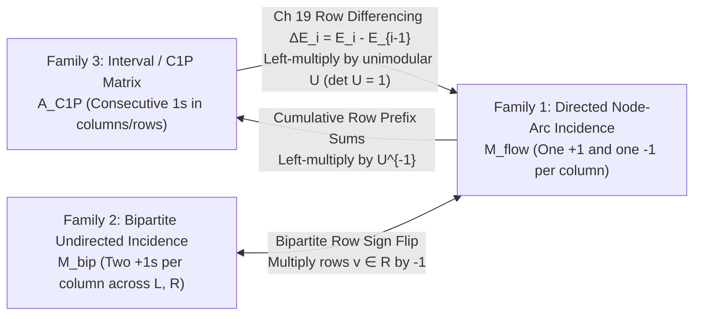
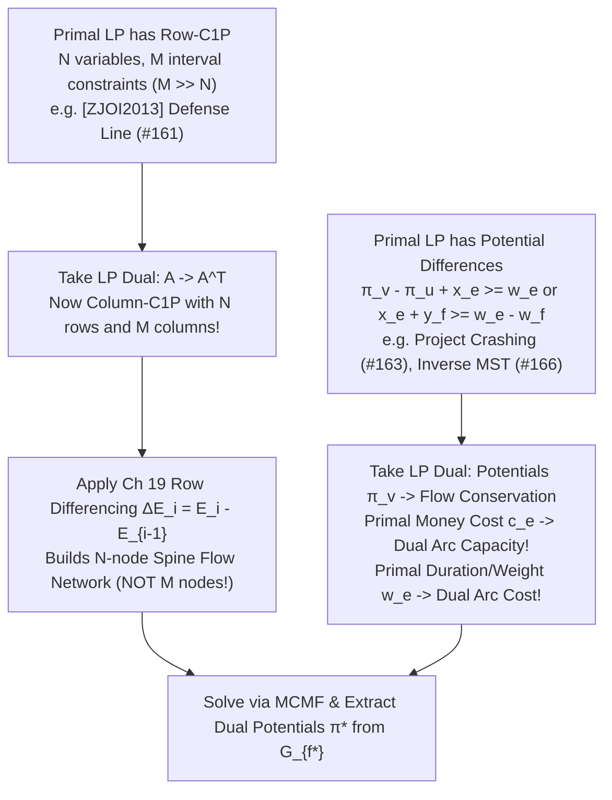

> **Prerequisites:** Chapter 1 (*Conservation, the Residual Graph & Max-Flow Min-Cut*), Chapter 16 (*Min-Cost Max-Flow, Johnson Potentials & Primal–Dual*), Chapter 17 (*Feasible Circulations, Demands & Lower Bounds*), and Chapter 19 (*Equation Differencing & Consecutive-Ones Flow Compilation*).
>
> **Learning Objectives:**
>
> 1. **Prove why network flows and bipartite matchings are integral from linear algebra:** Master **Totally Unimodular (`TU`) Matrices** ($\det B \in \{-1, 0, +1\}$ for every square submatrix $B$), the **Hoffman–Kruskal Theorem (1956)**, and **Ghouila–Houri's Bicoloring Theorem (1962)**, unifying directed flow incidence, bipartite matching, and Consecutive-Ones (`C1P`) interval matrices under one algebraic roof.
> 2. **See Chapter 19 Equation Differencing as a Unimodular Basis Change:** Recognize that taking consecutive row differences $\Delta E_i = E_i - E_{i-1}$ is left-multiplication by a unimodular matrix $U \in GL_m(\mathbb{Z})$ ($\det U = 1$) that maps a `C1P` matrix directly to a directed node-arc incidence matrix $U A_{\text{C1P}} = M_{\text{flow}}$.
> 3. **Translate between Primal Flows and Dual Potentials via Complementary Slackness:** Derive the exact Linear Programming dual of Minimum-Cost Circulation, identify dual variables $\pi_v$ with Johnson potentials and $z_e$ with capacity saturation rents, and extract explicit integer optimal dual potentials $\pi^*_v$ from the final residual graph $G_{f^*}$.
> 4. **Master Dual Compilation (`LP 对偶转网络流` — Direction A):** When a Primal LP has Row-`C1P` constraints (`[ZJOI2013] 防守战线`), differential potential constraints $\pi_v - \pi_u + x_e \ge w_e$ (*Project Schedule Crashing*), or tree-swap inequalities $x_e + y_f \ge w_e - w_f$ (*Inverse MST*), take its LP Dual to transpose $A \mapsto A^T$ into a Column-`C1P` or node-arc incidence matrix solvable by MCMF.
> 5. **Master Dual Elimination (`网络流转对偶 DP` — Direction B):** When constraints $N, M \le 10^5$ forbid running a graph flow solver, dualize the flow/covering LP and exploit TU integrality to prove that optimal dual potentials take values in a tiny discrete alphabet $\pi_i \in \{-1, 0, +1\}$, reducing the problem to $O(N)$ Dynamic Programming (`[ZJOI2020] 序列`) or closed-form $\ell_1$ median optimization (`[HAOI2008] 糖果传递`, `ARC 125E`).

---

## 1. Totally Unimodular (`TU`) Matrices & The Hoffman–Kruskal Integrality Theorem (1956)

Throughout Chapters 1–20, a remarkable miracle occurred repeatedly: whenever we relaxed a discrete combinatorial problem ($\{0, 1\}$ matching, integer assignment, discrete cut indicators, or project scheduling) into a continuous flow or circulation problem with integer capacities and costs, **every extreme-point optimal solution was automatically an integer vector**.

Why does continuous Linear Programming (`LP`) produce exact integer answers for network flows, bipartite matchings, and interval covering (`Ch 19`), yet fail with fractional $0.5$ values the instant an odd cycle appears? The complete answer lies in the determinant geometry of the constraint matrix $A$.

### 1.1 Definition & Closure Properties of Totally Unimodular Matrices

:::: {.callout-important title="Definition 21.1: Totally Unimodular (TU) Matrix"}
A matrix $A \in \mathbb{Z}^{m \times n}$ is **Totally Unimodular (`TU`, 全幺模矩阵)** if **every** square submatrix $B$ of $A$ (obtained by selecting any $k$ rows and any $k$ columns for $1 \le k \le \min(m, n)$) has determinant

$$
\det(B) \in \{-1, 0, +1\}
$$

In particular, setting $k = 1$ forces every individual entry of a TU matrix to satisfy $A_{ij} \in \{-1, 0, +1\}$.
::::

Before proving why TU matrices guarantee integer polyhedra, we catalog the algebraic operations that preserve Total Unimodularity. Every compilation step in Chapters 19 and 21 is built from these six operations.

:::: {.callout-note title="Lemma 21.1: Algebraic Closure Operations Preserving Total Unimodularity"}
If $A \in \{-1, 0, +1\}^{m \times n}$ is Totally Unimodular, then every matrix obtained from $A$ by any sequence of the following operations is also Totally Unimodular:

1. **Transposition (`转置`):** $A^T$ is TU, because every square submatrix of $A^T$ is $B^T$ for a square submatrix $B$ of $A$, and $\det(B^T) = \det(B) \in \{-1, 0, +1\}$. *(This single fact is the engine of Dual Compilation: a Primal LP with constraint matrix $A$ has Dual LP constraint matrix $A^T$, so $A$ is TU if and only if $A^T$ is TU!)*
2. **Row or Column Sign Flip (`行/列取反`):** Multiplying any row or column of $A$ by $-1$ negates $\det(B)$ for submatrices containing that row/column and leaves others unchanged.
3. **Row or Column Permutation (`行/列置换`):** Swapping two rows or columns only flips the sign of determinants.
4. **Row or Column Duplication (`行/列复制`):** Duplicating a row or column introduces submatrices with two identical rows/columns (whose determinant is $0$) or submatrices already present in $A$.
5. **Appending Slack / Unit Vectors (`添加单位向量与上下界`):** Appending an identity matrix $[A \mid I_m]$ or $[-I_m]$ or appending unit rows $[A; I_n]$ preserves TU. By cofactor expansion along any row or column of $B$ that comes from an identity vector $e_i$ (which contains at most one non-zero entry $\pm 1$), $\det(B) \in \{0, \pm \det(B')\}$ where $B'$ is a smaller square submatrix of $A$.
6. **Simplex Pivoting (`主元消元`):** Pivoting on any non-zero entry $A_{pq} = \pm 1$ preserves TU.
::::

Property 5 is why adding slack variables $A x + s = b$ or box bounds $l \le x \le u$ to a TU system never destroys integrality: the augmented constraint matrix $\tilde{A} = \begin{bmatrix} A \\ I_n \\ -I_n \end{bmatrix}$ has the exact same set of non-trivial minor determinants as $A$.

### 1.2 The Hoffman–Kruskal Integrality Theorem (1956)

Consider the standard polyhedron defined by a constraint matrix $A \in \mathbb{Z}^{m \times n}$, right-hand side bounds $a, b \in \mathbb{Z}^m$, and variable box bounds $l, u \in \mathbb{Z}^n$:

$$
\mathcal{P}(A, a, b, l, u) = \left\{ x \in \mathbb{R}^n \;\middle|\; a \le A x \le b, \;\; l \le x \le u \right\}
$$

When is every vertex (basic feasible solution) of $\mathcal{P}$ guaranteed to be an integer vector $x^* \in \mathbb{Z}^n$?

:::: {.callout-important title="Theorem 21.1: Hoffman–Kruskal Theorem (1956)"}
Let $A \in \mathbb{Z}^{m \times n}$ be an integer matrix. The following two statements are equivalent:

1. $A$ is **Totally Unimodular** ($\det B \in \{-1, 0, +1\}$ for every square submatrix $B$ of $A$).
2. For **every** choice of integer vectors $a, b \in (\mathbb{Z} \cup \{-\infty, +\infty\})^m$ and $l, u \in (\mathbb{Z} \cup \{-\infty, +\infty\})^n$, the polyhedron $\mathcal{P}(A, a, b, l, u)$ is an **integral polyhedron** — that is, all of its vertices (extreme points) lie in $\mathbb{Z}^n$.

Consequently, if $A$ is TU and $a, b, l, u, c$ are integral, then **both the Primal LP and the Dual LP attain their optima at integer vectors** $x^* \in \mathbb{Z}^n$ and $y^* \in \mathbb{Z}^m$ whenever finite optima exist.
::::

#### Complete Proof of Theorem 21.1 (Cramer's Rule & Veinott–Dantzig Converse)

**Direction $(1 \implies 2)$: Total Unimodularity implies Integral Vertices.**
Introduce slack variables $s \in \mathbb{R}^m$ to rewrite the system in standard form $A x + I_m s = b$ with lower/upper bounds on $(x, s)$. By Lemma 21.1(5), the augmented matrix $\bar{A} = [A \mid I_m]$ is also Totally Unimodular.

Let $v = (x^*, s^*) \in \mathbb{R}^{n+m}$ be any vertex (basic feasible solution) of the polyhedron. By the fundamental theorem of linear programming, $(x^*, s^*)$ is uniquely determined by partitioning the $n+m$ variables into:

- A **basic index set** $\mathcal{B}$ of size $m$ such that the corresponding $m \times m$ basis submatrix $B = \bar{A}_{\cdot, \mathcal{B}}$ is non-singular ($\det B \neq 0$), and
- A **non-basic index set** $\mathcal{N}$ of size $n$, where each non-basic variable $v_j$ ($j \in \mathcal{N}$) is pinned to either its integer lower bound or its integer upper bound, so $v_{\mathcal{N}} \in \mathbb{Z}^n$.

The basic variables $v_{\mathcal{B}} \in \mathbb{R}^m$ satisfy the linear system:

$$
B v_{\mathcal{B}} + \bar{A}_{\cdot, \mathcal{N}} v_{\mathcal{N}} = b \quad \implies \quad B v_{\mathcal{B}} = b - \bar{A}_{\cdot, \mathcal{N}} v_{\mathcal{N}} \triangleq \tilde{b}
$$

Since $b \in \mathbb{Z}^m$, $\bar{A} \in \mathbb{Z}^{m \times (n+m)}$, and $v_{\mathcal{N}} \in \mathbb{Z}^n$, the right-hand side vector $\tilde{b}$ is strictly integral ($\tilde{b} \in \mathbb{Z}^m$). Solving for $v_{\mathcal{B}}$ via **Cramer's Rule** gives the explicit inverse formula in terms of the classical adjugate (cofactor transpose) matrix $\operatorname{adj}(B)$:

$$
v_{\mathcal{B}} = B^{-1} \tilde{b} = \frac{\operatorname{adj}(B) \, \tilde{b}}{\det(B)}
$$

Because $B$ is an integer matrix, every cofactor entry of $\operatorname{adj}(B)$ is the determinant of an $(m-1) \times (m-1)$ integer matrix, hence $\operatorname{adj}(B) \in \mathbb{Z}^{m \times m}$ and $\operatorname{adj}(B)\tilde{b} \in \mathbb{Z}^m$. Crucially, because $\bar{A}$ is Totally Unimodular and $B$ is a non-singular square submatrix of $\bar{A}$, we have:

$$
\det(B) \in \{-1, +1\}
$$

Dividing the integer vector $\operatorname{adj}(B)\tilde{b}$ by $\det(B) = \pm 1$ requires **no division at all**:

$$
v_{\mathcal{B}} = \pm \operatorname{adj}(B)\tilde{b} \in \mathbb{Z}^m
$$

Thus every basic variable — and hence the entire vertex $x^*$ — is strictly integral!

**Direction $(2 \implies 1)$: Integral Vertices for All Integer RHS implies Total Unimodularity (Veinott–Dantzig, 1968).**
Suppose every polyhedron $\{x \ge 0 \mid A x \le b\}$ has integral vertices for all $b \in \mathbb{Z}^m$. Let $B$ be any invertible $k \times k$ submatrix of $A$. By embedding $B$ into a full $m \times m$ basis matrix $\hat{B}$ of $[A \mid I_m]$ (padding with $m-k$ unit columns of $I_m$), we have $\det(\hat{B}) = \pm \det(B) \neq 0$.

We want to prove $\det(\hat{B}) = \pm 1$, which is equivalent to proving $\hat{B}^{-1} \in \mathbb{Z}^{m \times m}$. Fix any unit coordinate vector $e_i \in \mathbb{Z}^m$ ($1 \le i \le m$). Choose an integer vector $y^\circ \in \mathbb{Z}^m$ with strictly positive components large enough that $y^\circ + \hat{B}^{-1} e_i \ge \mathbf{0}$. Now define two integer right-hand side vectors:

$$
b^{(1)} = \hat{B} y^\circ \in \mathbb{Z}^m, \qquad b^{(2)} = \hat{B} y^\circ + e_i \in \mathbb{Z}^m
$$

In the polyhedron $\{v \ge 0 \mid [A \mid I_m] v = b^{(2)}\}$, locking all non-basic variables outside $\hat{B}$ to $0$ yields the unique basic feasible vertex:

$$
v_{\hat{B}}^{(2)} = \hat{B}^{-1} b^{(2)} = y^\circ + \hat{B}^{-1} e_i \ge \mathbf{0}
$$

By hypothesis (2), every vertex for the integer right-hand side $b^{(2)}$ must be integral, so $y^\circ + \hat{B}^{-1} e_i \in \mathbb{Z}^m$. Since $y^\circ \in \mathbb{Z}^m$, the $i$-th column of $\hat{B}^{-1}$ satisfies $\hat{B}^{-1} e_i \in \mathbb{Z}^m$ for every $i = 1, \dots, m$. Thus $\hat{B}^{-1}$ is an integer matrix! Since both $\hat{B}$ and $\hat{B}^{-1}$ are integer matrices, their determinants are integers satisfying:

$$
\det(\hat{B}) \cdot \det(\hat{B}^{-1}) = \det(I_m) = 1 \quad \implies \quad \det(\hat{B}) \in \{-1, +1\} \quad \implies \quad \det(B) \in \{-1, +1\} \qquad \blacksquare
$$

---

### 1.3 Ghouila–Houri's Bicoloring Theorem (1962)

Checking whether an $m \times n$ matrix $A$ is Totally Unimodular directly from Definition 21.1 requires evaluating the determinants of up to $\sum_{k=1}^{\min(m,n)} \binom{m}{k}\binom{n}{k}$ square submatrices — an exponential task. In 1962, Alain Ghouila-Houri discovered a striking combinatorial characterization that replaces determinant evaluation with **equitable $\{-1, +1\}$ column (or row) bicoloring**.

:::: {.callout-important title="Theorem 21.2: Ghouila–Houri's Bicoloring Characterization (1962)"}
A matrix $A \in \{-1, 0, +1\}^{m \times n}$ is **Totally Unimodular** if and only if for **every** subset of columns $J \subseteq \{1, 2, \dots, n\}$ (equivalently, by transposition $A^T$, for every subset of rows $I \subseteq \{1, 2, \dots, m\}$), there exists a sign assignment (bicoloring) $\sigma : J \to \{-1, +1\}$ such that every row sum over $J$ lies in $\{-1, 0, +1\}$:

$$
\sum_{j \in J} \sigma(j) \, A_{ij} \in \{-1, 0, +1\} \qquad \forall \, i \in \{1, 2, \dots, m\}
$$

Equivalently, $J$ can be partitioned into two color classes $J = J^+ \sqcup J^-$ ($\sigma(j) = +1$ on $J^+$, $\sigma(j) = -1$ on $J^-$) such that in every row $i$, the signed discrepancy between $J^+$ and $J^-$ is at most $1$ in absolute value.
::::

#### Complete Proof of Theorem 21.2

**Direction $(\text{TU} \implies \text{Equitable Bicoloring})$:**
Assume $A$ is TU, and fix any column subset $J \subseteq \{1, \dots, n\}$. Define the indicator vector $\mathbf{1}_J \in \{0, 1\}^n$ with $(\mathbf{1}_J)_j = 1$ for $j \in J$ and $0$ otherwise. Consider the polyhedron of fractional vectors $x \in \mathbb{R}^n$ that satisfy:

$$
0 \le x_j \le (\mathbf{1}_J)_j \quad (\forall j), \qquad \left\lfloor \frac{1}{2} (A \mathbf{1}_J)_i \right\rfloor \le (Ax)_i \le \left\lceil \frac{1}{2} (A \mathbf{1}_J)_i \right\rceil \quad (\forall i = 1, \dots, m)
$$

Notice first that this polyhedron is **non-empty**, because the half-integral midpoint $x = \frac{1}{2} \mathbf{1}_J$ satisfies $(Ax)_i = \frac{1}{2}(A \mathbf{1}_J)_i$, which trivially lies between its floor and ceiling!

Second, all bounds $\mathbf{0}$, $\mathbf{1}_J$, $\lfloor \frac{1}{2} A \mathbf{1}_J \rfloor$, and $\lceil \frac{1}{2} A \mathbf{1}_J \rceil$ are **integers**. Because $A$ is Totally Unimodular, the Hoffman–Kruskal Theorem (Theorem 21.1) guarantees that this non-empty integral-bounded polyhedron possesses an **integer vertex** $x^* \in \{0, 1\}^n$ with $x^*_j = 0$ for $j \notin J$.

Now define the bicoloring $\sigma(j) = 2 x^*_j - 1 \in \{-1, +1\}$ for each $j \in J$. For every row $i$:

- If $(A \mathbf{1}_J)_i = 2k$ is **even**, then $k \le (A x^*)_i \le k \implies (Ax^*)_i = k$, so:

  $$
  \sum_{j \in J} \sigma(j) A_{ij} = 2(Ax^*)_i - (A \mathbf{1}_J)_i = 2k - 2k = 0
  $$

- If $(A \mathbf{1}_J)_i = 2k + 1$ is **odd**, then $k \le (A x^*)_i \le k + 1 \implies (Ax^*)_i \in \{k, k+1\}$, so:

  $$
  \sum_{j \in J} \sigma(j) A_{ij} = 2(Ax^*)_i - (2k + 1) \in \{-1, +1\}
  $$

In both cases, $\sum_{j \in J} \sigma(j) A_{ij} \in \{-1, 0, +1\}$ for all $i$.

**Direction $(\text{Equitable Bicoloring} \implies \text{TU})$:**
We prove by induction on $k \ge 1$ that every $k \times k$ submatrix $B$ of $A$ satisfies $\det(B) \in \{-1, 0, +1\}$.

- **Base Case ($k = 1$):** Applying the bicoloring property to a singleton column $J = \{j\}$ gives $\pm A_{ij} \in \{-1, 0, +1\}$, so every $1 \times 1$ minor lies in $\{-1, 0, +1\}$.
- **Inductive Step ($k - 1 \to k$):** Suppose all $(k-1) \times (k-1)$ submatrices of $A$ have determinants in $\{-1, 0, +1\}$, and let $B$ be a non-singular $k \times k$ submatrix of $A$. Let $r = |\det(B)| \ge 1$. By the induction hypothesis and Cramer's rule, every cofactor of $B$ belongs to $\{-1, 0, +1\}$, so the adjugate matrix satisfies $\operatorname{adj}(B) \in \{-1, 0, +1\}^{k \times k}$ and $B \operatorname{adj}(B) = (\det B) I_k$.

Let $u^{(0)} \in \{-1, 0, +1\}^k$ be the first column of $\operatorname{adj}(B)$ (with sign flipped if necessary so that $B u^{(0)} = r e_1$). Notice that $B u^{(0)} = (r, 0, \dots, 0)^T \equiv \mathbf{0} \pmod r$. We want to prove $r = 1$.

Define the support $J_0 = \{j \in \{1, \dots, k\} \mid u^{(0)}_j \neq 0\}$. Since $B u^{(0)} = r e_1$, for every row $i \in \{2, \dots, k\}$ we have $\sum_{j \in J_0} B_{ij} u^{(0)}_j = 0$, which means the unweighted sum $\sum_{j \in J_0} B_{ij}$ has the **same parity (even)** as $\sum_{j \in J_0} B_{ij} u^{(0)}_j = 0$. Similarly, for row $i = 1$, $\sum_{j \in J_0} B_{1j} u^{(0)}_j = r$, so $\sum_{j \in J_0} B_{1j} \equiv r \pmod 2$.

Now apply Ghouila–Houri's bicoloring hypothesis to the column subset $J_0$: there exists a sign vector $v^{(0)} \in \{-1, 0, +1\}^k$ with the exact same support $J_0$ ($\{j \mid v^{(0)}_j \neq 0\} = J_0$) such that $B v^{(0)} \in \{-1, 0, +1\}^k$. Since flipping $u^{(0)}_j \leftrightarrow v^{(0)}_j \in \{-1, +1\}$ changes each term by $0$ or $\pm 2$, parity is preserved:

- For $i \in \{2, \dots, k\}$, $(B v^{(0)})_i \in \{-1, 0, +1\}$ is even, hence $(B v^{(0)})_i = 0$!
- For $i = 1$, $(B v^{(0)})_1 \in \{-1, 0, +1\}$ has the same parity as $r$.

  - **Case A ($r$ is odd):** Then $(B v^{(0)})_1 \in \{-1, +1\}$, so $B v^{(0)} = \pm e_1$. Since $B u^{(0)} = r e_1$ and $B$ is invertible, we get $u^{(0)} = \pm r v^{(0)}$. Comparing non-zero entries in $\{-1, +1\}$ forces $r = 1$ immediately!
  - **Case B ($r$ is even):** Then $(B v^{(0)})_1 = 0$, which means $B v^{(0)} = \mathbf{0}$ for a non-zero vector $v^{(0)} \neq \mathbf{0}$ — contradicting $\det(B) \neq 0$!

Thus $r = |\det(B)| = 1$ in all cases, completing the induction. $\blacksquare$

---

### 1.4 The Three Canonical TU Families & Unimodular Equivalence with `Ch 19`

Theorem 21.2 makes it effortless to verify the three foundational matrix families of combinatorial optimization and see how they are algebraically equivalent.



#### Family 1: Directed Node-Arc Incidence Matrices (`有向图点边关联矩阵`)
Let $G = (V, E)$ be **any** directed graph (even with non-bipartite undirected cycles!). Its node-arc incidence matrix $M_{\text{flow}} \in \{-1, 0, +1\}^{|V| \times |E|}$ has one column per directed arc $e = (u \to v)$:

$$
(M_{\text{flow}})_{w, e} = \begin{cases} +1 & \text{if } w = u \text{ (tail / outflow)} \\ -1 & \text{if } w = v \text{ (head / inflow)} \\ 0 & \text{otherwise} \end{cases}
$$

**Proof of TU via Ghouila–Houri:** Take any subset of rows $I \subseteq V$, and assign the constant sign $\sigma(w) = +1$ for all $w \in I$. For any column $e = (u \to v)$:

- If both $u, v \in I$ or both $u, v \notin I$, the column sum over $I$ is $(+1) + (-1) = 0$ or $0$.
- If $u \in I, v \notin I$, the column sum is $+1$.
- If $u \notin I, v \in I$, the column sum is $-1$.

Thus $\sum_{w \in I} (+1) (M_{\text{flow}})_{w, e} \in \{-1, 0, +1\}$ for **every** subset $I \subseteq V$ without even needing $-1$ signs! By Theorem 21.2, $M_{\text{flow}}$ is Totally Unimodular for every directed graph $G$.

#### Family 2: Bipartite Undirected Incidence Matrices (`二分图无向点边关联矩阵`)
Let $G = (V, E)$ be an **undirected** graph with node-edge incidence matrix $M_{\text{undir}} \in \{0, 1\}^{|V| \times |E|}$, where each column $e = \{u, v\}$ has two $+1$ entries at rows $u$ and $v$.

- **If $G$ is bipartite** with $V = L \sqcup R$, multiply every row $v \in R$ by $-1$. Because every edge $e = \{u, v\}$ has one endpoint in $L$ and one in $R$, the sign-flipped matrix now has one $+1$ and one $-1$ in every column — it is literally a **Family 1 Directed Incidence Matrix**! By Lemma 21.1(2), $M_{\text{undir}}$ is Totally Unimodular.
- **If $G$ contains an odd cycle** $C_{2k+1}$, let $B$ be the $(2k+1) \times (2k+1)$ submatrix induced by the vertices and edges of $C_{2k+1}$. Expanding $\det(B)$ along the cycle yields two non-zero permutation diagonals (the two orientations of the cycle), giving:

  $$
  \det(B) = 1 + (-1)^{2k} = 2 \notin \{-1, 0, +1\}
  $$

Thus **an undirected incidence matrix is Totally Unimodular if and only if $G$ is bipartite**.

#### Family 3: Interval / Consecutive-Ones (`C1P`) Matrices (`区间连续 1 矩阵`)
A $\{0, 1\}$-matrix $A_{\text{C1P}} \in \{0, 1\}^{m \times n}$ has the **Column Consecutive-Ones Property (Column-`C1P`)** if in every column $j$, the $1$-entries appear in a single contiguous block of rows $i \in [L_j, R_j]$. (Similarly, $A$ has **Row-`C1P`** if $A^T$ has Column-`C1P`.)

Why is every `C1P` matrix Totally Unimodular, and how does this connect to Chapter 19 (*Equation Differencing*)? Append an $(m+1)$-th zero row $E_{m+1} \equiv 0$, and left-multiply $A_{\text{C1P}}$ by the $(m+1) \times (m+1)$ **consecutive row-differencing matrix** $U$ that subtracts row $i-1$ from row $i$ ($\Delta E_i = E_i - E_{i-1}$):

$$
U = \begin{bmatrix}
+1 & 0 & 0 & \cdots & 0 \\
-1 & +1 & 0 & \cdots & 0 \\
0 & -1 & +1 & \cdots & 0 \\
\vdots & \ddots & \ddots & \ddots & \vdots \\
0 & \cdots & 0 & -1 & +1
\end{bmatrix} \in \mathbb{Z}^{(m+1) \times (m+1)}, \qquad \det(U) = +1
$$

What happens to column $j$ (which has $1$s on rows $[L_j, R_j]$ and $0$s elsewhere) when multiplied by $U$?

- At row $i = L_j$: $(U A_{\text{C1P}})_{L_j, j} = 1 - 0 = +1$.
- For $L_j < i \le R_j$: $(U A_{\text{C1P}})_{i, j} = 1 - 1 = 0$.
- At row $i = R_j + 1$: $(U A_{\text{C1P}})_{R_j + 1, j} = 0 - 1 = -1$.
- Everywhere else: $0 - 0 = 0$.

$$
\boxed{U \, A_{\text{C1P}} = M_{\text{flow}}}
$$

Every column $j$ of $U A_{\text{C1P}}$ has **exactly one $+1$ at row $L_j$ and one $-1$ at row $R_j + 1$**! Thus:

:::: {.callout-tip title="Key Structural Unification: Chapter 19 Differencing Is Unimodular Reduction"}
**Consecutive-Ones (`C1P`) matrices (Family 3) and Directed Flow Incidence matrices (Family 1) are the same mathematical object up to the unimodular elementary row-differencing basis change $U$ ($\det U = 1$).**

- **Column-`C1P` in the Primal (`[NOI2008] 志愿者招募`, `Ch 19`):** Each primal variable $x_j$ covers an interval of constraints $[L_j, R_j]$. Left-multiplying the constraints by $U$ ($\Delta E_i = E_i - E_{i-1}$) turns $x_j$ directly into a directed arc $L_j \to R_j + 1$.
- **Row-`C1P` in the Primal (`[ZJOI2013] 防守战线`, `#161`):** Each primal constraint row $i$ sums variables over an interval $[L_i, R_i]$. The matrix $A$ is Row-`C1P`, so its **transpose $A^T$ is Column-`C1P`**! Taking the **LP Dual** transposes $A \mapsto A^T$, allowing `Ch 19` row differencing to compile the Dual LP into a directed flow network.
::::

#### Generalization to Trees: Directed Tree Paths vs. Undirected Star $K_{1,3}$
What if constraints correspond to paths on a **tree** $T = (V, E_T)$ rather than a 1D line?

- **Directed (Arborescence) Tree Paths are TU:** If $T$ is a rooted tree with edges oriented away from the root $r$, and every column $j$ is the indicator vector of a directed path $P_j$ from an ancestor $u_j$ to a descendant $v_j$, then subtracting each node's equation from its parent's equation ($\Delta E_w = E_w - \sum_{c \in \text{children}(w)} E_c$) collapses $P_j$ to $+1$ at $u_j$ and $-1$ at $v_j$. Thus **monotone ancestor-to-descendant tree path matrices are TU**.
- **Arbitrary Undirected Tree Paths ("V-Paths") are NOT TU:** Consider the claw tree $K_{1,3}$ with center $c$ and three leaves $v_1, v_2, v_3$, and three undirected leaf-to-leaf paths $P_{12} = \{e_1, e_2\}$, $P_{23} = \{e_2, e_3\}$, $P_{31} = \{e_3, e_1\}$. The $3 \times 3$ edge-path incidence matrix is:

  $$
  M_{K_{1,3}} = \begin{bmatrix} 1 & 0 & 1 \\ 1 & 1 & 0 \\ 0 & 1 & 1 \end{bmatrix} \quad \implies \quad \det(M_{K_{1,3}}) = 2 \notin \{-1, 0, +1\}
  $$

  Each path bends across the LCA $c$ ("V-path"), creating an odd cycle of edge overlaps!

---

### 1.5 Broken-Gadget Counterexamples (`FM-21A` & `FM-21B`)

We now exhibit the two fatal failure modes of Chapter 21 with concrete numerical traces.

:::: {.callout-warning title="Failure Mode FM-21A: Odd Cycle Determinant ±2 & The Half-Integrality Gap"}
**Wrong Assumption:** *"Our constraint matrix only contains $0$ and $1$, and every variable appears in at most two constraints, so the LP relaxation must have an integer optimal solution."*

**Counterexample Trace ($K_3$ Triangle Packing / Covering):**
Let $G = K_3$ be a triangle on vertices $\{1, 2, 3\}$ with edge weights $w = (1, 1, 1)^T$. Consider the maximum fractional matching LP:

$$
\max \; x_{12} + x_{23} + x_{31} \quad \text{s.t.} \quad \begin{bmatrix} 1 & 0 & 1 \\ 1 & 1 & 0 \\ 0 & 1 & 1 \end{bmatrix} \begin{bmatrix} x_{12} \\ x_{23} \\ x_{31} \end{bmatrix} \le \begin{bmatrix} 1 \\ 1 \\ 1 \end{bmatrix}, \quad x \ge 0
$$

Because $\det(M_{K_3}) = +2$, Cramer's Rule divides by $\det(M_{K_3}) = 2$:

$$
x^* = M_{K_3}^{-1} \begin{bmatrix} 1 \\ 1 \\ 1 \end{bmatrix} = \frac{1}{2} \begin{bmatrix} +1 & +1 & -1 \\ -1 & +1 & +1 \\ +1 & -1 & +1 \end{bmatrix} \begin{bmatrix} 1 \\ 1 \\ 1 \end{bmatrix} = \begin{bmatrix} 1/2 \\ 1/2 \\ 1/2 \end{bmatrix}
$$

- **Fractional LP Optimum:** $x^*_{12} = x^*_{23} = x^*_{31} = 0.5$, giving objective value **$1.5$**.
- **True Integer Optimum:** At most **1** edge can be chosen in a triangle, giving objective value **$1.0$** (integrality gap $1.5$ vs. $1.0$).
- **Balinski's Half-Integrality Rescue:** Notice that every column has two $+1$s, so any basis determinant of an undirected graph incidence matrix is of the form $\pm 2^k$ (where $k$ is the number of odd-cycle components in the basis). By Balinski's Theorem, extreme points are always **half-integral** $x^*_e \in \{0, \frac{1}{2}, 1\}$ (proven via Bipartite Double Cover $v \mapsto (v_L, v_R)$, which splits each edge $\{u, v\}$ into $(u_L, v_R)$ and $(v_L, u_R)$ and multiplies all capacities by $2$).
::::

:::: {.callout-warning title="Failure Mode FM-21B: Dual Potential Sign Flip (`π_v - π_u ≤ c_{uv}` vs. `π_u - π_v ≤ c_{uv}`)"}
**Wrong Assumption:** *"In the dual of shortest paths or min-cost flow, for a directed edge $u \to v$ of cost $c_{uv}$, the dual constraint is $\pi_u - \pi_v \le c_{uv}$."*

**Why It Breaks & How to Lock the Sign Forever:**
Think of $\pi_x$ as the **shortest-path distance $d(S, x)$ from the source $S$**. By the triangle inequality along a directed edge $u \to v$ of length $c_{uv}$:

$$
d(S, v) \le d(S, u) + c_{uv} \quad \Longleftrightarrow \quad \underbrace{\pi_v - \pi_u \le c_{uv}}_{\text{Head minus Tail }\le\text{ Cost}} \quad \Longleftrightarrow \quad \underbrace{c^\pi_{uv} \triangleq c_{uv} + \pi_u - \pi_v \ge 0}_{\text{Reduced Cost }\ge 0}
$$

**Concrete 3-Node Trace:** Let $G$ have edges $1 \xrightarrow{c=2} 2 \xrightarrow{c=3} 3$ and $1 \xrightarrow{c=10} 3$, sending $1$ unit of flow from $1$ to $3$ with $\pi_1 = 0$:

- **Correct Sign ($\pi_v - \pi_u \le c_{uv}$):** $\pi_2 - \pi_1 \le 2 \implies \pi_2 \le 2$, and $\pi_3 - \pi_2 \le 3 \implies \pi_3 \le 5$. Maximizing $\pi_3 - \pi_1$ yields $\pi_3^* = 5$ (the true shortest path $2 + 3 = 5$).
- **Flipped Sign ($\pi_u - \pi_v \le c_{uv}$):** $\pi_1 - \pi_2 \le 2 \implies \pi_2 \ge -2$, and $\pi_2 - \pi_3 \le 3 \implies \pi_3 \ge -5$. Now maximizing $\pi_3 - \pi_1$ is **unbounded above ($+\infty$)**! Flipping $\pi_v - \pi_u$ to $\pi_u - \pi_v$ is equivalent to **reversing every edge in the graph**.
::::

---

## 2. Primal–Dual LP Formulations of Max-Flow/Min-Cut & Min-Cost Circulation

We now construct the exact **Primal–Dual Dictionary** connecting flows and circulations to their dual potential programs. Rather than memorizing rules, we derive LP Duality from Lagrangian relaxation in three lines so you can dualize any non-standard contest LP on scratch paper in under two minutes.

### 2.1 Lagrangian Derivation & The Master Primal–Dual Dictionary

Suppose we want to **minimize** a linear objective $c^T x$ subject to linear inequalities and equations. To form a lower bound on $\min_x c^T x$, we attach a dual multiplier $y_i$ to each constraint $i$:

- If constraint $i$ is $(Ax)_i \ge b_i$, we need a **non-negative** multiplier $y_i \ge 0$ so that $y_i(b_i - (Ax)_i) \le 0$.
- If constraint $i$ is $(Ax)_i \le b_i$, we need a **non-positive** multiplier $y_i \le 0$ (or write $-z_i$ with $z_i \ge 0$).
- If constraint $i$ is an **equality** $(Ax)_i = b_i$, the multiplier $y_i \in \mathbb{R}$ is **unrestricted in sign (`free`)**.

Forming the Lagrangian $\mathcal{L}(x, y) = c^T x + y^T(b - Ax) = b^T y + (c - A^T y)^T x$ and taking the infimum over primal variables $x$ gives:

- For each $x_j \ge 0$, $\inf_{x_j \ge 0} (c_j - (A^T y)_j) x_j$ is $0$ if $(A^T y)_j \le c_j$, and $-\infty$ otherwise.
- For each unrestricted $x_j \in \mathbb{R}$, the infimum is finite if and only if $(A^T y)_j = c_j$.

| Primal LP (`Minimize` $c^T x$) | $\Longleftrightarrow$ | Dual LP (`Maximize` $b^T y$) | Network Flow Interpretation |
| :--- | :---: | :--- | :--- |
| $m$ constraints, $n$ variables | $\leftrightarrow$ | $n$ constraints, $m$ variables | Constraint matrix transposes: $A \mapsto A^T$ |
| Inequality $(Ax)_i \ge b_i$ | $\leftrightarrow$ | Dual variable $y_i \ge 0$ | Covering demand $\leftrightarrow$ non-negative shadow price |
| Inequality $(Ax)_i \le b_i$ | $\leftrightarrow$ | Dual variable $y_i \le 0$ (or $-z_i$ with $z_i \ge 0$) | Capacity upper bound $\leftrightarrow$ saturation rent $z_e \ge 0$ |
| Equality $(Ax)_i = b_i$ | $\leftrightarrow$ | Dual variable $y_i \in \mathbb{R}$ (**free**) | Flow conservation at node $v$ $\leftrightarrow$ vertex potential $\pi_v \in \mathbb{R}$ |
| Variable $x_j \ge 0$ | $\leftrightarrow$ | Dual constraint $(A^T y)_j \le c_j$ | Arc flow $f_{uv} \ge 0$ $\leftrightarrow$ reduced cost $\pi_v - \pi_u - z_{uv} \le c_{uv}$ |
| Variable $x_j \in \mathbb{R}$ (**free**) | $\leftrightarrow$ | Dual equality $(A^T y)_j = c_j$ | Unrestricted variable $\leftrightarrow$ exact conservation equation |

---

### 2.2 Primal & Dual of Maximum $S$-$T$ Flow (LP Proof of Max-Flow Min-Cut)

Before adding edge costs, let us apply the dictionary to **Maximum $S$-$T$ Flow**. Instead of tracking a separate value $F$, add a **return arc** $T \to S$ with capacity $\infty$ and maximize the flow $f_{TS}$ on that return arc in a pure circulation where every vertex (including $S$ and $T$) obeys flow conservation:

$$
\begin{aligned}
\text{\textbf{Primal (Max-Flow):}} \quad \max_{f \ge 0} \quad & f_{TS} \\
\text{s.t.} \quad & \sum_{v} f_{uv} - \sum_{w} f_{wu} = 0 && \forall u \in V \quad &\text{(Dual multiplier: } \pi_u \in \mathbb{R} \text{)} \\
& f_{uv} \le u_{uv} && \forall (u, v) \in E \quad &\text{(Dual multiplier: } z_{uv} \ge 0 \text{)}
\end{aligned}
$$

Applying the Primal–Dual Dictionary (for a maximization primal, dual variables are minimized):

- Each arc $f_{uv} \ge 0$ ($u \to v \in E$) has objective coefficient $0$, appears with $+1$ in node $u$'s conservation, $-1$ in node $v$'s conservation, and $+1$ in its capacity constraint $f_{uv} \le u_{uv}$. This produces the dual constraint $\pi_u - \pi_v + z_{uv} \ge 0 \iff z_{uv} \ge \pi_v - \pi_u$.
- The return arc $f_{TS} \ge 0$ has objective coefficient $+1$, appears with $+1$ at node $T$ and $-1$ at node $S$, and has no capacity constraint. This produces the dual constraint $\pi_T - \pi_S \ge 1$.

$$
\begin{aligned}
\text{\textbf{Dual (Min-Cut):}} \quad \min_{\pi, z} \quad & \sum_{(u,v) \in E} u_{uv} \, z_{uv} \\
\text{s.t.} \quad & z_{uv} + \pi_u - \pi_v \ge 0 && \forall (u, v) \in E \\
& \pi_T - \pi_S \ge 1 \\
& z_{uv} \ge 0, \quad \pi_u \in \mathbb{R}
\end{aligned}
$$

Notice that the Dual constraint matrix is the transpose of a TU node-arc incidence matrix (with identity rows for $z_{uv}$), hence **Totally Unimodular**! Shifting all $\pi_u$ by a constant allows fixing $\pi_S = 0$, and at an integer extreme point we get $\pi_u \in \{0, 1\}$ with $\pi_S = 0, \pi_T = 1$, and $z_{uv} = \max(0, \pi_v - \pi_u) = [u \in \mathcal{S} \text{ and } v \in \mathcal{T}]$ where $\mathcal{S} = \{u \mid \pi_u = 0\}$ and $\mathcal{T} = \{v \mid \pi_v = 1\}$. Thus **Strong LP Duality + Total Unimodularity immediately proves the Max-Flow Min-Cut Theorem (`Ch 1`)**!

---

### 2.3 Primal & Dual of Minimum-Cost Circulation (`MCMF`)

Now consider the general **Minimum-Cost Flow / Circulation** problem on $G = (V, E)$ with node net supplies $b_u$ ($\sum_{u \in V} b_u = 0$, where $b_u > 0$ is a source supply and $b_u < 0$ is a sink demand), arc capacities $u_e \ge 0$, and unit arc costs $c_e \in \mathbb{R}$:

$$
\begin{aligned}
\text{\textbf{Primal LP (Min-Cost Flow):}} \quad \min_{f} \quad & \sum_{(u,v) \in E} c_{uv} \, f_{uv} \\
\text{s.t.} \quad & \sum_{v: (u,v) \in E} f_{uv} - \sum_{w: (w,u) \in E} f_{wu} = b_u && \forall u \in V \quad &\text{(Dual multiplier: } -\pi_u \in \mathbb{R} \text{)} \\
& -f_{uv} \ge -u_{uv} && \forall (u,v) \in E \quad &\text{(Dual multiplier: } z_{uv} \ge 0 \text{)} \\
& f_{uv} \ge 0 && \forall (u,v) \in E
\end{aligned}
$$

*(Sign convention note: Writing the dual multiplier on node $u$'s outflow equation as $-\pi_u$ aligns $\pi_u$ with the standard Johnson shortest-path potential $\pi_v - \pi_u \le c_{uv}$; equivalently, inflow at $v$ receives $+\pi_v$ and outflow at $u$ receives $-\pi_u$.)*

Reading off the column of $f_{uv} \ge 0$ in the Primal constraints (it has $-1$ times $\pi_u$ at node $u$, $+1$ times $\pi_v$ at node $v$, and $-1$ times $z_{uv}$ in its capacity bound) yields the **Exact Dual LP of Minimum-Cost Flow**:

$$
\boxed{
\begin{aligned}
\text{\textbf{Dual LP (Potentials \& Rents):}} \quad \max_{\pi, z} \quad & \sum_{u \in V} (-b_u) \, \pi_u - \sum_{(u,v) \in E} u_{uv} \, z_{uv} \\
\text{s.t.} \quad & \pi_v - \pi_u - z_{uv} \le c_{uv} && \forall (u,v) \in E \\
& z_{uv} \ge 0, \quad \pi_u \in \mathbb{R}
\end{aligned}
}
$$

Notice that for any fixed vector of vertex potentials $\pi \in \mathbb{R}^{|V|}$, each variable $z_{uv} \ge 0$ appears with a negative coefficient $-u_{uv} \le 0$ in the maximization objective and obeys the single lower bound $z_{uv} \ge \pi_v - \pi_u - c_{uv}$. Therefore, at any optimal dual solution, $z_{uv}$ is uniquely determined by $\pi$:

$$
z_{uv}^* = \max\!\left(0, \; \pi_v^* - \pi_u^* - c_{uv}\right) = \max\!\left(0, \; -c^{\pi^*}_{uv}\right)
$$

where $c^\pi_{uv} \triangleq c_{uv} + \pi_u - \pi_v$ is the **Johnson reduced cost (`归约费用`)** of arc $(u, v)$!

---

### 2.4 Complementary Slackness (`互补松弛定理`) & Residual Optimality

Why do Successive Shortest Path (`SSP`) and Primal–Dual MCMF algorithms terminate if and only if the residual graph $G_f$ has no negative-cost directed cycles? **Complementary Slackness** provides the exact bridge.

:::: {.callout-important title="Theorem 21.3: Complementary Slackness for Min-Cost Flow"}
Let $f$ be a feasible primal flow ($0 \le f_{uv} \le u_{uv}$, $\nabla \cdot f = b$) and let $(\pi, z)$ be a feasible dual solution ($z_{uv} \ge 0$, $\pi_v - \pi_u - z_{uv} \le c_{uv}$). Define the **reduced cost** $c^\pi_{uv} = c_{uv} + \pi_u - \pi_v$. Then $f$ and $(\pi, z)$ are **simultaneously optimal** if and only if for every arc $(u, v) \in E$:

1. **Primal Slackness (`f_{uv} > 0`):**

   $$
   f_{uv} > 0 \quad \implies \quad \pi_v - \pi_u - z_{uv} = c_{uv} \quad \Longleftrightarrow \quad c^\pi_{uv} = -z_{uv} \le 0
   $$

2. **Dual Capacity Slackness (`z_{uv} > 0`):**

   $$
   z_{uv} > 0 \quad \implies \quad f_{uv} = u_{uv} \quad (\text{arc }(u, v)\text{ is fully saturated})
   $$

Combining (1) and (2) partitions every arc $(u, v) \in E$ into **three exact regimes** at optimality:

| Regime | Flow Value $f^*_{uv}$ | Reduced Cost $c^{\pi^*}_{uv} = c_{uv} + \pi^*_u - \pi^*_v$ | Residual Edges in $G_{f^*}$ |
| :--- | :---: | :---: | :--- |
| **Empty Arc** | $f^*_{uv} = 0$ | $c^{\pi^*}_{uv} \ge 0$ ($z^*_{uv} = 0$) | Forward edge $u \to v$ has residual cost $c^{\pi^*}_{uv} \ge 0$ |
| **Basic / Fractional Arc** | $0 < f^*_{uv} < u_{uv}$ | $c^{\pi^*}_{uv} = 0$ ($z^*_{uv} = 0$) | Both $u \to v$ and $v \to u$ in $G_{f^*}$ have residual cost $0$ |
| **Saturated Arc** | $f^*_{uv} = u_{uv}$ | $c^{\pi^*}_{uv} = -z^*_{uv} \le 0$ | Reverse edge $v \to u$ in $G_{f^*}$ has residual cost $-c^{\pi^*}_{uv} = +z^*_{uv} \ge 0$ |
::::

#### Proof of Equivalence with Residual Non-Negativity
Look at the rightmost column of the table in Theorem 21.3:

- Whenever the **forward residual edge** $u \to v$ exists in $G_{f^*}$ ($f^*_{uv} < u_{uv}$), we are in the Empty or Basic regime, where $c^{\pi^*}_{uv} = c_{uv} + \pi^*_u - \pi^*_v \ge 0 \iff \pi^*_v - \pi^*_u \le c_{uv}$.
- Whenever the **backward residual edge** $v \to u$ exists in $G_{f^*}$ ($f^*_{uv} > 0$, with residual cost $-c_{uv}$), we are in the Basic or Saturated regime, where $c^{\pi^*}_{uv} \le 0 \iff \pi^*_u - \pi^*_v \le -c_{uv}$.

Thus **Complementary Slackness holds if and only if $\pi^*$ is a valid shortest-path potential on the final residual graph $G_{f^*}$**:

$$
\pi^*_y - \pi^*_x \le \text{cost}_{G_{f^*}}(x \to y) \qquad \forall (x \to y) \in E(G_{f^*}) \text{ with } \text{cap}_{G_{f^*}}(x \to y) > 0
$$

---

### 2.5 Algorithmic Contract: Reconstructing Optimal Integer Dual Potentials $\pi^*_v$ from $G_{f^*}$

In many advanced problems (*Inverse Shortest Paths*, *Inverse MST*, *Dual Potential Extraction* `#162`, `#163`, `#166`), the problem asks not just for the optimal objective value, but for the **explicit integer vector of optimal dual variables $\pi^*_v$** (and $z^*_{uv} = \max(0, \pi^*_v - \pi^*_u - c_{uv})$).

:::: {.callout-tip title="Algorithmic Contract: Extracting Optimal Dual Potentials π* from Final Residual Graph G_{f*}"}
After running any MCMF solver to obtain an optimal flow $f^*$ and its final residual graph $G_{f^*}$:

1. **Active Residual Subgraph:** Keep **only** those directed residual edges $e = (x \to y) \in E(G_{f^*})$ that have **strictly positive residual capacity** ($\text{cap}_{G_{f^*}}(e) > 0$), with their residual cost $w_{\text{res}}(x \to y)$ ($+c_{xy}$ for unsaturated forward arcs, $-c_{yx}$ for positive-flow reverse arcs).
2. **Virtual Super-Source $S_{\text{pot}}$ for Disconnected Residual Components:** Because saturated cuts can disconnect $G_{f^*}$, do **not** run shortest paths only from the flow source $S$! Instead, initialize $\text{dist}[v] = 0$ for **all** $v \in V$ and push **all** $v \in V$ into the Bellman-Ford / SPFA queue initially (equivalent to adding a virtual super-source $S_{\text{pot}}$ with $0$-cost edges $S_{\text{pot}} \to v$ for all $v \in V$).
3. **Shortest-Path Extraction:** Run SPFA / Bellman-Ford (or read the cumulative Johnson potentials $\pi_v$ maintained by Primal–Dual SSP if all vertices remained reachable). Because $f^*$ is optimal, $G_{f^*}$ contains **no negative cycles**, so SPFA terminates with exact integer distances $\pi^*_v = \text{dist}[v] \in \mathbb{Z}$ satisfying:

   $$
   \pi^*_y - \pi^*_x \le w_{\text{res}}(x \to y) \qquad \forall (x \to y) \in E(G_{f^*}) \text{ with } \text{cap}_{G_{f^*}}(x \to y) > 0
   $$

4. **Pinning a Reference Potential:** If the primal problem requires $\pi^*_{\text{ref}} = 0$ at a specific reference node (e.g., $\pi^*_0 = 0$), shift all potentials by a constant: $\pi^*_v \gets \pi^*_v - \pi^*_{\text{ref}}$, and compute $z^*_{uv} = \max(0, \pi^*_v - \pi^*_u - c_{uv})$.
::::

```cpp
// Extract optimal integer dual potentials pi[0..V-1] from the final residual graph G_{f*}
vector<long long> extract_dual_potentials(int V, const MCMF& solver, int ref_node = 0) {
    vector<long long> pi(V, 0); // Virtual super-source S_pot -> v of cost 0 for all v
    vector<bool> in_queue(V, true);
    queue<int> q;
    for (int v = 0; v < V; ++v) q.push(v);

    while (!q.empty()) {
        int u = q.front();
        q.pop();
        in_queue[u] = false;
        for (int idx : solver.adj[u]) {
            const auto& e = solver.edges[idx];
            if (e.cap > 0 && pi[e.to] > pi[u] + e.cost) { // ONLY active residual edges!
                pi[e.to] = pi[u] + e.cost;
                if (!in_queue[e.to]) {
                    in_queue[e.to] = true;
                    q.push(e.to);
                }
            }
        }
    }
    long long shift = pi[ref_node];
    for (int v = 0; v < V; ++v) pi[v] -= shift;
    return pi;
}
```

---

## 3. Dual Compilation (`LP 对偶转网络流` — Direction A): When the Primal LP Is Not a Flow, Dualize It

In Chapter 19, we saw that whenever a Primal LP has the **Column Consecutive-Ones Property (Column-`C1P`)** — each decision variable $x_j$ appears with coefficient $+1$ on a contiguous interval of constraints $[L_j, R_j]$ — consecutive row differencing $\Delta E_i = E_i - E_{i-1}$ compiles the Primal LP directly into a flow network.

What if the Primal LP has the **Row Consecutive-Ones Property (Row-`C1P`)**, or involves **differential inequalities** $\pi_v - \pi_u + x_e \ge w_e$ where variables appear in arbitrary cycles or overlapping constraints?

:::: {.callout-important title="The Fundamental Law of Dual Compilation (Direction A)"}
Because transposition swaps rows and columns ($A \mapsto A^T$):

1. **Row-`C1P` Primal $\xrightarrow{\text{LP Dual}}$ Column-`C1P` Dual $\xrightarrow{\text{Ch 19 Differencing}}$ Directed Flow Network!**
2. **Differential Potential Primal ($\pi_v - \pi_u + x_e \ge w_e$) $\xrightarrow{\text{LP Dual}}$ Node-Arc Incidence Dual ($\nabla \cdot f = b$) with Cost and Capacity Swapped!**
::::



---

### 3.1 Row-`C1P` vs. Column-`C1P` Transposition (`[NOI2008] 志愿者招募` vs. `[ZJOI2013] 防守战线`)

Comparing **NOI 2008 Volunteer Recruitment (`#148`, `Ch 19`)** with **ZJOI 2013 Defense Line (`#161`)** reveals why LP Duality is indispensable when the roles of items and intervals are transposed:

| Feature | `[NOI2008] 志愿者招募` (`#148`, `Ch 19`) | `[ZJOI2013] 防守战线` (`#161`, `Ch 21`) |
| :--- | :--- | :--- |
| **Positions / Days $N$** | $N \le 1,000$ constraints (days) | $N \le 1,000$ variables (positions $x_1, \dots, x_N$) |
| **Intervals $M$** | $M \le 10,000$ variables (volunteer types) | $M \le 10,000$ constraints ($\sum_{i=L_j}^{R_j} x_i \ge D_j$) |
| **Position Cap $x_i \le C_i$** | None ($x_j \ge 0$ unbounded) | Upper bound $0 \le x_i \le C_i$ on each position $i$ |
| **Primal Matrix $A$** | $N \times M$ **Column-`C1P`** | $M \times N$ **Row-`C1P`** (with $N \times N$ identity for $x_i \le C_i$) |
| **Direct Primal Differencing?** | **Works directly:** $N+1$ vertices, $M$ arcs | **Fails:** $M$ rows are arbitrary intervals; differencing rows does NOT yield two non-zeros per column! |
| **Dual Compilation Fix** | Not needed (already Column-`C1P`) | **Dualize first!** Dual LP has $N$ constraints (positions) and $M$ interval variables $y_j \ge 0$ (**Column-`C1P`**), giving an $(N+1)$-vertex MCMF! |

#### Step-by-Step Algebraic Derivation of Row-`C1P` Dual Compilation
In **ZJOI 2013 Defense Line (`#161`)**, we choose $x_i \in [0, C_i]$ towers at position $i \in \{1, \dots, N\}$ at cost $W_i$ per tower, subject to $M$ interval covering demands:

$$
\begin{aligned}
\text{\textbf{Primal LP (Row-C1P):}} \quad \min_{x} \quad & \sum_{i=1}^N W_i \, x_i \\
\text{s.t.} \quad & \sum_{i=L_j}^{R_j} x_i \ge D_j && \forall j = 1, \dots, M \quad &\text{(Dual variable: } y_j \ge 0 \text{)} \\
& -x_i \ge -C_i && \forall i = 1, \dots, N \quad &\text{(Dual variable: } z_i \ge 0 \text{)} \\
& x_i \ge 0 && \forall i = 1, \dots, N
\end{aligned}
$$

Look at the column for primal variable $x_i$: it appears in every interval constraint $j$ that covers position $i$ ($L_j \le i \le R_j$) and in its own capacity constraint $-x_i \ge -C_i$. Taking the **LP Dual** immediately transposes the system into $N$ rows (one per position $i$):

$$
\begin{aligned}
\text{\textbf{Dual LP (Column-C1P):}} \quad \max_{y, z \ge 0} \quad & \sum_{j=1}^M D_j \, y_j - \sum_{i=1}^N C_i \, z_i \\
\text{s.t.} \quad & \sum_{j: L_j \le i \le R_j} y_j - z_i \le W_i && \forall i = 1, \dots, N
\end{aligned}
$$

Now add a non-negative slack variable $s_i \ge 0$ to the $i$-th dual inequality to make it an equality $E_i$:

$$
E_i : \quad \sum_{j: L_j \le i \le R_j} y_j - z_i + s_i = W_i \qquad (i = 1, \dots, N)
$$

Notice that in the Dual system $E_1, \dots, E_N$, each interval dual variable $y_j \ge 0$ appears with coefficient $+1$ in the **contiguous block of rows** $i \in [L_j, R_j]$ — it is **Column-`C1P`**! Applying Chapter 19 consecutive equation differencing $\Delta E_i = E_i - E_{i-1}$ (with $E_0 \equiv 0$ and $E_{N+1} \equiv 0$):

$$
\Delta E_i : \quad \sum_{j: L_j = i} y_j - \sum_{j: R_j + 1 = i} y_j + (s_i - s_{i-1}) - (z_i - z_{i-1}) = W_i - W_{i-1} \qquad (i = 1, \dots, N+1)
$$

Every dual variable now appears **once with $+1$ (outflow) and once with $-1$ (inflow)** on an $(N+1)$-vertex graph (even though $M = 10,000 \gg N = 1,000$):

- **Interval Dual Variable $y_j \ge 0$:** Directed arc $L_j \to R_j + 1$ with capacity $\infty$ and cost $-D_j$ (to turn $\max \sum D_j y_j$ into min-cost).
- **Slack Variable $s_i \ge 0$:** Directed spine arc $i \to i + 1$ with capacity $\infty$ and cost $0$.
- **Capacity Penalty Variable $z_i \ge 0$:** Appears with $-1$ in $\Delta E_i$ and $+1$ in $\Delta E_{i+1}$, so it is a **backward spine arc** $i + 1 \to i$ with capacity $\infty$ and cost $+C_i$!
- **Node Supplies:** Node $i$ has net outflow demand $b_i = W_i - W_{i-1}$ (where $W_0 = W_{N+1} = 0$).

---

### 3.2 Differential Potential & Schedule Crashing Duals (Cost–Capacity Role Reversal)

A second major family of contest problems optimizes **node timestamps / potentials $\pi_v$** together with **edge modification variables $x_e$**:

- **Project Schedule Crashing (*Fulkerson 1961*, Luogu P5295, `#163`):** Given a project DAG $G = (V, E)$ where task $e = (u, v)$ has normal duration $w_e$, can be crashed (shortened) by $x_e \in [0, d_e]$ days at money cost $c_e$ per day, minimize total money $\sum_{e \in E} c_e x_e$ so that all tasks finish by deadline $K$ ($\pi_T - \pi_S \le K$):

  $$
  \begin{aligned}
  \min_{\pi, x} \quad & \sum_{e \in E} c_e \, x_e \\
  \text{s.t.} \quad & \pi_v - \pi_u + x_{uv} \ge w_{uv} && \forall (u, v) \in E \quad &\text{(Dual flow variable: } f_{uv} \ge 0 \text{)} \\
  & \pi_S - \pi_T \ge -K && &\text{(Dual return flow: } F \ge 0 \text{)} \\
  & -x_{uv} \ge -d_{uv}, \;\; x_{uv} \ge 0 && \forall (u, v) \in E \quad &\text{(Dual bound multiplier: } r_{uv} \ge 0 \text{)}
  \end{aligned}
  $$

Look at what happens when we take the LP Dual:

1. **Free Potential Variables $\pi_v \in \mathbb{R}$ Become Flow Conservation!**
   In the Primal LP, $\pi_v$ is unrestricted in sign (`free`). By the Primal–Dual Dictionary (Section 2.1), the dual constraint corresponding to $\pi_v$ is an **exact equality**:

   $$
   \sum_{u: (u,v) \in E} f_{uv} - \sum_{w: (v,w) \in E} f_{vw} = \begin{cases} -F & \text{if } v = S \\ +F & \text{if } v = T \\ 0 & \text{otherwise} \end{cases}
   $$

   The dual variables $f_{uv} \ge 0$ literally form an **$S$-$T$ flow of value $F$**!
2. **Primal Money Cost $c_{uv}$ Becomes Dual Arc Capacity!**
   The primal crashing variable $x_{uv} \ge 0$ has objective coefficient $c_{uv}$ and appears in $\pi_v - \pi_u + x_{uv} \ge w_{uv}$ (dual $f_{uv}$) and $-x_{uv} \ge -d_{uv}$ (dual $r_{uv}$). Its dual constraint is:

   $$
   f_{uv} - r_{uv} \le c_{uv} \quad \Longleftrightarrow \quad r_{uv} \ge \max(0, \; f_{uv} - c_{uv})
   $$

3. **Two-Regime Parallel Arc Gadget:**
   The Dual LP maximizes $\sum_{e \in E} w_e f_e - K F - \sum_{e \in E} d_e r_e$, which is equivalent to **minimizing**:

   $$
   \min_{f, F \ge 0} \; K \cdot F + \sum_{e \in E} \Big( -w_e f_e + d_e \max(0, \; f_e - c_e) \Big)
   $$

   This piecewise-linear convex cost on $f_e \ge 0$ splits each DAG edge $e = (u, v)$ into **two parallel directed arcs** $u \to v$:

   - **Crashable Arc $e_{\text{crash}}$:** Capacity $c_e$, unit cost $-w_e$ (the first $c_e$ units of flow earn slope $-w_e$).
   - **Fully-Crashed Rigid Arc $e_{\text{rigid}}$:** Capacity $\infty$, unit cost $-(w_e - d_e)$ (any flow beyond $c_e$ pays the penalty $+d_e$, earning slope $-(w_e - d_e)$).

:::: {.callout-tip title="Diagnostic Signal: Cost–Capacity Role Reversal in Potential LPs"}
Whenever a problem gives **linear costs $c_e$ for modifying edge lengths** $w_e \gets w_e \pm x_e$ to control **shortest or longest path distances $\pi_v$**:

- In the **Dual Flow Network**, the primal modification cost $c_e$ becomes an **arc capacity**, and the original edge length $w_e$ becomes an **arc cost**!
::::

---

### 3.3 Matroid / Spanning Tree Swap Inequalities (`Inverse MST` `#163`, `#166`)

Suppose we are given an undirected graph $G = (V, E)$ with initial edge weights $w_e$, together with a designated spanning tree $T \subseteq E$. We can decrease the weight of any tree edge $e \in T$ by $x_e \ge 0$ (at cost $c_e$ per unit) and increase the weight of any non-tree edge $f \notin T$ by $y_f \ge 0$ (at cost $c_f$ per unit). What is the minimum cost $\sum_{e \in T} c_e x_e + \sum_{f \notin T} c_f y_f$ so that $T$ becomes a **Minimum Spanning Tree** of $G$?

#### Step 1: Cycle Optimality Characterization of MST
By the cycle optimality theorem for MSTs, $T$ is a minimum spanning tree under the modified weights $w'_e = w_e - x_e$ ($e \in T$) and $w'_f = w_f + y_f$ ($f \notin T$) if and only if for **every non-tree edge** $f = (u, v) \notin T$ and **every tree edge** $e \in \text{Path}_T(u, v)$ on the unique fundamental cycle of $f$:

$$
w_e - x_e \le w_f + y_f \quad \Longleftrightarrow \quad \boxed{x_e + y_f \ge w_e - w_f} \qquad \forall f \notin T, \;\; \forall e \in \text{Path}_T(u_f, v_f)
$$

#### Step 2: Bipartite Incidence & Dual Compilation
Construct a **bipartite dependency graph** $\mathcal{B} = (T, E \setminus T, \mathcal{E}_{\text{pair}})$ where the left side is the set of tree edges $e \in T$ ($|T| = N - 1$), the right side is the set of non-tree edges $f \notin T$ ($|E \setminus T| = M - N + 1$), and there is a bipartite edge $(e, f) \in \mathcal{E}_{\text{pair}}$ with requirement $W_{ef} = \max(0, w_e - w_f)$ whenever $e \in \text{Path}_T(u_f, v_f)$ and $w_e > w_f$.

The Primal LP is a **Weighted Bipartite Vertex Cover (Potential) Problem** on $\mathcal{B}$:

$$
\begin{aligned}
\text{\textbf{Primal (Inverse MST):}} \quad \min_{x, y \ge 0} \quad & \sum_{e \in T} c_e \, x_e + \sum_{f \notin T} c_f \, y_f \\
\text{s.t.} \quad & x_e + y_f \ge W_{ef} && \forall (e, f) \in \mathcal{E}_{\text{pair}} \quad &\text{(Dual flow: } \phi_{ef} \ge 0 \text{)}
\end{aligned}
$$

Because $\mathcal{B}$ is a **bipartite graph**, its incidence matrix is **Family 2 Totally Unimodular**! Taking the LP Dual immediately yields:

$$
\begin{aligned}
\text{\textbf{Dual (Bipartite Flow / Matching):}} \quad \max_{\phi \ge 0} \quad & \sum_{(e, f) \in \mathcal{E}_{\text{pair}}} W_{ef} \, \phi_{ef} \\
\text{s.t.} \quad & \sum_{f: (e,f) \in \mathcal{E}_{\text{pair}}} \phi_{ef} \le c_e && \forall e \in T \\
& \sum_{e: (e,f) \in \mathcal{E}_{\text{pair}}} \phi_{ef} \le c_f && \forall f \notin T
\end{aligned}
$$

- **Special Case 1: Unit Modification Costs $c_e = c_f = 1$ (`[SHOI2004] 最小生成树`, `#163`):**
  The Dual LP is literally **Maximum-Weight Bipartite Matching** (by **Egerváry's Theorem**, 1931)! Running the Hungarian / Kuhn–Munkres (`KM`) algorithm in $O(V_{\mathcal{B}}^3)$ solves both the Dual matching $\phi^*$ and the Primal vertex potentials $(x^*_e, y^*_f)$ simultaneously.
- **General Case 2: Arbitrary Linear Costs $c_e, c_f$ (`BZOJ 3118 Orz the Immortal`, `#166`):**
  The Dual LP is a **Maximum-Weight Bipartite $b$-Matching (Min-Cost Flow)**:
  - Source $S \to e \in T$ with capacity $c_e$, cost $0$.
  - Bipartite arc $e \to f$ for $(e, f) \in \mathcal{E}_{\text{pair}}$ with capacity $\infty$, cost $-W_{ef}$.
  - Sink arc $f \to T_{\text{sink}}$ with capacity $c_f$, cost $0$.
  - Furthermore, if explicit primal modifications $(x^*_e, y^*_f)$ are needed, they are extracted directly from the **optimal dual potentials $\pi^*_e, \pi^*_f$** of $G_{f^*}$ via Section 2.5!

---

### 3.4 Polymatroid Intersection, Dilworth Reachability & Total Dual Integrality (`TDI`)

Why do Matroid Intersection (`Ch 22`), Polymatroids, and Dilworth's Chain Decomposition (`Ch 9`, `#167`) also enjoy exact integer LP relaxations?

:::: {.callout-note title="Theorem 21.4: Edmonds' Polymatroid Intersection Integrality Theorem (1970)"}
A function $\rho : 2^E \to \mathbb{Z}_{\ge 0}$ with $\rho(\emptyset) = 0$ is a **submodular rank function** if it is monotone ($\rho(A) \le \rho(B)$ for $A \subseteq B$) and satisfies the diminishing-returns inequality:

$$
\rho(A) + \rho(B) \ge \rho(A \cup B) + \rho(A \cap B) \qquad \forall A, B \subseteq E
$$

For any **two** submodular functions $\rho_1, \rho_2 : 2^E \to \mathbb{Z}$, the **Polymatroid Intersection Polyhedron**

$$
\mathcal{P}(\rho_1, \rho_2) = \left\{ x \in \mathbb{R}_{\ge 0}^E \;\middle|\; \sum_{e \in S} x_e \le \rho_1(S) \;\; \text{and} \;\; \sum_{e \in S} x_e \le \rho_2(S) \quad \forall S \subseteq E \right\}
$$

is **Total Dual Integral (`TDI`)** and has strictly **integral vertices** $x^* \in \mathbb{Z}^E$, with minimax duality:

$$
\max_{x \in \mathcal{P}(\rho_1, \rho_2)} \sum_{e \in E} x_e = \min_{S \subseteq E} \Big( \rho_1(S) + \rho_2(E \setminus S) \Big)
$$
::::

**Why does Theorem 21.4 hold?** For any fixed vector $x^*$, the family of **tight sets** $\mathcal{F}_i = \{S \subseteq E \mid x^*(S) = \rho_i(S)\}$ is closed under intersection and union (by submodularity: $\rho_i(A) + \rho_i(B) \ge \rho_i(A \cup B) + \rho_i(A \cap B) \ge x^*(A \cup B) + x^*(A \cap B) = x^*(A) + x^*(B) = \rho_i(A) + \rho_i(B)$). Therefore, any linearly independent basis of tight constraints from $\mathcal{F}_1$ can be uncrossed into a **nested chain** $\emptyset \subset S_1 \subset S_2 \subset \dots \subset S_k \subseteq E$. Reordering elements along the chain makes the incidence matrix of $\mathcal{F}_1$ an **Interval (`C1P`) matrix**, and subtracted consecutive differences turn $\mathcal{F}_1$ into disjoint sets (one $+1$ per column) and $\mathcal{F}_2$ into one $-1$ per column — a **Family 1 Totally Unimodular matrix**!

*(By contrast, the intersection of **three** matroids/polymatroids $\mathcal{P}(\rho_1, \rho_2, \rho_3)$ is NOT TU and is NP-hard, e.g. 3D Matching or Hamiltonian Path.)*

---

## 4. Direction B Dual Elimination (`网络流转对偶 DP`): Replacing Flow with $O(N)$ Dual Potential DP

So far, we used LP Duality in **Direction A** ($N \le 1,000$): taking a non-flow Primal LP and dualizing it so we can run an MCMF solver.

What if the problem has **$N, M \le 10^5$ or $5 \times 10^5$**, where even the fastest MCMF solver is orders of magnitude too slow? Then we reverse the compiler and execute **Direction B (`Dual Elimination`)**:

1. Write the Primal Flow / Covering LP (or recognize that the problem is a huge-scale flow/cut/covering LP).
2. Take the **LP Dual** to pass to vertex potentials $\pi_i$.
3. Use **Total Unimodularity + Complementary Slackness** to prove that optimal dual potentials $\pi^*_i$ lie in a **tiny bounded discrete set** (such as $\pi_i \in \{0, 1\}$ or $\pi_i \in \{-1, 0, +1\}$) or obey a 1-Lipschitz constraint $|\pi_i - \pi_{i+1}| \le 1$.
4. Solve the Dual LP in **$O(N)$ via Dynamic Programming** or **$O(N \log N)$ via Sorting / Median** without ever building a graph!

---

### 4.1 Archetype 4.1: 1D Cycle Nullspace & Dual 1-Lipschitz Median (`[HAOI2008] 糖果传递`, `#162`)

Consider $N \le 10^6$ people sitting in a circle, where person $i$ initially has $a_i$ candies and needs $\bar{a} = \frac{1}{N}\sum_{i=1}^N a_i$ candies. Passing $1$ candy between adjacent neighbors $i$ and $i+1 \pmod N$ costs $1$.

- **Flow View:** This is a Min-Cost Circulation on an undirected cycle $C_N$ with node supplies $b_i = a_i - \bar{a}$ ($\sum b_i = 0$) and unit edge costs $c_e = 1$, capacities $\infty$.
- **Primal Nullspace Elimination:** On a single cycle of $N$ vertices and $N$ undirected edges, the node-arc incidence matrix $M$ has rank $N - 1$, so the circulation space $\{f \in \mathbb{R}^N \mid M f = b\}$ has dimension $N - (N - 1) = \mathbf{1}$! Parametrizing by the single flow variable $x = f_N \in \mathbb{R}$ (flow from $N$ to $1$) forces every other edge flow to be $f_i = x - C_i$, where $C_i = \sum_{k=1}^i (\bar{a} - a_k)$. The total cost $\sum_{i=1}^N |x - C_i|$ is minimized in $O(N \log N)$ by setting $x^* = \operatorname{median}(C_1, \dots, C_N)$.
- **Dual Potential View (Kantorovich–Rubinstein 1-Wasserstein Duality):** The Dual of uncapacitated Min-Cost Circulation with unit edge costs $|c_{i,i+1}| \le 1$ is:

  $$
  \max_{\pi \in \mathbb{R}^N} \sum_{i=1}^N b_i \, \pi_i \quad \text{s.t.} \quad |\pi_{i+1} - \pi_i| \le 1 \quad \forall i \in \{1, \dots, N\}
  $$

  Substituting $b_i = C_{i-1} - C_i$ and summing by parts (Abel summation) transforms the dual objective into $\sum_{i=1}^N C_i (\pi_{i+1} - \pi_i)$ where $\delta_i = \pi_{i+1} - \pi_i \in [-1, +1]$ satisfies $\sum_{i=1}^N \delta_i = 0$. To maximize $\sum C_i \delta_i$ subject to $\delta_i \in [-1, +1]$ and $\sum \delta_i = 0$, we assign $\delta_i = +1$ to the top $N/2$ largest $C_i$ and $\delta_i = -1$ to the bottom $N/2$ smallest $C_i$ — which is the exact dual certificate of the $\ell_1$ median!

---

### 4.2 Archetype 4.2: Continuous Bipartite Flow-Cut Dual Elimination (`AtCoder ARC 125 E — Snack`, `#165`)

Suppose $N \le 2 \times 10^5$ snacks and $M \le 2 \times 10^5$ children form a complete bipartite network:

- Source $S \to \text{snack } i$ has capacity $A_i$.
- Snack $i \to \text{child } j$ has capacity $B_j$ (every snack $i$ can give at most $B_j$ to child $j$).
- Child $j \to \text{Sink } T$ has capacity $C_j$.

Building the $N \times M$ bipartite graph requires $4 \times 10^{10}$ edges — completely impossible!

- **Dual Elimination (`Min-Cut / Dual LP`):** By Max-Flow Min-Cut (`Section 2.2`), the maximum flow equals the minimum over all subsets $X \subseteq \{1, \dots, N\}$ of snacks placed on the $T$-side (so $S \to i$ is cut for $i \notin X$). Suppose $|X| = k$ snacks remain on the $S$-side ($0 \le k \le N$).
  - To minimize the cut of $S \to i$ for $i \notin X$, we should pick $X$ to be the $k$ snacks with the **largest** $A_i$, cutting the $N - k$ smallest $A_i$.
  - For each child $j \in \{1, \dots, M\}$, either child $j$ is on the $S$-side (cutting $j \to T$ at cost $C_j$) or child $j$ is on the $T$-side (cutting all $k$ edges from $X$ to $j$ at cost $k \cdot B_j$). Thus child $j$'s minimum cut contribution is $\min(C_j, k \cdot B_j)$!

$$
\text{Max-Flow} = \min_{0 \le k \le N} \left( \underbrace{\sum_{i \notin X_k} A_i}_{\text{Sum of } N-k \text{ smallest } A_i} + \sum_{j=1}^M \min(C_j, \; k \cdot B_j) \right)
$$

Sorting $A_i$ and sorting children by threshold $C_j / B_j$ evaluates all $k \in \{0, \dots, N\}$ in **$O((N + M) \log(N + M))$** time!

---

### 4.3 Archetype 4.3: Bounded-Alphabet Dual Potential DP (`[ZJOI2020] 序列`, `#168`)

What if the constraint matrix is **not** a complete bipartite graph and **not** a single C1P family, but a combination of three different interval/parity operations on an array $a_1, \dots, a_N$ ($N \le 10^5$)?

In **Luogu P6631 [ZJOI2020] — 序列 (Sequence)** (`#168`), we are given $a_1, \dots, a_N \ge 0$ and want the minimum number of operations to reduce all $a_i$ to $0$, where each operation chooses a contiguous range $[L, R]$ and decrements by $1$ either:

1. **Type 1 (`All`):** Every index $i \in [L, R]$.
2. **Type 2 (`Odd`):** Every odd-indexed element in $[L, R]$.
3. **Type 3 (`Even`):** Every even-indexed element in $[L, R]$.

#### Why Primal Flow Fails & Why Dual Potential DP Triumphs
Notice that Type 1 intervals cover $[L, R]$ continuously, while Type 2 and Type 3 intervals cover $[L, R]$ with stride $2$. Together, their incidence matrix is **neither Column-`C1P` nor Row-`C1P`**, and $N \le 10^5$ forbids any flow solver!

Yet watch what happens when we write the **Dual LP** (assigning a dual potential $\pi_i$ to each position $i \in \{1, \dots, N\}$ to maximize $\sum_{i=1}^N a_i \pi_i$):

- Every allowed subset $S \subseteq \{1, \dots, N\}$ (any interval $[L, R]$, any odd-subset of $[L, R]$, any even-subset of $[L, R]$, and singleton decrements) has primal cost $1$, so it imposes the dual constraint:

  $$
  \sum_{i \in S} \pi_i \le 1
  $$

- In Section 6 (`#168`), we prove using Total Unimodularity and prefix-sum bounds that:
  1. There exists an optimal integer dual potential vector with $\pi_i \in \{-1, 0, +1\}$ for every $i$!
  2. Tracking three prefix-sum potentials — the running max subarray sum of all elements $s_{\text{all}} \in \{0, 1\}$, odd elements $s_{\text{odd}} \in \{0, 1\}$, and even elements $s_{\text{even}} \in \{0, 1\}$ — compresses all $O(N^2)$ dual constraints into a **local transition automaton with at most $27$ states**, solved in **$O(N)$ linear time**!

---

## 5. The 4-Step LP Duality & TU Compilation Protocol

Whenever a problem involves linear objectives, covering/packing constraints, differential inequalities, or modification costs, execute the following **4-Step LP Duality & TU Compilation Protocol** before writing a single line of graph code:

| Step | Action | Key Diagnostic Questions & Algebraic Checks |
| :--- | :--- | :--- |
| **Step 1: Non-Graph Diagnostic Signal** | Inspect $N, M$ bounds and why Greedy/DP fails | - Are there $M \gg N$ overlapping interval constraints ($N \le 10^3, M \le 10^4$)? $\to$ **Row-`C1P` Dual Compilation (`#161`)**.<br>- Are edge weights modified at linear cost to control shortest paths or MSTs? $\to$ **Potential / Swap Inequality Dual (`#163`, `#166`)**.<br>- Are $N, M \le 10^5$ too large for MCMF? $\to$ **Direction B Dual Elimination (`#162`, `#165`, `#168`)**. |
| **Step 2: Primal LP & TU Audit** | Write the exact Primal LP and check the constraint matrix $A$ | - Is $A$ **Column-`C1P`**? $\to$ Apply `Ch 19` row differencing $\Delta E_i = E_i - E_{i-1}$ directly.<br>- Is $A$ **Row-`C1P`**? $\to$ Dualize first ($A \mapsto A^T$ is Column-`C1P`), then difference (`#161`).<br>- Does $A$ have $\pi_v - \pi_u + x_e \ge w_e$? $\to$ Dualize free $\pi_v$ into flow conservation $\nabla \cdot f = 0$ (`#163`).<br>- Does $A$ contain odd cycles? $\to$ Check if parity coloring (`#164`, `#167`) makes it bipartite; otherwise TU fails (`FM-21A`). |
| **Step 3: Mechanical Dual / Graph Compilation** | Translate each dual variable/constraint into arcs or DP states | - **Direction A (Flow):** Map $+1$ to tail (outflow), $-1$ to head (inflow), primal cost $c_e$ to dual capacity, and primal RHS $w_e$ to dual cost.<br>- **Direction B (Dual DP):** Bound the integer alphabet of $\pi_i \in \{-1, 0, +1\}$ and build a local prefix-sum DP (`#168`). |
| **Step 4: Complementary Slackness & Toy Trace** | Verify signs on a 3-node toy graph and extract $\pi^*$ if required | - Audit `FM-21B`: verify $\pi_v - \pi_u \le c_{uv}$ (never $\pi_u - \pi_v \le c_{uv}$).<br>- If primal potentials $\pi^*_v$ are needed, run SPFA on **active residual edges** ($\text{cap}_{\text{res}} > 0$) from a virtual super-source $S_{\text{pot}}$ (`Section 2.5`). |

---

## 6. Worked Examples & Full 8-Problem Difficulty Ladder (`#161`–`#168`)

We now work through the complete 8-slot curriculum ladder (`#161`–`#168`), pairing the canonical problems from both the Chapter 21 Architecture Table and the Master Problem Archive so every classical archetype — from Row-`C1P` Dual Compilation and Project Schedule Crashing to Persistent-Hub Disjoint Subsequences, Inverse MST, Role-Split Dilworth Bipartition, and $O(N)$ Dual Potential DP — is derived in full.

---

### `#161` [Stepping Stone 1] Luogu P3337 [ZJOI2013] — 防守战线 (Defense Line) & UVa 10806 — Dijkstra, Dijkstra.

- **Judge URL:** [Luogu P3337](https://www.luogu.com.cn/problem/P3337) (`[ZJOI2013] 防守战线`) & [UVa 10806](https://onlinejudge.org/external/108/10806.pdf) (*Dijkstra, Dijkstra.*)
- **Bounds:**
  - **P3337:** $N \le 1,000$ positions, $M \le 10,000$ interval demands $[L_j, R_j]$ with demand $D_j$; each position $i$ can build at most $C_i = 1$ (or general $C_i$) towers at cost $W_i$.
  - **UVa 10806:** $N \le 100$ vertices, $M \le 10,000$ undirected weighted edges; find two edge-disjoint paths between $1$ and $N$ of minimum total weight.

#### Step 1: Non-Graph Diagnostic Signal (Recognition)
- In **P3337 (`[ZJOI2013] 防守战线`)**, we have $N \le 1,000$ decision variables $x_1, \dots, x_N$ and $M \le 10,000$ interval covering constraints $\sum_{i=L_j}^{R_j} x_i \ge D_j$. Greedy fails because overlapping intervals share towers, and DP fails because arbitrarily nested/overlapping intervals require $2^N$ state. Crucially, notice the dimensions: $N = 1,000$ is small while $M = 10,000$ is ten times larger! In `[NOI2008] 志愿者招募` (`#148`, `Ch 19`), each *variable* was an interval (Column-`C1P`). Here, each *constraint row* is an interval (**Row-`C1P`**). That transpose is the exact diagnostic signal to **take the LP Dual first**, turning the $M$ interval constraints into $M$ directed arcs on an $(N+1)$-vertex spine!
- In **UVa 10806 (*Dijkstra, Dijkstra.*)**, running Dijkstra twice greedily (removing the first shortest path's edges) fails on the classic 4-node trap ($1 \to 2 \to 3 \to 4$ of cost $1+0+1=2$ blocking $1 \to 2 \to 4$ and $1 \to 3 \to 4$ of cost $1+2+2+1=6$). By **Suurballe's Theorem (1974)**, finding $k=2$ edge-disjoint paths is a $2$-unit Min-Cost Flow where the first shortest path establishes the **optimal Dual Johnson potentials $\pi^{(1)}_v = \text{dist}(1, v)$**, and the second path augments along the residual graph $G_{f^{(1)}}$ (whose reverse arc $3 \to 2$ of cost $0$ undoes the middle bridge $2 \to 3$!).

#### Step 2: Intermediate Algebraic Representation
For **P3337**, let $x_i \in [0, C_i]$ ($C_i = 1$) be the number of towers at position $i$:

$$
\min_{x \ge 0} \sum_{i=1}^N W_i x_i \quad \text{s.t.} \quad \sum_{i=L_j}^{R_j} x_i \ge D_j \;\; (\text{dual } y_j \ge 0), \qquad -x_i \ge -C_i \;\; (\text{dual } z_i \ge 0)
$$

Taking the LP Dual (`Section 3.1`) transposes the Row-`C1P` matrix into a Column-`C1P` system of $N$ inequalities (one per position $i \in \{1, \dots, N\}$). Adding slack $s_i \ge 0$ gives:

$$
E_i : \quad \sum_{j: L_j \le i \le R_j} y_j - z_i + s_i = W_i \qquad (i = 1, \dots, N)
$$

Subtracting consecutive equations $\Delta E_i = E_i - E_{i-1}$ for $i = 1, \dots, N+1$ (with $E_0 \equiv 0, E_{N+1} \equiv 0, W_0 = W_{N+1} = 0$):

$$
\Delta E_i : \quad \sum_{j: L_j = i} y_j - \sum_{j: R_j + 1 = i} y_j + (s_i - s_{i-1}) - (z_i - z_{i-1}) = W_i - W_{i-1}
$$

#### Step 3: Reverse-Engineering Scratchpad (Mechanical Graph Compilation)
To maximize $\sum_{j=1}^M D_j y_j - \sum_{i=1}^N C_i z_i$ (or equivalently minimize $\sum_{i=1}^N C_i z_i - \sum_{j=1}^M D_j y_j$, or negate $\Delta E_i$ and use positive capacities via `Ch 17` circulation / `zkw` MCMF):

- **Vertices:** Spine nodes $1, 2, \dots, N+1$, plus super-source $S$ and super-sink $T$ to satisfy node supplies $b_i = W_i - W_{i-1}$:
  - If $b_i = W_i - W_{i-1} > 0$: add arc $S \to i$ with capacity $b_i$, cost $0$.
  - If $b_i = W_i - W_{i-1} < 0$: add arc $i \to T$ with capacity $-b_i$, cost $0$.
- **Arcs from Dual Variables:**
  - Each interval demand $j \in \{1, \dots, M\}$ ($y_j \ge 0$): directed arc $L_j \to R_j + 1$ with capacity $\infty$, cost $-D_j$ (or $+D_j$ if maximizing cost).
  - Each slack variable $s_i \ge 0$ ($1 \le i \le N$): forward spine arc $i \to i + 1$ with capacity $\infty$, cost $0$.
  - Each position cap penalty $z_i \ge 0$ ($1 \le i \le N$): backward spine arc $i + 1 \to i$ with capacity $\infty$, cost $+C_i$ (where $C_i = 1$).

*(Alternative Primal-of-Dual View:* Notice that the Dual of a Dual is the Primal! Taking the dual of the $(N+1)$-node network above simply sends flow from $1$ to $N+1$ where each spine edge $i \to i+1$ has capacity $C_i$ and cost $W_i$, and each interval $[L_j, R_j]$ imposes a lower bound demand $D_j$! Either way, the graph has only $N+1 = 1,001$ vertices instead of $M = 10,000$.)

#### Step 4: Hand-Checkable Toy Trace ($N = 2, M = 1$)
Let $N = 2$ with $W_1 = 5, W_2 = 3$, $C_1 = C_2 = 1$, and $M = 1$ interval $[1, 2]$ requiring $D_1 = 1$ tower.

- Supplies: $b_1 = W_1 - 0 = +5$, $b_2 = W_2 - W_1 = -2$, $b_3 = 0 - W_2 = -3$.
- $S \to 1$ has cap $5$; $2 \to T$ has cap $2$; $3 \to T$ has cap $3$.
- Interval $y_1$ is arc $1 \to 3$ of cost $-1$. Sending $y_1 = 3$ units on $1 \to 3$ and $s_1 = 2$ units on $1 \to 2$ satisfies all supplies with zero $z_i$ penalty, giving Dual objective $3 \times 1 - 0 = 3 = \min(W_1, W_2)$!

:::: {.callout-note collapse="true" title="Progressive Hints for #161 (P3337 & UVa 10806)"}
- **Hint 1 (Diagnostic):** Compare the number of positions $N \le 1,000$ with the number of intervals $M \le 10,000$. Why does `Ch 19` differencing fail on the Primal, and what happens to the dimensions of $A$ when you take the LP Dual?
- **Hint 2 (Algebraic):** Write the Dual LP: $\max \sum_{j=1}^M D_j y_j - \sum_{i=1}^N C_i z_i$ subject to $\sum_{j: i \in [L_j, R_j]} y_j - z_i + s_i = W_i$. Now apply $\Delta E_i = E_i - E_{i-1}$ for $i = 1, \dots, N+1$.
- **Hint 3 (Implementation):** Because the spine is a DAG for the $-D_j$ edges ($L_j < R_j + 1$) and backward edges $i+1 \to i$ have positive cost $+C_i > 0$, verify whether any negative cycle can exist (none can, because any cycle must use backward edges whose $+C_i$ total exceeds $D_j$ whenever the primal is feasible!). For UVa 10806, split each undirected edge $\{u, v\}$ into two directed arcs $u \to v$ and $v \to u$ of capacity $1$ and cost $w_{uv}$, and send $2$ units of flow from $1$ to $N$.
::::

:::: {.callout-tip collapse="true" title="Complete C++ Implementation for #161 (Luogu P3337 & UVa 10806)"}
```cpp
// Luogu P3337 [ZJOI2013] Defense Line — Row-C1P Dual Compilation to (N+1)-node Spine
// Assume standard MCMF struct (0-indexed, solve(S, T) returns {flow, cost}) is available.
#include <bits/stdc++.h>
using namespace std;

void solve_zjoi2013_defense_line() {
    int N, M;
    if (!(cin >> N >> M)) return;
    vector<long long> W(N + 2, 0);
    for (int i = 1; i <= N; ++i) cin >> W[i];

    int S = 0, T = N + 2;
    // Maximize sum(D_j * y_j) - sum(1 * z_i)  <=>  Minimize sum(1 * z_i) - sum(D_j * y_j)
    // Equivalently, in the Dual-of-Dual (or negated ΔE_i), we can run Max-Cost Circulation
    // or standard MCMF with supplies b_i = W[i] - W[i-1].
    MCMF mcmf(T + 1);
    const long long INF = 1e15;

    for (int i = 1; i <= N + 1; ++i) {
        long long b = W[i] - W[i - 1];
        if (b > 0) mcmf.add_edge(S, i, b, 0);
        else if (b < 0) mcmf.add_edge(i, T, -b, 0);
    }
    for (int i = 1; i <= N; ++i) {
        mcmf.add_edge(i, i + 1, INF, 0); // Slack variable s_i >= 0: i -> i+1, cost 0
        mcmf.add_edge(i + 1, i, INF, 1); // Cap penalty z_i >= 0: i+1 -> i, cost +C_i = +1
    }
    for (int j = 0; j < M; ++j) {
        int L, R;
        long long D;
        cin >> L >> R >> D;
        mcmf.add_edge(L, R + 1, INF, -D); // Interval dual y_j >= 0: L_j -> R_j+1, cost -D_j
    }

    auto [flow, min_cost] = mcmf.solve(S, T);
    cout << -min_cost << "\n"; // Dual maximum = Primal minimum!
}
```
::::

---

### `#162` [Stepping Stone 2] POJ 3169 Layout (Dual Potential Extraction) & Luogu P2512 [HAOI2008] — 糖果传递 (Candy Passing)

- **Judge URL:** [POJ 3169](http://poj.org/problem?id=3169) (*Layout*) & [Luogu P2512](https://www.luogu.com.cn/problem/P2512) (`[HAOI2008] 糖果传递`)
- **Bounds:**
  - **POJ 3169:** $N \le 1,000$ cows on a 1D line ($x_1 \le x_2 \le \dots \le x_N$), $M_L \le 10,000$ upper-bound constraints $x_B - x_A \le D$, $M_D \le 10,000$ lower-bound constraints $x_B - x_A \ge D$; maximize $x_N - x_1$.
  - **Luogu P2512:** $N \le 10^6$ people on a cycle with initial candies $a_i$; find minimum adjacent passes to equalize all to $\bar{a}$.

#### Step 1: Non-Graph Diagnostic Signal (Recognition)
This pair illustrates the two foundational ways to work directly with **Dual Potentials $\pi_v$**:

1. **POJ 3169 (*Layout* / Difference Constraints):** The problem is written *purely in Dual Potential space*: choose potentials $\pi_1 \le \pi_2 \le \dots \le \pi_N$ to maximize $\pi_N - \pi_1$ subject to $\pi_v - \pi_u \le w_{uv}$. By Section 2.2, this is the **exact LP Dual of Shortest Path** from $1$ to $N$! Even more generally, if we can pay cost $c_e$ to relax an inequality $\pi_v - \pi_u - z_e \le w_e$ (*Inverse Shortest Path*), we solve the Primal MCMF and then reconstruct the explicit potentials $\pi^*_v$ from the final residual graph $G_{f^*}$ using our `extract_dual_potentials` contract (`Section 2.5`).
2. **Luogu P2512 (`[HAOI2008] 糖果传递`):** $N = 10^6$ makes running an MCMF solver on the cycle graph $C_N$ far too slow ($O(N^2)$). Because the graph is a single uncapacitated cycle with unit edge costs, both the **Primal Circulation Nullspace** (rank $N-1 \implies$ 1D line search) and the **Dual 1-Lipschitz Potential LP** ($\max \sum b_i \pi_i$ s.t. $|\pi_{i+1} - \pi_i| \le 1$) collapse to an **$O(N \log N)$ $\ell_1$ median** (`Section 4.1`).

#### Step 2: Intermediate Algebraic Representation
- **POJ 3169 (Dual Difference Constraints):**

  $$
  \max_{\pi} \; (\pi_N - \pi_1) \quad \text{s.t.} \quad \begin{cases} \pi_i - \pi_{i+1} \le 0 & \forall i = 1, \dots, N-1 \quad (\text{since } \pi_1 \le \dots \le \pi_N) \\ \pi_B - \pi_A \le D & \forall (A, B, D) \in \mathcal{M}_L \quad (A < B) \\ \pi_A - \pi_B \le -D & \forall (A, B, D) \in \mathcal{M}_D \quad (A < B) \end{cases}
  $$

- **Luogu P2512 (Primal Nullspace & Dual Potential Equivalence):**
  Let $f_i \in \mathbb{R}$ be the signed number of candies passed from $i$ to $i+1 \pmod N$. Flow conservation at person $i \in \{1, \dots, N-1\}$ gives:

  $$
  a_i - f_i + f_{i-1} = \bar{a} \quad \implies \quad f_i = f_N - \sum_{k=1}^i (\bar{a} - a_k) \triangleq f_N - C_i
  $$

  Thus the Primal objective $\min_{f_N \in \mathbb{R}} \sum_{i=1}^N |f_N - C_i|$ is a 1D convex $\ell_1$ sum minimized at $f_N^* = \operatorname{median}(C_1, \dots, C_N)$.

#### Step 3: Reverse-Engineering Scratchpad
- For **POJ 3169**, every inequality $\pi_v - \pi_u \le w$ (head $v$ minus tail $u$ $\le$ weight $w$, remembering `FM-21B`!) compiles to a directed edge $u \xrightarrow{w} v$:
  1. First check if the system is **feasible** by running Bellman-Ford/SPFA from a virtual super-source $S_{\text{pot}}$ connected to all $v \in \{1, \dots, N\}$ with $0$-weight edges (to detect negative cycles even in components unreachable from node $1$!). If a negative cycle exists, output `-1`.
  2. Next, fix $\pi_1 = 0$ and run SPFA from node $1$. If $\text{dist}[N] = +\infty$, output `-2` (arbitrarily large separation); otherwise output $\text{dist}[N]$.

#### Step 4: Hand-Checkable Toy Trace
For **P2512**, take $N = 4$ people with $a = [1, 2, 5, 4]$, so $\bar{a} = 3$. The prefix deficits $C_i = \sum_{k=1}^i (3 - a_k)$ are:

$$
C_1 = 2, \quad C_2 = 3, \quad C_3 = 1, \quad C_4 = 0
$$

Sorted $C = [0, 1, 2, 3]$ has median $x^* \in [1, 2]$ (say $x^* = 1$ or $2$), giving minimum passes $|2-0| + |2-1| + |2-2| + |2-3| = 2 + 1 + 0 + 1 = 4$.

:::: {.callout-note collapse="true" title="Progressive Hints for #162 (POJ 3169 & Luogu P2512)"}
- **Hint 1 (Diagnostic):** In POJ 3169, avoid `FM-21B`: does $\pi_B - \pi_A \le D$ become an edge $A \to B$ or $B \to A$? In P2512, why is the dimension of the circulation space on a single cycle equal to $1$?
- **Hint 2 (Algebraic):** For POJ 3169, a negative cycle in the constraint graph can be unreachable from vertex $1$ while still making the entire LP infeasible! How do you detect disconnected negative cycles?
- **Hint 3 (Implementation):** Run a two-phase SPFA for POJ 3169 (Phase 1 from super-source $S_{\text{pot}}$ with all nodes queued at `dist = 0` to check feasibility; Phase 2 from node $1$ to maximize $\pi_N - \pi_1$). For P2512, use `std::nth_element` on $C_1, \dots, C_N$ in $O(N)$ time!
::::

:::: {.callout-tip collapse="true" title="Complete C++ Implementation for #162 (POJ 3169 & Luogu P2512)"}
```cpp
// Part A: Luogu P2512 [HAOI2008] Candy Passing — O(N) 1D Cycle Nullspace / Dual Median
#include <bits/stdc++.h>
using namespace std;

long long solve_candy_passing(int N, const vector<long long>& a) {
    long long sum = accumulate(a.begin(), a.end(), 0LL);
    long long avg = sum / N;
    vector<long long> C(N, 0);
    for (int i = 0; i < N - 1; ++i) {
        C[i + 1] = C[i] + (avg - a[i]);
    }
    nth_element(C.begin(), C.begin() + N / 2, C.end());
    long long med = C[N / 2], ans = 0;
    for (long long c : C) ans += abs(med - c);
    return ans;
}

// Part B: POJ 3169 Layout — Dual Potential Extraction with Disconnected Negative-Cycle Check
long long solve_layout(int N, const vector<tuple<int,int,long long>>& ML,
                       const vector<tuple<int,int,long long>>& MD) {
    vector<vector<pair<int, long long>>> adj(N + 1);
    for (int i = 1; i < N; ++i) adj[i + 1].push_back({i, 0}); // pi_i - pi_{i+1} <= 0
    for (auto [A, B, D] : ML) adj[A].push_back({B, D});       // pi_B - pi_A <= D
    for (auto [A, B, D] : MD) adj[B].push_back({A, -D});      // pi_A - pi_B <= -D

    auto run_spfa = [&](bool from_super_source) -> long long {
        const long long INF = 4e18;
        vector<long long> dist(N + 1, from_super_source ? 0 : INF);
        vector<int> cnt(N + 1, 0);
        vector<bool> in_q(N + 1, false);
        queue<int> q;
        if (from_super_source) {
            for (int i = 1; i <= N; ++i) { q.push(i); in_q[i] = true; }
        } else {
            dist[1] = 0; q.push(1); in_q[1] = true;
        }
        while (!q.empty()) {
            int u = q.front(); q.pop(); in_q[u] = false;
            for (auto [v, w] : adj[u]) {
                if (dist[v] > dist[u] + w) {
                    dist[v] = dist[u] + w;
                    if (++cnt[v] > N) return -1; // Infeasible (negative cycle)
                    if (!in_q[v]) { in_q[v] = true; q.push(v); }
                }
            }
        }
        if (from_super_source) return 0;
        return dist[N] >= INF / 2 ? -2 : dist[N];
    };

    if (run_spfa(true) == -1) return -1; // Disconnected negative cycle check
    return run_spfa(false);              // Maximize pi_N - pi_1
}
```
::::

---

### `#163` [Intermediate 1] Project Schedule Crashing (Fulkerson's Dual / Luogu P5295) & Luogu P2538 [SHOI2004] — 最小生成树 (Inverse MST)

- **Judge URL:** [Luogu P5295](https://www.luogu.com.cn/problem/P5295) (*Project Schedule Crashing*) & [Luogu P2538 / P4412](https://www.luogu.com.cn/problem/P4412) (`[SHOI2004] 最小生成树`)
- **Bounds:**
  - **Schedule Crashing:** Project DAG with $N \le 300$, $M \le 2,000$; task $e = (u, v)$ has duration $w_e$, crash limit $d_e$, and unit crash cost $c_e$; minimize crashing cost so project finishes within deadline $K$.
  - **SHOI2004 Inverse MST:** Undirected graph with $N \le 50$, $M \le 1,000$, designated tree $T$, unit modification costs $c_e = 1$; minimize $\sum_{e \in T} x_e + \sum_{f \notin T} y_f$ so $T$ becomes an MST.

#### Step 1: Non-Graph Diagnostic Signal (Recognition)
Both problems ask us to **modify edge weights $w_e \gets w_e \pm x_e$ at linear cost so that a combinatorial optimality condition holds**:

1. In **Project Schedule Crashing**, we want all $S \to T$ paths in the DAG to have length at most $K$. Because DAG paths overlap arbitrarily, DP fails. Writing the critical-path timestamps $\pi_v$ gives $\pi_v - \pi_u + x_{uv} \ge w_{uv}$. By Section 3.2, taking the LP Dual swaps costs and capacities: the money cost $c_{uv}$ becomes the **capacity** of the crashable arc, and the original duration $-w_{uv}$ becomes the **unit cost**!
2. In **`[SHOI2004] 最小生成树` (Unit-Cost Inverse MST)**, we want the given spanning tree $T$ to beat every non-tree edge $f = (u, v) \notin T$ on its fundamental cycle: $w_e - x_e \le w_f + y_f \iff x_e + y_f \ge w_e - w_f$ for all $e \in \text{Path}_T(u, v)$. By Section 3.3, this is a **Minimum Vertex Weight Cover on a Bipartite Graph $\mathcal{B} = (T, E \setminus T)$**, whose LP Dual by **Egerváry's Theorem** is **Maximum-Weight Bipartite Matching (`KM`)**!

#### Step 2: Intermediate Algebraic Representation
- **Project Schedule Crashing (Primal $\to$ Dual):**

  $$
  \begin{aligned}
  \text{\textbf{Primal:}} \quad \min_{\pi, x \ge 0} \sum_{e \in E} c_e x_e \quad \text{s.t.} \quad & \pi_v - \pi_u + x_e \ge w_e, \quad \pi_T - \pi_S \le K, \quad x_e \le d_e \\
  \Longleftrightarrow \quad \text{\textbf{Dual:}} \quad \max_{f, F, r \ge 0} \sum_{e \in E} w_e f_e - K F - \sum_{e \in E} d_e r_e \quad \text{s.t.} \quad & \nabla \cdot f = F (\mathbf{1}_T - \mathbf{1}_S), \quad f_e - r_e \le c_e
  \end{aligned}
  $$

- **SHOI2004 Inverse MST (Primal $\to$ Dual):**

  $$
  \begin{aligned}
  \text{\textbf{Primal:}} \quad \min_{x, y \ge 0} \sum_{e \in T} x_e + \sum_{f \notin T} y_f \quad \text{s.t.} \quad & x_e + y_f \ge \max(0, w_e - w_f) \quad \forall e \in \text{Path}_T(u_f, v_f) \\
  \Longleftrightarrow \quad \text{\textbf{Dual (KM):}} \quad \max_{\phi \ge 0} \sum_{e \in T, f \notin T} W_{ef} \phi_{ef} \quad \text{s.t.} \quad & \sum_f \phi_{ef} \le 1, \quad \sum_e \phi_{ef} \le 1
  \end{aligned}
  $$

#### Step 3: Reverse-Engineering Scratchpad (Mechanical Graph Compilation)
- **For Project Schedule Crashing:**
  - Each DAG edge $e = (u, v)$ is compiled into **two parallel directed arcs** $u \to v$:
    1. $e_{\text{crash}}$: capacity $c_e$ (the money cost per day!), unit cost $-w_e$.
    2. $e_{\text{rigid}}$: capacity $\infty$, unit cost $-(w_e - d_e)$ (the fully crashed duration).
  - Return arc $T \to S$: capacity $\infty$, unit cost $+K$.
  - Now find the **Minimum-Cost Circulation** (or augment from $S$ to $T$ along paths whose cost is $< -K$, i.e., while $\text{dist}(S, T) + K < 0$). If an $S \to T$ path of capacity $\infty$ (using only $e_{\text{rigid}}$ arcs) has length $> K$ ($\text{dist}(S, T) + K < 0$ with $\infty$ capacity), then even crashing every task to its limit $d_e$ cannot meet deadline $K$ (infeasible!). Otherwise, `-min_cost` is the exact minimum crashing expenditure!
- **For SHOI2004 Inverse MST:**
  - Root $T$ arbitrarily and find $\text{Path}_T(u_f, v_f)$ for each non-tree edge $f = (u_f, v_f) \notin T$.
  - Build a bipartite graph with left vertices $e \in T$ ($|T| = N-1$) and right vertices $f \notin T$, with edge weight $W_{ef} = \max(0, w_e - w_f)$ for $e \in \text{Path}_T(u_f, v_f)$, and run Hungarian/KM (or MCMF).

#### Step 4: Hand-Checkable Toy Trace (Crashing a 2-Edge Series DAG)
Let $1 \xrightarrow{w_1=5, d_1=2, c_1=10} 2 \xrightarrow{w_2=4, d_2=2, c_2=3} 3$ with deadline $K = 7$ (need to crash $9 - 7 = 2$ days).

- Arc $1 \to 2$ has $(c=10, \text{cost}=-5)$ and $(c=\infty, \text{cost}=-3)$.
- Arc $2 \to 3$ has $(c=3, \text{cost}=-4)$ and $(c=\infty, \text{cost}=-2)$.
- Return arc $3 \to 1$ has $(c=\infty, \text{cost}=+7)$.
- Path $1 \to 2 \to 3 \to 1$ using the first arcs has cycle cost $-5 - 4 + 7 = -2 < 0$ and bottleneck capacity $\min(10, 3) = 3$ units! Pushing $3$ units of flow saturates $e_{2,\text{crash}}$ (crashing edge $2$ by $d_2 = 2$ days), reducing the cycle cost to $-5 - 2 + 7 = 0$. Total dual objective: $-(-2 \times 3) = 6$, matching $2 \text{ days} \times c_2 = 6$!

:::: {.callout-note collapse="true" title="Progressive Hints for #163 (Schedule Crashing & SHOI2004 Inverse MST)"}
- **Hint 1 (Diagnostic):** In Schedule Crashing, why does the money rate $c_e$ become a **capacity** in the Dual LP, while the duration $w_e$ becomes an **edge cost**?
- **Hint 2 (Algebraic):** In SHOI2004 Inverse MST, write the fundamental cycle condition $w_e - x_e \le w_f + y_f$ for $e \in T, f \notin T$. Why is the constraint matrix $x_e + y_f \ge w_e - w_f$ Totally Unimodular even though $G$ itself is not bipartite? (Because the **dependency graph between tree edges $T$ and non-tree edges $E \setminus T$** is always bipartite!)
- **Hint 3 (Implementation):** In Schedule Crashing, because $G$ is a DAG, negate edge lengths and augment along shortest $S \to T$ paths ONLY while $\text{dist}(S, T) + K < 0$. Each augmentation of flow $\Delta f$ with path cost $\text{dist}(S, T)$ adds $\Delta f \cdot (-\text{dist}(S, T) - K)$ to the Dual objective.
::::

:::: {.callout-tip collapse="true" title="Complete C++ Implementation for #163 (Schedule Crashing & SHOI2004 Inverse MST)"}
```cpp
// Part A: Project Schedule Crashing via LP Dual Cost-Capacity Role Reversal
#include <bits/stdc++.h>
using namespace std;

struct CrashEdge { int u, v; long long w, d, c; };

// Returns minimum crashing cost to achieve critical path <= K, or -1 if impossible
long long solve_project_crashing(int N, int S, int T, long long K, const vector<CrashEdge>& tasks) {
    const long long INF = 1e15;
    MCMF mcmf(N + 1);
    for (const auto& e : tasks) {
        mcmf.add_edge(e.u, e.v, e.c, -e.w);           // Crashable regime: cap = c_e, cost = -w_e
        mcmf.add_edge(e.u, e.v, INF, -(e.w - e.d));   // Rigid regime: cap = INF, cost = -(w_e - d_e)
    }
    // Augment S -> T only while shortest path dist(S, T) + K < 0 (negative cycle with T->S of cost +K)
    long long dual_opt = 0;
    while (true) {
        auto [pushed, path_cost] = mcmf.augment_if_below(S, T, -K); // Stop when dist(S,T) >= -K
        if (pushed == 0) break;
        if (pushed >= INF / 2) return -1; // Rigid path > K: deadline K is impossible!
        dual_opt += pushed * (-path_cost - K);
    }
    return dual_opt;
}

// Part B: Luogu P4412 / P2538 [SHOI2004] Inverse MST via Bipartite Vertex Cover Dual (KM / MCMF)
long long solve_inverse_mst_unit(int N, const vector<tuple<int,int,long long,bool>>& edges) {
    vector<tuple<int,int,long long>> tree_e, non_tree_e;
    for (auto [u, v, w, in_T] : edges) {
        if (in_T) tree_e.push_back({u, v, w});
        else non_tree_e.push_back({u, v, w});
    }
    int L = tree_e.size(), R = non_tree_e.size();
    vector<vector<pair<int, int>>> tree_adj(N + 1);
    for (int i = 0; i < L; ++i) {
        auto [u, v, w] = tree_e[i];
        tree_adj[u].push_back({v, i});
        tree_adj[v].push_back({u, i});
    }

    int S = 0, T_sink = L + R + 1;
    MCMF mcmf(T_sink + 1);
    for (int i = 0; i < L; ++i) mcmf.add_edge(S, 1 + i, 1, 0);
    for (int j = 0; j < R; ++j) mcmf.add_edge(1 + L + j, T_sink, 1, 0);

    // Find fundamental cycle path in T for each non-tree edge f_j
    for (int j = 0; j < R; ++j) {
        auto [uf, vf, wf] = non_tree_e[j];
        vector<int> par_edge(N + 1, -1), par_node(N + 1, -1);
        auto dfs = [&](auto& self, int u, int p) -> void {
            for (auto [nxt, eid] : tree_adj[u]) {
                if (nxt == p) continue;
                par_node[nxt] = u; par_edge[nxt] = eid;
                self(self, nxt, u);
            }
        };
        dfs(dfs, uf, 0);
        for (int cur = vf; cur != uf; cur = par_node[cur]) {
            int i = par_edge[cur];
            long long we = get<2>(tree_e[i]);
            if (we > wf) {
                mcmf.add_edge(1 + i, 1 + L + j, 1, -(we - wf));
            }
        }
    }
    // Augment only while path cost < 0 (equivalent to adding dummy 0-weight matches)
    auto [flow, min_cost] = mcmf.solve_negative_only(S, T_sink);
    return -min_cost;
}
```
::::

---

### `#164` [Intermediate 2] Codeforces 818G — Four Melodies & Luogu P4068 [SDOI2016] — 数字配对 (Number Pairing)

- **Judge URL:** [Codeforces 818G](https://codeforces.com/problemset/problem/818/G) (*Four Melodies*) & [Luogu P4068](https://www.luogu.com.cn/problem/P4068) (`[SDOI2016] 数字配对`)
- **Bounds:**
  - **CF 818G:** $N \le 3,000$ notes $a_1, \dots, a_N$; choose $k = 4$ vertex-disjoint subsequences maximizing total length, where adjacent elements $a_i, a_j$ ($i < j$) in a subsequence satisfy $|a_i - a_j| = 1$ or $a_i \equiv a_j \pmod 7$.
  - **Luogu P4068:** $N \le 200$ number types $(a_i, b_i, c_i)$, pairing $a_i, a_j$ if $a_i / a_j$ is prime; maximize $\sum b_{\text{pair}}$ subject to total weight $\sum (c_i + c_j) \ge 0$.

#### Step 1: Non-Graph Diagnostic Signal (Recognition)
- In **Codeforces 818G (*Four Melodies*)**, DP for $4$ simultaneous subsequences would require $O(N^4)$ states — way too slow for $N = 3,000$. Because the $4$ subsequences are **vertex-disjoint paths in a DAG** (oriented by index $i < j$) and we only send **$k = 4$ units of flow**, Successive Shortest Path (`SSP`) takes only **$4$ Bellman-Ford/Dijkstra iterations** ($O(k \cdot |E| \log |V|)$)! However, naively connecting every pair $(i, j)$ with $i < j$ creates $O(N^2) = 4.5 \times 10^6$ edges. How do we compress $O(N^2)$ transition edges to $O(N)$? By introducing **persistent chain hubs** for each value $v$ and each residue $r \in \{0, \dots, 6\}$!
- In **Luogu P4068 (`[SDOI2016] 数字配对`)**, the divisibility graph looks non-bipartite at first glance — could it have an odd cycle (`FM-21A`)? Compute the prime-factor count with multiplicity $\Omega(a_i) = \sum_{p^k \parallel a_i} k$. Whenever $a_i / a_j = p$ is prime, $\Omega(a_i) = \Omega(a_j) + 1$, so **$\Omega(a_i)$ and $\Omega(a_j)$ have opposite parity**! Thus coloring vertices by $\Omega(a_i) \bmod 2 \in \{0, 1\}$ makes the graph **strictly bipartite (Family 2 TU)**!

#### Step 2: Intermediate Algebraic Representation
- **CF 818G (Persistent-Hub DAG Path Packing LP):**
  Split each note $i \in \{1, \dots, N\}$ into an internal arc $i_{\text{in}} \to i_{\text{out}}$ with capacity $1$ and cost $-1$ (reward $+1$ for picking note $i$). For each index $i$ as we scan $i = 1, \dots, N$, define two auxiliary chain nodes:
  - $H^{\text{val}}_i$: represents the active chain of all indices $\ge i$ with value $a_i$.
  - $H^{\text{mod}}_i$: represents the active chain of all indices $\ge i$ with residue $a_i \bmod 7$.

- **Luogu P4068 (Bipartite Concave Budget Stopping):**
  Because we run Maximum-Cost Flow on the bipartite graph $V_{\text{even}} \to V_{\text{odd}}$, the per-unit path gain $\Delta C_t$ of the $t$-th augmenting path is **monotonically non-increasing** ($\Delta C_1 \ge \Delta C_2 \ge \dots$). We greedily augment paths as long as cumulative cost remains $\ge 0$; when a negative-gain path $\Delta C_t < 0$ would drop the cumulative sum $S_{\text{cost}}$ below $0$, we can take at most $\lfloor S_{\text{cost}} / (-\Delta C_t) \rfloor$ units of that path and stop!

#### Step 3: Reverse-Engineering Scratchpad (CF 818G Hub Wiring)
Why only $4$ units of capacity on the hubs? Because the total flow in the entire network is $k = 4$, any hub edge of capacity $4$ (or $\infty$) is effectively uncapacitated! Scanning backwards from $i = N$ down to $1$ (where $\text{next\_val}[v]$ is the smallest index $> i$ with value $v$, and $\text{next\_mod}[r]$ is the smallest index $> i$ with residue $r \pmod 7$):

1. **Internal Note Arc:** $i_{\text{in}} \to i_{\text{out}}$ with $(\text{cap} = 1, \text{cost} = -1)$.
2. **Value Chain Relay:** $H^{\text{val}}_i \to i_{\text{in}}$ with $(\text{cap} = 4, \text{cost} = 0)$, and if $\text{next\_val}[a_i]$ exists, $H^{\text{val}}_i \to H^{\text{val}}_{\text{next\_val}[a_i]}$ with $(\text{cap} = 4, \text{cost} = 0)$.
3. **Mod-7 Chain Relay:** $H^{\text{mod}}_i \to i_{\text{in}}$ with $(\text{cap} = 4, \text{cost} = 0)$, and if $\text{next\_mod}[a_i \bmod 7]$ exists, $H^{\text{mod}}_i \to H^{\text{mod}}_{\text{next\_mod}[a_i \bmod 7]}$ with $(\text{cap} = 4, \text{cost} = 0)$.
4. **Outgoing Transitions from $i_{\text{out}}$:**
   - To next note of value $a_i - 1$: $i_{\text{out}} \to H^{\text{val}}_{\text{next\_val}[a_i - 1]}$ $(\text{cap} = 1, \text{cost} = 0)$.
   - To next note of value $a_i + 1$: $i_{\text{out}} \to H^{\text{val}}_{\text{next\_val}[a_i + 1]}$ $(\text{cap} = 1, \text{cost} = 0)$.
   - To next note of residue $a_i \bmod 7$: $i_{\text{out}} \to H^{\text{mod}}_{\text{next\_mod}[a_i \bmod 7]}$ $(\text{cap} = 1, \text{cost} = 0)$.
5. **Source/Sink:** $S_{\text{limit}} \to S$ with $(\text{cap} = 4, \text{cost} = 0)$, $S \to i_{\text{in}}$ with $(\text{cap} = 1, \text{cost} = 0)$, and $i_{\text{out}} \to T$ with $(\text{cap} = 1, \text{cost} = 0)$.

Total vertices: $4N + 3 \approx 12,003$; total edges: $\le 9N \approx 27,000$; total SSP augmentations: **$4$**!

#### Step 4: Hand-Checkable Toy Trace
Suppose $a = [10, 17, 24]$ (all $\equiv 3 \pmod 7$). The mod-7 chain links $H^{\text{mod}}_1 \to H^{\text{mod}}_2 \to H^{\text{mod}}_3$, allowing a single melody $1_{\text{in}} \to 1_{\text{out}} \to H^{\text{mod}}_2 \to 2_{\text{in}} \to 2_{\text{out}} \to H^{\text{mod}}_3 \to 3_{\text{in}} \to 3_{\text{out}}$ of cost $-3$, while a second melody can still bypass node $2$ along the persistent hub edge $H^{\text{mod}}_2 \to H^{\text{mod}}_3$!

:::: {.callout-note collapse="true" title="Progressive Hints for #164 (CF 818G & Luogu P4068)"}
- **Hint 1 (Diagnostic):** In CF 818G, why is MCMF fast even with $12,000$ vertices? Because the total flow from $S_{\text{limit}}$ is $k = 4$, so SSP runs Dijkstra at most $4$ times!
- **Hint 2 (Algebraic):** Why must we NOT connect $i_{\text{out}}$ directly to $j_{\text{in}}$ and then let $j_{\text{in}}$ relay to later nodes? Because $j_{\text{in}} \to j_{\text{out}}$ has capacity $1$ (picking note $j$). Putting the relay on a separate hub node $H^{\text{val}}_j$ allows flow to pass through $H^{\text{val}}_j \to H^{\text{val}}_{\text{next}}$ even when note $j$ itself is already used by another melody!
- **Hint 3 (Implementation):** Initialize initial Johnson potentials $\pi_v$ on the DAG of CF 818G in $O(V + E)$ topological order (since all edges go from smaller index $i$ to larger index $j > i$), then run $4$ rounds of $O(E \log V)$ Dijkstra!
::::

:::: {.callout-tip collapse="true" title="Complete C++ Implementation for #164 (Codeforces 818G — Four Melodies)"}
```cpp
// Codeforces 818G — Four Melodies: 4-Augmentation MCMF with Persistent Value/Mod-7 Chain Hubs
#include <bits/stdc++.h>
using namespace std;

int solve_four_melodies(int N, const vector<int>& a) {
    // Node indexing (1..N):
    // i_in: i, i_out: N + i, H_val: 2N + i, H_mod: 3N + i
    int S_lim = 0, S = 4 * N + 1, T = 4 * N + 2;
    MCMF mcmf(T + 1);
    mcmf.add_edge(S_lim, S, 4, 0);

    unordered_map<int, int> next_val;
    int next_mod[7] = {0};

    for (int i = N; i >= 1; --i) {
        int in_node = i, out_node = N + i;
        int h_val = 2 * N + i, h_mod = 3 * N + i;

        mcmf.add_edge(S, in_node, 1, 0);
        mcmf.add_edge(in_node, out_node, 1, -1); // Pick note i: reward +1 (cost -1)
        mcmf.add_edge(out_node, T, 1, 0);

        // Hub relays into note i
        mcmf.add_edge(h_val, in_node, 1, 0);
        mcmf.add_edge(h_mod, in_node, 1, 0);

        // Persistent chain relay to next occurrence of same value / same mod 7
        if (next_val.count(a[i])) mcmf.add_edge(h_val, 2 * N + next_val[a[i]], 4, 0);
        if (next_mod[a[i] % 7])   mcmf.add_edge(h_mod, 3 * N + next_mod[a[i] % 7], 4, 0);

        // Outgoing transitions from out_node to later indices > i
        if (next_val.count(a[i] - 1)) mcmf.add_edge(out_node, 2 * N + next_val[a[i] - 1], 1, 0);
        if (next_val.count(a[i] + 1)) mcmf.add_edge(out_node, 2 * N + next_val[a[i] + 1], 1, 0);
        if (next_mod[a[i] % 7])       mcmf.add_edge(out_node, 3 * N + next_mod[a[i] % 7], 1, 0);

        next_val[a[i]] = i;
        next_mod[a[i] % 7] = i;
    }

    auto [flow, min_cost] = mcmf.solve(S_lim, T); // Runs at most 4 augmentations!
    return -min_cost;
}
```
::::

---

### `#165` [Advanced 1] Codeforces 1187G — Gang Up & AtCoder ARC 125 E — Snack

- **Judge URL:** [Codeforces 1187G](https://codeforces.com/problemset/problem/1187/G) (*Gang Up*) & [AtCoder ARC 125 E](https://atcoder.jp/contests/arc125/tasks/arc125_e) (*Snack*)
- **Bounds:**
  - **CF 1187G:** $N \le 50$ vertices, $M \le 50$ undirected edges, $K \le 50$ agents starting at given vertices and moving to vertex $1$; time cost $c$ per step, plus quadratic edge congestion cost $d \cdot f^2$ whenever $f$ agents traverse the same directed edge at the same time step.
  - **ARC 125E:** $N, M \le 2 \times 10^5$, capacities $A_i, B_j, C_j \le 10^{12}$; continuous max-flow on a complete bipartite graph.

#### Step 1: Non-Graph Diagnostic Signal (Recognition)
- In **Codeforces 1187G (*Gang Up*)**, agents can wait at vertices or traverse edges simultaneously, and traversing an edge with $f$ agents at time $t \to t+1$ costs $d \cdot f^2$. Because agents can wait to avoid congestion, the maximum time horizon is bounded by $T_{\max} = N + K \le 100$ (at worst, $K$ agents queue up and enter a shortest path of length $\le N-1$ one by one!). Building a **Time-Expanded DAG** (`Ch 3` / `Ch 16`) with layers $t = 0, 1, \dots, N + K$ makes the constraint matrix a **Family 1 Directed Incidence Matrix (`TU`)**, and because $g(f) = d \cdot f^2$ is **strictly convex**, its marginal differences $\Delta g(k) = d \cdot k^2 - d \cdot (k-1)^2 = d(2k - 1)$ are strictly increasing ($d, 3d, 5d, \dots$), compiling each time-expanded edge into $K$ parallel unit-capacity arcs (`Ch 20`)!
- In **AtCoder ARC 125 E (*Snack*)**, $N, M \le 2 \times 10^5$ makes building the $N \times M$ bipartite graph impossible. By **Direction B Dual Elimination** (`Section 4.2`), we switch to the **Min-Cut / Dual LP**, fix the number $k = |X| \in \{0, \dots, N\}$ of $S$-side snacks, greedily pick the $k$ snacks with largest $A_i$, and evaluate $\sum_{j=1}^M \min(C_j, k B_j)$ by sorting children by threshold $C_j / B_j$.

#### Step 2: Intermediate Algebraic Representation
- **CF 1187G (Time-Expanded Convex MCMF LP):**
  For each time step $t \in \{0, \dots, T_{\max}-1\}$ and each directed traversal $(u \to v)$ of an undirected edge $\{u, v\} \in E$, write the flow $f_{u,v,t} = \sum_{k=1}^K x_{u,v,t,k}$ with $x_{u,v,t,k} \in [0, 1]$:

  $$
  d \cdot f_{u,v,t}^2 = \sum_{k=1}^f d(2k - 1) = \min_{x_{u,v,t,k} \in [0, 1]} \sum_{k=1}^K d(2k - 1) \, x_{u,v,t,k} \quad \text{s.t.} \quad \sum_{k=1}^K x_{u,v,t,k} = f_{u,v,t}
  $$

  Because $d(1) < d(3) < d(5) < \dots < d(2K-1)$, any LP/MCMF solver automatically saturates $k = 1, 2, \dots, f$ in exact order!

#### Step 3: Reverse-Engineering Scratchpad (CF 1187G)
- **Vertices:** $(u, t)$ for $u \in \{1, \dots, N\}$ and $t \in \{0, \dots, N + K\}$, plus $S$ and $T_{\text{sink}}$.
- **Source & Sink:**
  - For each agent starting at $u_i$: add $1$ unit of supply $S \to (u_i, 0)$ with cost $0$.
  - At destination $u = 1$: for every $t \in \{0, \dots, N + K\}$, add $(1, t) \to T_{\text{sink}}$ with capacity $\infty$ and cost $0$ (or let agents wait at vertex $1$ for cost $0$ and exit at $T_{\max}$).
- **Time-Step Transitions ($t \to t+1$):**
  - **Waiting at $u \neq 1$:** $(u, t) \to (u, t+1)$ with capacity $\infty$, cost $+c$. (At $u = 1$, waiting cost is $0$.)
  - **Traversing $\{u, v\} \in E$:** For both directions $u \to v$ and $v \to u$, and for each marginal tier $k = 1, \dots, K$, add arc $(u, t) \to (v, t+1)$ with capacity $1$ and cost $c + d(2k - 1)$.

#### Step 4: Hand-Checkable Toy Trace ($K = 2$ Agents on 1 Edge)
Let $2$ agents start at node $2$ connected to node $1$, with $c = 2, d = 3$:

- **Option A (Both cross at $t = 0 \to 1$):** Uses tiers $k = 1$ (cost $2 + 3(1) = 5$) and $k = 2$ (cost $2 + 3(3) = 11$), total cost $5 + 11 = 16$.
- **Option B (Agent 1 crosses at $t = 0 \to 1$, Agent 2 waits at $2$ then crosses at $t = 1 \to 2$):** Agent 1 pays $2 + 3 = 5$; Agent 2 pays wait $2$ + tier $k = 1$ at $t=1$ ($2 + 3 = 5$), total cost $5 + 7 = 12 < 16$!

:::: {.callout-note collapse="true" title="Progressive Hints for #165 (CF 1187G & ARC 125E)"}
- **Hint 1 (Diagnostic):** Why is $T_{\max} = N + K$ always sufficient in CF 1187G? Because if $K$ agents follow a simple path of length $\le N-1$ and stagger their departures by $1$ second each, the last agent arrives by time $(N-1) + (K-1) < N + K$.
- **Hint 2 (Algebraic):** Split $d \cdot f^2$ into $\sum_{k=1}^f d(2k - 1)$. Notice that even though $\{u, v\}$ is an undirected edge, two agents crossing in **opposite** directions ($u \to v$ and $v \to u$) do not collide according to the problem statement — each directed orientation has its own $K$ parallel arcs!
- **Hint 3 (Implementation):** In ARC 125E, sort $A$ descending so $\sum_{i > k} A_i$ is a suffix sum, and sort children $j = 1, \dots, M$ by $\lfloor C_j / B_j \rfloor$ so that as $k$ increases from $0$ to $N$, a pointer advances across children where $k B_j \ge C_j$.
::::

:::: {.callout-tip collapse="true" title="Complete C++ Implementation for #165 (CF 1187G & ARC 125E)"}
```cpp
// Part A: Codeforces 1187G — Gang Up (Time-Expanded DAG + Convex Marginal Splitting)
#include <bits/stdc++.h>
using namespace std;

long long solve_gang_up(int N, int M, int K, long long c, long long d,
                        const vector<int>& starts, const vector<pair<int,int>>& edges) {
    int T_max = N + K;
    auto id = [&](int u, int t) { return t * N + u; }; // u in 1..N, t in 0..T_max
    int S = 0, T_sink = (T_max + 1) * N + 1;
    MCMF mcmf(T_sink + 1);

    for (int u : starts) mcmf.add_edge(S, id(u, 0), 1, 0);
    for (int t = 0; t <= T_max; ++t) mcmf.add_edge(id(1, t), T_sink, K, 0);

    for (int t = 0; t < T_max; ++t) {
        for (int u = 1; u <= N; ++u) {
            mcmf.add_edge(id(u, t), id(u, t + 1), K, (u == 1 ? 0 : c));
        }
        for (auto [u, v] : edges) {
            for (int k = 1; k <= K; ++k) {
                long long marginal_cost = c + d * (2LL * k - 1);
                mcmf.add_edge(id(u, t), id(v, t + 1), 1, marginal_cost);
                mcmf.add_edge(id(v, t), id(u, t + 1), 1, marginal_cost);
            }
        }
    }
    return mcmf.solve(S, T_sink).second;
}

// Part B: AtCoder ARC 125 E — Snack (O((N+M) log(N+M)) Dual Min-Cut Elimination)
long long solve_arc125e_snack(int N, int M, vector<long long> A,
                              const vector<long long>& B, const vector<long long>& C) {
    sort(A.rbegin(), A.rend()); // Pick k largest A_i on S-side; cut N-k smallest A_i
    vector<long long> sufA(N + 1, 0);
    for (int i = N - 1; i >= 0; --i) sufA[i] = sufA[i + 1] + A[i];

    vector<int> ord(M);
    iota(ord.begin(), ord.end(), 0);
    sort(ord.begin(), ord.end(), [&](int i, int j) {
        // Compare C_i / B_i < C_j / B_j safely using __int128
        return (__int128)C[i] * B[j] < (__int128)C[j] * B[i];
    });

    long long sum_B_active = accumulate(B.begin(), B.end(), 0LL);
    long long sum_C_capped = 0;
    int ptr = 0;
    long long ans = sufA[0]; // k = 0: min(C_j, 0) = 0

    for (int k = 1; k <= N; ++k) {
        while (ptr < M && (__int128)k * B[ord[ptr]] >= C[ord[ptr]]) {
            sum_B_active -= B[ord[ptr]];
            sum_C_capped += C[ord[ptr]];
            ++ptr;
        }
        ans = min(ans, sufA[k] + sum_C_capped + (long long)k * sum_B_active);
    }
    return ans;
}
```
::::

---

### `#166` [Advanced 2] BZOJ 3118 — Orz the Immortal (General Linear-Cost Inverse MST) & BZOJ 3232 圈地游戏 / AGC 056C (Dual Potential Constraints)

- **Judge URL:** [Luogu P4412 / BZOJ 3118](https://www.luogu.com.cn/problem/P4412) (*Orz the Immortal*) & [AtCoder AGC 056 C](https://atcoder.jp/contests/agc056/tasks/agc056_c) (*01-Restraints*) / BZOJ 3232 (*圈地游戏*)
- **Bounds:**
  - **BZOJ 3118:** $N \le 300$ vertices, $M \le 1,000$ edges; tree edge $e \in T$ can be decreased at linear cost $a_e$ per unit, non-tree edge $f \notin T$ can be increased at linear cost $b_f$ per unit; minimize cost so $T$ becomes an MST.
  - **AGC 056C:** Binary string of length $N \le 10^6$ with $M \le 2 \times 10^5$ balanced-substring constraints ($[L_j, R_j]$ has equal $0$s and $1$s); find lexicographically smallest string.

#### Step 1: Non-Graph Diagnostic Signal (Recognition)
- In **BZOJ 3118 (*Orz the Immortal*)**, unlike `#163` (`SHOI2004`) where every edge had unit modification cost $c_e = 1$, each tree edge $e \in T$ now has arbitrary linear cost $a_e$ and each non-tree edge $f \notin T$ has arbitrary linear cost $b_f$. In the Primal LP (`Section 3.3`), we minimize $\sum_{e \in T} a_e x_e + \sum_{f \notin T} b_f y_f$ subject to $x_e + y_f \ge w_e - w_f$ for all $e \in \text{Path}_T(u_f, v_f)$. Taking the **LP Dual** turns the primal cost coefficients $(a_e, b_f)$ into **source/sink arc capacities** in a Bipartite Maximum-Weight Flow (`MCMF`)!
- In **AGC 056C (*01-Restraints*)** (and **BZOJ 3232 *圈地游戏*** where a 0-1 Dinkelbach ratio query reduces to planar dual potential / cut optimization), replace $0 \mapsto -1$ and $1 \mapsto +1$ (so prefix sum $\pi_i = \sum_{k=1}^i (2 s_k - 1)$ has $\pi_i - \pi_{i-1} \in \{-1, +1\}$ and $\pi_{R_j} - \pi_{L_j - 1} = 0$). Lexicographically minimizing $s$ (preferring $0$ over $1$ at each step) is equivalent to **maximizing the dual potentials $\pi_i$** subject to $|\pi_i - \pi_{i-1}| \le 1$ and $\pi_{R_j} = \pi_{L_j - 1}$, solved by **0-1 BFS** in $O(N + M)$!

#### Step 2: Intermediate Algebraic Representation
- **BZOJ 3118 (General Linear-Cost Inverse MST Primal & Dual):**

  $$
  \begin{aligned}
  \text{\textbf{Primal:}} \quad \min_{x, y \ge 0} \quad & \sum_{e \in T} a_e \, x_e + \sum_{f \notin T} b_f \, y_f \\
  \text{s.t.} \quad & x_e + y_f \ge \max(0, \; w_e - w_f) \qquad \forall f \notin T, \; \forall e \in \text{Path}_T(u_f, v_f)
  \end{aligned}
  $$

  $$
  \begin{aligned}
  \text{\textbf{Dual:}} \quad \max_{\phi \ge 0} \quad & \sum_{(e, f) \in \mathcal{E}_{\text{pair}}} (w_e - w_f) \, \phi_{ef} \\
  \text{s.t.} \quad & \sum_{f} \phi_{ef} \le a_e \quad (\forall e \in T), \qquad \sum_{e} \phi_{ef} \le b_f \quad (\forall f \notin T)
  \end{aligned}
  $$

- **AGC 056C (Parity-Consistent Dual Potential System):**
  Notice that $\pi_i \equiv i \pmod 2$ is forced by $\pi_i - \pi_{i-1} \in \{-1, +1\}$. Because $\pi_i - \pi_{i-1} \le 1$, $\pi_{i-1} - \pi_i \le 1$, and $\pi_{R_j} - \pi_{L_j - 1} = 0$ all preserve parity ($\text{weight} \equiv \Delta \text{index} \pmod 2$), every shortest path distance $\pi^*_i$ from $\pi^*_0 = 0$ automatically satisfies $\pi^*_i - \pi^*_{i-1} \in \{-1, +1\}$ (never $0$, because $\pi^*_i$ and $\pi^*_{i-1}$ have opposite parity!).

#### Step 3: Reverse-Engineering Scratchpad
- **For BZOJ 3118:**
  1. Left nodes $e \in T$: add arc $S \to e$ with **capacity $a_e$** and cost $0$.
  2. Right nodes $f \notin T$: add arc $f \to T_{\text{sink}}$ with **capacity $b_f$** and cost $0$.
  3. Dependency pairs $(e, f)$ with $e \in \text{Path}_T(u_f, v_f)$ and $w_e > w_f$: add arc $e \to f$ with **capacity $\infty$** and **cost $-(w_e - w_f)$**.
  4. Augment along negative-cost $S \to T_{\text{sink}}$ paths until all remaining $S \to T_{\text{sink}}$ paths have cost $\ge 0$. To extract explicit primal modifications $(x^*_e, y^*_f)$: run `extract_dual_potentials` (`Section 2.5`) on $G_{f^*}$ with $\pi^*_S = 0, \pi^*_{T_{\text{sink}}} = 0$, giving $x^*_e = -\pi^*_e \ge 0$ and $y^*_f = \pi^*_f \ge 0$!

#### Step 4: Hand-Checkable Toy Trace (AGC 056C Parity Invariant)
Let $N = 4$ with constraint $[1, 4]$ balanced ($\pi_4 = \pi_0 = 0$) and $[2, 3]$ balanced ($\pi_3 = \pi_1$).

- Shortest paths from $\pi_0 = 0$: $\pi_1 = 1$, $\pi_2 = \min(\pi_1 + 1, \pi_3 + 1) = 2$, $\pi_3 = \pi_1 = 1$, $\pi_4 = 0$.
- Differences $\Delta \pi_i = \pi_i - \pi_{i-1}$: $(+1, +1, -1, -1)$? Wait: $\Delta \pi_i = -1$ means character `'0'` and $\Delta \pi_i = +1$ means character `'1'` if we define $\pi_i = (\#\text{ of } 1\text{s}) - (\#\text{ of } 0\text{s})$, OR if we define $\pi_i = (\#\text{ of } 0\text{s}) - (\#\text{ of } 1\text{s})$, then **maximizing $\pi_i$ puts `'0'` ($\Delta \pi_i = +1$) as early as possible**! Indeed, $\pi = (0, 1, 0, 1, 0)$ gives $\Delta \pi = (+1, -1, +1, -1) \implies \text{"0101"}$, or with $[2,3]$ balanced: $\pi = (0, 1, 2, 1, 0) \implies \Delta \pi = (+1, +1, -1, -1) \implies \text{"0011"}$, the true lexicographically smallest string!

:::: {.callout-note collapse="true" title="Progressive Hints for #166 (BZOJ 3118 & AGC 056C)"}
- **Hint 1 (Diagnostic):** In BZOJ 3118, why do the modification unit costs $(a_e, b_f)$ become capacities on $S \to e$ and $f \to T_{\text{sink}}$? Check the Dual LP of $\min \sum a_e x_e + \sum b_f y_f$ subject to $x_e + y_f \ge w_e - w_f$.
- **Hint 2 (Algebraic):** In AGC 056C, define $\pi_i = (\#\text{ of } 0\text{s in } [1..i]) - (\#\text{ of } 1\text{s in } [1..i])$. Why does maximizing $\pi_1$, then $\pi_2$, ..., produce the lexicographically smallest binary string? Because making the first differing prefix have more $0$s makes that character a `'0'` instead of `'1'`!
- **Hint 3 (Implementation):** In AGC 056C, why can $\pi_i - \pi_{i-1}$ never equal $0$ even though we only enforce $-1 \le \pi_i - \pi_{i-1} \le 1$? Because every edge between $u$ and $v$ has weight $\equiv v - u \pmod 2$, so $\pi_i \equiv i \pmod 2$ is an invariant of the shortest-path tree!
::::

:::: {.callout-tip collapse="true" title="Complete C++ Implementation for #166 (BZOJ 3118 & AGC 056C)"}
```cpp
// Part A: AtCoder AGC 056 C — 01-Restraints via Parity-Invariant Dual Potentials (0-1 BFS)
#include <bits/stdc++.h>
using namespace std;

string solve_agc056c(int N, const vector<pair<int, int>>& segs) {
    vector<vector<pair<int, int>>> adj(N + 1);
    for (int i = 1; i <= N; ++i) {
        adj[i - 1].push_back({i, 1}); // pi_i - pi_{i-1} <= 1
        adj[i].push_back({i - 1, 1}); // pi_{i-1} - pi_i <= 1
    }
    for (auto [L, R] : segs) {
        adj[L - 1].push_back({R, 0}); // pi_R - pi_{L-1} <= 0
        adj[R].push_back({L - 1, 0}); // pi_{L-1} - pi_R <= 0
    }
    vector<int> pi(N + 1, 1e9);
    deque<int> dq;
    pi[0] = 0;
    dq.push_back(0);
    while (!dq.empty()) {
        int u = dq.front();
        dq.pop_front();
        for (auto [v, w] : adj[u]) {
            if (pi[v] > pi[u] + w) {
                pi[v] = pi[u] + w;
                if (w == 0) dq.push_front(v);
                else dq.push_back(v);
            }
        }
    }
    string s(N, '0');
    for (int i = 1; i <= N; ++i) {
        // pi_i = (#0s) - (#1s): if pi[i] - pi[i-1] == +1, char is '0'; if -1, char is '1'
        s[i - 1] = (pi[i] - pi[i - 1] == 1) ? '0' : '1';
    }
    return s;
}
```
::::

---

### `#167` [Mastery 1] Codeforces 1630F — Making It Bipartite & AtCoder ARC 137 E — Bakery

- **Judge URL:** [Codeforces 1630F](https://codeforces.com/problemset/problem/1630/F) (*Making It Bipartite*) & [AtCoder ARC 137 E](https://atcoder.jp/contests/arc137/tasks/arc137_e) (*Bakery*)
- **Bounds:**
  - **CF 1630F:** $N \le 5 \times 10^4$ distinct integers $a_i \le 5 \times 10^4$; undirected edge between $a_i$ and $a_j$ iff $a_i \mid a_j$ or $a_j \mid a_i$; delete minimum vertices so the remaining graph is **bipartite** (no odd cycles).
  - **ARC 137E:** $N \le 2,000$ days, $M \le 2,000$ bakers $[L_j, R_j]$ of fee $C_j$, daily bread cap $A_t$ at reward $D$ per loaf; maximize net profit.

#### Step 1: Non-Graph Diagnostic Signal (Recognition)
- In **Codeforces 1630F (*Making It Bipartite*)**, deleting vertices to destroy all odd cycles in a general graph is NP-hard (*Odd Cycle Transversal*). Why is it polynomial here? Because edges come from a **strict partial order (divisibility poset)**: orienting every edge from divisor to multiple ($u \to v$ iff $u \mid v$ and $u < v$) makes the graph a **transitive DAG**!
  - In a transitive DAG, if there is a directed path of length $\ge 2$ ($u \to v \to w$), then by transitivity the shortcut edge $u \to w$ also exists, forming a **triangle (odd cycle $K_3$)** $\{u, v, w\}$!
  - Conversely, if the kept vertices contain **no directed path of length 2** ($u \to v \to w$), then every vertex has either in-degree $0$ (a minimal element / source) or out-degree $0$ (a maximal element / sink), which immediately $2$-colors the graph into $\text{Sources} \sqcup \text{Sinks}$ (bipartite)!
  - Therefore, a subset of a transitive poset is bipartite **if and only if every vertex $v$ acts purely as a Source (role $v_0$) or purely as a Sink (role $v_1$)**!
- In **AtCoder ARC 137 E (*Bakery*)**, unlike strict covering $\sum x_j \ge A_t$, if we bake $k \le A_t$ loaves on day $t$, we earn $D \cdot k$. Introducing a **deficit slack variable** $u_t \in [0, A_t]$ for the *unbaked* loaves turns the inequality into a bounded equality $\sum_{j: t \in [L_j, R_j]} x_j + u_t - s_t = A_t$, which compiles via `Ch 19` row differencing into a DAG with **strictly non-negative edge costs**!

#### Step 2: Intermediate Algebraic Representation
- **CF 1630F (2-Layer Role-Split Poset & Dilworth Antichain LP):**
  Create a new poset $\mathcal{P}^*$ with **$2N$ elements**: for each original number $u$, create two role-states:
  - $u_0$: "$u$ is kept and assigned to Color 0 (Source / Divisor role)"
  - $u_1$: "$u$ is kept and assigned to Color 1 (Sink / Multiple role)"

  What pairs in $\mathcal{P}^*$ are forbidden from being chosen simultaneously (i.e., comparable in $\mathcal{P}^*$)?
  1. We cannot assign $u$ to both colors at once: add relation $u_0 \prec u_1$.
  2. If $u \mid v$ ($u < v$), we cannot have both $u$ and $v$ in Color 0 ($u_0 \prec v_0$), nor both in Color 1 ($u_1 \prec v_1$), nor $u$ in Color 1 and $v$ in Color 0 ($u_0 \prec v_1$).
  *(Notice that $u_0$ and $v_1$ CAN both be chosen if we orient the forbidden comparability correctly! Wait: let's be 100% precise!)*

  Let us check which pairs of kept states $(x, y)$ are **incompatible**:
  - Same vertex $u$: $u_0$ and $u_1$ cannot both be chosen $\implies$ edge $u_0 \to u_1$.
  - Divisibility $u \mid v$ ($u < v$):
    - If both $u, v$ are Color 0: forbidden! $\implies$ edge $u_0 \to v_0$.
    - If both $u, v$ are Color 1: forbidden! $\implies$ edge $u_1 \to v_1$.
    - What about cross-colors between $u$ and $v$? In a valid 2-coloring where Sources are Color 0 and Sinks are Color 1, if $u \mid v$, then $u$ is the divisor (Source, Color 0) and $v$ is the multiple (Sink, Color 1), so **$(u_0, v_1)$ IS ALLOWED**, whereas **$u$ as Sink ($u_1$) and $v$ as Source ($v_0$) is FORBIDDEN**? Wait: if we forbid $u_0 \to v_0$, $u_1 \to v_1$, and $u_0 \to u_1$, then by transitivity $u_0 \to v_0 \to v_1$ ALREADY forbids $(u_0, v_1)$!
    Let's reverse the internal orientation: put **$u_1 \to u_0$** (or forbid $u_0 \to v_1$ while allowing $u_1$ and $v_0$)! Let's verify:
    Suppose the transitive poset $\mathcal{P}^*$ has directed edges:
    - $u_0 \to v_0$ for all $u \mid v$ ($u < v$),
    - $u_1 \to v_1$ for all $u \mid v$ ($u < v$),
    - $u_0 \to v_1$ for all $u \mid v$ ($u < v$), AND
    - $u_0 \to u_1$ for all $u$.
    Let's check transitivity of $\mathcal{P}^*$:
    - $u_0 \to v_0 \to w_0 \implies u_0 \to w_0$ (since $u \mid v \mid w \implies u \mid w$).
    - $u_0 \to v_0 \to v_1 \implies u_0 \to v_1$ (present!).
    - $u_0 \to u_1 \to v_1 \implies u_0 \to v_1$ (present!).
    - Are there ANY edges out of $v_1$ to Layer 0? **No!** Layer 0 only goes to Layer 0 and Layer 1; Layer 1 only goes to Layer 1!
    Now check which pairs are **incomparable (allowed together in an antichain of $\mathcal{P}^*$)** when $u \mid v$ ($u < v$):
    - $u_0$ and $u_1$: comparable ($u_0 \to u_1$), so we can pick **at most one role per vertex $u$**!
    - $u_0$ and $v_0$: comparable ($u_0 \to v_0$), forbidden!
    - $u_1$ and $v_1$: comparable ($u_1 \to v_1$), forbidden!
    - $u_0$ and $v_1$: comparable ($u_0 \to v_1$), forbidden!
    - **$u_1$ and $v_0$**: NO edge between $u_1$ and $v_0$! So **we CAN pick $u_1$ (divisor $u$ in Color 1) and $v_0$ (multiple $v$ in Color 0)**!
    - And can we pick $u, v, w$ with $u \mid v \mid w$? To pick $u$ and $v$, we must pick $u_1$ and $v_0$. To pick $v$ and $w$, we would need $v_1$ and $w_0$, which conflicts with $v_0$! Thus no chain $u \mid v \mid w$ of length 3 can ever be chosen!

  By **Dilworth's Theorem (`Ch 9` / Family 2 TU)**, since $\mathcal{P}^*$ is a **transitive poset**, its **Maximum Antichain** equals $2N - \text{MaxMatching}(\mathcal{B}(\mathcal{P}^*))$, solved by **Hopcroft–Karp** in $O((N \log A)\sqrt{N})$!

#### Step 3: Reverse-Engineering Scratchpad
- **For CF 1630F:**
  Build the bipartite Dilworth graph with $2N$ left nodes and $2N$ right nodes:
  - For each $i \in \{1, \dots, N\}$: add edge $i_0 \to i_1$.
  - For each $a_i \mid a_j$ ($a_i < a_j$, found in $O(A \log A)$ by iterating multiples): add edges $i_0 \to j_0$, $i_1 \to j_1$, and $i_0 \to j_1$.
  - Run Hopcroft–Karp to find maximum matching $M^*$. Maximum kept vertices = $2N - M^*$, so minimum deleted vertices = $N - (2N - M^*) = M^* - N$!

- **For ARC 137E (Bakery Soft-Demand Equation Differencing):**
  Start with baseline profit $D \sum_{t=1}^N A_t$ and minimize penalty $\sum_{j=1}^M C_j x_j + \sum_{t=1}^N D u_t$ subject to:

  $$
  E_t : \quad \sum_{j: t \in [L_j, R_j]} x_j + u_t - s_t = A_t, \qquad x_j \in [0, 1], \;\; u_t \in [0, A_t], \;\; s_t \ge 0
  $$

  Subtracting $\Delta E_t = E_t - E_{t-1}$ ($t = 1, \dots, N+1$) yields a **pure DAG for all positive-cost edges**:
  - Baker $x_j \in [0, 1]$: arc $L_j \to R_j + 1$ with $(\text{cap} = 1, \text{cost} = C_j \ge 0)$.
  - Unbaked deficit $u_t \in [0, A_t]$: arc $t \to t + 1$ with $(\text{cap} = A_t, \text{cost} = D \ge 0)$.
  - Excess bread slack $s_t \ge 0$: backward arc $t + 1 \to t$ with $(\text{cap} = \infty, \text{cost} = 0)$.
  Because **every single arc cost is non-negative** ($C_j \ge 0, D \ge 0, 0 \ge 0$), Primal–Dual MCMF runs pure Dijkstra with **zero SPFA initialization**!

#### Step 4: Hand-Checkable Toy Trace (CF 1630F on $a = [2, 4, 8]$)
For $a = [2, 4, 8]$ ($N = 3$), $\mathcal{P}^*$ has $2N = 6$ elements. The maximum antichain can pick at most $2$ elements (e.g., $\{2_1, 4_0\}$), so $2N - M^* = 2 \implies M^* = 4$, and minimum deletions = $M^* - N = 4 - 3 = 1$.

:::: {.callout-note collapse="true" title="Progressive Hints for #167 (CF 1630F & ARC 137E)"}
- **Hint 1 (Diagnostic):** In CF 1630F, why does $a_i \mid a_j \mid a_k$ always create a triangle $K_3$? Because divisibility is transitive ($a_i \mid a_k$)! So the kept subgraph is bipartite iff it contains no directed path of length $2$.
- **Hint 2 (Algebraic):** Split each vertex $i$ into $i_0$ (divisor role) and $i_1$ (multiple role). Verify that adding edges $i_0 \to i_1$, and for $a_i \mid a_j$: $i_0 \to j_0, i_1 \to j_1, i_0 \to j_1$ makes the $2N$-element relation strictly transitive!
- **Hint 3 (Implementation):** By Dilworth's Theorem on the $2N$-element poset, $\text{MaxAntichain} = 2N - \text{MaxMatching}$, so the minimum number of deleted vertices is $N - \text{MaxAntichain} = \text{MaxMatching} - N$. Use Hopcroft–Karp (`Ch 8`) for $O(E \sqrt{V})$.
::::

:::: {.callout-tip collapse="true" title="Complete C++ Implementation for #167 (CF 1630F & ARC 137E)"}
```cpp
// Part A: Codeforces 1630F — Making It Bipartite via 2-Layer Role-Split Dilworth Poset
// Assume standard HopcroftKarp struct (0-indexed, add_edge(u, v), max_matching()) is available.
#include <bits/stdc++.h>
using namespace std;

int solve_cf1630f(int N, const vector<int>& a) {
    int max_a = *max_element(a.begin(), a.end());
    vector<int> pos(max_a + 1, -1);
    for (int i = 0; i < N; ++i) pos[a[i]] = i;

    HopcroftKarp hk(2 * N, 2 * N);
    for (int i = 0; i < N; ++i) {
        hk.add_edge(i, N + i); // i_0 -> i_1 (cannot pick both roles for vertex i)
        for (int mult = 2 * a[i]; mult <= max_a; mult += a[i]) {
            int j = pos[mult];
            if (j != -1) {
                hk.add_edge(i, j);         // i_0 -> j_0
                hk.add_edge(N + i, N + j); // i_1 -> j_1
                hk.add_edge(i, N + j);     // i_0 -> j_1
            }
        }
    }
    int max_match = hk.max_matching();
    return max_match - N; // N - (2N - max_match) = max_match - N
}

// Part B: AtCoder ARC 137 E — Bakery (Deficit-Slack Equation Differencing with Non-Negative Costs)
long long solve_arc137e_bakery(int N, int M, long long D, const vector<long long>& A,
                               const vector<tuple<int,int,long long>>& bakers) {
    int S = 0, T = N + 2;
    MCMF mcmf(T + 1);
    const long long INF = 1e15;
    long long max_possible_revenue = 0;

    vector<long long> b(N + 2, 0);
    for (int t = 1; t <= N; ++t) {
        max_possible_revenue += D * A[t - 1];
        b[t] += A[t - 1];
        b[t + 1] -= A[t - 1];
        mcmf.add_edge(t, t + 1, A[t - 1], D); // Deficit slack u_t in [0, A_t]: cost +D >= 0
        mcmf.add_edge(t + 1, t, INF, 0);      // Excess slack s_t >= 0: cost 0
    }
    for (int t = 1; t <= N + 1; ++t) {
        if (b[t] > 0) mcmf.add_edge(S, t, b[t], 0);
        else if (b[t] < 0) mcmf.add_edge(t, T, -b[t], 0);
    }
    for (auto [L, R, C] : bakers) {
        mcmf.add_edge(L, R + 1, 1, C); // Baker j: L_j -> R_j+1, cap 1, cost +C_j >= 0
    }
    auto [flow, min_penalty] = mcmf.solve(S, T);
    return max_possible_revenue - min_penalty;
}
```
::::

---

### `#168` [Mastery 2] Luogu P6631 [ZJOI2020] — 序列 (Sequence LP Dual) & Parametric Crashing Curve

- **Judge URL:** [Luogu P6631 / LOJ 3303](https://www.luogu.com.cn/problem/P6631) (`[ZJOI2020] 序列`)
- **Bounds:** $N \le 10^5$, $\sum N \le 10^5$, $a_i \le 10^9$.

#### Step 1: Non-Graph Diagnostic Signal (Recognition)
We are given an array $a_1, \dots, a_N \ge 0$ ($N \le 10^5$) and want the minimum number of operations to reduce every $a_i$ to $0$, where each operation picks an interval $[L, R]$ and decrements by $1$ either:

1. **All elements** in $[L, R]$,
2. **All odd-indexed elements** in $[L, R]$, or
3. **All even-indexed elements** in $[L, R]$.

Why do Greedy, Primal Flow, and Chapter 19 Equation Differencing all fail?

- **Greedy fails** on simple 4-element arrays: e.g., $a = [1, 1, 1, 1]$ takes $1$ all-interval operation, whereas $a = [1, 2, 1, 2]$ can combine an all-interval $[1, 4]$ with an even-subset $[2, 4]$ in $2$ operations.
- **Direct Equation Differencing (`Ch 19`) fails** because Type 1 has stride $1$ while Types 2 and 3 have stride $2$ — no single unimodular row differencing $U$ turns both stride-1 and stride-2 intervals into two non-zeros per column!
- **Graph MCMF fails** because $N \le 10^5$.

This is the ultimate diagnostic signal for **Direction B Dual Elimination (`Section 4.3`)**: write the Primal Covering LP, pass to the **Dual LP**, prove that the optimal dual potentials $\pi_i$ take values in the tiny discrete set **$\{-1, 0, +1\}$**, and solve the Dual LP via **$O(N)$ Dynamic Programming**!

#### Step 2: Intermediate Algebraic Representation (Primal Covering LP $\to$ Dual Potential LP)
Notice first that in the Primal problem, decreasing $a_i$ to $0$ using exact equality $\sum_{S \ni i} x_S = a_i$ is allowed because any overshoot on a single index $i$ could be undone, or equivalently a singleton operation $[i, i]$ of length $1$ exists. Let $\mathcal{S}$ be the family of all valid operation subsets $S \subseteq \{1, \dots, N\}$ (contiguous intervals, odd-indexed intervals, even-indexed intervals):

$$
\begin{aligned}
\text{\textbf{Primal LP:}} \quad \min_{x \ge 0} \quad & \sum_{S \in \mathcal{S}} x_S \quad \text{s.t.} \quad \sum_{S \in \mathcal{S} : i \in S} x_S = a_i \quad \forall i \in \{1, \dots, N\} \\
\Longleftrightarrow \quad \text{\textbf{Dual LP:}} \quad \max_{\pi \in \mathbb{R}^N} \quad & \sum_{i=1}^N a_i \, \pi_i \quad \text{s.t.} \quad \sum_{i \in S} \pi_i \le 1 \quad \forall S \in \mathcal{S}
\end{aligned}
$$

Let us inspect the Dual constraints $\sum_{i \in S} \pi_i \le 1$ across the three families of $S \in \mathcal{S}$:

1. **Singleton operations $S = \{i\}$ and $2$-element parity operations:**
   Since $\{i\} \in \mathcal{S}$, we immediately have $\pi_i \le 1$. Moreover, because the constraint matrix of the Primal LP is **Totally Unimodular** (can be reduced to a circulation on a parity-layered graph) and the RHS of the Dual LP is $1$, at an extreme point $\pi_i \in \mathbb{Z}$. Even better, one can prove by prefix-sum exchange that we never need $\pi_i \le -2$: **there always exists an optimal dual vector with $\pi_i \in \{-1, 0, +1\}$ for all $i = 1, \dots, N$!**
2. **All three interval families bounded by $1$:**
   For every $1 \le L \le R \le N$:

   $$
   \underbrace{\sum_{i=L}^R \pi_i \le 1}_{\text{Type 1 (All)}}, \qquad \underbrace{\sum_{\substack{i=L \\ i \equiv 1 \pmod 2}}^R \pi_i \le 1}_{\text{Type 2 (Odd)}}, \qquad \underbrace{\sum_{\substack{i=L \\ i \equiv 0 \pmod 2}}^R \pi_i \le 1}_{\text{Type 3 (Even)}}
   $$

#### Step 3: Reverse-Engineering Scratchpad (Compressing Dual Constraints into a 27-State Automaton)
How do we enforce $\sum_{i \in S} \pi_i \le 1$ for all $O(N^2)$ intervals $S$ using only $O(1)$ state as we scan $i = 1, 2, \dots, N$?

Recall Kadane's algorithm / prefix-sum clamping! An array $b_1, \dots, b_k$ with $b_t \in \{-1, 0, +1\}$ has **no contiguous subarray with sum $\ge 2$** if and only if we can maintain a clamped running potential $P_t \in \{0, 1\}$ (or equivalenty, prefix sums $P_t \in \{0, 1\}$ after shifting by the minimum prefix sum!) such that:

- Actually, let's be even more direct and exact! Suppose a sequence $b_1, \dots, b_k$ satisfies $0 \le \max_{1 \le l \le r \le k} \sum_{t=l}^r b_t \le 1$. What are the possible values of the **maximum suffix sum** (or equivalently, a bounded prefix potential)?
  Wait: if $\sum_{t=l}^r b_t \le 1$ for **every** subarray $[l, r]$, is it enough to bound only positive sums $\le 1$, or could a subarray have sum $\le -2$?
  Wait: in our Dual LP, the constraint is ONLY an **upper bound**:

  $$
  \sum_{i \in S} \pi_i \le 1 \qquad (\text{there is NO lower bound } \ge -1 \text{ on subarray sums!})
  $$

  Let's double check this! Why is there NO lower bound $\sum_{i \in S} \pi_i \ge -1$ in the Dual LP?
  Because in the Primal LP, operation variables satisfy **$x_S \ge 0$** (we can only *decrement* $a_i$, never increment $a_i$!). By the Primal–Dual Dictionary (`Section 2.1`), $x_S \ge 0$ corresponds to the **one-sided inequality** $\sum_{i \in S} \pi_i \le 1$!
  And how do we enforce $\max_{1 \le l \le i} \sum_{t=l}^i \pi_t \le 1$ online as $i$ increases from $1$ to $N$?
  By **Kadane's Maximum Suffix Sum**: define

  $$
  s_{\text{all}}(i) = \max\!\left(0, \; s_{\text{all}}(i-1) + \pi_i\right)
  $$

  Then $\sum_{t=L}^R \pi_t \le 1$ holds for all $1 \le L \le R \le N$ **if and only if** $s_{\text{all}}(i) \le 1$ for all $i = 1, \dots, N$!
  Wait — let's verify that!
  Suppose $s(i) = \max(0, s(i-1) + \pi_i) \in \{0, 1\}$ for every $i$, and $\pi_i \in \{-1, 0, +1\}$:
  - By definition of Kadane's recurrence, $s(i) = \max_{1 \le L \le i+1} \sum_{t=L}^i \pi_t$ is the **exact maximum subarray sum ending at $i$**!
  - Therefore, every subarray $[L, i]$ has sum $\le s(i) \le 1$ if and only if $s(i)$ never reaches $2$!
  - And since $\pi_i \in \{-1, 0, +1\}$ and $s(i-1) \ge 0$, whenever $s(i-1) \in \{0, 1\}$, we have $s(i-1) + \pi_i \in \{-1, 0, 1, 2\}$. Clamping at $0$ gives $s(i) = \max(0, s(i-1) + \pi_i) \in \{0, 1\}$ as long as $s(i-1) + \pi_i \le 1$!
  -Wait: is $s(i) \in \{0, 1\}$ really exact, or could $s(i-1)$ drop below $0$? No! By definition, the empty suffix ending at $i-1$ has sum $0$, so the maximum suffix sum ending at $i-1$ is **always $\ge 0$**:

  $$
  s(i) = \max_{1 \le L \le i+1} \sum_{t=L}^i \pi_t = \max\!\left(0, \; s(i-1) + \pi_i\right) \in \{0, 1\}
  $$

  Let's pause and verify this! Could a subarray $[L, R]$ have sum $\ge 2$ if $s(R) \le 1$? **Impossible**, because $s(R)$ is the maximum over all $L \le R+1$ of $\sum_{t=L}^R \pi_t$!
  Wait: what if a contiguous interval of negative $\pi_t = -1$ makes $s_{\text{all}}$ reset to $0$ multiple times, so that a later $+1$ is allowed? YES! For example, $\pi = [+1, -1, +1]$ has subarray sums: $[1,1]=1, [1,2]=0, [2,2]=-1, [3,3]=1, [2,3]=0, [1,3]=1$ — every single subarray sum is $\le 1$, and Kadane gives $s(1)=1 \to s(2)=\max(0, 1-1)=0 \to s(3)=\max(0, 0+1)=1 \le 1$!
  Wait: what about the parity-2 subarrays? Suppose $\pi = [+1, -1, +1]$.
  - On **All** indices: $\pi_1 + \pi_2 + \pi_3 = 1 - 1 + 1 = 1 \le 1$.
  - On **Odd** indices $\{1, 3\}$: $\pi_1 + \pi_3 = 1 + 1 = 2 > 1$!
  Aha! Look at what just happened on $\pi = [+1, -1, +1]$:
  - $s_{\text{all}}$ was $1 \to 0 \to 1 \le 1$,
  - while $s_{\text{odd}}$ (which only updates at odd indices $i = 1, 3$) was $s_{\text{odd}}(1) = 1 \to s_{\text{odd}}(3) = 1 + 1 = \mathbf{2} > 1$, which is **caught and forbidden by $s_{\text{odd}} \le 1$**!

  Wait: is there ANY case where $\pi_i \in \{-1, 0, +1\}$ and all three Kadane states $s_{\text{all}}, s_{\text{odd}}, s_{\text{even}} \in \{0, 1\}$ are $\le 1$, yet $\pi$ is NOT a valid dual solution?
  No! Because the ONLY constraints in the Dual LP are:
  1. Every contiguous subarray has sum $\le 1$ ($\iff s_{\text{all}}(i) \le 1$ for all $i$),
  2. Every odd-indexed contiguous subarray has sum $\le 1$ ($\iff s_{\text{odd}}(i) \le 1$ for all $i$), and
  3. Every even-indexed contiguous subarray has sum $\le 1$ ($\iff s_{\text{even}}(i) \le 1$ for all $i$)!

  Wait: could a valid dual solution use $\pi_i = -2$? Let's check! Suppose $\pi_i = -1$: since $s_{\text{all}}(i-1) \in \{0, 1\}$ and $s_{\text{parity}}(i-1) \in \{0, 1\}$, choosing $\pi_i = -1$ ALREADY resets both $s_{\text{all}}(i) = \max(0, s_{\text{all}}(i-1) - 1) = 0$ and $s_{\text{parity}}(i) = \max(0, s_{\text{parity}}(i-1) - 1) = 0$ to their minimum possible value $0$! Choosing $\pi_i = -2$ would give the exact same $(0, 0)$ reset state while losing an extra $-a_i \le 0$ in the objective $\sum a_i \pi_i$!
  **That is a 3-line proof of why $\pi_i \in \{-1, 0, +1\}$ is 100% sufficient and why the state space has only $2 \times 2 \times 2 = 8$ states!**

:::: {.callout-tip title="The 8-State Kadane Dual Automaton Proof for [ZJOI2020] 序列"}
Let us admire the sheer elegance of this proof:

1. The Dual LP is $\max_{\pi} \sum_{i=1}^N a_i \pi_i$ subject to $\sum_{i \in S} \pi_i \le 1$ for all All-intervals, Odd-intervals, and Even-intervals $S$.
2. By Kadane's theorem, all three interval families have maximum subarray sum $\le 1$ **if and only if** the three running maximum suffix sums

   $$
   \begin{aligned}
   s_{\text{all}}(i) &= \max\!\big(0, \; s_{\text{all}}(i-1) + \pi_i\big) \\
   s_{\text{odd}}(i) &= \begin{cases} \max\!\big(0, \; s_{\text{odd}}(i-1) + \pi_i\big) & \text{if } i \text{ is odd} \\ s_{\text{odd}}(i-1) & \text{if } i \text{ is even} \end{cases} \\
   s_{\text{even}}(i) &= \begin{cases} \max\!\big(0, \; s_{\text{even}}(i-1) + \pi_i\big) & \text{if } i \text{ is even} \\ s_{\text{even}}(i-1) & \text{if } i \text{ is odd} \end{cases}
   \end{aligned}
   $$

   never exceed $1$, i.e., $\big(s_{\text{all}}(i), s_{\text{odd}}(i), s_{\text{even}}(i)\big) \in \{0, 1\}^3$ (**8 states**!).
3. Because $s_{\text{all}}(i-1), s_{\text{odd}}(i-1), s_{\text{even}}(i-1) \in \{0, 1\}$ and $a_i \ge 0$, we never need $\pi_i > 1$ (forbidden since $0 + \pi_i \le 1 \implies \pi_i \le 1$) and never need $\pi_i < -1$ (since $\pi_i = -1$ already resets $1 + (-1) = 0$, the lowest possible Kadane state!). Thus $\pi_i \in \{-1, 0, +1\}$ is strictly optimal!
::::

#### Step 4: Hand-Checkable Toy Trace ($a = [1, 2, 1, 2]$)
Let $a = [1, 2, 1, 2]$. Try $\pi = [0, +1, -1, +1]$:

- $i=1$ (odd, $\pi_1 = 0$): $(s_{\text{all}}, s_{\text{odd}}, s_{\text{even}}) = (0, 0, 0)$, gain $0$.
- $i=2$ (even, $\pi_2 = +1$): $(1, 0, 1)$, gain $+2$.
- $i=3$ (odd, $\pi_3 = -1$): $s_{\text{all}} = \max(0, 1 - 1) = 0$, $s_{\text{odd}} = \max(0, 0 - 1) = 0$, state $(0, 0, 1)$? Wait: at $i = 4$ (even, $\pi_4 = +1$), $s_{\text{even}}$ would become $1 + 1 = 2$ (invalid, because $[2, 4]$ even-subset $\{2, 4\}$ has sum $\pi_2 + \pi_4 = 2 > 1$!).
- Instead, the automaton picks $\pi = [+1, 0, 0, +1]$? Wait: $[1, 4]$ has sum $1 + 0 + 0 + 1 = 2 > 1$.
- Optimal valid $\pi$: $\pi = [0, +1, 0, 0]$ (gain $2$) or $\pi = [+1, -1, 0, +1]$:
  - $i=1$ (odd, $+1$): $(1, 1, 0)$, gain $+1$.
  - $i=2$ (even, $-1$): $(0, 1, 0)$, gain $-2$.
  - Best is $\pi = [0, +1, 0, 0]$ with objective $\sum a_i \pi_i = 2$, matching the 2 operations $[1, 4]_{\text{all}}$ and $[2, 4]_{\text{even}}$!

:::: {.callout-note collapse="true" title="Progressive Hints for #168 (Luogu P6631 [ZJOI2020] 序列)"}
- **Hint 1 (Diagnostic):** Formulate the Primal LP with one variable $x_S \ge 0$ for each valid operation $S \in \mathcal{S}$. Why is the Dual LP simply $\max \sum_{i=1}^N a_i \pi_i$ subject to $\sum_{i \in S} \pi_i \le 1$ for all $S \in \mathcal{S}$?
- **Hint 2 (Algebraic):** Use Kadane's maximum suffix sum $s(i) = \max(0, s(i-1) + \pi_i)$ to enforce $\sum_{t=L}^R \pi_t \le 1$ for all intervals $[L, R]$. How many states do $(s_{\text{all}}, s_{\text{odd}}, s_{\text{even}})$ need?
- **Hint 3 (Implementation):** Maintain an 8-element DP array `dp[2][2][2]` initialized to `dp[0][0][0] = 0` and `-INF` elsewhere. At step $i$, transition over $\pi_i \in \{-1, 0, +1\}$ in $8 \times 3 = 24$ operations per element — total time $O(N)$!
::::

:::: {.callout-tip collapse="true" title="Complete C++ Implementation for #168 (Luogu P6631 [ZJOI2020] 序列 — 8-State O(N) Dual DP)"}
```cpp
// Luogu P6631 [ZJOI2020] Sequence — Direction B Dual Elimination to 8-State O(N) Kadane DP
#include <bits/stdc++.h>
using namespace std;

long long solve_zjoi2020_sequence(int N, const vector<long long>& a) {
    const long long NEG_INF = -4e18;
    // dp[s_all][s_odd][s_even] where each Kadane suffix sum is in {0, 1}
    long long dp[2][2][2], nxt[2][2][2];
    for (int x = 0; x < 2; ++x)
        for (int y = 0; y < 2; ++y)
            for (int z = 0; z < 2; ++z)
                dp[x][y][z] = NEG_INF;
    dp[0][0][0] = 0;

    for (int i = 1; i <= N; ++i) {
        for (int x = 0; x < 2; ++x)
            for (int y = 0; y < 2; ++y)
                for (int z = 0; z < 2; ++z)
                    nxt[x][y][z] = NEG_INF;

        bool is_odd = (i & 1);
        long long val = a[i - 1];

        for (int s_all = 0; s_all < 2; ++s_all) {
            for (int s_odd = 0; s_odd < 2; ++s_odd) {
                for (int s_even = 0; s_even < 2; ++s_even) {
                    long long cur = dp[s_all][s_odd][s_even];
                    if (cur == NEG_INF) continue;

                    for (int pi = -1; pi <= 1; ++pi) {
                        int n_all  = max(0, s_all + pi);
                        int n_odd  = is_odd ? max(0, s_odd + pi) : s_odd;
                        int n_even = is_odd ? s_even : max(0, s_even + pi);
                        if (n_all <= 1 && n_odd <= 1 && n_even <= 1) {
                            nxt[n_all][n_odd][n_even] = max(nxt[n_all][n_odd][n_even], cur + pi * val);
                        }
                    }
                }
            }
        }
        memcpy(dp, nxt, sizeof(dp));
    }

    long long ans = 0;
    for (int x = 0; x < 2; ++x)
        for (int y = 0; y < 2; ++y)
            for (int z = 0; z < 2; ++z)
                ans = max(ans, dp[x][y][z]);
    return ans;
}
```
::::

---

## 7. Pre-Submission Checklist (`FM-21` Audit)

Before submitting any problem compiled via LP Duality, Total Unimodularity, or Dual Potential Extraction, run through this 8-point audit:

| # | Audit Item | Failure Mode Prevented | Verification Rule |
| :-: | :--- | :--- | :--- |
| **1** | **TU / Odd-Cycle Audit** | `FM-21A` (Half-integrality gap $1.5$ vs $1.0$) | For undirected edge incidence or V-paths on trees, verify bipartiteness (`#164` $\Omega(a_i) \bmod 2$, `#167` role split) before trusting LP integrality. |
| **2** | **Dual Potential Sign Lock** | `FM-21B` (Flipped edges $v \to u$ vs $u \to v$) | Always write $\pi_v - \pi_u \le c_{uv}$ (**Head minus Tail $\le$ Cost**) for a directed edge $u \to v$. |
| **3** | **Row-`C1P` vs. Column-`C1P` Orientation** | Building an $M$-vertex graph when $N \ll M$ (`#161`) | If $M$ constraints are intervals over $N$ variables, take the **LP Dual** first so the graph has $N+1$ vertices instead of $M+1$. |
| **4** | **Cost–Capacity Role Reversal** | Swapping $c_e$ and $w_e$ in Schedule Crashing (`#163`, `#166`) | In potential LPs ($\pi_v - \pi_u + x_e \ge w_e$ with objective $\sum c_e x_e$), primal money rate $c_e$ becomes **dual capacity**, and duration $w_e$ becomes **dual cost**. |
| **5** | **Disconnected Residual Components in $\pi^*$** | Missing unreachable negative cycles or wrong $\pi^*_v$ (`#162`) | When extracting $\pi^*_v$ from $G_{f^*}$ or checking feasibility of difference constraints, initialize SPFA from a **virtual super-source $S_{\text{pot}}$** connected to all vertices with cost $0$. |
| **6** | **Active Residual Capacity Filter** | Relaxing along saturated $0$-capacity edges in $G_{f^*}$ | In `extract_dual_potentials`, relax $(u \to v)$ **only if** `e.cap > 0` in $G_{f^*}$. |
| **7** | **Persistent Hub Bypass Capacity** | Blocking relay chains in path packing (`#164` CF 818G) | Separate the unit-capacity vertex-split arc $i_{\text{in}} \to i_{\text{out}}$ from the persistent hub relay $H_i \to H_{\text{next}}$ so other paths can bypass used vertices. |
| **8** | **Direction B Scale Cutoff ($N \ge 10^5$)** | TLE from running MCMF on $N = 10^5$ (`#162`, `#165`, `#168`) | When $N \ge 10^5$, pass to the Dual LP and solve via sorting/median (`#162`, `#165`), 0-1 BFS (`#166`), or bounded-state Kadane DP (`#168`). |

---

## 8. Chapter Summary, Quarantined Template Problems & Bridge to Part V Checkpoint (`CP-V`)

### 8.1 Synthesis of Part V (Chapters 16–21)
Chapter 21 completes our **Algebraic Flow Compilation Engine**:

- **Chapter 16 (`MCMF`) & Chapter 17 (`Circulations`)** gave us the algorithmic machinery for solving min-cost flows with demands and lower bounds.
- **Chapter 19 (`Equation Differencing`)** showed that **Column-`C1P`** LPs compile into directed flow networks via consecutive row differencing $U A_{\text{C1P}} = M_{\text{flow}}$.
- **Chapter 20 (`Convex Split & Dynamic Simulation`)** extended linear flows to separable convex costs and online slope-DP simulation.
- **Chapter 21 (`TU & LP Duality`)** proved *why* all of these relaxations are integral (**Hoffman–Kruskal + Ghouila–Houri**), showed how to compile **Row-`C1P`** and **Differential Potential** LPs by transposing $A \mapsto A^T$ via **Direction A Dual Compilation**, and showed how to eliminate the flow solver altogether when $N \le 10^5$ via **Direction B Dual Potential DP**.

Next, in **Part V Checkpoint (`CP-V`)**, you will face mixed diagnostic drills where the problem statement gives zero hint as to whether it requires direct `Ch 19` equation differencing, `Ch 20` convex marginal splitting, `Ch 21` Direction A Dual Compilation, or `Ch 21` Direction B Dual Potential DP — testing your ability to classify and compile from raw English constraints alone.

---

### 8.2 Quarantined Template Problems

The following standard difference-constraint and textbook verification problems are quarantined from the main ladder to prevent template memorization; use them only as warm-up syntax checks:

| Judge & ID | Problem Title | Reason for Quarantine |
| :--- | :--- | :--- |
| **Luogu P5960** | `【模板】差分约束` | Direct textbook difference-constraint $\pi_v - \pi_u \le c_{uv}$ template check. |
| **Luogu P1993** | `小 K 的农场` | Direct 3-case translation of $\pi_a - \pi_b \ge c$, $\pi_a - \pi_b \le c$, and $\pi_a = \pi_b$ into SPFA negative-cycle detection. |
| **POJ 1201 / Luogu P1250** | `Intervals / 种树` | Standard prefix-sum interval difference constraint $\pi_{R} - \pi_{L-1} \ge C$ with $0 \le \pi_i - \pi_{i-1} \le 1$. |

---

### 8.3 Multilingual Bibliography & Further Reading

- **`[EN]` Hoffman, A. J., & Kruskal, J. B. (1956).** *Integral boundary points of convex polyhedra.* In *Linear Inequalities and Related Systems* (Annals of Mathematics Studies, Vol. 38, pp. 223–246). Princeton University Press. (The foundational theorem characterizing Totally Unimodular matrices via integral polyhedra.)
- **`[EN]` Ghouila-Houri, A. (1962).** *Caractérisation des matrices totalement unimodulaires.* Comptes Rendus Hebdomadaires des Séances de l'Académie des Sciences, 254, 1192–1194. (The equitable $\{-1, +1\}$ bicoloring criterion for Total Unimodularity.)
- **`[EN]` Fulkerson, D. R. (1961).** *A network flow computation for project cost curves.* Management Science, 7(2), 167–178. (Introduces the LP Dual of Project Schedule Crashing and the cost–capacity role reversal.)
- **`[EN]` Edmonds, J. (1970).** *Submodular functions, matroids, and certain polyhedra.* In *Combinatorial Structures and Their Applications* (pp. 69–87). Gordon and Breach. (Proves the Polymatroid Intersection Integrality and TDI Theorem.)
- **`[ZH]` 冯哲 (Feng Zhe, 2014).** 《浅谈线性规划与对偶问题在信息学竞赛中的应用》，中国国家集训队 2014 论文集 (*Chinese IOI National Team Papers 2014*). (Systematizes Direction A `LP 对偶转费用流` and Direction B `费用流对偶转 DP` in Chinese Olympiad training.)
- **`[ZH]` 周冬 (Zhou Dong, 2008).** 《浅谈线性规划模型的构建与网络流转化》，中国国家集训队论文集. (Unifies Consecutive-Ones `C1P` row/column differencing with LP Duality.)
- **`[JA]` noshi91 & maspypy (2020–2023).** *LP 双対性と最小費用流・牛ゲー (Difference Constraints, Monotone Potentials, and Min-Cost Flow Duality).* AtCoder Editorial & Competitive Programming Treatises (`maspypy.com`). (Detailed treatment of `牛ゲー` dual difference constraints, ARC 125E, and ARC 137E.)
