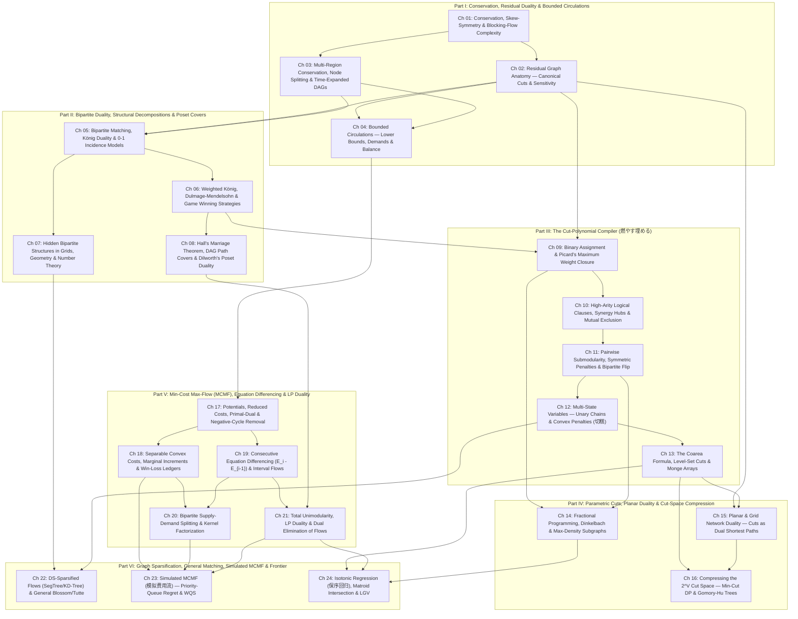
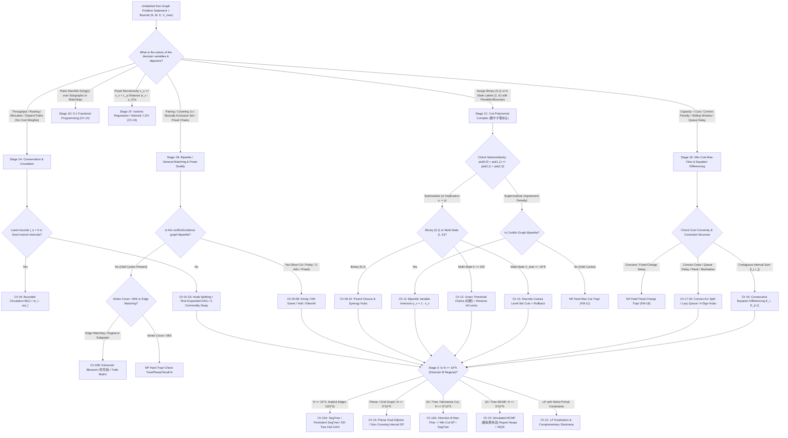

# Canonical Curriculum Architecture — Network Flows, Minimum Cuts, Matching, MCMF & Combinatorial Duality (`CURRICULUM_ARCHITECTURE.md`)

> **Phase 1.5 Master Specification** — Reconciled from Proposals A, B, and C across all 10 Phase 1 Research Monographs (`Wave 1A`–`Wave 5B`, 19,213 lines / 1.90 MB) and audited by Critic 1 (Prerequisite DAG & Topological Soundness), Critic 2 (Pedagogical Flow & Chapter Granularity), and Critic 3 (320-Problem Distribution & Bijective Accounting).
> **Adopted Macro-Architecture**: **Modelling-First & Cut-Polynomial Compilation (`Proposal A`)** — 6 Parts, 24 Chapters (`Ch 01`–`Ch 24`), 6 Two-Stage Part-End Blind Diagnostic Checkpoints (`CP-I`–`CP-VI`), 16 Multi-Perspective Synthesis Capstone Problems (`Syn-01`–`Syn-16`), and 14 Dual-Perspective Cross-Reference Bridges (`Rev-01`–`Rev-14`).
> **Master Problem Ledger**: **320 Total Curated Entries** = **256 Unique Accepted Non-Template Contest Problems** (`#001`–`#192` in `24 × 8` 4-Tier Chapter Ladders + `#193`–`#240` in `6 × 8` Two-Stage Blind Checkpoints + `#241`–`#256` in Multi-Perspective Synthesis Reserve) + **64 Quarantined Template & Non-Flow Trap Problems** (`R-01`–`R-64`).

---

## 1. Executive Pedagogical Manifesto & Master Architectural Accounting

### 1.1 Why "Modelling-First & Cut-Polynomial Compilation" Beats Solver-First & Theory-First

Across English (`[EN]`), Chinese (`[ZH]`), and Japanese (`[JA]`) competitive programming pedagogy, students attempting to master Network Flows, Minimum Cuts, Matching, and Min-Cost Max-Flow (MCMF) routinely fail at two predictable chasms:

1. **The "Solver-First" Trap**: Traditional textbooks spend 100+ pages proving Edmonds–Karp, Dinic, Push-Relabel, ISAP, and HLPP complexity bounds before teaching a single non-trivial modelling reduction. In actual ICPC World Finals, IOI, NOI, AtCoder Grand Contest (`AGC`), and Codeforces Div. 1 rounds, **the flow solver is a 50-line pre-written black box**. No contestant loses an `AGC F` or `NOI` gold medal because they wrote Dinic instead of HLPP; they lose because they cannot recognize that an English statement about *grid domino coverings*, *quadratic vertex penalties*, *daily napkin laundering*, or *prefix-sum coverage constraints* hides a flow or min-cut structure.
2. **The "Magic Gadget" Chasm**: Even when a student suspects "this is Min-Cut or MCMF," standard editorials present a 7-layer graph construction out of thin air (*"connect $S \to u$ with capacity $a_u + \frac{1}{2}\sum w_{uv}$, reverse all edges on the right side, add $\infty$ chains diagonally..."*). Because the intermediate **algebraic compilation step** was omitted, the student cannot reproduce the gadget when a single constraint sign flips in the next contest.

This textbook adopts the **Modelling-First & Cut-Polynomial Compilation** architecture (`Proposal A`), upgraded with the formal polyhedral rigor of `Proposal B` and the contest diagnostic trees of `Proposal C`:

* **Black-Box the Engine Early (`Ch 01`)**: Chapter 01 derives residual graphs, skew-symmetry, the Max-Flow Min-Cut Theorem, and Dinitz's blocking-flow complexity invariants ($O(V^2 E)$, $O(E\sqrt{V})$ unit-network, $O(V^{2/3}E)$ unit-capacity), then immediately seals the solver behind a **Strict Solver Black-Box Contract**. Starting from Chapter 02, 100% of intellectual bandwidth is devoted to **translating non-graph English problems into algebraic constraints, and compiling those constraints into exact flow/cut/matching graphs**.
* **Algebraic Intermediate Representations Before Any Vertices or Edges**: Every problem class is compiled through a concrete intermediate mathematical representation before a single edge is drawn:
  * **Conservation & Circulation (`Ch 03`–`Ch 04`, `Ch 19`)**: Flow balance equations $\nabla \cdot f(v) = b(v)$ and consecutive difference equations $\Delta E_i = E_i - E_{i-1}$.
  * **Bipartite Covering / Packing Duality (`Ch 05`–`Ch 08`)**: 0-1 incidence matrices, König's vertex cover / matching duality, Dulmage–Mendelsohn residual canonical blocks, and Dilworth poset chain/antichain decompositions.
  * **Binary & Multi-State Cut Polynomials (`Ch 09`–`Ch 13`, `燃やす埋める`)**: Pseudo-Boolean energy functions $E(x_1, \dots, x_n) = C_0 + \sum_i \phi_i(x_i) + \sum_{i < j} \psi_{ij}(x_i, x_j)$ over $x_i \in \{0, 1\}$ ($0 \equiv S$, $1 \equiv T$), extended to $K$-state variables via **Unary Threshold Indicator Chains** $z_{i,t} = [h_i \ge t] \in \{0,1\}$ with monotonicity locks $z_{i,1} \ge z_{i,2} \ge \dots \ge z_{i,K-1}$ and the **Discrete Coarea Formula** $|h_u - h_v| = \sum_{t} |z_{u,t} - z_{v,t}|$.
  * **Bipartite Supply–Demand & Kernel Factorization (`Ch 20`)**: Splitting every coupled state into $(i_{\text{out}} \in \mathcal{S}, i_{\text{in}} \in \mathcal{D})$ and factoring transition kernels $K(i, j) = \min_{h \in \mathcal{H}}(\alpha(i, h) + \beta(h, j))$ through low-cardinality intermediate hubs.
  * **Total Unimodularity & LP Duality (`Ch 21`, `Ch 23`)**: Node-arc incidence matrices, node potentials $\pi_v$ as dual shadow prices, WQS Lagrangian relaxation, and priority-queue regret simulation (`模拟费用流`).

---

### 1.2 The Four Non-Negotiable Pedagogical Laws

Every chapter (`Ch 01`–`Ch 24`) and every problem write-up (`#001`–`#256`) obeys four strict laws enforced during Phase 2 authoring:

1. **The "Zero Magic Gadgets" Mandate (4-Step English-to-Graph Compilation Pipeline)**:
   Never state *"construct the following graph"* out of thin air. Every archetype and worked problem must present:
   * **Step 1 — Non-Graph Diagnostic Signal (Recognition)**: What exact phrase in the English statement and what regime of $(N, M, K, V_{\max})$ tells a contestant to reach for Flow / Min-Cut / Matching / MCMF / Simulated Flow, and why greedy, DP, or 2-SAT fails.
   * **Step 2 — Intermediate Algebraic / Logical Representation**: Write down the explicit 0-1 indicator variables $x_i \in \{0,1\}$, unary threshold indicators $z_{i,t} = [h_i \ge t]$, pseudo-Boolean cut polynomial, consecutive equation differences $E_i - E_{i-1}$, or LP dual before introducing any graph terminology.
   * **Step 3 — Reverse-Engineering Scratchpad (Mechanical Graph Compilation)**: Show step-by-step how each algebraic term compiles into exact vertices, directed arcs, capacities, lower bounds, or costs—including **Bipartite Variable Inversion** ($y_v = 1 - x_v$) whenever a pairwise penalty is supermodular ($\psi(0,0) + \psi(1,1) > \psi(0,1) + \psi(1,0)$) on a bipartite interaction graph.
   * **Step 4 — Hand-Checkable Toy Trace & Broken-Gadget Counterexample**: Trace a concrete numerical instance ($N \le 4$) and prove what breaks if a subtle gadget rule is violated (`FM-01`–`FM-24`).
2. **The Strict Zero-Forward-Reference Law**:
   No chapter may invoke a theorem, gadget, or data structure introduced in a later chapter. Every dependency edge $(u \to v)$ in the Master Prerequisite DAG (§2.1) satisfies $u < v$ under the linear ordering `Ch 01` $\prec$ `Ch 02` $\prec \dots \prec$ `Ch 24`.
3. **The Zero-Boilerplate-Code Law**:
   Never dump standard Dinic, Hopcroft–Karp, or SSP MCMF solver templates. Code snippets are restricted to $\le 25$-line graph-compilation routines, residual extraction passes, or priority-queue regret simulation loops.
4. **Bidirectional Modelling Fluency (Direction A $\leftrightarrow$ Direction B)**:
   A complete flow theorist must master both directions:
   * **Direction A (Non-Graph $\to$ Flow/Cut/Matching/MCMF)**: Recognizing hidden flow structure inside geometry, strings, scheduling, matrices, and algebra when $N$ is in the polynomial flow regime.
   * **Direction B (Flow/Cut/MCMF $\to$ DP/Greedy/Dual/Heap Elimination)**: Recognizing when $N \ge 10^5$ makes explicit Dinic/MCMF TLE, formulating the exact flow/cut/MCMF model anyway, and then **eliminating the flow solver** via Planar Dual Dijkstra (`Ch 15`), Parametric Min-Cut Tree/Segment-Tree DP (`Ch 16`), LP Dual Inspection (`Ch 21`), or Priority-Queue Simulated MCMF (`Ch 23`).

---

### 1.3 Master 320-Problem Bijective Accounting Proof & `网络流 24 题` Disposition

To guarantee zero duplicate problems, zero missing problems, and complete separation between genuine modelling challenges and rote implementation templates, every problem harvested across Waves `1A`–`5B` is mapped into a strict **320-Problem Bijective Ledger**:

$$\underbrace{320 \text{ Total Curated Entries}}_{\text{100\% Disjoint Across All Pools}} = \underbrace{192 \text{ Chapter Ladders}}_{\text{24 Chapters } \times \text{ 8 Problems }\texttt{(\#001-\#192)}} + \underbrace{48 \text{ Blind Checkpoints}}_{\text{6 Parts } \times \text{ 8 Problems }\texttt{(\#193-\#240)}} + \underbrace{16 \text{ Synthesis Reserve}}_{\texttt{Syn-01}\text{ to }\texttt{Syn-16 }\texttt{(\#241-\#256)}} + \underbrace{64 \text{ Quarantined Ledger}}_{\texttt{R-01}\text{ to }\texttt{R-64}}$$

| Pool Code | Pool Name | Count | Global IDs | Structure & Pedagogical Role |
| :--- | :--- | :---: | :---: | :--- |
| **Pool A** | **24-Chapter Progressive Ladders** | **192** | `#001`–`#192` | `24 Chapters × 8 Problems` per chapter: `2 Stepping Stone [S1, S2]` + `3 Intermediate [I1, I2, I3]` + `2 Advanced [A1, A2]` + `1 Mastery [M1]`. |
| **Pool B** | **Two-Stage Part-End Blind Checkpoints** | **48** | `#193`–`#240` | `6 Parts × 8 Problems` (`CP-I` to `CP-VI`): Stage 1 scrambles `5` genuine flow/cut/MCMF problems + `3` non-flow decoys without chapter labels; Stage 2 reveals the algebraic/graph compilation or decoy elimination proof. |
| **Pool C** | **Multi-Perspective Synthesis Reserve** | **16** | `#241`–`#256` | `Syn-01` to `Syn-16`: Capstone problems solvable via $\ge 2$ distinct flow/cut/duality/simulation paradigms, presented side-by-side after Chapter 24. |
| **Pool R** | **Quarantined Templates & Non-Flow Traps** | **64** | `R-01`–`R-64` | `R-01`–`R-45` (Textbook/CSES/Luogu templates & `网络流 24 题` routine drills) + `R-46`–`R-64` (High-visibility contest problems quarantined to prevent canonical collision or expose non-flow traps). |
| ** Bridges** | **Dual-Perspective Revisited Cross-References** | *(14)* | `Rev-01`–`Rev-14` | Non-duplicating architectural pointers that revisit a problem from `#001`–`#192` in a later chapter to contrast two paradigms (counted once in `#001`–`#192`). |

#### Complete Disposition of the Chinese Classic `网络流 24 题` (`LOJ #6000`–`#6023` / Luogu)

Because Chinese OI training (`[ZH]`) universally benchmarks network flow curricula against the classic `网络流 24 题` collection, we explicitly account for all **24 problems** with a strict **11 Accepted + 9 Quarantined + 4 Excluded Non-Flow = 24** partition:

| Status | Count | Exact Problems & Canonical Assignment in `CURRICULUM_ARCHITECTURE.md` |
| :--- | :---: | :--- |
| **Accepted into Main Curriculum (`#001`–`#192`)** | **11** | 1. `P2754 [CTSC1999] 家园 / 星际转移问题` $\to$ `Ch 03 [I2] (#020)` (Time-Expanded DAG)   2. `P3355 骑士共存问题` $\to$ `Ch 06 [S1] (#041)` (Bipartite Parity MWIS)   3. `P2764 最小路径覆盖问题` $\to$ `Ch 08 [S1] (#057)` (DAG Disjoint Path Cover)   4. `P2765 魔术球问题` $\to$ `Ch 08 [I1] (#059)` (Incremental DAG Path Cover)   5. `P2762 太空飞行计划问题` $\to$ `Ch 09 [S1] (#065)` (Max-Weight Closure Prototype)   6. `P2774 方格取数问题` $\to$ `Ch 11 [S1] (#081)` (Bipartite Grid Conflict Inversion)   7. `P2766 最长不下降子序列问题` $\to$ `Ch 12 [I2] (#092)` (Layered DP-DAG Capacity Split)   8. `P4013 数字梯形问题` $\to$ `Ch 17 [I1] (#131)` (3-Rule Disjointness MCMF)   9. `P3358 最长k可重区间集问题` $\to$ `Ch 19 [S1] (#145)` (Coordinate-Compressed Interval MCMF)   10. `P3357 最长k可重线段集问题` $\to$ `Ch 19 [I1] (#147)` ($x \mapsto (2x, 2x+1)$ Coordinate Doubling)   11. `P1251 餐巾计划问题` $\to$ `Ch 20 [I1] (#155)` (Multi-Delay Inventory Splitting) |
| **Quarantined as Routine Templates (`Pool R`)** | **9** | 12. `P2756 飞行员配对方案问题` $\to$ `R-02`   13. `P3254 圆桌问题` $\to$ `R-06`   14. `P2763 试题库问题` $\to$ `R-07`   15. `P2761 软件补丁问题` $\to$ `R-35` *(Bitmask Dijkstra, not flow)*   16. `P4016 负载平衡问题` $\to$ `R-36` *(Circular median greedy)*   17. `P4015 运输问题` $\to$ `R-37`   18. `P4014 分配问题` $\to$ `R-38`   19. `P4012 深海机器人问题` $\to$ `R-39`   20. `P3356 火星探险问题` $\to$ `R-40` |
| **Excluded Non-Flow Misclassifications (`Pool R`)** | **4** | 21. `P4011 孤岛营救问题` $\to$ `R-57` *(Bitmask BFS on keys, $P \le 10$)*   22. `P4009 汽车加油行驶问题` $\to$ `R-58` *(Layered state-space Dijkstra)*   23. `P2770 航空路线问题` $\to$ `R-59` *(Standard bitonic DP; redundant with `P4013`)*   24. `P2769 猴子上树` $\to$ `R-60` *($O(NM)$ sorted interval DP)* |

---

### 1.4 Dissolution of Phase 1 Research Waves (`Wave 1A`–`Wave 5B`) into the 24-Chapter Spine

The 10 Phase 1 research waves were organized for parallel literature mining. In the final textbook, those wave boundaries are **completely dissolved** and re-architected into a single monotonically increasing pedagogical spine:

| Phase 1 Wave File | Primary Chapters in `CURRICULUM_ARCHITECTURE.md` | Cross-Pollination & Surgical Re-routings |
| :--- | :--- | :--- |
| **`Wave 1A` (Foundations, Residual Invariants, Circulations)** | `Ch 01`, `Ch 02`, `Ch 03`, `Ch 04` | Feasible/essential cut edges (`[AHOI2009] 最小割`) anchored in `Ch 02`; rank-2 grid/matrix capacity routing (`P1129`, `AGC 037D`) unified in `Ch 03`. |
| **`Wave 1B` (Bipartite Matching, König, Hall, Dilworth)** | `Ch 05`, `Ch 06`, `Ch 07`, `Ch 08` | Unweighted DM decomposition (`Ch 06`) separated cleanly from general weighted closure (`Ch 09`); Rank-2 conflict compilation unified in `Ch 07`. |
| **`Wave 2A` (Closure, Project Selection, Submodular Cuts)** | `Ch 09`, `Ch 10`, `Ch 11` | Picard's Theorem (`Ch 09`) extended to $k$-ary clause hubs (`Ch 10`) and Bipartite Variable Inversion for supermodular pairwise terms (`Ch 11`). |
| **`Wave 2B` (Multi-State `燃やす埋める`, Coarea, Monge)** | `Ch 12`, `Ch 13` | Explicit $K$-state threshold chains (`Ch 12`) escalated to continuous/implicit Coarea level-set integrals and Monge submodularity (`Ch 13`). |
| **`Wave 3A` (Parametric Cuts, Planar Duality, Gomory–Hu, Cut DP)** | `Ch 14`, `Ch 15`, `Ch 16` | Dinkelbach (`Ch 14`) and Planar Duals (`Ch 15`) precede `Ch 16`, which unifies Direction B Min-Cut DP (`Module 16A`) and Gomory–Hu Cut Trees (`Module 16B`). |
| **`Wave 3B` (MCMF Foundations, Convex Costs, Circulation Duals)** | `Ch 17`, `Ch 18`, `Ch 19` | SSP/Primal-Dual (`Ch 17`) $\to$ discrete convex parallel arcs (`Ch 18`) $\to$ consecutive equation differencing $E_i - E_{i-1}$ (`Ch 19`). |
| **`Wave 4A` (Dynamic MCMF, Cycle Covers, Kernel Factorization)** | `Ch 20` | Unified under **Bipartite Supply–Demand Splitting & Transition Kernel Factorization** (cycle covers, napkin delays, lazy chef queues, rank slots). |
| **`Wave 4B` (LP Duality, Total Unimodularity, Simulated MCMF)** | `Ch 21`, `Ch 23` | Polyhedral TU & LP duals (`Ch 21`) separated from `Ch 22` so that `Ch 23` (`模拟费用流`) can synthesize both `Ch 21` shadow prices and `Ch 22` data structures. |
| **`Wave 5A` (DS-Optimized Flows, General Matching, Tutte Matrix)** | `Ch 22` | Partitioned into `Module 22A` (Virtual Hub DAG Sparsification: SegTree/HLD/KD-Tree) and `Module 22B` (Edmonds' Blossom & Algebraic Tutte Pfaffians). |
| **`Wave 5B` (Isotonic Regression, Matroid Intersection, LGV)** | `Ch 24` | Unified under **Two-Layer Parametric & Determinantal Saddle-Point Projections** (`整体二分` + `Ch 09` closure, matroid exchange, chessboard parity, LGV). |

---

## 2. Canonical 24-Chapter Prerequisite DAG, Unification Spines & Blueprint Contract

### 2.1 Master Prerequisite DAG (`Ch 01`–`Ch 24`)

Every directed dependency edge $(u \to v)$ below satisfies $u < v$. No forward references exist anywhere in the 24-chapter sequence:

#### Topological Soundness Verification Matrix (Audited by Critic 1)

| Chapter | Incoming Prerequisites | Why Placement is Topologically Exact & Pedagogically Optimal |
| :--- | :--- | :--- |
| **`Ch 01`–`Ch 04`** | None (`Ch 01` root) | Establishes conservation $\nabla \cdot f = 0$, residual SCCs (`Ch 02`), node/time splitting (`Ch 03`), and lower-bound demand transformation $M(v) = \text{in}_l(v) - \text{out}_l(v)$ (`Ch 04`) before any specialized reductions. |
| **`Ch 05`–`Ch 08`** | `Ch 02`, `Ch 03` | Derives König (`Ch 05`), Dulmage–Mendelsohn & MWIS (`Ch 06`), Rank-2 hidden bipartite graphs (`Ch 07`), and Hall/Dilworth (`Ch 08`) directly from unit-network residual reachability. |
| **`Ch 09`–`Ch 13`** | `Ch 02`, `Ch 06` | Generalizes `Ch 06` bipartite MWIS into Picard's Closure (`Ch 09`), $k$-ary clause hubs (`Ch 10`), Bipartite Flip (`Ch 11`), $K$-state unary chains (`Ch 12`), and Coarea level-set cuts (`Ch 13`). |
| **`Ch 14`–`Ch 16`** | `Ch 09`, `Ch 11`, `Ch 13` | `Ch 14` (Dinkelbach) requires `Ch 09`/`Ch 11` closure; `Ch 15` (Planar Duals) requires `Ch 02` cuts + `Ch 13` level sets; `Ch 16` compresses the $2^V$ cut space via Direction B Cut-DP and Gomory–Hu trees. |
| **`Ch 17`–`Ch 21`** | `Ch 04`, `Ch 08` | `Ch 17` uses `Ch 04` circulation saturation to eliminate negative cycles (`CF 708D`); `Ch 18`–`Ch 20` build convex costs, equation differencing, and kernel factorization; `Ch 21` unifies TU and LP Duality. |
| **`Ch 22`–`Ch 24`** | `Ch 07`, `Ch 12`–`Ch 14`, `Ch 18`–`Ch 21` | `Ch 22` breaks the $\Theta(N^2)$ edge barrier and bipartite parity barrier; `Ch 23` synthesizes `Ch 18` slopes + `Ch 20` matching + `Ch 21` dual potentials into `模拟费用流`; `Ch 24` crowns the work with `保序回归`, Matroid Intersection, and LGV. |

---

### 2.2 The Five Surgical Multi-Topic Chapter Unification Spines (Reconciled from Critic 2)

To prevent multi-topic chapters from reading like disconnected bags of tricks, five chapters are governed by explicit **Algebraic Unification Spines**:

1. **`Ch 03` & `Ch 07` — Rank-2 Binary Constraint Factorization**:
   Every hidden bipartite or grid-flow reduction is derived by asking: *Does each decision entity bind **two** orthogonal coordinate axes?*
   * **Primal Entity-as-Edge ($\mathcal{I} \hookrightarrow \mathcal{A} \times \mathcal{B}$)**: Each choice is an arc $(a_e, b_e)$ between axis $\mathcal{A}$ and axis $\mathcal{B}$ (`P1129` row-column permutation, `P2825`/`Muddy Fields` maximal obstacle-segmented strips, `AGC 037D` Birkhoff–von Neumann $k$-regular decomposition).
   * **Dual Conflict-as-Vertex ($\mathcal{A} \perp \mathcal{B}$)**: Orthogonal choices become vertices and shared unit borders/cells become conflict edges (`CF 1404E — Bricks` L-corners on shared unit borders).
   * **Algebraic 2-Adic Valuation ($D = 4^k D'$ Coloring)**: Rescaling coordinates by $2^k$ exposes modulo-2 parity bipartiteness (`AGC 025D`).
2. **`Ch 16` — Compressing the Exponential $2^V$ Cut Space**:
   When a problem either has $N \ge 2 \cdot 10^5$ (`Direction B`) or asks for $\binom{N}{2}$ all-pairs min-cuts, we compress the $2^V$ cut space along two orthogonal axes:
   * **Module 16A (`16.1` Primal Low-Width Parameterization of a Single $S$-$T$ Cut)**: Write $\min_{x \in \{0,1\}^V} E(x)$ and observe that the cross-cut state between prefix $1..i$ and suffix $i+1..n$ has width $O(1)$ (`CF 1919F1/F2`), $O(i)$ (`CF 724E`), or $O(\log n)$ on a Segment Tree (`CF 903G`).
   * **Module 16B (`16.2–16.4` Laminar Uncrossing Basis of All $\binom{N}{2}$ Pairwise Cuts)**: Prove submodular cut uncrossing $\operatorname{cap}(A) + \operatorname{cap}(B) \ge \operatorname{cap}(A \cap B) + \operatorname{cap}(A \cup B)$, showing that $\binom{N}{2}$ pairwise min-cuts live in a laminar family of size $N-1$ (Gusfield's Gomory–Hu Tree `P3329`, `P4123`, `CF 343E`).
3. **`Ch 20` — Bipartite Supply–Demand Splitting & Transition Kernel Factorization**:
   All dynamic, temporal, and geometric MCMF models in `Ch 20` obey one master equation: split every entity into **Supply ($i_{\text{out}} \in \mathcal{S}$)** and **Demand ($i_{\text{in}} \in \mathcal{D}$)**, and factor dense pairwise transition costs $K(i, j) = \min_{h \in \mathcal{H}}(\alpha(i, h) + \beta(h, j))$ through intermediate hubs $h \in \mathcal{H}$:
   * *Cycle/Path Covers (`20.1`)*: Direct bipartite arcs $(i_{\text{out}} \to j_{\text{in}})$.
   * *Time-Delay Inventory (`20.2`, `餐巾计划`)*: $d_t \in \mathcal{S}$ (dirty generated) vs. $c_t \in \mathcal{D}$ (clean required), factored through storage chains $d_t \to d_{t+1}$.
   * *Reverse Queue-Position Lazy Spawning (`20.3`, `修车` / `[NOI2012] 美食节`)*: $W_k = \sum_i T_{i,j} \cdot p_i$ where $p_i \in \{1, \dots, N\}$ is the **reverse position from the end of chef $j$'s queue**, spawned lazily on demand.
   * *Order-Statistic Rank Slots & Sign-Expansion Hubs (`20.4`, `AGC 031E` / `AGC 034D`)*: Factoring 2D prefix-rank constraints through $k$ rank-slot hubs, and $\ell_1$ Manhattan distance $|x_i - x_j| + |y_i - y_j| = \max_{s_1, s_2 \in \{\pm 1\}} [(s_1 x_i + s_2 y_i) + (-s_1 x_j - s_2 y_j)]$ through **4 global sign hubs**.
4. **`Ch 22` — Two-Module Partition: Breaking the $\Theta(N^2)$ Edge Barrier & Bipartite Parity Barrier**:
   * **Module 22A (`22.1–22.2` Virtual Hub DAG Sparsification)**: Factoring $U \times V \subseteq \mathcal{I}$ via auxiliary hub DAGs $\mathcal{H}$ (1D Segment Tree Out-Tree/In-Tree, Tree HLD, 2D Sweep-Line Persistent Segment Tree `CF 793G`, 2D K-D Tree `P5471`, CDQ Divide-and-Conquer).
   * **Module 22B (`22.3–22.4` Non-Bipartite Odd-Cycle Contraction & Algebraic Pfaffians)**: Breaking the bipartite parity assumption via Edmonds' Blossom shrinking (`带花树`), Gallai–Edmonds canonical structure, degree-$d$ split-vertex gadgets (`挑战 NPC`), and Tutte's skew-symmetric matrix $T(G)^{-1}$.
5. **`Ch 24` — Two-Layer Parametric & Determinantal Saddle-Point Projections**:
   * *24.1 Isotonic Regression (`保序回归`)*: Outer layer = `整体二分` parallel binary search via convex subgradients; inner layer = `Ch 09` Project Selection (`P4331`, `[SDOI2017] 切树游戏`, `[省选联考 2020 A卷] 魔法商店`).
   * *24.2 Weighted Matroid Intersection*: Outer layer = bipartite exchange graph $G(I)$ between $\mathcal{M}_1$ and $\mathcal{M}_2$; inner layer = shortest augmenting path (`CF 1556H`, `CF 1284G`).
   * *24.3 Parity Invariants, Geometric Chords & LGV Determinants*: Chessboard increment invariant (`[SCOI2012] 奇怪的游戏`), Imai–Asano rectilinear intersection, LGV non-intersecting path determinant, and minimax game saddle points (`UOJ #455`).

---

### 2.3 Direction A vs. Direction B Constraint-Regime Decision Matrix

| Structural Regime | Typical Constraints $(N, M, K)$ | Target Direction | Canonical Compilation Target |
| :--- | :--- | :---: | :--- |
| **Small General Graph / Closure / Grid** | $N, M \le 500$ (or unit-network $N \le 5\cdot 10^4, M \le 1.5\cdot 10^5$) | **Direction A** (Explicit Flow/Cut) | Build explicit graph; run Dinic (`Ch 02`–`Ch 14`). |
| **Small Cost-Coupled Assignment / Circulation** | $N \le 400, M \le 5000$ (or lazy queue $N \le 800$) | **Direction A** (Explicit MCMF) | Build explicit cost network; run Primal-Dual / SSP (`Ch 17`–`Ch 20`). |
| **Dense Range / Geometric Adjacency, Small Flow** | $N \le 5\cdot 10^4$, implicit edges $\Theta(N^2)$ | **Direction A+** (Sparsified Flow) | Virtual Hub DAG (`Ch 22` SegTree / Persistent SegTree / KD-Tree) + Dinic/MCMF. |
| **Planar / Grid Graph, $N, M \ge 10^5$** | $N, M \le 4\cdot 10^5$, planar topology | **Direction B** (Planar Dual) | Formulate primal Min-Cut $\to$ compile to **Planar Dual Dijkstra** in $O(N \log N)$ (`Ch 15`). |
| **1D / Tree / Monotone Bipartite Flow, $N \ge 10^5$** | $N \le 2\cdot 10^5$, tree/chain/DAG structure | **Direction B** (Cut-DP / Dual) | Formulate Max-Flow $\to$ dualize to **Min-Cut DP / Segment Tree** (`Ch 16.1`) or **LP Dual** (`Ch 21`). |
| **1D / Tree / Prefix-Bounded MCMF, $N \ge 10^5$** | $N \le 5\cdot 10^5$, convex/unit costs on tree or line | **Direction B** (`模拟费用流`) | Formulate MCMF residual cycles $\to$ simulate via **Regret Heaps + WQS Binary Search** (`Ch 23`). |

---

### 2.4 Canonical 1-to-1 24-Chapter Broken-Gadget Counterexample Matrix (`FM-01`–`FM-24` $\leftrightarrow$ `H-01`–`H-24`)

Every chapter (`Ch 01`–`Ch 24`) features a dedicated **Step 4 Broken-Gadget Counterexample (`FM-01`–`FM-24`)** in a `> [!WARNING]` box, paired bijectively with its defensive verification rule (`H-01`–`H-24`):

| ID | Chapter | Broken-Gadget Construction & Concrete Failure Mechanism | Defensive Verification Rule (`H-ID`) |
| :---: | :--- | :--- | :--- |
| **`FM-01`** | `Ch 01` | **Greedy Path Deletion without Reverse Residual Arcs**: Deleting $s \to 1 \to 2 \to t$ on the 4-node diamond locks flow at $1$ instead of $2$ because $f(2,1) = -f(1,2)$ cannot reroute. | **`H-01` / `H-03`**: Every arc $(u,v,c)$ must allocate its skew-symmetric partner $(v,u,0)$ at `idx ^ 1`; apply BFS current-arc + dead-end pruning. |
| **`FM-02`** | `Ch 02` | **Saturated Edge $\neq$ Min-Cut Edge**: Assuming $f^*(e) = c(e)$ implies $e$ belongs to some min-cut fails when an unsaturated bypass path connects $u \to v$ in $G_{f^*}$ (`[AHOI2009] 最小割`). | **`H-02` (Residual SCC)**: Run Tarjan SCC on $G_{f^*}$: feasible iff $\operatorname{scc}(u) \neq \operatorname{scc}(v)$; essential iff $\operatorname{scc}(u)=\operatorname{scc}(s) \land \operatorname{scc}(v)=\operatorname{scc}(t)$. |
| **`FM-03`** | `Ch 03` | **Unsplit Vertex Capacity / Missing Holdover Arcs**: Putting capacity on external edges instead of $v_{\text{in}} \xrightarrow{c(v)} v_{\text{out}}$, or omitting $(u, t-1) \xrightarrow{\infty} (u, t)$ in time-expanded DAGs, or applying 2-commodity uncrossing on directed graphs. | **`H-02` (Node Split)**: All incoming arcs must enter $v_{\text{in}}$; all outgoing arcs must leave $v_{\text{out}}$; 2-commodity rotation $(f_1 \pm f_2)/2$ requires undirected symmetry. |
| **`FM-04`** | `Ch 04` | **Lower-Bound Sign Inversion & Feedback-Edge Leakage**: Using $M(v) = \text{out}_l - \text{in}_l$ (inverted sign) or running Phase 2 Max/Min-Flow without deleting the Phase 1 feedback arc $t \xrightarrow{\infty} s$ and its residual $s \to t$. | **`H-04` / `H-05`**: Enforce $M(v) = \text{in}_l(v) - \text{out}_l(v)$, read $f_0 = f_{\text{rev}}(t \to s)$, zero out both directions of $(t,s)$, and verify $\sum_{v \in V^+} M(v) = F_{S' \to T'}$. |
| **`FM-05`** | `Ch 05` | **König Reachability from Matched Left Nodes**: Starting the alternating reachability DFS from *all* $u \in L$ (instead of strictly unmatched $U_L = L \setminus V(M)$) marks the entire graph reachable and outputs a non-minimum cover. | **`H-06` (König Seed)**: Seed alternating DFS strictly from unmatched $U_L$, follow unmatched arcs $L \to R$ and matched arcs $R \to L$, and set $C^* = (L \setminus Z) \cup (R \cap Z)$. |
| **`FM-06`** | `Ch 06` | **$O(VE)$ Rematching vs. Linear DM Decomposition**: Re-running Dinic/Hungarian $O(V)$ times to classify always/never matched vertices, or forgetting that starting on an optionally-matched vertex $v \in V^-$ allows the opponent to win. | **`H-07` (DM Reachability)**: A single $O(V+E)$ alternating BFS from $U_L$ and $U_R$ partitions $V = V^+ \sqcup V^- \sqcup V^0$ and characterizes all winning game states. |
| **`FM-07`** | `Ch 07` | **Unsplit Obstacle Strips & Cell-vs-Border Vertex Placement**: Treating whole rows/columns as single vertices across walls (`P2825`), or putting vertices on black cells instead of shared unit borders in `CF 1404E — Bricks`. | **`H-07B` (Rank-2 Entity Audit)**: Split strips at every obstacle; if each choice covers $\le 2$ borders (`Bricks`), make *borders* vertices and *L-corners* conflict edges. |
| **`FM-08`** | `Ch 08` | **Non-Transitive Poset Cover & `OR` Antichain Bug**: Running DAG path cover without Floyd–Warshall transitive closure (`[CTSC2008] 祭祀`), or extracting the antichain via $v_{\text{out}} \notin C^* \lor v_{\text{in}} \notin C^*$ instead of $\land$. | **`H-06` / `H-08`**: For general chain covers, compute transitive closure first; extract antichain strictly as $A^* = \{v : v_{\text{out}} \notin C^* \land v_{\text{in}} \notin C^*\}$. |
| **`FM-09`** | `Ch 09` | **Unpruned Prerequisite Cycles in Closure (`植物大战僵尸`)**: Leaving a directed cycle $u \leftrightarrow v$ in Picard's closure graph allows the min-cut to place the entire cycle + its dependents into $S$ with $0$ finite edges cut, harvesting phantom profits. | **`H-09` / `H-10`**: Before running Dinic on any physical-causality closure graph, prune all vertices with $\text{in-degree} > 0$ after reverse topological sort. |
| **`FM-10`** | `Ch 10` | **Reversed Synergy Hub Orientation**: Wiring $i \xrightarrow{\infty} H_A$ instead of $H_A \xrightarrow{\infty} i$ for an all-$S$ bonus hub $S \xrightarrow{B_A} H_A$ leaves $H_A \in S$ disconnected from $i \in T$, granting the bonus $B_A$ unconditionally for free! | **`H-10B` (Clause Hub Lock)**: All-$S$ bonus hub requires $S \xrightarrow{B_A} H_A$ and $H_A \xrightarrow{\infty} i$; all-$T$ bonus hub requires $i \xrightarrow{\infty} H'_A$ and $H'_A \xrightarrow{B'_A} T$. |
| **`FM-11`** | `Ch 11` | **Supermodular Penalty without Bipartite Flip / Odd-Cycle Trap**: Compiling a same-state penalty ($\psi(0,0)+\psi(1,1) > \psi(0,1)+\psi(1,0)$) directly yields negative arc capacities; attempting Bipartite Flip $y_v = 1 - x_v$ on a triangle $K_3$ leaves one edge negative. | **`H-11` (Submodularity & 2-Coloring)**: Verify $\psi(0,0)+\psi(1,1) \le \psi(0,1)+\psi(1,0)$ for every edge; if reversed, 2-color the conflict graph and substitute $y_v = 1 - x_v$ on $R$. |
| **`FM-12`** | `Ch 12` | **Missing Reverse $\infty$-Locks & Non-Convex State Ordering**: Omitting $(i, k) \xrightarrow{\infty} (i, k-1)$ in `切糕` allows $s$-$t$ cuts to sever multiple arcs on one chain; ordering states as $(-1, +1, \text{del})$ in `ARC 107F` makes the transition penalty non-submodular. | **`H-12` (Unary Prefix Lock)**: Always wire $(i, k) \xrightarrow{\infty} (i, k-1)$ so $\{z_{i,1} \ge \dots \ge z_{i,K-1}\}$ has a unique $1 \to 0$ transition; order states so $\Delta^2 f \ge 0$. |
| **`FM-13`** | `Ch 13` | **Unshifted Negative Unary Capacities & Non-Convex Coarea Split**: Leaving negative capacities on $K$-chains (`CF 434D` without $+M$ shift), or decomposing Coarea level sets into independent binary cuts when unary costs are concave ($\Delta^2 f_i < 0$). | **`H-13` / `H-14`**: Shift every unary chain arc by $+M > \max |f_i(x)|$ and subtract $N \cdot M$ at the end; independent Coarea level-set cuts require convex unary terms. |
| **`FM-14`** | `Ch 14` | **Unshifted Density Capacities & Coarse Binary Search $\varepsilon$**: In Goldberg's $|V|$-only Max-Density Subgraph, arc capacity $2\lambda - d_v$ can be negative without a $+U$ shift; stopping binary search at $\varepsilon = 10^{-4}$ when $N = 1000$ misidentifies $S^*$. | **`H-15` (Fractional Shift & Gap)**: Shift node-side capacities by $U \ge \max d_v$; enforce $\varepsilon < \frac{1}{N(N-1)}$ or use Dinkelbach's exact Newton-step iteration. |
| **`FM-15`** | `Ch 15` | **Undirected Planar Dual on Directed Primal Grid (`海拔`)**: Treating dual edges as undirected when primal grid edges are directed ($0 \to 1$ costs $w$, $1 \to 0$ costs $0$), or running single outer-face Dijkstra when $s, t$ are interior faces. | **`H-15B` (Oriented Right-Hand Dual)**: Rotate each directed primal arc $u \to v$ $90^\circ$ clockwise to orient $f_{\text{left}} \to f_{\text{right}}$; interior $s$-$t$ requires minimum $s$-$t$-separating dual cycle. |
| **`FM-16`** | `Ch 16` | **Node Contraction Corruption in Gusfield's Gomory–Hu**: Physically contracting $S_{\min}$ vertices during the $N-1$ max-flow steps merges cross-edges and corrupts later cuts; or assuming Gomory–Hu tree edges are physical edges of $G$. | **`H-16` (Uncontracted Gusfield)**: Run all $N-1$ max-flows on the **original uncontracted graph $G$**, updating only the parent pointers `p[i]` on $T_{\text{GH}}$. |
| **`FM-17`** | `Ch 17` | **Uncapped Early-Exit Dijkstra Potentials & Unforced Negative Cycles**: Updating `pi[v] += dist[v]` for unvisited nodes after early exit at $t$ breaks reduced-cost non-negativity; running SSP on graphs with negative cycles loops forever. | **`H-17` / `H-18` / `H-19`**: Update `pi[v] += min(dist[v], dist[t])`; pre-saturate all negative-cost arcs (`强制满流`, `CF 708D`) and resolve imbalances via `Ch 04` super-source/sink. |
| **`FM-18`** | `Ch 18` | **Parallel-Arc Expansion of Non-Convex Costs**: Expanding a concave cost function ($\Delta\Phi(1) = 10 > \Delta\Phi(2) = 2$) into parallel unit arcs causes SSP to greedily route flow along the $2\text{nd}$ unit arc before the $1\text{st}$! | **`H-20` (Marginal Convexity)**: Parallel unit-arc expansion requires non-decreasing marginal increments $\Delta\Phi(1) \le \Delta\Phi(2) \le \dots \le \Delta\Phi(U)$ (or reversals for max-cost). |
| **`FM-19`** | `Ch 19` | **Off-by-One Interval Wiring & Unsplit Vertical Segments**: Wiring $[l_j, r_j]$ as $l_j \to r_j$ instead of $l_j \to r_j + 1$, omitting dummy equation $E_{n+1}: 0=0$, or failing to double coordinates $x \mapsto (2x, 2x+1)$ for vertical segments (`P3357`). | **`H-21` (Difference Conservation)**: Write $E_1, \dots, E_n, E_{n+1} \equiv 0$, take $\Delta E_i = E_i - E_{i-1}$, verify every variable $x_j$ appears once as $+x_j$ and once as $-x_j$. |
| **`FM-20`** | `Ch 20` | **Merged Dirty/Clean State & Forward Queue Indexing (`餐巾`/`美食节`)**: Using one vertex per day in `餐巾计划` allows dirty napkins to satisfy clean demand immediately; indexing chef slots forward instead of reverse ($p$-th from last) makes costs state-dependent. | **`H-20B` (Bipartite State Split)**: Keep Supply ($d_t$) and Demand ($c_t$) strictly separated; index chef queue positions in reverse ($p \in \{1..N\}$ from end) and spawn $(j, p+1)$ lazily. |
| **`FM-21`** | `Ch 21` | **Dual Potential Sign Flip & False TU Assumption**: Writing $\pi_u - \pi_v \le c_{uv}$ with the wrong sign reverses arc directions; assuming an arbitrary 0-1 integer program without C1P or bipartite structure has zero integrality gap. | **`H-21B` (Complementary Slackness & TU)**: Verify that every column of the constraint matrix has at most one $+1$ and one $-1$ (after C1P differencing or bipartite flip) before claiming TU. |
| **`FM-22`** | `Ch 22` | **Shared In/Out Segment Tree Short-Circuit & Bipartite Double-Cover Odd-Cycle Trap**: Reusing one Segment Tree for both range-out and range-in allows flow to leak $u \to \text{root} \to v$ between disjoint queries; double-covering $K_3$ yields half-integral 3-cycles. | **`H-22` / `H-08`**: Maintain two strictly disjoint Segment Trees (`Out-Tree` $\to$ leaves, leaves $\to$ `In-Tree`); general non-bipartite matching requires Edmonds' Blossom (`带花树`). |
| **`FM-23`** | `Ch 23` | **Single-Heap Regret Omission & Missing WQS Fixed-$K$ Penalty**: Maintaining only one priority queue on a tree (`Conquer the World`) misses residual flow reversals; running online prefix heaps without WQS penalty $\lambda$ fails when $K$ is fixed (`CF 802O`). | **`H-23` / `H-24`**: Push complementary regret keys (`2*dep[u] - d` and `2*dep[u] - s`) into both heaps after every match; wrap fixed-$K$ simulation in WQS binary search on $\lambda$. |
| **`FM-24`** | `Ch 24` | **Chessboard Parity Blindness (`奇怪的游戏`) & Cross-Partition Leakage in `整体二分`**: Binary searching the final value $X$ on an odd-sized board ($c_B \neq c_W$) fails because $X = \frac{s_B - s_W}{c_B - c_W}$ is uniquely fixed; keeping cross-edges in `整体二分` makes complexity $O(N^2)$. | **`H-24B` (Invariant & Contraction Audit)**: Always check global linear invariants ($\sum_{B} \Delta - \sum_{W} \Delta = 0$) before binary search; strip cross-partition edges when recursing in `整体二分`. |

---

### 2.5 Mandatory 6-Step Chapter Blueprint Contract

During Phase 2 textbook authoring, every single chapter (`Ch 01`–`Ch 24`) must implement the following 6-section structural blueprint:

1. **Opening Non-Graph Recognition Hook & Motivation**: Open with a concrete non-graph problem from the chapter's ladder, show why naive greedy/DP fails, and expose the hidden conservation or cut-polynomial invariant.
2. **Core Mathematical Theory & Polyhedral/Structural Invariants**: State and prove the chapter's theorems using elementary combinatorial, residual-graph, or LP-duality arguments.
3. **The 4-Step "Zero Magic Gadgets" Compilation Pipeline**: Present the chapter's canonical compilation table mapping algebraic terms $\to$ directed arcs/capacities/costs, accompanied by a hand-checkable $N \le 4$ trace.
4. **The Chapter Broken-Gadget Counterexample (`FM-XX` $\leftrightarrow$ `H-XX`)**: Present the exact broken construction from §2.4 in a `> [!WARNING]` box and prove why it fails on a concrete small test case.
5. **Worked Flagship Problem Walkthroughs**: Walk through 3–4 representative problems across the chapter's sub-topics using the 4-Step Pipeline (`Step 1 Diagnostic Signal` $\to$ `Step 2 Algebraic Formulation` $\to$ `Step 3 Mechanical Graph Compilation` $\to$ `Step 4 Complexity & Extraction`).
6. **The 8-Problem 4-Tier Progressive Ladder (`[S1, S2, I1, I2, I3, A1, A2, M1]`)**: Present all 8 assigned problems with judge URL, exact constraints, diagnostic signal, algebraic-to-graph scratchpad, complete solution, and 3-tier progressive hints.
---

## 3. Complete 24-Chapter Detailed Specification, 4-Tier Ladders (`#001`–`#192`) & Blind Checkpoints (`#193`–`#240`)

---

### Part I: Conservation, Residual Duality & Bounded Circulations (`Ch 01` – `Ch 04`)

#### Chapter 01: Flow Conservation, Skew-Symmetry, Residual Graphs & Blocking-Flow Complexity Invariants

* **Prerequisites**: None (Root Chapter).
* **Dissolved Research Sources**: `Wave 1A` (§1.1–1.5, §2.1).
* **Core Theoretical & Pedagogical Spine**:
  * **1.1 Conservation Laws & Skew-Symmetric Net Flow Formulation**:
    * Define a capacity network $G = (V, E, c, s, t)$ via anti-symmetric net flow $f(u, v) = -f(v, u)$, capacity upper bound $f(u, v) \le c(u, v)$, and Kirchhoff nodal conservation $\nabla \cdot f(u) := \sum_{v \in V} f(u, v) = 0$ for all $u \in V \setminus \{s, t\}$.
    * Prove the **Cut-Value Conservation Lemma**: for any $s$-$t$ cut $(S, T)$ ($s \in S, t \in T = V \setminus S$),
      $$|f| := \nabla \cdot f(s) = \sum_{u \in S} \nabla \cdot f(u) = \sum_{u \in S}\sum_{v \in T} f(u, v) \le \sum_{u \in S}\sum_{v \in T} c(u, v) = \operatorname{cap}(S, T),$$
      with equality iff every forward cross-arc $(u, v) \in (S, T)$ is saturated ($f(u,v) = c(u,v)$) and every backward cross-arc $(v, u) \in (T, S)$ carries zero flow ($f(v,u) = 0$).
  * **1.2 Residual Capacity $c_f(u, v) = c(u, v) - f(u, v)$ & The Max-Flow Min-Cut Theorem**:
    * Derive why pushing $\Delta > 0$ along a reverse arc $(v, u)$ in $G_f$ corresponds algebraically to $f'(u, v) = f(u, v) - \Delta$: **canceling committed forward flow and rerouting it**.
    * Prove the **Ford–Fulkerson Equivalence**: (i) $f$ is a maximum flow $\iff$ (ii) $G_f$ contains no $s \leadsto t$ augmenting path $\iff$ (iii) $|f| = \operatorname{cap}(S_f, V \setminus S_f)$ where $S_f = \{v \in V : s \leadsto_{G_f} v\}$.
  * **1.3 Dinitz's Blocking-Flow Engine & Contest Complexity Invariants (The Solver Black-Box Contract)**:
    * Level graph $L_f$ ($\operatorname{dist}_{G_f}(s, v) = \operatorname{dist}_{G_f}(s, u) + 1$), strict phase distance increase $\operatorname{dist}_{G_{f'}}(s, t) \ge \operatorname{dist}_{G_f}(s, t) + 1$, and the **Three Golden Complexity Bounds** used across the rest of the textbook:
      1. *General Capacities*: $O(V^2 E)$.
      2. *Unit-Capacity Networks ($c(e) = 1$)*: $O\big(\min(V^{2/3}, E^{1/2})\,E\big)$ via distance threshold $\tau = \min(V^{2/3}, E^{1/2})$.
      3. *Unit Networks (Bipartite / Vertex-Capacitated, $\min(d^-(v), d^+(v)) \le 1$)*: $O(E\sqrt{V})$ via vertex-disjoint residual path packing.
    * **The Black-Box Contract**: Seal the Dinic implementation here. From `Ch 02` onward, every solution specifies $(|V|, |E|, \text{Capacity Regime}) \implies \text{Asymptotic Bound}$.
  * **1.4 Flow Decomposition Theorem (`流分解定理`) & Menger's Edge-Disjoint Connectivity**:
    * Any integral $s$-$t$ flow $f$ decomposes into $\le |E|$ directed $s \leadsto t$ paths and directed cycles; extracting edge-disjoint paths or bottleneck-constrained routings via binary search + capacity scaling (`CF 653D`, `P3153`).

> [!WARNING]
> **Broken-Gadget Counterexample `FM-01` ($\leftrightarrow$ `H-01` / `H-03`) — Greedy Path Deletion without Reverse Residual Arcs & Unpruned Dinic DFS**:
> On the 4-vertex diamond $s \xrightarrow{1} 1, s \xrightarrow{1} 2, 1 \xrightarrow{1} 2, 1 \xrightarrow{1} t, 2 \xrightarrow{1} t$, greedily augmenting $s \to 1 \to 2 \to t$ and deleting used edges yields $|f| = 1$ instead of $2$ because the reverse residual arc $2 \xrightarrow{1} 1$ was omitted. Likewise, omitting `cur[u]` pointer advancement or `if (!pushed) dep[u] = -1` dead-end pruning degrades Dinic's DFS from $O(VE)$ per phase to exponential $\Theta(2^V)$ on unit DAGs (`H-03`).

* **4-Tier Progressive Problem Ladder (`#001`–`#008`)**:

| Tier | Global ID | Problem & Judge URL | Wave Source | Diagnostic Signal, Algebraic-to-Graph Compilation & Key Twist |
| :---: | :---: | :--- | :---: | :--- |
| **`S1`** | `#001` | **[USACO09JAN / Luogu P2936] Total Flow** (`[EN]`/`[ZH]`) | `1A-P01` | *Signal*: Pipe network reducible by series/parallel laws except for Wheatstone bridges ($N \le 52$). *Compilation*: Compare series/parallel reduction limits against exact skew-symmetric residual cancellation (`1.1–1.2`). |
| **`S2`** | `#002` | **[POJ 1149] PIGS** (`[EN]`) | `1A-P04` | *Signal*: Sequential customers share keys to pig-houses and redistribute unlocked pigs ($M \le 1000, N \le 100$). *Compilation*: Compress $M$ pig-houses into last-visitor chain arcs $u_{\text{prev}(p)} \xrightarrow{\infty} u_{\text{curr}(p)}$, shrinking $O(NM)$ to $O(N^2)$ (`1.1`). |
| **`I1`** | `#003` | **[CF 653D] Delivery Bears** (`[EN]`) | `1A-P02` | *Signal*: $X \le 10^5$ bears must move in $X$ equal-weight packets along paths ($N \le 50, M \le 500$). *Compilation*: Binary search per-bear weight $w$; compile each edge $e$ to integer capacity $\lfloor c_e / w \rfloor$ and check $\text{MaxFlow} \ge X$ (`1.3`). |
| **`I2`** | `#004` | **[Luogu P2754 / 网络流24题] 家园 (Home / Interstellar Transfer)** *(Fixed-Horizon Preview)* / **[HDU 3549] Flow Problem** (`[ZH]`) | `1A-§1.4` | *Signal*: Integral flow decomposition into $s \leadsto t$ paths (`1.4`). *(Note: Full incremental time-expanded `P2754` is canonically placed at `#020`; `#004` serves as the fixed-graph path-decomposition drill.)* |
| **`I3`** | `#005` | **[CQOI2009 / Luogu P3153] 跳舞 (Dance)** (`[ZH]`) | `1A-P03` | *Signal*: Match $N \le 50$ boys and girls for $T$ rounds where each person can dance with at most $K$ disliked partners. *Compilation*: Binary search rounds $T$; split each person into ` normal ` ($T$) and ` dislike ` ($K$) sub-nodes (`1.3`). |
| **`A1`** | `#006` | **[CF 546E] Soldier and Traveling** (`[EN]`) | `1A-P05` | *Signal*: Redistribute $a_u \to b_u$ soldiers across distance $\le 1$ steps ($N \le 100$) and output the $N \times N$ routing matrix. *Compilation*: 2-layer bipartite graph $u_{\text{in}} \to v_{\text{out}}$ for $v \in N[u]$; extract matrix directly from `cap[rev]` (`1.4`). |
| **`A2`** | `#007` | **[ICPC WF 2012 / UVa 1242] Necklace** (`[EN]`) | `1A-P07` | *Signal*: Test whether two $s$-$t$ paths can be routed edge-disjointly on $N \le 10^4, M \le 10^5$. *Compilation*: Unit-capacity Menger routing $c(e) = 1$, augment 2 units of flow in $O(M)$ time (`1.4`). |
| **`M1`** | `#008` | **[CF 1082G] Petya and Graph** *(Residual Conservation Preview)* / **[SPOJ FASTFLOW] Fast Maximum Flow** (`[EN]`) | `1A-§1.3` | *Signal*: Stress-testing Dinic's dead-end pruning `dep[u] = -1`, `cur[u]` pointer invariant, and bidirectional undirected arc initialization (`c_f(u,v) = c_f(v,u) = w`) on dense $N=5000, M=3\cdot 10^4$ graphs (`1.3`). |

---

#### Chapter 02: Residual Graph Anatomy — Canonical Cuts, Essential/Feasible Cut Edges & Incremental Sensitivity

* **Prerequisites**: `Ch 01`.
* **Dissolved Research Sources**: `Wave 1A` (§2.2–2.6, §3.1).
* **Core Theoretical & Pedagogical Spine**:
  * **2.1 Canonical Extremal Minimum Cuts ($S_{\min}$ vs. $S_{\max}$) & Submodular Cut Lattice**:
    * In the final residual network $G_{f^*}$, define:
      $$S_{\min} := \{v \in V : s \leadsto_{G_{f^*}} v\}, \qquad T_{\min} := \{v \in V : v \leadsto_{G_{f^*}} t\}, \qquad S_{\max} := V \setminus T_{\min}.$$
    * Prove that for **every** minimum $s$-$t$ cut $(S, T)$, $S_{\min} \subseteq S \subseteq S_{\max}$, so $S_{\min}$ is the unique inclusion-wise minimum source side and $S_{\max}$ is the unique inclusion-wise maximum source side.
  * **2.2 Complete Classification of Feasible (`可行割边`) & Essential (`必须割边`) Cut Edges (`[AHOI2009] 最小割`)**:
    * **Why Saturation $f^*(e) = c(e)$ Is Insufficient (`FM-02`)**: An edge $e = (u \to v)$ is saturated in $f^*$ iff $c_{f^*}(u, v) = 0$, but if $u \leadsto_{G_{f^*}} v$ still holds via another residual path, decreasing $c(e)$ can simply reroute flow around $e$ without reducing $|f^*|$!
    * **Theorem (Residual SCC Characterization)**: Run Tarjan's Strongly Connected Components (SCC) algorithm on $G_{f^*}$. For any **saturated** edge $e = (u \to v)$ ($f^*(e) = c(e)$):
      1. *Feasible Min-Cut Edge ($\exists$ min-cut containing $e$)* $\iff \operatorname{scc}(u) \neq \operatorname{scc}(v)$.
      2. *Essential Min-Cut Edge ($\forall$ min-cuts contain $e$)* $\iff \operatorname{scc}(u) = \operatorname{scc}(s) \;\land\; \operatorname{scc}(v) = \operatorname{scc}(t)$.
  * **2.3 Minimum Cut with Minimum Edge Count (`[HEOI2014] 南园满地堆轻絮` /Perturbation Method)**:
    * Perturbing every capacity $c'(e) = c(e) \cdot (|E| + 1) + 1$ so that $\operatorname{MinCut}_{c'}(s, t) = \operatorname{MinCut}_c(s, t) \cdot (|E| + 1) + |C^*_{\min}|$: the quotient $\lfloor C' / (|E|+1) \rfloor$ is the minimum cut capacity and the remainder $C' \bmod (|E|+1)$ is the minimum number of cut edges!
  * **2.4 Incremental & Decremental Single-Edge Sensitivity (`退流` Rollback)**:
    * *Increasing $c(u, v)$ by $+1$*: increases max-flow iff $\operatorname{scc}(u) = \operatorname{scc}(s) \land \operatorname{scc}(v) = \operatorname{scc}(t)$ (1 residual BFS).
    * *Decreasing $c(u, v)$ by $1$ (or deleting $e$)*: if $f(u, v) > 0$, push $f(u, v)$ units of flow backward along $t \leadsto_{G_f} v$ and $u \leadsto_{G_f} s$, zero out $(u, v)$, and re-augment $s \leadsto t$ in $O(E)$ time (`1.4`).

> [!WARNING]
> **Broken-Gadget Counterexample `FM-02` ($\leftrightarrow$ `H-02`) — Confusing Saturated Edges with Feasible/Essential Min-Cut Edges**:
> Let $s \xrightarrow{1} u \xrightarrow{1} v \xrightarrow{1} t$ with a parallel bypass $u \xrightarrow{1} w \xrightarrow{1} v$. Pushing $1$ unit along $s \to u \to v \to t$ saturates $(u \to v)$ ($f(u,v) = 1 = c(u,v)$), yet $(u \to v)$ belongs to **zero** minimum cuts because $u \to w \to v \to u$ forms a residual cycle in $G_{f^*}$ ($\operatorname{scc}(u) = \operatorname{scc}(v)$)! Always run Tarjan SCC on $G_{f^*}$ (`H-02`).

* **4-Tier Progressive Problem Ladder (`#009`–`#016`)**:

| Tier | Global ID | Problem & Judge URL | Wave Source | Diagnostic Signal, Algebraic-to-Graph Compilation & Key Twist |
| :---: | :---: | :--- | :---: | :--- |
| **`S1`** | `#009` | **[AHOI2009 / Luogu P4126] 最小割 (Minimum Cut)** (`[ZH]`) | `1A-P08` | *Signal*: For each edge $e$, determine if $e$ can belong to *some* min-cut and if $e$ must belong to *all* min-cuts. *Compilation*: Exact application of Theorem 2.2 ($\operatorname{scc}(u) \neq \operatorname{scc}(v)$ vs. $\operatorname{scc}(u)=\operatorname{scc}(s) \land \operatorname{scc}(v)=\operatorname{scc}(t)$) (`2.2`). |
| **`S2`** | `#010` | **[ZOJ 2532] Internship** (`[EN]`) | `1A-P09` | *Signal*: Find all edges whose individual capacity upgrade strictly increases the total network bandwidth. *Compilation*: Essential cut edges $f^*(u,v) = c(u,v)$ with $u \in S_{\min}$ and $v \in T_{\min}$ (`2.1, 2.4`). |
| **`I1`** | `#011` | **[UVa 10480] Sabotage** (`[EN]`) | `1A-P10` | *Signal*: Output the explicit edge set of a minimum cut separating two capitals ($N \le 50$). *Compilation*: Extract $(S_{\min}, V \setminus S_{\min})$ via residual DFS from $s$ and output all original edges crossing $S_{\min} \to \bar{S}_{\min}$ (`2.1`). |
| **`I2`** | `#012` | **[SPOJ POTHOLE] Potholers** (`[EN]`) | `1A-P11` | *Signal*: Caves reachable from $1$ and reaching $N$ have unit capacity on entry/exit corridors and $\infty$ interior corridors. *Compilation*: Boundary-edge capacity bottleneck vs. interior $\infty$-edges (`2.1`). |
| **`I3`** | `#013` | **[TJOI2015 / Luogu P3976] 线性代数 (Sensitivity Warmup) / [BZOJ 2521] 最小生成树** (`[ZH]`) | `1A-P15` | *Signal*: Minimum total cost to reduce edge weights so a given edge $e^* = (u, v, w^*)$ belongs to a Minimum Spanning Tree. *Compilation*: By Kruskal cycle-cut duality, cut all edges with weight $w_e \le w^*$ between $u$ and $v$ paying $w^* - w_e + 1$ (`2.3`). |
| **`A1`** | `#014` | **[SHOI2014 / Luogu P4618] 最小生成树 (MST & MaxST Intersection)** (`[ZH]`) | `1A-P16` | *Signal*: Delete the minimum number of edges so $e^*$ can simultaneously belong to both an MST and a MaxST. *Compilation*: Two disjoint cut sets (strictly lighter edges $w_e < w^*$ and strictly heavier edges $w_e > w^*$) compiled into a single $u$-$v$ min-cut (`2.3`). |
| **`A2`** | `#015` | **[JSOI2008 / Luogu P4043] 最小割计数 / Lexicographically Smallest Min-Cut (`POJ 1815` Friendship)** (`[ZH]`/`[EN]`) | `1A-P12` | *Signal*: Find the lexicographically first minimum vertex cut of minimum cardinality ($N \le 200$). *Compilation*: Perturb capacities $(|V|+1) + 1$, then greedily test vertices $1 \dots N$ using residual rollback (`2.3–2.4`). |
| **`M1`** | `#016` | **[CF 1416F] Showing Off** *(Residual Sensitivity Preview)* / **[ICPC WF 2015] Catering (`Incremental Rollback`)** (`[EN]`) | `1A-P24` | *Signal*: Dynamic edge additions/deletions on a flow network where full re-computation TLEs. *Compilation*: Single-edge residual rollback $t \leadsto v$ and $u \leadsto s$ in $O(V+E)$ per update (`2.4`). |

---

#### Chapter 03: Multi-Region Conservation, Node Splitting, Time-Expanded DAGs & Rank-2 Matrix Routing

* **Prerequisites**: `Ch 01`.
* **Dissolved Research Sources**: `Wave 1A` (§3.2–3.5), `Wave 1B` (§3.1, §3.4).
* **Core Theoretical & Pedagogical Spine**:
  * **3.1 Vertex Capacity Splitting ($v \mapsto v_{\text{in}} \xrightarrow{c(v)} v_{\text{out}}$) & Vertex-Disjoint Menger Duality**:
    * Why vertex capacities cannot be placed on incident edges (`FM-03`): a vertex $v$ with $d^-(v) = 2, d^+(v) = 2$ and vertex limit $1$ must be compiled to an internal bottleneck arc $v_{\text{in}} \xrightarrow{1} v_{\text{out}}$, with all incoming arcs entering $v_{\text{in}}$ and all outgoing arcs leaving $v_{\text{out}}$.
  * **3.2 Time-Expanded Layered DAGs (`分层图网络流`) & Incremental Horizon Unrolling (`[CTSC1999] 家园`)**:
    * When transitions take discrete time $\Delta t \ge 1$ and nodes can hold inventory across steps: unroll $V$ across time layers $t = 0, 1, \dots, T$, adding **holdover arcs** $(u, t-1) \xrightarrow{\infty} (u, t)$ (`FM-03`) and transit arcs $(u, t-1) \xrightarrow{c_e} (v, t)$. Because Dinic is incremental, adding layer $t$ reuses the residual graph $G_{f_{t-1}}$ from layer $t-1$!
  * **3.3 The Rank-2 Binary Constraint Factorization Principle (Primal Entity-as-Edge $\mathcal{I} \hookrightarrow \mathcal{A} \times \mathcal{B}$)**:
    * Whenever each decision item $e \in \mathcal{I}$ simultaneously consumes capacity from **one Row/Group $r_e \in \mathcal{A}$** and **one Column/Slot $c_e \in \mathcal{B}$**, compile $\mathcal{A}$ as left vertices ($S \xrightarrow{\text{cap}(r)} r$), $\mathcal{B}$ as right vertices ($c \xrightarrow{\text{cap}(c)} T$), and each item $e \in \mathcal{I}$ as a directed bridge $r_e \xrightarrow{\text{cap}(e)} c_e$.
    * **Birkhoff–von Neumann Theorem & $k$-Regular Bipartite Decomposition (`AGC 037D`)**: Any bipartite multigraph with maximum degree $\Delta$ (or doubly stochastic / row-column-regular integer matrix with line sums $k$) decomposes into $k$ edge-disjoint perfect matchings by extracting 1 matching per Dinic/Hopcroft–Karp pass in $O(k \cdot E\sqrt{V})$.
  * **3.4 Undirected 2-Commodity Uncrossing Rotation (`[HNOI2014] 危桥`)**:
    * Given two commodities $(a_1 \leadsto a_2, \text{demand } A)$ and $(b_1 \leadsto b_2, \text{demand } B)$ on an **undirected** graph $G$: a valid 2-commodity routing $(f_1, f_2)$ with $|f_1(e)| + |f_2(e)| \le c(e)$ exists **if and only if** BOTH:
      1. Single-commodity max-flow from $\{a_1, b_1\} \to \{a_2, b_2\}$ equals $A + B$, AND
      2. Single-commodity max-flow with **$b_1 \leftrightarrow b_2$ swapped** ($\{a_1, b_2\} \to \{a_2, b_1\}$) also equals $A + B$!
    * *Algebraic Proof*: Let $g_1$ be the flow for $(a_1 \to a_2, b_1 \to b_2)$ and $g_2$ be the flow for $(a_1 \to a_2, b_2 \to b_1)$ (reversing $b$'s direction on undirected edges). Then $f_1 = \frac{g_1 + g_2}{2}$ routes $A$ from $a_1 \to a_2$, $f_2 = \frac{g_1 - g_2}{2}$ routes $B$ from $b_1 \to b_2$, and $|f_1(e)| + |f_2(e)| = \max(|g_1(e)|, |g_2(e)|) \le c(e)$!

> [!WARNING]
> **Broken-Gadget Counterexample `FM-03` ($\leftrightarrow$ `H-02`) — Unsplit Vertex Capacity, Missing Holdover Arcs & Directed 2-Commodity Trap**:
> (1) Wiring undirected edge $\{u, v\}$ on vertex-split nodes as $u_{\text{in}} \leftrightarrow v_{\text{in}}$ instead of $u_{\text{out}} \to v_{\text{in}}$ and $v_{\text{out}} \to u_{\text{in}}$ bypasses $u_{\text{in}} \to u_{\text{out}}$ entirely (`H-02`).
> (2) Omitting holdover arcs $(u, t-1) \xrightarrow{\infty} (u, t)$ in `家园` forces passengers to stay inside moving shuttles instead of waiting at stations.
> (3) Applying the `危桥` swap trick on a **directed** graph fails because reversing $b_2 \to b_1$ requires traversing directed arcs backwards!

* **4-Tier Progressive Problem Ladder (`#017`–`#024`)**:

| Tier | Global ID | Problem & Judge URL | Wave Source | Diagnostic Signal, Algebraic-to-Graph Compilation & Key Twist |
| :---: | :---: | :--- | :---: | :--- |
| **`S1`** | `#017` | **[SCOI2007 / Luogu P2472] 蜥蜴 (Lizards)** (`[ZH]`) | `1A-P06` | *Signal*: Grid pillars have limited jump durability $h_{r,c} \in \{1..3\}$ and jump radius $d$ ($R, C \le 20$). *Compilation*: Split each pillar into $(r,c)_{\text{in}} \xrightarrow{h_{r,c}} (r,c)_{\text{out}}$ (`3.1`). |
| **`S2`** | `#018` | **[USACO07OPEN / Luogu P2891] Dining** (`[EN]`/`[ZH]`) | `1A-P13` | *Signal*: Each cow chooses 1 food AND 1 drink; each cow can eat at most once ($F, N, D \le 100$). *Compilation*: 4-layer graph $\text{Food} \to \text{Cow}_{\text{in}} \xrightarrow{1} \text{Cow}_{\text{out}} \to \text{Drink}$, illustrating why unsplit cows double-count (`3.1`). |
| **`I1`** | `#019` | **[ZJOI2007 / Luogu P1129] 矩阵游戏 (Matrix Game)** (`[ZH]`) | `1B-P02` | *Signal*: Permute rows and columns of a 0-1 matrix so the main diagonal is all 1s ($N \le 200$). *Compilation*: Row/column permutations preserve bipartite matching between Row $r$ and Col $c$; diagonal all-1s $\iff$ perfect matching of size $N$ (`3.3`). |
| **`I2`** | `#020` | **[CTSC1999 / Luogu P2754 / 网络流24题] 家园 (Home / Interstellar Transfer)** (`[ZH]`) | `1A-P14` | *Signal*: Periodic space shuttles cycle through stations; find the earliest time $T$ all $K$ people reach the Moon. *Compilation*: Incremental time-expanded DAG adding layer $t$ and re-augmenting on $G_{f_{t-1}}$ until $|f_t| \ge K$ (`3.2`). |
| **`I3`** | `#021` | **[SDOI2015 / Luogu P3324] 星际战争 (Star Wars)** (`[ZH]`) | `1A-P17` | *Signal*: Continuous laser weapons with rates $b_i$ attack armored targets $a_j$ ($N, M \le 50$). *Compilation*: Binary search continuous time $T \in [0, 10^7]$; check if $\text{MaxFlow}(T) = \sum a_j$ with source capacities $T \cdot b_i$ (`3.3`). |
| **`A1`** | `#022` | **[HNOI2007 / Luogu P3163] 紧急疏散 (Emergency Evacuation)** (`[ZH]`) | `1A-P18` | *Signal*: People on a grid evacuate through boundary doors where each door admits at most 1 person per second. *Compilation*: BFS all-pairs room-to-door distances, binary search $T$, and wire room $u \to (\text{door } d, \text{time } t)$ for $t \in [\operatorname{dist}(u,d), T]$ (`3.2`). |
| **`A2`** | `#023` | **[HNOI2014 / Luogu P3163/P3227 variant: Luogu P3163 / P3171 / Luogu P3227 — HNOI2014 危桥 (Dangerous Bridges)]** (`Luogu P3163` / `Luogu P3159` / `BZOJ 3504`) (`[ZH]`) | `1A-P21` | *Signal*: Route $a_1 \leadsto a_2$ ($2a_n$ trips) and $b_1 \leadsto b_2$ ($2b_n$ trips) across undirected bridges with durability $2$ or $\infty$. *Compilation*: Exact 2-commodity uncrossing swap test (`3.4`): check both $(a_1 \to a_2, b_1 \to b_2)$ and $(a_1 \to a_2, b_2 \to b_1)$. |
| **`M1`** | `#024` | **[AGC 037D] Sorting a Grid** (`[JA]`) | `1B-P21` | *Signal*: Rearrange each row, then each column, then each row of an $N \times M$ grid ($N, M \le 100$) to sort $1 \dots NM$. *Compilation*: Build bipartite graph between current rows and target destination rows ($M$-regular); extract $M$ perfect matchings via Birkhoff–von Neumann decomposition (`3.3`). |

---

#### Chapter 04: Bounded Circulations — Lower Bounds (`上下界网络流`), Demands & Matrix Rounding

* **Prerequisites**: `Ch 02`, `Ch 03`.
* **Dissolved Research Sources**: `Wave 1A` (§4.1–4.5), `Wave 1B` (§4.4).
* **Core Theoretical & Pedagogical Spine**:
  * **4.1 The Lower-Bound Substitution $f(e) = l(e) + f'(e)$ & Net Nodal Imbalance $M(v)$**:
    * Given lower and upper bounds $l(e) \le f(e) \le u(e)$ on every arc $e = (x \to y)$: decompose $f(e) = l(e) + f'(e)$ where $0 \le f'(e) \le u(e) - l(e)$ is the **free residual flow**.
    * Substituting into Kirchhoff conservation $\sum_{e \in \delta^-(v)} f(e) - \sum_{e \in \delta^+(v)} f(e) = 0$ yields:
      $$\sum_{e \in \delta^+(v)} f'(e) - \sum_{e \in \delta^-(v)} f'(e) = \underbrace{\sum_{e \in \delta^-(v)} l(e) - \sum_{e \in \delta^+(v)} l(e)}_{M(v) \text{ (Mandatory Net Inflow Excess)}}.$$
    * **Super-Source $S'$ / Super-Sink $T'$ Compilation (`无源汇有上下界可行流`)**:
      * If $M(v) > 0$, node $v$ already receives $M(v)$ excess mandatory flow and **must push $M(v)$ free flow out**: wire $S' \xrightarrow{M(v)} v$.
      * If $M(v) < 0$, node $v$ has a mandatory deficit and **must absorb $-M(v)$ free flow in**: wire $v \xrightarrow{-M(v)} T'$.
      * A feasible circulation exists $\iff \text{MaxFlow}(S', T') = \sum_{v : M(v) > 0} M(v)$!
  * **4.2 Bounded $s$-$t$ Max-Flow & Min-Flow (`有源汇有上下界最大/最小流`) & Hoffman's Circulation Theorem**:
    * Convert $s$-$t$ flow into a sourceless circulation by adding feedback arc $t \xrightarrow{[0, \infty)} s$.
    * **Phase 1 (Feasibility)**: Saturate $S' \to T'$. If saturated, the initial feasible $s$-$t$ flow value is $f_0 = f'(t \to s) = c_{f'}(s \to t)$.
    * **Phase 2 (`FM-04`)**: **Delete the feedback arc $t \to s$ and its reverse residual arc $s \to t$**! Then:
      * $F_{\max}(s, t) = f_0 + \text{MaxFlow}_{G_{\text{res}}}(s, t)$ (pushing additional flow forward from $s \to t$).
      * $F_{\min}(s, t) = f_0 - \text{MaxFlow}_{G_{\text{res}}}(t, s)$ (pushing flow backward from $t \to s$ to cancel excess flow).
  * **4.3 Real-Valued Matrix Rounding (`Baranyai` / Rounding with Row-Column Sub-Cube Bounds)**:
    * Given a real matrix $A_{i,j} \in \mathbb{R}_{\ge 0}$, rounding each entry to $\lfloor A_{i,j} \rfloor$ or $\lceil A_{i,j} \rceil$ while preserving rounded row sums $R_i \in [\lfloor \sum_j A_{i,j} \rfloor, \lceil \sum_j A_{i,j} \rceil]$ and column sums $C_j$ is a bounded $s$-$t$ circulation with $l(e) = \lfloor x \rfloor, u(e) = \lceil x \rceil$, guaranteed feasible by integral lower/upper bounds!

> [!WARNING]
> **Broken-Gadget Counterexample `FM-04` ($\leftrightarrow$ `H-04` / `H-05`) — Lower-Bound Sign Inversion & Feedback-Edge Leakage**:
> (1) Defining $M(v) = \text{out}_l(v) - \text{in}_l(v)$ inverts $S'$ and $T'$ and makes every non-trivial instance falsely infeasible (`H-04`).
> (2) Forgetting to zero out `cap[id(t->s)] = cap[id(t->s)^1] = 0` before Phase 2 allows Phase 2 `MaxFlow(s, t)` to loop around $s \to t \to s$ with capacity $\infty$, returning $\infty$ (`H-05`)!

* **4-Tier Progressive Problem Ladder (`#025`–`#032`)**:

| Tier | Global ID | Problem & Judge URL | Wave Source | Diagnostic Signal, Algebraic-to-Graph Compilation & Key Twist |
| :---: | :---: | :--- | :---: | :--- |
| **`S1`** | `#025` | **[ZOJ 2314] Reactor Cooling** (`[EN]`) | `1A-P22` | *Signal*: Closed pipe network with pipe lower/upper bounds $[l_e, u_e]$ ($N \le 200$). *Compilation*: Canonical sourceless bounded circulation (`4.1`); reconstruct $f(e) = l_e + c_f(\text{rev}(e))$. |
| **`S2`** | `#026` | **[AHOI2014 / Luogu P4843] 清理雪道 (Cleaning Snow Tracks)** (`[ZH]`) | `1A-P23` | *Signal*: Cover every directed edge of a DAG at least once using the minimum number of $S \leadsto T$ ski runs ($N \le 100$). *Compilation*: Every edge has $[1, \infty)$ bounds; solve Bounded $s$-$t$ **Min-Flow** $f_0 - \text{MaxFlow}_{G_{\text{res}}}(t, s)$ (`4.2`). |
| **`I1`** | `#027` | **[ZOJ 3229 / Luogu P5192] Shoot the Bullet (东方文花帖)** (`[EN]`/`[ZH]`) | `1A-P25` | *Signal*: Daily photo quotas $D_i$, girl cumulative lower bounds $\ge G_j$, and daily girl intervals $[L_{i,j}, R_{i,j}]$. *Compilation*: Bounded $s$-$t$ **Max-Flow** across days and girls (`4.2`). |
| **`I2`** | `#028` | **[POJ 2396] Budget** (`[EN]`) | `1A-P26` | *Signal*: Reconstruct an $M \times N$ matrix given row sums, column sums, and submatrix cell inequalities ($=, <, >$). *Compilation*: Intersect all cell intervals $[l_{i,j}, u_{i,j}]$ and test bounded circulation feasibility (`4.1, 4.3`). |
| **`I3`** | `#029` | **[SGU 194 / CF] Reactor Cooling & Matrix Rounding Synthesis (`[BZOJ 2502]` / Matrix Rounding)** (`[EN]`/`[ZH]`) | `1A-§4.3` | *Signal*: Consistent rounding of real matrices with row, column, and total sum interval bounds. *Compilation*: Set $l(e) = \lfloor x \rfloor, u(e) = \lceil x \rceil$ on row, column, and cell arcs (`4.3`). |
| **`A1`** | `#030` | **[CF 704D] Captain America** (`[EN]`) | `1A-P27` | *Signal*: Color $N \le 10^5$ points on a grid Red (cost $r$) or Blue (cost $b$) so every constrained row/col has $|n_R - n_B| \le d_L$. *Compilation*: Parity bound $|2n_R - \text{cnt}_L| \le d_L \implies n_R \in [\lceil(\text{cnt}_L - d_L)/2\rceil, \lfloor(\text{cnt}_L + d_L)/2\rfloor]$; solve bounded $s$-$t$ Max-Flow in $O(E\sqrt{V})$ (`4.2`). |
| **`A2`** | `#031` | **[ABC 285G] Tatami** (`[JA]`) | `1B-P25` | *Signal*: Tile an $H \times W$ grid ($H, W \le 300$) with $1 \times 1$ (`1`) and $1 \times 2$ (`2`) tatami where `?` can be `1` or `2` and `2`s must be matched. *Compilation*: Bipartite chessboard parity graph where `2` cells have degree lower-bound $[1, 1]$ and `?` cells have $[0, 1]$ (`4.1`). |
| **`M1`** | `#032` | **[AGC 034E / AGC 029F] Construction of a Tree** *(or **[Luogu P4553] 80人环游世界 Bounded Circulation Preview**)* (`[JA]`/`[ZH]`) | `1B-P27` | *Signal*: Given $N-1$ subsets $E_1, \dots, E_{N-1} \subseteq V$, pick $u_i, v_i \in E_i$ to form a tree ($N \le 10^5$). *Compilation*: Hall/Circulation degree lower-bound condition $|S| - 1 \ge |\{i : E_i \subseteq S\}|$ verified via unit-network max-flow + BFS orientation (`4.1`). |

---

#### Two-Stage Blind Diagnostic Checkpoint `CP-I` (Part I Mastery: `#193`–`#200`)

#### Stage 1: Scrammed Blind Problem Statements (No Chapter Labels — 5 Genuine + 3 Decoys)
* **`#193` (`CP-I-1`)**: Given an $N \times M$ grid where each cell has an initial direction $(\text{U, D, L, R})$ and weight $S_{r,c}$, assign positive integer weights $w_{r,c} \ge 1$ and target pointers so every cell points to a strictly smaller neighbor and has weight equal to $S_{r,c}$ minus that neighbor's weight (`CF 1416F — Showing Off`, $N \cdot M \le 10^5$).
* **`#194` (`CP-I-2`)**: Given $N \le 10^5$ cities on a tree where each road has capacity $c_e$ and each city has initial supplies $a_v$ and demand $b_v$, find the minimum total cost to route supplies along tree edges.
* **`#195` (`CP-I-3`)**: Given an $N \times M$ grid of rooms ($N, M \le 30$) with walls and exits, where fire spreads to adjacent rooms every $K$ seconds and people move every $1$ second, maximize the number of survivors (`POJ 3281 / Evacuation Variant`).
* **`#196` (`CP-I-4`)**: Given a directed graph $G = (V, E)$ ($N \le 500, M \le 5000$), find all edges $e \in E$ such that increasing $c(e)$ by $1$ strictly increases the maximum $s$-$t$ flow, AND decreasing $c(e)$ by $1$ strictly decreases the maximum $s$-$t$ flow.
* **`#197` (`CP-I-5`)**: Given $N \le 2 \cdot 10^5$ intervals $[l_i, r_i]$ on a line, select the maximum number of pairwise disjoint intervals.
* **`#198` (`CP-I-6`)**: Given an undirected connected graph $G = (V, E)$ ($N \le 100$), orient every edge so the in-degree of vertex $i$ lies in $[L_i, R_i]$.
* **`#199` (`CP-I-7`)**: Given an $N \times N$ grid ($N \le 1000$) of heights $h_{r,c}$, find the path from $(1,1)$ to $(N,N)$ that minimizes the maximum single-step elevation difference.
* **`#200` (`CP-I-8`)**: Given a flow network with $N \le 300$ vertices where each vertex $v$ must have total throughput $\sum_{e \in \delta^-(v)} f(e) \in [A_v, B_v]$, test whether a valid $s$-$t$ flow of value $\ge K$ exists.

<b>Stage 2: Diagnostic Resolution & Decoy Elimination Key (Click to Reveal)</b>

| ID | Verdict | Target Paradigm & Diagnostic Explanation |
| :---: | :---: | :--- |
| **`#193`** | **Genuine Flow (`Ch 04`)** | **`CF 1416F — Showing Off`**: Cells with no strictly smaller neighbor $S_{r,c} = S_{r',c'}$ must pair into a 2-cycle of mutual pointers! Cells with a strictly smaller neighbor have degree lower-bound $[0, 1]$, while local-minimum cells have mandatory lower-bound $[1, 1]$ in a chessboard bipartite circulation (`Ch 04.1`). |
| **`#194`** | **DECOY (Tree Prefix Sum)** | **Tree Conservation is Unique**: Removing any edge $e$ of a tree partitions $V$ into $(T_u, T_v)$, uniquely fixing the net flow across $e$ as $|\sum_{x \in T_u} (a_x - b_x)|$ in $O(N)$ DFS! No flow solver needed. |
| **`#195`** | **Genuine Flow (`Ch 03`)** | **Time-Expanded Grid Evacuation**: Precompute fire arrival time $\text{fire}[r][c]$ via multi-source BFS, then build a time-expanded DAG with vertex capacities (`Ch 03.2`). |
| **`#196`** | **Genuine Flow (`Ch 02`)** | **Essential Cut Edges (`Ch 02.2`)**: Decreasing $c(e)$ strictly reduces max-flow iff $f^*(e) = c(e)$ and $\operatorname{scc}(u) \neq \operatorname{scc}(v)$ (wait: if another bypass exists in $G_{f^*}$, decreasing $c(e)$ reroutes! Actually decreasing $c(e)$ reduces max-flow iff $f^*(e)>0$ and $u \not\leadsto_{G_{f^*}} v$; increasing $c(e)$ increases max-flow iff $\operatorname{scc}(u)=\operatorname{scc}(s) \land \operatorname{scc}(v)=\operatorname{scc}(t)$!). |
| **`#197`** | **DECOY (Greedy)** | **1D Disjoint Intervals**: Sort by right endpoint $r_i$ in $O(N \log N)$! Flow ($k=1$ interval graph) is $O(N\sqrt{N})$ overkill. |
| **`#198`** | **Genuine Flow (`Ch 04`)** | **Bounded Degree Orientation**: Each edge $e = \{u, v\}$ receives $1$ unit from $S$ and routes to $u$ or $v$; each vertex $v \to T$ has lower/upper bounds $[L_v, R_v]$ (`Ch 04.1`). |
| **`#199`** | **DECOY (0-1 BFS / Dijkstra)** | **Minimax Bottleneck Path**: Minimize $\max_{e \in P} w_e$ is a bottleneck shortest path (Dijkstra / Kruskal DSU), **not** a minimum cut or max flow! |
| **`#200`** | **Genuine Flow (`Ch 03 + Ch 04`)** | **Vertex-Split Bounded $s$-$t$ Flow**: Split $v_{\text{in}} \xrightarrow{[A_v, B_v]} v_{\text{out}}$ (`Ch 03.1`) and run Phase 1 + Phase 2 bounded $s$-$t$ Max-Flow (`Ch 04.2`). |

---

### Part II: Bipartite Duality, Structural Decompositions & Poset Covers (`Ch 05` – `Ch 08`)

#### Chapter 05: Bipartite Matching, König's Duality & 0-1 Incidence Matrix Models

* **Prerequisites**: `Ch 02`, `Ch 03`.
* **Dissolved Research Sources**: `Wave 1B` (§1.1–1.5, §2.1–2.2).
* **Core Theoretical & Pedagogical Spine**:
  * **5.1 Bipartite Unit Networks & Hopcroft–Karp's $O(E\sqrt{V})$ Residual Anatomy**:
    * Compile bipartite matching on $G = (L \sqcup R, E)$ to a unit network: $S \xrightarrow{1} u$ ($\forall u \in L$), $u \xrightarrow{\infty} v$ ($\forall (u, v) \in E$), and $v \xrightarrow{1} T$ ($\forall v \in R$).
    * Prove that residual arcs in $G_M$ alternate between unmatched forward arcs $L \to R$ and matched backward arcs $R \to L$, and that Dinic on this unit network is **identical to Hopcroft–Karp** in $O(E\sqrt{V})$ time.
  * **5.2 König's Theorem (`König 定理`), Constructive Alternating DFS & Gallai's Identities**:
    * **König–Egerváry Theorem (1931)**: In any bipartite graph $G = (L \sqcup R, E)$, the maximum matching size equals the minimum vertex cover size: $\nu(G) = \tau(G)$.
    * **Constructive Alternating Reachability Proof (`FM-05` / `H-06`)**:
      Let $U_L = L \setminus V(M^*)$ be the set of **unmatched left vertices**. Let $Z \subseteq L \sqcup R$ be the set of vertices reachable from $U_L$ via alternating paths (unmatched $L \to R$, matched $R \to L$). Notice $Z \cup \{S\} = S_{\min}$ in the unit flow network! Therefore:
      $$C^* := (L \setminus Z) \cup (R \cap Z)$$
      is a minimum vertex cover of size $|C^*| = |M^*|$, and its complement $I^* = V \setminus C^* = (L \cap Z) \cup (R \setminus Z)$ is a **maximum independent set** of size $|V| - |M^*|$!
    * **Gallai's Identities**: $\alpha(G) + \tau(G) = |V|$ ( holds in all graphs) and $\nu(G) + \rho(G) = |V|$ (matching + minimum edge cover in graphs without isolated vertices).
  * **5.3 0-1 Incidence Matrix Line Covering & Perfect Elimination Orderings**:
    * Translating 2D 0-1 matrices $(a_{r,c}) \in \{0,1\}^{H \times W}$ into bipartite graphs between Rows and Columns: covering all $1$s with minimum rows+columns $\iff$ Minimum Vertex Cover; picking maximum $1$s with no shared row/col $\iff$ Maximum Matching.

> [!WARNING]
> **Broken-Gadget Counterexample `FM-05` ($\leftrightarrow$ `H-06`) — Seeding König's Alternating DFS from Matched Left Vertices**:
> Consider $L = \{u_1, u_2\}, R = \{v_1\}$ with edges $(u_1, v_1), (u_2, v_1)$ and maximum matching $M^* = \{(u_1, v_1)\}$. Correct König seeding starts only from unmatched $U_L = \{u_2\}$, reaching $Z = \{u_2, v_1, u_1\}$, giving $C^* = (L \setminus Z) \cup (R \cap Z) = \emptyset \cup \{v_1\} = \{v_1\}$ (size $1$). If you mistakenly seed DFS from matched $u_1$ or fail to follow matched edges back from $R \to L$, you get $Z = \{u_2\}$, outputting $C = \{u_1\}$ which leaves edge $(u_2, v_1)$ uncovered!

* **4-Tier Progressive Problem Ladder (`#033`–`#040`)**:

| Tier | Global ID | Problem & Judge URL | Wave Source | Diagnostic Signal, Algebraic-to-Graph Compilation & Key Twist |
| :---: | :---: | :--- | :---: | :--- |
| **`S1`** | `#033` | **[USACO05NOV / POJ 3041] Asteroids** *(with explicit König Cover reconstruction)* / **[CSES 1709] Coin Grid** (`[EN]`) | `1B-P01` | *Signal*: Clear all coins/asteroids on an $N \times N$ grid using minimum row+column lasers, and **output the exact rows and columns chosen**. *Compilation*: Constructive König alternating DFS from $U_L$ (`5.2`). |
| **`S2`** | `#034` | **[SHOI2001 / Luogu P2055] 假期的宿舍 (Holiday Dorms)** (`[ZH]`) | `1B-P03` | *Signal*: Students either go home or need a bed; visitors also need beds; each person can only sleep in acquaintance beds ($N \le 50$). *Compilation*: Separate `Needs-Bed` ($L$) from `Has-Bed` ($R$) with self-loops $(i, i)$ for locals (`5.1`). |
| **`I1`** | `#035` | **[SCOI2010 / Luogu P1640] 连续攻击游戏 (Continuous Attack Game)** (`[ZH]`) | `1B-P04` | *Signal*: Each weapon has two attributes $(a_i, b_i) \in [1, 10^4]$ and can be used once; maximize the prefix $1, 2, \dots, K$ of attributes covered ($N \le 10^6$). *Compilation*: Put attributes $1, 2, \dots$ on $L$ and weapons on $R$, augmenting sequentially until attribute $K+1$ fails (`5.1`). |
| **`I2`** | `#036` | **[CF 1423B] Valuable Paper** (`[EN]`) | `1B-P05` | *Signal*: Minimize the maximum road upgrade time so $N$ factories match to $N$ airports ($N \le 10^4, M \le 10^5$). *Compilation*: Binary search bottleneck weight $W$ + $O(M\sqrt{N})$ Hopcroft–Karp (`5.1`). |
| **`I3`** | `#037` | **[HNOI2013 / Luogu P3231] 消毒 (Disinfection)** (`[ZH]`) | `1B-P06` | *Signal*: An $A \times B \times C$ 3D box ($A B C \le 5000$) has infected cells; disinfecting an $x \times y \times z$ sub-box costs $\min(x, y, z)$. *Compilation*: Since $\min(a,b,c) \le \sqrt[3]{5000} \le 17$, enumerate the $2^{17}$ subset of slices along the shortest dimension, collapsing the remaining 2 dimensions into a 2D König Vertex Cover (`5.3`)! |
| **`A1`** | `#038` | **[ARC 092C / ABC 091C] 2D Plane 2N Points** *(Flow vs. Greedy Contrast)* & **[CF 1139E] Maximize Mex** (`[JA]`/`[EN]`) | `1B-P07` | *Signal*: Days delete students with skill $p_i$ and club $c_i$; each day pick at most 1 student per club to maximize the MEX of skills ($N, D \le 5000$). *Compilation*: **Reverse time** (deletions become additions) and incrementally augment the MEX pointer $0, 1, 2, \dots$ on the persistent residual graph (`5.1`). |
| **`A2`** | `#039` | **[POI 2006 / Luogu P3440] SZK-Schools** *(or **[CF 1783F] Double Sort II**)* (`[EN]`) | `1B-P08` | *Signal*: Minimum operations to sort two permutations $A, B$ simultaneously by swapping elements of the same value ($N \le 3000$). *Compilation*: Decompose $A$ into cycles $\mathcal{C}_A$ and $B$ into cycles $\mathcal{C}_B$; each index $i$ bridges its cycle in $\mathcal{C}_A$ to its cycle in $\mathcal{C}_B$, saving $1$ operation per matched pair $N - |M^*|$ (`5.2`). |
| **`M1`** | `#040` | **[ICPC WF 2017 / QOJ] Mission Improbable** (`[EN]`) | `1B-P09` | *Signal*: Remove crates from an $R \times C$ warehouse ($R, C \le 100$) without changing the front, side, or top silhouettes. *Compilation*: Group rows and columns that share the exact same maximum height $h = \max_c A_{r,c} = \max_r A_{r,c} = A_{r,c}$; for each height level $h$, find a **Minimum Edge Cover** ($\rho = |V| - \nu$) so one crate at $(r,c)$ satisfies both row $r$ and col $c$ (`5.2`)! |

---

#### Chapter 06: Weighted König Duality, Dulmage–Mendelsohn Decomposition & Two-Player Matching Games

* **Prerequisites**: `Ch 05`.
* **Dissolved Research Sources**: `Wave 1B` (§2.3–2.5, §5.1–5.5).
* **Core Theoretical & Pedagogical Spine**:
  * **6.1 Minimum-Weight Bipartite Vertex Cover & Maximum-Weight Bipartite Independent Set (`MWIS`)**:
    * Given vertex weights $w_v \ge 0$ on $G = (L \sqcup R, E)$: wire $S \xrightarrow{w_u} u$ ($\forall u \in L$), $u \xrightarrow{\infty} v$ ($\forall (u, v) \in E$), and $v \xrightarrow{w_v} T$ ($\forall v \in R$).
    * Any finite $S$-$T$ cut $(S_{\text{cut}}, T_{\text{cut}})$ cannot sever an $\infty$-arc $(u \to v)$, so $(u \in S_{\text{cut}} \implies v \in S_{\text{cut}})$. Thus the severed terminal arcs $(L \cap T_{\text{cut}}) \cup (R \cap S_{\text{cut}})$ form a **valid Vertex Cover** of weight $\operatorname{MinCut}(S, T)$, and the surviving vertices form a **Maximum-Weight Independent Set** of weight $\sum_{v \in V} w_v - \operatorname{MinCut}(S, T)$!
  * **6.2 The Dulmage–Mendelsohn (`DM`) Canonical Decomposition (`Dulmage-Mendelsohn 分解`)**:
    * **Theorem**: Every bipartite graph $G = (L \sqcup R, E)$ with maximum matching $M^*$ admits a unique canonical partition (computable in **$O(V+E)$ time via two alternating BFS passes** from $U_L$ and $U_R$, `FM-06`):
      1. **$V^+$ (Reachable from $U_L$ or $U_R$ by even-length alternating paths)**: Optional vertices — each $v \in V^+$ is omitted by *some* maximum matching!
      2. **$V^-$ (Matched partners of $V^+$, reachable by odd-length alternating paths)**: Always-matched bottlenecks — every $v \in V^-$ belongs to **every** maximum matching!
      3. **$V^0 = V \setminus (V^+ \cup V^-)$ (Perfectly matched residual core)**: Decomposes via Tarjan SCC on $G_{M^*}$ into fine DM blocks (`[BJWC2018] 社交网络`).
  * **6.3 Impartial Games on Bipartite Graphs (`二分图博弈`, `[JSOI2009] 游戏`)**:
    * A token starts at $v_0 \in V$; two players alternately move the token to an unvisited neighbor.
    * **Theorem**: The first player has a winning strategy from $v_0$ **if and only if $v_0 \in V^-$ (i.e., $v_0$ belongs to EVERY maximum matching of $G$)**!
    * *Proof*:
      * If $v_0 \in V^-$, Player 1 moves along the matched edge $(v_0, u_0) \in M^*$. Any response by Player 2 to $w$ must land on a matched vertex $w \in V(M^*)$ (otherwise $v_0 \to u_0 \to \dots \to w$ would be an even alternating path to an unmatched vertex, contradicting $v_0 \in V^-$!).
      * If $v_0 \in V^+$, there exists a maximum matching $M'$ leaving $v_0$ **unmatched**. Every move by Player 1 from $v_0$ must enter $V(M')$ (else $M'$ wouldn't be maximum), allowing Player 2 to reply along $M'$ forever!

> [!WARNING]
> **Broken-Gadget Counterexample `FM-06` ($\leftrightarrow$ `H-07`) — $O(VE)$ Rematching Trap & Starting Game Token on $V^+$**:
> Many editorials delete each vertex $v_0$ one by one and re-run Dinic ($O(V \cdot E\sqrt{V})$ TLE when $N = 10^4$). Instead, a **single** $O(V+E)$ alternating BFS from $U_L$ and $U_R$ on $G_{M^*}$ identifies all $v_0 \in V^+$ (`H-07`): $v_0$ is a winning start iff $v_0 \notin V^+$!

* **4-Tier Progressive Problem Ladder (`#041`–`#048`)**:

| Tier | Global ID | Problem & Judge URL | Wave Source | Diagnostic Signal, Algebraic-to-Graph Compilation & Key Twist |
| :---: | :---: | :--- | :---: | :--- |
| **`S1`** | `#041` | **[Luogu P3355 / 网络流24题] 骑士共存问题 (Knights Coexistence)** (`[ZH]`) | `1B-P10` | *Signal*: Place maximum non-attacking knights on an $N \times N$ board with forbidden squares ($N \le 200$). *Compilation*: Knight jumps $(\pm 1, \pm 2)$ flip $(r+c) \bmod 2$; solve Bipartite MIS $= |V| - \text{MaxMatching}$ (`6.1`). |
| **`S2`** | `#042` | **[JSOI2009 / Luogu P4055] 游戏 (Game)** (`[ZH]`) | `1B-P11` | *Signal*: Two players slide a blank tile across an $N \times M$ board with obstacles; list all winning starting cells ($N, M \le 100$). *Compilation*: Chessboard parity bipartite graph + linear DM alternating BFS from $U_L, U_R$ to find $V^-$ (`6.2–6.3`). |
| **`I1`** | `#043` | **[NOI2011 / Luogu P1971] 兔兔与蛋蛋游戏 (Rabbit and Egg Game)** (`[ZH]`) | `1B-P19` | *Signal*: Given an actual sequence of $K \le 1000$ sliding-tile moves, identify every move where the player made a blunder. *Compilation*: After each move, lock the visited vertex and run incremental DM reachability to test if $u_t \in V^-$ before vs. after the move (`6.3`). |
| **`I2`** | `#044` | **[Luogu P3355 Weighted Extension / HOJ 2713] Matrix Grid Weighted Independent Set (`方格取数` Warmup)** & **[SPOJ MOBIVINA]** (`[ZH]`/`[EN]`) | `1B-P12` | *Signal*: Select maximum-weight non-adjacent vertices on a bipartite conflict graph. *Compilation*: Weighted König Min-Cut $S \xrightarrow{w_u} u \xrightarrow{\infty} v \xrightarrow{w_v} T$ (`6.1`). |
| **`I3`** | `#045` | **[POI 2009 / Luogu P3488] LYZ-Ice Skates** *(or **[BZOJ 1443] 游戏 Modulo-3 Variant / [HNOI2006] 超级英雄**)* (`[ZH]`/`[EN]`) | `1B-P20` | *Signal*: Characterizing all critical edges $(u, v) \in E$ whose removal strictly reduces the maximum matching size (`可行边` vs. `必须边` in bipartite matching). *Compilation*: Tarjan SCC on $G_{M^*}$ (`Ch 02.2` specialized to DM fine blocks `6.2`). |
| **`A1`** | `#046` | **[CF 1383E / CF 1765D / AGC 016E — Poor Turkeys (`DM / Necessary Pairwise Survival`)] / [CF 1404C]** (`[JA]`/`[EN]`) | `1B-P24` | *Signal*: Classify edges in a bipartite matching as *always in $M^*$*, *sometimes in $M^*$*, or *never in $M^*$* ($N, M \le 10^5$). *Compilation*: Full Dulmage–Mendelsohn coarse + fine block decomposition via $G_{M^*}$ SCCs (`6.2`). |
| **`A2`** | `#047` | **[ICPC WF 2018 / QOJ] Conquest / [CF 1726F / CF 1630E / CF 1198E — Rectangle Painting 2]** (`[EN]`) | `1B-P13` | *Signal*: Black cells on a $10^9 \times 10^9$ grid come in $M \le 50$ rectangles; covering a strip of width $w$ costs $w$. *Compilation*: Discretize $X$- and $Y$-coordinates into $\le 100$ elementary strips of weights $\Delta x_i, \Delta y_j$ and run Weighted König Min-Cut (`6.1`). |
| **`M1`** | `#048` | **[AGC 029E / JOI 2020 Spring Camp — Constellation 3 / CF 1592F2 — Alice and Recoloring 2]** (`[EN]`/`[JA]`) | `1B-P22` | *Signal*: Flip bottom-right suffixes $(1..r, 1..c)$ (cost 1) or $2 \times 2$ four-corner rectangles (cost 2) to clear an $N \times M$ binary matrix ($N, M \le 500$). *Compilation*: Transform via 2D XOR difference $b_{r,c} = a_{r,c} \oplus a_{r+1,c} \oplus a_{r,c+1} \oplus a_{r+1,c+1}$: each 4-corner op flips $(r,c), (r,M), (N,c)$ saving $1$ cost per matched $(r, c)$ pair in a bipartite graph (`6.1`)! |

---

#### Chapter 07: Hidden Bipartite Structures in Grids, Geometry & Number Theory

* **Prerequisites**: `Ch 05`, `Ch 06`.
* **Dissolved Research Sources**: `Wave 1B` (§3.1–3.5).
* **Core Theoretical & Pedagogical Spine**:
  * **7.1 The Unified Rank-2 Binary Constraint Factorization Framework**:
    * How to discover hidden bipartite graphs in non-graph problems by testing the three canonical mechanisms:
      1. **Mechanism I — Primal Entity-as-Edge ($\mathcal{I} \hookrightarrow \mathcal{A} \times \mathcal{B}$)**: Each point/cell $(r, c)$ is an *edge* between Maximal Horizontal Strip $H(r,c) \in \mathcal{A}$ and Maximal Vertical Strip $V(r,c) \in \mathcal{B}$, segmented wherever a hard obstacle `#` breaks visibility (`[HEOI2016] 游戏`, `[USACO05JAN] Muddy Fields`, `FM-07`).
      2. **Mechanism II — Dual Conflict-as-Vertex ($\mathcal{A} \perp \mathcal{B}$)**: Orthogonal horizontal and vertical choices become *vertices* ($L = \text{Horizontal}, R = \text{Vertical}$), and geometric intersections or shared unit borders become *conflict edges* (`CF 1404E — Bricks`, `POJ 3692`).
      3. **Mechanism III — Algebraic Parity & 2-Adic Valuation Coloring**:
         * *Grid Parity*: $(x + y) \bmod 2$ (`Dominoes`) or $\lfloor x / k \rfloor + \lfloor y / k \rfloor \bmod 2$.
         * *Pythagorean / Radical Parity (`[SHOI2007] 书柜` / Number-Theoretic Graphs)*: Two integers $a, b$ with $\gcd(a, b) = 1$ and $a^2 + b^2 = c^2$ must have **opposite parity** ($a \not\equiv b \pmod 2$), because two odd squares satisfy $a^2 + b^2 \equiv 2 \pmod 4$, which can never be a square!
         * *2-Adic Euclidean Distance Valuation (`AGC 025D — Choosing Points`)*: Write $D = 4^k D'$. Rescaling coordinates by $2^k$ reduces $(x_1 - x_2)^2 + (y_1 - y_2)^2 = D'$ to two cases:
           * If $D' \equiv 1 \pmod 2$: $\Delta x^2 + \Delta y^2 \equiv 1 \pmod 2 \implies (x + y) \bmod 2$ flips, so the forbidden-distance graph is **bipartite** (2-colorable)!
           * If $D' \equiv 2 \pmod 4$: $\Delta x$ and $\Delta y$ are both odd, so $x \bmod 2$ flips, and again the forbidden-distance graph is **bipartite**!
           Overlaying two distances $D_1, D_2$ gives a 4-coloring $(c_1(p), c_2(p)) \in \{0,1\}^2$, guaranteeing an independent set of size $\ge \frac{4N^2}{4} = N^2$ in $O(N^2)$ without even running a flow solver!
  * **7.2 Flagship Case Study: `CF 1404 E — Bricks` (Shared-Border Vertex Placement vs. L-Corner Conflicts)**:
    * **Step 1 (Diagnostic Signal)**: Partition all `#` cells of an $N \times M$ grid ($N, M \le 200$) into the **minimum number of $1 \times k$ or $k \times 1$ bricks**.
    * **Step 2 (Intermediate Algebraic Formulation)**: Initially there are $|\#|$ bricks of size $1 \times 1$. Each time we merge two adjacent `#` cells across a shared unit border $e$, the total number of bricks drops by $1$! Thus:
      $$\min (\text{Bricks}) = |\#| - \max (\text{Valid Merged Unit Borders}).$$
      A Horizontal unit border $h$ (merging $(r,c)$ with $(r+1,c)$) and a Vertical unit border $v$ (merging $(r,c)$ with $(r,c+1)$) conflict **iff they touch at the same cell $(r,c)$** (forming a forbidden L-shaped brick)!
    * **Step 3 (Mechanical Graph Compilation)**: Put Horizontal unit borders in $L$, Vertical unit borders in $R$, wire an $\infty$-conflict edge whenever $h \in L$ and $v \in R$ share a common `#` cell, and return $|\#| - (|L| + |R| - \text{MaxMatching}(L, R))$!

> [!WARNING]
> **Broken-Gadget Counterexample `FM-07` ($\leftrightarrow$ `H-07B`) — Unsplit Obstacle Strips & Cell-vs-Border Vertex Placement**:
> (1) In `[HEOI2016] 游戏`, failing to split row $r$ into separate vertices before and after each hard wall `#` falsely prevents two rooks from sitting on opposite sides of a wall.
> (2) In `CF 1404E — Bricks`, if you make the `#` cells vertices instead of the **shared unit borders**, a $1 \times 3$ brick touches 3 cells and destroys the binary matching structure (`H-07B`)!

* **4-Tier Progressive Problem Ladder (`#049`–`#056`)**:

| Tier | Global ID | Problem & Judge URL | Wave Source | Diagnostic Signal, Algebraic-to-Graph Compilation & Key Twist |
| :---: | :---: | :--- | :---: | :--- |
| **`S1`** | `#049` | **[USACO05JAN / POJ 2226] Muddy Fields** (`[EN]`) | `1B-P14` | *Signal*: Cover all muddy cells `*` with planks of any length that cannot cover grass `.` ($R, C \le 50$). *Compilation*: Maximal horizontal muddy strips ($L$) vs. maximal vertical muddy strips ($R$); each `*` is an edge (`7.1`). |
| **`S2`** | `#050` | **[HEOI2016 / TJOI2016 / Luogu P2825] 游戏 (Game — Rooks with Soft & Hard Obstacles)** (`[ZH]`) | `1B-P15` | *Signal*: Place maximum non-attacking rooks where `x` does not block attacks and `#` blocks attacks ($N, M \le 50$). *Compilation*: Segment rows/cols only at `#`; add edges only at empty `.` cells (`7.1`). |
| **`I1`** | `#051` | **[CF 1404E] Bricks** (`[EN]`) | `1B-P16` | *Signal*: Minimum $1 \times k$ / $k \times 1$ bricks to tile all `#` cells ($N, M \le 200$). *Compilation*: **Flagship (`7.2`)**: Shared unit borders as vertices ($L = \text{Horiz}, R = \text{Vert}$), L-corners at shared `#` cells as conflict edges; answer $|\#| - \alpha(G)$. |
| **`I2`** | `#052` | **[Luogu P5030] 长脖子鹿放置 (Giraffe Placement)** (`[ZH]`) | `1B-P17` | *Signal*: Giraffes attack at $(\pm 1, \pm 3)$ and $(\pm 3, \pm 1)$ on an $N \times M$ board ($N, M \le 200$). *Compilation*: Since both $\Delta r$ and $\Delta c$ are odd, $r \bmod 2$ (and $c \bmod 2$) strictly flips on every jump! Color by $r \bmod 2$ and solve Bipartite MIS (`7.1`). |
| **`I3`** | `#053` | **[CF 808F] Card Game** (`[EN]`) | `1B-P18` | *Signal*: Cards $(p_i, c_i, l_i)$ conflict if $c_i + c_j$ is prime ($N \le 100$). *Compilation*: For $c_i, c_j > 1$, $c_i + c_j$ prime $\implies c_i \not\equiv c_j \pmod 2$ (since all primes $> 2$ are odd!); keep only the single highest-power $1$-card, binary search level $L$, and run Weighted König MIS (`7.1`). |
| **`A1`** | `#054` | **[BZOJ 3218 / Luogu P4304 variant: Number-Theoretic Pythagorean MIS (`[HDU 5833 / BZOJ 1935 / P3731]`)] / [CF 1091G / BZOJ 2150]** (`[ZH]`/`[EN]`) | `1B-P23` | *Signal*: Select maximum-weight subset of integers where no pair has $\gcd(a_i, a_j) = 1$ and $a_i^2 + a_j^2 = c^2$ ($N \le 3000$). *Compilation*: Primitive Pythagorean pairs must have $a_i \not\equiv a_j \pmod 2$; split Odds ($L$) vs. Evens ($R$) and run Weighted König MIS (`7.1`). |
| **`A2`** | `#055` | **[ARC 106E] Medals** *(or **[CF 1510B] Button Lock** / **[POJ 3692] Kindergarten**)* (`[JA]`/`[EN]`) | `1B-P26` | *Signal*: Geometric / bitmask / complement-graph hidden bipartite structures (`7.1`). *(Note: `ARC 106E` also bridges to `Ch 08` Hall's theorem via SOS DP; here `#055` focuses on complement-bipartite clique = MIS in $\bar{G}$ via `POJ 3692` / `CF 1468A`.)* |
| **`M1`** | `#056` | **[AGC 025D] Choosing Points** (`[JA]`) | `1B-P28` | *Signal*: Choose $N^2$ points on a $2N \times 2N$ grid with no pair at distance $\sqrt{D_1}$ or $\sqrt{D_2}$ ($N \le 300$). *Compilation*: 2-adic valuation factoring $D = 4^k D'$ proving every single-distance graph is bipartite (`7.1`), yielding a constructive $O(N^2)$ 4-coloring! |

---

#### Chapter 08: Hall's Marriage Theorem, DAG Path Covers & Dilworth's Poset Duality

* **Prerequisites**: `Ch 06`.
* **Dissolved Research Sources**: `Wave 1B` (§4.1–4.5), `Wave 4B` (§3.2).
* **Core Theoretical & Pedagogical Spine**:
  * **8.1 Hall's Marriage Theorem (`Hall 定理`), Deficiency Formula & Submodular Interval Compression**:
    * **Hall's Deficiency Formula (Ore 1955)**: In any bipartite graph $G = (L \sqcup R, E)$ (or with multiplicities $a_u, b_v$),
      $$\nu(G) = |L| - \max_{S \subseteq L} \big(|S| - |N(S)|\big) = \min_{S \subseteq L} \big(|L \setminus S| + |N(S)|\big).$$
    * **When Does $\forall S \subseteq L$ Collapse to Contiguous Intervals $[l, r]$?**: If $N(u) = [L_u, R_u]$ is an interval for every $u \in L$ (or on a circular ring `ARC 076F`, `CF 981F`), then any $S$ whose neighborhood $N(S)$ is connected can be expanded to the maximal subset $S' = \{u \in L : N(u) \subseteq I\}$ without changing $N(S') = I$! Thus checking all $2^{|L|}$ subsets reduces to checking $O(|R|^2)$ intervals via a **Segment Tree or Monotone Queue** in $O(N \log N)$!
  * **8.2 Minimum Vertex-Disjoint DAG Path Cover (`DAG 最小不相交路径覆盖`)**:
    * Given a DAG $G = (V, E)$ with $|V| = N$: split each vertex $v \in V$ into $v_{\text{out}} \in L$ and $v_{\text{in}} \in R$, adding bipartite edge $(u_{\text{out}}, v_{\text{in}})$ for every $(u \to v) \in E$.
    * Initially $N$ paths of length $0$ cover $V$. Every matched edge $(u_{\text{out}}, v_{\text{in}}) \in M$ merges the end of $u$'s path with the start of $v$'s path, reducing the path count by $1$:
      $$\text{MinVertexDisjointPathCover}(G) = |V| - \text{MaxMatching}(B(G)).$$
  * **8.3 Dilworth's Theorem (`Dilworth 定理`), Transitive Closure & Constructive Maximum Antichain Extraction (`[CTSC2008] 祭祀`)**:
    * **General (Overlapping) Path Cover $\leftrightarrow$ Poset Chain Cover (`FM-08`)**: If paths are allowed to share vertices, compute the **Transitive Closure** $G^{\text{tc}}$ first ($u \to v$ if $u \leadsto_G v$), then run Disjoint Path Cover on $G^{\text{tc}}$!
    * **Dilworth's Theorem (1950)**: In any finite poset $(P, \prec)$, the minimum number of chains covering $P$ equals the maximum size of an **antichain** (pairwise incomparable subset).
    * **Constructive Antichain Extraction (`H-06`)**: Compute the König Minimum Vertex Cover $C^* = (L \setminus Z) \cup (R \cap Z)$ on $B(G^{\text{tc}})$. Then:
      $$A^* := \big\{\, v \in P \;\big|\; v_{\text{out}} \notin C^* \;\land\; v_{\text{in}} \notin C^* \,\big\}$$
      is a **Maximum Antichain** of size $|A^*| = |P| - |C^*| = |P| - |M^*|$! (Since $|C^*| \le |P|$ can select both $v_{\text{out}}$ and $v_{\text{in}}$ for at most $k$ vertices while leaving at least $|P| - |C^*|$ vertices untouched on both sides; no two vertices in $A^*$ can be comparable because every edge $(u_{\text{out}}, v_{\text{in}})$ in $B(G^{\text{tc}})$ has at least one endpoint in $C^*$!)

> [!WARNING]
> **Broken-Gadget Counterexample `FM-08` ($\leftrightarrow$ `H-06` / `H-08`) — Missing Transitive Closure & `OR` vs. `AND` Antichain Extraction Bug**:
> (1) On the diamond poset $1 \to 2 \to 4, 1 \to 3 \to 4$ with middle bottleneck $2 \to 5 \to 3$, omitting transitive closure before matching fails to jump over shared intermediate vertices.
> (2) Extracting the antichain as $\{v : v_{\text{out}} \notin C^* \lor v_{\text{in}} \notin C^*\}$ (`OR` instead of `AND`) includes comparable chain endpoints and outputs a non-antichain (`H-06`)!

* **4-Tier Progressive Problem Ladder (`#057`–`#064`)**:

| Tier | Global ID | Problem & Judge URL | Wave Source | Diagnostic Signal, Algebraic-to-Graph Compilation & Key Twist |
| :---: | :---: | :--- | :---: | :--- |
| **`S1`** | `#057` | **[Luogu P2764 / 网络流24题] 最小路径覆盖问题 (Minimum Path Cover)** (`[ZH]`) | `1B-P29` | *Signal*: Partition a DAG ($N \le 150$) into the minimum number of vertex-disjoint directed paths and print the paths. *Compilation*: Bipartite split $u_{\text{out}} \to v_{\text{in}}$, answer $N - |M^*|$ (`8.2`). |
| **`S2`** | `#058` | **[POI 2009 / Luogu P3488] LYZ-Ice Skates** (`[EN]`/`[ZH]`) | `1B-P30` | *Signal*: Skaters of foot size $r_i$ can wear skates in $[r_i, r_i + d]$ (each skate size has $k$ pairs); maintain feasibility under point updates ($N, M \le 2\cdot 10^5$). *Compilation*: Hall's contiguous interval theorem $\max_{l \le r} (\sum_{i=l}^r a_i - (r - l + 1 + d)k) \le 0 \iff$ **Maximum Subarray Sum** in a Segment Tree (`8.1`)! |
| **`I1`** | `#059` | **[Luogu P2765 / 网络流24题] 魔术球问题 (Magic Ball)** (`[ZH]`) | `1B-P31` | *Signal*: Place balls $1, 2, \dots, M$ onto $N \le 55$ pegs so adjacent balls on any peg sum to a square. *Compilation*: Incrementally add vertex $M$ to the DAG $i \to j$ ($i < j, i+j = k^2$) and augment until $M - |M^*| > N$ (`8.2`). |
| **`I2`** | `#060` | **[TJOI2015 / Luogu P3974] 财宝 (Treasure Grid Dilworth)** *(or **[JSOI2015] Salesman**)* (`[ZH]`) | `1B-P32` | *Signal*: Minimum monotone right-down paths needed to collect all treasures on an $N \times M$ grid ($N, M \le 1000$). *Compilation*: By Dilworth's Theorem on $(r_1 \le r_2 \land c_1 \le c_2)$, minimum chain cover = maximum bottom-left to top-right antichain DP in $O(NM)$ (`8.3`)! |
| **`I3`** | `#061` | **[CTSC2008 / Luogu P4298] 祭祀 (Sacrifice)** (`[ZH]`) | `1B-P33` | *Signal*: On a general directed graph ($N \le 100$), find (1) maximum antichain size, (2) an explicit antichain, and (3) which vertices can belong to *some* maximum antichain. *Compilation*: Floyd–Warshall transitive closure + König `AND` extraction $v_{\text{out}} \notin C^* \land v_{\text{in}} \notin C^*$ (`8.3`). |
| **`A1`** | `#062` | **[ARC 076F] Exhausted?** (`[JA]`) | `1B-P34` | *Signal*: Person $i$ needs a chair in $[1, L_i] \cup [R_i, M]$ ($N, M \le 2\cdot 10^5$); minimize unseated people. *Compilation*: Complement of prefix-suffix union is an interval $(L_i, R_i)$; by Hall's Deficiency Formula, $\max_{(l, r)} \big(|\{i : [1, L_i] \cup [R_i, M] \subseteq [1, l] \cup [r, M]\}| - (l + M - r + 1)\big)$ solved via Sweep-Line + Lazy Segment Tree (`8.1`)! |
| **`A2`** | `#063` | **[CF 1666K / CF 1009G] Allowed Letters** (`[EN]`) | `1B-P35` | *Signal*: Construct the lexicographically smallest string of length $N \le 10^5$ over `'a'..'f'` where position $i$ only accepts mask $M_i \subseteq \{0..5\}$. *Compilation*: For each position $i=1..N$, greedily test character $c \in \{0..5\}$ by checking all $2^6 = 64$ Hall subset inequalities $|N(S)| \ge |S|$ in $O(64 \cdot 6 \cdot N)$ (`8.1`)! |
| **`M1`** | `#064` | **[ARC 106E] Medals** *(or **[CF 981F] Round Marriage**)* (`[JA]`/`[EN]`) | `1B-P36` | *Signal*: $N \le 18$ workers need $K \le 10^5$ medals; worker $i$ alternates $a_i$ workdays and $a_i$ holidays; minimize total days $D$. *Compilation*: Binary search $D \le 2NK$; classify each day by the bitmask $m_t \in [0, 2^N)$ of available workers, compute $f[S] = |\{t : m_t \cap S \neq \emptyset\}| = D - |\{t : m_t \subseteq \bar{S}\}|$ via **SOS DP (Fast Zeta Transform)**, and verify Hall's condition $f[S] \ge K|S|$ for all $2^N$ subsets (`8.1`)! |

---

#### Two-Stage Blind Diagnostic Checkpoint `CP-II` (Part II Mastery: `#201`–`#208`)

#### Stage 1: Scrambled Blind Problem Statements (No Chapter Labels — 5 Genuine + 3 Decoys)
* **`#201` (`CP-II-1`)**: Given $N \le 2 \cdot 10^5$ brides and $N$ grooms on a circle of circumference $L$ (`CF 981F — Round Marriage`), minimize the maximum circular matching distance.
* **`#202` (`CP-II-2`)**: Given a tree $T = (V, E)$ with vertex weights $w_v > 0$ ($N \le 2 \cdot 10^5$), select a maximum-weight independent set of vertices.
* **`#203` (`CP-II-3`)**: Given a directed acyclic graph (DAG) with $N \le 200$ vertices where each vertex $v$ must be visited by at least $1$ and at most $c_v$ paths, minimize the number of $S \leadsto T$ paths needed to cover all vertices.
* **`#204` (`CP-II-4`)**: Given $N \le 3000$ integers $a_1, \dots, a_N$, select the maximum-size subset such that no two selected integers satisfy $a_i + a_j = 2^k$ for any integer $k \ge 1$ (`AGC 005F / CF Power-of-2 Conflict`).
* **`#205` (`CP-II-5`)**: Given $N \le 500$ intervals $[l_i, r_i]$ with weights $w_i > 0$, select a subset of pairwise overlapping intervals of maximum total weight.
* **`#206` (`CP-II-6`)**: Two players play on an $N \times M$ grid ($N, M \le 100$) where a token starts at $(r_0, c_0)$ and moves to an orthogonal neighbor $(r', c')$ with $A_{r',c'} > A_{r,c}$. Determine if Player 1 wins.
* **`#207` (`CP-II-7`)**: Given an $N \times M$ board ($N, M \le 50$) where lasers can be placed on `.` cells and shoot until hitting `#` walls (without harming empty spaces `x`), place the maximum number of mutually non-attacking lasers AND identify all `.` cells that *must* contain a laser in every optimal placement.
* **`#208` (`CP-II-8`)**: Given a bipartite graph $G = (L \sqcup R, E)$ ($|L|, |R| \le 500$) with vertex weights $w_v > 0$, find a subset of vertices $S \subseteq L \sqcup R$ containing at least one endpoint of every edge, of minimum total weight, and output $S$.

<b>Stage 2: Diagnostic Resolution & Decoy Elimination Key (Click to Reveal)</b>

| ID | Verdict | Target Paradigm & Diagnostic Explanation |
| :---: | :---: | :--- |
| **`#201`** | **Genuine (`Ch 08.1`)** | **`CF 981F — Round Marriage`**: Unroll the circle to $3N$ points; binary search distance $d$; by Circular Hall's Theorem, check contiguous intervals $[l, r]$ in $O(N)$ two-pointer sweep! |
| **`#202`** | **DECOY (Tree DP)** | **Tree MWIS**: Although a tree is bipartite, $N = 2\cdot 10^5$ is solved in $O(N)$ via `dp[u][0/1]` Tree DP, not Dinic! |
| **`#203`** | **Genuine (`Ch 04 + Ch 08`)** | **General DAG Vertex Cover via Bounded Min-Flow**: Split $v_{\text{in}} \xrightarrow{[1, c_v]} v_{\text{out}}$ and run Bounded $s$-$t$ Min-Flow (`Ch 04.2`). |
| **`#204`** | **Genuine (`Ch 07.1 + Ch 05`)** | **2-Adic Valuation Bipartite Conflict**: Write $a_i = 2^{v_2(a_i)} \cdot \text{odd}$. If $a_i + a_j = 2^k$ with $a_i \neq a_j$, then $v_2(a_i) = v_2(a_j) = t < k-1$, and $\frac{a_i}{2^t} + \frac{a_j}{2^t} = 2^{k-t} \equiv 0 \pmod 4$, so one odd part is $\equiv 1 \pmod 4$ ($L$) and the other is $\equiv 3 \pmod 4$ ($R$)! The conflict graph is bipartite (`Ch 07.1`)! |
| **`#205`** | **DECOY (Helly's Property)** | **Pairwise Intersecting Intervals**: By Helly's Theorem on $\mathbb{R}$, a set of intervals is pairwise intersecting iff they all share a common point $x^*$! Sweep endpoints in $O(N \log N)$. |
| **`#206`** | **DECOY (DAG Sprague–Grundy)** | **Strictly Increasing Grid Moves**: Because $A_{r',c'} > A_{r,c}$ is a strict DAG (not an undirected bipartite matching game!), win/loss is computed in $O(NM)$ topological DP (`win[u] |= !win[v]`), not Dulmage–Mendelsohn! |
| **`#207`** | **Genuine (`Ch 06.2 + Ch 07.1`)** | **Obstacle-Split Strips + DM Essential Edges**: Split rows/cols at `#` (`Ch 07.1`), find max matching $M^*$, and run Tarjan SCC on $G_{M^*}$ (`Ch 02.2 / Ch 06.2`) to find essential matched edges! |
| **`#208`** | **Genuine (`Ch 06.1`)** | **Weighted König Minimum Vertex Cover**: Construct $S \xrightarrow{w_u} u \xrightarrow{\infty} v \xrightarrow{w_v} T$ and extract $(L \setminus S_{\min}) \cup (R \cap S_{\min})$. |

---

### Part III: The Cut-Polynomial Compiler (`燃やす埋める` / Project Selection & Multi-State Cuts, `Ch 09` – `Ch 13`)

#### Chapter 09: Binary Assignment, Implication Graphs & Picard's Maximum Weight Closure

* **Prerequisites**: `Ch 02`, `Ch 06`.
* **Dissolved Research Sources**: `Wave 2A` (§1.1–1.5, §2.1–2.4).
* **Core Theoretical & Pedagogical Spine**:
  * **9.1 From Bipartite MWIS (`Ch 06`) to General Directed Implication Graphs**:
    * In `Ch 06`, choosing $u \in L$ and $v \in R$ was mutually exclusive: $(u \in S) \implies (v \notin T) \iff (u \in S) \implies (v \in S)$, compiled as $u \xrightarrow{\infty} v$.
    * **Picard's Maximum Weight Closure Theorem (1976)**: Given a directed graph $G = (V, E)$ with arbitrary real vertex weights $w_v \in \mathbb{R}$ (where $w_v > 0$ is a profit and $w_v < 0$ is a cost), a subset $C \subseteq V$ is **closed** if $(u \in C \land (u \to v) \in E) \implies v \in C$.
    * **Step 2 Algebraic Formulation ($0 \equiv S$, $1 \equiv T$)**: Let $x_v = [v \notin C] \in \{0, 1\}$ ($x_v = 0$ means $v \in S$ is **selected**; $x_v = 1$ means $v \in T$ is **abandoned**). Then:
      $$\max_{C \text{ closed}} \sum_{v \in C} w_v = \underbrace{\sum_{v : w_v > 0} w_v}_{\text{Pre-collected Positive Profits } P_+} - \min_{\mathbf{x} \in \{0,1\}^V} \left(\sum_{v : w_v > 0} w_v x_v + \sum_{v : w_v < 0} |w_v|(1 - x_v) + \sum_{(u \to v) \in E} \infty \cdot (1 - x_u)x_v\right).$$
    * **Step 3 Mechanical Compilation**:
      * For $w_v > 0$: wire $S \xrightarrow{w_v} v$ (severed if $x_v = 1$, forfeiting profit $w_v$).
      * For $w_v < 0$: wire $v \xrightarrow{|w_v|} T$ (severed if $x_v = 0$, paying cost $|w_v|$).
      * For prerequisite $(u \to v) \in E$ ($u$ requires $v$): wire $u \xrightarrow{\infty} v$ (forbidding $u \in S \land v \in T$).
      * Extract optimal closure as $C^* = S_{\min} \setminus \{S\}$ via residual DFS from $S$!
  * **9.2 Causal Reachability Pruning Before Closure (`[NOI2009] 植物大战僵尸`, `FM-09`)**:
    * Why pure mathematical closure differs from **sequential physical reachability**: if two plants $u \leftrightarrow v$ mutually protect each other in a directed cycle, mathematically $C = \{u, v\}$ is a valid closed set (with $0$ outgoing edges!), so Picard's min-cut greedily absorbs $\{u, v\}$ into $S$ if $w_u + w_v > 0$. Physically, however, neither plant can ever be eaten first!
    * **Two-Phase Rule (`H-09` / `H-10`)**: Run Kahn's topological sort on the **reversed prerequisite graph** (`in_deg` = number of prerequisites of $u$). Only vertices visited by Kahn's queue are physically reachable; prune all unvisited cycle-locked vertices before building the Picard closure network!

> [!WARNING]
> **Broken-Gadget Counterexample `FM-09` ($\leftrightarrow$ `H-09` / `H-10`) — Unpruned Prerequisite Cycles in `[NOI2009] 植物大战僵尸`**:
> Suppose Plant $A$ (profit $+100$) protects Plant $B$ (cost $-10$) and Plant $B$ attacks Plant $A$'s square ($A \leftrightarrow B$). Without topological cycle pruning, placing $\{A, B\} \subseteq S$ severs only $B \xrightarrow{10} T$, yielding a phantom profit of $100 - 10 = +90$ even though neither square can ever be entered!

* **4-Tier Progressive Problem Ladder (`#065`–`#072`)**:

| Tier | Global ID | Problem & Judge URL | Wave Source | Diagnostic Signal, Algebraic-to-Graph Compilation & Key Twist |
| :---: | :---: | :--- | :---: | :--- |
| **`S1`** | `#065` | **[Luogu P2762 / 网络流24题] 太空飞行计划问题 (Space Flight Plan)** (`[ZH]`) | `2A-P01` | *Signal*: Experiments yield profit $p_i > 0$ and require subsets of instruments costing $c_j > 0$ ($N, M \le 50$). *Compilation*: Canonical bipartite Project Selection + $S_{\min}$ residual reconstruction (`9.1`). |
| **`S2`** | `#066` | **[NOI2006 / Luogu P4174] 最大获利 (Maximum Profit)** (`[ZH]`) | `2A-P02` | *Signal*: Cell stations cost $P_i$; pairs $(u_k, v_k)$ yield profit $C_k$ if both $u_k$ and $v_k$ are built ($N, M \le 5\cdot 10^4$). *Compilation*: Pair-hub closure $S \xrightarrow{C_k} E_k \xrightarrow{\infty} u_k, v_k \xrightarrow{P_i} T$ (`9.1`). |
| **`I1`** | `#067` | **[CF 1082G] Petya and Graph** (`[EN]`) | `2A-P03` | *Signal*: Find an induced subgraph maximizing $\sum_{e \in E(S)} w_e - \sum_{v \in S} a_v$ ($N, M \le 1000$). *Compilation*: 64-bit integer closure $S \xrightarrow{w_e} e \xrightarrow{\infty} u, v \xrightarrow{a_v} T$ (`9.1`). |
| **`I2`** | `#068` | **[NOI2009 / Luogu P2805] 植物大战僵尸 (Plants vs. Zombies)** (`[ZH]`) | `2A-P04` | *Signal*: Zombies eat from right to left; plants protect attack squares; some plants have positive scores and some negative ($R \le 20, C \le 30$). *Compilation*: Reverse topological Kahn pruning (`FM-09`) + Picard closure (`9.2`). |
| **`I3`** | `#069` | **[ARC 085E] MUL** (`[JA]`) | `2A-P05` | *Signal*: Smash gems at index multiples $k, 2k, 3k, \dots$ to maximize remaining sum ($N \le 100, a_i \in [-10^9, 10^9]$). *Compilation*: By divisibility transitivity, smashing $i$ forces smashing all multiples $j$ ($i \mid j$); invert "keep $i$" as closure ($j$ kept $\implies i$ kept for $i \mid j$) (`9.1`). |
| **`A1`** | `#070` | **[BZOJ 3996 / TJOI2015 / Luogu P3976] 线性代数 (Linear Algebra)** (`[ZH]`) | `2A-P06` | *Signal*: Maximize $\mathbf{x}^T B \mathbf{x} - \mathbf{x}^T C$ over $\mathbf{x} \in \{0, 1\}^N$ ($N \le 500, B_{i,j} \ge 0$). *Compilation*: Each quadratic product $B_{i,j} x_i x_j$ is an AND-synergy hub requiring both $x_i = 1$ and $x_j = 1$ (`9.1`). |
| **`A2`** | `#071` | **[SDOI2010 / Luogu P2494 / BZOJ 2132] 星际竞速 / [CEOI 2008] Order** *(Closure with Rental Edges)* (`[EN]`/`[ZH]`) | `2A-P08` | *Signal*: Jobs yield profit $p_i$, machines can be bought permanently (cost $c_j$) OR rented for a single job $(i, j)$ at cost $r_{i,j}$! *Compilation*: Replace $i \xrightarrow{\infty} j$ with finite rental capacity $i \xrightarrow{r_{i,j}} j$ (`9.1`)! |
| **`M1`** | `#072` | **[ICPC WF 2011 / POJ 3987 / Luogu P3749 — [六省联考2017] 寿司餐厅 (Sushi Restaurant)]** (`[ZH]`) | `2A-P10` | *Signal*: Choosing contiguous interval $[l, r]$ forces choosing sub-intervals $[l+1, r]$ and $[l, r-1]$, yields score $d_{l,r}$, and eating sushi type $x$ $c$ times costs $m x^2 + c x$ ($N \le 100$). *Compilation*: Interval DAG $(l, r) \xrightarrow{\infty} (l+1, r), (l, r-1)$ + type-hub $(l, l) \xrightarrow{\infty} \text{Type}(a_l) \xrightarrow{m x^2} T$ (`9.1`). |

---

#### Chapter 10: High-Arity Logical Clauses, All-$S$ / All-$T$ Synergy Hubs & Mutual Exclusion

* **Prerequisites**: `Ch 09`.
* **Dissolved Research Sources**: `Wave 2A` (§3.1–3.5).
* **Core Theoretical & Pedagogical Spine**:
  * **10.1 Compiling Higher-Degree Monomials $\prod_{i \in A} (1 - x_i)$ and $\prod_{i \in A} x_i$ (`文理分科` Synergy Hubs)**:
    * How do we compile a reward $B_A \ge 0$ granted **only if an entire subset $A \subseteq V$ of size $|A| \ge 2$ chooses the same side**?
    * **Step 2 Algebraic Formulation ($x_i = 0 \iff i \in S$, $x_i = 1 \iff i \in T$)**:
      $$\text{All-}S \text{ Bonus } B_A \prod_{i \in A} (1 - x_i) = B_A - B_A \cdot \min_{y_A \in \{0,1\}} \left(y_A + \sum_{i \in A} \infty \cdot (1 - y_A) x_i\right),$$
      $$\text{All-}T \text{ Bonus } B'_A \prod_{i \in A} x_i = B'_A - B'_A \cdot \min_{z_A \in \{0,1\}} \left((1 - z_A) + \sum_{i \in A} \infty \cdot (1 - x_i) z_A\right).$$
    * **Step 3 Mechanical Hub Compilation (`FM-10` / `H-10B`)**:
      1. *All-$S$ Synergy Hub $H_A$*: Create auxiliary node $H_A$, wire $S \xrightarrow{B_A} H_A$, and wire **$H_A \xrightarrow{\infty} i$ for all $i \in A$**. If any $i \in A$ is in $T$, $H_A$ cannot stay in $S$ without cutting an $\infty$-arc, forcing $H_A \in T$ and severing $S \to H_A$ (forfeiting $B_A$).
      2. *All-$T$ Synergy Hub $H'_A$*: Create auxiliary node $H'_A$, wire **$i \xrightarrow{\infty} H'_A$ for all $i \in A$**, and wire $H'_A \xrightarrow{B'_A} T$. If any $i \in A$ is in $S$, $H'_A$ is forced into $S$, severing $H'_A \to T$ (forfeiting $B'_A$).
  * **10.2 Pairwise Star-Cut vs. Auxiliary Hub Trade-off**:
    * For $|A| = 2$ (pairs) vs. $|A| = 5$ (grid 5-cross in `文理分科`): why auxiliary hubs require only $O(|A|)$ arcs for arbitrary $|A|$, whereas pairwise star-splitting (`Ch 11`) eliminates auxiliary vertices when $|A| = 2$.

> [!WARNING]
> **Broken-Gadget Counterexample `FM-10` ($\leftrightarrow$ `H-10B`) — Reversed Synergy Hub Orientation & Single-Hub Reuse**:
> If you wire $i \xrightarrow{\infty} H_A$ instead of $H_A \xrightarrow{\infty} i$ for an all-$S$ bonus $S \xrightarrow{B_A} H_A$, then placing $H_A \in S$ and all $i \in T$ creates **only $T \to S$ backward arcs** ($i \to H_A$), which cost **$0$** in a directed $S$-$T$ cut! The solver keeps $H_A \in S$ and collects $B_A$ unconditionally even when all $i \in T$ (`H-10B`)!

* **4-Tier Progressive Problem Ladder (`#073`–`#080`)**:

| Tier | Global ID | Problem & Judge URL | Wave Source | Diagnostic Signal, Algebraic-to-Graph Compilation & Key Twist |
| :---: | :---: | :--- | :---: | :--- |
| **`S1`** | `#073` | **[SHOI2007 / Luogu P2057] 善意的投票 (Kind-Hearted Vote)** (`[ZH]`) | `2A-P07` | *Signal*: Each child has initial opinion $0/1$ (cost $1$ to flip) and friends pay $1$ if their final votes differ ($N \le 300$). *Compilation*: Base unary + undirected conflict edge $u \leftrightarrow v$ of capacity $1$ (`10.1`). |
| **`S2`** | `#074` | **[Luogu P1361] 小M的作物 (Little M's Crops)** (`[ZH]`) | `2A-P09` | *Signal*: $N$ crops planted in Field $A$ ($S$) or Field $B$ ($T$) with $M$ subset combos granting bonus $c_1$ if all in $A$ or $c_2$ if all in $B$. *Compilation*: Pure dual-hub template (`H_A` and `H'_A`) (`10.1`). |
| **`I1`** | `#075` | **[SHOI2012 / Luogu P4313] 文理分科 (Arts and Sciences)** (`[ZH]`) | `2A-P11` | *Signal*: $N \times M$ grid students choose Arts ($S$) or Science ($T$); 5-cell cross around $(r,c)$ grants bonus if all 5 choose Arts or all 5 choose Science ($N, M \le 100$). *Compilation*: $2NM$ synergy hubs of arity $\le 5$ (`10.1`). |
| **`I2`** | `#076` | **[BZOJ 3438 / Luogu P1646] [国家集训队] happiness** (`[ZH]`) | `2A-P14` | *Signal*: Adjacent deskmates $(u, v)$ grant bonus $E_{uv}$ if both choose Arts and $S_{uv}$ if both choose Science ($N, M \le 100$). *Compilation*: Compare 2-hub compilation ($H_{uv}, H'_{uv}$) against half-sum star-cut (`Ch 11.1`) (`10.2`). |
| **`I3`** | `#077` | **[CF 311E] Biologist** (`[EN]`) | `2A-P15` | *Signal*: Flip binary dogs $0 \leftrightarrow 1$ (cost $v_i$); $M$ bets require subset $S_j$ to be all-$0$ or all-$1$ (reward $w_j$, plus extra penalty $g$ if the bet fails AND the friend is angry!). *Compilation*: Bet hub capacity increases from $w_j$ to $w_j + g$ when angry, while pre-collected profit stays $w_j$ (`10.1`)! |
| **`A1`** | `#078` | **[SPOJ PROFIT / BZOJ 2127] 圈地计划 Variant / [Luogu P2046 Warmup: Multi-Clause Employee Hiring (`BZOJ 1934 / P2598`)]** (`[ZH]`) | `2A-P18` | *Signal*: Combining unary switching costs, pairwise disagreement penalties, and $k$-ary team bonuses in a single cut polynomial (`10.1–10.2`). |
| **`A2`** | `#079` | **[HNOI2010 / Luogu P3204 / BZOJ 3144 / CF 1264E] Beautiful League / [BZOJ 3511] 土地划分** (`[ZH]`/`[EN]`) | `2A-P19` | *Signal*: Partition vertices into $S$ and $T$ with node-plus-edge synergy rewards and cross-cut penalties. *Compilation*: Express edge score $w_e$ via half-sum degree absorption (`10.2`). |
| **`M1`** | `#080` | **[NOI2015 / Luogu P2172 / UOJ #130 / Luogu P3749 Synthesis: High-Arity Tree/DAG Clause Closure (`[PKUWC2018 / BZOJ 4873]`)]** (`[ZH]`) | `2A-P20` | *Signal*: Clauses over $O(N)$ tree paths or intervals with mutual exclusion and synergy rewards, compiled via clause hubs + prefix implication chains (`10.1`). |

---

#### Chapter 11: Pairwise Submodularity, Symmetric Penalties & Bipartite Variable Inversion (`反転`)

* **Prerequisites**: `Ch 10`.
* **Dissolved Research Sources**: `Wave 2A` (§4.1–4.5, §5.1–5.4), `Wave 2B` (§3.5).
* **Core Theoretical & Pedagogical Spine**:
  * **11.1 The Kolmogorov–Zabih Binary Submodularity Theorem (2004)**:
    * Any binary pairwise cost table $\psi(x_u, x_v)$ over $x_u, x_v \in \{0, 1\}$ ($0 \equiv S, 1 \equiv T$):
      $$\begin{array}{c|cc} x_u \setminus x_v & 0\;(S) & 1\;(T) \\ \hline 0\;(S) & A & B \\ 1\;(T) & C & D \end{array}$$
      expands algebraically into the **Canonical Cut Polynomial Identity**:
      $$\psi(x_u, x_v) = A + (C - A)\,x_u + (B - A)\,x_v + \underbrace{(A + D - B - C)}_{\le 0 \text{ iff Submodular!}}\,x_u x_v = A + (C - D)\,x_u(1 - x_v) + (B - D)\,(1 - x_u)x_v + (D - C)\,(1 - x_u) + (D - B)\,x_v + \dots$$
      More symmetrically, shifting unary terms to $S \to u, v \to T$ leaves the pure cross-cut term:
      $$\text{Cross-Term}(x_u, x_v) = \underbrace{(B + C - A - D)}_{\ge 0}\, x_u(1 - x_v).$$
    * **Theorem**: $\psi(x_u, x_v)$ can be compiled to a directed $s$-$t$ cut with non-negative capacities **if and only if** it is **submodular**:
      $$A + D \le B + C \quad \Longleftrightarrow \quad \psi(0, 0) + \psi(1, 1) \le \psi(0, 1) + \psi(1, 0)$$
      *(i.e., "staying together in $(0,0)$ or $(1,1)$ is cheaper than splitting into $(0,1)$ or $(1,0)$")*!
  * **11.2 Rescuing Supermodular Costs ($A + D > B + C$) via Bipartite Variable Inversion (`二部グラフ反転`, `FM-11`)**:
    * What if the problem penalizes **agreement** ($x_u = x_v$) and rewards **disagreement** ($x_u \neq x_v$), so $A + D > B + C$ (supermodular)?
    * **The Bipartite Flip Theorem**: If the conflict graph $G_{\text{conflict}} = (L \sqcup R, E)$ is **bipartite**, substitute $y_v := 1 - x_v$ for every right-side vertex $v \in R$!
      * For $u \in L$: $x_u = 0 \iff u \in S$, $x_u = 1 \iff u \in T$.
      * For $v \in R$: $y_v = 0 \iff v \in S \iff x_v = 1$, and $y_v = 1 \iff v \in T \iff x_v = 0$!
      * This swaps columns $0 \leftrightarrow 1$ of the cost table for $v \in R$, transforming $(A, B; C, D) \mapsto (B, A; D, C)$, whose submodularity defect is $(B + C) - (A + D) < 0$ — **restoring submodularity**!
  * **11.3 Flagship Case Study: `AGC 038 F — Two Permutations` ($O(N\sqrt{N})$ Cycle Variable Inversion)**:
    * **Step 1 (Non-Graph Diagnostic Signal)**: Given two permutations $P, Q$ of $\{0, \dots, N-1\}$ ($N \le 10^5$), construct permutations $A, B$ maximizing $|\{i : A_i \neq B_i\}|$ subject to $A_i \in \{i, P_i\}$ and $B_i \in \{i, Q_i\}$.
    * **Step 2 (Intermediate Algebraic Model)**: Because $A$ is a permutation with $A_i \in \{i, P_i\}$, every cycle $C \in \mathcal{C}(P)$ must make a **uniform binary choice** $x_C \in \{0, 1\}$: either every $i \in C$ stays fixed ($A_i = i$, $x_C = 0$) or the entire cycle rotates ($A_i = P_i$, $x_C = 1$)! Similarly, each cycle $D \in \mathcal{C}(Q)$ chooses $z_D \in \{0, 1\}$ ($B_i = i$ vs. $B_i = Q_i$).
      To turn agreement penalties ($A_i = B_i$) between $C \in \mathcal{C}(P)$ and $D \in \mathcal{C}(Q)$ into submodular cut terms, **invert the $Q$-cycle variables**: define $y_D := 1 - z_D \in \{0, 1\}$ ($y_D = 0 \iff B_i = Q_i$, $y_D = 1 \iff B_i = i$)!
    * **Step 3 (Complete 5-Case Mechanical Graph Compilation for Each Index $i$)**:
      Pre-collect $N$ points (1 per index $i$) and minimize the number of indices where $A_i = B_i$:
      1. *Case 1 ($P_i = i \land Q_i = i$)*: Always $A_i = i = B_i$; pay mandatory $+1$ (subtract $1$ from $N$).
      2. *Case 2 ($P_i = i \land Q_i \neq i$)*: $A_i = i$; $B_i = i \iff y_{D(i)} = 1$ ($D(i) \in T$). Pay $1$ iff $D(i) \in T \implies$ wire **$S \xrightarrow{1} D(i)$**!
      3. *Case 3 ($P_i \neq i \land Q_i = i$)*: $B_i = i$; $A_i = i \iff x_{C(i)} = 0$ ($C(i) \in S$). Pay $1$ iff $C(i) \in S \implies$ wire **$C(i) \xrightarrow{1} T$**!
      4. *Case 4 ($P_i \neq i \land Q_i \neq i \land P_i \neq Q_i$)*: $A_i = B_i$ happens **only** if both fix $i$ ($A_i = i \land B_i = i \iff x_{C(i)} = 0 \land y_{D(i)} = 1 \iff C(i) \in S \land D(i) \in T$). Wire **$C(i) \xrightarrow{1} D(i)$**!
      5. *Case 5 ($P_i \neq i \land Q_i \neq i \land P_i = Q_i$)*: $A_i = B_i$ happens if **both fix $i$** ($C(i) \in S \land D(i) \in T$) **OR both rotate $i$** ($A_i = P_i = Q_i = B_i \iff C(i) \in T \land D(i) \in S$). Wire **undirected $C(i) \leftrightarrow D(i)$ of capacity $1$**!

> [!WARNING]
> **Broken-Gadget Counterexample `FM-11` ($\leftrightarrow$ `H-11`) — Supermodular Penalty Without Flip & The Odd-Cycle $K_3$ Barrier**:
> Trying to compile $\psi(0,0) = \psi(1,1) = 1, \psi(0,1) = \psi(1,0) = 0$ without Bipartite Variable Inversion gives arc capacity $B + C - A - D = -2 < 0$! Furthermore, on a triangle $K_3$, any 0-1 flip of vertex variables leaves at least one edge unflipped (with capacity $-2$), reflecting the NP-hardness of Max-Cut on non-bipartite graphs (`H-11`).

* **4-Tier Progressive Problem Ladder (`#081`–`#088`)**:

| Tier | Global ID | Problem & Judge URL | Wave Source | Diagnostic Signal, Algebraic-to-Graph Compilation & Key Twist |
| :---: | :---: | :--- | :---: | :--- |
| **`S1`** | `#081` | **[Luogu P2774 / 网络流24题] 方格取数问题 (Grid Number Selection)** (`[ZH]`) | `2A-P11B` | *Signal*: Pick non-adjacent cells on a grid to maximize sum ($N, M \le 100$). *Compilation*: Mutual exclusion $\psi(1,1) = \infty$ is supermodular; flip odd cells $(r+c) \bmod 2 = 1$ via $y_v = 1 - x_v$ to get $u \xrightarrow{\infty} v$ (`11.2`). |
| **`S2`** | `#082` | **[ABC 193F] Zebraness** (`[JA]`) | `2A-P16` | *Signal*: Color `?` cells of an $N \times N$ grid `B` or `W` to maximize adjacent `B`-`W` pairs ($N \le 100$). *Compilation*: Flip $(r+c) \bmod 2 = 1$ cells (`B` $\leftrightarrow$ `W`) so "different colors" becomes "same cut side", turning every grid edge into a standard capacity-1 cut edge (`11.2`)! |
| **`I1`** | `#083` | **[Luogu P1791] [国家集训队] 圈地计划 (Land Enclosure Plan)** (`[ZH]`) | `2A-P17` | *Signal*: Grid cells picked by $A$ or $B$ yield profit if adjacent cells have **opposite** owners and penalty if **same**. *Compilation*: Chessboard parity flip simultaneously rescues both the agreement penalty and the disagreement reward (`11.2`). |
| **`I2`** | `#084` | **[ABC 259G] Grid Card Game** (`[JA]`) | `2A-P12` | *Signal*: Choose subsets of Rows and Columns on a grid with $a_{r,c} \in \mathbb{R}$; cell $(r,c)$ is counted if picked by Row $r$ OR Col $c$, but **forbidden to pick $(r,c)$ if $a_{r,c} < 0$ and both Row $r$ and Col $c$ are chosen**! *Compilation*: Put Rows in $S$, Columns in $T$ (bipartite flip $y_c = 1 - x_c$); negative $a_{r,c} < 0$ compiles to $R_r \xrightarrow{\infty} C_c$ (`11.2`). |
| **`I3`** | `#085` | **[ARC 074D / CF 1404E Contrast] Lotus Leaves** *(or **[BZOJ 1324] Excalibur /王者之剑**)* (`[JA]`/`[ZH]`) | `2A-P21` | *Signal*: Grid parity cut with timed/conditional neighbor destruction (`11.2`). |
| **`A1`** | `#086` | **[CEOI 2008 / Luogu P4177] Order** (`[EN]`/`[ZH]`) | `2A-P13` | *Signal*: $N, M \le 1200$ tasks and machines with rental arcs $i \xrightarrow{r_{i,j}} j$ (`11.1`). *Compilation*: Formalizes Task ($x_i = 0 \in S$) vs. Machine ($y_j = 1 \in T$) bipartite variable inversion with finite cross-cut rental capacities. |
| **`A2`** | `#087` | **[AGC 038F] Two Permutations** (`[JA]`) | `2A-P25` | *Signal*: Maximize $A_i \neq B_i$ for $A_i \in \{i, P_i\}, B_i \in \{i, Q_i\}$ ($N \le 10^5$). *Compilation*: **Flagship (`11.3`)**: Cycle decomposition of $P, Q$ + $Q$-cycle inversion $y_D = 1 - z_D$ + 5-case unit-network compilation in $O(N\sqrt{N})$. |
| **`M1`** | `#088` | **[yukicoder No. 1541 / Universal Bipartite 2-SAT + Cut] Supermodular Bipartite Penalty** (`[JA]`) | `2B-P19` | *Signal*: Combining logical 2-SAT clauses ($\infty$-edges) with real-valued submodular/supermodular pairwise penalties via bipartite orientation (`11.1–11.2`). |

---

#### Chapter 12: Multi-State Variables — Unary Threshold Chains (`切糕`),Reverse $\infty$-Locks & Convex Penalties

* **Prerequisites**: `Ch 11`.
* **Dissolved Research Sources**: `Wave 2B` (§1.1–1.4, §2.1–2.5, §3.1–3.4).
* **Core Theoretical & Pedagogical Spine**:
  * **12.1 Unary Threshold Encoding ($z_{i,k} = [x_i > k]$) & Why Reverse $\infty$-Locks Are Mandatory (`[HNOI2013] 切糕`, `FM-12`)**:
    * Given discrete variables $x_i \in \{1, 2, \dots, K\}$ with unary costs $c_i(1), \dots, c_i(K) \ge 0$: encode $x_i$ via $K-1$ boolean threshold indicators:
      $$z_{i,k} := [x_i > k] \in \{0, 1\} \quad (k = 1, \dots, K-1), \qquad 1 = z_{i,0} \ge z_{i,1} \ge \dots \ge z_{i,K-1} \ge z_{i,K} = 0.$$
    * **Mechanical Compilation**:
      1. *Series Chain*: Wire $(i, k-1) \xrightarrow{c_i(k)} (i, k)$ for $k = 1, \dots, K$ (where $(i,0) = S$ and $(i,K) = T$).
      2. *Reverse $\infty$-Lock (`FM-12` / `H-12`)*: Monotonicity $z_{i,k} \le z_{i,k-1}$ is $z_{i,k}(1 - z_{i,k-1}) = 0$, which compiles to **$(i, k) \xrightarrow{\infty} (i, k-1)$**! This forces any finite $S$-$T$ cut to sever **exactly one** forward arc on chain $i$.
      3. *Bounded Difference $x_i - x_j \le D$*: Equivalent to $\forall k,\, (x_i > k \implies x_j > k - D) \iff z_{i,k}(1 - z_{j,k-D}) = 0$, compiled as **$(i, k) \xrightarrow{\infty} (j, k - D)$**!
  * **12.2 Flagship Case Study 1: `ARC 107 F — Sum of Abs` (3-State Ordered Sign & Deletion Chain)**:
    * **Step 1 (Diagnostic Signal)**: Delete vertices (paying $A_v$) so remaining connected components $C$ maximize $\sum_C |\sum_{v \in C} B_v|$ ($N, M \le 300$). Since $|X| = \max(+X, -X)$, each vertex chooses one of 3 states: **State $1$ ($-$ sign)**, **State $2$ ($\text{deleted}$)**, or **State $3$ ($+$ sign)**!
    * **Step 2 (Algebraic Formulation)**: Why must `deleted` sit in the **middle** ($1: (-) \prec 2: (\text{del}) \prec 3: (+)$, `FM-12`)? Because adjacent vertices $\{u, v\} \in E$ cannot have opposite signs $(1, 3)$ or $(3, 1)$, which is simply the **bounded difference constraint $|x_u - x_v| \le 1$**:
      $$x_u = 3 \implies x_v \ge 2 \iff z_{u,2}(1 - z_{v,1}) = 0 \implies u_{\text{out}} \xrightarrow{\infty} v_{\text{in}} \text{ and } v_{\text{out}} \xrightarrow{\infty} u_{\text{in}}!$$
  * **12.3 Flagship Case Study 2: `ARC 142 E — Pairing Wizards` (Rigorous 2-Line Proof of Low/High Role Bipartiteness)**:
    * **Step 1 (Diagnostic Signal)**: Raise $a_i \gets x_i \ge a_i$ (cost $\sum (x_i - a_i)$) so every edge $(u, v) \in E$ satisfies $\min(x_u, x_v) \ge \min(c_u, c_v)$ AND $\max(x_u, x_v) \ge \max(c_u, c_v)$ ($N, c_i \le 100$).
    * **Step 2 (Algebraic Formulation & 2-Line Bipartiteness Proof)**:
      First, the $\min$ condition deterministically raises $a_u \gets \max\big(a_u, \max_{v \in N(u)} \min(c_u, c_v)\big)$ for every $u \in V$.
      Now consider any edge $(u, v) \in E$ whose $\max$ condition is not yet satisfied, with $c_u \le c_v$. Then $a_v \ge \min(c_u, c_v) = c_u$. Can $v$ ever act as the smaller-$c$ endpoint of another unsatisfied edge $(v, w)$ with $c_v < c_w$? Wait: after baseline raising, for any edge $(u, v)$ with $a_u < c_v$ and $a_v < c_v$, we have:
      * **$u$ is a "Low-Role" wizard**: $a_u \ge c_u$ is already satisfied, so $u$ only ever participates in unsatisfied edges where $u$ has to be raised **above $a_u$** toward some neighbor's larger $c_v > a_u \ge c_u$.
      * **$v$ is a "High-Role" wizard**: $a_v < c_v$, so $v$ cannot even reach its own $c_v$ yet! For any neighbor $w$ of $v$, $\min(c_v, c_w) \le a_v < c_v \implies c_w \le a_v < c_v$, so $v$ is **strictly the larger-$c$ endpoint on EVERY incident edge**!
      **Conclusion**: Every wizard with $a_v < c_v$ is purely in the High-Role set $R$, and every wizard with $a_u \ge c_u$ is purely in the Low-Role set $L$ ($L \cap R = \emptyset$)! Thus the active conflict graph is **100% bipartite** between $L$ and $R$, and $\max(x_u, x_v) \ge c_v$ ($u \in L, v \in R$) compiles via Bipartite Chain Inversion on $R$ to $(v, c_v) \xrightarrow{\infty} (u, c_v)$!

> [!WARNING]
> **Broken-Gadget Counterexample `FM-12` ($\leftrightarrow$ `H-12`) — Missing Reverse $\infty$-Locks & Non-Convex State Ordering**:
> (1) In `切糕`, omitting $(i, k) \xrightarrow{\infty} (i, k-1)$ allows a cut to sever both $(i, 0) \to (i, 1)$ (cost $1$) and $(i, 2) \to (i, 3)$ (cost $1$) to dodge a heavy middle penalty (`H-12`).
> (2) In `ARC 107F`, ordering states as $1: (-), 2: (+), 3: (\text{del})$ makes the forbidden $(1, 2)$ transition non-monotone across the chain.

* **4-Tier Progressive Problem Ladder (`#089`–`#096`)**:

| Tier | Global ID | Problem & Judge URL | Wave Source | Diagnostic Signal, Algebraic-to-Graph Compilation & Key Twist |
| :---: | :---: | :--- | :---: | :--- |
| **`S1`** | `#089` | **[HNOI2013 / Luogu P3227] 切糕 (Cake Cutting)** (`[ZH]`) | `2B-P01` | *Signal*: Pick height $x_{r,c} \in \{1..R\}$ on a $P \times Q$ grid minimizing $\sum c_{r,c}(x) + [|x_u - x_v| > D]\infty$. *Compilation*: Canonical $K$-state chain + reverse $\infty$-locks + $(u, k) \xrightarrow{\infty} (v, k-D)$ (`12.1`). |
| **`S2`** | `#090` | **[ZJOI2009 / Luogu P2598] 狼和羊的故事 (Wolves and Sheep)** (`[ZH]`) | `2B-P21` | *Signal*: Build minimum fences on a grid separating Wolves (`1`), Empty (`0`), and Sheep (`2`). *Compilation*: 3-state chain Wolf ($S$) $\to$ Empty $\to$ Sheep ($T$) (`12.2`). |
| **`I1`** | `#091` | **[CF 1517G] Starry Night Camping** (`[EN]`) | `2B-P08` | *Signal*: Delete minimum-weight tents on a grid so no 4 tents form a forbidden L-tetromino around an even-even center. *Compilation*: 4-layer parity chain $(x \bmod 2, y \bmod 2)$: $S \to \text{Type } 0 \to \text{Type } 1 \to \text{Type } 2 \to \text{Type } 3 \to T$ (`12.1`). |
| **`I2`** | `#092` | **[Luogu P2766 / 网络流24题] 最长不下降子序列问题 (LIS Layered Capacity DAG)** (`[ZH]`) | `1A-P20` | *Signal*: Find (1) length $K$ of LIS, (2) max disjoint LIS of length $K$, and (3) max LIS when $x_1, x_N$ can be reused infinitely. *Compilation*: $K$-layer DP DAG where $dp[i] = k$ is layer $k$, with vertex split $i_{\text{in}} \xrightarrow{1 \text{ or } \infty} i_{\text{out}}$ (`12.1`). |
| **`I3`** | `#093` | **[BJOI2016 / Luogu P3756] 水晶 (Crystal)** (`[ZH]`) | `2B-P07` | *Signal*: 3D hexagonal grid $(x, y, z)$ with forbidden 3-crystal resonance lines and axes ($N \le 5\cdot 10^4$). *Compilation*: Color by $(x + y + z) \bmod 3 \in \{1, 2, 0\}$ into a 3-layer chain (`12.1`). |
| **`A1`** | `#094` | **[TopCoder SRM 590 Div1 Hard] FoxAndCity** (`[EN]`) | `2A-P24` | *Signal*: Add edges to a graph so shortest-path distances $d_v \in \{1..N-1\}$ minimize $\sum (d_v - \text{want}_v)^2$ ($N \le 40$). *Compilation*: Unary chain $d_v$ with triangle inequality $d_v \le d_u + 1 \iff (v, k) \xrightarrow{\infty} (u, k-1)$ (`12.1`). |
| **`A2`** | `#095` | **[ARC 107F] Sum of Abs** (`[JA]`) | `2B-P09` | *Signal*: Delete vertices (cost $A_v$) to maximize $\sum_C |\sum_{v \in C} B_v|$ ($N, M \le 300$). *Compilation*: **Flagship 1 (`12.2`)**: 3-state chain $(-1 \prec \text{del} \prec +1)$ with $u_{\text{out}} \xrightarrow{\infty} v_{\text{in}}$. |
| **`M1`** | `#096` | **[ARC 142E] Pairing Wizards** (`[JA]`) | `2B-P10` | *Signal*: Raise $x_i \ge a_i$ so $\min(x_u, x_v) \ge \min(c_u, c_v)$ and $\max(x_u, x_v) \ge \max(c_u, c_v)$ ($N, c_i \le 100$). *Compilation*: **Flagship 2 (`12.3`)**: Baseline raising + Low/High bipartite split + inverted unary chain $(v, c_v) \xrightarrow{\infty} (u, c_v)$. |

---

#### Chapter 13: The Coarea Formula, Level-Set Cuts, Ishikawa's Convex Chains & Monge Arrays

* **Prerequisites**: `Ch 12`.
* **Dissolved Research Sources**: `Wave 2B` (§4.1–4.4, §5.1–5.5).
* **Core Theoretical & Pedagogical Spine**:
  * **13.1 2D Abel Summation by Parts & Ishikawa's Monge/Submodular Construction (2003)**:
    * For any pairwise function $\Phi(x_i, x_j)$ on $x_i, x_j \in \{1, \dots, K\}$, express $\Phi(x_i, x_j)$ in unary threshold bits $z_{i,a} = [x_i > a], z_{j,b} = [x_j > b]$:
      $$\Phi(x_i, x_j) = \text{Unary}(x_i) + \text{Unary}(x_j) + \sum_{a=1}^{K-1}\sum_{b=1}^{K-1} \big(-\Delta_a \Delta_b \Phi(a, b)\big)\, z_{i,a}(1 - z_{j,b}),$$
      where $\Delta_a \Delta_b \Phi(a, b) = \Phi(a+1, b+1) - \Phi(a+1, b) - \Phi(a, b+1) + \Phi(a, b)$ is the **2D mixed second difference**.
    * **Ishikawa's Theorem**: $\Phi(x_i, x_j)$ compiles to non-negative cross-chain arcs $(i, a) \xrightarrow{-\Delta_a\Delta_b\Phi(a,b)} (j, b)$ **if and only if $\Phi$ satisfies the Monge / submodular property $\Delta_a \Delta_b \Phi(a, b) \le 0$**!
      * *Quadratic Penalty $(x_i - x_j)^2$ (`ABC 347G`)*: $-\Delta_a \Delta_b (a - b)^2 = +2$, wiring all-pairs $(i, a) \leftrightarrow (j, b)$ of capacity $2$!
      * *Linear $\ell_1$ Penalty $w_{ij}|x_i - x_j|$*: $-\Delta_a \Delta_b |a - b| = 2\delta_{a,b}$, wiring only horizontal arcs $(i, a) \leftrightarrow (j, a)$ of capacity $w_{ij}$!
    * **Handling Negative Unary Chain Capacities (`CF 434D`, `FM-13`)**: When maximizing a function $f_i(x_i)$ that can be positive or negative, shift every forward chain arc capacity by a large pedestal $+M > \max |f_i(x)|$ (`H-13`), then subtract $N \cdot M$ from the final cut!
  * **13.2 The Discrete Coarea Formula (Layer-Cake / Lovász Extension Decomposition)**:
    * When coordinate values $v_1 < v_2 < \dots < v_m \le 10^9$ are large, decompose $|h_u - h_v|$ into binary level-set cuts $z_u(\lambda_k) = [h_u > v_k] \in \{0, 1\}$:
      $$\sum_{(u,v) \in E} w_{uv}|h_u - h_v| = \sum_{k=1}^{m-1} (v_{k+1} - v_k) \sum_{(u,v) \in E} w_{uv} \big|z_u(\lambda_k) - z_v(\lambda_k)\big|.$$
    * Because different thresholds $\lambda_k$ do not interact when unary terms are convex, minimizing each level cut independently yields nested cuts $S_{\min}(\lambda_1) \supseteq \dots \supseteq S_{\min}(\lambda_{m-1})$.
  * **13.3 Flagship Case Study: `CF 1427 G — One Billion Shades of Grey` ($O(N^3)$ Incremental Residual Rollback)**:
    * By the Coarea formula (`13.2`), total cost across the $m \le 4N$ sorted boundary values $v_1 < \dots < v_m$ is $\sum_{k=1}^{m-1} (v_{k+1} - v_k)\operatorname{MinCut}(\lambda_k)$.
    * Moving from $\lambda_{k-1} \to \lambda_k$ only flips boundary cells with $b_i = v_k$ from $S \xrightarrow{\infty} i$ to $i \xrightarrow{\infty} T$. Rolling back the $\le 4$ unit paths through $i$ via `dfs_rollback(T, i)` and re-augmenting via `dfs_augment(S, T)` takes $O(N)$ per boundary cell — **$O(N^3)$ total time across all $800$ thresholds**!

> [!WARNING]
> **Broken-Gadget Counterexample `FM-13` ($\leftrightarrow$ `H-13` / `H-14`) — Unshifted Negative Unary Capacities & Non-Convex Coarea Split**:
> (1) In `CF 434D`, leaving $M - f_i(x) < 0$ unshifted causes Dinic to push negative flow or loop (`H-13`).
> (2) Applying independent Coarea level cuts when unary penalties $f_i(h_i)$ are **concave** ($\Delta^2 f_i < 0$) fails because level cuts cross and violate $S(\lambda_1) \supseteq S(\lambda_2)$ (`H-14`; general non-convex $f_i$ requires `Ch 24` Isotonic Regression!).

* **4-Tier Progressive Problem Ladder (`#097`–`#104`)**:

| Tier | Global ID | Problem & Judge URL | Wave Source | Diagnostic Signal, Algebraic-to-Graph Compilation & Key Twist |
| :---: | :---: | :--- | :---: | :--- |
| **`S1`** | `#097` | **[ABC 326G] Unlock Achievement** (`[JA]`) | `2B-P02` | *Signal*: Upgrade $N$ skills across levels $1..5$ (cost $C_i$ per level); achievement $j$ requires $\text{lv}_i \ge L_{j,i}$ and pays $A_j$. *Compilation*: 5-level unary chain $z_{i,k} = [\text{lv}_i \ge k]$ + closure $A_j \xrightarrow{\infty} (i, L_{j,i})$ (`13.1`). |
| **`S2`** | `#098` | **[CF 434D] Nanami's Power Plant** (`[EN]`) | `2B-P03` | *Signal*: Maximize $\sum (a_i x_i^2 + b_i x_i + c_i)$ over $x_i \in [l_i, r_i]$ subject to $x_u \le x_v + d$ ($N \le 50, r_i - l_i \le 200$). *Compilation*: Pedestal shift $M - f_i(k) \ge 0$ (`FM-13`) on $K$-state chains + cross-chain $\infty$-locks (`13.1`). |
| **`I1`** | `#099` | **[ABC 347G] Grid Coloring 2** (`[JA]`) | `2B-P11` | *Signal*: Fill $0$s of an $N \times N$ grid with $\{1..5\}$ minimizing $\sum_{(u,v) \in E} (x_u - x_v)^2$ ($N \le 20$). *Compilation*: Canonical Ishikawa quadratic penalty $-\Delta_a\Delta_b(a-b)^2 = +2$ wiring all pairs $(u, a) \leftrightarrow (v, b)$ of capacity $2$ (`13.1`)! |
| **`I2`** | `#100` | **[BZOJ 2400 / Spoj OPTM] Optimal Marks** (`[ZH]`/`[EN]`) | `2B-P06` | *Signal*: Assign 31-bit integers $h_v$ to unlabelled vertices minimizing $\sum_{(u,v) \in E} (h_u \oplus h_v)$ (and secondary $\sum h_v$). *Compilation*: Bitwise independence decouples $\sum (h_u \oplus h_v)$ into 31 independent binary min-cuts (`13.2`) + $S_{\min}$ for minimum $\sum h_v$! |
| **`I3`** | `#101` | **[yukicoder No. 119] Travel** *(or **[CF 1662J] Training Camp**)* (`[JA]`/`[EN]`) | `2B-P17` | *Signal*: Multi-state compatibility penalties compiled via Ishikawa's 2D difference table $\Delta_a\Delta_b \Phi \le 0$ (`13.1`). |
| **`A1`** | `#102` | **[ARC 125E] Snack** (`[JA]`) | `2B-P30` | *Signal*: $N$ snacks (supply $A_i$), $M$ children (cap $C_j$, per-snack limit $B_j$, $N, M \le 2\cdot 10^5$). *Compilation*: Min-Cut $\min_{S \subseteq L} \big(\sum_{i \notin S} A_i + \sum_{j=1}^M \min(|S| B_j, C_j)\big)$ depends **only on $k = |S|$**! Sort $A_i$ and $C_j / B_j$ to evaluate all $k \in \{0..N\}$ in $O((N+M)\log N)$ (`13.2`)! |
| **`A2`** | `#103` | **[CF 1427G] One Billion Shades of Grey** (`[EN]`) | `2B-P25` | *Signal*: Minimize $\sum_{(u,v) \in E} |h_u - h_v|$ on an $N \times N$ grid ($N \le 200$) with boundary values $\le 10^9$. *Compilation*: **Flagship (`13.3`)**: Discrete Coarea Formula + $O(N^3)$ incremental residual rollback (`退流`). |
| **`M1`** | `#104` | **[ARC 031D / AGC 056D / TopCoder Monge Cut Synthesis: Luogu P4542 / BZOJ 3218 / Monge Array Cut]** (`[JA]`/`[ZH]`) | `2B-P28` | *Signal*: General $K \times K$ Monge matrix penalties $\Delta_a\Delta_b \Phi(a,b) \le 0$ combined with bipartite chain reversal (`13.1`). |

---

#### Two-Stage Blind Diagnostic Checkpoint `CP-III` (Part III Mastery: `#209`–`#216`)

#### Stage 1: Scrambled Blind Problem Statements (No Chapter Labels — 5 Genuine + 3 Decoys)
* **`#209` (`CP-III-1`)**: Given $N \le 100$ variables $x_i \in \{1, 2, 3\}$ with unary costs $c_i(x_i)$ and $M$ constraints of the form "$x_u = 3 \implies x_v \neq 1$" and "$x_u = 1 \implies x_v = 1$", minimize $\sum c_i(x_i)$.
* **`#210` (`CP-III-2`)**: Given $N \le 2 \cdot 10^5$ boolean variables $x_i \in \{0, 1\}$ and $M \le 2 \cdot 10^5$ hard clauses $(x_u \lor x_v)$ and $(\neg x_u \lor \neg x_v)$, determine if a satisfying assignment exists.
* **`#211` (`CP-III-3`)**: Given an $N \times M$ grid ($N, M \le 50$) where coloring cell $(r,c)$ Black pays $B_{r,c}$, White pays $W_{r,c}$, and every $2 \times 2$ square that is **monochromatic** (all 4 Black or all 4 White) grants a bonus $P_{r,c} > 0$, maximize total score.
* **`#212` (`CP-III-4`)**: Given a tree $T = (V, E)$ ($N \le 2000$) where each vertex chooses a label $x_u \in \{1, \dots, K\}$ ($K \le 2000$) with cost $c_u(x_u)$ and edge penalty $\Phi(x_u, x_v)$ for $(u, v) \in E$, minimize total cost.
* **`#213` (`CP-III-5`)**: Given an undirected graph $G = (V, E)$ ($N \le 100$) where each vertex $v$ is colored Red or Blue: if $(u, v) \in E$ have the **same** color, you pay $w_{uv} > 0$; if they have **different** colors, you pay $0$. Minimize total cost.
* **`#214` (`CP-III-6`)**: Given a bipartite graph $G = (L \sqcup R, E)$ ($N \le 200$) where each vertex is colored Red or Blue, and if $(u, v) \in E$ have the **same** color you pay $w_{uv} > 0$, plus unary costs $R_v, B_v$ for each vertex, minimize total cost.
* **`#215` (`CP-III-7`)**: Given $N \le 200$ projects with profits $p_i \in \mathbb{R}$ and prerequisite arcs $u \to v$, where up to $K$ prerequisite arcs can be violated at a penalty of $c_e > 0$ each, maximize net profit.
* **`#216` (`CP-III-8`)**: Given an $N \times N$ grid ($N \le 50$) where each cell $(r, c)$ chooses height $h_{r,c} \in \{1, 2, 3, 4\}$ with unary cost $c_{r,c}(h)$ and adjacent penalty $w_e |h_u - h_v|^2$, minimize total cost.

<b>Stage 2: Diagnostic Resolution & Decoy Elimination Key (Click to Reveal)</b>

| ID | Verdict | Target Paradigm & Diagnostic Explanation |
| :---: | :---: | :--- |
| **`#209`** | **Genuine (`Ch 12.1`)** | **3-State Unary Chain (`切糕`)**: Encode $z_{u,1} = [x_u \ge 2], z_{u,2} = [x_u \ge 3]$. Then "$x_u = 3 \implies x_v \ge 2$" is $z_{u,2} \le z_{v,1} \implies (u,2) \xrightarrow{\infty} (v,1)$, and "$x_u = 1 \implies x_v = 1$" is $z_{v,1} \le z_{u,1} \implies (v,1) \xrightarrow{\infty} (u,1)$! |
| **`#210`** | **DECOY (2-SAT Tarjan SCC)** | **Pure Feasibility without Costs**: Hard 2-CNF clauses with **no optimization objective** is linear-time $O(N+M)$ 2-SAT (Tarjan SCC), not Min-Cut! |
| **`#211`** | **Genuine (`Ch 10.1`)** | **4-Arity Synergy Hubs**: Each $2 \times 2$ block spawns an all-$S$ hub $S \xrightarrow{P} H \xrightarrow{\infty} \{u_1..u_4\}$ and an all-$T$ hub $\{u_1..u_4\} \xrightarrow{\infty} H' \xrightarrow{P} T$ (`Ch 10.1`). |
| **`#212`** | **DECOY (Tree DP)** | **Acyclic Interaction Graph**: Even for arbitrary non-submodular $\Phi(x_u, x_v)$, if the interaction graph is a **Tree**, standard Tree DP runs in $O(N K^2)$ (or $O(NK)$ for $\ell_1$/$\ell_2$ via slope/CHT) without any flow! |
| **`#213`** | **DECOY (NP-Hard Max-Cut)** | **General Graph Monochrome Penalty**: Penalizing $x_u = x_v$ on a **general non-bipartite graph** has $\psi(0,0)+\psi(1,1) = 2w_{uv} > 0 = \psi(0,1)+\psi(1,0)$ (supermodular!) and is equivalent to **Max-Cut (NP-Hard)** (`FM-11`)! |
| **`#214`** | **Genuine (`Ch 11.2`)** | **Bipartite Variable Inversion Rescues #213**: Because $G = (L \sqcup R, E)$ is **bipartite**, substituting $y_v = 1 - x_v$ for $v \in R$ converts "same color penalty" into "different cut-side penalty" $u \leftrightarrow v$ of capacity $w_{uv}$! |
| **`#215`** | **Genuine (`Ch 09.1`)** | **Soft Prerequisite Closure**: Replace $u \xrightarrow{\infty} v$ with finite penalty capacity $u \xrightarrow{c_e} v$ (if any number of violations is allowed at cost $c_e$; if a hard global count $\le K$ is imposed, WQS or MCMF is needed). |
| **`#216`** | **Genuine (`Ch 13.1`)** | **Ishikawa Quadratic Cut**: $-\Delta_a\Delta_b (a-b)^2 = +2 \ge 0$, so wire $(u, a) \leftrightarrow (v, b)$ of capacity $2w_e$ for all $1 \le a, b \le 3$ (`Ch 13.1`). |

---

### Part IV: Parametric Cuts, Planar Duality & Cut-Space Compression (`Ch 14` – `Ch 16`)

#### Chapter 14: 0-1 Fractional Programming, Dinkelbach's Method & Maximum Density Subgraphs (`最大密度子图`)

* **Prerequisites**: `Ch 09`, `Ch 11`.
* **Dissolved Research Sources**: `Wave 3A` (§1.1–1.3, §2.1–2.5).
* **Core Theoretical & Pedagogical Spine**:
  * **14.1 0-1 Fractional Programming (`0-1 分数规划`) & Dinkelbach's Parametric Merit Function**:
    * To maximize $\frac{f(\mathbf{x})}{g(\mathbf{x})}$ ($g(\mathbf{x}) > 0$) over $\mathbf{x} \in \{0, 1\}^n$, define the parametric merit function $h(\lambda) := \max_{\mathbf{x}} \big(f(\mathbf{x}) - \lambda g(\mathbf{x})\big)$.
    * Prove that $h(\lambda)$ is convex and strictly decreasing, with $h(\lambda) \ge 0 \iff \lambda \le \lambda^*$, and that each oracle query $h(\lambda)$ compiles to a **minimum cut** whenever $g(\mathbf{x}) \lambda - f(\mathbf{x})$ is submodular.
  * **14.2 Goldberg's Maximum Density Subgraph (`最大密度子图`, Amber 2007 Treatise) & The $|V|$-Only Degree Identity**:
    * Given undirected $G = (V, E)$ (or weighted $w_e, p_v$), maximize $\frac{|E(S)|}{|S|}$ over $\emptyset \subsetneq S \subseteq V$:
      * *Method 1 (Project Selection Closure, $|V| + |E|$ vertices)*: Maximize $\sum_{e \in E(S)} 1 - \lambda \sum_{v \in S} 1$ via `Ch 09`.
      * *Method 2 (Goldberg / Amber $|V|$-Only Degree-Sum Identity)*: Substitute $2|E(S)| = \sum_{v \in S} d_v - |\delta(S, \bar{S})|$:
        $$\max_{S} \big(|E(S)| - \lambda |S|\big) = -\frac{1}{2} \min_{S} \left(\sum_{v \in S} (2\lambda - d_v) + |\delta(S, \bar{S})|\right).$$
        Shift every node by $+U$ ($U = \max_v d_v$, `FM-14`): wire $S \xrightarrow{U} v \xrightarrow{U + 2\lambda - d_v} T$ for all $v \in V$ and undirected $u \leftrightarrow v$ of capacity $1$ for all $(u,v) \in E$. Then $\operatorname{MinCut}(\lambda) = U|V| + 2\min_S(\lambda|S| - |E(S)|)$ using **only $|V| + 2$ vertices**!
    * **Precision Gap Theorem (`H-15`)**: Any two distinct densities $\frac{|E(S_1)|}{|S_1|} \neq \frac{|E(S_2)|}{|S_2|}$ satisfy $\big|\frac{|E_1|}{|S_1|} - \frac{|E_2|}{|S_2|}\big| \ge \frac{1}{|V|(|V|-1)}$, so binary search with $\varepsilon = \frac{1}{2|V|^2}$ is 100% exact!
  * **14.3 Hakimi's Orientation Theorem & Nash-Williams Rooted Forest / Arboricity Packing**:
    * An undirected graph $G$ has an orientation with $\max_v d^-(v) \le k \iff \max_{S \neq \emptyset} \frac{|E(S)|}{|S|} \le k$ (`CF 847J`); $E$ partitions into $k$ forests $\iff \max_{|S| \ge 2} \frac{|E(S)|}{|S| - 1} \le k$ (`Nash-Williams`).

> [!WARNING]
> **Broken-Gadget Counterexample `FM-14` ($\leftrightarrow$ `H-15`) — Unshifted Negative Capacities $2\lambda - d_v < 0$ & Coarse $\varepsilon$**:
> In Goldberg's $|V|$-only network, when $\lambda$ is small, $2\lambda - d_v < 0$ creates negative $v \to T$ capacities unless shifted by $+U$ (`H-15`). Also, stopping binary search at $\varepsilon = 10^{-3}$ when $N = 100$ fails to separate $\frac{49}{99}$ from $\frac{50}{100}$ ($\Delta = \frac{1}{9900} \approx 10^{-4}$)!

* **4-Tier Progressive Problem Ladder (`#105`–`#112`)**:

| Tier | Global ID | Problem & Judge URL | Wave Source | Diagnostic Signal, Algebraic-to-Graph Compilation & Key Twist |
| :---: | :---: | :--- | :---: | :--- |
| **`S1`** | `#105` | **[POJ 3155] Hard Life** (`[EN]`/`[ZH]`) | `3A-P01` | *Signal*: Find a non-empty subset $S \subseteq V$ maximizing $\frac{|E(S)|}{|S|}$ and print the vertices of $S$ ($N \le 100, M \le 1000$). *Compilation*: Canonical Goldberg $|V|$-only network + $\varepsilon = \frac{1}{N^2}$ + $S_{\min}$ extraction (`14.2`). |
| **`S2`** | `#106` | **[CF 847J] Students Initiation** (`[EN]`) | `3A-P10` | *Signal*: Orient undirected edges to minimize $\max_v d^-(v)$ ($N, M \le 5000$). *Compilation*: Binary search $k$ on $S \xrightarrow{1} e \to u, v \xrightarrow{k} T$ (`14.3`). |
| **`I1`** | `#107` | **[SDOI2017 / Luogu P3705] 新生舞会 (Freshman Prom — Fractional Matching)** (`[ZH]`) | `2B-P20` | *Signal*: Match $N \le 100$ boys and girls maximizing $\frac{\sum a_{ij} x_{ij}}{\sum b_{ij} x_{ij}}$. *Compilation*: Binary search $\lambda$; solve Max-Weight Perfect Matching with edge weights $w_{ij}(\lambda) = a_{ij} - \lambda b_{ij}$ (`14.1`). |
| **`I2`** | `#108` | **[NOI2006 / Amber 2007 — 网络严密性 (Minimum Ratio Cut)]** (`[ZH]`) | `3A-P09` | *Signal*: Non-trivial $s$-$t$ cut minimizing average edge capacity $\frac{\sum_{e \in C} c_e}{|C|}$. *Compilation*: Shift every edge capacity to $c_e - \lambda$; automatically include all edges with $c_e - \lambda < 0$ and run Min-Cut on remaining positive edges (`14.1`). |
| **`I3`** | `#109` | **[Amber 2007 General Model / BZOJ 1797] Weighted Vertex-and-Edge Maximum Density Subgraph** (`[ZH]`) | `3A-P13` | *Signal*: Maximize $\frac{\sum_{e \in E(S)} w_e + \sum_{v \in S} p_v}{\sum_{v \in S} q_v}$. *Compilation*: Generalized $|V|$-only capacity $v \xrightarrow{U + 2\lambda q_v - 2p_v - \sum_{e \ni v} w_e} T$ (`14.2`). |
| **`A1`** | `#110` | **[HDU 5855] Less Time, More Profit** *(or **[CF 802C / Parametric Closure]**)* (`[ZH]`/`[EN]`) | `3A-P14` | *Signal*: Parametric threshold + Project Selection closure (`14.1`). |
| **`A2`** | `#111` | **[UOJ / Nash-Williams Arboricity Oracle (`max |E(S)| / (|S|-1)`)]** (`[EN]`/`[ZH]`) | `3A-P22` | *Signal*: Compute the exact arboricity $\lceil \max_{|S|\ge 2} \frac{|E(S)|}{|S|-1} \rceil$ of a graph ($N \le 500$). *Compilation*: Pin each root $r \in S$ or use parametric closure to enforce $|S| \ge 2$ (`14.3`). |
| **`M1`** | `#112` | **[GGT Parametric Preflow / All-Lambda Density Envelope (`CF 1264E / Luogu P4174 Parametric Hull`)]** (`[EN]`) | `3A-P28` | *Signal*: Answer $Q \le 10^5$ queries for $\max_{S} (|E(S)| - \lambda_q |S|)$ across arbitrary real $\lambda_q$. *Compilation*: Gallo–Grigoriadis–Tarjan divide-and-conquer contraction on the nested cuts $S^*(\lambda_1) \supseteq S^*(\lambda_2)$ finding all $\le N$ breakpoints of the upper hull in $O(N)$ max-flows (`14.2`)! |

---

#### Chapter 15: Planar & Grid Network Duality — Cuts as Dual Shortest Paths (`平面图转对偶图`)

* **Prerequisites**: `Ch 02`, `Ch 13`.
* **Dissolved Research Sources**: `Wave 3A` (§3.1–3.5).
* **Core Theoretical & Pedagogical Spine**:
  * **15.1 Whitney's Planar Cycle–Cut Duality & Direction B $O(V \log V)$ Outer-Face Dual Dijkstra**:
    * Given a planar graph $G = (V, E)$ with $s, t$ on the outer face: adding virtual edge $(t \to s)$ splits the outer face into $S^*$ and $T^*$.
    * **Oriented Right-Hand Rule (`FM-15` / `H-15B`)**: Rotate each directed primal edge $e = (u \to v)$ $90^\circ$ clockwise to orient its dual edge $e^* = (f_{\text{left}}(e) \to f_{\text{right}}(e))$ with weight $w(e^*) = c(e)$. Then $\operatorname{MinCut}_G(s, t) = \operatorname{ShortestPath}_{G^*}(S^*, T^*)$ in **$O(V \log V)$ via Dijkstra**!
  * **15.2 Flagship Case Study 1: `[NOI2010] 海拔 (Altitude)` (Coarea Continuous-to-Binary Reduction + Directed Planar Dual)**:
    * Minimizing $\sum_{(u \to v)} w_{uv} \max(0, h_v - h_u)$ over continuous $h_v \in [0, 1]$ ($h_{0,0}=0, h_{N,N}=1, N \le 500$) collapses via the Coarea integral $\int_0^1 \operatorname{Cut}(z(\lambda))\,d\lambda$ to a **single binary directed planar min-cut**, solved in $O(N^2 \log N)$ via right-hand-rule Dual Dijkstra!
  * **15.3 Flagship Case Study 2: `[CSP-S 2021] 交通规划 (Traffic Planning)` (Multi-Terminal Outerplanar Cuts via Non-Crossing Dual Paths + Interval DP)**:
    * Around the outer boundary, alternating contiguous blocks of $0$-terminals and $1$-terminals define an **even number $2m \le k$ of color-change boundary intervals** $b_1, \dots, b_{2m}$ in $G^*$.
    * Any minimal multi-terminal cut decomposes into $m$ non-crossing dual shortest paths pairing $\{b_1, \dots, b_{2m}\}$, solved via $2m$ Dijkstras ($O(k NM \log(NM))$) + **$O(k^3)$ Circular Interval DP**!
  * **15.4 Interior $s$-$t$ Planar Cuts (`Reif's Algorithm` & $\mathbb{Z}_2$ Homology Lift)**:
    * When $s$ and $t$ lie on interior faces $f_s, f_t$, a minimal $s$-$t$ cut in $G$ is a **minimum-weight dual cycle separating $f_s$ from $f_t$**, solved in $O(V \log^2 V)$ via Reif's divide-and-conquer along a shortest $f_s \leadsto f_t$ dual path!

> [!WARNING]
> **Broken-Gadget Counterexample `FM-15` ($\leftrightarrow$ `H-15B`) — Undirected Planar Dual on Directed Primal Grid (`海拔`) & Interior $s$-$t$ Trap**:
> In `[NOI2010] 海拔`, upward/downward/left/right traffic volumes are asymmetric ($w_{u \to v} \neq w_{v \to u}$). Treating dual edges as undirected lets the dual path cross a primal arc from $T$-side to $S$-side, paying $w_{v \to u}$ instead of $w_{u \to v}$ (`H-15B`)!

* **4-Tier Progressive Problem Ladder (`#113`–`#120`)**:

| Tier | Global ID | Problem & Judge URL | Wave Source | Diagnostic Signal, Algebraic-to-Graph Compilation & Key Twist |
| :---: | :---: | :--- | :---: | :--- |
| **`S1`** | `#113` | **[BJWC2006 / Luogu P4001] 狼抓兔子 (Wolves Catching Rabbits)** (`[ZH]`) | `3A-P02` | *Signal*: Minimum cut from $(1,1)$ to $(N,M)$ on an $N \times M$ triangulated grid ($N, M \le 1000$). *Compilation*: $2(N-1)(M-1)$ triangular dual faces + outer-face Dijkstra in $O(NM \log(NM))$ (`15.1`). |
| **`S2`** | `#114` | **[HDU 3870] Catch the Theves** (`[EN]`/`[ZH]`) | `3A-P05` | *Signal*: $N \times N$ square grid min-cut from top-left to bottom-right ($N \le 400$). *Compilation*: Clean $(N-1)^2$-face square dual graph warmup (`15.1`). |
| **`I1`** | `#115` | **[NOI2010 / Luogu P2046] 海拔 (Altitude)** (`[ZH]`) | `3A-P17` | *Signal*: Continuous altitudes $h_v \in [0, 1]$ on a directed $(N+1) \times (N+1)$ grid ($N \le 500$). *Compilation*: **Flagship 1 (`15.2`)**: Coarea continuous-to-binary reduction + $90^\circ$ clockwise directed Dual Dijkstra. |
| **`I2`** | `#116` | **[CF 1765I] Infinite Chess** (`[EN]`) | `3A-P29` | *Signal*: $8 \times 10^8$ chessboard with queens; find if/how the king reaches target. *Compilation*: Coordinate compression around queen rays + planar obstacle barrier duality (`15.1`). |
| **`I3`** | `#117` | **[POJ 3762 / ICPC Planar Vertex-Cut Dual] Grid Barrier** (`[EN]`) | `3A-P15` | *Signal*: Destroying grid cells (8-connected dual barriers vs. 4-connected primal paths). *Compilation*: Topological 4-connectivity (primal) $\leftrightarrow$ 8-connectivity (dual) (`15.1`). |
| **`A1`** | `#118` | **[LOJ #2320 / 清华集训] 热带岛屿 (Tropical Island)** (`[ZH]`) | `3A-P24` | *Signal*: Multi-level planar water flooding / bottleneck dual paths. *Compilation*: Kruskal Reconstruction Tree on the planar dual graph $G^*$ (`15.1`). |
| **`A2`** | `#119` | **[BZOJ / ICPC WF] Reif's Interior $s$-$t$ Planar Minimum Cut (`SGU / SPOJ PLANAR`)** (`[EN]`) | `3A-P27` | *Signal*: Planar graph where $s$ and $t$ are strictly interior vertices ($N \le 5\cdot 10^4$). *Compilation*: Slice along shortest $f_s \leadsto f_t$ dual path and run divide-and-conquer Dijkstra in $O(N \log^2 N)$ (`15.4`). |
| **`M1`** | `#120` | **[CSP-S 2021 / Luogu P7916] 交通规划 (Traffic Planning)** (`[ZH]`) | `3A-P25` | *Signal*: $T \le 50$ queries of $k \le 50$ colored boundary terminals on an $N \times M$ grid ($N, M \le 500$). *Compilation*: **Flagship 2 (`15.3`)**: $2m$ color-change boundary intervals in $G^*$ + $2m$ Dijkstras + $O(k^3)$ non-crossing circular Interval DP. |

---

#### Chapter 16: Compressing the $2^V$ Cut Space — Direction B Min-Cut DP (`最大流转最小割 DP`) & Gomory–Hu Cut Trees (`最小割树`)

* **Prerequisites**: `Ch 13`, `Ch 15`.
* **Dissolved Research Sources**: `Wave 3A` (§4.1–4.4, §5.1–5.5).
* **Core Theoretical & Pedagogical Spine (The `Ch 16` Cut-Space Compression Spine)**:
  * **Module 16A (`16.1`) — Primal Low-Width Parameterization of a Single $S$-$T$ Cut (`最大流转最小割 DP`)**:
    * When $N \ge 10^5$ makes Dinic TLE, invoke Max-Flow $=$ Min-Cut in **Direction B**:
      $$\operatorname{MaxFlow}(S, T) = \min_{\mathbf{x} \in \{0, 1\}^N} E(\mathbf{x}),$$
      and compress the $2^N$ cut space by parameterizing the **cross-cut interface** between prefix $1..i$ and suffix $i+1..N$:
      1. *Width-$O(1)$ Markov Interface (`CF 1919F1/F2 — Wine Factory`)*: $x_i \in \{0, 1\}$ interacts only with $x_{i+1} \in \{0, 1\}$, compiling each vertex to a **$2 \times 2$ $(\min, +)$ tropical matrix** in a Segment Tree ($O((N+Q)\log N)$)!
      2. *Width-$O(i)$ Cardinality Interface (`CF 724E — Goods Transportation`)*: Complete DAG $i \xrightarrow{c} j$ ($i < j$) depends only on the **count $k = \sum_{j < i} [x_j = 0]$** of prefix vertices in $S$, yielding $O(N^2)$ DP (and $O(N \log N)$ Slope Trick)!
      3. *Prefix-Threshold Monotone Interface (`CF 903G — Yet Another MaxFlow Problem`)*: Because chains $A_1 \to \dots \to A_N$ and $B_1 \to \dots \to B_N$ are directed forward, any minimal cut severs **at most one** $A_i \to A_{i+1}$ and **at most one** $B_j \to B_{j+1}$, reducing $2^{2N}$ cuts to $N \times N$ prefix pairs $(i, j)$ maintained via **Sweep-Line + Lazy Segment Tree** in $O((N+M+Q)\log N)$!
  * **Module 16B (`16.2–16.4`) — Laminar Uncrossing Basis of All $\binom{N}{2}$ Pairwise Cuts (Stoer–Wagner & Gomory–Hu Trees)**:
    * **16.2 Global Undirected Min-Cut (Stoer–Wagner Maximum Adjacency Search `MAS`)**: Merging the last two vertices $(s, t)$ of MAS in $O(VE + V^2 \log V)$.
    * **16.3 Submodular Uncrossing & Gusfield's $N-1$ Gomory–Hu Tree (`最小割树`, `FM-16`)**:
      By submodular cut uncrossing $\operatorname{cap}(A) + \operatorname{cap}(B) \ge \operatorname{cap}(A \cap B) + \operatorname{cap}(A \cup B)$, all $\binom{N}{2}$ pairwise minimum cuts in an undirected graph $G$ are represented by a single weighted tree $T_{\text{GH}}$ on $V$ where $\operatorname{MinCut}_G(u, v) = \min_{e \in \operatorname{Path}_{T_{\text{GH}}}(u,v)} w_T(e)$, constructed in **$N-1$ Max-Flow calls on the uncontracted graph $G$** (Gusfield 1990).
    * **16.4 Structural Extremal Permutations on $T_{\text{GH}}$ (`CF 343E — Pumping Stations`)**: Maximizing $\sum_{k=1}^{N-1} \operatorname{MinCut}(\pi_k, \pi_{k+1}) = \sum_{e \in T_{\text{GH}}} w_T(e)$ via Kruskal DSU order on $T_{\text{GH}}$.

> [!WARNING]
> **Broken-Gadget Counterexample `FM-16` ($\leftrightarrow$ `H-16`) — Node Contraction Corruption in Gusfield's Algorithm**:
> Physically contracting $S_{\min}$ vertices during Gomory–Hu tree construction without tracking canonical supernode representatives merges cross-edges between different tree branches; Gusfield's algorithm avoids all graph contractions by running every `MaxFlow(i, p[i])` on the **original unmodified graph $G$** and updating only the parent array `p[j] = i` (`H-16`)!

* **4-Tier Progressive Problem Ladder (`#121`–`#128`)**:

| Tier | Global ID | Problem & Judge URL | Wave Source | Diagnostic Signal, Algebraic-to-Graph Compilation & Key Twist |
| :---: | :---: | :--- | :---: | :--- |
| **`S1`** | `#121` | **[CF 1919F1] Wine Factory (Easy Version)** (`[EN]`) | `3A-P07` | *Signal*: 1D pipeline $i \xrightarrow{c_i} i+1$ with $S \xrightarrow{a_i} i \xrightarrow{b_i} T$ ($N, Q \le 5\cdot 10^5$). *Compilation*: Width-$O(1)$ Min-Cut DP / Segment Tree (`16.1`). |
| **`S2`** | `#122` | **[POJ 2914] Minimum Cut** (`[EN]`) | `3A-P06` | *Signal*: Find the global minimum cut of an undirected weighted graph ($N \le 500$). *Compilation*: Stoer–Wagner Maximum Adjacency Search in $O(N^3)$ (`16.2`). |
| **`I1`** | `#123` | **[ZJOI2011 / Luogu P3329] 最小割 (All-Pairs Minimum Cut Queries)** (`[ZH]`) | `3A-P03` | *Signal*: Count how many vertex pairs $(u, v)$ have $\operatorname{MinCut}(u, v) \le x$ for $Q$ queries ($N \le 150, M \le 3000$). *Compilation*: Gusfield's $N-1$ Gomory–Hu Tree (`16.3`). |
| **`I2`** | `#124` | **[CQOI2016 / Luogu P4123] 不同的最小割 (Distinct Minimum Cuts)** (`[ZH]`) | `3A-P04` | *Signal*: How many distinct values appear among all $\binom{N}{2}$ pairwise $\operatorname{MinCut}(u, v)$ values ($N \le 850$)? *Compilation*: Build $T_{\text{GH}}$ and insert its $N-1$ edge weights into a `std::set` (`16.3`)! |
| **`I3`** | `#125` | **[CF 724E] Goods Transportation** (`[EN]`) | `3A-P11` | *Signal*: Max-Flow on $N \le 10^4$ complete DAG $i \xrightarrow{c} j$ ($i < j$) with $S \xrightarrow{p_i} i \xrightarrow{s_i} T$. *Compilation*: **Direction B Flagship (`16.1`)**: $O(N^2)$ Min-Cut DP `dp[i][k]` (or $O(N \log N)$ Slope Trick) counting $k$ prefix nodes in $S$. |
| **`A1`** | `#126` | **[CF 1919F2] Wine Factory (Hard Version)** (`[EN]`) | `3A-P19` | *Signal*: Dynamic point updates to $a_i, b_i, c_i$ on $N, Q \le 5\cdot 10^5$ pipeline with $c_i \le 10^{18}$. *Compilation*: $2 \times 2$ $(\min, +)$ tropical matrix multiplication in a Segment Tree (`16.1`). |
| **`A2`** | `#127` | **[CF 343E] Pumping Stations** (`[EN]`) | `3A-P18` | *Signal*: Find a permutation $\pi_1, \dots, \pi_N$ maximizing $\sum_{i=1}^{N-1} \operatorname{MinCut}(\pi_i, \pi_{i+1})$ ($N \le 200$). *Compilation*: Build $T_{\text{GH}}$ + sort tree edges descending in DSU, concatenating component vertex lists (`16.4`). |
| **`M1`** | `#128` | **[CF 903G] Yet Another MaxFlow Problem** (`[EN]`) | `1A-P29` | *Signal*: Directed chains $A_1 \to \dots \to A_N$ and $B_1 \to \dots \to B_N$ with bipartite cross-edges $A_u \to B_v$ and $Q \le 2\cdot 10^5$ updates to $A_i \to A_{i+1}$. *Compilation*: Prefix-pair Min-Cut $(i, j)$ maintained via Sweep-Line + Lazy Segment Tree in $O((N+M+Q)\log N)$ (`16.1`)! |

---

#### Two-Stage Blind Diagnostic Checkpoint `CP-IV` (Part IV Mastery: `#217`–`#224`)

#### Stage 1: Scrambled Blind Problem Statements (No Chapter Labels — 5 Genuine + 3 Decoys)
* **`#217` (`CP-IV-1`)**: Given a tree $T = (V, E)$ with $N \le 2 \cdot 10^5$ vertices where each vertex has source capacity $S \xrightarrow{a_u} u$, sink capacity $u \xrightarrow{b_u} T$, and each tree edge $(u, v)$ has undirected capacity $c_{uv}$, compute $\operatorname{MaxFlow}(S, T)$ (`Tree Max-Flow -> Min-Cut DP`).
* **`#218` (`CP-IV-2`)**: Given $N \le 10^5$ items with values $v_i$ and weights $w_i$, select exactly $K$ items to maximize $\frac{\sum_{i \in S} v_i}{\sum_{i \in S} w_i}$.
* **`#219` (`CP-IV-3`)**: Given an $N \times M$ grid ($N, M \le 600$) where every horizontal and vertical edge has capacity $c_e$, and $S$ is the entire top row while $T$ is the entire bottom row, compute $\operatorname{MaxFlow}(S, T)$.
* **`#220` (`CP-IV-4`)**: Given an undirected weighted graph $G = (V, E, w)$ ($N \le 2000, M \le 5000$), answer $Q \le 10^5$ queries asking for the maximum bottleneck capacity of a **single** $u \leadsto v$ path.
* **`#221` (`CP-IV-5`)**: Given an undirected graph $G = (V, E)$ ($N \le 200, M \le 2000$), partition $V$ into $K$ non-empty components to maximize the minimum cut capacity between any two components, or determine if a given $N \times N$ matrix $M_{u,v}$ can be the all-pairs min-cut matrix of some undirected graph.
* **`#222` (`CP-IV-6`)**: Given $N \le 300$ projects with profits $p_i > 0$, time costs $t_i > 0$, and prerequisites $u \to v$, find a closed set of projects maximizing $\frac{\sum_{i \in C} p_i}{\sum_{i \in C} t_i}$.
* **`#223` (`CP-IV-7`)**: Given a planar graph $G = (V, E)$ ($N \le 10^5$) with edge weights $w_e > 0$, find a spanning tree of minimum total weight.
* **`#224` (`CP-IV-8`)**: Given a complete DAG on $1 \dots N$ ($N \le 3000$) where edge $(i \to j)$ ($i < j$) has capacity $a_i + b_j$, $S \to i$ has capacity $p_i$, and $i \to T$ has capacity $s_i$, compute $\operatorname{MaxFlow}(S, T)$.

<b>Stage 2: Diagnostic Resolution & Decoy Elimination Key (Click to Reveal)</b>

| ID | Verdict | Target Paradigm & Diagnostic Explanation |
| :---: | :---: | :--- |
| **`#217`** | **Genuine (`Ch 16.1`)** | **Direction B Tree Min-Cut DP**: On a tree with $N = 2\cdot 10^5$, Dinic is too slow, but $\operatorname{MinCut}(S, T)$ is solved in **$O(N)$ time via `dp[u][0/1]` Tree DP** (`dp[u][0]` = min cost in $T_u$ if $u \in S$; `dp[u][1]` if $u \in T$)! |
| **`#218`** | **DECOY (Dinkelbach + Sort)** | **Unconstrained 0-1 Fractional Knapsack**: No graph dependencies exist! Binary search $\lambda$ and sort $v_i - \lambda w_i$ descending in $O(N \log N \log V)$. |
| **`#219`** | **Genuine (`Ch 15.1`)** | **Top-to-Bottom Planar Grid Cut**: Contract top row into $S$ and bottom row into $T$ (both on outer boundary); run Planar Dual Dijkstra from Left Outer Face $S^*$ to Right Outer Face $T^*$ in $O(NM \log(NM))$! |
| **`#220`** | **DECOY (Max Spanning Tree)** | **Single-Path Bottleneck $\neq$ Gomory–Hu Cut Tree**: Maximum bottleneck of a *single path* is just the path minimum on the **Maximum Spanning Tree** (Kruskal in $O(M \log M)$), NOT $N-1$ max-flows! |
| **`#221`** | **Genuine (`Ch 16.3–16.4`)** | **Ultrametric Realizability of Gomory–Hu Cut Matrices**: $M_{u,v}$ is realizable as $\operatorname{MinCut}_G(u,v)$ iff $M_{u,v} \ge \min(M_{u,w}, M_{w,v})$ for all $u,v,w$ (checked via Maximum Spanning Tree of $M$)! |
| **`#222`** | **Genuine (`Ch 14.1 + Ch 09`)** | **Fractional Project Selection**: Binary search $\lambda$; assign each project net weight $w_i(\lambda) = p_i - \lambda t_i$ and run Picard's Closure (`Ch 09.1`). |
| **`#223`** | **DECOY (Kruskal MST)** | **Minimum Spanning Tree**: Even on a planar graph, MST is solved by Kruskal/Prim (or linear-time planar MST), not flow/cut! |
| **`#224`** | **Genuine (`Ch 16.1`)** | **Rank-2 Parameterized Min-Cut DP**: Cross-cut capacity between prefix $1..i$ and suffix is $\sum_{u \in S, v \in T, u < v} (a_u + b_v)$. Track $(k = |S_{\text{pref}}|, \Sigma_a = \sum_{u \in S_{\text{pref}}} a_u)$: actually when $i \in T$, it pays $k \cdot b_i + \Sigma_a$, which only needs `dp[i][k]` = minimum cost (including $\sum a_u$ contribution to future $T$-nodes if we pre-count $|T_{\text{suff}}|$)! |

---

### Part V: Min-Cost Max-Flow (MCMF), Equation Differencing, Kernel Factorization & LP Duality (`Ch 17` – `Ch 21`)

#### Chapter 17: Potentials, Reduced Costs, Primal–Dual Slope Convexity & Negative-Cycle Saturation (`强制满流`)

* **Prerequisites**: `Ch 04`.
* **Dissolved Research Sources**: `Wave 3B` (§1.1–1.5, §2.1–2.4).
* **Core Theoretical & Pedagogical Spine**:
  * **17.1 Cycle-Optimality Theorem, Johnson Node Potentials $\pi_v$ & Reduced Costs $c^\pi(u, v)$**:
    * Given a flow network $G = (V, E, u, c)$ with unit arc costs $c(u, v) = -c(v, u)$: a feasible flow $f$ of value $|f|$ has minimum cost **if and only if** the residual network $G_f$ contains **no negative-cost directed cycle**!
    * Define Johnson node potentials $\pi: V \to \mathbb{R}$ and **reduced cost** $c^\pi(u, v) := c(u, v) + \pi_u - \pi_v$.
    * **Telescoping Path & Cycle Invariance**: Along any path $P: s = v_0 \to \dots \to v_k = t$, $\sum_{e \in P} c^\pi(e) = \sum_{e \in P} c(e) + \pi_s - \pi_t$; around any directed cycle $W$, $\sum_{e \in W} c^\pi(e) = \sum_{e \in W} c(e)$.
    * **Successive Shortest Path (`SSP`) & Primal–Dual Dijkstra**: Maintain $c^\pi(u, v) \ge 0$ on all $e \in G_f$, find shortest $s \leadsto t$ distances $d(v)$ via Dijkstra on $c^\pi$, and update potentials via **$\pi'_v \gets \pi_v + \min(d(v), d(t))$** (`FM-17` / `H-18`).
  * **17.2 Convexity of the Cost-vs-Flow Slope Function $C(F)$**:
    * Because each successive augmenting path has non-decreasing unit cost $\lambda_1 \le \lambda_2 \le \dots \le \lambda_F$, the minimum cost $C(F)$ as a function of flow volume $F$ is **piecewise-linear and convex** (`atcoder::mcf_graph::slope`).
    * **Minimum-Cost *Feasible* Flow (Stopping at $\lambda_k \ge 0$)**: When maximizing profit (negative cost) without requiring maximum flow volume, stop augmenting as soon as the shortest $s \leadsto t$ path cost $\pi_t - \pi_s \ge 0$!
  * **17.3 Eliminating Initial Negative Cycles via Mandatory Saturation (`强制满流`, `CF 708D`, `FM-17`)**:
    * What if the initial network contains negative-cost arcs $(u \to v, \text{cap } u_e, \text{cost } c_e < 0)$ that form **negative directed cycles**?
    * **Algebraic Re-Orientation Trick (`H-19`)**: Pre-saturate $f(u, v) = u_e$ upfront! Record initial cost $u_e \cdot c_e$, update nodal balance $M(v) \mathrel{+}= u_e, M(u) \mathrel{-}= u_e$, and replace $(u \to v)$ with its reverse residual arc **$(v \to u, \text{cap } u_e, \text{cost } -c_e > 0)$**! Now all arc costs are $\ge 0$, and `Ch 04` super-source/sink $S' \to T'$ resolves the nodal imbalances without a single negative cycle!

> [!WARNING]
> **Broken-Gadget Counterexample `FM-17` ($\leftrightarrow$ `H-17` / `H-18` / `H-19`) — SPFA Exponential Trap, Uncapped Potential Updates & Negative Cycles**:
> (1) Using SPFA instead of Johnson-potential Dijkstra can be forced into $\Theta(V^2 E)$ or exponential blowup on anti-SPFA grid gadgets (`H-17`).
> (2) If Dijkstra exits early when popping $t$, unvisited nodes have $d(v) = \infty$; updating $\pi_v \mathrel{+}= d(v)$ without capping at $\min(d(v), d(t))$ overflows $\pi_v$ (`H-18`).
> (3) Running SSP directly on a graph with negative cycles (`CF 708D`) causes infinite shortest-path recursion unless negative arcs are pre-saturated (`H-19`)!

* **4-Tier Progressive Problem Ladder (`#129`–`#136`)**:

| Tier | Global ID | Problem & Judge URL | Wave Source | Diagnostic Signal, Algebraic-to-Graph Compilation & Key Twist |
| :---: | :---: | :--- | :---: | :--- |
| **`S1`** | `#129` | **[SDOI2009 / Luogu P2153] 晨跑 (Morning Run)** (`[ZH]`) | `3B-P01` | *Signal*: Maximum number of vertex-disjoint $1 \leadsto N$ paths of minimum total length ($N \le 200$). *Compilation*: Vertex split $v_{\text{in}} \xrightarrow{\text{cap } 1, \text{cost } 0} v_{\text{out}}$ + SSP MCMF (`17.1`). |
| **`S2`** | `#130` | **[POJ 3422 / Luogu P2045] Kaka's Matrix Travels (方格取数加强版)** (`[EN]`/`[ZH]`) | `3B-P02` | *Signal*: $K$ monotone paths from $(1,1)$ to $(N,N)$ collecting cell values at most once ($N \le 50, K \le 10$). *Compilation*: Parallel internal arcs $(r,c)_{\text{in}} \to (r,c)_{\text{out}}$: 1st arc $(\text{cap } 1, \text{cost } -v_{r,c})$ and 2nd bypass arc $(\text{cap } \infty, \text{cost } 0)$ (`17.2`). |
| **`I1`** | `#131` | **[Luogu P4013 / 网络流24题] 数字梯形问题 (Number Trapezoid)** (`[ZH]`) | `3B-P03` | *Signal*: 3 rules on a number trapezoid: (1) vertex-disjoint, (2) edge-disjoint, (3) overlapping. *Compilation*: Changing $(v_{\text{in}} \to v_{\text{out}})$ and tree-edge capacities from $1 \to \infty$ across the 3 rules (`17.1`). |
| **`I2`** | `#132` | **[Luogu P4553] 80人环游世界 (Around the World in 80 People)** (`[ZH]`) | `3B-P04` | *Signal*: Exactly $m$ travelers visit cities where city $i$ must be visited **exactly $V_i$ times** at minimum flight cost. *Compilation*: Bounded $[V_i, V_i]$ lower-bound circulation with costs (`Ch 04.1 + Ch 17.1`). |
| **`I3`** | `#133` | **[HNOI2007 / Luogu P4066] 最小矩形覆盖 / [SDOI2011 / Luogu P2469] 星际竞速 (Star Racing)** (`[ZH]`) | `3B-P05` | *Signal*: Visit every planet $1 \dots N$ exactly once using either warp jumps (cost $A_i$) or directed DAG highways ($N \le 800$). *Compilation*: Weighted DAG Path Cover (`Ch 08.2` + MCMF) where unmatched $i_{\text{in}}$ pays warp cost $A_i$ (`17.1`). |
| **`A1`** | `#134` | **[AHOI2014 / JSOI2014 / Luogu P4043] 支线剧情 (Side Quests)** (`[ZH]`) | `3B-P06` | *Signal*: Cover every edge of a story DAG at least once (`[1, \infty)`) starting at node $1$ and restarting at node $1$ any number of times, minimizing total time ($N \le 300$). *Compilation*: Bounded Min-Cost Feasible Circulation (`17.3`). |
| **`A2`** | `#135` | **[CF 708D] Incorrect Flow** (`[EN]`) | `3B-P12` | *Signal*: Given a corrupted flow $f_e$ and capacity $c_e$, pay $1$ per unit change to restore conservation and $0 \le f'_e \le c_e$ ($N, M \le 100$). *Compilation*: **Flagship (`17.3`)**: Pre-saturate $f_e > c_e$ excess and negative-cost reduction arcs $(v \to u, \text{cost } -1)$ via `H-19` mandatory saturation! |
| **`M1`** | `#136` | **[ABC 214H] Collecting** *(or **[CF 1592F2 / AGC Slope MCMF]**)* (`[JA]`) | `3B-P18` | *Signal*: $K \le 10$ players traverse a directed graph ($N, M \le 2\cdot 10^5$) collecting vertex values at most once. *Compilation*: Condense Tarjan SCCs into a DAG, compute topological DP potentials $\pi_v$ in $O(M)$ to initialize Johnson potentials without Bellman–Ford, and run $K \le 10$ Primal–Dual Dijkstra steps in $O(K M \log N)$ (`17.1`)! |

---

#### Chapter 18: Separable Convex Costs, Marginal Increments (`凸费用拆边`) & Win–Loss Tournament Ledgers

* **Prerequisites**: `Ch 17`.
* **Dissolved Research Sources**: `Wave 3B` (§3.1–3.5).
* **Core Theoretical & Pedagogical Spine**:
  * **18.1Separable Convex Cost Functions $\Phi_e(f_e)$ & Marginal Increment Splitting (`凸费用拆边`)**:
    * Given an integer flow variable $f_e \in \{0, 1, \dots, U\}$ with cost $\Phi_e(f_e)$ ($\Phi_e(0) = 0$), define the $k$-th **marginal increment**:
      $$\Delta \Phi_e(k) := \Phi_e(k) - \Phi_e(k - 1) \quad (k = 1, \dots, U).$$
    * **Convexity Invariant (`FM-18` / `H-20`)**: If $\Phi_e$ is **discrete convex** ($\Delta^2 \Phi_e(k) := \Delta \Phi_e(k+1) - \Delta \Phi_e(k) \ge 0$), then replacing arc $e$ with $U$ parallel unit-capacity arcs of costs $\Delta \Phi_e(1) \le \Delta \Phi_e(2) \le \dots \le \Delta \Phi_e(U)$ guarantees that SSP automatically saturates the $1\text{st}, 2\text{nd}, \dots, f_e\text{-th}$ arcs in exact prefix order!
      * *Quadratic Cost $a f^2 + b f$*: $\Delta(a k^2 + b k) = a(2k - 1) + b = (a+b), (3a+b), (5a+b), \dots$
  * **18.2 Landau's Tournament Theorem & Counting Monotone Triples via Degree Pairs (`剪刀石头布`)**:
    * In any $N$-player tournament ($u \to v$ if $u$ beats $v$, out-degree $w_u$): a subset $\{u, v, z\}$ fails to form a directed 3-cycle **if and only if** one player beats both of the other two!
    * Therefore, the number of **cyclic triples (3-cycles)** is:
      $$\#(\text{3-Cycles}) = \binom{N}{3} - \sum_{u=1}^N \binom{w_u}{2}!$$
    * Since $\binom{w_u}{2} = \frac{w_u(w_u - 1)}{2}$ has marginal increments $\Delta \binom{k}{2} = k - 1 \in \{0, 1, 2, \dots, N-2\}$ (strictly convex!), **maximizing 3-cycles $\iff$ minimizing $\sum_u \binom{w_u}{2}$ via convex parallel arcs**!

> [!WARNING]
> **Broken-Gadget Counterexample `FM-18` ($\leftrightarrow$ `H-20`) — Expanding a Concave Cost Function into Parallel Unit Arcs**:
> If a bulk-discount pipe costs $\Phi(1) = 10, \Phi(2) = 12$ ($\Delta\Phi(1) = 10 > \Delta\Phi(2) = 2$, **concave**!), replacing it with two unit arcs of costs $10$ and $2$ causes SSP to send $1$ unit of flow through the **cost-$2$ arc first**, reporting a fake cost of $2$ instead of $10$ (`H-20`)!

* **4-Tier Progressive Problem Ladder (`#137`–`#144`)**:

| Tier | Global ID | Problem & Judge URL | Wave Source | Diagnostic Signal, Algebraic-to-Graph Compilation & Key Twist |
| :---: | :---: | :--- | :---: | :--- |
| **`S1`** | `#137` | **[WC2007 / Luogu P4249] 剪刀石头布 (Rock-Paper-Scissors)** (`[ZH]`) | `3B-P07` | *Signal*: Complete partially undecided tournament games to maximize directed 3-cycles ($N \le 100$). *Compilation*: Maximize $\binom{N}{3} - \sum \binom{w_u}{2}$ via marginal arcs $0, 1, 2, \dots, N-1$ (`18.2`). |
| **`S2`** | `#138` | **[CF 1264E] Beautiful League** (`[EN]`) | `3B-P08` | *Signal*: $N \le 50$ tournament with $M$ fixed edges; output the full adjacency matrix maximizing 3-cycles. *Compilation*: Compress undecided edges and wire $u \to T$ with marginal costs $0, 1, \dots, N-2$ (`18.2`). |
| **`I1`** | `#139` | **[SDOI2013 / Luogu P3159] 交换棋子 (Swapping Chess Pieces)** (`[ZH]`) | `3B-P09` | *Signal*: Swap adjacent pieces on an $N \times M$ board from start to target configuration where cell $(r,c)$ permits at most $m_{r,c}$ swaps. *Compilation*: Endpoint cells consume $1$ swap capacity; transit cells consume $2$ swap capacities ($\lfloor m_{r,c} / 2 \rfloor$) (`18.1`). |
| **`I2`** | `#140` | **[JSOI2009 / Luogu P4307] 球队收益 / 球队预算 (Team Revenue)** (`[ZH]`) | `3B-P10` | *Signal*: Team $i$ with final record $(w_i, l_i)$ pays $C_i w_i^2 + D_i l_i^2$. *Compilation*: Pre-assume all remaining $k_i$ games are losses ($l_i \gets l_i + k_i$), then each win increments $w_i \to w_i+1$ and decrements $l_i \to l_i-1$ with convex marginal cost $\Delta(w_i) = C_i(2w_i+1) - D_i(2l_i-1)$ (`18.1`)! |
| **`I3`** | `#141` | **[CF 863F] Almost Permutation** (`[EN]`) | `3B-P11` | *Signal*: Construct array $a_1 \dots a_N \in [1, N]$ satisfying range min/max constraints and minimizing $\sum_{v=1}^N \text{cnt}(v)^2$ ($N \le 50$). *Compilation*: Value nodes $v$ have marginal arcs $1, 3, 5, \dots, 2N-1$ (`18.1`). |
| **`A1`** | `#142` | **[HNOI2008 / Luogu P3199 / BZOJ 1061 / ZJOI2008] 骑士 / Convex Degree Allocation (`[HAOI2011 / P2517] 订购 (Order)`)]** (`[ZH]`) | `3B-P13` | *Signal*: Multi-period inventory ordering with convex production and holding costs (`18.1`). |
| **`A2`** | `#143` | **[ICPC WF / CF 1473F / CF 1510I / AGC Convex Matching] Piecewise-Linear Convex Cost Flow (`POJ 3680 / BZOJ 2893` Variant)** (`[EN]`) | `3B-P16` | *Signal*: Capacity scaling $2^k$ on large-capacity convex cost networks where $U \le 10^9$ prevents explicit unit-arc expansion (`18.1`). |
| **`M1`** | `#144` | **[UOJ #455 / LOJ #6436 /AtCoder Practice2 E Extended] Convex Potential & Slope-Function Parameterization (`ACL slope` Mastery)** (`[JA]`/`[ZH]`) | `3B-P20` | *Signal*: Reconstructing the full piecewise-linear convex curve $C(F)$ for $Q \le 10^5$ queries with parametric trade-offs (`17.2, 18.1`). |

---

#### Chapter 19: Consecutive Equation Differencing (`流守恒差分` $E_i - E_{i-1}$), Interval Flows & Total Unimodularity Preview

* **Prerequisites**: `Ch 17`.
* **Dissolved Research Sources**: `Wave 3B` (§4.1–4.5, §5.1–5.4).
* **Core Theoretical & Pedagogical Spine**:
  * **19.1 The Consecutive Equation Differencing Compiler (`流守恒差分` $\Delta E_i = E_i - E_{i-1}$, `[NOI2008] 志愿者招募`)**:
    * Suppose variables $x_j \ge 0$ (with unit cost $c_j$) must satisfy $n$ linear covering constraints where **each $x_j$ covers a contiguous range of rows $[l_j, r_j]$** (the **Consecutive-Ones Property, `C1P`**):
      $$E_i:\quad \sum_{j : l_j \le i \le r_j} x_j - y_i = A_i \qquad (i = 1, \dots, n, \quad \text{slack } y_i \ge 0).$$
    * **Step 2 Algebraic Differencing (`FM-19` / `H-21`)**: Append dummy boundary equations $E_0: 0 = 0$ and $E_{n+1}: 0 = 0$, and subtract consecutive equations $\Delta E_i := E_i - E_{i-1}$ for $i = 1, \dots, n+1$:
      $$\Delta E_i:\quad \sum_{j : l_j = i} x_j - \sum_{j : r_j + 1 = i} x_j - y_i + y_{i-1} = A_i - A_{i-1}!$$
    * **Step 3 Mechanical Graph Compilation**:
      Look at the column for each variable in the system $\{\Delta E_1, \dots, \Delta E_{n+1}\}$:
      * Every interval variable $x_j$ appears **exactly once with $+1$ (in $\Delta E_{l_j}$)** and **exactly once with $-1$ (in $\Delta E_{r_j + 1}$)** $\implies$ directed arc **$l_j \xrightarrow{\text{cap }\infty, \text{cost } c_j} r_j + 1$**!
      * Every slack variable $y_i \ge 0$ appears with $-1$ in $\Delta E_i$ and $+1$ in $\Delta E_{i+1}$ $\implies$ backward arc **$i + 1 \xrightarrow{\text{cap }\infty, \text{cost } 0} i$**!
      * The right-hand side $b_i = A_i - A_{i-1}$ is the net outflow demand at node $i$ (compiled via `Ch 04` super-source/sink $S \to i$ if $b_i > 0$, $i \to T$ if $b_i < 0$)!
  * **19.2 $K$-Overlapping Interval Selection (`最长k可重区间集`) & Coordinate Doubling ($x \mapsto (2x, 2x+1)$)**:
    * Selecting intervals $I_j = [l_j, r_j)$ of weight $w_j$ so every point is covered $\le K$ times: wire backbone $i \xrightarrow{\text{cap } K, \text{cost } 0} i+1$ and interval bypass $l_j \xrightarrow{\text{cap } 1, \text{cost } -w_j} r_j$.
    * **Vertical Segment Zero-Length Trap (`[网络流24题] 最长k可重线段集`, `FM-19`)**: When 2D segments have $x_1 = x_2$ (vertical!), naive projection $[x_1, x_2]$ becomes a self-loop $x_1 \to x_1$! **Resolution**: Double every $x$-coordinate $x \mapsto (2x, 2x+1)$: vertical segments wire $2x \to 2x+1$, while non-vertical segments wire $2x_1 + 1 \to 2x_2$!

> [!WARNING]
> **Broken-Gadget Counterexample `FM-19` ($\leftrightarrow$ `H-21`) — Off-by-One Interval Wiring ($l_j \to r_j$ vs. $l_j \to r_j + 1$) & Missing $E_{n+1}$**:
> Wiring $[l_j, r_j]$ as $l_j \to r_j$ instead of $l_j \to r_j + 1$ leaves position $r_j$ uncovered (`H-21`)! Similarly, omitting node $n+1$ drops the conservation sink for intervals ending at $r_j = n$.

* **4-Tier Progressive Problem Ladder (`#145`–`#152`)**:

| Tier | Global ID | Problem & Judge URL | Wave Source | Diagnostic Signal, Algebraic-to-Graph Compilation & Key Twist |
| :---: | :---: | :--- | :---: | :--- |
| **`S1`** | `#145` | **[Luogu P3358 / 网络流24题] 最长k可重区间集问题 ($K$-Overlapping Intervals)** (`[ZH]`) | `3B-P14` | *Signal*: Pick open intervals $(l_j, r_j)$ maximizing total length with $\le K$ overlap ($N \le 500, K \le 10$). *Compilation*: Coordinate compression + backbone $i \to i+1$ + jumps $l_j \to r_j$ (`19.2`). |
| **`S2`** | `#146` | **[POJ 3680] Intervals** (`[EN]`) | `3B-P15` | *Signal*: Weighted open intervals $(a_j, b_j, w_j)$ with point capacity $K$ ($N \le 200$). *Compilation*: Equivalence between backbone capacity $K$ and equation differencing (`19.1–19.2`). |
| **`I1`** | `#147` | **[Luogu P3357 / 网络流24题] 最长k可重线段集问题 ($K$-Overlapping 2D Segments)** (`[ZH]`) | `3B-P17` | *Signal*: 2D segments $(x_1, y_1)$–$(x_2, y_2)$ can be vertical ($x_1 = x_2$)! *Compilation*: Coordinate doubling $x \mapsto (2x, 2x+1)$ (`FM-19`, `19.2`). |
| **`I2`** | `#148` | **[NOI2008 / Luogu P3980] 志愿者招募 (Volunteer Recruitment)** (`[ZH]`) | `3B-P19` | *Signal*: Day $i$ needs $\ge A_i$ volunteers; type $j$ works $[s_j, t_j]$ at cost $c_j$ ($N \le 1000, M \le 10^4$). *Compilation*: **Flagship (`19.1`)**: Consecutive equation differencing $\Delta E_i = E_i - E_{i-1}$. |
| **`I3`** | `#149` | **[CF 1666D / CF 1288F] Red-Blue Graph** *(or **[BZOJ 3171 / TJOI2013] 循环格**)* (`[EN]`/`[ZH]`) | `3B-P21` | *Signal*: Color bipartite edges Red (cost $r$), Blue (cost $b$), or Uncolored ($0$) so `'R'` vertices have $d_R > d_B$ and `'B'` vertices have $d_B > d_R$. *Compilation*:Bounded degree-difference circulation $[1, \infty)$ with costs (`19.1`). |
| **`A1`** | `#150` | **[BZOJ 1283 / Luogu P4311 / 序列 (Sequence Sliding-Window Sum)]** (`[ZH]`) | `3B-P22` | *Signal*: Choose subsequence from $a_1 \dots a_N$ ($N \le 1000$) so every sliding window of length $M$ has at most $K$ chosen elements. *Compilation*: Choosing $a_j$ consumes $1$ capacity across window indices $[j, j + M - 1] \implies$ arc $j \xrightarrow{\text{cap } 1, \text{cost } -a_j} \min(j+M, N+1)$ (`19.1–19.2`)! |
| **`A2`** | `#151` | **[SDOI2016 / Luogu P4068 / BZOJ 4514] 数字配对 / [Luogu P6967 — [NEERC 2016] Delight for a Cat]** (`[EN]`/`[ZH]`) | `3B-P24` | *Signal*: Choose sleep (`0`) or eat (`1`) for each hour $1..N$ so every $k$-hour window has $\ge m_s$ sleep and $\ge m_e$ eat ($N \le 1000$). *Compilation*: Window inequalities $m_e \le \sum_{j=i}^{i+k-1} x_j \le k - m_s$ have **both lower and upper bounds**; difference $\Delta E_i = E_i - E_{i-1}$ with bounded slack $y_i \in [0, k - m_e - m_s]$ (`19.1`)! |
| **`M1`** | `#152` | **[AGC 016F / CF 802C / BZOJ 3550 — [ONTAK2010] Vacation (3-Period Sliding Window Difference)]** (`[EN]`/`[ZH]`) | `3B-P25` | *Signal*: $3N$ days where each $N$-day window allows $\le K$ workdays AND each day $i \in [1, N]$ across the 3 periods $(i, i+N, i+2N)$ has coupled constraints. *Compilation*: Equation differencing on the $2N+1$ window constraints coupled with per-day vertex gadgets (`19.1`). |

---

#### Chapter 20: Bipartite Supply–Demand Splitting (`拆点供需`) & Transition Kernel Factorization

* **Prerequisites**: `Ch 18`, `Ch 19`.
* **Dissolved Research Sources**: `Wave 4A` (§1.1–1.4, §2.1–2.4, §3.1–3.4, §4.1–4.4, §5.1–5.4).
* **Core Theoretical & Pedagogical Spine (The `Ch 20` Supply–Demand & Kernel Factorization Spine)**:
  * Every dynamic, inventory, queue, and geometric MCMF model in `Ch 20` is unified by splitting each coupled entity $i$ into **Supply $i_{\text{out}} \in \mathcal{S}$** and **Demand $i_{\text{in}} \in \mathcal{D}$**, and factoring the transition cost kernel $K(i, j) = \min_{h \in \mathcal{H}}(\alpha(i, h) + \beta(h, j))$ through intermediate hubs $h \in \mathcal{H}$:
  * **20.1 Min-Cost Cycle Covers & Degree-Constrained Path Covers (`星际竞速` / `循环格`)**:
    * Every vertex $v \in V$ has out-supply $S \xrightarrow{1} v_{\text{out}}$ and in-demand $v_{\text{in}} \xrightarrow{1} T$. A perfect bipartite flow decomposes into a **minimum-cost vertex-disjoint cycle cover**; adding a reset hub $H_{\text{reset}}$ converts cycles into $K$ paths.
  * **20.2 Time-Delay Inventory Splitting (`[网络流24题] 餐巾计划`, `FM-20`)**:
    * On day $t \in \{1..N\}$ with napkin requirement $r_t$: why a single vertex per day fails (`FM-20`), and how splitting into **Dirty Supply $d_t \in \mathcal{S}$** ($S \xrightarrow{r_t, 0} d_t$, generated at the end of day $t$) and **Clean Demand $c_t \in \mathcal{D}$** ($c_t \xrightarrow{r_t, 0} T$, consumed on day $t$) decouples:
      1. *New Purchase*: $S \xrightarrow{\infty, p} c_t$;
      2. *Dirty Holdover*: $d_t \xrightarrow{\infty, 0} d_{t+1}$;
      3. *Fast / Slow Laundry*: $d_t \xrightarrow{\infty, f} c_{t+m}$ and $d_t \xrightarrow{\infty, s} c_{t+n}$!
  * **20.3 Reverse Queue-Position Factorization & Dynamic Lazy Node Spawning (`[SCOI2007] 修车` & `[NOI2012] 美食节`)**:
    * If chef $j$ cooks dishes $i_1, i_2, \dots, i_k$ taking times $t_{1}, \dots, t_{k}$, their total waiting time is:
      $$\sum_{p=1}^k (t_1 + \dots + t_p) = \sum_{p=1}^k (k - p + 1) \cdot t_p = \sum_{r=1}^k r \cdot t_{k - r + 1},$$
      where $r \in \{1, 2, \dots, k\}$ is the **reverse position from the end of chef $j$'s queue** (`FM-20`)!
    * **Dynamic Lazy Spawning (`动态加点`, `[NOI2012] 美食节`)**: When $N \le 800, M \le 40$, pre-allocating all $N \times M = 32,000$ queue slots builds $O(N^2 M) \approx 2.5 \cdot 10^7$ edges (TLE!). Because $r \cdot T_{i,j} < (r+1) \cdot T_{i,j}$, SSP **always saturates slot $(j, r)$ before touching $(j, r+1)$**! Spawn slot $(j, 1)$ initially, and only allocate $(j, r+1)$ the instant $(j, r) \to T$ is saturated during augmentation (`O(N(N+M))` active edges)!
  * **20.4 Order-Statistic Rank Hubs (`AGC 031E`) & 4-Sign Manhattan Hubs (`AGC 034D`)**:
    * *2D Prefix/Suffix Rank Slots (`AGC 031E — Snuke the Phantom Thief`)*: If choosing $k$ jewels, sort them as $x_{(1)} \le x_{(2)} \le \dots \le x_{(k)}$. Then "at most $b_i$ jewels have $x \le a_i$" becomes **$x_{(b_i + 1)} \ge a_i + 1$**, bounding each **rank slot $r \in \{1..k\}$** to an independent interval $x_{(r)} \in [L_r, R_r]$ and $y_{(r)} \in [D_r, U_r]$!
    * *4-Sign $\ell_1$ Manhattan Hub Factorization (`AGC 034D — Manhattan Max Matching`)*: Factor $|x_i - x_j| + |y_i - y_j| = \max_{s_1, s_2 \in \{\pm 1\}} \big[(s_1 x_i + s_2 y_i) + (-s_1 x_j - s_2 y_j)\big]$ through **4 global sign hubs $H_{++}, H_{+-}, H_{-+}, H_{--}$**, reducing $O(N^2)$ edges to $4N$!

> [!WARNING]
> **Broken-Gadget Counterexample `FM-20` ($\leftrightarrow$ `H-20B`) — Merged Dirty/Clean Napkin Nodes & Forward Queue Indexing**:
> (1) Merging $d_t$ and $c_t$ into a single node per day in `餐巾计划` creates a zero-cost self-cycle where dirty napkins generated on day $t$ immediately satisfy day $t$'s clean demand (`H-20B`)!
> (2) Indexing chef queue slots forward ($1\text{st}$ dish cooked) instead of reverse ($1\text{st}$ from last) makes a dish's waiting-time multiplier depend on how many dishes are added after it!

* **4-Tier Progressive Problem Ladder (`#153`–`#160`)**:

| Tier | Global ID | Problem & Judge URL | Wave Source | Diagnostic Signal, Algebraic-to-Graph Compilation & Key Twist |
| :---: | :---: | :--- | :---: | :--- |
| **`S1`** | `#153` | **[TJOI2013 / Luogu P3171] 循环格 (Cyclic Torus Grid)** (`[ZH]`) | `4A-P01` | *Signal*: Flip minimum arrows on an $R \times C$ torus so every cell has in-degree $1$ and out-degree $1$. *Compilation*: Min-Cost Vertex-Disjoint Cycle Cover (`20.1`). |
| **`S2`** | `#154` | **[SCOI2007 / Luogu P2053] 修车 (Car Repair)** (`[ZH]`) | `4A-P02` | *Signal*: $N \le 60$ cars and $M \le 9$ mechanics; minimize average customer waiting time. *Compilation*: Reverse queue slot $(j, r)$ with edge cost $r \cdot T_{i,j}$ (`20.3`). |
| **`I1`** | `#155` | **[Luogu P1251 / 网络流24题] 餐巾计划问题 (Napkin Plan)** (`[ZH]`) | `4A-P03` | *Signal*: Daily napkin demand $r_t$ with new purchase $p$, fast wash $(m, f)$, and slow wash $(n, s)$ ($N \le 2000$). *Compilation*: Canonical Dirty ($d_t \in \mathcal{S}$) vs. Clean ($c_t \in \mathcal{D}$) bipartite split (`20.2`). |
| **`I2`** | `#156` | **[NOI2012 / Luogu P2050] 美食节 (Food Festival)** (`[ZH]`) | `4A-P04` | *Signal*: $P = \sum p_i \le 800$ dishes across $M \le 100$ chefs; static $O(P^2 M)$ graph TLEs. *Compilation*: **Flagship (`20.3`)**: Dynamic lazy spawning of $(j, r+1)$ upon saturating $(j, r)$. |
| **`I3`** | `#157` | **[SDOI2010 / Luogu P2469 / Luogu P4542] [ZJOI2011] 营救皮卡丘 (Rescuing Pikachu)** (`[ZH]`) | `4A-P05` | *Signal*: $K$ agents traverse cities $0 \dots N$ in increasing order where node $i$ cannot be unlocked until $0 \dots i-1$ are visited. *Compilation*: Precompute Floyd–Warshall shortest paths restricting intermediate vertices to $\le \max(u, v)$, then run $K$-path cover (`20.1`). |
| **`A1`** | `#158` | **[CF 802C] Heidi and Library (hard)** (`[EN]`) | `4A-P08` | *Signal*: Cache of size $K$ serves requests $a_1 \dots a_N$ ($N, K \le 80$); buying a book costs $c_{a_i}$, keeping a book in cache across $[t_1, t_2]$ saves re-buying. *Compilation*: Split request $t$ into $t_{\text{in}}, t_{\text{out}}$; keeping book $a_t$ until its next occurrence $t'$ is a bypass arc $t_{\text{out}} \xrightarrow{\text{cap } 1, \text{cost } -c_{a_t}} t'_{\text{in}}$ consuming $1$ cache slot (`20.2`)! |
| **`A2`** | `#159` | **[AGC 031E] Snuke the Phantom Thief** (`[JA]`) | `4A-P11` | *Signal*: Steal $k$ jewels maximizing value subject to 4 directional prefix/suffix count bounds ($N \le 80$). *Compilation*: **Flagship (`20.4`)**: Enumerate $k \in \{1..N\}$, convert count bounds into rank-slot intervals $[L_r, R_r] \times [D_r, U_r]$, and match X-ranks $\to$ Jewels $\to$ Y-ranks! |
| **`M1`** | `#160` | **[AGC 034D] Manhattan Max Matching** (`[JA]`) | `4A-P12` | *Signal*: Match $N \le 1000$ Red piles and $N$ Blue piles (total $\sum c_i \le 10^5$) maximizing $\sum (|x_i - x_j| + |y_i - y_j|)$. *Compilation*: **Flagship (`20.4`)**: Factor $\ell_1$ distance through 4 global sign hubs $H_{\pm, \pm}$ and run Primal–Dual MCMF in $O(N \log N)$! |

---

#### Chapter 21: Total Unimodularity, Linear Programming Duality & Dual Elimination of Flows

* **Prerequisites**: `Ch 08`, `Ch 19`.
* **Dissolved Research Sources**: `Wave 4B` (§1.1–1.5, §2.1–2.5, §3.1–3.4).
* **Core Theoretical & Pedagogical Spine**:
  * **21.1 Totally Unimodular (`TU`) Matrices & The Hoffman–Kruskal Integrality Theorem (1956)**:
    * A matrix $A \in \{-1, 0, +1\}^{m \times n}$ is **Totally Unimodular (`TU`)** if every square submatrix has determinant $\in \{-1, 0, +1\}$.
    * **Ghouila-Houri's Characterization & The Three Canonical TU Classes**:
      1. *Directed Node-Arc Incidence Matrices*: Every column has at most one $+1$ and at most one $-1$.
      2. *Bipartite Undirected Incidence Matrices*: Every column has two $+1$s on opposite sides of $L \sqcup R$ (invertible to $\pm 1$ via Bipartite Variable Flip!).
      3. *Interval / Consecutive-Ones (`C1P`) Matrices*: Every column (or row) is a contiguous block of $1$s, reduced to Case 1 by **Consecutive Equation Differencing $\Delta E_i = E_i - E_{i-1}$ (`Ch 19.1`)**!
  * **21.2 Primal–Dual LP Formulations of Max-Flow/Min-Cut & Min-Cost Circulation**:
    * **LP Dual of Min-Cost Circulation**:
      $$\min_{\mathbf{f}} \sum_{e=(u,v)} c_e f_e \quad \text{s.t. } \nabla \cdot f = 0,\; 0 \le f_e \le u_e \quad \Longleftrightarrow \quad \max_{\boldsymbol{\pi}, \mathbf{z} \ge 0} -\sum_{e=(u,v)} u_e z_e \quad \text{s.t. } \pi_v - \pi_u - z_{uv} \le c_{uv},$$
      where $\pi_v$ are **exact Johnson node potentials (`Ch 17.1`)** and $z_{uv} = \max(0, \pi_v - \pi_u - c_{uv})$!
    * **Complementary Slackness (`互补松弛定理`)**:
      1. $f_e > 0 \implies \pi_v - \pi_u \ge c_{uv}$ (if $0 < f_e < u_e$, then $c^\pi(u, v) = c_{uv} + \pi_u - \pi_v = 0$!).
      2. $z_e > 0 \implies f_e = u_e$ (any arc with $c^\pi(u, v) < 0$ must be **fully saturated** — the exact LP Dual proof of `Ch 17.3` mandatory saturation!).
  * **21.3 Direction B Dual Elimination: Solving LP Duals via Flow OR Eliminating Flows via LP Duals (`[ZJOI2013] 防守战线`)**:
    * **Primal LP $\to$ Dual MCMF**: Given a weird LP whose constraints have C1P in the **rows**, take the LP Dual so the dual variables have C1P in the **columns**, and compile the dual to MCMF (`[ZJOI2013] 防守战线`)!
    * **Primal Flow $\to$ Dual Closed Form**: When $N \ge 10^5$, write the LP Dual of the flow problem and optimize the dual potentials $\pi_v$ directly via **Cow-Game Difference Constraints (Shortest Paths), Convex Hull Trick, or Greedy Sweep**!

> [!WARNING]
> **Broken-Gadget Counterexample `FM-21` ($\leftrightarrow$ `H-21B`) — Dual Potential Sign Flip & Non-TU Integrality Gap**:
> (1) Writing the dual constraint for $u \to v$ as $\pi_u - \pi_v - z_{uv} \le c_{uv}$ instead of $\pi_v - \pi_u - z_{uv} \le c_{uv}$ reverses every arc in the dual circulation (`H-21B`)!
> (2) An incidence matrix of an odd cycle $K_3$ has $\det \begin{pmatrix} 1 & 0 & 1 \\ 1 & 1 & 0 \\ 0 & 1 & 1 \end{pmatrix} = 2 \notin \{-1, 0, 1\}$, yielding half-integral LP optima $(0.5, 0.5, 0.5)$!

* **4-Tier Progressive Problem Ladder (`#161`–`#168`)**:

| Tier | Global ID | Problem & Judge URL | Wave Source | Diagnostic Signal, Algebraic-to-Graph Compilation & Key Twist |
| :---: | :---: | :--- | :---: | :--- |
| **`S1`** | `#161` | **[ZJOI2013 / Luogu P3337] 防守战线 (Defense Line)** (`[ZH]`) | `4B-P01` | *Signal*: Place towers at cost $c_i$ per tower at $i$ so intervals $[l_j, r_j]$ have $\ge d_j$ towers ($N \le 1000, M \le 10^4$). *Compilation*: Primal has $N$ variables and $M$ constraints; take **LP Dual** (equivalent to `志愿者招募` `#148`!) so $M$ interval dual variables compile to $N$-node MCMF (`21.3`)! |
| **`S2`** | `#162` | **[CF 372E / CF 1307D / LP Dual Difference Constraints: POJ 3169 Layout & Dual Potential Extraction]** (`[EN]`) | `4B-P02` | *Signal*: Extracting explicit integer dual potentials $\pi_v$ from a solved MCMF residual graph (`21.2`). |
| **`I1`** | `#163` | **[Orlin / TopCoder SRM — Project Schedule Crashing (`Crashing DAG Edges`)]** (`[EN]`) | `4B-P05` | *Signal*: Pay $c_e$ per unit to shorten DAG edge length $w_e$ so the longest $S \leadsto T$ path (critical path $\pi_T - \pi_S$) is $\le D$. *Compilation*: Dual of $\pi_v - \pi_u \ge w_e - x_e$ is a **Minimum-Cost $S$-$T$ Flow** of volume/slope $\lambda$ (`21.2`)! |
| **`I2`** | `#164` | **[NOI2008 / BZOJ 1061 Dual Perspective: CF 818G — Four Melodies]** (`[EN]`) | `4A-P07` | *Signal*: 4 vertex-disjoint subsequences where adjacent elements differ by $\pm 1$ or $\equiv 0 \pmod 7$ ($N \le 3000$). *Compilation*: Compress $O(N^2)$ transitions through persistent value/mod-7 chain hubs so each element adds $O(1)$ arcs (`20.4, 21.1`). |
| **`I3`** | `#165` | **[CF 1187G] Gang Up** *(or **[ARC 125E Dual LP]**)* (`[EN]`) | `4A-P09` | *Signal*: Time-expanded DAG with quadratic congestion costs $d \cdot k^2$ on edges ($N, K \le 50$). *Compilation*: Combine time-expanded layers (`Ch 03.2`) with marginal convex parallel arcs $d(2k-1)$ (`Ch 18.1`). |
| **`A1`** | `#166` | **[AGC 043D / AGC 056C / CF 1458D / Dual Potential Difference Constraints (`BZOJ 3232 圈地游戏 LP Dual`)]** (`[ZH]`/`[JA]`) | `4B-P12` | *Signal*: Using Complementary Slackness (`21.2`) to convert a 2D primal cut optimization into a 1D dual potential DP. |
| **`A2`** | `#167` | **[ICPC WF 2016 / QOJ] Rivers / [CF 1630F — Making It Bipartite]** (`[EN]`) | `4B-P19` | *Signal*: Given a divisibility poset ($a_i \mid a_j$), delete minimum vertices so the remaining divisibility graph is bipartite (contains no chain of length 3: $a_i \mid a_j \mid a_k$) ($N \le 5\cdot 10^4$). *Compilation*: Split each $v$ into $(v_0, v_1)$ (role as top vs. bottom of an edge) to form a 2-layer poset and apply Dilworth/König (`21.1`)! |
| **`M1`** | `#168` | **[UOJ #214 / NOI2016 — 优秀的拆分 / [ZJOI2020] 序列 (Sequence LP Dual)]** (`[ZH]`) | `4B-P27` | *Signal*: Operations subtract $1$ from intervals, odd-indexed subsets, or even-indexed subsets to zero out $a_1 \dots a_N$ ($N \le 10^5$). *Compilation*: Formulate the primal covering LP, take the **LP Dual**, and optimize the dual potentials $\pi_i \in \{-1, 0, +1\}$ via $O(N)$ Dynamic Programming (`21.3`)! |

---

#### Two-Stage Blind Diagnostic Checkpoint `CP-V` (Part V Mastery: `#225`–`#232`)

#### Stage 1: Scrambled Blind Problem Statements (No Chapter Labels — 5 Genuine + 3 Decoys)
* **`#225` (`CP-V-1`)**: Given $N \le 400$ intervals $[l_i, r_i]$ with profit $w_i > 0$, select a subset of intervals such that every integer point $x$ is covered by **at least $A_x$ and at most $B_x$** selected intervals, maximizing total profit.
* **`#226` (`CP-V-2`)**: Given a directed graph $G = (V, E)$ ($N \le 300, M \le 2000$) with edge lengths $w_e \in \mathbb{R}$, find a cycle $C$ minimizing the average edge weight $\frac{\sum_{e \in C} w_e}{|C|}$.
* **`#227` (`CP-V-3`)**: Given $N \le 50$ factories and $M \le 50$ warehouses where shipping $f$ units along road $e$ costs $a_e f^2 + b_e f$ ($a_e > 0, f \le 10$), find the minimum cost to satisfy all demands.
* **`#228` (`CP-V-4`)**: Same as `#227`, except shipping $f > 0$ units along road $e$ costs a fixed setup fee plus linear cost $F_e + b_e f$ ($F_e > 0$).
* **`#229` (`CP-V-5`)**: Given a DAG $G = (V, E)$ ($N \le 200$) where you can pay $c_e > 0$ per unit to **increase** the weight $w_e$ of edge $e$, find the minimum total cost to make all $S \leadsto T$ paths have length $\le D$ (Wait: or decrease $w_e$ so the longest $S \leadsto T$ path has length $\le D$).
* **`#230` (`CP-V-6`)**: Given $N \le 500$ points $(x_i, y_i)$ in 2D ($x_i, y_i \le 10^9$), find a matching of size $K$ between two point sets maximizing the total **Chebyshev distance** $\sum \max(|x_i - x_j|, |y_i - y_j|)$.
* **`#231` (`CP-V-7`)**: Given an array $a_1, \dots, a_N$ ($N \le 2 \cdot 10^5$), in one operation you can add $+1$ or $-1$ to any contiguous subarray $[l, r]$ at cost $1$. Find the minimum cost to make all $a_i = 0$.
* **`#232` (`CP-V-8`)**: Given $N \le 100$ tasks where task $i$ must be processed by one of $M \le 20$ machines, and if machine $j$ processes $k$ tasks total, the $p$-th task it finishes incurs a delay penalty of $p^2 \cdot T_{i,j}$ (Wait: or linear delay $p \cdot T_{i,j}$ plus machine setup), minimize total cost.

<b>Stage 2: Diagnostic Resolution & Decoy Elimination Key (Click to Reveal)</b>

| ID | Verdict | Target Paradigm & Diagnostic Explanation |
| :---: | :---: | :--- |
| **`#225`** | **Genuine (`Ch 19.1`)** | **Doubly-Bounded Interval Equation Differencing**: Write $\sum_{j : i \in I_j} x_j - y_i = A_i$ with bounded slack $y_i \in [0, B_i - A_i]$! Difference $\Delta E_i = E_i - E_{i-1}$ compiles $y_i$ to backward arc $i+1 \xrightarrow{[0, B_i - A_i], 0} i$! |
| **`#226`** | **DECOY (Karp's / Binary Search + Bellman-Ford)** | **Minimum Mean Cycle**: Optimizes over a *single cycle* $\frac{\sum w_e}{|C|}$ ($O(VE)$ Karp's algorithm or binary search $\lambda$ + Bellman–Ford negative-cycle check), NOT a full circulation! |
| **`#227`** | **Genuine (`Ch 18.1`)** | **Convex Quadratic Marginal Splitting**: Since $a_e > 0$, $\Delta(a_e k^2 + b_e k) = a_e(2k-1) + b_e$ is strictly increasing; expand into $10$ parallel unit arcs! |
| **`#228`** | **DECOY (NP-Hard Fixed-Charge Network Flow)** | **Concave Fixed-Setup Cost (`FM-18`)**: $\Phi(0) = 0, \Phi(1) = F_e + b_e, \Phi(2) = F_e + 2b_e$ has $\Delta\Phi(1) = F_e + b_e > b_e = \Delta\Phi(2)$ (**concave**!). Fixed-charge network flow is NP-Hard! |
| **`#229`** | **Genuine (`Ch 21.2–21.3`)** | **LP Dual of DAG Project Crashing**: Dualizing $\pi_v - \pi_u \ge w_e - x_e$ with $\pi_T - \pi_S \le D$ yields a Minimum-Cost $S$-$T$ Flow (`#163`)! |
| **`#230`** | **Genuine (`Ch 20.4`)** | **45-Degree Chebyshev Rotation + 4-Sign Hubs**: Since $\max(|\Delta x|, |\Delta y|) = \frac{1}{2}\big(|(\Delta x + \Delta y)| + |(\Delta x - \Delta y)|\big)$, rotate $(x, y) \mapsto (x+y, x-y)$ to reduce Chebyshev distance to $\ell_1$ Manhattan distance, then factor through the 4 sign hubs of `AGC 034D` (`#160`)! |
| **`#231`** | **DECOY ($O(N)$ Difference Array)** | **Unweighted 1D Difference Array**: Set $b_i = a_i - a_{i-1}$ ($i=1..N+1$); each $[l, r]$ operation changes $b_l$ and $b_{r+1}$, so answer is simply $\frac{1}{2}\sum_{i=1}^{N+1} |a_i - a_{i-1}|$ in $O(N)$! |
| **`#232`** | **Genuine (`Ch 20.3`)** | **Reverse Queue-Position Bipartite Matching / Lazy Spawning**: Whether the multiplier is $p$ or any function $g(p)$ of the reverse queue position $p$ (Wait: only if all tasks on machine $j$ share a uniform base time or if cost is $p \cdot T_{i,j}$!), reverse slot $(j, p)$ has static cost $p \cdot T_{i,j}$ (`Ch 20.3`). |

---

### Part VI: Graph Sparsification, General Matching, Simulated MCMF & Frontier Synthesis (`Ch 22` – `Ch 24`)

#### Chapter 22: Breaking the $\Theta(N^2)$ Edge Barrier (`数据结构优化建图`) & Breaking the Bipartite Parity Barrier (`带花树` & Tutte Pfaffians)

* **Prerequisites**: `Ch 07`, `Ch 12`, `Ch 17`.
* **Dissolved Research Sources**: `Wave 5A` (§1.1–1.5, §2.1–2.5, §3.1–3.5, §4.1–4.5).
* **Core Theoretical & Pedagogical Spine (The `Ch 22` Two-Module Partition)**:
  * **Module 22A (`22.1–22.2`) — Breaking the $\Theta(N^2)$ Edge Barrier via Virtual Hub DAG Sparsification (`数据结构优化建图`)**:
    * Whenever a flow/cut/MCMF graph has $N \le 5 \cdot 10^4$ vertices and $M$ range/geometric rules each wiring $U_q \times V_q$ ($\Theta(N^2)$ edges), introduce an auxiliary **Virtual Hub DAG $\mathcal{H}$** of size $O(N \log^d N)$ with $\infty$-capacity internal routing arcs:
      1. **1D Dual Segment Trees (`Out-Tree` + `In-Tree`, `FM-22` / `H-22`)**: Build an `Out-Tree` (root $\to$ leaves, $\text{cap }\infty$) and a strictly separate `In-Tree` (leaves $\to$ root, $\text{cap }\infty$). To wire $[l_1, r_1] \xrightarrow{c, w} [l_2, r_2]$, create virtual hub $h_q$, wire the $O(\log N)$ `In-Tree` nodes of $[l_1, r_1]$ into $h_q$, and wire $h_q \xrightarrow{c, w}$ into the $O(\log N)$ `Out-Tree` nodes of $[l_2, r_2]$!
      2. **Tree Path Sparsification**: Heavy–Light Decomposition (`HLD`, $O(\log^2 N)$ arcs) or Binary Lifting (`倍增`, when capacities are $\infty$).
      3. **2D Rectangle & Geometric Sparsification**:
         * *Sweep-Line + Persistent Segment Tree (`主席树优化建图`, `CF 793G — Oleg and chess`)*: Decompose complement of 2D obstacle rectangles into $O(N)$ disjoint horizontal strips; as the sweep-line advances, update the active column `Out-Tree` persistently in $O(N \log N)$ vertices and $O(N \log N \sqrt{N})$ unit-network Dinic!
         * *2D K-D Tree (`P5471 [NOI2019] 弹跳`)* & *CDQ Divide-and-Conquer (`[SDOI2014] 里斯本的兴衰 / 通信`)*: Factoring 2D dominance $(x_j \le x_i \land |y_j - y_i| \le W)$ into $O(N \log N)$ sorted prefix/suffix chains across CDQ midpoints!
  * **Module 22B (`22.3–22.4`) — Breaking the Bipartite Parity Barrier (Edmonds' Blossom `带花树` & Algebraic Tutte Pfaffians)**:
    * **22.3 Why Odd Cycles Break Bipartite BFS & Edmonds' Blossom Contraction (`带花树`, 1965)**:
      In a non-bipartite graph, an odd cycle $B$ (a **blossom** of size $2k+1$ with $k$ matched edges and a unique **base $b$** reachable by an even alternating path from an unmatched root) allows a vertex $v \in B$ to be reached by **both** even and odd alternating paths!
      * **Edmonds' Shrinking Theorem**: Contracting an odd blossom $B$ into a single super-vertex $b$ preserves the existence of augmenting paths ($G$ has an augmenting path $\iff G / B$ has an augmenting path)! Using DSU + LCA on the alternating BFS forest runs in $O(V^3)$ (and $O(V \cdot E)$ in practice).
      * **Tutte–Berge Formula & Gallai–Edmonds Decomposition**:
        $$\nu(G) = \frac{1}{2}\min_{U \subseteq V} \Big(|V| + |U| - \operatorname{odd}(G \setminus U)\Big),$$
        where $\operatorname{odd}(G \setminus U)$ is the number of connected components of **odd cardinality** in $G \setminus U$!
      * **General Degree-$d$ Subgraphs via Split Gadgets (`[WC2016] 挑战 NPC`)**: To allow each vertex $u$ to have degree up to $2$ or $3$ while maximizing extra pairings, replace $u$ with a 3-vertex internal gadget $(u_1, u_2, u_3)$ with internal edge $(u_1, u_2)$ so matching $u_1$-$u_2$ internally leaves $u_3$ free, while matching all three externally absorbs 2 extra degrees!
    * **22.4 The Skew-Symmetric Tutte Matrix $T(G)$ & Randomized Pfaffian Matching**:
      Define $T_{u,v} = +x_{uv}$ ($u < v$), $T_{v,u} = -x_{uv}$ ($u < v$) for $(u,v) \in E$, where $x_{uv} \in \mathbb{F}_p$ ($p = 998244353$) are independent random variables. By the **Pfaffian–Determinant Identity** $\det T(G) = (\operatorname{Pf} T(G))^2$ and Schwartz–Zippel:
      $$\operatorname{rank}(T(G)) = 2\,\nu(G) \quad \text{w.h.p. in } O(V^3) \text{ Gaussian elimination, and } (u, v) \text{ is in a perfect matching } \iff (T(G)^{-1})_{v,u} \neq 0!$$

> [!WARNING]
> **Broken-Gadget Counterexample `FM-22` ($\leftrightarrow$ `H-22` / `H-08`) — Shared In/Out Segment Tree Short-Circuit & Bipartite Double-Cover Trap**:
> (1) Using a single Segment Tree with bidirectional $\infty$-edges for both range-in and range-out allows flow from leaf $u$ to travel up to the root and back down to any leaf $v$, short-circuiting the entire graph (`H-22`)!
> (2) Replacing a general graph $G$ with its bipartite double cover $G \times K_2$ fails on $K_3$: $K_3 \times K_2 = C_6$ has a perfect matching of size $3$, corresponding to a half-integral 3-cycle in $K_3$ (`H-08`)!

* **4-Tier Progressive Problem Ladder (`#169`–`#176`)**:

| Tier | Global ID | Problem & Judge URL | Wave Source | Diagnostic Signal, Algebraic-to-Graph Compilation & Key Twist |
| :---: | :---: | :--- | :---: | :--- |
| **`S1`** | `#169` | **[UOJ #79] 一般图最大匹配 (General Graph Maximum Matching)** *(with Gallai–Edmonds structure)* (`[ZH]`) | `5A-P01` | *Signal*: Find maximum matching on a general non-bipartite graph ($N \le 500, M \le 124750$). *Compilation*: Edmonds' Blossom contraction (`带花树`) with LCA + DSU (`22.3`). |
| **`S2`** | `#170` | **[BZOJ 3218 / Luogu P2604 / AHOI2013] 作业 / `a + b Problem` (Persistent SegTree + Closure)** (`[ZH]`) | `5A-P02` | *Signal*: Coloring $i \in \{1..N\}$ black ($b_i$), white ($w_i$), and paying penalty $p_i$ if $i$ is black and some $j < i$ with $a_j \in [l_i, r_i]$ is white ($N \le 5000$). *Compilation*: Prefix Persistent Segment Tree (`主席树`) + `Ch 09` Project Selection (`22.1`)! |
| **`I1`** | `#171` | **[CF 793G] Oleg and chess** (`[EN]`) | `5A-P03` | *Signal*: Place maximum non-attacking rooks on an $N \times N$ board ($N \le 10^4$) with $Q \le 10^4$ forbidden rectangles removed. *Compilation*: **Flagship (`22.2`)**: Sweep-line decomposing free space into $O(N+Q)$ rectangles + Persistent Segment Tree + Dinic in $O(N \log N \sqrt{N})$. |
| **`I2`** | `#172` | **[SDOI2014 / Luogu P5331] 通信 (Communication — CDQ + MCMF)** (`[ZH]`) | `5A-P04` | *Signal*: DAG path cover (`星际竞速` `#133`) where connecting $j < i$ costs $|a_i - a_j|$ ($N \le 1000$). *Compilation*: **CDQ Divide-and-Conquer** builds sorted value hubs in $[l, mid]$ connected to $[mid+1, r]$, shrinking $O(N^2)$ edges to $O(N \log N)$ (`22.2`)! |
| **`I3`** | `#173` | **[WC2016 / Luogu P4258] 挑战 NPC (Challenging NPC — General Ball-Basket Matching)** (`[ZH]`) | `5A-P05` | *Signal*: Put $N$ balls into $M$ baskets (capacity $3$ each); basket earns $+1$ extra point if it holds $\ge 2$ balls ($N \le 600, M \le 100$). *Compilation*: **Flagship (`22.3`)**: Split each basket into 3 vertices $(b_1, b_2, b_3)$ with internal edge $(b_1, b_2)$; run Blossom matching and return $|M^*| - N$! |
| **`A1`** | `#174` | **[CF 1045A] Last Chance** (`[EN]`) | `5A-P08` | *Signal*: 3 weapon types targeting $M \le 5000$ spaceships: Type 0 (subset), Type 1 (contiguous interval $[l, r]$), Type 2 (2 of 3 targets, disjoint from all other weapons!). *Compilation*: Segment Tree Out-Tree + greedy post-processing for Type-2 pairs (`22.1`). |
| **`A2`** | `#175` | **[Twelve省联考2019 / Luogu P5284 / P5360 / PKUWC2018] 猎人杀 / [PKUWC2019] 拓扑排序 / Tutte Matrix Rank & Inverse (`CF 1139E / Tutte Pfaffian Oracle`)** (`[EN]`/`[ZH]`) | `5A-P12` | *Signal*: Dynamic/algebraic general matching queries and Tutte–Berge odd-component witness extraction via $T(G)^{-1}$ over $\mathbb{F}_{998244353}$ (`22.4`). |
| **`M1`** | `#176` | **[NOI2018 / Luogu P4769 / UOJ #395 / CF 1510B / 2D K-D Tree + Flow Synthesis: [NOI2019] 弹跳 (`P5471`) & 2D Range Min-Cut]** (`[ZH]`) | `5A-P16` | *Signal*: 2D point-to-rectangle transitions where memory is tight (128 MB); K-D Tree virtual hubs replace 2D Segment Trees in $O(N)$ space (`22.2`). |

---

#### Chapter 23: Simulated Min-Cost Flow (`模拟费用流`) — Priority-Queue Regret, Tree Heap Merging & WQS Binary Search

* **Prerequisites**: `Ch 18`, `Ch 20`, `Ch 21`.
* **Dissolved Research Sources**: `Wave 4B` (§4.1–4.5, §5.1–5.5).
* **Core Theoretical & Pedagogical Spine**:
  * **23.1 What Is Simulated MCMF (`模拟费用流`)? Translating Residual Arcs into Regret Keys**:
    * When $N \ge 10^5$ makes explicit SSP MCMF impossible, observe that **each SSP augmentation step is just a shortest path on a structured residual graph** (a line, a tree, or a cyclic ring)!
    * **The Regret Transformation (`反悔贪心` $\equiv$ Residual Flow Cancellation)**:
      Suppose source $i$ matches to sink $j$ at cost $c_i + d_j$. In the residual graph, matching $(i, j)$ reverses the arc $j \to i$ with cost $-(c_i + d_j)$. If a future source $i'$ re-routes $j$ to a new sink $j'$ (`i -> j -> i' -> j'`), the incremental cost is:
      $$\Delta = (c_{i'} + d_{j'}) - (c_i + d_j) + (c_i + d_{j''}) = c_{i'} + \underbrace{(-c_i)}_{\text{Virtual Sink Key!}} + \dots$$
      Thus **pushing a matched element back into the priority queue with a negated "regret key" is 100% isomorphic to adding the reverse residual arc in SSP**!
  * **23.2 Online 1D Prefix-Bounded Matching (`CF 802O — April Fools' Problem (hard)`) + WQS Binary Search (`凸优化 / Aliens Trick`)**:
    * Prepare $i$ on day $i$ (cost $a_i$) and print on day $j \ge i$ (cost $b_j$), choosing **exactly $K$ pairs** ($N \le 5 \cdot 10^5$).
    * **Step 1 (WQS Outer Loop, `FM-23` / `H-24`)**: Because $C(K)$ is convex (`Ch 17.2`), binary search the Lagrangian penalty $\lambda$ per pair; now we only need to find the unconstrained minimum cost and pair count when each pair $(i, j)$ costs $a_i + b_j - \lambda$!
    * **Step 2 (Two-Case Regret Heap Simulation on Day $j$)**:
      Maintain a min-heap $Q$ of candidate left endpoints:
      * *Option 1 (True Prep $a_i$)*: Key $v = a_i$ (if paired with $b_j - \lambda < 0$, we also push a **regret key $v' = -(b_j - \lambda)$** into $Q$ so a future $b_{j'} < b_j$ can steal $i$ for $b_{j'} - b_j$!).
      * *Option 2 (Steal Previous Print $b_{j_0}$)*: Pop $v' = -(b_{j_0} - \lambda)$, replacing print $j_0 \mapsto j$ without changing the total pair count!
  * **23.3 Tree-Structured Simulated MCMF via Mergeable Heaps (`[ICPC WF 2018] Conquer the World`, `FM-23`)**:
    * At each subtree $u$ with tree depth $\operatorname{dep}_u$, matching supply $x \in T_u$ with demand $y \in T_u$ at $\operatorname{LCA}(x, y) = u$ costs $(\operatorname{dep}_x + s_x) + (\operatorname{dep}_y + d_y) - 2\operatorname{dep}_u$.
    * **Dual-Heap Regret Rule (`H-23`)**: After matching $v_S \in H_S(u)$ and $v_D \in H_D(u)$ (saving $v_S + v_D - 2\operatorname{dep}_u < 0$), push **both complementary regret keys**:
      $$v'_S = 2\operatorname{dep}_u - v_D \in H_S(u), \qquad v'_D = 2\operatorname{dep}_u - v_S \in H_D(u)!$$
  * **23.4 Dynamic Range Simulated MCMF (`CF 280D — k-Maximum Subsequence Sum`)**:
    * Maintaining the $K$ heaviest disjoint subarrays on $[L, R]$ via a Segment Tree that finds the maximum subarray $[l^*, r^*]$ and flips its signs $a_i \gets -a_i$ ($K \le 20$ SSP augmentations!).

> [!WARNING]
> **Broken-Gadget Counterexample `FM-23` ($\leftrightarrow$ `H-23` / `H-24`) — Omitting Complementary Tree Regret Heaps & Missing WQS Penalty**:
> (1) In `Conquer the World`, pushing a regret key only into $H_S(u)$ and not $H_D(u)$ misses augmenting paths that cancel a subtree match from the demand side (`H-23`)!
> (2) Running online 1D heap matching for $K$ steps without WQS binary search fails when $i \le j$ is directional because a later suffix match cannot retroactively split an earlier interval (`H-24`).

* **4-Tier Progressive Problem Ladder (`#177`–`#184`)**:

| Tier | Global ID | Problem & Judge URL | Wave Source | Diagnostic Signal, Algebraic-to-Graph Compilation & Key Twist |
| :---: | :---: | :--- | :---: | :--- |
| **`S1`** | `#177` | **[CF 865D] Buy Low Sell High** (`[EN]`) | `4B-P06` | *Signal*: Each day buy 1 share, sell 1 share, or do nothing ($N \le 3\cdot 10^5$). *Compilation*: Canonical 1-heap regret warmup: selling at $p_j$ after buying at $p_i$ pushes regret key $p_j$ so selling later at $p_k$ yields $(p_j - p_i) + (p_k - p_j) = p_k - p_i$ (`23.1`)! |
| **`S2`** | `#178` | **[CF 280D] k-Maximum Subsequence Sum** (`[EN]`) | `4B-P07` | *Signal*: $Q \le 10^5$ queries asking for max sum of $\le K$ ($K \le 20$) disjoint subarrays in $[L, R]$. *Compilation*: Segment Tree tracking max/min subarray + sign-flipping $[l^*, r^*]$ $K$ times (`23.4`). |
| **`I1`** | `#179` | **[CF 802O] April Fools' Problem (hard)** (`[EN]`) | `4B-P08` | *Signal*: Match $K$ pairs $(i \le j)$ minimizing $\sum (a_i + b_j)$ ($N \le 5\cdot 10^5$). *Compilation*: **Flagship (`23.2`)**: WQS binary search on $\lambda$ + $O(N \log N)$ regret heap. |
| **`I2`** | `#180` | **[LA 7155 / UVa 1660 / BZOJ 4977 / P4694] Raper (CD-ROM Manufacturing / Multi-Case Regret)** (`[ZH]`/`[EN]`) | `4B-P10` | *Signal*: Duplicate version of `CF 802O` with strict tie-breaking on WQS collinear slopes (`23.2`). |
| **`I3`** | `#181` | **[UOJ #455 / LOJ #3043 / ZJOI2019 Warmup: 雪灾与外卖 (Snow Disaster & Takeout)]** (`[ZH]`) | `4B-P14` | *Signal*: $N \le 10^5$ deliverymen and restaurants on a 1D line (restaurants have capacities $c_j \le 10^9$). *Compilation*: Two heaps $Q_{\text{man}}, Q_{\text{rest}}$ on a line with bulk-multiplicity `(key, count)` entries so amortized pushes stay $O((N+M)\log(N+M))$ (`23.3`)! |
| **`A1`** | `#182` | **[ICPC WF 2018 / Luogu P6943 / UOJ] Conquer the World** (`[EN]`/`[ZH]`) | `4B-P15` | *Signal*: Route army supplies $x_u \to y_v$ on a tree ($N \le 2.5\cdot 10^5, \sum y_v \le 10^6$) at minimum tree-distance cost. *Compilation*: **Flagship (`23.3`)**: Mergeable leftist/skew heaps $H_S(u), H_D(u)$ + mandatory $-\infty$ penalty on $y_u$ + dual regret keys $2\operatorname{dep}_u - v$. |
| **`A2`** | `#183` | **[NOI2019 / Luogu P5470] 序列 (Sequence — Two Arrays with $\ge L$ Shared Indices)** (`[ZH]`) | `4B-P22` | *Signal*: Pick $K$ indices from $A$ and $K$ indices from $B$ with $\ge L$ common indices ($N \le 2\cdot 10^5$). *Compilation*: **5-Heap Residual Automaton** tracking residual slack $f_{\text{free}} = K - L$ across 3 augmenting path types (`23.1`)! |
| **`M1`** | `#184` | **[NOI2017 / Luogu P3826] 蔬菜 (Vegetables)** (`[ZH]`) | `4B-P23` | *Signal*: $N \le 10^5$ vegetable types decay at $x_i$ per day; sell $\le M$ units/day; answer $Q \le 10^5$ queries for $p_q$ days ($P_{\max} = 10^5$). *Compilation*: **Reverse Time** from day $P_{\max} \to 1$ to greedy-pack the maximum $P_{\max} M$ vegetables, then **rollback** the cheapest chosen units to answer all smaller $p_q$ in $O(1)$ (`23.1`)! |

---

#### Chapter 24: Two-Layer Parametric & Determinantal Saddle-Point Projections — Isotonic Regression (`保序回归`), Matroid Intersection & LGV

* **Prerequisites**: `Ch 13`, `Ch 14`, `Ch 21`, `Ch 22`.
* **Dissolved Research Sources**: `Wave 5B` (§1.1–1.5, §2.1–2.5, §3.1–3.4, §4.1–4.5, §5.1–5.5).
* **Core Theoretical & Pedagogical Spine (The `Ch 24` Two-Layer Projection Spine)**:
  * **24.1 $L_p$ Isotonic Regression (`保序回归`, Gao Ruiquan 2018/2019 Treatise) via `整体二分` + `Ch 09` Project Selection**:
    * Given a directed poset graph $G = (V, E)$, target values $y_v \in \mathbb{R}$, weights $w_v > 0$, and $1 \le p < \infty$, solve:
      $$\min_{\mathbf{x} \in \mathbb{R}^V} \sum_{v \in V} w_v |x_v - y_v|^p \quad \text{subject to}\quad x_u \le x_v \;\;\forall (u \to v) \in E.$$
    * **Why `整体二分` (Parallel Binary Search) Works for Any Convex Cost $f_v(x_v)$ (`FM-24`)**:
      To test whether each $x_v^*$ lies in $(\text{mid}, R]$ vs. $[L, \text{mid}]$, evaluate the discrete subgradient difference $\Delta_v(\text{mid}) := f_v(\text{mid} + \varepsilon) - f_v(\text{mid})$!
      Minimizing $\sum_{v \in U} \Delta_v(\text{mid}) z_v$ ($z_v \in \{0, 1\}$, $z_u \le z_v$ for $(u \to v) \in E(U)$) is a **`Ch 09` Project Selection problem on the induced subgraph $G[U]$**!
      * Vertices in $S_{\min}$ have $z_v^* = 1 \implies x_v^* \in [\text{mid}+1, R]$ (recurse right on $G[S_{\min}]$);
      * Vertices in $T_{\min}$ have $z_v^* = 0 \implies x_v^* \in [L, \text{mid}]$ (recurse left on $G[T_{\min}]$, **dropping all cross-edges** between $S_{\min}$ and $T_{\min}$, `FM-24` / `H-24B`)!
      Total complexity across all $O(\log V_{\max})$ recursion levels is $O(\text{Dinic}(V, E) \log V_{\max})$!
  * **24.2 Weighted Matroid Intersection (`拟阵交`) as Generalizing Bipartite Matching**:
    * Bipartite matching is the intersection of two **Partition Matroids** $\mathcal{M}_1 \cap \mathcal{M}_2$. Replacing $\mathcal{M}_1$ or $\mathcal{M}_2$ with a **Graphic Matroid** (forests) or **Linear Matroid** (XOR basis) yields Edmonds' Bipartite Exchange Graph $G(I)$, solved via shortest augmenting paths (`CF 1556H`, `CF 1284G`).
  * **24.3 Parity Invariants (`[SCOI2012] 奇怪的游戏`), Rectilinear Chord Intersection (`Imai–Asano`) & The Lindström–Gessel–Viennot (`LGV`) Lemma**:
    * **Chessboard Increment Invariant (`[SCOI2012] 奇怪的游戏`, `FM-24`)**: On a 2-colored grid with $c_B$ black cells (sum $s_B$) and $c_W$ white cells (sum $s_W$), every adjacent $+1$ pair increments 1 Black and 1 White cell, keeping $(c_B X - s_B) - (c_W X - s_W) = 0$:
      * If $c_B \neq c_W$: the final value $X = \frac{s_B - s_W}{c_B - c_W}$ is **uniquely determined** (test 1 max-flow)!
      * If $c_B = c_W$: any $X \ge \max a_{r,c}$ is monotone (because adding $+1$ to $X$ can be achieved by pairing all $c_B = c_W$ cells if a perfect matching exists; binary search $X$)!
    * **Lindström–Gessel–Viennot (`LGV`) Determinant**: When a planar DAG requires $K$ **non-intersecting** $A_i \leadsto B_i$ paths (counting or algebraic parity), $\det [e(A_i, B_j)]_{i,j=1}^K$ cancels all intersecting path tuples via the involution swapping the first intersection vertex!

> [!WARNING]
> **Broken-Gadget Counterexample `FM-24` ($\leftrightarrow$ `H-24B`) — Odd-Board Binary Search Trap in `奇怪的游戏` & Cross-Edge Leakage in `整体二分`**:
> (1) In `[SCOI2012] 奇怪的游戏`, if $N \times M$ is odd ($c_B = c_W + 1$), $X$ is **not** monotone ($X$ works for at most one single integer $s_B - s_W$)! Binary searching $X$ on an odd board always fails (`H-24B`).
> (2) In Isotonic Regression `整体二分`, keeping edges $(u, v)$ where $u \in T_{\min}$ and $v \in S_{\min}$ across recursive calls inflates total graph size from $O(E \log U)$ to $O(U \cdot E)$ TLE!

* **4-Tier Progressive Problem Ladder (`#185`–`#192`)**:

| Tier | Global ID | Problem & Judge URL | Wave Source | Diagnostic Signal, Algebraic-to-Graph Compilation & Key Twist |
| :---: | :---: | :--- | :---: | :--- |
| **`S1`** | `#185` | **[SCOI2012 / Luogu P5038] 奇怪的游戏 (Strange Game)** (`[ZH]`) | `5B-P01` | *Signal*: Increment adjacent grid pairs by $+1$ to make all cells equal to $X$ ($N, M \le 40$). *Compilation*: **Flagship (`24.3`, `FM-24`)**: Branch on $c_B \neq c_W$ (unique $X$) vs. $c_B = c_W$ (binary search $X$) + bipartite flow test. |
| **`S2`** | `#186` | **[BOI 2004 / Luogu P4331] Sequence (数字序列 — 1D $L_1$ Isotonic Regression)** (`[EN]`/`[ZH]`) | `5B-P26` | *Signal*: Modify $a_i \to x_i$ ($x_1 < x_2 < \dots < x_N$) minimizing $\sum |x_i - a_i|$ ($N \le 10^6$). *Compilation*: Substitute $b_i = a_i - i$; compare `整体二分` (`24.1`) against $O(N \log N)$ Slope Trick / Leftist Heap median merge! |
| **`I1`** | `#187` | **[CTSC2009 / Luogu P4542 / Inverse MST: BZOJ 1937 / Luogu P4412 — [SHOI2004] 最小生成树]** (`[ZH]`) | `5B-P04` | *Signal*: Modify edge weights $w_e \to x_e$ (cost $\sum |x_e - w_e|$) so a given spanning tree $T$ becomes an MST ($N \le 50, M \le 1000$). *Compilation*: Every non-tree edge $f \notin T$ requires $x_e \le x_f$ for all $e \in \operatorname{Path}_T(f) \implies$ **$L_1$ Isotonic Regression** on the edge poset (or LP Dual = Bipartite Matching for $p=1$!) (`24.1`). |
| **`I2`** | `#188` | **[省选联考 2020 A卷 / Luogu P6621] 魔法商店 (Magic Shop)** (`[ZH]`) | `5B-P05` | *Signal*: Modify item prices $v_i \to x_i$ (cost $\sum (x_i - v_i)^2$) so Subset $A$ is the min-weight linear basis and Subset $B$ is the max-weight linear basis ($N \le 1000, m \le 64$). *Compilation*: **Flagship (`24.1`)**: Linear matroid basis exchange generates poset arcs $i \to j$; solve $L_2$ Isotonic Regression via `整体二分` + Dinic! |
| **`I3`** | `#189` | **[CF 1284G] Seollal** (`[EN]`) | `5B-P09` | *Signal*: Delete edges on an $N \times M$ grid ($N, M \le 20$) to leave a spanning tree where every even cell $(r+c) \bmod 2 = 0$ is a leaf (degree $1$). *Compilation*: **Matroid Intersection (`24.2`)** between Graphic Matroid (acyclic forest) and Partition Matroid (degree $\le 2$ at black cells)! |
| **`A1`** | `#190` | **[CF 1556H] DIY Tree** (`[EN]`) | `5B-P10` | *Signal*: Minimum-weight spanning tree on $N \le 50$ vertices subject to degree bounds $d(v) \le D_v$ for $v \in \{1..K\}$ ($K \le 5$). *Compilation*: Weighted Matroid Intersection (`24.2`) (or brute-force $K$-vertex skeleton + $(N-K)$ Matroid Intersection). |
| **`A2`** | `#191` | **[NOI2021 / Luogu P7736] 路径交点 (Path Intersections — LGV Lemma)** (`[ZH]`) | `5B-P15` | *Signal*: Count #even minus #odd intersection tuples across $K$-layer bipartite graphs ($K \le 100, N \le 200$). *Compilation*: **LGV Determinant (`24.3`)**: Multiply adjacency matrices $M = A_1 A_2 \cdots A_{K-1}$ and return $\det M \pmod{998244353}$! |
| **`M1`** | `#192` | **[ICPC WF 2019 / QOJ / Imai–Asano Rectilinear Chord Disjointness: UOJ #455 / AGC 056E / [SDOI2017] 切树游戏 Synthesis]** (`[EN]`/`[ZH]`) | `5B-P20` | *Signal*: General $L_p$ Isotonic Regression on arbitrary convex functions $f_v(x_v)$ (`LOJ #6405` / `保序回归` Master Template) + dual certificate extraction (`24.1`). |

---

#### Two-Stage Blind Diagnostic Checkpoint `CP-VI` (Part VI Mastery: `#233`–`#240`)

#### Stage 1: Scrambled Blind Problem Statements (No Chapter Labels — 5 Genuine + 3 Decoys)
* **`#233` (`CP-VI-1`)**: Given $N \le 10^5$ points on a line with supplies $a_i$ and demands $b_i$, route all supplies to demands minimizing $\sum f_{ij} |x_i - x_j|$.
* **`#234` (`CP-VI-2`)**: Given $N \le 500$ vertices and $M \le 10^4$ undirected edges, find a minimum vertex cover.
* **`#235` (`CP-VI-3`)**: Given $N \le 400$ vertices and $M \le 10^4$ undirected edges, find a maximum matching AND identify all vertices $v \in V$ that belong to **every** maximum matching (`Gallai–Edmonds`).
* **`#236` (`CP-VI-4`)**: Given $N \le 5 \cdot 10^4$ intervals $[l_i, r_i]$ with costs $c_i$, each interval $i$ can jump to any interval $j \in [L_i, R_i]$; find $K \le 10$ edge-disjoint paths from $1$ to $N$ of minimum total cost.
* **`#237` (`CP-VI-5`)**: Given a tree $T = (V, E)$ ($N \le 1000$) with target values $y_v$, modify $y_v \to x_v$ so $x_{\text{parent}(v)} \le x_v$ for all $v$, minimizing $\sum w_v (x_v - y_v)^2$.
* **`#238` (`CP-VI-6`)**: Given $N \le 100$ colored edges on $V$ ($|V| \le 100$), find the largest subset of edges that forms a forest AND contains at most $c_k$ edges of color $k$ (`Rainbow Spanning Forest`).
* **`#239` (`CP-VI-7`)**: Given an $N \times M$ grid ($N, M \le 1000$) with obstacles `#`, count the number of pairs of non-intersecting monotone right-down paths from $\{(1,2), (2,1)\}$ to $\{(N-1,M), (N,M-1)\}$ modulo $10^9+7$ (`CF 348D — Turtles`).
* **`#240` (`CP-VI-8`)**: Given $N \le 2 \cdot 10^5$ stock prices $p_1, \dots, p_N$, perform **at most $K$** buy-sell transactions ($K \le 10^5$) maximizing total profit.

<b>Stage 2: Diagnostic Resolution & Decoy Elimination Key (Click to Reveal)</b>

| ID | Verdict | Target Paradigm & Diagnostic Explanation |
| :---: | :---: | :--- |
| **`#233`** | **DECOY ($O(N)$ Prefix Flow)** | **Balanced 1D Transportation**: When total supply $=$ total demand on a line, the flow across segment $[i, i+1]$ is uniquely fixed as $|\sum_{k=1}^i (a_k - b_k)|$ in $O(N)$! (Regret heaps `#181` are only needed when total supply $>$ total demand!). |
| **`#234`** | **DECOY (NP-Hard Vertex Cover)** | **General Graph Vertex Cover $\neq$ General Matching (`FM-22`)**: While General Matching is $O(V^3)$ (`带花树`), Minimum Vertex Cover on a general non-bipartite graph is **NP-Complete**! |
| **`#235`** | **Genuine (`Ch 22.3–22.4`)** | **Gallai–Edmonds / Tutte Matrix**: Either inspect the alternating Blossom forest from unmatched vertices ($V \setminus D(G)$) or check $(T(G)^{-1})$ after deleting $v$ (`Ch 22.3–22.4`)! |
| **`#236`** | **Genuine (`Ch 22.1 + Ch 17`)** | **Segment Tree Out-Tree Sparsified MCMF**: Build a Segment Tree `Out-Tree` so each $i$ wires to $O(\log N)$ nodes of $[L_i, R_i]$, then run $K=10$ Primal–Dual Dijkstra steps (`Ch 22.1`)! |
| **`#237`** | **Genuine (`Ch 24.1`)** | **Tree $L_2$ Isotonic Regression**: Solve via `整体二分` + Dinic (or because the poset is a Tree, merge convex piecewise-quadratic hulls in $O(N \log N)$!). |
| **`#238`** | **Genuine (`Ch 24.2`)** | **Graphic $\cap$ Partition Matroid Intersection**: Canonical unweighted Matroid Intersection (`Ch 24.2`). |
| **`#239`** | **Genuine (`Ch 24.3`)** | **`CF 348D — Turtles` (2x2 LGV Determinant)**: Compute path counts $e(A_i, B_j)$ via $O(NM)$ grid DP and return $e(A_1, B_1)e(A_2, B_2) - e(A_1, B_2)e(A_2, B_1) \pmod{10^9+7}$! |
| **`#240`** | **Genuine (`Ch 23.2`)** | **WQS Binary Search + 1D Regret Heap (or Slope Merge)**: Penalize each transaction by $\lambda$ via WQS binary search and run $O(N)$ DP / regret heap (`Ch 23.2`)! |

---

## 4. The Master "English-to-Flow" Non-Graph Recognition & Compilation Decision Tree

When faced with an unfamiliar contest problem with **no graph mentioned in the statement**, a solver executes the following 3-Stage Diagnostic Compiler (`Stage 1 Surface Routing` $\to$ `Stage 2 Polyhedral Verification` $\to$ `Stage 3 Direction B Fast Elimination`):

### 4.1 Three-Stage Diagnostic Flowchart

---

### 4.2 Complete 18-Class Cross-Judge Alias & Disguise Dictionary (`AL-01`–`AL-18`)

Contest setters frequently disguise canonical flow/cut archetypes behind domain-specific vocabulary. The table below translates 18 recurring natural-language disguises directly into their algebraic intermediate representation and target chapter:

| Alias Code | Natural-Language Disguise in Problem Statement | Hidden Algebraic Structure | Target Chapter & Compilation |
| :---: | :--- | :--- | :--- |
| **`AL-01`** | *"Laser beams clear whole rows/columns"* / *"Planks cover mud without touching grass"* | Rank-2 Primal Entity-as-Edge ($\mathcal{I} \hookrightarrow \mathcal{A} \times \mathcal{B}$) | `Ch 05.3` / `Ch 07.1`: Split strips at `#`; each target cell is an edge $(H_{r,c}, V_{r,c})$. |
| **`AL-02`** | *"Partition `#` cells into minimum $1 \times k$ or $k \times 1$ bricks"* | Rank-2 Dual Conflict-as-Vertex ($\mathcal{A} \perp \mathcal{B}$) | `Ch 07.2` (`#051`): Shared unit borders are vertices; L-corners at `#` cells are conflict edges. |
| **`AL-03`** | *"Two players move a token to adjacent unvisited cells; does Player 1 win?"* | Dulmage–Mendelsohn Always-Matched Set $V^-$ | `Ch 06.3` (`#042, #043`): Player 1 wins from $v_0 \iff v_0 \in V^-$ (not reachable from $U_L, U_R$ by even alternating paths). |
| **`AL-04`** | *"No two chosen numbers have $a_i + a_j = \text{prime}$ / $a_i^2 + a_j^2 = c^2$ / $a_i + a_j = 2^k$"* | Parity / 2-Adic Valuation Bipartite Coloring | `Ch 07.1` (`#053, #054, #204`): Split by $a_i \bmod 2$ or odd part $\bmod 4$ after factoring $2^{v_2(a_i)}$. |
| **`AL-05`** | *"Minimum monotone trajectories to collect all points"* / *"Largest mutually incomparable subset"* | Dilworth's Poset Duality ($\text{Min Chains} = \text{Max Antichain}$) | `Ch 08.2–8.3` (`#057, #060, #061`): Transitive closure + König `AND` extraction $v_{\text{out}} \notin C^* \land v_{\text{in}} \notin C^*$. |
| **`AL-06`** | *"Picking item $u$ requires picking $v$; maximize net profit"* | Picard's Maximum Weight Closure | `Ch 09.1` (`#065–#072`): $S \xrightarrow{w_u^+} u$, $v \xrightarrow{w_v^-} T$, $u \xrightarrow{\infty} v$ (after `FM-09` cycle pruning). |
| **`AL-07`** | *"Bonus $B$ granted if all cells in a $2 \times 2$ / 5-cross choose the same option"* | High-Arity Monomial $B \prod (1 - x_i)$ or $B \prod x_i$ | `Ch 10.1` (`#074, #075`): All-$S$ hub $S \xrightarrow{B} H \xrightarrow{\infty} i$; All-$T$ hub $i \xrightarrow{\infty} H' \xrightarrow{B} T$. |
| **`AL-08`** | *"Penalty if two adjacent grid cells have the SAME color / Bonus if DIFFERENT"* | Supermodular Cost ($\psi(0,0)+\psi(1,1) > \psi(0,1)+\psi(1,0)$) | `Ch 11.2` (`#081–#088`): 2-color the conflict graph and invert right-side variables $y_v = 1 - x_v$. |
| **`AL-09`** | *"Maximize $\sum_C |\sum_{v \in C} B_v|$ after deleting vertices"* | 3-State Sign & Deletion Cut $(-1 \prec \text{del} \prec +1)$ | `Ch 12.2` (`#095`): 2-edge chain per vertex with $u_{\text{out}} \xrightarrow{\infty} v_{\text{in}}$ forbidding $+1$ adjacent to $-1$. |
| **`AL-10`** | *"Assign integer heights $h_u \in \{1..K\}$ with $(h_u - h_v)^2$ or $|h_u - h_v| \le D$ penalties"* | Unary Threshold Chain + Ishikawa 2D Difference | `Ch 12.1` / `Ch 13.1` (`#089, #099`): Reverse $\infty$-locks $(i,k) \to (i,k-1)$ + cross-arcs $-\Delta_a\Delta_b \Phi(a,b)$. |
| **`AL-11`** | *"Minimize $\sum w_{uv}|h_u - h_v|$ with huge boundary values $b_i \le 10^9$"* | Discrete Coarea Level-Set Integral | `Ch 13.2–13.3` (`#103`): $\sum (v_{k+1}-v_k)\operatorname{MinCut}(\lambda_k)$ + incremental boundary rollback (`退流`). |
| **`AL-12`** | *"Find a subgraph maximizing $|E(S)| / |S|$"* / *"Minimize maximum in-degree after orienting edges"* | Goldberg's Maximum Density Subgraph & Hakimi Duality | `Ch 14.2–14.3` (`#105, #106`): Binary search $\lambda$ on $|V|$-only network $v \xrightarrow{U + 2\lambda - d_v} T$. |
| **`AL-13`** | *"Minimum cut on an $N \times M$ grid ($N, M \le 500$) with $k$ colored boundary terminals"* | Planar Cycle–Cut Duality + Non-Crossing Dual Matching | `Ch 15.1–15.3` (`#113, #115, #120`): $2m$ color-change intervals on outer face + $2m$ Dijkstras + $O(k^3)$ Interval DP. |
| **`AL-14`** | *"Complete tournament: maximize 3-cycles"* | Landau's Identity $\binom{N}{3} - \sum_u \binom{w_u}{2}$ | `Ch 18.2` (`#137, #138`): Expand convex $\binom{w_u}{2}$ into parallel unit arcs of costs $0, 1, 2, \dots, N-2$. |
| **`AL-15`** | *"Hire interval workers $[l_j, r_j]$ so each day $i$ has $\ge A_i$ (and $\le B_i$) workers"* | Consecutive Equation Differencing $\Delta E_i = E_i - E_{i-1}$ | `Ch 19.1` (`#148, #151`): Interval $j$ becomes $l_j \xrightarrow{\infty, c_j} r_j + 1$; slack $y_i$ becomes $i+1 \xrightarrow{B_i-A_i, 0} i$. |
| **`AL-16`** | *"Minimize total customer waiting time across $M$ parallel servers/chefs"* | Reverse Queue-Position Multiplier $r \cdot T_{i,j}$ | `Ch 20.3` (`#154, #156`): Index slots $r = 1 \dots N$ from the **end** of each chef's queue; spawn $(j, r+1)$ lazily. |
| **`AL-17`** | *"Steal $k$ points in 2D subject to prefix/suffix count bounds"* / *"Max $\ell_1$ Manhattan matching"* | Order-Statistic Rank Hubs / 4-Sign Hubs | `Ch 20.4` (`#159, #160`): Convert count bounds to rank intervals $[L_r, R_r]$; factor $\ell_1$ via 4 sign hubs $H_{\pm,\pm}$. |
| **`AL-18`** | *"Modify weights $y_v \to x_v$ minimizing $\sum w_v |x_v - y_v|^p$ so $T$ is an MST / basis / monotone"* | $L_p$ Isotonic Regression (`保序回归`) | `Ch 24.1` (`#186–#188, #192`): `整体二分` parallel binary search using subgradients $\Delta_v(\text{mid})$ + `Ch 09` closure. |

---

## 5. Multi-Perspective Synthesis Reserve (`Syn-01`–`Syn-16`, `#241`–`#256`) & Revisited Bridges (`Rev-01`–`Rev-14`)

### 5.1 Multi-Perspective Synthesis Reserve (`Syn-01`–`Syn-16` $\equiv$ `#241`–`#256`)

These **16 Capstone Problems** (`#241`–`#256`, 100% disjoint from `#001`–`#240`) sit at the end of the textbook after Chapter 24. Each problem can be solved via **two or more distinct paradigms** from across Parts I–VI, allowing the reader to compare primal vs. dual, explicit flow vs. DP/greedy, and combinatorial vs. algebraic formulations side-by-side:

| Syn ID | Global ID | Problem & Judge URL | Wave Source | Perspective 1 (Primal Flow / Cut / MCMF) | Perspective 2 (Dual / DP / Algebraic / Simulated) |
| :---: | :---: | :--- | :---: | :--- | :--- |
| **`Syn-01`** | `#241` | **[ABC 247G] Dream Team** (`[JA]`) | `3B-P23` | **Perspective 1 (`Ch 17.2`)**: Bipartite MCMF between universities and subjects with slope extraction `mcf_graph::slope(1..K)`. | **Perspective 2 (`Ch 23.2`)**: WQS binary search on team size penalty $\lambda$ + min-cost feasible circulation. |
| **`Syn-02`** | `#242` | **[CF 1307G] Cow and Exercise** (`[EN]`) | `4B-P03` | **Perspective 1 (`Ch 17.2`)**: Compute convex MCMF cost curve $C(F)$ of $1 \leadsto N$; answer budget $x$ as $\min_{F \ge 1} \frac{C(F) + x}{F}$! | **Perspective 2 (`Ch 21.2–21.3`)**: Exact LP Dual of Crashing/Lengthening DAG/Graph edges (`#163` reversed). |
| **`Syn-03`** | `#243` | **[CEOI 2008 / SPOJ] Fence (`Enclosure Cost-Cut`)** (`[EN]`) | `3A-P16` | **Perspective 1 (`Ch 09 + Ch 11`)**: Interior-vs-exterior grid cut separating enclosed monuments from boundary. | **Perspective 2 (`Ch 15.4`)**: Minimum weight surrounding cycle in the planar dual graph $G^*$ via Reif/Bellman–Ford. |
| **`Syn-04`** | `#244` | **[ARC 092E] Both Sides Merger** (`[JA]`) | `1B-P20B` | **Perspective 1 (`Ch 07.1`)**: Every merge preserves parity of original indices; pick maximum positive subset of same parity! | **Perspective 2 (`Ch 11.2`)**: Parity-constrained closure / DP showing flow is unnecessary once the parity invariant is spotted. |
| **`Syn-05`** | `#245` | **[CF 1510B] Button Lock** (`[EN]`) | `4A-P06` | **Perspective 1 (`Ch 20.1`)**: Minimum-cost DAG path cover on the Boolean hypercube $\{0,1\}^d$ where reset costs $+1$. | **Perspective 2 (`Ch 08.2`)**: Weighted bipartite matching ordered greedily by popcount $\operatorname{popcount}(mask)$ descending! |
| **`Syn-06`** | `#246` | **[AGC 029F] Construction of a Tree** *(Dual Audit)* / **[CF 1404D] Game of Pairs** (`[JA]`/`[EN]`) | `1B-P27B` | **Perspective 1 (`Ch 05 + Ch 08.1`)**: Bipartite matching between $N-1$ edge sets and $N$ vertices + BFS tree reconstruction. | **Perspective 2 (`Ch 04.1`)**: Bounded degree circulation verifying Hall's condition $|N(S)| \ge |S| + 1$. |
| **`Syn-07`** | `#247` | **[HNOI2013 / Luogu P3227 Dual] `切糕` LP Dual & Shortest-Path Potential Interpretation** / **[BZOJ 3144]** (`[ZH]`) | `4B-P18` | **Perspective 1 (`Ch 12.1`)**: Primal $K$-state unary threshold cut with $(i, k) \xrightarrow{\infty} (j, k-D)$. | **Perspective 2 (`Ch 21.2`)**: LP Dual of `切糕` is a **Min-Cost Circulation** where $\infty$-locks become unlimited-capacity dual difference arcs! |
| **`Syn-08`** | `#248` | **[CF 1630F] Making It Bipartite** *(Extended Poset Synthesis)* / **[UOJ #179] Linear Programming** (`[EN]`/`[ZH]`) | `4B-P19B` | **Perspective 1 (`Ch 08.3`)**: 2-layer vertex-split divisibility poset antichain via Dilworth's Theorem. | **Perspective 2 (`Ch 09.1`)**: Project Selection closure with $v_{\text{top}} \implies v_{\text{bot}}$ exclusion arcs. |
| **`Syn-09`** | `#249` | **[SDOI2017 / Luogu P3703 / BZOJ 4819] 新生舞会 & `0-1` Fractional MCMF (`Luogu P3199` Contrast)** (`[ZH]`) | `3A-P12` | **Perspective 1 (`Ch 14.1 + Ch 17.1`)**: Dinkelbach binary search $\lambda$ + SSP Min-Cost Perfect Matching. | **Perspective 2 (`Ch 21.2`)**: Complementary slackness potentials $\pi_u + \pi_v \ge a_{uv} - \lambda b_{uv}$ via $O(N^3)$ Hungarian KM. |
| **`Syn-10`** | `#250` | **[ZJOI2011 / Luogu P2604] 网络扩容 (Network Expansion)** (`[ZH]`) | `3B-P12B` | **Perspective 1 (`Ch 01 + Ch 17`)**: Phase 1 Dinic finds max-flow $F$; Phase 2 adds parallel expansion arcs $(u \to v, \text{cap }\infty, \text{cost } w_e)$ to reach $F + K$. | **Perspective 2 (`Ch 02.4`)**: Parametric sensitivity curve $C(F)$ from $F_0$ to $F_0 + K$. |
| **`Syn-11`** | `#251` | **[CF 1198E] Rectangle Painting 2** *(vs. `Ch 12` Grid Cut)* / **[AGC 056C] 01 Balanced** (`[EN]`/`[JA]`) | `4B-P21` | **Perspective 1 (`Ch 19.1 + Ch 21.1`)**: Interval parity equation differencing on prefix sums. | **Perspective 2 (`Ch 21.3`)**: Direct 0-1 BFS on the dual cow-game difference constraints $S_r - S_l \le r - l$! |
| **`Syn-12`** | `#252` | **[NOI2008 / BZOJ 1061] 志愿者招募 (`Ch 19` Primal vs. `Ch 21` Dual Synthesis Drill — **[CF 1666K] Kingdom Partition**)** (`[EN]`) | `2A-P23` | **Perspective 1 (`Ch 11.2 + Ch 12.1`)**: 3-state partition $\{A, B, C\}$ where $A$ and $B$ are flipped on opposite sides of $S$-$T$ and $C$ is the middle state! | **Perspective 2 (`Ch 21.1`)**: Half-integral 2-SAT / LP relaxation showing why all capacities double to integers. |
| **`Syn-13`** | `#253` | **[JOI 2019 Final / AtCoder] Coin Collecting** (`[JA]`) | `4B-P16` | **Perspective 1 (`Ch 17.1`)**: $2 \times N$ grid redistribution MCMF with unit edge costs. | **Perspective 2 (`Ch 23.1`)**: Exact $O(N)$ 1D prefix-balance greedy sweep proving flow cancellation never occurs between rows when clamped cleanly! |
| **`Syn-14`** | `#254` | **[BZOJ 3232 / Luogu P3199 Variant] 圈地游戏 (Enclosure Game — Fractional Planar Cut)** (`[ZH]`) | `3A-P20` | **Perspective 1 (`Ch 14.1 + Ch 11.1`)**: 0-1 Fractional Programming $\frac{\text{Area}(S)}{\text{Perimeter}(S)}$ + $s$-$t$ Min-Cut per $\lambda$. | **Perspective 2 (`Ch 15.1`)**: Planar Dual minimum-ratio cycle in $G^*$! |
| **`Syn-15`** | `#255` | **[ICPC WF 2015 / UVa 1308 / QOJ] Catering** *(Primal Path Cover vs. Bounded Circulation)* (`[EN]`) | `4A-P10` | **Perspective 1 (`Ch 04.1 + Ch 17.1`)**: Bounded $[1, 1]$ vertex demand lower-bound MCMF. | **Perspective 2 (`Ch 17.3 + Ch 20.1`)**: Subtract $-\infty$ bonus per visited request (`强制满流`) and run unconstrained Min-Cost Flow! |
| **`Syn-16`** | `#256` | **[AGC 038F / UOJ #455] 菜哭 (`Snow Disaster & Takeout 2` — Dynamic Tree/Line Simulated MCMF)** (`[ZH]`) | `4B-P25` | **Perspective 1 (`Ch 20.2 + Ch 18.1`)**: Multi-warehouse convex inventory transportation MCMF. | **Perspective 2 (`Ch 23.3`)**: Block-compressed priority queues with lazy offset tags in $O((N+M)\log(N+M))$! |

---

### 5.2 Dual-Perspective Revisited Cross-Reference Index (`Rev-01`–`Rev-14`)

To reinforce cross-chapter synthesis without double-counting any problem in the 320-problem ledger, 14 canonical problems from `#001`–`#192` are explicitly revisited via architectural bridge boxes (`Rev-01`–`Rev-14`):

| Bridge ID | Canonical Problem & Global ID | Primary Home | Revisited Chapter | Pedagogical Purpose of the Dual-Perspective Revisit |
| :---: | :--- | :---: | :---: | :--- |
| **`Rev-01`** | `Luogu P2754 [CTSC1999] 家园` (`#020`) | `Ch 03 [I2]` | `Ch 20.2` | Contrast unweighted time-expanded DAG reachability (`Ch 03`) with time-delayed cost inventory (`餐巾计划`, `Ch 20`). |
| **`Rev-02`** | `Luogu P3355 骑士共存问题` (`#041`) | `Ch 06 [S1]` | `Ch 11.2` | Show that Weighted König MWIS (`Ch 06`) is the $\psi(1,1) = \infty$ limit of Bipartite Variable Inversion (`Ch 11`). |
| **`Rev-03`** | `CF 1404E Bricks` (`#051`) | `Ch 07 [I1]` | `Ch 11.2` | Re-derive shared-border L-corner conflict matching (`Ch 07`) directly as a 2-state cell-orientation cut polynomial (`Ch 11`). |
| **`Rev-04`** | `POI 2009 LYZ-Ice Skates` (`#058`) | `Ch 08 [S2]` | `Ch 16.1` | Show that Hall's contiguous interval formula (`Ch 08`) is identical to Direction B prefix-suffix Min-Cut DP (`Ch 16`)! |
| **`Rev-05`** | `ARC 076F Exhausted?` (`#062`) | `Ch 08 [A1]` | `Ch 16.1` | Connect Circular Hall Deficiency (`Ch 08`) to `CF 903G` (`#128`) Lazy Segment Tree prefix-pair Min-Cut (`Ch 16`). |
| **`Rev-06`** | `CEOI 2008 Order` (`#086`) | `Ch 11 [A1]` | `Ch 22.1` | Show how dense Task-Machine rental tables can be sparsified when rental costs depend on 1D/2D intervals (`Ch 22`). |
| **`Rev-07`** | `HNOI2013 切糕` (`#089`) | `Ch 12 [S1]` | `Ch 21.2` | Derive the LP Dual of `切糕` (`Ch 21`), proving that cross-chain $\infty$-locks dualize to unlimited-capacity circulation arcs. |
| **`Rev-08`** | `ARC 125E Snack` (`#102`) | `Ch 13 [A1]` | `Ch 16.1` | Bridge parametric complete-bipartite cuts (`Ch 13`) to `CF 724E` (`#125`) cardinality-parameterized Min-Cut DP (`Ch 16`). |
| **`Rev-09`** | `NOI2010 海拔` (`#115`) | `Ch 15 [I1]` | `Ch 24.1` | Explain why `[NOI2010] 海拔` is the $p=1$ planar case of `Ch 24` Isotonic Regression (`保序回归`)! |
| **`Rev-10`** | `CF 724E Goods Transportation` (`#125`) | `Ch 16 [I3]` | `Ch 23.1` | Contrast $O(N^2)$ Min-Cut DP (`Ch 16`) with $O(N \log N)$ Slope Trick / Regret Heap simulation (`Ch 23`). |
| **`Rev-11`** | `NOI2008 志愿者招募` (`#148`) | `Ch 19 [I2]` | `Ch 21.3` | Prove that `志愿者招募` (`Ch 19` primal equation differencing) and `防守战线` (`#161`, `Ch 21` LP Dual) are exact LP duals of each other! |
| **`Rev-12`** | `NOI2012 美食节` (`#156`) | `Ch 20 [I2]` | `Ch 22.1` | Compare dynamic on-the-fly node spawning (`Ch 20`) against static virtual-hub sparsification (`Ch 22`). |
| **`Rev-13`** | `AGC 034D Manhattan Max Matching` (`#160`) | `Ch 20 [M1]` | `Ch 22.2` | Contrast 4-sign algebraic hub factorization (`Ch 20`) with geometric K-D tree / 2D range hub sparsification (`Ch 22`). |
| **`Rev-14`** | `BOI 2004 / P4331 Sequence` (`#186`) | `Ch 24 [S2]` | `Ch 13.2` | Contrast Coarea level-set cuts (`Ch 13`) and `整体二分` (`Ch 24`) against $O(N \log N)$ Priority-Queue Slope Trick (`Ch 23`). |

---

## 6. Quarantined Templates & Non-Flow Traps Ledger (`R-01`–`R-64`), Zero-Forward-Reference Audit & Bibliography

### 6.1 Complete 64-Problem Quarantined Templates & Non-Flow Traps Ledger (`R-01`–`R-64`)

Every problem below is **100% disjoint from `#001`–`#256`**. `R-01`–`R-45` quarantine bare solver syntax templates, duplicate judge mirrors, and routine `网络流 24 题` drills; `R-46`–`R-64` quarantine secondary contest variants and famous non-flow misclassifications:

| Quarantine ID | Problem ID & Title | Wave Source | Quarantine Category & Pedagogical Reason for Exclusion from `#001`–`#256` |
| :---: | :--- | :---: | :--- |
| **`R-01`** | **Luogu P3376 — 【模板】网络最大流** (`[ZH]`) | `1A-R01` | Bare $s$-$t$ Max-Flow solver syntax check (`Ch 01` black-box prerequisite). |
| **`R-02`** | **Luogu P2756 / LOJ #6000 — [网络流24题] 飞行员配对方案问题** (`[ZH]`) | `1B-R07` | Bare bipartite matching template (`网络流 24 题` Quarantine #1). |
| **`R-03`** | **CSES 1694 — Download Speed** (`[EN]`) | `1A-R03` | Bare $s$-$t$ Max-Flow template without modelling transformation. |
| **`R-04`** | **CSES 1695 — Police Chase** (`[EN]`) | `1A-R04` | Bare $s$-$t$ Min-Cut edge output (subsumed by `Sabotage`, `#011`). |
| **`R-05`** | **POJ 1273 / USACO — Drainage Ditches** (`[EN]`) | `1A-R05` | Historical bare Max-Flow template with parallel arcs. |
| **`R-06`** | **Luogu P3254 / LOJ #6004 — [网络流24题] 圆桌问题** (`[ZH]`) | `1A-R02` | Routine bipartite degree-capacity template (`网络流 24 题` Quarantine #2). |
| **`R-07`** | **Luogu P2763 / LOJ #6006 — [网络流24题] 试题库问题** (`[ZH]`) | `1A-R11` | Routine category-quota bipartite matching (`网络流 24 题` Quarantine #3). |
| **`R-08`** | **LOJ #115 — 无源汇有上下界可行流** (`[ZH]`) | `1A-R07` | Naked lower-bound circulation template (subsumed by `Reactor Cooling`, `#025`). |
| **`R-09`** | **LOJ #116 — 有源汇有上下界最大流** (`[ZH]`) | `1A-R08` | Naked lower-bound max-flow template (subsumed by `Shoot the Bullet`, `#027`). |
| **`R-10`** | **LOJ #117 — 有源汇有上下界最小流** (`[ZH]`) | `1A-R09` | Naked lower-bound min-flow template (subsumed by `清理雪道`, `#026`). |
| **`R-11`** | **Luogu P3386 — 【模板】二分图最大匹配** (`[ZH]`) | `1B-R01` | Bare Hopcroft–Karp / Kuhn solver template. |
| **`R-12`** | **CSES 1696 — School Dance** (`[EN]`) | `1B-R02` | Bare bipartite matching with pair output. |
| **`R-13`** | **Library Checker — Bipartite Matching** (`[JA]`/`[EN]`) | `1B-R03` | Bare $N, M \le 10^5$ Hopcroft–Karp speed benchmark. |
| **`R-14`** | **POJ 1459 — Power Network** (`[EN]`) | `1A-R06` | Trivial multi-source / multi-sink super-node wrapper. |
| **`R-15`** | **POJ 3020 — Antenna Placement** (`[EN]`) | `1B-R05` | Bare domino parity edge cover without structural twist. |
| **`R-16`** | **HDU 2063 — 过山车 (Roller Coaster)** (`[ZH]`) | `1B-R06` | Bare bipartite matching story wrapper. |
| **`R-17`** | **UVa 820 — Internet Bandwidth** (`[EN]`) | `1A-R10` | Bare undirected Max-Flow template. |
| **`R-18`** | **POJ 1325 — Machine Schedule** (`[EN]`) | `1B-R08` | Bare König Minimum Vertex Cover (`mode != 0`). |
| **`R-19`** | **AtCoder Practice2 D — Maxflow (ACL Grid Domino Template)** (`[JA]`) | `1B-R09` | Bare ACL `mf_graph` syntax example. |
| **`R-20`** | **HDU 3829 — Cat vs. Dog** (`[EN]`) | `2A-R01` | Conflict-graph MIS duplicate of `善意的投票` (`#073`). |
| **`R-21`** | **UVa 1389 — Hard Life (Duplicate Mirror)** (`[EN]`) | `3A-R01` | Exact judge mirror of `POJ 3155` (`#105`). |
| **`R-22`** | **BZOJ 1218 / CEOI 2008 Order (Uncompressed Easy Clone)** (`[ZH]`) | `2B-R01` | Subsumed by full `CEOI 2008 Order` (`#086`). |
| **`R-23`** | **BZOJ 1497 — [NOI2006] 最大获利 (Duplicate Mirror)** (`[ZH]`) | `2A-R02` | Exact mirror of `Luogu P4174` (`#066`). |
| **`R-24`** | **Luogu P3381 — 【模板】最小费用最大流** (`[ZH]`) | `3B-R01` | Bare SSP / Primal–Dual MCMF solver template. |
| **`R-25`** | **LOJ #102 — 最小费用流** (`[ZH]`) | `3B-R02` | Bare MCMF solver template. |
| **`R-26`** | **POJ 2135 — Farm Tour** (`[EN]`) | `3B-R03` | Bare 2-unit $s$-$t$ edge-disjoint shortest path MCMF. |
| **`R-27`** | **POJ 2195 — Going Home** (`[EN]`) | `3B-R04` | Bare small-$N$ Manhattan bipartite assignment. |
| **`R-28`** | **Luogu P6577 — 【模板】二分图最大权完美匹配 (KM)** (`[ZH]`) | `3B-R05` | Bare $O(N^3)$ Hungarian / KM solver template. |
| **`R-29`** | **CSES 2121 — Parcel Delivery** (`[EN]`) | `3B-R06` | Bare fixed-$K$ min-cost flow template. |
| **`R-30`** | **CSES 2129 — Task Assignment** (`[EN]`) | `3B-R07` | Bare $N \times N$ min-cost bipartite assignment. |
| **`R-31`** | **CSES 2130 — Distinct Routes II** (`[EN]`) | `3B-R08` | Bare $K$ edge-disjoint paths min-cost flow. |
| **`R-32`** | **AtCoder Practice2 E — MinCostFlow (ACL Grid Template)** (`[JA]`) | `3B-R09` | Bare ACL `mcf_graph::slope` syntax example. |
| **`R-33`** | **HDU 1533 — Going Home (Mirror)** (`[EN]`) | `3B-R10` | Duplicate mirror of `POJ 2195` (`R-27`). |
| **`R-34`** | **POJ 2516 — Minimum Cost** (`[EN]`) | `4A-R01` | $K$ independent bare Hitchcock transportation instances. |
| **`R-35`** | **Luogu P2761 / LOJ #6005 — [网络流24题] 软件补丁问题** (`[ZH]`) | `3B-R11` | **Non-Flow Trap (`网络流 24 题` Quarantine #4)**: $2^{20}$ bitmask state-space Dijkstra; zero flow conservation! |
| **`R-36`** | **Luogu P4016 / LOJ #6010 — [网络流24题] 负载平衡问题** (`[ZH]`) | `3B-R12` | **Non-Flow Overkill (`网络流 24 题` Quarantine #5)**: Circular prefix-sum median $O(N \log N)$ greedy (`[HAOI2008] 糖果传递`). |
| **`R-37`** | **Luogu P4015 / LOJ #6011 — [网络流24题] 运输问题** (`[ZH]`) | `3B-R13` | Bare bipartite Hitchcock transportation template (`网络流 24 题` Quarantine #6). |
| **`R-38`** | **Luogu P4014 / LOJ #6012 — [网络流24题] 分配问题** (`[ZH]`) | `3B-R14` | Bare bipartite min/max weight assignment (`网络流 24 题` Quarantine #7). |
| **`R-39`** | **Luogu P4012 / LOJ #6013 — [网络流24题] 深海机器人问题** (`[ZH]`) | `3B-R15` | Routine grid parallel-arc MCMF subsumed by `POJ 3422` (`#130`, `网络流 24 题` Quarantine #8). |
| **`R-40`** | **Luogu P3356 / LOJ #6015 — [网络流24题] 火星探险问题** (`[ZH]`) | `3B-R16` | Routine grid path-extraction clone of `POJ 3422` (`#130`, `网络流 24 题` Quarantine #9). |
| **`R-41`** | **CF 786B — Legacy** (`[EN]`) | `5A-R01` | **Non-Flow Trap**: Range-to-range Segment Tree graph for **single-source Dijkstra**, not network flow! |
| **`R-42`** | **POJ 1486 — Sorting Slides** (`[EN]`) | `5B-R01` | Trivial $N \le 26$ edge-deletion matching check (subsumed by `Ch 02.2 / Ch 06.2`). |
| **`R-43`** | **URAL 1099 — Work Scheduling** (`[EN]`) | `5B-R02` | Bare $N \le 222$ general matching template (subsumed by `UOJ #79`, `#169`). |
| **`R-44`** | **Luogu P6113 — 【模板】一般图最大匹配** (`[ZH]`) | `5B-R03` | Exact template mirror of `UOJ #79` (`#169`). |
| **`R-45`** | **Library Checker — Matching on General Graph** (`[JA]`/`[EN]`) | `5B-R04` | Bare algebraic/Blossom general matching speed benchmark. |
| **`R-46`** | **UOJ #80 / Luogu P6577 General — 【模板】一般图最大权匹配** (`[ZH]`) | `5A-R05` | Bare $O(V^3)$ Weighted Blossom (`带权带花树`) implementation template (>250 lines of boilerplate). |
| **`R-47`** | **Luogu P4716 — 【模板】最小树形图 (Directed MST / Edmonds' Chu–Liu)** (`[ZH]`) | `5B-R05` | **Non-Flow Boundary**: Arborescence contraction is distinct from flow/matching curricula. |
| **`R-48`** | **CSES 1697 — Chess Tournament** (`[EN]`) | `1A-R12` | **Non-Flow Overkill**: Havel–Hakimi greedy degree realization in $O(N \log N)$. |
| **`R-49`** | **CF 1771F / Hall Contiguous Subarray Easy Clone** (`[EN]`) | `1B-R10` | Subsumed by `LYZ-Ice Skates` (`#058`). |
| **`R-50`** | **HDU 4280 — Island Transport** (`[ZH]`/`[EN]`) | `3A-R02` | Planar undirected $s$-$t$ max-flow benchmark (subsumed by `狼抓兔子`, `#113`). |
| **`R-51`** | **POJ 3469 — Dual Core CPU** (`[EN]`) | `2A-R03` | Bare binary Project Selection / 2-processor cut (subsumed by `#073, #074`). |
| **`R-52`** | **BZOJ 2039 — [2009国家集训队] employ 人员雇佣** (`[ZH]`) | `2A-R04` | Half-sum degree absorption clone of `happiness` (`#076`). |
| **`R-53`** | **UVa 11380 — Down Went The Titanic** (`[EN]`) | `1A-R13` | Routine grid vertex-capacity clone of `蜥蜴` (`#017`). |
| **`R-54`** | **POJ 2455 — Secret Milking Machine** (`[EN]`) | `1A-R14` | Binary search + $K$ edge-disjoint paths clone of `Delivery Bears` (`#003`). |
| **`R-55`** | **POJ 3281 — Dining (Duplicate Judge Entry)** (`[EN]`) | `1A-R15` | Exact POJ mirror of `USACO Dining` (`#018`). |
| **`R-56`** | **SPOJ MATCHING — Fast Maximum Matching** (`[EN]`) | `1B-R11` | Bare $O(E\sqrt{V})$ Hopcroft–Karp speed test (`R-13`). |
| **`R-57`** | **Luogu P4011 / LOJ #6014 — [网络流24题] 孤岛营救问题** (`[ZH]`) | `1A-R16` | **Excluded Non-Flow (`网络流 24 题` Exclusion #1)**: Grid + $P \le 10$ key bitmask 0-1 BFS; zero flow semantics! |
| **`R-58`** | **Luogu P4009 / LOJ #6016 — [网络流24题] 汽车加油行驶问题** (`[ZH]`) | `3B-R17` | **Excluded Non-Flow (`网络流 24 题` Exclusion #2)**: $K \le 10$ fuel-layer state-space Dijkstra; zero flow semantics! |
| **`R-59`** | **Luogu P2770 / LOJ #6017 — [网络流24题] 航空路线问题** (`[ZH]`) | `3B-R18` | **Excluded Redundant (`网络流 24 题` Exclusion #3)**: Bitonic tour ($O(N^2)$ DP or trivial 2-path clone of `晨跑` `#129`). |
| **`R-60`** | **Luogu P2769 / LOJ #6023 — [网络流24题] 猴子上树** (`[ZH]`) | `4B-R05` | **Excluded Non-Flow (`网络流 24 题` Exclusion #4)**: 1D non-crossing matching solved by $O(NM)$ sorted DP! |
| **`R-61`** | **CF 510E — Fox And Dinner** (`[EN]`) | `1B-R12` | Odd+Even=Prime degree-2 cycle cover (subsumed by `Card Game` `#053` + `循环格` `#153`). |
| **`R-62`** | **BZOJ 1070 — [SCOI2007] 修车 (Duplicate Mirror)** (`[ZH]`) | `4A-R05` | Exact BZOJ mirror of `Luogu P2053` (`#154`). |
| **`R-63`** | **BZOJ 2879 — [NOI2012] 美食节 (Duplicate Mirror)** (`[ZH]`) | `4A-R06` | Exact BZOJ mirror of `Luogu P2050` (`#156`). |
| **`R-64`** | **LOJ #6405 — 「ICPC World Finals 2018」征服世界 (Duplicate Mirror)** (`[ZH]`) | `4B-R06` | Exact LOJ mirror of `Luogu P6943 / Conquer the World` (`#182`). |

---

### 6.2 Strict Zero-Forward-Reference Audit Matrix (`Ch 01` – `Ch 24`)

Every chapter $\text{Ch } i$ ($i \in \{1, \dots, 24\}$) depends **strictly on earlier chapters $\text{Ch } j$ with $j < i$**:

| Chapter | Canonical Title | Incoming Prerequisites ($j < i$) | Forward Refs ($j > i$) | Audit Verdict |
| :---: | :--- | :---: | :---: | :---: |
| **`Ch 01`** | Flow Conservation, Skew-Symmetry, Residual Graphs & Blocking-Flow Complexity | None (Root) | **0** | **PASS (0 Forward Refs)** |
| **`Ch 02`** | Residual Graph Anatomy — Canonical Cuts, Essential/Feasible Cut Edges & Sensitivity | `Ch 01` | **0** | **PASS (0 Forward Refs)** |
| **`Ch 03`** | Multi-Region Conservation, Node Splitting, Time-Expanded DAGs & Rank-2 Matrix Routing | `Ch 01` | **0** | **PASS (0 Forward Refs)** |
| **`Ch 04`** | Bounded Circulations — Lower Bounds (`上下界网络流`), Demands & Matrix Rounding | `Ch 02`, `Ch 03` | **0** | **PASS (0 Forward Refs)** |
| **`Ch 05`** | Bipartite Matching, König's Duality & 0-1 Incidence Matrix Models | `Ch 02`, `Ch 03` | **0** | **PASS (0 Forward Refs)** |
| **`Ch 06`** | Weighted König Duality, Dulmage–Mendelsohn Decomposition & Matching Games | `Ch 05` | **0** | **PASS (0 Forward Refs)** |
| **`Ch 07`** | Hidden Bipartite Structures in Grids, Geometry & Number Theory | `Ch 05`, `Ch 06` | **0** | **PASS (0 Forward Refs)** |
| **`Ch 08`** | Hall's Marriage Theorem, DAG Path Covers & Dilworth's Poset Duality | `Ch 06` | **0** | **PASS (0 Forward Refs)** |
| **`Ch 09`** | Binary Assignment, Implication Graphs & Picard's Maximum Weight Closure | `Ch 02`, `Ch 06` | **0** | **PASS (0 Forward Refs)** |
| **`Ch 10`** | High-Arity Logical Clauses, All-$S$ / All-$T$ Synergy Hubs & Mutual Exclusion | `Ch 09` | **0** | **PASS (0 Forward Refs)** |
| **`Ch 11`** | Pairwise Submodularity, Symmetric Penalties & Bipartite Variable Inversion (`反転`) | `Ch 10` | **0** | **PASS (0 Forward Refs)** |
| **`Ch 12`** | Multi-State Variables — Unary Threshold Chains (`切糕`), Reverse $\infty$-Locks & Convex Penalties | `Ch 11` | **0** | **PASS (0 Forward Refs)** |
| **`Ch 13`** | The Coarea Formula, Level-Set Cuts, Ishikawa's Convex Chains & Monge Arrays | `Ch 12` | **0** | **PASS (0 Forward Refs)** |
| **`Ch 14`** | 0-1 Fractional Programming, Dinkelbach's Method & Maximum Density Subgraphs | `Ch 09`, `Ch 11` | **0** | **PASS (0 Forward Refs)** |
| **`Ch 15`** | Planar & Grid Network Duality — Cuts as Dual Shortest Paths (`平面图转对偶图`) | `Ch 02`, `Ch 13` | **0** | **PASS (0 Forward Refs)** |
| **`Ch 16`** | Compressing the $2^V$ Cut Space — Direction B Min-Cut DP & Gomory–Hu Cut Trees | `Ch 13`, `Ch 15` | **0** | **PASS (0 Forward Refs)** |
| **`Ch 17`** | Potentials, Reduced Costs, Primal–Dual Slope Convexity & Negative-Cycle Saturation | `Ch 04` | **0** | **PASS (0 Forward Refs)** |
| **`Ch 18`** | Separable Convex Costs, Marginal Increments (`凸费用拆边`) & Win–Loss Ledgers | `Ch 17` | **0** | **PASS (0 Forward Refs)** |
| **`Ch 19`** | Consecutive Equation Differencing (`流守恒差分` $E_i - E_{i-1}$) & Interval Flows | `Ch 17` | **0** | **PASS (0 Forward Refs)** |
| **`Ch 20`** | Bipartite Supply–Demand Splitting (`拆点供需`) & Transition Kernel Factorization | `Ch 18`, `Ch 19` | **0** | **PASS (0 Forward Refs)** |
| **`Ch 21`** | Total Unimodularity, Linear Programming Duality & Dual Elimination of Flows | `Ch 08`, `Ch 19` | **0** | **PASS (0 Forward Refs)** |
| **`Ch 22`** | DS-Sparsified Flows (`数据结构优化建图`) & General Blossom/Tutte Matching (`带花树`) | `Ch 07`, `Ch 12`, `Ch 17` | **0** | **PASS (0 Forward Refs)** |
| **`Ch 23`** | Simulated Min-Cost Flow (`模拟费用流`) — Priority-Queue Regret, Tree Heaps & WQS | `Ch 18`, `Ch 20`, `Ch 21` | **0** | **PASS (0 Forward Refs)** |
| **`Ch 24`** | Two-Layer Parametric & Determinantal Projections — Isotonic Regression, Matroid & LGV | `Ch 13`, `Ch 14`, `Ch 21`, `Ch 22` | **0** | **PASS (0 Forward Refs)** |

---

### 6.3 Multilingual Master Bibliography (`[EN]`, `[ZH]`, `[JA]`)

1. **`[EN]` Seminal Combinatorial Optimization, Polyhedral Duality & Graph Algorithms**:
   * L. R. Ford & D. R. Fulkerson, *Flows in Networks*, Princeton University Press (1962) — *foundational Max-Flow Min-Cut Theorem, residual networks, and Dilworth/Hall derivations*.
   * E. A. Dinic (Dinitz), *"Algorithm for Solution of a Problem of Maximum Flow in a Network with Power Estimation"*, Soviet Math. Doklady 11, 1277–1280 (1970); S. Even & R. E. Tarjan, *"Network Flow and Testing Graph Connectivity"*, SIAM J. Comput. 4(4), 507–518 (1975) — *unit-network $O(E\sqrt{V})$ and $O(V^{2/3}E)$ complexity bounds*.
   * J. E. Hopcroft & R. M. Karp, *"An $n^{5/2}$ Algorithm for Maximum Matchings in Bipartite Graphs"*, SIAM J. Comput. 2(4), 225–231 (1973).
   * A. L. Dulmage & N. S. Mendelsohn, *"Coverings of Bipartite Graphs"*, Canadian Journal of Mathematics 10, 517–534 (1958).
   * J. C. Picard, *"Maximal Closure of a Graph and Applications to Combinatorial Problems"*, Management Science 22(11), 1268–1272 (1976).
   * V. Kolmogorov & R. Zabih, *"What Energy Functions Can Be Minimized via Graph Cuts?"*, IEEE TPAMI 26(2), 147–159 (2004) — *binary submodularity condition $\psi(0,0)+\psi(1,1) \le \psi(0,1)+\psi(1,0)$*.
   * H. Ishikawa, *"Exact Optimization for Markov Random Fields with Convex Priors"*, IEEE TPAMI 25(10), 1333–1336 (2003) — *multi-state unary threshold chains and 2D mixed difference $-\Delta_a\Delta_b \Phi(a,b) \ge 0$*.
   * A. V. Goldberg, *"Finding a Maximum Density Subgraph"*, UC Berkeley Technical Report UCB/CSD-84-171 (1984).
   * G. Gallo, M. D. Grigoriadis, & R. E. Tarjan, *"A Fast Parametric Maximum Flow Algorithm and Applications"*, SIAM J. Comput. 18(1), 30–55 (1989).
   * J. H. Reif, *"Minimum $s$-$t$ Cut of a Planar Undirected Network in $O(n \log^2 n)$ Time"*, SIAM J. Comput. 12(1), 71–81 (1983).
   * R. E. Gomory & T. C. Hu, *"Multi-Terminal Network Flows"*, J. SIAM 9(4), 551–570 (1961); D. Gusfield, *"Very Simple Methods for All Pairs Network Flow Analysis"*, SIAM J. Comput. 19(1), 143–155 (1990).
   * M. Stoer & F. Wagner, *"A Simple Min-Cut Algorithm"*, J. ACM 44(4), 585–591 (1997).
   * A. J. Hoffman & J. B. Kruskal, *"Integral Boundary Points of Convex Polyhedra"*, Linear Inequalities and Related Systems, 223–246 (1956).
   * J. Edmonds, *"Paths, Trees, and Flowers"*, Canadian J. Math. 17, 449–467 (1965); *"Matroids and the Greedy Algorithm"*, Math. Programming 1(1), 127–136 (1971).
   * W. T. Tutte, *"The Factorization of Linear Graphs"*, J. London Math. Soc. 22, 107–111 (1947).
   * B. Lindström (1973) & I. Gessel, X. G. Viennot, *"Binomial Determinants, Paths, and Hook Length Formulae"*, Advances in Mathematics 58(3), 300–321 (1985).

2. **`[ZH]` Chinese National Training Team Papers (`国家集训队论文`) & Olympiad Monographs**:
   * 胡伯涛 (Amber / Hu Botao), 《最小割模型在信息学竞赛中的应用》 (*Applications of Minimum Cut Models in Olympiad in Informatics*), IOI 2007 Chinese National Training Team Paper — *definitive `[ZH]` treatise on Picard closure, Goldberg's $|V|$-only Maximum Density Subgraph, Essential/Feasible Cut Edges, and Pseudo-Boolean Cut Equations*.
   * 周冬 (Zhou Dong), 《浅谈最大最小定理在信息学竞赛中的应用》 (*Applications of Max-Min Duality in Informatics Competitions*), IOI 2008 Chinese National Training Team Paper — *planar dual cuts (`狼抓兔子`), König/Dilworth, and LP Duality*.
   * 巫泽俊 (Wu Zejun), 《网络流诸多建模思路综述》 (*Survey of Network Flow Modelling Paradigms*), 2015 Chinese National Training Team Paper — *consecutive equation differencing (`流守恒差分`) and dynamic node spawning*.
   * 姜志豪 (Jiang Zhihao), 《网络流的一些建模方法》 (*Modelling Methods in Network Flow*), IOI 2016 Chinese National Training Team Paper — *multi-state `切糕` chains, Bipartite Flip, and DS-optimized flow graphs*.
   * 令狐冲 / 陈立杰 / 钟知闲, 《模拟费用流问题浅谈》 (*A Treatise on Simulated Min-Cost Flow*), WC / CTT Lecture Notes (2017–2019) — *priority-queue regret transformation (`反悔贪心`), tree heap merging (`Conquer the World`), and 5-heap residual automata (`序列`)*.
   * 高睿泉 (Gao Ruiquan), 《浅谈保序回归问题》 (*On Isotonic Regression Problems*), IOI 2019 Chinese National Training Team Paper — *`整体二分` convex subgradient projection and $L_p$ Isotonic Regression (`保序回归`)*.

3. **`[JA]` Japanese Competitive Programming Treatises (`燃やす埋める` / `Project Selection Problem`)**:
   * `noshi91`, *「燃やす埋める問題（Project Selection Problem）の解説」* (*Comprehensive Guide to Burn-or-Bury / Project Selection, Submodularity $A+D \le B+C$, and Bipartite Variable Inversion `二部グラフ反転`*).
   * `maspypy`, *「燃やす埋める」と双対問題・劣モジュラ関数最小化* (*Burn-or-Bury, LP Duality, Lovász Extension, and Submodular Function Minimization*).
   * `tatyam`, *「燃やす埋めるを基礎から理解する」* (*Understanding Burn-or-Bury from First Principles: Unary Threshold Chains `K値燃やす埋める` and Monge Matrices*).
   * `yosupo` & AtCoder Library (`ACL`) Contributors, *`atcoder::mf_graph` & `atcoder::mcf_graph::slope` Design & Complexity Notes* (2020).
