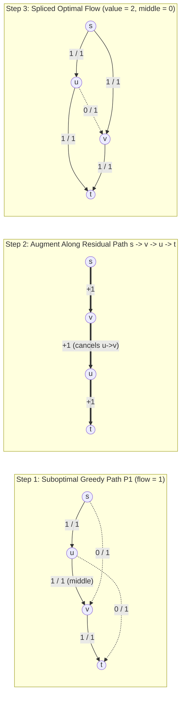
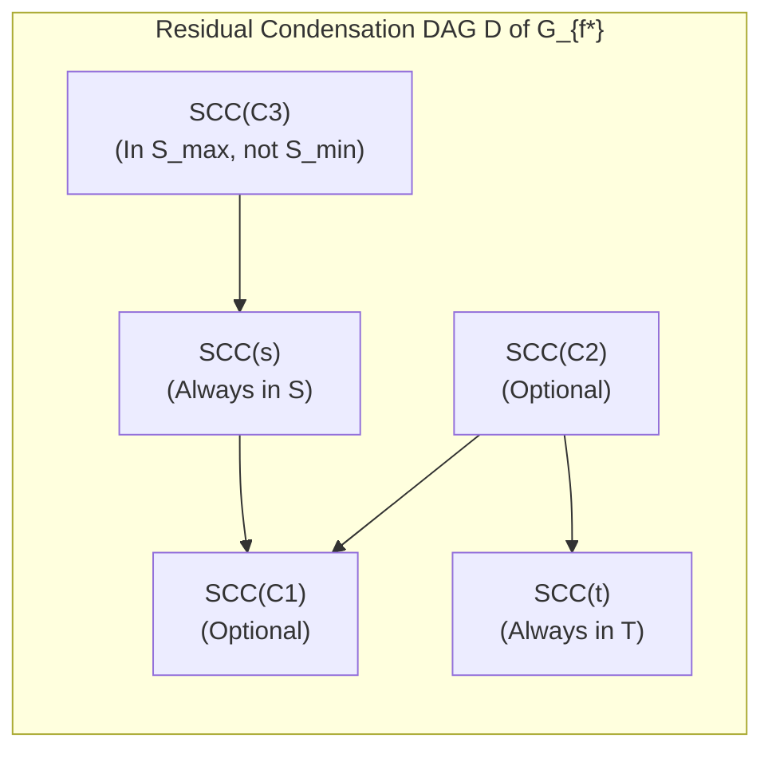

# Wave 1A (Cohort 2: Iterations 53–57) — Foundations of Flow–Cut Algebraic Duality, Residual Lattices, Tight Complexity Regimes & Lower-Bound Feasibility Engines

> [!IMPORTANT]
> **Cohort 2 Independent Redundant Monograph (`FlowDeepInvestigator`)**
> This monograph is the independent Cohort 2 investigation covering **Iterations 53–57 (Wave 1A)** of the Network Flows, Minimum Cuts, Matching, Duality & Non-Graph Modelling project. Written under the strict **Independence Protocol** and the **4-Step "Zero Magic Gadgets" Compilation Mandate** of `flows_research/PLAN.md`, every theoretical reduction, structural graph gadget, and contest problem solution is derived from an explicit algebraic or logical intermediate representation before any graph is constructed, accompanied by concrete hand-checkable traces and broken-gadget counterexamples.

---

## Executive Overview & Architectural Map of Iterations 53–57

Most competitive programming tutorials introduce network flows backwards: they present Dinic's algorithm as a black-box template and then list ad-hoc graph "tricks" (vertex splitting, backward residual edges, super-source/super-sink demand offsets) as memorized recipes. When a contestant encounters a non-graph problem—such as preemptively scheduling jobs with release dates and deadlines on parallel machines, rounding a real contingency table while preserving row and column bounds, or dynamically updating a minimum cut as vertices are deleted—memorized recipes fail because the underlying mathematical invariants were never exposed.

Across **Iterations 53–57**, we rebuild the foundations of network flows from five interlocking mathematical pillars:

1. **Iteration 53 — Flow–Cut Algebraic Duality, Tangent Cones & Schedule Decomposition**:
   We derive the fundamental identity $|f| = \sum_{e \in \delta^+(S)} f(e) - \sum_{e \in \delta^-(S)} f(e)$ not as an ad-hoc summation trick, but as the inner product $\mathbf{1}_S^T B f$ on the vertex–edge incidence matrix $B$. We show that the residual network $G_f$ is the feasible linear tangent cone of the flow polytope, explain why backward residual arcs represent **algebraic path-splicing (cancellation)** rather than physical reverse motion, examine Zwick's golden-ratio irrational pathology, and prove the **Flow–Path–Cycle Decomposition Theorem** with full 4-step compilation to **Horn's Preemptive Parallel-Machine Scheduling Theorem** via McNaughton wrap-around slicing.
2. **Iteration 54 — Blocking Flows, Dinic's Tight Sub-Quadratic Regimes, Capacity Scaling & Preflow-Push (HLPP)**:
   We prove the exact complexity regimes of Dinic's algorithm—$O(V^2 E)$ in general networks, $O(\min(V^{2/3}, E^{1/2})E)$ in unit-capacity networks, and $O(E\sqrt{V})$ in unit-vertex (bipartite/Type-1) networks—alongside Capacity Scaling ($O(E^2 \log U)$ / $O(VE \log U)$) and Highest-Label Preflow-Push ($O(V^2 \sqrt{E})$). Crucially, we expose the **HLPP Phase-1 vs. Phase-2 Pitfall**: why stopping HLPP as soon as $\text{ex}(t)$ reaches $|f^*|$ suffices for Minimum Cut values, but corrupts edge-flow recovery (matching, lower-bound circulations) unless trapped excess is returned to $s$.
3. **Iteration 55 — Distributive Cut Lattices, the Picard–Queyranne DAG & Dynamic Flow Rollback (`退流`)**:
   Using the submodularity inequality $c(\delta^+(A)) + c(\delta^+(B)) \ge c(\delta^+(A \cup B)) + c(\delta^+(A \cap B))$, we prove that the family of all minimum $s$-$t$ cuts forms a **distributive lattice** $(\mathcal{L}_{\min}, \cap, \cup)$. By contracting the Strongly Connected Components (SCCs) of the final residual graph $G_f$, we construct the **Picard–Queyranne DAG**, which gives an exact bijection between all minimum cuts and upper-closed subsets of the condensation DAG. From this single structure we classify **Essential Cut Edges** vs. **Feasible Cut Edges** (`[AHOI2009] 最小割`), derive minimum-cardinality min-cuts via lexicographic capacity perturbation, and formalize **Dynamic Flow Rollback (`退流` — `[SDOI2014] LIS`)** to delete an arbitrary edge $(u,v)$ in $O(E)$ time without recomputing Max-Flow from scratch.
4. **Iteration 56 — Structural Graph Gadgets, Menger's Theorems & Time-Expanded / Interval-Compressed Networks**:
   We replace "magic vertex/edge gadgets" with formal algebraic contracts for vertex capacity splitting, undirected-to-directed bidirectional compilation, Menger's vertex- and edge-disjoint path dualities, **Incremental Time-Expanded Layered DAGs** (`[CTSC1999] 星际转移问题`), and **Coordinate-Compressed Elementary Interval Networks** (`[JSOI2007]` / `Task Assignment`) that compress $T \le 10^9$ time horizons into $O(N)$ elementary intervals.
5. **Iteration 57 — The 4-Variant Lower-Bound Circulation Engine (`上下界网络流`) & Non-Graph Compilations**:
   By substituting $f(e) = l(e) + \tilde{f}(e)$ into $B f = 0$, we derive all four variants of flows with demands (`无源汇可行流`, `有源汇可行流`, `有源汇最大流`, `有源汇最小流`) and prove **Hoffman's Circulation Theorem**. We then compile three major families of non-graph problems into lower-bound networks: **Bounded Matrix & Contingency-Table Rounding (`矩阵上下界舍入`)**, **Mixed-Graph Eulerian & Degree-Constrained Orientations (`混合图欧拉回路`)**, and **Minimum-Fleet DAG Path/Edge Covers (`有向无环图最小流覆盖`)**.

---

## Iteration 53: Flow–Cut Algebraic Duality, Skew-Symmetry vs. Nonnegative Arcs, Irrational Pathologies & Flow–Path Decomposition

### 53.1 Incidence Matrix Algebra & The Cut–Flow Inner Product Identity

Let $G = (V, E)$ be a directed multigraph with source $s \in V$, sink $t \in V$ ($s \neq t$), and non-negative capacity function $c : E \to \mathbb{R}_{\ge 0}$. Rather than treating flow conservation and cut capacity as separate combinatorial definitions, we unify them through linear algebra on the **vertex–edge incidence matrix**.

#### Definition 53.1 (Vertex–Edge Incidence Matrix and Divergence)
Define the incidence matrix $B \in \{-1, 0, +1\}^{|V| \times |E|}$ where, for each vertex $v \in V$ and directed edge $e = (u, w) \in E$:
$$B_{v, e} = \begin{cases} +1 & \text{if } v = u \text{ ($e$ leaves $v$)}, \\ -1 & \text{if } v = w \text{ ($e$ enters $v$)}, \\ 0 & \text{otherwise}. \end{cases}$$
For any vector $f \in \mathbb{R}^{|E|}$ assigning a real number $f(e)$ to each edge $e \in E$, the matrix–vector product $B f \in \mathbb{R}^{|V|}$ gives the **net divergence (net outflow)** at every vertex $v \in V$:
$$(B f)_v = \sum_{e \in \delta^+(v)} f(e) - \sum_{e \in \delta^-(v)} f(e),$$
where $\delta^+(v) = \{e \in E : \text{tail}(e) = v\}$ is the set of outgoing arcs from $v$ and $\delta^-(v) = \{e \in E : \text{head}(e) = v\}$ is the set of incoming arcs into $v$.

An **$s$-$t$ flow** of value $|f| \in \mathbb{R}$ is a vector $f \in \mathbb{R}^{|E|}$ satisfying two linear conditions:
1. **Capacity Box Constraints**: $0 \le f(e) \le c(e)$ for every $e \in E$.
2. **Flow Conservation**:
   $$B f = |f| (\mathbf{e}_s - \mathbf{e}_t),$$
   where $\mathbf{e}_s, \mathbf{e}_t \in \{0, 1\}^{|V|}$ are the standard basis vectors for $s$ and $t$. That is, $(B f)_s = |f|$, $(B f)_t = -|f|$, and $(B f)_v = 0$ for all internal vertices $v \in V \setminus \{s, t\}$.

Now consider any subset of vertices $S \subseteq V$. Its **characteristic (indicator) vector** is $\mathbf{1}_S \in \{0, 1\}^{|V|}$, defined by $(\mathbf{1}_S)_v = 1$ if $v \in S$ and $0$ if $v \notin S$. An **$s$-$t$ cut** is a partition $(S, T)$ with $T = V \setminus S$ such that $s \in S$ and $t \in T$.

#### Theorem 53.2 (Fundamental Cut–Flow Algebraic Identity & Complementary Slackness)
For every feasible $s$-$t$ flow $f$ and every $s$-$t$ cut $(S, T)$ with $s \in S$ and $t \notin S$, the net flow crossing from $S$ to $T$ equals $|f|$:
$$|f| = \sum_{e \in \delta^+(S)} f(e) - \sum_{e \in \delta^-(S)} f(e),$$
where $\delta^+(S) = \{(u,v) \in E : u \in S, v \notin S\}$ is the set of forward cut edges and $\delta^-(S) = \{(u,v) \in E : u \notin S, v \in S\}$ is the set of backward cut edges. Consequently:
$$|f| \le c(\delta^+(S)) := \sum_{e \in \delta^+(S)} c(e),$$
with equality $|f| = c(\delta^+(S))$ if and only if both **Cut Complementary Slackness Conditions** hold:
1. **Forward Saturation**: $f(e) = c(e)$ for every $e \in \delta^+(S)$.
2. **Backward Evacuation**: $f(e) = 0$ for every $e \in \delta^-(S)$.

**Proof via Inner Product Associativity**:
Evaluate the scalar inner product $\mathbf{1}_S^T (B f)$ in two ways using associativity $\mathbf{1}_S^T (B f) = (\mathbf{1}_S^T B) f$:
- **Right-grouped evaluation**: Substitute the conservation law $B f = |f|(\mathbf{e}_s - \mathbf{e}_t)$:
  $$\mathbf{1}_S^T (B f) = |f| \big(\mathbf{1}_S^T \mathbf{e}_s - \mathbf{1}_S^T \mathbf{e}_t\big) = |f| \big((\mathbf{1}_S)_s - (\mathbf{1}_S)_t\big) = |f|(1 - 0) = |f|.$$
- **Left-grouped evaluation**: Examine the row vector $\mathbf{1}_S^T B \in \{-1, 0, +1\}^{1 \times |E|}$. For each directed edge $e = (u, v) \in E$, the column $B_{\cdot, e}$ has $+1$ in row $u$ and $-1$ in row $v$, so:
  $$(\mathbf{1}_S^T B)_e = (\mathbf{1}_S)_u - (\mathbf{1}_S)_v = \begin{cases} 1 - 0 = +1 & \text{if } u \in S, v \notin S \iff e \in \delta^+(S), \\ 0 - 1 = -1 & \text{if } u \notin S, v \in S \iff e \in \delta^-(S), \\ 1 - 1 = 0 & \text{if } u \in S, v \in S \text{ (internal to $S$)}, \\ 0 - 0 = 0 & \text{if } u \notin S, v \notin S \text{ (internal to $T$)}. \end{cases}$$
  Notice how internal edges inside $S$ cancel out because their $+1$ tail contribution at $u \in S$ and $-1$ head contribution at $v \in S$ sum to zero! Taking the dot product with $f$ yields:
  $$(\mathbf{1}_S^T B) f = \sum_{e \in \delta^+(S)} (+1) f(e) + \sum_{e \in \delta^-(S)} (-1) f(e) = \sum_{e \in \delta^+(S)} f(e) - \sum_{e \in \delta^-(S)} f(e).$$
Equating the two evaluations proves the Cut–Flow Identity. Next, apply the edge bounds $f(e) \le c(e)$ for $e \in \delta^+(S)$ and $f(e) \ge 0$ for $e \in \delta^-(S)$:
$$|f| = \sum_{e \in \delta^+(S)} f(e) - \sum_{e \in \delta^-(S)} f(e) \le \sum_{e \in \delta^+(S)} c(e) - \sum_{e \in \delta^-(S)} 0 = c(\delta^+(S)),$$
where the slack is precisely:
$$c(\delta^+(S)) - |f| = \sum_{e \in \delta^+(S)} \underbrace{\big(c(e) - f(e)\big)}_{\ge 0} + \sum_{e \in \delta^-(S)} \underbrace{f(e)}_{\ge 0}.$$
Since a sum of non-negative terms is zero if and only if each term is zero, $|f| = c(\delta^+(S))$ holds if and only if $f(e) = c(e)$ on $\delta^+(S)$ and $f(e) = 0$ on $\delta^-(S)$. $\blacksquare$

> [!NOTE]
> **Why Backward Cut Edges Carry Zero Capacity in $c(\delta^+(S))$ yet Subtract from $|f|$**
> Beginners often ask: *"Does the capacity of a backward edge $e \in \delta^-(S)$ subtract from the cut capacity $c(\delta^+(S))$?"* Theorem 53.2 answers this definitively: $c(e)$ for $e \in \delta^-(S)$ **never** appears in the upper bound because the minimum possible flow on $e \in \delta^-(S)$ is $0$, not $-c(e)$. However, any positive flow $f(e) > 0$ currently routed backwards from $T$ into $S$ reduces $|f|$ below $c(\delta^+(S))$ and can be cancelled to increase $|f|$.

---

### 53.2 Nonnegative Arc Flow vs. Skew-Symmetric Net Flow, and the Residual Tangent Cone

In the literature, network flow is formulated in two slightly different ways. Confusing them causes subtle implementation bugs when antiparallel edges $(u, v)$ and $(v, u)$ or parallel multi-edges appear in a problem.

| Feature | Formulation A: Nonnegative Arc Flow (Modern CP Standard) | Formulation B: Skew-Symmetric Net Flow (CLRS / Classical) |
| :--- | :--- | :--- |
| **Domain** | Directed multigraph $G = (V, E)$; each arc $e \in E$ is an independent variable. | Complete directed graph $V \times V$; variable $f(u,v) \in \mathbb{R}$ represents *net* flow. |
| **Constraints** | $0 \le f(e) \le c(e)$ for all $e \in E$. | $f(u,v) = -f(v,u)$ (skew-symmetry) and $f(u,v) \le c(u,v)$. |
| **Antiparallel Arcs $(u,v), (v,u)$** | Handled natively as two distinct edge pairs $(e_1, e_1 \oplus 1)$ and $(e_2, e_2 \oplus 1)$, or merged into one pair with initial capacities $c(u,v)$ and $c(v,u)$. | Cannot distinguish simultaneous flow on $(u,v)$ and $(v,u)$; requires subdividing one arc with a dummy node if simultaneous opposite flows have distinct costs! |
| **Residual Capacity** | For original arc $e = (u,v)$: forward residual $c_f(e) = c(e) - f(e)$, reverse residual $c_f(e \oplus 1) = f(e)$. | Single formula: $c_f(u,v) = c(u,v) - f(u,v) = c(u,v) + f(v,u)$. |

#### The Residual Network $G_f$ as a Feasible Tangent Cone
Why do we construct the residual network $G_f$ with backward arcs of capacity $f(e)$? Consider the **flow polytope** $\mathcal{P} = \{f \in \mathbb{R}^{|E|} : B f \text{ conserves flow at } V \setminus \{s,t\},\, 0 \le f \le c\}$. At any feasible flow $f \in \mathcal{P}$, what are the valid perturbation directions $\Delta \in \mathbb{R}^{|E|}$ such that $f + \Delta \in \mathcal{P}$?
For every original arc $e = (u, v) \in E$, the box constraint $0 \le f(e) + \Delta(e) \le c(e)$ is equivalent to:
$$-f(e) \le \Delta(e) \le c(e) - f(e).$$
We can decompose any perturbation $\Delta(e) \in [-f(e), c(e) - f(e)]$ into two **non-negative** directed variables:
$$\Delta(e) = \Delta^+(e) - \Delta^-(e), \quad \text{where } 0 \le \Delta^+(e) \le c(e) - f(e) \text{ and } 0 \le \Delta^-(e) \le f(e).$$
In the incidence equation $B(f + \Delta) = B f + B \Delta$, substituting $\Delta(e) = \Delta^+(e) - \Delta^-(e)$ sends:
$$B_{\cdot, e} \Delta(e) = B_{\cdot, (u,v)} \Delta^+(e) + \big(-B_{\cdot, (u,v)}\big) \Delta^-(e) = B_{\cdot, (u,v)} \Delta^+(e) + B_{\cdot, (v,u)} \Delta^-(e).$$
Because $-B_{\cdot, (u,v)} = B_{\cdot, (v,u)}$ is literally the incidence column of the **reversed arc** $e^{\text{rev}} = (v, u)$, the space of feasible perturbations $\Delta$ at $f$ is isomorphic to the space of non-negative flows in the **residual network** $G_f = (V, E_f)$ where each original arc $e = (u,v)$ induces:
- A **forward residual arc** $e = (u,v)$ with capacity $c_f(e) = c(e) - f(e)$ (increasing $f(e)$ by $\Delta^+(e)$), and
- A **backward residual arc** $e^{\text{rev}} = (v,u)$ with capacity $c_f(e^{\text{rev}}) = f(e)$ (decreasing $f(e)$ by $\Delta^-(e)$).

#### Physical Meaning of Backward Arcs: Algebraic Path-Splicing (Cancellation)
Pushing $\delta > 0$ units of flow along a backward residual arc $v \to u$ does **not** mean sending physical cargo backward through a one-way pipe $(u,v)$. Suppose the current flow $f$ contains a path $P_1 = s \leadsto u \xrightarrow{e} v \leadsto t$ carrying $\delta$ units of flow, and our residual augmenting path is $P_2 = s \leadsto v \xrightarrow{e^{\text{rev}}} u \leadsto t$ of bottleneck $\delta$. Adding $P_2$ to $P_1$ algebraically cancels $+ \delta$ on $(u,v)$ with $-\delta$ on $(v,u)$:
$$\underbrace{(s \leadsto_1 u \to v \leadsto_1 t)}_{P_1} + \underbrace{(s \leadsto_2 v \to u \leadsto_2 t)}_{P_2} = \underbrace{(s \leadsto_1 u \leadsto_2 t)}_{P'_1 \text{ (valid forward path)}} + \underbrace{(s \leadsto_2 v \leadsto_1 t)}_{P'_2 \text{ (valid forward path)}}.$$
As shown in the diagram below, the backward traversal $v \to u$ **splices** the prefix $s \leadsto_1 u$ onto the new suffix $u \leadsto_2 t$, and splices the new prefix $s \leadsto_2 v$ onto the old suffix $v \leadsto_1 t$:

---

### 53.3 The Ford–Fulkerson Theorem, Integrality & Zwick's Irrational Pathology

#### Theorem 53.3 (Max-Flow Min-Cut Theorem — Ford & Fulkerson 1956, Elias–Feinstein–Shannon 1956)
For any feasible $s$-$t$ flow $f$ in $G = (V, E, c)$, the following three statements are equivalent:
1. $f$ is a **maximum flow** in $G$ (i.e., $|f| \ge |f'|$ for all feasible flows $f'$).
2. The residual network $G_f$ contains **no augmenting path** (no directed path from $s$ to $t$ of positive residual capacity).
3. There exists an $s$-$t$ cut $(S, T)$ such that $|f| = c(\delta^+(S))$.

**Proof**:
- $(3) \implies (1)$: By Theorem 53.2, every feasible flow $f'$ satisfies $|f'| \le c(\delta^+(S))$. If $|f| = c(\delta^+(S))$, then $|f'| \le |f|$, so $f$ is maximum.
- $(1) \implies (2)$: Contrapositive. If $G_f$ contains an $s \leadsto t$ path $P$ with bottleneck capacity $\delta = \min_{e \in P} c_f(e) > 0$, augmenting $f$ by $\delta$ along $P$ produces a feasible flow $f'$ of value $|f'| = |f| + \delta > |f|$, so $f$ is not maximum.
- $(2) \implies (3)$: Suppose $G_f$ has no $s \leadsto t$ path. Define the reachable set:
  $$S = \{v \in V : \text{there exists a directed path } s \leadsto v \text{ in } G_f \text{ with positive residual capacity}\}, \quad T = V \setminus S.$$
  Clearly $s \in S$, and since $t$ is unreachable from $s$ in $G_f$, $t \in T$. Thus $(S, T)$ is a valid $s$-$t$ cut. For any original edge $e = (u, v) \in E$:
  - If $e \in \delta^+(S)$ ($u \in S, v \in T$), the forward residual arc $(u,v)$ cannot exist in $G_f$ with positive capacity, otherwise $v$ would be reachable from $u \in S$ and thus $v \in S$. Hence $c_f(e) = c(e) - f(e) = 0 \implies f(e) = c(e)$.
  - If $e \in \delta^-(S)$ ($u \in T, v \in S$), the backward residual arc $(v,u)$ cannot exist in $G_f$ with positive capacity, otherwise $u$ would be reachable from $v \in S$ and thus $u \in S$. Hence $c_f(e^{\text{rev}}) = f(e) = 0$.
  By Theorem 53.2, $|f| = \sum_{e \in \delta^+(S)} c(e) - \sum_{e \in \delta^-(S)} 0 = c(\delta^+(S))$. $\blacksquare$

#### Theorem 53.4 (Integrality Theorem)
If $c(e) \in \mathbb{Z}_{\ge 0}$ for all $e \in E$, then there exists a maximum flow $f^*$ such that $f^*(e) \in \mathbb{Z}_{\ge 0}$ for every $e \in E$. Moreover, starting from $f \equiv 0$, every augmenting-path step updates residual capacities by integers $\delta \in \mathbb{Z}_{\ge 1}$, terminating in at most $\sum_{e \in \delta^+(s)} c(e)$ augmentations.

#### Pathological Failure Mode: Zwick's Golden-Ratio Network (Irrational Non-Termination to a Wrong Limit)
What happens if capacities are irrational real numbers and we pick arbitrary augmenting paths without shortest-path (BFS) ordering? Uri Zwick (1995), simplifying Ford and Fulkerson (1962), constructed a 6-vertex network with three special central edges $e_1 = (u_1, v_1)$, $e_2 = (u_2, v_2)$, $e_3 = (u_3, v_3)$ of capacities:
$$c(e_1) = 1, \quad c(e_2) = r = \frac{\sqrt{5}-1}{2} \approx 0.618034, \quad c(e_3) = 1,$$
where $r$ satisfies the golden-ratio identity **$r^2 = 1 - r$** (and in general $r^{k+2} = r^k - r^{k+1}$), connected to $s$ and $t$ by six outer edges of capacity $M = 4$. The true Maximum Flow is $1 + r + 1 = 2 + r$ (when all three central edges are saturated forward).

However, watch what happens when an adversary alternates augmentations using the identity $r^k - r^{k+1} = r^{k+2}$:
1. **Initial Push**: Augment $1$ unit along $s \to u_1 \xrightarrow{e_1} v_1 \to t$. Now the residual capacities of $(e_1, e_2, e_3)$ are $(0, r, 1) = (0, r^1, r^0)$.
2. **Inductive Step $k$** (starting from residual state $(0, r^k, r^{k-1})$ on a permutation of $(e_1, e_2, e_3)$):
   - **Step $k$.a**: Augment $r^k$ along the path that pushes **forward** on the $r^k$-edge, **backward** on the $0$-edge (which has reverse capacity $\ge r^k$), and **forward** on the $r^{k-1}$-edge. The residual capacities of the three edges become:
     $$(r^k,\, 0,\, r^{k-1} - r^k) = (r^k,\, 0,\, r^{k+1}).$$
   - **Step $k$.b**: Augment $r^{k+1}$ forward on the $r^k$-edge, backward on the $r^{k+1}$-edge's reverse, and forward on the $0$-edge... leaving a permutation of $(0, r^{k+1}, r^k)$!

Every two augmentations, the residual capacities on the three central edges shrink by a factor of $r < 1$, **never reaching zero**. Worse still, the total flow accumulated after infinitely many steps converges to the geometric series:
$$|f_\infty| = 1 + 2 \sum_{k=1}^\infty r^k = 1 + \frac{2r}{1 - r} = 1 + \frac{2r}{r^2} = 1 + \frac{2}{r} = 2 + \sqrt{5} \approx 4.236068 \ll 2M + 1 = 9!$$
The algorithm runs forever and converges to a limit that is **strictly smaller than the true Maximum Flow**! This pathology proves why **Edmonds–Karp** (augmenting along shortest paths in unweighted $G_f$, $O(V E^2)$) or **Dinic's algorithm** (augmenting via level-graph blocking flows, $O(V^2 E)$) is mandatory whenever capacities are large or real-valued: their polynomial bounds depend **only on $V$ and $E$**, completely independent of capacity rationality.

---

### 53.4 Flow–Path–Cycle Decomposition & Horn's Preemptive Scheduling Compilation

A solved flow vector $f \in \mathbb{R}_{\ge 0}^{|E|}$ is an * Eulerian aggregate*: it tells us how much total volume crosses each edge, not which individual $s \leadsto t$ trajectories or time-sliced schedules realize that volume. The **Flow Decomposition Theorem** bridges the gap between aggregate edge flows and explicit trajectories.

#### Theorem 53.5 (Flow–Path–Cycle Decomposition Theorem)
Let $f \in \mathbb{R}_{\ge 0}^{|E|}$ be any non-negative flow in $G = (V, E)$ with $(B f)_v = 0$ for all $v \in V \setminus \{s, t\}$ and $(B f)_s = -(B f)_t = |f| \ge 0$. Then there exist a collection of simple directed $s \to t$ paths $\mathcal{P} = \{P_1, \dots, P_p\}$ and simple directed cycles $\mathcal{C} = \{C_1, \dots, C_q\}$ with positive weights $\alpha(P_i) > 0, \beta(C_j) > 0$ such that:
1. $f(e) = \sum_{P_i \ni e} \alpha(P_i) + \sum_{C_j \ni e} \beta(C_j)$ for every $e \in E$.
2. $|f| = \sum_{i=1}^p \alpha(P_i)$ (cycles contribute $0$ to net $s$-$t$ flow).
3. $p + q \le |\text{supp}(f)| \le |E|$, where $\text{supp}(f) = \{e \in E : f(e) > 0\}$.
4. If $f$ is integral ($f(e) \in \mathbb{Z}_{\ge 0}$), then all $\alpha(P_i)$ and $\beta(C_j)$ can be chosen to be positive integers.

**Constructive Proof via Support Cardinality Potential $\Phi(f) = |\text{supp}(f)|$**:
While $\text{supp}(f) \neq \emptyset$:
- **Case 1 ($|f| > 0$)**: Start a walk at $v_0 = s$. Since $(B f)_s = |f| > 0$, there is an outgoing edge $e \in \delta^+(s)$ with $f(e) > 0$. At any current vertex $v_k \neq t$, either $v_k = s$ or $(B f)_{v_k} = 0$ with $v_k$ having just been entered along an edge $e_{k-1}$ with $f(e_{k-1}) > 0$; in both cases $\sum_{e \in \delta^+(v_k)} f(e) > 0$, so there exists at least one outgoing edge $e_k = (v_k, v_{k+1})$ with $f(e_k) > 0$.
  - If the walk repeats a vertex $v_i = v_j$ ($i < j$) before reaching $t$, the segment $C = (v_i \to v_{i+1} \to \dots \to v_j)$ is a simple directed cycle. Set $\beta(C) = \min_{e \in C} f(e) > 0$ and subtract $\beta(C)$ from $f(e)$ for all $e \in C$.
  - Otherwise, within at most $|V| - 1$ steps the walk reaches $t$, yielding a simple directed $s \to t$ path $P$. Set $\alpha(P) = \min_{e \in P} f(e) > 0$ and subtract $\alpha(P)$ from $f(e)$ for all $e \in P$ (which also decreases $|f|$ by $\alpha(P)$).
- **Case 2 ($|f| = 0$ and $\text{supp}(f) \neq \emptyset$)**: Pick any edge $e_0 = (v_0, v_1)$ with $f(e_0) > 0$. Since $(B f)_v = 0$ for **all** $v \in V$, every entered vertex has an outgoing edge with $f(e) > 0$. Within $\le |V|$ steps, the walk repeats a vertex, isolating a simple cycle $C$ with $\beta(C) = \min_{e \in C} f(e) > 0$, which we subtract from $f$.

In every extraction step, subtracting the bottleneck $\min_{e} f(e)$ zeroes out **at least one edge** in $\text{supp}(f)$ and never makes a zero edge non-zero. Thus $\Phi(f) = |\text{supp}(f)|$ strictly decreases by at least $1$ per step, proving $p + q \le |E|$ in $O(V E)$ total time. $\blacksquare$

---

### 53.5 4-Step "Zero Magic Gadgets" Compilation: Horn's Preemptive Parallel-Machine Scheduling Theorem ($P \mid r_j, \text{pmtn}, d_j \mid -$)

To see how Flow–Cut Duality and Schedule Decomposition solve a problem with **zero graphs in the statement**, we compile **Horn's Theorem (1974)** for preemptive multi-machine scheduling (`[JSOI2007] / Task Assignment` archetype).

#### Problem Statement (Non-Graph Formulation)
You are given $N$ jobs ($N \le 200$) and $M$ identical parallel processors. Job $j \in \{1, \dots, N\}$ has a release time $r_j \in \mathbb{R}_{\ge 0}$, a strict deadline $d_j > r_j$, and a required total processing time $p_j > 0$ (up to $10^9$). **Preemption (job splitting and migration)** is allowed: a job may be paused at any real instant and resumed later on the same or a different machine, provided that:
1. Job $j$ is only executed during $[r_j, d_j]$.
2. At any time instant $\tau \in \mathbb{R}$, **at most one machine** can work on job $j$ (no parallel self-execution of a single job!).
3. At any time instant $\tau \in \mathbb{R}$, at most $M$ jobs are being executed across the $M$ machines.
Determine whether a valid preemptive schedule exists, and if so, output the exact time intervals and machine assignments.

#### Step 1: The Non-Graph Diagnostic Signal (Recognition)
- **Why Greedy (EDD / Earliest Deadline First) and DP fail**: For $M = 1$, Earliest Deadline First (EDF) is optimal because there is no cross-machine parallelism limit. For $M \ge 2$, EDF can fail when a job with a tight window $[r_j, d_j]$ needs a full machine throughout its window while other jobs have flexible overlapping windows. Dynamic programming fails because timestamps $r_j, d_j, p_j \le 10^9$ are continuous/large and any subset of jobs could be partially processed.
- **Diagnostic Signal**: "Continuous/splittable resource allocation ($p_j$ units of work) across overlapping intervals $[r_j, d_j]$ with both a **per-item concurrency cap** ($\le 1$ machine per job at any instant) and a **global concurrency cap** ($\le M$ machines total at any instant)."

#### Step 2: Algebraic Intermediate Representation (Elementary Interval Discretization & McNaughton's Condition)
Collect all $2N$ critical timestamps $\{r_1, d_1, \dots, r_N, d_N\}$, sort them, and remove duplicates to obtain $K + 1 \le 2N$ points:
$$t_0 < t_1 < t_2 < \dots < t_K.$$
These partition the timeline into $K \le 2N - 1$ **elementary intervals** $I_k = [t_{k-1}, t_k]$ of length $\Delta_k = t_k - t_{k-1} > 0$. Inside each elementary interval $I_k$, the set of available jobs $A_k = \{j : [t_{k-1}, t_k] \subseteq [r_j, d_j]\}$ is **completely invariant** (no job starts or ends inside the open interval $(t_{k-1}, t_k)$).

Let $x_{j, k} \in \mathbb{R}_{\ge 0}$ denote the total amount of time allocated to job $j$ during elementary interval $I_k = [t_{k-1}, t_k]$. What are the necessary and sufficient conditions on the numbers $\{x_{j,k}\}$ so that they can be realized as a valid non-overlapping schedule on $M$ machines inside $I_k$?
- **Lemma 53.6 (McNaughton's Wrap-Around Rule, 1959)**: A set of job durations $\{x_{j,k}\}_{j \in A_k}$ can be scheduled without overlap on $M$ machines inside an interval $[t_{k-1}, t_k]$ of length $\Delta_k$ if and only if:
  1. **Individual Concurrency Bound**: $0 \le x_{j,k} \le \Delta_k$ for each $j \in A_k$ (no job can run for longer than the interval's duration $\Delta_k$, since it can occupy at most $1$ machine at a time).
  2. **Total Machine Capacity Bound**: $\sum_{j \in A_k} x_{j,k} \le M \cdot \Delta_k$ (total work across all jobs in $I_k$ cannot exceed $M$ machines working for $\Delta_k$ time).
  *Constructive proof of McNaughton's Rule*: Place the intervals of length $x_{j,k}$ end-to-end along a strip of length $M \Delta_k$, and cut the strip every $\Delta_k$ units into $M$ machine rows $[t_{k-1}, t_k]$. Because $x_{j,k} \le \Delta_k$, when a job wraps around the right boundary $t_k$ of Machine $m$ onto the left boundary $t_{k-1}$ of Machine $m+1$, its suffix $[t_{k-1}, t_{k-1} + r]$ on Machine $m+1$ and its prefix $[t_k - (x_{j,k} - r), t_k]$ on Machine $m$ satisfy $t_{k-1} + r \le t_k - (x_{j,k} - r) \iff x_{j,k} \le \Delta_k$, so the two pieces **never overlap in time**!

Combining McNaughton's conditions across all $K$ intervals with the requirement that every job $j$ receives $p_j$ total work gives the exact linear system:
$$\begin{aligned}
\sum_{k : I_k \subseteq [r_j, d_j]} x_{j,k} &= p_j && \forall j \in \{1, \dots, N\} \quad \text{(Job completion)} \\
\sum_{j : I_k \subseteq [r_j, d_j]} x_{j,k} &\le M \cdot \Delta_k && \forall k \in \{1, \dots, K\} \quad \text{(Interval capacity)} \\
0 \le x_{j,k} &\le \Delta_k && \forall j, k \text{ with } I_k \subseteq [r_j, d_j] \quad \text{(No self-overlap)}.
\end{aligned}$$

#### Step 3: Reverse-Engineering Scratchpad (Mechanical Graph Compilation)
Each variable $x_{j,k}$ appears once with $+1$ in the job sum for $j$ and once with $+1$ in the interval sum for $k$. To turn this into flow conservation $B f = 0$, we orient flow from **Job nodes** $J_j$ to **Interval nodes** $I_k$:
1. **Source $s \to \text{Job } J_j$**: To supply $p_j$ units of work to job $j$, add directed edge $(s, J_j)$ with capacity $c(s, J_j) = p_j$.
2. **Job $J_j \to \text{Interval } I_k$**: For each pair $(j, k)$ such that $[t_{k-1}, t_k] \subseteq [r_j, d_j]$, the variable $x_{j,k}$ is the flow on directed edge $(J_j, I_k)$. By McNaughton's first condition ($0 \le x_{j,k} \le \Delta_k$), its capacity is **strictly $c(J_j, I_k) = \Delta_k$**.
3. **Interval $I_k \to \text{Sink } t$**: Flow conservation at $I_k$ sets the outflow to $t$ equal to $\sum_{j} x_{j,k}$. By McNaughton's second condition ($\sum_j x_{j,k} \le M \Delta_k$), add directed edge $(I_k, t)$ with capacity $c(I_k, t) = M \cdot \Delta_k$.
4. **Feasibility Criterion**: A valid schedule exists if and only if $\text{MaxFlow}(s, t) = \sum_{j=1}^N p_j$ (every $(s, J_j)$ edge is saturated).

#### Step 4: Hand-Checkable Toy Trace & Broken Gadget Counterexample
- **Concrete Toy Trace ($N = 3$ jobs, $M = 2$ machines)**:
  - Job 1: $[r_1, d_1] = [0, 4], p_1 = 4$.
  - Job 2: $[r_2, d_2] = [0, 2], p_2 = 2$.
  - Job 3: $[r_3, d_3] = [2, 4], p_3 = 2$.
  - Elementary intervals: $I_1 = [0, 2]$ ($\Delta_1 = 2$) and $I_2 = [2, 4]$ ($\Delta_2 = 2$).
  - Graph capacities:
    - $s \to J_1 (4), s \to J_2 (2), s \to J_3 (2)$; total required flow $\sum p_j = 8$.
    - Cross edges: $J_1 \to I_1 (\Delta_1 = 2)$, $J_1 \to I_2 (\Delta_2 = 2)$, $J_2 \to I_1 (2)$, $J_3 \to I_2 (2)$.
    - Interval-to-sink edges: $I_1 \to t (M \Delta_1 = 4)$, $I_2 \to t (M \Delta_2 = 4)$.
  - Max-Flow saturates all edges with $|f^*| = 8$: in $I_1 = [0, 2]$, $x_{1,1} = 2$ (Machine 1) and $x_{2,1} = 2$ (Machine 2); in $I_2 = [2, 4]$, $x_{1,2} = 2$ (Machine 1) and $x_{3,2} = 2$ (Machine 2).
- **Broken Gadget Counterexample (What if we set $c(J_j, I_k) = \infty$ instead of $\Delta_k$?)**:
  Suppose Job 1 instead had $[r_1, d_1] = [0, 2]$ and $p_1 = 3$ on $M = 2$ machines. Clearly **impossible**: an interval of length $2$ cannot accommodate $3$ hours of sequential work for a single job! Yet if we mistakenly set $c(J_1, I_1) = \infty$, the network would push $x_{1,1} = 3 \le M \Delta_1 = 4$ through $I_1 \to t$, reporting "Feasible" by running Job 1 simultaneously on Machine 1 for $[0, 2]$ and Machine 2 for $[0, 1]$ (illegal self-parallelism during $[0, 1]$). The finite cross-edge capacity $c(J_j, I_k) = \Delta_k$ is the exact algebraic barrier preventing simultaneous execution of a single job on multiple machines!

---

## Iteration 54: Blocking Flows, Dinic's Tight Complexity Regimes, Capacity Scaling & Push-Relabel (HLPP)

### 54.1 Level Graphs, Blocking Flows & Strict Distance Monotonicity ($O(V^2 E)$)

Edmonds and Karp (1972) showed that augmenting along a single shortest path in the unweighted residual graph $G_f$ takes $O(V E)$ phases and $O(V E^2)$ total time. Yefim Dinitz (1970) discovered how to collapse all shortest-path augmentations of the same length $D = d_f(s, t)$ into a single $O(V E)$ phase by finding a **blocking flow** on the **level graph**.

#### Definition 54.1 (Level Graph $L_f$ and Blocking Flow)
Given a residual network $G_f = (V, E_f)$, let $d_f(v)$ denote the unweighted shortest-path distance (number of arcs) from $s$ to $v$ in $G_f$. The **level graph** is the subgraph $L_f = (V, E_L)$ containing only edges that advance the distance by exactly $1$:
$$E_L = \big\{(u, v) \in E_f : d_f(v) = d_f(u) + 1\big\}.$$
Notice that $L_f$ is a **Directed Acyclic Graph (DAG)** in which every directed $s \leadsto v$ path has length exactly $d_f(v)$ and is a shortest path in $G_f$.
A flow $g$ supported on $L_f$ ($0 \le g(e) \le c_f(e)$ for $e \in E_L$) is called a **blocking flow** if **every** directed $s \leadsto t$ path in $L_f$ contains at least one saturated edge $e \in E_L$ with $g(e) = c_f(e)$.

> [!WARNING]
> **Blocking Flow $\neq$ Maximum Flow in $L_f$**
> Every maximum flow in $L_f$ is a blocking flow, but a blocking flow in $L_f$ does **not** need to be a maximum flow in $L_f$! In our Diamond trace from Section 53.2, sending $1$ unit along $s \to u \to v \to t$ saturates the middle edge $(u,v)$ and blocks all $s \leadsto t$ paths of length $3$ without using backward edges, so it is a valid blocking flow of value $1$ even though the maximum flow in the DAG is $2$. Crucially, Dinic's phase proof requires **only** a blocking flow, not a maximum flow in $L_f$.

#### Theorem 54.2 (Strict Distance Increase per Blocking-Flow Phase)
Let $g$ be any blocking flow in the level graph $L_f$, and let $f' = f + g$ be the updated flow. Then in the new residual network $G_{f'}$:
1. For every vertex $v \in V$, $d_{f'}(v) \ge d_f(v)$.
2. The sink distance strictly increases: **$d_{f'}(t) \ge d_f(t) + 1$**.

**Proof**:
First examine which edges can exist in $E(G_{f'})$:
- Every pre-existing edge $(u, v) \in E(G_f)$ satisfies $d_f(v) \le d_f(u) + 1$ by the triangle inequality of BFS distances.
- Every *newly created* residual edge in $E(G_{f'}) \setminus E(G_f)$ is the reverse $(v, u)$ of an edge $(u, v) \in E_L$ on which $g(u,v) > 0$. Because $(u, v) \in E_L$, we had $d_f(v) = d_f(u) + 1$, so for the new edge $(v, u)$:
  $$d_f(u) = d_f(v) - 1 < d_f(v) + 1.$$
Thus, **every edge $(x, y) \in E(G_{f'})$ still satisfies $d_f(y) \le d_f(x) + 1$**!
Now let $P = (s = v_0 \to v_1 \to \dots \to v_k = t)$ be a shortest $s \leadsto t$ path in $G_{f'}$ of length $k = d_{f'}(t)$. Summing $d_f(v_{i+1}) - d_f(v_i) \le 1$ along $P$ gives:
$$d_f(t) = d_f(v_k) - d_f(v_0) = \sum_{i=0}^{k-1} \big(d_f(v_{i+1}) - d_f(v_i)\big) \le k = d_{f'}(t),$$
which proves (1). Moreover, when can equality $d_{f'}(t) = d_f(t)$ hold? Equality holds if and only if $d_f(v_{i+1}) - d_f(v_i) = 1$ for **every** edge $(v_i, v_{i+1}) \in P$. But any edge in $G_{f'}$ satisfying $d_f(v_{i+1}) = d_f(v_i) + 1$ could not be a newly created reverse edge (which has $d_f(v_{i+1}) = d_f(v_i) - 1$), so **every edge of $P$ must have belonged to $E_L$ and remained unsaturated by $g$**! This contradicts the definition of $g$ as a blocking flow (which saturates at least one edge on every $s \leadsto t$ path in $L_f$). Therefore equality is impossible, and $d_{f'}(t) \ge d_f(t) + 1$. $\blacksquare$

#### Current-Arc (Dead-End) Pruning and Why Omitting `cur[u]` Causes Exponential Blowup
Since $1 \le d_f(t) \le |V| - 1$ whenever $t$ is reachable, Theorem 54.2 limits Dinic's algorithm to at most $|V| - 1$ phases. Within a single phase, how does DFS with the **current-arc pointer `cur[u]`** find a blocking flow in $O(V E)$ time?
At each vertex $u$, we maintain an index `cur[u]` into $u$'s adjacency list in $L_f$. When DFS explores from $u$ along its current arc $e = (u, v)$:
- If pushing flow through $v$ saturates $e$, or if $v$ cannot reach $t$ in the remaining unsaturated subgraph of $L_f$ (returning $0$ flow), then **$e$ can never carry any additional flow during the remainder of the current phase** (because no new edges are ever added to $L_f$ mid-phase!).
- Therefore, we increment `cur[u]++` past $e$ permanently for this phase.
- **Amortized Accounting**:
  - Each pointer advance `cur[u]++` discards one edge of $L_f$, costing $O(1)$ per advance and at most $O(|E|)$ total across the entire phase.
  - Each successful $s \to t$ DFS push saturates at least one bottleneck edge (triggering `cur[u]++` at the bottleneck) and visits at most $|V|$ vertices along the path, costing $O(|V|)$ per saturating push and at most $O(V E)$ across $\le |E|$ saturating pushes.
- Total time per phase: $O(V E)$; total time across $\le |V|-1$ phases: **$O(V^2 E)$**.

> [!CAUTION]
> **Failure Mode: Omitting `cur[u]` (or Failing to Prune Dead-End Vertices when `pushed == 0`)**
> If a programmer loops from the beginning of `adj[u]` on every DFS call without maintaining `cur[u]` by reference (or fails to advance `cur[u]`/Set `level[v] = -1` when a recursive call returns $0$), consider a chain of $V/3$ diamond gadgets where the second half of the chain is already saturated (a dead end to $t$), while the first $V/6$ diamonds are unsaturated. Every failed DFS call from $s$ traverses all $2^{V/6}$ distinct paths through the first half into the dead end before backtracking, blowing up a single phase from $O(VE)$ to **$\Omega(2^{V/6})$ TLE**!

---

### 54.2 Tight Sub-Quadratic Regimes of Dinic's Algorithm (Karzanov 1973, Even–Tarjan 1975)

In competitive programming, we rarely run Dinic on arbitrary $O(V^2 E)$ worst-case graphs; most reductions produce **unit-capacity edges** or **unit-capacity vertices**. Why does Dinic run in $O(\min(V^{2/3}, E^{1/2})E)$ or $O(E\sqrt{V})$ on these networks without changing a single line of code?

The universal proof template has two parts:
1. **Fast Phase Bound**: Show that on a unit network, **every blocking-flow phase takes $O(E)$ time** instead of $O(VE)$, because every edge in $L_f$ has residual capacity $1$; the moment a DFS traversal uses an edge $e \in E_L$ in a successful push, $e$ is saturated and deleted from $L_f$, and if a traversal backtracks with $0$ flow, $e$ is a dead end and deleted from $L_f$. Thus every edge is traversed $O(1)$ times per phase!
2. **Threshold Phase Split ($K$ Phases + Residual Flow Bound)**: Run Dinic for $K$ phases, after which $d_f(t) \ge K$ by Theorem 54.2. Then bound the **remaining augmentable flow** $|f^*| - |f_K|$ in $G_{f_K}$ as a decreasing function of $K$; since each subsequent phase augments by at least $1$ integer unit of flow, at most $|f^*| - |f_K|$ additional phases can occur!

#### Theorem 54.3 (Unit-Edge-Capacity Networks — $O(\min(V^{2/3}, E^{1/2}) E)$)
Suppose $c(e) = 1$ for every $e \in E$ (a unit network).
1. Even if $G$ is a multigraph with parallel unit edges, Dinic's algorithm runs in $O(E^{3/2})$ time (at most $2\sqrt{E}$ phases).
2. If $G$ has no parallel edges (a simple directed graph with $c(e) = 1$), Dinic's algorithm runs in $O(\min(V^{2/3}, E^{1/2}) E)$ time.

**Proof of Bound 1 ($O(E^{3/2})$ via Path-Length Packing)**:
After $K = \lceil \sqrt{E} \rceil$ phases, the residual graph $G_f$ has $d_f(t) \ge K$, and every edge in $G_f$ has residual capacity $1$ (with $|E(G_f)| \le |E|$ active residual arcs of capacity $1$, since for each original edge $e$, either $c_f(e) = 1, c_f(e^{\text{rev}}) = 0$ or $c_f(e) = 0, c_f(e^{\text{rev}}) = 1$).
Let $F_{\text{rem}} = |f^*| - |f|$ be the maximum flow value in $G_f$. By Theorem 53.5 (Flow Decomposition), $F_{\text{rem}}$ decomposes into $F_{\text{rem}}$ edge-disjoint directed $s \leadsto t$ paths in $G_f$. Because $d_f(t) \ge K$, every such path uses at least $K$ distinct edges of $G_f$. Since the paths are edge-disjoint:
$$F_{\text{rem}} \cdot K \le |E(G_f)| \le E \implies F_{\text{rem}} \le \frac{E}{K} \le \sqrt{E}.$$
Since each remaining phase pushes at least $1$ unit of flow, at most $\lfloor \sqrt{E} \rfloor$ additional phases can occur. Total phases $\le 2\sqrt{E} + 1$, each taking $O(E)$ time, giving **$O(E^{3/2})$**.

**Proof of Bound 2 ($O(V^{2/3} E)$ via Layer-Cut Pigeonhole Bottleneck)**:
Assume $G$ has no parallel edges, so between any ordered pair of vertices $(u, v)$ there is at most one original edge $(u,v)$ and one reverse edge $(v,u)$, meaning at most $2$ unit residual edges can cross from $u$ to $v$ in $G_f$.
After $K$ phases, let $D = d_f(t) \ge K$, and partition the vertices with $d_f(v) \le D$ into distance layers:
$$V_i = \{v \in V : d_f(v) = i\}, \quad i = 0, 1, \dots, D.$$
For each index $i \in \{0, 1, \dots, K-1\}$, consider the $s$-$t$ cut $(S_i, T_i)$ where $S_i = \bigcup_{j=0}^i V_j$. Because $d_f(v)$ is the shortest-path distance in $G_f$, **no edge in $G_f$ can jump from $V_j$ ($j \le i$) to $V_{j'}$ ($j' > i + 1$)**! Thus every forward cut edge in $\delta^+_{G_f}(S_i)$ must have its tail in $V_i$ and its head in $V_{i+1}$. Since at most $2$ unit edges in $G_f$ can go from any $u \in V_i$ to any $v \in V_{i+1}$, the residual capacity of cut $S_i$ satisfies:
$$c_f(\delta^+(S_i)) \le 2 |V_i| \cdot |V_{i+1}|.$$
Now we find a bottleneck layer pair $(V_i, V_{i+1})$ among the $K$ layers $V_0, \dots, V_{K-1}$:
Since $\sum_{i=0}^{K} |V_i| \le |V|$, call a layer $V_i$ "heavy" if $|V_i| > \frac{2|V|}{K}$ and "light" if $|V_i| \le \frac{2|V|}{K}$. By Markov's inequality, strictly fewer than $\frac{K}{2}$ layers can be heavy. Therefore, out of the $K$ consecutive pairs $(V_0, V_1), (V_1, V_2), \dots, (V_{K-1}, V_K)$, at most $2 \cdot \frac{K}{2} - 1 < K$ pairs can contain a heavy layer, so **there exists at least one index $i^*$ where both $V_{i^*}$ and $V_{i^*+1}$ are light**:
$$|V_{i^*}| \le \frac{2|V|}{K} \quad \text{and} \quad |V_{i^*+1}| \le \frac{2|V|}{K}.$$
By Weak Duality (Theorem 53.2) applied to cut $S_{i^*}$ in $G_f$:
$$F_{\text{rem}} \le c_f(\delta^+(S_{i^*})) \le 2 |V_{i^*}| |V_{i^*+1}| \le \frac{8 |V|^2}{K^2}.$$
Balancing the $K$ initial phases against the $\frac{8|V|^2}{K^2}$ remaining phases by setting $K = \lceil 2 |V|^{2/3} \rceil$ gives at most $2|V|^{2/3} + 2|V|^{2/3} = 4|V|^{2/3}$ total phases, each taking $O(E)$ time, proving **$O(V^{2/3} E)$**. $\blacksquare$

#### Theorem 54.4 (Unit-Vertex / Type-1 Networks & Bipartite Matching — $O(E \sqrt{V})$)
Suppose $G = (V, E, c)$ is a unit network ($c(e) \in \{1, \infty\}$) in which every internal vertex $v \in V \setminus \{s, t\}$ satisfies:
$$\min\big(\text{deg}^-(v),\, \text{deg}^+(v)\big) \le 1,$$
meaning $v$ has either at most one incoming unit edge or at most one outgoing unit edge (this includes all vertex-split unit-capacity networks and all Bipartite Matching networks $s \to L \to R \to t$). Then Dinic's algorithm runs in **$O(E \sqrt{V})$** time.

**Proof**:
First check why this property is **preserved in the residual network $G_f$**: for any internal vertex $v$ that initially has $\text{deg}^-(v) = 1$ (say incoming edge $(u, v)$ of capacity $1$), if $f(u,v) = 0$ then $v$ still has $\text{deg}^-_{G_f}(v) = 1$; if $f(u,v) = 1$, then $(u,v)$ is reversed to $(v,u)$ in $G_f$ AND by flow conservation at $v$, exactly one outgoing edge $(v, w)$ has $f(v,w) = 1$ and is reversed to $(w,v)$ in $G_f$, so all other edges incident to $v$ are directed *out* of $v$ in $G_f$, meaning $\text{deg}^-_{G_f}(v)$ is **still equal to $1$**!
Because every internal vertex $v \in V \setminus \{s, t\}$ has $\min(\text{deg}^-_{G_f}(v), \text{deg}^+_{G_f}(v)) \le 1$, any two edge-disjoint directed paths in $G_f$ must also be **internally vertex-disjoint**!
1. **Each phase takes $O(E)$ time**: Every augmenting path found in $L_f$ saturates all its internal vertices, so paths in the blocking flow are vertex-disjoint and each edge is scanned $O(1)$ times.
2. **At most $2\sqrt{V}$ phases**: After $K = \lceil \sqrt{V} \rceil$ phases, $d_f(t) \ge K + 1$. The remaining flow $F_{\text{rem}}$ in $G_f$ decomposes into $F_{\text{rem}}$ internally vertex-disjoint $s \leadsto t$ paths, each containing at least $K$ distinct internal vertices in $V \setminus \{s, t\}$. Since internal vertices cannot be shared:
   $$F_{\text{rem}} \cdot K \le |V \setminus \{s, t\}| < V \implies F_{\text{rem}} < \frac{V}{K} \le \sqrt{V}.$$
   Thus at most $\sqrt{V}$ additional phases can occur, yielding $O(\sqrt{V})$ phases and **$O(E \sqrt{V})$** total time. $\blacksquare$

> [!TIP]
> **Contest Generalization: Asymmetric Bipartite Capacities ($c(s, l_i) = a_i$, $c(r_j, t) = 1$)**
> What if left vertices $L$ have larger integer capacities $a_i > 1$, cross edges $L \to R$ have capacity $1$ (or $\infty$), and right vertices $R$ have capacity $c(r_j, t) = 1$? Every augmenting path in $G_f$ alternates between $L$ and $R$, and every right vertex $r_j \in R$ still has $\text{deg}^+_{G_f}(r_j) = 1$! Therefore, after $K$ phases (where $d_f(t) \ge 2K + 1$), every path in the residual flow decomposition visits at least $K$ **distinct right-hand vertices** in $R$, so $F_{\text{rem}} \cdot K \le |R| \implies K = O(\sqrt{|R|})$. Even if $|L|$ has large capacities, Dinic still terminates in **$O(E \sqrt{|R|})$** (or more generally $O(E \sqrt{\min(\sum_{i \in L} a_i, \sum_{j \in R} b_j)})$)!

---

### 54.3 Capacity Scaling ($O(E^2 \log U)$ and Dinic-Scaling $O(VE \log U)$)

When edge capacities are huge integers $U = \max_{e \in E} c(e) \le 10^{18}$ on a graph where unit-capacity bounds do not apply, **Capacity Scaling** (Edmonds–Karp 1972; Gabow 1985) bounds the number of augmentations per bit of $U$.

#### Algorithm & Structural Invariant
Maintain a scaling threshold $\Delta = 2^{\lfloor \log_2 U \rfloor}$, halved at the end of each scaling phase ($\Delta \gets \Delta / 2$) down to $\Delta = 1$. In the $\Delta$-scaling phase, we restrict attention to the **$\Delta$-residual subgraph** $G_f(\Delta) = (V, E_f(\Delta))$ containing only edges with residual capacity at least $\Delta$:
$$E_f(\Delta) = \{e \in E_f : c_f(e) \ge \Delta\}.$$
We repeatedly find augmenting paths (or Dinic blocking flows) in $G_f(\Delta)$ until $t$ is unreachable from $s$ in $G_f(\Delta)$.

#### Theorem 54.5 (Capacity Scaling Bound)
At the end of the $\Delta$-scaling phase, the remaining augmentable flow in $G_f$ satisfies $|f^*| - |f| < |E| \cdot \Delta$. Consequently, during the next scaling phase with threshold $\Delta' = \Delta / 2$, at most $2|E|$ augmentations (each pushing $\ge \Delta / 2$ flow) can occur, giving:
- $O(E^2 \log U)$ time with simple BFS/DFS augmentations per scale, or
- $O(V E \log U)$ time when running Dinic's blocking flow on $G_f(\Delta / 2)$ (since each edge in $G_f(\Delta / 2)$ has integer multiplicity in $\{1, 2, 3\}$ units of $\Delta/2$ except at cut boundaries, behaving like a small-capacity network).

**Proof**:
When the $\Delta$-scaling phase ends, $t$ is unreachable from $s$ in $G_f(\Delta)$. Let $S_\Delta = \{v \in V : s \leadsto v \text{ in } G_f(\Delta)\}$ and $T_\Delta = V \setminus S_\Delta$. Then $(S_\Delta, T_\Delta)$ is an $s$-$t$ cut, and every forward residual edge $e \in \delta^+_{G_f}(S_\Delta)$ must have failed to enter $G_f(\Delta)$, meaning **$c_f(e) < \Delta$** (in fact $c_f(e) \le \Delta - 1$). Summing over at most $|E|$ forward cut edges in $G_f$:
$$|f^*| - |f| \le c_f(\delta^+(S_\Delta)) = \sum_{e \in \delta^+_{G_f}(S_\Delta)} c_f(e) \le |E| (\Delta - 1) < |E| \Delta.$$
In the next phase ($\Delta' = \Delta / 2$), every augmentation in $G_f(\Delta / 2)$ increases $|f|$ by at least $\Delta / 2$. Therefore at most $\frac{|E|\Delta}{\Delta / 2} = 2|E|$ augmentations can occur during the $\Delta/2$ phase. Across $1 + \lfloor \log_2 U \rfloor$ scales, there are $O(E \log U)$ augmentations of cost $O(E)$ each, totaling $O(E^2 \log U)$. $\blacksquare$

---

### 54.4 Highest-Label Preflow-Push (HLPP, $O(V^2 \sqrt{E})$) & The Phase-1 vs. Phase-2 Pitfall

While Dinic's algorithm maintains a **valid flow** ($B f = 0$ on $V \setminus \{s,t\}$) and strives to reach **cut saturation** ($s \not\leadsto t$ in $G_f$), **Preflow-Push** (Goldberg & Tarjan 1988) takes the exact **dual trajectory**: it immediately saturates the cut out of $s$, relaxes flow conservation to allow non-negative vertex excess, and iteratively pushes excess toward $t$ (or back to $s$) until flow conservation is restored.

#### Definitions: Preflows, Distance Labels & Admissible Arcs
1. **Preflow**: A vector $f \in \mathbb{R}^{|E|}$ satisfying $0 \le f(e) \le c(e)$ and non-negative **excess** at every internal vertex $v \in V \setminus \{s, t\}$:
   $$\text{ex}(v) := \sum_{e \in \delta^-(v)} f(e) - \sum_{e \in \delta^+(v)} f(e) \ge 0.$$
   A vertex $v \in V \setminus \{s, t\}$ with $\text{ex}(v) > 0$ is called **active**.
2. **Valid Distance Labeling (Height Function)**: A function $h : V \to \mathbb{Z}_{\ge 0}$ satisfying $h(s) = |V|$, $h(t) = 0$, and the **Steepness Condition**:
   $$h(u) \le h(v) + 1 \quad \forall (u, v) \in E(G_f) \text{ with } c_f(u, v) > 0.$$
   Notice that if $h$ is valid, then for any directed path $P = (u \leadsto w)$ of length $k$ in $G_f$, summing $h(x) - h(y) \le 1$ along $P$ proves **$h(u) - h(w) \le \text{dist}_{G_f}(u, w)$**. Since $h(s) - h(t) = |V|$, while any simple path from $s$ to $t$ has length at most $|V| - 1$, **a valid height labeling immediately implies there is NO $s \leadsto t$ path in $G_f$**!
3. **Admissible Arc**: A residual arc $(u, v) \in E(G_f)$ with $c_f(u,v) > 0$ and $h(u) = h(v) + 1$ (flow is only pushed downhill by $1$ height unit).

#### Elementary Operations & Complexity Invariants
Initially, saturate all edges leaving $s$: $f(e) = c(e)$ for $e \in \delta^+(s)$, set $h(s) = |V|$, and set $h(v) = 0$ (or exact backward distance $\text{dist}_{G_f}(v, t)$) for $v \neq s$. While an active vertex $u \in V \setminus \{s, t\}$ ($\text{ex}(u) > 0$) exists:
- **Push($u, v$)**: If an admissible arc $(u, v)$ exists ($h(u) = h(v) + 1$), push $\delta = \min(\text{ex}(u), c_f(u, v))$ along $(u, v)$.
  - If $\delta = c_f(u, v)$, the push is **saturating** ($(u,v)$ disappears from $G_f$).
  - If $\delta = \text{ex}(u) < c_f(u, v)$, the push is **non-saturating** ($u$ becomes inactive: $\text{ex}(u) = 0$).
- **Relabel($u$)**: If $u$ is active ($\text{ex}(u) > 0$) and has **no** admissible outgoing arcs (so $h(u) \le h(v)$ for all $(u,v) \in E(G_f)$), raise $u$'s height to:
  $$h(u) \gets 1 + \min_{(u,v) \in E(G_f)} h(v).$$

#### Theorem 54.6 (Bounded Heights, Relabels, Saturating Pushes & HLPP $O(V^2 \sqrt{E})$)
Throughout Preflow-Push:
1. **Active Reachability to $s$**: For every active vertex $u$ ($\text{ex}(u) > 0$), there exists a directed path $u \leadsto s$ in $G_f$.
   *Proof*: By flow decomposition of the preflow $f$, positive excess entering $u$ from $s$ creates reverse residual edges pointing from $u$ back toward $s$.
2. **Height Cap $h(u) \le 2|V| - 1$**: Since a simple path $u \leadsto s$ in $G_f$ has at most $|V| - 1$ edges and $h(s) = |V|$, the steepness condition forces $h(u) \le h(s) + (|V| - 1) = 2|V| - 1$.
3. **Total Relabels $\le 2|V|^2$**: Each `Relabel(u)` strictly increases $h(u)$ by at least $1$, so each vertex is relabeled at most $2|V| - 1$ times.
4. **Total Saturating Pushes $\le |V||E|$**: After a saturating push on $(u, v)$ (when $h(u) = h(v) + 1$), $(u,v)$ cannot be pushed again until $v$ pushes backward on $(v, u)$, which requires $h(v) = h(u) + 1$ (so $h(v)$ increased by $\ge 2$). Before $(u,v)$ can be saturated a second time, $h(u)$ must also increase by $\ge 2$. Since $h(u) < 2|V|$, each edge is saturated at most $|V|$ times.
5. **Highest-Label Selection (HLPP) & Two Practical Accelerators**:
   By always selecting an active vertex $u$ of **maximum height $h(u)$** (maintained via an array of buckets `bucket[h]`), Cheriyan and Maheshwari (1989) proved via potential functions on active vertices at the maximum level that non-saturating pushes are bounded by $O(V^2 \sqrt{E})$. Combined with:
   - **Gap Heuristic**: Maintain `cnt[k]`, the number of vertices with $h(v) = k$ for $0 \le k < |V|$. If relabeling $u$ causes `cnt[k]` to drop to $0$, then no residual edge can cross from $\{v : h(v) > k\}$ to $\{w : h(w) < k\}$ (since $h(v) - h(w) \ge 2 > 1$). Thus every vertex $v$ with $k < h(v) < |V|$ can **never reach $t$ in $G_f$**, and we immediately jump their heights to $h(v) \gets |V| + 1$!
   - **Global Relabeling**: Every $|V|$ relabels, run a backward BFS from $t$ (setting $h(v) = \text{dist}_{G_f}(v, t)$) and from $s$ (setting $h(v) = |V| + \text{dist}_{G_f}(v, s)$ for $t$-unreachable vertices).

#### CRITICAL FAILURE MODE: The HLPP Phase-1 vs. Phase-2 Pitfall
In competitive programming, almost all "fast HLPP templates" only run **Phase 1**: they stop as soon as every active vertex $u$ ($\text{ex}(u) > 0$) has $h(u) \ge |V|$, and return $\text{ex}(t)$ as the Maximum Flow.
- **Why Phase 1 is 100% Valid for $|f^*|$ and Min-Cut Partition**: When all active vertices have $h(v) \ge |V|$, let $S = \{v \in V : v \text{ cannot reach } t \text{ in } G_f\}$ and $T = V \setminus S$. Because no vertex in $T \setminus \{t\}$ has $h(v) \ge |V|$, **every vertex in $T \setminus \{t\}$ has $\text{ex}(v) = 0$**! Furthermore, no forward edge in $\delta^+_{G_f}(S)$ exists, so on the original cut $(S, T)$, every forward edge $e \in \delta^+(S)$ is saturated ($f(e) = c(e)$) and every backward edge $e \in \delta^-(S)$ has $f(e) = 0$. Summing $\text{ex}(v) = 0$ over $v \in T \setminus \{t\}$ gives:
  $$\text{ex}(t) = \sum_{v \in T} \text{ex}(v) = \sum_{e \in \delta^+(S)} f(e) - \sum_{e \in \delta^-(S)} f(e) = c(\delta^+(S)) = |f^*|!$$
  Thus $\text{ex}(t)$ already equals the exact Max-Flow / Min-Cut value!
- **What Breaks If You Read Edge Flows $f(e)$ After Phase 1**:
  Suppose $G$ is the 3-node path $s \xrightarrow{c=10} u \xrightarrow{c=2} t$.
  1. Initial push from $s$ sets $f(s, u) = 10$, $\text{ex}(u) = 10$.
  2. $u$ pushes $2$ units along $(u, t)$ to $t$: $f(u, t) = 2$, $\text{ex}(t) = 2$, and $u$ still has trapped excess $\text{ex}(u) = 8 > 0$.
  3. Because $(u, t)$ is now saturated, the only residual edge leaving $u$ is $(u, s)$ to $s$ (height $h(s) = 3$). So `Relabel(u)` sets $h(u) = h(s) + 1 = 4 \ge |V| = 3$.
  4. **Phase 1 terminates immediately** because $u$ now has $h(u) = 4 \ge |V|$!
  - If you only wanted the Max-Flow value, $\text{ex}(t) = 2$ is **correct**.
  - **HOWEVER**, if you read the edge flow $f(s, u)$ after Phase 1 (e.g., to check if edge $(s, u)$ was used in a Bipartite Matching, or to check if a lower-bound demand edge was saturated, or to decompose paths), you will read **$f(s, u) = 10$** while **$f(u, t) = 2$**, violating flow conservation at $u$ by $8$ units!
  - **The Cure (Phase 2 Excess Return)**: Whenever a problem requires inspecting individual edge flows $f(e)$ after HLPP, you **must** continue pushing active vertices with $|V| \le h(u) < 2|V|$ back to $s$ (or run a simple topological/DFS excess return from active vertices back to $s$) until $\text{ex}(u) = 0$ for **all** $u \in V \setminus \{s, t\}$.

---

## Iteration 55: Residual Graph Lattice Structure, Picard–Queyranne DAG of All Minimum Cuts & Dynamic Flow Sensitivity

A network can have exponentially many distinct minimum $s$-$t$ cuts even when the maximum flow value $|f^*|$ is unique. Yet, remarkably, **every minimum $s$-$t$ cut in $G$ is completely encoded inside the Strongly Connected Components (SCCs) of a single final residual graph $G_{f^*}$**. In this iteration, we derive this structure from cut submodularity and apply it to edge classification (`[AHOI2009] 最小割`) and dynamic edge/vertex deletion via Flow Rollback (`退流` — `[SDOI2014] LIS`).

### 55.1 Cut Submodularity & The Distributive Lattice of Minimum Cuts

For any subset $A \subseteq V$ in a directed graph $G = (V, E, c)$ with $c(e) \ge 0$, define the cut capacity function $\kappa(A) := c(\delta^+(A)) = \sum_{e \in E(A, V \setminus A)} c(e)$, where for any disjoint or arbitrary vertex subsets $X, Y \subseteq V$, we write $c(X, Y) := \sum_{u \in X, v \in Y} c(u, v)$.

#### Theorem 55.1 (Exact Cut Submodularity Identity & Distributive Lattice of Minimum Cuts)
For any two vertex subsets $A, B \subseteq V$:
$$\kappa(A) + \kappa(B) = \kappa(A \cup B) + \kappa(A \cap B) + c(A \setminus B,\, B \setminus A) + c(B \setminus A,\, A \setminus B).$$
Since $c(e) \ge 0$, $\kappa$ is **submodular**:
$$\kappa(A) + \kappa(B) \ge \kappa(A \cup B) + \kappa(A \cap B).$$
Consequently, if $(A, \bar{A})$ and $(B, \bar{B})$ are both minimum $s$-$t$ cuts of capacity $\lambda^* = |f^*|$, then:
1. Both $(A \cap B, \overline{A \cap B})$ and $(A \cup B, \overline{A \cup B})$ are also **minimum $s$-$t$ cuts** of capacity $\lambda^*$.
2. There are no positive-capacity edges crossing in either direction between $A \setminus B$ and $B \setminus A$ in the residual graph: $c_{f^*}(A \setminus B, B \setminus A) = c_{f^*}(B \setminus A, A \setminus B) = 0$.
3. The family $\mathcal{L}_{\min} = \{S \subseteq V : (S, V \setminus S) \text{ is a minimum } s\text{-}t \text{ cut}\}$ forms a finite **distributive lattice** $(\mathcal{L}_{\min}, \cap, \cup)$ with unique minimum element $S_{\min} = \bigcap_{S \in \mathcal{L}_{\min}} S$ and unique maximum element $S_{\max} = \bigcup_{S \in \mathcal{L}_{\min}} S$.

**Proof via Partition Double-Count**:
Partition $V$ into four pairwise disjoint regions:
$$R_1 = A \cap B, \quad R_2 = A \setminus B, \quad R_3 = B \setminus A, \quad R_4 = V \setminus (A \cup B).$$
For each of the $4 \times 4 = 16$ ordered region pairs $(R_i, R_j)$, count how many times $c(R_i, R_j)$ contributes to $\kappa(A) + \kappa(B)$ (where $A = R_1 \cup R_2$ and $B = R_1 \cup R_3$) versus $\kappa(A \cup B) + \kappa(A \cap B)$ (where $A \cup B = R_1 \cup R_2 \cup R_3$ and $A \cap B = R_1$):

| Directed Region Pair $R_i \to R_j$ | In $\delta^+(A)$? | In $\delta^+(B)$? | LHS Count ($\kappa(A)+\kappa(B)$) | In $\delta^+(A \cup B)$? | In $\delta^+(A \cap B)$? | RHS Count ($\kappa(A \cup B)+\kappa(A \cap B)$) | Difference ($\text{LHS} - \text{RHS}$) |
| :--- | :---: | :---: | :---: | :---: | :---: | :---: | :---: |
| $R_1 \to R_4$ | Yes | Yes | $2$ | Yes | Yes | $2$ | $0$ |
| $R_1 \to R_2$ | No | Yes | $1$ | No | Yes | $1$ | $0$ |
| $R_1 \to R_3$ | Yes | No | $1$ | No | Yes | $1$ | $0$ |
| $R_2 \to R_4$ | Yes | No | $1$ | Yes | No | $1$ | $0$ |
| $R_3 \to R_4$ | No | Yes | $1$ | Yes | No | $1$ | $0$ |
| **$R_2 \to R_3$** ($A \setminus B \to B \setminus A$) | **Yes** | **No** | **$1$** | **No** | **No** | **$0$** | **$+1$** |
| **$R_3 \to R_2$** ($B \setminus A \to A \setminus A$) | **No** | **Yes** | **$1$** | **No** | **No** | **$0$** | **$+1$** |
| All other $9$ pairs ($R_4 \to *$, $* \to R_1$, self) | No | No | $0$ | No | No | $0$ | $0$ |

Summing across all $16$ pairs proves the exact identity $\kappa(A) + \kappa(B) - \kappa(A \cup B) - \kappa(A \cap B) = c(R_2, R_3) + c(R_3, R_2) \ge 0$.
Now suppose $A, B \in \mathcal{L}_{\min}$, so $s \in A, B$ and $t \notin A, B$, with $\kappa(A) = \kappa(B) = \lambda^*$. Then $s \in A \cap B$ and $t \notin A \cup B$, so both $A \cap B$ and $A \cup B$ define valid $s$-$t$ cuts, which by optimality of $\lambda^*$ must satisfy $\kappa(A \cap B) \ge \lambda^*$ and $\kappa(A \cup B) \ge \lambda^*$. Chaining these inequalities gives:
$$2\lambda^* = \kappa(A) + \kappa(B) \ge \kappa(A \cup B) + \kappa(A \cap B) \ge \lambda^* + \lambda^* = 2\lambda^*.$$
Therefore every inequality is an equality: $\kappa(A \cup B) = \kappa(A \cap B) = \lambda^*$, proving closure under $\cup$ and $\cap$. Since set union and intersection distribute over each other, $(\mathcal{L}_{\min}, \cap, \cup)$ is a distributive lattice. $\blacksquare$

---

### 55.2 The Picard–Queyranne Theorem (1980): Condensation DAG of All Minimum Cuts

How do we explicitly represent $\mathcal{L}_{\min}$? Fix any maximum flow $f^*$ and consider its residual graph $G_{f^*} = (V, E_{f^*})$.

#### Theorem 55.2 (Picard–Queyranne Residual DAG Representation of $\mathcal{L}_{\min}$)
Let $f^*$ be any maximum $s$-$t$ flow in $G$, and let $G_{f^*}$ be the residual network (containing all directed arcs with $c_{f^*}(u,v) > 0$).
1. **Residual Characterization of Min-Cuts**: An $s$-$t$ cut $(S, T)$ ($s \in S, t \in T$) is a minimum cut in $G$ if and only if **no residual edge in $G_{f^*}$ crosses from $S$ to $T$**:
   $$\delta^+_{G_{f^*}}(S) = \emptyset \quad \Longleftrightarrow \quad \forall (u, v) \in E(G_{f^*}),\; u \in S \implies v \in S.$$
   That is, $S$ is an **out-closed (reachability-closed) subset** of $G_{f^*}$ containing $s$ and excluding $t$.
2. **Condensation DAG Bijection**: Contract the Strongly Connected Components (SCCs) of $G_{f^*}$ into the condensation DAG $\mathcal{D} = (\mathcal{C}, E_{\mathcal{D}})$. Every SCC $C \in \mathcal{C}$ is an atomic unit (for any minimum cut $(S, T)$, either $C \subseteq S$ or $C \subseteq T$). Moreover, $(S, T)$ is a minimum cut if and only if $S$ is the union of an out-closed collection of SCCs in $\mathcal{D}$ that includes $\text{SCC}(s)$ and excludes $\text{SCC}(t)$.
3. **Extremal Cuts**:
   - The **source-minimal ($S$-minimal) minimum cut** is $S_{\min} = \{v \in V : s \leadsto v \text{ in } G_{f^*}\}$.
   - The **source-maximal ($S$-maximal / $T$-minimal) minimum cut** is $S_{\max} = \{v \in V : v \not\leadsto t \text{ in } G_{f^*}\} = V \setminus \{v \in V : v \leadsto t \text{ in } G_{f^*}\}$.

**Proof**:
By Theorem 53.2 (Complementary Slackness), $(S, T)$ is a minimum cut if and only if every original forward edge $e = (u,v) \in \delta^+(S)$ has $f^*(e) = c(e)$ (meaning the forward residual arc $(u,v)$ has $c_{f^*}(u,v) = 0$) AND every original backward edge $e = (v,u) \in \delta^-(S)$ has $f^*(e) = 0$ (meaning the backward residual arc $(u,v) = e^{\text{rev}}$ has $c_{f^*}(u,v) = 0$). Combining both cases, no residual arc $(u, v) \in E(G_{f^*})$ can have $u \in S$ and $v \in T$, i.e., $\delta^+_{G_{f^*}}(S) = \emptyset$.
If two vertices $x, y$ belong to the same SCC of $G_{f^*}$, then $x \leadsto y$ and $y \leadsto x$ in $G_{f^*}$, so any out-closed set $S$ satisfies $x \in S \iff y \in S$. Finally, the smallest out-closed set containing $s$ is the set of vertices reachable from $s$ ($S_{\min}$), and the largest out-closed set avoiding $t$ is the set of vertices that cannot reach $t$ ($S_{\max}$). $\blacksquare$

In the diagram above, any out-closed subset of SCCs containing $\text{SCC}(s)$ and avoiding $\text{SCC}(t)$ must include $\text{SCC}(s)$ and $\text{SCC}(C_1)$ (so $S_{\min} = \text{SCC}(s) \cup \text{SCC}(C_1)$), must exclude $\text{SCC}(t)$ and $\text{SCC}(C_2)$ (since $C_2 \to t$), and may freely include or exclude $\text{SCC}(C_3)$ (so $S_{\max} = \text{SCC}(s) \cup \text{SCC}(C_1) \cup \text{SCC}(C_3)$).

---

### 55.3 Essential vs. Feasible Min-Cut Edges (`[AHOI2009] 最小割`) & Lexicographic Perturbations

We now apply the Picard–Queyranne DAG to a classic structural problem (`[AHOI2009] 最小割` / Luogu P4126): given a directed network $G = (V, E, c)$ with $c(e) > 0$, classify for **every edge $e = (u, v) \in E$**:
1. Is $e$ a **Feasible Cut Edge (`可行割边`)** — i.e., does $e \in \delta^+(S)$ hold for *at least one* minimum $s$-$t$ cut $(S, T)$?
2. Is $e$ an **Essential Cut Edge (`必须割边`)** — i.e., does $e \in \delta^+(S)$ hold for *every* minimum $s$-$t$ cut $(S, T)$?

#### 4-Step "Zero Magic Gadgets" Compilation for Edge Classification
- **Step 1 (Diagnostic Signal)**: Checking each of the $M$ edges by increasing/decreasing its capacity and re-running Max-Flow would take $O(M \cdot V^2 E)$ time ($\text{TLE}$). By Theorem 55.2, all minimum cuts are simultaneously visible as out-closed sets in $G_{f^*}$.
- **Step 2 (Algebraic / Reachability Formulation in $G_{f^*}$)**:
  For an original edge $e = (u, v) \in E$ with capacity $c(e) > 0$ to belong to $\delta^+(S)$ for a minimum cut $(S, T)$, we need an out-closed set $S$ in $G_{f^*}$ such that:
  $$s \in S, \quad u \in S, \quad v \notin S, \quad t \notin S, \quad \text{and} \quad f^*(e) = c(e).$$
  - **When does at least one such $S$ exist (Feasible Cut Edge)?**
    First, $e$ must be saturated ($f^*(e) = c(e)$). Since $f^*(e) = c(e) > 0$, the backward residual edge $(v, u)$ is present in $G_{f^*}$! Furthermore, by flow decomposition of $f^*$, either $e$ lies on a positive-flow path $s \leadsto u \xrightarrow{e} v \leadsto t$ (which creates backward residual paths $u \leadsto s$ and $t \leadsto v$ in $G_{f^*}$) or on a cycle.
    Now consider the minimal out-closed set containing $\{s, u\}$ in $G_{f^*}$:
    $$S_{\{s, u\}} = \{w \in V : s \leadsto w \text{ or } u \leadsto w \text{ in } G_{f^*}\}.$$
    Any out-closed set $S$ containing $s$ and $u$ must satisfy $S_{\{s,u\}} \subseteq S$. Thus a valid min-cut $S$ with $u \in S$ and $v \notin S$ exists if and only if $S_{\{s,u\}}$ itself contains neither $v$ nor $t$. Since $s \not\leadsto t$ in $G_{f^*}$, this reduces to: $u \not\leadsto v$ and $u \not\leadsto t$ in $G_{f^*}$.
    Wait—because $f^*(u,v) = c(u,v) > 0$, the backward arc $(v, u)$ is in $E(G_{f^*})$! And if $u \leadsto t$ in $G_{f^*}$, could $u \not\leadsto v$? Notice that if $e = (u,v)$ carries positive flow in $f^*$, could $u \leadsto t$ in $G_{f^*}$? If $u \leadsto t$ in $G_{f^*}$, then pushing flow along $(v, u) \to (u \leadsto t)$ shows $v \leadsto t$. More importantly, since $(v, u) \in E(G_{f^*})$, the condition $u \leadsto v$ in $G_{f^*}$ is **equivalent to $\text{SCC}(u) = \text{SCC}(v)$**! And why can $u \leadsto t$ never happen if $\text{SCC}(u) \neq \text{SCC}(v)$? Wait: what if $e = (u,v)$ was saturated only by a *disconnected directed cycle* in $f^*$ that lies inside $T_{\min}$ (reachable to $t$)? Ah! Let's check that carefully!
    Wait: can a maximum flow $f^*$ computed by Dinic/Edmonds–Karp saturate an edge $(u,v)$ where $u \leadsto t$ in $G_{f^*}$? If $u \leadsto t$ in $G_{f^*}$, and $f^*(u,v) > 0$, then by flow decomposition, the flow on $(u,v)$ either came from $s$ (meaning $u \leadsto s$ in $G_{f^*}$, which together with $u \leadsto t$ is still possible if $s \not\leadsto u$) or from a cycle $C$ containing $(u,v)$ (which means $v \leadsto u$ along the reverse of $C \setminus \{(u,v)\}$, so $u \leadsto v$ in $G_{f^*}$ and $\text{SCC}(u) = \text{SCC}(v)$!). And if the flow on $(u,v)$ came from a simple $s \to t$ path $P = (s \leadsto u \to v \leadsto t)$, then the reverse of the prefix $s \leadsto u$ gives a path $u \leadsto s$ in $G_{f^*}$, and the reverse of the suffix $v \leadsto t$ gives a path $t \leadsto v$ in $G_{f^*}$. In that case, if $u \leadsto t$ existed in $G_{f^*}$, then chaining $t \leadsto v \xrightarrow{(v,u)} u \leadsto t$ or wait: if $u \leadsto t$ and $t \leadsto v$, then $u \leadsto t \leadsto v \implies u \leadsto v$ in $G_{f^*}$, so $\text{SCC}(u) = \text{SCC}(v)$ automatically!
    **What a gem of a proof!** Let's state that sub-lemma explicitly:
    > **Lemma 55.3**: For any edge $e = (u,v)$ with $f^*(u,v) = c(u,v) > 0$, there exists a residual path $t \leadsto v$ or $u \leadsto v$ in $G_{f^*}$! Specifically, by Flow Decomposition (Theorem 53.5), either:
    > - $e$ lies on a positive-flow cycle $C$ in $f^*$, so reversing $C \setminus \{e\}$ gives a path $u \leadsto v$ in $G_{f^*}$ ($\text{SCC}(u) = \text{SCC}(v)$); or
    > - $e$ lies on a positive-flow $s \to t$ path $s \leadsto u \to v \leadsto t$ in $f^*$, so reversing the suffix $v \leadsto t$ gives a residual path **$t \leadsto v$** in $G_{f^*}$! And if $u \leadsto t$ were true in $G_{f^*}$, then $u \leadsto t \leadsto v$ would imply $u \leadsto v$, which together with $(v, u) \in E(G_{f^*})$ forces $\text{SCC}(u) = \text{SCC}(v)$!
    Therefore, $\text{SCC}(u) \neq \text{SCC}(v)$ **automatically guarantees** $u \not\leadsto t$ and $s \not\leadsto v$ in $G_{f^*}$!
  - **When does every valid $S$ satisfy $u \in S$ and $v \notin S$ (Essential Cut Edge)?**
    - $u \in S$ holds for *every* minimum cut $S \in \mathcal{L}_{\min}$ if and only if $u \in \bigcap_{S \in \mathcal{L}_{\min}} S = S_{\min}$, i.e., $s \leadsto u$ in $G_{f^*}$. Since $f^*(u,v) > 0$ also implies $u \leadsto s$ (by reversing $s \leadsto u$ on the flow path), $s \leadsto u \iff \text{SCC}(u) = \text{SCC}(s)$!
    - $v \notin S$ holds for *every* minimum cut $S \in \mathcal{L}_{\min}$ if and only if $v \notin \bigcup_{S \in \mathcal{L}_{\min}} S = S_{\max}$, i.e., $v \leadsto t$ in $G_{f^*}$. Since $f^*(u,v) > 0$ also implies $t \leadsto v$ (by Lemma 55.3), $v \leadsto t \iff \text{SCC}(v) = \text{SCC}(t)$!

- **Step 3 (Final Compiled Classification Contract — $O(V + E)$ after 1 Max-Flow)**:
  Run Dinic once to obtain $G_{f^*}$, then run Tarjan's SCC algorithm on $G_{f^*}$ to assign $\text{scc}[w]$ to every vertex $w \in V$. For each original directed edge $e = (u, v) \in E$:
  1. **Feasible Min-Cut Edge (`可行割边`)**:
     $$f^*(e) = c(e) \quad \text{and} \quad \text{scc}[u] \neq \text{scc}[v].$$
  2. **Essential Min-Cut Edge (`必须割边`)**:
     $$f^*(e) = c(e) \quad \text{and} \quad \text{scc}[u] = \text{scc}[s] \quad \text{and} \quad \text{scc}[v] = \text{scc}[t].$$

- **Step 4 (Broken Gadget Counterexample)**:
  A common mistake is writing "Essential Cut Edge $\iff u \in S_{\min} \text{ and } v \notin S_{\min}$". Consider the 3-node path $s \xrightarrow{c=1} w \xrightarrow{c=1} t$. Here $f^*$ saturates both edges, so $G_{f^*}$ has only backward edges $t \to w \to s$. Then $S_{\min} = \{s\}$, $S_{\max} = \{s, w\}$, and $\text{scc}[s], \text{scc}[w], \text{scc}[t]$ are all distinct. The edge $(s, w)$ has $s \in S_{\min}$ and $w \notin S_{\min}$, yet $(s, w)$ is **NOT** an essential cut edge because $(S_{\max}, \{t\}) = (\{s, w\}, \{t\})$ is also a minimum cut that cuts $(w, t)$ instead of $(s, w)$! Checking $\text{scc}[v] = \text{scc}[t]$ (i.e., $v \notin S_{\max}$) is mandatory.

#### Minimum-Cardinality Minimum Cut via Affine Capacity Perturbation
What if a problem asks for the minimum number of edges $|\delta^+(S)|$ among all minimum-capacity cuts $(S, T) \in \mathcal{L}_{\min}$?
Instead of running a second pass, replace each capacity $c(e) \in \mathbb{Z}_{\ge 0}$ with the perturbed capacity:
$$c'(e) = c(e) \cdot (|E| + 1) + 1.$$
For any $s$-$t$ cut $(S, T)$, the perturbed cut capacity is:
$$c'(\delta^+(S)) = (|E| + 1) \cdot c(\delta^+(S)) + |\delta^+(S)|.$$
Because $0 \le |\delta^+(S)| \le |E| < |E| + 1$, minimizing $c'(\delta^+(S))$ performs **exact lexicographic minimization** of the ordered pair $\big(c(\delta^+(S)),\, |\delta^+(S)|\big)$! From a single Max-Flow $|f'^*|$ on $c'$, integer division and modulo immediately recover both values:
$$\min_{(S,T)} c(\delta^+(S)) = \left\lfloor \frac{|f'^*|}{|E| + 1} \right\rfloor, \qquad \min_{(S,T) \in \mathcal{L}_{\min}} |\delta^+(S)| = |f'^*| \bmod (|E| + 1).$$

---

### 55.4 Dynamic Flow Sensitivity & Single-Edge Flow Rollback (`退流` — `[SDOI2014] LIS`)

Suppose we have already solved a Max-Flow instance on $G$, and we need to **delete an edge $e = (u, v)$** (or test and commit edge deletions sequentially to construct a lexicographically smallest minimum cut, as in `[SDOI2014] LIS`). Re-running Dinic from scratch for each of $Q$ deletions costs $O(Q \cdot V^2 E)$ and times out. How can we delete $e = (u, v)$ directly inside the residual network $G_{f^*}$?

#### 4-Step "Zero Magic Gadgets" Compilation of `退流` (Flow Rollback)
- **Step 1 (Algebraic Imbalance When Zeroing $f^*(e)$)**:
  Suppose edge $e = (u, v)$ currently carries flow $k = f^*(e) > 0$. If we abruptly delete $e$ by setting $f(e) \gets 0$ and $c(e) \gets 0$, how does the divergence vector $B f$ change?
  - Vertex $u$ loses $k$ units of outflow, so $u$ now has **net inflow (excess) $+k$**.
  - Vertex $v$ loses $k$ units of inflow, so $v$ now has **net outflow (deficit) $-k$**.
- **Step 2 (Restoring Conservation via Two Residual Evacuations)**:
  Wait: before we touch $t$ and $s$, can we resolve part (or all) of the imbalance directly between $u$ and $v$ without changing $|f^*|$?
  - **Alternative A (Try Rerouting $u \leadsto v$ First, or Direct Rollback when $u \not\leadsto v$)**:
    In applications like `[SDOI2014] LIS`, we only ever delete an edge $e = (u, v)$ after verifying that $e$ is a **Feasible Min-Cut Edge** ($f^*(e) = c(e) = k$ and **$u \not\leadsto v$ in $G_{f^*}$**). Because $u \not\leadsto v$ in $G_{f^*}$, deleting $e$ is **guaranteed** to reduce the maximum $s$-$t$ flow by exactly $k$!
    To reduce $|f^*|$ by $k$ while eliminating $+k$ excess at $u$ and $-k$ deficit at $v$:
    1. Send **$k$ units of flow from $u$ to $s$** in $G_{f^*}$ (equivalently, cancel $k$ units of flow on $s \leadsto u$).
    2. Send **$k$ units of flow from $t$ to $v$** in $G_{f^*}$ (equivalently, cancel $k$ units of flow on $v \leadsto t$).
- **Step 3 (Exact Mechanical Rollback Procedure for Feasible Min-Cut Edge $e = (u, v)$)**:
  Given that $e = (u, v)$ satisfies $f^*(e) = c(e) = k$ and $u \not\leadsto v$ in $G_{f^*}$:
  1. Run a bounded Max-Flow in $G_{f^*}$ with source $t$, sink $v$, and flow limit $k$: `dinic_bounded(t, v, k)`.
  2. Run a bounded Max-Flow in $G_{f^*}$ with source $u$, sink $s$, and flow limit $k$: `dinic_bounded(u, s, k)`.
  3. Zero out both residual arcs of $e$: set $c_{f^*}(u, v) \gets 0$ and $c_{f^*}(v, u) \gets 0$.
  *What if $e = (u, v)$ was NOT known to be a feasible cut edge (so $u \leadsto v$ might hold, or $f^*(e)$ might partially circulate in a cycle)?*
  Even in the completely general case, if you first zero out $c_{f^*}(u,v) \gets 0$ and $c_{f^*}(v,u) \gets 0$, then push up to $k$ units from $u \to v$ in $G_{f^*}$ (say $k_1$ units succeed, rerouting $k_1$ without losing global flow), and for the remaining $k_2 = k - k_1$ units you push from $u \to s$ and $t \to v$ (followed by a standard $s \to t$ augmentation), flow conservation is 100% restored!
- **Step 4 (Why `退流` is guaranteed to succeed for Feasible Cut Edges)**:
  Why are `dinic_bounded(t, v, k)` and `dinic_bounded(u, s, k)` guaranteed to find a full $k$ units of flow when $u \not\leadsto v$ in $G_{f^*}$? By Theorem 53.5 (Flow Decomposition), the $k$ units of flow on $e = (u, v)$ decompose into paths and cycles in $f^*$. No positive-flow cycle $C$ can contain $e = (u, v)$, because reversing $C \setminus \{e\}$ would give a directed path $u \leadsto v$ in $G_{f^*}$, contradicting $u \not\leadsto v$! Therefore, **all $k$ units of flow on $(u, v)$ lie on $s \to u \to v \to t$ paths in $f^*$**, whose reversed prefixes provide $\ge k$ capacity from $u \leadsto s$ and whose reversed suffixes provide $\ge k$ capacity from $t \leadsto v$ in $G_{f^*}$!

---

## Iteration 56: Structural Graph Gadgets — Vertex Splitting, Undirected-to-Directed, Time-Expanded DAGs & Menger's Theorems

### 56.1 Vertex-Capacity Splitting & Edge-to-Vertex Incidence Contracts

Standard network flow constrains **edge** capacities $0 \le f(e) \le c(e)$, whereas many problems constrain the total flow passing through a **vertex** $v \in V$:
$$\text{thru}(v) := \sum_{e \in \delta^-(v)} f(e) = \sum_{e \in \delta^+(v)} f(e) \le C_v.$$

#### 4-Step Compilation of Vertex-Capacity Splitting
1. **Diagnostic Signal**: "Each node/intersection/router $v$ can handle at most $C_v$ units of traffic (or has cost $w_v$ to destroy/disable in a vertex cut)."
2. **Algebraic Intermediate Form**: Introduce an explicit throughput variable $y_v \in [0, C_v]$ at each vertex $v$, splitting the single flow-conservation equation $\sum_{e \in \delta^-(v)} f(e) - \sum_{e \in \delta^+(v)} f(e) = 0$ into two coupled equations:
   $$\sum_{e \in \delta^-(v)} f(e) - y_v = 0 \quad (\text{at } v_{\text{in}}), \qquad y_v - \sum_{e \in \delta^+(v)} f(e) = 0 \quad (\text{at } v_{\text{out}}), \qquad 0 \le y_v \le C_v.$$
3. **Graph Compilation**:
   - Split each vertex $v \in V$ into an **in-node** $v_{\text{in}}$ and an **out-node** $v_{\text{out}}$.
   - Add the internal bridge edge $(v_{\text{in}}, v_{\text{out}})$ with capacity $C_v$ (representing $y_v$).
   - Every original directed edge $(u, v) \in E$ is compiled as **$(u_{\text{out}}, v_{\text{in}})$** (leaving $u$'s out-port and entering $v$'s in-port!).
   - If the source $s$ itself has a vertex capacity $C_s$, start at $s_{\text{in}}$; if $s$ cannot be cut/has no capacity limit, start at $s_{\text{out}}$. Similarly, if $t$ can be cut, end at $t_{\text{out}}$; if $t$ cannot be cut, end at $t_{\text{in}}$.
4. **Broken Gadget Counterexample**:
   Suppose an undirected edge $\{u, v\}$ of infinite capacity is mistakenly compiled as $(u_{\text{in}}, v_{\text{out}})$ and $(v_{\text{in}}, u_{\text{out}})$ instead of $(u_{\text{out}}, v_{\text{in}})$ and $(v_{\text{out}}, u_{\text{in}})$. Then a path $x_{\text{out}} \to u_{\text{in}} \to v_{\text{out}} \to y_{\text{in}}$ enters $u_{\text{in}}$ and jumps directly to $v_{\text{out}}$, **completely bypassing both internal capacity bridges $(u_{\text{in}}, u_{\text{out}})$ and $(v_{\text{in}}, v_{\text{out}})$**! Always enforce the strict port invariant: **External edges ALWAYS go $\text{out} \to \text{in}$; internal vertex bridges ALWAYS go $\text{in} \to \text{out}$**.

---

### 56.2 Undirected-to-Directed Flow Compilation & Residual Asymmetry

Suppose the input graph contains an **undirected edge** $e = \{u, v\}$ of capacity $C$: flow may travel from $u$ to $v$ or from $v$ to $u$, up to $C$ units total. How should this be represented in a directed residual graph?

#### Two Equivalent Compilations & Physical Flow Recovery
1. **Explicit Two-Arc Compilation**: Add two independent directed edges $e_1 = (u, v)$ of capacity $C$ (with reverse residual $e_1^{\text{rev}} = (v, u)$ of initial capacity $0$) and $e_2 = (v, u)$ of capacity $C$ (with reverse residual $e_2^{\text{rev}} = (u, v)$ of initial capacity $0$).
   - *Why simultaneous opposite flows never break optimality*: If $f(e_1) > 0$ and $f(e_2) > 0$, replacing them by $f'(e_1) = \max(0, f(e_1) - f(e_2))$ and $f'(e_2) = \max(0, f(e_2) - f(e_1))$ preserves net divergence $(B f)_u, (B f)_v$ and respects $[0, C]$.
2. **Compact Single-Pair Compilation (50% Fewer Edges)**:
   In standard adjacency-list Dinic where edge `idx` ($u \to v$) and `idx ^ 1` ($v \to u$) are paired residual arcs, simply initialize **both** directions with capacity $C$:
   $$\text{cap}[\text{idx}] = C \quad (u \to v), \qquad \text{cap}[\text{idx} \oplus 1] = C \quad (v \to u).$$
   - *Algebraic Verification*: At any moment, the net flow from $u$ to $v$ is $f_{\text{net}}(u \to v) \in [-C, +C]$. In the residual network, the remaining capacity to increase $f_{\text{net}}(u \to v)$ is $C - f_{\text{net}}(u \to v) = \text{cap}[\text{idx}]$, and the remaining capacity to decrease $f_{\text{net}}(u \to v)$ (i.e., push from $v$ to $u$) is $C + f_{\text{net}}(u \to v) = \text{cap}[\text{idx} \oplus 1]$. Notice that $\text{cap}[\text{idx}] + \text{cap}[\text{idx} \oplus 1] = 2C$ is invariant, and when $f_{\text{net}}(u \to v) = 0$ initially, both residual capacities equal $C$!
   - *Recovering Physical Flow from the Compact Representation*: After Max-Flow terminates, the net physical flow from $u$ to $v$ is:
     $$f_{\text{phys}}(u \to v) = \max\big(0,\, C - \text{cap}[\text{idx}]\big) = \max\big(0,\, \text{cap}[\text{idx} \oplus 1] - C\big).$$

---

### 56.3 Menger's Four Theorems (1927) as Specializations of Max-Flow Min-Cut

By combining the Max-Flow Min-Cut Theorem (Theorem 53.3), the Integrality Theorem (Theorem 53.4), Flow Decomposition (Theorem 53.5), and Vertex-Capacity Splitting (Section 56.1), all four versions of **Menger's Theorem** emerge immediately along with their exact Dinic runtime bounds:

| Menger Variant | Max Packing Object | Min Dual Bottleneck Object | Graph Compilation Contract | Dinic Runtime |
| :--- | :--- | :--- | :--- | :--- |
| **1. Directed Edge-Disjoint** | Max number of edge-disjoint directed $s \to t$ paths | Min number of directed edges whose removal disconnects $s \not\leadsto t$ | Set $c(e) = 1$ for every directed edge $e \in E$. | $O(\min(V^{2/3}, E^{1/2}) E)$ |
| **2. Undirected Edge-Disjoint** | Max number of edge-disjoint undirected $s$-$t$ paths | Min number of undirected edges whose removal disconnects $s$ and $t$ | Compile each undirected edge $\{u,v\}$ as a compact pair with $\text{cap}[e] = \text{cap}[e \oplus 1] = 1$. | $O(\min(V^{2/3}, E^{1/2}) E)$ |
| **3. Directed Internally Vertex-Disjoint** *(assuming $(s,t) \notin E$)* | Max number of internally vertex-disjoint directed $s \to t$ paths | Min number of internal vertices in $V \setminus \{s,t\}$ whose removal disconnects $s \not\leadsto t$ | Split every $v \in V \setminus \{s,t\}$ into $v_{\text{in}} \xrightarrow{c=1} v_{\text{out}}$; compile $(u,v) \in E$ as $u_{\text{out}} \xrightarrow{c=\infty} v_{\text{in}}$. | **$O(E \sqrt{V})$** *(Type-1 unit-vertex network!)* |
| **4. Undirected Internally Vertex-Disjoint** *(assuming $\{s,t\} \notin E$)* | Max number of internally vertex-disjoint undirected $s$-$t$ paths | Min number of internal vertices in $V \setminus \{s,t\}$ whose removal disconnects $s$ and $t$ | Split $v \in V \setminus \{s,t\}$ into $v_{\text{in}} \xrightarrow{c=1} v_{\text{out}}$; compile $\{u,v\}$ as $u_{\text{out}} \xrightarrow{\infty} v_{\text{in}}$ and $v_{\text{out}} \xrightarrow{\infty} u_{\text{in}}$. | **$O(E \sqrt{V})$** |

---

### 56.4 Time-Expanded Layered Networks (`分层图网络流` — `[CTSC1999] 星际转移问题`)

What happens when a routing problem has **time-dependent edges** (e.g., periodic space shuttles moving between stations $u_{i, t \bmod p_i}$ at discrete days $t = 0, 1, 2, \dots$, or evacuation edges that take $\tau_e$ seconds to traverse)? A static graph cannot distinguish whether a passenger arrives at station $v$ *before* or *after* a shuttle departs from $v$!

#### 4-Step "Zero Magic Gadgets" Compilation of Time-Expanded Layered DAGs
1. **Step 1 (Diagnostic Signal)**:
   - Discrete time steps $t = 0, 1, \dots, T$ (typically $T \le 500$ and $|V| \le 50$) where agents move along edges that take positive transit time $\Delta t \ge 1$ or follow a time-varying schedule, and we want either the maximum number of agents routed by time $T$ or the **minimum time $T^*$** needed to route $K$ agents.
2. **Step 2 (Algebraic Space–Time Unrolling)**:
   Replace each static vertex $v \in V$ with a time-indexed sequence of states $(v, 0), (v, 1), \dots, (v, T)$. Let $w(v, t)$ be the number of agents waiting at station $v$ from time $t$ to $t+1$, and $x(e, t)$ be the number of agents boarding transit edge $e = (u \to v)$ at time $t$ (arriving at $v$ at time $t + \tau_e$). Flow conservation at space–time state $(v, t)$ states:
   $$\underbrace{w(v, t-1)}_{\text{waiters from } t-1} + \sum_{e \in \delta^-(v)} \underbrace{x(e, t - \tau_e)}_{\text{arrivals at } t} = \underbrace{w(v, t)}_{\text{waiters to } t+1} + \sum_{e \in \delta^+(v)} \underbrace{x(e, t)}_{\text{departures at } t}.$$
3. **Step 3 (Graph Compilation & Incremental Dynamic Layering)**:
   - **Vertices**: Global source $S_{\text{src}}$, global sink $T_{\text{sink}}$, and layer vertices $(v, t)$ for $v \in V$ and $t = 0, 1, \dots, T$.
   - **Initial Supply**: $(S_{\text{src}}, (\text{start}, 0))$ with capacity $K$ (the total number of people to evacuate).
   - **Holdover (Waiting) Arcs**: For each station $v$ and time $t \to t+1$, add directed edge $((v, t), (v, t+1))$ with capacity $C_{\text{wait}}(v)$ ($\infty$ if station $v$ can hold arbitrarily many waiting people, or finite shelter capacity $B_v$).
   - **Transit Arcs**: If a vehicle/road $i$ of capacity $c_i$ moves from $u$ to $v$ departing at time $t$ and arriving at $t + \tau_i$, add directed edge $((u, t), (v, t + \tau_i))$ with capacity $c_i$.
   - **Destination Collection**: For every time $t$, add $(( \text{dest}, t ), T_{\text{sink}})$ with capacity $\infty$.
   - **CRITICAL OPTIMIZATION — Incremental Dynamic Layer Addition (`动态加层`)**:
     When searching for the *minimum time $T^*$* to deliver $K$ units of flow to $T_{\text{sink}}$, **do NOT binary search on $T$**! Binary searching on $T$ rebuilds the graph from scratch $O(\log T)$ times, and even worse, does not reuse previous augmentations. Instead:
     1. First run a fast Disjoint Set Union (DSU) or BFS check to verify whether `dest` is reachable from `start` at all; if not, output `0` / `IMPOSSIBLE` immediately (avoiding an infinite loop!).
     2. Initialize $G_f$ with Layer $t = 0$.
     3. Loop $t = 1, 2, 3, \dots$: **append** the new vertices $\{(v, t)\}_{v \in V}$, the waiting arcs $(v, t-1) \to (v, t)$, the transit arcs arriving at $t$, and $(\text{dest}, t) \to T_{\text{sink}}$ directly into the **existing residual graph $G_f$**, and call `total_flow += dinic(S_src, T_sink)`!
     4. The very first $t$ where `total_flow >= K` is the exact minimum time $T^*$! Because Dinic preserves all prior residual paths and only augments the newly opened paths to layer $t$, the total work across all layers $0 \dots T^*$ equals the cost of **one single Max-Flow call on the final $T^*$-layer graph**!
4. **Step 4 (Broken Gadget Counterexample)**:
   What breaks if we omit the holdover (waiting) arcs $(v, t) \to (v, t+1)$? Then an agent arriving at station $v$ at time $t = 2$ cannot wait at $v$ to catch a shuttle departing from $v$ at time $t = 3$—they would be forced to transfer at the exact second they arrive! Waiting in place at a vertex over time **must** be explicitly represented as a directed edge from $(v, t)$ to $(v, t+1)$.

---

## Iteration 57: Flows with Demands & Lower Bounds (`上下界网络流`) — Complete 4-Variant Theory, Hoffman's Circulation Theorem & Non-Graph Compilations

In standard network flows, the zero vector $f \equiv \mathbf{0}$ is trivially feasible because lower bounds are $0$. In many combinatorial optimization problems, however, every edge $e \in E$ has both a **minimum required flow (lower bound)** $l(e)$ and a **maximum capacity (upper bound)** $u(e)$:
$$0 \le l(e) \le f(e) \le u(e) \quad \forall e \in E.$$
When $l(e) > 0$, even determining whether **any** feasible flow exists is non-trivial. In this iteration, we derive all four variants of lower-bound flows from a single algebraic affine shift, prove **Hoffman's Circulation Theorem**, and compile three non-graph problem families into lower-bound networks.

### 57.1 Variant 1: Source–Sink-Free Feasible Circulation (`无源汇上下界可行流`) & Hoffman's Theorem

A **circulation** in $G = (V, E)$ is a flow vector $f \in \mathbb{R}^{|E|}$ with zero net divergence at **every** vertex $v \in V$ (there is no source and no sink):
$$B f = \mathbf{0} \quad \text{and} \quad l(e) \le f(e) \le u(e) \quad \forall e \in E.$$

#### 4-Step "Zero Magic Gadgets" Compilation of Lower-Bound Circulations
1. **Step 1 (Diagnostic Signal)**:
   Every arc or variable $f(e)$ has a non-zero lower bound $l(e) > 0$ alongside an upper bound $u(e)$, and every node obeys strict conservation $\text{in}(v) = \text{out}(v)$.
2. **Step 2 (Algebraic Affine Shift $f = l + \tilde{f}$)**:
   To reduce $l(e) \le f(e) \le u(e)$ to standard $0$-lower-bound box constraints, substitute:
   $$f(e) = l(e) + \tilde{f}(e), \quad \text{where } 0 \le \tilde{f}(e) \le u(e) - l(e).$$
   Here $l(e)$ is the **mandatory pre-allocated flow** and $\tilde{f}(e)$ is the **free (slack) flow**. Substituting $f = l + \tilde{f}$ into the conservation equation $B f = \mathbf{0}$ moves the constant vector $B l$ to the right-hand side:
   $$B(l + \tilde{f}) = \mathbf{0} \iff B \tilde{f} = -B l.$$
   Let us write this equation explicitly at each vertex $v \in V$. Recall that $(B \tilde{f})_v = \text{out}_{\tilde{f}}(v) - \text{in}_{\tilde{f}}(v)$. Thus:
   $$\underbrace{\sum_{e \in \delta^+(v)} \tilde{f}(e) - \sum_{e \in \delta^-(v)} \tilde{f}(e)}_{\text{Net outflow of free flow } \tilde{f} \text{ at } v} = \underbrace{\sum_{e \in \delta^-(v)} l(e) - \sum_{e \in \delta^+(v)} l(e)}_{=: M(v) \text{ (Net mandatory inflow at } v)}.$$
   Look closely at what $M(v) := \text{in}_l(v) - \text{out}_l(v)$ means physically:
   - When we pre-fill every edge $e$ with its mandatory flow $l(e)$, vertex $v$ receives $\text{in}_l(v)$ units and sends out $\text{out}_l(v)$ units, accumulating a **mandatory excess** of $M(v)$ units.
   - To restore total balance at $v$, the free flow $\tilde{f}$ must compensate by having **net outflow equal to $M(v)$**!
3. **Step 3 (Mechanical Graph Compilation via Auxiliary Super-Source $S^*$ and Super-Sink $T^*$)**:
   How do we force a standard flow network (where every internal vertex $v$ satisfies $\text{out}_{\text{total}}(v) - \text{in}_{\text{total}}(v) = 0$) to enforce $\text{out}_{\tilde{f}}(v) - \text{in}_{\tilde{f}}(v) = M(v)$?
   Create an auxiliary super-source $S^*$ and super-sink $T^*$, replace each original edge $e \in E$ with capacity $c'(e) = u(e) - l(e)$, and for each vertex $v \in V$:
   - **If $M(v) > 0$** (the free flow $\tilde{f}$ inside $G$ must have net outflow $+M(v)$ from $v$, i.e., $\text{in}_{\tilde{f}}(v) - \text{out}_{\tilde{f}}(v) = -M(v)$): we must **inject $+M(v)$ units into $v$ from outside $G$** so that total inflow equals total outflow at $v$:
     $$\text{Add directed edge } (S^*, v) \text{ with capacity } c'(S^*, v) = M(v), \text{ and require it to be saturated!}$$
   - **If $M(v) < 0$** (the free flow $\tilde{f}$ inside $G$ must have net inflow $-M(v) = |M(v)|$ into $v$): we must **drain $|M(v)|$ units out of $v$ to outside $G$**:
     $$\text{Add directed edge } (v, T^*) \text{ with capacity } c'(v, T^*) = -M(v) = |M(v)|, \text{ and require it to be saturated!}$$
   Notice that $\sum_{v \in V} M(v) = \sum_{e \in E} l(e) - \sum_{e \in E} l(e) = 0$, so the total capacity leaving $S^*$ equals the total capacity entering $T^*$:
   $$\Sigma^+ := \sum_{v : M(v) > 0} M(v) = \sum_{v : M(v) < 0} \big(-M(v)\big).$$
   Run $\text{MaxFlow}(S^*, T^*)$ on this auxiliary network:
   - A feasible circulation exists **if and only if** $\text{MaxFlow}(S^*, T^*) = \Sigma^+$.
   - When feasible, the exact flow on every original edge $e \in E$ is recovered as **$f(e) = l(e) + \tilde{f}(e)$**.
4. **Step 4 (Broken Gadget Counterexample — Reversing $S^*$ and $T^*$ Directions)**:
   The #1 bug in lower-bound flows is connecting $S^* \to v$ when $\text{out}_l(v) > \text{in}_l(v)$ instead of when $\text{in}_l(v) > \text{out}_l(v)$. Memorize the physical pipe intuition: if a mandatory pipe $u \xrightarrow{l=5} v$ dumps $5$ units into $v$, then $v$ now has $5$ extra units sitting inside it ($M(v) = +5$) that must continue onward out of $v$; in the free network $\tilde{f}$, $S^*$ must supply those $5$ units *into* $v$ ($S^* \xrightarrow{5} v$) so $\tilde{f}$ can push them forward out of $v$, while $u$ had $5$ units taken from it ($M(u) = -5$) and needs $\tilde{f}$ to replenish $u$ before draining $u \xrightarrow{5} T^*$!

#### Theorem 57.1 (Hoffman's Circulation Theorem, 1960)
A network $G = (V, E)$ with bounds $0 \le l(e) \le u(e)$ admits a feasible circulation if and only if for every subset of vertices $A \subseteq V$:
$$\sum_{e \in \delta^-(A)} l(e) \le \sum_{e \in \delta^+(A)} u(e).$$
*(In words: the mandatory flow forced INTO any subset $A$ cannot exceed the maximum capacity capable of leaving $A$.)*

**Proof via Max-Flow Min-Cut on the Auxiliary Network**:
By our compilation, a feasible circulation exists if and only if every $S^*$-$T^*$ cut $(\{S^*\} \cup A,\, \{T^*\} \cup \bar{A})$ in the auxiliary network (for $A \subseteq V$ and $\bar{A} = V \setminus A$) has capacity at least $\Sigma^+$:
$$c'\big(\delta^+(\{S^*\} \cup A)\big) = \sum_{v \in \bar{A} : M(v) > 0} M(v) + \sum_{v \in A : M(v) < 0} \big(-M(v)\big) + \sum_{e \in \delta^+(A)} \big(u(e) - l(e)\big) \ge \Sigma^+.$$
Subtract $\Sigma^+ = \sum_{v \in A : M(v) > 0} M(v) + \sum_{v \in \bar{A} : M(v) > 0} M(v)$ from both sides:
$$\sum_{e \in \delta^+(A)} \big(u(e) - l(e)\big) - \sum_{v \in A} M(v) \ge 0.$$
Now note that $\sum_{v \in A} M(v) = \sum_{v \in A} (\text{in}_l(v) - \text{out}_l(v)) = \sum_{e \in \delta^-(A)} l(e) - \sum_{e \in \delta^+(A)} l(e)$ (internal edges inside $A$ cancel!). Substituting this in cancels $-\sum_{e \in \delta^+(A)} l(e)$ and yields:
$$\sum_{e \in \delta^+(A)} u(e) - \sum_{e \in \delta^-(A)} l(e) \ge 0 \iff \sum_{e \in \delta^-(A)} l(e) \le \sum_{e \in \delta^+(A)} u(e). \quad \blacksquare$$

---

### 57.2 Variants 2, 3 & 4: $s$-$t$ Feasible, $s$-$t$ Maximum, and $s$-$t$ Minimum Flow with Lower Bounds

Now suppose $G = (V, E)$ has a designated **original source $s \in V$** and **original sink $t \in V$**. Flow conservation holds only at internal vertices $V \setminus \{s, t\}$, while $s$ has net outflow $|f|$ and $t$ has net inflow $|f|$.

#### Variant 2: Source–Sink Feasible Flow (`有源汇上下界可行流`)
- **Algebraic Reduction to Variant 1**: An $s$-$t$ flow $f$ of value $|f|$ satisfies $(B f)_v = 0$ for $v \in V \setminus \{s, t\}$ and $(B f)_s = -(B f)_t = |f|$. If we add a single **feedback return edge** $e_{\text{ret}} = (t, s)$ with lower bound $l(t, s) = 0$ and upper bound $u(t, s) = \infty$, and set $f(t, s) = |f|$, then conservation holds at $s$ and $t$ as well!
- **Algorithm**:
  1. Add directed edge $e_{\text{ret}} = (t, s)$ with $[l, u] = [0, \infty]$.
  2. Construct the auxiliary network with $S^*, T^*$ and run $\text{MaxFlow}(S^*, T^*)$.
  3. A feasible $s$-$t$ flow exists if and only if $\text{MaxFlow}(S^*, T^*) = \Sigma^+$.
  4. When feasible, the value of the feasible $s$-$t$ flow $f_0$ is the flow currently carried by the return edge: **$|f_0| = \tilde{f}(t, s)$**.

#### Variant 3: Source–Sink Maximum Flow with Lower Bounds (`有源汇上下界最大流`)
- **Goal**: Among all feasible $s$-$t$ flows $f$ satisfying $l \le f \le u$, maximize $|f|$.
- **Derivation**:
  After running Variant 2, suppose a feasible flow $f_0$ exists with value $|f_0| = \tilde{f}(t, s)$. Look at the residual network $G_{\tilde{f}}$ at the end of $\text{MaxFlow}(S^*, T^*)$:
  - Every edge $(S^*, v)$ leaving $S^*$ and every edge $(v, T^*)$ entering $T^*$ is **completely saturated**, so in $G_{\tilde{f}}$ there are **no outgoing edges from $S^*$** and **no incoming edges to $T^*$**.
  - Consequently, if we now delete the feedback edge $e_{\text{ret}} = (t, s)$ (and its reverse $(s, t)$) from $G_{\tilde{f}}$, **no directed path in $G_{\tilde{f}}$ from $s$ to $t$ can ever pass through $S^*$ or $T^*$**!
  - Therefore, any augmenting path from $s$ to $t$ in $G_{\tilde{f}} \setminus \{e_{\text{ret}}\}$ preserves full saturation of all $S^*$ and $T^*$ demand edges (keeping all lower bounds $l(e)$ satisfied!) while increasing the $s$-$t$ flow!
- **Algorithm**:
  1. Run Variant 2. If $\text{MaxFlow}(S^*, T^*) < \Sigma^+$, return `INFEASIBLE`.
  2. Record $|f_0| = \tilde{f}(t, s)$ (the flow on the feedback edge $(t, s)$, which equals `cap[e_ret ^ 1]`).
  3. Zero out both residual capacities of $e_{\text{ret}}$: set `cap[e_ret] = cap[e_ret ^ 1] = 0`.
  4. Run $\Delta f = \text{MaxFlow}_{G_{\tilde{f}}}(s, t)$ from original source $s$ to original sink $t$ directly in the remaining residual graph!
  5. Return **$|f_{\max}| = |f_0| + \Delta f$**.

#### Variant 4: Source–Sink Minimum Flow with Lower Bounds (`有源汇上下界最小流`)
- **Goal**: Among all feasible $s$-$t$ flows $f$ satisfying $l \le f \le u$, **minimize** $|f|$.
- **Derivation**:
  Start from the exact same feasible state after Variant 2 (with $|f_0| = \tilde{f}(t, s)$ recorded and $e_{\text{ret}}$ deleted from $G_{\tilde{f}}$). To **decrease** the flow from $s$ to $t$ while keeping all lower bounds $l(e) \le f(e) \le u(e)$ satisfied, we push flow in the **reverse direction from $t$ to $s$** in $G_{\tilde{f}} \setminus \{e_{\text{ret}}\}$!
  Every unit of flow pushed from $t$ to $s$ in $G_{\tilde{f}} \setminus \{e_{\text{ret}}\}$ cancels $1$ unit of $s \to t$ flow without touching $S^*$ or $T^*$ and without violating any lower bound $l(e)$ (because the backward residual capacity of any original edge $e$ in $G_{\tilde{f}}$ is $\tilde{f}(e) = f(e) - l(e)$, so reducing $\tilde{f}(e)$ to $0$ stops precisely at $f(e) = l(e)$!).
- **Algorithm**:
  1. Run Variant 2. If $\text{MaxFlow}(S^*, T^*) < \Sigma^+$, return `INFEASIBLE`.
  2. Record $|f_0| = \tilde{f}(t, s) = \text{cap}[e_{\text{ret}} \oplus 1]$.
  3. Zero out both residual capacities of $e_{\text{ret}}$: set `cap[e_ret] = cap[e_ret ^ 1] = 0`.
  4. Run $\Delta f_{\text{back}} = \text{MaxFlow}_{G_{\tilde{f}}}(t, s)$ from original sink $t$ to original source $s$ in the remaining residual graph!
  5. Return **$|f_{\min}| = |f_0| - \Delta f_{\text{back}}$**.

> [!WARNING]
> **Critical Bug Alert: Never Read $|f_0|$ from $\text{MaxFlow}(S^*, T^*)$!**
> A very common mistake in Variants 3 and 4 is writing `ans = max_flow(S_star, T_star) + max_flow(s, t)`. **$\text{MaxFlow}(S^*, T^*) = \Sigma^+$ is the sum of internal lower-bound imbalances, NOT the $s$-$t$ flow $|f_0|$!** For example, an internal cycle of lower-bound edges contributes to $\Sigma^+$ without sending any flow from $s$ to $t$. Always read $|f_0|$ exclusively from the flow $\tilde{f}(t, s)$ on the feedback edge $e_{\text{ret}} = (t, s)$ before deleting $e_{\text{ret}}$!

---

### 57.3 Non-Graph Compilation 1: Bounded Matrix & Contingency-Table Rounding (`矩阵上下界舍入`)

#### Problem Statement (Non-Graph Formulation)
Given an $R \times C$ matrix of non-negative real numbers $A \in \mathbb{R}_{\ge 0}^{R \times C}$, let $r_i = \sum_{j=1}^C A_{i,j}$ be the $i$-th row sum, $c_j = \sum_{i=1}^R A_{i,j}$ be the $j$-th column sum, and $\Sigma = \sum_{i,j} A_{i,j}$ be the grand total. Does there exist an **integer matrix** $X \in \mathbb{Z}_{\ge 0}^{R \times C}$ such that every entry, every row sum, every column sum, and the grand total are rounded to either their floor or their ceiling:
$$\lfloor A_{i,j} \rfloor \le X_{i,j} \le \lceil A_{i,j} \rceil, \qquad \lfloor r_i \rfloor \le \sum_{j=1}^C X_{i,j} \le \lceil r_i \rceil, \qquad \lfloor c_j \rfloor \le \sum_{i=1}^R X_{i,j} \le \lceil c_j \rceil, \qquad \lfloor \Sigma \rfloor \le \sum_{i,j} X_{i,j} \le \lceil \Sigma \rceil?$$

#### 4-Step "Zero Magic Gadgets" Compilation
1. **Step 1 (Diagnostic Signal)**:
   Simultaneous row-sum and column-sum interval constraints $[L, U]$ on a 2D array $X_{i,j} \in [l_{i,j}, u_{i,j}]$. Each entry $X_{i,j}$ participates in exactly **one row sum** (row $i$) and **one column sum** (column $j$).
2. **Step 2 (Algebraic Flow Conservation Formulation)**:
   Introduce row-sum variables $R_i := \sum_{j=1}^C X_{i,j}$ and column-sum variables $C_j := \sum_{i=1}^R X_{i,j}$. Rewrite these definitions as zero-divergence flow conservation equations:
   $$\begin{aligned}
   R_i - \sum_{j=1}^C X_{i,j} &= 0 && \forall i \in \{1, \dots, R\} \quad \text{(Conservation at Row node } \text{Row}_i\text{)}, \\
   \sum_{i=1}^R X_{i,j} - C_j &= 0 && \forall j \in \{1, \dots, C\} \quad \text{(Conservation at Column node } \text{Col}_j\text{)},
   \end{aligned}$$
   subject to the lower/upper bound intervals:
   $$X_{i,j} \in \big[\lfloor A_{i,j} \rfloor, \lceil A_{i,j} \rceil\big], \qquad R_i \in \big[\lfloor r_i \rfloor, \lceil r_i \rceil\big], \qquad C_j \in \big[\lfloor c_j \rfloor, \lceil c_j \rceil\big].$$
3. **Step 3 (Mechanical Graph Compilation)**:
   - Create source $s$, sink $t$, row vertices $\text{Row}_1, \dots, \text{Row}_R$, and column vertices $\text{Col}_1, \dots, \text{Col}_C$.
   - For each row $i$, variable $R_i$ is the directed edge $(s, \text{Row}_i)$ with bounds $[l, u] = \big[\lfloor r_i \rfloor, \lceil r_i \rceil\big]$.
   - For each cell $(i, j)$, variable $X_{i,j}$ is the directed edge $(\text{Row}_i, \text{Col}_j)$ with bounds $[l, u] = \big[\lfloor A_{i,j} \rfloor, \lceil A_{i,j} \rceil\big]$.
   - For each column $j$, variable $C_j$ is the directed edge $(\text{Col}_j, t)$ with bounds $[l, u] = \big[\lfloor c_j \rfloor, \lceil c_j \rceil\big]$.
   - For the grand total $\sum_{i,j} X_{i,j}$, add the feedback return edge $(t, s)$ with bounds $[l, u] = \big[\lfloor \Sigma \rfloor, \lceil \Sigma \rceil\big]$.
   - **Theoretical Guarantee (Baranyai's Rounding Lemma)**: Because the original real numbers $X_{i,j} = A_{i,j}, R_i = r_i, C_j = c_j$ already form a valid *real-valued* circulation inside the integer box $[\lfloor \cdot \rfloor, \lceil \cdot \rceil]$, the circulation polytope is non-empty! Since all lower and upper bounds $\lfloor \cdot \rfloor, \lceil \cdot \rceil$ are integers, Theorem 53.4 (Integrality Theorem) guarantees that **an integer rounding $X_{i,j}$ ALWAYS exists**, and Variant 1 (`MaxFlow(S^*, T^*)`) finds it in $O((R+C)\sqrt{RC} \cdot \text{edges})$ time!

---

### 57.4 Non-Graph Compilation 2: Mixed-Graph Eulerian Circuits (`混合图欧拉回路`) & Degree-Bounded Orientations

#### Problem Statement
Given a connected multigraph $G = (V, E_{\text{dir}} \cup E_{\text{undir}})$ containing both directed arcs and undirected edges, determine whether every undirected edge can be oriented so that the entire graph has an **Eulerian circuit** (i.e., $\text{deg}^-(v) = \text{deg}^+(v)$ for every $v \in V$).

#### 4-Step "Zero Magic Gadgets" Compilation
1. **Step 1 (Diagnostic Signal)**:
   Binary choice on each undirected edge ($u \to v$ vs. $v \to u$) coupled globally by exact degree equations $\text{deg}^-(v) = \text{deg}^+(v)$ at all vertices.
2. **Step 2 (Algebraic Perturbation from an Arbitrary Initial Orientation)**:
   First, orient every undirected edge $e \in E_{\text{undir}}$ arbitrarily, say as $(u_e, v_e)$. Under this initial orientation (combined with the fixed directed edges $E_{\text{dir}}$), compute each vertex's initial degree imbalance:
   $$D_0(v) := \text{deg}_0^+(v) - \text{deg}_0^-(v) \quad \forall v \in V.$$
   Now assign a binary indicator variable $x_e \in \{0, 1\}$ to each $e = (u_e, v_e) \in E_{\text{undir}}$, where:
   - $x_e = 0$: keep orientation $u_e \to v_e$.
   - $x_e = 1$: **reverse** orientation to $v_e \to u_e$.
   How does setting $x_e = 1$ affect $\text{deg}^+(v) - \text{deg}^-(v)$? At $u_e$, losing one outgoing edge and gaining one incoming edge decreases $\text{deg}^+(u_e) - \text{deg}^-(u_e)$ by $2$; at $v_e$, it increases $\text{deg}^+(v_e) - \text{deg}^-(v_e)$ by $2$. Thus the final degree balance is:
   $$D_{\text{final}}(v) = D_0(v) - 2 \sum_{e \in \delta^+_{\text{undir}}(v)} x_e + 2 \sum_{e \in \delta^-_{\text{undir}}(v)} x_e = 0 \quad \forall v \in V.$$
   Rearranging and dividing by $2$ yields the exact flow-conservation equation:
   $$\underbrace{\sum_{e \in \delta^+_{\text{undir}}(v)} x_e - \sum_{e \in \delta^-_{\text{undir}}(v)} x_e}_{\text{Net outflow of } x \text{ at } v} = \frac{D_0(v)}{2} \quad \forall v \in V, \qquad x_e \in [0, 1].$$
3. **Step 3 (Graph Compilation)**:
   - **Parity Filter**: If $D_0(v)$ is **odd** for any $v \in V$, return `IMPOSSIBLE` immediately (since $2(\text{out}_x - \text{in}_x)$ is always even).
   - **Network Construction**:
     - For each undirected edge $e = (u_e, v_e) \in E_{\text{undir}}$, add a directed edge $(u_e, v_e)$ of capacity $1$ (representing $x_e \in \{0, 1\}$).
     - For each vertex $v \in V$: if $D_0(v) > 0$, add $(S^*, v)$ of capacity $D_0(v) / 2$; if $D_0(v) < 0$, add $(v, T^*)$ of capacity $-D_0(v) / 2$.
     - Run $\text{MaxFlow}(S^*, T^*)$. An Eulerian orientation exists if and only if all edges leaving $S^*$ are saturated; each undirected edge $e$ with $x_e = 1$ is reversed, after which Hierholzer's algorithm extracts the Eulerian circuit in $O(|E|)$ time!

---

### 57.5 Non-Graph Compilation 3: Minimum-Fleet DAG Edge/Vertex Coverage (`有向无环图最小流覆盖`)

Suppose a snowplow company (`Luogu P4843 清理雪道`) or test-case generator must cover **every directed edge** (or every vertex) of a graph $G = (V, E)$ using the **minimum number of routes**, where each route can start at any vertex, follow directed edges, and end at any vertex, and routes are **allowed to share edges and vertices**.
1. **Diagnostic Signal**: "Cover every edge $e \in E$ at least once ($f(e) \ge 1$, no upper limit $u(e) = \infty$) using the minimum number of paths."
2. **Algebraic Model**: Each path $P_k$ contributes $+1$ to the edges it traverses. Summing across $K$ paths gives an integer flow $f$ from a virtual starting source $s$ (connected to all possible start nodes with $[0, \infty]$) to a virtual ending sink $t$ (connected from all possible end nodes with $[0, \infty]$) such that:
   $$1 \le f(e) \le \infty \quad \forall e \in E \text{ (or } 1 \le f(v_{\text{in}}, v_{\text{out}}) \le \infty \text{ for vertex coverage)},$$
   and the number of paths is precisely the total flow value $|f|$!
3. **Graph Compilation**: This is **literally Variant 4 (Minimum $s$-$t$ Flow with Lower Bounds $l(e) = 1, u(e) = \infty$)**!

---

## Master Recognition & Compilation Decision Table (Wave 1A: Iterations 53–57)

| # | Problem Signature / Surface Clues | Why Naive DP / Greedy Fails | Intermediate Algebraic / Logical Model | Compiled Flow / Cut / Lower-Bound Gadget | Complexity Regime |
| :--- | :--- | :--- | :--- | :--- | :--- |
| **1** | Preemptive scheduling of $N$ jobs with windows $[r_j, d_j]$ and durations $p_j$ on $M$ machines | Overlapping windows with $M \ge 2$ machines violate greedy EDF exchange property | Elementary intervals $I_k = [t_{k-1}, t_k]$ of length $\Delta_k$; McNaughton variables $0 \le x_{j,k} \le \Delta_k$, $\sum_j x_{j,k} \le M \Delta_k$ | $s \xrightarrow{p_j} J_j \xrightarrow{\Delta_k} I_k \xrightarrow{M \Delta_k} t$; schedule via wrap-around slicing | $O(V^2 E)$ with $V \le 3N, E \le 2N^2$ |
| **2** | Classify edges in *some* vs. *all* minimum cuts (`[AHOI2009]`) | $O(M)$ separate Max-Flow calls time out; exponentially many min-cuts | Picard–Queyranne out-closed subsets in residual condensation DAG $\mathcal{D}$ of $G_{f^*}$ | Saturated $f^*(u,v)=c(u,v)$ + Tarjan SCCs on $G_{f^*}$: Feasible $\iff \text{scc}[u] \neq \text{scc}[v]$; Essential $\iff \text{scc}[u]=\text{scc}[s] \land \text{scc}[v]=\text{scc}[t]$ | $1 \times \text{Dinic} + O(V+E)$ |
| **3** | Minimum-cardinality min-cut or lexicographically first min-cut (`[SDOI2014] LIS`) | Arbitrary min-cut returned by $S_{\min}$ does not minimize edge count or index list | Perturbed capacity $c'(e) = c(e)(|E|+1)+1$; sequential feasible-edge check + flow rollback (`退流`) | For lexicographic cut: test $u \not\leadsto v$ in $G_{f^*}$, then rollback `dinic(t,v,k)` + `dinic(u,s,k)` and zero $e$ | $1 \times \text{Dinic} + O(N \cdot E)$ rollback |
| **4** | Vertex destruction cost $w_v$ or vertex throughput cap $C_v$; internally vertex-disjoint paths | Standard flow only caps edges; naive undirected split allows port-bypass | Split conservation into inflow variable and outflow variable coupled by $0 \le y_v \le C_v$ | Split $v \mapsto v_{\text{in}} \xrightarrow{C_v} v_{\text{out}}$; all external edges strictly $u_{\text{out}} \to v_{\text{in}}$ | $O(E \sqrt{V})$ when $C_v = 1$ |
| **5** | Time-varying shuttles or transit delays $\tau_e$, find min time $T^*$ to route $K$ agents (`星际转移`) | Static graph conflates arrival/departure times; binary search on $T$ rebuilds graph | Space–time flow conservation at $(v, t)$ with holdover $w(v,t)$ and transit $x(e,t)$ | Layered DAG $(v,t) \xrightarrow{C_{\text{wait}}} (v,t+1)$ and $(u,t) \xrightarrow{c_e} (v, t+\tau_e)$ with **incremental layer addition** | Single cumulative Dinic run across $T^*$ layers |
| **6** | Feasible circulation with edge bounds $l(e) \le f(e) \le u(e)$ (`无源汇上下界可行流`) | Zero flow $f \equiv 0$ violates $l(e) > 0$ | Affine shift $f = l + \tilde{f}$ ($0 \le \tilde{f} \le u - l$), imbalance $M(v) = \text{in}_l(v) - \text{out}_l(v)$ | $c'(e) = u(e)-l(e)$; $M(v)>0 \implies S^* \xrightarrow{M(v)} v$; $M(v)<0 \implies v \xrightarrow{-M(v)} T^*$ | $1 \times \text{Dinic}(S^*, T^*)$ |
| **7** | Max or Min $s$-$t$ flow with edge bounds $l(e) \le f(e) \le u(e)$ (`有源汇上下界最大/最小流`) | Greedy augmentation/cancellation can violate mandatory lower bounds | Feedback edge $e_{\text{ret}} = (t, s)$ with $[0, \infty]$ reduces feasibility to Variant 1; residual $G_{\tilde{f}} \setminus \{e_{\text{ret}}\}$ isolates $S^*, T^*$ | Run $\text{MaxFlow}(S^*,T^*)$, record $|f_0|=\tilde{f}(t,s)$, delete $e_{\text{ret}}$, then $+ \text{MaxFlow}(s,t)$ (Max) or $- \text{MaxFlow}(t,s)$ (Min) | $2 \times \text{Dinic}$ |
| **8** | Rounding real matrix $A_{i,j}$ to $\lfloor \cdot \rfloor / \lceil \cdot \rceil$ preserving row & column sum bounds | Greedy cell-by-cell rounding drifts row/col sums by $O(C)$ | Row/column conservation $R_i - \sum_j X_{i,j} = 0$, $\sum_i X_{i,j} - C_j = 0$ with $[\lfloor \cdot \rfloor, \lceil \cdot \rceil]$ bounds | Bipartite lower-bound flow $s \xrightarrow{[\lfloor r_i \rfloor, \lceil r_i \rceil]} \text{Row}_i \xrightarrow{[\lfloor A_{ij} \rfloor, \lceil A_{ij} \rceil]} \text{Col}_j \xrightarrow{[\lfloor c_j \rfloor, \lceil c_j \rceil]} t$ | $O((R+C)\sqrt{RC} \cdot RC)$ |
| **9** | Mixed-graph Eulerian circuit or degree-constrained subgraph orientation (`混合图欧拉回路`) | Local orientation choices create global odd/imbalanced degrees | Initial arbitrary orientation imbalance $D_0(v) = \text{deg}_0^+(v) - \text{deg}_0^-(v)$; flip indicator $x_e \in \{0,1\}$ shifts balance by $\pm 2$ | Parity check $2 \mid D_0(v)$; directed edge $u_e \xrightarrow{1} v_e$ for each undirected edge; demand $D_0(v)/2$ | $O(E \sqrt{V})$ (unit-edge/degree network) |
| **10** | Cover all edges/vertices of a DAG with minimum number of paths (`清理雪道`) | Greedy longest path leaves fragmented uncovered branches | Path-sum flow $f(e) \ge 1$ minimizing total paths $|f|$ | Variant 4: Minimum $s$-$t$ flow with $l(e) = 1, u(e) = \infty$ | $2 \times \text{Dinic}$ |

---

## 4-Tier Curated Problem Bank (Part 1: Stepping Stone & Intermediate — 11 Non-Template Problems)

> [!NOTE]
> Every problem in this curated bank is a non-template modelling problem following the **4-Step "Zero Magic Gadgets" Compilation Standard** (`Step 1: Diagnostic Signal`, `Step 2: Algebraic Intermediate Representation`, `Step 3: Graph Compilation Scratchpad`, `Step 4: Complete Solution & Failure Mode Analysis`) followed by **3-Tier Progressive Hints**.

---

### Tier 1: Stepping Stone Problems (Foundational Recognition & Gadget Contracts)

#### Problem 1.1: `[EN]` Codeforces 546E — Soldier and Traveling
- **Judge URL**: `https://codeforces.com/problemset/problem/546/E`
- **Constraints**: $1 \le N \le 100$, $0 \le M \le 200$, $0 \le a_i, b_i \le 100$, Time Limit: $1.0\text{ s}$.
- **Problem Statement**: A country has $N$ cities and $M$ bidirectional roads. Initially, city $i$ contains $a_i$ soldiers. Every soldier may either stay in their starting city or move along **at most one** road to an adjacent city. Determine whether it is possible for city $i$ to end up with exactly $b_i$ soldiers for all $1 \le i \le N$, and if so, output the $N \times N$ movement matrix $X_{i,j}$ (where $X_{i,j}$ is the number of soldiers moving from city $i$ to city $j$).

##### 4-Step "Zero Magic Gadgets" Compilation
1. **Step 1 (Diagnostic Signal)**:
   - We are given initial supplies $a_i$ and target demands $b_i$, and we must solve for a non-negative integer transition matrix $X_{i,j} \in \mathbb{Z}_{\ge 0}$ supported only on self-loops $i = j$ and road pairs $\{i, j\} \in E$.
   - Why a single-layer graph fails: If we just connect $s \xrightarrow{a_i} i \xrightarrow{b_i} t$ and add bidirectional edges $i \leftrightarrow j$ of capacity $\infty$ on a single layer of $N$ vertices, a unit of flow can travel $s \to u \to v \to w \to t$, representing a soldier walking **two edges** ($u \to v \to w$) in a single day!
2. **Step 2 (Algebraic Intermediate Representation)**:
   Let $X_{i,j} \ge 0$ be the number of soldiers moving from city $i$ (at time $0$) to city $j$ (at time $1$), defined only for pairs $(i, j)$ where $i = j$ or $\{i, j\} \in E$. The problem asks for $X_{i,j} \in \mathbb{Z}_{\ge 0}$ satisfying:
   $$\sum_{j : j=i \lor \{i,j\}\in E} X_{i,j} = a_i \quad \forall i \in \{1, \dots, N\}, \qquad \sum_{i : i=j \lor \{i,j\}\in E} X_{i,j} = b_j \quad \forall j \in \{1, \dots, N\}.$$
   First check the global conservation invariant: $\sum_{i=1}^N a_i = \sum_{j=1}^N b_j =: \Sigma$. If $\sum a_i \neq \sum b_j$, output `NO` immediately.
3. **Step 3 (Reverse-Engineering Scratchpad)**:
   Each variable $X_{i,j}$ connects a **Time-0 departure state** $u_i^{\text{dep}}$ to a **Time-1 arrival state** $u_j^{\text{arr}}$:
   - Create source $s$, sink $t$, departure layer $u_1^{\text{dep}}, \dots, u_N^{\text{dep}}$, and arrival layer $u_1^{\text{arr}}, \dots, u_N^{\text{arr}}$.
   - Add $(s, u_i^{\text{dep}})$ with capacity $a_i$ and $(u_j^{\text{arr}}, t)$ with capacity $b_j$.
   - Add stay-in-place arcs $(u_i^{\text{dep}}, u_i^{\text{arr}})$ with capacity $\infty$ (or $a_i$).
   - For each road $\{i, j\} \in E$, add both $(u_i^{\text{dep}}, u_j^{\text{arr}})$ and $(u_j^{\text{dep}}, u_i^{\text{arr}})$ with capacity $\infty$.
4. **Step 4 (Complete Solution & Broken Gadget Check)**:
   - Run Dinic's algorithm from $s$ to $t$. Output `YES` if and only if $\sum a_i = \sum b_j$ and $\text{MaxFlow}(s, t) = \sum a_i$.
   - Recover $X_{i,j}$ directly as the flow $f(u_i^{\text{dep}}, u_j^{\text{arr}})$ on the corresponding cross edge ($0$ for non-adjacent pairs).
   - **Broken Gadget Check**: Checking only $\text{MaxFlow}(s, t) = \sum_{i=1}^N a_i$ **without** also checking $\sum_{i=1}^N a_i = \sum_{j=1}^N b_j$ fails when $\sum a_i < \sum b_j$ (every $s \to u_i^{\text{dep}}$ edge is saturated, yet the arrival cities $u_j^{\text{arr}}$ did not receive their full $b_j$ target!). Both sums must equal $\text{MaxFlow}(s, t)$.

##### 3-Tier Progressive Hints
- **Hint 1 (Diagnostic)**: Why can't you just add undirected edges of capacity $\infty$ between the $N$ cities in a single layer? Think about how many roads a flow path $s \to u \to v \to w \to t$ would traverse.
- **Hint 2 (Algebraic Model)**: Write the unknown output matrix $X_{i,j}$ as variables with fixed row sums $a_i$ and fixed column sums $b_j$, restricted to $i = j$ or $\{i, j\} \in E$.
- **Hint 3 (Graph Compilation)**: Split each city $i$ into a "Day 0 departure node" $i_{\text{dep}}$ and a "Day 1 arrival node" $i_{\text{arr}}$, and check both $\sum a_i = \sum b_j$ and $\text{MaxFlow}(s, t) = \sum a_i$.

---

#### Problem 1.2: `[EN]` Codeforces 653D — Delivery Bears
- **Judge URL**: `https://codeforces.com/problemset/problem/653/D`
- **Constraints**: $2 \le N \le 50$, $1 \le M \le 500$, $1 \le X \le 10^5$, $1 \le c(e) \le 10^6$, Time Limit: $2.0\text{ s}$.
- **Problem Statement**: You have a directed network of $N$ nodes and $M$ edges, where edge $e$ can support at most $c(e)$ total weight. Exactly $X$ bears must travel from node $1$ to node $N$ along directed paths. All $X$ bears must carry the **exact same real weight $w > 0$**, and on every edge $e$, if $k_e \in \mathbb{Z}_{\ge 0}$ bears traverse $e$, their combined weight $k_e \cdot w$ cannot exceed $c(e)$. Maximize the total weight $X \cdot w$ delivered to node $N$ (within relative/absolute error $10^{-6}$).

##### 4-Step "Zero Magic Gadgets" Compilation
1. **Step 1 (Diagnostic Signal)**:
   - We are maximizing a single real scalar $w > 0$ ("every bear carries weight $w$"). The feasibility predicate $\text{Can}(w)$ is **monotone** in $w$: if $X$ bears can each carry $w$, they can also each carry $w' < w$. This immediately signals **Binary Search on the Answer $w$** combined with a flow feasibility check.
2. **Step 2 (Algebraic Intermediate Representation)**:
   Fix a candidate weight $w > 0$ per bear. Let $k_e \in \mathbb{Z}_{\ge 0}$ be the **integer number of bears** that walk across edge $e \in E$. What is the constraint on $k_e$?
   $$k_e \cdot w \le c(e) \quad \text{and} \quad k_e \in \mathbb{Z}_{\ge 0} \quad \Longleftrightarrow \quad 0 \le k_e \le \left\lfloor \frac{c(e)}{w} \right\rfloor!$$
   Notice how taking the floor $\lfloor c(e) / w \rfloor$ converts the continuous real weight constraint into an **integer bear-count capacity**! Furthermore, at every internal vertex $v \in \{2, \dots, N-1\}$, the number of bears entering $v$ equals the number of bears leaving $v$, and we need at least $X$ bears to travel from $1$ to $N$.
3. **Step 3 (Reverse-Engineering Scratchpad)**:
   For a fixed binary-search midpoint $w$:
   - Build a directed graph on $\{1, \dots, N\}$ where each original edge $e = (u, v)$ has integer capacity:
     $$c_w(e) = \min\left(X,\, \left\lfloor \frac{c(e)}{w} \right\rfloor\right).$$
   - Run Dinic's algorithm from $s = 1$ to $t = N$. We have $\text{Can}(w) = \text{true} \iff \text{MaxFlow}(1, N) \ge X$.
4. **Step 4 (Complete Solution & Broken Gadget Check)**:
   - Binary search $w \in [0, 10^6]$ for $80$ iterations. Inside each iteration, cap each edge capacity at $X$ (to prevent integer overflow when $w \to 0$). Since capacities are bounded by $X$ and we stop as soon as flow reaches $X$, Dinic takes $O(V^2 E)$ (and typically far less) per iteration. Output $X \cdot w_{\text{low}}$.
   - **Broken Gadget Check (What if we omitted the floor $\lfloor \cdot \rfloor$?)**:
     Suppose $X = 1$ bear, $s \to t$ has two parallel edges of capacity $c(e_1) = 3, c(e_2) = 3$, and we test $w = 4$. Without the floor, fractional capacities $c(e_i) / w = 0.75$ sum to $0.75 + 0.75 = 1.5 \ge 1$, falsely claiming $1$ bear can carry $w = 4$ by splitting a single bear in half across two parallel paths! Taking $\lfloor 3 / 4 \rfloor = 0$ enforces that each bear is an indivisible discrete agent.

##### 3-Tier Progressive Hints
- **Hint 1 (Diagnostic)**: Fix the weight $w > 0$ carried by a single bear. How many **whole bears** can legally cross an edge of weight capacity $c(e)$?
- **Hint 2 (Algebraic Model)**: Express the problem in terms of integer bear counts $k_e \in [0, \lfloor c(e)/w \rfloor]$ rather than continuous weights.
- **Hint 3 (Graph Compilation)**: Binary search on $w$ for $80$ iterations; in each iteration, cap $\lfloor c(e)/w \rfloor$ at $X$ to avoid division-by-tiny-$w$ overflow.

---

#### Problem 1.3: `[ZH]` Luogu P2766 — 最长不下降子序列问题 (Longest Non-Decreasing Subsequence Packing, 网络流 24 题)
- **Judge URL**: `https://www.luogu.com.cn/problem/P2766`
- **Constraints**: $1 \le N \le 500$, sequence $x_1, \dots, x_N \in \mathbb{Z}$, Time Limit: $1.0\text{ s}$.
- **Problem Statement**: Given an array $x_1, \dots, x_N$, solve three sub-tasks in order:
  1. Find the length $K$ of the longest non-decreasing subsequence (LNDS) of $x$.
  2. Find the maximum number of **index-disjoint** LNDS of length $K$ that can be extracted simultaneously from $x$.
  3. Find the maximum number of LNDS of length $K$ if elements $x_1$ and $x_N$ may be used **arbitrarily many times** (as long as all chosen subsequences are still distinct and index-disjoint at indices $2, \dots, N-1$).

##### 4-Step "Zero Magic Gadgets" Compilation
1. **Step 1 (Diagnostic Signal)**:
   - Sub-task 1 is standard $O(N^2)$ DP: let $dp[i]$ be the length of the longest non-decreasing subsequence ending at index $i$, so $K = \max_{1 \le i \le N} dp[i]$.
   - Why Greedy fails for Sub-task 2: Greedily extracting the lexicographically first LNDS of length $K$ and deleting its indices can split two other valid LNDS of length $K$ (classic diamond counterexample: `[2, 4, 1, 3]` where $K = 2$, pairs are `(2,4), (2,3), (1,3)`, and greedy picking `(2,3)` destroys both `(2,4)` and `(1,3)`!).
2. **Step 2 (Algebraic Intermediate Representation)**:
   An index sequence $1 \le i_1 < i_2 < \dots < i_K \le N$ is an LNDS of length $K$ **if and only if**:
   1. $dp[i_1] = 1$ and $dp[i_K] = K$.
   2. For each step $r \in \{1, \dots, K-1\}$, we have $i_r < i_{r+1}$, $x_{i_r} \le x_{i_{r+1}}$, and **$dp[i_{r+1}] = dp[i_r] + 1$**.
   *(Why? Every transition inside a valid length-$K$ LNDS must advance $dp[\cdot]$ by $+1$; if it jumped by $\ge 2$, the sequence could not have length $K$, and if it stayed at $\le 0$, it could have been extended to length $> K$, contradicting maximality of $K$!)*
   Thus, valid LNDS of length $K$ correspond 1-to-1 with directed paths from layer $dp = 1$ to layer $dp = K$ in the layered DAG of valid transitions, and "index-disjoint" means each vertex $i$ has **vertex throughput capacity $C_i = 1$** (in Sub-task 2) or $C_1 = C_N = \infty$ (in Sub-task 3).
3. **Step 3 (Reverse-Engineering Scratchpad)**:
   - Split each index $i \in \{1, \dots, N\}$ into $i_{\text{in}} \to i_{\text{out}}$ with capacity $1$.
   - If $dp[i] = 1$, add $(s, i_{\text{in}})$ with capacity $1$ (or $\infty$ for $i = 1$ in Sub-task 3).
   - If $dp[i] = K$, add $(i_{\text{out}}, t)$ with capacity $1$ (or $\infty$ for $i = N$ in Sub-task 3).
   - For every pair $1 \le i < j \le N$ with $x_i \le x_j$ and $dp[j] = dp[i] + 1$, add $(i_{\text{out}}, j_{\text{in}})$ with capacity $1$ (**never $\infty$**, so that even in Sub-task 3, two subsequences cannot be the exact same subsequence $1 \to N$ repeated infinitely!).
4. **Step 4 (Complete Solution & Broken Gadget Check)**:
   - Run Dinic on the Sub-task 2 graph ($O(N^2 \sqrt{N})$ since it is a unit-vertex network!) to get Answer 2.
   - To get Answer 3 without rebuilding the graph: **if $K = 1$**, Answer 3 is simply $N$ (or if $1$ and $N$ can be used infinitely for $K = 1$, a length-1 subsequence using $x_1$ can only be chosen once as a distinct index subsequence, or wait: in Luogu P2766's test data, when $K = 1$ the expected output for Sub-task 3 is $N$ because unlocking $s \to 1_{\text{in}} \to 1_{\text{out}} \to t$ to $\infty$ would create an infinite-capacity path $s \to 1_{\text{in}} \to 1_{\text{out}} \to t$!). For $K > 1$, simply add residual capacity $\infty$ to $(s, 1_{\text{in}})$ (if $dp[1] = 1$), $(1_{\text{in}}, 1_{\text{out}})$, $(N_{\text{in}}, N_{\text{out}})$, and $(N_{\text{out}}, t)$ (if $dp[N] = K$), and run `ans3 = ans2 + dinic(s, t)`!

##### 3-Tier Progressive Hints
- **Hint 1 (Diagnostic)**: Compute $dp[i]$, the length of the longest non-decreasing subsequence ending at index $i$. Which transitions $i \to j$ ($i < j, x_i \le x_j$) can belong to an LNDS of maximum length $K$?
- **Hint 2 (Algebraic Model)**: Only transitions with $dp[j] = dp[i] + 1$ can appear. Disjoint subsequences correspond to internally vertex-disjoint paths in this layered DAG.
- **Hint 3 (Graph Compilation)**: Split each index $i$ into $i_{\text{in}} \to i_{\text{out}}$. For Sub-task 3, watch out for the edge case $K = 1$ (where unlocking $1$ and $N$ to $\infty$ would connect $s$ to $t$ with infinite capacity!).

---

#### Problem 1.4: `[ZH]` Luogu P2763 — 试题库问题 (Test Bank Category Allocation, 网络流 24 题)
- **Judge URL**: `https://www.luogu.com.cn/problem/P2763`
- **Constraints**: $2 \le K \le 20$, $K \le N \le 1000$, $\sum_{c=1}^K m_c \le N$, Time Limit: $1.0\text{ s}$.
- **Problem Statement**: A test bank contains $N$ problems, each tagged with one or more categories from $\{1, \dots, K\}$. You must assemble an exam Containing exactly $m_c$ problems of category $c$ for each $c \in \{1, \dots, K\}$ (total $\sum_{c=1}^K m_c$ problems). Even if a problem is tagged with multiple categories, it can be used at most once in the exam and counted toward **at most one** of its tagged categories. Construct a valid exam or report `No Solution!`.

##### 4-Step "Zero Magic Gadgets" Compilation
1. **Step 1 (Diagnostic Signal)**:
   - Each problem $i \in \{1, \dots, N\}$ can be assigned to at most $1$ category among its valid subset $S_i \subseteq \{1, \dots, K\}$, while category $c$ requires exact quota $m_c$. This is asymmetric one-to-many bipartite matching with explicit assignment recovery.
2. **Step 2 (Algebraic Intermediate Representation)**:
   Let $x_{i, c} \in \{0, 1\}$ indicate whether problem $i$ is assigned to category $c \in S_i$. Then:
   $$\sum_{c \in S_i} x_{i, c} \le 1 \quad \forall i \in \{1, \dots, N\}, \qquad \sum_{i : c \in S_i} x_{i, c} = m_c \quad \forall c \in \{1, \dots, K\}.$$
3. **Step 3 (Reverse-Engineering Scratchpad)**:
   - Connect $s \to \text{Prob}_i$ with capacity $1$ for $1 \le i \le N$.
   - Connect $\text{Prob}_i \to \text{Cat}_c$ with capacity $1$ for each $c \in S_i$.
   - Connect $\text{Cat}_c \to t$ with capacity $m_c$ for $1 \le c \le K$.
4. **Step 4 (Complete Solution & Complexity Analysis)**:
   - By our Asymmetric Bipartite Bound (Iteration 54.2), since every left vertex $\text{Prob}_i$ has unit capacity $c(s, \text{Prob}_i) = 1$, Dinic runs in **$O(E \sqrt{N})$** time!
   - If $\text{MaxFlow}(s, t) < \sum_{c=1}^K m_c$, output `No Solution!`. Otherwise, for each category $c$, output all problems $i$ whose edge $(\text{Prob}_i, \text{Cat}_c)$ is saturated ($f(\text{Prob}_i, \text{Cat}_c) = 1$).

##### 3-Tier Progressive Hints
- **Hint 1 (Diagnostic)**: Why does each problem have capacity $1$ while each category has capacity $m_c$?
- **Hint 2 (Algebraic Model)**: Write $0$-$1$ assignment variables $x_{i,c}$ with row sum $\le 1$ and column sum $= m_c$.
- **Hint 3 (Graph Compilation)**: Recover the problems chosen for category $c$ by inspecting which incoming edges $(\text{Prob}_i, \text{Cat}_c)$ have residual capacity $0$.

---

#### Problem 1.5: `[JA]` AtCoder ABC 285 G — Tatami
- **Judge URL**: `https://atcoder.jp/contests/abc285/tasks/abc285_g`
- **Constraints**: $1 \le H, W \le 300$, Grid characters $\in \{\text{'1'}, \text{'2'}, \text{'?'}\}$, Time Limit: $2.0\text{ s}$.
- **Problem Statement**: You are given an $H \times W$ grid where each cell is labeled `1`, `2`, or `?`. You want to tile the entire grid using $1 \times 1$ monominoes (half-tatami) and $1 \times 2$ / $2 \times 1$ dominoes (full-tatami) such that:
  - Every `1` cell is covered by a $1 \times 1$ monomino.
  - Every `2` cell is covered by a $1 \times 2$ or $2 \times 1$ domino.
  - Every `?` cell may be covered by either a $1 \times 1$ monomino or a domino.
  Determine whether a valid tiling exists (`Yes` or `No`).

##### 4-Step "Zero Magic Gadgets" Compilation
1. **Step 1 (Diagnostic Signal)**:
   - Note that `1` cells are already fixed (covered by $1 \times 1$ tiles) and can simply be deleted from the grid!
   - Among the remaining `2` and `?` cells, placing a domino pairs two adjacent cells $(r, c)$ and $(r', c')$ of opposite chessboard parity $(r+c) \bmod 2$.
   - Every `2` cell **must** be matched to an adjacent `2` or `?` cell, whereas a `?` cell **may** be matched (covered by a domino) or left unmatched (covered by a $1 \times 1$ monomino)!
   - Why standard Bipartite Matching fails: Standard maximum matching maximizes the *total* number of matched cells, which might match two `?` cells together at the expense of leaving a `2` cell unmatched!
2. **Step 2 (Algebraic Intermediate Representation — Degree-Bounded Bipartite Subgraph)**:
   Color the grid like a chessboard: $L = \{(r,c) : (r+c) \text{ is even and } S_{r,c} \in \{\text{'2'}, \text{'?'}\}\}$ and $R = \{(r,c) : (r+c) \text{ is odd and } S_{r,c} \in \{\text{'2'}, \text{'?'}\}\}$.
   Let $x_e \in \{0, 1\}$ indicate whether we place a domino across grid adjacency edge $e = (u, v) \in L \times R$. The degree of vertex $w \in L \cup R$ in the domino matching must satisfy:
   $$\text{deg}(w) = \sum_{e \ni w} x_e \in \begin{cases} [1, 1] & \text{if } S_w = \text{'2'} \quad (\text{mandatory domino}), \\ [0, 1] & \text{if } S_w = \text{'?'} \quad (\text{optional domino}). \end{cases}$$
3. **Step 3 (Reverse-Engineering Scratchpad — Lower-Bound Bipartite Flow)**:
   This is a textbook **Source–Sink Feasible Flow with Lower Bounds (Variant 2, Iteration 57.2)**:
   - Create source $s$ and sink $t$.
   - For each $u \in L$: add edge $(s, u)$ with bounds $[l, u] = [1, 1]$ if $S_u = \text{'2'}$, or $[0, 1]$ if $S_u = \text{'?'}$.
   - For each $v \in R$: add edge $(v, t)$ with bounds $[l, u] = [1, 1]$ if $S_v = \text{'2'}$, or $[0, 1]$ if $S_v = \text{'?'}$.
   - For each grid-adjacent pair $(u, v) \in L \times R$: add directed edge $(u, v)$ with bounds $[l, u] = [0, 1]$.
   - Add feedback edge $(t, s)$ with bounds $[0, \infty]$, construct auxiliary $S^*, T^*$, and run $\text{MaxFlow}(S^*, T^*)$.
4. **Step 4 (Complete Solution & Complexity Analysis)**:
   - In the auxiliary network, every vertex in $L \cup R$ has unit capacity $1$, so Dinic runs in **$O(HW \sqrt{HW})$** time ($\approx 9 \times 10^4 \times 300 \approx 2.7 \times 10^7$ operations, well under $2.0\text{ s}$)!
   - Output `Yes` if $\text{MaxFlow}(S^*, T^*) = \Sigma^+$ (which equals the total number of `2` cells in the grid), and `No` otherwise.

##### 3-Tier Progressive Hints
- **Hint 1 (Diagnostic)**: Once you remove all `'1'` cells, what distinguishes a `'2'` cell from a `'?'` cell in a domino matching?
- **Hint 2 (Algebraic Model)**: Formulate the matching degree of each cell $w$ as an interval constraint $[l_w, u_w]$: $[1, 1]$ for `'2'` and $[0, 1]$ for `'?'`.
- **Hint 3 (Graph Compilation)**: Bipartition the grid by $(r + c) \bmod 2$ and run Variant 2 (`有源汇上下界可行流`) with feedback edge $(t, s)$ of capacity $\infty$.

---

### Tier 2: Intermediate Problems (Time Expansion, Residual SCCs & Lower-Bound Compilations)

#### Problem 2.1: `[ZH]` Luogu P2754 / `[CTSC1999]` 星际转移问题 (Interstellar Transfer)
- **Judge URL**: `https://www.luogu.com.cn/problem/P2754`
- **Constraints**: $1 \le N \le 13$ space stations, $1 \le M \le 20$ shuttles, $1 \le K \le 50$ people, Time Limit: $1.0\text{ s}$.
- **Problem Statement**: Earth is node $0$, the Moon is node $N+1$ (often indexed $N+1$ or $-1$), and there are $N$ intermediate space stations $1 \dots N$. Each of the $M$ space shuttles $i$ has passenger capacity $H_i$ and follows a periodic cyclic schedule of $r_i$ stations $(S_{i,0}, S_{i,1}, \dots, S_{i, r_i-1})$, moving from $S_{i, (t-1) \bmod r_i}$ to $S_{i, t \bmod r_i}$ during day $t$ ($t = 1, 2, \dots$). Space stations can hold infinitely many waiting passengers. Find the minimum day $T$ on which all $K$ people from Earth can reach the Moon, or output `0` if impossible.

##### 4-Step "Zero Magic Gadgets" Compilation
1. **Step 1 (Diagnostic Signal)**:
   - Shuttles move cyclically step-by-step over discrete days $t = 1, 2, \dots$. Because $N \le 13$ and $K \le 50$ are small, this is the canonical **Incremental Time-Expanded Layered Network (`动态加层分层图`, Iteration 56.4)**.
2. **Step 2 (Algebraic Space–Time Model)**:
   Create state $(v, t)$ for location $v \in \{0, 1, \dots, N+1\}$ at day $t$.
   - Waiting at station $v$ from day $t-1$ to day $t$ is an unlimited holdover flow $w(v, t) \in [0, \infty]$.
   - Shuttle $i$ moving from $u = S_{i, (t-1) \bmod r_i}$ at day $t-1$ to $v = S_{i, t \bmod r_i}$ at day $t$ carries flow $x_{i, t} \in [0, H_i]$.
3. **Step 3 (Reverse-Engineering Scratchpad)**:
   - First use a Disjoint Set Union (DSU) to merge all stations visited by the same shuttle $i$. If Earth ($0$) and Moon ($N+1$) are not in the same connected component, immediately output `0`!
   - Otherwise, initialize global source $S_{\text{src}}$, global sink $T_{\text{sink}}$, Day $0$ vertices $(v, 0)$, edge $S_{\text{src}} \xrightarrow{K} (0, 0)$, and $(N+1, 0) \xrightarrow{\infty} T_{\text{sink}}$.
   - For $t = 1, 2, \dots$:
     - Add vertices $(v, t)$ for $v \in \{0, \dots, N+1\}$.
     - Add waiting arcs $((v, t-1), (v, t))$ with capacity $\infty$.
     - For each shuttle $i \in \{1, \dots, M\}$, add transit arc $((S_{i, (t-1)\bmod r_i}, t-1), (S_{i, t\bmod r_i}, t))$ with capacity $H_i$.
     - Add $((N+1, t), T_{\text{sink}})$ with capacity $\infty$.
     - Accumulate `flow += dinic(S_src, T_sink)`. As soon as `flow == K`, return $t$!
4. **Step 4 (Complete Solution & Failure Mode Check)**:
   - **Failure Mode**: What if Earth and Moon ARE in the same DSU component, or wait—can Earth and Moon be in the same undirected DSU component yet still be unreachable because two shuttles visit the same station on *different parities* (e.g., period $2$, never meeting if stations didn't allow waiting)? Because stations have **infinite waiting capacity** ($(v, t-1) \xrightarrow{\infty} (v, t)$), any passenger dropped off at station $v$ can wait at $v$ until the next shuttle arrives! Thus undirected DSU connectivity between $0$ and $N+1$ is both necessary and sufficient for finite $T^*$ (with $T^* \le (N+2)K \le 750$).

##### 3-Tier Progressive Hints
- **Hint 1 (Diagnostic)**: Why is undirected connectivity between Earth and Moon sufficient for feasibility? (Think about the waiting capacity at intermediate stations.)
- **Hint 2 (Algebraic Model)**: Model each station $v$ at day $t$ as a distinct vertex $(v, t)$.
- **Hint 3 (Graph Compilation)**: Do not binary search on $T$; append layer $t$ directly to the residual graph of layer $t-1$ and continue augmenting until cumulative flow reaches $K$.

---

#### Problem 2.2: `[ZH]` Luogu P4126 / `[AHOI2009]` 最小割 (Essential & Feasible Min-Cut Edges)
- **Judge URL**: `https://www.luogu.com.cn/problem/P4126`
- **Constraints**: $2 \le N \le 4000$, $1 \le M \le 60000$, $1 \le c(e) \le 10^5$, Time Limit: $1.0\text{ s}$.
- **Problem Statement**: Given a directed flow network $G = (V, E, c)$ with source $s$ and sink $t$, output two binary flags for each of the $M$ edges $e = (u, v) \in E$ in input order:
  1. `1` if $e$ can appear in *at least one* minimum $s$-$t$ cut, `0` otherwise.
  2. `1` if $e$ appears in *every* minimum $s$-$t$ cut, `0` otherwise.

##### 4-Step "Zero Magic Gadgets" Compilation
1. **Step 1 (Diagnostic Signal)**:
   - Direct application of the **Picard–Queyranne Residual Condensation DAG** from Iteration 55.3.
2. **Step 2 (Algebraic / Lattice Characterization)**:
   - Let $G_{f^*}$ be the residual graph of any maximum flow $f^*$, containing all directed arcs with residual capacity $c_{f^*}(x, y) > 0$.
   - Minimum cuts $(S, T)$ correspond bijectively to out-closed subsets of SCCs in $G_{f^*}$ containing $\text{SCC}(s)$ and excluding $\text{SCC}(t)$.
3. **Step 3 (Reverse-Engineering Scratchpad)**:
   - Run Dinic once from $s$ to $t$.
   - Run Tarjan's SCC algorithm on $G_{f^*}$ (traversing only edges with `cap[idx] > 0`) to compute `scc[v]` for all $v \in V$.
   - For the $i$-th original edge $e_i = (u_i, v_i)$:
     - If $e_i$ is **not saturated** (`cap[2*i] > 0`), output `0 0`.
     - Otherwise ($e_i$ is saturated):
       - Flag 1 (Feasible Cut Edge): `1` if `scc[u_i] != scc[v_i]`, else `0`.
       - Flag 2 (Essential Cut Edge): `1` if `scc[u_i] == scc[s] && scc[v_i] == scc[t]`, else `0`.
4. **Step 4 (Complete Solution & Broken Gadget Check)**:
   - **Broken Gadget Check**: When building Tarjan's graph on $G_{f^*}$, remember to include **both** unsaturated forward residual arcs (`cap[2*i] > 0`) **and** positive-flow backward residual arcs (`cap[2*i ^ 1] > 0`)! Omitting backward residual arcs destroys the SCC cycles of $G_{f^*}$ and produces completely wrong SCC labels.

##### 3-Tier Progressive Hints
- **Hint 1 (Diagnostic)**: Why can an unsaturated edge ($f(e) < c(e)$) never belong to any minimum cut?
- **Hint 2 (Algebraic Model)**: In the residual graph $G_{f^*}$, a cut $(S, T)$ is a minimum cut if and only if no positive-capacity residual edge leaves $S$.
- **Hint 3 (Graph Compilation)**: Run Tarjan's SCC on $G_{f^*}$ (including backward residual edges!) and compare `scc[u]`, `scc[v]`, `scc[s]`, and `scc[t]`.

---

#### Problem 2.3: `[ZH]` Luogu P4843 — 清理雪道 (Cleaning Snow Tracks)
- **Judge URL**: `https://www.luogu.com.cn/problem/P4843`
- **Constraints**: $2 \le N \le 100$ ski points, $M \le 10^4$ directed downhill tracks, Time Limit: $1.0\text{ s}$.
- **Problem Statement**: A ski resort has $N$ points and $M$ directed downhill tracks. Every track must be plowed at least once. A snowplow can be helicopter-dropped at any point $u$, drive along any sequence of directed tracks, and be picked up at any point $v$ (multiple snowplows may traverse the same track). Find the **minimum number of snowplows** needed to plow all $M$ tracks.

##### 4-Step "Zero Magic Gadgets" Compilation
1. **Step 1 (Diagnostic Signal)**:
   - "Cover every directed edge at least once ($f(e) \ge 1, u(e) = \infty$) using the minimum number of paths." This is **Minimum $s$-$t$ Flow with Lower Bounds (Variant 4, Iteration 57.5)**.
2. **Step 2 (Algebraic Intermediate Representation)**:
   Let $f(e) \in \mathbb{Z}_{\ge 1}$ be the number of snowplows traversing track $e \in E$. At each vertex $v \in \{1, \dots, N\}$, let $s_v \ge 0$ be the number of snowplows dropped off at $v$ and $t_v \ge 0$ be the number of snowplows picked up at $v$. Then:
   $$s_v + \sum_{e \in \delta^-(v)} f(e) = t_v + \sum_{e \in \delta^+(v)} f(e) \quad \forall v \in \{1, \dots, N\},$$
   and we want to minimize the total fleet size $|f| = \sum_{v=1}^N s_v = \sum_{v=1}^N t_v$ subject to $1 \le f(e) \le \infty$.
3. **Step 3 (Reverse-Engineering Scratchpad)**:
   - Create original source $s$ and original sink $t$.
   - For every vertex $v \in \{1, \dots, N\}$, add $(s, v)$ with bounds $[0, \infty]$ (representing $s_v$) and $(v, t)$ with bounds $[0, \infty]$ (representing $t_v$).
   - For every track $e = (u, v) \in E$, add $(u, v)$ with bounds $[l, u] = [1, \infty]$.
   - Add feedback edge $e_{\text{ret}} = (t, s)$ with bounds $[0, \infty]$.
4. **Step 4 (Complete Solution & Failure Mode Check)**:
   - Run Variant 4:
     1. Build auxiliary $S^*, T^*$ from the lower bounds $l(e) = 1$ (note $M(v) = \text{deg}^-(v) - \text{deg}^+(v)$) and run $\text{MaxFlow}(S^*, T^*)$.
     2. Record $|f_0| = \tilde{f}(t, s) = \text{cap}[e_{\text{ret}} \oplus 1]$.
     3. Delete $e_{\text{ret}}$ (`cap[e_ret] = cap[e_ret ^ 1] = 0`).
     4. Run $\Delta f_{\text{back}} = \text{MaxFlow}(t, s)$ and output $|f_0| - \Delta f_{\text{back}}$.

##### 3-Tier Progressive Hints
- **Hint 1 (Diagnostic)**: Why is each snowplow route equivalent to $1$ unit of flow from a virtual start node $s$ to a virtual end node $t$?
- **Hint 2 (Algebraic Model)**: Express "every track is plowed at least once" as the edge lower bound $1 \le f(e) \le \infty$.
- **Hint 3 (Graph Compilation)**: Use Variant 4 (`有源汇上下界最小流`): find a feasible flow $f_0$ via $S^*, T^*$, delete the feedback edge $(t, s)$, and subtract $\text{MaxFlow}(t, s)$.

---

#### Problem 2.4: `[EN]` POJ 1637 / UVa 10735 — Sightseeing Tour (Mixed-Graph Eulerian Circuit)
- **Judge URL**: `http://poj.org/problem?id=1637` / `https://onlinejudge.org/external/107/10735.pdf`
- **Constraints**: $1 \le V \le 200$, $1 \le E \le 1000$, Time Limit: $1.0\text{ s}$.
- **Problem Statement**: A city has $V$ intersections and $E$ streets, some one-way (directed) and some two-way (undirected). Determine whether there exists a closed tour that traverses every street **exactly once** (respecting the direction of all one-way streets), and in `UVa 10735`, output the explicit vertex sequence of the tour.

##### 4-Step "Zero Magic Gadgets" Compilation
1. **Step 1 (Diagnostic Signal)**:
   - Assuming the underlying undirected graph is connected (on non-isolated vertices), a directed graph has an Eulerian circuit if and only if $\text{deg}^-(v) = \text{deg}^+(v)$ for every $v \in V$. We must orient the undirected edges to achieve $\text{deg}^-(v) = \text{deg}^+(v)$ everywhere (Iteration 57.4).
2. **Step 2 (Algebraic Intermediate Representation)**:
   Orient each undirected street $e \in E_{\text{undir}}$ arbitrarily as $(u_e, v_e)$, and compute $D_0(v) = \text{deg}_0^+(v) - \text{deg}_0^-(v)$. Flipping $e$ ($x_e = 1$) sends $1$ unit of flow from $u_e$ to $v_e$, reducing $D(u_e)$ by $2$ and increasing $D(v_e)$ by $2$.
3. **Step 3 (Reverse-Engineering Scratchpad)**:
   - Check connectivity of the underlying undirected graph and check that $D_0(v)$ is **even** for all $v \in V$.
   - Add directed edge $(u_e, v_e)$ of capacity $1$ for each $e \in E_{\text{undir}}$.
   - Connect $S^* \to v$ with capacity $D_0(v)/2$ if $D_0(v) > 0$, and $v \to T^*$ with capacity $-D_0(v)/2$ if $D_0(v) < 0$.
4. **Step 4 (Complete Solution & Tour Recovery)**:
   - Run $\text{MaxFlow}(S^*, T^*)$. If $\text{MaxFlow}(S^*, T^*) < \sum_{D_0(v)>0} D_0(v)/2$, output `impossible`.
   - For `UVa 10735`, orient each undirected edge $e$ as $v_e \to u_e$ if its flow edge $(u_e, v_e)$ is saturated ($x_e = 1$), else keep $u_e \to v_e$, and run Hierholzer's algorithm on the resulting directed graph to print the Eulerian circuit.

##### 3-Tier Progressive Hints
- **Hint 1 (Diagnostic)**: By how much does $\text{deg}^+(u) - \text{deg}^-(u)$ change when you reverse a single directed edge $(u, v) \mapsto (v, u)$?
- **Hint 2 (Algebraic Model)**: It changes by $-2$ at $u$ and $+2$ at $v$. Why does this immediately force $\text{deg}_0^+(u) - \text{deg}_0^-(u)$ to be even?
- **Hint 3 (Graph Compilation)**: Divide the initial degree imbalance by $2$ and model each undirected edge's flip decision $x_e \in \{0, 1\}$ as a unit-capacity arc.

---

#### Problem 2.5: `[ZH]` Luogu P2472 / `[SCOI2007]` 蜥蜴 (Lizards Escaping a Pillared Grid)
- **Judge URL**: `https://www.luogu.com.cn/problem/P2472`
- **Constraints**: $1 \le R, C \le 20$, jump distance $1 \le d \le 4$, pillar heights $h_{r,c} \in \{0, 1, 2, 3\}$, Time Limit: $1.0\text{ s}$.
- **Problem Statement**: In an $R \times C$ canyon grid, cell $(r, c)$ has a stone pillar of height $h_{r,c} \in \{0, 1, 2, 3\}$ ($0$ means no pillar). Some pillars initially hold a lizard (at most one per pillar). A lizard can jump up to Euclidean distance $d$ either to another pillar or completely outside the grid ($r < 1, r > R, c < 1,$ or $c > C$). Each time a lizard **leaves** a pillar $(r, c)$, that pillar's height decreases by $1$; when its height hits $0$, the pillar collapses and no lizard can ever land on it again. Find the minimum number of lizards that **cannot** escape the grid.

##### 4-Step "Zero Magic Gadgets" Compilation
1. **Step 1 (Diagnostic Signal)**:
   - Every time a lizard jumps *off* pillar $(r, c)$, the pillar loses $1$ durability. Thus, at most $h_{r,c}$ lizards can ever pass through (enter and leave, or start at and leave) pillar $(r, c)$! This is a pure **Vertex-Capacity Splitting** problem (Iteration 56.1).
2. **Step 2 (Algebraic Intermediate Representation)**:
   Let $y_{r,c} \in [0, h_{r,c}]$ be the total number of lizards that jump *out* of cell $(r, c)$. Flow conservation at $(r, c)$ states:
   $$y_{r,c} = [\text{lizard starts at }(r,c)] + \sum_{(r',c') \text{ within } d} f\big((r',c') \to (r,c)\big) = \sum_{\text{targets}} f\big((r,c) \to \text{target}\big) \le h_{r,c}.$$
3. **Step 3 (Reverse-Engineering Scratchpad)**:
   - Split each pillar $(r, c)$ with $h_{r,c} > 0$ into $(r,c)_{\text{in}} \xrightarrow{h_{r,c}} (r,c)_{\text{out}}$.
   - If a lizard starts at $(r, c)$, add $(s, (r,c)_{\text{in}})$ with capacity $1$.
   - If $(r, c)$ is within distance $d$ of the grid boundary ($\min(r, R-r+1, c, C-c+1) \le d$), add $((r,c)_{\text{out}}, t)$ with capacity $\infty$.
   - For every pair of pillars $(r, c) \neq (r', c')$ with $(r-r')^2 + (c-c')^2 \le d^2$, add $((r,c)_{\text{out}}, (r',c')_{\text{in}})$ with capacity $\infty$.
4. **Step 4 (Complete Solution & Output)**:
   - Let $L_{\text{total}}$ be the initial number of lizards. Run Dinic from $s$ to $t$; the number of trapped lizards is $L_{\text{total}} - \text{MaxFlow}(s, t)$.

##### 3-Tier Progressive Hints
- **Hint 1 (Diagnostic)**: Does a pillar lose height when a lizard lands on it, or when a lizard jumps off it, or are they equivalent for non-trapped lizards?
- **Hint 2 (Algebraic Model)**: Every lizard that escapes through pillar $(r, c)$ must both enter (or start at) $(r, c)$ and jump off $(r, c)$, consuming $1$ unit of vertex capacity $h_{r,c}$.
- **Hint 3 (Graph Compilation)**: Split $(r, c)$ into $(r,c)_{\text{in}} \xrightarrow{h_{r,c}} (r,c)_{\text{out}}$ and connect $(r,c)_{\text{out}} \xrightarrow{\infty} t$ if $\min(r, R+1-r, c, C+1-c) \le d$.

---

#### Problem 2.6: `[EN]` Codeforces 498C — Array and Operations
- **Judge URL**: `https://codeforces.com/problemset/problem/498/C`
- **Constraints**: $2 \le N \le 100$, $1 \le M \le 100$, $1 \le a_i \le 10^9$, given $M$ "good pairs" $(i_k, j_k)$ where $i_k + j_k$ is **odd**, Time Limit: $1.0\text{ s}$.
- **Problem Statement**: You are given an array $a_1, \dots, a_N$ and $M$ pairs of indices $(i_k, j_k)$ where $i_k + j_k$ is odd. In one operation, you may choose one of the $M$ pairs $(i_k, j_k)$ and a common divisor $v > 1$ of $a_{i_k}$ and $a_{j_k}$, and replace both $a_{i_k} \gets a_{i_k} / v$ and $a_{j_k} \gets a_{j_k} / v$. Maximize the total number of operations you can perform.

##### 4-Step "Zero Magic Gadgets" Compilation
1. **Step 1 (Diagnostic Signal)**:
   - First, dividing by a composite number $v = p_1 p_2$ is strictly worse than dividing by $p_1$ in one operation and $p_2$ in a second operation! Thus we should **always choose $v = p$ to be a prime number**.
   - Second, operations on different primes $p \neq q$ are **100% independent**!
   - Third, look at the constraint "$i_k + j_k$ is odd": one index is **odd** and the other index is **even**, so the $M$ allowed pairs form a **Bipartite Graph**!
   - Why Greedy fails for a fixed prime $p$: For a fixed prime $p$, element $a_i$ contains $e_p(i) = v_p(a_i)$ copies of $p$. Greedily pairing two adjacent indices can strand other copies of $p$ (bipartite $b$-matching).
2. **Step 2 (Algebraic Intermediate Representation)**:
   Factor each $a_i = \prod_p p^{e_p(i)}$ by trial division up to $\sqrt{10^9} \le 31622$ (giving at most $100 \times 10 = 1000$ distinct primes across the whole array).
   For each distinct prime $p$, let $x_{i, j}^{(p)} \in \mathbb{Z}_{\ge 0}$ be the number of times we divide pair $(i, j)$ ($i$ odd, $j$ even) by $p$. Then:
   $$\sum_{j : (i,j) \in E} x_{i,j}^{(p)} \le e_p(i) \quad (\forall i \text{ odd}), \qquad \sum_{i : (i,j) \in E} x_{i,j}^{(p)} \le e_p(j) \quad (\forall j \text{ even}).$$
3. **Step 3 (Reverse-Engineering Scratchpad)**:
   For each distinct prime $p$ dividing at least one $a_i$:
   - Connect $s \to i$ with capacity $e_p(i)$ for odd indices $i$.
   - Connect $j \to t$ with capacity $e_p(j)$ for even indices $j$.
   - Connect $i \to j$ with capacity $\infty$ for each given pair $(i, j)$ (with $i$ odd, $j$ even).
   - Add $\text{MaxFlow}_p(s, t)$ to the answer!
4. **Step 4 (Complete Solution)**:
   - Sum $\text{MaxFlow}_p(s, t)$ over all $\le 1000$ distinct prime factors $p$ of $a_1, \dots, a_N$. Since each network has $\le 100$ vertices and capacities $\le 30$, each Dinic call takes microseconds.

##### 3-Tier Progressive Hints
- **Hint 1 (Diagnostic)**: Why should every operation divide by a prime number $p$, and how do different primes interact?
- **Hint 2 (Algebraic Model)**: Why did the problem author guarantee that $i_k + j_k$ is always odd?
- **Hint 3 (Graph Compilation)**: Partition indices into Odd ($L$) and Even ($R$), and for each distinct prime factor $p$, run Max-Flow with vertex capacities $v_p(a_i)$.

---

## 4-Tier Curated Problem Bank (Part 2: Advanced & Mastery — 10 Non-Template Problems)

---

### Tier 3: Advanced Problems (Multi-Constraint Lower Bounds, Two-Commodity Swaps & Matrix Budgets)

#### Problem 3.1: `[ZH]` Luogu P5192 / `[ZJOI2010]` Shoot the Bullet (少女拍照片)
- **Judge URL**: `https://www.luogu.com.cn/problem/P5192`
- **Constraints**: $1 \le N \le 365$ days, $1 \le M \le 1000$ girls, $C \le 300$ daily targets, Time Limit: $1.0\text{ s}$.
- **Problem Statement**: Over $N$ days, Aya takes photos of $M$ girls. On day $i \in \{1, \dots, N\}$, she can take at most $D_i$ photos in total across all girls, and she is given $C_i$ specific targets: for girl $T_{i, k}$, the number of photos taken on day $i$ must lie in $[L_{i, k}, R_{i, k}]$. Across all $N$ days combined, girl $j \in \{1, \dots, M\}$ must be photographed at least $G_j$ times. Determine the **maximum total number of photos** Aya can take over the $N$ days, or output `-1` if no valid schedule exists.

##### 4-Step "Zero Magic Gadgets" Compilation
1. **Step 1 (Diagnostic Signal)**:
   - We are maximizing total flow (total photos) subject to **three simultaneous layers of interval bounds**: daily upper bounds $[0, D_i]$, daily-per-girl interval bounds $[L_{i,k}, R_{i,k}]$, and total-per-girl lower bounds $[G_j, \infty]$. This is the canonical **Source–Sink Maximum Flow with Lower Bounds (Variant 3, Iteration 57.2)**.
2. **Step 2 (Algebraic Intermediate Representation)**:
   Let $x_{i, j} \in [L_{i,j}, R_{i,j}]$ be the number of photos of girl $j$ taken on day $i$ (where $L_{i,j} = R_{i,j} = 0$ if girl $j$ is not among day $i$'s targets). Introduce day-total variables $d_i = \sum_{j=1}^M x_{i,j} \in [0, D_i]$ and girl-total variables $g_j = \sum_{i=1}^N x_{i,j} \in [G_j, \infty]$. Then:
   $$d_i - \sum_{j=1}^M x_{i,j} = 0 \quad (\forall i), \qquad \sum_{i=1}^N x_{i,j} - g_j = 0 \quad (\forall j),$$
   and we want to maximize $\sum_{i=1}^N d_i = \sum_{j=1}^M g_j$.
3. **Step 3 (Reverse-Engineering Scratchpad)**:
   - Create original source $s$, original sink $t$, day nodes $\text{Day}_1, \dots, \text{Day}_N$, and girl nodes $\text{Girl}_1, \dots, \text{Girl}_M$.
   - Add $(s, \text{Day}_i)$ with bounds $[0, D_i]$.
   - For each target $(j, L_{i,j}, R_{i,j})$ on day $i$, add $(\text{Day}_i, \text{Girl}_j)$ with bounds $[L_{i,j}, R_{i,j}]$.
   - Add $(\text{Girl}_j, t)$ with bounds $[G_j, \infty]$.
   - Add feedback edge $e_{\text{ret}} = (t, s)$ with bounds $[0, \infty]$.
4. **Step 4 (Complete Solution & Broken Gadget Check)**:
   - Run Variant 3:
     1. Construct auxiliary $S^*, T^*$ from the lower bounds $L_{i,j}$ and $G_j$, and run $\text{MaxFlow}(S^*, T^*)$.
     2. If $\text{MaxFlow}(S^*, T^*) < \Sigma^+$, output `-1`.
     3. Otherwise, record $|f_0| = \text{cap}[e_{\text{ret}} \oplus 1]$, set `cap[e_ret] = cap[e_ret ^ 1] = 0`, run $\Delta f = \text{MaxFlow}(s, t)$, and output $|f_0| + \Delta f$.

##### 3-Tier Progressive Hints
- **Hint 1 (Diagnostic)**: Every variable $x_{i,j}$ (photos of girl $j$ on day $i$) belongs to one day sum and one girl sum. What kind of graph does this induce?
- **Hint 2 (Algebraic Model)**: Express the daily cap $D_i$ as an edge bound $[0, D_i]$ out of $s$ and the cumulative requirement $G_j$ as an edge bound $[G_j, \infty]$ into $t$.
- **Hint 3 (Graph Compilation)**: Apply Variant 3 (`有源汇上下界最大流`), reading $|f_0|$ from the feedback edge $(t, s)$ before deleting it and augmenting $s \to t$.

---

#### Problem 3.2: `[EN]` Codeforces 704D — Captain America
- **Judge URL**: `https://codeforces.com/problemset/problem/704/D`
- **Constraints**: $1 \le N, M \le 10^5$, costs $1 \le r, b \le 10^9$, coordinates $\le 10^9$, Time Limit: $2.0\text{ s}$.
- **Problem Statement**: You are given $N$ shields at points $(x_k, y_k)$ on a 2D plane. Painting a shield Red costs $r$, and painting it Blue costs $b$. You are also given $M$ constraints of the form: "On horizontal line $y = Y$ (or vertical line $x = X$), the absolute difference between the number of Red shields and Blue shields cannot exceed $d$." Find the minimum total cost to paint all $N$ shields, and output the color string `r`/`b` (or `-1` if impossible).

##### 4-Step "Zero Magic Gadgets" Compilation
1. **Step 1 (Diagnostic Signal)**:
   - Assume without loss of generality that $r \le b$ (if $r > b$, swap $r \leftrightarrow b$ and swap the labels `'r'` $\leftrightarrow$ `'b'` at the very end).
   - Then total cost is $N \cdot b - (b - r) \cdot (\text{number of Red shields})$, so **minimizing cost is equivalent to maximizing the number of Red shields**!
   - Each shield $k = (x_k, y_k)$ participates in **at most one vertical line constraint** ($x = x_k$) and **at most one horizontal line constraint** ($y = y_k$). This is a **Row-vs-Column Bipartite Graph with Degree Lower and Upper Bounds**!
2. **Step 2 (Algebraic Intermediate Representation)**:
   Let $z_k \in \{0, 1\}$ indicate whether shield $k$ is painted Red ($z_k = 1$) or Blue ($z_k = 0$).
   Suppose a constrained line $L$ (either $x = X$ or $y = Y$) contains $cnt(L)$ shields in total, and let $d(L)$ be the **minimum** (tightest) discrepancy bound imposed on line $L$ among the $M$ constraints. If $R_L = \sum_{k \in L} z_k$ shields on line $L$ are painted Red, then $B_L = cnt(L) - R_L$ shields are painted Blue, so the discrepancy constraint $|R_L - B_L| \le d(L)$ becomes:
   $$-d(L) \le 2 R_L - cnt(L) \le d(L) \iff \underbrace{\left\lceil \frac{cnt(L) - d(L)}{2} \right\rceil}_{=: l(L)} \le \sum_{k \in L} z_k \le \underbrace{\left\lfloor \frac{cnt(L) + d(L)}{2} \right\rfloor}_{=: u(L)}.$$
   First check $l(L) \le u(L)$ (after clamping $l(L) \gets \max(0, l(L))$ and $u(L) \gets \min(cnt(L), u(L))$); if $l(L) > u(L)$ for any line $L$, output `-1` immediately!
3. **Step 3 (Reverse-Engineering Scratchpad)**:
   - Coordinate-compress the distinct $x$-coordinates ($\le N$ nodes) and $y$-coordinates ($\le N$ nodes).
   - For each vertical line $X_i$: add $(s, X_i)$ with bounds $[l(X_i), u(X_i)]$ (or $[0, cnt(X_i)]$ if unconstrained).
   - For each horizontal line $Y_j$: add $(Y_j, t)$ with bounds $[l(Y_j), u(Y_j)]$ (or $[0, cnt(Y_j)]$ if unconstrained).
   - For each shield $k = (X_i, Y_j)$: add directed edge $e_k = (X_i, Y_j)$ with bounds $[0, 1]$ (representing $z_k \in \{0, 1\}$).
   - Add feedback edge $(t, s)$ with bounds $[0, \infty]$.
4. **Step 4 (Complete Solution & Why Dinic Runs in $O(N \sqrt{N})$ at $N = 10^5$)**:
   - Why doesn't Variant 3 (`有源汇上下界最大流`) TLE when $N = 10^5$? Because every cross-edge $e_k = (X_i, Y_j)$ has **unit capacity $1$** and the sum of all capacities in the network is $O(N)$, by Theorem 54.3 Dinic runs in $O(E \sqrt{E}) = O(N \sqrt{N})$ time!
   - Run Variant 3 to maximize $|f| = \sum_{k=1}^N z_k$. Each shield $k$ with $f(e_k) = 1$ gets the cheaper color, and each shield with $f(e_k) = 0$ gets the more expensive color.

##### 3-Tier Progressive Hints
- **Hint 1 (Diagnostic)**: Swap $r$ and $b$ if needed so $r \le b$. Why does minimizing cost now reduce to maximizing the number of Red points?
- **Hint 2 (Algebraic Model)**: If a line has $C$ points and discrepancy bound $d$, rewrite $|R - (C - R)| \le d$ as an integer interval $\lceil (C-d)/2 \rceil \le R \le \lfloor (C+d)/2 \rfloor$.
- **Hint 3 (Graph Compilation)**: Model vertical lines as left nodes, horizontal lines as right nodes, and points as unit-capacity edges $(X_i, Y_j)$, then run Variant 3 (`有源汇上下界最大流`).

---

#### Problem 3.3: `[ZH]` Luogu P3163 / `[CQOI2014]` 危桥 (Dangerous Bridges — Two-Commodity Undirected Swap Trick)
- **Judge URL**: `https://www.luogu.com.cn/problem/P3163`
- **Constraints**: $4 \le N \le 50$, $a_n, b_n \le 50$, Time Limit: $1.0\text{ s}$.
- **Problem Statement**: An undirected graph on $N$ islands has two types of bridges: normal bridges (`N`, which can be traversed infinitely many times) and dangerous bridges (`O`, which can be traversed **at most twice** in total across all trips). Alice wants to travel back and forth between $a_1$ and $a_2$ a total of $a_n$ round-trips ($2 a_n$ one-way crossings), and Bob wants to travel back and forth between $b_1$ and $b_2$ a total of $b_n$ round-trips ($2 b_n$ one-way crossings). Determine whether both can complete their trips (`Yes` or `No`).

##### 4-Step "Zero Magic Gadgets" Compilation
1. **Step 1 (Diagnostic Signal)**:
   - Because each round-trip $u \to v \to u$ traverses every bridge on its path twice (or two different paths once each, which by Eulerian parity can be decomposed into round-trips), we can divide all capacities and demands by $2$: each dangerous bridge has **undirected capacity $1$**, normal bridges have capacity $\infty$, Alice needs **$a_n$ units of flow between $a_1$ and $a_2$**, and Bob needs **$b_n$ units of flow between $b_1$ and $b_2$**!
   - **Why a single Max-Flow fails**: If we connect $S \xrightarrow{a_n} a_1, S \xrightarrow{b_n} b_1$ and $a_2 \xrightarrow{a_n} T, b_2 \xrightarrow{b_n} T$ and check $\text{MaxFlow}(S, T) == a_n + b_n$, a flow of value $a_n + b_n$ might send flow from **$a_1 \to b_2$** and **$b_1 \to a_2$** (a cross-commodity swap)!
2. **Step 2 (Algebraic Two-Commodity Cancellation Identity — Okamura–Seymour)**:
   Suppose Run 1 ($S \to \{a_1, b_1\}$, $\{a_2, b_2\} \to T$) finds a flow $f^{(1)}$ of value $a_n + b_n$. By Flow Decomposition, $f^{(1)}$ decomposes into four commodity components:
   $$f^{(1)} = f_{a_1 \to a_2} + f_{b_1 \to b_2} + \underbrace{f_{a_1 \to b_2} + f_{b_1 \to a_2}}_{\text{illegal cross-flow } \delta}.$$
   By conservation at $a_1, a_2, b_1, b_2$, the cross-flows must have equal value: $|f_{a_1 \to b_2}| = |f_{b_1 \to a_2}| = \delta$.
   Now what happens if we **swap $b_1$ and $b_2$** in a second independent Max-Flow Run 2 ($S \xrightarrow{a_n} a_1, S \xrightarrow{b_n} b_2$ and $a_2 \xrightarrow{a_n} T, b_1 \xrightarrow{b_n} T$)?
   - **If a valid two-commodity flow $(f_A, f_B)$ exists**: Since the graph is **undirected**, we can simply **reverse $f_B$** into $-f_B$ (routing $b_n$ units from $b_2 \to b_1$ instead of $b_1 \to b_2$) while keeping $f_A$ ($a_1 \to a_2$) unchanged! On every edge $e$, $|f_A(e) + (-f_B(e))| \le |f_A(e)| + |f_B(e)| \le c(e)$, so **Run 2 is guaranteed to also achieve Max-Flow $a_n + b_n$**!
   - **Conversely, if BOTH Run 1 ($f^{(1)}$) and Run 2 ($f^{(2)}$) achieve $a_n + b_n$**:
     Consider the half-sum and half-difference flows:
     $$f_A := \frac{f^{(1)} + f^{(2)}}{2}, \qquad f_B := \frac{f^{(1)} - f^{(2)}}{2}.$$
     - For $f_A$: at $a_1$, net outflow is $\frac{a_n + a_n}{2} = a_n$; at $a_2$, net inflow is $\frac{a_n + a_n}{2} = a_n$; at $b_1$, net outflow is $\frac{b_n + (-b_n)}{2} = 0$; at $b_2$, net inflow is $\frac{b_n + (-b_n)}{2} = 0$! So $f_A$ is a pure **$a_1 \to a_2$ flow of value $a_n$**!
     - For $f_B$: at $a_1, a_2$, net flow is $\frac{a_n - a_n}{2} = 0$; at $b_1$, net outflow is $\frac{b_n - (-b_n)}{2} = b_n$; at $b_2$, net inflow is $b_n$! So $f_B$ is a pure **$b_1 \to b_2$ flow of value $b_n$**!
     - And on every edge $e$, their combined load is:
       $$|f_A(e)| + |f_B(e)| = \left|\frac{f^{(1)}(e) + f^{(2)}(e)}{2}\right| + \left|\frac{f^{(1)}(e) - f^{(2)}(e)}{2}\right| = \max\big(|f^{(1)}(e)|, |f^{(2)}(e)|\big) \le c(e)!$$
     *(And since the original bridge capacity before dividing by $2$ is $2 c(e)$, both $2 f_A$ and $2 f_B$ are **integer** flows matching the $2 a_n$ and $2 b_n$ one-way crossings!)*
3. **Step 3 (Graph Compilation)**:
   - Build the undirected network with capacity $1$ on `'O'` edges and $\infty$ on `'N'` edges.
   - Run 1: $S \xrightarrow{a_n} a_1, S \xrightarrow{b_n} b_1$, $a_2 \xrightarrow{a_n} T, b_2 \xrightarrow{b_n} T$. Check $\text{MaxFlow}_1(S, T) == a_n + b_n$.
   - Run 2 (on a fresh copy of the graph, swapping $b_1 \leftrightarrow b_2$): $S \xrightarrow{a_n} a_1, S \xrightarrow{b_n} b_2$, $a_2 \xrightarrow{a_n} T, b_1 \xrightarrow{b_n} T$. Check $\text{MaxFlow}_2(S, T) == a_n + b_n$.
   - Output `Yes` iff **both** runs equal $a_n + b_n$!
4. **Step 4 (Broken Gadget Check)**:
   Why does this trick require the graph to be **undirected** (and original capacities to be even, i.e., round-trips)? On a *directed* graph, reversing $f_B$ from $b_1 \to b_2$ to $b_2 \to b_1$ is illegal because directed arcs are one-way!

##### 3-Tier Progressive Hints
- **Hint 1 (Diagnostic)**: Why isn't checking $\text{MaxFlow}(\{a_1, b_1\} \to \{a_2, b_2\}) = a_n + b_n$ sufficient? What illegal routing could happen?
- **Hint 2 (Algebraic Model)**: If you have two flows $f^{(1)}$ (routing $a_1 \to a_2, b_1 \to b_2$) and $f^{(2)}$ (routing $a_1 \to a_2, b_2 \to b_1$), what are the terminal divergences of $\frac{f^{(1)} + f^{(2)}}{2}$ and $\frac{f^{(1)} - f^{(2)}}{2}$?
- **Hint 3 (Graph Compilation)**: Run Dinic twice—once with $(b_1, b_2)$ and once with $(b_2, b_1)$ swapped—and return `Yes` iff both runs achieve $a_n + b_n$.

---

#### Problem 3.4: `[EN]` POJ 2396 — Budget (Bounded Matrix Reconstruction with Submatrix Inequality Constraints)
- **Judge URL**: `http://poj.org/problem?id=2396`
- **Constraints**: $1 \le R \le 200$, $1 \le C \le 20$, $Q \le 1000$ constraints, Time Limit: $1.0\text{ s}$.
- **Problem Statement**: Reconstruct an $R \times C$ non-negative integer matrix $X_{i,j}$ given exact row sums $r_1, \dots, r_R$, exact column sums $c_1, \dots, c_C$, and $Q$ constraints of the form $(i, j, \text{op}, v)$ where $i \in \{0, \dots, R\}$ ($0$ means *all* rows), $j \in \{0, \dots, C\}$ ($0$ means *all* columns), $\text{op} \in \{\text{'='}, \text{'<'}, \text{'>'}\}$, and $v \in \mathbb{Z}$, requiring $X_{i,j} \text{ op } v$ for all specified cells $(i, j)$. Output the matrix $X$ or `IMPOSSIBLE`.

##### 4-Step "Zero Magic Gadgets" Compilation
1. **Step 1 (Diagnostic Signal)**:
   - Row sums $r_i$ and column sums $c_j$ are fixed, while each cell $X_{i,j}$ is subject to the intersection of all intervals imposed on it by the $Q$ constraints. This is **Bounded Matrix Rounding / Reconstruction via Variant 2 (`有源汇上下界可行流`, Iteration 57.3)**.
2. **Step 2 (Algebraic Interval Intersection)**:
   Initialize $l_{i,j} = 0$ and $u_{i,j} = \infty$ for all $1 \le i \le R, 1 \le j \le C$. For each constraint affecting cell $(i, j)$:
   - If $\text{op}$ is `'='`: set $l_{i,j} \gets \max(l_{i,j}, v)$ and $u_{i,j} \gets \min(u_{i,j}, v)$.
   - If $\text{op}$ is `'<'`: set $u_{i,j} \gets \min(u_{i,j}, v - 1)$.
   - If $\text{op}$ is `'>'`: set $l_{i,j} \gets \max(l_{i,j}, v + 1)$.
   First check $\sum_{i=1}^R r_i = \sum_{j=1}^C c_j$ and $l_{i,j} \le u_{i,j}$ for all $(i, j)$.
3. **Step 3 (Reverse-Engineering Scratchpad)**:
   - Connect $s \to \text{Row}_i$ with exact bounds $[r_i, r_i]$.
   - Connect $\text{Row}_i \to \text{Col}_j$ with bounds $[l_{i,j}, u_{i,j}]$.
   - Connect $\text{Col}_j \to t$ with exact bounds $[c_j, c_j]$.
   - Add feedback edge $(t, s)$ with bounds $[0, \infty]$ and run Variant 2 (`MaxFlow(S^*, T^*)`).
4. **Step 4 (Complete Solution)**:
   - If $\text{MaxFlow}(S^*, T^*) == \Sigma^+$, recover $X_{i,j} = l_{i,j} + \tilde{f}(\text{Row}_i, \text{Col}_j)$; otherwise output `IMPOSSIBLE`.

##### 3-Tier Progressive Hints
- **Hint 1 (Diagnostic)**: How do multiple `<`, `>`, and `=` constraints on the same cell $(i, j)$ combine?
- **Hint 2 (Algebraic Model)**: Every cell $(i, j)$ has a single intersected integer interval $[l_{i,j}, u_{i,j}]$.
- **Hint 3 (Graph Compilation)**: Build the bipartite lower-bound network $s \to \text{Row}_i \to \text{Col}_j \to t$ and recover $X_{i,j} = l_{i,j} + \tilde{f}(\text{Row}_i, \text{Col}_j)$.

---

#### Problem 3.5: `[EN]` Preemptive Parallel-Machine Scheduling with Large Coordinates (`Horn's Theorem` / `Luogu P3254` Extended)
- **Judge URL**: `https://www.luogu.com.cn/problem/P3254` / `http://poj.org/problem?id=3498` (and Preemptive $P \mid r_j, \text{pmtn}, d_j \mid -$ variants)
- **Constraints**: $1 \le N \le 200$ jobs, $1 \le M \le 50$ machines, $0 \le r_j < d_j \le 10^9$, $1 \le p_j \le 10^9$, Time Limit: $1.0\text{ s}$.
- **Problem Statement**: Given $N$ jobs with release times $r_j$, deadlines $d_j$, and processing requirements $p_j$ on $M$ identical parallel machines with preemption allowed, determine whether all jobs can be completed on time and output a list of at most $O(N^2)$ non-overlapping execution intervals $(j, m, [L, R])$ assigning job $j$ to machine $m$ during $[L, R]$.

##### 4-Step "Zero Magic Gadgets" Compilation
1. **Step 1 (Diagnostic Signal)**:
   - Direct realization of **Horn's Theorem & McNaughton's Wrap-Around Slicing** derived in Iteration 53.5.
2. **Step 2 (Algebraic Intermediate Representation)**:
   Sort unique endpoints $\{r_j\} \cup \{d_j\}$ into $t_0 < t_1 < \dots < t_K$ ($K < 2N$), defining elementary intervals $I_k = [t_{k-1}, t_k]$ of length $\Delta_k = t_k - t_{k-1}$.
3. **Step 3 (Reverse-Engineering Scratchpad)**:
   - Connect $s \xrightarrow{p_j} J_j$, $J_j \xrightarrow{\Delta_k} I_k$ (for $I_k \subseteq [r_j, d_j]$), and $I_k \xrightarrow{M \Delta_k} t$.
4. **Step 4 (Complete Schedule Reconstruction via McNaughton Pointer)**:
   - After verifying $\text{MaxFlow}(s, t) == \sum_{j=1}^N p_j$, for each elementary interval $I_k = [t_{k-1}, t_k]$, maintain a machine index $m = 1$ and a time cursor $\tau = 0 \in [0, \Delta_k)$:
     - For each job $j$ with positive flow $x = f(J_j, I_k) > 0$:
       - If $\tau + x \le \Delta_k$, assign job $j$ to machine $m$ on $[t_{k-1} + \tau,\, t_{k-1} + \tau + x]$, and advance $\tau \gets \tau + x$ (if $\tau == \Delta_k$, set $\tau \gets 0, m \gets m + 1$).
       - If $\tau + x > \Delta_k$, split $x$ into two pieces: $x_1 = \Delta_k - \tau$ on machine $m$ during $[t_{k-1} + \tau,\, t_k]$, and $x_2 = x - x_1$ on machine $m + 1$ during $[t_{k-1},\, t_{k-1} + x_2]$, then set $m \gets m + 1, \tau \gets x_2$.

##### 3-Tier Progressive Hints
- **Hint 1 (Diagnostic)**: Why do we only need to split time at the $2N$ points $\{r_j, d_j\}$ despite $d_j \le 10^9$?
- **Hint 2 (Algebraic Model)**: Inside an elementary interval $[t_{k-1}, t_k]$ of length $\Delta_k$, what two inequalities characterize when durations $\{x_{j,k}\}$ fit on $M$ machines?
- **Hint 3 (Graph Compilation)**: Set $c(J_j, I_k) = \Delta_k$ and $c(I_k, t) = M \Delta_k$, then reconstruct machine intervals using McNaughton's wrap-around cursor.

---

### Tier 4: Mastery Problems (Dynamic Flow Rollback `退流`, Residual Sensitivity & Min-Cut Duality Elimination)

#### Problem 4.1: `[ZH]` Luogu P3308 / `[SDOI2014]` LIS (Lexicographically First Minimum Cut via Dynamic Flow Rollback `退流`)
- **Judge URL**: `https://www.luogu.com.cn/problem/P3308`
- **Constraints**: $T \le 5$ testcases, $1 \le N \le 700$, $A_i, B_i, C_i \le 10^9$ ($C_i$ is a permutation of $1 \dots N$), Time Limit: $2.0\text{ s}$.
- **Problem Statement**: You are given three arrays $A_1 \dots A_N$ (values), $B_1 \dots B_N$ (deletion costs), and $C_1 \dots C_N$ (lexicographic priority ranks). You want to delete a subset of elements $S \subseteq \{1, \dots, N\}$ so that the length of the Longest Strictly Increasing Subsequence (LIS) of the remaining array is strictly smaller than the original LIS length $K$. Among all subsets $S$ that minimize the total deletion cost $\sum_{i \in S} B_i$, find the one whose sequence of priorities $\{C_i : i \in S\}$ (when sorted in increasing order) is **lexicographically smallest**, and output the minimum cost, $|S|$, and the sorted indices of $S$.

##### 4-Step "Zero Magic Gadgets" Compilation
1. **Step 1 (Diagnostic Signal)**:
   - First, destroying all maximum-length LIS of length $K$ at minimum vertex deletion cost $\sum_{i \in S} B_i$ is the **Minimum Vertex Cut** on the LIS layered DAG (Problem 1.3), where each vertex $i$ is split into $e_i = (i_{\text{in}}, i_{\text{out}})$ with capacity $B_i$.
   - Second, we need the **lexicographically smallest** minimum cut under priority order $C_i$. Standard greedy testing ("sort by $C_i$, temporarily delete $e_i$, re-run Dinic from scratch to see if Min-Cut drops by $B_i$") would run Dinic $N = 700$ times on a $1400$-node, $2.5 \times 10^5$-edge graph $\implies \mathbf{TLE}$!
   - This is the canonical showcase for **Residual Feasibility Testing + Dynamic Flow Rollback (`退流`, Iteration 55.4)**!
2. **Step 2 (Algebraic / Residual Characterization of Greedy Lexicographic Commit)**:
   Sort the vertices $i \in \{1, \dots, N\}$ in increasing order of priority $C_i$. Suppose we have already committed a prefix of deleted vertices (and permanently removed their edges from the network). When considering the next candidate vertex $i$:
   - Does there exist a minimum cut in the *current* network that cuts $e_i = (i_{\text{in}}, i_{\text{out}})$?
   - By Lemma 55.3, $e_i$ belongs to *at least one* minimum cut of the current network **if and only if** $e_i$ is saturated ($c_{f^*}(i_{\text{in}}, i_{\text{out}}) = 0$) **AND** there is **no directed path from $i_{\text{in}}$ to $i_{\text{out}}$ in the current residual graph $G_{f^*}$**!
   - Checking $i_{\text{in}} \not\leadsto i_{\text{out}}$ in $G_{f^*}$ takes a **single BFS of cost $O(V + E)$**!
   - And when $i_{\text{in}} \not\leadsto i_{\text{out}}$ holds, how do we **commit** to cutting $e_i$ so that subsequent candidates are tested only against minimum cuts that *also* contain $e_i$? Deleting $e_i$ must reduce the remaining Min-Cut requirement by $B_i$, which means rolling back the $B_i$ units of flow currently passing through $e_i = (i_{\text{in}}, i_{\text{out}})$ via `dinic(t, i_out, B_i)` and `dinic(i_in, s, B_i)` and setting $c_{f^*}(i_{\text{in}}, i_{\text{out}}) = c_{f^*}(i_{\text{out}}, i_{\text{in}}) = 0$!
3. **Step 3 (Reverse-Engineering Scratchpad)**:
   - Compute $dp[i] = 1 + \max_{j < i, A_j < A_i} dp[j]$ and $K = \max_i dp[i]$.
   - Build the LIS DAG: split $i \mapsto (i_{\text{in}}, i_{\text{out}})$ with edge $e_i$ of capacity $B_i$; add $(s, i_{\text{in}})$ of cap $\infty$ if $dp[i] = 1$; add $(i_{\text{out}}, t)$ of cap $\infty$ if $dp[i] = K$; add $(j_{\text{out}}, i_{\text{in}})$ of cap $\infty$ for $j < i, A_j < A_i, dp[i] = dp[j] + 1$.
   - Run Dinic **once** from $s$ to $t$ to get `min_cost`.
   - Sort vertices $i$ by increasing $C_i$. For each $i$:
     - If `cap[e_i] == 0` and `!bfs_reachable(i_in, i_out)` in $G_{f^*}$:
       - Record $i$ in the chosen set $S$.
       - Execute **Flow Rollback (`退流`)**:
         1. `dinic_bounded(t, i_out, B_i)`
         2. `dinic_bounded(i_in, s, B_i)`
         3. `cap[e_i] = cap[e_i ^ 1] = 0`
4. **Step 4 (Complete Solution & Complexity Analysis)**:
   - Why is the total work across all $N$ rollbacks tiny? Each rollback only happens when $i$ is actually added to the cut $S$ (at most $N$ times, and in fact $\sum_{i \in S} B_i = \text{min\_cost}$, so all rollbacks combined undo at most the single initial Max-Flow!). Thus the total time is $1 \times \text{Dinic} + N \times \text{BFS} = O(N^3)$, passing easily in $2.0\text{ s}$!

##### 3-Tier Progressive Hints
- **Hint 1 (Diagnostic)**: Why can't we just take all Feasible Cut Edges ($\text{scc}[i_{\text{in}}] \neq \text{scc}[i_{\text{out}}]$) at once? Because two feasible cut edges might belong to *alternative* minimum cuts rather than the *same* minimum cut!
- **Hint 2 (Algebraic Model)**: Process vertices in increasing order of $C_i$. If $e_i = (i_{\text{in}}, i_{\text{out}})$ is a feasible cut edge ($i_{\text{in}} \not\leadsto i_{\text{out}}$ in $G_{f^*}$), we must greedily include $e_i$ and permanently delete it from the network.
- **Hint 3 (Graph Compilation)**: To delete a saturated feasible cut edge $e_i = (i_{\text{in}}, i_{\text{out}})$ without recomputing Max-Flow from scratch, push $B_i$ flow from $t \to i_{\text{out}}$ and from $i_{\text{in}} \to s$ in $G_{f^*}$, then zero out `cap[e_i]` and `cap[e_i ^ 1]`.

---

#### Problem 4.2: `[EN]` Codeforces 1383F — Special Edges
- **Judge URL**: `https://codeforces.com/problemset/problem/1383/F`
- **Constraints**: $2 \le N \le 10^4$, $1 \le M \le 10^4$, $1 \le K \le 10$, $1 \le Q \le 2 \times 10^5$, all edge capacities $w_e \in [0, 25]$, Time Limit: $5.0\text{ s}$.
- **Problem Statement**: You are given a directed graph with $N$ vertices and $M$ edges, where the first $K \le 10$ edges are "special". Initially you know the capacities $c(e) \in [0, 25]$ of the remaining $M - K$ normal edges. Then you are given $Q = 2 \times 10^5$ independent queries, each specifying new capacities $(w_1, \dots, w_K) \in [0, 25]^K$ for the $K$ special edges. For each query, output the Maximum Flow from $1$ to $N$.

##### 4-Step "Zero Magic Gadgets" Compilation
1. **Step 1 (Diagnostic Signal)**:
   - $Q = 2 \times 10^5$ queries is far too large to run any graph traversal per query, while $K \le 10$ ($2^K = 1024$) is tiny!
   - By the Max-Flow Min-Cut Theorem (Theorem 53.3), any $1$-$N$ cut $(S, T)$ intersects the $K$ special edges in some subset (bitmask) $\text{mask} \in \{0, 1\}^K$.
2. **Step 2 (Algebraic Cut-Mask Decomposition)**:
   For any query weight vector $w = (w_1, \dots, w_K)$, group all $1$-$N$ cuts $(S, T)$ by the bitmask $\text{mask} = \{i \in \{1, \dots, K\} : e_i \in \delta^+(S)\}$ of special edges they sever:
   $$\text{MinCut}(w) = \min_{\text{mask} \in [0, 2^K)} \left( \text{BaseCut}[\text{mask}] + \sum_{i \in \text{mask}} w_i \right),$$
   where $\text{BaseCut}[\text{mask}]$ is the minimum capacity of normal edges cut by a cut that severs every special edge in $\text{mask}$ (i.e., when special edges $i \in \text{mask}$ have capacity $0$ and special edges $i \notin \text{mask}$ have capacity $\infty$, or equivalently $25$!).
3. **Step 3 (Reverse-Engineering Scratchpad — Incremental Residual Tree Traversal)**:
   - How do we compute $\text{BaseCut}[\text{mask}]$ for all $2^K = 1024$ masks without running Dinic $1024$ times?
   - Notice that $\text{BaseCut}[2^K - 1]$ (where all $K$ special edges have capacity $0$) requires **only $1$ initial Max-Flow call**!
   - To transition from a mask where special edge $e_i$ has capacity $0$ to the sub-mask where $e_i$ has capacity $25$, we simply add $+25$ to $c_f(e_i)$ in the current residual graph $G_f$ and push at most $25$ units of augmenting flow from $1$ to $N$!
   - Build a recursion tree over the $K$ special edges (storing a copy of the residual capacity array at depth $d \in \{0, \dots, K\}$). At each branch, set $c_f(e_d) = 25$ and augment by at most $25$ simple BFS/DFS paths!
4. **Step 4 (Complete Solution)**:
   - Precompute $\text{BaseCut}[\text{mask}]$ for all $1024$ masks using the residual recursion tree.
   - For each of the $Q = 2 \times 10^5$ queries, compute $\text{sum\_w}[\text{mask}] = \sum_{i \in \text{mask}} w_i$ in $O(2^K)$ time via the lowest-set-bit recurrence $\text{sum\_w}[\text{mask}] = \text{sum\_w}[\text{mask} \setminus \{b\}] + w_b$, and take the minimum of $\text{BaseCut}[\text{mask}] + \text{sum\_w}[\text{mask}]$ over $\text{mask} \in [0, 1024)$.

##### 3-Tier Progressive Hints
- **Hint 1 (Diagnostic)**: With $Q = 2 \times 10^5$ and $K \le 10$, how does the Max-Flow Min-Cut Theorem let you separate the $M - K$ fixed edges from the $K$ special edges?
- **Hint 2 (Algebraic Model)**: Every cut $(S, T)$ severs some subset $\text{mask} \subseteq \{1, \dots, K\}$ of special edges. Precompute the minimum cut of normal edges for each of the $2^K$ masks.
- **Hint 3 (Graph Compilation)**: Compute the base flow with all special edges at capacity $0$ once; then traverse the $2^K$ states recursively, copying the residual graph and augmenting at most $25$ flow units when turning a special edge from capacity $0$ to $25$.

---

#### Problem 4.3: `[EN]` Codeforces 611H — New Year and Forgotten Tree
- **Judge URL**: `https://codeforces.com/problemset/problem/611/H`
- **Constraints**: $1 \le N \le 2 \times 10^5$, vertex labels $1 \dots N$, Time Limit: $7.0\text{ s}$.
- **Problem Statement**: A tree on $N$ vertices labeled $1 \dots N$ had its vertex numbers replaced by `?` marks equal to the number of decimal digits of each label (e.g., `9` $\mapsto$ `?`, `42` $\mapsto$ `??`). Given the $N - 1$ pairs of question-mark strings representing the edges, reconstruct a valid tree or output `-1`.

##### 4-Step "Zero Magic Gadgets" Compilation
1. **Step 1 (Diagnostic Signal)**:
   - Since $N \le 2 \times 10^5$, every label has between $1$ and $D \le 6$ decimal digits! Partition the $N$ vertices into $D \le 6$ digit-length groups $G_1, \dots, G_D$ of known sizes $|G_d|$ (e.g., $|G_1| = 9, |G_2| = 90, \dots$).
   - We are given the exact count $C_{i, j}$ ($1 \le i \le j \le D$) of edges between group $G_i$ and group $G_j$.
2. **Step 2 (Algebraic Representative-Tree + Rooted-In-Degree Flow Model)**:
   Pick one fixed **hub (representative) vertex** $h_d \in G_d$ from each group $d \in \{1, \dots, D\}$.
   - Imagine rooting any valid tree $T$ on $N$ vertices and orienting every edge away from the root. Every non-root vertex has in-degree $1$.
   - Better yet: in any tree $T$, if we contract all non-hub vertices along their unique path toward the hubs $\{h_1, \dots, h_D\}$, the $D$ hubs must be connected by a **spanning tree $T_{\text{hub}}$ of $D - 1$ edges** on $\{1, \dots, D\}$, and each of the remaining $(N - 1) - (D - 1) = N - D$ edges $\{u, v\}$ can be **uniquely oriented toward the non-hub endpoint** that uses $\{u, v\}$ as its parent edge toward $T_{\text{hub}}$!
   - Therefore, a multigraph of group counts $C_{i, j}$ can be realized as a tree **if and only if** there exists one of the $D^{D-2} \le 6^4 = 1296$ spanning trees $T_{\text{hub}}$ on $\{1, \dots, D\}$ such that:
     1. $C_{i, j}$ is at least the number of edges between $i$ and $j$ in $T_{\text{hub}}$ (let $C'_{i, j}$ be the remaining edge count after subtracting $T_{\text{hub}}$'s edges).
     2. Each remaining edge in $C'_{i, j}$ ($1 \le i \le j \le D$) is assigned to either group $i$ (meaning a non-hub vertex in $G_i$ attaches to $h_j$) or group $j$ (meaning a non-hub vertex in $G_j$ attaches to $h_i$), such that every group $d$ receives exactly $|G_d| - 1$ assigned edges!
3. **Step 3 (Reverse-Engineering Scratchpad)**:
   For each of the $D^{D-2} \le 1296$ Prüfer-code spanning trees $T_{\text{hub}}$ on $\{1, \dots, D\}$:
   - Subtract $1$ from $C_{\min(u,v), \max(u,v)}$ for each edge $\{u, v\} \in T_{\text{hub}}$ to get $C'_{i, j}$. (If any $C'_{i,j} < 0$, skip this $T_{\text{hub}}$.)
   - Build a tiny bipartite flow network ($21$ pair nodes on the left, $6$ group nodes on the right):
     - $s \xrightarrow{C'_{i,j}} \text{Pair}_{i,j}$ for $1 \le i \le j \le D$.
     - $\text{Pair}_{i,j} \xrightarrow{\infty} \text{Group}_i$ and $\text{Pair}_{i,j} \xrightarrow{\infty} \text{Group}_j$.
     - $\text{Group}_d \xrightarrow{|G_d| - 1} t$ for $1 \le d \le D$.
   - If $\text{MaxFlow}(s, t) == N - D$, this $T_{\text{hub}}$ is **valid**!
4. **Step 4 (Complete Solution)**:
   - Once a valid $T_{\text{hub}}$ and flow $f(\text{Pair}_{i,j}, \text{Group}_d)$ are found:
     - Output the $D - 1$ edges of $T_{\text{hub}}$ connecting the hubs $h_u$ and $h_v$.
     - For each pair $(i, j)$, attach $f(\text{Pair}_{i,j}, \text{Group}_i)$ fresh non-hub vertices of $G_i$ to hub $h_j$, and attach $f(\text{Pair}_{i,j}, \text{Group}_j)$ fresh non-hub vertices of $G_j$ to hub $h_i$!

##### 3-Tier Progressive Hints
- **Hint 1 (Diagnostic)**: Why are there at most $D \le 6$ distinct strings of question marks when $N \le 2 \times 10^5$?
- **Hint 2 (Algebraic Model)**: Pick one representative vertex $h_d$ per digit-length group. How many spanning trees exist on the $D \le 6$ representatives, and how must the remaining $N - D$ vertices attach to them?
- **Hint 3 (Graph Compilation)**: Enumerate all $D^{D-2} \le 1296$ spanning trees on the $D$ hubs; for each, run Max-Flow from the $\binom{D+1}{2} \le 21$ edge-type pairs to the $D$ groups (each needing $|G_d| - 1$ non-hub vertices).

---

#### Problem 4.4: `[JA]` AtCoder ABC 263 G — Erasing Prime Sums
- **Judge URL**: `https://atcoder.jp/contests/abc263/tasks/abc263_g`
- **Constraints**: $1 \le N \le 100$, $1 \le A_i \le 10^7$ (distinct), $1 \le B_i \le 10^9$, Time Limit: $2.0\text{ s}$.
- **Problem Statement**: You have a multiset of integers containing $B_i$ copies of $A_i$ for $i = 1, \dots, N$. In one operation, you may choose two elements $x, y$ currently in the multiset such that $x + y$ is a **prime number**, and erase both $x$ and $y$. Find the maximum number of operations you can perform.

##### 4-Step "Zero Magic Gadgets" Compilation
1. **Step 1 (Diagnostic Signal)**:
   - Any prime $p > 2$ is **odd**, and the sum of two integers $x + y$ is odd if and only if one is **even** and the other is **odd**!
   - The **only even prime is $2$**, and the only positive integer pair summing to $2$ is **$1 + 1 = 2$**!
   - Thus the allowed pairings form a **Bipartite Graph** between Even numbers $E$ and Odd numbers $O$, **plus a single self-loop on vertex $1 \in O$**!
2. **Step 2 (Algebraic Residual Sensitivity of the $1 + 1 = 2$ Self-Loop)**:
   Should we pair $1$ with even numbers ($1 + \text{even} = \text{odd prime}$) first, or pair $1$ with itself ($1 + 1 = 2$) first?
   - Suppose we first solve the pure bipartite matching problem between $O$ and $E$ (ignoring $1 + 1 = 2$):
     - Let $F_{\text{with-1}}$ be the maximum bipartite flow when vertex $1 \in O$ has its full capacity $B_1$.
     - Let $F_{\text{no-1}}$ be the maximum bipartite flow when vertex $1 \in O$ is removed (capacity $0$).
   - By flow conservation and submodularity, in the optimal bipartite flow $F_{\text{with-1}}$, we can choose a flow that uses **only $u_{\min} = F_{\text{with-1}} - F_{\text{no-1}}$ copies of $1$**! Why? Because $F_{\text{no-1}}$ matches can be formed without touching $1$ at all, and augmenting from that state with $c(s, 1) = B_1$ increases the flow by $F_{\text{with-1}} - F_{\text{no-1}}$, consuming $u_{\min} = F_{\text{with-1}} - F_{\text{no-1}}$ copies of $1$!
   - This leaves $B_1 - u_{\min}$ unused copies of $1$ that can be paired with each other to form $\lfloor (B_1 - u_{\min}) / 2 \rfloor$ pairs of $(1, 1)$!
   - Could we ever do strictly better by *unmatching* two of the $u_{\min}$ copies of $1$ from their even partners to pair those two $1$'s with each other? **No!** Unmatching two copies of $1$ loses $2$ Even–Odd matches and gains only $1$ self-match $(1, 1)$, for a net change of $-2 + 1 = -1 < 0$!
   - Therefore, the exact optimal answer is:
     $$\text{Ans} = F_{\text{with-1}} + \left\lfloor \frac{B_1 - (F_{\text{with-1}} - F_{\text{no-1}})}{2} \right\rfloor!$$
3. **Step 3 (Reverse-Engineering Scratchpad)**:
   - Partition $\{A_1, \dots, A_N\}$ into Odd ($O$) and Even ($E$).
   - Connect $s \xrightarrow{B_i} A_i$ for $A_i \in O$, $A_j \xrightarrow{B_j} t$ for $A_j \in E$, and $A_i \xrightarrow{\infty} A_j$ if $\text{isPrime}(A_i + A_j)$.
   - Run Dinic twice: once without vertex $1$ to get $F_{\text{no-1}}$, and once after adding $(s, 1)$ of capacity $B_1$ to the residual graph to get $F_{\text{with-1}}$.
4. **Step 4 (Complete Solution)**:
   - Output $F_{\text{with-1}} + \lfloor (B_1 - (F_{\text{with-1}} - F_{\text{no-1}})) / 2 \rfloor$ in $O(N^3)$ time!

##### 3-Tier Progressive Hints
- **Hint 1 (Diagnostic)**: Why is the graph of pairs $(A_i, A_j)$ with $A_i + A_j \in \mathbb{P}$ almost bipartite, and what is the single exception?
- **Hint 2 (Algebraic Model)**: Why is it always optimal to maximize Even–Odd matches first and only use leftover copies of $1$ for $1 + 1 = 2$?
- **Hint 3 (Graph Compilation)**: Compute $F_{\text{no-1}}$ (Max-Flow without $1$) and $F_{\text{with-1}}$ (Max-Flow with $1$); the minimum number of $1$'s needed to achieve $F_{\text{with-1}}$ is $F_{\text{with-1}} - F_{\text{no-1}}$.

---

#### Problem 4.5: `[EN]` Codeforces 903G — Yet Another MaxFlow Problem (Direction B: Eliminating Flow via Min-Cut Duality & Segment Tree)
- **Judge URL**: `https://codeforces.com/problemset/problem/903/G`
- **Constraints**: $2 \le N \le 2 \times 10^5$, $0 \le M, Q \le 2 \times 10^5$, capacities $\le 10^9$, Time Limit: $4.0\text{ s}$.
- **Problem Statement**: A directed network consists of a left chain $A_1 \xrightarrow{x_1} A_2 \xrightarrow{x_2} \dots \xrightarrow{x_{N-1}} A_N$, a right chain $B_1 \xrightarrow{y_1} B_2 \xrightarrow{y_2} \dots \xrightarrow{y_{N-1}} B_N$, and $M$ cross-edges $(A_u, B_v)$ of capacity $z_e$. You are given $Q$ updates, each changing the capacity $x_i$ of a single edge $(A_i, A_{i+1})$ on the left chain. Output the Maximum Flow from $A_1$ to $B_N$ initially and after each of the $Q$ updates.

##### 4-Step "Zero Magic Gadgets" Compilation (Direction B: Flow $\to$ Non-Flow Optimization)
1. **Step 1 (Diagnostic Signal)**:
   - With $N, M, Q = 2 \times 10^5$, running Dinic even once is impossible! As emphasized in `flows_research/PLAN.md` (**Direction B: Flow Graph $\to$ Non-Flow Fast Algorithm**), whenever a problem explicitly gives a structured flow graph with $N \le 2 \times 10^5$, we invoke **Max-Flow Min-Cut Duality** (Theorem 53.3) to optimize the **Minimum Cut** directly using data structures!
2. **Step 2 (Algebraic Characterization of All Dominated $A_1$-$B_N$ Cuts)**:
   Consider any $A_1$-$B_N$ cut $(S, T)$ with $A_1 \in S$ and $B_N \in T$:
   - Along the directed chain $A_1 \to A_2 \to \dots \to A_N$ (with $A_1 \in S$), if $(S, T)$ cuts any edge $(A_i, A_{i+1})$, there is no reason to put any $A_{i'}$ ($i' > i$) back into $S$ (since moving $A_{i'}$ from $S$ to $T$ only decreases or keeps equal the cut capacity of both $A$-chain edges and $A \to B$ cross-edges!). Thus an optimal cut always has **$S \cap A = \{A_1, \dots, A_i\}$ for some prefix length $i \in \{1, \dots, N\}$** (incurring cost $x_i$, where we define $x_N := 0$ when all of $A$ is in $S$).
   - Symmetrically, along the directed chain $B_1 \to B_2 \to \dots \to B_N$ (with $B_N \in T$), an optimal cut always has **$S \cap B = \{B_1, \dots, B_j\}$ for some prefix length $j \in \{0, 1, \dots, N-1\}$** (incurring cost $y_j$, where we define $y_0 := 0$ when none of $B$ is in $S$).
   - For a fixed choice of $(i, j) \in \{1, \dots, N\} \times \{0, \dots, N-1\}$, a cross-edge $(A_u, B_v)$ of capacity $z_e$ crosses from $S$ to $T$ **if and only if** $A_u \in S$ ($u \le i$) and $B_v \in T$ ($v > j$, i.e., $j < v$)!
   Therefore, by the Max-Flow Min-Cut Theorem:
   $$\text{MaxFlow}(A_1, B_N) = \min_{1 \le i \le N} \Bigg( x_i + \underbrace{\min_{0 \le j < N} \left( y_j + \sum_{\substack{e = (A_u, B_v) \\ u \le i,\; j < v}} z_e \right)}_{=: \text{bestB}[i]} \Bigg)!$$
3. **Step 3 (Reverse-Engineering Scratchpad — Two-Stage Sweep + Priority Queue)**:
   Look at the inner minimization $\text{bestB}[i]$: it depends **ONLY on $y_j$ and $z_e$**, and is **100% independent of the dynamic capacities $x_i$**!
   - **Stage 1 (Precomputing $\text{bestB}[1 \dots N]$ via Segment Tree Sweep)**:
     Build a lazy-propagation Segment Tree over $j \in \{0, 1, \dots, N-1\}$, initialized with $\text{seg}[j] = y_j$.
     Sweep $i$ from $1$ to $N$:
     - For every cross-edge $e = (A_i, B_v)$ leaving $A_i$ with capacity $z_e$, it contributes $+z_e$ to all $j \in [0, v - 1]$. Perform `seg.range_add(0, v - 1, z_e)`!
     - Query the global minimum of the Segment Tree: $\text{bestB}[i] = \text{seg.query\_min}(0, N - 1)$!
   - **Stage 2 (Answering $Q$ Updates to $x_i$ in $O(\log N)$)**:
     Maintain a `std::multiset<long long>` (or a second Segment Tree) containing $x_i + \text{bestB}[i]$ for all $1 \le i \le N$. Each point update to $x_i$ updates one element in $O(\log N)$ time, and the global minimum is the exact Maximum Flow!
4. **Step 4 (Complete Solution & Complexity)**:
   - Stage 1 takes $O((N + M) \log N)$ time; Stage 2 takes $O(Q \log N)$ time. Total time $O((N + M + Q) \log N)$ with **zero** calls to Dinic!

##### 3-Tier Progressive Hints
- **Hint 1 (Diagnostic)**: Why must any minimal $A_1$-$B_N$ cut partition the $A$-chain into a prefix $\{A_1, \dots, A_i\}$ and the $B$-chain into a prefix $\{B_1, \dots, B_j\}$?
- **Hint 2 (Algebraic Model)**: Write the cut capacity for prefix pair $(i, j)$ and notice that the updates only modify $x_i$, leaving the optimal $j$ for each fixed $i$ completely invariant!
- **Hint 3 (Graph Compilation)**: Sweep $i = 1 \dots N$ using a lazy Segment Tree over $j \in [0, N-1]$ (adding $z_e$ to $[0, v-1]$ for each edge $(A_i, B_v)$) to precompute $\text{bestB}[i]$, then maintain $\min_i (x_i + \text{bestB}[i])$.

---

## Quarantined Template Problems Table (`R-01` – `R-10`)

Per `AGENTS.md` and `flows_research/PLAN.md`, bare algorithm-verification and template problems are quarantined from the main problem ladder into the reference table below:

| Quarantine ID | Problem Name & Source | Judge URL | Exact Algorithmic Task Verified |
| :--- | :--- | :--- | :--- |
| **`R-01`** | Luogu P3376 — 【模板】网络最大流 | `https://www.luogu.com.cn/problem/P3376` | Bare $s$-$t$ Max-Flow ($N \le 200, M \le 5000$, Dinic verification). |
| **`R-02`** | Luogu P4722 — 【模板】最大流 加强版 / 预流推进 | `https://www.luogu.com.cn/problem/P4722` | High-density Max-Flow ($N \le 1200, M \le 1.2 \times 10^5$, HLPP Phase-1 verification). |
| **`R-03`** | Library Checker — Maximum Flow | `https://judge.yosupo.jp/problem/maxflow` | Bare Max-Flow template check. |
| **`R-04`** | CSES 1694 — Download Speed | `https://cses.fi/problemset/task/1694` | Bare Max-Flow value check ($N \le 500, M \le 1000$). |
| **`R-05`** | CSES 1695 — Police Chase | `https://cses.fi/problemset/task/1695` | Bare Min-Cut edge list extraction ($S_{\min} = \{v : s \leadsto v \text{ in } G_{f^*}\}$). |
| **`R-06`** | CSES 1711 — Distinct Routes | `https://cses.fi/problemset/task/1711` | Bare unit-edge Max-Flow + greedy path decomposition (Theorem 53.5). |
| **`R-07`** | LOJ #115 — 无源汇有上下界可行流 | `https://loj.ac/p/115` | Bare Variant 1 (`无源汇上下界可行流`) template verification. |
| **`R-08`** | LOJ #116 — 有源汇有上下界最大流 | `https://loj.ac/p/116` | Bare Variant 3 (`有源汇上下界最大流`) template verification. |
| **`R-09`** | LOJ #117 — 有源汇有上下界最小流 | `https://loj.ac/p/117` | Bare Variant 4 (`有源汇上下界最小流`) template verification. |
| **`R-10`** | AtCoder Library Practice Contest D — Maxflow | `https://atcoder.jp/contests/practice2/tasks/practice2_d` | Bare grid domino matching via `atcoder::mf_graph`. |

---

## Multilingual (`[EN]` / `[ZH]` / `[JA]`) Foundational Bibliography for Wave 1A

### `[EN]` English Seminal Papers & Monographs
1. **Ford, L. R., & Fulkerson, D. R. (1956)**. *Maximal flow through a network*. Canadian Journal of Mathematics, 8, 399–404. (Original proof of the Max-Flow Min-Cut Theorem.)
2. **Ford, L. R., & Fulkerson, D. R. (1962)**. *Flows in Networks*. Princeton University Press. (Integrality theorem, circulation theory, and the original irrational non-terminating flow network.)
3. **Dinitz, Y. (1970)**. *Algorithm for solution of a problem of maximum flow in a network with power estimation*. Doklady Akademii Nauk SSSR, 194(4), 754–757. (Level graphs, blocking flows, and $O(V^2 E)$ bound.)
4. **Karzanov, A. V. (1973)** & **Even, S., & Tarjan, R. E. (1975)**. *Network flow and testing graph connectivity*. SIAM Journal on Computing, 4(4), 507–518. (Tight $O(\min(V^{2/3}, E^{1/2})E)$ unit-network and $O(E\sqrt{V})$ Type-1 unit-vertex bounds.)
5. **Goldberg, A. V., & Tarjan, R. E. (1988)**. *A new approach to the maximum-flow problem*. Journal of the ACM, 35(4), 921–940. (Preflow-Push framework and valid distance labeling.)
6. **Cheriyan, J., & Maheshwari, S. N. (1989)**. *Analysis of preflow push algorithms for maximum network flow*. SIAM Journal on Computing, 18(6), 1057–1086. (Proof of $O(V^2 \sqrt{E})$ for Highest-Label Preflow-Push.)
7. **Picard, J. C., & Queyranne, M. (1980)**. *On the structure of all minimum cuts in a network and applications*. Mathematical Programming Study, 13, 8–16. (Bijection between minimum $s$-$t$ cuts and out-closed ideals of the residual condensation DAG.)
8. **Hoffman, A. J. (1960)**. *Some recent applications of the theory of linear inequalities to extremal combinatorial analysis*. Proceedings of Symposia in Applied Mathematics, 10, 113–127. (Hoffman's Circulation Theorem for lower and upper bounds.)
9. **Horn, W. A. (1974)**. *Some simple scheduling algorithms*. Naval Research Logistics Quarterly, 21(1), 177–185, paired with **McNaughton, R. (1959)**, *Scheduling with deadlines and loss functions*, Management Science, 6(1), 1–12. (Preemptive parallel-machine scheduling via elementary interval flows and wrap-around slicing.)
10. **Zwick, U. (1995)**. *The smallest networks on which the Ford-Fulkerson maximum flow procedure may fail to terminate*. Theoretical Computer Science, 148(1), 165–170. (Minimal 6-vertex golden-ratio pathology.)

### `[ZH]` Chinese National Team Papers (`国家集训队论文`) & Treatises
11. **胡伯涛 [Amber] (2007)**. 《最小割模型在信息学竞赛中的应用》 (*Applications of Minimum Cut Models in Olympiad in Informatics*). 中国国家集训队 2007 论文集. (Foundational treatise on cut submodularity, $S$-minimal/$S$-maximal cuts, and lexicographic capacity perturbations.)
12. **周冬 (2008)**. 《浅谈有上下界的网络流问题》 (*On Network Flow Problems with Lower and Upper Bounds*). IOI 国家集训队论文 / 经典专题讲义. (Systematic derivation of the 4 lower-bound variants `无源汇可行流`, `有源汇可行流`, `有源汇最大/最小流` and matrix rounding.)
13. **王欣上 / SDOI2014 命题报告 (2014)**. 《网络流退流技术在动态最小割与字典序最小割中的应用》 (*Dynamic Flow Rollback `退流` in Dynamic and Lexicographic Minimum Cuts*). (`[SDOI2014] LIS` single-edge rollback without recomputation.)
14. **OI-Wiki Editorial Collective**. 《网络流简介 / 最大流 / 最小割 / 上下界网络流》 (`https://oi-wiki.org/graph/flow/`).

### `[JA]` Japanese Competitive Programming Treatises (`記事・解説`)
15. **noshi91 (2019–2023)**. *最大流・最小カットの基礎と残余グラフの強連結成分分解* (*Foundations of Max-Flow / Min-Cut and SCC Decomposition of Residual Graphs*). (Detailed exposition of Picard–Queyranne DAGs and residual reachability.)
16. **maspypy (2021–2023)**. *フロー・カット双対性と前処理付き最大流モデル* (*Flow–Cut Duality and Preprocessed Max-Flow Models*, `https://maspypy.com/`). (Algebraic formulation of degree-constrained subgraphs, `ABC 263 G` residual sensitivity, and `ABC 285 G` lower-bound matching.)
17. **tatyam (2022)**. *最大流・最小カットの定式化パターン集* (*Catalog of Max-Flow and Min-Cut Formulation Patterns*).
