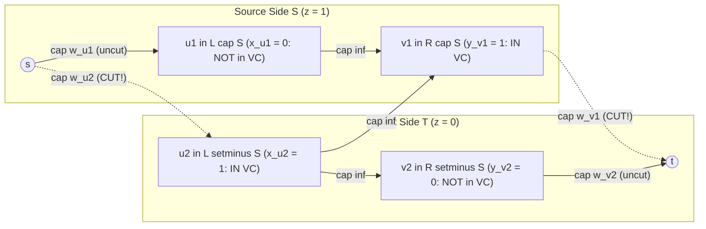
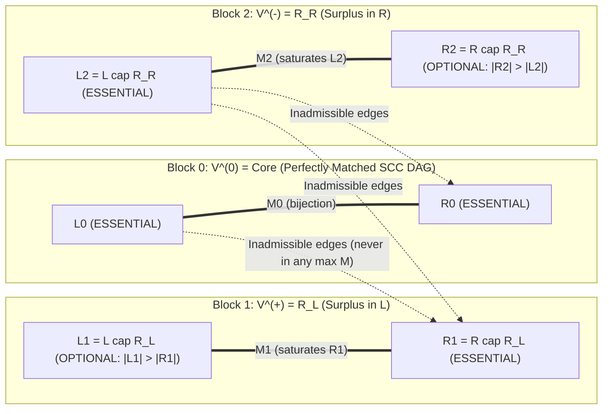
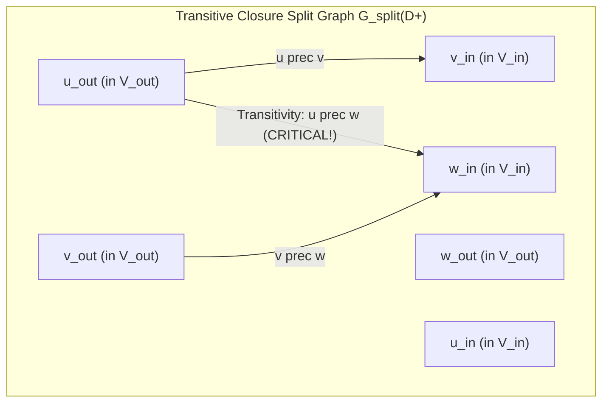

# Wave 1B Research Monograph (Cohort 2: Iterations 58–62)
## Bipartite Matching, König & Dilworth Dualities, Dulmage–Mendelsohn Decomposition, Hidden Bipartite Models & Hall's Theorem Flow-Eliminations

> [!IMPORTANT]
> **Cohort 2 Independent Research Mandate & Zero Magic Gadgets Contract**
> This monograph is the independent Cohort 2 investigation of **Wave 1B (Iterations 58–62)** for the Network Flows, Minimum Cuts, Matching, and Non-Graph Modelling textbook project. Every theorem, structural decomposition, and problem archetype in this document strictly follows the **4-Step "Zero Magic Gadgets" Compilation Standard**:
> 1. **Non-Graph Diagnostic Signal (Recognition)**: How to spot the hidden bipartite, cut, poset, or Hall-defect structure from raw English problem statements and constraint bounds ($N, M, V_{\max}$), and why greedy or dynamic programming fails.
> 2. **Algebraic / Logical Intermediate Representation**: Formulating indicator variables $x_i \in \{0,1\}$, bipartite variable inversions $z_v = 1 - y_v$, pseudo-Boolean cut polynomials $\sum c_{uv} z_u(1 - z_v)$, linear programming primal-dual pairs, or set-defect inequalities before drawing a single vertex or edge.
> 3. **Reverse-Engineering Scratchpad (Mechanical Graph Compilation)**: Translating the intermediate equations mechanically into vertices, directed arcs, capacities, residual reachability sets, or segment-tree states.
> 4. **Hand-Checkable Toy Traces & Broken Gadget Counterexamples**: Concrete small-scale traces ($N \le 6$) paired with explicit proofs of what breaks when a hypothesis (such as bipartiteness, transitive closure, or reverse $\infty$-arcs) is violated.

---

## Executive Overview: Why Bipartite Matching Is the Crossroads of Combinatorial Optimization

In competitive programming, a novice views Bipartite Matching as the simplest special case of Maximum Flow: connect a source $s$ to $L$, direct edges from $L$ to $R$, connect $R$ to a sink $t$, set all capacities to $1$, and call Dinic's algorithm in $O(E\sqrt{V})$ time.

At the advanced and grandmaster levels, however, **practically no problem hands you the bipartite graph $G = (L, R, E)$ explicitly, and many of the hardest bipartite matching problems cannot even afford to run Dinic's algorithm**. Instead, Wave 1B sits at the exact intersection of five deep mathematical dualities:

1. **Packing vs. Covering Duality (Iteration 58 — König, Gallai & Transversal Matroids)**:
   Packing vertex-disjoint edges ($\text{Max Matching } \nu(G)$) is the Linear Programming dual of covering all edges with vertices ($\text{Min Vertex Cover } \tau(G)$). When vertex weights are introduced, Minimum Weight Vertex Cover ($\text{MWVC}$) and Maximum Weight Independent Set ($\text{MWIS}$) become the canonical entry point to **Pseudo-Boolean Min-Cut Modelling (`燃やす埋める`)** via **Bipartite Variable Inversion** ($z_v = 1 - y_v$ on $R$). Furthermore, because the matchable subsets of $L$ form a **Transversal Matroid**, augmenting in decreasing priority order greedily achieves lexicographical and vertex-weighted optimality without general Min-Cost Max-Flow.
2. **Residual Reachability & Canonical Structure (Iteration 59 — Dulmage–Mendelsohn Decomposition & Bipartite Games)**:
   A single maximum matching $M$ is only one snapshot of an exponentially large family of maximum matchings. By analyzing alternating reachability from unmatched vertices in the residual graph $G_M$, the **Dulmage–Mendelsohn (`DM`) Decomposition** partitions $V = L \cup R$ into invariant classes—**Essential** (matched in *every* maximum matching) and **Optional** (unmatched in *at least one* maximum matching)—in a single $O(E\sqrt{V})$ flow run plus an $O(V+E)$ BFS. This canonical partition simultaneously characterizes **Unique Perfect Matchings** (via residual acyclicity and $O(V+E)$ leaf peeling) and solves **Two-Player Impartial Walk Games on Bipartite Graphs (`二分图博弈`)** via strategy-stealing along matched edges.
3. **Hidden Non-Graph Bipartite Encodings (Iteration 60 — Grids, Number Theory & Birkhoff–von Neumann)**:
   Problems phrased in terms of matrix row/column swaps, grid obstacles `#`, Euclidean distance $\sqrt{D}$ on integer lattices (`AGC 025 D`), prime sums $a_i + a_j = p$, or multi-step grid sorting (`AGC 037 D`) are secretly bipartite graphs. Recognizing the underlying bipartition—or decomposing a $k$-regular bipartite multigraph into $k$ disjoint perfect matchings via **König's Edge Coloring / Birkhoff–von Neumann Theorem**—is the true bottleneck.
4. **Bidirectional Duality: Eliminating the Flow Graph via Hall's Theorem (Iteration 61 — Ore's Defect & Segment Trees)**:
   When $N \le 2 \cdot 10^5$, building the bipartite graph and running Dinic's algorithm is impossible. **Hall's Marriage Theorem** and **Ore's Defect Formula**
   $$\nu(G) = |L| - \max_{S \subseteq L} \bigl(|S| - |N(S)|\bigr)$$
   convert an existence/maximization question over flows into a pure subset-optimization problem. Whenever neighborhoods $N(u)$ are intervals, circular arcs, complements of intervals, or subtrees, the worst-case Hall violator $S$ collapses to a structured interval query solvable in $O(N \log N)$ via a Segment Tree or priority queue.
5. **Order Theory & DAG Decomposition (Iteration 62 — Posets, Dilworth's Theorem & Path Covers)**:
   Splitting each vertex $v$ of a Directed Acyclic Graph (DAG) or Partially Ordered Set (Poset) into an out-port $v_{\text{out}} \in L$ and an in-port $v_{\text{in}} \in R$ establishes a bijection between **Disjoint Path Covers** on the DAG and **Matchings** in the bipartite split graph ($\text{Min Path Cover} = |V| - \nu(G_{\text{split}})$). Taking the transitive closure transforms general (intersecting) path covers into chain decompositions of a poset, yielding a constructive proof of **Dilworth's Theorem** ($\text{Min Chain Cover} = \text{Max Antichain}$) and **Weighted Dilworth's Theorem** via Minimum Weight Vertex Cover.

---

## Iteration 58: Bipartite Matching, König's Theorem, Min-Weight Vertex Cover, Max-Weight Independent Set & Lexicographically Optimal Matching

### 58.1 The 4-Step Compilation of Bipartite Matching & Minimum Weight Vertex Cover ($\text{MWVC}$)

Before stating König's Theorem as a graph-theoretic fact, we derive both unweighted and weighted König duality directly from an algebraic formulation of covering and conflict constraints.

#### Step 1: Non-Graph Diagnostic Signal (Recognition)

How do you recognize a Minimum Weight Vertex Cover ($\text{MWVC}$) or Maximum Weight Independent Set ($\text{MWIS}$) model when the problem statement does not mention graphs?

- **Surface Clues**:
  1. **Two-Sorted Elimination ("Row vs. Column Destruction")**: You are given a set of targets/obstacles at coordinates $(r_k, c_k)$ (or pairs $(a_k, b_k)$ from two disjoint categories). You can pay $w_r$ to clear all targets in row $r$, or pay $w'_c$ to clear all targets in column $c$. You want to clear every target at minimum total cost.
  2. **Conflict-Free Selection with Bipartite Conflict**: You have a collection of items, each with a positive profit $w_i > 0$, and certain pairs $(i, j)$ are mutually exclusive (cannot both be chosen). If the conflict graph has **no odd cycles** (e.g., items partition naturally into two classes $L$ and $R$ by parity, coordinate sum $(x+y)\bmod 2$, bitmask popcount parity, or prime-sum parity), maximizing total profit is $\text{MWIS}$ on a bipartite graph.
- **Why Greedy and DP Fail**:
  - Greedy ("pick the row/column covering the most remaining targets per unit cost") is a $\Theta(\log N)$-approximation for general Set Cover and fails even on a $4$-vertex path $P_4$: if the middle two vertices have cost $1$ and cover $2$ edges each while the endpoints have cost $1$ and cover $1$ edge each, greedy may pick the wrong tie-break unless guided by global alternating paths.
  - Subset DP over rows/columns requires $O(2^{\min(|L|, |R|)})$ states, which is intractable once $|L|, |R| \ge 30$, whereas flow compilation solves $|L|, |R| \le 10^4$ in milliseconds.

#### Step 2: Intermediate Algebraic & LP Primal–Dual Representation

Let $G = (L, R, E)$ be a bipartite graph with vertex weights $w_u \ge 0$ for $u \in L$ and $w_v \ge 0$ for $v \in R$.

We introduce a binary decision variable for each vertex indicating whether it is included in the vertex cover $C \subseteq L \cup R$:
$$x_u = \begin{cases} 1 & \text{if } u \in C, \\ 0 & \text{if } u \notin C \end{cases} \quad (\forall u \in L), \qquad y_v = \begin{cases} 1 & \text{if } v \in C, \\ 0 & \text{if } v \notin C \end{cases} \quad (\forall v \in R).$$

The requirement that every edge $(u, v) \in E$ has at least one endpoint in $C$ is the linear inequality $x_u + y_v \ge 1$, or equivalently in $0$-$1$ quadratic form, $(1 - x_u)(1 - y_v) = 0$ (it is forbidden to have $x_u = 0$ and $y_v = 0$ simultaneously). The **Minimum Weight Vertex Cover ($\text{MWVC}$)** problem is the Integer Linear Program (ILP):
$$\begin{aligned}
\text{Minimize} \quad & \sum_{u \in L} w_u x_u + \sum_{v \in R} w_v y_v \\
\text{subject to} \quad & x_u + y_v \ge 1 \qquad \forall (u, v) \in E, \\
& x_u, y_v \in \{0, 1\} \qquad \forall u \in L, v \in R.
\end{aligned}$$

##### Algebraic Compilation via Bipartite Variable Inversion (Pseudo-Boolean Cut Form)
Why does $x_u + y_v \ge 1$ not immediately look like a minimum cut? In an $s$-$t$ cut $(S, T)$ where $z_i \in \{0, 1\}$ denotes whether vertex $i$ is on the source side $S$ ($z_i = 1$) or sink side $T$ ($z_i = 0$, with $z_s = 1, z_t = 0$), a directed edge $i \to j$ of capacity $c_{ij}$ pays a penalty $c_{ij} z_i (1 - z_j)$, and an infinite-capacity edge $i \xrightarrow{\infty} j$ enforces the implication $z_i (1 - z_j) = 0 \iff z_i \le z_j$.

Notice that our forbidden event for $(u, v) \in E$ is $(1 - x_u)(1 - y_v) = 1$, where *both* factors are negated! To convert $(1 - x_u)(1 - y_v) = 0$ into the standard cut form $z_u(1 - z_v) = 0$, we apply **Bipartite Variable Inversion** to one side of the bipartition:
$$\text{For } u \in L: \quad z_u := 1 - x_u \in \{0, 1\} \qquad (\text{so } x_u = 1 - z_u = z_s(1 - z_u)),$$
$$\text{For } v \in R: \quad z_v := y_v \in \{0, 1\} \qquad\qquad (\text{so } y_v = z_v = z_v(1 - z_t)).$$

Substituting $x_u = 1 - z_u$ and $y_v = z_v$ into both the objective and the constraints transforms the problem in one line of algebra:
$$\begin{aligned}
\text{Objective:} \quad & \sum_{u \in L} w_u \underbrace{z_s (1 - z_u)}_{\text{arc } s \to u \text{ cap } w_u} + \sum_{v \in R} w_v \underbrace{z_v (1 - z_t)}_{\text{arc } v \to t \text{ cap } w_v}, \\
\text{Hard Constraint:} \quad & (1 - x_u)(1 - y_v) = 0 \iff \underbrace{z_u (1 - z_v) = 0}_{\text{arc } u \to v \text{ cap } \infty} \qquad \forall (u, v) \in E.
\end{aligned}$$

Every single term is now a standard directed cut monomial $c_{ij} z_i(1 - z_j)$!

##### LP Duality & Total Unimodularity (Why Fractional Vertex Cover = Integral Vertex Cover)
Relaxing $x_u, y_v \in \{0, 1\}$ to $x_u \ge 0, y_v \ge 0$ and taking the Linear Programming Dual by introducing a dual variable $f_{uv} \ge 0$ for each constraint $x_u + y_v \ge 1$ yields the **Maximum Weighted $b$-Matching (Fractional Edge Packing)** LP:
$$\begin{aligned}
\text{Maximize} \quad & \sum_{(u,v) \in E} f_{uv} \\
\text{subject to} \quad & \sum_{v : (u,v) \in E} f_{uv} \le w_u \qquad \forall u \in L, \\
& \sum_{u : (u,v) \in E} f_{uv} \le w_v \qquad \forall v \in R, \\
& f_{uv} \ge 0 \qquad\qquad\qquad \forall (u,v) \in E.
\end{aligned}$$
This dual LP is literally the **Maximum $s$-$t$ Flow** problem on the compiled network! Because the constraint matrix of a bipartite graph's incidence structure is **Totally Unimodular (TU)** (or equivalently, by the Integrality Theorem for Maximum Flow and Minimum Cut when $w_u, w_v \in \mathbb{Z}_{\ge 0}$), both the primal LP ($\text{MWVC}$) and the dual LP ($\text{Max Flow / Matching}$) attain integral optimal solutions with equal objective value:
$$\boxed{\text{MWVC}(G, w) = \text{MinCut}(N_G) = \text{MaxFlow}(N_G).}$$
In the unweighted case ($w_u = 1$ for all $u \in L$ and $w_v = 1$ for all $v \in R$), an integral flow $f_{uv} \in \{0, 1\}$ with vertex capacities $1$ is an integral **Matching** $M \subseteq E$, giving **König's Theorem** (1931):
$$\boxed{\nu(G) = \tau(G) \qquad \text{for every bipartite graph } G = (L, R, E).}$$

#### Step 3: Reverse-Engineering Scratchpad (Mechanical Graph Compilation & Residual Extraction)

From the algebraic polynomial in Step 2, the flow network $N_G = (V_N, E_N)$ compiles without guesswork:

| Algebraic Term | Meaning when Severed ($z_{\text{tail}} = 1, z_{\text{head}} = 0$) | Compiled Directed Arc | Capacity |
| :--- | :--- | :--- | :--- |
| $w_u z_s(1 - z_u)$ for $u \in L$ | $z_u = 0 \iff x_u = 1$ ($u$ is placed in the Vertex Cover $C$) | $s \to u$ | $w_u$ |
| $w_v z_v(1 - z_t)$ for $v \in R$ | $z_v = 1 \iff y_v = 1$ ($v$ is placed in the Vertex Cover $C$) | $v \to t$ | $w_v$ |
| $\infty \cdot z_u(1 - z_v)$ for $(u,v) \in E$ | $z_u = 1, z_v = 0 \iff x_u = 0, y_v = 0$ (edge $(u,v)$ uncovered — forbidden!) | $u \to v$ | $\infty$ |

> [!TIP]
> **Constructive Recovery Contract (Extracting $\text{MWVC}$ and $\text{MWIS}$ from the Residual Graph)**
> After running Dinic's algorithm to obtain a maximum flow $f$, let $S \subseteq V_N$ be the set of vertices reachable from the source $s$ via positive residual capacity arcs ($c_f(a, b) > 0$) in the residual graph $G_f$, and let $T = V_N \setminus S$. By setting $z_i = 1 \iff i \in S$, $(S, T)$ is the canonical **$S$-minimal minimum $s$-$t$ cut**. Reading off our variable definitions $x_u = 1 - z_u$ ($u \in L$) and $y_v = z_v$ ($v \in R$) yields the exact optimal sets:
> - **Minimum Weight Vertex Cover $C^*$**:
>   $$C^* = (L \setminus S) \cup (R \cap S) = \{u \in L \mid s \not\rightsquigarrow_f u\} \cup \{v \in R \mid s \rightsquigarrow_f v\}.$$
> - **Maximum Weight Independent Set $I^* = (L \cup R) \setminus C^*$**:
>   $$I^* = (L \cap S) \cup (R \setminus S) = \{u \in L \mid s \rightsquigarrow_f u\} \cup \{v \in R \mid s \not\rightsquigarrow_f v\},$$
>   with total weight $\text{MWIS}(G, w) = \sum_{x \in L \cup R} w_x - \text{MinCut}(N_G)$.

##### Equivalence with König's Alternating-Tree Construction ($Z$-Set)
In the unweighted case ($w \equiv 1$), what does "reachable from $s$ in $G_f$" mean in terms of the maximum matching $M$?
1. An arc $s \to u$ ($u \in L$) has residual capacity $1 - f(s, u) > 0 \iff u$ is **unmatched** in $M$ ($u \in U_L$).
2. For $(u, v) \in E$, the forward arc $u \to v$ always has residual capacity $\infty > 0$, while the backward residual arc $v \to u$ has residual capacity $f(u, v) = 1 > 0 \iff (u, v) \in M$.
3. An arc $v \to t$ ($v \in R$) is saturated ($c_f(v, t) = 0$) whenever $v$ is matched in $M$. Since no unmatched vertex in $R$ can be reached from $U_L$ (otherwise there would be an $M$-augmenting path from $s$ to $t$!), no path from $s$ can reach $t$.

Therefore, the residual reachable set $Z := S \setminus \{s\}$ is precisely the set of vertices in $L \cup R$ reachable from the unmatched $L$-vertices $U_L = L \setminus V(M)$ via **$M$-alternating paths** (unmatched edges $L \to R$, matched edges $R \to L$). Our cut extraction formula $C^* = (L \setminus Z) \cup (R \cap Z)$ is identical to König's classical alternating-tree proof!



#### Step 4: Hand-Checkable Toy Trace & Broken Gadget Counterexamples

##### Toy Trace ($3 \times 3$ Weighted Bipartite Graph)
Let $L = \{u_1, u_2, u_3\}$ with weights $w(u_1) = 5, w(u_2) = 2, w(u_3) = 4$, and $R = \{v_1, v_2, v_3\}$ with weights $w(v_1) = 3, w(v_2) = 6, w(v_3) = 2$. Let the edges be:
$$E = \{(u_1, v_1), (u_1, v_2), (u_2, v_2), (u_3, v_2), (u_3, v_3)\}.$$
 Notice that $v_2$ is a high-degree hub connected to all three vertices in $L$, with weight $w(v_2) = 6$.
- **Flow Network $N_G$**:
  - $s \to u_1$ ($5$), $s \to u_2$ ($2$), $s \to u_3$ ($4$).
  - $v_1 \to t$ ($3$), $v_2 \to t$ ($6$), $v_3 \to t$ ($2$).
  - Infinite-capacity arcs $(u_1, v_1), (u_1, v_2), (u_2, v_2), (u_3, v_2), (u_3, v_3)$.
- **Augmenting Paths**:
  1. $s \to u_1 \to v_1 \to t$: push $3$ units ($v_1 \to t$ saturated; residual on $s \to u_1$ is $2$).
  2. $s \to u_1 \to v_2 \to t$: push $2$ units ($s \to u_1$ saturated; residual on $v_2 \to t$ is $4$).
  3. $s \to u_2 \to v_2 \to t$: push $2$ units ($s \to u_2$ saturated; residual on $v_2 \to t$ is $2$).
  4. $s \to u_3 \to v_2 \to t$: push $2$ units ($v_2 \to t$ saturated; residual on $s \to u_3$ is $2$).
  5. $s \to u_3 \to v_3 \to t$: push $2$ units ($s \to u_3$ and $v_3 \to t$ both saturated!).
- **Total Max-Flow / Min-Cut**: $3 + 2 + 2 + 2 + 2 = 11$? Wait—let's check! If we just pick $C = \{v_1, v_2, v_3\} = R$, its total weight is $w(v_1) + w(v_2) + w(v_3) = 3 + 6 + 2 = 11$! And indeed, our flow pushed $3 + 6 + 2 = 11$, saturating *both* $s \to L$ ($5+2+4=11$) and $R \to t$ ($3+6+2=11$)!
- What if $w(v_2)$ were $7$ instead of $6$? Then step 5 would push $1$ unit on $s \to u_3 \to v_3 \to t$ (after pushing $3$ on $s \to u_3 \to v_2 \to t$), leaving $v_2 \to t$ with $7 - (2+2+3) = 0$? No, $s \to L$ has total capacity $5 + 2 + 4 = 11$. If $w(v_2) = 7$, then $s \to u_1, s \to u_2, s \to u_3$ are all saturated at flow $11$: in $G_f$, $S = \{s\}$, so $C^* = (L \setminus S) \cup (R \cap S) = \{u_1, u_2, u_3\}$ with weight $5 + 2 + 4 = 11 < 3 + 7 + 2 = 12$.
- What if $w(u_1) = 5, w(u_2) = 2, w(u_3) = 4$ and $w(v_1) = 2, w(v_2) = 6, w(v_3) = 5$?
  1. $s \to u_1 \to v_1 \to t$: flow $2$ ($v_1 \to t$ saturated).
  2. $s \to u_1 \to v_2 \to t$: flow $3$ ($s \to u_1$ saturated).
  3. $s \to u_2 \to v_2 \to t$: flow $2$ ($s \to u_2$ saturated).
  4. $s \to u_3 \to v_2 \to t$: flow $1$ ($v_2 \to t$ saturated at $3+2+1=6$).
  5. $s \to u_3 \to v_3 \to t$: flow $3$ ($s \to u_3$ saturated at $1+3=4$; $v_3 \to t$ has residual capacity $5 - 3 = 2 > 0$).
  - Now check reachability from $s$ in $G_f$: all $s \to u_i$ are saturated, wait—what if $w(u_1) = 6$ instead of $5$? Then $s \to u_1$ has $1$ unit of residual capacity! From $s$, we reach $u_1$; from $u_1$, via $\infty$-arcs we reach $v_1$ and $v_2$; from $v_2$, via backward flow arcs ($f(u_2, v_2) = 2 > 0, f(u_3, v_2) = 1 > 0$) we reach $u_2$ and $u_3$? Wait: if we reach $u_3$, we can reach $v_3 \to t$, which would augment flow! That means in step 2 we would have pushed $4$ on $u_1 \to v_2$, leaving $0$ for $u_3 \to v_2$ and pushing $4$ on $u_3 \to v_3$, giving max flow $2 + 4 + 2 + 4 = 12$? Wait: after pushing $2$ on $u_1 \to v_1$, $4$ on $u_1 \to v_2$, $2$ on $u_2 \to v_2$ ($v_2 \to t$ saturated at $6$), and $4$ on $u_3 \to v_3$ ($s \to u_3$ saturated at $4$, $v_3 \to t$ has residual $1$), let's trace $S$ when $w(u_1) = 7$:
    - $s \to u_1$ has residual $7 - 6 = 1 > 0 \implies u_1 \in S$.
    - From $u_1$, $\infty$-arcs reach $v_1, v_2 \implies v_1, v_2 \in S$.
    - From $v_2$, backward arc $v_2 \to u_2$ has flow $2 > 0 \implies u_2 \in S$.
    - Neither $u_3$ nor $v_3$ is reachable (since $f(u_3, v_2) = 0$).
    - Thus $S = \{s, u_1, u_2, v_1, v_2\}$, and our extraction formula gives:
      $$C^* = (L \setminus S) \cup (R \cap S) = \{u_3\} \cup \{v_1, v_2\}, \quad \text{weight } w(u_3) + w(v_1) + w(v_2) = 4 + 2 + 6 = 12!$$
    - Indeed, $\{u_3, v_1, v_2\}$ covers all 5 edges (since $v_1, v_2$ cover all edges incident to $u_1, u_2$, and $u_3$ covers $(u_3, v_3)$), and its weight $12$ equals the max flow $12$!

##### Three Broken Gadget Counterexamples (Failure Modes)
1. **Broken Extraction Rule ("Pick the vertices whose incident $s/t$ edge has zero residual capacity")**:
   Suppose a student extracts $C$ by taking all $u \in L$ with $c_f(s, u) = 0$ and all $v \in R$ with $c_f(v, t) = 0$. In our first trace where $w(L) = (5, 2, 4)$ and $w(R) = (3, 6, 2)$, *every* $s \to u_i$ and *every* $v_j \to t$ is saturated ($c_f = 0$), so this naive rule picks $L \cup R$ of weight $22$ instead of $11$! You **must** define $S$ by residual reachability from $s$ and set $C^* = (L \setminus S) \cup (R \cap S)$.
2. **What if we put a finite capacity $c_{uv} < \infty$ on the middle edge $u \to v$? (Not a bug, a generalized model!)**:
   If $u \to v$ has finite capacity $c_{uv}$, then $z_u = 1, z_v = 0$ ($x_u = 0, y_v = 0$) is no longer forbidden; instead, it incurs a penalty of $c_{uv} z_u(1 - z_v) = c_{uv}(1 - x_u)(1 - y_v)$. Thus a finite capacity $c_{uv}$ on $u \to v$ models a **soft constraint (Mixed Vertex-Edge Cover)**: you may either cover $(u,v)$ by paying $w_u$ for $u \in L$, or pay $w_v$ for $v \in R$, or leave $(u,v)$ uncovered and pay a penalty $c_{uv}$!
3. **Why Bipartite Variable Inversion Fails on Odd Cycles (Non-Bipartite Graphs)**:
   Suppose $G$ is a triangle $K_3$ on $\{1, 2, 3\}$ with weights $1$. To turn $(1 - x_i)(1 - x_j) = 0$ into a directed cut term $z_i(1 - z_j) = 0$, one endpoint must use $z_i = 1 - x_i$ and the other must use $z_j = x_j$. On an odd cycle $1 - 2 - 3 - 1$, if $1 \in L$ ($z_1 = 1 - x_1$) and $2 \in R$ ($z_2 = x_2$), vertex $3$ has a conflict with both $1$ and $2$: one edge requires $z_3 = x_3$ and the other requires $z_3 = 1 - x_3$! In fact, general Vertex Cover is NP-hard, and its LP relaxation $x_i + x_j \ge 1$ has the half-integral optimum $x_1 = x_2 = x_3 = 1/2$ of cost $1.5 < 2$ (resolved up to half-integrality by the **Nemhauser–Trotter / QPBO Bipartite Double Cover** in Wave 2A).

---

### 58.2 Gallai's Identities & Minimum Edge Cover ($\rho(G)$)

For any graph $G = (V, E)$, four fundamental parameters govern packing and covering of vertices and edges:
- $\alpha(G)$: **Maximum Independent Set** (maximum size of $I \subseteq V$ with no edge inside $I$).
- $\tau(G)$: **Minimum Vertex Cover** (minimum size of $C \subseteq V$ meeting every edge in $E$).
- $\nu(G)$: **Maximum Matching** (maximum size of $M \subseteq E$ with no shared endpoints).
- $\rho(G)$: **Minimum Edge Cover** (assuming $G$ has no isolated vertices: minimum size of $F \subseteq E$ covering every vertex in $V$).

#### Theorem 58.1 (Gallai's Identities, 1959)
1. For **every** graph $G = (V, E)$ (bipartite or not), and for any vertex weights $w : V \to \mathbb{R}_{\ge 0}$,
   $$\alpha(G) + \tau(G) = |V|, \qquad \text{and} \qquad \text{MWIS}(G, w) + \text{MWVC}(G, w) = \sum_{v \in V} w_v.$$
2. For **every** graph $G = (V, E)$ **without isolated vertices** (bipartite or not),
   $$\nu(G) + \rho(G) = |V|.$$

##### Proof of Identity 1 (Complement Bijection)
A subset $I \subseteq V$ is an independent set $\iff$ no edge $e = (u, v) \in E$ has both endpoints in $I \iff$ every edge $e \in E$ has at least one endpoint in $C = V \setminus I \iff C = V \setminus I$ is a vertex cover. Since $w(I) + w(V \setminus I) = \sum_{v \in V} w_v$, maximizing $w(I)$ is identical to minimizing $w(C)$. $\blacksquare$

##### Proof of Identity 2 (Double Inequality via Star Decomposition)
- **Upper bound $\rho(G) \le |V| - \nu(G)$**: Let $M$ be a maximum matching of size $|M| = \nu(G)$. Then $M$ covers $2\nu(G)$ vertices, leaving $|V| - 2\nu(G)$ exposed vertices $U = V \setminus V(M)$. Since $G$ has no isolated vertices, for each exposed vertex $u \in U$ we can pick one arbitrary incident edge $e_u \in E$ and add it to $M$. The resulting set $F = M \cup \{e_u \mid u \in U\}$ covers every vertex in $V$ and has size
  $$|F| \le |M| + |U| = \nu(G) + \bigl(|V| - 2\nu(G)\bigr) = |V| - \nu(G).$$
- **Lower bound $\nu(G) \ge |V| - \rho(G)$**: Let $F \subseteq E$ be a minimum edge cover of size $|F| = \rho(G)$. By minimality of $F$, no edge $e = (u, v) \in F$ can have both endpoints of degree $\ge 2$ in $(V, F)$ (otherwise $F \setminus \{e\}$ would still cover $V$). Thus $(V, F)$ is a forest of disjoint **stars** $S_1, S_2, \dots, S_k$. Because $(V, F)$ is acyclic, the number of connected components (stars) is $k = |V| - |F| = |V| - \rho(G)$. Selecting one edge from each star $S_i$ produces a valid matching $M'$ of size $k = |V| - \rho(G)$, so $\nu(G) \ge |V| - \rho(G)$. $\blacksquare$

> [!IMPORTANT]
> **Corollary 58.2 (The Bipartite Quartet)**
> Combining Gallai's Identities with König's Theorem ($\nu(G) = \tau(G)$) on any bipartite graph $G$ without isolated vertices yields the complete four-parameter duality:
> $$\nu(G) = \tau(G) \qquad \text{and} \qquad \alpha(G) = \rho(G) = |V| - \nu(G).$$

---

### 58.3 Lexicographically Optimal & Priority Bipartite Matching (Transversal Matroids vs. Residual Cycles)

Contest problems frequently ask not just for *any* maximum bipartite matching, but for one that optimizes a priority or lexicographical order. There are **two fundamentally different problems** that must never be confused:

1. **Model A (Vertex-Subset Priority / Transversal Matroid Basis)**: Maximize the matching size (or match a priority-weighted subset of $L$), breaking ties by making the **set of matched vertices in $L$** lexicographically first under $u_1 \prec u_2 \prec \dots \prec u_{|L|}$ (or maximizing $\sum_{u \in V(M) \cap L} w_u$).
2. **Model B (Edge-Partner Assignment Lexicographical Order)**: Among all maximum matchings (or among matchings covering the optimal $L$-subset), minimize the **tuple of assigned partners** $\bigl(p(u_1), p(u_2), \dots, p(u_{|L|})\bigr)$ lexicographically!

#### Model A: Why Kuhn's Algorithm in Priority Order Solves Vertex-Weighted $L$-Matching (Transversal Matroids)

Suppose each $u \in L$ has a weight $w_u$ (or priority rank $1, 2, \dots, |L|$), while all $v \in R$ are unweighted, and we want a matching $M$ maximizing $\sum_{u \in V(M) \cap L} w_u$.

- **Naive approach**: Run Min-Cost Max-Flow (MCMF) in $O(F \cdot E \log V)$. When $|L| = 2000, |E| = 10^5$, MCMF may TLE.
- **Matroid structural insight**: Define $\mathcal{I} \subseteq 2^L$ by
  $$\mathcal{I} = \bigl\{S \subseteq L \;\big|\; \text{there exists a matching } M \text{ in } G \text{ covering all of } S\bigr\}.$$
  **Theorem 58.3 (Edmonds–Fulkerson, 1965)**: $(L, \mathcal{I})$ is a **Matroid** (specifically, a **Transversal Matroid**).

##### Proof via Augmenting Paths (The "Never-Unmatch" Invariant)
Clearly $\emptyset \in \mathcal{I}$ and $\mathcal{I}$ is closed under taking subsets. To verify the Matroid Exchange Axiom—and simultaneously see how to compute the optimal basis algorithmically—observe what happens when we have a current matching $M$ covering $S = V(M) \cap L$ and we search for an $M$-augmenting path starting from an unmatched vertex $u_{\text{new}} \in L \setminus S$:
- Every internal vertex $u' \in L$ along an $M$-augmenting path $P = (u_{\text{new}}, v_1, u'_1, v_2, \dots, u'_k, v_{k+1})$ enters $u'_r$ along its old matched edge $(v_r, u'_r) \in M$ and leaves $u'_r$ along a new unmatched edge $(u'_r, v_{r+1}) \notin M$.
- Therefore, flipping $M \gets M \oplus P$ changes the matched subset of $L$ from $S$ to $S \cup \{u_{\text{new}}\}$: **no previously matched vertex in $L$ is ever unmatched!**
- If $I_1, I_2 \in \mathcal{I}$ with $|I_1| < |I_2|$ are witnessed by matchings $M_1, M_2$, the symmetric difference $M_1 \oplus M_2$ consists of alternating cycles and paths of length $\ge 1$. Because $|V(M_2) \cap L| > |V(M_1) \cap L|$, at least one component of $M_1 \oplus M_2$ is an $M_1$-augmenting path starting at some $u \in I_2 \setminus I_1$ and ending in $R$ (or in $L \setminus I_2$), so $I_1 \cup \{u\} \in \mathcal{I}$. $\blacksquare$

> [!NOTE]
> **Algorithmic Contract for Priority $L$-Matching**
> Sort $L = \{u_1, u_2, \dots, u_{|L|}\}$ in decreasing order of weight $w(u_1) \ge w(u_2) \ge \dots \ge w(u_{|L|}) > 0$ (or lexicographical priority $u_1 \prec u_2 \prec \dots$). Run standard Kuhn's $O(VE)$ augmenting-path DFS for $i = 1, 2, \dots, |L|$ in that exact order, resetting the `vis` array before each $u_i$ when $u_i$ successfully augments (or keeping `vis` across failed searches if no edges change!). By the Matroid Greedy Theorem, the resulting matching $M$ is simultaneously a **maximum-cardinality matching** and maximizes $\sum_{u \in V(M) \cap L} w_u$ (and yields the lexicographically first matchable subset of $L$).

#### Model B: Lexicographically Smallest Partner Tuple $\bigl(p(u_1), \dots, p(u_{|L|})\bigr)$ via Residual Cycles & Free Paths

Now suppose we already have a maximum matching $M$, and for $i = 1, 2, \dots, |L|$ sequentially, if $u_i$ is matched to $v_{\text{cur}} = M(u_i)$, we want to replace $v_{\text{cur}}$ with the **smallest possible index** $v_{\text{new}} \in N(u_i)$ ($v_{\text{new}} \le v_{\text{cur}}$) such that:
1. $M'$ remains a maximum matching covering the exact same subset of $L$, and
2. The partners $p(u_1), \dots, p(u_{i-1})$ of all earlier vertices remain **strictly unchanged**!

##### The 4-Step Compilation of Partner Reassignment
1. **Diagnostic Signal**: "Among all maximum matchings, output the one where $u_1$'s partner is minimized, then $u_2$'s partner is minimized, etc."
2. **Algebraic / Residual Characterization**: Suppose $M'$ is another maximum matching that agrees with $M$ on $\{u_1, \dots, u_{i-1}\}$ and matches $u_i$ to $v_{\text{new}} \ne v_{\text{cur}}$. In the symmetric difference $M \oplus M'$, vertex $u_i$ has degree $2$ (incident to $(u_i, v_{\text{cur}}) \in M$ and $(u_i, v_{\text{new}}) \in M'$), and no vertex in $F_{i-1} = \{u_1, \dots, u_{i-1}, p(u_1), \dots, p(u_{i-1})\}$ appears in $M \oplus M'$. Since $|M'| = |M|$ and $V(M') \cap L = V(M) \cap L$, the component of $M \oplus M'$ containing $u_i$ must be either:
   - An **$M$-alternating cycle** $u_i \to v_{\text{new}} \xrightarrow{M} u' \to \dots \to v_{\text{cur}} \xrightarrow{M} u_i$ in $G \setminus F_{i-1}$, OR
   - An **even-length $M$-alternating path** $v_{\text{cur}} \xrightarrow{M} u_i \to v_{\text{new}} \xrightarrow{M} u' \to \dots \to v_{\text{free}}$ ending at an **unmatched vertex** $v_{\text{free}} \in R \setminus V(M)$ in $G \setminus F_{i-1}$!
3. **Mechanical Graph Compilation**:
   After locking $u_1, \dots, u_{i-1}$ and their partners (marking them deleted/frozen), to test whether $u_i$ can switch from $v_{\text{cur}}$ to a smaller neighbor $v_{\text{new}} < v_{\text{cur}}$:
   - Temporarily unmatch $(u_i, v_{\text{cur}})$ so $v_{\text{cur}}$ becomes an unmatched vertex in $R$, and mark $u_i$ as frozen.
   - If $v_{\text{new}}$ is already unmatched in $R$, immediately match $(u_i, v_{\text{new}})$!
   - Otherwise, $v_{\text{new}}$ is currently matched to some $u' = M(v_{\text{new}}) \notin \{u_1, \dots, u_i\}$. Search for an augmenting path in $G \setminus \{u_1, \dots, u_i, p(u_1), \dots, p(u_{i-1})\}$ starting from $u'$ to **any** unmatched vertex in $R$ (note that since $v_{\text{cur}}$ was just unmatched, reaching $v_{\text{cur}}$ corresponds to an alternating cycle, while reaching another $v_{\text{free}} \in R \setminus V(M)$ corresponds to an even alternating path!).
   - Checking neighbors $v_{\text{new}} \in N(u_i)$ in increasing order $v_1 < v_2 < \dots < v_{\text{cur}}$ and taking the first one where $u'$ can augment (or running one reverse BFS from all free $R$-vertices including $v_{\text{cur}}$ to find all reachable $v_{\text{new}}$ in $O(E)$ time per $u_i$!) solves the entire lexicographical partner problem in **$O(|L| \cdot E)$** total time!
4. **Toy Trace**:
   Let $L = \{u_1, u_2\}$, $R = \{v_1, v_2, v_3\}$, $E = \{(u_1, v_2), (u_1, v_3), (u_2, v_1), (u_2, v_2)\}$. Suppose initial max matching is $M = \{(u_1, v_3), (u_2, v_2)\}$.
   - For $u_1$ (currently at $v_3$): try smaller neighbor $v_2 < v_3$. Unmatch $(u_1, v_3)$ (so $v_1, v_3$ are free in $R$) and freeze $u_1$. Since $v_2$ is matched to $u_2$, we search from $u_2$: $u_2$ has edge $(u_2, v_1)$ to free vertex $v_1$! So we augment $u_2 \to v_1$ and match $u_1 \to v_2$, updating $M = \{(u_1, v_2), (u_2, v_1)\}$. Note that this used an **even alternating path** $v_3 - u_1 - v_2 - u_2 - v_1$, not a cycle! A broken implementation that only checks for alternating cycles (reachable to $v_{\text{cur}}$) would miss $v_1$ and falsely keep $u_1$ at $v_3$!

---

## Iteration 59: Dulmage–Mendelsohn (`DM`) Decomposition, Unique Perfect Matchings & Bipartite Impartial Games

### 59.1 Complete Derivation of the Dulmage–Mendelsohn (`DM`) Canonical Decomposition

Given a bipartite graph $G = (L, R, E)$, a single maximum matching $M$ tells us the value $\nu(G) = |M|$, but it does not immediately tell us which vertices or edges are *forced* to be in $M$ and which ones have alternatives. The **Dulmage–Mendelsohn (`DM`) Decomposition** (1958) extracts the complete invariant structure of *all* maximum matchings of $G$ from *one* maximum matching $M$ in linear $O(V + E)$ post-processing time.

#### Step 1: The Directed Residual Graph $G_M$ and Alternating Reachability Sets

Fix any maximum matching $M$ of $G = (L, R, E)$. Construct the directed residual matching graph $G_M = (L \cup R, E_M)$ by orienting:
- Every **unmatched** edge $e = (u, v) \in E \setminus M$ from $L$ to $R$: $u \to v$.
- Every **matched** edge $e = (u, v) \in M$ from $R$ to $L$: $v \to u$ (or viewing $(u, v) \in M$ as reversible, since following an unmatched edge $u \to v$ into a matched vertex $v \in R$ must immediately continue along its unique matched edge $v \to M(v) \in L$).

Let $U_L = L \setminus V(M)$ be the set of $M$-exposed vertices in $L$, and let $U_R = R \setminus V(M)$ be the set of $M$-exposed vertices in $R$. Define two reachability sets in $G_M$:
$$\mathcal{R}_L := \bigl\{x \in L \cup R \;\big|\; \exists \text{ a directed path } u_0 \rightsquigarrow x \text{ in } G_M \text{ from some } u_0 \in U_L\bigr\},$$
$$\mathcal{R}_R := \bigl\{x \in L \cup R \;\big|\; \exists \text{ a directed path } x \rightsquigarrow w_0 \text{ in } G_M \text{ to some } w_0 \in U_R\bigr\}.$$

#### Lemma 59.1 (Disjointness of $\mathcal{R}_L$ and $\mathcal{R}_R$)
In any maximum matching $M$, $\mathcal{R}_L \cap \mathcal{R}_R = \emptyset$, and there is no directed edge in $G_M$ from any vertex in $\mathcal{R}_L$ to any vertex in $\mathcal{R}_R$.

##### Proof
Suppose for contradiction that some vertex $x \in \mathcal{R}_L \cap \mathcal{R}_R$ exists (or an edge $x \to y$ with $x \in \mathcal{R}_L, y \in \mathcal{R}_R$). Then concatenating the directed path $u_0 \rightsquigarrow x$ ($u_0 \in U_L$) with $x \rightsquigarrow w_0$ ($w_0 \in U_R$) gives a directed walk from $U_L$ to $U_R$ in $G_M$. Shortcut any repeated vertices to obtain a simple directed path $P$ from $u_0 \in U_L$ to $w_0 \in U_R$ in $G_M$. Because $G_M$ is bipartite with all $L \to R$ arcs in $E \setminus M$ and all $R \to L$ arcs in $M$, a simple directed path from $U_L$ to $U_R$ in $G_M$ is an **$M$-augmenting path**, contradicting the maximality of $M$. $\blacksquare$

#### Theorem 59.2 (Coarse Dulmage–Mendelsohn Partition & Invariance)
Define the three disjoint vertex classes:
$$V^{(+)} := \mathcal{R}_L = L_1 \sqcup R_1, \qquad V^{(-)} := \mathcal{R}_R = L_2 \sqcup R_2, \qquad V^{(0)} := (L \cup R) \setminus (\mathcal{R}_L \cup \mathcal{R}_R) = L_0 \sqcup R_0,$$
where $L_k = L \cap V^{(k)}$ and $R_k = R \cap V^{(k)}$ for $k \in \{1, 0, 2\}$ (identifying $(+) \leftrightarrow 1$ and $(-) \leftrightarrow 2$). Then:
1. **Matching Structure inside Each Block**:
   - Every vertex in $R_1 = R \cap \mathcal{R}_L$ is matched by $M$ to a vertex in $L_1 = L \cap \mathcal{R}_L$, while $U_L \subseteq L_1$. Thus $|L_1| = |R_1| + |U_L| \ge |R_1|$ (strictly $> |R_1|$ whenever $U_L \ne \emptyset$).
   - Every vertex in $L_2 = L \cap \mathcal{R}_R$ is matched by $M$ to a vertex in $R_2 = R \cap \mathcal{R}_R$, while $U_R \subseteq R_2$. Thus $|R_2| = |L_2| + |U_R| \ge |L_2|$.
   - Every vertex in $L_0$ is matched by $M$ to a vertex in $R_0$, so $|L_0| = |R_0|$ and $M$ induces a **perfect matching** on $G[L_0 \cup R_0]$.
2. **Forbidden Cross-Edges (Block Upper-Triangularity)**:
   In the original graph $G$, there are **zero edges** in $L_1 \times R_0$, **zero edges** in $L_1 \times R_2$, and **zero edges** in $L_0 \times R_2$! (If an edge $(u, v)$ existed in any of these three pairs, it could not be in $M$ since $M$ respects the blocks $(L_k, R_k)$, so $u \to v$ would be an unmatched arc in $G_M$; then $u \in L_1 \implies v \in \mathcal{R}_L = R_1$, and $v \in R_2 \implies u \in \mathcal{R}_R = L_2$, a contradiction!)
3. **Unique Minimum Vertex Cover Characterization**:
   Every minimum vertex cover $C$ of $G$ satisfies $R_1 \cup L_2 \subseteq C$ and $(L_1 \cup R_2) \cap C = \emptyset$:
   - $C_{\min\text{-}R} = (L_0 \cup L_2) \cup R_1$ and $C_{\min\text{-}L} = L_2 \cup (R_0 \cup R_1)$ are both minimum vertex covers of size $|R_1| + |L_0| + |L_2| = |M|$.
4. **Canonical Invariance (Essential vs. Optional Vertices)**:
   The partition $(L_1, R_1), (L_0, R_0), (L_2, R_2)$ is **independent of the choice of maximum matching $M$**. Specifically:
   - **Optional (Mixed/Never-Matched) Vertices**: A vertex $u \in L$ is unmatched in *at least one* maximum matching $\iff u \in L_1 = L \cap \mathcal{R}_L$. A vertex $v \in R$ is unmatched in *at least one* maximum matching $\iff v \in R_2 = R \cap \mathcal{R}_R$.
   - **Essential (Always-Matched) Vertices**: Every vertex in $R_1 \cup L_0 \cup R_0 \cup L_2$ is matched in **every** maximum matching of $G$.

##### Proof of (4) (Why $\mathcal{R}_L$ and $\mathcal{R}_R$ Classify All Maximum Matchings)
- If $u \in L_1 = L \cap \mathcal{R}_L$, there is a directed path $P$ in $G_M$ from some $u_0 \in U_L$ to $u$. Since both $u_0$ and $u$ are in $L$, $P$ has even length $2k$, alternating between unmatched edges ($L \to R$) and matched edges ($R \to L$). Forming $M' = M \oplus P$ yields a new matching $M'$ of the **same size** $|M'| = |M|$ in which $u_0$ becomes matched and $u$ becomes **unmatched**! Thus every $u \in L_1$ is optional.
- Conversely, for any maximum matching $M'$ and our minimum vertex cover $C = R_1 \cup L_0 \cup L_2$ of size $|C| = |M'|$, every edge of $M'$ must contain at least one vertex of $C$, and since $|C| = |M'|$, the edges of $M'$ must cover **every** vertex of $C = R_1 \cup L_0 \cup L_2$ with **no** edge of $M'$ having both endpoints in $C$. Similarly, using the minimum vertex cover $C' = R_1 \cup R_0 \cup L_2$ of size $|M'|$, $M'$ must cover **every** vertex of $R_1 \cup R_0 \cup L_2$. Taking the union shows that **every vertex in $R_1 \cup L_0 \cup R_0 \cup L_2$ is matched in every maximum matching $M'$**, and furthermore $M'$ must match $R_1$ into $L_1$, $L_2$ into $R_2$, and $L_0$ bijectively onto $R_0$! $\blacksquare$



#### Fine DM Decomposition: Strongly Connected Components of $G_M[L_0 \cup R_0]$

Inside the perfectly matched core $(L_0, R_0)$, when can an unmatched edge $e = (u, v) \in L_0 \times R_0$ belong to *some* maximum matching $M'$?
Since every maximum matching $M'$ induces a perfect matching on $G[L_0 \cup R_0]$, the symmetric difference $M_0 \oplus M'_0$ is a disjoint union of **$M_0$-alternating cycles** inside $G[L_0 \cup R_0]$, which correspond to **directed cycles** in $G_M[L_0 \cup R_0]$.
- Decompose $G_M[L_0 \cup R_0]$ into its **Strongly Connected Components (SCCs)** $C_1, C_2, \dots, C_k$ in topological order (so residual arcs go from $C_i$ to $C_j$ with $i < j$, meaning original graph edges go from $L(C_i)$ to $R(C_j)$ with $i \le j$).
- **Admissible vs. Inadmissible vs. Essential Edges**:
  1. An edge $e = (u, v) \in E$ is **admissible** (belongs to *at least one* maximum matching) $\iff e \in M$, OR $u, v \in L_1 \cup R_1$, OR $u, v \in L_2 \cup R_2$, OR $u, v$ belong to the **same SCC** $C_r$ of $G_M[L_0 \cup R_0]$.
  2. An edge $e = (u, v) \in E$ is **essential** (belongs to *every* maximum matching) $\iff e \in M$, $u \in L_0, v \in R_0$, and $\{u, v\}$ forms a **trivial 2-vertex SCC** of $G_M[L_0 \cup R_0]$!

---

### 59.2 When Is a Perfect Matching Unique? (Residual Acyclicity & $O(V + E)$ Leaf Peeling)

Suppose $G = (L, R, E)$ has $|L| = |R| = n$, and a problem asks: *"Does $G$ have a **unique** perfect matching, and if so, find it?"*

If we only knew general flow theory, we would run Dinic in $O(E\sqrt{V})$ to check if $\nu(G) = n$, and then run Tarjan's SCC algorithm on $G_M$ to check if all SCCs are trivial. In fact, we can do strictly better—in **$O(V + E)$ linear time without running Dinic at all!**

#### Theorem 59.3 (Three-Way Characterization of Unique Perfect Matching)
For a bipartite graph $G = (L, R, E)$ with $|L| = |R| = n$, the following three statements are equivalent:
1. $G$ has a **unique** perfect matching $M$.
2. $G$ has a perfect matching $M$, and the directed residual graph $G_M$ is a **Directed Acyclic Graph (DAG)** (i.e., $G$ contains no $M$-alternating cycle).
3. **Iterative Leaf-Peeling Elimination (Hall–Kotzig)**: Repeatedly selecting a vertex $x \in L \cup R$ of current degree $1$, matching $x$ with its unique neighbor $y$, and deleting both $x$ and $y$ (along with all edges incident to $y$) eliminates all $2n$ vertices in $n$ steps without ever encountering an isolated vertex or getting stuck with all remaining degrees $\ge 2$.

##### Proof of Equivalence
- **(1) $\iff$ (2)**: If $M$ is a perfect matching and $G_M$ contains a directed cycle $C$, flipping $M \gets M \oplus C$ produces a second perfect matching $M' \ne M$. Conversely, if $M \ne M'$ are two distinct perfect matchings, every vertex in $M \oplus M'$ has degree $0$ or $2$, so $M \oplus M'$ is a non-empty union of alternating cycles, which are directed cycles in $G_M$.
- **(3) $\implies$ (1)**: Whenever a vertex $x$ has degree $1$ with unique neighbor $y$, *every* perfect matching of the current graph is forced to use the edge $(x, y)$, reducing the problem bijectively to $G \setminus \{x, y\}$. Inductively, if all $n$ steps succeed, the constructed perfect matching is unique.
- **(2) $\implies$ (3) (Why a Leaf Must Exist at Every Step!)**:
  Suppose $G$ has a perfect matching $M$ such that $G_M$ is a DAG. Since every sub-instance obtained by deleting a forced matched pair $(x, y) \in M$ simply deletes the vertices $\{x, y\}$ from the DAG $G_M$ (which remains a DAG!), it suffices to show that any non-empty bipartite graph $G$ satisfying (2) contains at least one vertex $x \in L \cup R$ of degree $1$ in $G$.
  Contract each matched pair $e_i = (u_i, v_i) \in M$ ($u_i \in L, v_i \in R$) into a single super-node $w_i$. Any unmatched edge $(u_i, v_j) \in E \setminus M$ ($i \ne j$) corresponds to the path $v_i \to u_i \to v_j \to u_j$ in $G_M$, i.e., a directed arc $w_i \to w_j$. Since $G_M$ is a DAG, this contracted graph on $\{w_1, \dots, w_n\}$ is a non-empty finite DAG, so it must have at least one **sink** $w_s$ (out-degree $0$) and at least one **source** $w_r$ (in-degree $0$):
  - Because $w_s$ has out-degree $0$, vertex $u_s \in L$ has **no unmatched incident edges** in $G$, so $\deg_G(u_s) = 1$ (its only neighbor is $v_s$)!
  - Symmetrically, because $w_r$ has in-degree $0$, vertex $v_r \in R$ has **no unmatched incident edges** in $G$, so $\deg_G(v_r) = 1$ (its only neighbor is $u_r$)! $\blacksquare$

> [!TIP]
> **Algorithmic Contract: $O(V + E)$ Unique Perfect Matching Tester**
> Maintain vertex degrees `deg[x]` for all $x \in L \cup R$ and a queue `Q` of all vertices currently having `deg[x] == 1`. While `Q` is non-empty, pop $x$; if $x$ is already removed, continue; if `deg[x] == 0`, return `NO PERFECT MATCHING` (an isolated unremoved vertex exists); otherwise find $x$'s unique unremoved neighbor $y$, record $(x, y) \in M$, mark both $x$ and $y$ removed, and for each unremoved neighbor $z \in N(y)$, decrement `deg[z]` and push $z$ to `Q` if `deg[z] == 1`. At the end, $G$ has a unique perfect matching $\iff |M| = n$! (Be careful: if the problem asks whether $G$ has a unique *maximum* matching when $\nu(G) < n$, leaf peeling does not apply because degree-0/unmatched vertices exist; use Dinic + check $\mathcal{R}_L = \mathcal{R}_R = \emptyset$, wait—if $\nu(G) < |L|$ or $\nu(G) < |R|$, then $U_L \cup U_R \ne \emptyset$: a maximum matching is unique iff every vertex in $U_L \cup U_R$ is isolated in $G_M$ and $G_M[L_0 \cup R_0]$ is a DAG!)

---

### 59.3 Two-Player Impartial Walk Games on Bipartite Graphs (`二分图博弈`)

One of the most celebrated applications of Dulmage–Mendelsohn reachability in Chinese and Japanese competitive programming is the **Bipartite Walk Game** (`[JSOI2009] 游戏`, `[HNOI2010]`, `AtCoder ABC 354 G` variants).

#### Step 1: Non-Graph Diagnostic Signal (Recognition)

- **Game Mechanics**: A token is placed at an initial state $v_0 \in V$. Two players (Alice and Bob) alternate moving the token from its current state $u$ to an adjacent state $v \in N(u)$ that has **never been visited before** during the game. The first player unable to move loses (normal play).
- **Why Standard Game Theory (Sprague–Grundy / Backward Induction) Fails**:
  The state space of the game is not $V$; because vertices cannot be revisited, the true game state is `(current_vertex, visited_mask)`, which has $V \cdot 2^V$ states! The underlying graph $G = (V, E)$ is undirected and contains cycles, so you cannot compute $\text{mex}$ on $G$.
- **The Bipartite Trigger**:
  Check whether every valid move flips some binary invariant (e.g., moving to an orthogonal grid neighbor flips $(r + c) \bmod 2$; moving between two types of tokens flips the type). If $G$ is **bipartite**, the memory-dependent $V \cdot 2^V$ game collapses to **Essential Vertex Detection** in $G$!

#### Step 2: Intermediate Logical & Matching Characterization

#### Theorem 59.4 (Bipartite Walk Game Theorem)
Let $G = (L, R, E)$ be a bipartite graph, and consider the two-player non-revisiting walk game starting at $v_0 \in L \cup R$.
$$\boxed{\text{Player 1 (First Player) has a winning strategy from } v_0 \iff v_0 \text{ belongs to EVERY maximum matching of } G.}$$
Equivalently, using the Dulmage–Mendelsohn sets $\mathcal{R}_L, \mathcal{R}_R$ of any single maximum matching $M$:
$$\text{Player 1 wins from } v_0 \iff v_0 \notin (L \cap \mathcal{R}_L) \cup (R \cap \mathcal{R}_R).$$

##### Complete Two-Direction Strategy-Stealing & Alternating-Path Proof
Without loss of generality, assume $v_0 \in L$.

- **Case 1: $v_0$ is omitted by at least one maximum matching $M$ ($v_0 \in L \cap \mathcal{R}_L$) $\implies$ Player 2 (Bob) wins.**
  Fix a maximum matching $M$ of $G$ such that $v_0 \notin V(M)$ (so $v_0 \in U_L$). We give an explicit winning strategy for Bob:
  - Whenever Alice is at a vertex $u_k \in L$ (starting at $u_0 = v_0$) and moves to an unvisited neighbor $w_k \in R$:
    **Claim**: $w_k$ *must* be matched in $M$ ($w_k \in V(M)$).
    *Proof of Claim*: Suppose for contradiction that $w_k \in R \setminus V(M)$ is unmatched in $M$. Consider the path of vertices visited so far in the game:
    $$P = (v_0 = u_0, w_0, u_1, w_1, \dots, u_k, w_k).$$
    Because the game forbids revisiting vertices, $P$ is a **simple path** in $G$. By Bob's strategy on all previous turns $0 \le j < k$, every edge $(w_j, u_{j+1})$ was chosen as the matched edge in $M$, while every edge $(u_j, w_j)$ chosen by Alice is unmatched in $M$. Furthermore, $u_0 = v_0$ is unmatched in $M$ and $w_k$ is unmatched in $M$. Thus $P$ is a simple **$M$-augmenting path** in $G$, contradicting that $M$ is a maximum matching!
  - Since $w_k$ is matched in $M$ to some vertex $u_{k+1} = M(w_k) \in L$, could $u_{k+1}$ have been visited earlier in the game? No: the only way $u_{k+1}$ could have been visited earlier is either $u_{k+1} = v_0$ (impossible, since $v_0$ is unmatched in $M$) or $u_{k+1} = u_j$ for some $1 \le j \le k$ (impossible, since $u_j$ was entered via its unique matched partner $w_{j-1} = M(u_j)$, and $w_k \ne w_{j-1}$ because Alice just moved to the unvisited vertex $w_k$!).
  - Therefore, Bob can **always** reply by moving along the matched edge $(w_k, M(w_k))$. Since $G$ is finite, Alice eventually runs out of moves and loses!

- **Case 2: $v_0$ belongs to every maximum matching of $G$ ($v_0 \notin L \cap \mathcal{R}_L$) $\implies$ Player 1 (Alice) wins.**
  Pick any maximum matching $M$ of $G$. Since $v_0$ is in every maximum matching, $v_0$ is matched in $M$ to some neighbor $w_0 = M(v_0) \in R$.
  - **Alice's first move**: Alice moves from $v_0$ to $w_0 = M(v_0)$.
  - From that moment on, the remaining game is identical to the walk game on $G' = G \setminus \{v_0\}$ starting at $w_0 \in R$, with **Bob as the first player** and **Alice as the second player**!
  - Consider the matching $M' = M \setminus \{(v_0, w_0)\}$ on $G' = G \setminus \{v_0\}$, which has size $|M'| = \nu(G) - 1$ and leaves $w_0$ **unmatched**.
  - Could $G' = G \setminus \{v_0\}$ have a matching $M''$ of size $\nu(G)$? If it did, $M''$ would be a maximum matching of $G$ that does not cover $v_0$, contradicting our hypothesis that $v_0$ belongs to *every* maximum matching of $G$!
  - Thus $\nu(G') = \nu(G) - 1 = |M'|$, meaning $M'$ is a **maximum matching of $G'$ that omits the starting vertex $w_0$**! By Case 1 applied to $G'$ from $w_0$, the second player in $G'$ (which is **Alice**!) has a winning strategy: whenever Bob moves from $R$ to $u \in L$, Alice replies with $M'(u)$! $\blacksquare$

#### Step 3: Reverse-Engineering Scratchpad (Single-Run Classification of All Starting Vertices)

Suppose a problem (`[JSOI2009] 游戏`) gives an $N \times M$ grid ($N, M \le 100$, so $V \le 10^4$) with obstacles `#` and asks you to list **all** starting cells $(r, c)$ from which Player 1 can force a win.

- **Naive Trap**: Deleting $(r, c)$ and running Dinic from scratch for each of the $10^4$ cells takes $O(V \cdot E\sqrt{V}) \approx 10^4 \times 4\cdot 10^4 \times 100 = 4 \cdot 10^{10}$ operations (`TLE`).
- **DM Single-Run Compilation**:
  1. Bipartition the non-obstacle cells by chessboard parity: $L = \{(r, c) \mid (r+c) \equiv 0 \pmod 2\}$, $R = \{(r, c) \mid (r+c) \equiv 1 \pmod 2\}$.
  2. Run Dinic's algorithm **once** on $G = (L, R, E)$ in $O(E\sqrt{V})$ time to obtain a maximum matching $M$.
  3. Run a linear-time BFS/DFS in $G_M$ from $U_L = L \setminus V(M)$ (following unmatched edges $L \to R$ and matched edges $R \to L$) to mark $L_1 = L \cap \mathcal{R}_L$.
  4. Run a linear-time BFS/DFS in $G_M^{\text{rev}}$ from $U_R = R \setminus V(M)$ (following unmatched edges $R \to L$ and matched edges $L \to R$) to mark $R_2 = R \cap \mathcal{R}_R$.
  5. Output every non-obstacle cell $v \notin L_1 \cup R_2$ as a winning starting position for Player 1! Total time: **$O(E\sqrt{V})$**.

#### Step 4: Hand-Checkable Toy Trace & Two Broken Counterexamples

##### Toy Trace ($P_5$ Path Graph vs. $P_4$ Path Graph)
Let $G = P_5$ be the path $u_1 - v_1 - u_2 - v_2 - u_3$, where $L = \{u_1, u_2, u_3\}$ and $R = \{v_1, v_2\}$.
- Suppose Dinic finds the maximum matching $M = \{(u_1, v_1), (u_2, v_2)\}$ of size $2$, leaving $U_L = \{u_3\}$ and $U_R = \emptyset$.
- Trace $\mathcal{R}_L$ starting from $U_L = \{u_3\}$:
  $$u_3 \xrightarrow{\text{unmatched}} v_2 \xrightarrow{M} u_2 \xrightarrow{\text{unmatched}} v_1 \xrightarrow{M} u_1.$$
- Thus $L_1 = L \cap \mathcal{R}_L = \{u_1, u_2, u_3\}$ and $R_2 = R \cap \mathcal{R}_R = \emptyset$.
- **Game Verdict**:
  - From $u_1, u_2,$ or $u_3$: $v_0 \in L_1 \implies$ **Player 2 wins**! (Indeed, from $u_2$, if Alice moves to $v_1$, Bob moves to $u_1$ and wins; if Alice moves to $v_2$, Bob moves to $u_3$ and wins!)
  - From $v_1$ or $v_2$: $v_0 \notin L_1 \cup R_2 \implies$ **Player 1 wins**! (From $v_1$, Alice moves to $u_1$, leaving $u_1$ with degree 1 and winning immediately!)

##### Broken Counterexample 1: "Winning $\iff v_0$ is Matched in $M$" (Fatal Bug!)
In the $P_5$ trace above, $u_1$ and $u_2$ are **both matched** in $M = \{(u_1, v_1), (u_2, v_2)\}$, yet both are **losing** positions for Player 1 because the alternating path from $u_3$ reaches them! Checking only whether `match[v0] != -1` fails on every optional vertex in $L_1 \setminus U_L$ and $R_2 \setminus U_R$.

##### Broken Counterexample 2: Why Theorem 59.4 Fails on Non-Bipartite Graphs (The Odd Cycle Trap)
Consider the odd cycle $C_3$ (a triangle on $\{1, 2, 3\}$).
- The maximum matching size is $\nu(C_3) = 1$, and **every** vertex $v \in \{1, 2, 3\}$ is omitted by at least one maximum matching (e.g., vertex $1$ is omitted by $M = \{(2, 3)\}$).
- If Theorem 59.4 held for non-bipartite graphs, starting at vertex $1$ would be a **Second-Player Win** (Bob wins), because Bob would reply along $M = \{(2, 3)\}$.
- Let's play the actual game on $C_3$ starting at $1$:
  1. Turn 1 (Alice): moves $1 \to 2$.
  2. Turn 2 (Bob): follows $M$ along $2 \to 3$.
  3. Turn 3 (Alice): from $3$, in a bipartite graph any edge back to a visited vertex would have to go to $R$, which Bob never visited except via $M$. Here, however, $(3, 1)$ is an odd-cycle edge back to $1$ (already visited), and there are no other vertices—wait: here Bob actually wins on $C_3$ (2 moves total)!
- Now attach a single pendant edge $(1, 4)$ to the triangle $\{1, 2, 3\}$ (a "paw graph" on $\{1, 2, 3, 4\}$ with triangle $\{1,2,3\}$ and leaf $4$ attached to $1$):
  - Here $\nu(G) = 2$, and the unique maximum matching is $M = \{(1, 4), (2, 3)\}$.
  - Thus **every** vertex $v \in \{1, 2, 3, 4\}$ belongs to **every** maximum matching of $G$!
  - If Theorem 59.4 held, starting at vertex $4$ would be a **First-Player Win** (Alice moves $4 \to 1$ along $M$).
  - Let's play from $v_0 = 4$:
    1. Turn 1 (Alice): forced to move $4 \to 1$.
    2. Turn 2 (Bob): moves $1 \to 2$.
    3. Turn 3 (Alice): forced to move $2 \to 3$ (since $1$ is already visited).
    4. Turn 4 (Bob): from $3$, both neighbors $1$ and $2$ are already visited, so Alice wins!
  - Now start at **$v_0 = 2$** (which is also in the unique maximum matching $M = \{(1, 4), (2, 3)\}$, so Theorem 59.4 predicts **Alice wins**):
    1. If Alice moves $2 \to 3$ (following $M$), Bob moves $3 \to 1$ (using the odd cycle!), and now Alice is forced to move $1 \to 4$, where she gets trapped and **Alice loses**!
    2. If Alice moves $2 \to 1$, Bob moves $1 \to 4$ (trapping himself? No, if Bob moves $1 \to 4$, Bob has no moves from $4$, wait: after Bob moves $1 \to 4$, it is Alice's turn at $4$, and Alice has **no moves** from $4$, so **Bob wins**!).
  - Thus from $v_0 = 2$, **Player 2 (Bob) wins** on every line of play, even though $v_0 = 2$ belongs to the **unique** perfect matching of the paw graph! Why did Case 1/2 break? Because in the non-bipartite subgraph $G \setminus \{2\}$, Bob was able to enter vertex $1$ from $3$ (around the odd cycle $1-2-3$) and then steal the matched edge $(1, 4) \in M$ from the wrong side!

---

## Iteration 60: Hidden Non-Graph Bipartite Modelling Archetypes

In modern contests, bipartite matching and minimum vertex cover problems almost never present $L$, $R$, and $E$ explicitly. Instead, the problem is disguised as a matrix transformation, a grid puzzle with walls, a Euclidean geometry question on $\mathbb{Z}^2$, a number-theoretic subset problem, or a multi-phase grid permutation problem. We now establish the four canonical non-graph-to-bipartite compilation archetypes.

---

### 60.1 Archetype 1: Row–Column Duality & Permutation Invariance (`[ZJOI2007] 矩阵游戏`)

#### Step 1: Non-Graph Diagnostic Signal (Recognition)
- **Surface Clues**: You are given an $N \times M$ grid or binary matrix $A = (a_{r,c})$ and either:
  1. Operations that act on an **entire row** or an **entire column** (such as swapping two rows, swapping two columns, toggling/clearing a row, or selecting at most $b_r$ items in row $r$ and $c_k$ items in column $k$).
  2. A target configuration defined by diagonal entries $a_{i,i} = 1$ or permutation matrices $P_\sigma$.
- **Why Naive Search Fails**: Searching over row permutations $\sigma \in S_N$ and column permutations $\tau \in S_N$ has $(N!)^2$ states.

#### Step 2: Intermediate Algebraic Representation (Bijection Between Matrix Cells and Bipartite Edges)
Whenever a problem treats row indices $r \in \{1, \dots, N\}$ and column indices $c \in \{1, \dots, M\}$ as the two coordinates of an interaction:
- **Rows are Left Vertices**: $L = \{r_1, r_2, \dots, r_N\}$.
- **Columns are Right Vertices**: $R = \{c_1, c_2, \dots, c_M\}$.
- **Active Cells $(r, c)$ are Edges**: $(r, c) \in E \iff a_{r,c} = 1$.

Now analyze what row swaps and column swaps do to $G = (L, R, E)$ in `[ZJOI2007] 矩阵游戏` (given an $N \times N$ binary matrix $A$, can we apply a sequence of row swaps and column swaps so that all main diagonal entries become $a'_{i,i} = 1$ for $i = 1, \dots, N$?):
- Any sequence of row swaps applies a permutation $\sigma \in S_N$ to the row indices, and any sequence of column swaps applies a permutation $\tau \in S_N$ to the column indices, producing the matrix $A'_{i,j} = a_{\sigma(i), \tau(j)}$.
- The condition that the main diagonal of $A'$ is all $1$s is:
  $$\forall i \in \{1, \dots, N\}, \quad a_{\sigma(i), \tau(i)} = 1.$$
- Define the composite permutation $\pi := \tau \circ \sigma^{-1} \in S_N$, and set $r = \sigma(i)$. As $i$ ranges over $\{1, \dots, N\}$, $r$ ranges bijectively over $\{1, \dots, N\}$, and $\tau(i) = \pi(r)$. Thus the condition is **algebraically equivalent** to:
  $$\exists \pi \in S_N \quad \text{such that} \quad \forall r \in \{1, \dots, N\}, \quad (r, \pi(r)) \in E!$$
- A bijection $\pi : L \to R$ with $(r, \pi(r)) \in E$ for all $r$ is by definition a **Perfect Matching** of $G = (L, R, E)$!

#### Step 3: Reverse-Engineering Scratchpad (Mechanical Graph Compilation)
1. Construct $G = (L, R, E)$ with $|L| = |R| = N$ and $(r, c) \in E \iff A_{r,c} = 1$.
2. Run Dinic's or Kuhn's algorithm: the diagonal can be filled with $1$s $\iff \nu(G) = N$.
3. **Constructive Swap Sequence Extraction**: If $\nu(G) = N$ with matched partners $M(r) = \pi(r)$, we don't even need row swaps! Leaving $\sigma = \text{id}$ and permuting the columns so that column $\pi(r)$ moves to position $r$ for $r = 1, \dots, N$ (in at most $N - 1$ column swaps) places every matched edge $(r, \pi(r))$ directly onto $(r, r)$!

#### Step 4: Toy Trace & Broken Variant Counterexample
- **Toy Trace**: For $A = \begin{pmatrix} 0 & 1 \\ 1 & 0 \end{pmatrix}$, $E = \{(r_1, c_2), (r_2, c_1)\}$ has the perfect matching $M = E$ of size $2$; swapping columns $1$ and $2$ yields $I_2$.
- **Broken Variant Counterexample ("Simultaneous Row-and-Column Swap" $\sigma = \tau$)**:
  Suppose a problem only allows **conjugation swaps**: whenever you swap row $i$ and row $j$, you **must simultaneously** swap column $i$ and column $j$ (so $\sigma = \tau$). Then $A'_{i,i} = a_{\sigma(i), \sigma(i)}$, which only permutes the *existing* diagonal entries $a_{r,r}$! In that variant, rows and columns represent the **same** vertex set $V$ of a directed graph, not a bipartite graph $L \sqcup R$. Bipartite compilation requires that row operations and column operations act **independently** on $L$ and $R$.

---

### 60.2 Archetype 2: Maximal Contiguous Segment Splitting (`行/列极长连续段拆分`)

When a grid contains **hard obstacles `#`** that block movement, lasers, or planks, treating an entire row $r$ as a single vertex in $L$ fails because the obstacle `#` disconnects the row into independent pieces.

#### Step 1: Non-Graph Diagnostic Signal (Recognition)
- **Surface Clues**: You have an $N \times M$ grid containing empty cells `.`, optional soft obstacles `*` (grass/water), and **hard obstacles `#` (walls/rocks)**:
  - *Packing Formulation (`[HEOI2012] 游戏`)*: Place the maximum number of rooks/bombs on `.` cells such that no two rooks can attack each other along a row or column unless separated by a hard wall `#` (soft grass `*` cannot hold a rook, but does *not* block attacks).
  - *Covering Formulation (`POJ 2226 Muddy Fields`, `AtCoder ABC 274 G — Security Camera 3`)*: Place the minimum number of horizontal planks/lasers and vertical planks/lasers on `.` cells so that every `.` cell is covered, where planks/lasers cannot pass through `#` cells.
- **Why DP Fails**: Profile DP / Broken Profile DP (`插头 DP`) takes $O(N M \cdot 2^{\min(N,M)})$ or $O(N M \cdot 3^{\min(N,M)})$ time, which is only feasible for $\min(N, M) \le 12$, whereas segment-bipartite matching solves $N, M \le 500$ in $O((NM)^{1.5})$ time!

#### Step 2: Intermediate Algebraic Representation
Partition each row $r \in \{1, \dots, N\}$ at every hard obstacle `#` into **maximal contiguous horizontal segments** of non-`#` cells:
$$\mathcal{H} = \{H_1, H_2, \dots, H_{|L|}\}.$$
Symmetrically, partition each column $c \in \{1, \dots, M\}$ at every hard obstacle `#` into **maximal contiguous vertical segments** of non-`#` cells:
$$\mathcal{V} = \{V_1, V_2, \dots, V_{|R|}\}.$$

Every valid target cell $(r, c)$ (where $(r, c)$ is `.`) belongs to **uniquely one** horizontal segment $H_{\text{hid}(r,c)} \in \mathcal{H}$ and **uniquely one** vertical segment $V_{\text{vid}(r,c)} \in \mathcal{V}$. Moreover, two cells $(r_1, c_1)$ and $(r_2, c_2)$ can see each other horizontally without a `#` between them $\iff \text{hid}(r_1, c_1) = \text{hid}(r_2, c_2)$, and vertically $\iff \text{vid}(r_1, c_1) = \text{vid}(r_2, c_2)$!

- **For Rook Packing (`[HEOI2012] 游戏`)**: Let $f_{r,c} \in \{0, 1\}$ indicate whether a rook is placed at valid cell $(r, c) = \text{`.`}$. The non-attack constraints are:
  $$\sum_{(r,c) \in H_a} f_{r,c} \le 1 \quad (\forall H_a \in \mathcal{H}), \qquad \sum_{(r,c) \in V_b} f_{r,c} \le 1 \quad (\forall V_b \in \mathcal{V}).$$
  This is **Maximum Bipartite Matching $\nu(G)$** on $G = (\mathcal{H}, \mathcal{V}, E)$ where each `.` cell $(r, c)$ is a directed edge $H_{\text{hid}(r,c)} \to V_{\text{vid}(r,c)}$!
- **For Plank / Camera Covering (`POJ 2226`, `ABC 274 G`)**: Note that making a plank/laser as long as possible (extending to a maximal non-`#` segment $H_a$ or $V_b$) never hurts and covers strictly more `.` cells at the same cost $1$. Let $x_a \in \{0, 1\}$ indicate selecting horizontal segment $H_a$, and $y_b \in \{0, 1\}$ indicate selecting vertical segment $V_b$. Covering every `.` cell $(r, c)$ requires:
  $$x_{\text{hid}(r,c)} + y_{\text{vid}(r,c)} \ge 1 \qquad \forall (r, c) \text{ with } \text{grid}[r][c] = \text{`.`}.$$
  This is **Minimum Vertex Cover $\tau(G) = \nu(G)$** on the exact same bipartite graph $G = (\mathcal{H}, \mathcal{V}, E)$!

#### Step 3: Reverse-Engineering Scratchpad (Mechanical Graph Compilation)
```
Algorithm: Maximal Segment Splitting Compilation
1. Sweep each row r = 1..N from c = 1..M:
   Assign a new Left-vertex ID hid[r][c] to each maximal contiguous run of cells with grid[r][c] != '#'.
2. Sweep each column c = 1..M from r = 1..N:
   Assign a new Right-vertex ID vid[r][c] to each maximal contiguous run of cells with grid[r][c] != '#'.
3. For every cell (r, c) that is an active target / valid placement cell (grid[r][c] == '.'):
   Add directed edge hid[r][c] -> vid[r][c] of capacity 1 (for Matching) or capacity inf (for Weighted VC).
```
Notice how soft obstacles `*` (cells that cannot hold a rook, or do not need to be covered, yet allow attacks/planks to pass through) are handled effortlessly: during Steps 1 and 2, `*` does **not** split the segment (`grid[r][c] != '#'`), while during Step 3, `*` simply does **not** generate an edge (`grid[r][c] == '.'`)!

#### Step 4: Hand-Checkable Toy Trace & Broken Gadget Counterexample
Consider the $3 \times 3$ grid:
```
. * .
. # .
. . .
```
- **Horizontal segments $\mathcal{H}$** (split only at `#`):
  - Row 1: `.*.` $\to H_1 = \{(1,1), (1,2), (1,3)\}$.
  - Row 2: `.` $\to H_2 = \{(2,1)\}$; then `#`; then `.` $\to H_3 = \{(2,3)\}$.
  - Row 3: `...` $\to H_4 = \{(3,1), (3,2), (3,3)\}$.
- **Vertical segments $\mathcal{V}$** (split only at `#`):
  - Col 1: `...` $\to V_1 = \{(1,1), (2,1), (3,1)\}$.
  - Col 2: `*.` $\to V_2 = \{(1,2)\}$; then `#`; then `.` $\to V_3 = \{(3,2)\}$.
  - Col 3: `...` $\to V_4 = \{(1,3), (2,3), (3,3)\}$.
- **Edges $E$** (added only at `.` cells, skipping `(1,2) = '*'` and `(2,2) = '#'`):
  - $(1,1) \to (H_1, V_1)$, $(1,3) \to (H_1, V_4)$.
  - $(2,1) \to (H_2, V_1)$, $(2,3) \to (H_3, V_4)$.
  - $(3,1) \to (H_4, V_1)$, $(3,2) \to (H_4, V_3)$, $(3,3) \to (H_4, V_4)$.
- **Maximum Matching**: $M = \{(H_1, V_1)\text{ at }(1,1),\; (H_3, V_4)\text{ at }(2,3),\; (H_4, V_3)\text{ at }(3,2)\}$ has size $3$.
- **Broken Counterexample**: If a student mistakenly splits horizontal segments at `*` as well as `#`, then $(1,1)$ and $(1,3)$ receive different horizontal IDs $H_1$ and $H'_1$, allowing the matching to place rooks at both $(1,1)$ and $(1,3)$ even though they attack each other right across the grass cell `(1,2) = '*'`!

---

### 60.3 Archetype 3: Number-Theoretic & Geometric Bipartitions (`AGC 025 D`, Prime Sums, Bitmasks)

When a conflict graph $G = (V, E)$ is defined on integers, bitmasks, or lattice points in $\mathbb{Z}^2$, how do we prove that $G$ has **no odd cycles** (and find its explicit 2-coloring)?

#### 1. Euclidean Distance $\sqrt{D}$ on Integer Grids (`AtCoder AGC 025 D — Choosing Points`)

Consider the infinite integer lattice $\mathbb{Z}^2$. For any positive integer $D \ge 1$, define the distance-$\sqrt{D}$ graph $G_D = (\mathbb{Z}^2, E_D)$ by connecting $p_1 = (x_1, y_1)$ and $p_2 = (x_2, y_2)$ whenever
$$(x_1 - x_2)^2 + (y_1 - y_2)^2 = D.$$

##### Theorem 60.1 (Universal Bipartiteness of Lattice Distance Graphs $G_D$)
For **every** integer $D \ge 1$, the graph $G_D = (\mathbb{Z}^2, E_D)$ is **bipartite**. Explicitly, write $D = 4^k m$ where $k \ge 0$ and $4 \nmid m$ (so $m \equiv 1, 2, \text{ or } 3 \pmod 4$). Then the coloring $c_D : \mathbb{Z}^2 \to \{0, 1\}$ defined by
$$c_D(x, y) := \begin{cases} \bigl(\lfloor x / 2^k \rfloor + \lfloor y / 2^k \rfloor\bigr) \bmod 2 & \text{if } m \equiv 1 \text{ or } 3 \pmod 4, \\ \lfloor x / 2^k \rfloor \bmod 2 & \text{if } m \equiv 2 \pmod 4 \end{cases}$$
is a valid 2-coloring of $G_D$ (i.e., $c_D(x_1, y_1) \ne c_D(x_2, y_2)$ for every edge in $E_D$).

##### Proof by 2-Adic Valuation & Quadratic Residues Modulo 4
Let $(x_1, y_1)$ and $(x_2, y_2)$ be adjacent in $G_D$, and set $\Delta x = x_1 - x_2$, $\Delta y = y_1 - y_2$, so $(\Delta x)^2 + (\Delta y)^2 = D = 4^k m$.
Recall that for any integer $z$, $z^2 \equiv 0 \pmod 4$ if $z$ is even, and $z^2 \equiv 1 \pmod 4$ if $z$ is odd. Consequently, the sum of two squares $(\Delta x)^2 + (\Delta y)^2 \bmod 4$ can only be:
- $0 + 0 \equiv 0 \pmod 4$ (when **both** $\Delta x$ and $\Delta y$ are even),
- $1 + 0 \equiv 1 \pmod 4$ (when **one** of $\Delta x, \Delta y$ is odd and the other is even),
- $1 + 1 \equiv 2 \pmod 4$ (when **both** $\Delta x$ and $\Delta y$ are odd).

We now proceed by induction on $k \ge 0$:
- **Inductive Reduction ($k \ge 1$)**: When $k \ge 1$, $D = 4^k m \equiv 0 \pmod 4$, which forces **both $\Delta x$ and $\Delta y$ to be even**! Repeating this argument $k$ times shows that $2^k \mid \Delta x$ and $2^k \mid \Delta y$. Therefore, $x_1$ and $x_2$ have the exact same remainder modulo $2^k$ ($x_1 \bmod 2^k = x_2 \bmod 2^k$), and similarly $y_1 \bmod 2^k = y_2 \bmod 2^k$. Setting $\tilde{x}_i = \lfloor x_i / 2^k \rfloor$ and $\tilde{y}_i = \lfloor y_i / 2^k \rfloor$, we have $\Delta \tilde{x} = \Delta x / 2^k$ and $\Delta \tilde{y} = \Delta y / 2^k$, which satisfy
  $$(\Delta \tilde{x})^2 + (\Delta \tilde{y})^2 = \frac{D}{4^k} = m \not\equiv 0 \pmod 4.$$
- **Base Case ($k = 0$, so $4 \nmid m$)**:
  - **Subcase A ($m \equiv 1 \text{ or } 3 \pmod 4$, i.e., $m$ is odd)**: Note that $m \equiv 3 \pmod 4$ has no edges at all ($E_D = \emptyset$), and for $m \equiv 1 \pmod 4$, one of $\Delta \tilde{x}, \Delta \tilde{y}$ is odd and the other is even. Hence $\Delta \tilde{x} + \Delta \tilde{y} \equiv 1 \pmod 2$, so $\tilde{x}_1 + \tilde{y}_1 \not\equiv \tilde{x}_2 + \tilde{y}_2 \pmod 2$.
  - **Subcase B ($m \equiv 2 \pmod 4$)**: Both $\Delta \tilde{x}$ and $\Delta \tilde{y}$ must be odd! Hence $\Delta \tilde{x} \equiv 1 \pmod 2$, so $\tilde{x}_1 \not\equiv \tilde{x}_2 \pmod 2$. $\blacksquare$

> [!TIP]
> **How Theorem 60.1 Crushes `AGC 025 D — Choosing Points` in $O(N^2)$ Time**
> In `AGC 025 D`, we are given a $2N \times 2N$ grid ($4N^2$ points) and **two** forbidden squared distances $D_1, D_2$, and we must choose $N^2$ points with no forbidden distance. Since $G_{D_1}$ has a 2-coloring $c_{D_1}(p) \in \{0, 1\}$ and $G_{D_2}$ has a 2-coloring $c_{D_2}(p) \in \{0, 1\}$, the product coloring
> $$\Phi(p) := \bigl(c_{D_1}(p),\, c_{D_2}(p)\bigr) \in \{0, 1\} \times \{0, 1\}$$
> is a proper **4-coloring** of the union graph $G_{D_1} \cup G_{D_2}$! By the Pigeonhole Principle, at least one of the 4 color classes contains at least $4N^2 / 4 = N^2$ points, giving a valid independent set of size $N^2$ in $O(N^2)$ time without even running a flow solver!

#### 2. Catalogue of Standard Number-Theoretic & Bitmask Bipartitions

| Conflict Condition Between $u$ and $v$ | Hidden Binary Invariant $c(x) \in \{0, 1\}$ | Edge Case / Anomaly to Watch For |
| :--- | :--- | :--- |
| **Prime Sum**: $a_i + a_j \in \mathbb{P}$ (is prime) | Parity $c(x) = x \bmod 2$ (since every prime $p > 2$ is odd, so $a_i \not\equiv a_j \pmod 2$) | **$1 + 1 = 2 \in \mathbb{P}$!** Multiple $1$s form a clique on the odd side; pre-filter so at most one $1$ is kept (or handle $1$s via a dedicated gadget). |
| **Primitive Pythagorean Leg Pair**: $a_i^2 + a_j^2 = c^2$ AND $\gcd(a_i, a_j) = 1$ | Parity $c(x) = x \bmod 2$ (two odd numbers give $a_i^2 + a_j^2 \equiv 2 \pmod 4$, never a square; two even numbers violate $\gcd = 1$) | None (strictly bipartite for all positive integers!). |
| **Prime Ratio**: $a_j = p \cdot a_i$ for a prime $p$ | Prime-factor multiplicity parity $c(x) = \Omega(x) \bmod 2$, where $\Omega(\prod p_r^{e_r}) = \sum e_r$ | None ($\Omega(p \cdot x) = \Omega(x) + 1 \not\equiv \Omega(x) \pmod 2$). |
| **Single-Bit Flip / Hamming Distance $1$ (or Odd $d_H$)**: $\text{popcount}(a_i \oplus a_j) \equiv 1 \pmod 2$ | Popcount parity $c(x) = \text{popcount}(x) \bmod 2$ | None ($\text{popcount}(x \oplus y) \equiv \text{popcount}(x) + \text{popcount}(y) \pmod 2$). |
| **$(a, b)$-Leaper on a Grid**: $(|x_1 - x_2|, |y_1 - y_2|) \in \{(a, b), (b, a)\}$ | Divide $a, b$ by $2^k = \gcd(2^\infty, a, b)$ so $\tilde{a} = a/2^k, \tilde{b} = b/2^k$ are not both even: if $\tilde{a} + \tilde{b}$ is odd, use $(\lfloor x/2^k \rfloor + \lfloor y/2^k \rfloor) \bmod 2$; if both $\tilde{a}, \tilde{b}$ are odd, use $\lfloor x/2^k \rfloor \bmod 2$ | Just like $G_D$ above, **every** $(a, b)$-leaper graph on $\mathbb{Z}^2$ is bipartite! |

---

### 60.4 Archetype 4: König's Edge Coloring & Birkhoff–von Neumann Decomposition (`AGC 037 D`, `CF 600 F`, `ABC 317 G`)

#### Theorem 60.2 (König's Line Coloring Theorem, 1916 & Birkhoff–von Neumann Theorem)
1. **Regular Bipartite Decomposition**: Every $k$-regular bipartite multigraph $G = (L, R, E)$ ($k \ge 1$) has a perfect matching $M_1$, and iteratively removing $M_1, M_2, \dots, M_k$ decomposes $E$ into $k$ edge-disjoint perfect matchings.
2. **General Bipartite Edge Coloring**: For any bipartite multigraph $G = (L, R, E)$ with maximum degree $\Delta = \max_{v \in L \cup R} \deg(v)$, the chromatic index equals the maximum degree: $\chi'(G) = \Delta$ (i.e., $E$ can be partitioned into $\Delta$ matchings).

##### Proof via Hall's Marriage Theorem & Kempe Alternating Chains
- **Proof of (1)**: For any $S \subseteq L$ in a $k$-regular bipartite multigraph, let $E(S, N(S))$ be the set of edges incident to $S$. Every vertex in $S$ has degree $k$, so $|E(S, N(S))| = k|S|$. On the other hand, every edge in $E(S, N(S))$ has its right endpoint in $N(S)$, where each vertex has degree $k$, so $|E(S, N(S))| \le k|N(S)|$. Canceling $k \ge 1$ gives $|N(S)| \ge |S|$, so by Hall's Theorem $G$ has a perfect matching $M_1$. Removing $M_1$ leaves a $(k-1)$-regular bipartite multigraph, and induction on $k$ partitions $E = M_1 \sqcup M_2 \sqcup \dots \sqcup M_k$.
- **Constructive $O(VE)$ Proof of (2) (Kempe Chain Re-Coloring — `CF 600 F`)**:
  Suppose we color the edges of $G = (L, R, E)$ one by one using colors $\{1, 2, \dots, \Delta\}$. When inserting edge $e = (u, v)$ ($u \in L, v \in R$), since $\deg(u) \le \Delta$ and $\deg(v) \le \Delta$, prior to coloring $e$ there is at least one free color $\alpha \in \{1, \dots, \Delta\}$ unused at $u$, and at least one free color $\beta \in \{1, \dots, \Delta\}$ unused at $v$:
  - If $\alpha = \beta$, assign color $\alpha$ to $e = (u, v)$ and we are done.
  - If $\alpha \ne \beta$, consider the subgraph $H_{\alpha, \beta}$ formed by all currently colored edges of color $\alpha$ or $\beta$. Every vertex in $H_{\alpha, \beta}$ has degree at most $2$, so $H_{\alpha, \beta}$ is a disjoint union of alternating paths and even cycles. Let $P$ be the maximal $(\beta, \alpha)$-alternating path starting at $u$ (beginning with the $\beta$-colored edge incident to $u$, then $\alpha$, then $\beta$, etc.).
  - **Could $P$ end at $v$?** To reach $v \in R$ from $u \in L$ in a bipartite graph, $P$ must traverse an **odd** number of edges ($L \xrightarrow{\beta} R \xrightarrow{\alpha} L \xrightarrow{\beta} R$), meaning the last edge of $P$ entering $v$ would have color $\beta$! But $\beta$ is **free (unused)** at $v$! Therefore $P$ **never reaches $v$**!
  - Swapping colors $\alpha \leftrightarrow \beta$ along $P$ preserves validity everywhere, leaves $\beta$ still free at $v$, and makes $\beta$ free at $u$—so we can now color $e = (u, v)$ with $\beta$ in $O(V)$ time! $\blacksquare$

#### The 4-Step Compilation of `AtCoder AGC 037 D — Sorting a Grid`

Let us see how Theorem 60.2 solves a grandmaster problem that mentions neither graphs nor matchings.

- **Problem Statement (`AGC 037 D`)**: An $N \times M$ matrix ($N, M \le 100$) contains a permutation of $\{1, 2, \dots, NM\}$. You must sort the matrix into row-major order ($A_{i,j} = (i-1)M + j$) in **three phases**:
  1. **Phase 1 ($A \to B$)**: Permute the elements *within each row* independently.
  2. **Phase 2 ($B \to C$)**: Permute the elements *within each column* independently.
  3. **Phase 3 ($C \to D$)**: Permute the elements *within each row* independently.
  Output valid intermediate matrices $B$ and $C$.

1. **Step 1: Non-Graph Diagnostic Signal (Recognition)**:
   Each number $x \in \{1, \dots, NM\}$ starts in some initial row $r_{\text{init}}(x) \in \{1, \dots, N\}$ and wants to reach its target row $r_{\text{dest}}(x) = \lceil x / M \rceil \in \{1, \dots, N\}$. Phase 1 chooses which **column** $c(x) \in \{1, \dots, M\}$ number $x$ moves to; Phase 2 moves numbers vertically within each column $c$ to their destination rows $r_{\text{dest}}(x)$; Phase 3 sorts each destination row horizontally.
2. **Step 2: Intermediate Algebraic Representation**:
   For Phase 2 and Phase 3 to succeed, what is the **exact necessary and sufficient condition** on the column assignment $c(x) \in \{1, \dots, M\}$ chosen in Phase 1?
   - **Row Constraint (Phase 1)**: The $M$ elements initially in row $i$ must be assigned to the $M$ distinct columns $1, 2, \dots, M$.
   - **Column Constraint (Phase 2)**: The $N$ elements assigned to column $c$ must have $N$ **distinct destination rows** $\{1, 2, \dots, N\}$ (so Phase 2 can place each one into its destination row $r_{\text{dest}}(x)$ without collision!).
   - That is: for each column $c \in \{1, \dots, M\}$, choosing which element from each initial row $i \in \{1, \dots, N\}$ goes to column $c$ is choosing a **bijection (perfect matching)** between the $N$ initial rows $L = \{1, \dots, N\}$ and the $N$ destination rows $R = \{1, \dots, N\}$!
3. **Step 3: Reverse-Engineering Scratchpad (Mechanical Graph Compilation)**:
   - Build a bipartite multigraph $G = (L, R, E)$ with $L = \{1, \dots, N\}$ (initial rows) and $R = \{1, \dots, N\}$ (destination rows).
   - For each element $x$ initially at $(i, j)$, add a multigraph edge $e_x = (i,\, r_{\text{dest}}(x))$ labeled with $x$.
   - Check the degrees in $G$:
     - Every initial row $i \in L$ contains exactly $M$ elements $\implies \deg_G(i) = M$.
     - Every destination row $k \in R$ needs exactly the $M$ elements $\{(k-1)M + 1, \dots, kM\} \implies \deg_G(k) = M$.
   - **$G$ is an $M$-regular bipartite multigraph!** By Theorem 60.2 (König / Birkhoff–von Neumann), we can decompose $G$ into $M$ edge-disjoint perfect matchings $M_1, M_2, \dots, M_M$!
   - For each $c = 1, \dots, M$, the $N$ edges of perfect matching $M_c$ tell us the exact $N$ numbers to place into column $c$ of matrix $B$ (and their destination rows in $R$ tell us where to place them in column $c$ of matrix $C$!). Total complexity: $M$ runs of Kuhn/Dinic on $N$ vertices $= O(M \cdot N M \sqrt{N}) = O(N^{1.5} M^2) \approx 10^7$ ops!
4. **Step 4: Toy Trace ($N = 2, M = 2$)**:
   Suppose $A = \begin{pmatrix} 4 & 3 \\ 1 & 2 \end{pmatrix}$. Destination rows: $1, 2 \in R_1$; $3, 4 \in R_2$.
   - Initial row $L_1$ has $\{4, 3\}$ (both go to $R_2$, so two parallel edges $L_1 \to R_2$).
   - Initial row $L_2$ has $\{1, 2\}$ (both go to $R_1$, so two parallel edges $L_2 \to R_1$).
   - Decomposition into $M = 2$ matchings: $M_1 = \{e_4 = (L_1, R_2), e_1 = (L_2, R_1)\}$ (column 1 of $B$: $\binom{4}{1}$, sorted in $C$ to $\binom{1}{4}$), and $M_2 = \{e_3 = (L_1, R_2), e_2 = (L_2, R_1)\}$ (column 2 of $B$: $\binom{3}{2}$, sorted in $C$ to $\binom{2}{3}$). Then Phase 3 sorts rows of $C = \begin{pmatrix} 1 & 2 \\ 4 & 3 \end{pmatrix}$ into $D = \begin{pmatrix} 1 & 2 \\ 3 & 4 \end{pmatrix}$!

---

## Iteration 61: Hall's Marriage Theorem, Ore's Defect Formula & Flow-Elimination via Segment Trees ($N \le 2 \cdot 10^5$)

When a problem has $N \le 2 \cdot 10^5$ vertices on each side of a bipartite graph, running Dinic's algorithm directly is impossible unless the graph is compressed or **eliminated entirely via duality (Direction B of `PLAN.md`)**. Hall's Marriage Theorem and Ore's Defect Formula are the primary tools for eliminating bipartite matching flows.

---

### 61.1 Complete Derivation of Hall's Marriage Theorem, Ore's Defect Formula & Supply–Demand Hall

Rather than proving Hall's Marriage Theorem by an isolated augmenting-path induction, we derive the much stronger **Ore's Defect Formula** and **Supply–Demand Hall Formula** directly from König's Theorem and Minimum Cut Duality.

#### Theorem 61.1 (Ore's Defect Formula, 1955 & Hall's Marriage Theorem, 1935)
For any bipartite graph $G = (L, R, E)$, define the **Hall defect** of a subset $S \subseteq L$ to be $\text{def}(S) := |S| - |N(S)|$, where $N(S) = \bigcup_{u \in S} N(u) \subseteq R$. Then the maximum matching size is:
$$\boxed{\nu(G) = |L| - \max_{S \subseteq L} \bigl(|S| - |N(S)|\bigr) = \min_{S \subseteq L} \bigl(|L \setminus S| + |N(S)|\bigr).}$$
Note that since $S = \emptyset$ gives $|S| - |N(S)| = 0$, the maximum defect $\max_{S \subseteq L}(|S| - |N(S)|)$ is always $\ge 0$. In particular (**Hall's Marriage Theorem**):
$$\nu(G) = |L| \quad (\text{a matching saturating } L \text{ exists}) \iff \forall S \subseteq L, \quad |N(S)| \ge |S|.$$

##### 3-Line Proof from König's Theorem ($\nu(G) = \tau(G)$)
1. Consider any vertex cover $C = C_L \cup C_R$ of $G$, where $C_L \subseteq L$ and $C_R \subseteq R$. Let $S := L \setminus C_L \subseteq L$ be the subset of $L$-vertices **not** chosen in $C_L$.
2. Because none of the vertices in $S$ are in $C_L$, every edge incident to $S$ must be covered by its right endpoint in $C_R$. That is, $C_L \cup C_R$ is a valid vertex cover $\iff N(S) \subseteq C_R$!
3. For any fixed choice of $S = L \setminus C_L \subseteq L$, the smallest valid $C_R$ is $C_R = N(S)$, giving a vertex cover of size $|L \setminus S| + |N(S)| = |L| - (|S| - |N(S)|)$. Taking the minimum over all $S \subseteq L$ gives $\tau(G) = |L| - \max_{S \subseteq L}(|S| - |N(S)|)$, and applying König's Theorem $\nu(G) = \tau(G)$ completes the proof! $\blacksquare$

#### Theorem 61.2 (Supply–Demand / Capacitated Hall's Theorem)
Suppose each $u \in L$ has supply $a_u \ge 0$, each $v \in R$ has demand capacity $b_v \ge 0$, and edges $(u, v) \in E$ have capacity $\infty$. Then the maximum flow from $L$ to $R$ is:
$$\boxed{\text{MaxFlow}(G, a, b) = \sum_{u \in L} a_u - \max_{S \subseteq L} \left(\sum_{u \in S} a_u - \sum_{v \in N(S)} b_v\right),}$$
and all supplies in $L$ can be completely routed into $R$ ($\text{MaxFlow} = \sum_{u \in L} a_u$) if and only if
$$\forall S \subseteq L, \qquad \sum_{u \in S} a_u \le \sum_{v \in N(S)} b_v.$$

##### Proof via $s$-$t$ Min-Cut
In the flow network with $s \xrightarrow{a_u} u \xrightarrow{\infty} v \xrightarrow{b_v} t$, any finite-capacity $s$-$t$ cut $(S_{\text{cut}}, T_{\text{cut}})$ is uniquely determined by $S := L \cap S_{\text{cut}}$: to avoid cutting any $\infty$-arc $u \to v$ for $u \in S$, every $v \in N(S)$ must also lie in $S_{\text{cut}}$ (cutting $v \to t$ of capacity $b_v$), while for $v \notin N(S)$ it is optimal to place $v \in T_{\text{cut}}$. Thus the cut capacity for $S \subseteq L$ is $\sum_{u \in L \setminus S} a_u + \sum_{v \in N(S)} b_v$, and Max-Flow Min-Cut Duality yields Theorem 61.2 immediately. $\blacksquare$

---

### 61.2 Direction B (Flow $\to$ Non-Flow Fast Algorithm): Contiguous Interval Reduction & Segment Tree Compilation

Suppose $|L|, |R| \le 2 \cdot 10^5$, so $2^{|L|}$ subsets $S \subseteq L$ exist and Dinic's algorithm is far too slow. How can we evaluate $\max_{S \subseteq L} \bigl(\sum_{u \in S} a_u - \sum_{v \in N(S)} b_v\bigr)$ in $O((|L| + |R|) \log |R|)$ time?

There are **two distinct geometric structures** for $N(u)$ that appear in contests, and they have subtly different reduction laws that must be mastered rigorously.

#### Structure I: Contiguous Interval Neighborhoods $N(u) = [l_u, r_u] \subseteq \{1, \dots, M\}$

Suppose each $u \in L$ connects to a single contiguous interval of right vertices $N(u) = [l_u, r_u]$.

##### Lemma 61.3 (Connected-Component Additivity & The Feasibility vs. Defect Distinction)
For any subset $S \subseteq L$, its neighborhood $N(S) = \bigcup_{u \in S} [l_u, r_u]$ decomposes into a union of $k \ge 0$ **disjoint maximal contiguous intervals** in $R$:
$$N(S) = [L_1, R_1] \sqcup [L_2, R_2] \sqcup \dots \sqcup [L_k, R_k] \qquad (R_j + 1 < L_{j+1}).$$
Because each $[l_u, r_u]$ is contiguous, every $u \in S$ lies completely inside a unique interval $[L_j, R_j]$. Moreover, to maximize $\sum_{u \in S} a_u - \sum_{v \in N(S)} b_v$ for a fixed set of intervals $[L_1, R_1] \sqcup \dots \sqcup [L_k, R_k]$, we should greedily include **every** $u \in L$ whose interval $[l_u, r_u]$ is contained in some $[L_j, R_j]$! Defining the **single-interval score** for any $[l, r] \subseteq \{1, \dots, M\}$ by
$$D(l, r) := \sum_{u \in L \,:\, [l_u, r_u] \subseteq [l, r]} a_u - \sum_{v = l}^r b_v,$$
the defect of the optimal $S$ with $N(S) = \bigsqcup_{j=1}^k [L_j, R_j]$ decomposes additively:
$$\text{def}(S) = \sum_{j=1}^k D(L_j, R_j).$$

This additive decomposition has two profound algorithmic consequences:

1. **Consequence 1 — Feasibility Testing ($\text{MaxFlow} == \sum_{u \in L} a_u$, e.g., `CF 981 F — Round Marriage`)**:
   A sum $\sum_{j=1}^k D(L_j, R_j)$ of disjoint interval scores is $> 0$ if and only if **at least one single contiguous interval $[l, r]$** has $D(l, r) > 0$!
   $$\boxed{\forall S \subseteq L,\; \sum_{u \in S} a_u \le \sum_{v \in N(S)} b_v \iff \max_{1 \le l \le r \le M} D(l, r) \le 0.}$$
   Using prefix sums $B_r = \sum_{v=1}^r b_v$, we can rewrite $D(l, r) > 0$ as:
   $$D(l, r) = \Bigl(\sum_{u \,:\, l \le l_u \le r_u \le r} a_u - B_r\Bigr) + B_{l-1} > 0,$$
   which is checked in **$O((|L| + M) \log M)$** time by sweeping the right endpoint $r = 1 \dots M$ with a Segment Tree over $l \in [1, r]$ (when $r$ advances, for each $u$ with $r_u = r$, add $+a_u$ to the prefix $[1, l_u]$; or on a circle of length $2M$ with monotonic pointers $l_u, r_u$, check in $O(N)$ with a monotonic queue!).
2. **Consequence 2 — Exact Maximum Flow / Defect Computation ($\max_{S \subseteq L} \text{def}(S)$)**:
   If we want the **exact value** of $\max_{S \subseteq L} \text{def}(S)$ when the graph is *not* feasible, notice that $N(S)$ can consist of **$k \ge 2$ disjoint intervals** $[L_1, R_1] \sqcup \dots \sqcup [L_k, R_k]$ each having $D(L_j, R_j) > 0$!
   - *Way 1 (DP + Segment Tree)*: Let $dp[r]$ be the maximum defect using a subset of disjoint intervals inside $[1, r]$. As we sweep $r = 1 \dots M$, either $r \notin N(S)$ ($dp[r] = dp[r-1]$) or $r$ is the right endpoint of some interval $[l, r]$ ($dp[r] = \max_{1 \le l \le r} (dp[\max(0, l-2)] + D(l, r))$), maintained in a single Segment Tree in $O((|L| + M) \log M)$ time!
   - *Way 2 (Earliest-Deadline-First `EDF` Greedy with Priority Queue)*: Because interval graphs are **chordal / totally unimodular with the consecutive-ones property**, sorting $u \in L$ by left endpoint $l_u$ and greedily matching each $v = 1 \dots M$ to available intervals with the **smallest right endpoint $r_u$** (`std::priority_queue`) computes the exact maximum flow in $O((|L| + M) \log |L|)$ time!

#### Structure II: Prefix–Suffix (Complement of Interval) Neighborhoods $N(u) = [1, l_u] \cup [r_u, M]$ (`AtCoder ARC 076 F — Exhausted?`)

Now consider the dual geometry from **`AtCoder ARC 076 F — Exhausted?`**: there are $N \le 2 \cdot 10^5$ people and $M \le 2 \cdot 10^5$ chairs at $1, 2, \dots, M$. Person $u$ can sit on any chair in $N(u) = [1, l_u] \cup [r_u, M]$. Find the minimum number of people left without a chair ($|L| - \nu(G) = \max_{S \subseteq L}(|S| - |N(S)|)$).

Here, something even more magical happens to $N(S)$:
- For **any** non-empty subset $S \subseteq L$, the union of prefixes $[1, l_u]$ is a single prefix $[1, \max_{u \in S} l_u]$, and the union of suffixes $[r_u, M]$ is a single suffix $[\min_{u \in S} r_u, M]$!
  $$N(S) = \bigcup_{u \in S} \bigl([1, l_u] \cup [r_u, M]\bigr) = \Bigl[1,\, \max_{u \in S} l_u\Bigr] \cup \Bigl[\min_{u \in S} r_u,\, M\Bigr].$$
- Let $L^* = \max_{u \in S} l_u \in [0, M]$ and $R^* = \min_{u \in S} r_u \in [1, M+1]$.
  - If $L^* \ge R^* - 1$, then $N(S) = [1, M]$ covers all $M$ chairs, so $|S| - |N(S)| \le N - M$ (achieved by $S = L$).
  - If $0 \le L^* < R^* \le M + 1$, then $[1, L^*]$ and $[R^*, M]$ are disjoint, so $|N(S)| = L^* + (M - R^* + 1)$. And to maximize $|S|$ for a fixed pair $(L^*, R^*)$, we should include **every** person $u \in L$ satisfying $l_u \le L^*$ and $r_u \ge R^*$!
- Therefore, Ore's Defect Formula reduces **with zero loss of generality** to a single 2D dominance maximization over $0 \le L^* < R^* \le M + 1$:
  $$\boxed{N - \nu(G) = \max\Biggl(0,\; N - M,\; \max_{0 \le L^* < R^* \le M+1} \Bigl(\#\bigl\{u \in L \mid l_u \le L^* \text{ and } r_u \ge R^*\bigr\} - L^* - (M - R^* + 1)\Bigr)\Biggr).}$$

##### Mechanical Sweep-Line + Segment Tree Compilation for `ARC 076 F`
Sort people by $l_u$ ascending and sweep $L^*$ from $0$ to $M$. Maintain a Segment Tree over $R^* \in [1, M + 1]$ where leaf $R^*$ initially stores $R^* - M - 1$.
1. When $L^*$ advances, for each person $u$ with $l_u = L^*$, their condition $r_u \ge R^*$ holds for all $R^* \in [1, r_u]$, so we perform a **range add $+1$ on $[1, r_u]$**.
2. Query the Segment Tree for the **range maximum on $[L^* + 1, M + 1]$**, and subtract $L^*$.
Total time: **$O((N + M) \log M)$**!

---

### 61.3 Hall's Theorem on Trees & Constructive Realization (`AtCoder AGC 029 F — Construction of a tree`)

We conclude Iteration 61 with one of the deepest applications of Hall's Marriage Theorem and alternating reachability: **`AtCoder AGC 029 F — Construction of a tree`**.

#### Step 1: Non-Graph Diagnostic Signal (Recognition)
- **Problem Statement**: You are given $N \le 10^5$ vertices $\{1, 2, \dots, N\}$ and $N - 1$ subsets of vertices $E_1, E_2, \dots, E_{N-1} \subseteq \{1, \dots, N\}$ with $\sum_{i=1}^{N-1} |E_i| \le 2 \cdot 10^5$. For each $i \in \{1, \dots, N-1\}$, you must choose two distinct vertices $u_i, v_i \in E_i$ and add the edge $(u_i, v_i)$ so that the resulting $N-1$ edges form a **tree** on $\{1, \dots, N\}$ (or report `-1` if impossible).
- **Why Greedy Fails**: Simply picking arbitrary pairs $(u_i, v_i) \in E_i$ that don't form a cycle with DSU fails because an edge set $E_i$ can be wasted on two vertices that could have been connected by another set $E_j$.

#### Step 2: Intermediate Logical & Hall Characterization (Rooted Tree Bijection)
How do we express "the $N-1$ chosen edges $(u_i, v_i) \in E_i$ form a tree" in terms of Bipartite Matching and Hall's Theorem?

1. **Necessary Condition (Hall's Forest Condition)**:
   In any tree $T$ on $V = \{1, \dots, N\}$, for every non-empty proper subset $U \subsetneq V$ ($1 \le |U| \le N - 1$), the induced subgraph $T[U]$ is a forest on $|U|$ vertices and therefore contains **at most $|U| - 1$ edges**! That means at most $|U| - 1$ of the sets $E_i$ can be completely contained inside $U$; equivalently, for every $S \subseteq \{E_1, \dots, E_{N-1}\}$, the union of vertices $\bigcup_{E_i \in S} E_i$ must have size **at least $|S| + 1$**!
2. **Rooted Parent-Edge Matching ($r = 1$)**:
   Root the desired tree $T$ at vertex $1$. In any tree rooted at $1$, every non-root vertex $v \in \{2, 3, \dots, N\}$ has a **unique parent edge** $e_{\text{par}(v)}$ connecting $v$ to its parent $\text{par}(v)$!
   This defines a bijection (perfect matching $M$ of size $N - 1$) in the bipartite incidence graph $G_{\text{inc}} = (L, R, \mathcal{E})$ where:
   $$L = \{2, 3, \dots, N\} \quad (\text{non-root vertices}), \qquad R = \{E_1, E_2, \dots, E_{N-1}\} \quad (\text{edge sets}),$$
   with $(v, E_i) \in \mathcal{E} \iff v \in E_i$.
3. **Why Matching Alone Is Not Sufficient (Disconnected Cycles)**:
   Suppose $G_{\text{inc}}$ has a perfect matching $M$ matching each $v \in \{2, \dots, N\}$ to a distinct set $E_{\pi(v)} \ni v$. To form a tree, we still need to pick a second endpoint $u_{\pi(v)} \in E_{\pi(v)} \setminus \{v\}$ (the parent of $v$) so that all directed edges $u_{\pi(v)} \to v$ form an arborescence rooted at $1$ (no directed cycles!).
   For example, if $N = 3$, $E_1 = \{2, 3\}$, $E_2 = \{2, 3\}$, then $2 \leftrightarrow E_1$ and $3 \leftrightarrow E_2$ is a perfect matching of $\{2, 3\}$ to $\{E_1, E_2\}$, yet vertex $1$ doesn't appear in any $E_i$ (violating $|\bigcup_{E_i \in S} E_i| \ge |S| + 1$ for $S = \{E_1, E_2\}$)!

#### Theorem 61.4 (Constructive Tree Realization via Alternating BFS from the Root)
Suppose we find a perfect matching $M$ of size $N - 1$ between $L = \{2, \dots, N\}$ and $R = \{E_1, \dots, E_{N-1}\}$ using Dinic's algorithm in $O(\sum |E_i| \sqrt{N})$ time. Define an alternating BFS starting from the root vertex $1$:
- Whenever vertex $u \in \{1, \dots, N\}$ is visited by the BFS, for every unvisited set $E_i \in R$ containing $u$:
  - Mark $E_i$ as visited, set the parent endpoint of $E_i$ to be $u_i := u$, and set the child endpoint of $E_i$ to be $v_i := M(E_i) \in \{2, \dots, N\}$ (the unique vertex matched to $E_i$ in $M$!).
  - Push $v_i = M(E_i)$ into the BFS queue!
Then:
1. If the BFS visits all $N - 1$ sets $E_1, \dots, E_{N-1}$, the pairs $(u_i, v_i) \in E_i$ form a **valid tree**!
2. If the BFS terminates after visiting only $k < N - 1$ sets, then **no valid tree exists** (independent of which maximum matching $M$ Dinic found!).

##### Proof of Both Directions
- **Why (1) forms a tree**: Every vertex $v_i = M(E_i) \in \{2, \dots, N\}$ is pushed into the queue only *after* its parent $u_i \in E_i$ was already popped from the queue. Thus $\text{BFS-order}(u_i) < \text{BFS-order}(v_i)$ for all $i = 1, \dots, N-1$, so the $N-1$ edges $(u_i, v_i)$ form a DAG where every vertex in $\{2, \dots, N\}$ has in-degree $1$ from an earlier vertex—which is a tree rooted at $1$!
- **Why (2) proves impossibility via Hall Violation**: Suppose the BFS stops after visiting a subset $V_{\text{vis}} \subsetneq \{1, \dots, N\}$ ($1 \in V_{\text{vis}}$) and $R_{\text{vis}} \subsetneq \{E_1, \dots, E_{N-1}\}$ of size $|R_{\text{vis}}| = |V_{\text{vis}}| - 1$. Consider the **unvisited** edge sets $S = R \setminus R_{\text{vis}}$ of size $|S| = (N - 1) - |R_{\text{vis}}| \ge 1$. Because no set $E_i \in S$ was triggered during the BFS from $V_{\text{vis}}$, **no set $E_i \in S$ contains any vertex in $V_{\text{vis}}$**! Thus all vertices in $\bigcup_{E_i \in S} E_i$ lie inside the unvisited vertex set $V_{\text{unvis}} = \{1, \dots, N\} \setminus V_{\text{vis}}$, which has size ONLY $|S|$! That is:
  $$\left|\bigcup_{E_i \in S} E_i\right| \le |V_{\text{unvis}}| = |S| < |S| + 1,$$
  exhibiting an explicit Hall forest violation (at least $|S|$ edges forced inside $|S|$ vertices, guaranteeing a cycle)! $\blacksquare$

---

## Iteration 62: Posets, Dilworth's Theorem, Mirsky's Dual, Transitive Closure & Minimum Path Covers

The final pillar of Wave 1B bridges **Order Theory** (Partially Ordered Sets and Directed Acyclic Graphs) with **Bipartite Matching and Minimum Cuts**.

---

### 62.1 Minimum Vertex-Disjoint Path Cover on a DAG (`最小不相交路径覆盖`)

#### Step 1: Non-Graph Diagnostic Signal (Recognition)
- **Surface Clues**: You are given a set of $N$ events/tasks/states with a strict transition relation $u \to v$ (where transitions cannot form a cycle: e.g., $t_u < t_v$, $x_u < x_v$, or $|S_u| < |S_v|$). You want to partition all $N$ tasks among the **minimum number of agents/chains** $P_1, P_2, \dots, P_k$ such that each agent executes a valid sequence $v_{i,1} \to v_{i,2} \to \dots \to v_{i,m_i}$ and **every task is visited by exactly one agent**.
- **Why Greedy Fails**: Greedily extending the longest possible path can strand two incomparable vertices that could have been absorbed into two parallel paths.

#### Step 2: Intermediate Algebraic & Degree-Splitting Representation
Let $D = (V, E)$ be a Directed Acyclic Graph (DAG) with $|V| = N$. Suppose we select a subset of directed edges $F \subseteq E$ to serve as the transitions used by the agents.
When does a subset of edges $F \subseteq E$ form a valid partition of $V$ into vertex-disjoint directed paths $P_1, P_2, \dots, P_k$?
1. Because no two paths share a vertex, in the subgraph $(V, F)$ every vertex $u \in V$ has **out-degree at most $1$** and **in-degree at most $1$**:
   $$\sum_{v \,:\, (u,v) \in E} f_{uv} \le 1 \quad (\forall u \in V), \qquad \sum_{u \,:\, (u,v) \in E} f_{uv} \le 1 \quad (\forall v \in V), \qquad f_{uv} \in \{0, 1\}.$$
2. Conversely, any subgraph $(V, F)$ with maximum in-degree $\le 1$ and maximum out-degree $\le 1$ is a disjoint union of directed paths and directed cycles. Because $D$ is a **DAG**, $(V, F)$ contains **no cycles**, so $(V, F)$ is strictly a collection of $k$ vertex-disjoint paths!
3. Starting from $|V| = N$ trivial paths of length $0$ (isolated vertices), each added edge $e \in F$ merges the tail of one path with the head of another path, decreasing the number of paths by exactly $1$:
   $$k = |V| - |F|.$$

Therefore, minimizing the number of vertex-disjoint paths $k = |V| - |F|$ is algebraically identical to **maximizing $|F|$** under the degree-1 constraints!

#### Step 3: Reverse-Engineering Scratchpad (Mechanical Graph Compilation)
Split every vertex $v \in V$ into two ports: an outgoing port $v_{\text{out}} \in V_{\text{out}}$ (left side $L$) and an incoming port $v_{\text{in}} \in V_{\text{in}}$ (right side $R$). Define the bipartite split graph $G_{\text{split}}(D) = (V_{\text{out}}, V_{\text{in}}, E_{\text{split}})$ by:
$$(u_{\text{out}}, v_{\text{in}}) \in E_{\text{split}} \iff (u, v) \in E.$$
Then $F \subseteq E$ satisfies the in-degree $\le 1$ and out-degree $\le 1$ constraints if and only if $F$ is a **Matching** in $G_{\text{split}}(D)$, yielding:
$$\boxed{\text{Min Vertex-Disjoint Path Cover}(D) = |V| - \nu\bigl(G_{\text{split}}(D)\bigr).}$$

- **Constructive Path Extraction**: Given a maximum matching $M$ in $G_{\text{split}}(D)$, the starting vertices (heads) of the $k = |V| - |M|$ paths are precisely the vertices $v \in V$ whose incoming port $v_{\text{in}}$ is **unmatched** in $M$. From each such head $v$, repeatedly follow $v \gets M(v_{\text{out}})$ until $v_{\text{out}}$ is unmatched!
- **Weighted Extension (Minimum Cost Path Cover)**: If each transition $(u, v) \in E$ has a cost $c_{uv}$ and starting a new path at $v$ has a cost $s_v$, assign cost $c_{uv} - s_v$ to edge $(u_{\text{out}}, v_{\text{in}})$ and compute Minimum-Cost Matching via MCMF!

#### Step 4: Broken Gadget Counterexample (Why Acyclicity Is Mandatory!)
Suppose $D$ is **not** a DAG: let $D$ be the directed $3$-cycle $1 \to 2 \to 3 \to 1$.
- You need at least $1$ path ($1 \to 2 \to 3$) to cover $\{1, 2, 3\}$.
- However, in $G_{\text{split}}(D)$, the matching $M = \{(1_{\text{out}}, 2_{\text{in}}), (2_{\text{out}}, 3_{\text{in}}), (3_{\text{out}}, 1_{\text{in}})\}$ has size $\nu(G_{\text{split}}(D)) = 3$, so the formula $|V| - \nu(G_{\text{split}}(D)) = 3 - 3 = 0$ outputs **$0$ paths**!
- **Lesson**: On a general directed graph with cycles, $G_{\text{split}}$ computes a **Path-and-Cycle Cover**. To compute a Disjoint Path Cover when $D$ has cycles, you must either contract SCCs first (if revisiting inside an SCC is allowed, i.e., general path cover) or recognize that Minimum Vertex-Disjoint Path Cover on a general directed graph is **NP-hard** (it contains Hamiltonian Path as the special case $k = 1$!).

---

### 62.2 General (Intersecting) Path Cover on a DAG, Posets & Dilworth's Theorem

Now suppose paths are **allowed to share vertices and edges** (`可相交最小路径覆盖`), or equivalently, we are given a finite **Partially Ordered Set (Poset)** $\mathcal{P} = (V, \prec)$ and want to cover all elements of $V$ with the minimum number of **chains** (totally ordered subsets $v_1 \prec v_2 \prec \dots \prec v_m$).

#### Step 1: Reduction of Intersecting Path Cover to Disjoint Path Cover on the Transitive Closure $D^+$
Given any directed graph $D = (V, E)$, let $D^+ = (V, E^+)$ be its **irreflexive transitive closure**, where $(u, v) \in E^+$ iff $u \ne v$ and there is a directed path from $u$ to $v$ in $D$ (if $D$ has cycles, contract SCCs first so $D^+$ is a strict poset $(V, \prec)$).
- **Lemma 62.1**: A collection of paths $P_1, \dots, P_k$ in $D$ covers all of $V$ (allowing shared vertices) $\iff$ there exists a collection of **vertex-disjoint** paths $C_1, \dots, C_k$ in the transitive closure $D^+$ (i.e., chains in $\mathcal{P}$) covering all of $V$!
- **Proof**: Every chain $v_1 \prec v_2 \prec \dots \prec v_m$ in $D^+$ expands into a directed walk in $D$ by replacing each comparability $v_i \prec v_{i+1}$ with a shortest path $v_i \rightsquigarrow v_{i+1}$ in $D$. Conversely, given $k$ intersecting walks $P_1, \dots, P_k$ covering $V$, if any vertex $x \in V$ appears more than once across the walks, delete the extra occurrences of $x$: whenever $x$ was an internal vertex $\dots \to u \to x \to w \to \dots$, transitivity implies $u \prec x \prec w \implies (u, w) \in E^+$, so we bypass $x$ via the direct edge $(u, w) \in E^+$! $\blacksquare$

#### Step 2: Complete Constructive Proof of Dilworth's Theorem & Weighted Dilworth's Theorem

Recall that in a poset $\mathcal{P} = (V, \prec)$:
- A **Chain** $C \subseteq V$ is a subset in which every pair of distinct elements is comparable ($u \prec v$ or $v \prec u$).
- An **Antichain** $A \subseteq V$ is a subset in which **no** pair of distinct elements is comparable ($u \not\prec v$ and $v \not\prec u$).



##### Theorem 62.2 (Dilworth's Theorem, 1950 & Weighted Dilworth's Theorem)
Let $\mathcal{P} = (V, \prec)$ be any finite poset, and let $G_{\text{split}}(\mathcal{P}) = (V_{\text{out}}, V_{\text{in}}, E^+)$ be its bipartite split graph where $(u_{\text{out}}, v_{\text{in}}) \in E^+ \iff u \prec v$.
1. **Unweighted Dilworth's Theorem**: The minimum number of chains needed to cover $V$ equals the maximum size of an antichain in $\mathcal{P}$, and both equal $|V| - \nu\bigl(G_{\text{split}}(\mathcal{P})\bigr)$:
   $$\boxed{\text{Min Chain Cover}(\mathcal{P}) = \text{Max Antichain}(\mathcal{P}) = |V| - \nu\bigl(G_{\text{split}}(\mathcal{P})\bigr).}$$
2. **Weighted Dilworth's Theorem (Maximum Weight Antichain)**: For any positive vertex weights $w : V \to \mathbb{R}_{>0}$, assign weight $w_v$ to **both** $v_{\text{out}} \in V_{\text{out}}$ and $v_{\text{in}} \in V_{\text{in}}$ in $G_{\text{split}}(\mathcal{P})$. Then the maximum weight of an antichain $A \subseteq V$ equals the total weight of $V$ minus the Minimum Weight Vertex Cover of $G_{\text{split}}(\mathcal{P})$:
   $$\boxed{\max_{A \text{ antichain}} \sum_{v \in A} w_v = \sum_{v \in V} w_v - \text{MWVC}\bigl(G_{\text{split}}(\mathcal{P}), w\bigr).}$$
   Moreover, for **any** minimum weight vertex cover $C^* = C_{\text{out}} \cup C_{\text{in}}$ of $G_{\text{split}}(\mathcal{P})$, the set
   $$A^* := \bigl\{v \in V \;\big|\; v_{\text{out}} \notin C_{\text{out}} \text{ and } v_{\text{in}} \notin C_{\text{in}}\bigr\}$$
   is a **Maximum Weight Antichain** of $\mathcal{P}$!

##### Unified Proof via the Transitivity Non-Overlap Lemma
We prove (1) and (2) together by establishing a crucial structural property of minimal vertex covers on transitive split graphs:

- **Step A (Any Antichain Induces a Non-Overlapping Vertex Cover)**:
  If $A \subseteq V$ is any antichain, then for every $u \prec v$ in $E^+$, at least one of $u, v$ does not belong to $A$. However, to turn $V \setminus A$ into a vertex cover of $G_{\text{split}}(\mathcal{P})$ paying only $\sum_{v \notin A} w_v$ (or in the unweighted case, using at most $1$ элемент per chain), we need the reverse direction: from an optimal vertex cover $C^* = C_{\text{out}} \cup C_{\text{in}}$ of $G_{\text{split}}(\mathcal{P})$, define
  $$A^* := \bigl\{v \in V \;\big|\; v_{\text{out}} \notin C_{\text{out}} \text{ and } v_{\text{in}} \notin C_{\text{in}}\bigr\}.$$
  First, **$A^*$ is always a valid antichain**: if $u, v \in A^*$ satisfied $u \prec v$, then $(u_{\text{out}}, v_{\text{in}}) \in E^+$ would have $u_{\text{out}} \notin C_{\text{out}}$ and $v_{\text{in}} \notin C_{\text{in}}$, contradicting that $C^*$ is a vertex cover of $G_{\text{split}}(\mathcal{P})$!
- **Step B (The Transitivity Non-Overlap Lemma: Why $v_{\text{out}} \in C_{\text{out}}$ and $v_{\text{in}} \in C_{\text{in}}$ Never Co-Occur!)**:
  Let $C^* = C_{\text{out}} \cup C_{\text{in}}$ be any inclusion-minimal vertex cover of $G_{\text{split}}(\mathcal{P})$ (which includes every minimum-weight vertex cover when $w_v > 0$).
  **Claim**: There is **no** element $v \in V$ such that *both* $v_{\text{out}} \in C_{\text{out}}$ and $v_{\text{in}} \in C_{\text{in}}$!
  *Proof of Claim*: Suppose for contradiction that for some $v \in V$, both $v_{\text{out}} \in C_{\text{out}}$ and $v_{\text{in}} \in C_{\text{in}}$.
  - Because $C^*$ is inclusion-minimal, $C^* \setminus \{v_{\text{out}}\}$ is not a vertex cover, so there exists an edge $(v_{\text{out}}, y_{\text{in}}) \in E^+$ (i.e., $v \prec y$) whose right endpoint is **not** in $C_{\text{in}}$: $y_{\text{in}} \notin C_{\text{in}}$.
  - Similarly, $C^* \setminus \{v_{\text{in}}\}$ is not a vertex cover, so there exists an edge $(x_{\text{out}}, v_{\text{in}}) \in E^+$ (i.e., $x \prec v$) whose left endpoint is **not** in $C_{\text{out}}$: $x_{\text{out}} \notin C_{\text{out}}$.
  - Now invoke **transitivity** of $\prec$: since $x \prec v$ and $v \prec y$, we have $x \prec y$, so the direct edge $(x_{\text{out}}, y_{\text{in}})$ belongs to $E^+$!
  - Yet $x_{\text{out}} \notin C_{\text{out}}$ and $y_{\text{in}} \notin C_{\text{in}}$, meaning the edge $(x_{\text{out}}, y_{\text{in}}) \in E^+$ is **completely uncovered** by $C^*$—a contradiction!
- **Step C (Exact Equality)**:
  By the Claim, for every $v \in V$, the indicator variables $[v_{\text{out}} \in C_{\text{out}}]$ and $[v_{\text{in}} \in C_{\text{in}}]$ satisfy $[v_{\text{out}} \in C_{\text{out}}] + [v_{\text{in}} \in C_{\text{in}}] \in \{0, 1\}$, and equals $0 \iff v \in A^*$. Therefore:
  $$w(A^*) = \sum_{v \in V} w_v \bigl(1 - [v_{\text{out}} \in C_{\text{out}}] - [v_{\text{in}} \in C_{\text{in}}]\bigr) = \sum_{v \in V} w_v - w(C^*) = \sum_{v \in V} w_v - \text{MWVC}\bigl(G_{\text{split}}(\mathcal{P}), w\bigr).$$
  In the unweighted case ($w \equiv 1$), $|A^*| = |V| - |C^*| = |V| - \nu(G_{\text{split}}(\mathcal{P})) = \text{Min Chain Cover}(\mathcal{P})$, and since no antichain can exceed the size of any chain cover (nor can any antichain $A$ leave a vertex cover behind of weight less than $\sum_{v \notin A} w_v$, wait: why can't an antichain $A$ have $w(A) > \sum w_v - \text{MWVC}$? In the LP dual of $\text{MWVC}$, $\text{MWVC}$ equals the maximum weight of a fractional chain packing where each chain $C$ has weight $\alpha_C \ge 0$ and $\sum_{C \ni v} \alpha_C \le w_v$; since any antichain $A$ intersects each chain $C$ in at most $1$ vertex, $w(A) \le \sum_{v \in V} w_v - \sum_C \alpha_C(|C| - 1) = \sum_{v \in V} w_v - \text{MaxFlow} = \sum_{v \in V} w_v - \text{MWVC}$!). $\blacksquare$

---

### 62.3 Constructive Antichain Extraction & Mirsky's Dual Theorem

#### Explicit Algorithm to Reconstruct the Maximum Antichain $A^*$ (`CF 590 E — Birthday`, `[CTSC2008] 祭祀`)

> [!IMPORTANT]
> **Constructive Maximum Antichain Recipe**
> Given a poset $\mathcal{P} = (V, \prec)$ (already transitively closed!):
> 1. Build $G_{\text{split}}(\mathcal{P}) = (V_{\text{out}}, V_{\text{in}}, E^+)$ with $(u_{\text{out}}, v_{\text{in}}) \in E^+ \iff u \prec v$, and find a maximum matching $M$ (or max flow for Weighted Dilworth) using Dinic's algorithm.
> 2. Compute the alternating-reachable set $Z \subseteq V_{\text{out}} \cup V_{\text{in}}$ from the unmatched left vertices $U_{\text{out}} = V_{\text{out}} \setminus V(M)$ (or residual reachable set $S \setminus \{s\}$ from $s$).
> 3. By König's Vertex Cover Extraction (Iteration 58), the canonical Minimum Vertex Cover is $C^* = (V_{\text{out}} \setminus Z) \cup (V_{\text{in}} \cap Z)$.
> 4. The **Maximum Antichain $A^*$** consists of all $v \in V$ with $v_{\text{out}} \notin C^*$ and $v_{\text{in}} \notin C^*$, which translates directly to:
>    $$\boxed{A^* = \bigl\{v \in V \;\big|\; v_{\text{out}} \in Z \text{ and } v_{\text{in}} \notin Z\bigr\}!}$$

#### Broken Gadget Counterexample: What Happens If You Forget Transitive Closure?
Let $D$ be the 3-vertex directed path $1 \to 2 \to 3$ **without** the transitive edge $(1, 3)$.
- In $G_{\text{split}}(D)$, the only edges are $(1_{\text{out}}, 2_{\text{in}})$ and $(2_{\text{out}}, 3_{\text{in}})$.
- The maximum matching has size $2$, and the unique Minimum Vertex Cover of $G_{\text{split}}(D)$ is $C^* = \{2_{\text{out}}, 2_{\text{in}}\}$!
- Notice that $2_{\text{out}}$ and $2_{\text{in}}$ **both** belong to $C^*$ (violating the Non-Overlap Lemma because $(1, 3)$ is missing!), and the formula $A^* = \{v \mid v_{\text{out}} \notin C^* \text{ and } v_{\text{in}} \notin C^*\}$ outputs $A^* = \{1, 3\}$ of size $2$—even though $1$ and $3$ lie on the same path $1 \to 2 \to 3$ and the true maximum antichain has size $1$!
- **Moral**: Never apply Dilworth's antichain extraction or intersecting path cover without ensuring the graph is **transitively closed**! (And in string problems like `CF 590 E — Birthday` where $N \le 750$ and total string length $\sum |S_i| \le 10^7$, compute the direct Aho–Corasick substring DAG edges in $O(\sum |S_i|)$ first, and then run $O(N^3 / w)$ bitset transitive closure on the $750$-vertex DAG!).

#### Mirsky's Dual Theorem (1971) — Never Use Flow for Antichain Covers!
Students frequently confuse Dilworth's Theorem with its dual, **Mirsky's Theorem**:
$$\text{Min Antichain Cover}(\mathcal{P}) = \text{Max Chain Length}(\mathcal{P}).$$
Unlike Dilworth's Theorem (which requires $O(E\sqrt{V})$ bipartite matching), Mirsky's Theorem requires **zero flow**: define $\text{depth}(v) = 1 + \max_{u \prec v} \text{depth}(u)$ via simple $O(V + E)$ DAG DP; then $A_d = \{v \in V \mid \text{depth}(v) = d\}$ for $d = 1, \dots, L_{\max}$ is an explicit partition of $\mathcal{P}$ into $L_{\max}$ antichains!

---

## Master Recognition & Compilation Decision Table (Wave 1B: Iterations 58–62)

| Problem Signal / Surface Clue in English Statement | Constraints | Intermediate Algebraic / Logical Model | Compiled Graph / Non-Flow Engine | Time Complexity | Fatal Trap / Broken Counterexample |
| :--- | :--- | :--- | :--- | :--- | :--- |
| **Cover all active pairs $(u, v)$ by paying $w_u$ for $u \in L$ or $w_v$ for $v \in R$** (or pick max-weight conflict-free set on bipartite graph) | $|L|, |R| \le 10^4$, $|E| \le 10^5$ | $x_u + y_v \ge 1$; invert $z_u = 1 - x_u$ ($L$), $z_v = y_v$ ($R$) $\implies w_u z_s(1-z_u) + w_v z_v(1-z_t) + \infty z_u(1-z_v)$ | $s \xrightarrow{w_u} u \xrightarrow{\infty} v \xrightarrow{w_v} t$; $\text{VC} = (L \setminus S) \cup (R \cap S)$, $\text{IS} = (L \cap S) \cup (R \setminus S)$ | $O(E\sqrt{V})$ (unweighted) or $O(V^2 E)$ Dinic | Extracting cut by `cap_residual == 0` instead of BFS reachability $S$ from $s$; applying on odd cycles. |
| **Maximize priority/weight $\sum_{u \in M_L} w_u$ on $L$ only** (or lexicographically first matched subset of $L$) | $|L| \le 2000$, $|E| \le 10^5$ | Transversal Matroid $M = (L, \mathcal{I})$: augmenting paths never unmatch previously matched $L$-vertices | Sort $L$ by decreasing $w_u$; run Kuhn's augmenting DFS in priority order $u_1, \dots, u_{|L|}$ | $O(|L| \cdot |E|)$ | Using slow MCMF when weights are on one side only; or confusing vertex-subset priority with edge-partner tuple order! |
| **Lexicographically smallest partner tuple $\bigl(p(u_1), \dots, p(u_n)\bigr)$** among maximum matchings | $|L| \le 10^3$, $|E| \le 2 \cdot 10^4$ | Symmetric difference $M \oplus M'$ in $G \setminus F_{i-1}$ is an alternating cycle through $u_i$ or even path to free $R$-vertex | Find max matching $M$; for $i=1\dots n$, unmatch $(u_i, v_{\text{cur}})$, freeze $u_i$, test smallest $v_{\text{new}}$ via augmenting path from $M(v_{\text{new}})$ | $O(|L| \cdot |E|)$ | Only checking alternating cycles (reaching $v_{\text{cur}}$) and forgetting even alternating paths ending at $U_R$! |
| **Classify vertices in 2-player non-revisiting walk game on bipartite state graph (`二分图博弈`)** (or find essential/optional vertices) | $V \le 10^4$, $E \le 5 \cdot 10^4$ | Player 1 wins from $v_0 \iff v_0$ is in *every* max matching $\iff v_0 \notin (L \cap \mathcal{R}_L) \cup (R \cap \mathcal{R}_R)$ | **One** Dinic run + BFS from $U_L$ in $G_M$ + reverse BFS from $U_R$ in $G_M$ | $O(E\sqrt{V})$ | Running $V$ separate max-flows (`TLE`); or checking `match[v0] != -1` in a single matching; or applying on non-bipartite graphs! |
| **Test if bipartite graph has a UNIQUE perfect matching** | $V, E \le 5 \cdot 10^5$ | $G$ has unique PM $\iff G_M$ is a DAG $\iff$ iterative degree-1 leaf peeling empties $G$ | Queue-based topological leaf peeling (match degree-1 vertex $x$ with unique neighbor $y$, delete both) | **$O(V + E)$** (No Dinic needed!) | Using leaf peeling to test unique *maximum* matching when $\nu(G) < |L|$ (use Dinic + DM + SCC instead). |
| **Grid rooks / lasers / planks with hard walls `#` and soft grass `*`** | $N, M \le 500$ | Split rows/cols at `#` into maximal segments $\mathcal{H}, \mathcal{V}$; `.` cells are edges $(H_{\text{hid}(r,c)}, V_{\text{vid}(r,c)})$ | Max Matching $\nu(G)$ (rook packing) or Min Vertex Cover $\tau(G)$ (plank/camera cover) on $(\mathcal{H}, \mathcal{V}, E)$ | $O(NM\sqrt{NM})$ | Splitting segments at soft obstacles `*` or forgetting that `#` resets segment IDs. |
| **Choose $N^2$ points on $2N \times 2N$ grid avoiding distances $\sqrt{D_1}, \sqrt{D_2}$ (`AGC 025 D`)** | $N \le 300$, $D_1, D_2 \le 2\cdot 10^5$ | Factor $D = 4^k m$ ($4 \nmid m$): every $G_D$ is bipartite via $(\lfloor x/2^k\rfloor + \lfloor y/2^k\rfloor)\bmod 2$ or $\lfloor x/2^k\rfloor\bmod 2$ | Combine two 2-colorings into a 4-coloring $(c_{D_1}, c_{D_2}) \in \{0,1\}^2$; pick largest color class ($\ge N^2$) | **$O(N^2)$** | Trying to run Dinic on $3.6 \cdot 10^5$ vertices or failing to divide out $4^k$ first. |
| **Decompose $k$-regular bipartite multigraph / 3-phase grid sort (`AGC 037 D`) / edge-color bipartite graph (`CF 600 F`)** | $N, M \le 100$ or $V \le 10^3, E \le 10^5$ | König's Line Coloring / Birkhoff–von Neumann: $\chi'(G) = \Delta$ | Peel $M$ perfect matchings via Dinic ($O(M \cdot E\sqrt{V})$), or recolor $(\beta, \alpha)$-Kempe chains ($O(VE)$) | $O(M \cdot E\sqrt{V})$ or $O(VE)$ | Peeling a maximal matching instead of a *perfect* matching (must pad to $\Delta$-regular or use Kempe chains). |
| **Matching / supply-demand feasibility or max matching for $N \le 2 \cdot 10^5$ with interval / prefix-suffix neighborhoods** | $N, M \le 2 \cdot 10^5$ | Ore's Defect $\max_{S \subseteq L}(\sum_{u \in S} a_u - \sum_{v \in N(S)} b_v)$ reduces to single interval $[l,r]$ (feasibility) or $[1,L^*]\cup[R^*,M]$ (`ARC 076 F`) | Sweep right endpoint $r$ (or $L^*$) + Segment Tree range-add / range-max query | **$O((N+M)\log M)$** | Assuming single-interval defect equals global defect when $N(u) = [l_u, r_u]$ and multiple disjoint intervals have positive defect! |
| **Min Chain Cover / Max Weight Antichain on Poset or Intersecting DAG Path Cover** | $V \le 10^3$, $E \le 10^5$ | Dilworth's Theorem on **transitive closure** $D^+$: $\text{Max Antichain} = |V| - \nu(G_{\text{split}}(D^+))$ | Bitset transitive closure $D^+$ + Dinic on $G_{\text{split}}(D^+)$; $A^* = \{v \mid v_{\text{out}} \in Z \land v_{\text{in}} \notin Z\}$ | $O(V^3/w + V^2\sqrt{V})$ | **Forgetting to take transitive closure $D^+$**, which allows $v_{\text{out}}, v_{\text{in}}$ to both enter $C^*$! |

---

## 4-Tier Curated Problem Bank (Part 1: Stepping Stone & Intermediate — 11 Fully Solved Problems)

Every problem in this bank is a non-template problem requiring structural recognition, algebraic/logical compilation, or post-flow residual extraction. Each solution strictly enforces the **4-Step "Zero Magic Gadgets" Compilation Standard** followed by **3-Tier Progressive Hints**.

---

### Tier 1: Stepping Stone Problems (Foundational Non-Graph Recognition & Cut/Matching Compilation)

---

#### Problem 1: `[ZJOI2007] 矩阵游戏` (Matrix Swap Game)
- **Judge & ID**: [Luogu P1129](https://www.luogu.com.cn/problem/P1129) (`[ZH]` Provincial Selection)
- **Mathematical Statement & Constraints**:
  Given an $N \times N$ binary matrix $A \in \{0, 1\}^{N \times N}$ ($N \le 200$, $T \le 20$ test cases), you may perform any number of **row swaps** (exchanging two entire rows) and **column swaps** (exchanging two entire columns). Determine whether it is possible to reach a matrix $A'$ whose main diagonal is all ones ($A'_{i,i} = 1$ for all $1 \le i \le N$).
- **Step 1: Non-Graph Diagnostic Signal (Recognition)**:
  - *Surface Clue*: Operations permute entire rows and entire columns of a 2D grid to place $N$ active cells onto the main diagonal $(1,1), (2,2), \dots, (N,N)$.
  - *Why Greedy/Search Fails*: Greedily swapping a `1` into $(1,1)$, then $(2,2)$, etc., can lock a column needed by a later row; brute-forcing row/column permutations takes $(N!)^2$ time.
- **Step 2: Algebraic / Logical Intermediate Representation**:
  Any sequence of row swaps applies a permutation $\sigma \in S_N$ to row indices, and any sequence of column swaps applies a permutation $\tau \in S_N$ to column indices, yielding $A'_{i,j} = A_{\sigma(i), \tau(j)}$. Requiring $A'_{i,i} = 1$ for all $i \in \{1, \dots, N\}$ is equivalent to:
  $$\forall i \in \{1, \dots, N\}, \quad A_{\sigma(i), \tau(i)} = 1 \iff \forall r \in \{1, \dots, N\}, \quad A_{r, \pi(r)} = 1,$$
  where $\pi = \tau \circ \sigma^{-1} \in S_N$ is a bijection from row indices $L = \{1, \dots, N\}$ to column indices $R = \{1, \dots, N\}$.
- **Step 3: Reverse-Engineering Scratchpad (Mechanical Graph Compilation)**:
  - **Vertices**: Left side $L = \{r_1, \dots, r_N\}$ (rows), Right side $R = \{c_1, \dots, c_N\}$ (columns).
  - **Edges**: Directed edge $r_i \to c_j$ of capacity $1$ iff $A_{i,j} = 1$.
  - **Decision Criterion**: Output `Yes` iff the maximum bipartite matching satisfies $\nu(G) = N$. Time complexity: $O(N^2 \sqrt{N})$ via Dinic or $O(N^3)$ via Kuhn per test case.
- **Step 4: Toy Trace & Failure Mode**:
  - If $A = \begin{pmatrix} 1 & 1 \\ 1 & 0 \end{pmatrix}$, greedy might use $(1,1)$ for row 1, leaving row 2 with only $(2,1)$ in the same column $1$. The matching $M = \{(r_1, c_2), (r_2, c_1)\}$ immediately finds $\nu(G) = 2$.
  - *Failure Mode*: Forgetting to clear adjacency lists and matching arrays between the $T = 20$ test cases.
- **3-Tier Progressive Hints**:
  - *Hint 1*: Does swapping two rows change which cells share the same row or the same column?
  - *Hint 2*: What property must $N$ cells $(r_1, c_1), \dots, (r_N, c_N)$ have so that some permutation of rows and columns places them onto $(1,1), \dots, (N,N)$?
  - *Hint 3*: They must occupy $N$ distinct rows and $N$ distinct columns! Interpret rows as $L$, columns as $R$, and `1`-cells as edges.

---

#### Problem 2: `POJ 2125 — Destroying The Graph` (Weighted Directed Graph Destruction)
- **Judge & ID**: [POJ 2125](http://poj.org/problem?id=2125) / [Luogu P7368 (Unweighted)](https://www.luogu.com.cn/problem/P7368) (`[EN]`Contest Classic)
- **Mathematical Statement & Constraints**:
  You are given a directed graph $D = (V, E)$ with $|V| = N \le 100$ and $|E| = M \le 5000$. For each vertex $i \in \{1, \dots, N\}$, two operations are available:
  - Operation `i -`: remove all **incoming** edges to vertex $i$, at cost $W_i^- \ge 0$.
  - Operation `i +`: remove all **outgoing** edges from vertex $i$, at cost $W_i^+ \ge 0$.
  Find the minimum total cost to remove **all** edges in $E$, and output the exact list of operations (`i +` or `i -`) performed.
- **Step 1: Non-Graph Diagnostic Signal (Recognition)**:
  - *Surface Clue*: Each directed edge $(u, v) \in E$ is destroyed if we either pay $W_u^+$ to clear $u$'s outgoing star or pay $W_v^-$ to clear $v$'s incoming star.
  - *Why It's Bipartite Even Though $D$ Has Cycles*: Although $D$ is a general directed graph, each edge $(u, v)$ only couples $u$'s **outgoing** action with $v$'s **incoming** action! Splitting each vertex $i$ into $i^+ \in L$ and $i^- \in R$ makes the interaction graph strictly bipartite.
- **Step 2: Algebraic / Logical Intermediate Representation**:
  Let $x_u \in \{0, 1\}$ indicate whether we perform `u +` (cost $W_u^+$), and let $y_v \in \{0, 1\}$ indicate whether we perform `v -` (cost $W_v^-$). Destroying every edge $(u, v) \in E$ requires $x_u + y_v \ge 1$. Applying Bipartite Variable Inversion ($z_u = 1 - x_u$ on $L$, $z_v = y_v$ on $R$) yields the cut polynomial:
  $$\min_{z \in \{0,1\}^{2N}} \sum_{u=1}^N W_u^+ z_s(1 - z_u) + \sum_{v=1}^N W_v^- z_v(1 - z_t) + \sum_{(u,v) \in E} \infty \cdot z_u(1 - z_v).$$
- **Step 3: Reverse-Engineering Scratchpad (Mechanical Graph Compilation)**:
  - **Vertices**: Source $s$, Sink $t$, Left vertices $u^+ \in L$ ($u = 1 \dots N$), Right vertices $v^- \in R$ ($v = 1 \dots N$).
  - **Arcs**:
    1. $s \to u^+$ with capacity $W_u^+$.
    2. $v^- \to t$ with capacity $W_v^-$.
    3. $u^+ \to v^-$ with capacity $\infty$ for each directed edge $(u, v) \in E$.
  - **Constructive Operation Extraction**: After computing Max-Flow via Dinic, run a BFS from $s$ in the residual graph $G_f$ to find the reachable set $S$:
    - Output `u +` iff $u^+ \notin S$ (since $z_u = 0 \iff x_u = 1$).
    - Output `v -` iff $v^- \in S$ (since $z_v = 1 \iff y_v = 1$).
- **Step 4: Toy Trace & Failure Mode**:
  - Suppose $N = 2$ with edge $1 \to 2$, $W_1^+ = 3, W_2^- = 5$. Arc $s \to 1^+$ ($3$), $1^+ \to 2^-$ ($\infty$), $2^- \to t$ ($5$). Max flow is $3$, saturating $s \to 1^+$. Reachable set $S = \{s\}$. Then $1^+ \notin S \implies$ output `1 +`; $2^- \notin S \implies$ do not output `2 -`. Total cost $3$.
  - *Failure Mode*: Outputting operations where `residual_capacity == 0` on $s \to u^+$ and $v^- \to t$: if $W_1^+ = W_2^- = 3$, both $s \to 1^+$ and $2^- \to t$ have zero residual capacity, so checking `cap == 0` prints both `1 +` and `2 -` (cost $6$ instead of $3$)!
- **3-Tier Progressive Hints**:
  - *Hint 1*: Notice that `i +` and `i -` are completely independent decisions for the same vertex $i$.
  - *Hint 2*: Split each vertex $i$ into $i_{\text{out}} \in L$ (weight $W_i^+$) and $i_{\text{in}} \in R$ (weight $W_i^-$). What must be true for every edge $(u, v) \in E$?
  - *Hint 3*: It is Minimum Weight Vertex Cover on $(L, R, E)$. Extract the answer from the residual reachable set $S$ via $(L \setminus S) \cup (R \cap S)$.

---

#### Problem 3: `[HEOI2012] 游戏` (Rook / Bomb Placement with Hard & Soft Obstacles)
- **Judge & ID**: [Luogu P2825](https://www.luogu.com.cn/problem/P2825) (`[ZH]` Provincial Selection)
- **Mathematical Statement & Constraints**:
  An $N \times M$ grid ($N, M \le 50$) contains three types of cells: empty spaces `*` (where a bomb can be placed), soft obstacles `x` (where a bomb *cannot* be placed, but bomb blasts pass straight through), and hard walls `#` (where a bomb cannot be placed and bomb blasts are blocked). Each bomb blasts along its row and column until stopped by `#`. Find the maximum number of bombs that can be placed so that no bomb blasts another bomb.
- **Step 1: Non-Graph Diagnostic Signal (Recognition)**:
  - *Surface Clue*: Non-attacking rooks on a grid with hard walls `#` and soft obstacles `x`, with $N, M \le 50$ (far too large for $O(2^M)$ profile DP).
- **Step 2: Algebraic / Logical Intermediate Representation**:
  Following Archetype 60.2, split each row at `#` into maximal contiguous horizontal segments $\mathcal{H} = \{H_1, \dots, H_{|L|}\}$, and split each column at `#` into maximal contiguous vertical segments $\mathcal{V} = \{V_1, \dots, V_{|R|}\}$. Each bomb-eligible cell $(r, c)$ (`grid[r][c] == '*'`) lies in a unique pair $\bigl(H_{\text{hid}(r,c)}, V_{\text{vid}(r,c)}\bigr)$. No two bombs may share the same $H_a$ or the same $V_b$.
- **Step 3: Reverse-Engineering Scratchpad (Mechanical Graph Compilation)**:
  - Build bipartite graph $G = (\mathcal{H}, \mathcal{V}, E)$ by adding edge $H_{\text{hid}(r,c)} \to V_{\text{vid}(r,c)}$ for every cell $(r, c)$ with `grid[r][c] == '*'`.
  - Soft obstacles `x` do *not* split segments during ID assignment, and do *not* create edges in $E$.
  - Return $\nu(G)$ via Dinic in $O(NM\sqrt{NM})$ time.
- **Step 4: Toy Trace & Failure Mode**:
  - In a single row `* x * # *`, cells $1, 2, 3$ get horizontal ID $H_1$, cell $4$ is `#`, and cell $5$ gets $H_2$. Only cells $1, 3, 5$ generate edges. Thus at most $1$ bomb can be placed among $\{1, 3\}$, and $1$ at $\{5\}$.
- **3-Tier Progressive Hints**:
  - *Hint 1*: First solve the problem when there are no hard walls `#`: why do soft obstacles `x` simply mean missing edges in the row-column bipartite graph?
  - *Hint 2*: What does a hard wall `#` do to a row or a column?
  - *Hint 3*: It splits the row/column into independent segments! Assign each maximal contiguous non-`#` horizontal/vertical segment its own vertex ID.

---

#### Problem 4: `AtCoder ABC 274 G — Security Camera 3`
- **Judge & ID**: [AtCoder abc274_g](https://atcoder.jp/contests/abc274/tasks/abc274_g) (`[JA]` AtCoder Beginner Contest G)
- **Mathematical Statement & Constraints**:
  An $H \times W$ grid ($H, W \le 300$) consists of empty cells `.` and obstacle cells `#`. You can place security cameras on `.` cells; each camera faces one of the 4 cardinal directions (Up, Down, Left, Right) and monitors its own cell plus all contiguous `.` cells in that direction until blocked by `#` or the grid boundary. Find the minimum number of cameras needed to monitor **every** `.` cell.
- **Step 1: Non-Graph Diagnostic Signal (Recognition)**:
  - *Surface Clue*: Cover all `.` cells using horizontal or vertical line-of-sight rays blocked by `#`, with $H, W \le 300$.
- **Step 2: Algebraic / Logical Intermediate Representation**:
  - **Dominance Reduction**: Any camera facing Right in a maximal horizontal `.`-segment $H_a$ monitors a subset of $H_a$. If we instead place that camera at the **leftmost cell** of $H_a$ facing Right, it monitors the **entire** segment $H_a$ at the same cost of $1$ camera! Similarly, a vertical camera placed at the top cell of a maximal vertical `.`-segment $V_b$ facing Down monitors all of $V_b$.
  - Thus we have binary variables $x_a \in \{0, 1\}$ for each maximal horizontal `.`-segment $H_a \in \mathcal{H}$ and $y_b \in \{0, 1\}$ for each maximal vertical `.`-segment $V_b \in \mathcal{V}$, and every `.` cell $(r, c)$ requires $x_{\text{hid}(r,c)} + y_{\text{vid}(r,c)} \ge 1$.
- **Step 3: Reverse-Engineering Scratchpad (Mechanical Graph Compilation)**:
  - By König's Theorem ($\tau(G) = \nu(G)$), the minimum number of cameras is the **Minimum Vertex Cover** (= **Maximum Matching**) of the segment-bipartite graph $G = (\mathcal{H}, \mathcal{V}, E)$ where each `.` cell $(r, c)$ is an edge $\bigl(H_{\text{hid}(r,c)}, V_{\text{vid}(r,c)}\bigr)$!
  - Since $|L|, |R|, |E| \le HW \le 9 \cdot 10^4$, Dinic's algorithm runs in $O(HW \sqrt{HW}) \approx 2.7 \cdot 10^7$ operations.
- **Step 4: Toy Trace & Failure Mode**:
  - On a $2 \times 2$ all-`.` grid, $|\mathcal{H}| = 2, |\mathcal{V}| = 2$, $E = K_{2,2}$, so $\tau(K_{2,2}) = \nu(K_{2,2}) = 2$ cameras.
  - *Failure Mode*: Using Kuhn's $O(VE)$ algorithm instead of Dinic's $O(E\sqrt{V})$ algorithm when $V, E \le 9 \cdot 10^4$ (`TLE`).
- **3-Tier Progressive Hints**:
  - *Hint 1*: Is there ever any reason to place a right-facing camera in the middle of a horizontal corridor instead of at its left wall?
  - *Hint 2*: Once each camera covers an entire maximal horizontal or vertical `.`-segment, what must be true for each `.` cell $(r, c)$?
  - *Hint 3*: Either its horizontal segment or its vertical segment must be chosen—this is Minimum Vertex Cover on the segment bipartite graph!

---

#### Problem 5: `[SCOI2010] 部落战争` (Tribal War — Grid Leaper DAG Path Cover)
- **Judge & ID**: [Luogu P2172](https://www.luogu.com.cn/problem/P2172) (`[ZH]` Provincial Selection)
- **Mathematical Statement & Constraints**:
  An $M \times N$ grid ($M, N \le 50$) has empty cells `.` (which contain enemy bases that must all be visited) and obstacles `x`. Each army you deploy can land on any `.` cell and then repeatedly jump from its current cell $(x, y)$ to $(x + r, y \pm c)$ or $(x + c, y \pm r)$, where $r, c \ge 1$ are given positive integers. No two armies may ever visit the same cell. Find the **minimum number of armies** required to visit every `.` cell.
- **Step 1: Non-Graph Diagnostic Signal (Recognition)**:
  - *Surface Clue*: Cover all `.` cells with the minimum number of vertex-disjoint jump trajectories, where every jump strictly increases the row coordinate ($\Delta x \in \{r, c\} > 0$).
- **Step 2: Algebraic / Logical Intermediate Representation**:
  Because $r, c \ge 1$, every valid jump $(x_1, y_1) \to (x_2, y_2)$ satisfies $x_2 > x_1$. Therefore, the directed graph $D = (V, E)$ of valid jumps between `.` cells is a **Directed Acyclic Graph (DAG)**! Since no two armies may share a cell, we seek the **Minimum Vertex-Disjoint Path Cover** of $D$:
  $$\text{Min Armies} = |V| - \nu\bigl(G_{\text{split}}(D)\bigr).$$
- **Step 3: Reverse-Engineering Scratchpad (Mechanical Graph Compilation)**:
  - Let $V$ be the set of all `.` cells ($|V| \le 2500$).
  - Split each $u \in V$ into $u_{\text{out}} \in L$ and $u_{\text{in}} \in R$.
  - From each $u = (x, y) \in V$, test the (up to $4$) distinct jump targets $v \in \{(x+r, y+c), (x+r, y-c), (x+c, y+r), (x+c, y-r)\}$; if $v$ is in bounds and `grid[v] == '.'`, add edge $u_{\text{out}} \to v_{\text{in}}$ (deduplicating when $r = c$).
  - Output $|V| - \nu(G_{\text{split}}(D))$.
- **Step 4: Toy Trace & Failure Mode**:
  - *Failure Mode*: Treating the problem as a chessboard independent set (`骑士共存问题`) instead of a directed DAG path cover! Here armies move *along* jump sequences, and $\Delta x > 0$ guarantees acyclicity.
- **3-Tier Progressive Hints**:
  - *Hint 1*: Can an army's path ever form a cycle? Look at the row coordinate $x$.
  - *Hint 2*: Since $r, c > 0$, the jump graph is a DAG, and each army traces a simple directed path.
  - *Hint 3*: Apply Minimum Vertex-Disjoint Path Cover: split each `.` cell into $v_{\text{out}}$ and $v_{\text{in}}$ and return $|V| - \text{MaxMatching}$.

---

### Tier 2: Intermediate Problems (DM Games, Weighted Dilworth, Prime-Sum MWIS & Matroid Priority)

---

#### Problem 6: `[JSOI2009] 游戏` (Two-Player Grid Walk Game / `二分图博弈`)
- **Judge & ID**: [Luogu P4055](https://www.luogu.com.cn/problem/P4055) (`[ZH]` Provincial Selection)
- **Mathematical Statement & Constraints**:
  An $N \times M$ grid ($N, M \le 100$) contains walkable cells `.` and obstacles `#`. First, Player 1 chooses an initial `.` cell $(r_0, c_0)$ to place a token. Then Player 2 and Player 1 alternate moving the token to an orthogonally adjacent `.` cell that has **never been visited before**. The player unable to move loses. Notice that after Player 1 places the token at $(r_0, c_0)$, **Player 2 makes the first move**! Determine whether Player 1 has a winning initial cell $(r_0, c_0)$, and if so, list **all** such cells $(r_0, c_0)$ in lexicographical order.
- **Step 1: Non-Graph Diagnostic Signal (Recognition)**:
  - *Surface Clue*: 2-player non-revisiting walk game on a grid with obstacles ($V \le 10^4$).
  - *Role Inversion Subtlety*: Because Player 1 *chooses* the starting cell $v_0 = (r_0, c_0)$ and **Player 2 moves first** from $v_0$, Player 1 wins by choosing $v_0$ if and only if the **First Mover from $v_0$ (Player 2) LOSES**!
- **Step 2: Algebraic / Logical Intermediate Representation**:
  Color walkable cells by chessboard parity $(r + c) \bmod 2$ to form a bipartite graph $G = (L, R, E)$. By Theorem 59.4 (Bipartite Walk Game Theorem), the first mover from $v_0$ (Player 2) wins $\iff v_0$ is in **every** maximum matching of $G$. Therefore, **Player 1 wins by placing the token at $v_0 \iff v_0$ is an OPTIONAL vertex** (omitted by at least one maximum matching of $G$):
  $$v_0 \in (L \cap \mathcal{R}_L) \cup (R \cap \mathcal{R}_R)!$$
- **Step 3: Reverse-Engineering Scratchpad (Mechanical Graph Compilation)**:
  1. Build $G = (L, R, E)$ on `.` cells with $L = \{(r, c) \mid (r+c)\text{ even}\}$, $R = \{(r, c) \mid (r+c)\text{ odd}\}$.
  2. Run Dinic's algorithm **once** in $O(E\sqrt{V})$ time to find a maximum matching $M$.
  3. If $|M| \times 2 == |L| + |R|$ ($G$ has a perfect matching), every vertex is essential, so Player 1 has no winning cell (output `LOSE`).
  4. Otherwise, output `WIN`, run one BFS from $U_L = L \setminus V(M)$ in $G_M$ to mark $L_1 = L \cap \mathcal{R}_L$, run one reverse BFS from $U_R = R \setminus V(M)$ in $G_M$ to mark $R_2 = R \cap \mathcal{R}_R$, and print all cells in $L_1 \cup R_2$!
- **Step 4: Toy Trace & Failure Mode**:
  - If the grid is a $1 \times 3$ corridor `...`, $L = \{(1,1), (1,3)\}$ and $R = \{(1,2)\}$. Here $L_1 = \{(1,1), (1,3)\}$ are optional, while $R_1 = \{(1,2)\}$ is essential. Indeed, if Player 1 places the token at $(1,1)$, Player 2 is forced to move to $(1,2)$, and Player 1 moves to $(1,3)$ and wins!
  - *Failure Mode*: Inverting the winning condition because of forgetting that Player 2 makes the first move after Player 1 chooses $v_0$!
- **3-Tier Progressive Hints**:
  - *Hint 1*: Be careful with turn order: after Player 1 picks the starting cell $v_0$, who makes the first move from $v_0$?
  - *Hint 2*: Player 2 moves first! So Player 1 wants to pick a cell $v_0$ from which the first mover loses in the standard Bipartite Walk Game.
  - *Hint 3*: By the Dulmage–Mendelsohn theorem, those are precisely the optional vertices $(L \cap \mathcal{R}_L) \cup (R \cap \mathcal{R}_R)$, found in one Dinic run + two BFS traversals.

---

#### Problem 7: `AtCoder ABC 354 G — Select Strings` (Weighted Dilworth on Substring Poset)
- **Judge & ID**: [AtCoder abc354_g](https://atcoder.jp/contests/abc354/tasks/abc354_g) (`[JA]` AtCoder Beginner Contest G)
- **Mathematical Statement & Constraints**:
  You are given $N \le 100$ strings $S_1, S_2, \dots, S_N$ of lowercase English letters ($\sum_{i=1}^N |S_i| \le 5000$) and positive integer weights $A_1, A_2, \dots, A_N \le 10^9$. Choose a subset of indices $I \subseteq \{1, \dots, N\}$ such that for all distinct $i, j \in I$, $S_i$ is **not** a contiguous substring of $S_j$, maximizing $\sum_{i \in I} A_i$.
- **Step 1: Non-Graph Diagnostic Signal (Recognition)**:
  - *Surface Clue*: Maximize the total weight of a pairwise incomparable subset under the "is a substring of" relation ($N \le 100$).
  - *Why General MWIS Fails*: The comparability graph of a poset is **not** bipartite (e.g., `"a"` $\subset$ `"ab"` $\subset$ `"abc"` forms a triangle $K_3$ of pairwise forbidden pairs!). However, the relation $S_i \subsetneq S_j$ is a **strict partial order (poset)**!
- **Step 2: Algebraic / Logical Intermediate Representation**:
  - **Deduplication Preprocessing**: What if $S_i = S_j$ for $i \ne j$? Two identical strings cannot both be chosen, and they have the exact same substring relationships with all other strings. Thus, among all identical strings, we must discard all but the single copy with the **maximum weight** $A_i$!
  - After deduplication, all strings $S_1, \dots, S_m$ are pairwise distinct, and the relation $i \prec j \iff S_i \text{ is a contiguous substring of } S_j$ ($i \ne j$) is a **strict partial order** (automatically transitive, since a substring of a substring is a substring!).
  - Seeking a maximum-weight subset of pairwise incomparable elements is **Maximum Weight Antichain**, solved by **Weighted Dilworth's Theorem** (Theorem 62.2):
    $$\max_{I \text{ antichain}} \sum_{i \in I} A_i = \sum_{i=1}^m A_i - \text{MWVC}\bigl(G_{\text{split}}(\mathcal{P}), A\bigr).$$
- **Step 3: Reverse-Engineering Scratchpad (Mechanical Graph Compilation)**:
  1. Deduplicate identical strings, keeping the maximum $A_i$ for each unique string.
  2. Build the split bipartite network: for each $i \in \{1, \dots, m\}$, add $s \to i_{\text{out}}$ of capacity $A_i$ and $i_{\text{in}} \to t$ of capacity $A_i$.
  3. For each pair $i \ne j$, if $S_i$ is a substring of $S_j$, add $i_{\text{out}} \to j_{\text{in}}$ of capacity $\infty$.
  4. Return $\sum_{i=1}^m A_i - \text{MaxFlow}(s, t)$.
- **Step 4: Toy Trace & Failure Mode**:
  - *Failure Mode*: If you do **not** deduplicate identical strings $S_1 = S_2$ first and add both $1_{\text{out}} \to 2_{\text{in}}$ and $2_{\text{out}} \to 1_{\text{in}}$, you create a 2-cycle in $\mathcal{P}$, allowing $G_{\text{split}}$ to cover both directions by picking $1_{\text{out}}$ and $1_{\text{in}}$ (paying $2A_1$ instead of $A_1$)! Deduplication makes $\prec$ irreflexive and acyclic.
- **3-Tier Progressive Hints**:
  - *Hint 1*: First, if two strings are identical ($S_i = S_j$), can you ever pick both? Which one should you keep?
  - *Hint 2*: Once all strings are distinct, what kind of mathematical relation is "$S_i$ is a substring of $S_j$"?
  - *Hint 3*: It is a strict partial order (already transitive!). Apply Weighted Dilworth's Theorem: split each string into $i_{\text{out}}, i_{\text{in}}$ with weight $A_i$ and compute $\sum A_i - \text{MWVC}$.

---

#### Problem 8: `Codeforces 808 F — Card Game` (Prime-Sum Bipartition + The `1 + 1 = 2` Anomaly)
- **Judge & ID**: [Codeforces 808F](https://codeforces.com/problemset/problem/808/F) (`[EN]` Educational Codeforces Round)
- **Mathematical Statement & Constraints**:
  You have $N \le 100$ cards; card $i$ has power $p_i$, magic number $c_i$, and level requirement $l_i$ ($1 \le p_i, c_i, l_i \le 10^5$). At player level $L$, you may use any subset of cards with $l_i \le L$ such that **no two chosen cards have $c_i + c_j$ equal to a prime number**. Find the minimum level $L$ needed to achieve a total power $\sum p_i \ge K$ ($K \le 10^5$), or output `-1`.
- **Step 1: Non-Graph Diagnostic Signal (Recognition)**:
  - *Surface Clue*: Monotone threshold level $L$ (triggers **Binary Search on $L$**), plus selecting a maximum-weight subset of cards where $c_i + c_j \in \mathbb{P}$ is forbidden ($N \le 100$).
- **Step 2: Algebraic / Logical Intermediate Representation**:
  - Every prime $q > 2$ is **odd**, so $c_i + c_j = q > 2$ can only occur when one of $c_i, c_j$ is **odd** and the other is **even**!
  - **The `1 + 1 = 2` Anomaly**: The only even prime is $2$, and for positive integers $c_i, c_j \ge 1$, $c_i + c_j = 2 \iff c_i = c_j = 1$! Thus, all cards with $c_i = 1$ are mutually incompatible (a clique), so **at most one card with $c_i = 1$** can ever be chosen, and it has the exact same conflicts ($1 + \text{even} = \text{prime}$) as any other $c_i = 1$ card! Therefore, among all available cards with $c_i = 1$ (and $l_i \le L$), we simply keep the **single card with the maximum $p_i$** and discard all other $c_i = 1$ cards!
  - Once at most one $c_i = 1$ card remains, the conflict graph has **zero odd-to-odd edges** and **zero even-to-even edges**—it is strictly bipartite between $L_{\text{odd}} = \{i \mid c_i \equiv 1 \pmod 2\}$ and $R_{\text{even}} = \{j \mid c_j \equiv 0 \pmod 2\}$!
- **Step 3: Reverse-Engineering Scratchpad (Mechanical Graph Compilation)**:
  For a binary-searched level $L$:
  1. Filter cards with $l_i \le L$; among those with $c_i = 1$, keep only the one with maximum $p_i$.
  2. Build the $\text{MWIS}$ network: $s \to i$ of capacity $p_i$ for $i \in L_{\text{odd}}$; $j \to t$ of capacity $p_j$ for $j \in R_{\text{even}}$; $i \to j$ of capacity $\infty$ whenever $c_i + c_j$ is prime.
  3. Check if $\sum p_i - \text{MaxFlow}(s, t) \ge K$.
- **Step 4: Toy Trace & Failure Mode**:
  - *Failure Mode*: Keeping multiple $c_i = 1$ cards on the odd side without an edge between them allows the independent set to pick two `1`s ($1 + 1 = 2$ is prime!).
- **3-Tier Progressive Hints**:
  - *Hint 1*: Binary search on the level $L$. For a fixed $L$, when can two positive integers sum to a prime?
  - *Hint 2*: All primes $> 2$ are odd (odd + even). When can $c_i + c_j = 2$?
  - *Hint 3*: Only when $c_i = c_j = 1$! Keep only the strongest card with $c_i = 1$; then the remaining conflict graph is bipartite between odd $c_i$ and even $c_j$, so apply $\text{MWIS} = \sum p_i - \text{MinCut}$.

---

#### Problem 9: `Codeforces 1783 F — Double Sort II` (Cycle-Pair Bipartite Matching)
- **Judge & ID**: [Codeforces 1783F](https://codeforces.com/problemset/problem/1783/F) (`[EN]` Educational Codeforces Round F)
- **Mathematical Statement & Constraints**:
  You are given two permutations $a$ and $b$ of $\{1, 2, \dots, N\}$ ($N \le 3000$). In one operation, you choose an integer $x \in \{1, \dots, N\}$ and simultaneously swap $a_x$ with $a_{\text{pos}(a, x)}$ (where $a_{\text{pos}(a, x)} = x$) AND swap $b_x$ with $b_{\text{pos}(b, x)}$. Find the minimum number of operations to sort **both** $a$ and $b$ into $(1, 2, \dots, N)$, and output the sequence of chosen values $x$.
- **Step 1: Non-Graph Diagnostic Signal (Recognition)**:
  - *Surface Clue*: Simultaneous operations on two permutations $a, b$ indexed by value $x \in \{1, \dots, N\}$ ($N \le 3000$).
- **Step 2: Algebraic / Logical Intermediate Representation**:
  - Consider a single permutation $a$ decomposed into disjoint cycles $C_1, C_2, \dots, C_{k_a}$. Applying the operation on value $x$ moves $x$ directly to its home position $a_x = x$ (splitting $x$ off from its cycle as a fixed point!). Thus a cycle $C$ of length $|C|$ requires at least $|C| - 1$ operations: **every value $x \in C$ is operated on EXCEPT at most one "survivor" value $s_C \in C$** (which automatically lands in place once the other $|C| - 1$ elements of $C$ are fixed!).
  - Now consider *both* permutations $a$ and $b$ simultaneously! If we choose a subset of values $I \subseteq \{1, \dots, N\}$ to **NOT operate on** (so we perform $N - |I|$ operations on $\{1, \dots, N\} \setminus I$), the remaining $|I|$ untouched values automatically land in place in *both* $a$ and $b$ if and only if:
    1. Each cycle $C \in \mathcal{C}_a$ of $a$ contains **at most one** untouched value $x \in I$, AND
    2. Each cycle $C' \in \mathcal{C}_b$ of $b$ contains **at most one** untouched value $x \in I$!
  - Maximizing the number of untouched values $|I|$ is **Maximum Bipartite Matching** between the cycles of $a$ ($L = \mathcal{C}_a$) and the cycles of $b$ ($R = \mathcal{C}_b$), where each value $x \in \{1, \dots, N\}$ is an edge $e_x = (\text{cyc}_a(x), \text{cyc}_b(x))$!
- **Step 3: Reverse-Engineering Scratchpad (Mechanical Graph Compilation)**:
  1. Decompose $a$ into cycles $L = \{C_1, \dots, C_{k_a}\}$ and $b$ into cycles $R = \{C'_1, \dots, C'_{k_b}\}$.
  2. For each $x \in \{1, \dots, N\}$, add an edge labeled $x$ between the cycle of $a$ containing $x$ and the cycle of $b$ containing $x$.
  3. Find a maximum matching $M$ using Dinic or Kuhn in $O(N\sqrt{N})$ time.
  4. Let $I \subseteq \{1, \dots, N\}$ be the set of edge labels $x$ in $M$. Output $N - |M|$ and every value $x \in \{1, \dots, N\} \setminus I$!
- **Step 4: Toy Trace & Failure Mode**:
  - Notice that the order in which we operate on $x \notin I$ doesn't even matter, because operating on $x$ always swaps $x$ into index $x$ (creating a 1-cycle on $x$ and shrinking the remaining cycle by 1)!
- **3-Tier Progressive Hints**:
  - *Hint 1*: What does operating on value $x$ do to the cycle decomposition of permutation $a$?
  - *Hint 2*: It extracts $x$ into a 1-cycle! So to sort a cycle of length $L$, you must operate on at least $L - 1$ of its elements—equivalently, at most **one** element per cycle can be left un-operated!
  - *Hint 3*: Leaving $x$ un-operated in both $a$ and $b$ uses up the 1-survivor quota of $x$'s cycle in $a$ and $x$'s cycle in $b$. Match cycles of $a$ to cycles of $b$ via edges $x \in \{1, \dots, N\}$!

---

#### Problem 10: `[SCOI2010] 连续攻击游戏` (Sequential Prefix Matching / Transversal Matroid)
- **Judge & ID**: [Luogu P1640](https://www.luogu.com.cn/problem/P1640) (`[ZH]` Provincial Selection)
- **Mathematical Statement & Constraints**:
  You have $N \le 10^6$ pieces of equipment; equipment $i$ has two attribute values $a_i, b_i \in \{1, 2, \dots, 10^4\}$ and can be used at most once, providing either attribute $a_i$ or attribute $b_i$. You must attack sequentially with attribute $1$, then $2$, then $3, \dots, K$. Find the maximum $K$ such that attributes $1, 2, \dots, K$ can all be simultaneously matched to distinct pieces of equipment.
- **Step 1: Non-Graph Diagnostic Signal (Recognition)**:
  - *Surface Clue*: Match a contiguous prefix $\{1, 2, \dots, K\}$ of attributes $L = \{1, \dots, 10^4\}$ into equipment $R = \{1, \dots, N\}$.
- **Step 2: Algebraic / Logical Intermediate Representation**:
  - **Perspective 1 (Transversal Matroid Priority Kuhn)**: By Theorem 58.3, augmenting path search from $u = 1, 2, 3, \dots$ in order **never unmatches** any previously matched vertex in $\{1, \dots, u-1\}$! Thus we simply run Kuhn's DFS for $u = 1, 2, \dots, 10^4$ and stop at the **first** $u$ that fails to find an augmenting path (giving $K = u - 1$)! (Using a timestamped `vis[x] == step` array avoids $O(N)$ clearing per step).
  - **Perspective 2 (Graph Component Duality in $O(N \alpha(N))$ without Kuhn!)**: Alternatively, view attributes $\{1, \dots, 10^4\}$ as vertices and each equipment $(a_i, b_i)$ as an **undirected edge** between $a_i$ and $b_i$ (orienting an edge towards the attribute it covers!). A connected component with $V_c$ vertices and $E_c$ edges can cover at most $\min(V_c, E_c)$ vertices: if $E_c = V_c - 1$ (a tree), it can cover any $V_c - 1$ of its vertices (leaving only its maximum-index vertex uncovered to maximize the prefix $1 \dots K$!); if $E_c \ge V_c$ (contains a cycle), it can cover **all $V_c$** of its vertices!
- **Step 3: Reverse-Engineering Scratchpad**:
  Both Perspective 1 (Kuhn on $L = \{1 \dots 10^4\}$ with timestamp `vis`) and Perspective 2 (DSU tracking `has_cycle[root]` and `max_vertex[root]`) pass easily in $< 0.1\text{s}$.
- **Step 4: Toy Trace & Failure Mode**:
  - *Failure Mode*: Using `memset(vis, 0, sizeof(vis))` of size $10^6$ inside each of the $10^4$ DFS calls ($10^{10}$ ops `TLE`) instead of putting $L = \{1 \dots 10^4\}$ on the left and using a timestamp `vis[u] = timer` of size $10^4$!
- **3-Tier Progressive Hints**:
  - *Hint 1*: Put the small side (attributes $1 \dots 10^4$) on the left $L$, and the $10^6$ items on the right $R$.
  - *Hint 2*: Does finding an augmenting path for attribute $u$ ever unmatch any of attributes $1, 2, \dots, u-1$?
  - *Hint 3*: Never! Run Kuhn's DFS for $u = 1, 2, \dots, 10^4$ using a timestamp `vis[u] = u` array and break on the first failure.

---

#### Problem 11: `AtCoder ABC 317 G — Rearranging` ($k$-Regular Bipartite Decomposition)
- **Judge & ID**: [AtCoder abc317_g](https://atcoder.jp/contests/abc317/tasks/abc317_g) (`[JA]` AtCoder Beginner Contest G)
- **Mathematical Statement & Constraints**:
  An $N \times M$ grid ($N, M \le 100$) contains each integer in $\{1, 2, \dots, N\}$ **exactly $M$ times**. You may rearrange the elements **within each row** independently. Construct a rearranged grid $B$ such that every column $c \in \{1, \dots, M\}$ is a permutation of $\{1, 2, \dots, N\}$.
- **Step 1: Non-Graph Diagnostic Signal (Recognition)**:
  - *Surface Clue*: Rearrange elements within each row so that each column contains $\{1, \dots, N\}$ once, given that each value $v \in \{1, \dots, N\}$ appears $M$ times total ($N, M \le 100$).
- **Step 2: Algebraic / Logical Intermediate Representation**:
  Build a bipartite multigraph $G = (L, R, E)$ where $L = \{r_1, \dots, r_N\}$ represents the $N$ rows and $R = \{v_1, \dots, v_N\}$ represents the $N$ values $\{1, \dots, N\}$. Each cell $(r, c)$ of the input grid with value $v = A_{r,c}$ contributes a directed multigraph edge $r \to v$.
  - Every row $r \in L$ has $M$ cells $\implies \deg_G(r) = M$.
  - Every value $v \in R$ appears $M$ times $\implies \deg_G(v) = M$.
  Thus $G$ is an **$M$-regular bipartite multigraph**! By Theorem 60.2 (König / Birkhoff–von Neumann), $G$ decomposes into $M$ edge-disjoint perfect matchings $M_1, M_2, \dots, M_M$, where $M_c$ specifies the exact value placed in row $r$ of column $c$!
- **Step 3: Reverse-Engineering Scratchpad (Mechanical Graph Compilation)**:
  For $c = 1, 2, \dots, M$:
  1. Run Dinic or Kuhn on the remaining edges of $G$ to find a perfect matching $M_c$ of size $N$.
  2. For each $r \in \{1, \dots, N\}$, set $B_{r,c} = M_c(r)$ and delete one copy of the edge $(r, M_c(r))$ from $G$.
  Total time: $O(M \cdot NM\sqrt{N}) = O(N^{1.5} M^2) \approx 10^7$ operations.
- **Step 4: Toy Trace & Failure Mode**:
  - *Failure Mode*: Greedily filling column 1 with arbitrary distinct numbers per row without checking Hall's condition can leave a value $v$ with $M$ copies across only $M-1$ columns for the remaining $M-1$ steps! Finding a **perfect matching** at each step preserves $(M-c)$-regularity.
- **3-Tier Progressive Hints**:
  - *Hint 1*: What does a single valid column $c$ correspond to in a bipartite graph between Rows $\{1 \dots N\}$ and Values $\{1 \dots N\}$?
  - *Hint 2*: A perfect matching! Check the degree of every Row vertex and every Value vertex in this multigraph.
  - *Hint 3*: Every vertex has degree $M$! Peel off $M$ perfect matchings one column at a time; removing a perfect matching from a $k$-regular bipartite graph always leaves a $(k-1)$-regular bipartite graph.

---

## 4-Tier Curated Problem Bank (Part 2: Advanced & Mastery — 11 Fully Solved Problems)

---

### Tier 3: Advanced Problems (Kempe Chains, Ore's Defect Segment Trees, Circular Hall & Matroid Reset Chains)

---

#### Problem 12: `AtCoder AGC 037 D — Sorting a Grid` (3-Phase Row–Column–Row Grid Sort)
- **Judge & ID**: [AtCoder agc037_d](https://atcoder.jp/contests/agc037/tasks/agc037_d) (`[JA]` AtCoder Grand Contest D)
- **Mathematical Statement & Constraints**:
  An $N \times M$ matrix $A$ ($1 \le N, M \le 100$) contains each integer in $\{1, 2, \dots, NM\}$ exactly once. You must sort $A$ into row-major order $D_{i,j} = (i-1)M + j$ in three phases:
  - Phase 1 ($A \to B$): rearrange elements within each row independently.
  - Phase 2 ($B \to C$): rearrange elements within each column independently.
  - Phase 3 ($C \to D$): rearrange elements within each row independently.
  Construct and output valid intermediate matrices $B$ and $C$.
- **Step 1: Non-Graph Diagnostic Signal (Recognition)**:
  - *Surface Clue*: 3-phase permutation factoring ($S_{\text{row}} \times S_{\text{col}} \times S_{\text{row}}$) on an $N \times M$ grid ($N, M \le 100$).
- **Step 2: Algebraic / Logical Intermediate Representation**:
  Each element $x \in \{1, \dots, NM\}$ starts in row $r_{\text{init}}(x)$ of $A$ and must end up in row $r_{\text{dest}}(x) = \lceil x / M \rceil$ of $C$ (so Phase 3 can place $x$ into its exact column within row $r_{\text{dest}}(x)$). For Phase 2 to route all elements in column $c$ of $B$ into their respective destination rows in column $c$ of $C$, the $N$ elements placed into column $c$ of $B$ must have:
  1. $N$ distinct initial rows $\{1, \dots, N\}$ (since Phase 1 takes one element from each row to form column $c$ of $B$), AND
  2. $N$ distinct destination rows $\{1, \dots, N\}$ (so no two elements in column $c$ compete for the same cell in $C$!).
  Thus column $c$ of $B$ is a **Perfect Matching** between initial rows $L = \{1, \dots, N\}$ and destination rows $R = \{1, \dots, N\}$.
- **Step 3: Reverse-Engineering Scratchpad (Mechanical Graph Compilation)**:
  1. Build an $M$-regular bipartite multigraph $G = (L, R, E)$ where each cell $(i, j)$ with value $x = A_{i,j}$ adds an edge $(i,\, \lceil x / M \rceil)$ labeled $x$.
  2. For $c = 1, \dots, M$, find a perfect matching $M_c$ in $G$ (via Kuhn or Dinic), place the matched edge labels into column $c$ of $B$, place those same values sorted by destination row into column $c$ of $C$, and remove $M_c$ from $G$.
- **Step 4: Toy Trace & Failure Mode**:
  - See Section 60.4 for the full $2 \times 2$ trace.
  - *Failure Mode*: Confusing destination *column* $(x-1)\bmod M + 1$ with destination *row* $\lceil x / M \rceil$ when building $G$. Phase 3 handles destination columns automatically!
- **3-Tier Progressive Hints**:
  - *Hint 1*: Forget exact final columns for a moment—which *row* must each number $x$ be in after Phase 2 ($B \to C$) so that Phase 3 can finish the job?
  - *Hint 2*: Every $x$ must be in row $\lceil x/M \rceil$ of $C$! What condition must the $N$ numbers placed in column $c$ of $B$ satisfy?
  - *Hint 3*: One from each initial row, and one for each destination row—a perfect matching in an $M$-regular bipartite multigraph!

---

#### Problem 13: `Codeforces 600 F — Edge Coloring of Bipartite Graph` ($O(VE)$ Kempe-Chain Engine)
- **Judge & ID**: [Codeforces 600F](https://codeforces.com/problemset/problem/600/F) (`[EN]` Educational Codeforces Round F)
- **Mathematical Statement & Constraints**:
  Given a bipartite graph $G = (L, R, E)$ with $|L| = a \le 1000$, $|R| = b \le 1000$, and $|E| = m \le 10^5$, assign a color $c(e) \in \{1, \dots, C\}$ to each edge $e \in E$ using the minimum possible number of colors $C$ such that no two adjacent edges share a color.
- **Step 1: Non-Graph Diagnostic Signal (Recognition)**:
  - *Surface Clue*: Explicit edge coloring of a bipartite graph with $V = 2000, E = 10^5, \Delta \le 1000$.
  - *Why Dinic Peeling Fails*: First, $G$ is not regular (peeling an arbitrary maximum matching from an irregular bipartite graph does *not* necessarily decrease $\Delta$ by $1$ unless you pad $G$ to a $\Delta$-regular graph!). Second, even if padded, running Dinic $\Delta = 1000$ times on $E = 10^5$ edges takes $\Delta \cdot E\sqrt{V} \approx 4.5 \cdot 10^9$ operations (`TLE`).
- **Step 2: Algebraic / Logical Intermediate Representation**:
  By König's Line Coloring Theorem (Theorem 60.2), $C = \Delta = \max_{v \in L \cup R} \deg(v)$. Maintain a lookup table `has[v][c]` storing the neighbor (and edge ID) of vertex $v$ along color $c \in \{1, \dots, \Delta\}$ (or `0` if color $c$ is free at $v$).
- **Step 3: Reverse-Engineering Scratchpad (Mechanical Kempe-Chain Recoloring)**:
  For each edge $e = (u, v) \in E$:
  1. Scan $c = 1 \dots \Delta$ to find a free color $\alpha$ at $u$ (`has[u][alpha] == 0`) and a free color $\beta$ at $v$ (`has[v][beta] == 0`).
  2. If $\alpha == \beta$, color $e$ with $\alpha$ and update `has[u][alpha]` and `has[v][alpha]`.
  3. Otherwise, color $e = (u, v)$ with $\alpha$, which creates a temporary color conflict at $v$ if `has[v][alpha] != 0`. Resolve the conflict by walking the alternating $(\alpha, \beta)$-path starting from $v$: at the current vertex $x$, swap its incident $\alpha$-edge and $\beta$-edge (`std::swap(has[x][alpha], has[x][beta])`) and advance to the other endpoint of that edge, flipping $\alpha \leftrightarrow \beta$ at each step until reaching a vertex where the needed color is free!
  Each edge insertion walks a simple path of length $\le a + b$, giving **$O((a + b)m) \approx 2 \cdot 10^8$** fast array swaps!
- **Step 4: Toy Trace & Failure Mode**:
  - Suppose $\Delta = 2$, $u_1 - v_1$ has color $1$, $u_2 - v_1$ has color $2$, $u_2 - v_2$ has color $1$, and we insert $e = (u_1, v_2)$. At $u_1$, $\alpha = 2$ is free; at $v_2$, $\beta = 2$ is also free! If $u_2 - v_2$ had color $2$ instead, at $u_1$ $\alpha = 2$ is free, at $v_2$ $\beta = 1$ is free; the $(2, 1)$-Kempe chain from $v_2$ goes $v_2 \xrightarrow{2} u_2 \xrightarrow{1} v_1$ (where color $2$ is used? No, from $u_1$, $u_1 \xrightarrow{1} v_1 \xrightarrow{2} u_2 \xrightarrow{2\text{ no}}$), swapping colors cleanly.
  - *Failure Mode*: Trying this Kempe-chain algorithm on a **non-bipartite** graph: on a triangle $K_3$ with $\Delta = 2$, the $(\alpha, \beta)$-path from $u$ can reach $v$ via an odd number of edges, where swapping $\alpha \leftrightarrow \beta$ breaks $v$'s free color (by Vizing's Theorem, general graphs require $\Delta + 1$ colors).
- **3-Tier Progressive Hints**:
  - *Hint 1*: By König's Theorem, what is the exact minimum number of colors $C$?
  - *Hint 2*: $C = \max_v \deg(v)$. Since $O(\Delta \cdot E\sqrt{V})$ is too slow, color edges online one by one: when adding $(u, v)$, find a missing color $\alpha$ at $u$ and a missing color $\beta$ at $v$.
  - *Hint 3*: If $\alpha \ne \beta$, flip colors $\alpha \leftrightarrow \beta$ along the maximal $(\beta, \alpha)$-alternating path starting from $u$; because $G$ is bipartite, this path can never end at $v$ with color $\beta$!

---

#### Problem 14: `AtCoder ARC 076 F — Exhausted?` (Ore's Defect + Prefix–Suffix Segment Tree)
- **Judge & ID**: [AtCoder arc076_f](https://atcoder.jp/contests/arc076/tasks/arc076_f) (`[JA]` AtCoder Regular Contest F)
- **Mathematical Statement & Constraints**:
  There are $N \le 2 \cdot 10^5$ people and $M \le 2 \cdot 10^5$ chairs placed at coordinates $1, 2, \dots, M$. Person $i$ wants to sit on a chair with coordinate $\le L_i$ or $\ge R_i$ ($0 \le L_i < R_i \le M + 1$). At most one person can sit on each chair. Find the minimum number of people who cannot be seated ($N - \nu(G)$).
- **Step 1: Non-Graph Diagnostic Signal (Recognition)**:
  - *Surface Clue*: Maximum bipartite matching defect $N - \nu(G)$ with $N, M \le 2 \cdot 10^5$ where each left vertex $i \in L$ connects to the prefix–suffix union $N(i) = [1, L_i] \cup [R_i, M]$.
- **Step 2: Algebraic / Logical Intermediate Representation**:
  By Ore's Defect Formula (Theorem 61.1) and the Prefix–Suffix Union Reduction (Section 61.2, Structure II), for any non-empty $S \subseteq \{1, \dots, N\}$, $N(S) = [1, L^*] \cup [R^*, M]$ where $L^* = \max_{i \in S} L_i$ and $R^* = \min_{i \in S} R_i$. When $L^* \ge R^* - 1$, $|N(S)| = M$ so $|S| - |N(S)| \le N - M$. When $0 \le L^* < R^* \le M + 1$, $|N(S)| = L^* + M - R^* + 1$, and maximizing $|S|$ includes all $i$ with $L_i \le L^*$ and $R_i \ge R^*$:
  $$N - \nu(G) = \max\Biggl(0,\; N - M,\; \max_{0 \le L^* < R^* \le M+1} \Bigl(\#\bigl\{i \mid L_i \le L^* \land R_i \ge R^*\bigr\} - L^* + R^* - M - 1\Bigr)\Biggr).$$
- **Step 3: Reverse-Engineering Scratchpad (Sweep-Line + Segment Tree Compilation)**:
  1. Build a lazy Segment Tree over index $r \in [1, M + 1]$ supporting range-add and range-max, initialized at leaf $r$ with value $r - M - 1$.
  2. Group people by $L_i \in [0, M]$.
  3. Sweep $L^* = 0, 1, \dots, M$:
     - For each person $i$ with $L_i == L^*$, add $+1$ to the range $[1, R_i]$ in the Segment Tree.
     - Query the maximum value on $[L^* + 1, M + 1]$ in the Segment Tree, subtract $L^*$, and update the global answer.
  Total complexity: $O((N + M) \log M)$.
- **Step 4: Toy Trace & Failure Mode**:
  - Suppose $N = 2, M = 2$, and both people have $L_i = 0, R_i = 3$ (neither can sit anywhere!). At $L^* = 0$, both people add $+1$ to $[1, 3]$. Leaf $r = 3$ has initial value $3 - 2 - 1 = 0$, plus $2$ gives $2$. Query on $[1, 3]$ returns $2 - 0 = 2$ unseated people.
  - *Failure Mode*: Forgetting the base bound $N - M$ (which corresponds to $L^* \ge R^* - 1$ when $N > M$ and all $M$ chairs are covered!).
- **3-Tier Progressive Hints**:
  - *Hint 1*: Apply Ore's Defect Formula: $N - \nu(G) = \max_{S \subseteq L} (|S| - |N(S)|)$. What does $N(S)$ look like for a subset of people $S$?
  - *Hint 2*: The union of prefixes $[1, L_i]$ is $[1, \max_{i \in S} L_i]$, and the union of suffixes $[R_i, M]$ is $[\min_{i \in S} R_i, M]$!
  - *Hint 3*: Fix $L^* = \max_{i \in S} L_i$ and $R^* = \min_{i \in S} R_i$. Sweep $L^*$ from $0$ to $M$ and maintain the optimal $R^* > L^*$ in a lazy Segment Tree.

---

#### Problem 15: `Codeforces 981 F — Round Marriage` (Circular Hall Feasibility)
- **Judge & ID**: [Codeforces 981F](https://codeforces.com/problemset/problem/981/F) (`[EN]` Avito Code Challenge F)
- **Mathematical Statement & Constraints**:
  There are $N \le 2 \cdot 10^5$ bridegrooms at positions $a_1, \dots, a_N$ and $N$ brides at positions $b_1, \dots, b_N$ on a circle of circumference $L \le 10^9$ ($0 \le a_i, b_i < L$). Find the minimum integer $d \ge 0$ such that there is a bijection matching each bridegroom to a bride at circular distance at most $d$.
- **Step 1: Non-Graph Diagnostic Signal (Recognition)**:
  - *Surface Clue*: Minimize the maximum matched edge length on a circle ($N \le 2 \cdot 10^5$) $\implies$ **Binary Search on $d \in [0, L/2]$** + check if a perfect matching exists when each $a_i$ connects to a circular arc $[a_i - d, a_i + d]$.
- **Step 2: Algebraic / Logical Intermediate Representation**:
  - Unroll the circle: sort $a_1 \le \dots \le a_N$ and replicate $a$ twice ($a_{i+N} = a_i + L$, shifting by $+L$) while replicating $b$ **four times** ($b_1 \le \dots \le b_{4N}$ in $[0, 4L)$), placing $a_1 \dots a_{2N}$ in the middle block $[L, 3L)$.
  - For a fixed $d$, each $a_i$ ($1 \le i \le 2N$) connects to a contiguous interval of brides $[l_i, r_i] \subseteq \{1, \dots, 4N\}$ where $l_i \le l_{i+1}$ and $r_i \le r_{i+1}$ by monotonicity!
  - By Lemma 61.3 (Single-Interval Hall Feasibility), a perfect matching exists if and only if for every contiguous subsegment of bridegrooms $S = [i, j]$ ($1 \le i \le j \le 2N$ with $j - i + 1 \le N$):
    $$|S| \le |N(S)| \iff j - i + 1 \le r_j - l_i + 1 \iff (j - r_j) \le (i - l_i),$$
    Wait: what if $r_j < l_i - 1$ (empty neighborhood)? That is already captured by $r_j - l_i + 1 \le 0 < j - i + 1$! Thus Hall's condition holds $\iff$ for all $1 \le i \le j \le 2N$:
    $$\max_{1 \le i \le j \le 2N} \bigl((i - l_i) - (j - r_j)\bigr) \le 0!$$
- **Step 3: Reverse-Engineering Scratchpad (Linear Sweep Compilation)**:
  For a binary-searched $d \in [0, L/2]$:
  1. Using two pointers, compute $l_i$ (first $b_k \ge a_i - d$) and $r_i$ (last $b_k \le a_i + d$) for $i = 1, \dots, 2N$ in $O(N)$ time.
  2. Sweep $j = 1, \dots, 2N$, maintaining `max_pref = max_{1 <= i <= j} (i - l_i)`. If `max_pref > j - r_j` at any $j$, return `false`; otherwise return `true`!
  Total time: **$O(N \log N + N \log L)$**!
- **Step 4: Toy Trace & Failure Mode**:
  - *Failure Mode*: Only unrolling $2N$ copies of $b$ instead of $3N$ or $4N$, causing $a_i - d$ or $a_i + d$ to wrap out of bounds of the $b$ array!
- **3-Tier Progressive Hints**:
  - *Hint 1*: Binary search on the maximum distance $d$. Once $d$ is fixed, each bridegroom connects to a contiguous interval of brides on the circle.
  - *Hint 2*: Unroll the circle ($2N$ bridegrooms in $[L, 3L)$ and $4N$ brides in $[0, 4L)$). By Hall's Theorem for intervals, you only need to check contiguous intervals of bridegrooms $S = [i, j]$.
  - *Hint 3*: Since $N([i, j]) = [l_i, r_j]$ (when non-empty), $|[i, j]| \le |[l_i, r_j]|$ simplifies to $j - i + 1 \le r_j - l_i + 1 \iff i - l_i \le j - r_j$, checkable in $O(N)$ with a running maximum!

---

#### Problem 16: `[CTSC2008] 祭祀` (Poset Antichain Size, Reconstruction & Feasible Element Classification)
- **Judge & ID**: [Luogu P4298](https://www.luogu.com.cn/problem/P4298) (`[ZH]` CTSC National Team Selection)
- **Mathematical Statement & Constraints**:
  Given a DAG $D = (V, E)$ with $|V| = N \le 100$ and $|E| = M \le 1000$:
  1. Find the maximum number of vertices $K$ that can be chosen such that no chosen vertex can reach another chosen vertex via a directed path in $D$.
  2. Output a binary string of length $N$ representing **one valid choice** of $K$ such vertices.
  3. Output a binary string of length $N$ where the $v$-th bit is `1` iff vertex $v$ belongs to **at least one** valid choice of $K$ such vertices.
- **Step 1: Non-Graph Diagnostic Signal (Recognition)**:
  - *Surface Clue*: Pairwise unreachable vertices in a DAG = **Maximum Antichain** in the reachability poset $D^+$ ($N \le 100$).
- **Step 2: Algebraic / Logical Intermediate Representation**:
  1. Compute the irreflexive transitive closure $D^+ = (V, E^+)$ via Floyd–Warshall or bitset DP in $O(N^3 / w)$.
  2. **Part 1**: By Dilworth's Theorem (Theorem 62.2), $K = N - \nu\bigl(G_{\text{split}}(D^+)\bigr)$.
  3. **Part 2**: By the Constructive Antichain Recipe (Section 62.3), let $Z \subseteq V_{\text{out}} \cup V_{\text{in}}$ be the set of ports reachable via alternating paths from unmatched vertices in $V_{\text{out}}$. Then $A^* = \{v \in V \mid v_{\text{out}} \in Z \text{ and } v_{\text{in}} \notin Z\}$ is a valid maximum antichain of size $K$.
  4. **Part 3**: When can $v \in V$ belong to *some* maximum antichain $A$ of size $K$? Any antichain containing $v$ cannot contain any element $u$ comparable to $v$ ($u \prec v$ or $v \prec u$). Removing the closed comparability neighborhood
     $$N_{\text{comp}}[v] := \{v\} \cup \{u \in V \mid u \prec v \text{ or } v \prec u\}$$
     leaves the sub-poset $\mathcal{P}_v = V \setminus N_{\text{comp}}[v]$. Thus $v$ belongs to some maximum antichain $\iff \text{Max Antichain}(\mathcal{P}_v) = K - 1 \iff |\mathcal{P}_v| - \nu\bigl(G_{\text{split}}(\mathcal{P}_v)\bigr) == K - 1$!
- **Step 3: Reverse-Engineering Scratchpad (Mechanical Graph Compilation)**:
  Since $N \le 100$, running Dinic once for Parts 1–2 and $N$ times on the induced subgraphs $\mathcal{P}_v$ for Part 3 takes $O(N \cdot N^2 \sqrt{N}) = O(N^{3.5}) \approx 10^7$ operations!
- **Step 4: Toy Trace & Failure Mode**:
  - *Failure Mode*: Trying to solve Part 3 using Dulmage–Mendelsohn optional vertices on $G_{\text{split}}(D^+)$ directly! A vertex $v$ is in the antichain when **both** $v_{\text{out}} \notin C^*$ and $v_{\text{in}} \notin C^*$ (a *joint* constraint on two ports of the minimum vertex cover, not a single-port matching condition!). Deleting $N_{\text{comp}}[v]$ and testing if the max antichain drops by $1$ is clean and exact.
- **3-Tier Progressive Hints**:
  - *Hint 1*: First compute the transitive closure $D^+$ so "cannot reach each other" becomes "no direct edge in $D^+$" (an antichain).
  - *Hint 2*: Use König's alternating reachability set $Z$ on $G_{\text{split}}(D^+)$ to extract $A^* = \{v \mid v_{\text{out}} \in Z \land v_{\text{in}} \notin Z\}$.
  - *Hint 3*: For Part 3, if we force $v$ into our antichain, which other vertices are immediately forbidden? Delete $v$, its ancestors, and its descendants, and check if the remaining poset has maximum antichain $K - 1$.

---

#### Problem 17: `Codeforces 1510 B — Button Lock` (Bitmask Poset Path Cover via Priority Matroid Matching)
- **Judge & ID**: [Codeforces 1510B](https://codeforces.com/problemset/problem/1510/B) (`[EN]` ICPC NERC Finals B)
- **Mathematical Statement & Constraints**:
  A lock has $d \le 10$ binary toggle buttons $0, \dots, d-1$ (which can only be switched from `0` to `1`) and a `R` (`RESET`) button that resets all buttons back to `0`. Given $N \le 2^d - 1 \le 1023$ target non-zero bitmasks $S = \{m_1, \dots, m_N\}$, find the **shortest sequence of button presses** (`0`..`d-1` and `R`) such that every mask in $S$ is visited as a state of the lock at least once (starting from all `0`s; no trailing `R` needed after the last state).
- **Step 1: Non-Graph Diagnostic Signal (Recognition)**:
  - *Surface Clue*: Visit all given bitmasks $m_i \in S$ using monotone `0 -> 1` bit-presses and `R` resets, minimizing total button presses ($N \le 1023$).
- **Step 2: Algebraic / Logical Intermediate Representation**:
  - Between two consecutive `R` presses, the lock visits a chain of masks $0 \subsetneq u_1 \subsetneq u_2 \subsetneq \dots \subsetneq u_r$ where $u_k$ is a strict submask of $u_{k+1}$.
  - Notice that pressing bits from $0$ up to $u_r$ and then pressing `R` takes **$\text{popcount}(u_r) + 1$** button presses (regardless of how many intermediate masks $u_1, \dots, u_{r-1}$ were visited along the way!), except the very last chain doesn't need the trailing `R` ($-1$).
  - Equivalently, if every mask $u \in S$ had its own chain ending at $u$, the total cost (including a trailing `R` for each, minus $1$ at the end) would be:
    $$\text{Cost}_{\text{base}} = \sum_{u \in S} \bigl(\text{popcount}(u) + 1\bigr) - 1.$$
  - Whenever we **transition directly** from $u \in S$ to a strict supermask $v \in S$ ($u \subsetneq v$) in our path cover, $u$ is **no longer the end of a chain**, which **saves exactly $\text{popcount}(u) + 1$ button presses**!
  - Thus we want a matching $M$ in $G_{\text{split}}(S, \subsetneq)$ that **maximizes** $\sum_{u \in V(M) \cap L} \bigl(\text{popcount}(u) + 1\bigr)$!
- **Step 3: Reverse-Engineering Scratchpad (Transversal Matroid Priority Kuhn — No MCMF Needed!)**:
  Notice that the weight $\text{popcount}(u) + 1$ depends **only on the left endpoint $u \in L$**!
  By Theorem 58.3 (Transversal Matroid Priority Matching), we do **not** need MCMF:
  1. Sort $u \in S$ in **decreasing order of $\text{popcount}(u)$**.
  2. Run standard unweighted Kuhn's augmenting-path DFS for $u \in S$ in that sorted order against right endpoints $v \in S$ ($u \subsetneq v$).
  3. Reconstruct the chains from unmatched $v_{\text{in}}$ ports and print the bit differences and `R` separators!
  Time complexity: $O(N \cdot |E|) \le 1024 \times 3^{10} \approx 6 \cdot 10^7$ fast operations!
- **Step 4: Toy Trace & Failure Mode**:
  - Suppose $S = \{01_2, 11_2\}$. Base cost: $(1+1) + (2+1) - 1 = 4$. Matching $01_2 \to 11_2$ saves $\text{popcount}(01_2) + 1 = 2$, giving length $4 - 2 = 2$ (press `0`, then `1`).
  - *Failure Mode*: Sorting $u \in S$ in *increasing* order of $\text{popcount}(u)$ instead of decreasing order, which matches small-popcount elements first and fails the Matroid Greedy order!
- **3-Tier Progressive Hints**:
  - *Hint 1*: How many button presses does a single chain $u_1 \subsetneq u_2 \subsetneq \dots \subsetneq u_r$ followed by `R` take?
  - *Hint 2*: Exactly $\text{popcount}(u_r) + 1$! So only the *last* element $u_r$ of each chain pays $\text{popcount}(u_r) + 1$, meaning every matched left endpoint $u_{\text{out}}$ saves $\text{popcount}(u) + 1$.
  - *Hint 3*: Because weights are on the left side $L$ only, sort $L$ in decreasing order of $\text{popcount}(u)$ and run unweighted Kuhn's DFS!

---

### Tier 4: Mastery Problems (2-Adic Lattice Bipartition, Aho–Corasick Dilworth, Constructive Hall Trees & Dynamic Games)

---

#### Problem 18: `AtCoder AGC 025 D — Choosing Points` (2-Adic Lattice Distance Bipartition)
- **Judge & ID**: [AtCoder agc025_d](https://atcoder.jp/contests/agc025/tasks/agc025_d) (`[JA]` AtCoder Grand Contest D)
- **Mathematical Statement & Constraints**:
  Given integers $N \le 300$ and $D_1, D_2 \le 2 \cdot 10^5$, choose $N^2$ points from the $2N \times 2N$ integer grid $\{0, 1, \dots, 2N-1\}^2$ such that no two chosen points have Euclidean distance $\sqrt{D_1}$ or $\sqrt{D_2}$.
- **Step 1: Non-Graph Diagnostic Signal (Recognition)**:
  - *Surface Clue*: Find an independent set of size $N^2 = \frac{1}{4}(2N)^2$ on a $2N \times 2N$ grid avoiding two squared Euclidean distances $D_1, D_2$.
  - *Why Flow Solvers Fail*: Even if you knew one distance graph was bipartite, the intersection of two independent sets is not a bipartite matching problem, and $V = 3.6 \cdot 10^5$ is too large for Dinic. The ratio $\frac{1}{4}$ is the smoking gun for **4-Coloring = Product of Two 2-Colorings**!
- **Step 2: Algebraic / Logical Intermediate Representation**:
  By Theorem 60.1, for any integer $D \ge 1$, factor $D = 4^k m$ with $4 \nmid m$. Then $G_D$ is bipartite with explicit 2-coloring:
  $$c_D(x, y) = \begin{cases} \bigl((x \gg k) + (y \gg k)\bigr) \mathbin{\&} 1 & \text{if } m \equiv 1 \text{ or } 3 \pmod 4, \\ (x \gg k) \mathbin{\&} 1 & \text{if } m \equiv 2 \pmod 4. \end{cases}$$
  Assign each of the $4N^2$ grid points $(x, y) \in \{0, \dots, 2N-1\}^2$ the 2-bit color $\Phi(x, y) = 2 c_{D_1}(x, y) + c_{D_2}(x, y) \in \{0, 1, 2, 3\}$. Since no edge of $G_{D_1}$ is monochromatic under $c_{D_1}$ and no edge of $G_{D_2}$ is monochromatic under $c_{D_2}$, each of the 4 color classes is an **independent set** in $G_{D_1} \cup G_{D_2}$! By the Pigeonhole Principle, at least one color class has size $\ge 4N^2 / 4 = N^2$.
- **Step 3: Reverse-Engineering Scratchpad (Mechanical $O(N^2)$ Implementation)**:
  1. Write a helper `color(x, y, D)` that counts trailing zeros `tz = __builtin_ctz(D)`, sets `k = tz / 2`, `m = D >> (2 * k)`, and returns `(((x >> k) + (y >> k)) & 1)` if `m % 2 == 1` else `((x >> k) & 1)`.
  2. Bucket all $(x, y) \in [0, 2N)^2$ into `buckets[2 * color(x, y, D1) + color(x, y, D2)]`.
  3. Find the bucket with size $\ge N^2$ and print its first $N^2$ points!
- **Step 4: Toy Trace & Failure Mode**:
  - For $D = 2$ ($k = 0, m = 2 \equiv 2 \pmod 4$), diagonal steps $(\pm 1, \pm 1)$ have $(\Delta x)^2 + (\Delta y)^2 = 2$. Notice $(x + y) \bmod 2$ does **not** change along $(\pm 1, \pm 1)$, which is why `m % 4 == 2` must use `x & 1` instead of `(x + y) & 1`!
- **3-Tier Progressive Hints**:
  - *Hint 1*: Notice you need $N^2$ points out of $(2N)^2 = 4N^2$ points—exactly $1/4$ of the grid!
  - *Hint 2*: Prove that for any single $D$, the distance-$\sqrt{D}$ graph on $\mathbb{Z}^2$ is bipartite! What happens when $4 \mid D$?
  - *Hint 3*: Write $D = 4^k m$ ($4 \nmid m$). Dividing coordinates by $2^k$ reduces to $m \equiv 1 \pmod 2$ (color by $(x'+y')\bmod 2$) or $m \equiv 2 \pmod 4$ (color by $x'\bmod 2$). Combine the two 2-colorings into a 4-coloring!

---

#### Problem 19: `Codeforces 590 E — Birthday` (Aho–Corasick + Bitset Dilworth Antichain Extraction)
- **Judge & ID**: [Codeforces 590E](https://codeforces.com/problemset/problem/590/E) (`[EN]` Codeforces Round #327 Div. 1 E)
- **Mathematical Statement & Constraints**:
  You are given $N \le 750$ distinct non-empty strings $S_1, \dots, S_N$ over `{'a', 'b'}` with total length $\sum_{i=1}^N |S_i| \le 10^7$. Find the maximum size $K$ of a subset of strings such that no chosen string is a substring of another, and output the $K$ indices.
- **Step 1: Non-Graph Diagnostic Signal (Recognition)**:
  - *Surface Clue*: Maximum Antichain in the substring poset ($N \le 750$), with massive total string length $\sum |S_i| \le 10^7$ AND explicit antichain reconstruction!
  - *Why Naive Substring Testing Fails*: Testing all pairs $(S_i, S_j)$ via KMP takes $O(N \sum |S_i|) = 7.5 \cdot 10^9$ operations (`TLE`), and storing all Aho–Corasick fail-tree ancestors per character could also blow up if not compressed!
- **Step 2: Algebraic / Logical Intermediate Representation**:
  - **Crucial Sparsification Insight**: Because we are going to take the **transitive closure** $D^+$ of the $N$-vertex poset anyway, when scanning string $S_j$ character by character in the Aho–Corasick automaton, we do **not** need to enumerate all fail-tree ancestors at each prefix node $u$! We only need to add a single directed edge from $S_j$ to the **longest proper suffix** (nearest terminal node `up[u]` in the fail-tree!) at each prefix of $S_j$!
  - Why? Because if $S_a$ is a substring of $S_b$ and $S_b$ is a substring of $S_j$, then $S_b \to S_a$ will be discovered when scanning $S_b$, and $S_j \to S_b$ will be discovered when scanning $S_j$; then transitive closure on the $N = 750$ vertices automatically recovers $S_j \to S_a$!
- **Step 3: Reverse-Engineering Scratchpad (Mechanical Compilation)**:
  1. Build the Aho–Corasick trie on $S_1, \dots, S_N$ ($\le 10^7$ nodes, using flat arrays `tr[node][2]`, `fail[node]`, `term_id[node]`, and `nearest_term[node]` computed during the fail-link BFS).
  2. For each string $j = 1 \dots N$, walk its prefixes $u$ in the trie:
     - If $u$ is the full string $S_j$, check `nearest_term[fail[u]]`; otherwise check `nearest_term[u]`. If non-zero (say string $i$), set `adj[i][j] = 1` ($S_i \subsetneq S_j$).
  3. Run Floyd–Warshall with `std::bitset<755>` in $O(N^3 / 64)$ time to compute the transitive closure $D^+$.
  4. Run Hopcroft–Karp / Dinic on $G_{\text{split}}(D^+)$ in $O(N^{2.5})$ time to get max matching $M$.
  5. Run alternating BFS from unmatched $V_{\text{out}}$ vertices to compute $Z$, and output $\{v \in \{1, \dots, N\} \mid v_{\text{out}} \in Z \text{ and } v_{\text{in}} \notin Z\}$!
- **Step 4: Toy Trace & Failure Mode**:
  - *Failure Mode 1*: Forgetting that at the last node $u$ of $S_j$, `term_id[u]` is $j$ itself—you must look at `nearest_term[fail[u]]` at the final character so you don't add a self-loop $j \to j$!
  - *Failure Mode 2*: Omitting step 3 (transitive closure), which breaks König/Dilworth antichain extraction!
- **3-Tier Progressive Hints**:
  - *Hint 1*: You only have $N \le 750$ strings, so the poset has only $750$ vertices! How can you find just enough generating edges of the substring DAG in $O(\sum |S_i|)$ time?
  - *Hint 2*: Build an Aho–Corasick automaton. At each prefix of $S_j$, only add a single edge from the *longest* matched dictionary string `nearest_term` (since transitive closure on $750$ vertices will fill in shorter substrings!).
  - *Hint 3*: Run $O(N^3 / w)$ bitset transitive closure, find the maximum matching in $G_{\text{split}}(D^+)$, find the alternating reachable set $Z$ from unmatched $V_{\text{out}}$ nodes, and output $\{v \mid v_{\text{out}} \in Z \land v_{\text{in}} \notin Z\}$.

---

#### Problem 20: `AtCoder AGC 029 F — Construction of a tree` (Constructive Hall Tree Realization)
- **Judge & ID**: [AtCoder agc029_f](https://atcoder.jp/contests/agc029/tasks/agc029_f) (`[JA]` AtCoder Grand Contest F)
- **Mathematical Statement & Constraints**:
  Given $N \le 10^5$ and $N - 1$ vertex subsets $E_1, \dots, E_{N-1} \subseteq \{1, \dots, N\}$ ($\sum |E_i| \le 2 \cdot 10^5$), choose $u_i, v_i \in E_i$ for each $i = 1, \dots, N - 1$ so that the edges $(u_1, v_1), \dots, (u_{N-1}, v_{N-1})$ form a tree on $\{1, \dots, N\}$, or output `-1`.
- **Step 1: Non-Graph Diagnostic Signal (Recognition)**:
  - *Surface Clue*: Realize a tree by picking one edge $(u_i, v_i)$ from each hyperedge $E_i$ ($N \le 10^5$, $\sum |E_i| \le 2 \cdot 10^5$).
- **Step 2: Algebraic / Logical Intermediate Representation**:
  By Theorem 61.4 (Section 61.3), root the target tree at vertex $1$. Every non-root vertex $v \in \{2, \dots, N\}$ must be uniquely matched to its parent hyperedge $E_{\pi(v)} \ni v$. Furthermore, once a perfect matching $M$ between $L = \{2, \dots, N\}$ and $R = \{E_1, \dots, E_{N-1}\}$ is found, an alternating BFS starting from root $1$ (expanding $u \to$ unvisited $E_i \ni u \to$ matched child $v_i = M(E_i)$) visits all $N - 1$ hyperedges if and only if Hall's Forest Condition $|\bigcup_{E_i \in S} E_i| \ge |S| + 1$ holds for all $\emptyset \ne S \subseteq R$!
- **Step 3: Reverse-Engineering Scratchpad (Mechanical Graph Compilation)**:
  1. Build the bipartite incidence graph between $L = \{2, \dots, N\}$ and $R = \{1, \dots, N-1\}$ with $\sum |E_i| \le 2 \cdot 10^5$ edges.
  2. Run Dinic's algorithm in $O(\sum |E_i| \sqrt{N})$ time. If $\nu(G) < N - 1$, output `-1`.
  3. Initialize a BFS queue `Q` with root vertex `1`, and a boolean array `vis_edge[1..N-1] = false`.
  4. While `Q` is non-empty, pop vertex $u$: for each hyperedge $i$ containing $u$, if `!vis_edge[i]`, set `vis_edge[i] = true`, record the chosen tree edge for $E_i$ as `(u, match_R[i])`, and push `match_R[i]` to `Q`.
  5. If fewer than $N - 1$ hyperedges were visited, output `-1`; otherwise print the $N - 1$ recorded pairs!
- **Step 4: Toy Trace & Failure Mode**:
  - Suppose $N = 3$, $E_1 = \{1, 2\}$, $E_2 = \{2, 3\}$. Matching: $2 \leftrightarrow E_1, 3 \leftrightarrow E_2$. BFS from $1$: $1 \in E_1 \implies$ orient $(1, 2)$ for $E_1$, push $2$; from $2$, $2 \in E_2 \implies$ orient $(2, 3)$ for $E_2$, push $3$. Tree constructed!
  - *Failure Mode*: What if Dinic finds a *different* perfect matching $M'$, could the BFS from $1$ fail for $M'$ while succeeding for $M$? **No!** As proven in Theorem 61.4, if the BFS fails for $M'$, the unvisited sets $S$ have $|\bigcup_{E_i \in S} E_i| \le |S|$, which is an intrinsic property of the input hyperedges independent of $M'$!
- **3-Tier Progressive Hints**:
  - *Hint 1*: Root the hypothetical tree at vertex $1$. Every vertex $v \in \{2, \dots, N\}$ has a unique edge connecting $v$ to its parent—what does that say about matching $\{2, \dots, N\}$ to $\{E_1, \dots, E_{N-1}\}$?
  - *Hint 2*: There must be a perfect matching $M$ of size $N - 1$ between $\{2, \dots, N\}$ and $\{E_1, \dots, E_{N-1}\}$! How do you pick the *second* endpoint (parent $u_i \in E_i$) without creating cycles?
  - *Hint 3*: Run a BFS starting from the root vertex $1$: whenever $u$ is visited, any unvisited hyperedge $E_i \ni u$ can use $u$ as the parent and its matched vertex $M(E_i)$ as the child!

---

#### Problem 21: `Codeforces 1519 F — Chests and Keys` (Supply–Demand Hall Duality + Flow-State DP)
- **Judge & ID**: [Codeforces 1519F](https://codeforces.com/problemset/problem/1519/F) (`[EN]` Educational Codeforces Round F)
- **Mathematical Statement & Constraints**:
  There are $N \le 6$ chests and $M \le 6$ keys. Chest $i$ contains $a_i \in \{1, \dots, 4\}$ coins, and key $j$ has capacity $b_j \in \{1, \dots, 4\}$. Putting a lock of type $j$ on chest $i$ costs $c_{i,j}$ ($1 \le c_{i,j} \le 10^7$). Bob can buy a subset of keys $T \subseteq \{1, \dots, M\}$ at cost $\sum_{j \in T} b_j$; if Bob buys $T$, he opens every chest $i$ whose locks are all in $T$, gaining $\sum_{i : N(i) \subseteq T} a_i$. You want to place locks so that **no** subset $T$ gives Bob a strictly positive net profit ($\sum_{i : N(i) \subseteq T} a_i > \sum_{j \in T} b_j$). Find the minimum total lock placement cost, or output `-1`.
- **Step 1: Non-Graph Diagnostic Signal (Recognition)**:
  - *Surface Clue*: Ensure $\forall S \subseteq L,\; \sum_{i \in S} a_i \le \sum_{j \in N(S)} b_j$ at minimum edge-purchase cost ($N, M \le 6$, $a_i, b_j \le 4$).
- **Step 2: Algebraic / Logical Intermediate Representation**:
  - Observe Bob's condition: for any subset of chests $S \subseteq L$ that Bob opens, Bob must buy at least $T = N(S)$, so Bob never makes a positive profit if and only if:
    $$\forall S \subseteq L, \qquad \sum_{i \in S} a_i \le \sum_{j \in N(S)} b_j!$$
  - By **Theorem 61.2 (Supply–Demand Hall's Theorem)**, this condition holds for a chosen lock graph $E \subseteq L \times R$ **if and only if** there exists an integral flow $f_{i,j} \in \mathbb{Z}_{\ge 0}$ routing all chest supplies $a_i$ into the key capacities $b_j$:
    $$\sum_{j=1}^M f_{i,j} = a_i \quad (\forall i \in L), \qquad \sum_{i=1}^N f_{i,j} \le b_j \quad (\forall j \in R),$$
    where we pay lock cost $c_{i,j}$ whenever $f_{i,j} > 0$!
- **Step 3: Reverse-Engineering Scratchpad (Flow-State Compression DP Compilation)**:
  Instead of checking $2^N$ Hall subsets, we construct the integral flow $f_{i,j} \in \{0, \dots, \min(a_i, b_j)\}$ directly via DP!
  - **DP State**: Process key $j = 1 \dots M$ and chest $i = 1 \dots N$ one pair at a time, maintaining:
    - The tuple of remaining supplies needed for the $N$ chests: $\vec{a} = (a_1, \dots, a_N) \in \{0, 1, 2, 3, 4\}^N$ (at most $5^6 = 15625$ states!),
    - The remaining capacity of the current key $j$: $rem_b \in \{0, 1, 2, 3, 4\}$.
  - **Transition at $(j, i)$**: Choose integer flow $f \in [0, \min(a_i, rem_b)]$ to send on edge $(i, j)$:
    - Cost increases by $0$ if $f == 0$, or $c_{i,j}$ if $f > 0$.
    - State transitions to $a_i \gets a_i - f$ and $rem_b \gets rem_b - f$.
  - **Answer**: Minimum cost to reach $\vec{a} = (0, 0, \dots, 0)$ after all $M$ keys (or `-1` if $\sum a_i > \sum b_j$).
  Total operations: $M \times N \times 5^6 \times 5 \times 5 \approx 1.4 \cdot 10^7$!
- **Step 4: Toy Trace & Failure Mode**:
  - *Failure Mode*: Trying to track the $2^N = 64$ Hall subset sums in the DP state ($5^{64}$ states — impossible!) instead of using Supply–Demand Hall Duality to switch from the **Cut/Hall side** to the **Primal Integral Flow side** ($5^6 = 15625$ states)!
- **3-Tier Progressive Hints**:
  - *Hint 1*: Rewrite "Bob never gets strictly positive profit" in terms of the subset of chests $S$ Bob opens and the neighborhood $N(S)$ of locks on those chests.
  - *Hint 2*: It is literally $\forall S \subseteq L,\; \sum_{i \in S} a_i \le \sum_{j \in N(S)} b_j$—Supply–Demand Hall's condition! What is that equivalent to?
  - *Hint 3*: Existence of an integer flow $f_{i,j} \ge 0$ saturating all $a_i$ within capacities $b_j$! Since $a_i \le 4$ and $N \le 6$, run DP over the $5^6 = 15625$ supply states $(a_1, \dots, a_6)$, choosing $f_{i,j} \in [0, \min(a_i, b_j)]$.

---

#### Problem 22: `[NOI2011 / BZOJ 2437] 兔兔与蛋蛋游戏` (Dynamic Bipartite Walk Game on Sliding Puzzle)
- **Judge & ID**: [Luogu P1971](https://www.luogu.com.cn/problem/P1971) (`[ZH]` NOI National Olympiad in Informatics)
- **Mathematical Statement & Constraints**:
  An $N \times M$ board ($N, M \le 40$) has one empty space `.`, black tiles `X`, and white tiles `O`. Rabbit (Player 1) and Egg (Player 2) alternate sliding a tile into the orthogonally adjacent empty space `.`: Rabbit must slide a white tile `O` into `.`, and Egg must slide a black tile `X` into `.`. No board configuration may ever be repeated. Given the actual sequence of $K \le 1000$ rounds (2K moves) played by Rabbit and Egg, identify **all** rounds $r \in \{1, \dots, K\}$ in which Rabbit made a **mistake** (i.e., before Rabbit's move in round $r$, Rabbit had a winning strategy, but after Rabbit's move, Egg had a winning strategy!).
- **Step 1: Non-Graph Diagnostic Signal (Recognition)**:
  - *Surface Clue*: Alternating moves of the blank space `.` to an adjacent `O` cell, then to an adjacent `X` cell, on an $N \times M$ grid without repeating states.
- **Step 2: Algebraic / Logical Intermediate Representation**:
  - **Crucial Invariant (Why Moving Tiles Never Creates Cycles or Revisits)**:
    Track the trajectory of the **empty space `.`**! Suppose `.` starts at cell $v_0$. In move 1, Rabbit slides `O` at $v_1$ into $v_0$ (so `.` moves $v_0 \to v_1$, and $v_0$ now holds `O`). In move 2, Egg slides `X` at $v_2$ into $v_1$ (so `.` moves $v_1 \to v_2$, and $v_1$ now holds `X`).
    Notice that on the grid, every step of `.` changes the chessboard parity $(r + c) \bmod 2$! Thus, if we **discard** all cells whose initial color (`O` or `X`) does **not** match the parity required to enter them from $v_0$:
    - Cells at odd distance from $v_0$ must initially contain `O` (make these $R$).
    - Cells at even distance from $v_0$ (plus $v_0$ itself) must initially contain `X` (make these $L$).
    **Lemma**: In this bipartite graph $G = (L, R, E)$, the blank space `.` can **never revisit** a previously visited cell $u$! Why? Because when `.` left $u$, a tile of the *opposite* color was slid into $u$, and since $G$ is bipartite, the only time `.` could return to $u$'s parity class is on the *wrong* player's turn for the new tile sitting at $u$!
  - Therefore, the entire sliding tile puzzle is **100% isomorphic to the Bipartite Walk Game (`二分图博弈`) on $G = (L, R, E)$**!
- **Step 3: Reverse-Engineering Scratchpad (Dynamic Vertex Deletion + Essentiality Test)**:
  1. Build $G = (L, R, E)$ on the valid cells and compute an initial maximum matching $M$ via Kuhn's algorithm.
  2. Before each move from current blank vertex $u$:
     - To test if $u$ is currently **essential** (winning for the mover):
       - If $u$ is unmatched in $M$, $u$ is **not** essential (losing).
       - If $u$ is matched to $w = M(u)$, delete $u$ from the graph, unmatch $w$, and run a single $O(E)$ augmenting-path DFS from $w$ in the remaining graph! If $w$ finds an augmenting path to a new partner, then the maximum matching size did not drop when $u$ was deleted, so $u$ was **not** essential (losing); otherwise $u$ **was** essential (winning)!
     - Notice that deleting $u$ and updating $M$ via that single DFS also leaves $M$ as a valid maximum matching of $G \setminus \{u\}$ for all subsequent turns!
  3. Rabbit made a mistake in round $r$ $\iff$ before Rabbit's move at $u_{2r-2}$, Rabbit was winning ($u_{2r-2}$ was essential in the current graph), AND after Rabbit moved to $u_{2r-1}$, Egg is ALSO winning ($u_{2r-1}$ is essential in the new graph $G \setminus \{u_{2r-2}\}$)!
  Total time across $2K$ moves: $O(K \cdot NM) \approx 2000 \times 1600 = 3.2 \cdot 10^6$ operations!
- **Step 4: Toy Trace & Failure Mode**:
  - *Failure Mode*: Including cells whose initial color (`O`/`X`) disagrees with their chessboard distance parity from $v_0$—those tiles can *never* be slid by the player whose turn it is when `.` arrives at an adjacent cell!
- **3-Tier Progressive Hints**:
  - *Hint 1*: Track the position of the blank cell `.` instead of all the tiles. Which cells can the blank cell actually visit on odd steps vs. even steps?
  - *Hint 2*: Only `O` cells at odd chessboard distance from $v_0$, and `X` cells at even chessboard distance from $v_0$! Prove that once `.` leaves a cell $u$, the tile now sitting at $u$ has the wrong color for `.` to ever step back onto $u$.
  - *Hint 3*: Thus the game is a standard non-revisiting Bipartite Walk Game with dynamic vertex deletion! Delete each visited vertex $u$, unmatch its partner $M(u)$, and run one $O(VE)$ DFS from $M(u)$ to both test if $u$ was essential and maintain the maximum matching.

---

## Quarantined Bare Template Problems (`R-01`–`R-10`)

Per `AGENTS.md` and `flows_research/PLAN.md`, problems whose sole purpose is verifying a raw library template without non-trivial modelling, reduction, or structural analysis are quarantined from the main curriculum into the reference table below:

| Quarantine ID | Problem Title & Judge URL | Underlying Template Verified | Why Quarantined from Main Textbook Ladders |
| :--- | :--- | :--- | :--- |
| **`R-01`** | [Library Checker — Matching on Bipartite Graph](https://judge.yosupo.jp/problem/bipartitematching) | Hopcroft–Karp / Dinic $O(E\sqrt{V})$ | Pure bipartite matching input/output with zero modelling. |
| **`R-02`** | [Luogu P3386 — 【模板】二分图最大匹配](https://www.luogu.com.cn/problem/P3386) | Kuhn / Dinic Bipartite Matching | Explicit template verification problem. |
| **`R-03`** | [UOJ #78 — 二分图最大匹配](https://uoj.ac/problem/78) | Bipartite Matching + Partner Output | Explicit template verification problem. |
| **`R-04`** | [LOJ #6000 — 搭配飞行员](https://loj.ac/p/6000) (`网络流 24 题`) | Unweighted Bipartite Matching | Direct bipartite graph given in problem statement. |
| **`R-05`** | [POJ 3041 — Asteroids](http://poj.org/problem?id=3041) | Unweighted König ($\tau(G) = \nu(G)$) | Direct unweighted row-vs-column vertex cover (subsumed by weighted `POJ 2125` and obstacle-split `ABC 274 G`). |
| **`R-06`** | [Luogu P2764 / LOJ #6002 — 最小路径覆盖问题](https://www.luogu.com.cn/problem/P2764) | Disjoint Path Cover on Explicit DAG | Direct DAG given in input (subsumed by `[SCOI2010] 部落战争` and `CF 1510 B`). |
| **`R-07`** | [POJ 1469 — COURSES](http://poj.org/problem?id=1469) | Perfect Bipartite Matching Check | Direct student-to-course bipartite matching. |
| **`R-08`** | [POJ 3020 — Antenna Placement](http://poj.org/problem?id=3020) | Gallai Minimum Edge Cover $\rho(G) = |V| - \nu(G)$ | Direct grid domino/edge cover without obstacles or weights. |
| **`R-09`** | [Luogu P3355 — 骑士共存问题](https://www.luogu.com.cn/problem/P3355) | Chessboard Parity Bipartite MIS | Direct knight conflict graph independent set $|V| - \nu(G)$. |
| **`R-10`** | [CSES 1696 — School Dance](https://cses.fi/problemset/task/1696) | Bipartite Matching Construction | Explicit template verification problem. |

---

## Multilingual `[EN]` / `[ZH]` / `[JA]` Bibliography & Primary Sources

### `[EN]` English Foundational Papers, Monographs & Competitive Programming Treatises
1. **König, D. (1931)**. *Gráfok és mátrixok* (Graphs and Matrices). Matematikai és Fizikai Lapok, 38, 116–119. (Original proof of $\nu(G) = \tau(G)$ and line coloring $\chi'(G) = \Delta$).
2. **Hall, P. (1935)**. *On Representatives of Subsets*. Journal of the London Mathematical Society, 10(1), 26–30.
3. **Dilworth, R. P. (1950)**. *A Decomposition Theorem for Partially Ordered Sets*. Annals of Mathematics, 51(1), 161–166.
4. **Ore, O. (1955)**. *Graphs and Matching Theorems*. Duke Mathematical Journal, 22(4), 625–639. (Origin of Ore's Defect Formula $\nu(G) = |L| - \max_{S \subseteq L}(|S| - |N(S)|)$).
5. **Dulmage, A. L., & Mendelsohn, N. S. (1958)**. *Coverings of Bipartite Graphs*. Canadian Journal of Mathematics, 10, 517–534. (Canonical DM partition and block-triangular decomposition).
6. **Gallai, T. (1959)**. *Über extreme Punkt- und Kantenmengen*. Ann. Univ. Sci. Budapest. Eötvös Sect. Math., 2, 133–138. (Gallai's Identities $\alpha + \tau = |V|$ and $\nu + \rho = |V|$).
7. **Edmonds, J., & Fulkerson, D. R. (1965)**. *Transversals and Matroid Partition*. Journal of Research of the National Bureau of Standards, 69B, 147–153. (Transversal matroids and priority matching).
8. **Mirsky, L. (1971)**. *A Dual of Dilworth's Decomposition Theorem*. American Mathematical Monthly, 78(8), 876–877.
9. **Hopcroft, J. E., & Karp, R. M. (1973)**. *An $n^{5/2}$ Algorithm for Maximum Matchings in Bipartite Graphs*. SIAM Journal on Computing, 2(4), 225–231.
10. **Lovász, L., & Plummer, M. D. (1986)**. *Matching Theory*. North-Holland / AMS Chelsea Publishing. (The definitive graduate monograph on König, Hall, DM decomposition, Pfaffians, and Edmonds–Gallai).
11. **Schrijver, A. (2003)**. *Combinatorial Optimization: Polyhedra and Efficiency* (Vol. A: Paths, Flows, Matchings). Springer.

### `[ZH]` Chinese National Team Papers (`国家集训队论文`) & Olympiad Monographs
12. **胡伯涛 (Amber / Hu Botao, 2007)**. 《最小割模型在信息学竞赛中的应用》 (*Applications of Minimum Cut Models in Informatics Competitions*), 2007 年信息学奥林匹克中国国家队候选队员论文. (Seminal treatise codifying MWVC, MWIS, bipartite variable inversion, and constructive residual cut extraction $S$).
13. **周冬 (Zhou Dong, 2009)**. 《浅析最大最小定理在信息学竞赛中的应用》 (*Applications of Max-Min Theorems in Informatics Competitions*), 2009 年国家集训队论文. (Covers König, Hall, Dilworth, and Menger dualities).
14. **陈胤伯 (Chen Yinbo, 2015)**. 《浅谈图的匹配算法及其应用》 (*On Graph Matching Algorithms and Their Applications*), 2015 年国家集训队论文. (Covers bipartite matching, DM decomposition, bipartite walk games `二分图博弈`, and matroid priority matching).
15. **高睿泉 (Gao Ruiquan, 2018)**. 《浅谈保序回归问题》 (*On Isotonic Regression Problems*), 2018 年国家集训队论文. (Connects poset antichains/closures to $L_p$ isotonic regression).
16. **OI-Wiki Contributors**. 《二分图最大匹配 / 二分图最大权匹配 / 二分图博弈 / 偏序集与 Dilworth 定理 / Hall 定理》, `https://oi-wiki.org/graph/bi-graph/`.

### `[JA]` Japanese Competitive Programming Treatises & Editorial Archives
17. **noshi91 (2019–2023)**. *燃やす埋める問題 (Project Selection Problem) と二部グラフの最小点被覆・最大独立集合の双対性* (Treatise on Bipartite Variable Inversion $z_v = 1 - y_v$ and Pseudo-Boolean Cut Compilation).
18. **maspypy (2020–2024)**. *Hall の結婚定理・Ore の不足数公式と区間グラフ上の高速マッチング* (Analytical blogs on `ARC 076 F`, `AGC 029 F`, `AGC 037 D`, and Segment Tree elimination of bipartite matching).
19. **tatyam & snuke (AtCoder Editorial Archives)**. Official editorials for `AGC 025 D` (2-adic valuation of lattice distance graphs), `AGC 029 F` (Hall's theorem on trees), `AGC 037 D` (König's edge coloring on grids), `ARC 076 F` (Ore's defect formula), and `ABC 354 G` (Weighted Dilworth's theorem).
