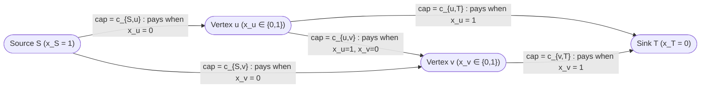
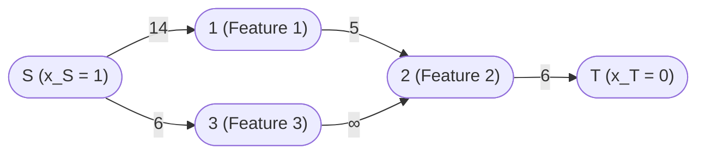
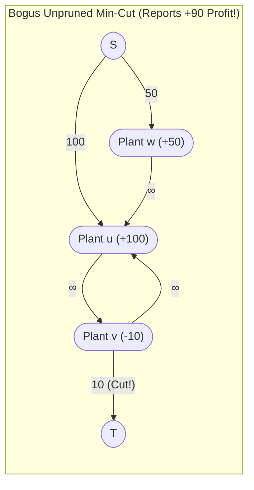
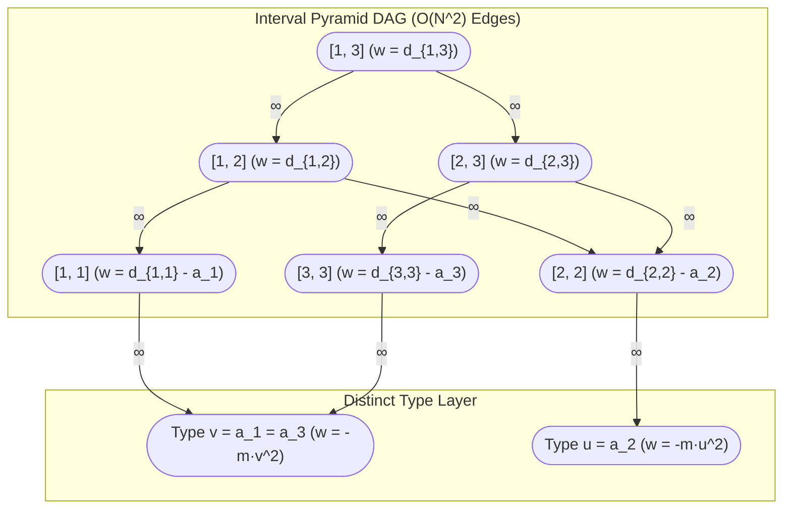
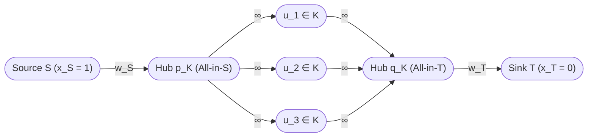
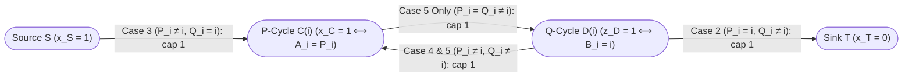

# Cohort 2 Redundant Research Monograph — Wave 2A (Iterations 63–67): Minimum Cut Modelling I — Binary Partitioning, Project Selection, Pseudo-Boolean Optimization (`燃やす埋める`), QPBO Roof Duality & Bipartite Variable Inversion

> [!IMPORTANT]
> **Cohort 2 Independent Redundancy Mandate & Editorial Contract**
> This monograph is authored independently by Cohort 2 (`FlowDeepInvestigator`) covering **Iterations 63–67 (Wave 2A)** of the Network Flows, Minimum Cuts, Matching, MCMF, and LP Duality research corpus. Every theoretical framework, compilation theorem, and practice problem in this monograph obeys the **4-Step "Zero Magic Gadgets" Compilation Standard**:
> 1. **Step 1 — Non-Graph Diagnostic Signal (Recognition)**: What structural clue in the raw problem statement and constraint bounds triggers a Min-Cut / Pseudo-Boolean formulation, and why greedy or dynamic programming fails.
> 2. **Step 2 — Algebraic / Logical Intermediate Representation**: Translating English rules into binary indicator variables $x_i \in \{0, 1\}$, optimistic baseline shifts (`先拿后退`), and Pseudo-Boolean cut polynomials $\sum c_{uv} x_u(1 - x_v)$ *before* drawing a single vertex or edge.
> 3. **Step 3 — Reverse-Engineering Scratchpad (Mechanical Graph Compilation)**: Compiling each algebraic monomial and hard implication into exact vertices, directed orientations, and capacities—including rescuing supermodular $2 \times 2$ penalties ($A + D > B + C$) via Bipartite Variable Inversion ($x_j \gets 1 - x_j$).
> 4. **Step 4 — Hand-Checkable Toy Trace & Broken Gadget Counterexamples**: Concrete small-$N$ numerical traces alongside rigorous proofs of what breaks when subtle gadget invariants are violated.
>
> Standard max-flow solver implementations (Dinic's algorithm, Push-Relabel) are assumed to reside in the reader's competitive programming library and are omitted per `AGENTS.md`.

---

## Executive Overview: The Paradigm Shift from Fluid Mechanics to Binary Logic Compilation

Beginners meet Maximum Flow and Minimum Cut through a physical metaphor: water flowing from a source $S$ to a sink $T$ through pipes of bounded capacity, where the bottleneck capacity equals the maximum flow by the Ford–Fulkerson Max-Flow Min-Cut Theorem. While that physical intuition helps explain augmenting paths and blocking flows, it becomes an active obstacle in advanced competitive programming. Over $80\%$ of grandmaster-level minimum cut problems—spanning AtCoder Grand/Regular Contests (`AGC 038 F`, `ARC 085 E`, `ABC 259 G`), Chinese National Olympiad and Team Selection tests (`[NOI2009] 植物大战僵尸`, `[SHOI2017] 寿司餐厅`, `[国家集训队] 圈地计划`, `文理分科`), and Codeforces Div. 1 (`CF 1082 G`, `CF 311 E`)—contain **no physical flow, no pipes, and often no graph at all in the problem statement**.

Instead, an $(S, T)$-minimum cut is a **polynomial-time compiler for submodular Pseudo-Boolean Optimization**:

$$\min_{x \in \{0, 1\}^n} \left( C_0 + \sum_{i=1}^n c_{S,i}(1 - x_i) + \sum_{i=1}^n c_{i,T} x_i + \sum_{1 \le u \neq v \le n} c_{u,v} x_u (1 - x_v) \right), \quad c_{\bullet} \ge 0.$$

Across the three major competitive programming literatures, three independent schools discovered and refined this exact algebraic-to-graph compiler:

1. **The Western Combinatorial Optimization & Computer Vision School (`[EN]`)**:
   - **Picard (1976)** proved that the **Maximum Weight Closure** of a directed graph (*Project Selection*) reduces to minimum cut.
   - **Hammer, Hansen, and Simeone (1984)** and **Boros and Hammer (2002)** developed **Quadratic Pseudo-Boolean Optimization (QPBO)** and **Roof Duality**, characterizing when quadratic $0$-$1$ polynomials can be minimized via network flow and what partial assignments persist when the polynomial is non-submodular.
   - **Kolmogorov and Zabih (2004)** proved the landmark theorem in Markov Random Field (MRF) energy minimization: a pairwise binary energy function $E(x_1, \dots, x_n) = \sum_i E_i(x_i) + \sum_{i < j} E_{ij}(x_i, x_j)$ is graph-representable via terminal cuts if and only if every pairwise term satisfies the submodularity inequality $E_{ij}(0, 0) + E_{ij}(1, 1) \le E_{ij}(0, 1) + E_{ij}(1, 0)$ (often written $A + D \le B + C$).
2. **The Chinese Olympiad School (`[ZH]` — `最大权闭合子图` / `集合划分模型` / `先拿后退` / `合并点边法`)**:
   - **Hu Botao (胡伯涛, Amber, 2007)** in his foundational Chinese National Team paper *《最小割模型在信息学竞赛中的应用》* introduced Picard's Maximum Weight Closure (`最大权闭合子图`) to competitive programming, along with the **Optimistic Revenue Baseline (`先拿满正收益，再用最小割减去放弃的收益与违约代价` / `先拿后退`)** and **Symmetric Vertex-Edge Merging (`合并点边法`)** for compiling pairwise synergy/conflict graphs (`人员雇佣`, `圈地计划`).
3. **The Japanese AtCoder School (`[JA]` — `燃やす埋める` / *Burn or Bury* & `二部グラフの片側反転`)**:
   - Codified by **noshi91**, **maspypy**, **tatyam**, **snuke**, and **rng_58** (originating from the grid waste-disposal problem where each item is either "burned" or "buried"), the Japanese school stripped away geometric metaphors and treated Min-Cut purely as **truth-table compilation** for binary variables, placing special emphasis on **Bipartite One-Side Variable Inversion (`二部グラフの片側反転`)** to rescue supermodular penalties ($A + D > B + C$) on bipartite interaction structures (`AGC 038 F`, `ABC 259 G`, `ARC 142 E`).

This Wave 2A monograph unifies all three traditions into a single deterministic engineering discipline.

---

## Iteration 63: Min-Cut as Binary Variable Assignment ($x_i \in \{0, 1\}$), Pseudo-Boolean Cut Polynomials & Optimistic Baseline (`先拿后退` / `燃やす埋める`)

### 63.1 Canonical Binary Partitioning Convention & Multilingual Lexicon

Let $G = (V, E, c)$ be a directed flow network with non-negative edge capacities $c: E \to \mathbb{R}_{\ge 0}$, a designated source $S \in V$, and a designated sink $T \in V$ ($S \neq T$).

**Definition 63.1 (An $(S, T)$-Cut Partition).**
An $(S, T)$-cut is a partition of the vertex set $V = V_S \sqcup V_T$ into two disjoint subsets such that $S \in V_S$ and $T \in V_T$. The **capacity** of the cut $(V_S, V_T)$, denoted $\operatorname{cap}(V_S, V_T)$ or $c(\delta^+(V_S))$, is the sum of capacities of all directed edges whose tail lies in $V_S$ and whose head lies in $V_T$:

$$\operatorname{cap}(V_S, V_T) = \sum_{\substack{(u, v) \in E \\ u \in V_S,\, v \in V_T}} c(u, v).$$

Crucially, edges oriented from $V_T$ to $V_S$ ($u \in V_T, v \in V_S$) **do not contribute** to the cut capacity $\operatorname{cap}(V_S, V_T)$. This asymmetry of directed edges across a cut is the fundamental logic gate of minimum-cut modelling.

To turn cut partitioning into algebra, we assign a binary decision variable $x_v \in \{0, 1\}$ to every vertex $v \in V$:

$$x_v = \begin{cases} 1 & \text{if } v \in V_S \quad (\text{assigned to the Source side } S), \\ 0 & \text{if } v \in V_T \quad (\text{assigned to the Sink side } T). \end{cases}$$

Because $S \in V_S$ and $T \in V_T$ are required by definition of an $(S, T)$-cut, the terminal variables are permanently pinned to the boundary constants:

$$x_S = 1, \qquad x_T = 0.$$

Every non-terminal vertex $i \in V \setminus \{S, T\}$ is a free binary decision variable $x_i \in \{0, 1\}$. Thus, choosing an $(S, T)$-cut $(V_S, V_T)$ in a graph with $n$ internal vertices is in exact $1$-to-$1$ bijection with choosing a binary assignment vector $x = (x_1, \dots, x_n) \in \{0, 1\}^n$.

> [!NOTE]
> **Cross-Literature Convention Dictionary (`[EN]` / `[ZH]` / `[JA]`)**
> Different communities assign opposite English/Japanese verbs to $V_S$ and $V_T$. The algebra never changes if you track the indicator $x_i = [i \in V_S]$:
>
> | Convention Aspect | This Textbook & `[ZH]` Closure Convention | `[JA]` `燃やす埋める` (*Burn or Bury*) Convention | Computer Vision `[EN]` (Kolmogorov–Zabih) |
> | :--- | :--- | :--- | :--- |
> | **$i \in V_S$ (Source side)** | $x_i = 1$ ("Select / Keep / Active") | Often labeled $x_i = 0$ ("Burn / `燃やす`") | Label $x_i = 0$ (Source = Label $0$) |
> | **$i \in V_T$ (Sink side)** | $x_i = 0$ ("Discard / Reject / Inactive") | Often labeled $x_i = 1$ ("Bury / `埋める`") | Label $x_i = 1$ (Sink = Label $1$) |
> | **Edge $S \to i$ of cap $c$** | Cut when $x_i = 0$; algebraic cost $c(1 - x_i)$ | Cut when $i \in V_T$; cost of choosing $T$-option | Unary penalty $E_i(1)$ |
> | **Edge $i \to T$ of cap $c$** | Cut when $x_i = 1$; algebraic cost $c x_i$ | Cut when $i \in V_S$; cost of choosing $S$-option | Unary penalty $E_i(0)$ |
> | **Edge $u \to v$ of cap $c$** | Cut when $x_u = 1 \land x_v = 0$; cost $c x_u(1 - x_v)$ | Cut when $u \in V_S \land v \in V_T$ | Pairwise penalty for $(x_u=0, x_v=1)$ |
> | **Edge $u \to v$ of cap $\infty$** | Forbids $(x_u = 1, x_v = 0)$, i.e., $x_u = 1 \implies x_v = 1$ | Forbids $(u \in V_S, v \in V_T)$ | Hard constraint $x_u \ge x_v$ (in KZ labels) |
>
> Throughout this monograph, we **universally lock** the convention **$x_i = 1 \iff i \in V_S$** and **$x_i = 0 \iff i \in V_T$**. Whenever you read a Japanese `燃やす埋める` blog where $x_i = 1$ means $i \in V_T$, simply interchange the roles of $S$ and $T$ (reverse all edge directions) and the two graphs are isomorphic.

---

### 63.2 The Fundamental Cut Polynomial & Atomic Edge Dictionary

Consider a single directed edge $(u, v) \in E$ with capacity $c_{uv} \ge 0$. Under any binary assignment $x \in \{0, 1\}^V$ with $x_S = 1$ and $x_T = 0$, when is $(u, v)$ severed by the cut?
- If $x_u = 1$ ($u \in V_S$) and $x_v = 0$ ($v \in V_T$), the edge crosses from $V_S$ to $V_T$ and contributes $c_{uv}$ to the cut. Here, the product $x_u (1 - x_v) = 1 \cdot (1 - 0) = 1$.
- For all other three truth assignments—$(x_u, x_v) \in \{(0, 0), (0, 1), (1, 1)\}$—the edge does not cross from $V_S$ to $V_T$ and contributes $0$ to the cut. In all three cases, $x_u (1 - x_v) = 0$.

Summing over all directed edges $(u, v) \in E$ yields the **Fundamental Cut Polynomial Identity**:

$$\operatorname{cap}(V_S, V_T) = \Phi(x_1, \dots, x_n) = \sum_{(u, v) \in E} c_{uv} x_u (1 - x_v).$$

By separating edges incident to the terminals $S, T$ from edges between internal decision variables $u, v \in \{1, \dots, n\}$, and substituting $x_S = 1$ and $x_T = 0$, we obtain the **Canonical Posiform Decomposition of an $(S, T)$-Cut**:

$$\Phi(x_1, \dots, x_n) = \underbrace{c_{S,T} \cdot 1(1 - 0)}_{\text{constant } C_0} + \underbrace{\sum_{i=1}^n c_{S,i} (1 - x_i)}_{\text{unary } (x_i = 0) \text{ costs}} + \underbrace{\sum_{i=1}^n c_{i,T} x_i}_{\text{unary } (x_i = 1) \text{ costs}} + \underbrace{\sum_{1 \le u \neq v \le n} c_{u,v} x_u (1 - x_v)}_{\text{pairwise } (x_u = 1, x_v = 0) \text{ costs}}.$$

Every term in this polynomial compiles mechanically into a single directed edge:

Let us record the **Five Atomic Compilation Rules** that form the assembly language of all minimum-cut models:

| # | Algebraic / Logical Term in Minimization Objective | Condition When Penalty is Paid | Compiled Directed Edge | Capacity |
| :--- | :--- | :--- | :--- | :--- |
| **Rule 1** | $+c \cdot x_i \quad (c \ge 0)$ | Paid if $x_i = 1$ ($i \in V_S$) | $i \to T$ | $c$ |
| **Rule 2** | $+c \cdot (1 - x_i) \quad (c \ge 0)$ | Paid if $x_i = 0$ ($i \in V_T$) | $S \to i$ | $c$ |
| **Rule 3** | $+c \cdot x_u (1 - x_v) \quad (c \ge 0)$ | Paid if $x_u = 1$ and $x_v = 0$ | $u \to v$ | $c$ |
| **Rule 4** | Hard Implication $x_u = 1 \implies x_v = 1$ *(Algebraic constraint: $x_u(1 - x_v) = 0$)* | Forbidden for $(x_u = 1, x_v = 0)$ | $u \to v$ | $\infty$ |
| **Rule 5** | Symmetric Disagreement $+c \cdot [x_u \neq x_v] \quad (c \ge 0)$ *(Algebraic: $c x_u(1 - x_v) + c x_v(1 - x_u)$)* | Paid if $x_u \neq x_v$ | $u \to v$ and $v \to u$ | $c$ each |

> [!IMPORTANT]
> **How to Remember $S \to i$ vs. $i \to T$ Without Ever Guessing**
> Never memorize arbitrary rules like *"positive weight goes from $S$, negative weight goes to $T$"*. Instead, ask one question: **"Which value of $x_i \in \{0, 1\}$ incurs this penalty?"**
> - If choosing **$x_i = 1$** ($i \in V_S$) incurs penalty $c$, then when $i \in V_S$ we must cut an edge of capacity $c$. Since $T \in V_T$, the edge **$i \to T$** goes from $V_S$ to $V_T$ and is cut! Algebraic check: $c \cdot x_i = c \cdot x_i (1 - x_T)$.
> - If choosing **$x_i = 0$** ($i \in V_T$) incurs penalty $c$, then when $i \in V_T$ we must cut an edge of capacity $c$. Since $S \in V_S$, the edge **$S \to i$** goes from $V_S$ to $V_T$ and is cut! Algebraic check: $c \cdot (1 - x_i) = c \cdot x_S (1 - x_i)$.

---

### 63.3 The Optimistic Baseline Principle (`先拿后退` / Posiform Normalization)

In Dinic's algorithm, every edge capacity must satisfy $c(u, v) \ge 0$; negative capacities violate the Max-Flow Min-Cut Theorem and break augmenting-path termination. Yet contest problems routinely feature:
1. **Maximization objectives** (maximize total profit), or
2. **Negative penalties / rewards** in minimization objectives (e.g., a term $-r_i x_i$ where setting $x_i = 1$ *reduces* cost by $r_i > 0$).

How do we compile maximization problems and negative coefficients into a non-negative cut polynomial $\Phi(x)$? Via the **Optimistic Baseline Principle** (`先拿后退` / *Pre-claim All Positive Rewards, Then Subtract Regret via Min-Cut*).

#### Step-by-Step Algebraic Normalization

**Case 1: Converting Maximization to Minimization.**
Suppose we want to maximize an objective function $F(x_1, \dots, x_n)$:

$$\max_{x \in \{0, 1\}^n} F(x) = -\min_{x \in \{0, 1\}^n} \big(-F(x)\big).$$

**Case 2: Eliminating Negative Unary Terms via Complement Substitution $x_i + (1 - x_i) = 1$.**
Suppose our minimization objective contains a negative unary term $-r_i x_i$ with $r_i > 0$ (meaning we gain $r_i$ if $x_i = 1$). Since $x_i = 1 - (1 - x_i)$ holds identically for all $x_i \in \mathbb{R}$, we substitute:

$$-r_i x_i = -r_i \big(1 - (1 - x_i)\big) = -r_i + \underbrace{r_i (1 - x_i)}_{\text{non-negative cap } S \to i}.$$

Look at the economic meaning of this identity:
- The constant $-r_i$ (which becomes $+r_i$ outside the $\min$ in a maximization problem) assumes **optimistically** that we already received the reward $r_i$ up front (`先拿`).
- The penalty term $+r_i (1 - x_i)$ is an edge $S \to i$ of capacity $r_i$: if we ultimately set $x_i = 0$, the edge $S \to i$ is severed, forcing us to **pay back / forfeit** the reward $r_i$ (`后退`).
- Similarly, if we have a negative term $-r_i (1 - x_i)$ with $r_i > 0$ (we gain $r_i$ if $x_i = 0$), we substitute $1 - x_i = 1 - x_i \implies -r_i(1 - x_i) = -r_i + r_i x_i$, pre-claiming $-r_i$ in the baseline and adding an edge $i \to T$ of capacity $r_i$ to pay back $r_i$ if $x_i = 1$.

**General Unary Normalization Formula.**
If vertex $i$ has cost $u_i(0)$ when $x_i = 0$ and cost $u_i(1)$ when $x_i = 1$ (where $u_i(0), u_i(1) \in \mathbb{R}$ may have arbitrary signs), the unary contribution is:

$$U_i(x_i) = u_i(0)(1 - x_i) + u_i(1) x_i.$$

Let $m_i = \min\big(u_i(0), u_i(1)\big)$. Using $(1 - x_i) + x_i = 1$, we extract $m_i$:

$$U_i(x_i) = m_i + \underbrace{\big(u_i(0) - m_i\big)}_{\ge 0} (1 - x_i) + \underbrace{\big(u_i(1) - m_i\big)}_{\ge 0} x_i.$$

Notice two properties of this normalization:
1. Both remaining coefficients $c_{S,i} = u_i(0) - m_i \ge 0$ and $c_{i,T} = u_i(1) - m_i \ge 0$ are **non-negative**.
2. At least one of $c_{S,i}$ or $c_{i,T}$ is **strictly zero**! Geometrically, if a vertex has both $S \to i$ of capacity $a > 0$ and $i \to T$ of capacity $b > 0$, any $(S, T)$-cut must sever at least $\min(a, b)$ across paths $S \to i \to T$. Absorbing $\min(a, b)$ into the constant baseline $C_0$ pre-pushes that trivial flow $S \to i \to T$ in $O(1)$ time before Dinic even starts!

---

### 63.4 Complete 4-Step Compilation Walkthrough, Hand-Checkable Toy Trace & Broken Gadget Analysis

Let us execute the complete 4-Step Compilation Standard on a concrete miniature problem to cement Iteration 63.

#### Toy Problem Statement
A software team has $N = 3$ features $\{1, 2, 3\}$. For each feature $i$, we must decide whether to ship it ($x_i = 1$) or drop it ($x_i = 0$):
- Feature $1$: shipping yields a profit of $+10$; dropping it incurs a contract penalty of $4$.
- Feature $2$: shipping costs $6$ in server maintenance (net profit $-6$); dropping it yields $0$.
- Feature $3$: shipping yields a profit of $+8$; dropping it yields $+2$ in saved license fees.
- Dependency & Penalty Rules:
  - If Feature $1$ is shipped ($x_1 = 1$) and Feature $2$ is dropped ($x_2 = 0$), we must pay $5$ for a compatibility adapter.
  - If Feature $3$ is shipped ($x_3 = 1$), Feature $2$ **must** also be shipped ($x_2 = 1$).

Find the subset of features to ship that maximizes total net profit.

#### Step 1: Non-Graph Diagnostic Signal
Each item $i \in \{1, \dots, N\}$ has a binary decision $x_i \in \{0, 1\}$, arbitrary unary payoffs for both $x_i = 1$ and $x_i = 0$, a directed penalty when $(x_1 = 1, x_2 = 0)$, and a hard implication $x_3 = 1 \implies x_2 = 1$. In general instances with $N \le 500$ and arbitrary dependencies, exponential $2^N$ search and tree/DAG DP fail because dependency graphs have arbitrary cycles and reconvergent diamonds.

#### Step 2: Algebraic / Logical Intermediate Representation
Write the total net profit $R(x_1, x_2, x_3)$ to be **maximized** subject to $x_3(1 - x_2) = 0$:

$$R(x) = \big[10 x_1 - 4(1 - x_1)\big] + \big[-6 x_2 + 0(1 - x_2)\big] + \big[8 x_3 + 2(1 - x_3)\big] - 5 x_1(1 - x_2).$$

Now apply the Optimistic Baseline normalization to each unary bracket so that every variable appears only as a **non-negative regret penalty** subtracted from a constant baseline:
1. Feature $1$: $10 x_1 - 4(1 - x_1) = 10\big(1 - (1 - x_1)\big) - 4(1 - x_1) = 10 - 14(1 - x_1)$.
   *(Optimistic baseline: $+10$; if $x_1 = 0$, we lose the $+10$ profit AND pay the $4$ penalty, total regret $14$.)*
2. Feature $2$: $-6 x_2 + 0(1 - x_2) = 0 - 6 x_2$.
   *(Optimistic baseline: $0$; if $x_2 = 1$, we pay $6$.)*
3. Feature $3$: $8 x_3 + 2(1 - x_3) = 8\big(1 - (1 - x_3)\big) + 2(1 - x_3) = 8 - 6(1 - x_3)$.
   *(Optimistic baseline: $+8$; if $x_3 = 0$, we get $+2$ instead of $+8$, net regret $8 - 2 = 6$.)*

Combine everything into the canonical form $R(x) = W_{\text{base}} - \Phi(x)$:

$$W_{\text{base}} = 10 + 0 + 8 = 18,$$

$$\Phi(x) = 14(1 - x_1) + 6 x_2 + 6(1 - x_3) + 5 x_1(1 - x_2) + \infty \cdot x_3(1 - x_2).$$

Maximizing $R(x)$ is equivalent to computing $W_{\text{base}} - \min_{x \in \{0, 1\}^3} \Phi(x)$.

#### Step 3: Reverse-Engineering Scratchpad (Graph Compilation)
We read the edges directly off $\Phi(x)$ using Rules 1–4:
- $14(1 - x_1) = 14 x_S(1 - x_1) \implies$ directed edge $S \to 1$ with capacity $14$.
- $6 x_2 = 6 x_2(1 - x_T) \implies$ directed edge $2 \to T$ with capacity $6$.
- $6(1 - x_3) = 6 x_S(1 - x_3) \implies$ directed edge $S \to 3$ with capacity $6$.
- $5 x_1(1 - x_2) \implies$ directed edge $1 \to 2$ with capacity $5$.
- $\infty \cdot x_3(1 - x_2) \implies$ directed edge $3 \to 2$ with capacity $\infty$.

#### Step 4: Hand-Checkable Numerical Trace & Broken Gadget Counterexamples
Let us evaluate all finite-capacity cuts $(V_S, V_T)$ in the compiled network (since $c(3 \to 2) = \infty$, no finite cut can have $x_3 = 1$ and $x_2 = 0$, cutting down the $2^3 = 8$ assignments to $6$ valid ones):

| Assignment $(x_1, x_2, x_3)$ | Severed Edges from $V_S$ to $V_T$ | Cut Capacity $\Phi(x)$ | Compiled Profit $18 - \Phi(x)$ | Direct Formula $R(x)$ Check |
| :--- | :--- | :--- | :--- | :--- |
| $(1, 1, 1)$ | $2 \to T$ (cap $6$) | $6$ | $18 - 6 = \mathbf{12}$ | $10 - 6 + 8 - 0 = \mathbf{12}$ |
| $(1, 1, 0)$ | $2 \to T$ ($6$), $S \to 3$ ($6$) | $12$ | $18 - 12 = 6$ | $10 - 6 + 2 - 0 = 6$ |
| $(1, 0, 0)$ | $1 \to 2$ ($5$), $S \to 3$ ($6$) | $11$ | $18 - 11 = 7$ | $10 + 0 + 2 - 5 = 7$ |
| $(0, 1, 1)$ | $S \to 1$ ($14$), $2 \to T$ ($6$) | $20$ | $18 - 20 = -2$ | $-4 - 6 + 8 - 0 = -2$ |
| $(0, 1, 0)$ | $S \to 1$ ($14$), $2 \to T$ ($6$), $S \to 3$ ($6$) | $26$ | $18 - 26 = -8$ | $-4 - 6 + 2 - 0 = -8$ |
| $(0, 0, 0)$ | $S \to 1$ ($14$), $S \to 3$ ($6$) | $20$ | $18 - 20 = -2$ | $-4 + 0 + 2 - 0 = -2$ |
| $(1, 0, 1)$ or $(0, 0, 1)$ | Cuts $3 \to 2$ (cap $\infty$) | $\infty$ | $-\infty$ (Infeasible) | Violates $x_3 \implies x_2$ |

The minimum cut is $\Phi(1, 1, 1) = 6$ (severing only $2 \to T$), corresponding to augmenting flow $5$ along $S \to 1 \to 2 \to T$ and flow $1$ along $S \to 3 \to 2 \to T$. In the residual graph after max-flow $6$, vertices $\{1, 2, 3\}$ all remain reachable from $S$ (since $S \to 1$ has residual capacity $14 - 5 = 9 > 0$, $S \to 3$ has residual capacity $6 - 1 = 5 > 0$, and $3 \to 2$ has residual capacity $\infty$). Thus $V_S = \{S, 1, 2, 3\} \implies (x_1, x_2, x_3) = (1, 1, 1)$, with maximum profit $18 - 6 = 12$.

> [!CAUTION]
> **Broken Gadget Counterexamples (Iteration 63)**
> 1. **Failure Mode A — Reversing the Implication Edge ($2 \to 3$ instead of $3 \to 2$)**:
>    Beginners often think *"Feature $2$ is a prerequisite for Feature $3$, so in a prerequisite DAG the edge goes $2 \to 3$"* and add capacity $\infty$ on $2 \to 3$. Look at the cut polynomial: an edge $2 \to 3$ of capacity $\infty$ contributes $\infty \cdot x_2(1 - x_3)$, which forbids $(x_2 = 1, x_3 = 0)$, i.e., it forces $x_2 \implies x_3$ instead of $x_3 \implies x_2$! Under $x_v = [v \in V_S]$, the $\infty$-edge **always points from the dependent item to the required prerequisite** ($u \text{ requires } v \implies x_u(1 - x_v) = 0 \implies u \xrightarrow{\infty} v$).
> 2. **Failure Mode B — OmittingUnary Difference Normalization (Adding $S \to 3$ cap $8$ and $3 \to T$ cap $2$)**:
>    Wait: in Feature $3$, shipping gives $+8$ and dropping gives $+2$. What if a contestant sets baseline $+8 + 2 = 10$, adds $S \to 3$ of capacity $8$ (forfeited when $x_3 = 0$), and $3 \to T$ of capacity $2$ (forfeited when $x_3 = 1$)? Actually, $(10) - [8(1 - x_3) + 2 x_3] = 8 x_3 + 2(1 - x_3)$ is **algebraically valid**! However, if one Option has a *negative* payoff—say Feature $1$ gives $+10$ when $x_1 = 1$ and $-4$ when $x_1 = 0$—adding $S \to 1$ cap $10$ and $1 \to T$ cap $-4$ creates a **negative capacity edge**, which destroys Dinic's correctness. Always normalize via $u_i(0)(1 - x_i) + u_i(1) x_i$ so capacities are strictly non-negative.

---

## Iteration 64: Maximum Weight Closure (`最大权闭合子图` / Picard's Project Selection), Cyclic Dependency Pruning & Non-Graph Closures

### 64.1 Formal Definition & Complete Proof of Picard's Theorem (1976)

The foundational archetype of minimum-cut modelling is **Maximum Weight Closure of a Directed Graph** (`最大权闭合子图`), introduced by Jean-Claude Picard (1976) and popularized in competitive programming by Hu Botao's 2007 monograph.

**Definition 64.1 (Closed Subset / Closure in a Directed Graph).**
Let $G_{\text{dep}} = (V, E_{\text{dep}})$ be a directed dependency graph with vertex weights $w: V \to \mathbb{R}$ (where weights may be positive, zero, or negative). A subset of vertices $C \subseteq V$ is called **closed** (or a **closure**) if no directed edge in $E_{\text{dep}}$ leaves $C$:

$$\forall (u, v) \in E_{\text{dep}}, \quad u \in C \implies v \in C.$$

Equivalently, if $u \in C$, then every vertex $v$ reachable from $u$ by a directed path in $G_{\text{dep}}$ must also belong to $C$. The **Maximum Weight Closure Problem** asks for a closed subset $C^* \subseteq V$ that maximizes total vertex weight:

$$W(C^*) = \max_{\substack{C \subseteq V \\ C \text{ is closed}}} \sum_{v \in C} w_v.$$

*(Note: $C = \emptyset$ is vacuously closed with weight $0$, so $W(C^*) \ge 0$ always.)*

#### The 4-Step Derivation of Picard's Reduction

1. **Step 1 — Diagnostic Signal**:
   We are selecting a subset of items $C \subseteq V$ with arbitrary signed payoffs $w_v \in \mathbb{R}$ subject to pure implication constraints "if $u$ is chosen, $v$ must be chosen". Naive greedy ("pick all $u$ whose reachable cone has positive sum") fails when two negative-weight prerequisites are shared by multiple positive-weight projects (reconvergent DAGs), and tree DP fails because $G_{\text{dep}}$ is not a tree.
2. **Step 2 — Algebraic Intermediate Representation**:
   Introduce binary indicator variables $x_v = [v \in C] \in \{0, 1\}$ for each $v \in V$.
   - The closure condition $\forall (u, v) \in E_{\text{dep}}, (u \in C \implies v \in C)$ is equivalent to forbidding $(x_u = 1, x_v = 0)$, i.e.:
     $$x_u (1 - x_v) = 0 \qquad \forall (u, v) \in E_{\text{dep}}.$$
   - Partition the vertices into positive-weight vertices $V^+ = \{v \in V : w_v > 0\}$ and non-positive-weight vertices $V^- = \{v \in V : w_v \le 0\}$. Using $x_v = 1 - (1 - x_v)$ on $V^+$, we rewrite the objective:
     $$\sum_{v \in V} w_v x_v = \sum_{v \in V^+} w_v \big(1 - (1 - x_v)\big) - \sum_{v \in V^-} |w_v| x_v = \underbrace{\sum_{v \in V^+} w_v}_{W^+} - \left( \sum_{v \in V^+} w_v (1 - x_v) + \sum_{v \in V^-} |w_v| x_v \right).$$
3. **Step 3 — Reverse-Engineering Scratchpad (Graph Compilation)**:
   Construct the flow network $\mathcal{N} = (V \cup \{S, T\}, E_{\mathcal{N}}, c)$:
   - For every $v \in V^+$ ($w_v > 0$): compile $w_v(1 - x_v)$ as a directed edge $S \to v$ with capacity $c(S, v) = w_v$.
   - For every $v \in V^-$ ($w_v < 0$): compile $|w_v| x_v$ as a directed edge $v \to T$ with capacity $c(v, T) = |w_v| = -w_v$.
   - For every dependency $(u, v) \in E_{\text{dep}}$: compile $x_u(1 - x_v) = 0$ as a directed edge $u \to v$ with capacity $c(u, v) = \infty$.

**Theorem 64.2 (Picard's Theorem, 1976).**
In the flow network $\mathcal{N}$ constructed above:
1. An $(S, T)$-cut $(V_S, V_T)$ has **finite capacity** ($\operatorname{cap}(V_S, V_T) < \infty$) if and only if $C = V_S \setminus \{S\}$ is a **closed subset** of $G_{\text{dep}}$.
2. For every closed subset $C \subseteq V$, the corresponding cut $(V_S, V_T) = (C \cup \{S\}, (V \setminus C) \cup \{T\})$ satisfies:
   $$\sum_{v \in C} w_v = \sum_{v \in V^+} w_v - \operatorname{cap}(V_S, V_T).$$
3. Consequently, the maximum weight of a closed subset equals total positive weight minus the minimum $(S, T)$-cut capacity:
   $$\max_{C \text{ closed}} \sum_{v \in C} w_v = \sum_{v \in V^+} w_v - \operatorname{MinCut}(\mathcal{N}).$$
4. **Constructive Recovery of $C^*$**: Let $f^*$ be any maximum $(S, T)$-flow in $\mathcal{N}$, and let $\mathcal{N}_{f^*}$ be the residual network. Then the set of vertices reachable from $S$ via positive-residual-capacity edges in $\mathcal{N}_{f^*}$, minus $\{S\}$, forms the unique inclusion-minimal optimal closed subset $C_{\min}^*$.

*Proof.*
(1) Since all terminal edges $S \to v$ and $v \to T$ have finite capacity, $\operatorname{cap}(V_S, V_T) < \infty$ if and only if no edge of capacity $\infty$ crosses from $V_S$ to $V_T$. The $\infty$-capacity edges are precisely $E_{\text{dep}}$. Thus no edge $(u, v) \in E_{\text{dep}}$ has $u \in C = V_S \setminus \{S\}$ and $v \in V \setminus C = V_T \setminus \{T\}$, which is the exact definition of $C$ being closed.

(2) Let $C \subseteq V$ be closed and set $V_S = C \cup \{S\}$, $V_T = (V \setminus C) \cup \{T\}$. No edge in $E_{\text{dep}}$ crosses from $V_S$ to $V_T$. The only edges crossing from $V_S$ to $V_T$ are:
- Edges $S \to v$ with $v \in V^+ \setminus C$, contributing $\sum_{v \in V^+ \setminus C} w_v$;
- Edges $v \to T$ with $v \in V^- \cap C$, contributing $\sum_{v \in V^- \cap C} (-w_v)$.
Therefore:
$$\sum_{v \in V^+} w_v - \operatorname{cap}(V_S, V_T) = \sum_{v \in V^+} w_v - \sum_{v \in V^+ \setminus C} w_v - \sum_{v \in V^- \cap C} (-w_v) = \sum_{v \in V^+ \cap C} w_v + \sum_{v \in V^- \cap C} w_v = \sum_{v \in C} w_v.$$

(3) Maximizing the left-hand side over all closed $C \subseteq V$ is equivalent to minimizing $\operatorname{cap}(V_S, V_T)$ over all finite-capacity cuts $(V_S, V_T)$. Since the cut $(\{S\}, V \cup \{T\})$ has finite capacity $\sum_{v \in V^+} w_v < \infty$, the minimum cut of $\mathcal{N}$ is guaranteed to have finite capacity, establishing the formula.

(4) By standard residual graph theory (Wave 1A), the set $V_S^* = \{v \in V \cup \{S\} : S \leadsto v \text{ in } \mathcal{N}_{f^*}\}$ defines the unique inclusion-minimal $(S, T)$-minimum cut $(V_S^*, V_T^*)$, so $C_{\min}^* = V_S^* \setminus \{S\}$ is the optimal closed subset of minimum cardinality. Symmetrically, the set of vertices that *cannot* reach $T$ in $\mathcal{N}_{f^*}$ yields the unique inclusion-maximal optimal closed subset $C_{\max}^*$. $\blacksquare$

---

### 64.2 Broken Gadget Deep Dive: Cyclic Dependencies & Topological Pruning (`[NOI2009] 植物大战僵尸`)

What happens when the dependency graph $G_{\text{dep}} = (V, E_{\text{dep}})$ is **not a DAG**, i.e., it contains directed cycles? Here lies one of the most famous traps in competitive programming network flow history, immortalized by **`[NOI2009] 植物大战僵尸` (*Plants vs. Zombies*, Luogu P2805)**.

#### Distinguishing Simultaneous Bundles from Sequential Causal Orderings

There are two completely different real-world semantics that generate directed edges $(u, v) \in E_{\text{dep}}$:

1. **Semantics A — Simultaneous Bundle / Set Membership Constraint**:
   *"We are selecting a static subset $C \subseteq V$ of club members all at once. If Alice ($u$) is invited, Bob ($v$) must also be invited; and if Bob ($v$) is invited, Alice ($u$) must also be invited."*
   Under Semantics A, a directed cycle $u_1 \to u_2 \to \dots \to u_k \to u_1$ simply means that $u_1, \dots, u_k$ form an **all-or-nothing bundle** ($x_{u_1} = x_{u_2} = \dots = x_{u_k}$). Picard's Theorem (Theorem 64.2) works out of the box on cyclic graphs under Semantics A! If the cycle has total weight $\sum_{i=1}^k w_{u_i} > 0$, Picard's min-cut sets $x_{u_1} = \dots = x_{u_k} = 1$ and harvests the bundle.

2. **Semantics B — Sequential Causal / Temporal Unlocking (`[NOI2009] 植物大战僵尸`)**:
   *"To destroy/unlock node $u$, you must **first** destroy/unlock every prerequisite node $v$ that protects $u$ (i.e., there must exist a valid topological execution sequence in which every prerequisite of $u$ is processed strictly before $u$)."*
   In `[NOI2009] 植物大战僵尸`, zombies enter from the right of each row and walk left;moreover, plant $v$ can shoot fireballs at cell $u$. Thus, to eat plant $u$, the zombies must *first* eat the plant immediately to the right of $u$, AND must *first* eat every plant $v$ whose attack range covers $u$.

Suppose plant $u$ (score $+100$) protects plant $v$ (score $-10$), and plant $v$ also protects plant $u$:
- **Real-world game rule (Semantics B)**: To eat $u$, you must first eat $v$; to eat $v$, you must first eat $u$. This is a **causal deadlock**! Neither $u$ nor $v$ can ever be eaten, nor can any plant $w$ whose unlocking requires eating $u$ or $v$.
- **What happens if you feed $(u, v)$ and $(v, u)$ directly into Picard's Min-Cut without pruning?**
  In Picard's flow network, $u \leftrightarrow v$ has $\infty$-capacity edges in both directions. If the solver sets $x_u = x_v = 1$ (putting both $u$ and $v$ in $V_S$), neither $\infty$-edge is cut! The solver only cuts $v \to T$ of capacity $10$, leaving $S \to u$ of capacity $100$ uncut, and happily reports a bogus profit of $+100 - 10 = +90$ from a mutually invincible cycle of plants!

Even worse, notice Plant $w$ ($+50$) in the diagram above, which is not in the cycle itself, but depends on $u$ ($w \to u$, meaning $u$ protects $w$ so $u$ must be eaten before $w$). Because $u$ can never be eaten, $w$ can never be eaten either! Yet in the unpruned Min-Cut, setting $x_u = x_v = x_w = 1$ harvests $+100 - 10 + 50 = +140$ from three completely unreachable plants!

#### The Exact Fix: Kahn's Topological Reachability Pruning on the Prerequisite Graph

Let $G_{\text{pre}}$ be the **Prerequisite-to-Dependent** directed graph where a directed edge $v \to_{\text{pre}} u$ means *"node $v$ must be unlocked/eaten BEFORE node $u$"* (note that $v \to_{\text{pre}} u$ is the exact reverse of our closure implication edge $u \xrightarrow{\infty} v$).

**Lemma 64.3 (Causal Unlockability Characterization).**
A subset of nodes $C \subseteq V$ can be sequentially unlocked one by one if and only if $C$ is closed under prerequisites AND the subgraph induced by $C$ is acyclic. In fact, a single node $u \in V$ can be unlocked by *some* valid sequence if and only if $u$ is visited by **Kahn's in-degree $0$ topological sort** on $G_{\text{pre}}$.

*Algorithm Contract for Sequential Causal Closure (`[NOI2009] 植物大战僵尸`)*:
1. Build the prerequisite graph $G_{\text{pre}}$ where $v \to_{\text{pre}} u$ means "$v$ protects $u$ ($v$ must be eaten before $u$)", recording the in-degree $\operatorname{indeg}(u)$ of each node $u$ (the number of prerequisites of $u$).
2. Push all nodes with $\operatorname{indeg}(u) = 0$ into a queue $Q$ and run Kahn's BFS: when popping $v$, mark $v$ as `unlockable = true` and decrement $\operatorname{indeg}(u)$ for all $v \to_{\text{pre}} u$, pushing $u$ if $\operatorname{indeg}(u)$ drops to $0$.
3. **Discard every node $u$ with `unlockable == false`**! Any node on a cycle, and any node downstream of a cycle in $G_{\text{pre}}$, will never have its in-degree drop to $0$ and is permanently deleted.
4. On the surviving vertex set $V_{\text{valid}} = \{u \in V : \text{unlockable}(u) = \text{true}\}$, the induced dependency graph is a **guaranteed DAG**. Now construct Picard's Min-Cut network on $V_{\text{valid}}$ with closure edges $u \xrightarrow{\infty} v$ whenever $v \to_{\text{pre}} u$.

---

### 64.3 Non-Graph Closure Archetype I: Hyperedge / Bundle Reward Closures (`[NOI2006] 最大获利`, `CF 1082 G`, `[CEOI 2008] Order`)

Often a problem does not state vertex weights on a DAG at all. Instead, we are given:
- A set of **base elements** $i \in \{1, \dots, n\}$ (e.g., cell towers, machines, graph vertices), where activating element $i$ ($x_i = 1$) costs $c_i \ge 0$.
- A set of **composite bundles / hyperedges** $e \in \{1, \dots, m\}$ (e.g., user demands, graph edges, jobs), where bundle $e$ requires a subset of base elements $S_e \subseteq \{1, \dots, n\}$ and yields a reward $p_e \ge 0$ **if and only if every base element $i \in S_e$ is activated**.

#### 4-Step Compilation of Hyperedge Reward Closures

1. **Step 1 — Diagnostic Signal**:
   Higher-order conjunctive rewards: we gain $p_e > 0$ when $\prod_{i \in S_e} x_i = 1$, and pay $c_i > 0$ when $x_i = 1$.
2. **Step 2 — Algebraic Linearization via Auxiliary Closure Variables**:
   The product $\prod_{i \in S_e} x_i$ is degree-$|S_e|$. To reduce it to degree-$2$ cut monomials, introduce an **auxiliary binary variable $y_e \in \{0, 1\}$** for each bundle $e$, representing whether we claim the reward $p_e$:
   $$\max_{x \in \{0, 1\}^n,\, y \in \{0, 1\}^m} \sum_{e=1}^m p_e y_e - \sum_{i=1}^n c_i x_i \quad \text{s.t.} \quad y_e (1 - x_i) = 0 \;\;\forall e \in \{1, \dots, m\},\; \forall i \in S_e.$$
   *Why is the reverse constraint ($\prod_{i \in S_e} x_i = 1 \implies y_e = 1$) unnecessary?* Because $p_e \ge 0$ has a positive coefficient in the maximization objective! Whenever all $i \in S_e$ have $x_i = 1$, setting $y_e = 1$ violates no constraints and strictly increases the objective by $p_e$, so any optimal solution automatically sets $y_e = \min_{i \in S_e} x_i = \prod_{i \in S_e} x_i$.
3. **Step 3 — Graph Compilation (Bipartite Project Selection)**:
   Applying the Optimistic Baseline shift $\sum_{e=1}^m p_e y_e = \sum_{e=1}^m p_e - \sum_{e=1}^m p_e (1 - y_e)$ gives:
   - Source $S \to y_e$ with capacity $p_e$ (cut if $y_e = 0$, forfeiting reward $p_e$).
   - Bundle $y_e \to x_i$ with capacity $\infty$ for all $i \in S_e$ (enforcing $y_e = 1 \implies x_i = 1$).
   - Base element $x_i \to T$ with capacity $c_i$ (cut if $x_i = 1$, paying activation cost $c_i$).

#### Extension: "Rent or Buy" Partial Relaxations (`[CEOI 2008] Order`)
In **`[CEOI 2008] Order`** ($N, M \le 1200$), job $e$ yields profit $p_e$ and requires machines $i \in S_e$. However, for each pair $(e, i)$, instead of buying machine $i$ permanently for cost $c_i$, we are also allowed to **rent** machine $i$ exclusively for job $e$ at cost $r_{e, i}$.
- **Algebraic Compilation**: In the standard closure, $y_e = 1$ and $x_i = 0$ is forbidden (cost $\infty$) because you cannot run job $e$ without buying machine $i$. When renting is allowed at cost $r_{e, i}$, having $y_e = 1$ (job $e$ runs) and $x_i = 0$ (machine $i$ is not permanently bought) is **no longer forbidden**—it simply costs the rental fee $r_{e, i}$!
- Therefore, the term $\infty \cdot y_e (1 - x_i)$ is replaced by $r_{e, i} \cdot y_e (1 - x_i)$, which compiles to changing the capacity of edge $y_e \to x_i$ from $\infty$ to $r_{e, i}$!
  - If $x_i = 0$ for all jobs using machine $i$, cutting the edges $y_e \to x_i$ pays the sum of rental fees $\sum r_{e, i}$.
  - If $\sum r_{e, i} > c_i$, the min-cut automatically sets $x_i = 1$ and cuts the single edge $x_i \to T$ of capacity $c_i$ instead (buying the machine outright)!

---

### 64.4 Non-Graph Closure Archetype II: Divisibility & Multiple Closures (`ARC 085 E — MUL`)

Consider **`AtCoder ARC 085 E — MUL`** ($N \le 100$):
We have $N$ gems indexed $1, 2, \dots, N$ with values $a_1, a_2, \dots, a_N \in \mathbb{Z}$ (can be positive or negative). In one operation, we may choose any integer $d \in \{1, \dots, N\}$ and **smash (destroy) all gems whose indices are multiples of $d$** ($d, 2d, 3d, \dots$). We can perform this operation for as many distinct integers $d$ as we like. Maximize the sum of values of the **surviving** gems.

#### 4-Step Compilation of `ARC 085 E — MUL`

1. **Step 1 — Non-Graph Diagnostic Signal**:
   At first glance, an operation chooses $d$ and destroys $\{d, 2d, 3d, \dots\}$. Because operations overlap on common multiples (e.g., $d=2$ and $d=3$ both destroy $6$), DP over primes fails when $N = 100$. What is the hidden closure property?
   **Crucial Observation**: Can any subset of surviving gems be achieved, or is there an implication?
   - If we decide to **smash** gem $i$, how can gem $i$ be smashed? Only by choosing some divisor $d \mid i$. Wait—if we choose $d = i$ itself, smashing $i$ automatically smashes all multiples $2i, 3i, \dots$! And conversely, could we smash $i$ via some proper divisor $d \mid i$ ($d < i$) without smashing $2i, 3i, \dots$? No! Because any divisor $d$ of $i$ is *also* a divisor of $k \cdot i$ for every integer $k \ge 1$ ($d \mid i \implies d \mid k i$)!
   - Therefore, **a state of smashed/surviving gems is achievable by the allowed operations if and only if: whenever gem $i$ is smashed, every multiple $k \cdot i$ ($k \ge 1, ki \le N$) is also smashed!**
2. **Step 2 — Algebraic Intermediate Representation (Two Equivalent Dual Views)**:
   - **View A (Indicator $x_i = 1 \iff$ Gem $i$ is Smashed)**:
     Baseline: assume all gems survive, giving initial sum $\sum_{i=1}^N a_i$. Wait—to use Picard's standard form where $x_i = 1$ has $w_i$ relative to $x_i = 0$ giving $0$:
     Let us instead write the objective directly in terms of $x_i \in \{0, 1\}$ where $x_i = 1$ means **gem $i$ is smashed** and $x_i = 0$ means **gem $i$ survives**:
     $$\text{Surviving Sum} = \sum_{i=1}^N a_i (1 - x_i) \quad \text{s.t.} \quad x_i (1 - x_{ki}) = 0 \;\;\forall i \ge 1,\, k \ge 2 \text{ with } ki \le N.$$
     Normalize unary terms into Optimistic Baseline minus non-negative penalties:
     - If $a_i > 0$: $a_i (1 - x_i) = a_i - a_i x_i$ (Optimistic baseline $+a_i$; if smashed $x_i = 1$, pay $a_i$).
     - If $a_i \le 0$: $a_i (1 - x_i) = 0 - |a_i| (1 - x_i)$ (Optimistic baseline $0$; if NOT smashed $x_i = 0$, pay $|a_i|$).
     Thus:
     $$\max_{x} \sum_{i=1}^N a_i (1 - x_i) = \sum_{i : a_i > 0} a_i - \min_{x} \left( \sum_{i : a_i > 0} a_i x_i + \sum_{i : a_i < 0} |a_i| (1 - x_i) + \sum_{i \mid j} \infty \cdot x_i (1 - x_j) \right).$$
   - **View B (Indicator $z_i = 1 \iff$ Gem $i$ Survives)**:
     If $z_i = 1 - x_i \in \{0, 1\}$ indicates that gem $i$ survives, then the contrapositive of "$i$ smashed $\implies ki$ smashed" is: **"$ki$ survives $\implies i$ survives"** ($z_{ki} = 1 \implies z_i = 1$). Then $z$ is a standard Maximum Weight Closure with weights $w_i = a_i$ and implication edges $ki \xrightarrow{\infty} i$!
3. **Step 3 — Graph Compilation (View A)**:
   - For $a_i < 0$: edge $S \to i$ of capacity $|a_i|$ (paid if $x_i = 0$, i.e., negative gem survives).
   - For $a_i > 0$: edge $i \to T$ of capacity $a_i$ (paid if $x_i = 1$, i.e., positive gem is smashed).
   - For $i \ge 1$ and $j = k \cdot i \le N$ ($k \ge 2$): edge $i \to j$ of capacity $\infty$ (forbidding $x_i = 1, x_j = 0$).
4. **Step 4 — Toy Trace ($N = 4$, $a = [-10, 5, 8, -12]$)**:
   - Baseline $W^+ = 5 + 8 = 13$.
   - Edges: $S \to 1$ cap $10$; $S \to 4$ cap $12$; $2 \to T$ cap $5$; $3 \to T$ cap $8$; $\infty$-edges $1 \to 2, 1 \to 3, 1 \to 4, 2 \to 4$.
   - If we smash $\{4\}$ ($x_4 = 1$, $x_1=x_2=x_3=0$): cut severs $S \to 1$ (cap $10$), leaving $S \to 4$ uncut! Wait: can we smash $4$ without smashing $1$ and $2$? YES, by choosing operation $d = 4$! And in the graph, setting $x_4 = 1, x_2 = 0$ does NOT cut $2 \to 4$ because $x_2 = 0 \in V_T$ and $x_4 = 1 \in V_S$ goes from $V_T$ to $V_S$!
   - Thus optimal $x = (0, 0, 0, 1)$ (only smash $4$): cut severs only $S \to 1$ (cap $10$), so $\text{MinCut} = 10$, and answer is $13 - 10 = 3$ (gems $1, 2, 3$ survive: $-10 + 5 + 8 = 3$; Wait—if we instead set $x = (0, 1, 0, 1)$, i.e., smash $2$ and $4$ via $d=2$, we cut $S \to 1$ ($10$) and $2 \to T$ ($5$) for cut $15$; if we set $x = (0, 0, 0, 0)$ we cut $S \to 1$ ($10$) and $S \to 4$ ($12$) for cut $22$; what if we don't smash $1$ at all? $S \to 1$ is cut, costing $10$. Wait: why can't we smash $1$? If $x_1 = 1$, since $1 \to 2, 1 \to 3, 1 \to 4$ have cap $\infty$, we must set $x_1 = x_2 = x_3 = x_4 = 1$, cutting $2 \to T$ ($5$) and $3 \to T$ ($8$) for cut $5 + 8 = 13$, giving profit $13 - 13 = 0$!).
   - Indeed, $-10 + 5 + 8 = 3 > 0$, so keeping $\{1, 2, 3\}$ and smashing $\{4\}$ achieves the true optimum $3$!

---

### 64.5 Non-Graph Closure Archetype III: Interval Pyramid / Subarray Closures (`[SHOI2017] 寿司餐厅`)

A frequent advanced closure pattern occurs on arrays where choosing a contiguous subarray $[l, r]$ forces choosing all sub-intervals $[l', r'] \subseteq [l, r]$. Let us derive **`[SHOI2017] 寿司餐厅` (*Sushi Restaurant*, Luogu P3749)** ($N \le 100$, sushi type codes $a_i \le 1000$, parameter $m \in \{0, 1\}$):

#### Problem Statement
There are $N$ plates of sushi on a belt, where plate $i$ ($1 \le i \le N$) has type $a_i$. For every contiguous interval $[l, r]$ ($1 \le l \le r \le N$), there is a satisfaction value $d_{l, r} \in \mathbb{Z}$ (can be positive or negative).
- If a customer chooses to eat the sushi on a subset of indices $I \subseteq \{1, \dots, N\}$, they automatically receive the satisfaction $d_{l, r}$ for **Wait**: in `[SHOI2017] 寿司餐厅`, the rule is actually: you can choose any collection of intervals $[l, r]$, and if you choose $[l, r]$, you receive $d_{l, r}$ AND you are forced to choose all sub-intervals $[l', r'] \subseteq [l, r]$!
- Furthermore, eating plate $i$ (which corresponds to choosing the unit interval $[i, i]$) incurs a cost: if $c$ plates of sushi of the same type $x$ are eaten, you pay $m \cdot x^2 + c \cdot x$ (i.e., a one-time fixed cost $m \cdot x^2$ for eating *at least one* sushi of type $x$, plus a per-plate cost $x$ for each plate $i$ with $a_i = x$ that is eaten).
Maximize total net profit.

#### 4-Step Compilation of `[SHOI2017] 寿司餐厅`

1. **Step 1 — Non-Graph Diagnostic Signal**:
   Interval DP fails because intervals can partially overlap ($[1, 3]$ and $[2, 4]$ overlap on $[2, 3]$), and because the one-time type cost $m \cdot x^2$ couples arbitrary distant indices $i, j$ whenever $a_i = a_j = x$. However, every rule is a pure implication ("if $A$ is chosen, $B$ must be chosen") with $N \le 100$ ($\binom{N+1}{2} \approx 5050$ intervals).
2. **Step 2 — Algebraic Intermediate Representation & Transitive Pyramid Reduction**:
   Define binary variables:
   - $x_{l, r} \in \{0, 1\}$ for $1 \le l \le r \le N$: whether interval $[l, r]$ is chosen.
   - $t_v \in \{0, 1\}$ for each distinct sushi type $v \in \{a_1, \dots, a_N\}$: whether at least one sushi of type $v$ is eaten.
   Look at the constraints:
   - **Sub-interval Closure**: Choosing $[l, r]$ requires choosing all $[l', r'] \subseteq [l, r]$. Adding all $\binom{N}{2}^2 = O(N^4)$ edges would create $\sim 1.2 \times 10^7$ edges. Instead, use **Transitive Pyramid Reduction**: any sub-interval $[l', r'] \subseteq [l, r]$ can be reached by shrinking the left endpoint ($l \to l+1$) or shrinking the right endpoint ($r \to r-1$) one step at a time! Thus, for every $l < r$, the two implications:
     $$x_{l, r}(1 - x_{l+1, r}) = 0 \quad \text{and} \quad x_{l, r}(1 - x_{l, r-1}) = 0$$
     transitively imply $x_{l, r} \le x_{l', r'}$ for all $l \le l' \le r' \le r$, using only **$2\binom{N}{2} = O(N^2)$ edges**!
   - **Plate-to-Type Closure**: Choosing plate $i$ corresponds to $x_{i, i} = 1$. Paying the per-plate cost $a_i$ simply subtracts $a_i$ from the weight of the unit interval $[i, i]$ (so the net weight of $[i, i]$ becomes $w_{i, i} = d_{i, i} - a_i$). And eating plate $i$ forces activating type $a_i$:
     $$x_{i, i}(1 - t_{a_i}) = 0 \qquad \forall i \in \{1, \dots, N\},$$
     where type variable $t_v$ has weight $-m \cdot v^2$.
3. **Step 3 — Graph Compilation**:
   We have $\binom{N+1}{2} \le 5050$ interval vertices $x_{l, r}$ (with weight $w_{l, r} = d_{l, r}$ for $l < r$, and $w_{i, i} = d_{i, i} - a_i$ for $l = r$) and at most $N \le 100$ type vertices $t_v$ (with weight $-m \cdot v^2$):
   - Standard Picard terminal edges: $S \to x_{l, r}$ of cap $w_{l, r}$ if $w_{l, r} > 0$; $x_{l, r} \to T$ of cap $|w_{l, r}|$ if $w_{l, r} < 0$; $t_v \to T$ of cap $m \cdot v^2$.
   - Pyramid closure edges (for $1 \le l < r \le N$): $x_{l, r} \xrightarrow{\infty} x_{l+1, r}$ and $x_{l, r} \xrightarrow{\infty} x_{l, r-1}$.
   - Type closure edges (for $1 \le i \le N$): $x_{i, i} \xrightarrow{\infty} t_{a_i}$.

4. **Step 4 — Complexity & Broken Gadget Check**:
   Total vertices $V \le 5152$, total edges $E \le 1.5 \times 10^4$; Dinic finishes in $< 5\text{ ms}$.
   - *Broken Gadget Warning*: What if you deduct $-m \cdot a_i^2$ directly on each unit interval $[i, i]$ instead of creating the shared type node $t_{a_i}$? Then if both plate $1$ and plate $3$ have type $a_1 = a_3 = v$ and both are eaten, you would pay the fixed type fee $m \cdot v^2$ **twice** instead of once! The shared closure sink $t_v$ acts as a logical OR gate for cost: $t_v = \max_{i : a_i = v} x_{i, i}$.

---

## Iteration 65: Pairwise Binary Relations, Kolmogorov–Zabih Submodularity ($A + D \le B + C$), Symmetric Half-Edge Merging & Higher-Order Clauses

### 65.1 The General $2 \times 2$ Pairwise Penalty Matrix & Kolmogorov–Zabih Submodularity Theorem

In Iteration 64, internal edges $u \to v$ had capacity $\infty$ to enforce hard implications $x_u \le x_v$. What if two binary decision variables $x_u, x_v \in \{0, 1\}$ interact via a general **soft pairwise cost table** $E_{uv}(x_u, x_v)$?

For any pair of variables $(x_u, x_v) \in \{0, 1\}^2$, there are $2 \times 2 = 4$ possible joint states, so any pairwise cost function $E_{uv}: \{0, 1\}^2 \to \mathbb{R}$ is completely specified by a $2 \times 2$ payoff/penalty matrix:

$$E_{uv}(x_u, x_v) = \begin{array}{c|cc} x_u \setminus x_v & x_v = 0 \; (v \in V_T) & x_v = 1 \; (v \in V_S) \\ \hline x_u = 0 \; (u \in V_T) & A & B \\ x_u = 1 \; (u \in V_S) & C & D \end{array}$$

where $A = E_{uv}(0, 0)$, $B = E_{uv}(0, 1)$, $C = E_{uv}(1, 0)$, and $D = E_{uv}(1, 1)$.

When can $\sum_i E_i(x_i) + \sum_{u < v} E_{uv}(x_u, x_v)$ be minimized in polynomial time by reducing it to an $(S, T)$-minimum cut with non-negative capacities? The complete answer is given by the **Kolmogorov–Zabih Theorem (2004)**.

**Theorem 65.1 (Kolmogorov–Zabih Submodularity Characterization, 2004).**
A pairwise pseudo-Boolean function $E_{uv}: \{0, 1\}^2 \to \mathbb{R}$ with matrix $\begin{pmatrix} A & B \\ C & D \end{pmatrix}$ can be represented by a directed flow network with non-negative edge capacities (even if arbitrary auxiliary binary vertices $w_1, \dots, w_k \in \{0, 1\}$ are allowed) **if and only if** $E_{uv}$ is **submodular**:

$$\underbrace{E_{uv}(0, 0) + E_{uv}(1, 1)}_{A + D \text{ (same-side cost sum)}} \le \underbrace{E_{uv}(0, 1) + E_{uv}(1, 0)}_{B + C \text{ (cut/different-side cost sum)}}.$$

Equivalently, if we are **maximizing** a pairwise reward matrix $\Pi_{uv}(x_u, x_v) = \begin{pmatrix} a & b \\ c & d \end{pmatrix}$ (so minimizing $E_{uv} = -\Pi_{uv}$), it is cut-representable if and only if $\Pi_{uv}$ is **supermodular**:

$$a + d \ge b + c \quad \Longleftrightarrow \quad (b + c) - (a + d) \le 0.$$

#### Complete Proof of Theorem 65.1 (Both Sufficiency and Necessity)

*Proof of Sufficiency ($\impliedby$: Explicit Algebraic Compilation).*
Since $x_u, x_v \in \{0, 1\}$, we can write $E_{uv}(x_u, x_v)$ exactly as the multilinear interpolation over the four indicator corners:

$$E_{uv}(x_u, x_v) = A(1 - x_u)(1 - x_v) + B(1 - x_u)x_v + C x_u(1 - x_v) + D x_u x_v.$$

We want to eliminate the non-cut quadratic products $(1 - x_u)(1 - x_v)$ and $x_u x_v$ in favor of unary terms and the directed cut monomials $(1 - x_u)x_v = x_v(1 - x_u)$ and $x_u(1 - x_v)$. Observe the two exact algebraic identities valid for all $x_u, x_v \in \mathbb{R}$:

$$(1 - x_u)(1 - x_v) = (1 - x_u) - (1 - x_u)x_v,$$

$$x_u x_v = x_v - (1 - x_u)x_v.$$

Substitute both identities into $E_{uv}(x_u, x_v)$:

$$\begin{aligned} E_{uv}(x_u, x_v) &= A\big[(1 - x_u) - (1 - x_u)x_v\big] + B(1 - x_u)x_v + C x_u(1 - x_v) + D\big[x_v - (1 - x_u)x_v\big] \\ &= \underbrace{A(1 - x_u) + D x_v}_{\text{pure unary terms}} + C x_u(1 - x_v) + (B - A - D) x_v(1 - x_u). \end{aligned}$$

Wait—what if $C < 0$ or $B - A - D < 0$? We use the identity $x_u(1 - x_v) + x_v(1 - x_u) = x_u + x_v - 2 x_u x_v$, or even simpler:
$$x_u(1 - x_v) = x_u - x_v + x_v(1 - x_u)!$$
Substituting $x_u(1 - x_v) = x_u - x_v + x_v(1 - x_u)$ combines both quadratic terms into a **single** cross-term:

$$E_{uv}(x_u, x_v) = A + (C - A) x_u + (D - C) x_v + \underbrace{(B + C - A - D)}_{\Delta_{uv} \ge 0} x_v (1 - x_u).$$

Look at the coefficient of the quadratic cut monomial $x_v(1 - x_u)$: it is $\Delta_{uv} = (B + C) - (A + D)$, which is **non-negative by the submodularity hypothesis $A + D \le B + C$**! Thus:
- The quadratic term $\Delta_{uv} x_v(1 - x_u)$ compiles directly to a single directed edge **$v \to u$ with capacity $\Delta_{uv} = B + C - A - D \ge 0$**.
- The remaining unary terms $(C - A) x_u$ and $(D - C) x_v$ are absorbed into the unary potentials of vertices $u$ and $v$ and normalized via Iteration 63.3 into non-negative $S \to u / u \to T$ and $S \to v / v \to T$ capacities!

*Proof of Necessity ($\implies$: Submodularity of Cut Projections).*
Why can we not bypass $A + D \le B + C$ by inventing a clever gadget with $k$ auxiliary vertices $W = \{w_1, \dots, w_k\}$?
Suppose there exists a flow network $\mathcal{N}$ on vertices $\{S, T, u, v\} \cup W$ with non-negative capacities $c \ge 0$ such that for every $(x_u, x_v) \in \{0, 1\}^2$, the minimum cut over all choices of the auxiliary variables $w \in \{0, 1\}^k$ equals $E_{uv}(x_u, x_v)$ up to an additive constant $K$:

$$E_{uv}(x_u, x_v) + K = \min_{w \in \{0, 1\}^k} \Phi(x_u, x_v, w).$$

Let $w^{(0, 1)} \in \{0, 1\}^k$ be the optimal auxiliary assignment achieving the minimum for $(x_u, x_v) = (0, 1)$, and let $w^{(1, 0)} \in \{0, 1\}^k$ be the optimal auxiliary assignment achieving the minimum for $(x_u, x_v) = (1, 0)$.
Because $\Phi(z)$ is the cut capacity of a directed graph with non-negative edge capacities, $\Phi$ satisfies the fundamental **submodular set inequality** $\Phi(Z_1) + \Phi(Z_2) \ge \Phi(Z_1 \cap Z_2) + \Phi(Z_1 \cup Z_2)$ for any two indicator vectors $Z_1, Z_2 \in \{0, 1\}^{2+k}$ (where intersection is coordinatewise minimum $Z_1 \wedge Z_2$ and union is coordinatewise maximum $Z_1 \vee Z_2$).
Apply this inequality to $Z_1 = (0, 1, w^{(0, 1)})$ and $Z_2 = (1, 0, w^{(1, 0)})$. Notice that on the first two coordinates $(x_u, x_v)$:
- $(0, 1) \wedge (1, 0) = (0, 0)$, and
- $(0, 1) \vee (1, 0) = (1, 1)$.
Therefore:
$$\begin{aligned} B + C + 2K &= \Phi\big(0, 1, w^{(0, 1)}\big) + \Phi\big(1, 0, w^{(1, 0)}\big) \\ &\ge \Phi\big(0, 0, w^{(0, 1)} \wedge w^{(1, 0)}\big) + \Phi\big(1, 1, w^{(0, 1)} \vee w^{(1, 0)}\big) \\ &\ge \min_{w} \Phi(0, 0, w) + \min_{w} \Phi(1, 1, w) = A + D + 2K. \end{aligned}$$
Subtracting $2K$ from both sides forces $A + D \le B + C$. Thus **no non-negative capacity gadget in the universe** can ever represent a supermodular pairwise penalty $A + D > B + C$ under standard variable encoding! $\blacksquare$

---

### 65.2 Two Canonical Compilation Recipes: Asymmetric Integer Decomposition vs. Hu Botao's Symmetric Vertex-Edge Merging (`合并点边法`)

When $A + D \le B + C$ holds, there are two canonical ways to compile $\begin{pmatrix} A & B \\ C & D \end{pmatrix}$ into graph edges. Knowing both is a major competitive advantage.

#### Recipe 1: Asymmetric Integer Decomposition (`[JA]` `燃やす埋める` Standard)

From our sufficiency proof above, we can write $E_{uv}(x_u, x_v)$ in two dual asymmetric ways (depending on whether we orient the internal edge $u \to v$ or $v \to u$), or split the cross-term into $u \to v$ and $v \to u$:

**Form 1A (Single Internal Edge $v \to u$):**
$$E_{uv}(x_u, x_v) = A + (C - A) x_u + (D - C) x_v + (B + C - A - D) x_v (1 - x_u).$$
**Form 1B (Single Internal Edge $u \to v$):**
$$E_{uv}(x_u, x_v) = A + (D - B) x_u + (B - A) x_v + (B + C - A - D) x_u (1 - x_v).$$
**Form 1C (Zero-Baseline Shift When $A = D = 0$ and $B, C \ge 0$):**
When same-side choices have zero penalty ($A = D = 0$) and different-side choices have penalties $B, C \ge 0$, the polynomial is already a pure cut polynomial with **zero unary overhead**:
$$E_{uv}(x_u, x_v) = B x_v(1 - x_u) + C x_u(1 - x_v) \implies \text{edge } v \xrightarrow{B} u \text{ and edge } u \xrightarrow{C} v.$$

- **Advantage of Recipe 1**: Every coefficient is an **exact integer** whenever $A, B, C, D \in \mathbb{Z}$. We never divide by $2$, avoiding floating-point precision issues or scaling by $2$.

#### Recipe 2: Hu Botao's Symmetric Vertex-Edge Merging (`合并点边法` — Amber 2007)

In many Chinese Olympiad problems—such as **`[BZOJ 2039] 人员雇佣` (*Employee Hiring*)** ($N \le 1000$) and **`[国家集训队] 圈地计划`**—every pair of vertices $(u, v)$ has a **symmetric synergy/conflict structure**.
For example, in `[BZOJ 2039] 人员雇佣`:
- Hiring person $u$ ($x_u = 1$) costs $A_u$.
- For every pair $(u, v)$ ($1 \le u, v \le N$), if **both** $u$ and $v$ are hired ($x_u = x_v = 1$), they generate a mutual profit of $2 E_{uv}$ ($E_{uv}$ from $u$ cooperating with $v$, plus $E_{uv}$ from $v$ cooperating with $u$).
- However, if **one is hired and the other is not** ($x_u \neq x_v$), the hired one is sabotaged by the unhired one, incurring a penalty of $E_{uv}$ (so for the unordered pair $\{u, v\}$, $x_u = x_v = 1$ gives reward $+2 E_{uv}$, $x_u \neq x_v$ gives penalty $-2 E_{uv}$, and $x_u = x_v = 0$ gives $0$).

Wait: if we used the naive hyperedge closure from Iteration 64.3 (creating an auxiliary vertex $y_{uv}$ for each pair $\{u, v\}$), a complete graph on $N = 1000$ vertices has $\binom{1000}{2} \approx 5 \times 10^5$ auxiliary vertices and $1.5 \times 10^6$ edges, causing TLE/MLE!
Instead, look at **Hu Botao's Symmetric Half-Edge Identity**: for any two binary variables $x_u, x_v \in \{0, 1\}$,

$$x_u x_v = \frac{1}{2} x_u + \frac{1}{2} x_v - \frac{1}{2}\big[x_u(1 - x_v) + x_v(1 - x_u)\big],$$

$$(1 - x_u)(1 - x_v) = \frac{1}{2}(1 - x_u) + \frac{1}{2}(1 - x_v) - \frac{1}{2}\big[x_u(1 - x_v) + x_v(1 - x_u)\big].$$

In words:
- **A reward $+w$ for $(x_u = 1, x_v = 1)$ is equivalent to**: giving $+w/2$ unary reward to $u$ (when $x_u = 1$), giving $+w/2$ unary reward to $v$ (when $x_v = 1$), and placing a symmetric undirected cut penalty of $w/2$ on the edge $(u, v)$ (paid when $x_u \neq x_v$)!
  *Verification*:
  - If $x_u = x_v = 1$: unary rewards give $w/2 + w/2 = w$, edge cut pays $0 \implies$ net $+w$.
  - If $x_u = x_v = 0$: unary rewards give $0 + 0 = 0$, edge cut pays $0 \implies$ net $0$.
  - If $x_u \neq x_v$: one vertex gets $+w/2$, the other gets $0$, and the severed edge between them pays $-w/2 \implies$ net $+w/2 - w/2 = 0$!
- Applying this to `[BZOJ 2039] 人员雇佣`: for each unordered pair $\{u, v\}$, we have $+2 E_{uv} x_u x_v - 2 E_{uv} [x_u \neq x_v]$. Using the identity $2 E_{uv} x_u x_v = E_{uv} x_u + E_{uv} x_v - E_{uv}[x_u \neq x_v]$, the total contribution of pair $\{u, v\}$ is:
  $$E_{uv} x_u + E_{uv} x_v - 3 E_{uv} \big[x_u(1 - x_v) + x_v(1 - x_u)\big]!$$
  Summing over all pairs $\{u, v\}$ merges all unary rewards into $S \to u$ of capacity $\sum_{v \neq u} E_{uv}$, $u \to T$ of capacity $A_u$, and bidirectional edges $u \leftrightarrow v$ of capacity $2 E_{uv}$ (or $3 E_{uv}$ depending on whether $E_{uv}$ was already summed over ordered pairs)! The vertex count collapses from $5 \times 10^5$ to **$N + 2 = 1002$**!

---

### 65.3 Higher-Order $k$-Variable Clauses (`All-in-S` vs. `All-in-T` Auxiliary Hub Gadgets — `文理分科`, `CF 311 E`)

What happens when a reward or penalty depends simultaneously on $k \ge 3$ variables, such as a $5$-cell cross neighborhood $(r, c), (r\pm 1, c), (r, c\pm 1)$ in **`[国家集训队] 文理分科` (*Arts vs. Science*, Luogu P4313)** or a $k$-dog subset in **`CF 311 E — Biologist`**?

A degree-$k$ monomial $\prod_{i \in K} x_i$ ($k \ge 3$) cannot be expanded into degree-$2$ cut terms on $K$ alone. However, the two **monotone conjunctions** (`All-in-S` and `All-in-T`) with **positive rewards** (or negative costs in minimization) compile cleanly via **one auxiliary hub vertex per clause**:

1. **Clause Type I (`All-in-S` Reward: Gain $w_S > 0$ if $\forall i \in K,\, x_i = 1$)**:
   - **Algebraic Form**: In maximization, $+w_S \prod_{i \in K} x_i$. Introduce auxiliary binary variable $p_K \in \{0, 1\}$:
     $$w_S p_K - \sum_{i \in K} \infty \cdot p_K(1 - x_i) = w_S - \left[ w_S(1 - p_K) + \sum_{i \in K} \infty \cdot p_K(1 - x_i) \right].$$
   - **Graph Gadget**: Add $+w_S$ to the Optimistic Baseline; add edge **$S \to p_K$ of capacity $w_S$**; add edges **$p_K \to i$ of capacity $\infty$** for all $i \in K$.
   - *How it works*: If even one $i \in K$ has $x_i = 0$ ($i \in V_T$), then $p_K$ cannot stay in $V_S$ without cutting the $\infty$-edge $p_K \to i$. Thus $p_K$ is forced into $V_T$ ($p_K = 0$), which severs $S \to p_K$ of capacity $w_S$ (or if the soft penalty for violating $p_K = 1$ is $g$ as in `CF 311 E`, severing $S \to p_K$ of capacity $w_S + g$ forfeits $w_S$ and pays $g$).

2. **Clause Type II (`All-in-T` Reward: Gain $w_T > 0$ if $\forall i \in K,\, x_i = 0$)**:
   - **Algebraic Form**: In maximization, $+w_T \prod_{i \in K} (1 - x_i)$. Introduce auxiliary binary variable $q_K \in \{0, 1\}$ where **$q_K = 0$ ($q_K \in V_T$) represents claiming the `All-in-T` reward**, and $q_K = 1$ ($q_K \in V_S$) represents forfeiting it!
     Wait—why set $q_K = 0$ for claiming the reward? Because if $i \in K$ has $x_i = 1$ ($i \in V_S$), we want $x_i = 1$ to *force* $q_K = 1$ (forfeiting the reward):
     $$x_i = 1 \implies q_K = 1 \quad \Longleftrightarrow \quad x_i (1 - q_K) = 0!$$
     Thus the regret penalty is:
     $$w_T - \left[ w_T q_K + \sum_{i \in K} \infty \cdot x_i(1 - q_K) \right].$$
   - **Graph Gadget**: Add $+w_T$ to the Optimistic Baseline; add edges **$i \to q_K$ of capacity $\infty$** for all $i \in K$; add edge **$q_K \to T$ of capacity $w_T$**.
   - *How it works*: If all $i \in K$ belong to $V_T$ ($x_i = 0$), we can place $q_K \in V_T$ ($q_K = 0$) without cutting any $\infty$-edge $i \to q_K$ or the edge $q_K \to T$, paying $0$ regret! If even one $i \in K$ belongs to $V_S$ ($x_i = 1$), the $\infty$-edge $i \to q_K$ forces $q_K \in V_S$ ($q_K = 1$), which severs $q_K \to T$ of capacity $w_T$!

---

## Iteration 66: Rescuing Supermodular Costs ($A + D > B + C$) via Bipartite Variable Flipping (`二部グラフの片側反転`) & Roof Duality (QPBO)

### 66.1 The Supermodular Barrier: Why Same-Label Penalties ($A + D > B + C$) Are NP-Hard in General

In Iteration 65, Theorem 65.1 proved that a pairwise penalty matrix $\begin{pmatrix} A & B \\ C & D \end{pmatrix}$ is cut-representable if and only if $A + D \le B + C$. Geometrically, $A = E_{uv}(0, 0)$ and $D = E_{uv}(1, 1)$ are the penalties when $u$ and $v$ lie on the **same side** of the cut, while $B = E_{uv}(0, 1)$ and $C = E_{uv}(1, 0)$ are the penalties when $u$ and $v$ lie on **opposite sides** of the cut. Thus $A + D \le B + C$ says: *"Putting $u$ and $v$ together is cheaper than separating them (attraction / associative / ferromagnetic interaction)."*

What if a problem specifies a **repulsive / anti-ferromagnetic interaction** where $A + D > B + C$, i.e., **putting $u$ and $v$ in the same state is penalized (or forbidden), while putting them in opposite states is rewarded**? Examples include:
- **Hard Mutual Exclusion (Independent Set)**: Choosing both $u$ and $v$ ($x_u = x_v = 1$) is forbidden: $\begin{pmatrix} 0 & 0 \\ 0 & \infty \end{pmatrix} \implies A + D = \infty > 0 = B + C$.
- **Hard Vertex Cover (`At least one`)**: Dropping both $u$ and $v$ ($x_u = x_v = 0$) is forbidden: $\begin{pmatrix} \infty & 0 \\ 0 & 0 \end{pmatrix} \implies A + D = \infty > 0 = B + C$.
- **Same-State Penalty (`AGC 038 F`, Max-Cut)**: Paying $1$ whenever $x_u = x_v$: $\begin{pmatrix} 1 & 0 \\ 0 & 1 \end{pmatrix} \implies A + D = 2 > 0 = B + C$.

On a general graph $G = (V, E)$, minimizing $\sum_{(u,v) \in E} [x_u = x_v]$ is equivalent to **Maximum Cut (Max-Cut)**, and minimizing $\sum_v w_v(1 - x_v) + \sum_{(u,v)\in E} \infty \cdot x_u x_v$ is **Maximum Weight Independent Set (MWIS)**—both of which are NP-hard!

---

### 66.2 The Bipartite Variable Inversion Theorem (`二部グラフの片側反転`)

When does the NP-hard barrier vanish? Whenever the set of all supermodular pairs $(u, v)$ forms a **bipartite graph** $G_{\text{rep}} = (L \sqcup R, E_{\text{rep}})$!

**Theorem 66.1 (Bipartite One-Side Variable Inversion / `二部グラフの片側反転`).**
Suppose every pair $(u, v)$ with a supermodular penalty matrix $E_{uv}(x_u, x_v) = \begin{pmatrix} A & B \\ C & D \end{pmatrix}$ ($A + D > B + C$) connects a vertex $u \in L$ to a vertex $v \in R$ across a bipartition $V = L \sqcup R$ (while any pair $(u, u') \in L \times L$ or $(v, v') \in R \times R$ inside the same part is already submodular with $A + D \le B + C$).

Define a new set of cut indicator variables $z \in \{0, 1\}^V$ (where $z_w = 1 \iff w \in V_S$ and $z_w = 0 \iff w \in V_T$ in the flow network) by **inverting the meaning of $S$ and $T$ on $R$**:

$$z_u = x_u \quad (\forall u \in L), \qquad z_v = 1 - x_v \quad (\forall v \in R).$$

Under this variable change $x_u = z_u$ and $x_v = 1 - z_v$, every cross-part penalty matrix $E_{uv}(x_u, x_v)$ ($u \in L, v \in R$) transforms into:

$$\tilde{E}_{uv}(z_u, z_v) = E_{uv}(z_u, 1 - z_v) = \begin{array}{c|cc} z_u \setminus z_v & z_v = 0 \; (x_v = 1) & z_v = 1 \; (x_v = 0) \\ \hline z_u = 0 \; (x_u = 0) & B & A \\ z_u = 1 \; (x_u = 1) & D & C \end{array} = \begin{pmatrix} B & A \\ D & C \end{pmatrix}.$$

Consequently, the new diagonal and anti-diagonal sums swap:

$$\tilde{A} + \tilde{D} = B + C < A + D = \tilde{B} + \tilde{C},$$

so **every supermodular interaction across $L \times R$ becomes strictly submodular in $(z_u, z_v)$** and compiles into standard non-negative directed cut edges!

*Proof.*
Substituting $x_u = z_u$ and $x_v = 1 - z_v$ directly into the non-submodular monomials:
1. The same-state product $x_u x_v$ becomes:
   $$x_u x_v = z_u (1 - z_v),$$
   which is the **exact canonical cut monomial** of a directed edge **$u \to v$**!
2. The same-state product $(1 - x_u)(1 - x_v)$ becomes:
   $$(1 - x_u)(1 - x_v) = (1 - z_u) z_v = z_v (1 - z_u),$$
   which is the **exact canonical cut monomial** of a directed edge **$v \to u$**!
3. Unary terms on $v \in R$ simply swap terminals:
   - A penalty $c \cdot x_v$ becomes $c (1 - z_v) \implies$ edge **$S \to v$** of capacity $c$.
   - A penalty $c \cdot (1 - x_v)$ becomes $c z_v \implies$ edge **$v \to T$** of capacity $c$.
4. Any submodular interaction inside $L \times L$ has $x_u = z_u, x_{u'} = z_{u'}$ (unchanged), and any submodular interaction inside $R \times R$ has $x_v(1 - x_{v'}) = (1 - z_v) z_{v'} = z_{v'}(1 - z_v)$, which remains submodular with reversed edge orientation $v' \to v$! $\blacksquare$

#### The Master Bipartite Flip Compilation Dictionary ($u \in L$ unflipped: $z_u = x_u$; $v \in R$ flipped: $z_v = 1 - x_v$)

| Original Logical / Algebraic Term in $(x_u, x_v)$ | Transformed Term in Cut Variables $(z_u, z_v)$ | Compiled Directed Edge in Flow Network | Capacity |
| :--- | :--- | :--- | :--- |
| **Unary on $u \in L$**: $+c \cdot x_u$ | $+c \cdot z_u$ | $u \to T$ | $c$ |
| **Unary on $u \in L$**: $+c \cdot (1 - x_u)$ | $+c \cdot (1 - z_u)$ | $S \to u$ | $c$ |
| **Unary on $v \in R$ (Flipped!)**: $+c \cdot x_v$ | $+c \cdot (1 - z_v)$ | **$S \to v$** | $c$ |
| **Unary on $v \in R$ (Flipped!)**: $+c \cdot (1 - x_v)$ | $+c \cdot z_v$ | **$v \to T$** | $c$ |
| **Mutual Exclusion**: forbid $(x_u = 1 \land x_v = 1)$ | $\infty \cdot z_u(1 - z_v)$ | **$u \to v$** | $\infty$ |
| **Soft Co-selection Penalty**: $+c \cdot x_u x_v$ | $+c \cdot z_u(1 - z_v)$ | **$u \to v$** | $c$ |
| **Joint Omission Penalty**: $+c \cdot (1 - x_u)(1 - x_v)$ | $+c \cdot z_v(1 - z_u)$ | **$v \to u$** | $c$ |
| **Same-State Penalty**: $+c \cdot [x_u = x_v]$ | $+c \cdot z_u(1 - z_v) + c \cdot z_v(1 - z_u)$ | **$u \to v$ and $v \to u$** | $c$ each |

---

### 66.3 Catalog of Hidden Non-Graph Bipartitions & Complete Walkthrough of `ABC 259 G — Grid Card Game`

How do you recognize in a contest that Bipartite Variable Inversion applies when the problem statement doesn't mention a bipartite graph? Memorize these **Four Canonical Bipartition Signatures**:

1. **Signature 1 — 2D Grid Chessboard Parity (`(r + c) \bmod 2`)**:
   Whenever adjacent orthogonal grid cells $(r, c)$ and $(r', c')$ ($|r - r'| + |c - c'| = 1$) have a **conflict** (cannot pick both, as in `方格取数问题`) or a **boundary reward for taking opposite labels** (as in **`[国家集训队] 圈地计划`**, Luogu P1791, where adjacent industrial and commercial cells generate extra tax revenue when $x_u \neq x_v$), set $L = \{(r, c) : (r+c) \equiv 0 \pmod 2\}$ and $R = \{(r, c) : (r+c) \equiv 1 \pmod 2\}$. Every orthogonal grid edge crosses $L \times R$!
2. **Signature 2 — Row Choices vs. Column Choices (`AtCoder ABC 259 G — Grid Card Game`)**:
   Row decisions $r_1, \dots, r_H$ form $L$, and column decisions $c_1, \dots, c_W$ form $R$. Every grid cell $(i, j)$ is a pairwise interaction between $r_i \in L$ and $c_j \in R$!
3. **Signature 3 — Two Permutations / Two Partition Families (`AtCoder AGC 038 F — Two Permutations`, `ARC 142 E`)**:
   Whenever every index $i$ couples one cycle/group from family $P$ with one cycle/group from family $Q$, the cycle set of $P$ is $L$ and the cycle set of $Q$ is $R$! (Full deep dive in Iteration 67.)
4. **Signature 4 — Value Parity / Prime-Sum / Difference-1 Graphs**:
   When elements with $|a_i - a_j| = 1$ or $a_i + a_j \in \text{Primes}$ (for $a_i + a_j > 2$) conflict, partition by $a_i \bmod 2$ into even ($L$) and odd ($R$).

#### Complete 4-Step Compilation of `AtCoder ABC 259 G — Grid Card Game` ($H, W \le 100$)

Let us apply the 4-Step Compilation Standard to **`AtCoder ABC 259 G — Grid Card Game`**:
- **Problem Statement**: We are given an $H \times W$ matrix of integers $A_{i, j} \in [-10^9, 10^9]$. We choose a subset of rows ($r_i \in \{0, 1\}$ for $1 \le i \le H$) and a subset of columns ($c_j \in \{0, 1\}$ for $1 \le j \le W$).
  - **Hard Constraint**: For any cell $(i, j)$ with $A_{i, j} < 0$, we are **forbidden** from choosing both row $i$ and column $j$ ($r_i = 1 \land c_j = 1$ is forbidden).
  - **Objective**: Maximize the sum of $A_{i, j}$ over all cells $(i, j)$ where **at least one** of row $i$ or column $j$ is chosen ($r_i = 1 \lor c_j = 1$). (Note: if $r_i = 1$ and $c_j = 1$ on a cell with $A_{i, j} \ge 0$, we receive $A_{i, j}$ **once**, not twice!)

1. **Step 1 — Non-Graph Diagnostic Signal**:
   We have $H + W \le 200$ binary variables $r_i, c_j \in \{0, 1\}$. Every cell $(i, j)$ defines a $2 \times 2$ payoff depending only on $(r_i, c_j)$. Because rows and columns form a complete bipartite graph $K_{H, W}$, any pairwise interaction between $r_i$ and $c_j$ can be compiled without auxiliary cell vertices if we ensure submodularity!
2. **Step 2 — Algebraic Intermediate Representation**:
   Notice the Boolean OR indicator: $[r_i = 1 \lor c_j = 1] = 1 - (1 - r_i)(1 - c_j)$.
   Let us write the contribution of cell $(i, j)$ in terms of regret to be **minimized**:
   - **Case A: $A_{i, j} \ge 0$**:
     We pre-claim $+A_{i, j}$ in the Optimistic Baseline $W^+$. We only lose this $+A_{i, j}$ when **neither** row $i$ nor column $j$ is chosen ($r_i = 0 \land c_j = 0$). Thus the regret penalty is:
     $$P_{i, j}(r_i, c_j) = A_{i, j} (1 - r_i)(1 - c_j).$$
   - **Case B: $A_{i, j} < 0$**:
     Here $r_i = 1 \land c_j = 1$ is forbidden (cost $\infty$). When $(r_i, c_j) \in \{(0, 0), (1, 0), (0, 1)\}$, at most one of $r_i, c_j$ is $1$, so $[r_i = 1 \lor c_j = 1]$ equals the linear sum $r_i + c_j$! Thus paying $|A_{i, j}|$ when $(r_i = 1 \lor c_j = 1)$ and $\infty$ when $(r_i = 1 \land c_j = 1)$ is written **exact-algebraically** as:
     $$P_{i, j}(r_i, c_j) = |A_{i, j}| r_i + |A_{i, j}| c_j + \infty \cdot r_i c_j.$$
     *(Check all 4 corners: $(0, 0) \mapsto 0$; $(1, 0) \mapsto |A_{i, j}|$; $(0, 1) \mapsto |A_{i, j}|$; $(1, 1) \mapsto 2|A_{i, j}| + \infty = \infty$. Exact match!)*
3. **Step 3 — Bipartite Variable Inversion & Graph Compilation**:
   In $(r_i, c_j)$, both $(1 - r_i)(1 - c_j)$ and $r_i c_j$ are **supermodular**!
   Flip the column variables: set $x_i = r_i \in \{0, 1\}$ for rows $i \in \{1, \dots, H\}$ and **$z_j = 1 - c_j \in \{0, 1\}$** for columns $j \in \{1, \dots, W\}$ (so $c_j = 1 - z_j$, meaning column $j$ is chosen iff $z_j = 0$, i.e., $z_j \in V_T$!).
   Substitute $r_i = x_i$ and $c_j = 1 - z_j$ into $P_{i, j}$:
   - **For $A_{i, j} \ge 0$**:
     $$P_{i, j} = A_{i, j} (1 - x_i) z_j = A_{i, j} z_j (1 - x_i) \implies \text{directed edge } \mathbf{\text{col}_j \to \text{row}_i} \text{ of capacity } A_{i, j}.$$
   - **For $A_{i, j} < 0$**:
     $$P_{i, j} = |A_{i, j}| x_i + |A_{i, j}| (1 - z_j) + \infty \cdot x_i (1 - z_j) \implies \begin{cases} \text{edge } \mathbf{\text{row}_i \to T} \text{ of cap } |A_{i, j}|, \\ \text{edge } \mathbf{S \to \text{col}_j} \text{ of cap } |A_{i, j}|, \\ \text{edge } \mathbf{\text{row}_i \to \text{col}_j} \text{ of cap } \infty. \end{cases}$$
   Look at how clean that compiled network is: **$H + W + 2 \le 202$ vertices** and **$HW + H + W \le 10200$ edges**, with zero auxiliary cell nodes!

---

### 66.4 Hammer–Hansen–Simeone Roof Duality & Quadratic Pseudo-Boolean Optimization (QPBO) on Non-Bipartite Graphs

What if a problem has supermodular terms $x_u x_v$ or $(1 - x_u)(1 - x_v)$ on a **non-bipartite** graph (containing odd cycles), or what if we want a unified algebraic lens that explains *why* Bipartite Variable Inversion works? This is the theory of **Roof Duality** and **Quadratic Pseudo-Boolean Optimization (QPBO)** developed by Hammer, Hansen, and Simeone (1984) and Boros and Hammer (2002).

#### The Symmetrized Doubled Network ($x_i$ and $\bar{x}_i$)

Suppose we want to minimize an arbitrary quadratic pseudo-Boolean function (containing both submodular and supermodular terms):

$$\Phi(x_1, \dots, x_n) = C_0 + \sum_{i=1}^n c_{0, i}(1 - x_i) + \sum_{i=1}^n c_{1, i} x_i + \sum_{u \neq v} c_{uv}^{(1,0)} x_u(1 - x_v) + \sum_{u < v} c_{uv}^{(1,1)} x_u x_v + \sum_{u < v} c_{uv}^{(0,0)} (1 - x_u)(1 - x_v),$$

where all coefficients $c_{\bullet} \ge 0$ are non-negative.

In QPBO, for every variable $x_i \in \{0, 1\}$, we formally introduce a **complement variable** $\bar{x}_i \in \{0, 1\}$ intended to satisfy $\bar{x}_i = 1 - x_i$. Using both $x_i$ and $\bar{x}_i$, we can rewrite **every** quadratic term (even the supermodular ones!) as a symmetrized sum of two standard cut monomials $p(1 - q)$:
1. **Unary terms**:
   - $c_{1, i} x_i = \frac{1}{2} c_{1, i} x_i (1 - 0) + \frac{1}{2} c_{1, i} \cdot 1(1 - \bar{x}_i) \implies$ edge $x_i \to T$ (cap $\frac{1}{2}c_{1,i}$) and edge $S \to \bar{x}_i$ (cap $\frac{1}{2}c_{1,i}$).
   - $c_{0, i}(1 - x_i) = \frac{1}{2} c_{0, i} \cdot 1(1 - x_i) + \frac{1}{2} c_{0, i} \bar{x}_i (1 - 0) \implies$ edge $S \to x_i$ (cap $\frac{1}{2}c_{0,i}$) and edge $\bar{x}_i \to T$ (cap $\frac{1}{2}c_{0,i}$).
2. **Submodular term $c_{uv}^{(1,0)} x_u (1 - x_v)$**:
   - Symmetrize via $x_u(1 - x_v) = \frac{1}{2} x_u(1 - x_v) + \frac{1}{2} \bar{x}_v(1 - \bar{x}_u) \implies$ edge $x_u \to x_v$ and contrapositive edge $\bar{x}_v \to \bar{x}_u$ (cap $\frac{1}{2} c_{uv}^{(1,0)}$ each).
3. **Supermodular term $c_{uv}^{(1,1)} x_u x_v$**:
   - Since $x_v = 1 - \bar{x}_v$ and $x_u = 1 - \bar{x}_u$, rewrite:
     $$x_u x_v = \frac{1}{2} x_u (1 - \bar{x}_v) + \frac{1}{2} x_v (1 - \bar{x}_u) \implies \text{edge } x_u \to \bar{x}_v \text{ and edge } x_v \to \bar{x}_u \text{ (cap } \frac{1}{2} c_{uv}^{(1,1)} \text{ each)}.$$
4. **Supermodular term $c_{uv}^{(0,0)} (1 - x_u)(1 - x_v)$**:
   - Rewrite as:
     $$(1 - x_u)(1 - x_v) = \frac{1}{2} \bar{x}_u (1 - x_v) + \frac{1}{2} \bar{x}_v (1 - x_u) \implies \text{edge } \bar{x}_u \to x_v \text{ and edge } \bar{x}_v \to x_u \text{ (cap } \frac{1}{2} c_{uv}^{(0,0)} \text{ each)}.$$

This defines a directed flow network $\mathcal{N}_{\text{QPBO}}$ on $2n + 2$ vertices $\{S, T, x_1, \dots, x_n, \bar{x}_1, \dots, \bar{x}_n\}$ where every edge has non-negative capacity!

**Theorem 66.2 (Hammer–Hansen–Simeone Roof Duality & Persistency Theorem, 1984 / Boros–Hammer 2002).**
Let $(V_S, V_T)$ be a minimum $(S, T)$-cut in $\mathcal{N}_{\text{QPBO}}$, and for each $i \in \{1, \dots, n\}$ define the **half-integral assignment** $\hat{x}_i \in \{0, \frac{1}{2}, 1\}$ by:

$$\hat{x}_i = \frac{1 + [x_i \in V_S] - [\bar{x}_i \in V_S]}{2} = \begin{cases} 1 & \text{if } x_i \in V_S \text{ and } \bar{x}_i \in V_T, \\ 0 & \text{if } x_i \in V_T \text{ and } \bar{x}_i \in V_S, \\ \frac{1}{2} & \text{if } x_i, \bar{x}_i \in V_S \text{ or } x_i, \bar{x}_i \in V_T. \end{cases}$$

Then:
1. **Exact LP Roof Dual Bound**: $\operatorname{MinCut}(\mathcal{N}_{\text{QPBO}})$ equals the exact minimum of the continuous/half-integral LP relaxation of $\Phi$ over $x \in [0, 1]^n$ (attained at $\hat{x} \in \{0, \frac{1}{2}, 1\}^n$).
2. **Strong Autarky / Persistency Property (`強永続性`)**: Let $I_{\text{det}} = \{i \in \{1, \dots, n\} : \hat{x}_i \in \{0, 1\}\}$ be the set of variables that receive an integral value ($0$ or $1$) in the minimum cut of $\mathcal{N}_{\text{QPBO}}$. Then there exists a **globally optimal binary assignment $x^* \in \{0, 1\}^n$** of the original (potentially NP-hard) problem $\min_{x \in \{0, 1\}^n} \Phi(x)$ that agrees with $\hat{x}$ on every determined coordinate:
   $$\forall i \in I_{\text{det}}, \quad x_i^* = \hat{x}_i.$$
   *(Moreover, if $(V_S, V_T)$ is the minimal or maximal cut, those fixed coordinates are guaranteed to be optimal; in competitive programming, this allows **Exact Kernelization**: run Dinic on $\mathcal{N}_{\text{QPBO}}$ to fix all integral variables in polynomial time, leaving only the small residual core of $\frac{1}{2}$-variables for branching or FPT treewidth DP!)*
3. **Structural Explanation of Bipartite Variable Inversion**: Suppose the supermodular interaction graph is bipartite with $V = L \sqcup R$. Look at the vertices of $\mathcal{N}_{\text{QPBO}}$:
   - Submodular edges inside $L$ or $R$ connect $L \to L$ and $\bar{L} \to \bar{L}$.
   - Supermodular edges between $L$ and $R$ connect **$L \to \bar{R}$ and $R \to \bar{L}$** (and $\bar{L} \to R, \bar{R} \to L$).
   Therefore, on a bipartite instance, $\mathcal{N}_{\text{QPBO}} \setminus \{S, T\}$ splits into **two completely disconnected, mirror-image connected components**:
   $$V_1 = L \cup \bar{R} \quad \text{and} \quad V_2 = \bar{L} \cup R!$$
   Each component $V_1 = L \cup \bar{R}$ has capacity $\frac{1}{2}$ of the Bipartite-Flipped network from Theorem 66.1, so doubling its cut gives the exact binary optimum with $\hat{x}_i \in \{0, 1\}$ for all $i$! $\blacksquare$

---

## Iteration 67: Independent Deep Case Study — User Benchmark Problem `AtCoder AGC 038 F — Two Permutations`

We now synthesize Iterations 63–66 in a complete, self-contained, 4-Step "Zero Magic Gadgets" derivation of the signature benchmark problem for Bipartite Variable Inversion: **`AtCoder AGC 038 F — Two Permutations`** ([https://atcoder.jp/contests/agc038/tasks/agc038_f](https://atcoder.jp/contests/agc038/tasks/agc038_f)).

### 67.1 Problem Statement & Constraints

- **Input**: An integer $N$ ($1 \le N \le 10^5$) and two permutations $P = (P_0, P_1, \dots, P_{N-1})$ and $Q = (Q_0, Q_1, \dots, Q_{N-1})$ of $(0, 1, \dots, N-1)$.
- **Task**: Construct two permutations $A = (A_0, A_1, \dots, A_{N-1})$ and $B = (B_0, B_1, \dots, B_{N-1})$ of $(0, 1, \dots, N-1)$ satisfying two elementwise constraints:
  1. For every $i \in \{0, 1, \dots, N-1\}$, either $A_i = i$ or $A_i = P_i$.
  2. For every $i \in \{0, 1, \dots, N-1\}$, either $B_i = i$ or $B_i = Q_i$.
- **Objective**: Maximize the number of indices $i \in \{0, 1, \dots, N-1\}$ such that $A_i \neq B_i$.

---

### 67.2 Step 1: Non-Graph Diagnostic Signal & The Cycle Locking Lemma

#### Why Naive Greedy and Local Index Choices Fail
At first glance, each index $i \in \{0, \dots, N-1\}$ seems to have $2 \times 2 = 4$ local choices for $(A_i, B_i) \in \{i, P_i\} \times \{i, Q_i\}$. However, $A$ and $B$ are required to be **valid permutations** (bijections on $\{0, \dots, N-1\}$)! If we choose $A_i = P_i$ at index $i$, then the value $P_i$ is already occupied in the image of $A$, which forbids index $j = P_i$ from choosing $A_j = j = P_i$!

#### Discovering the Cycle Locking Invariant
Consider the functional graph of permutation $P$, which decomposes $\{0, 1, \dots, N-1\}$ into a disjoint union of directed cycles $\mathcal{C}(P) = \{C_1, C_2, \dots, C_{k_P}\}$.
Let $C = (v_0 \to v_1 \to \dots \to v_{L-1} \to v_0)$ be a cycle of length $L \ge 2$ in $P$, where $P_{v_r} = v_{(r+1) \bmod L}$.
- For every vertex $v_r \in C$, its allowed choices are $A_{v_r} \in \{v_r, P_{v_r}\} = \{v_r, v_{(r+1)\bmod L}\} \subseteq C$.
- Because $A$ maps $C$ into $C$ and $C$ is finite, $A$ restricted to $C$ must be a bijection $C \to C$.
- Suppose for a single vertex $v_0 \in C$ we choose the **shift option** $A_{v_0} = P_{v_0} = v_1$. Now the output value $v_1$ is already claimed by $v_0$. What can vertex $v_1$ choose? Its only two options are $A_{v_1} = v_1$ (already claimed!) or $A_{v_1} = P_{v_1} = v_2$. By injectivity of $A$, vertex $v_1$ is **forced** to choose $A_{v_1} = P_{v_1} = v_2$!
- Cascading this deduction around the cycle $v_1 \to v_2 \to \dots \to v_{L-1} \to v_0$ proves a fundamental structural rigidity:

**Lemma 67.1 (The Cycle Locking Lemma).**
A mapping $A: \{0, \dots, N-1\} \to \{0, \dots, N-1\}$ satisfying $A_i \in \{i, P_i\}$ is a valid permutation if and only if on every cycle $C \in \mathcal{C}(P)$, $A$ makes a **single synchronized binary choice** $x_C \in \{0, 1\}$:
- **$x_C = 0$ (Identity / Freeze Cycle $C$)**: $A_i = i$ for **all** $i \in C$.
- **$x_C = 1$ (Shift / Rotate Cycle $C$)**: $A_i = P_i$ for **all** $i \in C$.

Symmetrically, decompose $Q$ into disjoint directed cycles $\mathcal{C}(Q) = \{D_1, D_2, \dots, D_{k_Q}\}$. Then $B$ is a valid permutation with $B_i \in \{i, Q_i\}$ if and only if each cycle $D \in \mathcal{C}(Q)$ makes a single synchronized binary choice $y_D \in \{0, 1\}$:
- **$y_D = 0$ (Freeze Cycle $D$)**: $B_i = i$ for **all** $i \in D$.
- **$y_D = 1$ (Rotate Cycle $D$)**: $B_i = Q_i$ for **all** $i \in D$.

**Diagnostic Conclusion**:
Once Lemma 67.1 is applied, the permutation constraint disappears completely! We have $k_P + k_Q \le 2N$ unconstrained binary variables $x_C \in \{0, 1\}$ ($C \in \mathcal{C}(P)$) and $y_D \in \{0, 1\}$ ($D \in \mathcal{C}(Q)$). Each index $i \in \{0, \dots, N-1\}$ belongs to one cycle $C(i) \in \mathcal{C}(P)$ and one cycle $D(i) \in \mathcal{C}(Q)$, creating a pairwise score between $x_{C(i)}$ and $y_{D(i)}$. Because the interaction graph between $\mathcal{C}(P)$ and $\mathcal{C}(Q)$ is **bipartite** with $N$ edges of unit weight, we have a Bipartite Pseudo-Boolean Min-Cut problem solvable in $O(N\sqrt{N})$ time!

---

### 67.3 Step 2: Algebraic / Logical Intermediate Representation

Instead of maximizing $\sum_{i=0}^{N-1} [A_i \neq B_i]$, we equivalently **minimize the total number of collisions**:

$$\max_{x, y} \sum_{i=0}^{N-1} [A_i \neq B_i] = N - \min_{x \in \{0, 1\}^{\mathcal{C}(P)},\, y \in \{0, 1\}^{\mathcal{C}(Q)}} \sum_{i=0}^{N-1} E_i\big(x_{C(i)}, y_{D(i)}\big),$$

where $E_i(x_C, y_D) = [A_i = B_i] \in \{0, 1\}$ is the indicator that position $i$ suffers a collision $A_i = B_i$.

Let $C = C(i)$ and $D = D(i)$. Under the four possible truth assignments of $(x_C, y_D) \in \{0, 1\}^2$, the pair of values $(A_i, B_i)$ at index $i$ is:

$$(A_i, B_i) = \begin{array}{c|cc} x_C \setminus y_D & y_D = 0 \; (B_i = i) & y_D = 1 \; (B_i = Q_i) \\ \hline x_C = 0 \; (A_i = i) & (i,\; i) & (i,\; Q_i) \\ x_C = 1 \; (A_i = P_i) & (P_i,\; i) & (P_i,\; Q_i) \end{array}$$

Notice that the top-left corner $(x_C = 0, y_D = 0)$ **always** produces $(A_i, B_i) = (i, i)$, which is a collision $A_i = B_i$! Whether the remaining three corners $(0, 1)$, $(1, 0)$, and $(1, 1)$ produce a collision depends strictly on whether $P_i = i$, $Q_i = i$, and $P_i = Q_i$. This partitions the $N$ indices into **Five Mutually Exclusive Algebraic Cases**:

#### Case 1: $P_i = i$ and $Q_i = i$ (Both Fixed Points)
Here $(A_i, B_i) = (i, i)$ in all four corners. Collision is unavoidable:
$$E_i(x_C, y_D) = \begin{pmatrix} 1 & 1 \\ 1 & 1 \end{pmatrix} = 1.$$

#### Case 2: $P_i = i$ and $Q_i \neq i$ ($P$-Fixed Point Only)
Since $P_i = i$ and $Q_i \neq i$, the four pairs $(A_i, B_i)$ are $\begin{pmatrix} (i, i) & (i, Q_i) \\ (i, i) & (i, Q_i) \end{pmatrix}$. Collision occurs iff $y_D = 0$:
$$E_i(x_C, y_D) = \begin{pmatrix} 1 & 0 \\ 1 & 0 \end{pmatrix} = 1 - y_D.$$

#### Case 3: $P_i \neq i$ and $Q_i = i$ ($Q$-Fixed Point Only)
Since $P_i \neq i$ and $Q_i = i$, the four pairs $(A_i, B_i)$ are $\begin{pmatrix} (i, i) & (i, i) \\ (P_i, i) & (P_i, i) \end{pmatrix}$. Collision occurs iff $x_C = 0$:
$$E_i(x_C, y_D) = \begin{pmatrix} 1 & 1 \\ 0 & 0 \end{pmatrix} = 1 - x_C.$$

#### Case 4: $P_i \neq i$, $Q_i \neq i$, and $P_i \neq Q_i$ (Three Distinct Values $i, P_i, Q_i$)
In the four corners $\begin{pmatrix} (i, i) & (i, Q_i) \\ (P_i, i) & (P_i, Q_i) \end{pmatrix}$, since $i \neq Q_i$, $P_i \neq i$, and $P_i \neq Q_i$, only the top-left corner $(0, 0)$ collides!
$$E_i(x_C, y_D) = \begin{pmatrix} 1 & 0 \\ 0 & 0 \end{pmatrix} = (1 - x_C)(1 - y_D).$$
Check Kolmogorov–Zabih submodularity: $A + D = 1 + 0 = 1 > 0 + 0 = B + C$. **Strictly supermodular!**

#### Case 5: $P_i \neq i$, $Q_i \neq i$, and $P_i = Q_i$ (Identical Non-Trivial Shift)
In the four corners $\begin{pmatrix} (i, i) & (i, P_i) \\ (P_i, i) & (P_i, P_i) \end{pmatrix}$, collision occurs at **both** $(0, 0)$ (where $A_i = B_i = i$) and $(1, 1)$ (where $A_i = B_i = P_i = Q_i$):
$$E_i(x_C, y_D) = \begin{pmatrix} 1 & 0 \\ 0 & 1 \end{pmatrix} = (1 - x_C)(1 - y_D) + x_C y_D.$$
Check Kolmogorov–Zabih submodularity: $A + D = 1 + 1 = 2 > 0 + 0 = B + C$. **Strictly supermodular!**

Summing over all $i \in \{0, \dots, N-1\}$ gives the exact Pseudo-Boolean collision polynomial:

$$E(x, y) = \sum_{i \in \text{Case 1}} 1 + \sum_{i \in \text{Case 2}} (1 - y_{D(i)}) + \sum_{i \in \text{Case 3}} (1 - x_{C(i)}) + \sum_{i \in \text{Case 4}} (1 - x_{C(i)})(1 - y_{D(i)}) + \sum_{i \in \text{Case 5}} \Big[(1 - x_{C(i)})(1 - y_{D(i)}) + x_{C(i)} y_{D(i)}\Big].$$

---

### 67.4 Step 3: Reverse-Engineering Scratchpad (Bipartite Flip & Graph Compilation)

Every quadratic interaction in $E(x, y)$ crosses between a $P$-cycle $C(i) \in \mathcal{C}(P)$ and a $Q$-cycle $D(i) \in \mathcal{C}(Q)$. Thus the variable set $V = \mathcal{C}(P) \sqcup \mathcal{C}(Q)$ is **bipartite** with left part $L = \mathcal{C}(P)$ and right part $R = \mathcal{C}(Q)$!

By Theorem 66.1 (**Bipartite One-Side Variable Inversion / `二部グラフの片側反転`**), we invert all variables on the $Q$-cycle side $R = \mathcal{C}(Q)$ while keeping $L = \mathcal{C}(P)$ unflipped:
- For each $C \in \mathcal{C}(P)$: let $x_C = [C \in V_S] \in \{0, 1\}$ ($C \in V_S \iff A$ shifts on $C$; $C \in V_T \iff A$ is identity on $C$).
- For each $D \in \mathcal{C}(Q)$: let **$z_D = 1 - y_D = [D \in V_S] \in \{0, 1\}$** ($D \in V_S \iff y_D = 0 \iff B$ is identity on $D$; $D \in V_T \iff y_D = 1 \iff B$ shifts on $D$).

Substitute $1 - y_D = z_D$ and $y_D = 1 - z_D$ into $E(x, y)$:

$$E_{\text{flipped}}(x, z) = \sum_{i \in \text{Case 1}} 1 + \sum_{i \in \text{Case 2}} z_{D(i)} + \sum_{i \in \text{Case 3}} (1 - x_{C(i)}) + \sum_{i \in \text{Case 4}} z_{D(i)}(1 - x_{C(i)}) + \sum_{i \in \text{Case 5}} \Big[z_{D(i)}(1 - x_{C(i)}) + x_{C(i)}(1 - z_{D(i)})\Big].$$

Look at the transformed polynomial $E_{\text{flipped}}(x, z)$: **every single term is now a pure, non-negative canonical cut monomial $u(1 - v)$ with coefficient $1$**!

| Case for Index $i \in \{0, \dots, N-1\}$ | Condition on $(P_i, Q_i)$ | Cut Monomial in $(x_C, z_D)$ | Compiled Directed Edge(s) | Capacity |
| :--- | :--- | :--- | :--- | :--- |
| **Case 1** | $P_i = i$ and $Q_i = i$ | $1 = x_S(1 - x_T)$ | Constant $+1$ (or edge $S \to T$) | $1$ |
| **Case 2** | $P_i = i$ and $Q_i \neq i$ | $z_{D(i)} = z_{D(i)}(1 - x_T)$ | $D(i) \to T$ | $1$ |
| **Case 3** | $P_i \neq i$ and $Q_i = i$ | $1 - x_{C(i)} = x_S(1 - x_{C(i)})$ | $S \to C(i)$ | $1$ |
| **Case 4** | $P_i \neq i,\; Q_i \neq i,\; P_i \neq Q_i$ | $z_{D(i)}(1 - x_{C(i)})$ | $D(i) \to C(i)$ | $1$ |
| **Case 5** | $P_i \neq i,\; Q_i \neq i,\; P_i = Q_i$ | $z_{D(i)}(1 - x_{C(i)}) + x_{C(i)}(1 - z_{D(i)})$ | $D(i) \to C(i)$ **and** $C(i) \to D(i)$ | $1$ each |

> [!TIP]
> **Implementation Simplification Trick (Collapsing Cases 1–4 into a Single Rule)**
> Notice that in Case 2 ($P_i = i$), $C(i)$ is a $1$-cycle whose state $x_{C(i)}$ does not matter—if we hardwire $C(i) = T$ (so $x_{C(i)} = 0$), then $D(i) \to C(i)$ IS $D(i) \to T$! And in Case 3 ($Q_i = i$), $D(i)$ is a $1$-cycle whose state $z_{D(i)}$ does not matter—if we hardwire $D(i) = S$ (so $z_{D(i)} = 1$), then $D(i) \to C(i)$ IS $S \to C(i)$! And in Case 1 ($P_i = i, Q_i = i$), $D(i) \to C(i)$ becomes $S \to T$ of capacity $1$!
> Thus, whether you branch on the 5 cases explicitly or alias $1$-cycles of $P$ to $T$ and $1$-cycles of $Q$ to $S$, the entire graph builds in a $10$-line `for`-loop!

#### Complexity Proof
- **Vertices**: $|V| = k_P + k_Q + 2 \le 2N + 2$.
- **Edges**: Each index $i \in \{0, \dots, N-1\}$ creates at most $2$ directed edges of capacity $1$, so $|E| \le 2N$ and total capacity $\le 2N$.
- **Dinic Runtime**: Because every edge has **unit capacity $c(e) = 1$**, this is a **Unit-Capacity Network** (Wave 1A). By the Even–Tarjan Theorem, Dinic's algorithm terminates in at most $O(\min(V^{2/3}, E^{1/2}) E) = O(N \sqrt{N})$ time and $O(N)$ space, easily passing $N = 10^5$ in $< 40\text{ ms}$.

---

### 67.5 Step 4: Hand-Checkable Numerical Trace & Broken Gadget Counterexamples

#### Concrete Hand-Checkable Trace ($N = 4$)
Let $N = 4$ with:
- $P = (1, 0, 3, 2)$: two $2$-cycles $C_1 = \{0, 1\}$ and $C_2 = \{2, 3\}$.
- $Q = (1, 2, 0, 3)$: one $3$-cycle $D_1 = \{0, 1, 2\}$ and one $1$-cycle $D_2 = \{3\}$ (where $Q_3 = 3$).

Let us trace each index $i \in \{0, 1, 2, 3\}$ through our 5-case table:
1. **Index $i = 0$**: $P_0 = 1 \neq 0$, $Q_0 = 1 \neq 0$, and $P_0 = Q_0 = 1$ (**Case 5** between $C_1$ and $D_1$).
   - Adds edge $D_1 \to C_1$ (cap $1$) and edge $C_1 \to D_1$ (cap $1$).
2. **Index $i = 1$**: $P_1 = 0 \neq 1$, $Q_1 = 2 \neq 1$, and $P_1 \neq Q_1$ (**Case 4** between $C_1$ and $D_1$).
   - Adds edge $D_1 \to C_1$ (cap $1$).
3. **Index $i = 2$**: $P_2 = 3 \neq 2$, $Q_2 = 0 \neq 2$, and $P_2 \neq Q_2$ (**Case 4** between $C_2$ and $D_1$).
   - Adds edge $D_1 \to C_2$ (cap $1$).
4. **Index $i = 3$**: $P_3 = 2 \neq 3$, $Q_3 = 3 = 3$ (**Case 3** on $C_2$).
   - Adds edge $S \to C_2$ (cap $1$).

Let us inspect the compiled network on $\{S, C_1, C_2, D_1, T\}$:
- Edges: $S \to C_2$ (cap $1$), $D_1 \to C_1$ (total cap $1 + 1 = 2$), $C_1 \to D_1$ (cap $1$), $D_1 \to C_2$ (cap $1$).
- Notice that **no edge enters $T$**! Because no node has an edge to $T$, the maximum flow from $S$ to $T$ is **$\operatorname{MinCut} = 0$**!
- Residual reachability from $S$: $S$ reaches $C_2$ via $S \to C_2$ (cap $1$). Neither $C_1$ nor $D_1$ is reachable from $S$.
  Thus the minimal cut partition is:
  $$V_S = \{S, C_2\}, \qquad V_T = \{C_1, D_1, T\}.$$
- Let us decode the optimal permutations $A$ and $B$ from $(V_S, V_T)$:
  - $x_{C_1} = [C_1 \in V_S] = 0 \implies A$ freezes on $C_1 = \{0, 1\}$: $A_0 = 0, A_1 = 1$.
  - $x_{C_2} = [C_2 \in V_S] = 1 \implies A$ rotates on $C_2 = \{2, 3\}$: $A_2 = P_2 = 3, A_3 = P_3 = 2$.
    So **$A = (0, 1, 3, 2)$**.
  - $z_{D_1} = [D_1 \in V_S] = 0 \implies y_{D_1} = 1 - z_{D_1} = 1 \implies B$ rotates on $D_1 = \{0, 1, 2\}$: $B_0 = Q_0 = 1, B_1 = Q_1 = 2, B_2 = Q_2 = 0$.
  - On $1$-cycle $D_2 = \{3\}$, $B_3 = 3$.
    So **$B = (1, 2, 0, 3)$**.
- Compare $A = (0, 1, 3, 2)$ and $B = (1, 2, 0, 3)$ index by index:
  - $i = 0$: $A_0 = 0 \neq B_0 = 1$;
  - $i = 1$: $A_1 = 1 \neq B_1 = 2$;
  - $i = 2$: $A_2 = 3 \neq B_2 = 0$;
  - $i = 3$: $A_3 = 2 \neq B_3 = 3$.
  All $4$ positions differ! Our formula gives $N - \operatorname{MinCut} = 4 - 0 = 4$.

> [!CAUTION]
> **Broken Gadget Counterexamples (`AGC 038 F`)**
> 1. **Failure Mode A — Forgetting to Flip $y_D \gets 1 - z_D$**:
>    If you set $x_C = 1 \iff A \text{ shifts}$ and $y_D = 1 \iff B \text{ shifts}$ *without* inverting $y_D$, then in Case 4 ($P_i \neq Q_i$), collision happens when $(x_C = 0, y_D = 0)$, i.e., when **both** $C$ and $D$ are on the $T$-side! An internal edge between $C$ and $D$ can only be cut when one is in $V_S$ and the other is in $V_T$; it can **never** detect when both are in $V_T$.
> 2. **Failure Mode B — Adding Only One Directed Edge in Case 5 ($P_i = Q_i \neq i$)**:
>    In Case 4 ($P_i \neq Q_i$), shifting both cycles gives $A_i = P_i \neq Q_i = B_i$, so $(x_C = 1, y_D = 1) \iff (x_C = 1, z_D = 0)$ does **not** collide, and only $D \to C$ (cap $1$) is added. In Case 5 ($P_i = Q_i \neq i$), shifting both cycles gives $A_i = P_i = Q_i = B_i$, which **does** collide! Under $(x_C = 1, z_D = 0)$, that collision corresponds to $x_C(1 - z_D)$, requiring the reverse edge **$C \to D$ of capacity $1$**. Omitting $C \to D$ in Case 5 undercounts collisions whenever $P_i = Q_i \neq i$ and both cycles rotate!

---

## Master Recognition & Compilation Decision Table (Wave 2A Synthesis)

Use this diagnostic matrix during contests to map raw problem structures directly to their algebraic intermediate representation and compiled flow gadget:

| Problem Surface Clue / Pattern | Algebraic Intermediate Form | Submodularity Check | Compiled Flow Network Gadget ($x_i = [i \in V_S]$) | Canonical Benchmark Problems |
| :--- | :--- | :--- | :--- | :--- |
| **Prerequisite Closure**: "Choosing $u$ requires choosing $v$"; signed vertex weights $w_v \in \mathbb{R}$ | $\max \sum w_v x_v$ s.t. $x_u(1 - x_v) = 0$ | Submodular ($0 + 0 \le 0 + \infty$) | Baseline $W^+ = \sum_{w_v > 0} w_v$. • $w_v > 0$: $S \xrightarrow{w_v} v$ • $w_v < 0$: $v \xrightarrow{|w_v|} T$ • $u \implies v$: $u \xrightarrow{\infty} v$ | `最大获利` (`NOI 2006`) `CF 1082 G` `ARC 085 E — MUL` |
| **Sequential / Temporal Unlocking Closure**: "To attack $u$, you must *first* destroy $v$" (may have cycles!) | Same as Picard Closure, PLUS acyclicity of prerequisite subgraph | Submodular after cycle pruning | **Step 0**: Run Kahn's in-degree $0$ topo-sort on prerequisite graph $v \to_{\text{pre}} u$; **delete all unvisited nodes**! Then run Picard Closure on surviving DAG. | `[NOI2009] 植物大战僵尸` (Luogu P2805) |
| **Interval / Subarray Pyramid Closure**: "Choosing $[l, r]$ forces all sub-intervals $[l', r'] \subseteq [l, r]$" | $x_{l, r}(1 - x_{l+1, r}) = 0$, $x_{l, r}(1 - x_{l, r-1}) = 0$ | Submodular | Create $\binom{N+1}{2}$ interval nodes. Add $O(N^2)$ pyramid $\infty$-edges $[l, r] \to [l+1, r]$ and $[l, r] \to [l, r-1]$. | `[SHOI2017] 寿司餐厅` `CF 1987 F2 / Interval Closures` |
| **General $2 \times 2$ Attractivity / Penalty Matrix**: Penalty $\begin{pmatrix} A & B \\ C & D \end{pmatrix}$ with $A + D \le B + C$ | $A + (C-A)x_u + (D-C)x_v + (B+C-A-D)x_v(1-x_u)$ | Submodular ($A + D \le B + C$) | Normalize unary terms $(C-A)x_u, (D-C)x_v$ on $u, v$; add internal edge $v \to u$ of cap $B + C - A - D \ge 0$. | `Burn or Bury` (`燃やす埋める`) `[BZOJ 2039] 人员雇佣` |
| **Symmetric Pairwise Synergy ($N \le 1000, M = O(N^2)$)**: Bonus $2E_{uv}$ if $x_u = x_v = 1$ | $2E_{uv} x_u x_v = E_{uv}x_u + E_{uv}x_v - E_{uv}[x_u \neq x_v]$ | Submodular | **Hu Botao Vertex-Edge Merge (`合并点边法`)**: Add $+E_{uv}$ to unary reward of $u$ and $v$; add undirected edge $u \leftrightarrow v$ of cap $E_{uv}$. Zero auxiliary nodes! | `[BZOJ 2039] 人员雇佣` `[国家集训队] 圈地计划` |
| **Higher-Order $k$-Tuple Conjunction ($k \ge 3$)**: Bonus $w_S$ if $\forall i \in K, x_i = 1$; Bonus $w_T$ if $\forall i \in K, x_i = 0$ | $w_S(1 - p_K) + \sum \infty \cdot p_K(1-x_i)$; $w_T q_K + \sum \infty \cdot x_i(1-q_K)$ | Submodular | Create hub $p_K$: $S \xrightarrow{w_S} p_K$ and $p_K \xrightarrow{\infty} i$ ($\forall i \in K$). Create hub $q_K$: $i \xrightarrow{\infty} q_K$ ($\forall i \in K$) and $q_K \xrightarrow{w_T} T$. | `文理分科` (Luogu P4313) `CF 311 E — Biologist` `happiness` (Luogu P1361) |
| **Bipartite Conflict / Same-State Penalty**: Penalty $\begin{pmatrix} A & B \\ C & D \end{pmatrix}$ with $A + D > B + C$ on bipartite $L \sqcup R$ | Substitute $z_v = 1 - x_v$ for all $v \in R$: $x_u x_v \mapsto z_u(1 - z_v)$ $(1-x_u)(1-x_v) \mapsto z_v(1 - z_u)$ | **Rescued!** $\tilde{A} + \tilde{D} = B + C < A + D = \tilde{B} + \tilde{C}$ | Flip $S \leftrightarrow T$ unary edges on $R$. • Co-selection penalty $c x_u x_v \implies u \xrightarrow{c} v$ • Joint omission penalty $c(1-x_u)(1-x_v) \implies v \xrightarrow{c} u$ | **`AGC 038 F — Two Permutations`** **`ABC 259 G — Grid Card Game`** `方格取数` / `骑士共存` |
| **Non-Bipartite Conflict / Odd Cycles**: $A + D > B + C$ with small odd-cycle core | Doubled QPBO network on $\{x_i, \bar{x}_i\}$ ($i = 1 \dots n$) | Non-submodular (Roof Duality Relaxation) | Build $2n+2$ vertex network $\mathcal{N}_{\text{QPBO}}$; fix all persistent variables with $\hat{x}_i \in \{0, 1\}$; branch/DP on residual $\frac{1}{2}$-core. | `QPBO / Roof Duality` Odd-cycle MWIS / Max-Cut |

---

## 4-Tier Curated Problem Bank (Part 1: Stepping Stone & Intermediate Tiers — 11 Problems)

Every problem below is a non-template modelling problem solved in full via the **4-Step "Zero Magic Gadgets" Compilation Standard**, complete with inline formal statement, exact constraints, algebraic cut polynomial, reverse-engineering scratchpad, failure mode analysis, and 3-tier progressive hints.

---

### Tier 1: Stepping Stone Problems (Foundational Closures, Hubs & Bipartite Flips)

#### Problem 1: Petya and Graph (`Codeforces 1082 G`, Educational Round 55)
- **URL**: [https://codeforces.com/problemset/problem/1082/G](https://codeforces.com/problemset/problem/1082/G)
- **Origin & Lang**: `[EN]` Codeforces
- **Constraints**: $1 \le n, m \le 10^3$, vertex weights $a_v \in [1, 10^9]$, edge weights $w_e \in [1, 10^9]$, Time Limit $2.0\text{ s}$.
- **Mathematical Statement**: Given an undirected simple graph $G = (V, E)$ with positive vertex weights $a_v > 0$ and positive edge weights $w_e > 0$, choose a subset of vertices $S \subseteq V$ to maximize the weight of the induced subgraph $E(S)$ minus the vertex weights of $S$:
  $$\max_{S \subseteq V} \left( \sum_{e=(u,v) \in E(S)} w_e - \sum_{v \in S} a_v \right).$$

1. **Step 1 — Non-Graph Diagnostic Signal**:
   Although $G$ is a graph, we are not routing flow through $G$; we are selecting a subset $S \subseteq V$ where claiming edge reward $w_e$ requires selecting both endpoints $u, v \in S$. Tree DP fails on general graphs, and $a_v, w_e \le 10^9$ rules out weight-indexed knapsack.
2. **Step 2 — Algebraic Intermediate Representation**:
   Introduce binary indicators $x_v = [v \in S] \in \{0, 1\}$ for vertices and $y_e \in \{0, 1\}$ for edges $e = (u, v) \in E$:
   $$\max_{x, y} \sum_{e \in E} w_e y_e - \sum_{v \in V} a_v x_v \quad \text{s.t.} \quad y_e(1 - x_u) = 0 \text{ and } y_e(1 - x_v) = 0 \;\;\forall e = (u, v) \in E.$$
   Applying the Optimistic Baseline shift $\sum_{e \in E} w_e y_e = \sum_{e \in E} w_e - \sum_{e \in E} w_e(1 - y_e)$ gives:
   $$\text{Objective} = \sum_{e \in E} w_e - \min_{x, y} \left[ \sum_{e \in E} w_e(1 - y_e) + \sum_{v \in V} a_v x_v + \sum_{e=(u,v) \in E} \infty \cdot \big(y_e(1 - x_u) + y_e(1 - x_v)\big) \right].$$
3. **Step 3 — Reverse-Engineering Scratchpad (Graph Compilation)**:
   - Vertices: Source $S$, Sink $T$, $m$ edge-nodes $y_e$, and $n$ vertex-nodes $x_v$ ($n + m + 2 \le 2002$ vertices).
   - Edges: $S \xrightarrow{w_e} y_e$; $y_e \xrightarrow{\infty} x_u$ and $y_e \xrightarrow{\infty} x_v$; $x_v \xrightarrow{a_v} T$.
   - *(Alternative $O(n)$-Vertex Compilation via Hu Botao's `合并点边法`)*: Using $w_e x_u x_v = \frac{1}{2}w_e x_u + \frac{1}{2}w_e x_v - \frac{1}{2}w_e[x_u \neq x_v]$, we can eliminate all $m$ edge-nodes and build a network on just $n + 2$ vertices!
4. **Step 4 — Broken Gadget Trap**:
   Because $\sum w_e \le 10^{12}$, capacities and flow accumulators **must use 64-bit integers (`long long`)** with $\infty = 10^{18}$. Using $32$-bit `INF = 1e9` allows Dinic to cut a supposedly "infinite" dependency edge $y_e \to x_u$ whenever $w_e = 10^9$!

::: {.callout-note collapse="true"}
##### 3-Tier Progressive Hints (`CF 1082 G`)
- **Hint 1 (Diagnostic)**: An edge $e = (u, v)$ contributes $+w_e$ if and only if both $u$ and $v$ are chosen. Express this as a prerequisite implication between $e$ and its endpoints.
- **Hint 2 (Algebraic)**: Pre-claim $\sum_{e \in E} w_e$. Write the regret of not claiming $e$ as $w_e(1 - y_e)$, the cost of picking $v$ as $a_v x_v$, and the implications as $\infty \cdot y_e(1 - x_u) + \infty \cdot y_e(1 - x_v)$.
- **Hint 3 (Compilation)**: Connect $S \to y_e$ (cap $w_e$), $y_e \to x_u, x_v$ (cap $10^{18}$), and $x_v \to T$ (cap $a_v$). Output $\sum w_e - \operatorname{MaxFlow}(S, T)$.
:::

---

#### Problem 2: Maximum Profit (`[NOI2006] 最大获利`, Luogu P4174)
- **URL**: [https://www.luogu.com.cn/problem/P4174](https://www.luogu.com.cn/problem/P4174)
- **Origin & Lang**: `[ZH]` NOI 2006 (Hu Botao 2007 Canonical Closure Benchmark)
- **Constraints**: $N \le 5000$ base stations, $M \le 5 \times 10^4$ user groups, $P_i \le 100$, $C_j \le 100$, Time Limit $1.0\text{ s}$.
- **Mathematical Statement**: Building cell station $i \in \{1, \dots, N\}$ costs $P_i \ge 0$. User group $j \in \{1, \dots, M\}$ yields revenue $C_j \ge 0$ if and only if **both** stations $A_j$ and $B_j$ are built. Maximize total net profit.

1. **Step 1 — Non-Graph Diagnostic Signal**:
   Classic bipartite project selection (or dense pairwise synergy). With $N \le 5000$ and $M \le 5 \times 10^4$, we can either use the $(N + M + 2)$-vertex bipartite closure OR compress the $M$ user groups into $M$ direct edges between $A_j$ and $B_j$ on $N + 2 = 5002$ vertices via `合并点边法`!
2. **Step 2 — Algebraic Intermediate Representation (Both Perspectives)**:
   - **Closure Form**: $\sum_{j=1}^M C_j - \min_{x, y} \big[ \sum_{j=1}^M C_j(1 - y_j) + \sum_{i=1}^N P_i x_i + \sum_{j=1}^M \infty \cdot \big(y_j(1 - x_{A_j}) + y_j(1 - x_{B_j})\big) \big]$.
   - **Merged Vertex-Edge Form (`合并点边法`, scaling by $2$ to keep integers)**:
     $2 C_j x_{A_j} x_{B_j} = C_j x_{A_j} + C_j x_{B_j} - C_j\big[x_{A_j}(1 - x_{B_j}) + x_{B_j}(1 - x_{A_j})\big]$.
3. **Step 3 — Reverse-Engineering Scratchpad**:
   In the Closure Form: $S \xrightarrow{C_j} y_j$, $y_j \xrightarrow{\infty} x_{A_j}, x_{B_j}$, $x_i \xrightarrow{P_i} T$. In the Merged Form (scaled by $2$): $S \xrightarrow{\sum_{j \ni i} C_j} x_i$, $x_i \xrightarrow{2 P_i} T$, and $x_{A_j} \xleftrightarrow{C_j} x_{B_j}$, reducing vertex count by $10\times$ from $55,002$ to $5,002$!
4. **Step 4 — Broken Gadget Trap**:
   If multiple user groups require the **same pair** of stations $\{A_j, B_j\}$, creating separate auxiliary vertices $y_j$ wastes Dinic BFS/DFS work; deduplicating parallel pairs $\{A_j, B_j\}$ by summing their $C_j$ speeds up Dinic significantly.

::: {.callout-note collapse="true"}
##### 3-Tier Progressive Hints (`[NOI2006] 最大获利`)
- **Hint 1 (Diagnostic)**: Each user group $j$ is a project with profit $+C_j$ that depends on two prerequisite projects $A_j$ and $B_j$ with costs $-P_{A_j}$ and $-P_{B_j}$.
- **Hint 2 (Algebraic)**: Either introduce $y_j \in \{0, 1\}$ with $y_j \le x_{A_j}$ and $y_j \le x_{B_j}$, or use $2 x_u x_v = x_u + x_v - [x_u \neq x_v]$ to eliminate $y_j$ entirely.
- **Hint 3 (Compilation)**: Build the Picard closure graph on $N + M + 2$ vertices (or merged graph on $N + 2$ vertices) and run Dinic.
:::

---

#### Problem 3: Grid Number Selection (`[网络流 24 题] 方格取数问题`, Luogu P2774)
- **URL**: [https://www.luogu.com.cn/problem/P2774](https://www.luogu.com.cn/problem/P2774)
- **Origin & Lang**: `[ZH]` Classic 24 Network Flow Problems
- **Constraints**: $1 \le m, n \le 100$, cell values $w_{r, c} \in [0, 10^5]$, Time Limit $1.0\text{ s}$.
- **Mathematical Statement**: Given an $m \times n$ grid of non-negative integers $w_{r, c}$, select a subset of cells having no two orthogonally adjacent cells ($|r - r'| + |c - c'| = 1$) to maximize the sum of selected values.

1. **Step 1 — Non-Graph Diagnostic Signal**:
   Maximum Weight Independent Set (MWIS) on a grid graph. Bitmask profile DP takes $O(n 2^m)$ which is impossible for $m = 100$. Because the grid graph is **bipartite** by chessboard parity $(r + c) \bmod 2$, MWIS reduces to Min-Cut via Bipartite Variable Inversion!
2. **Step 2 — Algebraic Intermediate Representation**:
   Let $x_{r, c} \in \{0, 1\}$ indicate whether cell $(r, c)$ is selected. We maximize $\sum_{r, c} w_{r, c} x_{r, c}$ subject to the mutual exclusion constraint $x_u x_v = 0$ for every adjacent pair $(u, v)$ with $u \in L$ ($(r+c)$ even) and $v \in R$ ($(r+c)$ odd):
   $$\sum_{w \in L \cup R} w_u - \min_{x} \left[ \sum_{u \in L} w_u(1 - x_u) + \sum_{v \in R} w_v(1 - x_v) + \sum_{(u, v) \in E_{\text{grid}}} \infty \cdot x_u x_v \right].$$
   Notice that $\infty \cdot x_u x_v$ is **supermodular** ($A + D = \infty > 0 = B + C$)!
3. **Step 3 — Reverse-Engineering Scratchpad (Bipartite Flip)**:
   Keep $z_u = x_u$ for $u \in L$ (even cells: $u \in V_S \iff$ selected), and invert **$z_v = 1 - x_v$** for $v \in R$ (odd cells: $v \in V_T \iff$ selected!).
   Substitute $x_u = z_u$ and $x_v = 1 - z_v$:
   $$\sum_{u \in L} w_u(1 - z_u) + \sum_{v \in R} w_v z_v + \sum_{(u, v) \in E_{\text{grid}}} \infty \cdot z_u (1 - z_v).$$
   - For even cell $u \in L$: edge $S \to u$ of capacity $w_u$ (cut if $z_u = 0$, i.e., $u$ not selected).
   - For odd cell $v \in R$: edge $v \to T$ of capacity $w_v$ (cut if $z_v = 1 \iff x_v = 0$, i.e., $v$ not selected).
   - For adjacent $(u, v) \in L \times R$: edge $u \to v$ of capacity $\infty$ (forbids $z_u = 1 \land z_v = 0 \iff x_u = 1 \land x_v = 1$).
4. **Step 4 — Broken Gadget Trap**:
   If the grid also forbade **diagonal** adjacency ($8$-connectivity), the conflict graph would contain triangles ($3$-cycles), violating bipartiteness and making the problem NP-hard! Always verify $2$-colorability before applying Bipartite Variable Inversion.

::: {.callout-note collapse="true"}
##### 3-Tier Progressive Hints (`方格取数问题`)
- **Hint 1 (Diagnostic)**: The constraint $x_u x_v = 0$ is supermodular, but the $4$-connected grid is bipartite under chessboard coloring $(r + c) \bmod 2$.
- **Hint 2 (Algebraic)**: Invert odd-parity variables $z_v = 1 - x_v$ so that $x_u x_v = z_u(1 - z_v)$ becomes a standard cut term.
- **Hint 3 (Compilation)**: Connect $S \to u$ (cap $w_u$) for even cells, $v \to T$ (cap $w_v$) for odd cells, and $u \to v$ (cap $\infty$) for adjacent pairs. Output $\sum w - \operatorname{MinCut}$.
:::

---

#### Problem 4: Little M's Crops (`小M的作物`, Luogu P1361)
- **URL**: [https://www.luogu.com.cn/problem/P1361](https://www.luogu.com.cn/problem/P1361)
- **Origin & Lang**: `[ZH]` Luogu Canonical `All-in-S` / `All-in-T` Hub Benchmark
- **Constraints**: $n \le 1000$ crops, $m \le 1000$ synergy combinations, values $\le 10^4$, Time Limit $1.0\text{ s}$.
- **Mathematical Statement**: Each crop $i \in \{1, \dots, n\}$ must be planted in either Field A ($x_i = 1$, yielding profit $a_i$) or Field B ($x_i = 0$, yielding profit $b_i$). Furthermore, there are $m$ synergy subsets $K_j \subseteq \{1, \dots, n\}$: if **all** crops in $K_j$ are planted in Field A, we gain an extra bonus $c_{1, j}$; if **all** crops in $K_j$ are planted in Field B, we gain an extra bonus $c_{2, j}$. Maximize total profit.

1. **Step 1 — Non-Graph Diagnostic Signal**:
   Partitioning $n$ items into two sets $(V_S, V_T)$ with unary payoffs plus higher-order `All-in-S` and `All-in-T` subset conjunction bonuses (Iteration 65.3).
2. **Step 2 — Algebraic Intermediate Representation**:
   Introduce auxiliary binary variables $p_j \in \{0, 1\}$ (`All-in-S` claimed when $p_j = 1$) and $q_j \in \{0, 1\}$ (`All-in-T` claimed when $q_j = 0$):
   $$\begin{aligned} \text{Profit} &= \sum_{i=1}^n (a_i + b_i) + \sum_{j=1}^m (c_{1, j} + c_{2, j}) \\ &\quad - \min_{x, p, q} \Bigg[ \sum_{i=1}^n a_i(1 - x_i) + \sum_{i=1}^n b_i x_i + \sum_{j=1}^m c_{1, j}(1 - p_j) + \sum_{j=1}^m c_{2, j} q_j \\ &\qquad\qquad\quad + \sum_{j=1}^m \sum_{i \in K_j} \infty \cdot \big(p_j(1 - x_i) + x_i(1 - q_j)\big) \Bigg]. \end{aligned}$$
3. **Step 3 — Reverse-Engineering Scratchpad**:
   - Baseline $W_{\text{base}} = \sum_{i=1}^n (a_i + b_i) + \sum_{j=1}^m (c_{1, j} + c_{2, j})$ (or normalize unary terms by $\max(a_i, b_i)$).
   - For each crop $i$: $S \xrightarrow{a_i} i$ and $i \xrightarrow{b_i} T$.
   - For each synergy $j$: create hub $p_j$ with $S \xrightarrow{c_{1, j}} p_j$ and $p_j \xrightarrow{\infty} i$ ($\forall i \in K_j$); create hub $q_j$ with $i \xrightarrow{\infty} q_j$ ($\forall i \in K_j$) and $q_j \xrightarrow{c_{2, j}} T$.
4. **Step 4 — Broken Gadget Trap**:
   Never reuse the same auxiliary hub vertex for both $c_{1, j}$ and $c_{2, j}$! If you connect $S \xrightarrow{c_{1, j}} h_j \xrightarrow{c_{2, j}} T$ with bidirectional $\infty$-edges $h_j \leftrightarrow i$, you force **all** $i \in K_j$ to take the same value ($x_i = x_{i'}$), forbidding mixed assignments on $K_j$! Separate hubs $p_j$ (out-star) and $q_j$ (in-star) are mandatory.

::: {.callout-note collapse="true"}
##### 3-Tier Progressive Hints (`Luogu P1361`)
- **Hint 1 (Diagnostic)**: Each crop chooses $x_i \in \{0, 1\}$, and each synergy $K_j$ rewards $\prod_{i \in K_j} x_i$ and $\prod_{i \in K_j}(1 - x_i)$.
- **Hint 2 (Algebraic)**: Linearize $\prod_{i \in K_j} x_i$ with hub $p_j \le x_i$ and $\prod_{i \in K_j}(1 - x_i)$ with hub $q_j \ge x_i$.
- **Hint 3 (Compilation)**: Add $2m$ hub vertices: $S \xrightarrow{c_{1,j}} p_j \xrightarrow{\infty} i$ and $i \xrightarrow{\infty} q_j \xrightarrow{c_{2,j}} T$.
:::

---

#### Problem 5: MUL (`AtCoder ARC 085 E` / `ABC 078 F`)
- **URL**: [https://atcoder.jp/contests/arc085/tasks/arc085_c](https://atcoder.jp/contests/arc085/tasks/arc085_c)
- **Origin & Lang**: `[JA]` AtCoder Regular Contest 085
- **Constraints**: $1 \le N \le 100$, $a_i \in [-10^9, 10^9]$, Time Limit $2.0\text{ s}$.
- **Mathematical Statement**: Gems $1, \dots, N$ have integer values $a_1, \dots, a_N$. You may repeatedly pick any integer $x \in \{1, \dots, N\}$ and smash all gems at indices $x, 2x, 3x, \dots$. Maximize the sum of unsmashed gems.

*(Full 4-Step derivation given in Section 64.4; summarized here for the Tier 1 ladder.)*
- **Key Equivalence Proof**: A set of smashed indices $D \subseteq \{1, \dots, N\}$ is achievable by a sequence of operations if and only if $D$ is closed under multiples within $\{1, \dots, N\}$ ($i \in D \implies ki \in D$ for all $ki \le N$).
  - *Forward ($\implies$)*: If $i$ is smashed by operation $d \mid i$, then $d \mid ki$, so $ki$ is also smashed by the same operation $d$.
  - *Backward ($\impliedby$)*: If $D$ is closed under multiples, simply execute operation $x = i$ for every $i \in D$; this smashes $D$ and nothing outside $D$!

::: {.callout-note collapse="true"}
##### 3-Tier Progressive Hints (`ARC 085 E — MUL`)
- **Hint 1 (Diagnostic)**: Forget the sequence of operations $x$: characterize which subsets of gems can end up smashed.
- **Hint 2 (Algebraic)**: Gem $i$ smashed $\implies$ gem $2i, 3i, \dots$ smashed. Equivalently, gem $ki$ kept $\implies$ gem $i$ kept.
- **Hint 3 (Compilation)**: Run Picard's Maximum Weight Closure on $\{1, \dots, N\}$ with weights $a_i$ and $\infty$-edges $ki \to i$ (under $x_i = 1 \iff$ kept).
:::

---

### Tier 2: Intermediate Problems (Softened Closures, Cycle Pruning, Dense Merging & Bipartite Rescues)

#### Problem 6: Biologist (`Codeforces 311 E`, Round 185 Div. 1)
- **URL**: [https://codeforces.com/problemset/problem/311/E](https://codeforces.com/problemset/problem/311/E)
- **Origin & Lang**: `[EN]` Codeforces Div. 1
- **Constraints**: $1 \le n \le 10^4$ dogs, $1 \le m \le 2000$ requests, $\sum k_j \le 2 \times 10^4$, $v_i, w_j, g \le 10^4$, Time Limit $2.0\text{ s}$.
- **Mathematical Statement**: There are $n$ dogs with initial binary genders $s_i \in \{0, 1\}$. Changing dog $i$'s gender to $1 - s_i$ costs $v_i \ge 0$. Each of $m$ biologists $j$ specifies a target gender $t_j \in \{0, 1\}$, a subset $K_j \subseteq \{1, \dots, n\}$ of size $k_j$, a reward $w_j \ge 0$, and a boolean flag $f_j \in \{0, 1\}$ indicating whether biologist $j$ is your close friend:
  - If all dogs $i \in K_j$ end up with gender $x_i = t_j$, you receive $+w_j$.
  - Otherwise, if $f_j = 1$ (close friend), you must **also pay a penalty of $g \ge 0$** out of pocket (net $-g$ instead of $+w_j$).
  Maximize total net profit.

1. **Step 1 — Non-Graph Diagnostic Signal**:
   Each dog $i$ has a binary state $x_i \in \{0, 1\}$ with unary flip cost $v_i [x_i \neq s_i]$, and each biologist $j$ is a higher-order conjunction over $K_j$ (either `All-in-1` if $t_j = 1$ or `All-in-0` if $t_j = 0$).
2. **Step 2 — Algebraic Intermediate Representation**:
   Notice how the close-friend penalty $-g$ merges into the Optimistic Baseline!
   For biologist $j$, the two outcomes (satisfied vs. violated) yield $+w_j$ vs. $-g \cdot f_j$.
   Pre-claim $+w_j$ in the Optimistic Baseline $W^+ = \sum_{j=1}^m w_j$. If biologist $j$'s conjunction is **violated**, how much worse off are we compared to $+w_j$?
   $$\text{Regret}_j = w_j - (-g \cdot f_j) = w_j + g \cdot f_j!$$
   Thus:
   - Unary dog cost: $v_i(1 - x_i)$ if $s_i = 1$, and $v_i x_i$ if $s_i = 0$.
   - Biologist $j$ with $t_j = 1$ (`All-in-S`): $(w_j + g f_j)(1 - p_j) + \sum_{i \in K_j} \infty \cdot p_j(1 - x_i)$.
   - Biologist $j$ with $t_j = 0$ (`All-in-T`): $(w_j + g f_j) q_j + \sum_{i \in K_j} \infty \cdot x_i(1 - q_j)$.
3. **Step 3 — Reverse-Engineering Scratchpad**:
   - Baseline $W^+ = \sum_{j=1}^m w_j$.
   - For each dog $i$: if $s_i = 1$, add $S \xrightarrow{v_i} i$; if $s_i = 0$, add $i \xrightarrow{v_i} T$.
   - For each biologist $j$: if $t_j = 1$, add $S \xrightarrow{w_j + g f_j} p_j$ and $p_j \xrightarrow{\infty} i$ ($\forall i \in K_j$); if $t_j = 0$, add $i \xrightarrow{\infty} q_j$ ($\forall i \in K_j$) and $q_j \xrightarrow{w_j + g f_j} T$.
4. **Step 4 — Broken Gadget Trap**:
   Do **not** add $+g \cdot f_j$ to the Optimistic Baseline $W^+$! You never *gain* $+g$ when satisfying a friend; you get $+w_j$ when satisfied and $-g$ when violated. Thus the baseline is strictly $\sum w_j$, while the edge capacity is $w_j + g f_j$ (since $w_j - (w_j + g f_j) = -g f_j$).

::: {.callout-note collapse="true"}
##### 3-Tier Progressive Hints (`CF 311 E`)
- **Hint 1 (Diagnostic)**: Compare the payoff when request $j$ succeeds ($+w_j$) versus fails ($0$ if $f_j = 0$, or $-g$ if $f_j = 1$).
- **Hint 2 (Algebraic)**: Relative to an optimistic baseline of $+w_j$, failing request $j$ costs $w_j + g f_j$.
- **Hint 3 (Compilation)**: Use `All-in-S` hubs ($t_j = 1$) and `All-in-T` hubs ($t_j = 0$) with terminal capacity $w_j + g f_j$, and subtract the min-cut from $\sum w_j$.
:::

---

#### Problem 7: Order (`[CEOI 2008] Order` / SPOJ `ORDER`)
- **URL**: [https://www.spoj.com/problems/ORDER/](https://www.spoj.com/problems/ORDER/)
- **Origin & Lang**: `[EN]` Central European Olympiad in Informatics (CEOI) 2008
- **Constraints**: $N \le 1200$ jobs, $M \le 1200$ machines, Time Limit $1.5\text{ s}$.
- **Mathematical Statement**: Job $e \in \{1, \dots, N\}$ pays revenue $p_e \ge 0$ and requires a subset of machines $S_e \subseteq \{1, \dots, M\}$. Each machine $i \in S_e$ can either be **purchased permanently** at cost $c_i \ge 0$ (usable by all jobs that need it) OR **rented exclusively for job $e$** at fee $r_{e, i} \ge 0$. Maximize total net profit.

1. **Step 1 — Non-Graph Diagnostic Signal**:
   Project selection where prerequisite links can be *bought out* individually at cost $r_{e, i}$.
2. **Step 2 — Algebraic Intermediate Representation**:
   Let $y_e \in \{0, 1\}$ indicate whether job $e$ is accepted, and $x_i \in \{0, 1\}$ indicate whether machine $i$ is **purchased permanently**.
   When is the rental fee $r_{e, i}$ paid? Precisely when job $e$ is accepted ($y_e = 1$) AND machine $i$ is **not** purchased permanently ($x_i = 0$)!
   Thus the interaction between $y_e$ and $x_i$ is simply the soft cut monomial $r_{e, i} y_e(1 - x_i)$:
   $$\text{Profit} = \sum_{e=1}^N p_e - \min_{x, y} \left[ \sum_{e=1}^N p_e(1 - y_e) + \sum_{i=1}^M c_i x_i + \sum_{e=1}^N \sum_{i \in S_e} r_{e, i} y_e(1 - x_i) \right].$$
3. **Step 3 — Reverse-Engineering Scratchpad**:
   - Edges: $S \xrightarrow{p_e} y_e$, $x_i \xrightarrow{c_i} T$, and **$y_e \xrightarrow{r_{e, i}} x_i$** (finite capacity $r_{e, i}$ instead of $\infty$!).
4. **Step 4 — Broken Gadget Trap**:
   Why don't we need an explicit decision variable $z_{e, i} \in \{0, 1\}$ for renting machine $i$ for job $e$? Because in the cut polynomial, $r_{e, i} y_e(1 - x_i)$ is *already* the exact cost of $(y_e = 1, x_i = 0)$! Adding an extra node for every $(e, i)$ pair would blow up the vertex count from $2402$ to $1.4 \times 10^6$.

::: {.callout-note collapse="true"}
##### 3-Tier Progressive Hints (`[CEOI 2008] Order`)
- **Hint 1 (Diagnostic)**: In standard Project Selection, $y_e = 1 \land x_i = 0$ is impossible (cost $\infty$). Here, what does $(y_e = 1 \land x_i = 0)$ mean economically?
- **Hint 2 (Algebraic)**: Performing job $e$ ($y_e = 1$) without buying machine $i$ ($x_i = 0$) simply means renting machine $i$ for job $e$ at cost $r_{e, i} y_e(1 - x_i)$.
- **Hint 3 (Compilation)**: Replace the $\infty$ capacity on edge $y_e \to x_i$ with $r_{e, i}$.
:::

---

#### Problem 8: Plants vs. Zombies (`[NOI2009] 植物大战僵尸`, Luogu P2805)
- **URL**: [https://www.luogu.com.cn/problem/P2805](https://www.luogu.com.cn/problem/P2805)
- **Origin & Lang**: `[ZH]` NOI 2009
- **Constraints**: Grid $N \le 20$ rows, $M \le 30$ columns ($NM \le 600$ plants), scores $s_{r, c} \in [-10^4, 10^4]$, Time Limit $1.0\text{ s}$.
- **Mathematical Statement**: An $N \times M$ lawn contains one plant per cell $(r, c)$ with score $s_{r, c}$ (can be positive or negative). Each plant $(r, c)$ protects a given list of target cells $P_{r, c}$; additionally, because zombies enter from the right edge of each row and walk left, every cell $(r, c)$ ($c > 0$) is automatically protected by $(r, c+1)$ to its immediate right (meaning $(r, c+1)$ must be eaten **before** $(r, c)$ can be entered). Find a valid sequential attack plan maximizing total score.

*(Full theoretical analysis given in Section 64.2.)*
1. **Step 1 — Diagnostic Signal**:
   Sequential unlocking dependencies $v \to_{\text{pre}} u$ ("$v$ must be eaten before $u$"). Because $G_{\text{pre}}$ can contain cycles, any plant on a cycle or reachable from a cycle in $G_{\text{pre}}$ is **physically invincible**.
2. **Step 2 — Two-Phase Compilation**:
   - **Phase 1 (Kahn's Topological Pruning on $G_{\text{pre}}$)**: Add prerequisite edges $(r, c) \to_{\text{pre}} (u, v)$ for all $(u, v) \in P_{r, c}$, plus $(r, c+1) \to_{\text{pre}} (r, c)$ for all $0 \le c < M - 1$. Run Kahn's algorithm from in-degree $0$ nodes; delete all nodes not visited by Kahn's BFS.
   - **Phase 2 (Picard's Min-Cut on Surviving DAG)**: For surviving nodes $u \in V_{\text{valid}}$, add $S \xrightarrow{s_u} u$ if $s_u > 0$, $u \xrightarrow{|s_u|} T$ if $s_u < 0$, and $u \xrightarrow{\infty} v$ whenever $v \to_{\text{pre}} u$ (since eating $u$ requires eating $v$).

::: {.callout-note collapse="true"}
##### 3-Tier Progressive Hints (`[NOI2009] 植物大战僵尸`)
- **Hint 1 (Diagnostic)**: Don't forget the implicit horizontal rule: zombies enter from the right, so $(r, c+1)$ protects $(r, c)$.
- **Hint 2 (Broken Gadget)**: If two plants mutually protect each other, neither can ever be eaten, yet an unpruned Min-Cut will select both if their sum is positive!
- **Hint 3 (Compilation)**: Run Kahn's topological sort on the "protects" graph first; discard all unvisited nodes, then run Picard's closure on the remaining nodes (reversing edge directions so "eaten $\implies$ prerequisite eaten" has capacity $\infty$).
:::

---

#### Problem 9: Arts vs. Science (`[国家集训队] 文理分科`, Luogu P4313)
- **URL**: [https://www.luogu.com.cn/problem/P4313](https://www.luogu.com.cn/problem/P4313)
- **Origin & Lang**: `[ZH]` Chinese National Team Training
- **Constraints**: $N, M \le 100$ ($NM \le 10^4$ students), values $\le 1000$, Time Limit $1.0\text{ s}$.
- **Mathematical Statement**: Students sit in an $N \times M$ grid. Student $(r, c)$ choosing Arts ($x_{r, c} = 1$) gives happiness $a_{r, c}$; choosing Science ($x_{r, c} = 0$) gives $b_{r, c}$. Additionally, if student $(r, c)$ AND all of their orthogonal neighbors (up to $5$ students in the cross $K_{r, c} = \{(r', c') : |r'-r| + |c'-c| \le 1\}$) **all** choose Arts, an extra bonus $same\_a_{r, c}$ is awarded; if all of $K_{r, c}$ choose Science, an extra bonus $same\_b_{r, c}$ is awarded. Maximize total happiness.

1. **Step 1 — Non-Graph Diagnostic Signal**:
   Binary partitioning on a grid with $5$-variable `All-in-S` and `All-in-T` conjunctions $K_{r, c}$ centered at every cell $(r, c)$.
2. **Step 2 & 3 — Algebraic & Graph Compilation**:
   Applying Iteration 65.3 (`All-in-S` / `All-in-T` hubs) to each of the $NM$ cross neighborhoods $K_{r, c}$:
   - Total vertices: $3NM + 2 \le 30,002$ ($NM$ student nodes, $NM$ Arts-hubs $p_{r, c}$, $NM$ Science-hubs $q_{r, c}$).
   - Total edges: $2NM$ student terminal edges $+ 2NM$ hub terminal edges $+ 10NM$ infinite hub-to-student edges $\le 1.4 \times 10^5$ edges. Dinic runs in $< 50\text{ ms}$.

::: {.callout-note collapse="true"}
##### 3-Tier Progressive Hints (`[国家集训队] 文理分科`)
- **Hint 1 (Diagnostic)**: A $5$-cell cross is a $5$-variable conjunction; degree $5$ cannot be written as pairwise edges without hubs.
- **Hint 2 (Algebraic)**: For each cell $(r, c)$, introduce an `All-in-S` hub $p_{r, c}$ and an `All-in-T` hub $q_{r, c}$ covering the $\le 5$ cells in $K_{r, c}$.
- **Hint 3 (Compilation)**: Connect $S \xrightarrow{same\_a_{r,c}} p_{r,c} \xrightarrow{\infty} u$ and $u \xrightarrow{\infty} q_{r,c} \xrightarrow{same\_b_{r,c}} T$ for all $u \in K_{r, c}$.
:::

---

#### Problem 10: Employee Hiring (`[BZOJ 2039] 人员雇佣`)
- **URL**: [https://darkbzoj.cc/problem/2039](https://darkbzoj.cc/problem/2039)
- **Origin & Lang**: `[ZH]` BZOJ / Hu Botao Symmetric Vertex-Edge Merging Classic
- **Constraints**: $N \le 1000$, $A_i \le 10^9$, $E_{i, j} \le 10^9$ ($E_{i, j} = E_{j, i}$), Time Limit $1.0\text{ s}$.
- **Mathematical Statement**: Hiring employee $i \in \{1, \dots, N\}$ costs salary $A_i$. For every ordered pair $(i, j)$ ($1 \le i, j \le N$), if both $i$ and $j$ are hired ($x_i = x_j = 1$), the company gains $E_{i, j}$; if $i$ is hired ($x_i = 1$) and $j$ is **not** hired ($x_j = 0$), the company **loses** $E_{i, j}$ (pays penalty $E_{i, j}$). Maximize net profit.

1. **Step 1 — Non-Graph Diagnostic Signal**:
   Dense $N \times N$ quadratic optimization ($N = 1000 \implies 10^6$ pairs). We cannot create $O(N^2)$ auxiliary vertices!
2. **Step 2 — Algebraic Intermediate Representation (Direct Exact Summation!)**:
   Write the total profit directly as a polynomial in $x_1, \dots, x_N \in \{0, 1\}$:
   $$\text{Profit}(x) = \sum_{i=1}^N \sum_{j=1}^N E_{i, j} x_i x_j - \sum_{i=1}^N \sum_{j=1}^N E_{i, j} x_i (1 - x_j) - \sum_{i=1}^N A_i x_i.$$
   Watch what happens when we factor $x_i x_j = x_i - x_i(1 - x_j)$ in the first double sum:
   $$\sum_{i=1}^N \sum_{j=1}^N E_{i, j} \big[x_i - x_i(1 - x_j)\big] - \sum_{i=1}^N \sum_{j=1}^N E_{i, j} x_i(1 - x_j) - \sum_{i=1}^N A_i x_i$$
   $$= \sum_{i=1}^N \left(\sum_{j=1}^N E_{i, j}\right) x_i - \sum_{i=1}^N A_i x_i - \sum_{i=1}^N \sum_{j=1}^N 2 E_{i, j} x_i(1 - x_j)!$$
   Let $S_i = \sum_{j=1}^N E_{i, j}$ be the row sum of $E$ for employee $i$. Substituting $S_i x_i = S_i - S_i(1 - x_i)$ yields:
   $$\text{Profit}(x) = \sum_{i=1}^N S_i - \left[ \sum_{i=1}^N S_i(1 - x_i) + \sum_{i=1}^N A_i x_i + \sum_{1 \le i \neq j \le N} 2 E_{i, j} x_i(1 - x_j) \right]!$$
3. **Step 3 — Reverse-Engineering Scratchpad**:
   - Only **$N + 2 = 1002$ vertices**!
   - Baseline: $\sum_{i=1}^N S_i = \sum_{i, j} E_{i, j}$.
   - Unary edges: $S \xrightarrow{S_i} i$ and $i \xrightarrow{A_i} T$.
   - Pairwise edges: $i \xrightarrow{2 E_{i, j}} j$ for all $i \neq j$.

::: {.callout-note collapse="true"}
##### 3-Tier Progressive Hints (`[BZOJ 2039] 人员雇佣`)
- **Hint 1 (Diagnostic)**: With $N = 1000$, $O(N^2)$ auxiliary nodes will MLE/TLE; you must compile the objective on only $N + 2$ vertices.
- **Hint 2 (Algebraic)**: Use $x_i x_j = x_i - x_i(1 - x_j)$ to rewrite $E_{i, j} x_i x_j - E_{i, j} x_i(1 - x_j) = E_{i, j} x_i - 2 E_{i, j} x_i(1 - x_j)$.
- **Hint 3 (Compilation)**: Set $S_i = \sum_j E_{i, j}$; connect $S \xrightarrow{S_i} i$, $i \xrightarrow{A_i} T$, and $i \xrightarrow{2 E_{i, j}} j$.
:::

---

#### Problem 11: Grid Card Game (`AtCoder ABC 259 G`)
- **URL**: [https://atcoder.jp/contests/abc259/tasks/abc259_g](https://atcoder.jp/contests/abc259/tasks/abc259_g)
- **Origin & Lang**: `[JA]` AtCoder Beginner Contest 259
- **Constraints**: $1 \le H, W \le 100$, $A_{i, j} \in [-10^9, 10^9]$, Time Limit $2.0\text{ s}$.
- **Mathematical Statement**: Choose a subset of rows $R \subseteq \{1, \dots, H\}$ and columns $C \subseteq \{1, \dots, W\}$ of an $H \times W$ matrix $A$. Choosing both row $i$ and column $j$ when $A_{i, j} < 0$ is forbidden. Maximize the sum of $A_{i, j}$ over all cells $(i, j)$ covered by at least one chosen row or column ($i \in R \lor j \in C$).

*(Complete 4-Step derivation given in Section 66.3.)*
- **Summary of Compiled Network ($H + W + 2$ Vertices)**:
  Let $x_i = [i \in R]$ and $z_j = 1 - [j \in C]$ (flipped column variables!).
  - Optimistic Baseline: $W^+ = \sum_{A_{i, j} > 0} A_{i, j}$.
  - For each cell $(i, j)$ with $A_{i, j} \ge 0$: directed edge $\text{col}_j \to \text{row}_i$ of capacity $A_{i, j}$.
  - For each cell $(i, j)$ with $A_{i, j} < 0$: directed edge $\text{row}_i \to \text{col}_j$ of capacity $\infty$, plus $\text{row}_i \to T$ of capacity $|A_{i, j}|$ and $S \to \text{col}_j$ of capacity $|A_{i, j}|$ (accumulated per row/column).

::: {.callout-note collapse="true"}
##### 3-Tier Progressive Hints (`ABC 259 G — Grid Card Game`)
- **Hint 1 (Diagnostic)**: Every cell $(i, j)$ is a $2 \times 2$ interaction between row variable $r_i$ and column variable $c_j$, which form a bipartite graph $K_{H, W}$.
- **Hint 2 (Algebraic)**: For $A_{i, j} \ge 0$, regret is $A_{i, j}(1 - r_i)(1 - c_j)$. For $A_{i, j} < 0$, since $r_i c_j = 1$ is forbidden, $[r_i \lor c_j] = r_i + c_j$, so cost is $|A_{i, j}|r_i + |A_{i, j}|c_j + \infty \cdot r_i c_j$.
- **Hint 3 (Compilation)**: Flip column variables $z_j = 1 - c_j$ so $(1 - r_i)(1 - c_j) = z_j(1 - r_i)$ and $r_i c_j = r_i(1 - z_j)$ both become single directed edges!
:::

---

## 4-Tier Curated Problem Bank (Part 2: Advanced & Mastery Tiers — Problems 12–22, Quarantined Templates & Multilingual Bibliography)

---

### Tier 3: Advanced Problems (Pyramid Closures, Bipartite Boundary Flips, Hall-Matched Closures & Persistent DS Optimization)

#### Problem 12: Sushi Restaurant (`[SHOI2017] 寿司餐厅`, Luogu P3749)
- **URL**: [https://www.luogu.com.cn/problem/P3749](https://www.luogu.com.cn/problem/P3749)
- **Origin & Lang**: `[ZH]` SHOI 2017
- **Constraints**: $N \le 100$, sushi type codes $a_i \in [1, 1000]$, $m \in \{0, 1\}$, $d_{l, r} \in [-1000, 1000]$, Time Limit $1.0\text{ s}$.
- **Mathematical Statement**: Given $N$ sushi plates with types $a_1, \dots, a_N$ and subarray satisfaction values $d_{l, r}$ ($1 \le l \le r \le N$), choosing interval $[l, r]$ yields $d_{l, r}$ and forces choosing all sub-intervals $[l', r'] \subseteq [l, r]$. Choosing unit interval $[i, i]$ eats plate $i$: eating $c \ge 1$ plates of type $v$ costs $m \cdot v^2 + c \cdot v$. Maximize total net profit.

*(Complete 4-Step derivation and diagram given in Section 64.5.)*
- **Key Takeaway**: Transitive Pyramid Reduction replaces $\binom{N}{2}^2 = O(N^4)$ sub-interval implications with $2\binom{N}{2} = O(N^2)$ adjacent implications $[l, r] \xrightarrow{\infty} [l+1, r]$ and $[l, r] \xrightarrow{\infty} [l, r-1]$, while shared type sinks $t_v$ ($[i, i] \xrightarrow{\infty} t_{a_i} \xrightarrow{m \cdot a_i^2} T$) charge the fixed fee $m \cdot v^2$ once per distinct active type.

::: {.callout-note collapse="true"}
##### 3-Tier Progressive Hints (`[SHOI2017] 寿司餐厅`)
- **Hint 1 (Diagnostic)**: Every condition ("choosing $[l, r]$ requires $[l', r']$", "eating plate $i$ activates type $a_i$") is a closure implication $u \implies v$.
- **Hint 2 (Algebraic)**: Shrink intervals one step at a time ($[l, r] \implies [l+1, r]$ and $[l, r] \implies [l, r-1]$) to keep edge count $O(N^2)$.
- **Hint 3 (Compilation)**: Deduct the linear per-plate cost $a_i$ directly from the weight of $[i, i]$ ($w_{i, i} = d_{i, i} - a_i$), and connect $[i, i] \xrightarrow{\infty} t_{a_i} \xrightarrow{m a_i^2} T$.
:::

---

#### Problem 13: Enclosure Plan (`[国家集训队] 圈地计划`, Luogu P1791)
- **URL**: [https://www.luogu.com.cn/problem/P1791](https://www.luogu.com.cn/problem/P1791)
- **Origin & Lang**: `[ZH]` Chinese National Team Training
- **Constraints**: $N, M \le 100$ ($NM \le 10^4$ cells), values $\le 10^4$, Time Limit $1.0\text{ s}$.
- **Mathematical Statement**: An $N \times M$ city grid must be partitioned into Commercial ($x_{r, c} = 1$, giving profit $I_{r, c}$) and Industrial ($x_{r, c} = 0$, giving profit $B_{r, c}$) zones. Wait: unlike standard clustering where adjacent cells get a bonus for having the **same** label, here any two orthogonally adjacent cells $u, v$ generate extra trade revenue $C_{u, v} \ge 0$ if and only if they have **opposite** labels ($x_u \neq x_v$)! Maximize total revenue.

1. **Step 1 — Non-Graph Diagnostic Signal**:
   Rewarding $x_u \neq x_v$ means **penalizing $x_u = x_v$** (regret $C_{u, v}$ when $x_u = x_v = 1$ or $x_u = x_v = 0$). That gives regret matrix $\begin{pmatrix} C_{u,v} & 0 \\ 0 & C_{u,v} \end{pmatrix}$ with $A + D = 2C_{u, v} > 0 = B + C$ (**supermodular!**). However, the 4-connected grid is **bipartite** by chessboard parity $(r + c) \bmod 2$!
2. **Step 2 — Algebraic Intermediate Representation & Bipartite Flip**:
   Total revenue is:
   $$\sum_{u} \big(I_u + B_u\big) + \sum_{(u, v) \in E_{\text{grid}}} C_{u, v} - \min_{x} \left[ \sum_{u} I_u(1 - x_u) + \sum_{u} B_u x_u + \sum_{(u, v) \in E_{\text{grid}}} C_{u, v} \big[x_u x_v + (1 - x_u)(1 - x_v)\big] \right].$$
   Partition the grid into even cells $L = \{(r, c) : (r+c) \text{ even}\}$ and odd cells $R = \{(r, c) : (r+c) \text{ odd}\}$.
   Set $z_u = x_u$ for $u \in L$, and invert **$z_v = 1 - x_v$** for $v \in R$. Then for every grid edge $(u, v) \in L \times R$:
   $$x_u x_v + (1 - x_u)(1 - x_v) = z_u(1 - z_v) + z_v(1 - z_u)!$$
3. **Step 3 — Reverse-Engineering Scratchpad**:
   - Baseline: $\sum_u (I_u + B_u) + \sum_{(u,v) \in E_{\text{grid}}} C_{u, v}$.
   - For $u \in L$ (even): $S \xrightarrow{I_u} u$ and $u \xrightarrow{B_u} T$.
   - For $v \in R$ (odd, flipped!): **$S \xrightarrow{B_v} v$ and $v \xrightarrow{I_v} T$**.
   - For every grid edge $(u, v)$: bidirectional edges $u \xleftrightarrow{C_{u, v}} v$ of capacity $C_{u, v}$ in both directions!

::: {.callout-note collapse="true"}
##### 3-Tier Progressive Hints (`[国家集训队] 圈地计划`)
- **Hint 1 (Diagnostic)**: A bonus for $x_u \neq x_v$ is a regret penalty for $x_u = x_v$ (Max-Cut), which is supermodular. Why is it tractable on a grid?
- **Hint 2 (Algebraic)**: Color the grid like a chessboard. Flip $z_v = 1 - x_v$ on black cells so that $x_u = x_v$ becomes $z_u \neq z_v$!
- **Hint 3 (Compilation)**: Swap the $S \to v$ and $v \to T$ capacities ($I_v \leftrightarrow B_v$) on all odd-parity cells $(r+c) \equiv 1 \pmod 2$, and add bidirectional edges of capacity $C_{u, v}$ between adjacent cells.
:::

---

#### Problem 14: Buying Sets (`Codeforces 103 E`, Beta Round 80 Div. 1)
- **URL**: [https://codeforces.com/problemset/problem/103/E](https://codeforces.com/problemset/problem/103/E)
- **Origin & Lang**: `[EN]` Codeforces Classic Hall's Theorem + Project Selection Synthesis
- **Constraints**: $1 \le n \le 300$, set prices $w_i \in [-10^6, 10^6]$, Time Limit $2.0\text{ s}$.
- **Mathematical Statement**: You are given $n$ subsets $S_1, S_2, \dots, S_n \subseteq \{1, \dots, n\}$ with prices $w_1, \dots, w_n \in \mathbb{Z}$. It is guaranteed that for **every** $k$ and every $k$ subsets $S_{i_1}, \dots, S_{i_k}$, their union has size $\big|\bigcup_{r=1}^k S_{i_r}\big| \ge k$. You want to buy some $k$ subsets ($k \ge 0$) such that their union has size **strictly equal to $k$** ($\big|\bigcup_{r=1}^k S_{i_r}\big| = k$), minimizing total price $\sum_{r=1}^k w_{i_r}$ (equivalently maximizing $\sum_{r=1}^k (-w_{i_r})$).

1. **Step 1 — Non-Graph Diagnostic Signal**:
   We are given that Hall's Marriage Condition $|\bigcup_{i \in C} S_i| \ge |C|$ holds for all $C \subseteq \{1, \dots, n\}$. We must select a subset $C \subseteq \{1, \dots, n\}$ of sets satisfying the **tight Hall equality** $|\bigcup_{i \in C} S_i| = |C|$ to maximize $\sum_{i \in C} (-w_i)$.
2. **Step 2 — Algebraic & Structural Reduction via Perfect Matching Contraction**:
   By Hall's Marriage Theorem, the guarantee $|\bigcup_{i \in C} S_i| \ge |C|$ implies there exists a **perfect matching** $M$ between the $n$ sets $\{1, \dots, n\}$ and the $n$ elements $\{1, \dots, n\}$ such that set $i$ is matched to an element $m(i) \in S_i$!
   First, find any such perfect matching $M$ in $O(n^{2.5})$ time using Hopcroft–Karp / Dinic. Relabel the elements so that set $i$ is matched to element $i$ ($i \in S_i$ for all $i$).
   **Lemma 67.2 (Tight Hall Subsets $\Longleftrightarrow$ Closed Subsets in the Matched Dependency Graph)**:
   After relabeling so $i \in S_i$ for all $i$, a subset of sets $C \subseteq \{1, \dots, n\}$ satisfies $\big|\bigcup_{i \in C} S_i\big| = |C|$ **if and only if** $\bigcup_{i \in C} S_i = C$, i.e., for every $i \in C$ and every element $j \in S_i$, set $j$ is also in $C$ ($x_i(1 - x_j) = 0$)!
   *Proof*: Since $j \in S_j$ for all $j \in C$, we always have $C \subseteq \bigcup_{i \in C} S_i$. Because both sets are finite, $\big|\bigcup_{i \in C} S_i\big| = |C|$ holds if and only if $\bigcup_{i \in C} S_i = C$, which means $i \in C \land j \in S_i \implies j \in C$! $\blacksquare$
3. **Step 3 — Reverse-Engineering Scratchpad**:
   - **Step A**: Run Bipartite Matching between sets and elements to find $m(i) \in S_i$.
   - **Step B**: Build Picard's Maximum Weight Closure on $n$ vertices $\{1, \dots, n\}$ with vertex weight $v_i = -w_i$ and closure edges $i \xrightarrow{\infty} m^{-1}(e)$ for all $e \in S_i$!
   *(Alternative Big-$M$ Method without explicit matching)*: Give each set node weight $-w_i - K$ and each element node weight $+K$ (for $K = 10^9 \gg \sum |w_i|$) with closure edges $\text{set}_i \xrightarrow{\infty} \text{elem}_e$; since $|\bigcup_{i \in C} S_i| \ge |C|$ always, a closed set can avoid losing $K(|\bigcup S_i| - |C|)$ if and only if $|\bigcup S_i| = |C|$!

::: {.callout-note collapse="true"}
##### 3-Tier Progressive Hints (`CF 103 E — Buying Sets`)
- **Hint 1 (Diagnostic)**: The problem guarantees Hall's condition $|\Gamma(C)| \ge |C|$ for all $C$. What does this guarantee about the bipartite graph between sets and elements?
- **Hint 2 (Algebraic)**: Find a perfect matching so set $i$ matches to element $i \in S_i$. Then $C \subseteq \Gamma(C)$ always, so $|\Gamma(C)| = |C| \iff \Gamma(C) = C$!
- **Hint 3 (Compilation)**: $\Gamma(C) = C$ is a pure closure constraint: choosing set $i$ forces choosing the set matched to every element $e \in S_i$. Run Picard's closure with weights $-w_i$.
:::

---

#### Problem 15: Unlock Achievement (`AtCoder ABC 326 G`)
- **URL**: [https://atcoder.jp/contests/abc326/tasks/abc326_g](https://atcoder.jp/contests/abc326/tasks/abc326_g)
- **Origin & Lang**: `[JA]` AtCoder Beginner Contest 326
- **Constraints**: $1 \le N, M \le 50$, skill levels $L_i \in \{1, 2, 3, 4, 5\}$, $C_i, A_j \le 10^6$, Time Limit $2.0\text{ s}$.
- **Mathematical Statement**: There are $N$ skills, all initially at level $1$. Raising skill $i$ by $1$ level costs $C_i$ (so reaching level $k \in \{1, \dots, 5\}$ costs $(k - 1) C_i$). Achievement $j \in \{1, \dots, M\}$ yields reward $A_j$ if and only if $L_i \ge B_{j, i}$ for **all** $i \in \{1, \dots, N\}$. Maximize total reward minus skill upgrade costs.

1. **Step 1 — Non-Graph Diagnostic Signal**:
   Project selection closure where base prerequisites are integer levels $L_i \in \{1, \dots, 5\}$ instead of binary variables. This is the exact bridge to Wave 2B (**Unary Threshold Encoding**).
2. **Step 2 — Algebraic Intermediate Representation**:
   For each skill $i \in \{1, \dots, N\}$ and threshold $k \in \{2, 3, 4, 5\}$, define the unary indicator variable:
   $$z_{i, k} = [L_i \ge k] \in \{0, 1\}, \quad \text{subject to} \quad z_{i, k} \implies z_{i, k-1} \;\;\big(z_{i, k}(1 - z_{i, k-1}) = 0\big).$$
   Since each level upgrade from $k-1$ to $k$ costs $C_i$, the total cost of skill $i$ is simply $\sum_{k=2}^5 C_i z_{i, k}$!
   And achievement $j$ ($y_j \in \{0, 1\}$) requires $L_i \ge B_{j, i} \iff y_j \implies z_{i, B_{j, i}}$ for all $i$ with $B_{j, i} \ge 2$!
3. **Step 3 — Reverse-Engineering Scratchpad**:
   - Baseline: $\sum_{j=1}^M A_j$.
   - Skill threshold nodes $z_{i, k}$ ($k \in \{2, 3, 4, 5\}$): edge $z_{i, k} \xrightarrow{C_i} T$, plus chain-monotonicity edge $z_{i, k} \xrightarrow{\infty} z_{i, k-1}$ (for $k \ge 3$).
   - Achievement nodes $y_j$: edge $S \xrightarrow{A_j} y_j$, plus $y_j \xrightarrow{\infty} z_{i, B_{j, i}}$ whenever $B_{j, i} \ge 2$.

::: {.callout-note collapse="true"}
##### 3-Tier Progressive Hints (`ABC 326 G`)
- **Hint 1 (Diagnostic)**: Represent $L_i \in \{1, \dots, 5\}$ using $4$ binary variables $z_{i, k} = [L_i \ge k]$ for $k = 2, 3, 4, 5$.
- **Hint 2 (Algebraic)**: Reaching level $k$ requires first reaching level $k-1$ ($z_{i, k} \implies z_{i, k-1}$), and each step costs $C_i z_{i, k}$.
- **Hint 3 (Compilation)**: Run Picard's closure on the $4N$ skill-threshold nodes and $M$ achievement nodes.
:::

---

#### Problem 16: a + b Problem (`[BZOJ 3218]`, Luogu P2604 / Persistent Segment Tree Min-Cut)
- **URL**: [https://darkbzoj.cc/problem/3218](https://darkbzoj.cc/problem/3218)
- **Origin & Lang**: `[ZH]` Provincial Selection Classic (Wave 2A + Wave 5A Bridge)
- **Constraints**: $N \le 5000$, $a_i, l_i, r_i \in [0, 10^9]$, $b_i, w_i, p_i \le 10^5$, Time Limit $2.0\text{ s}$.
- **Mathematical Statement**: Each cell $i \in \{1, \dots, N\}$ has value $a_i$. Coloring $i$ Black ($x_i = 1$) gives profit $b_i$; coloring $i$ White ($x_i = 0$) gives profit $w_i$. However, cell $i$ is called "strange" and loses $p_i$ if $i$ is colored Black ($x_i = 1$) AND **there exists at least one earlier cell $j < i$** with $l_i \le a_j \le r_i$ that is colored White ($x_j = 0$). Maximize total score.

1. **Step 1 — Non-Graph Diagnostic Signal**:
   When is the penalty $p_i$ paid? When $x_i = 1$ AND $\bigvee_{j < i,\, a_j \in [l_i, r_i]} (x_j = 0)$!
2. **Step 2 — Algebraic Intermediate Representation**:
   Introduce an auxiliary binary variable $h_i \in \{0, 1\}$ for each $i$, where paying $p_i$ corresponds to $(x_i = 1 \land h_i = 0)$, and if $h_i = 1$ (we claim $i$ is NOT strange), then **every** $j < i$ with $a_j \in [l_i, r_i]$ must also be Black ($x_j = 1$):
   $$\text{Penalty}_i = p_i x_i(1 - h_i) + \sum_{\substack{1 \le j < i \\ l_i \le a_j \le r_i}} \infty \cdot h_i(1 - x_j)!$$
3. **Step 3 — Reverse-Engineering Scratchpad (Persistent Segment Tree Optimization)**:
   - For each $i$: $S \xrightarrow{b_i} x_i$, $x_i \xrightarrow{w_i} T$, and **$x_i \xrightarrow{p_i} h_i$**.
   - Naive edges $h_i \xrightarrow{\infty} x_j$ for all $j < i$ with $a_j \in [l_i, r_i]$ take $O(N^2)$ edges. Since the condition is a **2D prefix-range query** ($j < i$ and $a_j \in [l_i, r_i]$), maintain a **Persistent Segment Tree** over coordinate-compressed values $a_j$ as $i$ advances from $1$ to $N$: root $T_{i-1}$ covers all $j < i$, and $h_i$ connects with capacity $\infty$ to the $O(\log N)$ segment tree nodes of $T_{i-1}$ covering $[l_i, r_i]$! Total vertices and edges: $O(N \log N)$.

::: {.callout-note collapse="true"}
##### 3-Tier Progressive Hints (`[BZOJ 3218]`)
- **Hint 1 (Diagnostic)**: Express "no $j < i$ with $a_j \in [l_i, r_i]$ has $x_j = 0$" as an implication from an auxiliary node $h_i$ to all such $x_j$.
- **Hint 2 (Algebraic)**: Add $x_i \xrightarrow{p_i} h_i$ and $h_i \xrightarrow{\infty} x_j$. If any such $x_j = 0$, then $h_i$ is forced to $0$, so setting $x_i = 1$ must cut $x_i \to h_i$ of capacity $p_i$!
- **Hint 3 (Compilation)**: Replace the $O(N)$ outgoing $\infty$-edges from $h_i$ with $O(\log N)$ $\infty$-edges into version $i-1$ of a Persistent Segment Tree over $a_j$.
:::

---

#### Problem 17: FoxAndCity (`TopCoder SRM 590 Div1 Hard`)
- **URL**: [https://community.topcoder.com/stat?c=problem_statement&pm=12702](https://community.topcoder.com/stat?c=problem_statement&pm=12702)
- **Origin & Lang**: `[EN]` TopCoder SRM 590
- **Constraints**: $2 \le N \le 40$, $\text{want}_i \in [1, N-1]$, Time Limit $2.0\text{ s}$.
- **Mathematical Statement**: Given a connected undirected graph $G = (V, E)$ on vertices $\{0, \dots, N-1\}$, you may add any set of new undirected edges to $G$ so that the new shortest-path distance $d_v$ from vertex $0$ to vertex $v$ minimizes $\sum_{v=1}^{N-1} (d_v - \text{want}_v)^2$.

1. **Step 1 — Non-Graph Diagnostic Signal**:
   Adding edges can only *decrease* distances; an integer vector $(d_0, d_1, \dots, d_{N-1})$ is achievable as shortest-path distances from $0$ in a supergraph of $G$ if and only if $d_0 = 0$, $d_v \ge 1$ for $v \ge 1$, and **$d_v \le d_u + 1$ for every original edge $(u, v) \in E$**!
2. **Step 2 — Algebraic Unary Threshold Closure**:
   Introduce unary threshold variables $z_{v, k} = [d_v \ge k] \in \{0, 1\}$ for $k \in \{1, \dots, N-1\}$ (with $z_{v, 1} = 1$ fixed for $v \ge 1$, and $z_{0, k} = 0$ fixed for vertex $0$).
   - Chain monotonicity: $z_{v, k} \implies z_{v, k-1} \iff z_{v, k}(1 - z_{v, k-1}) = 0$.
   - Distance lipshitz constraint $d_v \le d_u + 1$: if $d_v \ge k$, then $d_u \ge k - 1$! In unary indicators, that is a **pure closure implication**:
     $$z_{v, k} = 1 \implies z_{u, k-1} = 1 \quad \Longleftrightarrow \quad z_{v, k}(1 - z_{u, k-1}) = 0 \qquad \forall (u, v) \in E!$$
   - Unary cost: since $d_v = 1 + \sum_{k=2}^{N-1} z_{v, k}$, the marginal cost of setting $z_{v, k} = 1$ (increasing $d_v$ from $k-1$ to $k$) is $\Delta_{v, k} = (k - \text{want}_v)^2 - (k - 1 - \text{want}_v)^2$, which is absorbed into a chain cut edge!

::: {.callout-note collapse="true"}
##### 3-Tier Progressive Hints (`FoxAndCity`)
- **Hint 1 (Diagnostic)**: Characterize valid distance vectors $d_v$: you don't need to track which edges are added, only that $|d_u - d_v| \le 1$ on existing edges $(u, v) \in E$!
- **Hint 2 (Algebraic)**: Encode $d_v \ge k$ via $z_{v, k} \in \{0, 1\}$. Then $d_v \le d_u + 1$ is equivalent to $z_{v, k} \implies z_{u, k-1}$ for all $k$.
- **Hint 3 (Compilation)**: Build an $(N-1)$-layer chain per vertex $v$ with $\infty$-edges $z_{v, k} \to z_{u, k-1}$ for $(u, v) \in E$.
:::

---

### Tier 4: Mastery Problems (Cycle-Pair Flips, Bipartite OR-Thresholds, Parametric $2^K$ Cuts & Min-Cut DP Elimination)

#### Problem 18: Two Permutations (`AtCoder AGC 038 F`)
- **URL**: [https://atcoder.jp/contests/agc038/tasks/agc038_f](https://atcoder.jp/contests/agc038/tasks/agc038_f)
- **Origin & Lang**: `[JA]` AtCoder Grand Contest 038
- **Constraints**: $1 \le N \le 10^5$, Time Limit $2.0\text{ s}$.
- **Mathematical Statement**: Given permutations $P, Q$ of $(0, \dots, N-1)$, construct permutations $A, B$ with $A_i \in \{i, P_i\}$ and $B_i \in \{i, Q_i\}$ maximizing $\sum_{i=0}^{N-1} [A_i \neq B_i]$.

*(Complete, exhaustive 4-Step derivation, 5-case table, diagram, hand trace, and broken gadget counterexamples presented in **Iteration 67** above.)*

---

#### Problem 19: Pairing Wizards (`AtCoder ARC 142 E`)
- **URL**: [https://atcoder.jp/contests/arc142/tasks/arc142_e](https://atcoder.jp/contests/arc142/tasks/arc142_e)
- **Origin & Lang**: `[JA]` AtCoder Regular Contest 142
- **Constraints**: $2 \le N \le 100$ wizards, $1 \le M \le \binom{N}{2}$ pairs, $1 \le a_i, b_i \le 100$, Time Limit $2.0\text{ s}$.
- **Mathematical Statement**: Wizard $i$ has initial strength $a_i$ and target $b_i$. Increasing $a_i$ by $1$ costs $1$. For each of $M$ required pairs $(x, y)$, their final strengths must satisfy:
  $$\min(a_x, a_y) \ge \min(b_x, b_y) \quad \text{and} \quad \max(a_x, a_y) \ge \max(b_x, b_y).$$
  Minimize total cost $\sum_{i=1}^N (a_i^{\text{final}} - a_i^{\text{init}})$.

1. **Step 1 — Non-Graph Diagnostic Signal (Discovering the Hidden Bipartition!)**:
   For each pair $(x, y)$, let $m_{xy} = \min(b_x, b_y)$ and $M_{xy} = \max(b_x, b_y)$.
   - The first condition $\min(a_x, a_y) \ge m_{xy}$ means **$a_x \ge m_{xy}$ AND $a_y \ge m_{xy}$**! That is a hard unconditional lower bound on $a_x$ and $a_y$; we can immediately raise $a_x \gets \max(a_x, m_{xy})$ and $a_y \gets \max(a_y, m_{xy})$ up front!
   - The second condition $\max(a_x, a_y) \ge M_{xy}$ is a **disjunctive OR constraint**: **$a_x \ge M_{xy}$ OR $a_y \ge M_{xy}$**!
   Wait: why is the graph of these OR constraints **bipartite**?!
   Look at any pair $(x, y)$ where $\max(a_x, a_y) < M_{xy} = \max(b_x, b_y)$:
   - Suppose $b_x \le b_y$, so $m_{xy} = b_x$ and $M_{xy} = b_y$. Since we already enforced $a_x \ge m_{xy} = b_x$, wizard $x$ ALREADY satisfies **$a_x \ge b_x$**! Meanwhile, since $\max(a_x, a_y) < M_{xy} = b_y$, wizard $y$ currently satisfies **$a_y < b_y$**!
   - Therefore, every single unsatisfied OR-clause $(x, y)$ connects a wizard $x \in L = \{i : a_i^{\text{init}} \ge b_i\}$ (after the trivial $m_{xy}$ bump, or more precisely: a wizard $y \in R = \{i : a_i^{\text{init}} < b_i\}$ whose own $b_y = M_{xy}$ has not yet been reached, to a wizard $x \in L$ who is being asked to exceed their own $b_x$)!
   Even simpler: a wizard $y$ with $a_y^{\text{init}} < b_y$ will **never** be raised strictly above $b_y$ (because for any pair $(x, y)$ involving $y$, if $b_x > b_y$, then $m_{xy} = b_y$, so $a_y$ was already raised to $\ge b_y$ in the mandatory first step!).
   Thus, after applying all mandatory lower bounds $a_i \gets \max(a_i, \min(b_x, b_y))$, the remaining wizards partition into ** two disjoint sets**:
   - **$R = \{y : a_y < b_y\}$**: For $y \in R$, the only relevant decision is a **single binary variable** $r_y \in \{0, 1\}$: whether we raise $a_y$ up to $b_y$ (at cost $b_y - a_y$)!
   - **$L = \{x : a_x \ge b_x\}$**: For $x \in L$, we may raise $a_x$ to any level $k \in \{a_x, \dots, 100\}$, encoded by unary variables $z_{x, k} = [a_x \ge k] \in \{0, 1\}$ (each costing $1$)!
2. **Step 2 & 3 — Algebraic & Bipartite-Flipped Compilation**:
   Every remaining clause $(x, y)$ has $x \in L$, $y \in R$, and requires:
   $$a_x \ge b_y \;\;\lor\;\; a_y \ge b_y \quad \Longleftrightarrow \quad z_{x, b_y} = 1 \;\;\lor\;\; r_y = 1 \quad \Longleftrightarrow \quad (1 - z_{x, b_y})(1 - r_y) = 0!$$
   Flip $R$ via $w_y = 1 - r_y$ ($y \in V_S \iff r_y = 0$, paying $b_y - a_y$ on $S \to y$ when $w_y = 0 \iff r_y = 1$):
   - Then $(1 - z_{x, b_y})(1 - r_y) = 0$ becomes **$w_y (1 - z_{x, b_y}) = 0 \implies$ directed edge $y \xrightarrow{\infty} z_{x, b_y}$**!
   - For $x \in L$: chain edges $S \leftarrow z_{x, a_x+1} \xleftarrow{\infty} z_{x, a_x+2} \xleftarrow{\infty} \dots \xleftarrow{\infty} z_{x, 100}$ and $z_{x, k} \xrightarrow{1} T$!

::: {.callout-note collapse="true"}
##### 3-Tier Progressive Hints (`ARC 142 E — Pairing Wizards`)
- **Hint 1 (Diagnostic)**: Enforce $\min(a_x, a_y) \ge \min(b_x, b_y)$ greedily first. Why does every remaining unsatisfied pair $(x, y)$ have one endpoint with $a_x \ge b_x$ and one endpoint with $a_y < b_y$?
- **Hint 2 (Algebraic)**: Wizards with $a_y < b_y$ only ever choose $a_y \in \{a_y^{\text{cur}}, b_y\}$ (binary $r_y \in \{0, 1\}$), while wizards with $a_x \ge b_x$ use unary thresholds $z_{x, k} = [a_x \ge k]$. The clause is $(1 - z_{x, b_y})(1 - r_y) = 0$.
- **Hint 3 (Compilation)**: Flip $w_y = 1 - r_y$ on $R$: connect $S \xrightarrow{b_y - a_y} y$, $y \xrightarrow{\infty} z_{x, b_y}$, $z_{x, k} \xrightarrow{\infty} z_{x, k-1}$, and $z_{x, k} \xrightarrow{1} T$.
:::

---

#### Problem 20: Special Edges (`Codeforces 1383 F`, Round 659 Div. 1)
- **URL**: [https://codeforces.com/problemset/problem/1383/F](https://codeforces.com/problemset/problem/1383/F)
- **Origin & Lang**: `[EN]` Codeforces Div. 1
- **Constraints**: $N, M \le 10^4$, $K \le 10$ special edges, $w_e \le 25$, $Q \le 2 \times 10^5$ queries, Time Limit $5.0\text{ s}$.
- **Mathematical Statement**: Given a directed graph with $N$ vertices and $M$ edges where the first $K \le 10$ edges are "special", answer $Q$ queries. Each query specifies the capacities $(w_1, \dots, w_K)$ of the $K$ special edges; output the $(1, N)$-minimum cut (equivalently maximum flow).

1. **Step 1 — Non-Graph Diagnostic Signal**:
   Running Dinic $Q = 2 \times 10^5$ times is impossible. However, $K \le 10$ ($2^K = 1024$ subsets of special edges)!
2. **Step 2 — Algebraic Decomposition of the Cut Polynomial**:
   Any $(1, N)$-cut partition $x \in \{0, 1\}^N$ either severs special edge $e_r = (u_r, v_r)$ ($x_{u_r}(1 - x_{v_r}) = 1$) or does not ($x_{u_r}(1 - x_{v_r}) = 0$).
   For each bitmask $\text{mask} \in \{0, 1\}^K$, let $C_{\text{base}}(\text{mask})$ be the minimum cut of the remaining $M - K$ non-special edges when special edges with $\text{bit}_r(\text{mask}) = 1$ are given capacity $\infty$ (forbidden to be cut) and special edges with $\text{bit}_r(\text{mask}) = 0$ are given capacity $0$ (allowed to be cut for free in $C_{\text{base}}$).
   Then for any query weight vector $w = (w_1, \dots, w_K)$, the exact minimum cut is:
   $$\operatorname{MinCut}(w) = \min_{\text{mask} \in \{0, 1\}^K} \left( C_{\text{base}}(\text{mask}) + \sum_{r : \text{bit}_r(\text{mask}) = 0} w_r \right)!$$
3. **Step 3 — Reverse-Engineering Scratchpad**:
   - **Precomputation**: Compute $C_{\text{base}}(0)$ via Dinic once. Then traverse the $2^K = 1024$ masks on a recursion tree (setting special edge $e_r$ capacity to $25$), where each branch clones the residual network and runs at most $25$ Ford–Fulkerson BFS/DFS unit augmentations in $O(25 M)$ time!
   - **Per-Query**: Evaluate the minimum over $2^K = 1024$ masks in $O(2^K)$ time using subset-sum arrays.

::: {.callout-note collapse="true"}
##### 3-Tier Progressive Hints (`CF 1383 F`)
- **Hint 1 (Diagnostic)**: Separate the cut contribution of the $K \le 10$ special edges from the $M - K$ fixed edges.
- **Hint 2 (Algebraic)**: For each of the $2^K = 1024$ ways the special edges can be cut/uncut, precompute the minimum capacity of the fixed edges required to complete the cut.
- **Hint 3 (Compilation)**: Use a DFS over the $K$ special edges, pushing $\le 25$ units of flow when adding a special edge of capacity $\infty$ (since $w_r \le 25$), then answer each query in $2^{10}$ operations.
:::

---

#### Problem 21: Goods Transportation (`Codeforces 724 E`, Intel Code Challenge Final)
- **URL**: [https://codeforces.com/problemset/problem/724/E](https://codeforces.com/problemset/problem/724/E)
- **Origin & Lang**: `[EN]` Codeforces (**Direction B Flagship: Max-Flow $\to$ Min-Cut DP Elimination**)
- **Constraints**: $1 \le n \le 10^4$, $c, p_i, s_i \le 10^9$, Time Limit $2.0\text{ s}$.
- **Mathematical Statement**: City $i \in \{1, \dots, n\}$ produces $p_i$ goods ($S \xrightarrow{p_i} i$) and can sell $s_i$ goods ($i \xrightarrow{s_i} T$). Additionally, for **every** pair $(i, j)$ with $1 \le i < j \le n$, city $i$ can ship up to $c$ goods to city $j$ ($i \xrightarrow{c} j$). Compute the maximum total goods sold (the maximum $(S, T)$-flow).

1. **Step 1 — Non-Graph Diagnostic Signal (Direction B: Flow $\to$ DP)**:
   The problem literally hands us a flow network, but $n = 10^4$ with $\binom{n}{2} \approx 5 \times 10^7$ internal edges $i \xrightarrow{c} j$ makes Dinic impossible! Instead of computing Max-Flow, we invoke **Max-Flow Min-Cut Duality** and minimize the Cut Polynomial via Dynamic Programming!
2. **Step 2 — Algebraic Cut Polynomial**:
   Assign $x_i = [i \in V_S] \in \{0, 1\}$ for each city $i \in \{1, \dots, n\}$. Write the exact capacity of the cut $(V_S, V_T)$:
   $$\Phi(x_1, \dots, x_n) = \sum_{i=1}^n p_i (1 - x_i) + \sum_{i=1}^n s_i x_i + \sum_{1 \le i < j \le n} c \cdot x_i (1 - x_j).$$
   Look at the quadratic cross-term $\sum_{i < j} c \cdot x_i (1 - x_j)$: when we decide $x_j \in \{0, 1\}$ at step $j$:
   - If we set **$x_j = 1$** ($j \in V_S$): city $j$ pays unary cost $s_j$ (cutting $j \to T$) and $0$ internal edges from $i < j$.
   - If we set **$x_j = 0$** ($j \in V_T$): city $j$ pays unary cost $p_j$ (cutting $S \to j$) PLUS $c$ for **every earlier city $i < j$ that had $x_i = 1$**!
3. **Step 3 — Reverse-Engineering Scratchpad ($O(n^2)$ DP)**:
   Let $dp[j][k]$ be the minimum cut prefix cost among cities $\{1, \dots, j\}$ given that exactly $k = \sum_{i=1}^j x_i$ of them were placed in $V_S$ ($x_i = 1$):
   $$dp[j][k] = \min\Big(\underbrace{dp[j-1][k-1] + s_j}_{\text{set } x_j = 1 \;(j \in V_S)},\;\; \underbrace{dp[j-1][k] + p_j + k \cdot c}_{\text{set } x_j = 0 \;(j \in V_T)}\Big).$$
   Rolling the first array dimension solves the entire $5 \times 10^7$-edge Max-Flow problem in **$O(n^2)$ time and $O(n)$ space** ($\sim 40\text{ ms}$)!

::: {.callout-note collapse="true"}
##### 3-Tier Progressive Hints (`CF 724 E — Goods Transportation`)
- **Hint 1 (Diagnostic)**: The graph has $\binom{n}{2} \approx 5 \times 10^7$ edges; you cannot build it. By Max-Flow Min-Cut Theorem, compute the Minimum Cut instead!
- **Hint 2 (Algebraic)**: In the cut polynomial $\sum p_i(1-x_i) + \sum s_i x_i + \sum_{i<j} c x_i(1-x_j)$, the cost of setting $x_j = 0$ depends ONLY on the count $k = \sum_{i < j} x_i$!
- **Hint 3 (Compilation)**: Run a 1D-rolled DP over $k \in \{0, \dots, j\}$ (number of vertices in $V_S$ so far) in $O(n^2)$ time.
:::

---

#### Problem 22: LIS (`[SDOI2014] LIS`, Luogu P3308)
- **URL**: [https://www.luogu.com.cn/problem/P3308](https://www.luogu.com.cn/problem/P3308)
- **Origin & Lang**: `[ZH]` SDOI 2014
- **Constraints**: $N \le 700$ per testcase ($T \le 5$), Time Limit $2.0\text{ s}$.
- **Mathematical Statement**: Given an array $A_1, \dots, A_N$, deletion costs $B_1, \dots, B_N$, and priority keys $C_1, \dots, C_N$, find a subset of indices to delete of **minimum total cost $\sum B_i$** such that the length of the Longest Increasing Subsequence (LIS) of the remaining array strictly decreases. Among all minimum-cost deletion sets, output the one whose sorted priority sequence $C_i$ is **lexicographically smallest**.

1. **Step 1 — Non-Graph Diagnostic Signal**:
   First compute $f[i]$, the length of the LIS ending at $i$, and $L = \max_i f[i]$. Decreasing the LIS length means breaking every path from layer $f[i] = 1$ to layer $f[i] = L$ in the LIS transition DAG ($j \to i$ iff $j < i, A_j < A_i, f[j] + 1 = f[i]$). Since costs $B_i$ sit on **vertices**, we split each index $i$ into $i_{\text{in}} \xrightarrow{B_i} i_{\text{out}}$.
2. **Step 2 & 3 — Lexicographically Smallest Cut Reconstruction via Residual Rollback (`退流`)**:
   After running Dinic once to find the minimum cut cost, sort all vertices $i$ in increasing order of $C_i$. For each $i$ in that order:
   - **Feasibility Test**: Can edge $e_i = (i_{\text{in}} \to i_{\text{out}})$ belong to *some* minimum cut? By residual graph theory (Wave 1A), $e_i$ belongs to some minimum cut if and only if $e_i$ is saturated AND **there is no directed path from $i_{\text{in}}$ to $i_{\text{out}}$ in the residual graph**!
   - **Incremental Rollback (`退流`)**: If $e_i$ passes the test, we permanently include $i$ in our lexicographically first cut! To lock $e_i$ into the cut and update the residual graph for subsequent elements without re-running Dinic from scratch, we cancel the $B_i$ units of flow currently passing through $e_i$ by running a max-flow of volume $B_i$ from **$T \to i_{\text{out}}$** and from **$i_{\text{in}} \to S$** in the residual graph (or equivalently deleting $e_i$ and un-pushing flow along $i_{\text{in}} \leadsto S$ and $T \leadsto i_{\text{out}}$)!

::: {.callout-note collapse="true"}
##### 3-Tier Progressive Hints (`[SDOI2014] LIS`)
- **Hint 1 (Diagnostic)**: Build the LIS DAG with vertex splitting $i_{\text{in}} \xrightarrow{B_i} i_{\text{out}}$ and transition edges $j_{\text{out}} \xrightarrow{\infty} i_{\text{in}}$ whenever $j < i, A_j < A_i, f[j]+1 = f[i]$.
- **Hint 2 (Algebraic)**: An edge $(u, v)$ can be part of a minimum cut iff there is no path $u \leadsto v$ in the residual network $\mathcal{N}_f$.
- **Hint 3 (Compilation)**: Process indices in increasing order of $C_i$. Whenever $i_{\text{in}} \not\leadsto i_{\text{out}}$ in $\mathcal{N}_f$, add $i$ to the answer, zero out the edge capacity of $(i_{\text{in}}, i_{\text{out}})$, and roll back its flow by augmenting $T \to i_{\text{out}}$ and $i_{\text{in}} \to S$.
:::

---

## Quarantined Template Problems Table (`R-XX` — Excluded from Main Exercise Ladders)

Per `AGENTS.md` and `flows_research/PLAN.md`, bare algorithm verification problems and direct zero-modelling template clones are quarantined here and excluded from the pedagogical exercise ladders:

| Quarantine ID | Problem Name & Judge ID | Reason for Quarantine |
| :--- | :--- | :--- |
| **`R-2A-01`** | **Luogu P2762 — `[网络流 24 题] 太空飞行计划问题`** | Bare verbatim template of Picard's bipartite Project Selection (experiments $\to$ instruments) with zero structural twist beyond station/profit closure (`[NOI2006] 最大获利`). |
| **`R-2A-02`** | **AtCoder Typical 90 `#040` — Get More Money** | Direct introductory template of `ARC 085 E` / Picard's closure ($N \le 100$ keys and rooms) created explicitly as a textbook drill. |
| **`R-2A-03`** | **Luogu P3410 — 拍照 (*Taking Photos*)** | Exact 1-to-1 statement clone of `P2762 太空飞行计划问题` without even path reconstruction. |
| **`R-2A-04`** | **Luogu P3355 — `[网络流 24 题] 骑士共存问题`** | Direct template application of bipartite chessboard independent set (`P2774 方格取数问题`) with unit weights and knight-move edges (which still flip $(r + c) \bmod 2$). |
| **`R-2A-05`** | **SPOJ `PROFIT` — Maximum Profit** | English statement mirror of `[NOI2006] 最大获利` (Luogu P4174). |

---

## Multilingual `[EN]` / `[ZH]` / `[JA]` Bibliography & Primary Sources (Wave 2A)

### 1. Western Combinatorial Optimization & Computer Vision Literature (`[EN]`)
- **[Picard 1976]** Jean-Claude Picard, *"Maximal Closure of a Graph and Applications to Combinatorial Problems"*, Management Science 22(11), 1976, pp. 1268–1272. (The original proof of Theorem 64.2 reducing Maximum Weight Closure / Open-Pit Mining to $(S, T)$-Minimum Cut.)
- **[Hammer–Hansen–Simeone 1984]** Peter L. Hammer, Pierre Hansen, and Bruno Simeone, *"Roof Duality, Complementation and Persistencies in Quadratic 0–1 Optimization"*, Mathematical Programming 28(2), 1984, pp. 121–155. (Foundational paper establishing Roof Duality, the doubled complementation network $\mathcal{N}_{\text{QPBO}}$, and the Strong Persistency / Autarky Theorem 66.2.)
- **[Boros–Hammer 2002]** Endre Boros and Peter L. Hammer, *"Pseudo-Boolean Optimization"*, Discrete Applied Mathematics 123(1–3), 2002, pp. 155–225. (Comprehensive treatise on posiforms, submodular quadratic pseudo-Boolean functions, and network flow reductions.)
- **[Kolmogorov–Zabih 2004]** Vladimir Kolmogorov and Ramin Zabih, *"What Energy Functions Can Be Minimized via Graph Cuts?"*, IEEE Transactions on Pattern Analysis and Machine Intelligence (TPAMI) 26(2), 2004, pp. 147–159. (Proves Theorem 65.1: pairwise energy functions are graph-representable via terminal cuts iff $E(0,0) + E(1,1) \le E(0,1) + E(1,0)$.)
- **[Kolmogorov–Rother 2007]** Vladimir Kolmogorov and Carsten Rother, *"Minimizing Nonsubmodular Functions with Graph Cuts—A Review"*, IEEE TPAMI 29(7), 2007, pp. 1274–1279. (Practical algorithmic synthesis of QPBO / Roof Duality via max-flow.)

### 2. Chinese Olympiad & National Team Monographs (`[ZH]`)
- **[Hu Botao / Amber 2007]** 胡伯涛 (Hu Botao), *《最小割模型在信息学竞赛中的应用》* (*Applications of Minimum Cut Models in Olympiad in Informatics*), 2007 国家集训队论文 (Chinese IOI National Team Monograph, 2007). (Introduces Maximum Weight Closure `最大权闭合子图`, Optimistic Revenue Baseline `先拿后退`, Symmetric Vertex-Edge Merging `合并点边法`, and `最大密度子图` to Chinese competitive programming.)
- **[Liu Rujia & Chen Feng 2012]** 刘汝佳, 陈锋, *《算法竞赛入门经典：训练指南》* (*AOAPC II: Training Guide*), Tsinghua University Press, Chapter 6 (Network Flows & Min-Cut Modelling).
- **[OI-Wiki Min-Cut]** OI-Wiki Contributors, *《最小割与最大权闭合子图》* ([https://oi-wiki.org/graph/flow/min-cut/](https://oi-wiki.org/graph/flow/min-cut/)).

### 3. Japanese AtCoder `燃やす埋める` (*Burn or Bury*) Treatises (`[JA]`)
- **[noshi91 2019]** noshi91, *「燃やす埋める問題と劣モジュラ関数のグラフ表現」* (*Burn-or-Bury Problems and Graph Representations of Submodular Functions*), 2019 ([https://noshi91.hatenablog.com/entry/2021/06/29/044225](https://noshi91.hatenablog.com/entry/2021/06/29/044225)). (Algebraic formulation of `燃やす埋める` via submodular set functions and truth-table compilation.)
- **[maspypy 2020]** maspy (maspypy), *「最小カットと『燃やす埋める』」* (*Minimum Cut and 'Burn or Bury'*), 2020 ([https://maspypy.com/最小カットと「燃やす埋める」](https://maspypy.com/)). (Systematic treatment of binary variable assignments $x_i \in \{0, 1\}$, Optimistic Baseline shifts, and Bipartite One-Side Variable Inversion `二部グラフの片側反転`.)
- **[tatyam 2022]** tatyam, *「燃やす埋めるを代数的に理解する」* (*Understanding Burn-or-Bury Algebraically*), AtCoder / Qiita Blog. (Explicit polynomial compilation of $x_u(1 - x_v)$ and $k$-ary extensions.)
- **[AtCoder AGC 038 F Editorial]** rng_58 / snuke, *AtCoder Grand Contest 038 Official Editorial — Problem F: Two Permutations* ([https://img.atcoder.jp/agc038/editorial.pdf](https://img.atcoder.jp/agc038/editorial.pdf)).
