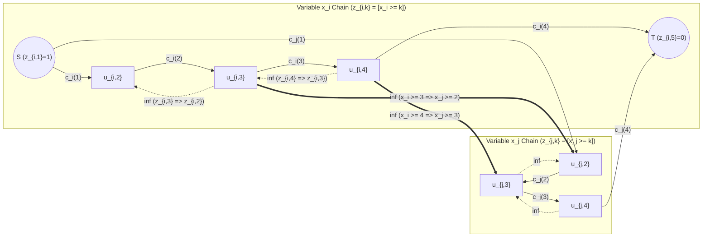
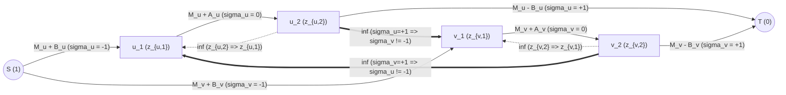
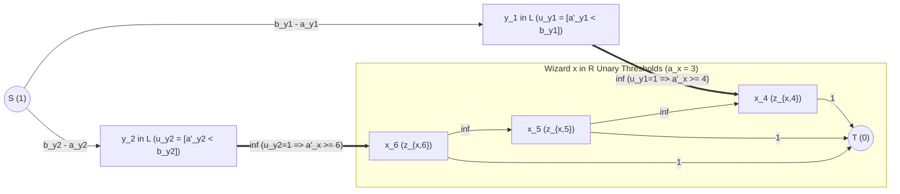

# Cohort 2 Redundant Wave 2B (Iterations 68–72): Multi-State Ordered Vertex Chains ($k$-ary Cuts), 3-State Sign/Deletion Cuts, Bipartite Disjunctive Thresholds, General Monge Pairwise Penalties & Coarea Parametric Min-Cuts

> [!IMPORTANT]
> **Cohort 2 Independent Redundancy & "Zero Magic Gadgets" Compilation Mandate**
> This monograph is the independent Cohort 2 investigation for **Wave 2B (Iterations 68–72)** of the Network Flows, Minimum Cuts, Matching, Duality & Non-Graph Modelling textbook project. Every modelling archetype and benchmark problem (`[HNOI2013] 切糕`, **`ARC 107 F — Sum of Abs`**, **`ARC 142 E — Pairing Wizards`**, `ABC 347 G`, **`CF 1427 G — One Billion Shades of Grey`**, and 22 curated non-template problems) is derived from first principles using the **4-Step "Zero Magic Gadgets" Compilation Standard**:
> 1. **Non-Graph Diagnostic Signal (Recognition)**: What surface clue in the raw problem statement and constraint bounds ($N, K, V_{\max}$) points to multi-state / unary threshold / parametric Min-Cut, and why DP or greedy fails.
> 2. **Algebraic / Logical Intermediate Representation**: Explicit formulation via unary threshold indicator chains $z_{i,k} = [x_i \ge k] \in \{0, 1\}$, monotonicity invariants $1 = z_{i,1} \ge z_{i,2} \ge \dots \ge z_{i,K+1} = 0$, pseudo-Boolean cut polynomials $\sum c_{uv} z_u(1 - z_v)$, 1D/2D discrete Abel summation by parts, or the discrete Coarea (layer-cake) integral before any vertex or edge is drawn.
> 3. **Reverse-Engineering Scratchpad (Mechanical Graph Compilation)**: Term-by-term compilation of algebraic penalties and logical implications into directed vertices, capacities, reverse $\infty$-edges, and bipartite variable inversions.
> 4. **Hand-Checkable Toy Trace & Broken Gadget Counterexamples**: Concrete numerical traces ($N \le 4$) alongside rigorous counterexamples demonstrating exactly how an omitted reverse $\infty$-edge, non-submodular cross-difference, or un-inverted disjunctive clause corrupts the minimum cut.

---

## Executive Overview: From Binary Decisions to Multi-Valued Discrete Variables

In Wave 2A (Iterations 63–67), Minimum Cut (`燃やす埋める` / Project Selection) was established as a compiler for **binary** variable optimization: each variable $x_i \in \{0, 1\}$ corresponds to a vertex $u_i$, with $x_i = 1 \iff u_i \in S$ and $x_i = 0 \iff u_i \in T$. A directed edge $u \xrightarrow{c} v$ with capacity $c \ge 0$ contributes $c \cdot x_u(1 - x_v)$ to the cut capacity, and an $\infty$-capacity edge $u \xrightarrow{\infty} v$ enforces the hard logical implication $x_u = 1 \implies x_v = 1$ ($x_u \le x_v$).

However, a vast class of competitive programming problems—including three of the most celebrated non-graph Min-Cut problems in modern contest history (**`ARC 107 F — Sum of Abs`**, **`ARC 142 E — Pairing Wizards`**, and **`CF 1427 G — One Billion Shades of Grey`**)—require assigning each entity $i$ a **multi-valued discrete state** $x_i \in \{1, 2, \dots, K\}$ rather than a single bit:
- In **`[HNOI2013] 切糕`**, $x_i \in \{1, \dots, R\}$ is the vertical coordinate of a cut in column $i$, subject to smoothness constraints $|x_i - x_j| \le D$.
- In **`ARC 107 F — Sum of Abs`**, each vertex chooses one of **three** states $\sigma_v \in \{-1, 0\text{ (Deleted)}, +1\}$ such that no edge joins $+1$ directly to $-1$.
- In **`ARC 142 E — Pairing Wizards`**, each wizard $i$ chooses a final strength $a'_i \in \{a_i, a_i + 1, \dots, 100\}$ subject to disjunctive pairwise thresholds $\max(a'_x, a'_y) \ge \max(b_x, b_y)$.
- In **`ABC 347 G — Grid Coloring 2`**, each grid cell chooses $x_i \in \{1, 2, 3, 4, 5\}$ to minimize the quadratic Dirichlet energy $\sum_{(i,j) \in E} (x_i - x_j)^2$.
- In **`CF 1427 G — One Billion Shades of Grey`**, each grid cell chooses $h_u \in \{1, 2, \dots, 10^9\}$ to minimize the $\ell_1$ total variation $\sum_{(u,v) \in E} |h_u - h_v|$.

The unifying mathematical bridge across all five iterations of Wave 2B is the **Unary Threshold Representation (Level-Set Encoding)**:

$$\boxed{x_i = \sum_{k=1}^{K} z_{i,k}, \qquad z_{i,k} = [x_i \ge k] \in \{0, 1\}, \qquad 1 = z_{i,1} \ge z_{i,2} \ge \dots \ge z_{i,K} \ge z_{i,K+1} = 0.}$$

Once a $K$-valued integer variable $x_i$ is decomposed into its $K+1$ unary threshold bits $z_{i,k} = [x_i \ge k]$, every mysterious graph gadget in multi-state Min-Cut literature reduces to elementary boolean logic and discrete calculus (summation by parts):

1. **The Reverse $\infty$-Edge Demystified (Iteration 68)**: The notorious reverse edge $u_{i,k+1} \xrightarrow{\infty} u_{i,k}$ in `[HNOI2013] 切糕` is *not* an ad-hoc graph trick to "prevent cutting two edges in the same column." In unary threshold variables, it is literally the tautological implication $[x_i \ge k+1] \implies [x_i \ge k]$, i.e., $\infty \cdot z_{i,k+1}(1 - z_{i,k})$.
2. **3-State Sign/Deletion & $k$-Layer Parity Chains (Iteration 69)**: An ordered 3-state variable $\sigma_v \in \{-1 < 0 < +1\}$ is encoded by two unary threshold bits $(z_{v,1}, z_{v,2}) \in \{(0,0), (1,0), (1,1)\}$ with $z_{v,1} \ge z_{v,2}$. Forbidding adjacent opposite signs $(\sigma_u = +1 \land \sigma_v = -1)$ is simply forbidding $(z_{u,2} = 1 \land z_{v,1} = 0)$, which compiles to a single $\infty$-edge $u_2 \xrightarrow{\infty} v_1$.
3. **Unary Threshold Layering + Bipartite Disjunctive ("OR") Cuts (Iteration 70)**: When pairs $(x, y)$ satisfy a disjunctive constraint $(a'_y \ge b_y) \lor (a'_x \ge b_y)$ across a bipartition $L \cup R$, inverting the indicator on $L$ ($u_y = [a'_y < b_y] = 1 - z_{y,b_y}$) turns the logical "OR" into the implication $u_y = 1 \implies z_{x,b_y} = 1$, compiling directly into $y \xrightarrow{\infty} x_{b_y}$.
4. **Ishikawa's Construction & General Monge Penalties (Iteration 71)**: Applying 2D discrete summation by parts (Abel transformation) to an arbitrary pairwise cost $\Phi(x_i, x_j)$ reveals that the cross-edge capacity between threshold bit $z_{i,a}$ and threshold bit $z_{j,b}$ is precisely the negative mixed second difference $-\Delta_a \Delta_b \Phi(a, b) = \Phi(a, b-1) + \Phi(a-1, b) - \Phi(a, b) - \Phi(a-1, b-1)$. Thus $\Phi$ is Min-Cut compilable via unary chains if and only if $\Phi$ is **discrete submodular (Monge)**.
5. **The Discrete Coarea Formula & Incremental Parametric Min-Cut (Iteration 72)**: When $K \le 10^9$ is too large to materialize all $K$ layers simultaneously, but the pairwise penalty is purely $\ell_1$ ($\Phi(h_u, h_v) = w_{uv}|h_u - h_v|$) without non-convex unary costs, the cross-level capacities $-\Delta_a \Delta_b |a - b|$ vanish for all $a \neq b$. The $K$-layer network decouples into independent binary level-set cuts $\sum_k (v_{k+1} - v_k)\text{Cut}(S_k)$ whose optimal solutions automatically nest ($S_1^* \supseteq S_2^* \supseteq \dots$) by submodularity and can be maintained in $O(N^3)$ total time via **incremental residual flow rollback (`动态退流`)**.

---

## Iteration 68: Multi-State Ordered Vertex Chains ($k$-ary Cuts / `K値燃やす埋める` / `[HNOI2013] 切糕`)

### 1.Step 1: Non-Graph Diagnostic Signal (Recognition)

How do you recognize from a raw problem statement that a problem requires a **Multi-State Ordered Vertex Chain ($k$-ary Min-Cut)**?

- **Surface Clues in the Statement**:
  1. **Small Discrete Domain per Variable**: There are $N$ variables $x_1, x_2, \dots, x_N$, each taking an integer value in a small range $\{1, 2, \dots, K\}$ (typically $N \le 1000$, $K \le 50$, so the product $N \cdot K \le 2 \times 10^4$ is small enough for Dinic's algorithm).
  2. **Arbitrary Unary Cost Table**: Assigning $x_i = v$ incurs an arbitrary (possibly non-convex, non-monotonic) cost $c_i(v)$ given by an explicit input table of size $N \times K$.
  3. **Pairwise Difference or Threshold Implications**: Pairs of variables $(x_i, x_j)$ are coupled by **difference constraints** of the form $x_i - x_j \le d_{ij}$ (such as smoothness $|x_i - x_j| \le D$, monotonicity $x_i \le x_j$, or step-implications "if $x_i \ge a$, then $x_j$ must be at least $b$").
- **Why Standard DP and Greedy Fail**:
  - **Greedy / Dijkstra fails** because $c_i(v)$ is non-convex (local minima trap greedy adjustments) and raising $x_i$ to lower its own unary cost can cascade through difference constraints $x_j \ge x_i - D$ across multiple neighbors simultaneously.
  - **Dynamic Programming fails** when the dependency graph of pairs $(i, j)$ has large treewidth—for example, a $P \times Q$ 2D grid where $P, Q \le 40$ and $K \le 40$: a profile DP would require $O(K^{\min(P, Q)}) = O(40^{40})$ states.

---

### 2. Step 2: Algebraic / Logical Intermediate Representation (Unary Threshold Chains)

Never begin by thinking of "splitting a column into $K$ edges." Instead, translate the multi-valued variable $x_i \in \{1, 2, \dots, K\}$ into **boolean propositions**.

#### Definition 68.1 (Unary Threshold Indicator Variables)
For each variable $x_i \in \{1, 2, \dots, K\}$, introduce $K + 1$ binary indicator variables $z_{i,1}, z_{i,2}, \dots, z_{i,K+1} \in \{0, 1\}$ defined by the threshold propositions:

$$z_{i,k} = [x_i \ge k] = \begin{cases} 1 & \text{if } x_i \ge k, \\ 0 & \text{if } x_i < k, \end{cases} \qquad \text{for } k = 1, 2, \dots, K + 1.$$

What are the exact algebraic laws governing the vector $(z_{i,1}, z_{i,2}, \dots, z_{i,K+1}) \in \{0, 1\}^{K+1}$?

1. **Boundary Conditions**:
   Since $x_i \in \{1, \dots, K\}$, the proposition $[x_i \ge 1]$ is always true, and $[x_i \ge K+1]$ is always false:

   $$z_{i,1} = 1, \qquad z_{i,K+1} = 0.$$

2. **Unary Monotonicity Invariant**:
   For every $k \in \{1, 2, \dots, K\}$, if $x_i \ge k+1$, then necessarily $x_i \ge k$. In boolean indicator variables, this is the implication $z_{i,k+1} = 1 \implies z_{i,k} = 1$, or equivalently the chain of inequalities:

   $$1 = z_{i,1} \ge z_{i,2} \ge z_{i,3} \ge \dots \ge z_{i,K} \ge z_{i,K+1} = 0.$$

3. **Bijection with $\{1, 2, \dots, K\}$**:
   Any binary vector $(z_{i,1}, \dots, z_{i,K+1}) \in \{0, 1\}^{K+1}$ satisfying $1 = z_{i,1} \ge z_{i,2} \ge \dots \ge z_{i,K+1} = 0$ consists of a contiguous prefix of $1$s followed by a contiguous suffix of $0$s:

   $$(z_{i,1}, \dots, z_{i,v}, z_{i,v+1}, \dots, z_{i,K+1}) = (\underbrace{1, 1, \dots, 1}_{v \text{ ones}}, \underbrace{0, 0, \dots, 0}_{K + 1 - v \text{ zeros}})$$

   for a unique transition index $v \in \{1, 2, \dots, K\}$, which recovers $x_i = v = \sum_{k=1}^K z_{i,k}$.

4. **Point-Value Indicator (`[x_i = v]`) as a Cut Term**:
   Under the monotonicity invariant $z_{i,v} \ge z_{i,v+1}$, how do we test whether $x_i$ is equal to a specific value $v \in \{1, \dots, K\}$?
   The event $[x_i = v]$ is the logical conjunction $[x_i \ge v] \land \neg[x_i \ge v+1]$, which is:

   $$[x_i = v] = z_{i,v}(1 - z_{i,v+1}) = z_{i,v} - z_{i,v+1}.$$

   Notice that for $k < x_i$, $(z_{i,k}, z_{i,k+1}) = (1, 1) \implies z_{i,k}(1 - z_{i,k+1}) = 0$; for $k > x_i$, $(z_{i,k}, z_{i,k+1}) = (0, 0) \implies z_{i,k}(1 - z_{i,k+1}) = 0$; and for $k = x_i$, $(z_{i,k}, z_{i,k+1}) = (1, 0) \implies z_{i,k}(1 - z_{i,k+1}) = 1$.

#### Compiling the Objective and Constraints into a Pseudo-Boolean Cut Polynomial
Now we can write the entire multi-state optimization problem as a standard binary Min-Cut polynomial where $z_u = 1 \iff u \in S$ and $z_u = 0 \iff u \in T$:

- **Unary Costs $c_i(v)$**:
  For each variable $i$ and value $v \in \{1, \dots, K\}$, paying $c_i(v)$ when $x_i = v$ is the sum:

  $$\text{UnaryCost}_i(z_i) = \sum_{v=1}^{K} c_i(v) \cdot z_{i,v}(1 - z_{i,v+1}).$$

  *(Note on Negative Unary Costs)*: Because $\sum_{v=1}^K z_{i,v}(1 - z_{i,v+1}) = z_{i,1} - z_{i,K+1} = 1 - 0 = 1$ for every monotonic chain, adding a constant shift $M_i$ to all $K$ values $c_i(1), \dots, c_i(K)$ adds exactly $M_i \sum_{v=1}^K z_{i,v}(1 - z_{i,v+1}) = M_i$ to every valid assignment. Thus, if some $c_i(v) < 0$, we simply shift $c'_i(v) = c_i(v) + M_i \ge 0$ and subtract $\sum_i M_i$ from the final Min-Cut.

- **Monotonicity Invariant ($z_{i,v} \ge z_{i,v+1}$)**:
  To forbid the non-monotonic state $(z_{i,v} = 0 \land z_{i,v+1} = 1)$—which would mean $x_i \ge v+1$ is true while $x_i \ge v$ is false—we add the infinite penalty term:

  $$\text{MonotonicityPenalty}_i(z_i) = \sum_{v=1}^{K-1} \infty \cdot z_{i,v+1}(1 - z_{i,v}).$$

- **Difference Constraints ($x_i - x_j \le d$)**:
  A linear difference constraint $x_i - x_j \le d$ (where $d \in \mathbb{Z}$ can be positive, zero, or negative) states that whenever $x_i$ reaches threshold $k$, $x_j$ must reach at least threshold $k - d$:

  $$\forall k \in \{1, \dots, K\}: \quad [x_i \ge k] \implies [x_j \ge k - d] \iff z_{i,k} \le z_{j,k-d}.$$

  In cut polynomial form, forbidding $(z_{i,k} = 1 \land z_{j,k-d} = 0)$ is the infinite penalty term:

  $$\text{DiffPenalty}_{i \to j}(z_i, z_j) = \sum_{k=1}^{K} \infty \cdot z_{i,k}\big(1 - z_{j,\text{clamp}(k-d)}\big).$$

  Let us check the boundary values of $k - d$:
  - If $k - d \le 1$: Since $z_{j,1} = 1$ is unconditionally true ($x_j \ge 1$ always holds), the implication $x_i \ge k \implies x_j \ge k - d$ is vacuously satisfied; $1 - z_{j,1} = 0$, so **no edge is needed**.
  - If $k - d \ge K + 1$: Since $z_{j,K+1} = 0$ is unconditionally false ($x_j$ can never be $\ge K+1$), $x_i \ge k$ is impossible ($z_{i,k}$ must be $0$), so we add $\infty \cdot z_{i,k}(1 - z_T)$, i.e., an $\infty$-edge $u_{i,k} \xrightarrow{\infty} T$.

---

### 3. Step 3: Reverse-Engineering Scratchpad (Mechanical Graph Compilation)

Every single term of the form $W \cdot z_\alpha(1 - z_\beta)$ in the pseudo-Boolean polynomial above compiles mechanically into a directed edge $\alpha \xrightarrow{W} \beta$:

| Algebraic / Logical Term | Indicator Polynomial Term | Compiled Graph Gadget |
| :--- | :--- | :--- |
| Lower boundary $[x_i \ge 1] = 1$ | $z_{i,1} = 1$ | Identify $u_{i,1} \equiv S$ (or add $S \xrightarrow{\infty} u_{i,1}$) |
| Upper boundary $[x_i \ge K+1] = 0$ | $z_{i,K+1} = 0$ | Identify $u_{i,K+1} \equiv T$ (or add $u_{i,K+1} \xrightarrow{\infty} T$) |
| Unary cost $c_i(v)$ for $[x_i = v]$ | $c_i(v) \cdot z_{i,v}(1 - z_{i,v+1})$ | **Forward chain edge**: $u_{i,v} \xrightarrow{c_i(v)} u_{i,v+1}$ ($1 \le v \le K$) |
| Monotonicity $[x_i \ge v+1] \implies [x_i \ge v]$ | $\infty \cdot z_{i,v+1}(1 - z_{i,v})$ | **Reverse $\infty$-edge**: $u_{i,v+1} \xrightarrow{\infty} u_{i,v}$ ($1 \le v < K$) |
| Difference constraint $x_i - x_j \le d$ | $\infty \cdot z_{i,k}(1 - z_{j,k-d})$ | **Cross $\infty$-edge**: $u_{i,k} \xrightarrow{\infty} u_{j,k-d}$ ($1 \le k - d \le K+1$) |



#### The Parallel Closure Dual Form (1D Discrete Summation by Parts)
Wait: what if the unary costs $c_i(v)$ are given in **marginal form** (e.g., increasing $x_i$ from $v-1$ to $v$ costs $\delta_i(v) = c_i(v) - c_i(v-1) \ge 0$), as in `ARC 142 E` or `ABC 326 G`?
Applying 1D discrete summation by parts (Abel transformation) to the series chain polynomial under $z_{i,1} = 1, z_{i,K+1} = 0$:

$$\sum_{v=1}^{K} c_i(v) (z_{i,v} - z_{i,v+1}) = c_i(1) z_{i,1} + \sum_{v=2}^{K} \underbrace{\big(c_i(v) - c_i(v-1)\big)}_{\delta_i(v)} z_{i,v} - c_i(K) z_{i,K+1} = c_i(1) + \sum_{v=2}^{K} \delta_i(v) \cdot z_{i,v}(1 - z_T).$$

This gives the **Parallel Closure Compilation**: when marginal costs $\delta_i(v) = c_i(v) - c_i(v-1) \ge 0$ are non-negative, instead of putting $c_i(v)$ on the series edges $u_{i,v} \to u_{i,v+1}$, we can simply keep the reverse $\infty$-edges $u_{i,v} \xrightarrow{\infty} u_{i,v-1}$ and attach each threshold node directly to the sink via $u_{i,v} \xrightarrow{\delta_i(v)} T$! Both graphs define the exact same pseudo-Boolean function on every monotonic assignment $z_{i,2} \ge \dots \ge z_{i,K}$.

---

### 4. Step 4: Hand-Checkable Toy Trace & Broken Gadget Counterexample (`[HNOI2013] 切糕`)

#### Benchmark Problem: `[HNOI2013] 切糕` (Luogu P3227)
- **Statement**: Given a $P \times Q \times R$ 3D grid of non-negative costs $c(x, y, z) \ge 0$ ($1 \le P, Q, R \le 40$). For each column $(x, y) \in [1, P] \times [1, Q]$, choose a height $f(x, y) \in \{1, 2, \dots, R\}$ such that $|f(x, y) - f(x', y')| \le D$ for all 4-adjacent columns $(x, y) \sim (x', y')$, minimizing $\sum_{x, y} c(x, y, f(x, y))$.
- **Toy Trace & Broken Gadget Proof ($P = 1, Q = 2, R = 3, D = 1$)**:
  Consider two adjacent columns $x_1, x_2 \in \{1, 2, 3\}$ with smoothness constraint $|x_1 - x_2| \le 1$ ($D = 1$) and unary costs:
  - Column 1: $c_1(1) = 10, \quad c_1(2) = 100, \quad c_1(3) = 10$.
  - Column 2: $c_2(1) = 100, \quad c_2(2) = 1, \quad c_2(3) = 100$.

  **True Optimal Assignment**:
  Since $|x_1 - x_2| \le 1$:
  - If $x_2 = 2$ (cost $1$), then $x_1$ can be $1$ (cost $10$) or $3$ (cost $10$), giving total cost $10 + 1 = 11$.
  - No valid assignment can do better than $11$.

  **Now watch what happens if we OMIT the reverse $\infty$-edges $u_{i,3} \xrightarrow{\infty} u_{i,2}$!**
  Suppose we only build the forward chains:
  - Chain 1: $S = u_{1,1} \xrightarrow{10} u_{1,2} \xrightarrow{100} u_{1,3} \xrightarrow{10} u_{1,4} = T$.
  - Chain 2: $S = u_{2,1} \xrightarrow{100} u_{2,2} \xrightarrow{1} u_{2,3} \xrightarrow{100} u_{2,4} = T$.
  - Cross $\infty$-edges for $|x_1 - x_2| \le 1$:
    - $x_1 - x_2 \le 1$: $u_{1,3} \xrightarrow{\infty} u_{2,2}$ and $u_{1,4} \xrightarrow{\infty} u_{2,3}$.
    - $x_2 - x_1 \le 1$: $u_{2,3} \xrightarrow{\infty} u_{1,2}$ and $u_{2,4} \xrightarrow{\infty} u_{1,3}$.

  Wait: on this 2-column instance, if we want $x_2 = 2$, we set $z_{2,2} = 1, z_{2,3} = 0$ (cutting $u_{2,2} \xrightarrow{1} u_{2,3}$).
  Now modify the example slightly to 3 columns $x_1 - x_2 - x_3$ with $R = 3, D = 1$:
  - Column 1 forces $x_1 = 3$: $c_1 = (100, 100, 0) \implies z_{1,2} = 1, z_{1,3} = 1$.
  - Column 3 forces $x_3 = 1$: $c_3 = (0, 100, 100) \implies z_{3,2} = 0, z_{3,3} = 0$.
  - Column 2 has costs $c_2 = (10, 100, 10)$.
  In any valid assignment with $|x_1 - x_2| \le 1$ and $|x_2 - x_3| \le 1$:
  Since $x_1 = 3$ and $x_3 = 1$, Column 2 is **forced** to choose $x_2 = 2$, incurring $c_2(2) = 100$ (total cost $0 + 100 + 0 = 100$).
  Look at what the cross $\infty$-edges force on Column 2's threshold bits $(z_{2,2}, z_{2,3})$:
  - From $x_1 = 3$ ($z_{1,3} = 1$), the edge $u_{1,3} \xrightarrow{\infty} u_{2,2}$ forces **$z_{2,2} = 1$** ($u_{2,2} \in S$, meaning $x_2 \ge 2$).
  - From $x_3 = 1$ ($z_{3,2} = 0$), the edge $u_{2,3} \xrightarrow{\infty} u_{3,2}$ forces **$z_{2,3} = 0$** ($u_{2,3} \in T$, meaning $x_2 < 3$).
  Wait: what if instead $x_1 = 1$ ($z_{1,2} = 0$) and $x_3 = 3$ ($z_{3,3} = 1$), or what if $x_2$ has two constraints:
  - Neighbor $A$ requires $x_2 \le 1$ (so $z_{2,2} = 0$, i.e., $u_{2,2} \in T$),
  - Neighbor $B$ requires $x_2 \ge 3$ (so $z_{2,3} = 1$, i.e., $u_{2,3} \in S$)!
  Specifically, let $x_1$ and $x_2$ have $D = 1$, with:
  - Column 1: $c_1 = (0, 100, 100)$ ($x_1 = 1$, so $z_{1,2} = 0, z_{1,3} = 0$),
  - Column 3: $c_3 = (100, 100, 0)$ ($x_3 = 3$, so $z_{3,2} = 1, z_{3,3} = 1$),
  - Column 2: $c_2 = (10, 100, 10)$, and suppose the directed constraints are $x_2 - x_1 \le 0$ ($u_{2,2} \xrightarrow{\infty} u_{1,2}$) and $x_3 - x_2 \le 0$ ($u_{3,3} \xrightarrow{\infty} u_{2,3}$).
  Then $z_{1,2} = 0 \implies z_{2,2} = 0$ ($u_{2,2} \in T$), while $z_{3,3} = 1 \implies z_{2,3} = 1$ ($u_{2,3} \in S$)!
  **Without the reverse $\infty$-edge $u_{2,3} \xrightarrow{\infty} u_{2,2}$**:
  The min-cut sets $u_{2,2} \in T$ ($z_{2,2} = 0$) and $u_{2,3} \in S$ ($z_{2,3} = 1$)!
  In the forward chain $S \xrightarrow{10} u_{2,2} \xrightarrow{100} u_{2,3} \xrightarrow{10} T$:
  - $S \xrightarrow{10} u_{2,2}$ goes from $S$ to $T$ (cut, cost $10$),
  - $u_{2,2} \xrightarrow{100} u_{2,3}$ goes from $T$ to $S$ (**NOT cut, cost $0$!**),
  - $u_{2,3} \xrightarrow{10} T$ goes from $S$ to $T$ (cut, cost $10$)!
  The broken network reports a cut of cost $10 + 10 = 20$ by assigning Column 2 the **impossible hallucinated state** "$x_2 < 2$ AND $x_2 \ge 3$ simultaneously," completely bypassing the middle edge of cost $100$!
  **With the reverse $\infty$-edge $u_{2,3} \xrightarrow{\infty} u_{2,2}$**:
  Setting $u_{2,3} \in S$ and $u_{2,2} \in T$ severs $u_{2,3} \xrightarrow{\infty} u_{2,2}$ (cost $\infty$), forcing a valid monotonic assignment.

---

## Iteration 69: 3-State Sign/Deletion Cuts & $k$-Layer Parity Chains — Independent Deep Dive into `ARC 107 F — Sum of Abs`

### 1. Benchmark Deep Dive: `ARC 107 F — Sum of Abs`

#### Problem Statement & Constraints
We are given an undirected graph $G = (V, E)$ with $N$ vertices and $M$ edges ($1 \le N, M \le 300$). Each vertex $v \in V$ has two integer weights $A_v$ and $B_v$ ($-10^6 \le A_v, B_v \le 10^6$).
We may delete any subset of vertices $D \subseteq V$ (along with all edges incident to $D$). Let $\mathcal{C}(V \setminus D)$ denote the set of connected components of the remaining induced subgraph $G[V \setminus D]$. Our goal is to **maximize**:

$$\text{Score}(D) = \sum_{C \in \mathcal{C}(V \setminus D)} \left| \sum_{v \in C} B_v \right| - \sum_{v \in D} A_v.$$

---

#### Step 1: Non-Graph Diagnostic Signal (Recognition)
Wait—the input already contains a graph $G = (V, E)$, so why is this a **Non-Graph-to-Flow Modelling** benchmark?
Because the objective function is **not** a flow or cut on $G$: it sums the *absolute value of the component weight* $\left|\sum_{v \in C} B_v\right|$ over connected components $C$ after vertex deletion!
- **Why DP and Greedy Fail**:
  1. $G$ is a general graph with $N, M \le 300$ (treewidth can be $\Omega(N)$, ruling out tree/profile DP).
  2. The absolute value $\left|\sum_{v \in C} B_v\right|$ couples all vertices in the same connected component: whether a vertex $v$ with $B_v < 0$ helps or hurts its component depends on whether the rest of the component has a positive or negative sum.
- **The Diagnostic Signal**:
  - Bounds $N, M \le 300$ with arbitrary signed weights $A_v, B_v \in [-10^6, 10^6]$ strongly signal an $O(V^2 E)$ Min-Cut formulation.
  - Every connected component $C$ has a binary sign choice $\left|\sum_{v \in C} B_v\right| = \max_{s_C \in \{+1, -1\}} s_C \sum_{v \in C} B_v$. Pushing the sign choice down to individual vertices gives each vertex **three ordered states**:
    $$\sigma_v \in \{-1\text{ (Kept, Negative)}, \quad 0\text{ (Deleted)}, \quad +1\text{ (Kept, Positive)}\}.$$

---

#### Step 2: Algebraic / Logical Intermediate Representation

Let us prove the exact equivalence between the component-level objective and a 3-state vertex assignment problem.

##### Lemma 69.1 (Component Sign Linearization)
Maximizing $\text{Score}(D)$ over all deletion sets $D \subseteq V$ is equivalent to maximizing:

$$\widetilde{\text{Score}}(\sigma) = \sum_{v \in V : \sigma_v = +1} B_v + \sum_{v \in V : \sigma_v = -1} (-B_v) + \sum_{v \in V : \sigma_v = 0} (-A_v)$$

over all 3-state vertex assignments $\sigma \in \{-1, 0, +1\}^V$ subject to the **No Opposite-Sign Adjacency Constraint**:

$$\forall (u, v) \in E: \quad |\sigma_u - \sigma_v| \le 1 \quad \big(\text{i.e., } (\sigma_u, \sigma_v) \notin \{(+1, -1), (-1, +1)\}\big).$$

*Proof*:
1. **(From $D$ to $\sigma$)**: Given any deletion set $D \subseteq V$, for each connected component $C \in \mathcal{C}(V \setminus D)$, define $s_C = +1$ if $\sum_{v \in C} B_v \ge 0$ and $s_C = -1$ otherwise, so $\left|\sum_{v \in C} B_v\right| = \sum_{v \in C} s_C B_v$. Set $\sigma_v = 0$ for $v \in D$ and $\sigma_v = s_C$ for $v \in C$. Since every edge $(u, v) \in E$ with $u, v \notin D$ lies inside a single connected component $C$, we have $\sigma_u = \sigma_v = s_C$, so $|\sigma_u - \sigma_v| \le 1$ holds for all $(u, v) \in E$, and $\widetilde{\text{Score}}(\sigma) = \text{Score}(D)$.
2. **(From $\sigma$ to $D$)**: Conversely, given any $\sigma \in \{-1, 0, +1\}^V$ satisfying $|\sigma_u - \sigma_v| \le 1$ for all $(u, v) \in E$, let $D = \{v \in V : \sigma_v = 0\}$. In the remaining subgraph $G[V \setminus D]$, no edge joins a $+1$ vertex to a $-1$ vertex. Therefore, every connected component $C \in \mathcal{C}(V \setminus D)$ must be **monochromatic** (either $\sigma_v = +1$ for all $v \in C$, or $\sigma_v = -1$ for all $v \in C$). Since $s_C \sum_{v \in C} B_v \le \left|\sum_{v \in C} B_v\right|$ for any choice of sign $s_C \in \{+1, -1\}$, we have $\widetilde{\text{Score}}(\sigma) \le \text{Score}(D)$.
Thus $\max_D \text{Score}(D) = \max_\sigma \widetilde{\text{Score}}(\sigma)$. $\blacksquare$

##### Unary 2-Bit Encoding of the 3 States $\sigma_v \in \{-1, 0, +1\}$
Look at the constraint $|\sigma_u - \sigma_v| \le 1$ on the 3-element ordered set $\{-1 < 0 < +1\}$: it is a **special case of Iteration 68's $k$-ary chain with $K = 3$ and smoothness parameter $d = 1$**!
Specifically, for each vertex $v \in V$, let its two internal unary threshold indicator bits be:

$$z_{v,1} = [\sigma_v \ge 0] \in \{0, 1\}, \qquad z_{v,2} = [\sigma_v \ge +1] \in \{0, 1\},$$

subject to the monotonicity invariant:

$$z_{v,1} \ge z_{v,2}.$$

This establishes a one-to-one correspondence between the three states $\sigma_v \in \{-1, 0, +1\}$ and the three monotonic bit-pairs $(z_{v,1}, z_{v,2})$:

| State $\sigma_v$ | Meaning | Unary Bits $(z_{v,1}, z_{v,2})$ | Unique Active Cut Term in Chain $S \to v_1 \to v_2 \to T$ | Reward $R_v(\sigma_v)$ |
| :--- | :--- | :--- | :--- | :--- |
| $\sigma_v = -1$ | Kept in $C_-$ | $(0, 0)$ | $1 - z_{v,1} = 1$ (Edge $S \to v_1$ is cut) | $-B_v$ |
| $\sigma_v = 0$ | Deleted ($v \in D$) | $(1, 0)$ | $z_{v,1}(1 - z_{v,2}) = 1$ (Edge $v_1 \to v_2$ is cut) | $-A_v$ |
| $\sigma_v = +1$ | Kept in $C_+$ | $(1, 1)$ | $z_{v,2} = 1$ (Edge $v_2 \to T$ is cut) | $+B_v$ |
| *(Invalid)* | $\sigma_v \ge +1 \land \sigma_v < 0$ | $(0, 1)$ | $z_{v,2}(1 - z_{v,1}) = 1$ (Forbidden by $v_2 \xrightarrow{\infty} v_1$) | $-\infty$ |

Now let us convert maximizing reward $R_v(\sigma_v)$ into minimizing non-negative penalty $c_v(\sigma_v) = M_v - R_v(\sigma_v) \ge 0$:
- To handle **both** $A_v \ge 0$ and $A_v < 0$ cleanly without casework, define the per-vertex baseline reward:

  $$M_v = \max\big(|B_v|, -A_v\big) = \max\big(-B_v, -A_v, +B_v\big).$$

- Then the non-negative penalties for the three states of vertex $v$ are:

  $$c_v(-1) = M_v + B_v \ge 0, \qquad c_v(0) = M_v + A_v \ge 0, \qquad c_v(+1) = M_v - B_v \ge 0.$$

  *(Note: When $A_v \ge 0$, $M_v = |B_v|$, so $c_v(0) = |B_v| + A_v$, $c_v(-1) = |B_v| + B_v$, and $c_v(+1) = |B_v| - B_v$.)*

What about the edge constraint $|\sigma_u - \sigma_v| \le 1$ for $(u, v) \in E$?
- Forbidding $(\sigma_u = +1 \land \sigma_v = -1)$ is forbidding $(z_{u,2} = 1 \land z_{v,1} = 0)$, which is the cut term:

  $$\infty \cdot z_{u,2}(1 - z_{v,1}).$$

- Forbidding $(\sigma_v = +1 \land \sigma_u = -1)$ is forbidding $(z_{v,2} = 1 \land z_{u,1} = 0)$, which is the cut term:

  $$\infty \cdot z_{v,2}(1 - z_{u,1}).$$

---

#### Step 3: Reverse-Engineering Scratchpad (Mechanical Graph Compilation)

Summing over all $v \in V$ and $(u, v) \in E$, the total penalty to minimize is the pseudo-Boolean cut polynomial:

$$\mathcal{P}(z) = \sum_{v \in V} \Big[ c_v(-1)(1 - z_{v,1}) + c_v(0) z_{v,1}(1 - z_{v,2}) + c_v(+1) z_{v,2} + \infty \cdot z_{v,2}(1 - z_{v,1}) \Big] + \sum_{(u, v) \in E} \Big[ \infty \cdot z_{u,2}(1 - z_{v,1}) + \infty \cdot z_{v,2}(1 - z_{u,1}) \Big].$$

Reading off each term $W \cdot z_\alpha(1 - z_\beta)$ gives the exact flow network:
1. **Vertices**: Source $S$, Sink $T$, and for each vertex $v \in V$, two nodes $v_1$ (representing $z_{v,1} = [\sigma_v \ge 0]$) and $v_2$ (representing $z_{v,2} = [\sigma_v \ge +1]$). *(In vertex-splitting notation, $v_1$ is often written $v_{\text{in}}$ and $v_2$ is written $v_{\text{out}}$—our unary derivation explains **why** a 2-node split represents 3 states!)*
2. **Per-Vertex 3-Edge Series Chain**:
   - $S \xrightarrow{M_v + B_v} v_1$ (cut iff $\sigma_v = -1$),
   - $v_1 \xrightarrow{M_v + A_v} v_2$ (cut iff $\sigma_v = 0$, i.e., $v$ is deleted),
   - $v_2 \xrightarrow{M_v - B_v} T$ (cut iff $\sigma_v = +1$),
   - $v_2 \xrightarrow{\infty} v_1$ (the reverse $\infty$-edge enforcing $z_{v,1} \ge z_{v,2}$).
3. **Per-Edge Cross-Implication Gadget**:
   For each undirected edge $(u, v) \in E$:
   - $u_2 \xrightarrow{\infty} v_1$ (enforcing $\sigma_u = +1 \implies \sigma_v \ge 0$),
   - $v_2 \xrightarrow{\infty} u_1$ (enforcing $\sigma_v = +1 \implies \sigma_u \ge 0$).
4. **Final Answer**:
   $$\text{Ans} = \sum_{v \in V} M_v - \text{MinCut}(S, T).$$
   With $|V_{\text{flow}}| = 2N + 2 \le 602$ and $|E_{\text{flow}}| = 4N + 2M \le 1800$, Dinic's algorithm finishes in $< 5$ ms.



---

#### Step 4: Hand-Checkable Toy Trace & Broken Gadget Counterexamples

##### Toy Trace ($N = 3$ Path Graph $1 - 2 - 3$)
Let $G$ be the path $1 - 2 - 3$ with weights:
- Vertex 1: $A_1 = 10, B_1 = +5 \implies M_1 = 5$, chain capacities $(S \xrightarrow{10} 1_1 \xrightarrow{15} 1_2 \xrightarrow{0} T)$.
- Vertex 2: $A_2 = 2, B_2 = -1 \implies M_2 = 1$, chain capacities $(S \xrightarrow{0} 2_1 \xrightarrow{3} 2_2 \xrightarrow{2} T)$.
- Vertex 3: $A_3 = 10, B_3 = -6 \implies M_3 = 6$, chain capacities $(S \xrightarrow{0} 3_1 \xrightarrow{16} 3_2 \xrightarrow{12} T)$.
- Baseline sum: $\sum_{v=1}^3 M_v = 5 + 1 + 6 = 12$.

Let us evaluate the candidate cuts:
1. **Keep all three with $\sigma = (+1, +1, +1)$**:
   Cut edges $1_2 \to T$ ($0$), $2_2 \to T$ ($2$), $3_2 \to T$ ($12$). Cut capacity $= 14 \implies \text{Score} = 12 - 14 = -2 = |5 - 1 - 6|$.
2. **Keep all three with $\sigma = (-1, -1, -1)$**:
   Cut edges $S \to 1_1$ ($10$), $S \to 2_1$ ($0$), $S \to 3_1$ ($0$). Cut capacity $= 10 \implies \text{Score} = 12 - 10 = +2 = |-5 + 1 + 6|$.
3. **Delete Vertex 2 ($\sigma_2 = 0$), set $\sigma_1 = +1, \sigma_3 = -1$**:
   - Vertex 1: $(z_{1,1}, z_{1,2}) = (1, 1) \implies$ cut $1_2 \xrightarrow{0} T$ (cost $0$).
   - Vertex 2: $(z_{2,1}, z_{2,2}) = (1, 0) \implies$ cut $2_1 \xrightarrow{3} 2_2$ (cost $3$).
   - Vertex 3: $(z_{3,1}, z_{3,2}) = (0, 0) \implies$ cut $S \xrightarrow{0} 3_1$ (cost $0$).
   - Check cross $\infty$-edges:
     - Edge $(1, 2)$: $1_2 \xrightarrow{\infty} 2_1$ has $z_{1,2} = 1, z_{2,1} = 1$ ($S \to S$, not cut); $2_2 \xrightarrow{\infty} 1_1$ has $z_{2,2} = 0, z_{1,1} = 1$ ($T \to S$, not cut).
     - Edge $(2, 3)$: $2_2 \xrightarrow{\infty} 3_1$ has $z_{2,2} = 0, z_{3,1} = 0$ ($T \to T$, not cut); $3_2 \xrightarrow{\infty} 2_1$ has $z_{3,2} = 0, z_{2,1} = 1$ ($T \to S$, not cut).
   - Total Cut $= 0 + 3 + 0 = 3 \implies \text{Score} = 12 - 3 = 9 = |5| + |-6| - 2$.
   Thus $\text{MinCut} = 3$ and the maximum score is $9$.

##### Broken Gadget Counterexample 1: What if we reversed the cross-edges to $u_1 \xrightarrow{\infty} v_2$?
If a solver mistakenly adds $u_1 \xrightarrow{\infty} v_2$ instead of $u_2 \xrightarrow{\infty} v_1$, the algebraic term is $\infty \cdot z_{u,1}(1 - z_{v,2})$, which forbids $(\sigma_u \ge 0 \land \sigma_v \le 0)$! In particular, deleting $u$ ($\sigma_u = 0 \implies z_{u,1} = 1$) while keeping $v$ negative ($\sigma_v = -1 \implies z_{v,2} = 0$)—or even deleting **both** $u$ and $v$ ($z_{u,1} = 1, z_{v,2} = 0$)—would cut $u_1 \xrightarrow{\infty} v_2$ and incur $\infty$ cost! In our toy trace above, deleting vertex 2 would become impossible.

##### Broken Gadget Counterexample 2: What if we omit $v_2 \xrightarrow{\infty} v_1$ when $A_v > |B_v|$ (or when additional constraints exist)?
Why did we include the reverse $\infty$-edge $v_2 \xrightarrow{\infty} v_1$?
Without $v_2 \xrightarrow{\infty} v_1$, the state $(z_{v,1}, z_{v,2}) = (0, 1)$ is allowed and costs $c_v(-1) + c_v(+1) = (M_v + B_v) + (M_v - B_v) = 2M_v$ on the chain $S \to v_1 \to v_2 \to T$.
Now suppose $N = 1$ (a single isolated vertex $v$) with $B_v = 0$ and $A_v = -10$ (so deleting $v$ gives a bonus $-A_v = +10$, whereas keeping $v$ gives $0$).
Then $M_v = \max(|B_v|, -A_v) = 10$, and the chain capacities are:
- $c_v(-1) = 10 + 0 = 10$,
- $c_v(0) = 10 + (-10) = 0$,
- $c_v(+1) = 10 - 0 = 10$.
Here $(1, 0)$ costs $0$. What if instead we had a problem where $(1, 0)$ is forbidden or has high cost $A_v = 100, B_v = 10$ ($M_v = 10$, so $c_v(-1) = 20, c_v(0) = 110, c_v(+1) = 0$) and external constraints force $z_{v,1} = 0$ and $z_{v,2} = 1$? Without $v_2 \xrightarrow{\infty} v_1$, the cut severs $S \xrightarrow{20} v_1$ and $v_2 \xrightarrow{0} T$ for cost $20$, completely bypassing the middle deletion edge $v_1 \xrightarrow{110} v_2$! Including $v_2 \xrightarrow{\infty} v_1$ unconditionally enforces the unary threshold invariant $z_{v,1} \ge z_{v,2}$.

---

### 2. Generalizing from 3 States to $k$-Layer Parity Chains (`CF 1517 G — Star Trek`, `CF 1662 J — Training Camp`)

What if a problem forbids not just an edge of length 1 between $+1$ and $-1$, but a **directed walk of length $K-1$ through $K$ ordered parity classes** $0 \to 1 \to 2 \to \dots \to K-1$?

#### Archetype: $K$-Layer Parity Chain Cuts (`CF 1517 G — Star Trek`)
- **Diagnostic Signal**: We must delete a minimum-weight subset of vertices/tents so that the remaining graph contains **no walk/path of the form $V_0 \to V_1 \to V_2 \to \dots \to V_{K-1}$** across a fixed $K$-coloring of the vertices (for example, in `CF 1517 G`, $K = 4$ based on coordinate parity $(x \bmod 2, y \bmod 2)$: $(1, 0) \to (0, 0) \to (0, 1) \to (1, 1)$).
- **Algebraic Intermediate Representation (Shortest-Path Layer Indices)**:
  By Menger's Theorem / LP Duality, a DAG (or layered walk graph $V_0 \to V_1 \to \dots \to V_{K-1}$) has no path from layer $0$ to layer $K-1$ if and only if we can assign every surviving vertex $v \in V_r$ an state such that the transition from $S$ (before layer $0$) to $T$ (after layer $K-1$) is absorbed by deleted vertices.
  Specifically, each vertex $v \in V_r$ has an entry indicator $z_{v,\text{in}} \in \{0, 1\}$ ("reachable from $S$ via surviving vertices in layers $0 \dots r-1$") and an exit indicator $z_{v,\text{out}} \in \{0, 1\}$ ("reachable from $S$ AND $v$ itself is NOT deleted"):
  1. For $v \in V_0$: $z_{v,\text{in}} = 1$ ($S \xrightarrow{\infty} v_{\text{in}}$).
  2. For every $v \in V$: if $z_{v,\text{in}} = 1$ and $v$ is not deleted, then $z_{v,\text{out}} = 1$; thus deleting $v$ (cost $w_v$) is the cut term $w_v \cdot z_{v,\text{in}}(1 - z_{v,\text{out}})$, compiled as $v_{\text{in}} \xrightarrow{w_v} v_{\text{out}}$.
  3. For every valid transition $(u, v)$ with $u \in V_r, v \in V_{r+1}$: $z_{u,\text{out}} = 1 \implies z_{v,\text{in}} = 1$, compiled as $u_{\text{out}} \xrightarrow{\infty} v_{\text{in}}$.
  4. For $v \in V_{K-1}$: $z_{v,\text{out}} = 0$ ($v_{\text{out}} \xrightarrow{\infty} T$).

Notice the exact structural unification:
- In **`ARC 107 F`**, a vertex $v$ can play the role of $V_0$ ($\sigma_v = +1$), $V_1$ ($\sigma_v = -1$), or deleted ($\sigma_v = 0$), so every vertex appears in the 2-layer chain $S \to v_1 \to v_2 \to T$.
- In **`CF 1517 G`** and **`CF 1662 J`**, each vertex's layer $r \in \{0, 1, 2, 3\}$ is fixed by its grid parity or permutation rank, so each vertex contributes one $(v_{\text{in}} \xrightarrow{w_v} v_{\text{out}})$ segment to layer $r$ of the 4-layer chain $S \to V_0 \to V_1 \to V_2 \to V_3 \to T$!

---

## Iteration 70: Unary Threshold Layering + Bipartite Disjunctive ("OR") Cuts — Independent Deep Dive into `ARC 142 E — Pairing Wizards`

### 1. Benchmark Deep Dive: `ARC 142 E — Pairing Wizards`

#### Problem Statement & Constraints
There are $N$ wizards ($2 \le N \le 100$). Wizard $i$ currently has strength $a_i$ and target strength $b_i$ ($1 \le a_i, b_i \le 100$).
In one operation (cost $1$), we may increment $a_i \gets a_i + 1$ for any wizard $i$. Strengths can never be decreased.
We are given $M$ pairs of wizards $(x_m, y_m)$ ($1 \le M \le \frac{N(N-1)}{2}$). For every given pair $(x, y)$, their final strengths $(a'_x, a'_y)$ must satisfy:

$$\min(a'_x, a'_y) \ge \min(b_x, b_y) \qquad \text{and} \qquad \max(a'_x, a'_y) \ge \max(b_x, b_y).$$

Find the minimum total number of operations $\sum_{i=1}^N (a'_i - a_i)$ required to satisfy all $M$ pairs.

---

#### Step 1: Non-Graph Diagnostic Signal (Recognition)

Why does a problem about $\min/\max$ inequalities on pairs of integers compile to a Minimum Cut network?

- **Surface Clues in the Statement**:
  1. **Dimensions $N \le 100$ and $V_{\max} = \max b_i \le 100$**: The product $N \cdot V_{\max} \le 10^4$ is the unmistakable signature of a **Unary Threshold Network** where each entity $i$ is expanded into $O(V_{\max})$ threshold nodes $z_{i,v} = [a'_i \ge v]$.
  2. **Conjunctive ($\min$) + Disjunctive ($\max$) Thresholds**:
     - $\min(a'_x, a'_y) \ge c \iff (a'_x \ge c) \land (a'_y \ge c)$ is a trivial **conjunctive ("AND") lower bound** on individual variables.
     - $\max(a'_x, a'_y) \ge c \iff (a'_x \ge c) \lor (a'_y \ge c)$ is a **disjunctive ("OR") constraint**: at least one of $a'_x$ or $a'_y$ must reach $c$.
- **Why Greedy and Standard DP Fail**:
  - Suppose wizard $x$ is paired with three wizards $y_1, y_2, y_3$ having targets $b_{y_1} = 60, b_{y_2} = 70, b_{y_3} = 80$. Raising $a'_x$ to $80$ simultaneously satisfies the $\max$ condition for *all three* pairs $(x, y_1), (x, y_2), (x, y_3)$, saving $y_1, y_2, y_3$ from having to climb to $60, 70, 80$ respectively.
  - Because the pair graph $G = (V, E)$ is an arbitrary graph on $N \le 100$ vertices, deciding which wizards act as "high-climbers" ($a'_x \ge b_y$) and which wizards satisfy their own target ($a'_y \ge b_y$) is a global covering problem with multi-level thresholds.

---

#### Step 2: Algebraic / Logical Intermediate Representation

Attempting to build a graph before simplifying the $\min$ and $\max$ conditions leads to a tangle of non-bipartite OR clauses (which are NP-hard in general, since 2-SAT with minimum weight is Vertex Cover on general graphs!). The key is a **two-stage algebraic reduction** that uncovers a hidden **bipartite structure**.

##### Stage 2A: Upfront Conjunctive Lower-Bound Tightening
For every pair $(x, y) \in E$, the first condition:

$$\min(a'_x, a'_y) \ge \min(b_x, b_y) \iff \big(a'_x \ge \min(b_x, b_y)\big) \land \big(a'_y \ge \min(b_x, b_y)\big)$$

is an unconditional lower bound on $a'_x$ and $a'_y$. Therefore, in *every* valid solution, each wizard $i \in \{1, \dots, N\}$ must satisfy $a'_i \ge \text{low}_i$, where:

$$\text{low}_i = \max\left(a_i, \max_{j : (i, j) \in E} \min(b_i, b_j)\right).$$

We pay the mandatory upfront cost:

$$C_{\text{base}} = \sum_{i=1}^{N} (\text{low}_i - a_i),$$

and replace $a_i \gets \text{low}_i$. From this point onward, we only search for final values $a'_i \ge a_i$, and **every $\min(a'_x, a'_y) \ge \min(b_x, b_y)$ constraint is already satisfied**!

##### Stage 2B: Bipartite Classification of Wizards & Structure of Active Pairs
After setting $a_i \gets \text{low}_i$, partition the $N$ wizards into two disjoint sets by comparing their tightened initial strength $a_i$ against their own target $b_i$:

$$L = \{y \in V : a_y < b_y\} \quad \text{(Deficient Wizards)}, \qquad R = \{x \in V : a_x \ge b_x\} \quad \text{(Sufficient Wizards)}.$$

Now examine any pair $(x, y) \in E$. Without loss of generality, order the pair so that $b_x \le b_y$. The remaining constraint is:

$$\max(a'_x, a'_y) \ge b_y \iff (a'_x \ge b_y) \lor (a'_y \ge b_y).$$

Let us prove three structural properties that completely tame the problem:

##### Theorem 70.1 (Hidden Bipartition & Binary Jump Theorem for `ARC 142 E`)
After upfront lower-bound tightening $a_i \gets \text{low}_i$:
1. **Every active pair has $x \in R$ and $y \in L$ with $b_x < b_y$**:
   - Since $(x, y) \in E$ and $b_x \le b_y$, upfront tightening forced $a_x \ge \min(b_x, b_y) = b_x$. Thus **$x \in R$ always holds**!
   - If $y \in R$, then $a_y \ge b_y$ already holds, so $(a'_x \ge b_y) \lor (a'_y \ge b_y)$ is already satisfied at zero additional cost (in particular, if $b_x = b_y$, both $x, y \in R$ and the pair is inactive).
   - Therefore, every remaining unsatisfied constraint $(a'_x \ge b_y) \lor (a'_y \ge b_y)$ goes strictly between **$x \in R$ and $y \in L$**!
2. **No wizard $y \in L$ is ever the smaller-$b$ partner in any pair**:
   Suppose $y \in L$ had a neighbor $z \in V$ with $b_y \le b_z$. Then upfront tightening on edge $(y, z)$ would have set $a_y \ge \min(b_y, b_z) = b_y$, placing $y \in R$—a contradiction! Thus, for every edge $(x, y)$ incident to $y \in L$, $y$ is strictly the higher-$b$ partner ($b_y > b_x$).
3. **Every wizard $y \in L$ has a pure BINARY optimal decision ($a'_y \in \{a_y, b_y\}$)**:
   Because every edge $(x, y)$ incident to $y \in L$ only tests the single proposition $[a'_y \ge b_y]$, raising $a'_y$ to any intermediate value $a_y < a'_y < b_y$ satisfies **zero** constraints while costing $a'_y - a_y > 0$, and raising $a'_y > b_y$ satisfies no more constraints than $a'_y = b_y$. Hence, in any optimal solution:
   - Either $a'_y = a_y$ (cost $0$, and **all** neighbors $x \in R$ of $y$ must satisfy $a'_x \ge b_y$),
   - Or $a'_y = b_y$ (cost $b_y - a_y$, which simultaneously satisfies **all** edges incident to $y$). $\blacksquare$

##### Stage 2C: Algebraic Cut Polynomial via Bipartite Variable Inversion
Look at the remaining problem on the bipartite graph between $L$ and $R$:
- Each wizard $y \in L$ makes a **binary** choice: $a'_y = a_y$ or $a'_y = b_y$.
- Each wizard $x \in R$ makes a **multi-state** choice: $a'_x \in \{a_x, a_x + 1, \dots, B_{\max}\}$, where $B_{\max} = \max_{i} b_i \le 100$.
- For each active edge $(x, y)$ with $x \in R, y \in L$: we require the disjunction:

  $$(a'_y \ge b_y) \lor (a'_x \ge b_y).$$

How do we turn a logical **OR** $(P \lor Q)$ into a Min-Cut implication $(\text{something} = 1 \implies \text{something} = 1)$?
By **Bipartite Variable Inversion**: rewrite $P \lor Q$ as the logical implication $\neg P \implies Q$!
- For each $y \in L$, define the **inverted binary indicator**:

  $$u_y = [a'_y < b_y] = \begin{cases} 1 & \text{if } a'_y = a_y \text{ (does NOT jump; } y \in S\text{)}, \\ 0 & \text{if } a'_y = b_y \text{ (jumps to } b_y\text{; } y \in T\text{)}. \end{cases}$$

  When $u_y = 0$ ($y \in T$), $y$ jumps from $a_y$ to $b_y$, incurring cost $(b_y - a_y) \cdot (1 - u_y) = (b_y - a_y) \cdot z_S(1 - u_y)$.
- For each $x \in R$ and each threshold $v \in \{a_x + 1, a_x + 2, \dots, B_{\max}\}$, define the **unary threshold indicator**:

  $$z_{x,v} = [a'_x \ge v] = \begin{cases} 1 & \text{if } a'_x \ge v \text{ (} x_v \in S\text{)}, \\ 0 & \text{if } a'_x < v \text{ (} x_v \in T\text{)}, \end{cases}$$

  subject to the unary monotonicity invariant $1 = z_{x,a_x} \ge z_{x,a_x+1} \ge \dots \ge z_{x,B_{\max}}$.
  Since each increment from $v-1$ to $v$ adds $+1$ to the cost $a'_x - a_x = \sum_{v=a_x+1}^{B_{\max}} z_{x,v}$, each active bit $z_{x,v} = 1$ incurs cost $1 \cdot z_{x,v}(1 - z_T)$.
- Now look at the disjunctive constraint $(a'_y \ge b_y) \lor (a'_x \ge b_y)$ in terms of $u_y$ and $z_{x,b_y}$:

  $$(a'_y < b_y) \implies (a'_x \ge b_y) \iff u_y = 1 \implies z_{x,b_y} = 1 \iff \text{forbid } (u_y = 1 \land z_{x,b_y} = 0)!$$

  In the cut polynomial, this is simply $\infty \cdot u_y(1 - z_{x,b_y})$!

---

#### Step 3: Reverse-Engineering Scratchpad (Mechanical Graph Compilation)

Collecting all terms gives the complete pseudo-Boolean cut polynomial:

$$\mathcal{P}(u, z) = \sum_{y \in L} (b_y - a_y) z_S(1 - u_y) + \sum_{x \in R} \sum_{v = a_x + 1}^{B_{\max}} 1 \cdot z_{x,v}(1 - z_T) + \sum_{x \in R} \sum_{v = a_x + 2}^{B_{\max}} \infty \cdot z_{x,v}(1 - z_{x,v-1}) + \sum_{\substack{(x, y) \in E \\ x \in R, y \in L}} \infty \cdot u_y(1 - z_{x,b_y}).$$

Every term compiles directly into a directed edge:

| Entity / Constraint | Algebraic Cut Term | Compiled Graph Edge |
| :--- | :--- | :--- |
| Wizard $y \in L$ jumps to $b_y$ ($u_y = 0$) | $(b_y - a_y) \cdot z_S(1 - u_y)$ | $S \xrightarrow{b_y - a_y} y$ |
| Wizard $x \in R$ reaches level $v$ ($z_{x,v} = 1$) | $1 \cdot z_{x,v}(1 - z_T)$ | $x_v \xrightarrow{1} T$ for $v \in \{a_x + 1, \dots, B_{\max}\}$ |
| Unary monotonicity $[a'_x \ge v] \implies [a'_x \ge v-1]$ | $\infty \cdot z_{x,v}(1 - z_{x,v-1})$ | $x_v \xrightarrow{\infty} x_{v-1}$ for $v \in \{a_x + 2, \dots, B_{\max}\}$ |
| Disjunction $(a'_y \ge b_y) \lor (a'_x \ge b_y)$ | $\infty \cdot u_y(1 - z_{x,b_y})$ | $y \xrightarrow{\infty} x_{b_y}$ (if $b_y > a_x$; if $b_y \le a_x$, already satisfied!) |



- **Final Answer**:
  $$\text{Total Minimum Operations} = \sum_{i=1}^{N} (\text{low}_i - a_i^{\text{orig}}) + \text{MinCut}(S, T).$$
- **Complexity**: $|V_{\text{flow}}| \le |L| + |R| \cdot B_{\max} + 2 \le 10^4$, $|E_{\text{flow}}| \le 2 \times 10^4 + M \le 2.5 \times 10^4$. Since all sink-edges on $R$ have unit capacity $1$, Dinic's algorithm runs in $< 3$ ms!

---

#### Step 4: Hand-Checkable Toy Trace & Broken Gadget Counterexamples

##### Hand-Checkable Toy Trace ($N = 3$ Wizards)
Suppose $N = 3$ with initial strengths $a = (2, 1, 1)$, targets $b = (3, 5, 6)$, and pairs $(1, 2)$ and $(1, 3)$:
1. **Stage 1 (Upfront Tightening)**:
   - Pair $(1, 2)$: $\min(b_1, b_2) = \min(3, 5) = 3 \implies \text{low}_1 \ge 3, \text{low}_2 \ge 3$.
   - Pair $(1, 3)$: $\min(b_1, b_3) = \min(3, 6) = 3 \implies \text{low}_1 \ge 3, \text{low}_3 \ge 3$.
   - Thus $\text{low} = (3, 3, 3)$, upfront cost $C_{\text{base}} = (3 - 2) + (3 - 1) + (3 - 1) = 1 + 2 + 2 = 5$.
   - Update $a \gets (3, 3, 3)$.
2. **Stage 2 (Bipartite Partition)**:
   - Wizard 1: $a_1 = 3 \ge b_1 = 3 \implies 1 \in R$.
   - Wizard 2: $a_2 = 3 < b_2 = 5 \implies 2 \in L$.
   - Wizard 3: $a_3 = 3 < b_3 = 6 \implies 3 \in L$.
3. **Stage 3 (Graph Construction)**:
   - Left vertices $y \in \{2, 3\}$:
     - $S \xrightarrow{5 - 3 = 2} y_2$,
     - $S \xrightarrow{6 - 3 = 3} y_3$.
   - Right vertex $x = 1$ ($a_1 = 3$, thresholds $v \in \{4, 5, 6\}$):
     - $x_{1,4} \xrightarrow{1} T$, $x_{1,5} \xrightarrow{1} T$, $x_{1,6} \xrightarrow{1} T$,
     - Reverse $\infty$-edges: $x_{1,6} \xrightarrow{\infty} x_{1,5} \xrightarrow{\infty} x_{1,4}$.
   - Active pair edges:
     - Pair $(1, 2)$ with $b_2 = 5$: $y_2 \xrightarrow{\infty} x_{1,5}$.
     - Pair $(1, 3)$ with $b_3 = 6$: $y_3 \xrightarrow{\infty} x_{1,6}$.
4. **Evaluating Candidate Cuts**:
   - *Cut Option A (Both $y_2, y_3$ jump to their own targets)*: Cut $S \xrightarrow{2} y_2$ and $S \xrightarrow{3} y_3$ (cost $2 + 3 = 5$). Corresponds to $a' = (3, 5, 6)$, total cost $5 + 5 = 10$.
   - *Cut Option B ($y_3$ jumps to $6$, while $x_1$ climbs to $5$ to cover $y_2$)*: Cut $S \xrightarrow{3} y_3$ (cost $3$) and keep $y_2 \in S$, which forces $x_{1,5}, x_{1,4} \in S$, cutting $x_{1,4} \xrightarrow{1} T$ and $x_{1,5} \xrightarrow{1} T$ (cost $2$). Total cut $= 3 + 2 = 5$. Corresponds to $a' = (5, 3, 6)$, total cost $5 + 5 = 10$.
   - *Cut Option C ($x_1$ climbs all the way to $6$ to cover both $y_2$ and $y_3$)*: Keep $y_2, y_3 \in S$. By $y_3 \xrightarrow{\infty} x_{1,6} \xrightarrow{\infty} x_{1,5} \xrightarrow{\infty} x_{1,4}$, all three threshold nodes $x_{1,4}, x_{1,5}, x_{1,6} \in S$. We cut their three unit edges to $T$ for cost $1 + 1 + 1 = 3$! Corresponds to $a' = (6, 3, 3)$, total cost $5 + 3 = 8$.
   Thus $\text{MinCut} = 3$, and the optimal total operations is $5 + 3 = 8$.

##### Broken Gadget Counterexample 1: What breaks if we skip Upfront Lower-Bound Tightening?
Suppose we skipped Stage 2A ($\text{low}_i$) and tried to build unary threshold chains for *all* $N$ wizards directly.
Then for a pair $(x, y)$ with $b_x < b_y$, the disjunction $(a'_x \ge b_y) \lor (a'_y \ge b_y)$ is a clause $z_{x,b_y} \lor z_{y,b_y}$ where **both** $x$ and $y$ could simultaneously be involved in other pairs as the lower-$b$ or higher-$b$ partner! Worse, if three wizards $1, 2, 3$ form a triangle with $b_1 < b_2 < b_3$ and we don't tighten $\text{low}_2 \ge \min(b_2, b_3) = b_2$ upfront, then Wizard 2 would appear on the $L$-side of pair $(1, 2)$ (requiring inverted variable $u_2 = 1 - z_{2,b_2}$) and on the $R$-side of pair $(2, 3)$ (requiring un-inverted variable $z_{2,b_3}$)! Upfront tightening forces $a_2 \ge b_2$, moving Wizard 2 permanently into $R$ and eliminating the odd-cycle variable conflict.

##### Broken Gadget Counterexample 2: What breaks if we omit $x_v \xrightarrow{\infty} x_{v-1}$ on $R$?
In Option C of our toy trace above, if we omitted the reverse $\infty$-edges $x_{1,6} \xrightarrow{\infty} x_{1,5} \xrightarrow{\infty} x_{1,4}$, then keeping $y_2, y_3 \in S$ would only force $x_{1,5} \in S$ and $x_{1,6} \in S$, leaving $x_{1,4} \in T$! The cut would only pay $2$ instead of $3$, corresponding to the hallucinated non-monotonic assignment "$a'_1 \ge 5$ and $a'_1 \ge 6$ are true, but $a'_1 \ge 4$ is false!"

---

## Iteration 71: General Convex & Submodular (Monge) Pairwise Penalties (Ishikawa's Construction, `ABC 347 G`, `ABC 326 G`)

### 1. Step 1: Non-Graph Diagnostic Signal (Recognition)

In Iteration 68 (`[HNOI2013] 切糕`), pairwise interactions between multi-valued variables $x_i, x_j \in \{1, \dots, K\}$ were **hard difference constraints** $x_i - x_j \le d$ (cost $0$ if satisfied, $\infty$ if violated).
What if the problem instead has **soft pairwise penalty functions** $\Phi_{ij}(x_i, x_j)$?
- **Surface Clues**:
  1. Each variable $x_i$ takes values in a small ordered domain $\{1, 2, \dots, K\}$ ($K \le 5$ in `ABC 347 G`, or $N \cdot K \le 10^4$).
  2. The objective minimizes a sum of arbitrary unary costs $\sum_i c_i(x_i)$ plus pairwise interaction penalties $\sum_{(i,j) \in E} \Phi_{ij}(x_i, x_j)$, such as:
     - Quadratic smoothing $\Phi(x_i, x_j) = w_{ij}(x_i - x_j)^2$ (`ABC 347 G — Grid Coloring 2`),
     - Piecewise-linear / convex Huber penalty $\Phi(x_i, x_j) = g(x_i - x_j)$ where $g$ is convex,
     - General 2D cost table $\Phi(a, b)$ satisfying the **Monge (Submodular) property**:
       $$\Phi(a, b) + \Phi(a-1, b-1) \le \Phi(a, b-1) + \Phi(a-1, b) \qquad \forall a, b \in \{2, \dots, K\}.$$

---

### 2. Step 2: Algebraic Intermediate Representation & 2D Telescoping Proof of Ishikawa's Theorem

How can we represent an arbitrary pairwise penalty $\Phi(x_i, x_j)$ using unary threshold indicator variables $z_{i,a} = [x_i \ge a] \in \{0, 1\}$ ($1 = z_{i,1} \ge z_{i,2} \ge \dots \ge z_{i,K} \ge z_{i,K+1} = 0$)?

Let us ask the reverse question first:
Suppose for a directed pair $(i, j)$ and every pair of threshold levels $a, b \in \{2, \dots, K\}$, we place a directed cross-edge from $u_{i,a}$ to $u_{j,b}$ with capacity $w_{i \to j}(a, b)$.
In the cut polynomial, this collection of $(K-1)^2$ cross-edges contributes:

$$\text{CrossCut}_{i \to j}(x_i, x_j) = \sum_{a=2}^{K} \sum_{b=2}^{K} w_{i \to j}(a, b) \cdot z_{i,a}(1 - z_{j,b}).$$

When variable $x_i$ takes value $v \in \{1, \dots, K\}$ and variable $x_j$ takes value $u \in \{1, \dots, K\}$, which cross-edges $(u_{i,a} \to u_{j,b})$ are severed by the cut?
- $u_{i,a} \in S \iff z_{i,a} = 1 \iff a \le v$ (so $a \in \{2, \dots, v\}$).
- $u_{j,b} \in T \iff z_{j,b} = 0 \iff b > u$ (so $b \in \{u+1, \dots, K\}$).

Therefore, the total capacity of severed cross-edges from chain $i$ to chain $j$ is the **2D rectangular sum**:

$$\text{CrossCut}_{i \to j}(v, u) = \sum_{a=2}^{v} \sum_{b=u+1}^{K} w_{i \to j}(a, b).$$

Now, how do we choose $w_{i \to j}(a, b)$ so that this 2D rectangular sum over $[2, v] \times [u+1, K]$ telescopes to $\Phi(v, u)$ (up to pure unary functions of $v$ alone and $u$ alone)?
By fundamental 2D discrete calculus (the discrete Fundamental Theorem of Calculus / 2D Abel summation), define the **mixed second difference** $\Delta_a \Delta_b \Phi(a, b)$ for $a, b \in \{2, \dots, K\}$:

$$\Delta_a \Delta_b \Phi(a, b) := \big(\Phi(a, b) - \Phi(a-1, b)\big) - \big(\Phi(a, b-1) - \Phi(a-1, b-1)\big),$$

and set the cross-edge capacity to its negation:

$$\boxed{w_{i \to j}(a, b) := -\Delta_a \Delta_b \Phi(a, b) = \Phi(a, b-1) + \Phi(a-1, b) - \Phi(a, b) - \Phi(a-1, b-1).}$$

Let us compute the 2D rectangular sum of $w_{i \to j}(a, b)$ over $a \in [2, v]$ and $b \in [u+1, K]$!
1. **Inner sum over $a \in \{2, \dots, v\}$**:
   $$\sum_{a=2}^{v} \big(-\Delta_a \Delta_b \Phi(a, b)\big) = \big(\Phi(v, b-1) - \Phi(1, b-1)\big) - \big(\Phi(v, b) - \Phi(1, b)\big).$$
2. **Outer sum over $b \in \{u+1, \dots, K\}$**:
   $$\sum_{b=u+1}^{K} \Big[ \big(\Phi(v, b-1) - \Phi(1, b-1)\big) - \big(\Phi(v, b) - \Phi(1, b)\big) \Big] = \big(\Phi(v, u) - \Phi(1, u)\big) - \big(\Phi(v, K) - \Phi(1, K)\big).$$

Rearranging terms yields **Ishikawa's Exact 2D Decomposition Identity**:

$$\boxed{\Phi(v, u) = \underbrace{\Phi(v, K)}_{\text{Unary in } v} + \underbrace{\big(\Phi(1, u) - \Phi(1, K)\big)}_{\text{Unary in } u} + \sum_{a=2}^{K} \sum_{b=2}^{K} \big(-\Delta_a \Delta_b \Phi(a, b)\big) z_{i,a}(1 - z_{j,b}).}$$

#### Theorem 71.1 (Ishikawa's Submodular Multi-State Cut Theorem [Ishikawa 2003])
An arbitrary pairwise function $\Phi : \{1, \dots, K\}^2 \to \mathbb{R}$ can be compiled into non-negative cross-chain capacities on unary threshold chains if and only if $\Phi$ satisfies the **Discrete Submodularity (Monge) Inequality**:

$$-\Delta_a \Delta_b \Phi(a, b) = \Phi(a, b-1) + \Phi(a-1, b) - \Phi(a, b) - \Phi(a-1, b-1) \ge 0 \qquad \forall a, b \in \{2, \dots, K\}.$$

In particular, if $\Phi(x_i, x_j) = g(x_i - x_j)$ for a 1D function $g : \{-(K-1), \dots, K-1\} \to \mathbb{R}$, let $d = a - b$. Then:

$$-\Delta_a \Delta_b g(a - b) = g(d + 1) + g(d - 1) - 2g(d) = \Delta^2 g(d),$$

which is non-negative for all $a, b$ if and only if **$g$ is discrete convex**!

---

### 3. Step 3: Reverse-Engineering Scratchpad for Convex Difference Penalties & `ABC 347 G — Grid Coloring 2`

Let us apply Theorem 71.1 to the two most important convex difference functions $g(x_i - x_j)$ in competitive programming:

#### Case 1: Linear $\ell_1$ Penalty $\Phi(x_i, x_j) = |x_i - x_j|$
What is the second difference $\Delta^2 |d| = |d+1| + |d-1| - 2|d|$ where $d = a - b$?
- When $a = b$ ($d = 0$): $\Delta^2 |0| = |1| + |-1| - 2|0| = 2$.
- When $a \neq b$ ($d \neq 0$): $\Delta^2 |d| = 0$!
By splitting the capacity $2$ symmetrically into $1$ on $u_{i,a} \to u_{j,a}$ and $1$ on $u_{j,a} \to u_{i,a}$, the unary boundary terms cancel completely, leaving **only horizontal same-level edges** $u_{i,a} \xleftrightarrow{1} u_{j,a}$ for each $a \in \{2, \dots, K\}$:

$$|x_i - x_j| = \sum_{a=2}^{K} |z_{i,a} - z_{j,a}| = \sum_{a=2}^{K} \big(z_{i,a}(1 - z_{j,a}) + z_{j,a}(1 - z_{i,a})\big).$$

#### Case 2: Quadratic $\ell_2^2$ Penalty $\Phi(x_i, x_j) = (x_i - x_j)^2$ (`ABC 347 G — Grid Coloring 2`)
In **`ABC 347 G — Grid Coloring 2`**, we are given an $N \times N$ grid ($N \le 20$) where some cells are pre-colored in $\{1, 2, 3, 4, 5\}$ and the remaining cells have $A_{r,c} = 0$. We must assign every uncolored cell a value $x_i \in \{1, 2, 3, 4, 5\}$ ($K = 5$) to minimize:

$$\sum_{(i, j) \in E_{\text{grid}}} (x_i - x_j)^2.$$

Let us compile $\Phi(x_i, x_j) = (x_i - x_j)^2$ using both Ishikawa's general formula and a symmetric combinatorial identity!

1. **Second Difference of $g(d) = d^2$**:
   For **every** pair of threshold levels $a, b \in \{2, \dots, K\}$, with $d = a - b$:

   $$-\Delta_a \Delta_b (a - b)^2 = (d + 1)^2 + (d - 1)^2 - 2d^2 = 2!$$

   Remarkably, the second difference is the **constant $2$** for all $(a, b) \in \{2, \dots, K\}^2$!
2. **Symmetric Cross-Edge Compilation & Unary Correction**:
   Instead of putting a directed edge $u_{i,a} \xrightarrow{2} u_{j,b}$, let us split the capacity $2$ symmetrically into **two unit-capacity directed edges** $u_{i,a} \xrightarrow{1} u_{j,b}$ and $u_{j,b} \xrightarrow{1} u_{i,a}$ (i.e., an undirected edge of capacity $1$) between every threshold node $u_{i,a}$ ($a \in \{2, \dots, K\}$) of cell $i$ and every threshold node $u_{j,b}$ ($b \in \{2, \dots, K\}$) of cell $j$.
   When $x_i = v$ (so chain $i$ has $v-1$ ones and $K-v$ zeros among $a \in \{2, \dots, K\}$) and $x_j = u$ (so chain $j$ has $u-1$ ones and $K-u$ zeros among $b \in \{2, \dots, K\}$), how many of these $(K-1)^2$ undirected cross-edges have one endpoint in $S$ ($1$) and one endpoint in $T$ ($0$)?
   - $(v - 1)$ ones in chain $i$ paired with $(K - u)$ zeros in chain $j$, PLUS
   - $(K - v)$ zeros in chain $i$ paired with $(u - 1)$ ones in chain $j$.
   Let us expand this total cut capacity algebraically:

   $$\text{SymCrossCut}(v, u) = (v - 1)(K - u) + (K - v)(u - 1) = (v - u)^2 + \underbrace{(v - 1)(K - v)}_{\text{Unary in } v} + \underbrace{(u - 1)(K - u)}_{\text{Unary in } u}!$$

   *(Check: $(v-u)^2 + (v-1)(K-v) + (u-1)(K-u) = (v^2 - 2vu + u^2) + (Kv - v^2 - K + v) + (Ku - u^2 - K + u) = (v-1)(K-u) + (K-v)(u-1)$.)*
   Therefore, to make the total cut equal to $(v - u)^2$ up to a fixed constant, we simply subtract $(v - 1)(K - v)$ from the $v$-th forward edge of chain $i$ for each grid neighbor $j$!
   Specifically, for $K = 5$, let $M = \max_{v \in \{1..5\}} (v - 1)(5 - v) = 4$. For each grid edge $(i, j) \in E_{\text{grid}}$:
   - Add an undirected edge of capacity $1$ between $u_{i,a}$ and $u_{j,b}$ for all $a, b \in \{2, 3, 4, 5\}$ ($16$ edges).
   - Add $M - (v - 1)(5 - v) = 4 - (v - 1)(5 - v) \ge 0$ to the forward chain edge $u_{i,v} \to u_{i,v+1}$ and to $u_{j,v} \to u_{j,v+1}$ for each $v \in \{1, 2, 3, 4, 5\}$.
   - Subtract $2M \cdot |E_{\text{grid}}| = 8|E_{\text{grid}}|$ from the final Min-Cut!
   *(Alternatively, using the direct asymmetric Ishikawa formula, put directed edges $u_{i,a} \xrightarrow{2} u_{j,b}$ for all $a, b \in \{2, 3, 4, 5\}$, add $(v - 5)^2$ to $u_{i,v} \to u_{i,v+1}$, add $(1 - u)^2$ to $u_{j,u} \to u_{j,u+1}$, and subtract $(1 - 5)^2 = 16$ per grid edge—no shift $M$ needed because $(v - 5)^2 \ge 0$ and $(1 - u)^2 \ge 0$ are already non-negative!)*

---

### 4. Step 4: Hand-Checkable Toy Trace ($K = 3$) & Non-Submodular Failure Mode

#### Toy Trace of Asymmetric Ishikawa Compilation for $\Phi(v, u) = (v - u)^2$ with $K = 3$
For $K = 3$ ($v, u \in \{1, 2, 3\}$), the asymmetric Ishikawa formula for a single edge $(i, j)$ sets:
- Forward chain $i$ capacities ($v = 1, 2, 3$): $c_i(v) = \Phi(v, 3) = (v - 3)^2 \implies c_i(1) = 4, c_i(2) = 1, c_i(3) = 0$.
- Forward chain $j$ capacities ($u = 1, 2, 3$): $c_j(u) = \Phi(1, u) = (1 - u)^2 \implies c_j(1) = 0, c_j(2) = 1, c_j(3) = 4$.
- Constant offset: $-\Phi(1, 3) = -(1 - 3)^2 = -4$.
- Cross-edges $u_{i,a} \xrightarrow{2} u_{j,b}$ for all $(a, b) \in \{2, 3\} \times \{2, 3\}$ ($4$ directed edges of capacity $2$ each).

Let us verify that for **every** pair $(v, u) \in \{1, 2, 3\}^2$, $\text{Cut}(v, u) - 4 = (v - u)^2$:
- Suppose $v = 2, u = 2$:
  - Chain $i$ cuts $u_{i,2} \to u_{i,3}$: cost $c_i(2) = 1$.Here $z_{i,2} = 1, z_{i,3} = 0$.
  - Chain $j$ cuts $u_{j,2} \to u_{j,3}$: cost $c_j(2) = 1$. Here $z_{j,2} = 1, z_{j,3} = 0$.
  - Which cross-edges $u_{i,a} \xrightarrow{2} u_{j,b}$ have $z_{i,a} = 1$ and $z_{j,b} = 0$?
    Only $a = 2, b = 3$ ($u_{i,2} \xrightarrow{2} u_{j,3}$), costing $2$!
  - Total Cut minus offset $= (1 + 1 + 2) - 4 = 0 = (2 - 2)^2$.
- Suppose $v = 3, u = 1$:
  - Chain $i$ cost $c_i(3) = 0$ ($z_{i,2} = z_{i,3} = 1$).
  - Chain $j$ cost $c_j(1) = 0$ ($z_{j,2} = z_{j,3} = 0$).
  - All $4$ cross-edges $(a, b) \in \{2, 3\}^2$ have $z_{i,a} = 1$ and $z_{j,b} = 0$, costing $4 \times 2 = 8$.
  - Total Cut minus offset $= 8 - 4 = 4 = (3 - 1)^2$.
- Suppose $v = 1, u = 3$:
  - Chain $i$ cost $c_i(1) = 4$ ($z_{i,2} = z_{i,3} = 0$).
  - Chain $j$ cost $c_j(3) = 4$ ($z_{j,2} = z_{j,3} = 1$).
  - Zero cross-edges have $z_{i,a} = 1$ and $z_{j,b} = 0$, costing $0$.
  - Total Cut minus offset $= (4 + 4 + 0) - 4 = 4 = (1 - 3)^2$.

#### Broken Gadget Counterexample: Concave Penalty $\Phi(x_i, x_j) = -(x_i - x_j)^2$ or $|x_i - x_j| \ge d$
What if a problem asks to **maximize** $(x_i - x_j)^2$ (i.e., minimize $\Phi(x_i, x_j) = -(x_i - x_j)^2$) on a non-bipartite graph, or imposes an **anti-smoothness (repulsion)** constraint $|x_i - x_j| \ge 1$ ($x_i \neq x_j$, i.e., $K$-coloring)?
For $K$-coloring, $\Phi(a, b) = \infty$ if $a = b$ and $0$ if $a \neq b$. Computing the negative mixed second difference at $a = b = 2$:

$$-\Delta_2 \Delta_2 \Phi(2, 2) = \Phi(2, 1) + \Phi(1, 2) - \Phi(2, 2) - \Phi(1, 1) = 0 + 0 - \infty - \infty = -\infty < 0!$$

Because the cross-difference is negative, the Monge condition is violated; indeed, $3$-Coloring is NP-complete!
*(Note: If the interaction graph $G$ is **bipartite** $L \cup R$, we can rescue supermodular penalties $\Delta_a \Delta_b \Phi \ge 0$—such as minimizing $(x_i + x_j)^2$ or enforcing $x_i + x_j \ge d$—by reversing the value order $x'_j = K + 1 - x_j$ on all vertices $j \in R$, which flips the sign of $\Delta_a \Delta_b \Phi$ across every bipartite edge!)*

---

### 5. Parallel Unary Closure Variant: `ABC 326 G — Unlock Achievement`

In **`ABC 326 G — Unlock Achievement`**, there are $N$ skills ($N \le 50$), each initially at level $1$, and $M$ achievements ($M \le 50$).
- Raising skill $i$ from level $v-1$ to level $v$ ($v \in \{2, 3, 4, 5\}$) costs $C_i \ge 0$ (so reaching level $v$ costs $(v-1)C_i$).
- Achievement $j$ gives reward $A_j \ge 0$ if and only if **every** skill $i \in \{1, \dots, N\}$ has reached at least level $L_{j,i} \in \{1, 2, 3, 4, 5\}$.
- **4-Step Compilation via Parallel Unary Threshold Closure**:
  1. Introduce unary threshold bits $z_{i,v} = [x_i \ge v] \in \{0, 1\}$ for $v \in \{2, 3, 4, 5\}$ and binary indicator $y_j \in \{0, 1\}$ for unlocking achievement $j$.
  2. By Iteration 68's Parallel Closure identity (1D summation by parts), the marginal cost of setting $z_{i,v} = 1$ is $\delta_i(v) = C_i \ge 0$, compiled as $u_{i,v} \xrightarrow{C_i} T$, with reverse $\infty$-edges $u_{i,v} \xrightarrow{\infty} u_{i,v-1}$ enforcing $z_{i,v} \le z_{i,v-1}$.
  3. Unlocking achievement $j$ ($y_j = 1$, reward $A_j$ via $S \xrightarrow{A_j} a_j$) requires $x_i \ge L_{j,i}$ for all $i$, which is the implication $y_j = 1 \implies z_{i,L_{j,i}} = 1$, compiled as $a_j \xrightarrow{\infty} u_{i,L_{j,i}}$ whenever $L_{j,i} \ge 2$!
  4. Total maximum profit is $\sum_{j=1}^M A_j - \text{MinCut}(S, T)$.

---

## Iteration 72: Discrete Coarea Formula (Layer-Cake Representation) & Incremental Parametric Min-Cut — Independent Deep Dive into `CF 1427 G — One Billion Shades of Grey`

### 1. Benchmark Deep Dive: `CF 1427 G — One Billion Shades of Grey`

#### Problem Statement & Constraints
We are given an $N \times N$ grid ($3 \le N \le 200$). Each cell $(r, c)$ has an input value $a_{r,c}$:
- All **boundary cells** ($r \in \{1, N\}$ or $c \in \{1, N\}$) have fixed positive integer values $a_{r,c} \in [1, 10^9]$.
- Each **interior cell** ($1 < r, c < N$) has either $a_{r,c} = -1$ (the cell is blocked/removed and participates in no edges) or $a_{r,c} = 0$ (the cell is free, and we must assign it an integer value $h_{r,c} \in \mathbb{Z}$).

Let $V$ be the set of non-blocked cells ($a_{r,c} \neq -1$) and $E$ be the set of 4-connected grid edges between cells in $V$. Fixing $h_u = a_u$ for all boundary cells $u \in \partial V$, find an integer assignment $h_u \in \mathbb{Z}$ for all free interior cells that **minimizes** the $\ell_1$ total variation (contrast energy):

$$\mathcal{E}(h) = \sum_{(u, v) \in E} |h_u - h_v|.$$

---

#### Step 1: Non-Graph Diagnostic Signal (Recognition)

Why can't we solve `CF 1427 G` with a standard `[HNOI2013] 切糕` or Ishikawa multi-state chain network?
- **The Scale Barrier ($K \le 10^9$)**:
  Even if we coordinate-compress the heights $h_u$ to the sorted distinct boundary values $v_1 < v_2 < \dots < v_m$ (where $m \le 4N - 4 < 800$), there are $|V| \le N^2 = 40{,}000$ grid cells. Materializing an $m$-layer Ishikawa graph would require $|V| \cdot m \approx 3.2 \times 10^7$ vertices—far beyond memory and time limits!
- **The Diagnostic Signal that Unlocks Layer Decoupling**:
  Look back at Case 1 of Iteration 71: when the pairwise penalty is purely $\ell_1$ ($\Phi(h_u, h_v) = |h_u - h_v|$), what is the cross-level capacity $-\Delta_a \Delta_b |a - b|$ between two *different* threshold levels $a \neq b$?
  **It is identically ZERO!**
  Furthermore, the free interior cells have **zero unary cost** ($c_u(h_u) = 0$). Only the boundary cells $b \in \partial V$ have unary constraints ($h_b = a_b$, which is convex).
  Whenever a multi-state problem has:
  1. Purely $\ell_1$ pairwise penalties $\sum_{(u,v) \in E} w_{uv} |h_u - h_v|$ ($w_{uv} \ge 0$), and
  2. Convex unary costs $\sum_{u \in V} c_u(h_u)$ (or hard boundary pins $h_b = a_b$),
  the $m - 1$ threshold levels **completely decouple** into $m - 1$ binary Min-Cut problems on the *same* $N^2$-vertex grid!

---

#### Step 2: Algebraic Intermediate Representation (The Discrete Coarea Formula & Submodular Nesting)

##### Stage 2A: Coordinate Compression & The Discrete Coarea (Layer-Cake) Decomposition
Let $v_1 < v_2 < \dots < v_m$ ($m \le 4N - 4$) be the sorted distinct values appearing on the boundary $\partial V$.
*(Why can every optimal interior height $h_u$ be chosen from $\{v_1, \dots, v_m\}$? Because $\mathcal{E}(h)$ is convex and piecewise-linear with breakpoints only at boundary values; if a connected group of interior cells had a value $h \notin \{v_1, \dots, v_m\}$, shifting them slightly toward the majority of their neighbors cannot increase $\mathcal{E}(h)$.)*

For each threshold index $k \in \{1, 2, \dots, m - 1\}$, define the binary level-set indicator variable for each cell $u \in V$:

$$z_{u,k} = [h_u > v_k] = [h_u \ge v_{k+1}] \in \{0, 1\},$$

and let $S_k = \{u \in V : z_{u,k} = 1\}$ be the upper level set at threshold $v_k$.
For any two heights $h_u, h_v \in \{v_1, \dots, v_m\}$, the interval between $\min(h_u, h_v)$ and $\max(h_u, h_v)$ is the disjoint union of elementary intervals $[v_k, v_{k+1}]$ for which exactly one of $h_u, h_v$ exceeds $v_k$:

$$|h_u - h_v| = \sum_{k=1}^{m-1} (v_{k+1} - v_k) \cdot |z_{u,k} - z_{v,k}|.$$

Summing over all grid edges $(u, v) \in E$ and exchanging the order of summation yields the **Discrete Coarea Formula**:

$$\boxed{\mathcal{E}(h) = \sum_{(u, v) \in E} |h_u - h_v| = \sum_{k=1}^{m-1} (v_{k+1} - v_k) \underbrace{\sum_{(u, v) \in E} |z_{u,k} - z_{v,k}|}_{\text{Cut}(S_k)},}$$

where for each $k \in \{1, \dots, m - 1\}$, $S_k \subseteq V$ must respect the boundary pins:

$$\partial V_k^+ := \{b \in \partial V : a_b > v_k\} \subseteq S_k, \qquad \partial V_k^- := \{b \in \partial V : a_b \le v_k\} \subseteq V \setminus S_k.$$

##### Stage 2B: Proof of Submodular Cut Monotonicity (Why Dropping $z_{u,k} \ge z_{u,k+1}$ is Exact!)
A critical mathematical question arises:
In Iteration 68, a binary matrix $z_{u,k} \in \{0, 1\}$ corresponds to valid heights $h_u \in \{v_1, \dots, v_m\}$ **if and only if** it satisfies the monotonicity invariant $z_{u,1} \ge z_{u,2} \ge \dots \ge z_{u,m-1}$ (i.e., $S_1 \supseteq S_2 \supseteq \dots \supseteq S_{m-1}$).
If we drop the reverse $\infty$-edges between layers and minimize $\text{Cut}(S_k)$ **independently** for each $k \in \{1, \dots, m-1\}$, could the optimal cuts $S_k^*$ and $S_{k+1}^*$ cross ($S_{k+1}^* \not\subseteq S_k^*$)?

##### Theorem 72.1 (Submodular Level-Set Nesting Theorem)
For each $k \in \{1, \dots, m-1\}$, let $S_k^*$ denote the unique inclusion-minimal (i.e., $S$-minimal) minimum cut separating $\partial V_k^+$ from $\partial V_k^-$ in $G = (V, E)$. Then the family of cuts automatically nests:

$$S_1^* \supseteq S_2^* \supseteq \dots \supseteq S_{m-1}^*.$$

Consequently, defining $h_u^* = v_{1 + \sum_{k=1}^{m-1} [u \in S_k^*]}$ reconstructs a valid integer height assignment whose energy $\mathcal{E}(h^*)$ equals the decoupled sum $\sum_{k=1}^{m-1} (v_{k+1} - v_k) \text{Cut}(S_k^*)$.

*Proof*:
Fix any $k \in \{1, \dots, m-2\}$. Since $v_k < v_{k+1}$, the boundary source/sink sets satisfy:

$$\partial V_{k+1}^+ \subseteq \partial V_k^+ \qquad \text{and} \qquad \partial V_k^- \subseteq \partial V_{k+1}^-.$$

Consider the union $U = S_k^* \cup S_{k+1}^*$ and intersection $I = S_k^* \cap S_{k+1}^*$:
1. $U$ is a valid cut for threshold $k$: clearly $\partial V_k^+ \subseteq S_k^* \subseteq U$, and since neither $S_k^*$ nor $S_{k+1}^*$ intersects $\partial V_k^- \subseteq \partial V_{k+1}^-$, we have $U \cap \partial V_k^- = \emptyset$. Thus $\text{Cut}(U) \ge \text{Cut}(S_k^*)$.
2. $I$ is a valid cut for threshold $k+1$: clearly $\partial V_{k+1}^+ \subseteq \partial V_k^+ \cap \partial V_{k+1}^+ \subseteq S_k^* \cap S_{k+1}^* = I$, and $I \cap \partial V_{k+1}^- \subseteq S_{k+1}^* \cap \partial V_{k+1}^- = \emptyset$. Thus $\text{Cut}(I) \ge \text{Cut}(S_{k+1}^*)$.
3. By submodularity of the graph cut function $\text{Cut} : 2^V \to \mathbb{R}_{\ge 0}$:

   $$\text{Cut}(S_k^*) + \text{Cut}(S_{k+1}^*) \ge \text{Cut}(S_k^* \cup S_{k+1}^*) + \text{Cut}(S_k^* \cap S_{k+1}^*) = \text{Cut}(U) + \text{Cut}(I) \ge \text{Cut}(S_k^*) + \text{Cut}(S_{k+1}^*).$$

   Hence equality holds throughout: $I = S_k^* \cap S_{k+1}^*$ is also a minimum cut for threshold $k+1$. Since $S_{k+1}^*$ is the unique inclusion-minimal minimum cut for threshold $k+1$, we must have $S_{k+1}^* \subseteq I = S_k^* \cap S_{k+1}^*$, which means $S_{k+1}^* \subseteq S_k^*$. $\blacksquare$

> [!TIP]
> **Practical Consequence for `CF 1427 G`**:
> Because Theorem 72.1 guarantees zero relaxation gap between the coupled 3D chain cut and the sum of decoupled 2D cuts, we **never** need to materialize multiple layers at once! We only maintain a **single** flow network on the $N \times N$ grid and sweep the threshold $v_k$ from $v_1$ to $v_{m-1}$.

---

#### Step 3: Reverse-Engineering Scratchpad — Incremental Residual Flow Rollback (`动态退流`)

Even after decoupling into $m - 1 \le 800$ binary Min-Cut instances on $V \le 40{,}000$ vertices, running Dinic from scratch $800$ times would take $800 \times O(V \sqrt{E}) \approx 800 \times 8 \times 10^6 \approx 6.4 \times 10^9$ operations (TLE).
How do we exploit the fact that the network barely changes between threshold $k-1$ and threshold $k$?

Look at the network $G_k$ for threshold $v_k$:
- **Interior grid edges**: Every grid edge $(u, v) \in E$ has capacity $1$ in both directions ($u \xrightarrow{1} v$ and $v \xrightarrow{1} u$). **These edges never change across all $k = 1, \dots, m-1$!**
- **Boundary attachments**:
  - At threshold $k = 0$ (before $v_1$, or at $v_1$): boundary vertices $b$ with $a_b > v_1$ have $S \xrightarrow{\infty} b$; boundary vertices $b$ with $a_b = v_1$ have $b \xrightarrow{\infty} T$ (and flow is $0$ at $k=0$ since all boundary vertices are on the $S$-side).
  - When we advance from threshold $v_{k-1}$ to $v_k$, **only the boundary vertices $u \in \partial V$ with $a_u = v_k$ change their state**: previously $a_u > v_{k-1}$ ($u$ was attached to $S$ via $S \xrightarrow{\infty} u$), and now $a_u \le v_k$ ($u$ must be detached from $S$ and attached to $T$ via $u \xrightarrow{\infty} T$)!

##### Key Complexity Invariant: Bounded Degree of Boundary Vertices
Suppose a boundary vertex $u \in \partial V$ with $a_u = v_k$ is currently attached to $S$ via the directed edge $e = (S \to u)$ of capacity $\infty$. How much flow $f(S \to u)$ can possibly be passing through $e$ in the current maximum flow?
Every unit of flow entering $u$ from $S$ must leave $u$ through one of its incident grid edges $(u, w) \in E$. Because $G$ is a 4-connected grid and each grid edge has capacity $1$, the out-capacity of $u$ into the grid is at most $\deg_G(u) \le 4$ (in fact, at most $3$ for a boundary cell, or $1$ if adjacent boundary cells are excluded).
Therefore:

$$\boxed{f(S \to u) \le \deg_G(u) \le 4!}$$

##### Surgical 4-Step Residual Flow Rollback (`动态退流`) for Switching $u$ from $S$ to $T$
To switch a boundary vertex $u$ from $S \xrightarrow{\infty} u$ to $u \xrightarrow{\infty} T$ while maintaining a valid maximum flow $F$:

1. **Read & Delete the Arc $(S \to u)$**:
   In the residual graph $G_f$, the current flow $c = f(S \to u) \le 4$ equals the residual capacity of the reverse arc $(u \to S)$. Set the residual capacities of both $(S \to u)$ and $(u \to S)$ to $0$.
   Now vertex $u$ has a flow deficit of $c$ units (outflow exceeds inflow by $c$).
2. **Cancel or Reroute the $c \le 4$ Units of Flow Leaving $u$**:
   We must send $c$ units of flow into $u$ in the residual graph $G_f$ to restore flow conservation at $u$:
   - **Option A (Reroute to $S$ via $u \rightsquigarrow S$ in $G_f$)**: While $c > 0$, run a BFS/DFS in $G_f$ from $u$ to $S$. Each augmenting path $u \rightsquigarrow S$ in $G_f$ pushes $1$ unit of flow from $u$ back to $S$ (equivalently rerouting flow from another $S$-boundary vertex $u'$ into $u$), decrementing $c$ by $1$ **without changing the total $S$-$T$ flow $F$**!
   - **Option B (Cancel with $T$ via $T \rightsquigarrow u$ in $G_f$)**: For any remaining deficit $c > 0$ that cannot reach $S$ in $G_f$, by flow decomposition those $c$ units of flow must currently travel from $u$ to $T$, which means there are $c$ unit paths from $T$ to $u$ in the residual graph $G_f$! Run a BFS/DFS from $T$ to $u$ in $G_f$ (avoiding $S$) to push $c$ units of flow from $T$ to $u$, decrementing both $c$ and the global flow value $F \gets F - 1$ for each unit!
   *(Implementation Shortcut: You don't even need Option A separately! If you simply push all $c$ units back along $T \rightsquigarrow u$ or $u \rightsquigarrow S$, or if you run Dinic's BFS/DFS from $T$ to $u$ when $u \not\rightsquigarrow S$, every rollback step takes $O(1)$ path searches of cost $O(|V|) = O(N^2)$, and then Step 4 re-augments any flow that could have been rerouted from $S$!)*
   Wait—let us be 100% precise about the **Option A + Option B vs. Direct $T \to u$ Rollback**:
   Why might a unit of flow leaving $u$ NOT reach $T$? Because in an undirected grid, a previous rollback or augmentation stays acyclic, so any positive flow leaving $S \to u$ ALWAYS goes to $T$! Therefore, in $G_f$ (with $S$ blocked), there are ALWAYS at least $c = f(S \to u)$ units of residual flow from $T$ to $u$! Even simpler: if we first push as much of the $c$ units as possible along $u \rightsquigarrow S$ in $G_f$ (rerouting from $S$), and push the remainder along $T \rightsquigarrow u$ in $G_f$ (cancelling $u \rightsquigarrow T$ flow and decrementing $F$), both cases are single-unit augmenting paths in $G_f$!
3. **Attach $u$ to $T$**:
   Add the directed edge $u \xrightarrow{\infty} T$ (residual capacity $\infty$ on $u \to T$, $0$ on $T \to u$).
4. **Re-Augment $S \rightsquigarrow T$ in $G_f$**:
   Run standard Dinic / augmenting path search from $S$ to $T$ in $G_f$, adding the newly augmented flow to $F$. Since the only new sink capacity is at $u$ and $\deg_G(u) \le 4$, at most $4$ new units of flow can be augmented!

```cpp
// Non-Standard Algorithmic Contract: Incremental Residual Rollback (CF 1427 G)
// Switches boundary vertex u from (S -> u, cap = INF) to (u -> T, cap = INF)
// in O(deg(u) * |V|) time while maintaining global max-flow F.
void switch_source_to_sink(int u, long long &F) {
    int c = edge[rev_arc_of_S_to_u[u]].cap; // Current flow f(S -> u) <= 4
    edge[arc_S_to_u[u]].cap = 0;
    edge[rev_arc_of_S_to_u[u]].cap = 0;

    // Roll back the c units of flow leaving u:
    // Each unit either reroutes to S (u ~> S in G_f, F unchanged)
    // or cancels a unit of flow reaching T (T ~> u in G_f, F decreases by 1).
    while (c > 0) {
        if (augment_one_unit(u, S)) {
            c--; // Rerouted to another source vertex; F unchanged
        } else {
            bool ok = augment_one_unit(T, u); // Cancels 1 unit of u ~> T flow
            assert(ok);
            c--;
            F--;
        }
    }
    // Now attach u -> T with capacity INF and augment S ~> T
    add_directed_edge(u, T, INF);
    while (augment_one_unit(S, T)) {
        F++;
    }
}
```

- **Total Time Complexity**:
  There are at most $4N \le 800$ boundary vertices. Each boundary vertex switches from $S$ to $T$ **exactly once** during the sweep $k = 1, \dots, m-1$. Each switch performs at most $\deg_G(u) \le 4$ unit rollbacks and at most $\deg_G(u) \le 4$ unit re-augmentations, each taking $O(N^2)$ time via BFS/DFS.
  Total runtime: $O(N \cdot N^2) = O(N^3) \approx 8 \times 10^6$ operations!

---

#### Step 4: Hand-Checkable Toy Trace & Broken Gadget Counterexamples

##### Toy Trace (1D Strip of $4$ Cells: Boundary $10$ — Free $x$ — Free $y$ — Boundary $40$, with Top Boundary $20$ attached to $x$)
Consider $5$ cells:
- Three fixed boundary cells: $b_1$ ($h_{b_1} = 10$), $b_2$ ($h_{b_2} = 20$), $b_3$ ($h_{b_3} = 40$).
- Two free interior cells $x, y$ with edges $(b_1, x)$, $(b_2, x)$, $(x, y)$, $(y, b_3)$.
- Sorted distinct boundary values: $v_1 = 10 < v_2 = 20 < v_3 = 40$ ($m = 3$).
  Initially (before $v_1 = 10$), attach all $b_1, b_2, b_3$ to $S$; $F = 0$.

1. **Threshold $k = 1$: Interval $[v_1, v_2] = [10, 20]$ (width $20 - 10 = 10$)**:
   - Switch $b_1$ ($h_{b_1} = 10$) from $S$ to $T$:
     - Current flow on $S \to b_1$ is $0$. Delete $S \to b_1$, add $b_1 \xrightarrow{\infty} T$.
     - Augment $S \rightsquigarrow T$: path $S \to b_2 \to x \to b_1 \to T$ sends $1$ unit of flow ($F = 1$). No more paths exist because $(b_1, x)$ is saturated.
   - Contribution of interval $[10, 20]$: $(20 - 10) \times F = 10 \times 1 = 10$.
     *(At this threshold, $S_1^* = \{b_2, x, y, b_3\}$, meaning $h_x > 10$ and $h_y > 10$.)*

2. **Threshold $k = 2$: Interval $[v_2, v_3] = [20, 40]$ (width $40 - 20 = 20$)**:
   - Switch $b_2$ ($h_{b_2} = 20$) from $S$ to $T$:
     - Current flow on $S \to b_2$ is $c = 1$ (along $S \to b_2 \to x \to b_1 \to T$).
     - Delete $S \to b_2$.
     - Can $b_2$ reach $S$ in $G_f$? Yes! Path $b_2 \to x \to y \to b_3 \to S$ in $G_f$ (using the reverse of $S \to b_3 \to y \to x \to b_2$) reroutes the $1$ unit of flow so it now travels $S \to b_3 \to y \to x \to b_1 \to T$! Thus $c$ drops to $0$ and $F$ stays $1$.
     - Attach $b_2 \xrightarrow{\infty} T$. Can we augment $S \rightsquigarrow T$? Path $S \to b_3 \to y \to x$ is already saturated on $(y, x)$! So $F$ remains $1$.
   - Contribution of interval $[20, 40]$: $(40 - 20) \times F = 20 \times 1 = 20$.
     *(At this threshold, $S_2^* = \{y, b_3\}$, meaning $h_x \le 20$ and $h_y > 20$.)*

3. **Total Minimum Energy & Reconstructed Heights**:
   - Total Energy $= 10 + 20 = 30$.
   - Reconstructed heights from $S_1^* \supseteq S_2^*$:
     - $x \in S_1^* \setminus S_2^* \implies h_x^* = 20$,
     - $y \in S_2^* \implies h_y^* = 40$ (or any value in $[20, 40]$, all giving $|10 - 20| + |20 - 20| + |20 - h_y| + |h_y - 40| = 10 + 0 + 20 = 30$).

##### Broken Gadget Counterexample 1: Why Coarea Decoupling Fails for $\ell_2^2$ Penalties $\sum (h_u - h_v)^2$
Suppose we tried to minimize $\sum (h_u - h_v)^2$ by summing decoupled level-set cuts $\sum_k w_k \text{Cut}(S_k)$.
Any weighted sum of decoupled level-set cuts $\sum_k w_k |z_{u,k} - z_{v,k}|$ for monotonic bits $z_{u,k} = [h_u > v_k]$ evaluates to:

$$\sum_{k = \min(h_u, h_v)}^{\max(h_u, h_v) - 1} w_k = F(\max(h_u, h_v)) - F(\min(h_u, h_v)) = |F(h_u) - F(h_v)|,$$

which is **always a 1D metric embedding** $|F(h_u) - F(h_v)|$! A quadratic penalty $(h_u - h_v)^2$ cannot be written as $|F(h_u) - F(h_v)|$ because $(1 - 3)^2 = 4 \neq (1 - 2)^2 + (2 - 3)^2 = 1 + 1 = 2$. In Ishikawa's theorem (Iteration 71), $(h_u - h_v)^2$ requires cross-edges $u_{i,a} \to u_{j,b}$ between **all pairs of distinct levels $a \neq b$**, preventing level decoupling.

##### Broken Gadget Counterexample 2: Why Coarea Decoupling Fails with Non-Convex Unary Costs
Suppose a single variable $h_1 \in \{1, 2, 3\}$ has non-convex unary costs $c(1) = 0, c(2) = 100, c(3) = 0$.
In the coupled chain $S \xrightarrow{0} u_{1,2} \xrightarrow{100} u_{1,3} \xrightarrow{0} T$, the reverse $\infty$-edge $u_{1,3} \xrightarrow{\infty} u_{1,2}$ forbids $(z_{1,2}, z_{1,3}) = (0, 1)$.
If we decoupled level $k=1$ ($z_{1,2}$) and level $k=2$ ($z_{1,3}$) into two separate networks without the reverse $\infty$-edge and added neighbor pulls forcing $z_{1,2}^* = 0$ in network 1 and $z_{1,3}^* = 1$ in network 2, the level sets would **invert** ($S_2^* \not\subseteq S_1^*$), producing the invalid state $h_1 \le 1 \land h_1 \ge 3$! Submodular nesting (Theorem 72.1) holds **if and only if** the unary costs $c_u(h_u)$ are convex in $h_u$ (so the marginal unary costs $\delta_u(k) = c_u(v_{k+1}) - c_u(v_k)$ are monotonically non-decreasing in $k$).

---

## Master Recognition & Compilation Decision Table for Wave 2B (Iterations 68–72)

| Modelling Archetype | Surface Diagnostic Signal in Statement | Intermediate Algebraic Representation | Graph Compilation & Edge Orientations | Representative Problems |
| :--- | :--- | :--- | :--- | :--- |
| **1. General $k$-ary Chain Cut (`切糕`)**<br>*(Iteration 68)* | $x_i \in \{1..K\}$, $N K \le 2 \times 10^4$; arbitrary unary table $c_i(v)$; hard difference constraints $x_i - x_j \le d$. | Unary bits $z_{i,k} = [x_i \ge k]$; $1 = z_{i,1} \ge \dots \ge z_{i,K+1} = 0$; $[x_i = v] = z_{i,v}(1 - z_{i,v+1})$. | Forward series chain $u_{i,v} \xrightarrow{c_i(v)} u_{i,v+1}$; **Reverse $\infty$-edges** $u_{i,v+1} \xrightarrow{\infty} u_{i,v}$; Cross $\infty$-edges $u_{i,k} \xrightarrow{\infty} u_{j,k-d}$. | `[HNOI2013] 切糕` (Luogu P3227), TopCoder `ToastXToast` variants, `ABC 326 G` (parallel form). |
| **2. 3-State Sign / Deletion Cut**<br>*(Iteration 69)* | Delete vertices (cost $A_v$) to maximize $\sum_{C} \big|\sum_{v \in C} B_v\big|$, or assign $\sigma_v \in \{-1, 0, +1\}$ with no $+1 \sim -1$ edge. | Linearize $|X| = \max_{s \in \{\pm 1\}} sX$; encode $\sigma_v \in \{-1 < 0 < +1\}$ via 2 unary bits $z_{v,1} \ge z_{v,2}$: $(-1)\leftrightarrow(0,0)$, $(0)\leftrightarrow(1,0)$, $(+1)\leftrightarrow(1,1)$. | 3-edge chain $S \xrightarrow{M_v+B_v} v_1 \xrightarrow{M_v+A_v} v_2 \xrightarrow{M_v-B_v} T$; reverse $v_2 \xrightarrow{\infty} v_1$; for $(u,v) \in E$, $u_2 \xrightarrow{\infty} v_1$ and $v_2 \xrightarrow{\infty} u_1$. | **`ARC 107 F — Sum of Abs`**, `AGC 029 F` variants, `CF 1517 G`, `CF 1662 J`. |
| **3. $K$-Layer Parity / Walk-Blocking Cut**<br>*(Iteration 69)* | Delete min-weight vertex subset so no walk traverses $K$ ordered parity/rank classes $V_0 \to V_1 \to \dots \to V_{K-1}$. | Layer reachability bits $z_{v,\text{in}} \ge z_{v,\text{out}}$ for $v \in V_r$; transition $u \in V_r \to v \in V_{r+1}$ forces $z_{u,\text{out}} \le z_{v,\text{in}}$. | Split $v_{\text{in}} \xrightarrow{w_v} v_{\text{out}}$; $S \xrightarrow{\infty} v_{\text{in}}$ ($v \in V_0$); $u_{\text{out}} \xrightarrow{\infty} v_{\text{in}}$ ($u \in V_r, v \in V_{r+1}$); $v_{\text{out}} \xrightarrow{\infty} T$ ($v \in V_{K-1}$). | `CF 1517 G — Star Trek`, `CF 1662 J — Training Camp`, `HOJ / BOI` layered blockers. |
| **4. Unary Thresholds + Bipartite OR Cut**<br>*(Iteration 70)* | $N, b_i \le 100$; pairwise $\min(a'_x, a'_y) \ge \min(b_x, b_y)$ and $\max(a'_x, a'_y) \ge \max(b_x, b_y)$. | Tighten $a_i \gets \text{low}_i$; partition $L = \{a_y < b_y\}$ (binary jump) and $R = \{a_x \ge b_x\}$ (unary chain $z_{x,v}$); invert $u_y = [a'_y < b_y]$ on $L$. | For $y \in L$: $S \xrightarrow{b_y - a_y} y$; for $x \in R$: $x_v \xrightarrow{1} T$ and $x_v \xrightarrow{\infty} x_{v-1}$; for active $(x,y)$: $y \xrightarrow{\infty} x_{b_y}$. | **`ARC 142 E — Pairing Wizards`**, `ARC 085 E` + threshold hybrids. |
| **5. Ishikawa Monge / Convex Difference Cut**<br>*(Iteration 71)* | $x_i \in \{1..K\}$ ($K \le 10$); soft pairwise penalty $\Phi(x_i, x_j)$ with $-\Delta_a \Delta_b \Phi(a,b) \ge 0$, e.g. $(x_i - x_j)^2$. | 2D summation by parts: $\Phi(v,u) = \Phi(v,K) + \Phi(1,u) - \Phi(1,K) + \sum_{a,b \ge 2} (-\Delta_a \Delta_b \Phi) z_{i,a}(1 - z_{j,b})$. | Forward chains with unary boundary adjustments + cross-edges $u_{i,a} \xrightarrow{-\Delta_a\Delta_b\Phi(a,b)} u_{j,b}$ for all $a,b \in \{2..K\}$. | **`ABC 347 G — Grid Coloring 2`**, Ishikawa (2003) MRF restoration. |
| **6. Coarea Decoupling + Incremental Rollback**<br>*(Iteration 72)* | $h_u \in [1, 10^9]$; pure $\ell_1$ energy $\sum w_{uv}|h_u - h_v|$ + boundary pins (or convex unary costs). | Coarea formula $\sum_k (v_{k+1} - v_k)\text{Cut}(S_k)$; submodularity proves $S_1^* \supseteq S_2^* \supseteq \dots \supseteq S_{m-1}^*$. | Single graph swept across $k=1..m-1$; when $a_u = v_k$, roll back $f(S \to u) \le \deg(u)$ in $G_f$, attach $u \xrightarrow{\infty} T$, re-augment. | **`CF 1427 G — One Billion Shades of Grey`**, $L_1$ Isotonic Regression (`保序回归`). |

---

## 4-Tier Curated Problem Bank (Part 1: Stepping Stone & Intermediate — Problems 1–11)

> [!NOTE]
> **Problem Curation Protocol**
> Every problem in this 22-problem bank is a **non-template** problem requiring structural recognition and algebraic-to-graph compilation. Bare template verification problems are quarantined in the Appendix (`R-01`–`R-08`). Each problem below includes its judge link, exact constraints, **Step 1 (Diagnostic Signal)**, **Step 2 (Algebraic Intermediate Representation)**, **Step 3 (Reverse-Engineering Graph Compilation)**, and **Step 4 (Complexity, Failure Mode & 3-Tier Progressive Hints)**.

---

### Tier 1: Stepping Stone (Problems 1–5)

#### Problem 1: `[HNOI2013] 切糕 (Cake Cutting)`
- **Judge & ID**: [Luogu P3227](https://www.luogu.com.cn/problem/P3227) / LOJ #2314 (`[ZH]`)
- **Constraints**: $P, Q, R \le 40$, $0 \le D \le R$, $0 \le c(x, y, z) \le 1000$.
- **Statement Summary**: Given a $P \times Q \times R$ 3D grid of non-negative costs $c(x, y, z)$. Select one height $f(x, y) \in \{1, \dots, R\}$ in each column $(x, y)$ such that $|f(x, y) - f(x', y')| \le D$ for all 4-adjacent columns $(x, y) \sim (x', y')$, minimizing $\sum_{x=1}^P \sum_{y=1}^Q c(x, y, f(x, y))$.
- **Step 1 (Diagnostic Signal)**: $N = PQ \le 1600$ variables, domain size $R \le 40$ ($NR \le 6.4 \times 10^4$), arbitrary non-convex unary cost table $c(x, y, z)$, and pairwise difference constraints $|f_i - f_j| \le D$. Grid treewidth is $\min(P, Q) \le 40$, ruling out profile DP ($40^{40}$).
- **Step 2 (Algebraic Representation)**: Define unary threshold indicators $z_{i,k} = [f_i \ge k] \in \{0, 1\}$ for $k \in \{1, \dots, R+1\}$ with $1 = z_{i,1} \ge z_{i,2} \ge \dots \ge z_{i,R+1} = 0$. The point indicator is $[f_i = k] = z_{i,k}(1 - z_{i,k+1})$. The difference constraint $f_i - f_j \le D$ is the implication $[f_i \ge k] \implies [f_j \ge k - D]$, i.e., $z_{i,k}(1 - z_{j,k-D}) = 0$.
- **Step 3 (Graph Compilation)**:
  - For each column $i = (x, y)$, create vertices $u_{i,1}, \dots, u_{i,R+1}$ with $u_{i,1} = S$ and $u_{i,R+1} = T$.
  - Forward unary chain: $u_{i,k} \xrightarrow{c(i, k)} u_{i,k+1}$ for $1 \le k \le R$.
  - Reverse monotonicity edges: $u_{i,k+1} \xrightarrow{\infty} u_{i,k}$ for $1 \le k < R$.
  - Cross smoothness edges: for each adjacent pair $(i, j)$ and $k \in \{D + 2, \dots, R\}$, add $u_{i,k} \xrightarrow{\infty} u_{j,k-D}$ and $u_{j,k} \xrightarrow{\infty} u_{i,k-D}$.
- **Step 4 (Complexity & Hints)**: $|V| \le 6.4 \times 10^4, |E| \le 3.8 \times 10^5$; Dinic runs in $< 0.2$ s.
  - *Hint 1*: Encode $f(x, y) \in \{1, \dots, R\}$ using $R$ series edges between $S$ and $T$. What prevents the minimum cut from severing two edges in the same column?
  - *Hint 2*: Interpret vertex $u_{i,k} \in S$ as the boolean proposition $f(i) \ge k$. What logical implication must hold between $u_{i,k+1}$ and $u_{i,k}$?
  - *Hint 3*: Express $f(i) - f(j) \le D$ as $f(i) \ge k \implies f(j) \ge k - D$, which compiles to $u_{i,k} \xrightarrow{\infty} u_{j,k-D}$.

---

#### Problem 2: `ABC 326 G — Unlock Achievement`
- **Judge & ID**: [AtCoder `abc326_g`](https://atcoder.jp/contests/abc326/tasks/abc326_g) (`[JA]`)
- **Constraints**: $N, M \le 50$, skill levels $L_{j,i} \in \{1, 2, 3, 4, 5\}$, $1 \le C_i, A_j \le 10^6$.
- **Statement Summary**: $N$ skills start at level $1$. Upgrading skill $i$ by $+1$ level costs $C_i$. Achievement $j$ yields reward $A_j$ if every skill $i$ has level $x_i \ge L_{j,i}$. Maximize total reward minus total upgrade cost.
- **Step 1 (Diagnostic Signal)**: $N \le 50$ variables with small domain $\{1..5\}$ and conjunctive threshold triggers $\bigwedge_{i=1}^N [x_i \ge L_{j,i}] \implies \text{reward } A_j$.
- **Step 2 (Algebraic Representation)**: Use unary threshold indicators $z_{i,v} = [x_i \ge v] \in \{0, 1\}$ for $v \in \{2, 3, 4, 5\}$ ($z_{i,1} = 1$) and achievement indicators $y_j \in \{0, 1\}$. By 1D summation by parts, total upgrade cost for skill $i$ is $\sum_{v=2}^5 C_i \cdot z_{i,v}(1 - z_T)$. Monotonicity is $z_{i,v}(1 - z_{i,v-1}) = 0$, and achievement $j$ requires $y_j(1 - z_{i,L_{j,i}}) = 0$ for all $i$.
- **Step 3 (Graph Compilation)**:
  - For each skill $i$ and $v \in \{2, 3, 4, 5\}$: add $u_{i,v} \xrightarrow{C_i} T$, and for $v \ge 3$, add $u_{i,v} \xrightarrow{\infty} u_{i,v-1}$.
  - For each achievement $j$: add $S \xrightarrow{A_j} a_j$, and for each skill $i$ with $L_{j,i} \ge 2$, add $a_j \xrightarrow{\infty} u_{i,L_{j,i}}$.
  - Answer is $\sum_{j=1}^M A_j - \text{MinCut}(S, T)$.
- **Step 4 (Complexity & Hints)**: $|V| = 4N + M + 2 \le 252$, $|E| \le 8N + NM + M \le 2950$; Dinic runs in $< 1$ ms.
  - *Hint 1*: Decompose each skill's level $x_i \in \{1..5\}$ into 4 individual "+1 upgrade" propositions $z_{i,2}, z_{i,3}, z_{i,4}, z_{i,5}$.
  - *Hint 2*: Since each upgrade costs $C_i > 0$, paying $C_i$ for $z_{i,v} = 1$ is simply an edge $u_{i,v} \xrightarrow{C_i} T$ (with $u_{i,v} \xrightarrow{\infty} u_{i,v-1}$ so you cannot buy level $v$ without level $v-1$).
  - *Hint 3*: Connect each achievement node $a_j$ ($S \xrightarrow{A_j} a_j$) via $\infty$-edges to the required threshold nodes $u_{i,L_{j,i}}$.

---

#### Problem 3: `CF 1517 G — Star Trek`
- **Judge & ID**: [Codeforces 1517G](https://codeforces.com/problemset/problem/1517/G) (`[EN]`)
- **Constraints**: $N \le 1000$ tents at integer coordinates $(x_i, y_i) \in [-10^9, 10^9]^2$ with importance weights $w_i \in [1, 10^9]$.
- **Statement Summary**: A subset of tents is "important" if no four tents $A, B, C, D$ in the subset form a sequence where $A \sim B \sim C \sim D$ (adjacent at distance $1$), $(A, B)$ and $(C, D)$ are parallel to the $x$-axis, and $(B, C)$ is parallel to the $y$-axis. Maximize the sum of weights of an important subset (equivalently, minimize deleted weight).
- **Step 1 (Diagnostic Signal)**: Deleting minimum-weight vertices to eliminate a 4-vertex pattern. However, in a 2D grid, any walk of 3 unit steps $H - V - H$ visits four distinct coordinate parities $(x \bmod 2, y \bmod 2)$!
- **Step 2 (Algebraic Representation)**: Partition all tents into 4 parity classes based on $(x \bmod 2, y \bmod 2)$:
  $$V_0 = \{(x, y) : x \text{ odd}, y \text{ even}\}, \quad V_1 = \{(x, y) : x \text{ even}, y \text{ even}\}, \quad V_2 = \{(x, y) : x \text{ even}, y \text{ odd}\}, \quad V_3 = \{(x, y) : x \text{ odd}, y \text{ odd}\}.$$
  In `CF 1517 G`, the forbidden 4-tent configuration $A - B - C - D$ requires the central vertical segment $(B, C)$ to lie on an even $x$-coordinate ($B \in V_1, C \in V_2$), flanked by horizontal segments $(A, B)$ with $A \in V_0$ and $(C, D)$ with $D \in V_3$. Thus every forbidden configuration is a directed path $v_0 \to v_1 \to v_2 \to v_3$ across the 4-layer DAG $V_0 \to V_1 \to V_2 \to V_3$, and a subset of tents is valid iff no directed path from $V_0$ to $V_3$ survives.
- **Step 3 (Graph Compilation)**:
  - Split each tent $v \in V_r$ ($r \in \{0, 1, 2, 3\}$) into $v_{\text{in}} \xrightarrow{w_v} v_{\text{out}}$.
  - Add $S \xrightarrow{\infty} v_{\text{in}}$ for $v \in V_0$, and $v_{\text{out}} \xrightarrow{\infty} T$ for $v \in V_3$.
  - For every grid-adjacent pair $(u, v)$ with $u \in V_r$ and $v \in V_{r+1}$ ($r \in \{0, 1, 2\}$), add $u_{\text{out}} \xrightarrow{\infty} v_{\text{in}}$.
  - Answer is $\sum_v w_v - \text{MinCut}(S, T)$.
- **Step 4 (Complexity & Hints)**: $|V| = 2N + 2 \le 2002$, $|E| \le 5N \le 5000$; Dinic runs in $< 5$ ms.
  - *Hint 1*: Color every grid point $(x, y)$ by $(x \bmod 2, y \bmod 2) \in \{0, 1\}^2$.
  - *Hint 2*: Verify that every forbidden 4-tuple visits the 4 colors in the fixed order $V_0 \to V_1 \to V_2 \to V_3$.
  - *Hint 3*: Split each vertex $v_{\text{in}} \xrightarrow{w_v} v_{\text{out}}$ and link consecutive color classes with $\infty$-edges.

---

#### Problem 4: `[BJOI2016] 水晶 (Crystal)`
- **Judge & ID**: [Luogu P3756](https://www.luogu.com.cn/problem/P3756) (`[ZH]`)
- **Constraints**: $N \le 50{,}000$ crystals in a 3D hexagonal coordinate system $(x, y, z)$ with $(x+1, y+1, z+1) \equiv (x, y, z)$, positive values $c_i \le 1000$.
- **Statement Summary**: After reducing coordinates modulo $(1, 1, 1)$, two crystals are adjacent if they differ by $\pm 1$ in one coordinate. A "resonance" occurs if three crystals form a line of 3 adjacent cells or a triangle of 3 mutually adjacent cells around a center with $x + y + z \equiv 0 \pmod 3$. Delete a minimum-weight subset of crystals to eliminate all resonances.
- **Step 1 (Diagnostic Signal)**: Eliminate 3-vertex patterns in a 3-colored graph where $(x + y + z) \bmod 3 \in \{0, 1, 2\}$ partitions all cells so every resonance uses one cell from each residue class $1 - 0 - 2$ (with class $0$ as the center!).
- **Step 2 (Algebraic Representation)**: Every resonance consists of a center $v \in V_0$ ($x+y+z \equiv 0 \pmod 3$) adjacent to some $u \in V_1$ ($x+y+z \equiv 1 \pmod 3$) and some $w \in V_2$ ($x+y+z \equiv 2 \pmod 3$). Thus a subset is resonance-free iff no path $V_1 \to V_0 \to V_2$ survives!
- **Step 3 (Graph Compilation)**:
  - Merge duplicate coordinates (summing their energies).
  - Split each crystal $v$ into $v_{\text{in}} \xrightarrow{c_v} v_{\text{out}}$.
  - For $u \in V_1$: add $S \xrightarrow{\infty} u_{\text{in}}$.
  - For $w \in V_2$: add $w_{\text{out}} \xrightarrow{\infty} T$.
  - For adjacent $u \in V_1, v \in V_0$: add $u_{\text{out}} \xrightarrow{\infty} v_{\text{in}}$.
  - For adjacent $v \in V_0, w \in V_2$: add $v_{\text{out}} \xrightarrow{\infty} w_{\text{in}}$.
- **Step 4 (Complexity & Hints)**: $|V| \le 10^5$, unit-vertex-like layered DAG; Dinic runs in $< 0.3$ s.
  - *Hint 1*: Normalize $(x, y, z) \gets (x - z, y - z, 0)$ so the 3D crystal grid becomes a planar triangular grid.
  - *Hint 2*: Notice that $x + y + z \pmod 3$ is invariant under $(+1, +1, +1)$ and changes by $\pm 1$ along every step.
  - *Hint 3*: Every forbidden triple has one vertex in each residue class $\{1, 0, 2\}$ with class $0$ in the middle; build a 3-layer vertex-cut network $S \to V_1 \to V_0 \to V_2 \to T$.

---

#### Problem 5: `CF 1146 G — Zoning Restrictions`
- **Judge & ID**: [Codeforces 1146G](https://codeforces.com/problemset/problem/1146/G) (`[EN]`)
- **Constraints**: $N, H, M \le 50$, $0 \le x_j \le H$, $0 \le c_j \le 10^7$.
- **Statement Summary**: Choose $N$ building heights $h_1, \dots, h_N \in \{0, 1, \dots, H\}$. Building $i$ yields profit $h_i^2$. Each of the $M$ restrictions $(l_j, r_j, x_j, c_j)$ imposes a fine $c_j$ if $\max_{i \in [l_j, r_j]} h_i \ge x_j + 1$. Maximize total profit minus fines.
- **Step 1 (Diagnostic Signal)**: $N, H \le 50$ ($NH \le 2500$), multi-state heights $h_i \in \{0..H\}$, and disjunctive threshold triggers $\bigvee_{i=l_j}^{r_j} [h_i \ge x_j + 1] \implies \text{pay } c_j$.
- **Step 2 (Algebraic Representation)**: Introduce unary threshold indicators $z_{i,v} = [h_i \ge v] \in \{0, 1\}$ for $v \in \{1, \dots, H\}$ and fine indicator $f_j \in \{0, 1\}$. Since $h_i^2 = \sum_{v=1}^H (2v - 1) z_{i,v}$, setting $z_{i,v} = 1$ gives marginal reward $2v - 1 > 0$. Monotonicity requires $z_{i,v} \le z_{i,v-1}$, and restriction $j$ requires $z_{i, x_j + 1} \le f_j$ for all $i \in [l_j, r_j]$.
- **Step 3 (Graph Compilation)**:
  - For each $i \in [1, N]$ and $v \in [1, H]$: add $S \xrightarrow{2v - 1} u_{i,v}$, and for $v \ge 2$, add $u_{i,v} \xrightarrow{\infty} u_{i,v-1}$.
  - For each restriction $j$ (if $x_j < H$): add $f_j \xrightarrow{c_j} T$, and for all $i \in [l_j, r_j]$, add $u_{i, x_j + 1} \xrightarrow{\infty} f_j$.
  - Answer is $N \cdot H^2 - \text{MinCut}(S, T)$.
- **Step 4 (Complexity & Hints)**: $|V| = NH + M + 2 \le 2552$; Dinic finishes in $< 5$ ms.
  - *Hint 1*: Write $h_i^2$ as the sum of marginal increments $\sum_{v=1}^{h_i} (2v - 1)$ over unary threshold variables $z_{i,v} = [h_i \ge v]$.
  - *Hint 2*: Enforce $z_{i,v} = 1 \implies z_{i,v-1} = 1$ via $u_{i,v} \xrightarrow{\infty} u_{i,v-1}$.
  - *Hint 3*: Any $z_{i, x_j + 1} = 1$ ($i \in [l_j, r_j]$) forces fine node $f_j \in S$, paying $c_j$ on $f_j \xrightarrow{c_j} T$.

---

### Tier 2: Intermediate (Problems 6–11)

#### Problem 6: `ARC 107 F — Sum of Abs` *(Highlighted Benchmark #1)*
- **Judge & ID**: [AtCoder `arc107_f`](https://atcoder.jp/contests/arc107/tasks/arc107_f) (`[JA]`)
- **Constraints**: $1 \le N, M \le 300$, $-10^6 \le A_v, B_v \le 10^6$.
- **Statement Summary**: Delete a subset of vertices $D \subseteq V$ (paying $\sum_{v \in D} A_v$) to maximize $\sum_{C \in \mathcal{C}(V \setminus D)} \big|\sum_{v \in C} B_v\big| - \sum_{v \in D} A_v$.
- **Step 1 (Diagnostic Signal)**: $N, M \le 300$ on an arbitrary graph; component absolute value linearizes via $\big|\sum_{v \in C} B_v\big| = \max_{s_C \in \{\pm 1\}} s_C \sum_{v \in C} B_v$ into a 3-state vertex assignment $\sigma_v \in \{-1, 0, +1\}$ with no $+1 \sim -1$ edge.
- **Step 2 (Algebraic Representation)**: Encode $\sigma_v \in \{-1 < 0 < +1\}$ via two unary bits $z_{v,1} \ge z_{v,2}$: $(-1) \leftrightarrow (0,0)$, $(0) \leftrightarrow (1,0)$, $(+1) \leftrightarrow (1,1)$. With baseline $M_v = \max(|B_v|, -A_v)$, the state penalties are $c_v(-1) = M_v + B_v$, $c_v(0) = M_v + A_v$, $c_v(+1) = M_v - B_v$. Forbidding $(\sigma_u = +1 \land \sigma_v = -1)$ is $\infty \cdot z_{u,2}(1 - z_{v,1})$.
- **Step 3 (Graph Compilation)**:
  - For each $v \in V$: add chain $S \xrightarrow{M_v + B_v} v_1 \xrightarrow{M_v + A_v} v_2 \xrightarrow{M_v - B_v} T$ and reverse edge $v_2 \xrightarrow{\infty} v_1$.
  - For each $(u, v) \in E$: add $u_2 \xrightarrow{\infty} v_1$ and $v_2 \xrightarrow{\infty} u_1$.
  - Answer is $\sum_{v \in V} M_v - \text{MinCut}(S, T)$. *(See Iteration 69 for full derivation and toy trace.)*
- **Step 4 (Complexity & Hints)**: $|V_{\text{flow}}| = 2N + 2 \le 602, |E_{\text{flow}}| \le 1800$; Dinic runs in $< 3$ ms.
  - *Hint 1*: Replace $\big|\sum_{v \in C} B_v\big|$ with a sign choice $s_C \in \{+1, -1\}$ for each connected component $C$.
  - *Hint 2*: View each vertex as choosing one of 3 states $\{-1, 0, +1\}$ such that no edge joins $+1$ to $-1$.
  - *Hint 3*: Represent the 3 states by a 3-edge chain $S \to v_1 \to v_2 \to T$ (with $v_2 \xrightarrow{\infty} v_1$) and add $u_2 \xrightarrow{\infty} v_1, v_2 \xrightarrow{\infty} u_1$ for each edge $(u, v)$.

---

#### Problem 7: `TopCoder SRM 590 Div1 Medium — FoxAndCity`
- **Judge & ID**: [TopCoder SRM 590 Div1 Medium](https://community.topcoder.com/stat?c=problem_statement&pm=12700) (`[EN]`)
- **Constraints**: $2 \le N \le 40$, connected unweighted graph $G$, target distances $\text{want}_i \in [1, N-1]$.
- **Statement Summary**: You may add any number of new edges to a connected graph $G$. Let $x_i$ be the resulting shortest-path distance from vertex $0$ to vertex $i$ ($x_0 = 0$). Minimize $\sum_{i=1}^{N-1} (x_i - \text{want}_i)^2$.
- **Step 1 (Diagnostic Signal)**: $N \le 40$ variables $x_i \in \{1, \dots, N-1\}$ ($N^2 \le 1600$) with unary costs $(x_i - \text{want}_i)^2$ and shortest-path triangle inequalities $x_u - x_v \le 1$.
- **Step 2 (Algebraic Representation)**: When can an integer vector $(x_0, x_1, \dots, x_{N-1})$ be the shortest-path distance vector from $0$ in $G \cup E_{\text{new}}$?
  1. $x_0 = 0$ and $x_i \in \{1, \dots, N-1\}$ for $i \ge 1$.
  2. For every original edge $(u, v) \in E(G)$, $|x_u - x_v| \le 1$. (In particular, for every neighbor $u$ of $0$, $x_u = 1$.)
  3. Because $G$ is connected and $|x_u - x_v| \le 1$ along $E(G)$, every integer in $[1, \max_i x_i]$ appears as $x_w$ for some vertex $w$! Thus we can simply add all edges $(w, i)$ with $x_w = x_i - 1$, realizing $x$ exactly!
  Hence the problem is **purely** minimizing $\sum_{i=1}^{N-1} (x_i - \text{want}_i)^2$ subject to $x_u - x_v \le 1$ for $(u, v) \in E(G)$ and $x_u = 1$ for $(0, u) \in E(G)$!
- **Step 3 (Graph Compilation)**:
  - Build a `[HNOI2013] 切糕` chain of length $K = N - 1$ for each $i \in \{1, \dots, N-1\}$ with forward capacities $c_i(v) = (v - \text{want}_i)^2$ and reverse $\infty$-edges $u_{i,v+1} \xrightarrow{\infty} u_{i,v}$.
  - For $(0, i) \in E(G)$, force $x_i = 1$ by setting $c_i(v) = \infty$ for $v \ge 2$ (or $u_{i,2} \xrightarrow{\infty} T$).
  - For $(i, j) \in E(G)$ ($i, j \ge 1$), add $u_{i,k} \xrightarrow{\infty} u_{j,k-1}$ and $u_{j,k} \xrightarrow{\infty} u_{i,k-1}$ for all $k \in \{3, \dots, N-1\}$.
- **Step 4 (Complexity & Hints)**: $|V| \le 1600, |E| \le 6 \times 10^4$; Dinic runs in $< 10$ ms.
  - *Hint 1*: Characterize which distance vectors $x_i$ can be achieved by adding edges to $G$.
  - *Hint 2*: Since $G$ is connected and existing edges enforce $|x_u - x_v| \le 1$, no distance layer can ever be empty!
  - *Hint 3*: Compile the unary costs $(v - \text{want}_i)^2$ and difference constraints $x_u - x_v \le 1$ using a standard $k$-ary chain cut.

---

#### Problem 8: `CF 1662 J — Training Camp`
- **Judge & ID**: [Codeforces 1662J](https://codeforces.com/problemset/problem/1662/J) (`[EN]`, SWERC 2021–2022)
- **Constraints**: $N \le 128$, $N \times N$ matrix $A$ where each row and each column is a permutation of $\{1, 2, \dots, N\}$; cell weights $C_{r,c} \in [0, N]$.
- **Statement Summary**: Select a subset of cells $(r, c)$ of size $N$ (maximizing $\sum_{(r,c)} C_{r,c}$) such that all $N^2$ cells can be globally ranked in a way consistent with the row and column rankings $A_{r,c}$ whenever a selected cell is compared against another cell in its row or column.
- **Step 1 (Diagnostic Signal)**: Because each row and column is a permutation of $\{1, \dots, N\}$, a global ranking exists if and only if no alternating chain of cells with values $1 \to 2 \to 3 \to \dots \to N$ (where consecutive values $k$ and $k+1$ share either the same row or the same column) has all $N$ of its cells unselected (or, in the dual view, selecting one cell per chain cuts every $1 \to 2 \to \dots \to N$ chain)!
- **Step 2 (Algebraic Representation)**: Partition the $N^2$ cells into $N$ layers $V_1, V_2, \dots, V_N$ where $V_k = \{(r, c) : A_{r,c} = k\}$. Each layer $V_k$ contains $N$ cells (one per row, one per column). For any $k \in \{1, \dots, N-1\}$, a cell $u = (r, c) \in V_k$ transitions to the unique cell $v_1 = (r, c') \in V_{k+1}$ in row $r$ and the unique cell $v_2 = (r', c) \in V_{k+1}$ in column $c$. Enforcing that every $V_1 \to V_2 \to \dots \to V_N$ path is cut by exactly one selected cell is an $N$-layer ordered chain cut.
- **Step 3 (Graph Compilation)**:
  - Split each cell $u \in V_k$ into $u_{\text{in}} \xrightarrow{N - C_u} u_{\text{out}}$ (giving non-negative capacity $N - C_u \ge 0$).
  - Link $S \xrightarrow{\infty} u_{\text{in}}$ for $u \in V_1$, and $u_{\text{out}} \xrightarrow{\infty} T$ for $u \in V_N$.
  - For each $u = (r, c) \in V_k$ ($1 \le k < N$) and its two successors $v \in V_{k+1}$ sharing row $r$ or column $c$, add $u_{\text{out}} \xrightarrow{\infty} v_{\text{in}}$ and the reverse $\infty$-edge $v_{\text{in}} \xrightarrow{\infty} u_{\text{out}}$.
  - Answer is $N^2 - \text{MinCut}(S, T)$.
- **Step 4 (Complexity & Hints)**: $|V| = 2N^2 + 2 \le 32{,}770$, $|E| \le 6N^2 \le 10^5$; Dinic runs in $< 0.1$ s.
  - *Hint 1*: Group cells by their preference value $A_{r,c} = k \in \{1, \dots, N\}$.
  - *Hint 2*: Notice that a conflict occurs iff there is a chain $1 \to 2 \to \dots \to N$ where each step $k \to k+1$ stays in the same row or the same column.
  - *Hint 3*: Build an $N$-layer chain cut across $V_1 \to V_2 \to \dots \to V_N$.

---

#### Problem 9: `ABC 347 G — Grid Coloring 2`
- **Judge & ID**: [AtCoder `abc347_g`](https://atcoder.jp/contests/abc347/tasks/abc347_g) (`[JA]`)
- **Constraints**: $2 \le N \le 20$, $A_{r,c} \in \{0, 1, 2, 3, 4, 5\}$.
- **Statement Summary**: Replace every $0$ in an $N \times N$ grid with an integer in $\{1, 2, 3, 4, 5\}$ to minimize $\sum_{(u, v) \in E_{\text{grid}}} (x_u - x_v)^2$.
- **Step 1 (Diagnostic Signal)**: $N^2 \le 400$ variables, small ordered domain $K = 5$, and convex quadratic pairwise penalty $\Phi(x_u, x_v) = (x_u - x_v)^2$.
- **Step 2 (Algebraic Representation)**: Introduce unary threshold indicators $z_{u,a} = [x_u \ge a] \in \{0, 1\}$ for $a \in \{2, 3, 4, 5\}$ with $z_{u,2} \ge z_{u,3} \ge z_{u,4} \ge z_{u,5}$. By Iteration 71, the second difference is $-\Delta_a \Delta_b (a - b)^2 = 2$ for all $(a, b) \in \{2, 3, 4, 5\}^2$, and using the symmetric identity from Iteration 71:
  $$(x_u - x_v)^2 = \sum_{a=2}^5 \big(z_{u,a}(1 - z_{v,a}) + z_{v,a}(1 - z_{u,a})\big) + 2 \sum_{2 \le b < a \le 5} \big(z_{u,a}(1 - z_{v,b}) + z_{v,a}(1 - z_{u,b})\big).$$
- **Step 3 (Graph Compilation)**:
  - For each cell $u$, create 4 threshold vertices $u_2, u_3, u_4, u_5$ with reverse $\infty$-edges $u_{a+1} \xrightarrow{\infty} u_a$ ($a \in \{2, 3, 4\}$).
  - If $A_u = k > 0$, fix $z_{u,a} = 1$ ($S \xrightarrow{\infty} u_a$) for $2 \le a \le k$ and $z_{u,a} = 0$ ($u_a \xrightarrow{\infty} T$) for $k < a \le 5$.
  - For each undirected grid edge $(u, v) \in E_{\text{grid}}$, add $u_a \xleftrightarrow{1} v_a$ for $a \in \{2, 3, 4, 5\}$, and add $u_a \xrightarrow{2} v_b$ and $v_a \xrightarrow{2} u_b$ for $2 \le b < a \le 5$.
  - Answer is $\text{MinCut}(S, T)$. *(See Iteration 71 for both the symmetric compilation and Ishikawa's general formula.)*
- **Step 4 (Complexity & Hints)**: $|V| \le 4N^2 + 2 \le 1602$, $|E| \le 16 \times 2N(N-1) \le 1.3 \times 10^5$; Dinic runs in $< 15$ ms.
  - *Hint 1*: Encode $x_u \in \{1..5\}$ via 4 unary threshold variables $z_{u,2} \ge z_{u,3} \ge z_{u,4} \ge z_{u,5}$.
  - *Hint 2*: Expand $(x_u - x_v)^2 = \big(\sum_{a=2}^5 (z_{u,a} - z_{v,a})\big)^2$ and use $z_{u,a} z_{u,b} = z_{u,\max(a,b)}$.
  - *Hint 3*: Compile the diagonal terms into $u_a \xleftrightarrow{1} v_a$ and the off-diagonal terms ($a > b$) into $u_a \xrightarrow{2} v_b$ and $v_a \xrightarrow{2} u_b$.

---

#### Problem 10: `ABC 193 F — Zebraness`
- **Judge & ID**: [AtCoder `abc193_f`](https://atcoder.jp/contests/abc193/tasks/abc193_f) (`[JA]`)
- **Constraints**: $1 \le N \le 100$, grid characters `'B'`, `'W'`, `'?'`.
- **Statement Summary**: Replace each `'?'` in an $N \times N$ grid with `'B'` or `'W'` to maximize the number of adjacent pairs of cells with **different** colors.
- **Step 1 (Diagnostic Signal)**: Maximizing different-colored adjacent pairs is equivalent to minimizing **same-colored** adjacent pairs ($\Phi(x_u, x_v) = [x_u = x_v]$), which is **supermodular** ($1 + 1 > 0 + 0$), rescued by **Bipartite Variable Inversion** on the chessboard parity $(r + c) \bmod 2$!
- **Step 2 (Algebraic Representation)**: Let $x_{r,c} = 1$ if cell $(r,c)$ is `'B'` and $0$ if `'W'`. Define inverted variables $y_{r,c} = x_{r,c}$ if $(r + c)$ is even, and $y_{r,c} = 1 - x_{r,c}$ if $(r + c)$ is odd. Then for any adjacent pair $u \sim v$, one is even and one is odd, so:
  $$[x_u = x_v] = [y_u \neq y_v] = y_u(1 - y_v) + y_v(1 - y_u)!$$
- **Step 3 (Graph Compilation)**:
  - Pin fixed `'B'`/`'W'` cells to $S$ ($y_u = 1$) or $T$ ($y_u = 0$) according to the parity of $(r + c)$.
  - Add undirected unit edges $u \xleftrightarrow{1} v$ for all adjacent grid cells.
  - Answer is $2N(N-1) - \text{MinCut}(S, T)$.
- **Step 4 (Complexity & Hints)**: $|V| \le 10^4, |E| \le 4 \times 10^4$; Dinic runs in $< 10$ ms.
  - *Hint 1*: Minimizing same-color neighbors is supermodular; why is that a problem for standard Min-Cut?
  - *Hint 2*: Flip the meaning of `'B'` and `'W'` on all cells with $(r + c) \equiv 1 \pmod 2$.
  - *Hint 3*: After the chessboard flip, "same original color" becomes "different flipped state," which is a standard unit-capacity cut edge!

---

#### Problem 11: `ARC 085 E — MUL`
- **Judge & ID**: [AtCoder `arc085_e`](https://atcoder.jp/contests/arc085/tasks/arc085_e) (`[JA]`)
- **Constraints**: $1 \le N \le 100$, $-10^9 \le a_i \le 10^9$.
- **Statement Summary**: Given $N$ gems with values $a_1, \dots, a_N$. For any $x \in \{1, \dots, N\}$, you may smash all gems whose indices are multiples of $x$ ($x, 2x, 3x, \dots$). Maximize the sum of remaining gems.
- **Step 1 (Diagnostic Signal)**: Divisibility closure: any operation that smashes gem $x$ simultaneously smashes all multiples $2x, 3x, \dots$. Conversely, any subset $D \subseteq \{1, \dots, N\}$ that is closed under taking multiples ($x \in D \implies kx \in D$) can be smashed by simply performing the operation on each $x \in D$.
- **Step 2 (Algebraic Representation)**: Let $z_i = 1$ if gem $i$ is **kept** ($i \in S$) and $z_i = 0$ if gem $i$ is **smashed** ($i \in T$). Since smashing $x$ forces all multiples $kx$ to be smashed ($z_x = 0 \implies z_{kx} = 0$), the contrapositive is the closure implication:
  $$z_{kx} = 1 \implies z_x = 1 \qquad \forall x \ge 1, k \ge 2!$$
  Notice that if we number the chain of multiples $x, px, p^2x, \dots$, $z_{px} \le z_x$ is literally a **reverse $\infty$-edge**!
- **Step 3 (Graph Compilation)**:
  - For $a_i > 0$: add $S \xrightarrow{a_i} i$ (penalty $a_i$ if $z_i = 0$).
  - For $a_i < 0$: add $i \xrightarrow{-a_i} T$ (penalty $-a_i$ if $z_i = 1$).
  - For all $i \mid j$ ($i < j$): add $j \xrightarrow{\infty} i$ (enforcing $z_j = 1 \implies z_i = 1$).
  - Answer is $\sum_{a_i > 0} a_i - \text{MinCut}(S, T)$.
- **Step 4 (Complexity & Hints)**: $|V| \le 102, |E| \le 600$; Dinic runs in $< 1$ ms.
  - *Hint 1*: Can a subset of smashed gems be realized by operations "smash all multiples of $x$"?
  - *Hint 2*: Prove that a subset $D \subseteq \{1..N\}$ can be smashed iff $x \in D \implies kx \in D$ for all multiples $kx \le N$.
  - *Hint 3*: Formulate as Maximum Weight Closure with $j \xrightarrow{\infty} i$ whenever $i \mid j$.

---

## 4-Tier Curated Problem Bank (Part 2: Advanced & Mastery — Problems 12–22)

### Tier 3: Advanced (Problems 12–17)

#### Problem 12: `ARC 142 E — Pairing Wizards` *(Highlighted Benchmark #2)*
- **Judge & ID**: [AtCoder `arc142_e`](https://atcoder.jp/contests/arc142/tasks/arc142_e) (`[JA]`)
- **Constraints**: $2 \le N \le 100$, $1 \le a_i, b_i \le 100$, $1 \le M \le \frac{N(N-1)}{2}$.
- **Statement Summary**: Increment wizard strengths $a_i \gets a'_i \ge a_i$ (cost $a'_i - a_i$) so every given pair $(x, y)$ satisfies $\min(a'_x, a'_y) \ge \min(b_x, b_y)$ and $\max(a'_x, a'_y) \ge \max(b_x, b_y)$. Minimize $\sum_{i=1}^N (a'_i - a_i)$.
- **Step 1 (Diagnostic Signal)**: $N \le 100, b_i \le 100$ ($N \cdot B_{\max} \le 10^4$); conjunctive $\min$ bounds + disjunctive $\max$ bounds $(a'_x \ge b_y) \lor (a'_y \ge b_y)$.
- **Step 2 (Algebraic Representation)**:
  1. Tighten $a_i \gets \text{low}_i = \max\big(a_i, \max_{j \sim i} \min(b_i, b_j)\big)$ upfront at cost $C_{\text{base}}$.
  2. Partition $L = \{y : a_y < b_y\}$ and $R = \{x : a_x \ge b_x\}$. Every remaining active pair $(x, y)$ with $b_x < b_y$ satisfies $x \in R, y \in L$, and $y \in L$ has a binary optimal choice $a'_y \in \{a_y, b_y\}$.
  3. Define inverted bit $u_y = [a'_y < b_y]$ on $L$ and unary threshold bits $z_{x,v} = [a'_x \ge v]$ on $R$. The disjunction $(a'_y \ge b_y) \lor (a'_x \ge b_y)$ becomes $u_y = 1 \implies z_{x,b_y} = 1$, i.e., $\infty \cdot u_y(1 - z_{x,b_y})$.
- **Step 3 (Graph Compilation)**:
  - For $y \in L$: add $S \xrightarrow{b_y - a_y} y$.
  - For $x \in R$ and $v \in \{a_x + 1, \dots, 100\}$: add $x_v \xrightarrow{1} T$, and for $v \ge a_x + 2$, add $x_v \xrightarrow{\infty} x_{v-1}$.
  - For each active pair $(x, y)$ ($x \in R, y \in L, b_y > a_x$): add $y \xrightarrow{\infty} x_{b_y}$.
  - Answer is $C_{\text{base}} + \text{MinCut}(S, T)$. *(See Iteration 70 for full derivation and toy trace.)*
- **Step 4 (Complexity & Hints)**: $|V| \le 10^4, |E| \le 2.5 \times 10^4$; Dinic runs in $< 3$ ms.
  - *Hint 1*: Satisfy all $\min(a'_x, a'_y) \ge \min(b_x, b_y)$ constraints greedily first by raising each $a_i$ to $\text{low}_i$.
  - *Hint 2*: Compare the new $a_i$ with $b_i$: prove that any unsatisfied pair $(x, y)$ with $b_x < b_y$ must have $a_x \ge b_x$ and $a_y < b_y$.
  - *Hint 3*: Why does a wizard with $a_y < b_y$ only ever choose between staying at $a_y$ or jumping straight to $b_y$? Use Bipartite Variable Inversion on $L$ and unary threshold nodes on $R$.

---

#### Problem 13: `AGC 038 F — Two Permutations`
- **Judge & ID**: [AtCoder `agc038_f`](https://atcoder.jp/contests/agc038/tasks/agc038_f) (`[JA]`)
- **Constraints**: $1 \le N \le 10^5$, two permutations $P, Q$ of $\{0, 1, \dots, N-1\}$.
- **Statement Summary**: Construct two permutations $A, B$ such that for each $i$, either $A_i = i$ or $A_i = P_i$, and either $B_i = i$ or $B_i = Q_i$. Maximize the number of indices $i$ where $A_i \neq B_i$.
- **Step 1 (Diagnostic Signal)**: Every cycle $C$ of $P$ must either fix all its elements ($A_i = i$ for all $i \in C$) or shift all its elements ($A_i = P_i$ for all $i \in C$) in order for $A$ to remain a valid permutation ( bijection)! Thus each cycle of $P$ is a single binary variable $x_c \in \{0, 1\}$, and each cycle of $Q$ is a single binary variable $y_d \in \{0, 1\}$.
- **Step 2 (Algebraic Representation)**: Maximizing $\sum_i [A_i \neq B_i]$ is equivalent to minimizing agreements $\sum_i [A_i = B_i]$. For index $i$ in cycle $c$ of $P$ and cycle $d$ of $Q$:
  - Let $x_c = 0 \iff A_i = i$, $x_c = 1 \iff A_i = P_i$.
  - Notice that agreements $[A_i = B_i]$ can occur when $(x_c, y_d) = (0, 0)$ (since $i = i$ always!) or when $(x_c, y_d) = (1, 1)$ (if $P_i = Q_i$). A penalty on both $(0, 0)$ and $(1, 1)$ is **supermodular** ($1 + 1 > 0 + 0$).
  - Rescue via **Bipartite Variable Inversion**: since every index $i$ couples one cycle $c \in \text{Cycles}(P)$ and one cycle $d \in \text{Cycles}(Q)$, the interaction graph between $\text{Cycles}(P)$ and $\text{Cycles}(Q)$ is **bipartite**! Invert $y'_d = 1 - y_d$ ($y'_d = 1 \iff B_i = i$, $y'_d = 0 \iff B_i = Q_i$). Now $(x_c = 0 \land y_d = 0)$ becomes $(x_c = 0 \land y'_d = 1) = y'_d(1 - x_c)$, which is a single directed cut edge $d \xrightarrow{1} c$!
- **Step 3 (Graph Compilation)**:
  For each index $i \in \{0, \dots, N-1\}$ belonging to cycle $c$ of $P$ and cycle $d$ of $Q$:
  1. $P_i = i$ and $Q_i = i$: $A_i = B_i = i$ always (add $1$ to mandatory penalty).
  2. $P_i = i$ and $Q_i \neq i$: agreement iff $B_i = i$ ($y'_d = 1$), compiled as $d \xrightarrow{1} T$.
  3. $P_i \neq i$ and $Q_i = i$: agreement iff $A_i = i$ ($x_c = 0$), compiled as $S \xrightarrow{1} c$.
  4. $P_i \neq i, Q_i \neq i, P_i \neq Q_i$: agreement iff $A_i = i \land B_i = i$ ($y'_d = 1 \land x_c = 0$), compiled as $d \xrightarrow{1} c$.
  5. $P_i \neq i, Q_i \neq i, P_i = Q_i$: agreement iff $(A_i = i \land B_i = i)$ OR $(A_i = P_i \land B_i = Q_i)$, which is $(y'_d = 1 \land x_c = 0) \lor (y'_d = 0 \land x_c = 1)$, compiled as $d \xleftrightarrow{1} c$ ($d \xrightarrow{1} c$ and $c \xrightarrow{1} d$).
  Answer is $N - \text{mandatory} - \text{MinCut}(S, T)$.
- **Step 4 (Complexity & Hints)**: $|V| \le 2N + 2 \le 2 \times 10^5$, unit network $\implies$ Dinic runs in $O(N \sqrt{N})$ ($\approx 80$ ms).
  - *Hint 1*: Decompose $P$ and $Q$ into disjoint cycles; why must every element in a cycle make the same choice?
  - *Hint 2*: Minimizing agreements $[A_i = B_i]$ penalizes $(x_c, y_d) = (0, 0)$, which is supermodular.
  - *Hint 3*: Invert the variables on $Q$'s cycles ($y'_d = 1 - y_d$) to turn $(x_c = 0 \land y_d = 0)$ into the cut edge $d \xrightarrow{1} c$.

---

#### Problem 14: `[SDOI2014] LIS` (Lexicographically First Multi-Layer Cut + Flow Rollback)
- **Judge & ID**: [Luogu P3308](https://www.luogu.com.cn/problem/P3308) / BZOJ 3532 (`[ZH]`)
- **Constraints**: $T \le 5$ testcases, $N \le 700$, values $A_i$, deletion costs $B_i$, lexicographic tie-breaking ranks $C_i$.
- **Statement Summary**: Given sequences $A, B, C$ of length $N$. Delete a subset of elements of minimum total cost $\sum B_i$ so that the length of the Longest Increasing Subsequence (LIS) of $A$ strictly decreases. Among all minimum-cost deletion sets, find the one that is lexicographically smallest when ordered by $C_i$.
- **Step 1 (Diagnostic Signal)**:
  1. Let $dp[i] \in \{1, \dots, L_{\max}\}$ be the length of the longest increasing subsequence ending at index $i$. Decreasing the LIS length is equivalent to blocking all paths from layer $V_1 = \{i : dp[i] = 1\}$ to layer $V_{L_{\max}} = \{i : dp[i] = L_{\max}\}$ in the $L_{\max}$-layer DAG where $i \to j$ iff $i < j, A_i < A_j$, and $dp[j] = dp[i] + 1$!
  2. Finding the lexicographically first minimum cut requires testing vertices $i$ in increasing order of $C_i$ and permanently deleting $i$ whenever $v_{\text{in}} \to v_{\text{out}}$ can belong to *some* minimum cut, using **Incremental Residual Flow Rollback (`动态退流`)**!
- **Step 2 (Algebraic Representation)**:
  - Layer reachability indicators $z_{i,\text{in}} \ge z_{i,\text{out}}$ with deletion cost $B_i \cdot z_{i,\text{in}}(1 - z_{i,\text{out}})$ and transition implications $z_{i,\text{out}} \le z_{j,\text{in}}$ for $i < j, A_i < A_j, dp[j] = dp[i] + 1$.
  - An edge $e = (i_{\text{in}} \to i_{\text{out}})$ can belong to *some* minimum cut iff $e$ is saturated AND there is **no path from $i_{\text{in}}$ to $i_{\text{out}}$ in the residual graph $G_f$**.
- **Step 3 (Graph Compilation & Rollback)**:
  - Build the $L_{\max}$-layer vertex-split network: $i_{\text{in}} \xrightarrow{B_i} i_{\text{out}}$, $S \xrightarrow{\infty} i_{\text{in}}$ ($dp[i]=1$), $i_{\text{out}} \xrightarrow{\infty} T$ ($dp[i]=L_{\max}$), and $i_{\text{out}} \xrightarrow{\infty} j_{\text{in}}$ for valid transitions.
  - Run Dinic once to get initial Min-Cut. Sort vertices by $C_i$.
  - When testing vertex $i$: if $i_{\text{in}}$ cannot reach $i_{\text{out}}$ in $G_f$, then $i$ is in some minimum cut! Add $i$ to the answer, and **roll back** $B_i$ units of flow on $i_{\text{in}} \to i_{\text{out}}$ by running Dinic from $T$ to $i_{\text{out}}$ and from $i_{\text{in}}$ to $S$ in $G_f$, then zeroing out the edge $(i_{\text{in}}, i_{\text{out}})$ permanently!
- **Step 4 (Complexity & Hints)**: $|V| \le 1402$, $|E| \le N^2/2 \le 2.5 \times 10^5$; Dinic + $O(N)$ rollbacks runs in $< 0.4$ s.
  - *Hint 1*: Compute $dp[i]$ via $O(N^2)$ DP; notice that any LIS is a path $V_1 \to V_2 \to \dots \to V_{L_{\max}}$.
  - *Hint 2*: How do you test in $O(V + E)$ whether a saturated edge $(u, v)$ can be part of *some* minimum cut? Check that $u$ cannot reach $v$ in $G_f$.
  - *Hint 3*: Once you commit to cutting $(i_{\text{in}}, i_{\text{out}})$, you must remove its $B_i$ units of flow from the network via residual rollback ($T \rightsquigarrow i_{\text{out}}$ and $i_{\text{in}} \rightsquigarrow S$) so subsequent vertices see the updated residual graph!

---

#### Problem 15: `[NOI2010] 海拔 (Altitude)`
- **Judge & ID**: [Luogu P2046](https://www.luogu.com.cn/problem/P2046) / LOJ #2245 (`[ZH]`)
- **Constraints**: $(N+1) \times (N+1)$ grid ($1 \le N \le 500$), directed edge weights $w_{uv} \ge 0$.
- **Statement Summary**: Vertex $(0, 0)$ has altitude $0$ and vertex $(N, N)$ has altitude $1$. Assign every vertex $u$ an altitude $h_u \in \mathbb{R}$ (or $\mathbb{Z}$) to minimize $\sum_{(u \to v) \in E} w_{uv} \max(0, h_v - h_u)$ (or where climbing uphill costs traffic $\times$ elevation gain).
- **Step 1 (Diagnostic Signal)**: Continuous/multi-valued altitudes $h_u \in [0, 1]$ with linear uphill penalty $\max(0, h_u - h_v)$ where $(0,0)$ is at $1$ and $(N,N)$ is at $0$. By the **Coarea Formula** (Iteration 72), $\max(0, h_u - h_v) = \int_0^1 [h_u > \lambda][h_v \le \lambda] d\lambda$!
- **Step 2 (Algebraic Representation)**: For any height assignment $h : V \to [0, 1]$ with $h_S = 1, h_T = 0$:
  $$\sum_{(u \to v) \in E} w_{uv} \max(0, h_u - h_v) = \int_{0}^{1} \sum_{(u \to v) \in E} w_{uv} [h_u > \lambda](1 - [h_v > \lambda]) \, d\lambda = \int_{0}^{1} \text{Cut}(S_\lambda) \, d\lambda \ge \min_{S \ni (0,0), T \ni (N,N)} \text{Cut}(S, T)!$$
  And equality is achieved by setting $h_u \in \{0, 1\}$ to the indicator of the minimum $S$-$T$ cut!
- **Step 3 (Graph Compilation & Planar Dual Elimination)**:
  - The multi-valued altitude problem reduces to a **single binary $0$-$1$ Min-Cut** on an $s$-$t$ planar grid ($N \le 500 \implies |V| \le 2.5 \times 10^5$).
  - By $s$-$t$ Planar Graph Duality (Wave 3A preview), the minimum $S$-$T$ cut equals the shortest path in the planar dual graph from the bottom-left outer face to the top-right outer face, solved via Dijkstra in $O(N^2 \log N)$!
- **Step 4 (Complexity & Hints)**: $O(N^2 \log N)$ via Planar Dual Dijkstra ($< 0.2$ s).
  - *Hint 1*: Do optimal altitudes ever need to take fractional values strictly between $0$ and $1$?
  - *Hint 2*: Apply the Coarea integral $\max(0, h_u - h_v) = \int_0^1 [h_u > \lambda > h_v] d\lambda$ to prove that binary altitudes $h_u \in \{0, 1\}$ are always optimal!
  - *Hint 3*: Solve the resulting $500 \times 500$ $s$-$t$ planar Min-Cut via Dijkstra on the dual faces.

---

#### Problem 16: `ARC 125 E — Snack`
- **Judge & ID**: [AtCoder `arc125_e`](https://atcoder.jp/contests/arc125/tasks/arc125_e) (`[JA]`)
- **Constraints**: $1 \le N, M \le 2 \times 10^5$, $A_i, B_j, C_j \le 10^{12}$.
- **Statement Summary**: $N$ snacks (supply $A_i$ of snack $i$) and $M$ children (child $j$ can eat at most $C_j$ snacks total, and at most $B_j$ of each snack $i$). Find the maximum total snacks eaten.
- **Step 1 (Diagnostic Signal)**: Direction B (`Flow -> Non-Flow Duality Elimination`): This is literally a bipartite Max-Flow with $S \xrightarrow{A_i} L_i$, $L_i \xrightarrow{B_j} R_j$, and $R_j \xrightarrow{C_j} T$, but $N, M \le 2 \times 10^5$ prevents building the $NM$-edge graph!
- **Step 2 (Algebraic Representation)**: By Max-Flow Min-Cut Duality, let $S_L \subseteq \{1..N\}$ be the subset of snacks kept on the $S$-side ($|S_L| = k$). Then:
  1. For each snack $i \notin S_L$, we cut $S \to L_i$ (cost $A_i$). To minimize this for a fixed size $k = |S_L|$, we must choose $S_L$ to be the $k$ snacks with the **largest** $A_i$!
  2. Once $|S_L| = k$ is fixed, each child $j \in \{1..M\}$ independently chooses $R_j \in S$ (cutting $R_j \to T$ of cost $C_j$) or $R_j \in T$ (cutting all $k$ edges from $S_L$ to $R_j$, costing $k \cdot B_j$), contributing $\min(C_j, k \cdot B_j)$!
- **Step 3 (Algorithmic Compilation)**:
  - Sort $A_i$ descending; for each $k \in \{0, 1, \dots, N\}$, the minimum cut with $|S_L| = k$ is:
    $$F(k) = \sum_{i = k + 1}^{N} A_i + \sum_{j = 1}^{M} \min(C_j, k \cdot B_j).$$
  - Sort children by $\lfloor C_j / B_j \rfloor$ and maintain prefix sums of $C_j$ and $B_j$ to evaluate $F(k)$ for all $k \in \{0, \dots, N\}$ in $O((N + M) \log(N + M))$ time!
- **Step 4 (Complexity & Hints)**: $O((N + M) \log(N + M))$ time, $< 50$ ms.
  - *Hint 1*: Formulate the problem as an $S$-$T$ Max-Flow network first, then switch to Min-Cut!
  - *Hint 2*: Notice that the cross-edge capacity $L_i \xrightarrow{B_j} R_j$ depends ONLY on $j$, not on $i$!
  - *Hint 3*: Fix the number of left vertices $k = |S \cap L| \in \{0..N\}$; which $k$ left vertices should stay in $S$, and which side should each right vertex $R_j$ choose?

---

#### Problem 17: `CF 724 E — Goods Transportation`
- **Judge & ID**: [Codeforces 724E](https://codeforces.com/problemset/problem/724/E) (`[EN]`)
- **Constraints**: $1 \le N \le 10^4$, $1 \le c \le 10^9$, $0 \le p_i, s_i \le 10^9$.
- **Statement Summary**: $N$ cities in a line. City $i$ produces $p_i$ goods and can sell $s_i$ goods. For every pair $1 \le i < j \le N$, up to $c$ goods can be shipped from $i$ to $j$. Maximize total goods sold.
- **Step 1 (Diagnostic Signal)**: Complete DAG Max-Flow with $N \le 10^4$ vertices and $\binom{N}{2} \approx 5 \times 10^7$ uniform-capacity edges ($i \xrightarrow{c} j$ for $i < j$). Direct Dinic is too slow, signaling **Min-Cut DP (`最大流转最小割 DP`)**.
- **Step 2 (Algebraic Representation)**: Assign each city $i$ a binary cut state $z_i \in \{0, 1\}$ ($1 \iff i \in S$, $0 \iff i \in T$):
  $$\text{Cut}(z) = \sum_{i=1}^N \Big[ p_i(1 - z_i) + s_i z_i + \sum_{j = 1}^{i - 1} c \cdot z_j(1 - z_i) \Big].$$
  Notice that when deciding $z_i \in \{0, 1\}$ at step $i$, the cross-cut term $c \cdot \big(\sum_{j < i} z_j\big)(1 - z_i)$ depends **only on the count $k = \sum_{j < i} z_j$ of previous cities placed in $S$**!
- **Step 3 (DP Compilation)**:
  Let $dp[i][k]$ be the minimum cut capacity for the prefix $1 \dots i$ given that $k$ cities among $1 \dots i$ are in $S$:
  - Place $i \in S$ ($z_i = 1$): $dp[i][k] \gets dp[i-1][k-1] + s_i$.
  - Place $i \in T$ ($z_i = 0$): $dp[i][k] \gets dp[i-1][k] + p_i + k \cdot c$.
- **Step 4 (Complexity & Hints)**: $O(N^2)$ time and $O(N)$ rolling-array space ($< 80$ ms).
  - *Hint 1*: Convert Max-Flow to Min-Cut; what is the capacity of a cut $(S, T)$?
  - *Hint 2*: If $k$ vertices before index $i$ are in $S$ and vertex $i$ is placed in $T$, how many edges $j \to i$ ($j < i$) are cut?
  - *Hint 3*: Run an $O(N^2)$ DP over $(i, k = |S \cap \{1..i\}|)$.

---

### Tier 4: Mastery (Problems 18–22)

#### Problem 18: `CF 1427 G — One Billion Shades of Grey` *(Highlighted Benchmark #3)*
- **Judge & ID**: [Codeforces 1427G](https://codeforces.com/problemset/problem/1427/G) (`[EN]`)
- **Constraints**: $3 \le N \le 200$, boundary values $a_{r,c} \in [1, 10^9]$, interior cells $a_{r,c} \in \{-1, 0\}$.
- **Statement Summary**: Assign integer heights $h_u \in \mathbb{Z}$ to all free interior cells ($a_u = 0$) of an $N \times N$ grid to minimize $\sum_{(u,v) \in E} |h_u - h_v|$.
- **Step 1 (Diagnostic Signal)**: $h_u \in [1, 10^9]$ rules out materializing a $K$-layer network, while pure $\ell_1$ penalty $|h_u - h_v|$ + zero interior unary cost unlocks **Coarea Level-Set Decoupling** + **Incremental Residual Flow Rollback (`动态退流`)**.
- **Step 2 (Algebraic Representation)**: Let $v_1 < v_2 < \dots < v_m$ ($m \le 4N$) be the sorted distinct boundary values. By the Coarea formula and Theorem 72.1 (Submodular Nesting):
  $$\min_h \sum_{(u,v) \in E} |h_u - h_v| = \sum_{k=1}^{m-1} (v_{k+1} - v_k) \min_{\substack{\partial V_k^+ \subseteq S_k \\ \partial V_k^- \cap S_k = \emptyset}} \text{Cut}(S_k).$$
- **Step 3 (Graph Compilation & Incremental Rollback)**:
  - Build a single flow network on the $N \times N$ grid with undirected unit edges $u \xleftrightarrow{1} v$.
  - Initially attach all boundary cells to $S$ ($S \xrightarrow{\infty} b$).
  - Sweep $k = 1, \dots, m - 1$: for each boundary cell $u$ with $a_u = v_k$, roll back its $c = f(S \to u) \le 4$ units of flow in $G_f$ (via $u \rightsquigarrow S$ or $T \rightsquigarrow u$), zero out $(S, u)$, attach $u \xrightarrow{\infty} T$, and re-augment $S \rightsquigarrow T$. Accumulate $(v_{k+1} - v_k) \cdot F$. *(See Iteration 72 for full derivation, code contract, and toy trace.)*
- **Step 4 (Complexity & Hints)**: $O(N^3)$ total time ($\le 16N$ BFS/DFS augmentations of size $N^2$), running in $< 50$ ms.
  - *Hint 1*: Rewrite $|h_u - h_v| = \sum_{k=1}^{m-1} (v_{k+1} - v_k) \big|[h_u > v_k] - [h_v > v_k]\big|$.
  - *Hint 2*: Why can we minimize $\text{Cut}(S_k)$ independently for each $k$ without enforcing $S_{k+1} \subseteq S_k$?
  - *Hint 3*: When a boundary cell $u$ switches from $S$ to $T$, notice that $f(S \to u) \le \deg(u) \le 4$; roll back those $\le 4$ units of flow directly in the residual graph!

---

#### Problem 19: `[省选联考 2020 A 卷] 保序回归 (Isotonic Regression)`
- **Judge & ID**: [Luogu P6621](https://www.luogu.com.cn/problem/P6621) / LOJ #3303 (`[ZH]`)
- **Constraints**: $N \le 1000$, $p = 1$ or $p \ge 2$ (specifically $L_2$ on linear/basis independence matroid DAG).
- **Statement Summary**: Given a DAG $G = (V, E)$ (constructed from linear basis replacements), target values $y_u$, and weights $w_u$. Choose $f_u$ for each $u \in V$ such that $u \to v \implies f_u \le f_v$, minimizing $\sum_{u \in V} w_u |f_u - y_u|^p$.
- **Step 1 (Diagnostic Signal)**: Multi-state values $f_u$ with partial-order difference constraints $f_u - f_v \le 0$ ($D = 0$) and **convex** unary costs $c_u(f_u) = w_u |f_u - y_u|^p$.
- **Step 2 (Algebraic Representation)**:
  - By Iteration 68, $f_u \le f_v$ is the threshold implication $[f_u > \lambda] \implies [f_v > \lambda]$ ($z_{u,\lambda} \le z_{v,\lambda}$) at every threshold $\lambda$!
  - Because $c_u(f_u) = w_u |f_u - y_u|^p$ is **convex**, its marginal cost $\delta_u(\lambda) = c_u(\lambda + \epsilon) - c_u(\lambda)$ is monotonically non-decreasing in $\lambda$. By Theorem 72.1 (Submodular Nesting), the threshold cuts $S_\lambda^* = \{u : f_u^* > \lambda\}$ **nest monotonically** ($S_{\lambda_1}^* \supseteq S_{\lambda_2}^*$ for $\lambda_1 < \lambda_2$)!
- **Step 3 (Parallel Binary Search + Project Selection Compilation)**:
  - Use **Parallel Binary Search (`整体二分`)** `solve(V_sub, L, R)`: to test the midpoint $\text{mid} = (L + R) / 2$ for the current candidate vertex set $V_{\text{sub}}$, build a binary Project Selection network on $V_{\text{sub}}$ where each $u \in V_{\text{sub}}$ has weight $-\delta_u(\text{mid}) = c_u(\text{mid}) - c_u(\text{mid} + 1)$ and $u \xrightarrow{\infty} v$ for $(u, v) \in E(V_{\text{sub}})$.
  - Vertices in $S^*$ have $f_u^* \ge \text{mid} + 1$ (recurse on $[\text{mid}+1, R]$); vertices in $T^*$ have $f_u^* \le \text{mid}$ (recurse on $[L, \text{mid}]$)!
- **Step 4 (Complexity & Hints)**: $O(\log U)$ layers of Dinic where each layer's vertex count sums to $N$, running in $O(N^2 M \log U)$ ($< 0.3$ s).
  - *Hint 1*: Write the partial order constraint $f_u \le f_v$ in terms of level-set indicators $z_{u,\lambda} = [f_u > \lambda]$.
  - *Hint 2*: Because $|f_u - y_u|^p$ is convex, the optimal level sets $S_\lambda^*$ are nested, meaning we can binary search the threshold $\lambda$!
  - *Hint 3*: Run Parallel Binary Search (`整体二分`): a single Min-Cut at $\lambda = \text{mid}$ partitions all vertices into $\{f_u^* > \text{mid}\}$ and $\{f_u^* \le \text{mid}\}$.

---

#### Problem 20: `CF 1630 F — Making It Bipartite`
- **Judge & ID**: [Codeforces 1630F](https://codeforces.com/problemset/problem/1630/F) (`[EN]`)
- **Constraints**: $\sum N \le 5 \times 10^4$, distinct values $a_i \in [1, 5 \times 10^4]$.
- **Statement Summary**: Form an undirected graph where $(i, j) \in E \iff a_i \mid a_j$ or $a_j \mid a_i$. Delete the minimum number of vertices so the remaining graph is **bipartite**.
- **Step 1 (Diagnostic Signal)**: Divisibility is a **transitive** relation (a strict poset): if $a_i \mid a_j$ and $a_j \mid a_k$, then $a_i \mid a_k$, so $\{i, j, k\}$ forms a **triangle ($K_3$)**! Conversely, any odd cycle in a comparability graph contains a triangle. Thus a divisibility subgraph is bipartite **if and only if it contains no 3-element chain $a_i \mid a_j \mid a_k$**!
- **Step 2 (Algebraic Representation)**: Every surviving vertex in a 3-chain-free poset is either a **bottom-layer vertex** ($i \in V_1$: can divide elements in $V_0$, cannot be a multiple of any kept vertex) or a **top-layer vertex** ($i \in V_0$: can be a multiple of elements in $V_1$, cannot divide any kept vertex).
  Create two potential roles for each vertex $i$: $i_0$ (kept in $V_0$) and $i_1$ (kept in $V_1$). Define a strict partial order $\prec$ on the $2N$ elements $\{i_0, i_1\}_{i=1}^N$:
  - $i_0 \prec i_1$ for each $i$ (forbidding vertex $i$ from taking both roles simultaneously),
  - For every proper divisibility pair $a_i \mid a_j$ ($i \neq j$):
    - $i_0 \prec j_0$ (forbidding two comparable elements in $V_0$),
    - $i_1 \prec j_1$ (forbidding two comparable elements in $V_1$),
    - $i_0 \prec j_1$ (forbidding $a_i \mid a_j$ with $i \in V_0$ and $j \in V_1$, while still permitting $i_1$ and $j_0$, i.e., $i \in V_1$ and $j \in V_0$!).
  Because divisibility is transitive, $\prec$ is a **strict transitive poset** on $2N$ elements, and any antichain of $\prec$ corresponds bijectively to a valid 3-chain-free bipartite subgraph! By Dilworth's Theorem, Maximum Antichain on this $2N$-element poset reduces to Bipartite Matching.
- **Step 3 (Graph Compilation)**:
  - Build a bipartite matching graph with $2N$ left vertices and $2N$ right vertices for the $2N$ poset elements $\{i_0, i_1\}$.
  - Add edges for $i_0 \prec i_1$, and for each pair $a_i \mid a_j$: $i_0 \prec j_0, i_1 \prec j_1, i_0 \prec j_1$.
  - Answer is $N - (2N - \text{MaxMatching}) = \text{MaxMatching} - N$.
- **Step 4 (Complexity & Hints)**: $|V| = 4N \le 2 \times 10^5$, $|E| \approx 3 N \ln N \le 1.5 \times 10^6$; Hopcroft–Karp / Dinic runs in $O(E \sqrt{V}) \approx 0.3$ s.
  - *Hint 1*: Prove that a divisibility graph is bipartite iff it has no 3-chain $a_i \mid a_j \mid a_k$.
  - *Hint 2*: In any 3-chain-free divisibility graph, every vertex belongs to either $V_0$ (minimal elements) or $V_1$ (maximal elements).
  - *Hint 3*: Formulate choosing at most one role in $\{i_0, i_1\}$ as a Maximum Antichain on a $2N$-element transitive poset and apply Dilworth's Theorem.

---

#### Problem 21: `AGC 031 E — Snuke the Phantom Thief`
- **Judge & ID**: [AtCoder `agc031_e`](https://atcoder.jp/contests/agc031/tasks/agc031_e) (`[JA]`)
- **Constraints**: $1 \le N \le 80$, coordinates $(x_i, y_i) \le 100$, values $v_i \le 10^{15}$, $M \le 320$ constraints.
- **Statement Summary**: Select a subset of jewels to maximize total value, subject to constraints: "at most $b_j$ selected jewels have $x_i \le a_j$" (and similarly for $x_i \ge a_j$, $y_i \le a_j$, $y_i \ge a_j$).
- **Step 1 (Diagnostic Signal)**: $N \le 80$ is small enough to **fix the total number of selected jewels $K \in \{1, \dots, N\}$**! Once $K$ is fixed, every prefix/suffix count constraint translates into a hard lower/upper bound on the $r$-th selected jewel in sorted $x$-order (and sorted $y$-order)!
- **Step 2 (Algebraic Representation)**: Suppose we select exactly $K$ jewels, sorted by $x$-coordinate as $x_{(1)} \le x_{(2)} \le \dots \le x_{(K)}$:
  - "At most $b_j$ jewels have $x \le a_j$" $\iff$ the $(b_j + 1)$-th jewel must satisfy $x_{(b_j + 1)} \ge a_j + 1$!
  - "At most $b_j$ jewels have $x \ge a_j$" $\iff$ the $(K - b_j)$-th jewel must satisfy $x_{(K - b_j)} \le a_j - 1$!
  Intersecting these over all $r \in \{1, \dots, K\}$ gives an allowed $x$-interval $[L^x_r, R^x_r]$ for the $r$-th jewel in $x$-order, and an allowed $y$-interval $[L^y_c, R^y_c]$ for the $c$-th jewel in $y$-order!
- **Step 3 (Graph Compilation)**:
  - For each fixed $K \in \{1, \dots, N\}$, build an MCMF network:
    - $S \xrightarrow{1, 0} X_r$ ($r = 1 \dots K$) and $Y_c \xrightarrow{1, 0} T$ ($c = 1 \dots K$).
    - Each jewel $i$ is split into $i_{\text{in}} \xrightarrow{1, -v_i} i_{\text{out}}$.
    - Add $X_r \xrightarrow{1, 0} i_{\text{in}}$ if $x_i \in [L^x_r, R^x_r]$, and $i_{\text{out}} \xrightarrow{1, 0} Y_c$ if $y_i \in [L^y_c, R^y_c]$.
- **Step 4 (Complexity & Hints)**: $N$ runs of MCMF with flow $K \le 80$ on $4N$ vertices; total time $< 0.2$ s.
  - *Hint 1*: Fix the total number of stolen jewels $K \in \{1, \dots, N\}$.
  - *Hint 2*: Translate "at most $b$ jewels have $x \le a$" into a lower bound $x_{(b+1)} \ge a + 1$ on the $(b+1)$-th jewel in sorted order.
  - *Hint 3*: Match $x$-rank slots $1..K$ to jewels $i$ and jewels $i$ to $y$-rank slots $1..K$ via Min-Cost Flow.

---

#### Problem 22: `CF 1383 F — Special Edges`
- **Judge & ID**: [Codeforces 1383F](https://codeforces.com/problemset/problem/1383/F) (`[EN]`)
- **Constraints**: $N, M \le 10^4$, $K \le 10$ special edges, edge capacities $w_e \in [0, 25]$, $Q \le 2 \times 10^5$ queries.
- **Statement Summary**: A directed flow network has $K \le 10$ special edges (the first $K$ edges). In each of $Q$ queries, you are given the capacities of the $K$ special edges and must output the $1 \to N$ Max-Flow.
- **Step 1 (Diagnostic Signal)**: $K \le 10$ special edges means the Min-Cut is the minimum over all $2^K = 1024$ subsets $M \subseteq \{1, \dots, K\}$ of (capacity of special edges in $M$) $+$ (minimum cut of the remaining graph when special edges in $M$ have capacity $0$ and special edgesnotin $M$ have capacity $\infty$).
- **Step 2 (Algebraic Representation)**: For each bitmask $\text{mask} \in [0, 2^K - 1]$, let $C(\text{mask})$ be the Max-Flow when special edge $i$ has capacity $\infty$ if the $i$-th bit of $\text{mask}$ is $1$, and $0$ otherwise. Then for any query with special edge capacities $w_0, \dots, w_{K-1}$:
  $$\text{Ans} = \min_{\text{mask} \in [0, 2^K - 1]} \left( C(\text{mask}) + \sum_{i : \text{mask}_i = 0} w_i \right).$$
- **Step 3 (Incremental Parametric Residual Graph Traversal)**:
  - Compute $C(0)$ via Dinic once (all $K$ special edges at capacity $0$).
  - Traverse all $2^K = 1024$ masks via a recursive DFS (or Gray code) where each child transition changes a **single** special edge $e_i = (u_i \to v_i)$ from capacity $0$ to capacity $\infty$ (actually capacity $25$, the maximum possible query weight!).
  - Since adding an edge of capacity $\le 25$ increases the Max-Flow by at most $25$, we simply copy the residual graph $G_f$ on the DFS stack and run at most $25$ Ford–Fulkerson / Dinic augmentations per node of the $2^K$ recursion tree!
- **Step 4 (Complexity & Hints)**: Initial Dinic + $2^K \times 25$ unit augmentations + $O(Q \cdot 2^K)$ query evaluation, running in $< 1.5$ s.
  - *Hint 1*: In any minimum cut, each of the $K \le 10$ special edges is either cut or not cut; there are only $2^K = 1024$ possibilities!
  - *Hint 2*: Precompute the minimum cut of the non-special edges for each of the $2^K$ subsets of non-cut special edges.
  - *Hint 3*: Instead of running Dinic $1024$ times from scratch, traverse the $2^K$ states in a recursion tree, augmenting from the parent's residual graph by at most $\max w_e = 25$ units per step!

---

## Appendix A: Quarantined Template Problems Table (`R-01`–`R-08`)

Per `AGENTS.md` and `flows_research/PLAN.md`, bare template verification problems that require no non-trivial algebraic or structural modelling are excluded from the main problem bank and quarantined here for reference only:

| Quarantine ID | Problem Name & Judge ID | Underlying Routine | Reason for Quarantine |
| :--- | :--- | :--- | :--- |
| **`R-01`** | Luogu P3376 — `【模板】网络最大流` | Standard Dinic / ISAP | Direct Max-Flow library verification. |
| **`R-02`** | Library Checker — `Maximum Flow` | Standard Dinic | Bare template verification. |
| **`R-03`** | Luogu P1344 — `[USACO4.4] 追查坏牛奶 Polluting Milch` | Minimum $S$-$T$ Cut + Edge Count | Trivial capacity scaling $c'_e = M \cdot c_e + 1$. |
| **`R-04`** | Luogu P2762 — `太空飞行计划问题` (网络流 24 题) | Bare Project Selection (`最大权闭合子图`) | Direct bipartite project-to-instrument closure without multi-state chains. |
| **`R-05`** | Luogu P4174 — `[NOI2006] 最大获利` | Bare Pairwise Closure | Direct 3-tuple closure $S \xrightarrow{P_k} e_k \xrightarrow{\infty} u, v$. |
| **`R-06`** | AtCoder Practice Contest / ACL `maxflow` — `G - Grid` | Bare Bipartite / Grid Cut | Library Checker / ACL documentation example. |
| **`R-07`** | POJ 3469 — `Dual Core CPU` | Bare 2-State Module Assignment | Direct $S \to v \to T$ binary cut without multi-state or inversion gadgets. |
| **`R-08`** | Luogu P2057 — `[SHOI2007] 善意的投票` | Bare 2-State Friends Disagreement | Direct binary cut $S \to v \to T$ with undirected friend edges. |

---

## Appendix B: Multilingual Bibliography (`[EN]` / `[ZH]` / `[JA]`)

### 1. English (`[EN]`) Seminal Papers & Competitive Programming References
- **[Ishikawa 2003]** Hiroshi Ishikawa, *"Exact Optimization for Markov Random Fields with Convex Priors,"* IEEE Transactions on Pattern Analysis and Machine Intelligence (TPAMI), Vol. 25, No. 10, pp. 1333–1336, 2003. *(Foundational paper introducing unary threshold chains with reverse $\infty$-edges and proving that cross-chain capacities are non-negative if and only if the pairwise energy satisfies $-\Delta_a \Delta_b \Phi(a, b) \ge 0$.)*
- **[Kolmogorov–Zabih 2004]** Vladimir Kolmogorov and Ramin Zabih, *"What Energy Functions Can Be Minimized via Graph Cuts?"* IEEE TPAMI, Vol. 26, No. 2, pp. 147–159, 2004. *(Establishes submodularity $E(0,0) + E(1,1) \le E(0,1) + E(1,0)$ as the exact characterization of graph-representable binary pseudo-Boolean functions.)*
- **[Picard 1976]** Jean-Claude Picard, *"Maximal Closure of a Graph and Applications to Combinatorial Problems,"* Management Science, Vol. 22, No. 11, pp. 1268–1272, 1976. *(Proves the equivalence between Maximum Weight Closure, Project Selection, and $s$-$t$ Minimum Cut.)*
- **[Hochbaum 2001]** Dorit S. Hochbaum, *"An Efficient Algorithm for Image Segmentation, Markov Random Fields and Related Problems,"* Journal of the ACM (JACM), Vol. 48, No. 4, pp. 686–701, 2001. *(Proves the Discrete Coarea level-set decomposition and submodular cut nesting for convex MRF energies, directly underlying `CF 1427 G` and Isotonic Regression.)*

### 2. Chinese (`[ZH]`) National Team Papers (`国家集训队论文`) & Treatises
- **[Amber / 胡伯涛 2007]** 胡伯涛 (Amber), 《最小割模型在信息学竞赛中的应用》 (*Applications of Minimum Cut Models in Olympiad in Informatics*), 2007 年信息学奥林匹克中国国家队候选队员论文集. *(The classic Chinese monograph systematizing binary indicator variables, Maximum Weight Closure, and degree-based subgraph cuts.)*
- **[HNOI2013 切糕 题解]** 2013 年湖南省队选拔赛 `[HNOI2013] 切糕` 官方题解与扩展讨论. *(Popularized $K$-state ordered vertex chains and the necessity of reverse $\infty$-edges $u_{i,k+1} \xrightarrow{\infty} u_{i,k}$ across Chinese OI.)*
- **[高睿泉 2018 / 保序回归]** 高睿泉, 《浅谈保序回归问题》 (*On Isotonic Regression Problems*), 2018 年中国国家集训队论文 (and `[省选联考 2020 A 卷] 保序回归`). *(Develops the convex level-set decoupling and Parallel Binary Search `整体二分` reduction of $L_p$ Isotonic Regression to Project Selection Min-Cut.)*
- **[动态退流 / Residual Flow Rollback]** `[SDOI2014] LIS` 与 `CF 1427 G` 增量网络流退流技术总结, OI-Wiki《最小割》与《上下界网络流/退流》专题.

### 3. Japanese (`[JA]`) `燃やす埋める` Treatises & AtCoder Editorials
- **[noshi91 2019]** `noshi91`, *"「燃やす埋める」と「Project Selection Problem」"* (`https://noshi91.hatenablog.com/entry/2021/06/29/044225`). *(Definitive Japanese competitive programming treatise deriving multi-state `K値燃やす埋める` via monotonic threshold variables $z_{i,k} = [x_i \ge k]$ and discrete Monge conditions.)*
- **[maspypy 2020]** `maspypy`, *"最小カットと Project Selection Problem (燃やす埋める)"* (`https://maspypy.com/atcoder-%E6%9C%80%E5%B0%8F%E3%82%AB%E3%83%83%E3%83%88%E3%81%A8project-selection-problem`). *(Algebraic pseudo-Boolean polynomial perspective on binary and $K$-ary Min-Cut, bipartite variable inversions, and `ARC 107 F` / `AGC 038 F`.)*
- **[tatyam / snuke AtCoder Editorials]** Official AtCoder Editorials for **`ARC 107 F — Sum of Abs`** (by `snuke` / `tatyam`), **`ARC 142 E — Pairing Wizards`** (by `admin`), and **`ABC 347 G — Grid Coloring 2`**.
