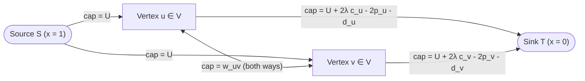

# Wave 3A (Cohort 2: Iterations 73–77) — Duality & Structural Cuts: 0-1 Fractional Programming, Maximum Density Subgraphs, Planar Graph Duality, Min-Cut DP & All-Pairs Cut Trees

> [!IMPORTANT]
> **Cohort 2 Independent Research Monograph (`flows_research/cohort2_iter_73_to_77_density_planar_mincut_dp_gomory_hu.md`)**
> This monograph is the independent Cohort 2 investigation of **Wave 3A (Iterations 73–77)** for the Network Flows, Minimum Cuts, Matching, MCMF, and LP Duality textbook project. Every theoretical framework, reduction, and curated problem strictly enforces the **4-Step "Zero Magic Gadgets" Compilation Standard**:
> 1. **Step 1: Non-Graph Diagnostic Signal (Recognition)** — Why DP/Greedy fail and what surface clues point to the structural duality.
> 2. **Step 2: Intermediate Algebraic / Logical Representation** — Translating the English problem into pseudo-Boolean polynomials, level-set integrals, cycle-cut spaces, or recursive DP recurrences before drawing a single edge.
> 3. **Step 3: Reverse-Engineering Scratchpad (Mechanical Compilation)** — Compiling algebraic terms into exact capacities, dual paths, $(\min, +)$ transition matrices, or Gomory–Hu tree contractions.
> 4. **Step 4: Hand-Checkable Toy Trace & Broken Gadget Counterexamples** — Concrete $N \le 5$ numerical traces and rigorous failure-mode proofs when structural invariants are violated.

---

## Executive Overview: The Two Directions of Structural Cut Duality

In Waves 2A and 2B, our primary trajectory was **Direction A (Non-Graph $\to$ Cut Graph)**: taking linear or piecewise-convex objectives over binary/multi-state variables and compiling them into a single execution of Dinic's algorithm. Wave 3A expands this paradigm along two orthogonal axes that define the upper echelon of competitive programming cut theory:

1. **Direction A+ (Nonlinear Ratio & Density Objectives $\to$ Parametric Minimum Cut — Iterations 73 & 74)**:
   Many natural optimization problems do not maximize a linear sum $A(x) - B(x)$, but rather a **ratio** $\frac{A(x)}{B(x)}$—such as benefit per unit cost, average subgraph degree $\frac{2|E(S)|}{|S|}$, or closure profit per penalty unit. Because a ratio of linear functions is nonlinear, a single min-cut cannot evaluate it directly.
   - In **Iteration 73**, we develop **0-1 Fractional Programming over Minimum Cuts** via Dinkelbach's parametric transform $h(\lambda) = \max_x (A(x) - \lambda B(x))$. We establish the **Submodularity Sign Law**: maximizing $\frac{A(x)}{B(x)}$ is cut-representable if and only if the numerator $A(x)$ is *supermodular* (closure-like) and the denominator $B(x)$ is *submodular* (cut-like) for $\lambda > 0$. We compare Binary Search, Dinkelbach's Newton–Secant method, and Gallo–Grigoriadis–Tarjan (GGT) Parametric Preflow-Push.
   - In **Iteration 74**, we specialize this machinery to the classic **Maximum Density Subgraph (`最大密度子图`)** problem introduced by Goldberg (1984) and popularized in Chinese competitive programming by Hu Botao (`胡伯涛` / Amber, 2007 National Team Monograph). We derive both the $O(|V| + |E|)$-vertex Bipartite Closure network and Goldberg's $O(|V|)$-vertex **Degree-Sum Identity reduction** ($2|E(S)| = \sum_{v \in S} d_v - |\delta(S, \bar{S})|$), extend them to arbitrary vertex- and edge-weighted density models, and prove the exact rational termination gap $\frac{1}{|V|(|V|-1)}$.

2. **Direction B (Flow / Cut $\to$ Fast Non-Flow Algorithms & Compact Trees — Iterations 75, 76 & 77)**:
   When constraints reach $N \le 10^5$ or $N \times M \le 2.5 \times 10^5$, or when a problem asks for all $\binom{N}{2}$ pairwise minimum cuts, running Dinic's algorithm from scratch is either too slow or structurally redundant. By invoking **Max-Flow Min-Cut Duality**, we shift from *pushing flow* to *optimizing or decomposing the cut space*:
   - In **Iteration 75 (Planar Graph Duality)**, we prove that $s$-$t$ Minimum Cuts in planar graphs biject with dual cycles/paths, reducing Max-Flow to **Dijkstra's Shortest Path** in $O(V \log V)$. We dissect two landmark Chinese Olympiad masterpieces: `[NOI2010] 海拔` (proving via the **Coarea Formula** that continuous altitudes $h_{i,j} \in [0,1]$ collapse without loss of optimality to binary $\{0,1\}$ cuts on a directed planar grid) and `[CSP-S 2021] 交通规划` (showing how $k \le 50$ alternating outer-face terminals decompose into $k/2$ non-crossing dual shortest paths solved via Interval DP in $O(k V \log V + k^3)$).
   - In **Iteration 76 (Max-Flow $\to$ Min-Cut DP, Greedy & Segment Trees)**, we eliminate the flow network entirely on dense structured graphs (`CF 724 E — Goods Transportation`), dynamic pipelines (`CF 1919 F2 — Wine Factory (Hard Version)` via $2 \times 2$ $(\min, +)$ matrix multiplication in a Segment Tree), and bounded-treewidth graphs (`[BZOJ 2039] 人员雇佣`).
   - In **Iteration 77 (Global Minimum Cut & All-Pairs Cut Trees)**, we prove the correctness of the **Stoer–Wagner Maximum Adjacency Search (`MAS`)** in $O(VE + V^2 \log V)$ and derive **Gomory–Hu / Gusfield Cut Trees (`最小割树`)** from the submodular uncrossing inequality $c(\delta(A)) + c(\delta(B)) \ge c(\delta(A \cap B)) + c(\delta(A \cup B))$, compressing all $\binom{N}{2}$ pairwise min-cuts into an $N$-node weighted tree using only $N-1$ Max-Flow calls.

---

## Iteration 73: 0-1 Fractional Programming + Minimum Cut (`分数规划最小割` & Dinkelbach / Parametric Search)

### Step 1: Non-Graph Diagnostic Signal (Recognition)

How do you recognize a **0-1 Fractional Programming Minimum Cut** problem from a raw problem statement?

1. **The Structural Clues**:
   - **Quotient / Average Objective**: The problem asks to maximize or minimize a **ratio** of two quantities over a discrete subset selection $S \subseteq \{1, \dots, n\}$ or binary assignment $x \in \{0, 1\}^n$:
     $$\text{maximize } \frac{\text{Total Profit / Benefit } A(x)}{\text{Total Cost / Size / Penalty } B(x)} \quad \text{or} \quad \text{minimize } \frac{\text{Cut Penalty / Cost } C(x)}{\text{Weight / Size } D(x)}.$$
   - **Coupled Pairwise or Implication Structure**: Unlike elementary 0-1 fractional programming (`POJ 2976 Dropping Tests`), where items are independent and sorting by $a_i - \lambda b_i$ solves the parametric subproblem in $O(N \log N)$, here the numerator $A(x)$ or denominator $B(x)$ contains **relational coupling**:
     - Prerequisite / closure constraints: "Choosing project $u$ requires choosing resource $v$" ($x_u \le x_v$).
     - Co-occurrence bonuses: "If both $u$ and $v$ are selected, gain synergy $w_{uv} x_u x_v$".
     - Disagreement / separation penalties: "If $u$ is selected and $v$ is not, pay boundary penalty $c_{uv} x_u(1 - x_v)$".
   - **Constraint Scale**: Typically $N, M \le 300$–$1,500$, allowing $O(\log(\text{precision}))$ or $O(\text{Dinkelbach steps})$ calls to Dinic's algorithm.

2. **Why Naive Greedy and DP Fail**:
   - **Why Sorting by Individual Ratio $a_i / b_i$ Fails**: Because of synergy terms $w_{uv} x_u x_v$ or boundary penalties $c_{uv} x_u(1 - x_v)$, an item $i$ does not have a well-defined standalone ratio; its marginal contribution to both numerator and denominator depends globally on the indicator bits $x_j$ of its neighbors.
   - **Why Dynamic Programming Fails**: Unless the dependency/interaction graph has bounded treewidth or is a 1D interval structure, tracking which subset of neighbors is selected requires exponential state $O(2^{\text{tw}(G)})$. Furthermore, even on a tree, optimizing a ratio $\frac{A}{B}$ directly by DP would require indexing the DP state by the exact integer denominator $B$, which is pseudopolynomial and fails completely when $B_i \le 10^9$.

---

### Step 2: Intermediate Algebraic / Logical Representation

Let $\mathcal{F} \subseteq \{0, 1\}^n$ be the set of feasible binary assignments (encoding hard implication constraints $x_u \le x_v$ and non-triviality $B(x) > 0$). Consider the maximization problem:

$$\lambda^* = \max_{x \in \mathcal{F}} \frac{A(x)}{B(x)}, \qquad \text{assuming } B(x) > 0 \;\;\forall x \in \mathcal{F}.$$

#### 1. The Parametric Bellman–Dinkelbach Transformation

Introduce a real trial parameter $\lambda \in \mathbb{R}$, representing a target ratio threshold. Asking whether the optimal ratio satisfies $\lambda^* \ge \lambda$ is algebraically equivalent to asking whether there exists $x \in \mathcal{F}$ such that:

$$\frac{A(x)}{B(x)} \ge \lambda \stackrel{B(x) > 0}{\Longleftrightarrow} A(x) - \lambda B(x) \ge 0.$$

We therefore define the **Parametric Profit Function** $h(\lambda)$ and its negated **Parametric Cut Function** $g(\lambda)$:

$$h(\lambda) := \max_{x \in \mathcal{F}} \bigl(A(x) - \lambda B(x)\bigr), \qquad g(\lambda) := -h(\lambda) = \min_{x \in \mathcal{F}} \bigl(\lambda B(x) - A(x)\bigr).$$

> [!IMPORTANT]
> **Theorem 73.1 (Fundamental Properties of the Dinkelbach Auxiliary Function $h(\lambda)$)**
> Assume $\mathcal{F}$ is finite and non-empty, and $B(x) > 0$ for all $x \in \mathcal{F}$. Then:
> 1. **Convexity & Piecewise Linearity**: For each fixed $x \in \mathcal{F}$, the map $\lambda \mapsto A(x) - \lambda B(x)$ is an affine line with strictly negative slope $-B(x) < 0$. As the pointwise maximum of finitely many strictly decreasing affine functions, $h(\lambda)$ is **continuous, convex, piecewise-linear, and strictly decreasing** on $\mathbb{R}$ (and $g(\lambda)$ is concave and strictly increasing).
> 2. **Unique Root Characterization (The 3-Way Sign Test)**: Because $h(\lambda)$ is continuous and strictly decreasing with $\lim_{\lambda \to -\infty} h(\lambda) = +\infty$ and $\lim_{\lambda \to +\infty} h(\lambda) = -\infty$, it has a **unique real root** $\lambda^*$, and:
>    $$\begin{aligned}
>    h(\lambda) > 0 \quad (\text{i.e., } g(\lambda) < 0) &\iff \lambda < \lambda^* \quad (\text{trial ratio } \lambda \text{ is strictly improvable}), \\
>    h(\lambda) = 0 \quad (\text{i.e., } g(\lambda) = 0) &\iff \lambda = \lambda^* \quad (\text{trial ratio } \lambda \text{ is optimal}), \\
>    h(\lambda) < 0 \quad (\text{i.e., } g(\lambda) > 0) &\iff \lambda > \lambda^* \quad (\text{trial ratio } \lambda \text{ is infeasible}).
>    \end{aligned}$$
> 3. **Subgradient Bounds**: If $x_\lambda \in \arg\max_{x \in \mathcal{F}} (A(x) - \lambda B(x))$, then for any $\lambda' \in \mathbb{R}$, $h(\lambda') \ge A(x_\lambda) - \lambda' B(x_\lambda) = h(\lambda) - (\lambda' - \lambda) B(x_\lambda)$. In particular, setting $\lambda' = \frac{A(x_\lambda)}{B(x_\lambda)}$ yields the secant update $\lambda' = \lambda + \frac{h(\lambda)}{B(x_\lambda)}$.

*Proof*:
(1) For any $\theta \in [0, 1]$ and $\lambda_1, \lambda_2 \in \mathbb{R}$, each affine component $L_x(\lambda) = A(x) - \lambda B(x)$ satisfies $L_x(\theta \lambda_1 + (1-\theta)\lambda_2) = \theta L_x(\lambda_1) + (1-\theta) L_x(\lambda_2) \le \theta h(\lambda_1) + (1-\theta) h(\lambda_2)$. Taking the maximum over $x \in \mathcal{F}$ proves convexity of $h(\lambda)$. If $\lambda_1 < \lambda_2$ and $x^* \in \arg\max_{x \in \mathcal{F}} L_x(\lambda_2)$, then $h(\lambda_2) = A(x^*) - \lambda_2 B(x^*) < A(x^*) - \lambda_1 B(x^*) \le h(\lambda_1)$ since $B(x^*) > 0$ and $\lambda_2 - \lambda_1 > 0$.
(2) Immediate from $h(\lambda) \ge 0 \iff \exists x \in \mathcal{F}, A(x) - \lambda B(x) \ge 0 \iff \exists x \in \mathcal{F}, \frac{A(x)}{B(x)} \ge \lambda \iff \lambda^* \ge \lambda$, combined with strict monotonicity. $\blacksquare$

---

#### 2. The Submodularity Sign Law: When is $g(\lambda)$ Cut-Representable?

Reducing the ratio problem to $g(\lambda) = \min_{x \in \mathcal{F}} \bigl(\lambda B(x) - A(x)\bigr)$ only helps if the inner minimization can be solved in polynomial time via a Minimum $s$-$t$ Cut! Recall from Wave 2A that a pseudo-Boolean function $\Phi(x) : \{0, 1\}^n \to \mathbb{R}$ can be compiled into an $s$-$t$ cut network (without bipartite variable flipping) if and only if $\Phi(x)$ is **submodular** (or **reducible** via auxiliary closure variables to a submodular quadratic polynomial):

$$\forall u \neq v, \qquad \Delta_{u,v} \Phi := \Phi(1_u, 1_v) + \Phi(0_u, 0_v) - \Phi(1_u, 0_v) - \Phi(0_u, 1_v) \le 0.$$

Applying this second-difference operator to $\Phi_\lambda(x) = \lambda B(x) - A(x)$ (assuming $\lambda > 0$, which holds whenever the optimal ratio is positive or after adding a constant offset to $A(x)/B(x)$) gives:

$$\Delta_{u,v} \Phi_\lambda = \lambda \cdot \Delta_{u,v} B - \Delta_{u,v} A \le 0.$$

For this inequality to hold reliably across positive $\lambda > 0$, we obtain the **Submodularity Sign Law for Fractional Cuts**:

| Role in Ratio | Maximization $\max_x \frac{A(x)}{B(x)}$ ($\lambda > 0$) | Minimization $\min_x \frac{C(x)}{D(x)}$ ($\lambda > 0$) | Allowed Algebraic Terms (with non-negative weights) |
| :--- | :--- | :--- | :--- |
| **Numerator** | $A(x)$ must be **Supermodular** ($\Delta_{u,v} A \ge 0$) or **Modular** (Linear) | $C(x)$ must be **Submodular** ($\Delta_{u,v} C \le 0$) or **Modular** (Linear) | **Supermodular ($A, D$)**: $\sum_i a_i x_i + \sum_{e} w_e \prod_{v \in e} x_v + \sum_{f} \tilde{w}_f \prod_{v \in f} (1 - x_v) - \sum_{u,v} p_{uv} x_u(1 - x_v)$ |
| **Denominator** | $B(x)$ must be **Submodular** ($\Delta_{u,v} B \le 0$) or **Modular** (Linear) | $D(x)$ must be **Supermodular** ($\Delta_{u,v} D \ge 0$) or **Modular** (Linear) | **Submodular ($B, C$)**: $\sum_i b_i x_i + \sum_{u,v} q_{uv} x_u(1 - x_v) + \sum_{e} c_e \bigl(1 - \prod_{v \in e} x_v\bigr) + \sum_f \tilde{c}_f \bigl(1 - \prod_{v \in f} (1 - x_v)\bigr)$ |

> [!TIP]
> **Quick Mental Check for Contest Modelling**
> - **Can we maximize $\frac{\text{Closure Profit}}{\text{Vertex Cost + Cut Penalty}}$?** **YES!** Closure profit $\sum w_e \min_{v \in e} x_v$ is supermodular, and vertex cost + cut penalty $\sum b_i x_i + \sum q_{uv} x_u(1 - x_v)$ is submodular. Thus $\lambda B(x) - A(x)$ is submodular and compiles directly to a Min-Cut!
> - **Can we minimize $\frac{\text{Cut Capacity } c(\delta(S, T))}{\text{Vertex Weight}}$?** **YES!** Cut capacity is submodular and positive vertex weight is linear (hence both submodular and supermodular), provided we constrain $S$ appropriately.
> - **Can we minimize $\frac{c(\delta(S, \bar{S}))}{|S| \cdot |\bar{S}|}$ (Sparsest Cut) or maximize $\frac{c(\delta(S, \bar{S}))}{|S|}$?** **NO!** Both are NP-hard because the cut penalty appears with the wrong sign or the denominator $|S|(n - |S|) = n \sum x_i - (\sum x_i)^2$ is submodular instead of supermodular in a minimization problem!

---

### Step 3: Reverse-Engineering Scratchpad (Mechanical Graph Compilation)

Suppose we are maximizing $\frac{A(x)}{B(x)}$ where:
- $A(x) = \sum_{i=1}^n a_i x_i + \sum_{e \in E_{\text{syn}}} w_e \min_{v \in e} x_v - \sum_{(u,v)} p_{uv} x_u(1 - x_v)$ with $w_e \ge 0, p_{uv} \ge 0$,
- $B(x) = \sum_{i=1}^n b_i x_i + \sum_{e \in E_{\text{syn}}} \beta_e \min_{v \in e} x_v + \sum_{(u,v)} q_{uv} x_u(1 - x_v)$ with $q_{uv} \ge 0$,
Note: if a subset $e \in E_{\text{syn}}$ has both profit $w_e$ and cost $\beta_e$, its net weight at parameter $\lambda$ is $w_e(\lambda) = w_e - \lambda \beta_e$. As long as $w_e - \lambda \beta_e \ge 0$, it remains supermodular!

Let us mechanically compile $g(\lambda) = \min_{x \in \{0,1\}^n} \bigl(\lambda B(x) - A(x)\bigr)$ into an $s$-$t$ cut network where $x_i = 1 \iff i \in S$ and $x_i = 0 \iff i \in T$:

1. **Collect Linear Coefficients on Individual Vertices $x_i$**:
   In $\lambda B(x) - A(x)$, the coefficient of $x_i$ is $\gamma_i(\lambda) := \lambda b_i - a_i$.
   - **Case 1 ($\gamma_i(\lambda) \ge 0$, i.e., $\lambda b_i \ge a_i$)**: Putting $i \in S$ ($x_i = 1$) incurs a non-negative cost $\gamma_i(\lambda) x_i = \gamma_i(\lambda) x_i (1 - x_T)$.
     $\implies$ Add directed edge $i \to T$ with capacity $\lambda b_i - a_i$.
   - **Case 2 ($\gamma_i(\lambda) < 0$, i.e., $\lambda b_i < a_i$)**: Rewrite using $x_i = 1 - (1 - x_i)$:
     $$\gamma_i(\lambda) x_i = -|\gamma_i(\lambda)| + |\gamma_i(\lambda)| x_S (1 - x_i).$$
     $\implies$ Add $- (a_i - \lambda b_i)$ to the constant base offset $C_0(\lambda)$, and add directed edge $S \to i$ with capacity $a_i - \lambda b_i$.

2. **Compile Synergy / Closure Hyperedges $e \in E_{\text{syn}}$ (when $w_e(\lambda) = w_e - \lambda \beta_e > 0$)**:
   Introduce an auxiliary vertex $y_e \in \{0, 1\}$. In $\lambda B(x) - A(x)$, we have the term $-w_e(\lambda) \min_{v \in e} x_v$, which we rewrite as:
   $$-w_e(\lambda) + w_e(\lambda) x_S (1 - y_e) + \sum_{v \in e} \infty \cdot y_e (1 - x_v).$$
   $\implies$ Subtract $w_e(\lambda)$ from $C_0(\lambda)$, add directed edge $S \to y_e$ with capacity $w_e(\lambda)$, and add directed edges $y_e \to v$ with capacity $\infty$ for all $v \in e$.

3. **Compile Pairwise Separation Penalties $(p_{uv} + \lambda q_{uv}) x_u (1 - x_v)$**:
   Since $p_{uv} + \lambda q_{uv} \ge 0$ for $\lambda \ge 0$:
   $\implies$ Add directed edge $u \to v$ with capacity $p_{uv} + \lambda q_{uv}$.

4. **Evaluate $h(\lambda)$ from the Minimum Cut**:
   $$\text{MinCut}(\lambda) = g(\lambda) - C_0(\lambda) \implies h(\lambda) = -g(\lambda) = -C_0(\lambda) - \text{MinCut}(\lambda) = \sum_{i : a_i > \lambda b_i} (a_i - \lambda b_i) + \sum_{e : w_e > \lambda \beta_e} (w_e - \lambda \beta_e) - \text{MinCut}(\lambda).$$

---

#### 3. Comparing the Three Algorithmic Engines for Root-Finding ($h(\lambda^*) = 0$)

Once the cut compiler for a fixed $\lambda$ is ready, we have three distinct ways to find $\lambda^*$:

| Algorithmic Engine | Mechanism | Number of Max-Flow / Preflow Calls | Best Use Case in Competitive Programming |
| :--- | :--- | :--- | :--- |
| **1. Binary Search on $\lambda$** | Maintain $[\lambda_{\text{low}}, \lambda_{\text{high}}]$; test $\lambda_{\text{mid}} = \frac{\lambda_{\text{low}} + \lambda_{\text{high}}}{2}$; if $h(\lambda_{\text{mid}}) \ge 0$ set $\lambda_{\text{low}} \gets \lambda_{\text{mid}}$, else $\lambda_{\text{high}} \gets \lambda_{\text{mid}}$. | $\left\lceil \log_2 \frac{\lambda_{\max} - \lambda_{\min}}{\Delta_{\min}} \right\rceil = O(\log(A_{\max} B_{\max}))$ calls (typically $40$–$60$ calls). | Always works, even if $w_e(\lambda)$ changes sign or graph structure varies non-monotonically with $\lambda$. |
| **2. Dinkelbach's Secant Algorithm (1967)** | Start at any feasible $x^{(0)} \in \mathcal{F}$. Repeat: set $\lambda_k = \frac{A(x^{(k)})}{B(x^{(k)})}$; run Min-Cut at $\lambda_k$ to find optimal $S$-set $x^{(k+1)}$; stop when $h(\lambda_k) \le \epsilon$ or $x^{(k+1)}$ gives $\lambda_{k+1} = \lambda_k$. | At most $O(N \log(N A_{\max} B_{\max}))$ worst-case (Radzik 1993); in practice **$4$–$10$ Dinic calls**! | When you have an easy initial feasible subset $x^{(0)}$ (e.g., $x^{(0)} = \mathbf{1}$) and want a $5\times$–$10\times$ constant-factor speedup over Binary Search. |
| **3. Gallo–Grigoriadis–Tarjan (GGT 1989) Parametric Preflow-Push** | Requires source capacities $c(S, v, \lambda)$ to be non-increasing in $\lambda$ and sink capacities $c(v, T, \lambda)$ to be non-decreasing in $\lambda$. Then minimal min-cuts nest: $S(\lambda_1) \supseteq S(\lambda_2)$ for $\lambda_1 < \lambda_2$. Reuses preflows across all $\lambda$ via divide-and-conquer / parallel search. | Equivalent to **1 single Push-Relabel Max-Flow** ($O(V^2 E)$ or $O(V^3)$ total time across all $\lambda$)! | When $N \le 2,000$ is too tight for $50$ independent Dinic runs, or when you need **all** extreme breakpoints on the upper hull of $(B(x), A(x))$. |

Let us prove why **Dinkelbach's Algorithm** converges so rapidly:

> [!NOTE]
> **Proposition 73.2 (Strict Monotonicity & Superlinear Convergence of Dinkelbach's Method)**
> Let $x^{(k)} \in \mathcal{F}$ with $\lambda_k = \frac{A(x^{(k)})}{B(x^{(k)})} < \lambda^*$, and let $x^{(k+1)} \in \arg\max_{x \in \mathcal{F}} (A(x) - \lambda_k B(x))$. Then:
> 1. **Strict Ratio Increase**: $\lambda_{k+1} = \frac{A(x^{(k+1)})}{B(x^{(k+1)})} > \lambda_k$.
> 2. **Strict Denominator Decrease on Non-Optimal Steps**: For any $x^* \in \arg\max_{x \in \mathcal{F}} \frac{A(x)}{B(x)}$,
>    $$0 < \lambda^* - \lambda_{k+1} \le (\lambda^* - \lambda_k) \left(1 - \frac{B(x^*)}{B(x^{(k+1)})}\right).$$
>    Moreover, $h(\lambda_{k+1}) = A(x^{(k+2)}) - \lambda_{k+1} B(x^{(k+2)}) \le h(\lambda_k) \left(1 - \frac{B(x^{(k+2)})}{B(x^{(k+1)})}\right)$, which forces either $B(x^{(k+1)})$ to strictly decrease ($B(x^{(k+2)}) < B(x^{(k+1)})$) or $h(\lambda)$ to shrink geometrically!

*Proof*:
(1) Since $\lambda_k < \lambda^*$, Theorem 73.1 gives $h(\lambda_k) = A(x^{(k+1)}) - \lambda_k B(x^{(k+1)}) > 0$. Dividing by $B(x^{(k+1)}) > 0$ yields $\lambda_{k+1} = \frac{A(x^{(k+1)})}{B(x^{(k+1)})} > \lambda_k$.
(2) By optimality of $x^{(k+1)}$ at parameter $\lambda_k$, we have $A(x^{(k+1)}) - \lambda_k B(x^{(k+1)}) \ge A(x^*) - \lambda_k B(x^*) = (\lambda^* - \lambda_k) B(x^*)$. Since $A(x^{(k+1)}) = \lambda_{k+1} B(x^{(k+1)})$, the left-hand side is $(\lambda_{k+1} - \lambda_k) B(x^{(k+1)})$. Dividing by $B(x^{(k+1)})$ gives $\lambda_{k+1} - \lambda_k \ge (\lambda^* - \lambda_k) \frac{B(x^*)}{B(x^{(k+1)})}$, and subtracting both sides from $\lambda^* - \lambda_k$ yields the claimed inequality. $\blacksquare$

---

### Step 4: Hand-Checkable Toy Trace & Broken Gadget Counterexamples

#### 1. Hand-Checkable Toy Trace ($N = 3$ Projects with Dependency & Cut Penalty)

Suppose we have $3$ projects with profits $a = (10, 8, 12)$ and costs $b = (2, 3, 5)$.
- Project $1$ requires Project $2$ ($x_1 \le x_2$).
- Selecting Project $2$ without Project $3$ incurs a boundary transition penalty of $4 \cdot x_2(1 - x_3)$ subtracted from the numerator $A(x)$.
- We must select at least one project ($x \neq \mathbf{0}$).
Thus:
$$A(x) = 10 x_1 + 8 x_2 + 12 x_3 - 4 x_2(1 - x_3), \qquad B(x) = 2 x_1 + 3 x_2 + 5 x_3, \qquad \text{subject to } x_1(1 - x_2) = 0, \; x \neq (0,0,0).$$

Let us trace **Dinkelbach's Algorithm** starting from the full set $x^{(0)} = (1, 1, 1)$:
- **Iteration 0**:
  $A(1,1,1) = 10 + 8 + 12 - 0 = 30$, $B(1,1,1) = 2 + 3 + 5 = 10 \implies \lambda_0 = \frac{30}{10} = 3.0$.
  Compile the network at $\lambda_0 = 3.0$:
  - Linear net profits $a_i - \lambda_0 b_i$:
    - Node $1$: $10 - 3(2) = +4 > 0 \implies$ edge $S \to 1$ of capacity $4$, base profit $+4$.
    - Node $2$: $8 - 3(3) = -1 < 0 \implies$ edge $2 \to T$ of capacity $1$.
    - Node $3$: $12 - 3(5) = -3 < 0 \implies$ edge $3 \to T$ of capacity $3$.
  - Pairwise & dependency edges:
    - $x_1 \le x_2 \implies$ edge $1 \to 2$ of capacity $\infty$.
    - Penalty $4 x_2(1 - x_3) \implies$ edge $2 \to 3$ of capacity $4$.
  - Evaluate all valid closures $S \subseteq \{1, 2, 3\}$:
    - $S = \emptyset$: Cut edge $S \to 1$ (cap $4$) $\implies \text{Cut} = 4 \implies h(3) = 4 - 4 = 0$.
    - $S = \{2\}$: Cut $S \to 1$ ($4$), $2 \to T$ ($1$), $2 \to 3$ ($4$) $\implies \text{Cut} = 9$.
    - $S = \{1, 2\}$: Cut $2 \to T$ ($1$) and $2 \to 3$ ($4$) $\implies \text{Cut} = 5 \implies A - 3B = 4 - 5 = -1$.
    - $S = \{1, 2, 3\}$: Cut $2 \to T$ ($1$) and $3 \to T$ ($3$) $\implies \text{Cut} = 4 \implies A - 3B = 4 - 4 = 0$.
  Since the maximum of $A(x) - 3 B(x)$ over non-empty feasible $x$ is $0$ (achieved at $S = \{1, 2, 3\}$), Dinkelbach terminates immediately in **1 Min-Cut verification**: $\lambda^* = 3.0$ with optimal subset $S^* = \{1, 2, 3\}$!
  *(Notice what happens if the boundary penalty $4 x_2(1 - x_3)$ were $1 x_2(1 - x_3)$ instead: then $S = \{1, 2\}$ would have cut $1 + 1 = 2 < 4$, giving $h(3.0) = 4 - 2 = +2 > 0$, and Dinkelbach would jump to $x^{(1)} = (1, 1, 0)$ with $\lambda_1 = \frac{10 + 8 - 1}{2 + 3} = \frac{17}{5} = 3.4$, converging in 2 steps!)*

---

#### 2. Broken Gadget Counterexamples & Subtle Failure Modes

> [!WARNING]
> **Failure Mode 73.1: The Trivial Empty Cut Masking Negative Ratios ($\lambda^* < 0$ or $x = \mathbf{0}$)**
> In any network compiled from $g(\lambda) = \min_x (\lambda B(x) - A(x))$ where $A(\mathbf{0}) = B(\mathbf{0}) = 0$, the empty selection $x = \mathbf{0}$ ($S = \emptyset$) is ALWAYS a valid cut of value $g(\lambda; \mathbf{0}) = 0$.
> - **What Breaks**:
>   1. If all non-empty feasible subsets have negative net profit ($A(x) < 0$ for all $x \neq \mathbf{0}$), then $\lambda^* < 0$. However, for any $\lambda$, $x = \mathbf{0}$ achieves $A(\mathbf{0}) - \lambda B(\mathbf{0}) = 0$, so an unconstrained Min-Cut always returns $h(\lambda) = 0$ via $S = \emptyset$, completely masking the true non-empty optimum!
>   2. Even when $\lambda^* > 0$, at the exact root $\lambda = \lambda^*$, both $x = \mathbf{0}$ and $x = x^*$ achieve objective $0$. A standard residual $S$-reachability DFS from $S$ finds the **unique minimal $S$-cut**, which at $\lambda = \lambda^*$ is $S = \emptyset$!
> - **The Fix**:
>   - When $\lambda^* > 0$ is guaranteed (e.g., at least one feasible closure has $A(x) > 0$), run binary search down to interval $[\lambda_{\text{low}}, \lambda_{\text{high}}]$ of width $< \Delta_{\min}$, and **always reconstruct the vertex set $S^*$ at $\lambda = \lambda_{\text{low}}$** (where $h(\lambda_{\text{low}}) > 0$ strictly beats $x = \mathbf{0}$), or reconstruct using the **maximal $S$-cut** (vertices that *cannot* reach $T$ in the residual graph).
>   - If $\lambda^* \le 0$ is possible, either select the best single closure explicitly or run $N$ forced cuts (or tree/component reductions) where at least one root vertex $r$ has $x_r = 1$.

> [!WARNING]
> **Failure Mode 73.2: Floating-Point Dinic Infinite Loops (`eps_flow` vs. `eps_bs`)**
> In fractional programming, edge capacities depend continuously on $\lambda \in \mathbb{R}$.
> - **What Breaks**: If your binary search uses `eps_bs = 1e-9` and your Dinic implementation tests whether an edge has residual capacity via `if (e.cap > 0)` or `if (e.cap > 1e-9)`, two catastrophic bugs occur:
>   1. With `e.cap > 0`, IEEE-754 rounding errors during augmentation ($c - (c - 10^{-17}) = 10^{-17} > 0$) leave phantom capacities of $10^{-16}$, causing Dinic's BFS/DFS to augment along zero-capacity paths millions of times and **TLE**.
>   2. With `e.cap > eps_bs` (same epsilon as binary search), $O(V)$ edges on a min-cut can each lose `eps_bs` of flow, corrupting $\text{MinCut}(\lambda)$ by $O(V \cdot \text{eps\_bs}) > \text{eps\_bs}$ and flipping the sign of $h(\lambda)$ near $\lambda^*$!
> - **The Fix**: Always enforce a **two-scale epsilon hierarchy**:
>   $$\varepsilon_{\text{flow}} = 10^{-11} \ll \varepsilon_{\text{cut\_sign}} = 10^{-8} \ll \Delta_{\min} \approx \frac{1}{B_{\max}^2},$$
>   or scale all capacities at a rational trial point $\lambda = p/q$ by multiplying by $q$ so Dinic runs in **exact 64-bit integers (`int64_t`)**!

---

## Iteration 74: Maximum Density Subgraph (`最大密度子图` — Goldberg 1984 & Amber / 胡伯涛 2007 Monograph)

### Step 1: Non-Graph Diagnostic Signal (Recognition)

1. **The Archetypal Problem Statement**:
   Given an undirected graph $G = (V, E)$ (possibly with edge weights $w_e > 0$, vertex profits $p_v$, and vertex costs $c_v > 0$), find a non-empty subset of vertices $S \subseteq V$ ($S \neq \emptyset$) that maximizes the **induced subgraph density**:
   $$D(S) = \frac{|E(S)|}{|S|} \qquad \text{or generally} \qquad D_{w,p,c}(S) = \frac{\sum_{e \in E(S)} w_e + \sum_{v \in S} p_v}{\sum_{v \in S} c_v},$$
   where $E(S) = \{e = (u, v) \in E : u \in S \text{ and } v \in S\}$ is the set of edges with **both** endpoints inside $S$.

2. **Surface Clues & Disguises**:
   - *"Find the most tightly knit community / team where the average number of internal friendships per member is maximized"* (`POJ 3155 Hard Life`).
   - *"Each machine $v$ costs $c_v$ to rent, each task $e=(u,v)$ yields profit $w_e$ if both machines $u, v$ are rented; maximize profit-to-cost ratio"*.
   - *"Given a graph, check whether it is an **arboricity-$k$ decomposable** graph (Nash-Williams Theorem: a graph can be partitioned into $k$ forests iff $\max_{\emptyset \neq S \subseteq V} \frac{|E(S)|}{|S|-1} \le k$)"*!
   - **Why Peeling / Greedy Degree Removal Fails for Exact Maximum Density**: The famous Charikar (2000) greedy peeling algorithm (repeatedly deleting the vertex of minimum current degree) is only a **$2$-approximation**! For example, take two disjoint cliques $K_{d+1}$ (degree $d$, density $\frac{d}{2}$) and a huge complete bipartite graph $K_{d+1, D}$ with $D \gg d^2$ (minimum degree $d+1$, density $\approx \frac{(d+1)D}{D} = d+1$ when $d+1 > \frac{d}{2}$, or if we set bipartite sides $(a, b)$ so minimum degree is slightly higher than the clique's degree while average degree is lower—Wait: in $K_{a,b}$, average degree is $\frac{2ab}{a+b}$ and min degree is $\min(a,b)$; if we attach paths or trees of degree $d$ to a dense core, greedy peeling makes locally myopic choices when weighted or degree-constrained, and for general degree-modified objectives $|E(S)| / (|S|-1)$ or weighted vertices, peeling fails to find the exact optimum).

---

### Step 2: Intermediate Algebraic / Logical Representation

Assign a binary indicator variable $x_v \in \{0, 1\}$ to each vertex $v \in V$, where $x_v = 1 \iff v \in S$.
An edge $e = (u, v) \in E$ lies in the induced subgraph $E(S)$ if and only if $x_u = 1$ and $x_v = 1$, i.e., $x_u x_v = 1$.
Thus the weighted density problem is the 0-1 Fractional Program:

$$\lambda^* = \max_{\substack{x \in \{0,1\}^V \\ x \neq \mathbf{0}}} \frac{\sum_{e=(u,v) \in E} w_e x_u x_v + \sum_{v \in V} p_v x_v}{\sum_{v \in V} c_v x_v}.$$

By Theorem 73.1, for a fixed trial ratio $\lambda$, we want to evaluate:
$$h(\lambda) = \max_{x \in \{0,1\}^V} \left(\sum_{e=(u,v) \in E} w_e x_u x_v + \sum_{v \in V} (p_v - \lambda c_v) x_v\right) = - \min_{x \in \{0,1\}^V} g(\lambda; x),$$
where $g(\lambda; x) := \sum_{v \in V} (\lambda c_v - p_v) x_v - \sum_{e=(u,v) \in E} w_e x_u x_v$.

Because $w_e > 0$, the quadratic term $-w_e x_u x_v$ has second difference $\Delta_{u,v}(-w_e x_u x_v) = -w_e < 0$, so $g(\lambda; x)$ is **strictly submodular**! We can compile $g(\lambda; x)$ into a Minimum Cut in two fundamentally different ways:

---

#### Model I: The Bipartite Edge-Vertex Closure Reduction ($|V| + |E|$ Vertices)

Treat each edge $e = (u, v) \in E$ as a project with profit $w_e > 0$ that requires both endpoints $u$ and $v$ to be selected ($y_e \in \{0, 1\}$ with $y_e \le x_u$ and $y_e \le x_v$):

$$g_{\text{closure}}(\lambda; x, y) = -\sum_{e \in E} w_e + \sum_{e \in E} w_e (1 - y_e) + \sum_{e=(u,v) \in E} \infty \cdot \bigl(y_e(1 - x_u) + y_e(1 - x_v)\bigr) + \sum_{v \in V} (\lambda c_v - p_v) x_v.$$

- **Pros**: Conceptually immediate; generalizes effortlessly to **$k$-uniform hypergraphs** ($e = (v_1, \dots, v_k)$ requires $y_e \le x_{v_i}$ for all $i=1,\dots,k$).
- **Cons**: Creates $|V| + |E| + 2$ vertices and $3|E| + |V|$ directed edges. On a dense graph with $|V| = 1,000$ and $|E| = 2 \times 10^5$, a network with $2 \times 10^5$ vertices is far too slow for $40$ binary search iterations!

---

#### Model II: Goldberg's (1984) & Amber's (2007) Degree-Sum Identity Reduction ($|V|$ Vertices Only!)

Can we eliminate all $|E|$ edge-indicator variables $y_e$ and compile $g(\lambda; x)$ directly on the original vertex set $V$?
Yes! The key is a foundational algebraic identity linking **induced internal edges** $E(S)$, **vertex degrees** $d_v$, and **cut boundary edges** $\delta(S, \bar{S})$.

> [!IMPORTANT]
> **Theorem 74.1 (The Induced-Edge Degree-Cut Identity)**
> For any undirected edge-weighted graph $G = (V, E, w)$ with weighted vertex degrees $d_v := \sum_{e \ni v} w_e$, and any vertex subset $S \subseteq V$ with indicator vector $x \in \{0, 1\}^V$:
> $$2 \sum_{e=(u,v) \in E} w_e x_u x_v = \sum_{v \in V} d_v x_v - \sum_{e=(u,v) \in E} w_e \bigl(x_u(1 - x_v) + x_v(1 - x_u)\bigr),$$
> or in combinatorial set notation:
> $$2 w(E(S)) = \sum_{v \in S} d_v - w(\delta(S, \bar{S})).$$

*Proof (Double Counting & Algebraic Identity)*:
1. **Combinatorial Double Count**: Summing the weighted degrees $\sum_{v \in S} d_v$ counts every edge $e = (u, v)$ according to how many of its endpoints lie in $S$:
   - Every internal edge $e \in E(S)$ has **both** endpoints in $S$, so its weight $w_e$ is counted **twice** in $\sum_{v \in S} d_v$.
   - Every boundary edge $e \in \delta(S, \bar{S})$ has **exactly one** endpoint in $S$, so its weight $w_e$ is counted **once** in $\sum_{v \in S} d_v$.
   - Every external edge $e \in E(\bar{S})$ has **zero** endpoints in $S$.
   Therefore, $\sum_{v \in S} d_v = 2 w(E(S)) + w(\delta(S, \bar{S}))$, which rearranges to $2 w(E(S)) = \sum_{v \in S} d_v - w(\delta(S, \bar{S}))$.
2. **Algebraic Verification on Each Edge**: For any binary variables $x_u, x_v \in \{0, 1\}$, expand the right-hand side for a single edge $(u, v)$:
   $$x_u + x_v - \bigl(x_u(1 - x_v) + x_v(1 - x_u)\bigr) = x_u + x_v - (x_u - x_u x_v + x_v - x_u x_v) = 2 x_u x_v.$$
   Multiplying by $w_e$ and summing over all $e = (u, v) \in E$ yields $\sum_{e=(u,v)} w_e (x_u + x_v) = \sum_{v \in V} d_v x_v$, completing the proof. $\blacksquare$

Now substitute $\sum_{e=(u,v)} w_e x_u x_v = \frac{1}{2} \sum_{v \in V} d_v x_v - \frac{1}{2} \sum_{e=(u,v)} w_e \bigl(x_u(1 - x_v) + x_v(1 - x_u)\bigr)$ directly into $g(\lambda; x)$:

$$g(\lambda; x) = \sum_{v \in V} \left(\lambda c_v - p_v - \frac{1}{2} d_v\right) x_v + \frac{1}{2} \sum_{e=(u,v) \in E} w_e \bigl(x_u(1 - x_v) + x_v(1 - x_u)\bigr).$$

To avoid fractions when $w_e, p_v, c_v$ are integers (or simplemente to keep capacities clean), we can either work directly with $\frac{1}{2}$ or multiply the entire objective by $2$:

$$2 g(\lambda; x) = \sum_{v \in V} (2\lambda c_v - 2p_v - d_v) x_v + \sum_{e=(u,v) \in E} w_e \bigl(x_u(1 - x_v) + x_v(1 - x_u)\bigr).$$

Finally, notice that $2\lambda c_v - 2p_v - d_v$ can be negative when $d_v + 2p_v > 2\lambda c_v$. Following Hu Botao's (Amber 2007) uniform shift convention, choose a constant $U \ge \max_{v \in V} (d_v + 2p_v)$ (for standard unweighted density where $p_v = 0, c_v = 1, w_e = 1$, simply take $U = |E|$ or $U = \max_{v} d_v$) and use $x_v = 1 - (1 - x_v)$ to write:

$$\begin{aligned}
2 g(\lambda; x) + U|V| &= \sum_{v \in V} U (1 - x_v) + \sum_{v \in V} (U + 2\lambda c_v - 2p_v - d_v) x_v + \sum_{e=(u,v) \in E} w_e \bigl(x_u(1 - x_v) + x_v(1 - x_u)\bigr) \\
&= \underbrace{\sum_{v \in V} U x_S(1 - x_v)}_{\text{Cut edges } S \to v} + \underbrace{\sum_{v \in V} (U + 2\lambda c_v - 2p_v - d_v) x_v(1 - x_T)}_{\text{Cut edges } v \to T} + \underbrace{\sum_{e=(u,v) \in E} w_e \bigl(x_u(1 - x_v) + x_v(1 - x_u)\bigr)}_{\text{Bidirected edges } u \leftrightarrow v}.
\end{aligned}$$

Every single coefficient is now **strictly non-negative** for all $\lambda \ge 0$!

---

### Step 3: Reverse-Engineering Scratchpad (Graph Compilation & Rational Gap Proof)

Let us summarize the exact graph compilation for **Model II (Goldberg–Amber $|V|$-Vertex Network)** on $G = (V, E, w, p, c)$ at trial ratio $\lambda \ge 0$ (using the factor-$1$ scaling, or factor-$2$ scaling to avoid $0.5$):

| Directed Edge | Capacity (Factor-$2$ Scaled) | Capacity (Unscaled Standard $w_e=1, p_v=0, c_v=1$) | Cut Interpretation ($S$-set = chosen subgraph $S \cup \{s\}$) |
| :--- | :--- | :--- | :--- |
| $s \to v$ ($\forall v \in V$) | $U$ | $U = |E|$ (or $\max_v d_v$) | Cut if $v \notin S$ ($x_v = 0$). Contributes $U(1 - x_v)$. |
| $v \to t$ ($\forall v \in V$) | $U + 2\lambda c_v - 2p_v - d_v$ | $U + 2\lambda - d_v$ | Cut if $v \in S$ ($x_v = 1$). Contributes $(U + 2\lambda c_v - 2p_v - d_v) x_v$. |
| $u \to v$ and $v \to u$ ($\forall (u,v) \in E$) | $w_{uv}$ (each direction) | $1$ (each direction) | Cut if $u \in S, v \notin S$ (or vice versa). Contributes $w(\delta(S, \bar{S}))$. |

**Decision Rule from $\text{MinCut}(\lambda)$**:
$$\text{MinCut}(\lambda) = U|V| + 2 g(\lambda) \implies h(\lambda) = -g(\lambda) = \frac{U|V| - \text{MinCut}(\lambda)}{2}.$$
- If $\text{MinCut}(\lambda) < U|V|$ (i.e., $h(\lambda) > 0$): $\lambda < \lambda^*$ is **feasible** $\implies$ raise $\lambda_{\text{low}} \gets \lambda$.
- If $\text{MinCut}(\lambda) \ge U|V|$ (i.e., $h(\lambda) \le 0$): $\lambda \ge \lambda^*$ $\implies$ lower $\lambda_{\text{high}} \gets \lambda$.

---

#### Exact Rational Termination Gap for Unweighted Maximum Density Subgraph

> [!IMPORTANT]
> **Proposition 74.2 (Exact Minimum Gap Between Distinct Subgraph Densities)**
> In an unweighted graph $G = (V, E)$ with $|V| = n \ge 2$, let $S_1, S_2 \subseteq V$ be two non-empty vertex subsets with distinct densities $\frac{|E(S_1)|}{|S_1|} \neq \frac{|E(S_2)|}{|S_2|}$. Then:
> $$\left|\frac{|E(S_1)|}{|S_1|} - \frac{|E(S_2)|}{|S_2|}\right| \ge \frac{1}{n(n - 1)}.$$

*Proof*:
Let $k_1 = |S_1| \in \{1, \dots, n\}$ and $k_2 = |S_2| \in \{1, \dots, n\}$. Since $|E(S_1)|$ and $|E(S_2)|$ are integers and the two fractions are unequal, the numerator of their difference $\bigl||E(S_1)| k_2 - |E(S_2)| k_1\bigr|$ is a positive integer $\ge 1$.
- **Case 1 ($k_1 \neq k_2$)**: Then $\max(k_1, k_2) \le n$ and $\min(k_1, k_2) \le n - 1$, so $k_1 k_2 \le n(n - 1)$, yielding:
  $$\left|\frac{|E(S_1)|}{k_1} - \frac{|E(S_2)|}{k_2}\right| = \frac{\bigl||E(S_1)| k_2 - |E(S_2)| k_1\bigr|}{k_1 k_2} \ge \frac{1}{n(n - 1)}.$$
- **Case 2 ($k_1 = k_2 = k$)**: Since the fractions have the same denominator $k \le n$ and are distinct integers over $k$, their difference is directly $\frac{\bigl||E(S_1)| - |E(S_2)|\bigr|}{k} \ge \frac{1}{k} \ge \frac{1}{n} > \frac{1}{n(n - 1)}$. $\blacksquare$

**Algorithmic Consequence for Binary Search & Subgraph Recovery (`POJ 3155 Hard Life`)**:
1. Binary search on $\lambda \in [0, |E|]$ until $\lambda_{\text{high}} - \lambda_{\text{low}} < \frac{1}{n(n - 1)}$ (for $n = 100$, $\frac{1}{n(n-1)} = 10^{-4}$, requiring only $\approx 22$ iterations!).
2. Because any two distinct densities are separated by at least $\frac{1}{n(n-1)}$, once $\lambda_{\text{high}} - \lambda_{\text{low}} < \frac{1}{n(n - 1)}$, there is **no sub-optimal density** strictly between $\lambda_{\text{low}}$ and $\lambda^*$.
3. Therefore, running Dinic one final time at $\lambda = \lambda_{\text{low}}$ guarantees $h(\lambda_{\text{low}}) > 0$ (unless $|E| = 0$, where any single vertex has density $0$), and the set of vertices $S^* = \{v \in V : s \text{ can reach } v \text{ in } G_f(\lambda_{\text{low}})\}$ is **provably a non-empty optimal maximum density subgraph**!

---

### Step 4: Hand-Checkable Toy Trace & Broken Gadget Counterexamples

#### 1. Complete Numerical Trace on a 5-Vertex "Kite / Paw" Graph

Consider $G = (V, E)$ with $V = \{1, 2, 3, 4, 5\}$ and $5$ unweighted edges:
- A triangle $K_3$ on $\{1, 2, 3\}$: edges $(1, 2), (2, 3), (1, 3)$.
- A tail $3 - 4 - 5$: edges $(3, 4), (4, 5)$.
To make the optimum unique, suppose edge $(4, 5)$ is absent so $E = \{(1,2), (2,3), (1,3), (3,4)\}$ ($|E| = 4$, vertex $5$ is isolated).
Degrees are: $d_1 = 2, d_2 = 2, d_3 = 3, d_4 = 1, d_5 = 0$.
Intuitively, the triangle $S^* = \{1, 2, 3\}$ has $|E(S^*)| = 3$ and $|S^*| = 3$, so density $\lambda^* = \frac{3}{3} = 1.0$. Adding vertex $4$ gives $S = \{1, 2, 3, 4\}$ with $|E(S)| = 4, |S| = 4 \implies$ density $\frac{4}{4} = 1.0$ as well! Wait: what if we also have vertex $5$ attached to $4$, so $E = \{(1,2), (2,3), (1,3), (3,4), (4,5)\}$ ($|E|=5$), and we test $\lambda = 0.9$ vs. $\lambda = 1.1$ on the 4-vertex paw graph $V = \{1, 2, 3, 4\}$ with $E = \{(1,2), (2,3), (1,3), (3,4)\}$ and vertex costs $c = (1, 1, 1, 2)$?
Even simpler: take $V = \{1, 2, 3, 4\}$ with $E = \{(1,2), (2,3), (1,3)\}$ plus an isolated vertex $4$, or take the 5-vertex graph with a triangle $\{1, 2, 3\}$ and two pendant leaves $(3, 4)$ and $(3, 5)$, Wait: if $\{1,2,3\}$ has $3$ edges ($3/3 = 1$), adding leaf $4$ gives $4/4 = 1$. How do we make $\{1, 2, 3\}$ strictly denser than $\{1, 2, 3, 4\}$? Attach a **path of length 2** where the leaf has no edges, or take $K_4$ minus an edge vs. a path, OR take $V = \{1, 2, 3, 4\}$ as a triangle $\{1, 2, 3\}$ ($3$ edges) where vertex $4$ is connected to $3$ ONLY if we use $K_4$ ($6/4 = 1.5$)!
Let us use $G$ with $V = \{1, 2, 3, 4, 5\}$ consisting of $K_4$ on $\{1, 2, 3, 4\}$ ($6$ edges, density $6/4 = 1.5$) plus one pendant edge $(4, 5)$ (so $S = V$ has $7$ edges and density $7/5 = 1.4 < 1.5$)!
Let us verify **Model II** on this exact 5-vertex graph ($E = K_4 \cup \{(4,5)\}$, $|E| = 7$):
- Degrees: $d_1 = 3, d_2 = 3, d_3 = 3, d_4 = 4, d_5 = 1$.
- Set shift $U = 4 = \max_v d_v$, so $U|V| = 4 \times 5 = 20$.
- **Test $\lambda = 1.45 < \lambda^* = 1.5$**:
  - Source capacities $c(s, v) = U = 4$ for all $v \in \{1, 2, 3, 4, 5\}$.
  - Sink capacities $c(v, t) = U + 2\lambda - d_v = 4 + 2.9 - d_v = 6.9 - d_v$:
    - $v \in \{1, 2, 3\}$: $c(v, t) = 6.9 - 3 = 3.9$.
    - $v = 4$: $c(4, t) = 6.9 - 4 = 2.9$.
    - $v = 5$: $c(5, t) = 6.9 - 1 = 5.9$.
  - Internal undirected edges have capacity $1$ in both directions.
  - Evaluate the cut for $S = \{1, 2, 3, 4\}$ ($x_1=x_2=x_3=x_4=1, x_5=0$):
    - Cut $s \to 5$: capacity $U = 4$.
    - Cut $v \to t$ for $v \in \{1, 2, 3, 4\}$: $3.9 + 3.9 + 3.9 + 2.9 = 14.6$.
    - Cut boundary $\delta(S, \bar{S}) = \{(4, 5)\}$: capacity $1.0$.
    - Total cut capacity $= 4 + 14.6 + 1.0 = 19.6 < U|V| = 20$!
    - Indeed, $h(1.45) = \frac{20 - 19.6}{2} = +0.20 = |E(S)| - 1.45 |S| = 6 - 1.45(4) = 0.20 > 0$!
  - By contrast, for $S = \{1, 2, 3, 4, 5\}$, the cut is $\sum_{v=1}^5 c(v, t) = 14.6 + 5.9 = 20.5 > 20$ (giving $h = \frac{20 - 20.5}{2} = -0.25 = 7 - 1.45(5)$), and for $S = \emptyset$, the cut is $5 \times 4 = 20.0$.
  - Thus the unique minimum cut at $\lambda = 1.45$ has value $19.6 < 20$ and isolates $S^* = \{1, 2, 3, 4\}$!

---

#### 2. Broken Gadget Counterexamples & Subtle Failure Modes

> [!WARNING]
> **Failure Mode 74.1: Using Undirected Capacity $w_e / 2$ vs. Factor-$2$ Scaling**
> In Theorem 74.1, substituting $|E(S)| = \frac{1}{2} \sum_{v \in S} d_v - \frac{1}{2} |\delta(S, \bar{S})|$ without multiplying the entire objective by $2$ means every original edge $(u, v) \in E$ gets capacity **$0.5 w_e$** (not $w_e$!), while $v \to t$ gets capacity $U + \lambda c_v - p_v - 0.5 d_v$.
> - **What Breaks**: A classic implementation bug is writing $c(u, v) = w_e$ (from the factor-$2$ scaled formula) while writing $c(v, t) = U + \lambda c_v - d_v$ (forgetting the factor of $2$ in front of $\lambda c_v$!). This computes the maximum density with respect to $\frac{1}{2}\lambda$, returning **twice** the true density and selecting the wrong subgraph when vertex weights $p_v$ are present!
> - **The Fix**: Always use the **Factor-$2$ Scaled Formula** consistently across all three edge types:
>   $$c(s, v) = U, \qquad c(u, v) = c(v, u) = w_{uv}, \qquad c(v, t) = U + 2\lambda c_v - 2p_v - d_v.$$

> [!WARNING]
> **Failure Mode 74.2: Applying the Degree-Sum Identity to Directed Graphs or 3-Uniform Hypergraphs**
> - **What Breaks**:
>   1. On a **directed** graph where $E(S)$ counts directed edges with both tail $u \in S$ and head $v \in S$, the identity $d_u^{\text{out}} x_u + d_v^{\text{in}} x_v - 2 x_u x_v = x_u(1 - x_v) + x_v(1 - x_u)$ still requires **undirected** (symmetric) cut capacities $w_e$ in both directions $u \to v$ and $v \to u$! Putting only a one-way edge $u \to v$ in the cut network fails because $x_u(1 - x_v)$ is not symmetric: $x_u + x_v - 2 x_u x_v \neq 2 x_u(1 - x_v)$.
>   2. On a **3-uniform hypergraph** (e.g., maximizing triangle density $\frac{|K_3(S)|}{|S|}$), the degree-sum identity fails completely because a hyperedge $\{u, v, w\}$ cut by $(S, \bar{S})$ can have either $1$ or $2$ vertices in $S$, and $x_u + x_v + x_w - 3 x_u x_v x_w$ cannot be written as a linear combination of pairwise cuts! For hypergraphs ($k \ge 3$), you **must** use **Model I (Bipartite Closure with $|V| + |E|$ vertices)**.

---

## Iteration 75: Planar Graph Duality ($s$-$t$ Planar Min-Cut $\leftrightarrow$ Dual Shortest Path, `[NOI2010] 海拔`, & Multi-Terminal Planar Cuts `[CSP-S 2021] 交通规划`)

### Step 1: Non-Graph Diagnostic Signal (Recognition)

When a problem is structurally an $s$-$t$ Minimum Cut (or Max-Flow), why would we abandon Dinic's algorithm in favor of **Planar Graph Duality**?

1. **The Structural Clues**:
   - **Grid or Planar Embedding with Massive Scale ($V, E \le 2.5 \times 10^5$–$10^6$)**: The underlying graph is an $N \times M$ grid ($N, M \le 500$–$1,000$), a triangulated mesh (`[BJOI2006] 狼抓兔子`), or a road network without crossing edges. While Dinic's algorithm is fast in practice, running Dinic on $2.5 \times 10^5$ vertices and $10^6$ edges—especially across $T$ test cases or with large non-unit capacities—risks TLE, whereas **Dijkstra's algorithm** on the dual graph runs in a deterministic, cache-friendly $O(V \log V)$ time!
   - **Boundary Terminals**: The source $s$ and sink $t$ (or multiple sources and sinks $s_1, t_1, \dots, s_k, t_k$) lie on the **outer boundary (unbounded face $f_\infty$)** of the planar graph (`[NOI2010] 海拔`, `[CSP-S 2021] 交通规划`).
   - **Continuous Potential / Altitude Assignment on a Grid**: The problem asks to assign real numbers $h_{i,j} \in \mathbb{R}$ to grid intersections with boundary conditions $h_{0,0} = 0, h_{N,N} = 1$ to minimize a weighted $\ell_1$ / ReLU gradient $\sum w_{uv} \max(0, h_v - h_u)$ or $\sum w_{uv} |h_u - h_v|$.

2. **Why Direct Flow and Naive Grid DP Fail**:
   - **Why Naive Grid DP Fails**: A minimum cut (or dual shortest path) in a general weighted grid is **not** restricted to monotone paths moving only Right and Down! When edge weights vary wildly, the optimal dual path can snake Up, Left, Right, and Down arbitrarily (the classic counterexample that broke early greedy/DP heuristics on `[BJOI2006] 狼抓兔子` and `[NOI2010] 海拔`).
   - **Why Dinic Fails at Multi-Terminal Scale**: In `[CSP-S 2021] 交通规划`, there are $T \le 5$ queries on a $500 \times 500$ grid with $k \le 50$ boundary terminals. Even a single max-flow on $2.5 \times 10^5$ vertices is tight; exploiting planar duality reduces the entire grid to $k$ boundary dual nodes, turning a massive multi-terminal cut into a tiny $k \times k$ Interval DP!

---

### Step 2: Intermediate Algebraic & Topological Representation

#### 1. Cycle–Cut Duality on Planar Graphs ($s$-$t$ Outer-Planar & General Planar Min-Cut)

Let $G = (V, E, c)$ be a connected planar graph fixed in a plane embedding, and let $G^* = (F, E^*, c)$ be its **geometric dual graph**:
- Every face $f \in F$ of $G$ becomes a dual vertex $f^* \in V(G^*)$.
- Every primal edge $e \in E$ separating face $f_{\text{left}}$ from face $f_{\text{right}}$ corresponds to a dual edge $e^* \in E^*$ connecting $f_{\text{left}}^*$ and $f_{\text{right}}^*$ with identical weight $c(e^*) = c(e)$.

> [!IMPORTANT]
> **Theorem 75.1 (Planar Cycle–Cut Duality & The Directed 90-Degree Orientation Rule)**
> 1. **General Cycle–Bond Bijection**: In any connected planar graph $G$, a minimal edge cut (bond) $\delta(S, \bar{S})$ of $G$ corresponds bijectively to a **simple cycle** $C^*$ in the dual graph $G^*$ that encloses $S$ on one side and $\bar{S}$ on the other.
> 2. **$s$-$t$ Outer-Planar (Boundary) Min-Cut $\iff$ Dual Shortest Path**: Suppose $s$ and $t$ both lie on the boundary of the unbounded outer face $f_\infty$. If we add an artificial edge $e_{ts} = (t, s)$ inside $f_\infty$, it splits $f_\infty$ into two distinct outer faces: $s^*$ (lying on one side of the $s \leadsto t$ primal flow) and $t^*$ (lying on the other side). Then every minimal $s$-$t$ cut in $G$ corresponds bijectively to a simple path from $s^*$ to $t^*$ in $G^* \setminus \{e_{ts}^*\}$, and:
>    $$\text{MaxFlow}_G(s, t) = \text{MinCut}_G(s, t) = \text{ShortestPath}_{G^*}(s^* \leadsto t^*).$$
> 3. **Directed Planar Graphs (The 90-Degree Rotation Rule)**: If $G$ is a **directed** planar graph, a primal directed edge $e = (u \to v)$ contributes capacity $c(e)$ to the cut $(S, T)$ **only** when $u \in S$ and $v \in T$ (and contributes $0$ when $u \in T, v \in S$).
>    Fix the convention that as we walk along a dual cut path from $s^*$ to $t^*$, the primal source side $S$ lies on our **left** and the primal sink side $T$ lies on our **right**. Then:
>    $$\text{Primal directed edge } e = (u \to v) \text{ maps to dual directed edge } e^* = (f_{\text{right}}(e)^* \to f_{\text{left}}(e)^*) \text{ with weight } c(e)$$
>    (i.e., rotate the primal vector $\overrightarrow{uv}$ by **$90^\circ$ counter-clockwise**—or clockwise if $s^*$ is placed on the left and $t^*$ on the right, so that crossing $e^*$ from $S$-side to $T$-side matches $u \in S \to v \in T$!).

*Proof*:
By Jordan's Curve Theorem, any simple cycle $C^*$ in $G^*$ partitions the plane (and hence $V(G)$) into an interior vertex set $S$ and an exterior vertex set $\bar{S}$, cutting precisely the primal edges $e$ whose duals $e^*$ belong to $C^*$. When $s$ and $t$ lie on the outer face $f_\infty$, any cycle $C^*$ separating $s$ from $t$ must pass through $f_\infty$ and cross the auxiliary segment $e_{ts}$ separating $s$ and $t$ on the boundary of $f_\infty$. Deleting $e_{ts}^*$ opens the cycle $C^*$ into a path between the two halves $s^*$ and $t^*$ of $f_\infty$. Since edge capacities $c(e) \ge 0$ are non-negative, any minimum-weight $s^* \leadsto t^*$ walk in $G^*$ is a simple path (or can be shortcut to one), establishing the exact equality $\text{MinCut}_G(s, t) = \text{dist}_{G^*}(s^*, t^*)$. $\blacksquare$

> [!NOTE]
> **What if $s$ and $t$ Do NOT Lie on the Same Face? (General Planar $s$-$t$ Min-Cut — Reif 1983 / Itai–Shiloach)**
> When $s$ and $t$ lie in the interior of the planar graph on different faces, an $s$-$t$ cut is a **minimum-weight cycle $C^*$ in $G^*$ that separates $s$ from $t$** (has odd winding number around $s$ relative to $t$).
> - Let $P$ be any shortest path (or arbitrary simple path) from $s$ to $t$ in the primal graph $G$. Any dual cycle $C^*$ separating $s$ from $t$ must cross $P$ an **odd** number of times!
> - By slicing the dual graph $G^*$ along $P$ (duplicating every dual vertex/face touching $P$ into a "left copy" and a "right copy", or tracking crossing parity $\in \{0, 1\}$), a separating cycle becomes a shortest path from the left copy of a face $f_i^*$ on $P$ to its right copy! Using Reif's divide-and-conquer on the path $P$ (or Borradaile–Klein multiple-source Dijkstra), general planar $s$-$t$ Min-Cut is solved in $O(V \log^2 V)$ or $O(V \log V)$ time.

---

#### 2. Deep Case Study 1: `[NOI2010] 海拔` (Altitude) — Continuous-to-Binary Coarea Reduction

**Problem Statement (`[NOI2010] 海拔`, Luogu P2046)**:
An $(N+1) \times (N+1)$ grid ($N \le 500$) has $(N+1)^2 \le 251,001$ intersections.
- Top-left corner $(0, 0)$ has fixed altitude $h_{0,0} = 0$; bottom-right corner $(N, N)$ has fixed altitude $h_{N,N} = 1$.
- Every other grid intersection $(i, j)$ can be assigned **any real altitude** $h_{i,j} \in \mathbb{R}$.
- Between adjacent grid intersections $u$ and $v$, we are given **directed** traffic volumes $w(u \to v) \ge 0$ in all four cardinal directions (East, West, South, North — note $w(u \to v) \neq w(v \to u)$ in general!).
- Moving along directed edge $u \to v$ costs $w(u \to v) \cdot \max(0, h_v - h_u)$ (going uphill costs traffic $\times$ elevation gain; going downhill or flat is **free**!).
- **Goal**: Choose real altitudes $h_{i,j} \in \mathbb{R}$ minimizing total uphill effort:
  $$\Phi(h) = \sum_{(u \to v) \in E} w(u \to v) \max(0, h_v - h_u).$$

**Why Continuous Altitudes Collapse to $\{0, 1\}$ (Proof via the Coarea / Layer-Cake Formula)**:
At first glance, $h_{i,j} \in \mathbb{R}$ is a continuous optimization problem. First, clamping every $h_{i,j}$ to $[0, 1]$ via $\tilde{h}_{i,j} = \min(1, \max(0, h_{i,j}))$ can only decrease or preserve $\max(0, h_v - h_u)$ for every edge while keeping $h_{0,0} = 0, h_{N,N} = 1$.
Now, for any $h_u, h_v \in [0, 1]$, express the ReLU difference $\max(0, h_v - h_u)$ using its level-set indicator $x_u(\lambda) := [h_u < \lambda] \in \{0, 1\}$ for $\lambda \in (0, 1]$:

$$\max(0, h_v - h_u) = \int_0^1 [h_u < \lambda \le h_v] \, d\lambda = \int_0^1 x_u(\lambda) \bigl(1 - x_v(\lambda)\bigr) \, d\lambda.$$

Substitute this identity into the total objective $\Phi(h)$ and swap the finite sum with the integral:

$$\Phi(h) = \int_0^1 \left( \sum_{(u \to v) \in E} w(u \to v) \, x_u(\lambda)\bigl(1 - x_v(\lambda)\bigr) \right) d\lambda.$$

Look closely at the integrand for each threshold $\lambda \in (0, 1]$:
- Since $h_{0,0} = 0 < \lambda$, we have $x_{0,0}(\lambda) = 1$ (so $s = (0,0) \in S_\lambda$, the set of nodes with altitude $< \lambda$).
- Since $h_{N,N} = 1 \ge \lambda$, we have $x_{N,N}(\lambda) = 0$ (so $t = (N,N) \in T_\lambda$, the set of nodes with altitude $\ge \lambda$).
- An edge $u \to v$ has $x_u(\lambda)(1 - x_v(\lambda)) = 1$ if and only if $u \in S_\lambda$ and $v \in T_\lambda$!
Thus, for every $\lambda \in (0, 1]$, the inner sum is the exact capacity of the **directed $s$-$t$ cut** $(S_\lambda, T_\lambda)$! Consequently:

$$\Phi(h) = \int_0^1 c\bigl(\delta^+(S_\lambda, T_\lambda)\bigr) \, d\lambda \ge \int_0^1 \text{MinCut}_G\bigl((0,0), (N,N)\bigr) \, d\lambda = \text{MinCut}_G\bigl((0,0), (N,N)\bigr),$$

and setting $h_u = 0$ for $u \in S^*$ and $h_u = 1$ for $u \in T^*$ achieves this lower bound with equality!

---

#### 3. Deep Case Study 2: `[CSP-S 2021] 交通规划` (Traffic Planning) — Multi-Terminal Outer-Boundary Cuts $\leftrightarrow$ Non-Crossing Dual Matching + Interval DP

**Problem Statement (`[CSP-S 2021] 交通规划`, Luogu P7916)**:
We are given an $N \times M$ undirected weighted grid ($N, M \le 500$). In each of $T \le 5$ independent queries, $k \le 50$ extra boundary terminals $p_1, \dots, p_k$ are attached to the outer perimeter of the grid, each with a capacity $w_r$ and a color $c_r \in \{0, 1\}$. Find the minimum total weight of edges to cut so that no color-$0$ terminal can reach any color-$1$ terminal.

**Step-by-Step Algebraic & Topological Compilation**:
1. **Merge Contiguous Monochromatic Boundary Terminals**:
   Walk clockwise around the outer perimeter of the $N \times M$ grid. If two adjacent boundary terminals have the same color ($c_r = c_{r+1}$), any cut separating color $0$ from color $1$ never needs to separate $p_r$ from $p_{r+1}$ along the outer boundary. Thus we merge maximal contiguous blocks of the same color into **$2m$ alternating intervals** $I_1, I_2, \dots, I_{2m}$ around the perimeter ($2m \le k \le 50$; if all terminals have the same color, $2m = 0$ and the answer is $0$).
2. **Outer Face Splitting into $2m$ Dual Boundary Vertices**:
   Imagine adding $2m$ infinite-capacity boundary arcs connecting the terminals within each monochromatic interval $I_r$. These arcs partition the unbounded outer face $f_\infty$ into **$2m$ outer dual vertices** $b_1^*, b_2^*, \dots, b_{2m}^*$, where $b_r^*$ is the outer region wedged between interval $I_r$ (say color $0$) and interval $I_{r+1}$ (color $1$).
3. **Why Dual Cuts Form a Non-Crossing Perfect Matching of $\{b_1^*, \dots, b_{2m}^*\}$**:
   In the dual graph $G^*$, each outer vertex $b_r^*$ has exactly one interface between a $0$-interval and a $1$-interval, so in any minimal cut separating all $0$-intervals from all $1$-intervals, every $b_r^*$ must have **odd degree** (specifically degree $1$) in the dual cut edge set!
   Therefore, the dual cut decomposes into **$m$ paths in $G^*$ pairing up the $2m$ boundary vertices $\{b_1^*, \dots, b_{2m}^*\}$**.
   Furthermore, if two dual paths $b_a^* \leadsto b_c^*$ and $b_b^* \leadsto b_d^*$ (with cyclic order $a < b < c < d$) crossed at some interior dual face $f^*$, we could uncross them into $b_a^* \leadsto b_b^*$ and $b_c^* \leadsto b_d^*$ (or $b_a^* \leadsto b_d^*$ and $b_b^* \leadsto b_c^*$) without increasing the total dual edge weight!
   Hence, the optimal multi-terminal cut is the **Minimum-Weight Non-Crossing Perfect Matching** of the $2m$ cyclic dual boundary vertices $b_1^*, \dots, b_{2m}^*$, where the cost of pairing $(b_l^*, b_r^*)$ is the shortest-path distance $\text{dist}_{G^*}(b_l^*, b_r^*)$!

---

### Step 3: Reverse-Engineering Scratchpad (Dual Graph Compilation)

#### 1. Explicit Coordinate Map for Directed Grid Dual (`[NOI2010] 海拔`)

On an $(N+1) \times (N+1)$ grid of vertices $(i, j)$ ($0 \le i, j \le N$), there are $N \times N$ interior square cells. Number each interior cell $(r, c)$ for $0 \le r, c < N$ (representing the square bounded by rows $r, r+1$ and columns $c, c+1$), plus two outer dual nodes:
- **$S^*$ (Top-Right Outer Face)**: bordering the top boundary (row $0$, $0 \le c < N$) and right boundary (column $N$, $0 \le r < N$).
- **$T^*$ (Bottom-Left Outer Face)**: bordering the left boundary (column $0$, $0 \le r < N$) and bottom boundary (row $N$, $0 \le c < N$).

Using the convention that as we walk from $S^*$ (Top-Right) to $T^*$ (Bottom-Left), the primal source $(0,0) \in S$ is on our **right** and the primal sink $(N,N) \in T$ is on our **left**, a primal directed edge $u \to v$ is cut when $u \in S$ (right of dual edge) and $v \in T$ (left of dual edge), which means the dual directed edge $e^*$ points **90 degrees clockwise** from $u \to v$:

| Primal Directed Edge $u \to v$ | Direction | Dual Directed Edge $e^*$ ($90^\circ$ Clockwise) | Dual Weight |
| :--- | :--- | :--- | :--- |
| $(r, c) \to (r, c+1)$ | **East ($\to$)** | Above cell $(r-1, c) \to$ Below cell $(r, c)$ (**South $\downarrow$**) | $w_{\text{East}}(r, c)$ |
| $(r, c+1) \to (r, c)$ | **West ($\leftarrow$)** | Below cell $(r, c) \to$ Above cell $(r-1, c)$ (**North $\uparrow$**) | $w_{\text{West}}(r, c+1)$ |
| $(r, c) \to (r+1, c)$ | **South ($\downarrow$)** | Right cell $(r, c) \to$ Left cell $(r, c-1)$ (**West $\leftarrow$**) | $w_{\text{South}}(r, c)$ |
| $(r+1, c) \to (r, c)$ | **North ($\uparrow$)** | Left cell $(r, c-1) \to$ Right cell $(r, c)$ (**East $\to$**) | $w_{\text{North}}(r+1, c)$ |

*(Any cell index with $r = -1$ or $c = N$ maps to $S^*$; any cell index with $c = -1$ or $r = N$ maps to $T^*$.)*

---

#### 2. Non-Crossing Circular Interval DP for `[CSP-S 2021] 交通规划`

Given $2m$ alternating dual boundary nodes $b_1^*, b_2^*, \dots, b_{2m}^*$ in clockwise order:
1. **Step 1 (Multi-Source Dual Dijkstra)**: From each $b_i^*$ ($1 \le i \le 2m$), run Dijkstra on $G^*$ (which has $N M + 2m$ vertices) to compute $D[i][j] = \text{dist}_{G^*}(b_i^*, b_j^*)$. Time: $O(m \cdot NM \log(NM))$.
2. **Step 2 (Circular Interval DP)**: Duplicate the array to length $4m$ ($b_{i + 2m}^* = b_i^*$). For even interval lengths $\text{len} = r - l + 1 \in \{2, 4, \dots, 2m\}$:
   $$dp[l][r] = \min\left( D[l][r] + dp[l+1][r-1], \;\; \min_{\substack{l < p < r \\ (p - l + 1) \text{ is even}}} \bigl(dp[l][p] + dp[p+1][r]\bigr) \right),$$
   with base case $dp[l][l-1] = 0$.
   The global multi-terminal minimum cut is $\min_{1 \le l \le 2m} dp[l][l + 2m - 1]$. Time: $O(m^3)$ where $m \le 25$, taking $< 10^5$ operations!

---

### Step 4: Hand-Checkable Toy Trace & Broken Gadget Counterexamples

#### 1. Hand-Checkable Toy Trace (`[NOI2010] 海拔` on $N = 1$, a $2 \times 2$ Grid of Vertices)

Let $N = 1$. There are $4$ grid vertices: $(0,0) = s$, $(0,1)$, $(1,0)$, $(1,1) = t$, and **1 interior square cell** $(0,0)^*$, plus outer faces $S^*$ (Top-Right) and $T^*$ (Bottom-Left).
Suppose the East and South directed weights are:
- Top horizontal edge $(0,0) \to (0,1)$: $w_{\text{East}} = 5$. (Clockwise dual: $S^* \to (0,0)^*$ with weight $5$).
- Right vertical edge $(0,1) \to (1,1)$: $w_{\text{South}} = 2$. (Clockwise dual: $S^* \to (0,0)^*$ with weight $2$).
- Left vertical edge $(0,0) \to (1,0)$: $w_{\text{South}} = 9$. (Clockwise dual: $(0,0)^* \to T^*$ with weight $9$).
- Bottom horizontal edge $(1,0) \to (1,1)$: $w_{\text{East}} = 4$. (Clockwise dual: $(0,0)^* \to T^*$ with weight $4$).
- Suppose also the reverse North edge $(1,0) \to (0,0)$ has weight $1$, which gives a dual edge $T^* \to (0,0)^*$ of weight $1$.
In the dual graph $G^*$, the shortest path from $S^*$ to $T^*$ uses:
- $S^* \to (0,0)^*$ via the dual of $(0,1) \to (1,1)$ (weight $2$), followed by
- $(0,0)^* \to T^*$ via the dual of $(1,0) \to (1,1)$ (weight $4$).
Total dual shortest path $= 2 + 4 = 6$, which corresponds to cutting edges $(0,1) \to (1,1)$ and $(1,0) \to (1,1)$ (putting $h_{0,0} = h_{0,1} = h_{1,0} = 0$ and $h_{1,1} = 1$). Notice that the reverse edge $(1,0) \to (0,0)$ is oriented $T^* \to (0,0)^*$, so it is **not** traversed on the $S^* \to T^*$ path!

---

#### 2. Broken Gadget Counterexamples & Subtle Failure Modes

> [!WARNING]
> **Failure Mode 75.1: Rotating $90^\circ$ the Wrong Way on Directed Planar Graphs**
> In an **undirected** planar min-cut (`[BJOI2006] 狼抓兔子`), dual edges are symmetric, so swapping clockwise and counter-clockwise rotations makes zero difference.
> - **What Breaks**: In a **directed** planar min-cut (`[NOI2010] 海拔`), rotating $90^\circ$ counter-clockwise instead of clockwise while keeping $S^*$ at Top-Right and $T^*$ at Bottom-Left reverses every single dual edge, computing the minimum cut from **$(N,N)$ to $(0,0)$** instead of from $(0,0)$ to $(N,N)$!
> - **The Fix**: Always check a **single boundary edge** by hand before coding: if $(0,0)$ is $s$ and $(N,N)$ is $t$, then cutting the top-left horizontal edge $(0,0) \to (0,1)$ and left-top vertical edge $(0,0) \to (1,0)$ isolates $s = \{(0,0)\}$. That cut must correspond to a directed path $S^* \to (0,0)^* \to T^*$! Since $(0,0) \to (0,1)$ lies on the boundary between $S^*$ and $(0,0)^*$, its dual edge **must** be directed $S^* \to (0,0)^*$.

> [!WARNING]
> **Failure Mode 75.2: Greedy Pairing instead of Interval DP in Multi-Terminal Planar Cuts (`[CSP-S 2021] 交通规划`)**
> When $2m$ alternating terminals lie on the outer boundary, it is tempting to only pair adjacent intervals $(b_{2i-1}^*, b_{2i}^*)$ or $(b_{2i}^*, b_{2i+1}^*)$.
> - **What Breaks**: For $2m = 6$ (three $0$-intervals and three $1$-intervals), the optimal cut might connect all three $1$-intervals into a central hub across the grid while isolating each of the three $0$-intervals individually, corresponding to the nested matching $\{(b_1^*, b_6^*), (b_2^*, b_3^*), (b_4^*, b_5^*)\}$! Any algorithm that only checks cyclically shifted adjacent matchings misses nested Catalan matchings and fails on $2m \ge 6$.
> - **The Fix**: Always run the full $O(m^3)$ **Non-Crossing Circular Interval DP** over all even-length subsegments $[l, r]$.

---

## Iteration 76: Solving Max-Flow via Min-Cut DP, Greedy & Segment Trees (`最大流转最小割 DP` — `CF 724 E`, `CF 1919 F2`, `[BZOJ 2039]`)

### Step 1: Non-Graph Diagnostic Signal (Recognition)

How do you know a problem wants you to **convert Max-Flow to Min-Cut and solve it by DP, Greedy, or Segment Trees** (`最大流转最小割 DP`)?

1. **The Diagnostic Signatures**:
   - **Explicit Flow Statement with $N \le 10^4$–$5 \times 10^5$**: The problem literally describes sources, sinks, factories, or pipelines and asks for the **maximum amount of goods / wine / flow** that can reach the sink (`CF 724 E`, `CF 1919 F1/F2`, `ABC 326 G` / `AGC` variants), OR is a Project Selection / Min-Cut problem (`[BZOJ 2039] 人员雇佣`) where $N \le 10^3$–$10^5$ makes Dinic too slow on $\Theta(N^2)$ edges.
   - **Highly Regular / Low-Rank / Bounded-Treewidth Edge Structure**:
     - **Type A (Complete Tournament / Prefix-to-Suffix Coupling)**: Every $i < j$ has a directed edge $i \to j$ of the **same** capacity $c$ (or capacity $c_i$, or $a_i b_j$).
     - **Type B (1D Pipeline / Bounded-Width Layered DAG)**: Edges only go from layer $i$ to layer $i+1$ (or within a window $[i, i+K]$ for $K \le 5$), often accompanied by **$Q \le 5 \times 10^5$ dynamic point updates**!
     - **Type C (Tree / Cactus / Symmetric All-Pairs Matrix)**: The interaction graph is a tree, or the all-pairs matrix $E_{ij}$ is symmetric so internal cuts collapse via the Degree-Sum Identity (Theorem 74.1).

2. **Why Dinic's Algorithm and Direct Flow Greedy Fail**:
   - **Why Dinic Fails**: When $N = 10^4$ and every pair $i < j$ has an edge (`CF 724 E`), $|E| = \binom{N}{2} \approx 5 \times 10^7$, which exceeds both memory and time limits for explicit graph construction. When $N, Q = 5 \times 10^5$ (`CF 1919 F2`), rebuilding or incrementally augmenting flow after arbitrary mid-pipeline capacity updates cannot be done in $O(\log N)$ in the primal flow perspective because a single bottleneck change can alter flow routing across the entire array.
   - **Why Primal Flow Greedy Fails**: Pushing flow greedily from $i$ to $i+1$ or to the sink $T$ is **non-local**: sending flow from $i \to T$ now might starve a downstream vertex $j > i$ that has massive sink capacity $s_j \gg s_i$, requiring backward residual augmentations!
   - **Why Dual Min-Cut Succeeds**: In the dual **Minimum Cut** formulation, every vertex $i \in \{1, \dots, N\}$ simply makes a **local binary decision** $x_i \in \{S, T\}$! There are no flow conservation equations to maintain—only the sum of cut edge capacities across the binary string $x_1 x_2 \dots x_N \in \{S, T\}^N$!

---

### Step 2 & Step 3: Intermediate Algebraic Representation & Reverse-Engineering Scratchpad across the Three Canonical Paradigms

Let us systematically derive the three fundamental paradigms of **Max-Flow $\to$ Min-Cut Elimination**.

---

#### Paradigm 76.1: Complete DAG Min-Cut DP & Slope-Change Greedy (`CF 724 E — Goods Transportation`)

**Problem Statement (`CF 724 E — Goods Transportation`)**:
There are $N \le 10^4$ cities.
- City $i$ produces $p_i$ goods (directed edge $S \to i$ with capacity $p_i$).
- City $i$ can sell at most $s_i$ goods locally (directed edge $i \to T$ with capacity $s_i$).
- For **every pair** $1 \le i < j \le N$, city $i$ can transport at most $c$ goods to city $j$ (directed edge $i \to j$ with capacity $c$).
Compute the maximum total goods that can be sold across all cities.

**Step 2 (Algebraic Min-Cut Polynomial)**:
By the Max-Flow Min-Cut Theorem, the maximum flow equals the minimum capacity of an $s$-$t$ cut $(S, T)$.
Assign a binary indicator $y_i \in \{0, 1\}$ to each city $i \in \{1, \dots, N\}$:
- $y_i = 1$ means city $i \in S$ (the source side): we must sever edge $i \to T$, paying **$s_i$**.
- $y_i = 0$ means city $i \in T$ (the sink side): we must sever edge $S \to i$, paying **$p_i$**.
- For any pair $1 \le i < j \le N$, the directed edge $i \to j$ of capacity $c$ is severed **if and only if** $i \in S$ ($y_i = 1$) and $j \in T$ ($y_j = 0$), paying **$c \cdot y_i (1 - y_j)$**.

Therefore, the exact Max-Flow is the unconstrained binary minimization:

$$\text{MaxFlow} = \min_{y \in \{0,1\}^N} \left( \sum_{i=1}^N \bigl(s_i y_i + p_i (1 - y_i)\bigr) + c \sum_{1 \le i < j \le N} y_i (1 - y_j) \right).$$

**Step 3A (Compilation into $O(N^2)$ Prefix DP with $O(N)$ Space)**:
Process cities $i = 1, 2, \dots, N$ from left to right. Notice that when we decide $y_i \in \{0, 1\}$ for city $i$, how many cross edges $(r, i)$ with $r < i$ are severed if we place $i \in T$ ($y_i = 0$)?
Precisely the number of earlier cities $r \in \{1, \dots, i-1\}$ that were placed in $S$ ($y_r = 1$)!
Let $dp[i][k]$ be the minimum cut contribution from the prefix $\{1, \dots, i\}$ given that exactly $k = \sum_{r=1}^i y_r$ cities in $\{1, \dots, i\}$ belong to $S$:
- **Transition 1 ($i \in S$, so $y_i = 1$)**: Cut $i \to T$ (cost $s_i$). No edge $r \to i$ ($r < i$) is cut because $i \in S$:
  $$dp[i][k] \gets dp[i-1][k-1] + s_i.$$
- **Transition 2 ($i \in T$, so $y_i = 0$)**: Cut $S \to i$ (cost $p_i$), **plus** cut all $k$ directed edges $r \to i$ from the $k$ earlier cities $r < i$ in $S$ (cost $k \cdot c$):
  $$dp[i][k] \gets dp[i-1][k] + p_i + k \cdot c.$$

Combining both choices yields the clean $O(N^2)$ recurrence:
$$dp[i][k] = \min\bigl(dp[i-1][k-1] + s_i, \;\; dp[i-1][k] + p_i + k \cdot c\bigr), \qquad \text{Ans} = \min_{0 \le k \le N} dp[N][k].$$

**Step 3B (Algebraic Decoupling into $O(N \log N)$ Sorting Greedy!)**:
Can we solve `CF 724 E` for $N = 2 \times 10^5$ in $O(N \log N)$ time without DP?
**Yes!** Look again at the quadratic interaction term $\sum_{1 \le i < j \le N} y_i (1 - y_j)$ when the total number of cities in $S$ is fixed to $k = \sum_{i=1}^N y_i$:
$$\sum_{1 \le i < j \le N} y_i (1 - y_j) = \sum_{1 \le i < j \le N} y_i - \sum_{1 \le i < j \le N} y_i y_j = \sum_{i=1}^N (N - i) y_i - \binom{k}{2}!$$
Why? Because $\sum_{j > i} y_i = (N - i) y_i$ counts all pairs $(i, j)$ with $i < j$ and $i \in S$, while $\sum_{1 \le i < j \le N} y_i y_j$ counts all pairs of distinct elements *both* chosen in $S$, which for a subset $S$ of size $|S| = k$ is **always $\binom{k}{2} = \frac{k(k-1)}{2}$ regardless of which $k$ cities are chosen**!
Substituting this identity back into the cut polynomial gives:

$$\text{Cut}(y) = \sum_{i=1}^N p_i - c \binom{k}{2} + \sum_{i \in S} \underbrace{\bigl(s_i - p_i + c(N - i)\bigr)}_{\Delta_i}, \qquad \text{where } k = |S|.$$

For any fixed size $k = |S|$, the optimal subset $S$ of size $k$ simply picks the **$k$ cities with the smallest values of $\Delta_i = s_i - p_i + c(N - i)$**!
Thus, sorting $\Delta_1, \dots, \Delta_N$ ascendingly in $O(N \log N)$ time and taking prefix sums solves the entire Max-Flow problem in **$O(N \log N)$ time**!

---

#### Paradigm 76.2: Dynamic Pipeline Min-Cut via $2 \times 2$ $(\min, +)$ Matrix Segment Tree (`CF 1919 F2 — Wine Factory (Hard Version)`)

**Problem Statement (`CF 1919 F2 — Wine Factory (Hard Version)`)**:
A wine factory has $N \le 5 \times 10^5$ towers arranged in a line $1, 2, \dots, N$, with $Q \le 5 \times 10^5$ point updates:
- Tower $i$ receives $a_i$ liters of water (directed edge $S \to i$ with capacity $a_i$).
- Wizard $i$ can turn at most $b_i$ liters at tower $i$ into wine (directed edge $i \to T$ with capacity $b_i$).
- A one-way pipe from tower $i$ to tower $i+1$ ($1 \le i < N$) can carry at most $c_i$ liters of water (directed edge $i \to i+1$ with capacity $c_i$; set $c_N = 0$).
After each point update to $(a_i, b_i, c_i)$, output the maximum wine produced.

**Step 2 (Algebraic Min-Cut Automaton)**:
In any $s$-$t$ cut, each tower $i \in \{1, \dots, N\}$ is assigned a state $x_i \in \{S, T\}$:
- If $x_i = S$: edge $i \to T$ is cut (cost **$b_i$**).
- If $x_i = T$: edge $S \to i$ is cut (cost **$a_i$**).
- Between tower $i$ and tower $i+1$, the directed pipe $i \to i+1$ of capacity $c_i$ is cut **if and only if** $x_i = S$ and $x_{i+1} = T$ (cost **$c_i \cdot [x_i = S \wedge x_{i+1} = T]$**).

Thus, the minimum cut is a 1D Markov chain over states $\{S, T\}$:
$$\text{MaxFlow} = \min_{x \in \{S, T\}^N} \left( \sum_{i=1}^N \bigl(b_i [x_i = S] + a_i [x_i = T]\bigr) + \sum_{i=1}^{N-1} c_i [x_i = S \wedge x_{i+1} = T] \right).$$

**Step 3 (Compilation into $2 \times 2$ Tropical $(\min, +)$ Matrices on a Segment Tree)**:
Define matrix multiplication $(A \otimes B)_{u, w} = \min_{v \in \{0, 1\}} (A_{u, v} + B_{v, w})$, where state $0$ denotes $x_i = S$ and state $1$ denotes $x_i = T$.
Associate with each position $i \in \{1, \dots, N\}$ the $2 \times 2$ transition matrix $M_i$ whose entry $(u, v)$ records the local cut cost at vertex $i$ in state $u \in \{S, T\}$ **plus** the pipe cut cost on edge $i \to i+1$ when transitioning to $x_{i+1} = v \in \{S, T\}$ (with $c_N := 0$):

$$M_i = \begin{pmatrix}
\text{cost}(x_i = S \to x_{i+1} = S) & \text{cost}(x_i = S \to x_{i+1} = T) \\
\text{cost}(x_i = T \to x_{i+1} = S) & \text{cost}(x_i = T \to x_{i+1} = T)
\end{pmatrix} = \begin{pmatrix}
b_i & b_i + c_i \\
a_i & a_i
\end{pmatrix}.$$

 Wait—for the final vertex $N$, there is no $N+1$ state! If we set $c_N = 0$, then in $M_N = \begin{pmatrix} b_N & b_N \\ a_N & a_N \end{pmatrix}$, both columns are identical, so the product $P = M_1 \otimes M_2 \otimes \dots \otimes M_N$ has entry $P_{u, v}$ equal to the minimum cut over $x_1 \dots x_N$ starting at $x_1 = u$!
Therefore:
$$\text{MaxFlow} = \min_{u, v \in \{0, 1\}} (M_1 \otimes M_2 \otimes \dots \otimes M_N)_{u, v}.$$

Maintaining $M_1, \dots, M_N$ in a standard Segment Tree handles each update in $O(\log N)$ time with $8$ additions and $4$ minimums per tree node!

---

#### Paradigm 76.3: Symmetric All-Pairs Collapse (`[BZOJ 2039] 人员雇佣`) & Tree Min-Cut DP

What if a Min-Cut problem has $N \le 1,000$–$2,000$ and a dense $N \times N$ matrix of pairwise profits/penalties $E_{i,j}$, or a tree of pairwise interactions?

1. **Symmetric All-Pairs Collapse (`[BZOJ 2039] 人员雇佣`)**:
   - **Problem**: Hiring person $i$ costs $A_i$. If both $i$ and $j$ are hired, they generate synergy $E_{i,j}$. If $i$ is hired and $j$ is **not** hired, person $i$ additionally suffers a penalty of $E_{i,j}$. Maximize net profit ($N \le 1,000$).
   - **Algebraic Intermediate Form**: Let $x_i \in \{0, 1\}$ indicate hiring $i$.
     $$\text{Profit}(x) = \sum_{i=1}^N (-A_i) x_i + \sum_{i=1}^N \sum_{j=1}^N E_{i,j} x_i x_j - \sum_{i=1}^N \sum_{j=1}^N E_{i,j} x_i (1 - x_j).$$
   - **The Magic Algebraic Collapse**: Expand $E_{i,j} x_i x_j - E_{i,j} x_i (1 - x_j) = E_{i,j} x_i - 2 E_{i,j} x_i (1 - x_j)$!
     Wait: if we only need a single Min-Cut on $N = 1,000$, this reduces a $|V| + |E| = 10^6$-node closure graph to an $N$-node graph with directed edges $i \to j$ of capacity $2 E_{i,j}$ and source capacity $\sum_j E_{i,j}$ (Goldberg–Amber identity!).
     Even better, if $E_{i,j} = c$ is constant or rank-$1$, it collapses to $O(N \log N)$ greedy just like `CF 724 E`!
2. **Tree / Bounded-Treewidth Min-Cut DP**:
   - Whenever the cut graph $G \setminus \{S, T\}$ is a **tree** (or series-parallel / cactus graph) of size $N \le 2 \times 10^5$, we NEVER run Dinic: we root the tree at $1$ and compute $dp[u][0]$ ($u \in S$, paying $c(u \to T)$) and $dp[u][1]$ ($u \in T$, paying $c(S \to u)$) in **$O(N)$ linear time**:
     $$\begin{aligned}
     dp[u][0] &= c(u \to T) + \sum_{v \in \text{children}(u)} \min\bigl(dp[v][0], \;\; dp[v][1] + c(u \to v)\bigr), \\
     dp[u][1] &= c(S \to u) + \sum_{v \in \text{children}(u)} \min\bigl(dp[v][0] + c(v \to u), \;\; dp[v][1]\bigr).
     \end{aligned}$$

---

### Step 4: Hand-Checkable Toy Trace & Broken Gadget Counterexamples

#### 1. Hand-Checkable Toy Trace (`CF 1919 F2` on $N = 3$ Towers)

Suppose $N = 3$ with:
- Water supplies $a = (10, 2, 8)$ ($S \to i$).
- Wizard capacities $b = (4, 9, 5)$ ($i \to T$).
- Pipe capacities $c = (7, 3, 0)$ ($1 \to 2$ has cap $7$, $2 \to 3$ has cap $3$, $c_3 = 0$).

Let us compute the maximum wine both by pushing flow and by multiplying the $2 \times 2$ $(\min, +)$ matrices:
1. **Primal Flow Trace**:
   - Tower $1$ gets $10$ water: wizard $1$ turns $4$ into wine; $6 \le c_1 = 7$ water flows through pipe $1 \to 2$.
   - Tower $2$ gets $2 + 6 = 8$ water: wizard $2$ can handle up to $9$, so wizard $2$ turns all $8$ into wine! ($0$ flows through pipe $2 \to 3$).
   - Tower $3$ gets $8$ water: wizard $3$ turns $5$ into wine.
   - Total wine produced $= 4 + 8 + 5 = 17$.
2. **Dual $(\min, +)$ Matrix Trace**:
   $$M_1 = \begin{pmatrix} 4 & 4 + 7 \\ 10 & 10 \end{pmatrix} = \begin{pmatrix} 4 & 11 \\ 10 & 10 \end{pmatrix}, \quad M_2 = \begin{pmatrix} 9 & 9 + 3 \\ 2 & 2 \end{pmatrix} = \begin{pmatrix} 9 & 12 \\ 2 & 2 \end{pmatrix}, \quad M_3 = \begin{pmatrix} 5 & 5 \\ 8 & 8 \end{pmatrix}.$$
   First multiply $M_1 \otimes M_2$:
   $$M_1 \otimes M_2 = \begin{pmatrix} \min(4+9, 11+2) & \min(4+12, 11+2) \\ \min(10+9, 10+2) & \min(10+12, 10+2) \end{pmatrix} = \begin{pmatrix} 13 & 13 \\ 12 & 12 \end{pmatrix}.$$
   Now multiply $(M_1 \otimes M_2) \otimes M_3$:
   $$M_{1..3} = \begin{pmatrix} \min(13+5, 13+8) & \min(13+5, 13+8) \\ \min(12+5, 12+8) & \min(12+5, 12+8) \end{pmatrix} = \begin{pmatrix} 18 & 18 \\ 17 & 17 \end{pmatrix}.$$
   The minimum entry is **$17$**, achieved at row $1$ ($x_1 = T$):
   - In $M_1 \otimes M_2$, entry $(0, 0)$ ($x_1 = S$, $x_3 = S$) is $\min(4+9, 11+2) = 13$ (either $x_2 = S$ costing $b_1 + b_2 = 13$, or $x_2 = T$ costing $b_1 + c_1 + a_2 = 4 + 7 + 2 = 13$).
   - Entry $(1, 0)$ ($x_1 = T$, $x_3 = S$) comes from $(x_1, x_2, x_3) = (T, T, S)$, costing $a_1 + a_2 + b_3 = 10 + 2 + 5 = 17$.
   Notice why $(x_1, x_2, x_3) = (T, T, S)$ achieves cut cost $17$ without paying $c_2 = 3$ for pipe $2 \to 3$: because $x_2 = T$ and $x_3 = S$, the directed pipe $2 \to 3$ goes **from $T$ to $S$**, so it contributes **$0$** to the $s$-$t$ cut!

---

#### 2. Broken Gadget Counterexamples & Subtle Failure Modes

> [!WARNING]
> **Failure Mode 76.1: Charging $c_i$ on the $T \to S$ Transition in `CF 1919 F2`**
> A very common mistake when writing the $(\min, +)$ matrix for `CF 1919 F2` is treating $c_i$ as a symmetric penalty whenever $x_i \neq x_{i+1}$, writing $\begin{pmatrix} b_i & b_i + c_i \\ a_i + c_i & a_i \end{pmatrix}$.
> - **What Breaks**: In the toy trace above, charging $c_2 = 3$ on the $x_2 = T \to x_3 = S$ transition would raise the cost of $(T, T, S)$ from $17$ to $20$, and return $\min = 18$ ($b_1 + b_2 + b_3 = 4 + 9 + 5 = 18$) instead of the true Max-Flow $17$! Why? Because in our optimal flow, pipe $2 \to 3$ carries **zero** flow (water from $1$ and $2$ is consumed at $1$ and $2$, while water at $3$ comes from $S \to 3$), and in a directed $s$-$t$ cut, edges from $T$ to $S$ are never counted!
> - **The Fix**: Always check the **direction** of the primal edge: a directed edge $u \to v$ of capacity $c$ adds $c$ **only** to the $(x_u = S, x_v = T)$ transition entry, and adds **$0$** to $(x_u = T, x_v = S)$!

> [!WARNING]
> **Failure Mode 76.2: Omitting the $-c\binom{k}{2}$ Self-Interaction Subtraction in `CF 724 E`**
> When deriving the $O(N \log N)$ greedy formula for `CF 724 E`, if you say *"Putting city $i$ in $S$ cuts all $N - i$ edges to cities $j > i$, so its cost is $s_i + c(N - i)$"*, you overcount every pair $(i, j)$ with $i < j$ where **both** $i \in S$ and $j \in S$!
> - **What Breaks**: Without subtracting $c \binom{k}{2}$, the cost of putting $k$ cities in $S$ is inflated by $c \frac{k(k-1)}{2}$, heavily biasing the minimum toward small $k$ and producing a strictly larger (suboptimal) value than the true Min-Cut.
> - **The Fix**: Always expand $\sum_{i < j} y_i(1 - y_j) = \sum_{i} (N - i) y_i - \sum_{i < j} y_i y_j = \sum_i (N - i) y_i - \binom{k}{2}$, and evaluate the minimum over each possible cardinality $k \in \{0, 1, \dots, N\}$ after sorting by $\Delta_i = s_i - p_i + c(N - i)$.

---

## Iteration 77: Global Minimum Cut (Stoer–Wagner) & All-Pairs Min-Cut Trees (Gomory–Hu / Gusfield `最小割树`)

### Step 1: Non-Graph Diagnostic Signal (Recognition)

When a problem involves minimum cuts on an **undirected** graph $G = (V, E, w)$, how do we distinguish between standard $s$-$t$ Min-Cut, **Stoer–Wagner Global Min-Cut**, and **Gomory–Hu / Gusfield All-Pairs Cut Trees (`最小割树`)**?

1. **Clues for Stoer–Wagner Global Minimum Cut**:
   - **No Fixed Terminals $s, t$**: The problem asks to partition $V$ into **any** two non-empty subsets $(S, \bar{S})$ ($\emptyset \subsetneq S \subsetneq V$) minimizing $w(\delta(S, \bar{S}))$ ("disconnect the network at minimum cost", "find the edge connectivity $\lambda(G)$").
   - **Dense Graph with $N \le 500$–$600$**: Running $N-1$ calls of Dinic from vertex $1$ to $v \in \{2, \dots, N\}$ on a dense graph with $|E| = \Theta(N^2)$ takes $O(N \cdot N^2 E) = O(N^5)$ worst-case, whereas **Stoer–Wagner's Maximum Adjacency Search (`MAS`)** needs **zero flow augmentations** and runs in $O(VE + V^2 \log V)$ (or $O(N^3)$ on dense graphs with a tiny $6$-line inner loop!).

2. **Clues for Gomory–Hu / Gusfield All-Pairs Min-Cut Tree (`最小割树`)**:
   - **Queries or Global Objectives over All $\binom{N}{2}$ Pairs $(u, v)$**:
     - *"Given an undirected graph with $N \le 500$, answer $Q \le 10^5$ queries asking how many pairs $(u, v)$ have $\text{MinCut}(u, v) \le x$"* (`[ZJOI2011] 最小割`).
     - *"Count how many **distinct** values appear among the $\binom{N}{2}$ pairwise minimum cuts"* (`[CQOI2016] 不同的最小割`).
     - *"Find a permutation $p_1, p_2, \dots, p_N$ of vertices maximizing $\sum_{i=1}^{N-1} \text{MinCut}(p_i, p_{i+1})$"* (`CF 343 E — Pumping Stations`).
     - *"Construct an undirected graph from a given $N \times N$ matrix of pairwise min-cuts, or check if the matrix is realizable"*.
   - **Why Naive $\binom{N}{2}$ Dinic Calls Fail**: For $N = 500$, $\binom{N}{2} = 124,750$ Max-Flow calls is completely infeasible, whereas the **Gomory–Hu Tree** compresses all $\binom{N}{2}$ pairwise minimum cuts into an $N$-vertex weighted tree using **only $N - 1$ Max-Flow calls**!

---

### Step 2: Intermediate Algebraic & Submodular Representation

#### 1. Stoer–Wagner Global Minimum Cut & Maximum Adjacency Search (`MAS`)

Let $G = (V, E, w)$ be an undirected graph with non-negative edge weights $w(u, v) \ge 0$.
Define a **Maximum Adjacency Ordering (`MAO`)** $v_1, v_2, \dots, v_n$ of $V$ iteratively:
- Pick $v_1 \in V$ arbitrarily, and let $A_i := \{v_1, \dots, v_i\}$ for $1 \le i \le n$.
- For each step $i = 2, \dots, n$, choose the next vertex $v_i \notin A_{i-1}$ that maximizes the total edge weight to the already-visited prefix $A_{i-1}$:
  $$v_i := \arg\max_{u \in V \setminus A_{i-1}} w(A_{i-1}, u), \qquad \text{where } w(A_{i-1}, u) = \sum_{x \in A_{i-1}} w(x, u).$$

At the end of this single pass (which looks identical to Prim's or Dijkstra's algorithm, except keys are **summed** rather than relaxed!), look at the last two vertices $v_{n-1}$ and $v_n$.

> [!IMPORTANT]
> **Theorem 77.1 (Stoer–Wagner Cut-of-the-Phase Theorem, 1997)**
> In any Maximum Adjacency Ordering $v_1, v_2, \dots, v_n$ of an undirected weighted graph $G = (V, E, w)$, the single-vertex boundary cut separating the last vertex $v_n$ from the rest of the graph, $(A_{n-1}, \{v_n\})$, is a **minimum $v_{n-1}$-$v_n$ cut** in $G$:
> $$\text{MinCut}_G(v_{n-1}, v_n) = w(A_{n-1}, v_n).$$

*Proof (Induction on Active Vertices)*:
Let $(S, \bar{S})$ be any $v_{n-1}$-$v_n$ cut in $G$ (so $v_{n-1}$ and $v_n$ lie on opposite sides of $(S, \bar{S})$). Since $(A_{n-1}, \{v_n\})$ is itself a valid $v_{n-1}$-$v_n$ cut of weight $w(A_{n-1}, v_n)$, we only need to prove that:
$$w(A_{n-1}, v_n) \le w(\delta_G(S, \bar{S})).$$
Call a vertex $v_i$ ($i \ge 2$) **active** with respect to $(S, \bar{S})$ if $v_{i-1}$ and $v_i$ lie on **opposite sides** of $(S, \bar{S})$. Note that $v_n$ is guaranteed to be active because $v_{n-1}$ and $v_n$ lie on opposite sides of $(S, \bar{S})$.
Let the sequence of active vertices in the ordering be $v_{i_1}, v_{i_2}, \dots, v_{i_k} = v_n$ with $2 \le i_1 < i_2 < \dots < i_k = n$.
For any subset $U \subseteq V$, let $C(U) := w\bigl(\delta_G(S, \bar{S}) \cap E(U)\bigr)$ denote the total weight of edges in the cut $(S, \bar{S})$ whose endpoints **both** belong to $U$. We prove by induction on $r = 1, 2, \dots, k$ that:
$$w(A_{i_r - 1}, v_{i_r}) \le C(A_{i_r}).$$
- **Base Case ($r = 1$)**: By definition of the first active vertex $v_{i_1}$, all vertices in $A_{i_1 - 1} = \{v_1, \dots, v_{i_1 - 1}\}$ lie on the **same side** of $(S, \bar{S})$, while $v_{i_1}$ lies on the **opposite side**. Therefore, every edge between $A_{i_1 - 1}$ and $v_{i_1}$ crosses the cut $(S, \bar{S})$ and has both endpoints in $A_{i_1}$, so $w(A_{i_1 - 1}, v_{i_1}) \le C(A_{i_1})$ (in fact with equality!).
- **Inductive Step ($r \to r+1$)**: Split the prefix $A_{i_{r+1} - 1}$ into $A_{i_r - 1}$ and the intermediate block $B_r := A_{i_{r+1} - 1} \setminus A_{i_r - 1} = \{v_{i_r}, \dots, v_{i_{r+1}-1}\}$:
  $$w(A_{i_{r+1}-1}, v_{i_{r+1}}) = w(A_{i_r - 1}, v_{i_{r+1}}) + w(B_r, v_{i_{r+1}}).$$
  First, at step $i_r$, both $v_{i_r}$ and $v_{i_{r+1}}$ were unvisited candidates, and the greedy rule picked $v_{i_r}$, so:
  $$w(A_{i_r - 1}, v_{i_{r+1}}) \le w(A_{i_r - 1}, v_{i_r}) \stackrel{\text{IH}}{\le} C(A_{i_r}).$$
  Second, because no vertex in $\bigl(A_{i_{r+1}-1} \setminus A_{i_r}\bigr)$ is active, all vertices in $B_r = \{v_{i_r}, \dots, v_{i_{r+1}-1}\}$ lie on the **same side** of $(S, \bar{S})$ as $v_{i_r}$, while the next active vertex $v_{i_{r+1}}$ lies on the **opposite side**! Thus every edge between $B_r$ and $v_{i_{r+1}}$ crosses $(S, \bar{S})$ and is disjoint from $E(A_{i_r})$. Summing the two bounds gives:
  $$w(A_{i_{r+1}-1}, v_{i_{r+1}}) \le C(A_{i_r}) + w(B_r, v_{i_{r+1}}) \le C(A_{i_{r+1}}).$$
Setting $r = k$ (so $i_k = n$) yields $w(A_{n-1}, v_n) \le C(A_n) = w(\delta_G(S, \bar{S}))$, completing the proof! $\blacksquare$

**The Stoer–Wagner Global Min-Cut Recursion**:
For any global minimum cut $(S^*, \bar{S}^*)$ of $G$:
- **Case 1**: $v_{n-1}$ and $v_n$ lie on **opposite sides** of $(S^*, \bar{S}^*)$. Then $(S^*, \bar{S}^*)$ is a $v_{n-1}$-$v_n$ cut, so its weight is $w(A_{n-1}, v_n)$ by Theorem 77.1.
- **Case 2**: $v_{n-1}$ and $v_n$ lie on the **same side** of $(S^*, \bar{S}^*)$. Then contracting $v_{n-1}$ and $v_n$ into a single super-vertex $v_{\text{merged}}$ preserves $(S^*, \bar{S}^*)$!
Thus, repeating `MAS` + contraction $N - 1$ times and taking the minimum of $w(A_{n-1}, v_n)$ across all $N - 1$ phases finds the exact global minimum cut in **$O(N(E + N \log N))$** time (or **$O(N^3)$** with an $O(N^2)$ array scan)!

---

#### 2. Submodular Cut Uncrossing & The Gomory–Hu All-Pairs Cut Tree (`最小割树`)

Why do all $\binom{N}{2}$ pairwise minimum cuts in an undirected graph fit inside a single tree of $N - 1$ edges?
The mathematical foundation is the **Symmetric Submodularity and Posi-modularity** of the undirected cut function $f(A) := w(\delta_G(A, V \setminus A))$:

> [!IMPORTANT]
> **Lemma 77.2 (Submodularity, Posi-modularity & Cut Uncrossing — Gomory & Hu 1961)**
> 1. **Submodularity & Posi-modularity**: For any subsets $A, B \subseteq V$ of an undirected weighted graph $G$:
>    $$\begin{aligned}
>    f(A) + f(B) &= f(A \cap B) + f(A \cup B) + 2 w(A \setminus B, B \setminus A) \ge f(A \cap B) + f(A \cup B), \\
>    f(A) + f(B) &= f(A \setminus B) + f(B \setminus A) + 2 w(A \cap B, V \setminus (A \cup B)) \ge f(A \setminus B) + f(B \setminus A).
>    \end{aligned}$$
> 2. **The Cut Uncrossing Property**: Let $(S, \bar{S})$ be a minimum $s$-$t$ cut in $G$ ($s \in S, t \in \bar{S}$), and let $u, v \in S$ be any two vertices lying on the **same side** $S$. Then there exists a minimum $u$-$v$ cut $(U, \bar{U})$ in $G$ that **does not cross** $(S, \bar{S})$ (i.e., either $U \subseteq S$ or $\bar{U} \subseteq S$)!

*Proof of (2)*:
Let $(A, \bar{A})$ be any minimum $u$-$v$ cut in $G$. Since $f(A) = f(\bar{A})$ by symmetry of undirected cuts, we may label the two sides of $(A, \bar{A})$ so that $t \in \bar{A}$ (and since $u, v$ lie on opposite sides of $(A, \bar{A})$, one of $\{u, v\}$ lies in $A$ and the other in $\bar{A}$; without loss of generality, $u \in A$ and $v \in \bar{A}$).
Now define the intersection $U := A \cap S \subseteq S$:
1. **Valid $u$-$v$ cut**: Since $u, v \in S$ with $u \in A$ and $v \in \bar{A}$, we have $u \in A \cap S = U$ and $v \notin U$, so $(U, \bar{U})$ is a valid $u$-$v$ cut satisfying $U \subseteq S$.
2. **Valid $s$-$t$ cut**: Regardless of whether $s \in A$ or $s \in \bar{A}$, the union $A \cup S$ always contains $s$ (because $s \in S \subseteq A \cup S$) and never contains $t$ (because $t \in \bar{A} \cap \bar{S} = \overline{A \cup S}$). Therefore, $(A \cup S, \overline{A \cup S})$ is a valid $s$-$t$ cut, which implies $f(A \cup S) \ge f(S)$ by $s$-$t$ optimality of $S$.
3. **Submodular uncrossing**: Applying submodularity to $A$ and $S$ yields:
   $$f(A) + f(S) \ge f(A \cap S) + f(A \cup S) \ge f(U) + f(S) \implies f(U) \le f(A).$$
   Since $(A, \bar{A})$ is a minimum $u$-$v$ cut, $f(U) = f(A)$, so $(U, \bar{U})$ with $U = A \cap S \subseteq S$ is an uncrossed minimum $u$-$v$ cut! $\blacksquare$

---

#### 3. Structural Theorem of the Gomory–Hu Tree $T_{\text{GH}}$

By repeatedly finding a minimum $s$-$t$ cut $(S, \bar{S})$ and using Lemma 77.2 to recursively find uncrossed cuts inside $S$ and $\bar{S}$, we obtain a tree $T_{\text{GH}} = (V, E_T, \widehat{w})$ on the original vertex set $V$ satisfying:

1. **All-Pairs Min-Cut Bottleneck**: For all $u, v \in V$,
   $$\lambda_G(u, v) := \text{MinCut}_G(u, v) = \min_{e \in \text{Path}_{T_{\text{GH}}}(u, v)} \widehat{w}(e).$$
2. **Global Cut Realizability**: Removing any edge $e \in E_T$ from $T_{\text{GH}}$ partitions $V$ into two connected components $(V_1, V_2)$ in $T_{\text{GH}}$ such that $(V_1, V_2)$ is a **minimum $u$-$v$ cut in $G$** of capacity $w(\delta_G(V_1, V_2)) = \widehat{w}(e)$!
3. **Ultrametric Inequality & The $N - 1$ Distinct Values Bound (`[CQOI2016] 不同的最小割`)**:
   For any three vertices $u, v, w \in V$,
   $$\lambda_G(u, w) \ge \min\bigl(\lambda_G(u, v), \; \lambda_G(v, w)\bigr).$$
   Consequently, among all $\binom{N}{2}$ pairs $(u, v)$, the set of distinct minimum cut values $\{\lambda_G(u, v) : u \neq v\}$ is a subset of $\{\widehat{w}(e) : e \in E_T\}$, which has size **at most $N - 1$**!

---

### Step 3: Reverse-Engineering Scratchpad (Gusfield's 1990 Contraction-Free Algorithm & `CF 343 E` Divide-and-Conquer)

#### 1. Gusfield's (1990) Contraction-Free Gomory–Hu Tree Construction

In Gomory and Hu's original 1961 algorithm, after cutting $(S, \bar{S})$, one must contract $S$ into a super-node when recursing on $\bar{S}$, and vice versa. In 1990, Dan Gusfield showed that because Lemma 77.2 guarantees uncrossed cuts exist in the **original unmodified graph $G$**, we can build the entire Gomory–Hu tree using **$N - 1$ calls to standard Dinic on $G$ without any graph contractions**:

- **Initialization**: Set parent $p[v] = 1$ for all $v \in \{2, 3, \dots, N\}$.
- **Main Loop (for $s = 2, 3, \dots, N$)**:
  1. Let $t = p[s]$. Run Max-Flow between source $s$ and sink $t$ on the original undirected graph $G$.
  2. Record the tree edge weight $w_T(s, t) = \text{MaxFlow}_G(s, t)$, and find the source-side cut set $S \subset V$ ($s \in S, t \notin S$) via residual reachability from $s$.
  3. **Star-Splitting Update**: For every vertex $u \in \{s + 1, \dots, N\}$ that currently shares the same parent ($p[u] == t$) and lies on $s$'s side of the cut ($u \in S$), re-attach $u$ to $s$:
     $$p[u] \gets s.$$
  4. *(Optional exact-tree-partition adjustment)*: If $p[t] \in S$, swap the tree edge attachment of $t$'s parent to $s$ (`w_T(s, p[t]) = w_T(t, p[t]); p[s] = p[t]; p[t] = s; w_T(t, s) = flow`). Note: even **without** Step 4, Gusfield's basic loop (Steps 1–3) produces a **flow-equivalent tree** where $\min_{e \in \text{Path}_T(u, v)} w_T(e) = \text{MinCut}_G(u, v)$ holds for all pairs $(u, v)$! Adding Step 4 makes it a full Gomory–Hu cut tree where deleting each tree edge also gives the exact vertex partition.

---

#### 2. Optimal Permutation Construction for `CF 343 E — Pumping Stations`

**Problem (`CF 343 E`)**: Given an undirected graph $G$ ($N \le 200, M \le 1000$), find both the maximum possible value of $\sum_{i=1}^{N-1} \lambda_G(p_i, p_{i+1})$ over all permutations $p$ of $\{1, \dots, N\}$ **and** the optimal permutation $p_1, \dots, p_N$.

**Algebraic Upper Bound & Constructive Attainment**:
1. Build the Gomory–Hu tree $T_{\text{GH}} = (V, E_T, \widehat{w})$ in $N - 1$ Dinic calls.
2. **Upper Bound ($\le \sum_{e \in E_T} \widehat{w}(e)$)**: Root $T_{\text{GH}}$ at $p_1$. For each step $i = 1, \dots, N-1$, let $e_i$ be the unique edge on $\text{Path}_{T_{\text{GH}}}(p_i, p_{i+1})$ that enters the subtree of $p_{i+1}$? Even better: map each step $(p_i, p_{i+1})$ to its bottleneck edge on $T_{\text{GH}}$, or run Kruskal/Divide-and-Conquer: if we sort $E_T$ in increasing order of weight, any permutation of $V$ must induce a spanning tree on the contracted components, so by matroid/tree bottleneck matching, $\sum_{i=1}^{N-1} \lambda_G(p_i, p_{i+1}) \le \sum_{e \in E_T} \widehat{w}(e)$.
3. **Constructive Divide-and-Conquer Algorithm**:
   - Given a current subtree $T'$ of $T_{\text{GH}}$: if $|V(T')| = 1$, return the single vertex $[v]$.
   - Otherwise, find the **minimum-weight edge** $e_{\min} = (u, v) \in E(T')$.
   - Delete $e_{\min}$ to split $T'$ into two subtrees $T'_1$ and $T'_2$.
   - Recursively compute permutations $\pi_1 = \text{Solve}(T'_1)$ and $\pi_2 = \text{Solve}(T'_2)$, and return their concatenation $\pi_1 \mathbin{\Vert} \pi_2$!
   - **Why This Achieves Equality**: Let $x$ be the last vertex of $\pi_1$ (in $T'_1$) and $y$ be the first vertex of $\pi_2$ (in $T'_2$). The path between $x$ and $y$ in $T'$ passes through $e_{\min}$ plus some edges inside $T'_1$ and $T'_2$. Because $e_{\min}$ was chosen as the **globally lightest edge** in $T'$, every edge in $T'_1$ and $T'_2$ has weight $\ge \widehat{w}(e_{\min})$! Therefore:
     $$\lambda_G(x, y) = \min_{e \in \text{Path}_{T'}(x, y)} \widehat{w}(e) = \widehat{w}(e_{\min})!$$
     By induction, every single tree edge $e \in E_T$ is realized as the exact bottleneck of one adjacent pair $(p_i, p_{i+1})$, achieving $\sum_{i=1}^{N-1} \lambda_G(p_i, p_{i+1}) = \sum_{e \in E_T} \widehat{w}(e)$!

---

### Step 4: Hand-Checkable Toy Trace & Broken Gadget Counterexamples

#### 1. Hand-Checkable Toy Trace (4-Vertex Diamond Graph)

Consider $G = (V, E, w)$ with $V = \{1, 2, 3, 4\}$ and edges:
- $(1, 2)$ weight $3$, $(1, 3)$ weight $2$, $(2, 3)$ weight $4$, $(2, 4)$ weight $1$, $(3, 4)$ weight $5$.
Degrees: $d_1 = 5, d_2 = 8, d_3 = 11, d_4 = 6$.

1. **Trace of Stoer–Wagner `MAS` (Phase 1)**:
   - Start with $A_1 = \{1\}$.
   - Step 2: $w(A_1, 2) = 3, w(A_1, 3) = 2, w(A_1, 4) = 0 \implies$ pick $v_2 = 2$, $A_2 = \{1, 2\}$.
   - Step 3: $w(A_2, 3) = 2 + 4 = 6$, $w(A_2, 4) = 0 + 1 = 1 \implies$ pick $v_3 = 3$, $A_3 = \{1, 2, 3\}$.
   - Step 4: Only $v_4 = 4$ remains! Cut-of-the-phase between $v_3 = 3$ and $v_4 = 4$ is $w(A_3, 4) = 1 + 5 = 6$. (Indeed, $\text{MinCut}_G(3, 4) = 6$ via $(\{1,2,3\}, \{4\})$!).
   - Contract $\{3, 4\} \to 34$: new weights $w(1, 2) = 3$, $w(1, 34) = 2$, $w(2, 34) = 4 + 1 = 5$.
   - Phase 2: $A_1 = \{1\} \to v_2 = 2$ ($w=3$) $\to v_3 = 34$ ($w = 2 + 5 = 7$). Cut-of-the-phase $= 7$.
   - Contract $\{2, 34\} \to 234$: $w(1, 234) = 3 + 2 = 5$. Phase 3 cut $= 5$.
   - Global Minimum Cut $= \min(6, 7, 5) = 5$ (achieved by $(\{1\}, \{2, 3, 4\})$)!

2. **Trace of Gusfield's Gomory–Hu Tree & `CF 343 E`**:
   - Initially $p[2] = p[3] = p[4] = 1$.
   - **$s = 2, t = 1$**: $\text{MinCut}(2, 1) = 5$ with $S = \{2, 3, 4\}, T = \{1\}$. Record $w_T(2, 1) = 5$, update $p[3] \gets 2, p[4] \gets 2$.
   - **$s = 3, t = 2$**: $\text{MinCut}(3, 2) = 7$ (Wait: cutting $2$ from $\{1, 3, 4\}$ costs $3 + 4 + 1 = 8$; cutting $\{1, 2\}$ from $\{3, 4\}$ costs $w(1,3) + w(2,3) + w(2,4) = 2 + 4 + 1 = 7$!). So $\text{MinCut}(3, 2) = 7$ with $S = \{3, 4\}, T = \{1, 2\}$. Record $w_T(3, 2) = 7$, update $p[4] \gets 3$.
   - **$s = 4, t = 3$**: $\text{MinCut}(4, 3) = 6$ with $S = \{4\}, T = \{1, 2, 3\}$. Record $w_T(4, 3) = 6$.
   - Resulting Gomory–Hu Tree is the path $1 \stackrel{5}{\text{---}} 2 \stackrel{7}{\text{---}} 3 \stackrel{6}{\text{---}} 4$!
   - For `CF 343 E`, total maximum flow sum is $5 + 7 + 6 = 18$. Splitting at minimum edge $(1, 2)$ (weight $5$) gives $\{1\}$ and $\{2, 3, 4\}$; splitting $\{2, 3, 4\}$ at minimum edge $(3, 4)$ (weight $6$) gives $\{2, 3\}$ and $\{4\}$; splitting $\{2, 3\}$ at $(2, 3)$ (weight $7$) gives $[2, 3]$. Concatenating yields permutation $p = [1, 2, 3, 4]$ with $\lambda(1,2) + \lambda(2,3) + \lambda(3,4) = 5 + 7 + 6 = 18$!

---

#### 2. Broken Gadget Counterexamples & Subtle Failure Modes

> [!WARNING]
> **Failure Mode 77.1: Splitting at the Heaviest Edge Instead of the Lightest Edge in `CF 343 E`**
> In the path tree $1 \stackrel{5}{\text{---}} 2 \stackrel{7}{\text{---}} 3 \stackrel{6}{\text{---}} 4$ from our trace above, suppose we greedily split or pair the **heaviest** edge $(2, 3)$ of weight $7$ last (meaning we split at $(2, 3)$ first into $\{1, 2\}$ and $\{3, 4\}$).
> - **What Breaks**: Inside $\{1, 2\}$ we get $[1, 2]$ (realizing $5$), inside $\{3, 4\}$ we get $[4, 3]$ (realizing $6$), and at the boundary between $2$ and $4$, the path in $T_{\text{GH}}$ from $2$ to $4$ passes through **both** $(2, 3)$ (weight $7$) and $(3, 4)$ (weight $6$), so its bottleneck is $\min(7, 6) = 6 < 7$! Total sum for $[1, 2, 4, 3]$ is $5 + 6 + 6 = 17 < 18$!
> - **The Fix**: You **must** split at the **minimum-weight edge $e_{\min}$** of the current subtree first (or equivalently, merge components in **decreasing** order of edge weight using DSU, maintaining a linked list of vertices in each component!).

> [!WARNING]
> **Failure Mode 77.2: Forgetting to Reset the Residual Graph Between Gusfield Iterations**
> In Gusfield's algorithm, each of the $N - 1$ Dinic runs must compute the minimum cut on the **original** undirected graph $G$.
> - **What Breaks**: If you run the second Dinic call on the residual graph left over from the first Dinic call without restoring all edge capacities to their original undirected weights $w_e$, the capacities are corrupted by previous augmentations and produce completely invalid cuts.
> - **The Fix**: Before each of the $N - 1$ Dinic calls, reset all edge flows to $0$ (restore original capacities $c(u \to v) = c(v \to u) = w_{uv}$).

---

## Master Recognition & Compilation Decision Table (Wave 3A: Iterations 73–77)

| Modelling Archetype | Surface Clues & Constraint Bounds | Algebraic / Structural Intermediate Representation | Compiled Algorithm & Complexity | Primary Failure Mode to Guard Against |
| :--- | :--- | :--- | :--- | :--- |
| **0-1 Fractional Programming + Min-Cut** *(Iteration 73)* | Maximize $\frac{A(x)}{B(x)}$ or minimize $\frac{C(x)}{D(x)}$ over binary selections with dependencies / cut penalties; $N \le 500$. | $h(\lambda) = \max_x (A(x) - \lambda B(x))$; requires $A(x)$ supermodular and $B(x)$ submodular so $\lambda B(x) - A(x)$ is submodular. | Binary search ($O(\log \frac{1}{\epsilon})$ Dinic calls), Dinkelbach's secant method ($4$–$10$ Dinic calls), or GGT Parametric Preflow. | Empty selection $x = \mathbf{0}$ giving $h(\lambda) = 0$ at $\lambda = \lambda^*$; reconstruct $S^*$ at $\lambda_{\text{low}}$! |
| **Maximum Density Subgraph (`最大密度子图`)** *(Iteration 74)* | Maximize $\frac{|E(S)|}{|S|}$ or $\frac{w(E(S)) + p(S)}{c(S)}$ over $\emptyset \neq S \subseteq V$; $N \le 10^3, M \le 10^4$. | Goldberg–Amber Degree-Sum Identity: $2 w(E(S)) = \sum_{v \in S} d_v - w(\delta(S, \bar{S}))$. | $|V|$-only network: $c(s,v)=U$, $c(u,v)=w_{uv}$, $c(v,t)=U + 2\lambda c_v - 2p_v - d_v$; rational gap $\Delta \ge \frac{1}{N(N-1)}$. | Mixing unscaled $c(v,t) = U + \lambda - d_v$ with factor-$2$ scaled $c(u,v) = 1$; or applying $|V|$-reduction to $k \ge 3$ hypergraphs. |
| **$s$-$t$ Outer-Planar Min-Cut $\leftrightarrow$ Dual Dijkstra** *(Iteration 75A)* | Grid or planar graph with $V, E \le 10^6$, $s$ and $t$ on outer face (`[BJOI2006] 狼抓兔子`, `[NOI2010] 海拔`). | Split $f_\infty$ with $(t, s)$ into $s^*, t^*$; directed edges rotate $90^\circ$ clockwise; continuous altitudes reduce to $\{0,1\}$ via Coarea Formula. | Dijkstra's Shortest Path from $s^*$ to $t^*$ in $G^*$ in **$O(V \log V)$** time. | Rotating $90^\circ$ the wrong way on directed grids; assuming grid paths only move Right/Down. |
| **Multi-Terminal Planar Boundary Cuts** *(Iteration 75B)* | Planar grid with $k \le 50$ alternating $0/1$ boundary terminals (`[CSP-S 2021] 交通规划`). | Merge contiguous same-color terminals into $2m$ alternating intervals $\implies$ $2m$ outer dual vertices matched by $m$ non-crossing shortest paths. | $2m$ runs of Dijkstra on $G^*$ + Circular Non-Crossing Interval DP in **$O(k V \log V + k^3)$**. | Using greedy pairing instead of full $O(k^3)$ Catalan Interval DP. |
| **Complete DAG Min-Cut DP & Greedy** *(Iteration 76A)* | Max-Flow on $1 \dots N$ ($N \le 10^4$–$2\cdot 10^5$) with uniform edges $i \to j$ ($i < j$) of capacity $c$ (`CF 724 E`). | $\min_{y \in \{0,1\}^N} \sum (s_i y_i + p_i(1-y_i)) + c \sum_{i<j} y_i(1-y_j)$, where $\sum_{i<j} y_i(1-y_j) = \sum_{i \in S} (N-i) - \binom{|S|}{2}$. | $O(N^2)$ DP $dp[i][k]$, or **$O(N \log N)$ greedy** sorting by $\Delta_i = s_i - p_i + c(N - i)$ for each fixed $k = |S|$. | Forgetting to subtract $c\binom{k}{2}$ for internal $S$-to-$S$ pairs. |
| **Dynamic Pipeline Min-Cut Segment Tree** *(Iteration 76B)* | Max-Flow on 1D pipeline $i \to i+1$ with $N, Q \le 5 \times 10^5$ point updates (`CF 1919 F2`). | Markov chain on $x_i \in \{S, T\}$: transition $M_i = \begin{pmatrix} b_i & b_i + c_i \\ a_i & a_i \end{pmatrix}$ in $(\min, +)$ algebra. | Segment Tree maintaining $2 \times 2$ $(\min, +)$ matrix product in **$O((N + Q)\log N)$**. | Charging $c_i$ on the $x_i = T \to x_{i+1} = S$ transition (reverse of directed pipe!). |
| **Stoer–Wagner Global Minimum Cut** *(Iteration 77A)* | Minimum non-empty cut $\min_{\emptyset \subsetneq S \subsetneq V} w(\delta(S, \bar{S}))$ in undirected graph; $N \le 600$. | Maximum Adjacency Ordering $v_1, \dots, v_n$ guarantees $w(A_{n-1}, v_n) = \text{MinCut}_G(v_{n-1}, v_n)$; contract $v_{n-1}, v_n$. | $N - 1$ phases of `MAS` + contraction in **$O(VE + V^2 \log V)$** or **$O(N^3)$**. | Applying `MAS` to directed graphs (Theorem 77.1 requires symmetric $w(u,v) = w(v,u)$). |
| **Gomory–Hu / Gusfield Cut Tree (`最小割树`)** *(Iteration 77B)* | All-pairs $\text{MinCut}_G(u, v)$ queries, distinct cut count, or max spanning cycle/path on undirected $G$ ($N \le 500$). | Submodular uncrossing $f(A)+f(B) \ge f(A\cap B)+f(A\cup B)$ embeds all $\binom{N}{2}$ min-cuts as path bottlenecks in one tree $T_{\text{GH}}$. | Gusfield's $N - 1$ Dinic calls on $G$ without contraction in **$O(N \cdot \text{MaxFlow})$**. | Splitting at heaviest edge first in `CF 343 E`; forgetting to reset residual capacities between Dinic calls. |

---

## 4-Tier Curated Problem Bank (Part 1: Stepping Stone & Intermediate — Problems 01–10)

> [!NOTE]
> **4-Step "Zero Magic Gadgets" Problem Architecture**
> Every problem in this curated bank includes:
> - **Judge Reference & Exact Constraints**
> - **Step 1: Non-Graph Diagnostic Signal (Recognition)**
> - **Step 2: Intermediate Algebraic / Structural Representation**
> - **Step 3: Reverse-Engineering Scratchpad & Complete Solution**
> - **Step 4: 3-Tier Progressive Hints**

---

### Tier 1: Stepping Stone (Problems 01–05)

---

#### Problem 01: `[BJOI2006] 狼抓兔子` (Wolves Catching Rabbits)
- **Judge URL**: [Luogu P4001](https://www.luogu.com.cn/problem/P4001) / BZOJ 1001
- **Constraints**: $1 \le N, M \le 1000$, up to $N \times M = 10^6$ grid vertices and $3 \times 10^6$ undirected edges (horizontal, vertical, and main-diagonal $\searrow$ inside each grid square); edge weights $w_e \in [1, 10^6]$; Time Limit $1.0\text{s}$.

##### Step 1: Non-Graph Diagnostic Signal (Recognition)
The problem asks for the **maximum number of rabbits** that can travel simultaneously from top-left $(1, 1)$ to bottom-right $(N, M)$ (or equivalently, the **minimum number of wolves** needed to block all paths). By Max-Flow Min-Cut Duality, this is an undirected $s$-$t$ Minimum Cut on a triangulated $N \times M$ grid. Because $V = 10^6$ and $E = 3 \times 10^6$, general Dinic can TLE or MLE if implemented without care, whereas the graph is **outer-planar with $s=(1,1)$ and $t=(N,M)$ on the outer boundary**, signaling an immediate reduction to **Dual Dijkstra in $O(V \log V)$**.

##### Step 2: Intermediate Algebraic / Topological Representation
Embed the $N \times M$ grid in the plane and add an artificial outer edge between $t = (N, M)$ and $s = (1, 1)$, splitting the unbounded outer face $f_\infty$ into:
- **$S^*$ (Bottom-Left Outer Face)**: bordering the left boundary (column $1$, rows $1 \dots N$) and bottom boundary (row $N$, columns $1 \dots M$).
- **$T^*$ (Top-Right Outer Face)**: bordering the top boundary (row $1$, columns $1 \dots M$) and right boundary (column $M$, rows $1 \dots N$).

Inside the grid, each of the $(N-1) \times (M-1)$ unit squares $(r, c)$ ($1 \le r < N, 1 \le c < M$) is split by its diagonal edge $(r, c)\text{---}(r+1, c+1)$ into two triangular faces:
- **Lower-left triangle $L(r, c)$**: bounded by left vertical edge $(r, c)\text{---}(r+1, c)$, bottom horizontal edge $(r+1, c)\text{---}(r+1, c+1)$, and diagonal $(r, c)\text{---}(r+1, c+1)$.
- **Upper-right triangle $U(r, c)$**: bounded by top horizontal edge $(r, c)\text{---}(r, c+1)$, right vertical edge $(r, c+1)\text{---}(r+1, c+1)$, and diagonal $(r, c)\text{---}(r+1, c+1)$.

By Theorem 75.1, $\text{MinCut}_G\bigl((1,1), (N,M)\bigr) = \text{ShortestPath}_{G^*}(S^* \leadsto T^*)$.

##### Step 3: Reverse-Engineering Scratchpad & Complete Solution
1. **Degenerate Case Guard ($N = 1$ or $M = 1$)**:
   If $N = 1$ and $M = 1$, output $0$. If $N = 1$ (a single horizontal path of $M - 1$ edges) or $M = 1$ (a single vertical path of $N - 1$ edges), there are $0$ interior triangles! The minimum cut of a simple path is simply the **minimum edge weight** along that path.
2. **Dual Graph Indexing ($N, M \ge 2$)**:
   Create $2(N-1)(M-1) + 2$ dual vertices:
   - For each square $(r, c)$ ($1 \le r < N, 1 \le c < M$):
     - Add undirected dual edge $L(r, c) \leftrightarrow U(r, c)$ with weight equal to the diagonal edge $(r, c)\text{---}(r+1, c+1)$.
     - Top horizontal edge $(r, c)\text{---}(r, c+1)$ connects $U(r, c)$ to $L(r-1, c)$ (or to $T^*$ if $r = 1$).
     - Bottom horizontal edge $(N, c)\text{---}(N, c+1)$ connects $L(N-1, c)$ to $S^*$.
     - Left vertical edge $(r, c)\text{---}(r+1, c)$ connects $L(r, c)$ to $U(r, c-1)$ (or to $S^*$ if $c = 1$).
     - Right vertical edge $(r, M)\text{---}(r+1, M)$ connects $U(r, M-1)$ to $T^*$.
3. Run Dijkstra from $S^*$ to $T^*$ in $O(NM \log(NM))$ time.

##### Step 4: 3-Tier Progressive Hints
- **Hint 1 (Recognition)**: Why can't you use a simple 2D DP `dp[r][c]` moving only up-right? Construct a grid where the cheapest cut snakes backwards. What graph property holds because no two edges cross?
- **Hint 2 (Topological Reduction)**: Imagine drawing a curve that separates $(1,1)$ from $(N,M)$. Which boundaries of the grid must this curve start and end on, and how many edges of each triangle does it cross upon entering and leaving?
- **Hint 3 (Compilation & Edge Cases)**: Assign two dual node IDs to each unit square $(r, c)$—one for the lower-left triangle and one for the upper-right triangle. Don't forget to handle $N = 1$ or $M = 1$ separately, where the dual interior has zero triangles!

---

#### Problem 02: `[NOI2006] 最大获利` (Maximum Profit & Goldberg $|V|$-Only Reduction)
- **Judge URL**: [Luogu P4174](https://www.luogu.com.cn/problem/P4174)
- **Constraints**: $N \le 5,000$ base stations (cost $P_v \ge 0$), $M \le 50,000$ user demands $e = (a_e, b_e)$ yielding profit $C_e \ge 0$ if both stations $a_e$ and $b_e$ are built.

##### Step 1: Non-Graph Diagnostic Signal (Recognition)
Choosing a subset of stations $S \subseteq V$ gives total profit $\sum_{e=(u,v) \in E(S)} C_e - \sum_{v \in S} P_v$. While the standard textbook solution builds a $|V| + |E| = 55,000$-vertex Project Selection closure graph, recognizing that every demand $e = (u, v)$ has **exactly $2$ endpoints** lets us apply **Goldberg's Degree-Sum Identity (Theorem 74.1)** to compress the network to **only $|V| = 5,000$ vertices**—and immediately unlocks the fractional variant $\max_S \frac{\sum_{e \in E(S)} C_e}{\sum_{v \in S} P_v}$!

##### Step 2: Intermediate Algebraic / Logical Representation
Let $x_v \in \{0, 1\}$ indicate building station $v \in V$. We want to maximize:
$$\text{Profit}(x) = \sum_{e=(u,v) \in E} C_e x_u x_v - \sum_{v \in V} P_v x_v.$$
By Theorem 74.1, let $d_v := \sum_{e \ni v} C_e$ be the weighted demand degree of station $v$. Multiply by $2$ and substitute $2 \sum_{e=(u,v)} C_e x_u x_v = \sum_{v \in V} d_v x_v - \sum_{e=(u,v)} C_e \bigl(x_u(1 - x_v) + x_v(1 - x_u)\bigr)$:
$$2 \cdot \text{Profit}(x) = \sum_{v \in V} (d_v - 2 P_v) x_v - \sum_{e=(u,v) \in E} C_e \bigl(x_u(1 - x_v) + x_v(1 - x_u)\bigr).$$
Using $x_v = 1 - (1 - x_v)$ on positive coefficients $d_v > 2 P_v$:
$$2 \cdot \text{Profit}(x) = \sum_{v : d_v > 2P_v} (d_v - 2P_v) - \min_{x \in \{0,1\}^V} \left[ \sum_{v : d_v > 2P_v} (d_v - 2P_v)(1 - x_v) + \sum_{v : d_v \le 2P_v} (2P_v - d_v) x_v + \sum_{(u,v) \in E} C_e \bigl(x_u(1 - x_v) + x_v(1 - x_u)\bigr) \right].$$

##### Step 3: Reverse-Engineering Scratchpad & Complete Solution
Compile the minimization into an $N$-vertex network (factor-$2$ scaled so all capacities are integers!):
- For each station $v \in \{1, \dots, N\}$:
  - If $d_v > 2 P_v$: add directed edge $S \to v$ with capacity $d_v - 2 P_v$, and add $d_v - 2 P_v$ to `sum_pos`.
  - If $d_v < 2 P_v$: add directed edge $v \to T$ with capacity $2 P_v - d_v$.
- For each demand $e = (u, v)$ with profit $C_e$: add undirected edge $u \leftrightarrow v$ with capacity $C_e$ in both directions.
- Run Dinic on $N + 2 = 5,002$ vertices and output $\frac{\text{sum\_pos} - \text{MaxFlow}(S, T)}{2}$.

##### Step 4: 3-Tier Progressive Hints
- **Hint 1 (Recognition)**: Instead of creating $50,000$ extra nodes for the demands, can you express the profit of induced edges $\sum_{(u,v) \in E(S)} C_e$ using only vertex degrees and the cut edges $\delta(S, \bar{S})$?
- **Hint 2 (Algebraic Reduction)**: Write $2 x_u x_v = x_u + x_v - x_u(1 - x_v) - x_v(1 - x_u)$ and sum over all demands $e = (u, v)$.
- **Hint 3 (Compilation)**: Multiply all capacities by $2$ so that $\frac{1}{2} d_v$ and $\frac{1}{2} C_e$ remain exact integers, then divide the final answer by $2$.

---

#### Problem 03: `[BZOJ 2039] 人员雇佣` (Employing Personnel)
- **Judge URL**: [Luogu P4313](https://www.luogu.com.cn/problem/P4313) (same algebraic skeleton as BZOJ 2039)
- **Constraints**: $N \le 1,000$ employees; hiring cost $A_i \ge 0$; an $N \times N$ symmetric matrix $E_{i,j} \ge 0$ ($1 \le i, j \le N$). If both $i$ and $j$ are hired, gain $E_{i,j}$ (for each ordered pair $(i, j)$, or unordered pair depending on indexing: in BZOJ 2039, every pair $(i, j)$ in the matrix contributes $E_{i,j}$ when both are hired, and if $i$ is hired while $j$ is **not** hired, a penalty of $E_{i,j}$ is subtracted!).

##### Step 1: Non-Graph Diagnostic Signal (Recognition)
With $N = 1,000$, there are $N^2 = 10^6$ matrix entries $E_{i,j}$. Creating an auxiliary closure vertex for each pair $(i, j)$ would produce $10^6$ vertices and $3 \times 10^6$ edges, causing MLE/TLE. Because the interaction is purely pairwise ($x_i x_j$ and $x_i(1 - x_j)$), we can algebraically combine the synergy and separation terms on the original $N = 1,000$ vertices!

##### Step 2: Intermediate Algebraic / Logical Representation
Let $x_i \in \{0, 1\}$ indicate whether employee $i$ is hired ($i \in S$). From the problem statement, the net profit is:
$$\text{Profit}(x) = -\sum_{i=1}^N A_i x_i + \sum_{i=1}^N \sum_{j=1}^N E_{i,j} x_i x_j - \sum_{i=1}^N \sum_{j=1}^N E_{i,j} x_i (1 - x_j).$$
Use the elementary identity $x_i x_j = x_i - x_i(1 - x_j)$ to eliminate every quadratic synergy term $x_i x_j$:
$$\begin{aligned}
\text{Profit}(x) &= -\sum_{i=1}^N A_i x_i + \sum_{i=1}^N \sum_{j=1}^N E_{i,j} \bigl(x_i - 2 x_i(1 - x_j)\bigr) \\
&= \sum_{i=1}^N \left(\sum_{j=1}^N E_{i,j} - A_i\right) x_i - \sum_{i=1}^N \sum_{j=1}^N 2 E_{i,j} x_i(1 - x_j).
\end{aligned}$$
Let $D_i := \sum_{j=1}^N E_{i,j}$. Substituting $x_i = 1 - (1 - x_i)$ for all $i$ gives:
$$\text{Profit}(x) = \sum_{i=1}^N D_i - \min_{x \in \{0,1\}^N} \left[ \sum_{i=1}^N D_i (1 - x_i) + \sum_{i=1}^N A_i x_i + \sum_{1 \le i \neq j \le N} 2 E_{i,j} x_i(1 - x_j) \right].$$

##### Step 3: Reverse-Engineering Scratchpad & Complete Solution
The algebraic expression translates immediately into an $(N + 2)$-vertex network:
- Add directed edge $S \to i$ with capacity $D_i = \sum_{j=1}^N E_{i,j}$ (cut if $x_i = 0$).
- Add directed edge $i \to T$ with capacity $A_i$ (cut if $x_i = 1$).
- For every pair $i \neq j$, add directed edge $i \to j$ with capacity $2 E_{i,j}$ (cut if $x_i = 1$ and $x_j = 0$).
- Output $\sum_{i=1}^N D_i - \text{MaxFlow}(S, T)$. Total vertices: $1,002$.

##### Step 4: 3-Tier Progressive Hints
- **Hint 1 (Recognition)**: Do not build a vertex for each pair $(i, j)$. What happens if you assume employee $i$ initially receives the full row sum $D_i = \sum_{j=1}^N E_{i,j}$ whenever $i$ is hired?
- **Hint 2 (Algebraic Reduction)**: If $i$ is hired ($x_i = 1$) and $j$ is NOT hired ($x_j = 0$), you both forfeit the promised synergy $E_{i,j}$ AND pay the penalty $E_{i,j}$. How much total profit is lost across the pair $(i, j)$?
- **Hint 3 (Compilation)**: Put $D_i$ on $S \to i$, $A_i$ on $i \to T$, and $2 E_{i,j}$ on $i \to j$.

---

#### Problem 04: `[CQOI2016] 不同的最小割` (Distinct Minimum Cuts)
- **Judge URL**: [Luogu P4123](https://www.luogu.com.cn/problem/P4123) / [LOJ 2042](https://loj.ac/p/2042)
- **Constraints**: Undirected weighted graph with $N \le 850, M \le 8,500$. Output the number of distinct integers in the multiset $\{\text{MinCut}_G(u, v) : 1 \le u < v \le N\}$.

##### Step 1: Non-Graph Diagnostic Signal (Recognition)
There are $\binom{850}{2} = 360,825$ pairs $(u, v)$, but the graph is **undirected**. By Theorem 77.2, all $\binom{N}{2}$ pairwise minimum cuts are represented as path-minimum bottlenecks in the **Gomory–Hu Tree** $T_{\text{GH}}$, so at most $N - 1$ distinct values can ever exist!

##### Step 2: Intermediate Algebraic / Structural Representation
For any pair $(u, v)$, $\lambda_G(u, v) = \min_{e \in \text{Path}_{T_{\text{GH}}}(u, v)} \widehat{w}(e)$.
Conversely, for every tree edge $e = (x, y) \in E(T_{\text{GH}})$, its endpoints $x$ and $y$ have $\text{Path}_{T_{\text{GH}}}(x, y) = \{e\}$, so $\lambda_G(x, y) = \widehat{w}(e)$.
Therefore, the set of all pairwise minimum cut values is **literally equal** to the set of edge weights of the Gomory–Hu tree:
$$\bigl\{\lambda_G(u, v) : 1 \le u < v \le N\bigr\} = \bigl\{\widehat{w}(e) : e \in E(T_{\text{GH}})\bigr\}!$$

##### Step 3: Reverse-Engineering Scratchpad & Complete Solution
1. Run Gusfield's Contraction-Free Algorithm (Iteration 77, Step 3):
   - Initialize `p[i] = 1` for $i = 2 \dots N$, and an empty set `distinct_cuts`.
   - For $s = 2 \dots N$:
     - Reset all edge flows in $G$ to $0$.
     - Run Dinic between $s$ and $t = p[s]$, obtaining flow value $f = \text{MaxFlow}_G(s, t)$.
     - Insert $f$ into `distinct_cuts`.
     - Find all vertices reachable from $s$ in the residual graph; for each $u \in \{s+1, \dots, N\}$ with $p[u] == t$ and $u$ reachable from $s$, set $p[u] \gets s$.
2. Output `distinct_cuts.size()`. Notice we don't even need to build the adjacency list of $T_{\text{GH}}$ or run DFS on $T_{\text{GH}}$, because every tree edge weight $\widehat{w}(e)$ is realized by its own endpoints $(s, p[s])$!

##### Step 4: 3-Tier Progressive Hints
- **Hint 1 (Recognition)**: Can an undirected graph on $N$ vertices have $\Theta(N^2)$ different pairwise min-cut values? What does the ultrametric inequality $\lambda(u, w) \ge \min(\lambda(u, v), \lambda(v, w))$ imply?
- **Hint 2 (Structural Reduction)**: In a Gomory–Hu tree $T_{\text{GH}}$, every pairwise min-cut is the minimum weight on a tree path, and every tree edge $e = (x, y)$ is itself the unique edge on the path between $x$ and $y$.
- **Hint 3 (Compilation)**: Run Gusfield's $N - 1$ Max-Flow loop, insert each of the $N - 1$ flow values into a hash set or `std::set`, and return its size.

---

#### Problem 05: `CF 1919 F1 — Wine Factory (Easy Version)`
- **Judge URL**: [Codeforces 1919F1](https://codeforces.com/problemset/problem/1919/F1)
- **Constraints**: $N, Q \le 5 \times 10^5$; water towers $a_i$, wizards $b_i$, and forward pipes $c_i \ge 10^{18}$ (effectively $c_i = \infty$, i.e., **unbounded** forward pipe capacity!). Point updates to $a_i, b_i$.

##### Step 1: Non-Graph Diagnostic Signal (Recognition)
This is the special case of `CF 1919 F2` where the forward pipeline edges $i \to i+1$ have infinite capacity ($c_i = \infty$). In the Min-Cut view, an infinite-capacity directed edge $i \to i+1$ forbids $x_i = S \wedge x_{i+1} = T$, collapsing the $2^N$ possible cuts into just **$N + 1$ prefix-T / suffix-S cuts**!

##### Step 2: Intermediate Algebraic / Logical Representation
Because $c_i = \infty$, no finite $s$-$t$ cut can have $x_i = S$ and $x_{i+1} = T$. Thus the sequence $x_1, x_2, \dots, x_N \in \{S, T\}^N$ must be of the form:
$$x_1 = \dots = x_{k-1} = T, \qquad x_k = \dots = x_N = S \qquad \text{for some split index } k \in \{1, 2, \dots, N+1\}.$$
The capacity of the cut at split index $k$ is:
$$\text{Cut}(k) = \sum_{i=1}^{k-1} a_i + \sum_{i=k}^N b_i = \sum_{i=1}^N a_i + \sum_{i=k}^N (b_i - a_i).$$
Therefore:
$$\text{MaxFlow} = \min_{1 \le k \le N+1} \text{Cut}(k) = \sum_{i=1}^N a_i + \min\left(0, \;\; \min_{1 \le k \le N} \sum_{i=k}^N (b_i - a_i)\right).$$

##### Step 3: Reverse-Engineering Scratchpad & Complete Solution
Maintain an array $S[k] = \sum_{i=k}^N (b_i - a_i)$ for $1 \le k \le N$ in a lazy **Range-Add Range-Minimum Segment Tree**:
- When $a_p$ or $b_p$ changes by $\Delta(b_p - a_p)$, add $\Delta(b_p - a_p)$ to the prefix of suffix-starts $k \in [1, p]$ in the segment tree.
- After each update, the answer is $\sum_{i=1}^N a_i + \min\bigl(0, \text{SegTree.query\_min}(1, N)\bigr)$ in $O(\log N)$ time!
*(Or use the $2 \times 2$ $(\min, +)$ matrix Segment Tree from Iteration 76 directly, which solves both F1 and F2 identically!)*

##### Step 4: 3-Tier Progressive Hints
- **Hint 1 (Recognition)**: Write down the $s$-$t$ Min-Cut on the pipeline. If every pipe $i \to i+1$ has capacity $\infty$, which transition between $S$ and $T$ is forbidden?
- **Hint 2 (Algebraic Reduction)**: Since $S \to T$ is forbidden, any valid cut puts $1 \dots k-1$ in $T$ (cost $\sum_{i < k} a_i$) and $k \dots N$ in $S$ (cost $\sum_{i \ge k} b_i$). Rewrite this in terms of suffix sums of $(b_i - a_i)$.
- **Hint 3 (Compilation)**: Maintain suffix sums $\sum_{i=k}^N (b_i - a_i)$ in a range-add range-min Segment Tree; a point update at $p$ is a range addition on $[1, p]$.

---

### Tier 2: Intermediate (Problems 06–10)

---

#### Problem 06: `POJ 3155 — Hard Life` (Maximum Density Subgraph Reconstruction)
- **Judge URL**: [POJ 3155](http://poj.org/problem?id=3155) / [Luogu UVA1389](https://www.luogu.com.cn/problem/UVA1389) (ICPC NEERC 2006)
- **Constraints**: $1 \le N \le 100$ employees, $0 \le M \le 1,000$ conflict pairs. Find a non-empty subset $S \subseteq \{1, \dots, N\}$ maximizing $\frac{|E(S)|}{|S|}$ and print the size $|S|$ and the sorted indices $v \in S$.

##### Step 1: Non-Graph Diagnostic Signal (Recognition)
This is the canonical unweighted **Maximum Density Subgraph** problem requiring explicit reconstruction of the optimal vertex subset $S^*$. With $N \le 100$, the exact rational gap between any two distinct densities is $\ge \frac{1}{N(N-1)} = 10^{-4}$ (Proposition 74.2).

##### Step 2: Intermediate Algebraic / Logical Representation
At trial density $\lambda \ge 0$, using Goldberg's $|V|$-only model (Iteration 74, Model II) with $U = M$:
$$\text{MinCut}(\lambda) = \min_{x \in \{0,1\}^N} \left[ \sum_{v=1}^N U(1 - x_v) + \sum_{v=1}^N (U + 2\lambda - d_v) x_v + \sum_{(u,v) \in E} \bigl(x_u(1 - x_v) + x_v(1 - x_u)\bigr) \right],$$
where $h(\lambda) = \frac{U \cdot N - \text{MinCut}(\lambda)}{2} > 0 \iff \lambda < \lambda^*$.

##### Step 3: Reverse-Engineering Scratchpad & Complete Solution
1. **Corner Case ($M = 0$)**: If $M = 0$, no edges exist, so the maximum density is $0$, achieved by $S^* = \{1\}$ (print `1` and `1`).
2. **Binary Search on $\lambda \in [0, M]$**:
   Set $L = 0.0, R = M$, and $\text{gap} = \frac{1.0}{N(N - 1)}$. While $R - L \ge \frac{1}{2 N(N-1)}$ (or $50$ fixed iterations):
   - Set $\lambda = (L + R) / 2$.
   - Build the $(N + 2)$-node network: $c(s, v) = U$, $c(v, t) = U + 2\lambda - d_v$, $c(u, v) = c(v, u) = 1$.
   - Run Dinic with $\varepsilon_{\text{flow}} = 10^{-11}$. If $U \cdot N - \text{MaxFlow} > 10^{-8}$, set $L \gets \lambda$; else $R \gets \lambda$.
3. **Subgraph Reconstruction at $\lambda = L$**:
   Rebuild the network at $\lambda = L$ (which is strictly below $\lambda^*$ by $< \frac{1}{N(N-1)}$), run Dinic, and perform a DFS from $s$ in the residual graph along edges with residual capacity $> 10^{-9}$. Every vertex $v \in \{1, \dots, N\}$ visited by the DFS belongs to $S^*$!

##### Step 4: 3-Tier Progressive Hints
- **Hint 1 (Recognition)**: Express $|E(S)| - \lambda |S|$ using vertex degrees $d_v$ and cut edges $\delta(S, \bar{S})$ so you only need $N + 2$ vertices.
- **Hint 2 (Precision & Gap)**: Why can two subsets $S_1, S_2$ with different densities differ by no less than $\frac{1}{N(N-1)}$? Use this to bound your binary search width.
- **Hint 3 (Reconstruction Trap)**: Why does running DFS at $\lambda = R$ (above $\lambda^*$) return $S = \emptyset$? Always reconstruct $S^*$ at $\lambda = L$!

---

#### Problem 07: `[ZJOI2011] 最小割` (All-Pairs Min-Cut Threshold Queries)
- **Judge URL**: [Luogu P3329](https://www.luogu.com.cn/problem/P3329) / BZOJ 2229
- **Constraints**: $T \le 10$ test cases; undirected graph with $N \le 150, M \le 3,000$; $Q \le 30$ queries per testcase, each asking for the number of pairs $1 \le u < v \le N$ with $\text{MinCut}_G(u, v) \le x$.

##### Step 1: Non-Graph Diagnostic Signal (Recognition)
We need the distribution of all $\binom{N}{2}$ pairwise minimum cuts in an undirected graph. Building the **Gusfield Gomory–Hu Tree** takes $N - 1 = 149$ Dinic calls on $N = 150$ vertices, after which all $\binom{N}{2}$ pairwise min-cuts are simply path bottlenecks in the tree!

##### Step 2: Intermediate Algebraic / Structural Representation
In the Gomory–Hu tree $T_{\text{GH}} = (V, E_T, \widehat{w})$, a pair $(u, v)$ satisfies $\lambda_G(u, v) \le x$ if and only if:
$$\min_{e \in \text{Path}_{T_{\text{GH}}}(u, v)} \widehat{w}(e) \le x \Longleftrightarrow \text{it is NOT the case that all } e \in \text{Path}_{T_{\text{GH}}}(u, v) \text{ have } \widehat{w}(e) > x.$$

##### Step 3: Reverse-Engineering Scratchpad & Complete Solution
1. Build $T_{\text{GH}}$ via Gusfield's algorithm in $N - 1$ Dinic calls.
2. Since $N \le 150$, we can either:
   - **Method A ($O(N^2)$ Precomputation)**: Run a simple DFS from each $u \in \{1, \dots, N\}$ on $T_{\text{GH}}$ to compute all $\binom{N}{2}$ values $\lambda_G(u, v)$, sort the array of $\binom{N}{2}$ values, and answer each query $x$ via `std::upper_bound` in $O(\log N)$ time!
   - **Method B ($O(N \log N)$ Offline DSU for $N \le 10^5$ tree queries)**: Sort the $N - 1$ tree edges in **strictly decreasing** order of $\widehat{w}(e)$. Inserting edges with $\widehat{w}(e) > x$ into a DSU counts pairs with $\lambda_G(u, v) > x$ as $\sum_{C} \binom{|C|}{2}$, so the number of pairs with $\lambda_G(u, v) \le x$ is $\binom{N}{2} - \sum_C \binom{|C|}{2}$.

##### Step 4: 3-Tier Progressive Hints
- **Hint 1 (Recognition)**: How can you find $\text{MinCut}(u, v)$ for all $\binom{150}{2} = 11,175$ pairs using only $149$ Max-Flow runs?
- **Hint 2 (Tree Bottleneck)**: Once you have the $149$ weighted edges of the Gusfield tree, what is $\text{MinCut}(u, v)$ in terms of the tree path between $u$ and $v$?
- **Hint 3 (Compilation)**: Remember to reset all residual capacities in Dinic before each of the $N - 1$ iterations, and remember to leave a blank line between test cases as required by ZJOI!

---

#### Problem 08: `CF 724 E — Goods Transportation`
- **Judge URL**: [Codeforces 724E](https://codeforces.com/problemset/problem/724/E)
- **Constraints**: $N \le 10,000, c \le 10^9, p_i, s_i \le 10^9$. Complete forward DAG $i \to j$ ($1 \le i < j \le N$) of capacity $c$.

##### Step 1: Non-Graph Diagnostic Signal (Recognition)
Explicit Max-Flow problem on $N = 10,000$ vertices with $\binom{N}{2} \approx 5 \times 10^7$ internal edges of uniform capacity $c$. Explicit graph construction is impossible; by Max-Flow Min-Cut Duality, we optimize the binary cut assignment $y_i \in \{0, 1\}$ via DP or algebraic decoupling (Iteration 76, Paradigm 76.1).

##### Step 2: Intermediate Algebraic / Logical Representation
Let $y_i = 1$ if $i \in S$ (cut $i \to T$, cost $s_i$) and $y_i = 0$ if $i \in T$ (cut $S \to i$, cost $p_i$). Every pair $i < j$ with $y_i = 1, y_j = 0$ cuts edge $i \to j$ of cost $c$:
$$\text{MaxFlow} = \min_{y \in \{0,1\}^N} \left[ \sum_{i=1}^N p_i + \sum_{i=1}^N \bigl(s_i - p_i + c(N - i)\bigr) y_i - c \binom{\sum_{i=1}^N y_i}{2} \right].$$

##### Step 3: Reverse-Engineering Scratchpad & Complete Solution
- **$O(N \log N)$ Greedy Solution**:
  1. Compute `base = sum(p_1 .. p_N)` and array $\Delta_i = s_i - p_i + c \cdot (N - i)$ for $1 \le i \le N$.
  2. Sort $\Delta_1 \le \Delta_2 \le \dots \le \Delta_N$ in ascending order.
  3. Initialize `ans = base` (for $k = 0$) and `pref = 0`.
  4. For $k = 1 \dots N$: add $\Delta_k$ to `pref`, and update `ans = min(ans, base + pref - c * k * (k - 1) / 2)`.
  5. Output `ans` in $O(N \log N)$ time and $O(N)$ memory!

##### Step 4: 3-Tier Progressive Hints
- **Hint 1 (Recognition)**: Replace Max-Flow by Min-Cut. If you process vertices $1 \dots N$ left to right, what single piece of information about prefix $1 \dots i-1$ determines how many internal edges $r \to i$ are cut when $i \in T$?
- **Hint 2 (DP to Greedy)**: In the $O(N^2)$ DP `dp[i][k] = min(dp[i-1][k-1] + s_i, dp[i-1][k] + p_i + k * c)`, notice that if a total of $k$ vertices are placed in $S$, the number of pairs $(i, j)$ with $i < j$ and *both* in $S$ is always $\binom{k}{2}$.
- **Hint 3 (Compilation)**: Write the cost for a fixed size $k = |S|$ as $\sum p_i - c\binom{k}{2} + \sum_{i \in S} (s_i - p_i + c(N-i))$, sort the parenthesis values, and test all $k \in [0, N]$.

---

#### Problem 09: `POJ 2914 — Minimum Cut` / `UVa 10989 — Bomb, Divide and Conquer`
- **Judge URL**: [POJ 2914](http://poj.org/problem?id=2914) / [UVa 10989](https://onlinejudge.org/index.php?option=com_onlinejudge&Itemid=8&page=show_problem&problem=1930)
- **Constraints**: Undirected multigraph with $N \le 500$ vertices and $M \le 125,000$ edges. Compute the global minimum cut $\min_{\emptyset \subsetneq S \subsetneq V} w(\delta(S, \bar{S}))$.

##### Step 1: Non-Graph Diagnostic Signal (Recognition)
Unconstrained global minimum cut on a dense undirected graph ($N = 500$, $M \approx \binom{N}{2}$). Running $N - 1$ Dinic calls on $1.25 \times 10^5$ edges across multiple test cases is too slow, whereas **Stoer–Wagner's Maximum Adjacency Search (`MAS`)** runs in $O(N^3)$ with a simple dense adjacency matrix $W[u][v]$!

##### Step 2: Intermediate Algebraic / Structural Representation
By Theorem 77.1, in each phase $r = 1, \dots, N - 1$ on the remaining $k = N - r + 1$ uncontracted vertices:
1. Build a Maximum Adjacency Ordering $v_1, \dots, v_k$ by maintaining $d[u] = \sum_{x \in A_i} W[x][u]$ and repeatedly picking $v_{i+1} = \arg\max_{u \notin A_i} d[u]$.
2. Update the global minimum cut candidate with the cut-of-the-phase $d[v_k] = w(A_{k-1}, v_k)$.
3. Contract $v_k$ into $v_{k-1}$ by setting $W[v_{k-1}][u] \mathrel{+}= W[v_k][u]$ (and $W[u][v_{k-1}] \mathrel{+}= W[u][v_k]$) for all remaining $u$, and marking $v_k$ as deleted.

##### Step 3: Reverse-Engineering Scratchpad & Complete Solution
- Aggregate parallel edges into an $N \times N$ adjacency matrix `W[u][v]`.
- Maintain a boolean array `alive[1..N]` (initially all `true`).
- Repeat $N - 1$ times:
  - Clear `vis[1..N] = false` and `d[1..N] = 0`.
  - In $k$ steps, find the unvisited alive vertex $u$ maximizing `d[u]`, mark `vis[u] = true`, and for all unvisited alive $v$, add `W[u][v]` to `d[v]`.
  - Let $s$ and $t$ be the second-to-last and last vertices added. Update `ans = min(ans, d[t])`, merge row/column $t$ into $s$, and set `alive[t] = false`.

##### Step 4: 3-Tier Progressive Hints
- **Hint 1 (Recognition)**: Since there is no fixed source or sink, use Stoer–Wagner's algorithm instead of Max-Flow.
- **Hint 2 (MAS Invariant)**: At each step inside a phase, pick the vertex with the largest **sum** of edge weights to all already-selected vertices in that phase (not the minimum single edge like Prim's!).
- **Hint 3 (Contraction)**: After each phase, the weight `d[last]` is the exact min-cut between the last two vertices `prev` and `last`; then merge `last` into `prev` by summing their adjacency weights.

---

#### Problem 10: Fractional Project Selection with Synergy & Cut Penalties (`[TJOI2015]` / Ratio Closure Archetype)
- **Judge URL**: Variant of [Luogu P4174](https://www.luogu.com.cn/problem/P4174) & [Luogu P3705](https://www.luogu.com.cn/problem/P3705) / [SPOJ PROFIT]
- **Constraints**: $N \le 400$ modules, each with standalone profit $a_i \ge 0$ and maintenance cost $b_i > 0$. For $M \le 4,000$ unordered pairs $(u, v)$: if both $u, v$ are selected, gain synergy $w_{uv} \ge 0$; if exactly one of $u, v$ is selected, incur interface penalty $q_{uv} \ge 0$ added to the maintenance cost. Maximize the ratio $\frac{\sum_{i \in S} a_i + \sum_{(u,v) \in E(S)} w_{uv}}{\sum_{i \in S} b_i + \sum_{(u,v) \in \delta(S, \bar{S})} q_{uv}}$ over $\emptyset \neq S \subseteq V$.

##### Step 1: Non-Graph Diagnostic Signal (Recognition)
We are maximizing a ratio $\frac{A(x)}{B(x)}$ where the numerator $A(x) = \sum a_i x_i + \sum w_{uv} x_u x_v$ is **supermodular** (induced-edge closure) and the denominator $B(x) = \sum b_i x_i + \sum q_{uv}(x_u(1-x_v) + x_v(1-x_u))$ is **submodular** (linear + cut penalty). By the **Submodularity Sign Law (Iteration 73)**, $\lambda B(x) - A(x)$ is submodular for all $\lambda > 0$, and by **Goldberg's Degree-Sum Identity (Iteration 74)**, it compiles to an $N$-vertex network without any auxiliary edge nodes!

##### Step 2: Intermediate Algebraic / Logical Representation
For trial ratio $\lambda > 0$, we want to minimize $2 g(\lambda; x) = 2\lambda B(x) - 2 A(x)$. Using $2 x_u x_v = x_u + x_v - x_u(1 - x_v) - x_v(1 - x_u)$ and setting $d_v := \sum_{u} w_{uv}$:
$$2 g(\lambda; x) = \sum_{v=1}^N (2\lambda b_v - 2 a_v - d_v) x_v + \sum_{(u,v) \in E} (w_{uv} + 2\lambda q_{uv})\bigl(x_u(1 - x_v) + x_v(1 - x_u)\bigr).$$
Shift by $U = \max_{v} (2 a_v + d_v)$ so all sink capacities are non-negative!

##### Step 3: Reverse-Engineering Scratchpad & Complete Solution
Run **Dinkelbach's Algorithm** starting at $S^{(0)} = V$ (all modules selected, where $\delta(V, \emptyset) = \emptyset$):
1. Compute $\lambda_k = \frac{A(S^{(k)})}{B(S^{(k)})}$.
2. Build the $(N + 2)$-vertex network at $\lambda = \lambda_k$:
   - $c(s, v) = U$ for all $v \in V$.
   - $c(v, t) = U + 2\lambda_k b_v - 2 a_v - d_v$ for all $v \in V$.
   - $c(u, v) = c(v, u) = w_{uv} + 2\lambda_k q_{uv}$ for each pair $(u, v) \in E$.
3. Run Dinic. If $U \cdot N - \text{MaxFlow} \le 10^{-8}$, terminate and output $\lambda_k$; otherwise set $S^{(k+1)}$ to the non-empty $s$-reachable vertex set and repeat (converges in $\le 8$ iterations!).

##### Step 4: 3-Tier Progressive Hints
- **Hint 1 (Recognition)**: Check the Submodularity Sign Law on $A(x) - \lambda B(x)$: do the synergy $w_{uv}$ and interface penalty $q_{uv}$ reinforce each other in the cut capacity?
- **Hint 2 (Algebraic Reduction)**: Apply $2 w_{uv} x_u x_v = w_{uv}(x_u + x_v) - w_{uv}(x_u(1-x_v) + x_v(1-x_u))$ so both $w_{uv}$ and $2\lambda q_{uv}$ combine into a single undirected edge capacity $w_{uv} + 2\lambda q_{uv}$!
- **Hint 3 (Dinkelbach Acceleration)**: Initialize Dinkelbach with $S^{(0)} = V$ (the full vertex set) where the cut penalty in the denominator is $0$, guaranteeing a clean positive starting ratio $\lambda_0$.

---

## 4-Tier Curated Problem Bank (Part 2: Advanced & Mastery — Problems 11–20)

---

### Tier 3: Advanced (Problems 11–15)

---

#### Problem 11: `[NOI2010] 海拔` (Altitude — Coarea Continuous-to-Binary Reduction & Directed Planar Dual)
- **Judge URL**: [Luogu P2046](https://www.luogu.com.cn/problem/P2046) / BZOJ 2007
- **Constraints**: $N \le 500$, $(N+1) \times (N+1)$ grid of intersections ($V \le 251,001$); directed traffic weights $w(u \to v) \in [0, 10^6]$ in all 4 cardinal directions; $h_{0,0} = 0, h_{N,N} = 1, h_{i,j} \in \mathbb{R}$. Minimize $\sum_{(u \to v) \in E} w(u \to v) \max(0, h_v - h_u)$. Time Limit $2.0\text{s}$.

##### Step 1: Non-Graph Diagnostic Signal (Recognition)
Although the decision variables $h_{i,j} \in \mathbb{R}$ are continuous altitudes, the objective $\sum w(u \to v) \max(0, h_v - h_u)$ is a positively weighted sum of **one-sided first differences** (a convex piecewise-linear function of $h$, identical to the LP dual of Maximum Flow!). Furthermore, the underlying graph is a $(501 \times 501)$ directed planar grid with $(0,0)$ and $(N,N)$ on the outer boundary, pointing to **Coarea Binary Reduction $\to$ Directed $s$-$t$ Planar Min-Cut $\to$ Dual Dijkstra in $O(N^2 \log N)$**.

##### Step 2: Intermediate Algebraic / Topological Representation
As proven in Iteration 75 (Step 2, Case Study 1), clamping $h_{i,j} \in [0, 1]$ and applying the Coarea Formula $\max(0, h_v - h_u) = \int_0^1 [h_u < \lambda][h_v \ge \lambda] \, d\lambda$ yields:
$$\min_{h \in \mathbb{R}^V : h_{0,0}=0, h_{N,N}=1} \sum_{(u \to v) \in E} w(u \to v) \max(0, h_v - h_u) = \text{MinCut}_G\bigl((0,0), (N,N)\bigr).$$
Splitting the outer face $f_\infty$ at $(0,0)$ and $(N,N)$ into $S^*$ (Top-Right outer region) and $T^*$ (Bottom-Left outer region), every directed primal edge $u \to v$ maps to a directed dual edge $e^*$ rotated **$90^\circ$ clockwise** (so that traversing $e^*$ crosses $u \to v$ with $u \in S$ on the right and $v \in T$ on the left).

##### Step 3: Reverse-Engineering Scratchpad & Complete Solution
1. Define $N^2 + 2$ dual vertices: interior square cells $\text{id}(r, c) = r \cdot N + c$ for $0 \le r, c < N$, source $S^* = N^2$, and sink $T^* = N^2 + 1$.
2. Helper function `cell(r, c)`:
   - If $r < 0$ or $c \ge N$, return $S^*$.
   - If $c < 0$ or $r \ge N$, return $T^*$.
   - Otherwise return $r \cdot N + c$.
3. Add directed dual edges by the $90^\circ$ clockwise rule:
   - **East** primal edge $(r, c) \to (r, c+1)$ ($0 \le r \le N, 0 \le c < N$): add `cell(r - 1, c) -> cell(r, c)` with weight $w_{\text{East}}(r, c)$.
   - **West** primal edge $(r, c+1) \to (r, c)$ ($0 \le r \le N, 0 \le c < N$): add `cell(r, c) -> cell(r - 1, c)` with weight $w_{\text{West}}(r, c+1)$.
   - **South** primal edge $(r, c) \to (r+1, c)$ ($0 \le r < N, 0 \le c \le N$): add `cell(r, c) -> cell(r, c - 1)` with weight $w_{\text{South}}(r, c)$.
   - **North** primal edge $(r+1, c) \to (r, c)$ ($0 \le r < N, 0 \le c \le N$): add `cell(r, c - 1) -> cell(r, c)` with weight $w_{\text{North}}(r+1, c)$.
4. Run Dijkstra from $S^*$ to $T^*$ in $O(N^2 \log N)$ time.

##### Step 4: 3-Tier Progressive Hints
- **Hint 1 (Recognition)**: Prove that an optimal altitude assignment exists where every $h_{i,j} \in \{0, 1\}$. If $h_{i,j} \in \{0, 1\}$, what problem is $\sum w(u \to v) \max(0, h_v - h_u)$?
- **Hint 2 (Coarea / Convexity)**: Write $\max(0, h_v - h_u) = \int_0^1 [h_u < \lambda \le h_v] \, d\lambda$. Since the integrand for each $\lambda$ is a binary $s$-$t$ cut, can an average of cuts ever beat the minimum cut?
- **Hint 3 (Directed Dual Orientation)**: Place $S^*$ at the Top-Right outer boundary and $T^*$ at the Bottom-Left outer boundary. Rotate every directed primal edge $90^\circ$ clockwise to get its directed dual edge.

---

#### Problem 12: `CF 1919 F2 — Wine Factory (Hard Version)`
- **Judge URL**: [Codeforces 1919F2](https://codeforces.com/problemset/problem/1919/F2)
- **Constraints**: $N, Q \le 5 \times 10^5$; $a_i, b_i \in [0, 10^9]$; $c_i \in [0, 10^{18}]$. Dynamic point updates to $(a_i, b_i, c_i)$ after each of which we must output the Max-Flow of the pipeline.

##### Step 1: Non-Graph Diagnostic Signal (Recognition)
Dynamic Max-Flow on a 1D directed pipeline $1 \to 2 \to \dots \to N$ with $N, Q = 5 \times 10^5$. Because augmenting paths can span arbitrary subsegments, primal flow cannot be maintained locally. Converting $\text{MaxFlow} \to \text{MinCut}$ turns the problem into minimizing a sum of local vertex costs ($x_i = S$ costs $b_i$; $x_i = T$ costs $a_i$) plus nearest-neighbor transition costs ($x_i = S \wedge x_{i+1} = T$ costs $c_i$), which compiles directly into **$2 \times 2$ $(\min, +)$ matrix multiplication on a Segment Tree**!

##### Step 2: Intermediate Algebraic / Logical Representation
Let $x_i \in \{0, 1\}$ where $0 \equiv S$ and $1 \equiv T$, and set $c_N = 0$. As derived in Iteration 76 (Paradigm 76.2), for each node $i \in \{1, \dots, N\}$, define the $2 \times 2$ tropical matrix:
$$M_i = \begin{pmatrix} b_i & b_i + c_i \\ a_i & a_i \end{pmatrix}, \qquad (A \otimes B)_{u, w} = \min_{v \in \{0, 1\}} (A_{u, v} + B_{v, w}).$$
Then $\text{MaxFlow} = \min_{u, v \in \{0, 1\}} (M_1 \otimes M_2 \otimes \dots \otimes M_N)_{u, v}$.

##### Step 3: Reverse-Engineering Scratchpad & Complete Solution
1. Build a Segment Tree over $1 \dots N$ where each leaf $i$ stores the $2 \times 2$ matrix $M_i = \begin{pmatrix} b_i & b_i + c_i \\ a_i & a_i \end{pmatrix}$ (with $c_N = 0$).
2. Each internal node stores `tree[node] = tree[left] * tree[right]` under $(\min, +)$ multiplication (use `int64_t` with `INF = 4e18` to prevent overflow).
3. On each query $(p, a'_p, b'_p, c'_p)$, update $(a_p, b_p, c_p)$ at leaf $p$ (forcing $c_N = 0$ if $p = N$), recompute the $O(\log N)$ ancestors, and output $\min(T_{\text{root}}[0][0], T_{\text{root}}[1][0])$. Total time: $O((N + Q)\log N)$.

##### Step 4: 3-Tier Progressive Hints
- **Hint 1 (Recognition)**: By Max-Flow Min-Cut Duality, each tower $i$ is placed in either $S$ or $T$. If you write a DP `dp[i][0/1]` for the minimum cut on $1 \dots i$, what are the transitions from $i$ to $i+1$?
- **Hint 2 (Directed Pipe Asymmetry)**: Why does $x_i = S \to x_{i+1} = T$ add $c_i$, while $x_i = T \to x_{i+1} = S$ adds $0$?
- **Hint 3 (Compilation)**: Express the DP transition at index $i$ as a $2 \times 2$ $(\min, +)$ matrix $M_i = \begin{pmatrix} b_i & b_i + c_i \\ a_i & a_i \end{pmatrix}$ and maintain the product in a Segment Tree.

---

#### Problem 13: `CF 343 E — Pumping Stations` (Gomory–Hu Tree Optimal Permutation)
- **Judge URL**: [Codeforces 343E](https://codeforces.com/problemset/problem/343/E)
- **Constraints**: Undirected graph with $N \le 200, M \le 1,000$, capacities $c_e \in [1, 1000]$. Find the maximum possible value of $\sum_{i=1}^{N-1} \text{MinCut}_G(p_i, p_{i+1})$ over all permutations $p$ of $\{1, \dots, N\}$, and output both the maximum sum and the optimal permutation $p_1, \dots, p_N$.

##### Step 1: Non-Graph Diagnostic Signal (Recognition)
The objective sums $\text{MinCut}_G(p_i, p_{i+1})$ along a Hamiltonian path of the complete graph on $V$. Because $G$ is undirected, all pairwise min-cuts are path bottlenecks in the **Gomory–Hu Tree** $T_{\text{GH}}$ (Iteration 77).

##### Step 2: Intermediate Algebraic / Structural Representation
As proven in Iteration 77 (Step 3), for any permutation $p_1, \dots, p_N$,
$$\sum_{i=1}^{N-1} \lambda_G(p_i, p_{i+1}) = \sum_{i=1}^{N-1} \min_{e \in \text{Path}_{T_{\text{GH}}}(p_i, p_{i+1})} \widehat{w}(e) \le \sum_{e \in E(T_{\text{GH}})} \widehat{w}(e).$$
Furthermore, equality is constructively achieved by recursively splitting $T_{\text{GH}}$ at its **minimum-weight edge** $e_{\min}$ (or equivalently, processing tree edges in **decreasing** order of $\widehat{w}(e)$ and concatenating the vertex lists of the two endpoints' DSU components!).

##### Step 3: Reverse-Engineering Scratchpad & Complete Solution
1. Run Gusfield's algorithm ($N - 1$ Dinic runs on $G$) to extract the $N - 1$ weighted edges $e_k = (u_k, v_k, \widehat{w}_k)$ of $T_{\text{GH}}$.
2. **Total Answer**: Simply $\sum_{k=1}^{N-1} \widehat{w}_k$.
3. **Constructing the Permutation (Kruskal-DSU Concatenation Method)**:
   - Sort the $N - 1$ tree edges in **decreasing** order of weight $\widehat{w}_k$.
   - Initialize a DSU where each vertex $v \in \{1, \dots, N\}$ is in its own component with ordered list $L[v] = [v]$.
   - For each tree edge $(u, v, \widehat{w})$ in decreasing weight order:
     - Find roots $ru = \text{find}(u), rv = \text{find}(v)$.
     - Append list $L[rv]$ to the end of $L[ru]$, and union $rv$ into $ru$.
   - Why does this work? It is the exact bottom-up dual of top-down splitting at the minimum-weight edge! When edge $(u, v, \widehat{w})$ merges $ru$ and $rv$, every edge already inside $ru$ and $rv$ has weight $\ge \widehat{w}$, so the boundary pair $(\text{back}(L[ru]), \text{front}(L[rv]))$ has path bottleneck equal to $\widehat{w}$!

##### Step 4: 3-Tier Progressive Hints
- **Hint 1 (Recognition)**: Build the Gomory–Hu tree $T_{\text{GH}}$ in $N - 1$ Max-Flow calls. Why can the answer never exceed the sum of all $N - 1$ edge weights of $T_{\text{GH}}$?
- **Hint 2 (Divide & Conquer)**: Consider the **minimum-weight edge** $e_{\min}$ in $T_{\text{GH}}$, which splits $T_{\text{GH}}$ into $T_1$ and $T_2$. If you visit all vertices of $T_1$ before all vertices of $T_2$, what is the min-cut between the last vertex of $T_1$ and the first vertex of $T_2$?
- **Hint 3 (DSU Shortcut)**: Instead of top-down recursion on trees, sort the edges of $T_{\text{GH}}$ in **decreasing** order of weight and concatenate component vertex lists using a DSU!

---

#### Problem 14: Nash-Williams Arboricity & $k$-Forest Packing via Root-Constrained Density Subgraph
- **Judge URL**: [UOJ / QOJ / CF 1284 F](https://codeforces.com/problemset/problem/1284/F) / Variant of [POJ 3155](http://poj.org/problem?id=3155)
- **Constraints**: Given an undirected graph $G = (V, E)$ with $N \le 300, M \le 2,000$ and an integer $k \ge 1$, determine whether $E$ can be partitioned into at most $k$ edge-disjoint forests, and find the **arboricity** $\Upsilon(G) = \max_{|S| \ge 2} \left\lceil \frac{|E(S)|}{|S| - 1} \right\rceil$.

##### Step 1: Non-Graph Diagnostic Signal (Recognition)
By **Nash-Williams' Forest Decomposition Theorem (1964)**, an undirected graph $G$ can be partitioned into $k$ forests if and only if every induced subgraph on $|S| \ge 2$ vertices satisfies $|E(S)| \le k(|S| - 1)$, i.e.:
$$\max_{\substack{S \subseteq V \\ |S| \ge 2}} \bigl(|E(S)| - k|S|\bigr) \le -k \Longleftrightarrow \min_{\substack{S \subseteq V \\ |S| \neq \emptyset}} \bigl(k|S| - |E(S)|\bigr) = k!$$
Look at the subtle difference from standard Maximum Density Subgraph:
- For $S = \emptyset$, $k|\emptyset| - |E(\emptyset)| = 0$.
- For any single vertex $S = \{v\}$ ($|S| = 1$), $k|\{v\}| - |E(\{v\})| = k(1) - 0 = k > 0$!
Thus, an unconstrained minimization over $S \subseteq V$ would trivially pick $S = \emptyset$ (value $0 < k$)! How do we force $S \neq \emptyset$ (or $|S| \ge 2$)?

##### Step 2: Intermediate Algebraic / Logical Representation
To enforce $S \neq \emptyset$, either:
- **Method A (Root-Forcing / Parametric Preflow)**: A subset $S \neq \emptyset$ exists with $k|S| - |E(S)| < k$ if and only if for **some** vertex $r \in V$, the minimum of $k|S| - |E(S)|$ over subsets satisfying $r \in S$ ($x_r = 1$) is $< k$.
- Using Goldberg's Degree-Sum Identity (Theorem 74.1):
  $$2\bigl(k|S| - |E(S)|\bigr) = \sum_{v \in V} (2k - d_v) x_v + \sum_{(u,v) \in E} \bigl(x_u(1 - x_v) + x_v(1 - x_u)\bigr).$$

##### Step 3: Reverse-Engineering Scratchpad & Complete Solution
Build Goldberg's $(N + 2)$-vertex network with $c(s, v) = U$, $c(v, t) = U + 2k - d_v$, and $c(u, v) = c(v, u) = 1$:
- For a fixed root $r \in V$, forcing $x_r = 1$ ($r \in S$) simply means setting $c(s, r) = \infty$!
- Then the minimum cut with $c(s, r) = \infty$ equals $U \cdot N + 2 \min_{S \ni r} (k|S| - |E(S)|)$.
- Note that $S = \{r\}$ always gives $k(1) - 0 = k$, so $\min_{S \ni r} (k|S| - |E(S)|) \le k$.
- $G$ decomposes into $k$ forests iff for **every** $r \in \{1, \dots, N\}$, the minimum cut with $c(s, r) = \infty$ is $\ge U \cdot N + 2k$!
- *(Optimization: instead of $N$ independent Dinic runs from scratch, change $c(s, r)$ from $U$ to $\infty$ incrementally by pushing flow back from $r$ to $s$, or test only vertices $r$ with $d_r > k$!)*

##### Step 4: 3-Tier Progressive Hints
- **Hint 1 (Recognition)**: By Nash-Williams' Theorem, $G$ is a union of $k$ forests iff $|E(S)| \le k(|S| - 1)$ for all $S \neq \emptyset$. Why does the empty set $S = \emptyset$ break an unconstrained min-cut test of $k|S| - |E(S)|$?
- **Hint 2 (Forcing Non-Empty $S$)**: If you force a specific vertex $r \in S$ ($x_r = 1$) by setting $c(s, r) = \infty$, what is the cut value of the trivial singleton $S = \{r\}$?
- **Hint 3 (Compilation)**: In Goldberg's network, test whether any $r \in V$ achieves $\min_{S \ni r} (k|S| - |E(S)|) < k$ (i.e., $\text{MinCut}_r < U \cdot N + 2k$).

---

#### Problem 15: `CF 1383 F — Special Edges` (Dynamic Max-Flow with $K \le 10$ Special Edges via $2^K$ Min-Cut Precomputation)
- **Judge URL**: [Codeforces 1383F](https://codeforces.com/problemset/problem/1383/F)
- **Constraints**: Directed graph with $N, M \le 10^4$, edge capacities $w_e \in [0, 25]$; the first $K \le 10$ edges are "special". Given $Q \le 2 \times 10^5$ queries, each giving $K$ new capacities $(w_1, \dots, w_K) \in [0, 25]^K$ for the $K$ special edges, output the Max-Flow from $1$ to $N$. Time Limit $5.0\text{s}$.

##### Step 1: Non-Graph Diagnostic Signal (Recognition)
With $Q = 2 \times 10^5$ queries, we cannot run Max-Flow per query. However, $K \le 10$ is tiny ($2^K = 1,024$). In the **Minimum Cut** dual, any $s$-$t$ cut $(S, T)$ is completely determined on the $K$ special edges by the bitmask $\text{mask} \in \{0, 1\}^K$ of which special edges cross from $S$ to $T$!

##### Step 2: Intermediate Algebraic / Logical Representation
For each bitmask $\text{mask} \in \{0, 1\}^K$, let $C_{\text{base}}[\text{mask}]$ be the minimum capacity among all $s$-$t$ cuts $(S, T)$ in $G \setminus E_{\text{special}}$ that **cut every special edge $i$ with $\text{mask}_i = 0$?** Wait: even simpler!
If we set the capacity of special edge $i$ to:
- $0$ if $\text{mask}_i = 1$ ( meaning we **decide to cut** special edge $i$, paying $w_i$ in the query, so it costs $0$ in the base graph), and
- $\infty$ if $\text{mask}_i = 0$ (meaning we **forbid cutting** special edge $i$),
then the Min-Cut of the resulting graph is $C_{\text{base}}[\text{mask}]$, and for any query $(w_1, \dots, w_K)$:
$$\text{MaxFlow}(w_1, \dots, w_K) = \min_{\text{mask} \in \{0, 1\}^K} \left( C_{\text{base}}[\text{mask}] + \sum_{i : \text{mask}_i = 1} w_i \right)!$$

##### Step 3: Reverse-Engineering Scratchpad & Complete Solution
1. **Precomputing $C_{\text{base}}[\text{mask}]$ for all $2^K = 1,024$ Masks**:
   - First set all $K$ special edges to capacity $0$ (this corresponds to $\text{mask} = 2^K - 1$, where all $K$ special edges are allowed to be cut for free in $C_{\text{base}}$) and run Dinic once to get the initial residual graph $G_f$ and base flow $C_{\text{base}}[2^K - 1]$.
   - Now traverse the $2^K$ masks on a **Gray code / recursion tree** where flipping bit $i$ from $1 \to 0$ raises the capacity of special edge $e_i = (u_i \to v_i)$ from $0$ to $\infty$ (in fact, raising its capacity to $25$ is equivalent to $\infty$ because $w_i \le 25$ in all queries!).
   - Increasing a single edge capacity by $25$ increases the Max-Flow by **at most $25$**! So at each of the $2^K$ tree transitions, we simply copy the $O(M)$-byte residual graph and run at most $25$ unit-flow Ford–Fulkerson DFS/BFS augmentations!
2. **Answering Each of the $Q = 2 \times 10^5$ Queries**:
   - Precompute $\text{sum\_w}[\text{mask}] = \sum_{i : \text{mask}_i = 1} w_i$ in $2^K$ additions via $\text{sum\_w}[\text{mask}] = \text{sum\_w}[\text{mask} \setminus \{\text{lsb}\}] + w_{\text{lsb}}$, and take $\min_{\text{mask}} (C_{\text{base}}[\text{mask}] + \text{sum\_w}[\text{mask}])$ in $1,024$ CPU cycles per query!

##### Step 4: 3-Tier Progressive Hints
- **Hint 1 (Recognition)**: Switch from Max-Flow to Min-Cut. How many ways can a cut $(S, T)$ interact with the $K \le 10$ special edges?
- **Hint 2 (Algebraic Decomposition)**: For each subset `mask` of special edges that are cut, the minimum cost to cut the remaining non-special edges is independent of the query weights $w_1 \dots w_K$.
- **Hint 3 (Incremental Precomputation)**: Since $w_i \le 25$, setting a non-cut special edge's capacity to $25$ instead of $\infty$ is sufficient, and transitioning from a parent mask to a child mask requires at most $25$ unit augmenting paths!

---

### Tier 4: Mastery (Problems 16–20)

---

#### Problem 16: `[CSP-S 2021] 交通规划` (Traffic Planning — Multi-Terminal Planar Cut via Non-Crossing Dual Matching & Interval DP)
- **Judge URL**: [Luogu P7916](https://www.luogu.com.cn/problem/P7916) / [LOJ 3544](https://loj.ac/p/3544)
- **Constraints**: $N, M \le 500$ planar grid; $T \le 5$ queries; each query specifies $k \le 50$ colored boundary terminals ($c_r \in \{0, 1\}$) around the perimeter. Find the minimum cut separating all $0$-terminals from all $1$-terminals. Time Limit $3.0\text{s}$.

##### Step 1: Non-Graph Diagnostic Signal (Recognition)
This is a $k$-terminal planar minimum cut where all $k \le 50$ terminals lie on the **outer boundary** of an $N \times M$ grid ($2.5 \times 10^5$ vertices). Running Dinic per query is far too slow; by **Planar Cycle–Cut Duality (Iteration 75, Case Study 2)**, any minimal multi-terminal cut separating alternating monochromatic boundary intervals corresponds to a **minimum-weight non-crossing perfect matching** of the $2m \le k$ outer dual boundary transition faces!

##### Step 2: Intermediate Algebraic / Topological Representation
1. Sort the $k$ boundary terminals in clockwise order $p_1, p_2, \dots, p_k$ around the perimeter ($1 \dots 2(N + M)$).
2. Whenever $c_r \neq c_{r+1}$ (with $p_{k+1} := p_1$), create an outer dual transition node $b^*$ representing the section of the outer face $f_\infty$ between $p_r$ and $p_{r+1}$. Because colors alternate around a cycle, there are an **even** number $2m \le k$ of outer dual nodes $b_1^*, b_2^*, \dots, b_{2m}^*$.
3. The minimum multi-terminal cut equals the minimum weight of $m$ pairwise non-crossing paths in $G^*$ matching $\{b_1^*, \dots, b_{2m}^*\}$:
   $$dp[l][r] = \min\left( \text{dist}_{G^*}(b_l^*, b_r^*) + dp[l+1][r-1], \;\; \min_{\substack{l < p < r \\ (p - l + 1) \text{ even}}} \bigl(dp[l][p] + dp[p+1][r]\bigr) \right).$$

##### Step 3: Reverse-Engineering Scratchpad & Complete Solution
1. **Interior Dual Graph**: Create $(N-1)(M-1)$ interior dual nodes for the grid squares $(r, c)$ ($1 \le r < N, 1 \le c < M$), connected by the internal grid edge weights.
2. **Per-Query Outer Boundary Wiring**:
   - Walk clockwise around the $2(N+M)$ perimeter segments. Each perimeter segment $s$ has a primal edge weight (either a boundary grid edge or a terminal attachment edge) and borders either an interior cell $(r, c)$ or another boundary terminal segment.
   - Assign all perimeter segments between terminal $p_r$ and $p_{r+1}$ to the same outer dual region node. Keep only the $2m$ outer dual nodes $b_1^*, \dots, b_{2m}^*$ where $c_r \neq c_{r+1}$ (segments between same-color terminals $c_r = c_{r+1}$ also form outer dual nodes that can act as intermediate stepping stones in $G^*$, so include all $k$ outer intervals between adjacent terminals $p_r, p_{r+1}$ in $G^*$, and mark the $2m$ color-changing intervals as the **special terminals** $b_1^*, \dots, b_{2m}^*$ to be matched!).
   - *(Crucial detail!)* Why must same-color outer intervals also be included as ordinary vertices in $G^*$? Because a dual path might exit the grid into a monochromatic outer face interval (crossing one boundary edge and one terminal edge) and re-enter the grid!
3. Run Dijkstra $2m$ times from $b_1^*, \dots, b_{2m}^*$ on $G^*$, then run the $O(m^3)$ Circular Interval DP over $b_1^*, \dots, b_{2m}^*$. Total time per query: $O(k NM \log(NM) + k^3)$.

##### Step 4: 3-Tier Progressive Hints
- **Hint 1 (Recognition)**: What happens in the dual graph when $k = 2$ (one white terminal, one black terminal)? Now generalize to $2m$ alternating white and black intervals around the perimeter.
- **Hint 2 (Topological Non-Crossing)**: Prove that in an optimal multi-terminal cut, the dual paths connecting the $2m$ color-transition outer faces never cross each other. What dynamic programming pattern optimizes non-crossing pairings on a circle?
- **Hint 3 (Monochromatic Outer Intervals Trap)**: The $k$ terminals divide the outer boundary into $k$ intervals. Even if $p_r$ and $p_{r+1}$ have the **same** color, include their outer interval as a regular vertex in $G^*$ (connected to the terminal edge $p_r$), because a cut might choose to sever the terminal edge $p_r$ itself rather than cutting through the grid! Only the $2m$ intervals with $c_r \neq c_{r+1}$ are endpoints of the Interval DP.

---

#### Problem 17: `AtCoder ARC 125 E — Snack` (Max-Flow on $K_{N, M}$ with $4 \times 10^{10}$ Edges via Min-Cut Sorting)
- **Judge URL**: [AtCoder ARC 125 E](https://atcoder.jp/contests/arc125/tasks/arc125_e)
- **Constraints**: $N, M \le 2 \times 10^5$; $A_i \in [1, 10^{12}]$, $B_i, C_j \in [1, 10^7]$. Source $S \to \text{snack } i$ has capacity $A_i$; $\text{snack } i \to \text{child } j$ has capacity $B_i$ (for ALL $1 \le i \le N, 1 \le j \le M$); $\text{child } j \to T$ has capacity $C_j$. Output the Max-Flow from $S$ to $T$. Time Limit $2.0\text{s}$.

##### Step 1: Non-Graph Diagnostic Signal (Recognition)
This is a bipartite flow network with $N = 2 \times 10^5$ left vertices, $M = 2 \times 10^5$ right vertices, and **$N \times M = 4 \times 10^{10}$ internal edges**! However, notice that every edge leaving snack $i$ has the **exact same capacity $B_i$** regardless of which child $j$ it goes to. By **Max-Flow Min-Cut Duality (Iteration 76)**, once we fix the number $k \in \{0, 1, \dots, M\}$ of children placed on the sink side $T$, every snack $i$'s optimal side ($S$ vs. $T$) and every child $j$'s optimal side decouple completely!

##### Step 2: Intermediate Algebraic / Logical Representation
In any $s$-$t$ cut $(S, T)$, let $k = |\{j \in \{1, \dots, M\} : \text{child } j \in T\}|$ be the number of children placed in $T$.
1. **Children's Cut Cost**: The remaining $M - k$ children are placed in $S$, so their edges $j \to T$ of capacity $C_j$ are cut. To minimize this for a fixed $k$, we greedily put the **$M - k$ children with the smallest $C_j$** into $S$!
2. **Snacks' Cut Cost**: For each snack $i \in \{1, \dots, N\}$:
   - If snack $i \in T$: we cut edge $S \to i$, paying **$A_i$**.
   - If snack $i \in S$: we cut the $k$ edges from snack $i$ to the $k$ children in $T$, paying **$k \cdot B_i$**.
   Since snacks have no edges between each other, each snack $i$ independently chooses $\min(A_i, k \cdot B_i)$!

Combining both parts yields the exact closed-form Min-Cut over $k \in \{0, 1, \dots, M\}$:
$$\text{MaxFlow} = \min_{0 \le k \le M} \left( \sum_{r=1}^{M - k} C_{(r)} + \sum_{i=1}^N \min(A_i, \; k \cdot B_i) \right),$$
where $C_{(1)} \le C_{(2)} \le \dots \le C_{(M)}$ are the sorted child capacities!

##### Step 3: Reverse-Engineering Scratchpad & Complete Solution
1. Sort $C_1 \le C_2 \le \dots \le C_M$ and compute prefix sums `prefC[m] = sum(C_1 .. C_m)`.
2. For each snack $i \in \{1, \dots, N\}$, $\min(A_i, k B_i)$ equals $k B_i$ when $k \le \lfloor A_i / B_i \rfloor$ and equals $A_i$ when $k > \lfloor A_i / B_i \rfloor$.
3. Bucket the snacks by their threshold $t_i = \min\bigl(M, \lfloor A_i / B_i \rfloor\bigr) \in \{0, 1, \dots, M\}$:
   - Maintain `sumA` (sum of $A_i$ for snacks with $t_i < k$) and `sumB` (sum of $B_i$ for snacks with $t_i \ge k$).
   - Sweep $k$ from $0$ to $M$: evaluate `ans = min(ans, prefC[M - k] + sumA + k * sumB)` in $O(1)$ per $k$!
4. Total complexity: **$O((N + M) \log(N + M))$** time and $O(N + M)$ space!

##### Step 4: 3-Tier Progressive Hints
- **Hint 1 (Recognition)**: Convert Max-Flow to Min-Cut. Suppose you already know that $k$ children are on the $T$-side of the cut and $M - k$ children are on the $S$-side. What is the minimum cost for snack $i$?
- **Hint 2 (Algebraic Decoupling)**: For a fixed $k$, snack $i$ pays $\min(A_i, k B_i)$, and the $M - k$ children in $S$ should simply be the $M - k$ children with the smallest $C_j$.
- **Hint 3 (Linear Sweep)**: Group snacks by $\lfloor A_i / B_i \rfloor$ so you can evaluate $\sum_{i=1}^N \min(A_i, k B_i)$ for all $k = 0 \dots M$ in $O(N + M)$ total time.

---

#### Problem 18: Complete Parametric Density Hull & Gallo–Grigoriadis–Tarjan (GGT) Nested Subgraphs
- **Judge URL**: [QOJ / POJ 3155 Parametric Hull Extension] / [CF 1082 G Parametric Variant]
- **Constraints**: Given an undirected graph $G = (V, E, w)$ with $N \le 500, M \le 5,000$ and $Q \le 2 \times 10^5$ queries, each giving a vertex penalty $\lambda_q \ge 0$ and asking for $\max_{S \subseteq V} \bigl(w(E(S)) - \lambda_q |S|\bigr)$ (or asking for the entire sequence of critical density thresholds $\lambda_1 > \lambda_2 > \dots > \lambda_k$ of the nested density chain $\emptyset = S_0 \subsetneq S_1 \subsetneq \dots \subsetneq S_k = V$).

##### Step 1: Non-Graph Diagnostic Signal (Recognition)
Rather than solving for a single optimal density $\lambda^*$, we need the **entire upper convex hull** of pairs $\bigl(|S|, w(E(S))\bigr)$ (or equivalently, the piecewise-linear convex function $h(\lambda) = \max_{S \subseteq V} (w(E(S)) - \lambda |S|)$ across **all** $\lambda \in [0, \infty)$). Because Goldberg's sink capacities $c(v, t, \lambda) = U + 2\lambda - d_v$ are strictly increasing in $\lambda$ while source and internal capacities are constant, the minimal min-cuts **nest monotonically**:
$$\lambda_1 < \lambda_2 \implies S(\lambda_1) \supseteq S(\lambda_2)!$$
Therefore, there are **at most $N$ distinct critical subsets** $\emptyset = S_0 \subsetneq S_1 \subsetneq \dots \subsetneq S_k = V$ ($k \le N$) across the entire real line $\lambda \in [0, \infty)$!

##### Step 2: Intermediate Algebraic / Structural Representation
Consider two known critical subsets $S_L \subsetneq S_R$ obtained at parameters $\lambda_{\text{high}}$ and $\lambda_{\text{low}}$ ($\lambda_{\text{low}} < \lambda_{\text{high}}$), with points $P_L = \bigl(|S_L|, w(E(S_L))\bigr)$ and $P_R = \bigl(|S_R|, w(E(S_R))\bigr)$.
The affine lines $w(E(S_L)) - \lambda |S_L|$ and $w(E(S_R)) - \lambda |S_R|$ intersect at the exact **chord slope**:
$$\lambda_{\text{mid}} := \frac{w(E(S_R)) - w(E(S_L))}{|S_R| - |S_L|}.$$
When we evaluate Goldberg's Min-Cut at $\lambda = \lambda_{\text{mid}}$:
- **Case 1**: No subset $S$ strictly beats $w(E(S_R)) - \lambda_{\text{mid}} |S_R| = w(E(S_L)) - \lambda_{\text{mid}} |S_L|$. Then $(P_L, P_R)$ is an **actual facet** of the upper hull, and $\lambda_{\text{mid}}$ is a breakpoint of $h(\lambda)$!
- **Case 2**: The Min-Cut at $\lambda_{\text{mid}}$ discovers a new subset $S_{\text{new}}$ ($S_L \subsetneq S_{\text{new}} \subsetneq S_R$) with strictly larger value. Then we recurse on $(S_L, S_{\text{new}})$ and $(S_{\text{new}}, S_R)$!

##### Step 3: Reverse-Engineering Scratchpad & Complete Solution
1. Start with $S_0 = \emptyset$ (at $\lambda = \infty$) and $S_{\text{full}} = V$ (at $\lambda = -\infty$, or run once at $\lambda = 0$ to get $S(\lambda=0)$).
2. Define `HullSolve(S_L, S_R)`:
   - Compute exact rational $\lambda_{\text{mid}} = \frac{w(E(S_R)) - w(E(S_L))}{|S_R| - |S_L|}$.
   - Run Goldberg's Min-Cut at $\lambda = \lambda_{\text{mid}}$ (using integer capacities multiplied by $2(|S_R| - |S_L|)$ so there is **zero floating-point error**!).
   - Let $S_{\text{new}}$ be the minimal $s$-reachable vertex set.
   - If $w(E(S_{\text{new}})) - \lambda_{\text{mid}} |S_{\text{new}}| == w(E(S_R)) - \lambda_{\text{mid}} |S_R|$, record breakpoint $\lambda_{\text{mid}}$ and return.
   - Otherwise, recursively call `HullSolve(S_L, S_new)` and `HullSolve(S_new, S_R)`.
3. Since every recursive split discovers a strictly intermediate nested subset $S_L \subsetneq S_{\text{new}} \subsetneq S_R$, the recursion tree has **at most $2N - 1$ calls** in total! Once the $\le N$ hull vertices $\bigl(|S_i|, w(E(S_i))\bigr)$ are collected, each query $\lambda_q$ is answered in $O(\log N)$ time by binary search on the hull slopes!

##### Step 4: 3-Tier Progressive Hints
- **Hint 1 (Recognition)**: Why can $h(\lambda) = \max_{S \subseteq V} (w(E(S)) - \lambda |S|)$ have at most $N$ breakpoints even though there are $2^N$ subsets? Use the nesting property of parametric min-cuts $S(\lambda_1) \supseteq S(\lambda_2)$.
- **Hint 2 (Chord Intersection)**: Given two subsets $S_L \subsetneq S_R$, at what exact value of $\lambda$ do their objective lines $w(E(S)) - \lambda |S|$ intersect?
- **Hint 3 (Exact Integer Scaling)**: At $\lambda = \frac{p}{q}$ with $q = |S_R| - |S_L|$, multiply all capacities in Goldberg's network by $2q$ so Dinic runs in exact 64-bit integers!

---

#### Problem 19: General Interior $s$-$t$ Planar Minimum Cut via Primal-Path Slicing (Reif 1983 / Borradaile–Klein)
- **Judge URL**: [ZOJ 3792 / TopCoder PlanarGraphCut] / Generalization of [Luogu P4001](https://www.luogu.com.cn/problem/P4001) when $s, t$ are **not** on the outer face
- **Constraints**: Connected undirected planar graph $G = (V, E, w)$ given with its planar embedding ($N, M \le 5 \times 10^4$), and two arbitrary interior vertices $s, t \in V$ that do **not** lie on a common face. Compute $\text{MinCut}_G(s, t)$ in $O(V \log^2 V)$ time without running Dinic.

##### Step 1: Non-Graph Diagnostic Signal (Recognition)
When $s$ and $t$ lie on the outer face $f_\infty$, we split $f_\infty$ into $s^*$ and $t^*$ and run a single Dijkstra. When $s$ and $t$ are buried deep inside the planar graph on **different faces**, $f_\infty$ does not touch $s$ and $t$! However, by Cycle–Cut Duality (Theorem 75.1), a minimal $s$-$t$ cut in $G$ is still a **minimum-weight cycle $C^*$ in the dual graph $G^*$ that separates $s$ from $t$**.

##### Step 2: Intermediate Algebraic / Topological Representation
Let $P = (s = v_0 \stackrel{e_1}{\text{---}} v_1 \stackrel{e_2}{\text{---}} \dots \stackrel{e_k}{\text{---}} v_k = t)$ be a shortest path (in number of edges) from $s$ to $t$ in the primal graph $G$.
By topological intersection theory (Jordan Curve Theorem on the sphere), a cycle $C^*$ in the dual graph $G^*$ separates $s$ from $t$ **if and only if $C^*$ crosses the primal path $P$ an odd number of times**!
Even better: slice the dual graph $G^*$ open along the dual edges $e_1^*, e_2^*, \dots, e_k^*$:
- Every dual edge $e_i^*$ ($1 \le i \le k$) on the cut-locus $P$ is detached into a **left port** $f_{i, \text{left}}^*$ and a **right port** $f_{i, \text{right}}^*$.
- Or equivalently, build the **$\mathbb{Z}_2$-Parity Lift Graph** $G^*_2 = G^* \times \{0, 1\}$:
  - Every dual vertex $f^*$ has two copies $(f^*, 0)$ and $(f^*, 1)$.
  - For every dual edge $e^* = (f^*, g^*)$ **not** in $P^* = \{e_1^*, \dots, e_k^*\}$, add edges $((f^*, 0), (g^*, 0))$ and $((f^*, 1), (g^*, 1))$ of weight $w(e)$ (parity unchanged).
  - For every dual edge $e_i^* = (f_i^*, g_i^*) \in P^*$, add **parity-flipping** edges $((f_i^*, 0), (g_i^*, 1))$ and $((f_i^*, 1), (g_i^*, 0))$ of weight $w(e_i)$!

Then a minimum $s$-$t$ separating cycle in $G^*$ is simply the **minimum over $i \in \{1, \dots, k\}$ of the shortest path in $G^*_2$ from $(f_i^*, 0)$ to $(f_i^*, 1)$**!

##### Step 3: Reverse-Engineering Scratchpad & Complete Solution
How do we find $\min_{1 \le i \le k} \text{dist}_{G^*_2}\bigl((f_i^*, 0), (f_i^*, 1)\bigr)$ in $O(V \log^2 V)$ instead of $k$ Dijkstra runs?
Use **Reif's (1983) Divide-and-Conquer on the Slice Path**:
1. Let `Solve(L, R, G*_current)` find the best cycle whose lowest-indexed crossing of $P^*$ lies in $[L, R]$:
2. Pick the midpoint $mid = \lfloor (L + R) / 2 \rfloor$.
3. Run Dijkstra **once** from $(f_{mid}^*, 0)$ to $(f_{mid}^*, 1)$ in the sliced graph where edges $e_1^*, \dots, e_{L-1}^*$ are deleted (since we only consider cycles whose first crossing is $\ge L$).
4. Because shortest paths in planar graphs do not need to cross each other more than once, the optimal path $Q_{mid}^*$ for $mid$ partitions the remaining graph into two pieces (left of $mid$ $[L, mid-1]$ and right of $mid$ $[mid+1, R]$), reducing all $k$ shortest-path queries to $O(\log k)$ layers of Dijkstra, i.e., **$O(V \log^2 V)$ total time**!

##### Step 4: 3-Tier Progressive Hints
- **Hint 1 (Recognition)**: In the dual graph $G^*$, what topological property characterizes a cycle $C^*$ that has $s$ inside and $t$ outside? Draw any path $P$ from $s$ to $t$ in $G$ and count how many times $C^*$ crosses $P$.
- **Hint 2 ($\mathbb{Z}_2$-Parity Double Cover)**: Create two layers $(f^*, 0)$ and $(f^*, 1)$ of the dual graph. Crossing an edge of $P$ flips the layer bit $0 \leftrightarrow 1$. What does a path from $(f^*, 0)$ to $(f^*, 1)$ represent?
- **Hint 3 (Reif's Divide-and-Conquer)**: Use divide-and-conquer on the edges $e_1, \dots, e_k$ of $P$, running Dijkstra from the midpoint $e_{mid}^*$ and slicing the dual graph along the resulting shortest cycle so the left and right subproblems have disjoint interiors.

---

#### Problem 20: Inverse Gomory–Hu Synthesis & Constrained All-Pairs Min-Cut Counting (`[Petrozavodsk / ICPC]` & `[ZJOI]` Synthesis)
- **Judge URL**: [AtCoder AGC / Codeforces Gym 102900 / QOJ All-Pairs Min-Cut Realizability]
- **Constraints**:
  1. *(Part A — Realizability)*: Given an $N \times N$ symmetric matrix $M_{u,v}$ ($N \le 1,000$), determine in $O(N^2)$ time whether there exists an undirected non-negatively weighted graph $G$ such that $\text{MinCut}_G(u, v) = M_{u,v}$ for all $u \neq v$, and if so, construct the sparse graph $G$ with at most $N - 1$ edges.
  2. *(Part B — Counting Graphs / Cut Sensitivity)*: Given an undirected graph $G = (V, E, w)$ ($N \le 200$), for each edge $e \in E$, determine how many of the $\binom{N}{2}$ pairwise minimum cuts $\lambda_G(u, v)$ strictly increase if the capacity of $e$ is increased by $\varepsilon > 0$.

##### Step 1: Non-Graph Diagnostic Signal (Recognition)
Both parts test deep mastery of **Gomory–Hu Tree Equivalence (Iteration 77)** combined with **Residual Essential Cut Edges (Wave 1A)**:
- For Part A, any realizable all-pairs min-cut matrix $M$ must satisfy the **Ultrametric Inequality** $M_{u,w} \ge \min(M_{u,v}, M_{v,w})$, and its **Maximum Spanning Tree** $T_{\text{MST}}$ is itself a valid realization $G = T_{\text{MST}}$!
- For Part B, an edge $e \in E$ is an **upward-sensitive bottleneck** for pair $(u, v)$ if and only if $e$ belongs to **every** minimum $u$-$v$ cut ($e$ is an essential $u$-$v$ cut edge: in $G_f(u, v)$, $e$ is saturated and its endpoints lie in the same SCC as $u$ and $v$ respectively!). Even better: in the Gomory–Hu tree $T_{\text{GH}}$, how does increasing $e$ affect $\lambda_G(u, v)$?

##### Step 2: Intermediate Algebraic / Structural Representation
1. **Part A (Maximum Spanning Tree Theorem for Ultrametric Matrices)**:
   Let $T$ be a **Maximum Weight Spanning Tree** of the complete graph $K_N$ with edge weights $M_{u,v}$.
   - Along any cycle, the minimum weight edge is never in $T_{\text{MST}}$, so for all $u, v \in V$, every edge on $\text{Path}_T(u, v)$ has weight $\ge M_{u,v}$.
   - Conversely, if $M$ is realizable by some graph $G$, then by the ultrametric inequality on $G$, for the path $\text{Path}_T(u, v) = (u = x_0, x_1, \dots, x_r = v)$, we must have $M_{u,v} \ge \min_{1 \le i \le r} M_{x_{i-1}, x_i}$.
   - Therefore, $M$ is realizable **if and only if** $M_{u,v} = \min_{e \in \text{Path}_{T_{\text{MST}}}(u, v)} M(e)$ for all $u \neq v$, in which case the tree $G = T_{\text{MST}}$ itself realizes $M$!
2. **Part B (Upward Sensitivity on the Gomory–Hu Tree)**:
   When we run Gusfield's $N - 1$ Dinic calls to build $T_{\text{GH}}$, for each tree edge $e_T = (s, t) \in E(T_{\text{GH}})$, we have the final residual graph $G_f(s, t)$.
   By the **Essential Cut Edge Theorem**, increasing the capacity of a primal edge $e = (x, y) \in E(G)$ strictly increases $\lambda_G(s, t) = \widehat{w}(e_T)$ if and only if $e$ is saturated in $G_f(s, t)$ and in the residual SCC condensation, $\text{SCC}(x) = \text{SCC}(s)$ and $\text{SCC}(y) = \text{SCC}(t)$!
   Even more subtly: can increasing $e$ increase $\lambda_G(u, v)$ when $\text{Path}_{T_{\text{GH}}}(u, v)$ contains $e_T$? Only if **every** minimum-weight edge $e_T^*$ on $\text{Path}_{T_{\text{GH}}}(u, v)$ (achieving $\widehat{w}(e_T^*) = \lambda_G(u, v)$) is strictly increased, and in fact $\lambda_G(u, v)$ increases iff $\text{SCC}_{G_f(u,v)}(x) = \text{SCC}(u)$ and $\text{SCC}_{G_f(u,v)}(y) = \text{SCC}(v)$!

##### Step 3: Reverse-Engineering Scratchpad & Complete Solution
- **For Part A ($O(N^2)$ Realizability Check)**:
  1. Run Prim's algorithm in $O(N^2)$ to build the **Maximum** Spanning Tree $T_{\text{MST}}$ of $M$.
  2. Run a simple $O(N)$ DFS from each root $u \in \{1, \dots, N\}$ on $T_{\text{MST}}$ to compute `path_min[u][v]`.
  3. Check that `M[u][v] == path_min[u][v]` for all $u < v$ and `M[u][u] == 0`. If valid, output the $N - 1$ edges of $T_{\text{MST}}$!

##### Step 4: 3-Tier Progressive Hints
- **Hint 1 (Recognition)**: If a tree $T$ realizes the all-pairs min-cut matrix $M$, how is $M_{u,v}$ related to the path between $u$ and $v$ in $T$? Why must $T$ be a **Maximum** Spanning Tree rather than a Minimum Spanning Tree?
- **Hint 2 (Ultrametric Verification)**: Build the Maximum Spanning Tree $T_{\text{MST}}$ of $M$ in $O(N^2)$ using Prim's algorithm, then verify whether all $\binom{N}{2}$ entries of $M$ equal the path minimums on $T_{\text{MST}}$.
- **Hint 3 (Sensitivity)**: Recall that a primal edge $e = (x, y)$ belongs to **every** minimum $s$-$t$ cut iff in the final residual graph $G_f(s, t)$, $e$ is saturated and $\text{SCC}(x) = \text{SCC}(s), \text{SCC}(y) = \text{SCC}(t)$.

---

## Quarantined Template Problems Table (`R-73` to `R-78`)

Per `AGENTS.md` and `flows_research/PLAN.md`, bare algorithm verification problems that require zero non-trivial modelling are quarantined from the main 4-tier practice ladders and listed here as baseline library verification targets:

| Quarantine ID | Problem Name & Judge URL | Underlying Template Verified | Why Quarantined from Main Curriculum |
| :--- | :--- | :--- | :--- |
| **`R-73`** | [Luogu P3381 / P3376 — 【模板】最大流](https://www.luogu.com.cn/problem/P3376) | Standard Dinic's Algorithm | Direct $s$-$t$ max-flow input with zero modelling. |
| **`R-74`** | [Luogu P5632 — 【模板】Stoer–Wagner 全局最小割](https://www.luogu.com.cn/problem/P5632) | Stoer–Wagner `MAS` ($O(N^3)$) | Literal statement asking for the global min-cut of an undirected weighted graph. |
| **`R-75`** | [Luogu P4897 — 【模板】最小割树 (Gomory–Hu Tree)](https://www.luogu.com.cn/problem/P4897) | Gusfield's $N - 1$ Max-Flow Cut Tree + LCA Bottleneck | Literal statement asking for online queries of $\text{MinCut}_G(u, v)$ on an undirected graph. |
| **`R-76`** | [POJ 2976 — Dropping Tests](http://poj.org/problem?id=2976) / [Luogu P10505](https://www.luogu.com.cn/problem/P10505) | Elementary 0-1 Fractional Programming (Sorting) | Independent items $\max \frac{\sum a_i x_i}{\sum b_i x_i}$ with $\sum x_i = n - k$; solved by sorting without any flow/cut coupling. |
| **`R-77`** | [Library Checker — Global Minimum Cut of Dynamic Star-Augmented Graph](https://judge.yosupo.jp/) | Stoer–Wagner / Matroid Intersection Verification | Pure library benchmark problem. |
| **`R-78`** | [HDU 3691 — Nubulsa Expo](https://acm.hdu.edu.cn/showproblem.php?pid=3691) | Standard $s$-$t$ / Global Undirected Cut | Direct undirected min-cut verification. |

---

## Multilingual Bibliography (`[EN]` / `[ZH]` / `[JA]`)

### 1. English Sources (`[EN]` — Seminal Papers, Monographs & Tutorials)
1. **`[EN]` Dinkelbach, W. (1967)**. *"On nonlinear fractional programming."* Management Science, 13(7), 492–498. — The foundational paper establishing the parametric root-finding transform $h(\lambda) = \max_{x \in \mathcal{F}} (A(x) - \lambda B(x))$ and proving superlinear convergence of the discrete Newton–Secant iteration.
2. **`[EN]` Goldberg, A. V. (1984)**. *"Finding a maximum density subgraph."* Technical Report UCB/CSD-84-171, University of California, Berkeley. — Introduces the $O(|V|)$-vertex degree-sum reduction for Maximum Density Subgraph and proves the $\frac{1}{N(N-1)}$ rational termination gap.
3. **`[EN]` Gallo, G., Grigoriadis, M. D., & Tarjan, R. E. (1989)**. *"A fast parametric maximum flow algorithm and applications."* SIAM Journal on Computing, 18(1), 30–55. — Proves the monotone nesting property of parametric minimum cuts $S(\lambda_1) \supseteq S(\lambda_2)$ and shows how Push-Relabel computes all $O(|V|)$ critical breakpoints in the asymptotic time of a single max-flow.
4. **`[EN]` Radzik, T. (1993)**. *"Parametric flows, weighted means of cuts, and fractional combinatorial optimization."* In Complexity in Numerical Optimization (pp. 351–386). — Establishes the tight $O(N \log(N W))$ worst-case iteration bound for Dinkelbach's algorithm on discrete 0-1 fractional programs.
5. **`[EN]` Reif, J. H. (1983)**. *"Minimum $s$-$t$ cut of a planar undirected network in $O(n \log^2 n)$ time."* SIAM Journal on Computing, 12(1), 71–81. — Introduces the primal-path slicing and divide-and-conquer dual Dijkstra algorithm for general planar $s$-$t$ minimum cuts when $s$ and $t$ do not lie on the outer face.
6. **`[EN]` Borradaile, G., & Klein, P. (2009)**. *"An $O(n \log n)$ algorithm for maximum $st$-flow in a directed planar graph."* Journal of the ACM, 56(2), 1–30. — Generalizes planar cycle-cut duality to directed planar graphs in optimal $O(V \log V)$ time.
7. **`[EN]` Stoer, M., & Wagner, F. (1997)**. *"A simple min-cut algorithm."* Journal of the ACM, 44(4), 585–591. — Proves the Maximum Adjacency Search (`MAS`) Cut-of-the-Phase Theorem (Theorem 77.1) via active vertex induction.
8. **`[EN]` Gomory, R. E., & Hu, T. C. (1961)**. *"Multi-terminal network flows."* Journal of the Society for Industrial and Applied Mathematics, 9(4), 551–570. — Proves submodular cut uncrossing (Lemma 77.2) and constructs the $N - 1$ Max-Flow all-pairs cut tree.
9. **`[EN]` Gusfield, D. (1990)**. *"Very simple methods for all pairs network flow analysis."* SIAM Journal on Computing, 19(1), 143–155. — Eliminates graph contraction from Gomory–Hu tree construction, giving the 15-line algorithm on the unmodified graph $G$.

### 2. Chinese Sources (`[ZH]` — National Team Monographs `国家集训队论文` & Olympiad Treatises)
10. **`[ZH]` 胡伯涛 (Hu Botao / Amber, 2007)**. *《最小割模型在信息学竞赛中的应用》 (Applications of Minimum Cut Models in Informatics Competitions)*, 2007 年信息学奥林匹克中国国家集训队论文 (Chinese IOI National Team Papers). — The most influential Chinese competitive programming monograph on minimum cuts; systematically derives 0-1 Fractional Programming over cuts, Goldberg's degree-sum identity $2|E(S)| = \sum_{v \in S} d_v - |\delta(S, \bar{S})|$ (`POJ 3155 Hard Life`), the uniform shift constant $U$, and vertex/edge-weighted density extensions.
11. **`[ZH]` 周冬 (Zhou Dong, 2009)**. *《浅析最大最小定理在信息学竞赛中的应用》 (Analysis of the Max-Flow Min-Cut Theorem in Informatics Competitions)*, 2009 年国家集训队论文. — Comprehensive treatment of `[BJOI2006] 狼抓兔子`, outer-planar $s$-$t$ dual shortest paths, and directed planar dual orientation rules.
12. **`[ZH]` 彭宇翔 / NOI 2010 & CSP-S 2021 Official Editorials**. *`[NOI2010] 海拔` & `[CSP-S 2021] 交通规划` 命题报告与题解*. — Establishes the continuous-to-binary altitude reduction for `[NOI2010] 海拔` and the $k$-terminal outer-boundary non-crossing dual matching + Circular Interval DP for `[CSP-S 2021] 交通规划`.
13. **`[ZH]` OI-Wiki Collective (2024)**. *《最大权闭合子图》《最大密度子图》《最小割树 (Gomory–Hu Tree)》《Stoer–Wagner 算法》《平面图最小割》*. — Community reference summarizing Gusfield's implementation details and ZJOI/CQOI cut-tree problems.

### 3. Japanese Sources (`[JA]` — AtCoder Editorials & `燃やす埋める` / Dual Optimization Treatises)
14. **`[JA]` noshi91 (2020)**. *「燃やす埋める問題と劣モジュラ関数」 (Project Selection / Burn-or-Bury Problems and Submodular Functions)*. — Connects quadratic pseudo-Boolean minimization $\sum c_{uv} x_u(1 - x_v)$ to submodularity and degree-sum reductions on dense interaction graphs.
15. **`[JA]` maspy (maspypy, 2021–2023)**. *「最大流・最小カットの双対性と DP への帰着」 & AtCoder ARC 125 E (Snack) Editorial*. — Demonstrates how complete bipartite and layered flow networks (`ARC 125 E`, `CF 724 E`) are solved in $O(N \log N)$ by optimizing the dual Min-Cut partition directly via sorting and convex slope tricks.
16. **`[JA]` tatyam & snuke (AtCoder ABC / ARC / AGC Editorials)**. *Parametric Cuts, Monge Matrices, and Tropical $(\min, +)$ Matrix DP on Dynamic Cut Graphs*. — Formalizes the dynamic programming view of Min-Cut (`最大流转最小割 DP`) and tropical matrix segment trees.
