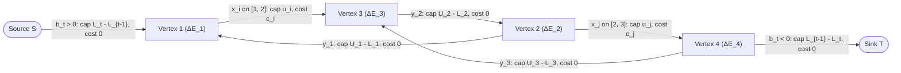

# Wave 3B (Cohort 2 — Iterations 78–82): Min-Cost Max-Flow (MCMF) I — Potentials, Slope Convexity, Marginal Splitting & Equation-Difference Compilation

> [!IMPORTANT]
> **Cohort 2 Independent Research Monograph (`flows_research/cohort2_iter_78_to_82_mcmf_potentials_convex_diff_equations.md`)**
> This monograph is the independent Cohort 2 investigation of **Wave 3B (Iterations 78–82)** for the competitive programming textbook on Network Flows, Minimum Cuts, Matching, Min-Cost Max-Flow (MCMF), Linear Programming Duality, and Non-Graph-to-Flow Modelling. In strict accordance with `AGENTS.md` and `flows_research/PLAN.md`, every modelling technique and every worked problem follows the **4-Step "Zero Magic Gadgets" Compilation Standard**:
> 1. **The Non-Graph Diagnostic Signal (Recognition)** — how to spot MCMF structure from raw array, interval, tournament, or equation statements, and why naive DP/greedy fails.
> 2. **The Algebraic / Logical Intermediate Representation** — translating the problem into linear equations, slack variables, convex marginal differences $\Delta g(k)$, or Lagrangian duals before drawing a single vertex or edge.
> 3. **The Reverse-Engineering Scratchpad (Graph Compilation)** — how each algebraic term mechanically dictates vertices, edge orientations, capacities, lower bounds, and costs.
> 4. **Hand-Checkable Toy Traces & Broken Gadget Counterexamples** — concrete small-scale traces ($N \le 4$) alongside explicit proofs of what breaks when subtle invariants (such as non-negative reduced costs, convexity, or contiguous interval telescoping) are violated.

---

## Executive Overview: The Four Pillars of First-Principles MCMF Modelling

When competitive programmers transition from Maximum Flow / Minimum Cut to **Minimum-Cost Maximum-Flow (MCMF)**, they frequently hit two conceptual walls:

1. **The Algorithmic Potential Wall**: Standard editorials treat MCMF as a black box ("just run SPFA MCMF"), ignoring why Bellman–Ford/SPFA inside every augmentation step degrades on dense or adversarial graphs, how **Johnson Potentials** $\pi(v)$ correspond to Linear Programming dual variables that enable $O(E \log V)$ Dijkstra augmentations, how **Mandatory Initial Saturation (`负权边强制满流消圈法`)** eliminates negative-cost edges and cycles in $O(1)$ setup time per edge without running exponential cycle-canceling, and how **Weakly Polynomial Capacity Scaling** handles capacities $U \le 10^9$ in $O(E \log U (E + V \log V))$ time.
2. **The Non-Graph Compilation Wall**: The deepest MCMF problems—such as tournament 3-cycle maximization (`[WC2007] 剪刀石头布`), interval coverage (`[NOI2008] 志愿者招募`), sliding-window activity selection (`[NEERC 2016] Delight for a Cat`), and incorrect flow repair (`CF 708 D`)—either have **nonlinear convex objectives** or **no graph in the problem statement at all**.

Across Iterations 78–82, we build the complete mathematical and compilation bridge across both walls:
- **Iteration 78** establishes the **Negative-Cycle Optimality Theorem**, **Linear Programming Duality & Complementary Slackness**, **Successive Shortest Path (SSP) with Johnson Potentials**, **Zkw Primal–Dual**, and **Bit-Scaling Polynomial MCMF ($O(E \log U (E + V \log V))$) for $U \le 10^9$**.
- **Iteration 79** proves the **Piecewise-Linear Convexity of the Cost Function $C(f)$**, derives **Min-Cost Feasible Flow**, analyzes **Parametric Slope Queries (`min_cost_slope`)**, exposes the **Variable-Hop $+M$ Cost-Shift Fallacy**, and develops **1D/2D WQS Binary Search (Aliens Trick) on Flow Volume $f$**.
- **Iteration 80** develops **Lower-Bound MCMF (`上下界最小费用流`)** and **Mandatory Initial Saturation (`负权边强制满流消圈法`)**, proving how pre-saturating negative edges converts arbitrary negative-cycle networks into non-negative residual networks immediately.
- **Iteration 81** formalizes **Convex Marginal Edge Splitting (`凸费用拆边`)**, showing how discrete convex penalties $g(k)$ compile into parallel unit edges of cost $\Delta g(k) = g(k) - g(k-1)$, and how to reduce non-graph quadratic/combinatorial problems (tournament 3-cycles, coupled win/loss sports leagues, piecewise-linear Huber/capacity violation penalties) into separable convex edge flows.
- **Iteration 82** derives the **Algebraic Equation-Difference Method (`流守恒差分建模法`)** from first principles: writing linear inequalities over contiguous intervals, introducing bounded or unbounded slack variables $y_t \in [L_t, U_t]$, and subtracting consecutive equations $\Delta E_t = E_t - E_{t-1}$ so that every variable appears once with $+1$ (out-flow) and once with $-1$ (in-flow)—compiling a linear system into an exact MCMF graph with zero guesswork.

---

## Iteration 78: Min-Cost Max-Flow (MCMF) Foundations, Negative-Cycle Optimality, Johnson Potentials, Zkw Primal–Dual & Capacity-Scaling MCMF

### 78.1 Formal Problem Definitions & Residual Cost Antisymmetry

Let $G = (V, E)$ be a directed multigraph where each directed edge $e = (u, v) \in E$ is equipped with:
- a non-negative capacity $u(e) \ge 0$, and
- a per-unit cost $c(e) \in \mathbb{R}$.

Given a source $s \in V$ and a sink $t \in V$ ($s \neq t$), an **$s$-$t$ flow of volume $F$** is a function $f : E \to \mathbb{R}_{\ge 0}$ satisfying:
1. **Capacity Constraint**: $0 \le f(e) \le u(e)$ for all $e \in E$.
2. **Flow Conservation**: For every vertex $v \in V$, define the net out-flow (divergence) as
   $$\operatorname{div}_f(v) = \sum_{e \in \delta^+(v)} f(e) - \sum_{e \in \delta^-(v)} f(e).$$
   Then $\operatorname{div}_f(s) = F$, $\operatorname{div}_f(t) = -F$, and $\operatorname{div}_f(v) = 0$ for all $v \in V \setminus \{s, t\}$.

The **total cost** of flow $f$ is the linear functional:
$$C(f) = \sum_{e \in E} c(e) f(e).$$

More generally, a **$\mathbf{b}$-flow** specifies a supply/demand vector $b : V \to \mathbb{R}$ with $\sum_{v \in V} b(v) = 0$ and requires $\operatorname{div}_f(v) = b(v)$ for all $v \in V$. When $b(v) = 0$ for all $v \in V$, $f$ is called a **circulation**.

#### The Residual Network $G_f$ with Antisymmetric Costs
For any feasible flow $f$, each original edge $e = (u, v) \in E$ generates up to two directed arcs in the **residual network** $G_f = (V, E_f)$:
- **Forward residual arc** $e^+ = (u, v)$: represents pushing additional flow along $e$, with residual capacity $r_f(e^+) = u(e) - f(e)$ and cost $c(e^+) = +c(e)$, included in $E_f$ whenever $r_f(e^+) > 0$.
- **Backward (canceling) residual arc** $e^- = (v, u)$: represents undoing previously routed flow along $e$, with residual capacity $r_f(e^-) = f(e)$ and cost $c(e^-) = -c(e)$, included in $E_f$ whenever $r_f(e^-) > 0$.

Notice the fundamental **cost antisymmetry** law:
$$c(e^-) = -c(e^+).$$
Pushing $\delta$ units of flow along $e^-$ in $G_f$ corresponds to decreasing $f(e)$ by $\delta$, which changes the objective by $\delta \cdot (-c(e))$.

---

### 78.2 The Negative-Cycle Optimality Theorem (Circulation Decomposition Proof)

How do we certify locally that a flow $f$ of volume $F$ achieves the global minimum cost among all feasible flows of the same volume $F$?

> [!IMPORTANT]
> **Theorem 78.1 (Negative-Cycle Optimality Theorem / Klein 1967)**
> Let $f$ be a feasible $s$-$t$ flow of volume $F$ (or a feasible $b$-flow) in $G$. Then $f$ is a minimum-cost flow among all feasible flows of volume $F$ (respectively, among all feasible $b$-flows) **if and only if** the residual network $G_f$ contains no directed cycle $C$ of strictly negative total cost:
> $$c(C) = \sum_{e \in C} c(e) < 0.$$

#### Complete Proof via Residual Circulation Decomposition

First, we establish how any two flows of the same volume relate inside the residual network $G_f$.

**Lemma 78.2 (Residual Difference is a Positive Circulation in $G_f$)**: Let $f$ and $f'$ be two feasible flows having the exact same divergence at every vertex ($\operatorname{div}_{f'}(v) = \operatorname{div}_f(v)$ for all $v \in V$). Define a flow $\Delta f : E_f \to \mathbb{R}_{\ge 0}$ on the residual edges of $G_f$ as follows: for each original edge $e = (u, v) \in E$,
- If $f'(e) > f(e)$, set $\Delta f(e^+) = f'(e) - f(e) \le u(e) - f(e) = r_f(e^+)$ and $\Delta f(e^-) = 0$.
- If $f'(e) < f(e)$, set $\Delta f(e^-) = f(e) - f'(e) \le f(e) = r_f(e^-)$ and $\Delta f(e^+) = 0$.
- If $f'(e) = f(e)$, set $\Delta f(e^+) = \Delta f(e^-) = 0$.

Then:
1. $0 \le \Delta f(a) \le r_f(a)$ for every residual arc $a \in E_f$.
2. $\Delta f$ is a **circulation** in $G_f$: for every vertex $v \in V$,
   $$\operatorname{div}_{\Delta f}(v) = \operatorname{div}_{f'}(v) - \operatorname{div}_f(v) = 0.$$
3. The cost difference between $f'$ and $f$ is given exactly by the cost of $\Delta f$ in $G_f$:
   $$C(f') - C(f) = \sum_{e \in E} c(e)\big(f'(e) - f(e)\big) = \sum_{a \in E_f} c(a) \Delta f(a) = C_{G_f}(\Delta f).$$

**Lemma 78.3 (Circulation Decomposition into Simple Directed Cycles)**: Any non-negative circulation $\Delta f$ in $G_f$ can be decomposed into a positive linear combination of at most $|E_f|$ simple directed cycles $C_1, C_2, \dots, C_m$ in $G_f$:
$$\Delta f = \sum_{k=1}^m \alpha_k \mathbb{I}(C_k), \qquad \alpha_k > 0.$$
*Proof of Lemma 78.3*: If $\Delta f \equiv 0$, $m = 0$ and the sum is empty. Otherwise, pick any arc $a_1 = (v_0, v_1)$ with $\Delta f(a_1) > 0$. Since $\operatorname{div}_{\Delta f}(v) = 0$ at every vertex, any vertex with positive incoming flow $\Delta f$ must have positive outgoing flow $\Delta f$. Walking forward along arcs with $\Delta f(a) > 0$ must revisit a vertex within $|V|$ steps, isolating a simple directed cycle $C_1$. Let $\alpha_1 = \min_{a \in C_1} \Delta f(a) > 0$. Subtracting $\alpha_1 \mathbb{I}(C_1)$ from $\Delta f$ preserves $\operatorname{div}(v) = 0$ everywhere and zeroes out $\Delta f(a)$ on at least one arc $a \in C_1$. Repeating at most $|E_f|$ times reduces $\Delta f$ to zero. $\blacksquare$

**Proof of Theorem 78.1**:
- **($\implies$ Necessity)**: Suppose $G_f$ contains a directed cycle $C$ with $c(C) < 0$. Let $\alpha = \min_{a \in C} r_f(a) > 0$. Augmenting $\alpha$ units of flow around $C$ in $G_f$ preserves flow conservation at every vertex $v \in V$ (including $s$ and $t$, so $|f'| = |f| = F$) and produces a feasible flow $f'$ with cost
  $$C(f') = C(f) + \alpha \cdot c(C) < C(f),$$
  contradicting the optimality of $f$.
- **($\Longleftarrow$ Sufficiency)**: Suppose $G_f$ has no negative-cost directed cycle, so $c(C) \ge 0$ for every cycle $C \subseteq G_f$. Let $f'$ be any other feasible flow of volume $F$. By Lemmas 78.2 and 78.3,
  $$C(f') - C(f) = \sum_{a \in E_f} c(a) \Delta f(a) = \sum_{k=1}^m \alpha_k \sum_{a \in C_k} c(a) = \sum_{k=1}^m \alpha_k c(C_k).$$
  Since $\alpha_k > 0$ and $c(C_k) \ge 0$ for all $k$, we have $C(f') - C(f) \ge 0 \implies C(f') \ge C(f)$. Thus $f$ is globally optimal. $\blacksquare$

---

### 78.3 Linear Programming Duality, Node Potentials $\pi(v)$ & Complementary Slackness

Theorem 78.1 characterizes optimality via cycles. By Linear Programming (LP) duality, we can equivalently characterize optimality via **vertex potentials** $\pi : V \to \mathbb{R}$.

#### Primal-Dual Formulation of Min-Cost $b$-Flow
Write the primal LP for a minimum-cost $b$-flow:
$$\begin{aligned}
\text{Minimize} \quad & \sum_{(u,v) \in E} c(u,v) f(u,v) \\
\text{subject to} \quad & \sum_{v : (u,v) \in E} f(u,v) - \sum_{v : (v,u) \in E} f(v,u) = b(u) \quad &&\forall u \in V \quad &&(\text{dual variable } -\pi(u) \in \mathbb{R}), \\
& -f(u,v) \ge -u(u,v) \quad &&\forall (u,v) \in E \quad &&(\text{dual variable } z(u,v) \ge 0), \\
& f(u,v) \ge 0 \quad &&\forall (u,v) \in E.
\end{aligned}$$

In the dual LP, each primal variable $f(u,v)$ appears in the conservation constraint of $u$ with coefficient $+1$ (multiplied by $-\pi(u)$), in the conservation constraint of $v$ with coefficient $-1$ (multiplied by $-\pi(v)$), and in its capacity constraint with coefficient $-1$ (multiplied by $z(u,v) \ge 0$). Thus the dual LP is:
$$\begin{aligned}
\text{Maximize} \quad & -\sum_{u \in V} b(u)\pi(u) - \sum_{(u,v) \in E} u(u,v) z(u,v) \\
\text{subject to} \quad & -\pi(u) + \pi(v) - z(u,v) \le c(u,v) \quad \forall (u,v) \in E, \\
& z(u,v) \ge 0 \quad \forall (u,v) \in E.
\end{aligned}$$

#### Reduced Costs and Complementary Slackness
Define the **reduced cost** of an edge $(u, v)$ with respect to potential $\pi : V \to \mathbb{R}$ as:
$$c_\pi(u, v) = c(u, v) + \pi(u) - \pi(v).$$
Notice that on the reverse residual arc $(v, u)$, the reduced cost is automatically antisymmetric:
$$c_\pi(v, u) = c(v, u) + \pi(v) - \pi(u) = -\big(c(u, v) + \pi(u) - \pi(v)\big) = -c_\pi(u, v).$$

The dual constraint $-\pi(u) + \pi(v) - z(u,v) \le c(u,v)$ rewrites to $z(u,v) \ge -c_\pi(u,v)$. By LP Complementary Slackness, a primal feasible flow $f$ and dual feasible pair $(\pi, z)$ are simultaneously optimal if and only if for every edge $e = (u, v) \in E$:
1. **Primal slackness**: $f(u,v) > 0 \implies -z(u,v) = c_\pi(u,v)$. Since $z(u,v) \ge 0$, this forces $c_\pi(u,v) \le 0$, which is equivalent to $c_\pi(v, u) = -c_\pi(u,v) \ge 0$ on the **backward residual arc** $e^- = (v, u) \in E_f$.
2. **Dual slackness**: $z(u,v) > 0 \implies f(u,v) = u(u,v)$. Contrapositively, if $f(u,v) < u(u,v)$ (so the **forward residual arc** $e^+ = (u,v)$ is in $E_f$), then $z(u,v) = 0$, which combined with $z(u,v) \ge -c_\pi(u,v)$ forces $c_\pi(u,v) \ge 0$ on $e^+ \in E_f$.

Combining (1) and (2) yields the **Potential Optimality Criterion**:

> [!IMPORTANT]
> **Theorem 78.4 (Potential Optimality & Reduced-Cost Non-Negativity)**
> A feasible flow $f$ is a minimum-cost flow if and only if there exists a vertex potential function $\pi : V \to \mathbb{R}$ such that every residual arc $a = (u, v) \in E_f$ has non-negative reduced cost:
> $$c_\pi(a) = c(a) + \pi(u) - \pi(v) \ge 0 \qquad \forall a \in E_f.$$

---

### 78.4 Successive Shortest Path (SSP) with Johnson Potentials $\pi(v)$

#### Telescoping of Reduced Costs Along Paths and Cycles
For any directed walk $P = (v_0, v_1, \dots, v_k)$ in $G_f$, the reduced cost telescopes:
$$c_\pi(P) = \sum_{i=0}^{k-1} \big(c(v_i, v_{i+1}) + \pi(v_i) - \pi(v_{i+1})\big) = c(P) + \pi(v_0) - \pi(v_k).$$
Two profound consequences follow immediately:
1. **Cycle Invariance**: For any closed cycle $C$ ($v_k = v_0$), $c_\pi(C) = c(C)$. Potentials never alter cycle costs!
2. **Shortest-Path Preservation**: For fixed endpoints $s$ and $v$, $\pi(s) - \pi(v)$ is a constant across all $s$-$v$ paths. Thus, a path $P^*$ is a shortest $s$-$v$ path under true costs $c$ **if and only if** $P^*$ is a shortest $s$-$v$ path under reduced costs $c_\pi$, and their shortest-path distances satisfy:
   $$d_0(s, v) = d_\pi(s, v) - \pi(s) + \pi(v).$$
   Because $c_\pi(a) \ge 0$ for all $a \in E_f$, we can compute $d_\pi(s, \cdot)$ using **Dijkstra's algorithm** in $O((V + E)\log V)$ (with a binary heap) or $O(V^2 + E)$ (with array scan on dense graphs) instead of $O(VE)$ Bellman–Ford/SPFA!

#### Why Potentials Remain Valid After Augmentation
Suppose we have a flow $f$ and valid potentials $\pi$ satisfying $c_\pi(a) \ge 0$ for all $a \in E_f$. We run Dijkstra from $s$ in $G_f$ with edge weights $c_\pi(a) \ge 0$ to obtain shortest-path distances $d_\pi(s, v)$ for all reachable vertices $v \in V$.

> [!NOTE]
> **Theorem 78.5 (Johnson Potential Update & Augmentation Invariant)**
> Define the updated potentials by
> $$\pi'(v) = \pi(v) + d_\pi(s, v)$$
> for all vertices $v$ reachable from $s$ in $G_f$, and let $P^*$ be any shortest $s$-$t$ path in $G_f$. Push $\delta \in (0, \min_{a \in P^*} r_f(a)]$ units of flow along $P^*$ to obtain flow $f'$. Then in the new residual network $G_{f'}$, every residual arc $a \in E_{f'}$ satisfies:
> $$c_{\pi'}(a) \ge 0.$$

*Proof*: Any arc $a = (u, v) \in E_{f'}$ falls into one of two cases:
- **Case 1 ($a$ was already present in $E_f$)**: By the shortest-path triangle inequality in $G_f$,
  $$d_\pi(s, v) \le d_\pi(s, u) + c_\pi(u, v) \implies c_\pi(u, v) + d_\pi(s, u) - d_\pi(s, v) \ge 0.$$
  Expanding $c_{\pi'}(u, v)$ gives:
  $$c_{\pi'}(u, v) = c(u, v) + \pi'(u) - \pi'(v) = \big(c(u, v) + \pi(u) - \pi(v)\big) + d_\pi(s, u) - d_\pi(s, v) = c_\pi(u, v) + d_\pi(s, u) - d_\pi(s, v) \ge 0.$$
- **Case 2 ($a = (v, u)$ is a newly created backward arc in $E_{f'} \setminus E_f$)**: This happens only if its reverse $(u, v)$ belonged to the shortest augmenting path $P^*$. Because $(u, v)$ is on a shortest path from $s$, the triangle inequality holds **with equality**:
  $$d_\pi(s, v) = d_\pi(s, u) + c_\pi(u, v) \implies c_{\pi'}(u, v) = 0.$$
  By reduced-cost antisymmetry, the newly created reverse arc $(v, u)$ has reduced cost:
  $$c_{\pi'}(v, u) = -c_{\pi'}(u, v) = 0 \ge 0.$$
Thus $c_{\pi'}(a) \ge 0$ holds across all of $E_{f'}$. $\blacksquare$

#### Potential Initialization Contracts (`pi[v]` at $f = 0$)
Before the first Dijkstra step, how do we obtain initial potentials $\pi_0(v)$ such that $c_{\pi_0}(u, v) = c(u, v) + \pi_0(u) - \pi_0(v) \ge 0$ for all original edges $(u, v) \in E$ with $u(u, v) > 0$?
1. **All initial costs are non-negative ($c(e) \ge 0$)**: Set $\pi_0(v) = 0$ for all $v \in V$ in $O(V)$ time.
2. **The initial network is a Directed Acyclic Graph (DAG) with negative costs**: Compute shortest paths from $s$ (or a virtual super-source connected to all vertices with cost $0$) in **topological order** in $O(V + E)$ time:
   $$\pi_0(v) = \min_{(u, v) \in E} \big(\pi_0(u) + c(u, v)\big).$$
   *Crucial Practical Warning*: In competitive programming, upwards of 80% of MCMF networks with negative costs (e.g., bipartite matching with positive rewards negated to negative costs, interval scheduling DAGs, layered time-expanded networks) are **acyclic at $f = 0$**! Running SPFA on such graphs is completely unnecessary when a 5-line $O(V + E)$ topological DP initializes $\pi_0$ deterministically.
3. **General graph with negative costs, no negative cycles**: Run Bellman–Ford / SPFA once at $f = 0$ in $O(VE)$ time to set $\pi_0(v) = d(s, v)$.
4. **General graph with negative edges and/or negative cycles**: Use **Mandatory Initial Saturation (`负权边强制满流消圈法`)** (Iteration 80) to eliminate all negative edges in $O(E)$ setup time before running a single shortest-path search!

#### The Unreachable-Vertex Potential Corruption Hazard
Suppose during an SSP step that $t$ is reachable from $s$, so $d_\pi(s, t) < \infty$, but some vertex $w \in V$ is currently unreachable from $s$ in $G_f$ ($d_\pi(s, w) = +\infty$). If you naively execute `pi[w] += dist[w]`, `pi[w]` overflows or becomes $+\infty$. Worse, if you leave `pi[w]` unchanged while increasing `pi[u]` for reachable vertices $u$, can an edge $(w, u) \in E_f$ from an unreachable $w$ to a reachable $u$ acquire $c_{\pi'}(w, u) < 0$?
- Observe: If $w$ is unreachable and $u$ is reachable, there cannot be a residual edge $(u, w) \in E_f$ (otherwise $w$ would be reachable). There *can* be a residual edge $(w, u) \in E_f$. If we cap the distance update for unreachable vertices by setting
  $$\pi'(v) = \pi(v) + \min\big(d_\pi(s, v),\; d_\pi(s, t)\big)$$
  (or simply only relax from vertices reachable from $s$, noting that an unreachable vertex $w$ can only become reachable in future steps if a path from $s$ reaches $w$ by reversing an edge $(w, u)$ that was used on an $s$-$t$ path—which is impossible while $w$ is unreachable!), the cleanest and completely bug-free invariant is: **cap all unreachable $d_\pi(s, v)$ at $\max_{u \text{ reachable}} d_\pi(s, u)$** (or $d_\pi(s, t)$ when pruning Dijkstra at $t$). Then for any residual edge $(w, u) \in E_f$ with $w$ unreachable and $u$ reachable, $d_{\text{capped}}(w) \ge d_\pi(s, u)$, so $c_{\pi'}(w, u) = c_\pi(w, u) + d_{\text{capped}}(w) - d_\pi(s, u) \ge c_\pi(w, u) \ge 0$.

---

### 78.5 Zkw Primal–Dual Algorithm (Multi-Path Dinic on the Zero-Reduced-Cost Subgraph)

In Theorem 78.5, we proved that **every** edge $e$ on a shortest $s$-$t$ path satisfies $c_{\pi'}(e) = 0$ after updating $\pi'(v) = \pi(v) + d_\pi(s, v)$. Why push flow along just *one* shortest path per Dijkstra call if the subgraph of tight edges
$$E_0 = \big\{a \in E_f : c_{\pi'}(a) = 0\big\}$$
can support a **blocking flow** of many edge-disjoint or vertex-disjoint shortest paths simultaneously?

This is the **Primal–Dual (Zkw) MCMF algorithm**:
1. **Relabel Step (Dual Update)**: Run Dijkstra (or SPFA) to compute $d_\pi(s, v)$ and update $\pi(v) \gets \pi(v) + d_\pi(s, v)$ (or equivalently in Zkw's backward formulation, compute $d_\pi(v, t)$ to $t$).
2. **Augment Step (Primal Blocking Flow)**: Run Dinic-style multi-path DFS with current-arc pointers `cur[u]` restricted strictly to edges $a = (u, v) \in E_f$ with $r_f(a) > 0$ and $c_\pi(a) = 0$.

> [!WARNING]
> **Critical Implementation Trap in Zkw DFS: Zero-Cost Cycles in $E_0$!**
> In standard Dinic for Max-Flow, the admissible subgraph only contains edges with $\text{level}[v] = \text{level}[u] + 1$, which is strictly a DAG. In Zkw MCMF, the admissible subgraph $E_0 = \{a \in E_f : c_\pi(a) = 0\}$ can contain **directed cycles of zero reduced cost** (for example, right after pushing flow along a 0-cost edge $(u, v)$, both $(u, v)$ and its reverse $(v, u)$ have $c_\pi = 0$!).
> Therefore, a Zkw DFS **must** maintain a boolean `in_stack[u]` (`vis[u]`) flag:
> - Set `vis[u] = true` upon entering `dfs(u, flow)`.
> - Only traverse $(u, v) \in E_0$ if `!vis[v]`.
> - If `pushed == flow` (the incoming flow to `u` was not fully exhausted only when `u` is still usable, wait: if `pushed < flow`, `u` cannot push any more flow to $t$ in this phase, so leave `vis[u] = true` as dead-end pruning; if `pushed == flow`, reset `vis[u] = false` on exit so other paths can still route through `u`).

#### When to Choose SSP+Dijkstra vs. Zkw Primal–Dual
| Graph Regime | Winner | Structural Reason |
| :--- | :--- | :--- |
| Dense bipartite / unit-capacity / small cost range | **Zkw Primal–Dual** | Many paths share the exact same shortest cost $d_0(s, t)$; one Dijkstra relabeling unlocks $O(\sqrt{V})$ or $O(V)$ augmentations at once. |
| Sparse graphs with large random/convex costs & long paths | **SSP + Dijkstra** | Almost every augmenting path has a unique distinct cost, so Zkw pushes only 1 path per phase anyway while paying extra DFS overhead. |
| Min-Cost Slope / WQS / Early-Stopping queries | **SSP + Dijkstra** | Directly exposes individual breakpoint slopes $(f_i, C_i)$ in clean order. |

---

### 78.6 Weakly Polynomial Capacity-Scaling MCMF ($O(E \log U (E + V \log V))$)

Both SSP and Zkw are **pseudo-polynomial**: each augmentation pushes at least $1$ unit of integer flow, giving a worst-case bound of $O(F \cdot (E + V \log V))$ where $F \le |E| U$. When capacities reach $U \le 10^9$ (and costs $C \le 10^9$), adversarial networks (such as Zadeh's bad network or simple 4-vertex gadgets with capacities $10^9$) force SSP and Zkw to execute $\Theta(U)$ augmentations of $1$ unit each, resulting in an immediate Time Limit Exceeded (TLE).

How do we solve MCMF in **polynomial time** $O(E \log U (E + V \log V))$ when $U \le 10^9$? We use **Edmonds–Karp Bit-Scaling (Capacity Scaling) for Min-Cost Circulation**.

#### Step 1: Reduction from Min-Cost Max-Flow / $b$-Flow to Min-Cost Circulation
Any Min-Cost $b$-Flow problem (or Min-Cost Max-Flow problem) reduces to finding a **Min-Cost Circulation** (where $\operatorname{div}_f(v) = 0$ for all $v \in V$):
- For Min-Cost Max-Flow from $s$ to $t$: add a feedback edge $(t, s)$ with capacity $U_\infty = \sum_{e \in \delta^+(s)} u(e)$ and huge negative cost $-M$ (where $M > |V| \max_{e} |c(e)|$).
- For Min-Cost $b$-Flow with supplies/demands $b(v)$: add a super-source/sink vertex $v_0$; for each $v$ with $b(v) > 0$, add $(v_0, v)$ with capacity $b(v)$ and cost $-M$; for each $v$ with $b(v) < 0$, add $(v, v_0)$ with capacity $-b(v)$ and cost $-M$.

#### Step 2: The Bit-Scaling Invariant & The Single-Violated-Edge Repair
Let $K = \lfloor \log_2 U_{\max} \rfloor$. For each bit scale $k = K, K-1, \dots, 0$, define the scaled capacity of each edge $e \in E$ as
$$u^{(k)}(e) = \left\lfloor \frac{u(e)}{2^k} \right\rfloor.$$
Observe the bit-shift recurrence:
$$u^{(k-1)}(e) = 2 u^{(k)}(e) + \operatorname{bit}_{k-1}\big(u(e)\big), \qquad \text{where } \operatorname{bit}_{k-1}\big(u(e)\big) \in \{0, 1\}.$$

We maintain at the end of scale $k$ a circulation $f^{(k)}$ and vertex potentials $\pi : V \to \mathbb{R}$ that are **optimal for capacities $u^{(k)}$**:
1. $\operatorname{div}_{f^{(k)}}(v) = 0$ for all $v \in V$.
2. $0 \le f^{(k)}(e) \le u^{(k)}(e)$ for all $e \in E$.
3. Every residual edge $a \in E_{f^{(k)}}$ has $c_\pi(a) \ge 0$.

Before scale $K$ (or at scale $K+1$ where $u^{(K+1)}(e) = 0$), $f \equiv 0$ and $\pi \equiv 0$ trivially satisfy all three conditions because $E_f = \emptyset$ (no edge has positive residual capacity!).

Now, to advance from scale $k$ to scale $k-1$:
1. **Doubling Step**: Multiply all flow values and capacities by $2$:
   $$f(e) \gets 2 f^{(k)}(e), \qquad u'(e) \gets 2 u^{(k)}(e).$$
   Notice that an arc $a$ has positive residual capacity under $(2f^{(k)}, 2u^{(k)})$ **if and only if** it had positive residual capacity under $(f^{(k)}, u^{(k)})$! Therefore, with the exact same potentials $\pi$, $c_\pi(a) \ge 0$ still holds for every residual arc!
2. **Bit-Increment Step**: Iterate over each edge $e = (u, v) \in E$ that has $\operatorname{bit}_{k-1}(u(e)) = 1$. We increment the capacity of $e$ by $+1$. What happens to its residual capacity and reduced cost?
   - **Subcase 2a ($c_\pi(u, v) \ge 0$)**: Increasing the capacity of $e$ by $+1$ increases $r_f(u, v)$ by $+1$. Since $c_\pi(u, v) \ge 0$, the new or expanded forward arc $(u, v)$ already satisfies the optimality condition $c_\pi(u, v) \ge 0$! Nothing needs to be done.
   - **Subcase 2b ($c_\pi(u, v) < 0$)**: Because $c_\pi(u, v) < 0$ and $(f, \pi)$ was optimal prior to incrementing $e$'s capacity, the forward arc $(u, v)$ could *not* have been in $E_f$ before the increment—meaning $e$ was completely saturated ($r_f(u, v) = 0$) before the increment, and now has **residual capacity $r_f(u, v) = 1$** with $c_\pi(u, v) < 0$.
   - **How to repair this single violated edge of capacity $1$**:
     Before adding $(u, v)$ to $E_f$, every arc in $E_f$ has $c_\pi(a) \ge 0$. Run **one Dijkstra search from $v$ to $u$** in $G_f$ using edge weights $c_\pi(a) \ge 0$, obtaining shortest distances $d_\pi(v, x)$.
     - Update potentials $\pi'(x) = \pi(x) + d_\pi(v, x)$ (capping unreachable vertices at $d_\pi(v, u)$ or $\max$ reachable). By Theorem 78.5, all existing arcs in $E_f$ still have $c_{\pi'}(a) \ge 0$, and the shortest $v \to u$ path $P_{v \to u}$ now has $c_{\pi'}(P_{v \to u}) = 0$.
     - Now check the new reduced cost of $e = (u, v)$:
       $$c_{\pi'}(u, v) = c_\pi(u, v) + d_\pi(v, u) - d_\pi(v, v) = c_\pi(u, v) + d_\pi(v, u).$$
       - If $c_{\pi'}(u, v) \ge 0$: the potential update alone fixed $e$'s reduced cost! We leave $r_f(u, v) = 1$ and move to the next edge.
       - If $c_{\pi'}(u, v) < 0$: the cycle $C = (u \xrightarrow{e} v) + P_{v \to u}$ is a negative-cost cycle in $G_f \cup \{e\}$. Push **$1$ unit of flow** around $C$ (i.e., increment $f(e)$ by $+1$ and push $1$ unit along $P_{v \to u}$). Because $r_f(u, v)$ was $1$, pushing $1$ unit **re-saturates $e$** ($r_f(u, v)$ drops back to $0$, removing $(u, v)$ from $E_f$!) and only leaves the backward arc $(v, u)$ with $c_{\pi'}(v, u) = -c_{\pi'}(u, v) > 0$, while the new reverse arcs along $P_{v \to u}$ have $c_{\pi'} = 0 \ge 0$!

```
Algorithm: Capacity-Scaling Min-Cost Circulation (O(E log U (E + V log V)))
--------------------------------------------------------------------------
Input: Directed multigraph G = (V, E) with capacities u(e) >= 0 and costs c(e)
Output: Optimal circulation f : E -> Z_{>= 0} and potentials pi : V -> Z

1. Initialize f(e) <- 0 for all e in E, u_cur(e) <- 0 for all e in E, pi(v) <- 0 for all v in V.
2. For bit k = floor(log2(U_max)) down to 0:
   a. // Doubling Step
      For each edge e in E:
        f(e) <- 2 * f(e)
        u_cur(e) <- 2 * u_cur(e)
   b. // Bit-Increment Step
      For each edge e = (u, v) in E with ((u(e) >> k) & 1) == 1:
        If c(u, v) + pi(u) - pi(v) >= 0:
          u_cur(e) <- u_cur(e) + 1
        Else:
          // e is violated if we open 1 unit of capacity; run Dijkstra from v in current G_f
          d <- Dijkstra(G_f, source = v, weights = c_pi)
          max_d <- max_{x reachable from v} d[x]
          For each x in V:
            pi(x) <- pi(x) + min(d[x], max_d)
          If u is reachable from v and c(u, v) + pi(u) - pi(v) < 0:
            Push 1 unit of flow along shortest path P_{v -> u} in G_f
            f(e) <- f(e) + 1   // Immediately saturate the new unit of capacity on e!
           u_cur(e) <- u_cur(e) + 1
3. Return (f, pi)
```

#### Complexity & Toy Trace: SSP ($10^9$ steps) vs. Capacity Scaling ($30$ steps)
- **Complexity**: There are $1 + \lfloor \log_2 U \rfloor$ bit scales. In each scale, we run at most $|E|$ Dijkstras. Thus total time is $O(E \log U (E + V \log V))$—completely polynomial in $\log U$ and independent of $\max |c(e)|$!
- **Hand-Checkable Toy Trace**: Consider $V = \{s, a, b, t\}$ with edges:
  - $(s, a), (a, t), (s, b), (b, t)$ each of capacity $U = 2^{29}$ and cost $0$,
  - $(a, b)$ of capacity $1$ and cost $-10$,
  -Feedback $(t, s)$ of capacity $2^{30}$ and cost $-100$.
  In standard Zkw or if costs alternate across a diamond gadget, unit capacity cross-arcs can cause $\Theta(U)$ augmentations. Under Capacity Scaling:
  - For bits $k = 29 \dots 1$: only $(s,a), (a,t), (s,b), (b,t), (t,s)$ have non-zero bits; at bit $k=29$, $1$ scaled unit (= $2^{29}$ true units) flows along $s \to a \to t \to s$ and $s \to b \to t \to s$ in just $2$ Dijkstras!
  - At bit $k = 0$: $(a, b)$ receives its $+1$ capacity with $c_\pi(a, b) = -10 < 0$. One Dijkstra from $b$ to $a$ finds $b \to t \to s \to a$ of reduced cost $0$, pushes $1$ unit around $a \to b \to t \to s \to a$, and finishes!

---

## Iteration 79: Slope Convexity of $C(f)$, Min-Cost Feasible Flow, Parametric Slope Queries (`min_cost_slope`) & WQS Binary Search on Flow

### 79.1 The Slope Convexity Theorem for $C(f)$

Fix a source $s$ and sink $t$, and assume $G$ has no negative-cost cycles at $f = 0$. For every achievable flow volume $f \in [0, F_{\max}]$, define the **minimum-cost value function**:
$$C(f) = \min\Big\{\sum_{e \in E} c(e) x(e) \;\Big|\; x \text{ is a feasible } s\text{-}t \text{ flow of volume } f\Big\}.$$

> [!IMPORTANT]
> **Theorem 79.1 (Piecewise-Linear Convexity of $C(f)$)**
> The function $C : [0, F_{\max}] \to \mathbb{R}$ is continuous, piecewise-linear, and **convex**. Equivalently, if Successive Shortest Path (SSP) augments along shortest paths $P_1, P_2, \dots, P_k$ with bottleneck capacities $\delta_1, \delta_2, \dots, \delta_k$ and per-unit path costs $\lambda_1, \lambda_2, \dots, \lambda_k$, then the marginal slopes satisfy:
> $$\lambda_1 \le \lambda_2 \le \dots \le \lambda_k.$$

#### Proof 1: Algebraic Proof via Johnson Potential Monotonicity
At the start of step $i$, let $\pi$ be the valid node potential function ($c_\pi(a) \ge 0$ for all $a \in E_f$). By the telescoping identity, the true cost $\lambda_i$ of the shortest $s$-$t$ path $P_i$ is:
$$\lambda_i = d_0(s, t) = d_\pi(s, t) - \pi(s) + \pi(t).$$
When we update $\pi'(v) = \pi(v) + d_\pi(s, v)$, noting that $d_\pi(s, s) = 0$, we obtain:
$$\pi'(t) - \pi'(s) = \big(\pi(t) + d_\pi(s, t)\big) - \big(\pi(s) + 0\big) = \lambda_i.$$
Now, at the start of step $i+1$, every residual arc in $G_{f'}$ satisfies $c_{\pi'}(a) \ge 0$ by Theorem 78.5. Therefore, the shortest-path distance from $s$ to $t$ under the non-negative weights $c_{\pi'}$ satisfies $d_{\pi'}(s, t) \ge 0$. Consequently, the true cost $\lambda_{i+1}$ of the $(i+1)$-th augmenting path is:
$$\lambda_{i+1} = d_{\pi'}(s, t) - \pi'(s) + \pi'(t) = \lambda_i + d_{\pi'}(s, t) \ge \lambda_i. \quad \blacksquare$$

#### Proof 2: Combinatorial Proof via Flow Superposition & Path Exchange
Let $x_1$ and $x_2$ be optimal $s$-$t$ flows of volumes $f - \delta$ and $f + \delta$, achieving costs $C(f - \delta)$ and $C(f + \delta)$ respectively. Consider the difference $x_2 - x_1$: it has divergence $+2\delta$ at $s$, $-2\delta$ at $t$, and $0$ elsewhere. By flow decomposition, $x_2 - x_1$ decomposes into $2\delta$ unit-volume $s$-$t$ paths and a set of directed cycles. Since $x_1$ and $x_2$ are optimal, no cycle has negative cost in $G_{x_1}$ or $G_{x_2}$. Splitting the $2\delta$ paths into two groups of $\delta$ paths and routing the first group forward from $x_1$ (and the second group backward from $x_2$) constructs two feasible flows $y_1, y_2$ of volume $f$ satisfying:
$$2 C(f) \le C(y_1) + C(y_2) \le C(x_1) + C(x_2) = C(f - \delta) + C(f + \delta). \quad \blacksquare$$

---

### 79.2 Min-Cost Feasible Flow (`最小费用可行流`) & Early-Stopping SSP

Many contest problems do **not** ask for a maximum flow; instead, each unit of flow represents an optional match, task, or transaction that yields some reward (modeled as a negative cost $c < 0$), and we may send **any** flow volume $f \in [0, F_{\max}]$ to minimize total cost $C(f)$:
$$\min_{f \in [0, F_{\max}]} C(f).$$
This is the **Minimum-Cost Feasible Flow** problem.

Because $C(f)$ is convex (Theorem 79.1), its right derivative $\lambda(f) = C'_+(f)$ is monotonically non-decreasing:
- As long as the current shortest path cost $\lambda_i = \pi'(t) - \pi'(s) < 0$, pushing flow along $P_i$ **strictly decreases** $C(f)$.
- The very first time $\lambda_i \ge 0$, every subsequent augmentation $j \ge i$ will also have $\lambda_j \ge \lambda_i \ge 0$, so $C(f)$ can never decrease again!

> [!TIP]
> **Early-Stopping Rule for Min-Cost Feasible Flow**
> In SSP, after running Dijkstra and updating $\pi(v) \gets \pi(v) + d_\pi(s, v)$, check the true shortest-path cost $\lambda = \pi(t) - \pi(s)$:
> - To **minimize cost strictly** (with minimum flow volume among ties): break out of the SSP loop as soon as $\pi(t) - \pi(s) \ge 0$.
> - To **minimize cost while maximizing flow volume among ties**: break out of the SSP loop as soon as $\pi(t) - \pi(s) > 0$.

---

### 79.3 Parametric Slope Queries (`min_cost_slope`) & The Non-Negative Cost Shift Trap

In AtCoder Library (`atcoder::mcf_graph<Cap, Cost>`), the method `g.slope(s, t, flow_limit)` returns a `std::vector<std::pair<Cap, Cost>>` containing the exact vertices $(f_0, C_0), (f_1, C_1), \dots, (f_m, C_m)$ of the piecewise-linear convex curve $C(f)$ on $[0, \min(F_{\max}, \text{flow\_limit})]$:
- $(f_0, C_0) = (0, 0)$,
- On each segment $[f_{i-1}, f_i]$, $C(f)$ has constant slope $\lambda_i = \frac{C_i - C_{i-1}}{f_i - f_{i-1}}$, with $\lambda_1 < \lambda_2 < \dots < \lambda_m$ strictly increasing (collinear consecutive augmentations are merged into a single segment).

#### The Non-Negative Cost Requirement & The Variable-Hop $+M$ Shift Fallacy
`atcoder::mcf_graph` enforces a strict precondition: **every added edge must have non-negative cost $c(e) \ge 0$**. When a problem has negative edge costs (e.g., profits $-w_e < 0$), competitors frequently attempt a "quick shift": adding a large constant $+M$ to every edge so that $c'(e) = c(e) + M \ge 0$.

> [!CAUTION]
> **Broken Gadget Counterexample: Why Adding $+M$ to Every Edge Fails on Variable-Length Paths**
> Suppose $V = \{s, a, t\}$ with two $s$-$t$ paths of capacity $1$:
> - Path $P_1 = (s \to a \to t)$ has **2 edges**, each of cost $-6$, for a true total cost of $c(P_1) = -12$.
> - Path $P_2 = (s \to t)$ has **1 edge** of cost $-10$, for a true total cost of $c(P_2) = -10$.
>
> For $f = 1$, the true optimal path is $P_1$ (cost $-12 < -10$).
> Now suppose we naively add $+M = +10$ to **every edge** so all edge costs become non-negative:
> - $c'(s, a) = 4,\; c'(a, t) = 4 \implies c'(P_1) = 4 + 4 = +8$.
> - $c'(s, t) = 0 \implies c'(P_2) = 0$.
>
> Under the shifted costs $c'$, the solver picks $P_2$ first (cost $0 < 8$) and reports cost $-10$ for $f = 1$, which is **wrong**! Adding $+M$ to every edge adds $+M \cdot |P|$ to a path $P$ of hop-length $|P|$, biasing the solver toward paths with fewer edges!

#### Three Mathematically Exact Ways to Handle Negative Costs in `mcf_graph`
1. **Fixed-Hop / Layered DAG Shift**: If every valid $s$-$t$ path in $G$ traverses the **exact same number of edges $L$** (e.g., standard $s \to L \to R \to t$ bipartite matching where every path has $L = 3$ edges, or a $T$-layer time-expanded DAG where we only shift edges crossing from layer $t$ to $t+1$), then every unit of $s$-$t$ flow accumulates the exact same shift $+K \cdot M$. Subtracting $f \cdot K \cdot M$ from $C'(f)$ recovers $C(f)$ with zero distortion.
2. **DAG Potential Pre-Shift (General Acyclic Graph with Arbitrary Path Lengths)**:
   If $G$ is a DAG at $f = 0$ with variable path lengths, compute the topological shortest-path potentials $\pi_0(v)$ in $O(V + E)$ time:
   $$\pi_0(s) = 0, \qquad \pi_0(v) = \min_{(u, v) \in E} \big(\pi_0(u) + c(u, v)\big).$$
   Then for every edge $(u, v) \in E$, its reduced cost $c_{\pi_0}(u, v) = c(u, v) + \pi_0(u) - \pi_0(v)$ is **guaranteed to be $\ge 0$**! Add each edge $(u, v)$ to `mcf_graph` with non-negative cost $c_{\pi_0}(u, v) \ge 0$. By telescoping, the true cost of any flow of volume $f$ is simply:
   $$C(f) = C_{\pi_0}(f) - f \cdot \big(\pi_0(s) - \pi_0(t)\big) = C_{\pi_0}(f) + f \cdot \pi_0(t).$$
3. **Mandatory Initial Saturation (`负权边强制满流消圈法`)**: Works even if $G$ has cycles and negative-cost cycles! (Derived in full in Iteration 80).

---

### 79.4 WQS Binary Search (Aliens Trick / Lagrangian Relaxation) on Flow Volume $f$

Because $C(f)$ is convex on $[0, F_{\max}]$, we can apply **Lagrangian Relaxation / WQS Binary Search (Aliens Trick)** to dualize the flow volume constraint $f = K$.

#### The 4-Step Compilation for WQS Binary Search on Flow Networks
1. **Diagnostic Signal**: The problem asks for the minimum cost (or maximum profit) to route **exactly $K$ units of flow** (or select $K$ disjoint paths/intervals/matches), where $N, K \le 10^5$ is too large for $K$ steps of SSP, **or** there are *two* independent flow-volume constraints $(K_A, K_B)$ that would otherwise require a 2D state space.
2. **Algebraic Representation (Legendre–Fenchel Dual)**:
   Because $C(f)$ is convex on $f \in \{0, 1, \dots, F_{\max}\}$, for any target $K$, there exists a Lagrange multiplier (slope) $\lambda \in \mathbb{R}$ such that the unconstrained penalized objective
   $$\Phi(\lambda) = \min_{f \in [0, F_{\max}]} \big(C(f) - \lambda f\big)$$
   is minimized at $f = K$.
3. **Graph / Algorithmic Compilation**:
   Subtracting $\lambda f$ from $C(f)$ is equivalent to **adding an edge $S \to s$ of capacity $\infty$ and cost $-\lambda$** (or adding $-\lambda$ to every edge leaving $s$) and solving the **unconstrained Min-Cost Feasible Flow** problem (where we stop as soon as marginal cost $> 0$, or solve via a fast $O(N)$ DP / Greedy / Simulated Flow without tracking $f$ in the DP state!).
4. **Recovering $C(K)$ on Collinear Slope Plateaus**:
   Suppose for a fixed slope $\lambda$, the minimizers of $C(f) - \lambda f$ form a contiguous interval of integers $[f_{\min}(\lambda), f_{\max}(\lambda)]$ (because the convex hull of $C(f)$ has a flat segment of exact slope $\lambda$ containing multiple integer points).
   - During the inner check for $\lambda$, configure tie-breaking to consistently return $f_{\max}(\lambda)$ (by taking $0$-reduced-cost augmentations) or $f_{\min}(\lambda)$ (by skipping $0$-reduced-cost augmentations).
   - Binary search for the smallest integer $\lambda^*$ such that $f_{\max}(\lambda^*) \ge K$.
   - Then $K \in [f_{\min}(\lambda^*), f_{\max}(\lambda^*)]$, meaning $(K, C(K))$ is **collinear** with $(f_{\max}(\lambda^*), C(f_{\max}(\lambda^*)))$ along slope $\lambda^*$! Therefore:
     $$C(K) - \lambda^* K = \Phi(\lambda^*) \implies C(K) = \Phi(\lambda^*) + \lambda^* \cdot K.$$

> [!WARNING]
> **The Classic WQS Recovery Bug**
> When reconstructing $C(K)$ from $\Phi(\lambda^*)$, you **must** add $\lambda^* \cdot K$ (the target $K$), **never** $\lambda^* \cdot f(\lambda^*)$ (the observed flow volume)! On a collinear plateau where $f_{\min}(\lambda^*) < K < f_{\max}(\lambda^*)$, no choice of $\lambda$ uniquely isolates $f(\lambda) = K$, yet $\Phi(\lambda^*) + \lambda^* K$ gives the exact value $C(K)$ because all points on the plateau share the same intercept $\Phi(\lambda^*)$.

#### 2D Nested WQS Binary Search (`CF 739 E — Gosha is hunting`)
When a flow network has **two** separate source supplies $K_A$ and $K_B$ feeding into the same sink $t$ (e.g., $K_A$ Poké Balls and $K_B$ Ultra Balls used on $N$ Pokémon, where using both on Pokémon $i$ has concave diminishing return $1 - (1 - p_i)(1 - u_i) = p_i + u_i - p_i u_i \le p_i + u_i$), the bivariate optimum $C(K_A, K_B)$ is **jointly convex** in $(K_A, K_B)$.
- Outer WQS binary searches the penalty $\lambda_A$ on $S \to s_A$.
- Inner WQS binary searches the penalty $\lambda_B$ on $S \to s_B$.
- Inside both binary searches, the global capacity constraints $K_A, K_B$ vanish completely! Each Pokémon $i$ independently picks the best of 4 options ($\emptyset, \{A\}, \{B\}, \{A, B\}$) in $O(1)$ time, reducing an $O(N^3)$ MCMF / DP problem to $O(N \log^2(\text{precision}))$!


---

## Iteration 80: Eliminating Negative Cycles via Mandatory Initial Saturation (`负权边强制满流消圈法`) & Lower-Bound MCMF

### 80.1 Flows with Demands & Lower Bounds (`上下界最小费用流`)

In many scheduling, degree-constrained subgraph, and circulation repair problems, each directed edge $e = (u, v) \in E$ has both a **lower bound** $l(e)$ and an **upper bound** $u(e)$ ($0 \le l(e) \le u(e)$), along with a per-unit cost $c(e) \in \mathbb{R}$:
$$l(e) \le f(e) \le u(e) \qquad \forall e \in E.$$

Let us compile this constraint using the **4-Step "Zero Magic Gadgets" Standard**.

#### Step 1: Non-Graph Diagnostic Signal (Recognition)
- **Surface Clues**: The problem specifies that every time slot, edge, or participant must be covered **at least** $L_i$ times and **at most** $U_i$ times, or that the difference between red and blue incident edges at vertex $v$ must be at least $1$, while minimizing total selection cost.
- **Why Naive MCMF Fails**: Standard MCMF solvers only enforce $0 \le f(e) \le u(e)$. Setting negative costs $-M$ to "encourage" flow through $e$ can fail if multiple high-priority edges compete on the same cycle or if $-M$ creates negative-cost cycles.

#### Step 2: Algebraic Intermediate Representation (Slack Shift $f(e) = l(e) + f'(e)$)
Decompose the flow $f(e)$ on each edge $e = (u, v)$ into its mandatory lower bound $l(e)$ plus an optional residual flow $f'(e)$:
$$f(e) = l(e) + f'(e), \qquad \text{where } 0 \le f'(e) \le u(e) - l(e).$$

Now substitute $f(e) = l(e) + f'(e)$ into both the **objective function** and the **flow conservation equations**:
1. **Objective Function**:
   $$C(f) = \sum_{e \in E} c(e)\big(l(e) + f'(e)\big) = \underbrace{\sum_{e \in E} l(e) c(e)}_{C_{\text{base}} \text{ (constant)}} + \sum_{e \in E} c(e) f'(e).$$
2. **Flow Conservation at Every Vertex $v \in V$**:
   In a circulation ($\operatorname{div}_f(v) = 0$),
   $$\sum_{e \in \delta^+(v)} \big(l(e) + f'(e)\big) - \sum_{e \in \delta^-(v)} \big(l(e) + f'(e)\big) = 0.$$
   Move the known constants $l(e)$ to the right-hand side:
   $$\sum_{e \in \delta^+(v)} f'(e) - \sum_{e \in \delta^-(v)} f'(e) = \underbrace{\sum_{e \in \delta^-(v)} l(e) - \sum_{e \in \delta^+(v)} l(e)}_{=: M(v)}.$$
   Here $M(v)$ is the **net mandatory excess** entering vertex $v$ (mandatory in-flow minus mandatory out-flow). Notice that summing $M(v)$ over all $v \in V$ gives $\sum_{v \in V} M(v) = 0$ because every $l(e)$ is added once at its head and subtracted once at its tail.

#### Step 3: Reverse-Engineering Scratchpad (Mechanical Graph Compilation)
Look at the equation $\operatorname{div}_{f'}(v) = M(v)$:
- If $M(v) > 0$, vertex $v$ has $M(v)$ units of mandatory flow pre-entering it that **must be routed out of $v$** by the free variables $f'$. To force $f'$ to have net out-flow $+M(v)$ at $v$ while maintaining standard conservation at $v$, we inject $M(v)$ units of flow into $v$ from a virtual super-source $S^*$:
  $$\text{Add edge } S^* \to v \text{ with capacity } M(v) \text{ and cost } 0.$$
- If $M(v) < 0$, vertex $v$ has $-M(v)$ units of mandatory flow pre-leaving it that **must be supplied into $v$** by $f'$. To absorb $-M(v)$ units of flow from $v$, we drain $-M(v)$ units from $v$ into a virtual super-sink $T^*$:
  $$\text{Add edge } v \to T^* \text{ with capacity } -M(v) \text{ and cost } 0.$$
- Each original edge $e = (u, v)$ becomes a standard edge $u \to v$ with capacity $u(e) - l(e)$ and cost $c(e)$.
- Run **Min-Cost Max-Flow** from $S^*$ to $T^*$:
  - **Feasibility Check**: All conservation equations $\operatorname{div}_{f'}(v) = M(v)$ are satisfied **if and only if** every edge leaving $S^*$ is completely saturated, i.e.,
    $$F_{S^* \to T^*} = \sum_{v \in V : M(v) > 0} M(v).$$
  - **Optimal Cost**: If feasible, the minimum circulation cost is $C_{\text{base}} + C_{S^* \to T^*}(f')$.
- **Extension to $s$-$t$ Flows with Lower Bounds**:
  - **Min-Cost Feasible $s$-$t$ Flow**: Add a feedback edge $t \to s$ with bounds $[0, \infty]$ and cost $0$ to turn the $s$-$t$ flow into a circulation, then run the exact construction above. The actual $s$-$t$ flow volume is the flow routed on $t \to s$.
  - **Min-Cost Max-Flow with Lower Bounds**: After finding the feasible flow via $S^* \to T^*$, delete $S^*$, $T^*$, and the feedback edge $t \to s$ (keeping the residual capacities and potentials $\pi$ on the remaining edges), and run a second MCMF phase from $s$ to $t$ to push as much additional flow as possible at minimum cost.

---

### 80.2 Mandatory Initial Saturation (`负权边强制满流消圈法`)

What if the graph $G$ contains **negative-cost edges** ($c(e) < 0$) and **negative-cost directed cycles** at the start?
- Standard Dijkstra SSP cannot initialize $\pi_0(v)$ because shortest paths are $-\infty$ around negative cycles.
- Explicit Cycle-Canceling (finding negative cycles via Bellman–Ford/SPFA and pushing flow around them) is notoriously slow—in fact, without scaling it can take $O(V E^2 U)$ time and easily TLEs on competitive programming judges.

Remarkably, we can eliminate **every negative edge and every negative cycle simultaneously in $O(1)$ time per edge** by combining variable reversal with the lower-bound circulation machinery of Section 80.1! This technique is known in the Chinese competitive programming literature as **Mandatory Initial Saturation (`负权边强制满流消圈法`)** and is also the internal mechanism used in advanced `b-flow` solvers.

#### Algebraic Derivation via Regret Variable Substitution
Suppose edge $e = (u, v) \in E$ has bounds $0 \le f(e) \le u(e)$ and a **strictly negative cost** $c(e) < 0$.
Because $c(e) < 0$, the objective wants $f(e)$ to be as close to $u(e)$ as possible. Let us define the **regret (cancellation) variable**:
$$\bar{f}(e) = u(e) - f(e) \in [0, u(e)],$$
which measures how many units of $e$'s capacity we **fail to use** (or undo). Substituting $f(e) = u(e) - \bar{f}(e)$ into our linear program:
1. **Capacity constraint**: $0 \le f(e) \le u(e) \iff 0 \le \bar{f}(e) \le u(e)$.
2. **Objective term**:
   $$c(e) f(e) = c(e)\big(u(e) - \bar{f}(e)\big) = \underbrace{u(e) c(e)}_{\text{constant } < 0} + \underbrace{\big(-c(e)\big)}_{\text{strictly positive } > 0} \bar{f}(e).$$
3. **Flow conservation at $u$ and $v$**:
   - In the divergence of $u$ (where $e$ was an outgoing edge $+f(e)$):
     $$+f(e) = +u(e) - \bar{f}(e).$$
     Moving $+u(e)$ to the right-hand side subtracts $u(e)$ from $M(u)$, while $-\bar{f}(e)$ on the left-hand side means $\bar{f}(e)$ is an **incoming** edge to $u$!
   - In the divergence of $v$ (where $e$ was an incoming edge $-f(e)$):
     $$-f(e) = -u(e) + \bar{f}(e).$$
     Moving $-u(e)$ to the right-hand side adds $u(e)$ to $M(v)$, while $+\bar{f}(e)$ on the left-hand side means $\bar{f}(e)$ is an **outgoing** edge from $v$!

> [!IMPORTANT]
> **Theorem 80.1 (Mandatory Initial Saturation Equivalence)**
> Replacing every negative-cost edge $e = (u, v)$ having bounds $[0, u(e)]$ and cost $c(e) < 0$ with:
> 1. A constant addition of $u(e) c(e)$ to `base_cost`,
> 2. A mandatory imbalance shift $M(u) \gets M(u) - u(e)$ and $M(v) \gets M(v) + u(e)$, and
> 3. A **reversed directed edge** $e^{\text{rev}} = (v, u)$ with bounds $[0, u(e)]$ and **positive cost** $-c(e) > 0$,
>
> produces an equivalent Lower-Bound Min-Cost Circulation instance in which **every edge in the entire network has non-negative cost $\ge 0$**. Consequently:
> - There are **no negative-cost cycles** anywhere in the initial auxiliary network.
> - Initial Johnson potentials can be set to $\pi_0(v) = 0$ for all $v \in V \cup \{S^*, T^*\}$ in $O(V)$ time, and **pure Dijkstra SSP** solves the entire problem without a single Bellman–Ford or SPFA call!

#### Why Does $S^* \to T^*$ Automatically Cancel Unfeasible Negative Edges While Keeping Profitable Negative Cycles?
Let us trace the physical intuition on two cases:
- **Case A (A Genuine Negative Cycle $u \xrightarrow{-5} v \xrightarrow{-3} u$ of capacity $1$)**:
  - Pre-saturating both edges adds $-5 - 3 = -8$ to `base_cost`.
  - At $u$: $M(u) = -1 + 1 = 0$. At $v$: $M(v) = +1 - 1 = 0$.
  - Neither $u$ nor $v$ needs any flow from $S^*$ or to $T^*$! The solver sends $0$ flow on the reversed positive edges, keeping the full $-8$ cycle profit in $O(1)$ time!
- **Case B (A Dead-End Negative Edge $u \xrightarrow{-5} v$ of capacity $1$ with no way for flow to enter $u$ or leave $v$)**:
  - Pre-saturating $u \to v$ adds $-5$ to `base_cost`, sets $M(u) = -1$ (so $u \to T^*$ has cap $1$, cost $0$), sets $M(v) = +1$ (so $S^* \to v$ has cap $1$, cost $0$), and adds reversed edge $v \to u$ with cap $1$ and cost $+5$.
  - Since no other edges exist, the *only* path from $S^*$ to $T^*$ is $S^* \xrightarrow{0} v \xrightarrow{+5} u \xrightarrow{0} T^*$ of cost $+5$.
  - The $S^* \to T^*$ Max-Flow is forced to route $1$ unit along $v \to u$, paying $+5$ and canceling the $-5$ in `base_cost` for a net cost of $-5 + 5 = 0$!

---

### 80.3 Worked Walkthrough 1: `CF 708 D — Incorrect Flow`

> **Problem Summary (`Codeforces 708 D — Incorrect Flow`, $N \le 100, M \le 100$)**:
> You are given a directed graph with source $s = 1$ and sink $t = n$. Each edge $e = (u, v)$ currently has an assigned capacity $c_e$ and a routed flow $f_e$, which may be **invalid**: $f_e$ might exceed $c_e$, and flow conservation at intermediate vertices $v \in \{2, \dots, n-1\}$ might be violated! For $1$ coin per unit, you may increment/decrement $f_e$ (keeping $f_e \ge 0$) or increment $c_e$ (you may never decrease $c_e$). Find the minimum number of coins required to make the flow valid ($0 \le f'_e \le c'_e$ and conservation holds at all $v \in \{2, \dots, n-1\}$).

#### 4-Step Compilation
1. **Diagnostic Signal**: We want to find a valid circulation $f'$ (after adding feedback edge $t \to s$ of capacity $\infty$, cost $0$) that minimizes $\sum_{e} g_e(f'_e)$, where $g_e(f'_e)$ is the minimum cost to adjust edge $e$'s flow from $f_e$ to $f'_e$ and raise $c_e$ to $\max(c_e, f'_e)$.
2. **Algebraic Representation (Piecewise-Linear Convex Edge Cost $g_e(f'_e)$)**:
   Analyze the cost $g_e(x)$ for target flow $x = f'_e \ge 0$ depending on whether the given $f_e \le c_e$ or $f_e > c_e$:
   - **Type I ($f_e \le c_e$)**:
     - For $0 \le x \le f_e$: we decrease flow by $f_e - x$ (and don't touch $c_e$), paying $f_e - x$. Relative to $x = f_e$, decreasing $x$ costs $+1$ per unit; Equivalently, starting from $x = 0$ (base cost $f_e$), increasing $x \in [0, f_e]$ has marginal slope **$-1$**!
     - For $f_e \le x \le c_e$: we increase flow by $x - f_e$ within existing capacity $c_e$, so marginal slope is **$+1$**.
     - For $x > c_e$: we must increase *both* flow and capacity by $x - c_e$, so marginal slope is **$+2$**.
     Since slopes satisfy $-1 < +1 < +2$, $g_e(x)$ is **convex**! Even simpler: pre-set the flow on $e$ to $f_e$ (via lower bound $[f_e, f_e]$ of cost $0$, or Mandatory Initial Saturation of $[0, f_e]$ with cost $-1$), and add parallel adjustment edges:
       - Decrease flow ($v \to u$): capacity $f_e$, cost $+1$.
       - Increase flow within capacity ($u \to v$): capacity $c_e - f_e$, cost $+1$.
       - Increase flow and capacity ($u \to v$): capacity $\infty$, cost $+2$.
   - **Type II ($f_e > c_e$)**:
     - Since $f_e > c_e$ initially violates capacity, if final flow is $x \le f_e$, we must still raise capacity to at least $x$. Specifically:
       - For $0 \le x \le c_e$: we decrease flow by $f_e - x$ and don't raise capacity; cost is $f_e - x$.
       - For $c_e \le x \le f_e$: we decrease flow by $f_e - x$ AND raise capacity by $x - c_e$; total cost is $(f_e - x) + (x - c_e) = f_e - c_e$ (constant slope **$0$**!).
       - For $x > f_e$: we increase flow by $x - f_e$ AND raise capacity by $x - c_e$; cost is $(f_e - c_e) + 2(x - f_e)$ (slope **$+2$**).
     Thus for Type II, we pre-pay the unavoidable base cost $f_e - c_e$ into `base_cost`, pre-route $f_e$ units on $u \to v$ (updating $M(u) \gets M(u) - f_e,\; M(v) \gets M(v) + f_e$), and add adjustment edges:
       - Decrease flow in $[c_e, f_e]$ ($v \to u$): capacity $f_e - c_e$, cost **$0$**.
       - Decrease flow in $[0, c_e]$ ($v \to u$): capacity $c_e$, cost **$+1$**.
       - Increase flow above $f_e$ ($u \to v$): capacity $\infty$, cost **$+2$**.
3. **Graph Compilation**:
   Add feedback edge $t \to s$ with capacity $\infty$ and cost $0$. Because we pre-routed $f_e$ on every edge and only added **non-negative** adjustment edges (costs $0, +1, +2$), every edge in the auxiliary network has cost $\ge 0$! One $S^* \to T^*$ MCMF call solves the entire problem!

---

### 80.4 Worked Walkthrough 2: `CF 1288 F — Red-Blue Graph`

> **Problem Summary (`Codeforces 1288 F — Red-Blue Graph`, $N_1, N_2, M \le 200$)**:
> Given a bipartite graph with left vertices $L$ ($|L| = N_1$), right vertices $R$ ($|R| = N_2$), and $M$ undirected edges. Each vertex is colored Red (`R`), Blue (`B`), or Uncolored (`U`). You can color each edge Red (cost $r$), Blue (cost $b$), or leave it uncolored (cost $0$).
> - Every Red vertex must have **strictly more** incident Red edges than Blue edges: $\deg_{\text{R}}(v) - \deg_{\text{B}}(v) \ge 1$.
> - Every Blue vertex must have **strictly more** incident Blue edges than Red edges: $\deg_{\text{B}}(v) - \deg_{\text{R}}(v) \ge 1$.
> - Uncolored vertices have no restriction. Find the minimum cost coloring, or report `-1`.

#### 4-Step Compilation
1. **Diagnostic Signal**: Each edge $e = (u, v)$ with $u \in L, v \in R$ makes a 3-way choice: Red ($+1$ to red-minus-blue at both $u$ and $v$), Blue ($-1$ to red-minus-blue at both $u$ and $v$), or Uncolored ($0$). Because the graph is **bipartite**, a unit of flow from $u \in L$ to $v \in R$ contributes $+1$ to $\operatorname{div}(u)$ and $-1$ to $\operatorname{div}(v)$!
2. **Algebraic Representation**:
   For each edge $e = (u, v)$ with $u \in L, v \in R$, introduce two binary variables $x_e^{\text{R}}, x_e^{\text{B}} \in \{0, 1\}$ (actually, since $r, b > 0$, an optimal solution will never set both $x_e^{\text{R}} = 1$ and $x_e^{\text{B}} = 1$ because canceling both to $0$ preserves net flow $x_e^{\text{R}} - x_e^{\text{B}} = 0$ and saves $r + b > 0$!).
   - If $x_e^{\text{R}} = 1$, send $1$ unit of flow from $u \to v$ at cost $r$.
   - If $x_e^{\text{B}} = 1$, send $1$ unit of flow from $v \to u$ at cost $b$.
   Then for any left vertex $u \in L$:
   $$\operatorname{div}_f(u) = \sum_{e \ni u} \big(x_e^{\text{R}} - x_e^{\text{B}}\big) = \deg_{\text{R}}(u) - \deg_{\text{B}}(u).$$
   And for any right vertex $v \in R$ (since $u \to v$ enters $v$ and $v \to u$ leaves $v$):
   $$\operatorname{div}_f(v) = \sum_{e \ni v} \big(x_e^{\text{B}} - x_e^{\text{R}}\big) = \deg_{\text{B}}(v) - \deg_{\text{R}}(v).$$
3. **Graph Compilation (Lower-Bound MCMF)**:
   Introduce a source $s$, a sink $t$, and feedback edge $t \to s$ with bounds $[0, \infty]$ and cost $0$.
   - For each graph edge $e = (u, v)$ with $u \in L, v \in R$:
     - Add directed edge $u \to v$ with bounds $[0, 1]$ and cost $r$ (Red).
     - Add directed edge $v \to u$ with bounds $[0, 1]$ and cost $b$ (Blue).
   - For each left vertex $u \in L$:
     - If $u$ is `R` ($\deg_{\text{R}}(u) - \deg_{\text{B}}(u) \ge 1$, i.e., net out-flow of $u$ into $R$ is $\ge 1$): add $s \to u$ with bounds **$[1, \infty]$** and cost $0$.
     - If $u$ is `B` ($\deg_{\text{B}}(u) - \deg_{\text{R}}(u) \ge 1$, i.e., net in-flow of $u$ from $R$ is $\ge 1$): add $u \to t$ with bounds **$[1, \infty]$** and cost $0$.
     - If $u$ is `U`: add both $s \to u$ and $u \to t$ with bounds $[0, \infty]$ and cost $0$.
   - For each right vertex $v \in R$ (where Red edges *enter* $v$ and Blue edges *leave* $v$):
     - If $v$ is `R` ($\deg_{\text{R}}(v) - \deg_{\text{B}}(v) \ge 1$, i.e., net in-flow of $v$ from $L$ is $\ge 1$): add $v \to t$ with bounds **$[1, \infty]$** and cost $0$.
     - If $v$ is `B` ($\deg_{\text{B}}(v) - \deg_{\text{R}}(v) \ge 1$, i.e., net out-flow of $v$ into $L$ is $\ge 1$): add $s \to v$ with bounds **$[1, \infty]$** and cost $0$.
     - If $v$ is `U`: add both $s \to v$ and $v \to t$ with bounds $[0, \infty]$ and cost $0$.
   Run Lower-Bound Feasible MCMF via $S^* \to T^*$. Since all original costs are $\ge 0$, $\pi_0 = 0$ works out of the box!

---

## Iteration 81: Convex Marginal Edge Splitting (`凸费用拆边`) & Non-Graph Quadratic/Combinatorial Reductions

### 81.1 Theory of Discrete Convex Cost Functions $g(k)$ & Parallel Marginal Edges

Suppose an edge $e = (u, v)$ (or a vertex degree, or a resource counter) has integer flow $f(e) \in \{0, 1, \dots, U\}$, and instead of a linear cost $c \cdot f(e)$, it incurs a **nonlinear cost** $g(f(e))$. When can we represent $g(f(e))$ in a standard linear MCMF network?

#### Discrete First and Second Differences
Define the **first marginal difference** of $g : \{0, 1, \dots, U\} \to \mathbb{R}$ as:
$$\Delta g(k) = g(k) - g(k - 1) \qquad \text{for } k = 1, 2, \dots, U.$$
By telescoping, for any integer $f \in \{0, 1, \dots, U\}$,
$$g(f) = g(0) + \sum_{k=1}^f \Delta g(k).$$
We say that $g$ is **discretely convex** on $\{0, 1, \dots, U\}$ if its marginal differences are monotonically non-decreasing:
$$\Delta g(1) \le \Delta g(2) \le \dots \le \Delta g(U) \quad \iff \quad \Delta^2 g(k) := g(k+1) - 2g(k) + g(k-1) \ge 0.$$

> [!IMPORTANT]
> **Theorem 81.1 (Convex Marginal Edge Splitting Theorem / `凸费用拆边`)**
> Let $g : \{0, 1, \dots, U\} \to \mathbb{R}$ satisfy $g(0) = 0$. Replace edge $e = (u, v)$ by $U$ parallel directed edges $e_1, e_2, \dots, e_U$ from $u$ to $v$, where the $k$-th parallel edge $e_k$ has **capacity $1$** and **cost $\Delta g(k) = g(k) - g(k - 1)$**.
> Then:
> 1. If $g$ is **discretely convex** ($\Delta g(1) \le \Delta g(2) \le \dots \le \Delta g(U)$), then for **every** total flow $f \in \{0, 1, \dots, U\}$ routed from $u$ to $v$, a minimum-cost flow automatically saturates the cheapest $f$ parallel edges $e_1, e_2, \dots, e_f$ in exact prefix order, achieving total cost $\sum_{k=1}^f \Delta g(k) = g(f)$.
> 2. Conversely, if $g$ violates discrete convexity at some index ($\Delta g(k) > \Delta g(k+1)$, i.e., $g$ has a **concave** step), the parallel-edge gadget **fails**: when routing $k$ units of flow from $u$ to $v$, the solver will skip $e_k$ and saturate $e_{k+1}$ instead, under-reporting the cost as $g(k-1) + \Delta g(k+1) < g(k)$.

#### Broken Gadget Counterexample: Concave Cost Bulk-Discount Failure
Suppose shipping $f \in \{0, 1, 2\}$ items along $(s, t)$ has a concave bulk discount: $g(0) = 0, g(1) = 10, g(2) = 12$.
- The marginal differences are $\Delta g(1) = 10 - 0 = 10$ and $\Delta g(2) = 12 - 10 = 2$. Here $\Delta g(1) = 10 > \Delta g(2) = 2$ (concave!).
- If we split $(s, t)$ into two unit edges $e_1$ (cost $10$) and $e_2$ (cost $2$) and ask for the minimum cost to send $f = 1$ unit of flow, the MCMF solver immediately picks $e_2$ of cost $2$ while leaving $e_1$ empty ($x_1 = 0, x_2 = 1$), reporting cost $2$ instead of $g(1) = 10$!
- **Mathematical Reason**: Enforcing $x_2 \le x_1$ when $\Delta g(2) < \Delta g(1)$ is a **fixed-charge / concave network flow** constraint, which is NP-hard in general (reducing from Steiner Tree / Set Cover).

---

### 81.2 Non-Graph Reduction Archetype 1: Tournament 3-Cycle Maximization (`[WC2007] 剪刀石头布`)

Let us apply the 4-Step Compilation Standard to one of the most celebrated non-graph MCMF reductions in competitive programming history.

> **Problem Summary (`Luogu P4249 / [WC2007] 剪刀石头布`, $N \le 100$)**:
> In a round-robin tournament among $N$ players, every pair $\{u, v\}$ plays exactly one match, resulting in a directed edge $u \to v$ ($u$ beats $v$) or $v \to u$ ($v$ beats $u$). Some match outcomes are already fixed; the remaining matches are undecided. Complete the undecided matches to **maximize** the number of directed 3-cycles (triples $\{u, v, w\}$ where $u \to v \to w \to u$).

#### Step 1: Non-Graph Diagnostic Signal (Recognition)
- **Why Direct Counting Fails**: Counting 3-cycles $\{u, v, w\}$ directly involves cubic three-variable interactions $x_{uv} x_{vw} x_{wu}$, which cannot be represented as two-endpoint flow edges or submodular min-cut terms.
- **The Complementary Breakthrough**: What does a triple $\{u, v, w\}$ look like if it is **NOT** a directed 3-cycle?
  In any tournament of 3 vertices, the sum of out-degrees inside the triple is $\binom{3}{2} = 3$.
  - If the triple is a **directed 3-cycle**, its internal out-degrees are $(1, 1, 1)$.
  - If the triple is **not** a 3-cycle (a transitive triple), one vertex beats **both** of the other two, so the internal out-degrees are $(2, 1, 0)$!
  Therefore, every non-3-cycle triple has **a unique winner** $v$ who beats both other vertices in the triple!

#### Step 2: Algebraic Intermediate Representation (Vertex Out-Degree Reduction)
Across the entire tournament of $N$ vertices, let $d^+(v)$ be the total out-degree (number of wins) of player $v$. How many transitive (non-3-cycle) triples have $v$ as their unique winner?
Every pair of distinct players $\{u, w\}$ that $v$ beats forms a transitive triple with $v$ as the unique winner! Thus, player $v$ is the winner of exactly $\binom{d^+(v)}{2}$ non-3-cycle triples. Summing over all $v \in V$:
$$\text{Total 3-Cycles} = \binom{N}{3} - \sum_{v=1}^N \binom{d^+(v)}{2}.$$
Look at what just happened:
- The three-body interaction $\{u, v, w\}$ completely disappeared!
- Maximizing $\text{Total 3-Cycles}$ is **identical** to **minimizing** the separable sum of quadratic convex functions:
  $$\min \sum_{v=1}^N g\big(d^+(v)\big), \qquad \text{where } g(k) = \binom{k}{2} = \frac{k(k-1)}{2}.$$
Check the marginal differences of $g(k) = \binom{k}{2}$:
$$\Delta g(k) = \binom{k}{2} - \binom{k-1}{2} = k - 1 \qquad (k = 1, 2, \dots, N-1).$$
Since $\Delta g(1) = 0 < \Delta g(2) = 1 < \Delta g(3) = 2 < \dots < \Delta g(N-1) = N - 2$, $g(k)$ is **strictly convex**!

#### Step 3: Reverse-Engineering Scratchpad (Mechanical Graph Compilation)
Each match $e = \{u, v\}$ ($1 \le u < v \le N$) must assign **1 unit of win** to either $u$ or $v$:
1. Create a source $S$ and a sink $T$.
2. For each match $e = \{u, v\}$:
   - Add edge $S \to m_{uv}$ with capacity $1$ and cost $0$.
   - If $u$ already beat $v$, add $m_{uv} \to u$ with capacity $1$, cost $0$.
   - If $v$ already beat $u$, add $m_{uv} \to v$ with capacity $1$, cost $0$.
   - If undecided, add **both** $m_{uv} \to u$ and $m_{uv} \to v$ with capacity $1$, cost $0$.
3. For each player $v \in \{1, \dots, N\}$, the total flow entering $v$ equals $d^+(v)$. By Theorem 81.1, to charge $g(d^+(v)) = \binom{d^+(v)}{2}$, add $N - 1$ parallel unit-capacity edges from $v$ to $T$ with costs:
   $$\Delta g(1) = 0,\; \Delta g(2) = 1,\; \Delta g(3) = 2,\; \dots,\; \Delta g(N-1) = N - 2.$$
4. Run Min-Cost Max-Flow from $S$ to $T$ (total flow $\binom{N}{2}$). The maximum number of 3-cycles is $\binom{N}{3} - \text{MinCost}$.

#### Step 4: Hand-Checkable Toy Trace ($N = 4$, All Matches Undecided)
- Total triples: $\binom{4}{3} = 4$. Total matches: $\binom{4}{2} = 6$.
- Each of the 4 players has parallel edges to $T$ of costs $0, 1, 2$.
- When routing $6$ units of flow from $S$ through the matches to the $4$ players:
  - The first $4$ units use the four cost-$0$ edges (1 win per player, cost $0$).
  - The remaining $2$ units must use two cost-$1$ edges (giving two players their 2nd win, cost $1 + 1 = 2$).
- Minimum cost is $2$, so maximum 3-cycles $= \binom{4}{3} - 2 = 4 - 2 = 2$ ( corresponding to out-degree sequence $(2, 2, 1, 1)$).

---

### 81.3 Non-Graph Reduction Archetype 2: Coupled Two-Variable Quadratic Costs via Conservation Substitution (`[JSOI2009] 球队收益`)

What if each player $i$ has a cost function that depends on **both** their total wins $w_i$ and total losses $l_i$:
$$\Phi_i(w_i, l_i) = C_i w_i^2 + D_i l_i^2 \qquad (C_i, D_i \ge 0)?$$
At first glance, our flow graph only routes $1$ unit per match to the **winner**, so the flow through vertex $i$ measures $w_i$—how do we simultaneously penalize $D_i l_i^2$ without routing flow to the loser as well?

#### Algebraic Substitution via Fixed Total Degree
Let $T_i$ be the **total number of matches** involving player $i$ (including both already-played and remaining matches). Regardless of how the remaining matches are decided, every match involving $i$ results in either a win or a loss for $i$! Therefore:
$$w_i + l_i = T_i \implies l_i = T_i - w_i.$$
Substitute $l_i = T_i - w_i$ directly into $\Phi_i(w_i, l_i)$:
$$g_i(w_i) := \Phi_i(w_i, T_i - w_i) = C_i w_i^2 + D_i (T_i - w_i)^2.$$
Now $g_i(w_i)$ is a **univariate function of $w_i$ alone**! Let us compute its marginal difference when $w_i$ increases from $k - 1$ to $k$:
$$\begin{aligned}
\Delta g_i(k) &= g_i(k) - g_i(k - 1) \\
&= C_i\big(k^2 - (k-1)^2\big) + D_i\Big((T_i - k)^2 - (T_i - k + 1)^2\Big) \\
&= C_i (2k - 1) - D_i \big(2(T_i - k) + 1\big) \\
&= 2(C_i + D_i) k - (C_i + D_i + 2 D_i T_i).
\end{aligned}$$
Since $C_i, D_i \ge 0$, the second difference is $\Delta^2 g_i(k) = 2(C_i + D_i) \ge 0$, which is **always convex**!
Thus, if player $i$ already has $w_i^{(0)}$ wins before the undecided matches, we initialize `base_cost` with $\sum_i g_i(w_i^{(0)})$, and for the $r_i$ remaining matches involving player $i$, we add $r_i$ parallel unit-capacity edges from $i \to T$ with marginal costs $\Delta g_i(w_i^{(0)} + 1), \Delta g_i(w_i^{(0)} + 2), \dots, \Delta g_i(w_i^{(0)} + r_i)$.

---

### 81.4 Non-Graph Reduction Archetype 3: Piecewise-Linear Absolute Deviation, Huber Loss & Multi-Tier Elastic Capacities

Suppose an edge $e = (u, v)$ has capacity $U \le 10^9$, so we **cannot** split it into $U$ unit-capacity parallel edges. However, its convex cost function $g(f)$ is **piecewise-linear with only $K \ll U$ slope breakpoints** $0 = b_0 < b_1 < b_2 < \dots < b_K = U$, where on interval $[b_{j-1}, b_j]$ the constant marginal slope is $s_j$ ($s_1 < s_2 < \dots < s_K$).

Then instead of $U$ unit edges, we compile $g(f)$ into **just $K$ parallel edges**:
$$\text{For } j = 1, 2, \dots, K: \quad \text{add edge } e_j = (u, v) \text{ with capacity } b_j - b_{j-1} \text{ and cost } s_j.$$

#### Canonical Compilation Table for Piecewise-Linear Convex Penalties
| Penalty Formula $g(f)$ on $f \ge 0$ | Base Cost & Pre-Flow | Parallel Edges $(u \to v \text{ or } v \to u)$ |
| :--- | :--- | :--- |
| **Soft Upper Capacity** (free up to $a$, penalty $c > 0$ per unit above $a$) | $0$ | 1. $u \to v$: cap $a$, cost $0$<br>2. $u \to v$: cap $\infty$, cost $c$ |
| **Absolute Target Deviation** $c \cdot \lvert f - a\rvert$ ($c > 0$) | Pre-route $f = a$ ($M(u) \mathrel{-}= a, M(v) \mathrel{+}= a$) | 1. $v \to u$ (decrease): cap $a$, cost $+c$<br>2. $u \to v$ (increase): cap $\infty$, cost $+c$ |
| **Asymmetric Target Deviation** $\alpha \max(0, a - f) + \beta \max(0, f - a)$ | Pre-route $f = a$ ($M(u) \mathrel{-}= a, M(v) \mathrel{+}= a$) | 1. $v \to u$ (decrease): cap $a$, cost $+\alpha$<br>2. $u \to v$ (increase): cap $\infty$, cost $+\beta$ |
| **Multi-Tier Elastic Tariff** $\sum_{j=1}^K c_j \max(0, f - b_{j-1})$ ($c_j > 0, b_0 = 0$) | $0$ | For $j = 1 \dots K$: $u \to v$ with cap $b_j - b_{j-1}$ ($b_K = \infty$) and cumulative slope $s_j = \sum_{r=1}^j c_r$ |


---

## Iteration 82: Interval $k$-Coverage & The Algebraic Equation-Difference Method (`流守恒差分建模法`)

### 82.1 Why Interval Coverage Problems Mystify Uninitiated Readers

Consider the classic `[NOI2008] 志愿者招募` (Volunteer Recruitment) or `[NEERC 2016] Delight for a Cat`:
- There is a timeline of $n$ days $t \in \{1, 2, \dots, n\}$.
- On each day $t$, a linear constraint restricts the sum of active intervals covering day $t$:
  $$L_t \le \sum_{i : l_i \le t \le r_i} x_i \le U_t.$$
- Each interval $i = [l_i, r_i]$ can be chosen $x_i \in [0, u_i]$ times at cost $c_i$ per copy.

When students read a traditional editorial for `[NOI2008] 志愿者招募`, they are often handed a jarring, unmotivated prescription:
> *"Create $n + 1$ vertices. Connect $S \to t$ if $A_t - A_{t-1} > 0$, connect $t \to T$ if $A_t - A_{t-1} < 0$, add an edge from $t + 1$ to $t$ of capacity $\infty$ and cost $0$, and for each volunteer $[l_i, r_i]$ add an edge from $l_i$ to $r_i + 1$ of capacity $\infty$ and cost $c_i$. Run MCMF."*

Why are there $n + 1$ vertices instead of $n$? Why does the volunteer edge jump from $l_i$ to $r_i + 1$ while the free spine edge points **backward** from $t + 1 \to t$? And what changes if there is **both** a lower bound $L_t$ and an upper bound $U_t$ on day $t$?

The **Algebraic Equation-Difference Method (`流守恒差分建模法`)** answers all of these questions mechanically, without guessing a single vertex or edge orientation.

---

### 82.2 First-Principles Derivation of the 4-Step Equation-Difference Compiler

Let us derive the exact compilation of any two-sided (or one-sided) contiguous interval linear program into a flow network.

#### Step 1: Write the Primal Linear Inequality System
We seek integer variables $x_i \in [0, u_i]$ ($i = 1, \dots, m$) to minimize $\sum_{i=1}^m c_i x_i$ subject to two-sided coverage bounds on each day $t \in \{1, 2, \dots, n\}$:
$$L_t \le \sum_{i : l_i \le t \le r_i} x_i \le U_t \qquad (t = 1, 2, \dots, n).$$
*(Note: For a pure lower-bound problem like `[NOI2008] 志愿者招募` where $\sum_{i \ni t} x_i \ge A_t$, simply set $L_t = A_t$ and $U_t = +\infty$.)*

#### Step 2: Introduce Bounded Slack Variables $y_t$ to Obtain Equations $E_t$
On each day $t \in \{1, 2, \dots, n\}$, define the **surplus (slack) variable** $y_t$ as the amount by which coverage on day $t$ exceeds the lower bound $L_t$:
$$y_t := \left(\sum_{i : l_i \le t \le r_i} x_i\right) - L_t.$$
Then the two-sided inequality $L_t \le \sum_{i : l_i \le t \le r_i} x_i \le U_t$ is **100% equivalent** to the linear equation $E_t$ paired with a simple box bound on $y_t$:
$$E_t : \quad \sum_{i : l_i \le t \le r_i} x_i - y_t = L_t, \qquad \text{with } 0 \le y_t \le U_t - L_t \text{ and cost } 0.$$
*(When $U_t = +\infty$, the box bound on $y_t$ is simply $0 \le y_t \le \infty$.)*

#### Step 3: Subtract Consecutive Equations ($\Delta E_t = E_t - E_{t-1}$)
Why isn't $E_1, \dots, E_n$ already a flow network? Because in $E_1, \dots, E_n$, an interval variable $x_i$ appears with coefficient $+1$ in **every** equation $E_t$ for $t \in [l_i, r_i]$—that is $r_i - l_i + 1$ equations! In a flow network, by contrast, flow conservation at vertices requires that each edge variable $f(e)$ appear in the entire system **only twice**: once with coefficient **$+1$** (at its tail vertex $u$, as outgoing flow) and once with coefficient **$-1$** (at its head vertex $v$, as incoming flow)!

How do we turn a contiguous block of $+1$'s across $t \in [l_i, r_i]$ into a single $+1$ at $l_i$ and a single $-1$ at $r_i + 1$? **By taking consecutive differences (the discrete derivative), which is the inverse of prefix sums!**

Pad the system with two trivial identity equations at $t = 0$ and $t = n + 1$:
$$E_0 : \quad 0 = 0, \qquad E_{n+1} : \quad 0 = 0 \qquad (\text{where } L_0 := 0,\; L_{n+1} := 0).$$
Now, for each $t = 1, 2, \dots, n + 1$, define the difference equation $\Delta E_t := E_t - E_{t-1}$. Since the triangular difference transformation $(E_1, \dots, E_n) \mapsto (\Delta E_1, \dots, \Delta E_{n+1})$ is invertible (with $\sum_{t=1}^{n+1} \Delta E_t = E_{n+1} - E_0 = 0$), a vector $(x, y)$ satisfies $E_1, \dots, E_n$ **if and only if** it satisfies $\Delta E_1, \dots, \Delta E_{n+1}$!

Let us track the exact coefficient of every variable $x_i$ and $y_k$ inside $\Delta E_t = E_t - E_{t-1}$:

1. **Telescoping of Interval Variable $x_i$ ($[l_i, r_i]$)**:
   - For $t < l_i$: $x_i$ is in neither $E_t$ nor $E_{t-1}$ $\implies$ coefficient $0$.
   - For **$t = l_i$**: $x_i$ is in $E_{l_i}$ ($+1$) and not in $E_{l_i - 1}$ ($0$) $\implies$ coefficient **$+1$ in $\Delta E_{l_i}$**.
   - For $l_i < t \le r_i$: $x_i$ is in both $E_t$ ($+1$) and $E_{t-1}$ ($+1$) $\implies$ coefficient $1 - 1 = 0$!
   - For **$t = r_i + 1$**: $x_i$ is not in $E_{r_i + 1}$ ($0$) and is in $E_{r_i}$ ($+1$) $\implies$ coefficient **$0 - 1 = -1$ in $\Delta E_{r_i + 1}$**.
   - For $t > r_i + 1$: $x_i$ is in neither $\implies$ coefficient $0$.
   *Result*: Across all $n + 1$ equations $\Delta E_1, \dots, \Delta E_{n+1}$, $x_i$ appears **only twice**: $+x_i$ in $\Delta E_{l_i}$ and $-x_i$ in $\Delta E_{r_i + 1}$!

2. **Telescoping of Slack Variable $y_k$ ($k \in \{1, \dots, n\}$)**:
   Recall that $y_k$ appears only in $E_k$ with coefficient $-1$. Therefore:
   - In **$\Delta E_k = E_k - E_{k-1}$**: $y_k$ has coefficient **$-1$**.
   - In **$\Delta E_{k+1} = E_{k+1} - E_k$**: $-(-y_k) = +y_k$ has coefficient **$+1$**.
   - In all other $\Delta E_t$: $y_k$ has coefficient $0$.
   *Result*: Across all $n + 1$ equations, $y_k$ appears **only twice**: $+y_k$ in $\Delta E_{k+1}$ and $-y_k$ in $\Delta E_k$!

3. **Right-Hand Side Constants**:
   In $\Delta E_t = E_t - E_{t-1}$, the right-hand side constant is:
   $$b_t := L_t - L_{t-1} \qquad (t = 1, 2, \dots, n + 1,\; \text{with } L_0 = L_{n+1} = 0).$$

#### Step 4: Mechanical Graph Compilation (Reading Off Vertices and Edges)
Create $n + 1$ vertices $V = \{1, 2, \dots, n + 1\}$, plus a source $S$ and sink $T$. Interpret equation $\Delta E_t$ as the flow conservation law at vertex $t$:
$$\underbrace{\Big(\text{Total Out-Flow from } t\Big)}_{\text{variables with } +1 \text{ in } \Delta E_t} - \underbrace{\Big(\text{Total In-Flow to } t\Big)}_{\text{variables with } -1 \text{ in } \Delta E_t} = b_t = L_t - L_{t-1}.$$

Every single component of the graph is now forced with 100% mathematical certainty:
- **Interval Edges ($x_i$)**: Since $x_i \in [0, u_i]$ has $+1$ in $\Delta E_{l_i}$ (out of $l_i$) and $-1$ in $\Delta E_{r_i + 1}$ (into $r_i + 1$), add a directed edge:
  $$l_i \longrightarrow r_i + 1 \qquad \text{with capacity } u_i \text{ and cost } c_i.$$
- **Slack Spine Edges ($y_t$)**: Since $y_t \in [0, U_t - L_t]$ has $+1$ in $\Delta E_{t+1}$ (out of $t + 1$) and $-1$ in $\Delta E_t$ (into $t$), add a directed edge:
  $$t + 1 \longrightarrow t \qquad \text{with capacity } U_t - L_t \text{ and cost } 0 \quad (t = 1, 2, \dots, n).$$
- **Source/Sink Supply & Demand Edges ($b_t = L_t - L_{t-1}$)**:
  - If $b_t = L_t - L_{t-1} > 0$: vertex $t$ must have net out-flow $b_t$, so inject $b_t$ units from $S$:
    $$S \longrightarrow t \qquad \text{with capacity } L_t - L_{t-1} \text{ and cost } 0.$$
  - If $b_t = L_t - L_{t-1} < 0$: vertex $t$ must have net in-flow $-b_t$, so drain $-b_t$ units into $T$:
    $$t \longrightarrow T \qquad \text{with capacity } L_{t-1} - L_t \text{ and cost } 0.$$
- **Execution**: Run Min-Cost Max-Flow from $S$ to $T$. A feasible solution exists if and only if the max flow from $S$ to $T$ saturates all edges leaving $S$ ($\sum_{t : b_t > 0} b_t$), and its minimum cost is the exact optimal objective!



---

### 82.3 Complete Walkthrough 1: `[NOI2008] 志愿者招募` (`Luogu P3980`)

> **Problem Statement (`[NOI2008] 志愿者招募`, $n \le 1000, m \le 10000$)**:
> A project lasts $n$ days. On day $t \in \{1, \dots, n\}$, at least $A_t$ volunteers are needed. There are $m$ types of volunteers; each volunteer of type $i$ works continuously from day $l_i$ to day $r_i$ inclusive for a hiring fee of $c_i$ (and you may hire an unlimited integer number $x_i \ge 0$ of each type). Find the minimum total cost to satisfy all daily demands.

#### Hand-Checkable Toy Trace ($n = 3$ Days, $m = 3$ Volunteer Types)
Let $n = 3$ with daily demands $A = (A_1, A_2, A_3) = (2, 3, 1)$, and $m = 3$ volunteer types:
- Type 1: $[l_1, r_1] = [1, 2]$, cost $c_1 = 4$.
- Type 2: $[l_2, r_2] = [2, 3]$, cost $c_2 = 2$.
- Type 3: $[l_3, r_3] = [1, 3]$, cost $c_3 = 5$.

1. **Write Equations $E_0, \dots, E_4$** (with slacks $y_1, y_2, y_3 \ge 0$):
   $$\begin{aligned}
   E_0 &: &&0 &&= 0 \\
   E_1 &: &&x_1 \phantom{{}+ x_2} + x_3 - y_1 &&= 2 \\
   E_2 &: &&x_1 + x_2 + x_3 - y_2 &&= 3 \\
   E_3 &: &&\phantom{x_1 +{}} x_2 + x_3 - y_3 &&= 1 \\
   E_4 &: &&0 &&= 0
   \end{aligned}$$
2. **Take Consecutive Differences $\Delta E_t = E_t - E_{t-1}$**:
   $$\begin{aligned}
   \Delta E_1 = E_1 - E_0 &: &&+x_1 + x_3 - y_1 &&= 2 - 0 = +2 \\
   \Delta E_2 = E_2 - E_1 &: &&+x_2 + y_1 - y_2 &&= 3 - 2 = +1 \\
   \Delta E_3 = E_3 - E_2 &: &&-x_1 + y_2 - y_3 &&= 1 - 3 = -2 \\
   \Delta E_4 = E_4 - E_3 &: &&-x_2 - x_3 + y_3 &&= 0 - 1 = -1
   \end{aligned}$$
3. **Read Off the Graph**:
   - Supply/Demand: $b_1 = +2 \implies S \to 1$ (cap $2$); $b_2 = +1 \implies S \to 2$ (cap $1$); $b_3 = -2 \implies 3 \to T$ (cap $2$); $b_4 = -1 \implies 4 \to T$ (cap $1$). Total required flow $= 2 + 1 = 3$.
   - Volunteers: $x_1 : 1 \to 3$ (cap $\infty$, cost $4$); $x_2 : 2 \to 4$ (cap $\infty$, cost $2$); $x_3 : 1 \to 4$ (cap $\infty$, cost $5$).
   - Slacks: $y_1 : 2 \to 1$ (cap $\infty$, cost $0$); $y_2 : 3 \to 2$ (cap $\infty$, cost $0$); $y_3 : 4 \to 3$ (cap $\infty$, cost $0$).
4. **Trace the Optimal Flow of Volume $3$**:
   - Send $2$ units along $S \to 1 \xrightarrow{x_1 \text{ (cost 4)}} 3 \to T$: costs $2 \times 4 = 8$.
   - Send $1$ unit along $S \to 2 \xrightarrow{x_2 \text{ (cost 2)}} 4 \to T$: costs $1 \times 2 = 2$.
   - What if we instead hire $x_3 = 1$ ($1 \to 4$, cost $5$), $x_1 = 1$ ($1 \to 3$, cost $4$), $x_2 = 1$ ($2 \to 4$, cost $2$)? Notice how the slack edge $4 \xrightarrow{y_3} 3$ allows the extra unit at vertex $4$ to flow back to vertex $3 \to T$, representing surplus coverage $y_3 = 1 > 0$ on day $3$! Here minimum cost is $8 + 2 = 10$ ($x_1 = 2, x_2 = 1, x_3 = 0$).

#### Two Broken Gadget Counterexamples
1. **What if we orient the slack edges forward ($t \to t+1$) without negating $\Delta E_t$?**
   If $y_t$ is oriented $t \to t+1$ while $x_i$ is oriented $l_i \to r_i + 1$, then $y_t$ has $+1$ in $\Delta E_t$ and $-1$ in $\Delta E_{t+1}$, which corresponds to $+y_t$ in $E_t$: $\sum_{i \ni t} x_i + y_t = A_t \iff \sum_{i \ni t} x_i \le A_t$! You accidentally compiled an **upper bound** $\le A_t$ instead of a lower bound $\ge A_t$, so the solver sends all flow for free along the $0$-cost spine $1 \to 2 \to 3 \to 4$ and hires $0$ volunteers!
2. **What if a volunteer works on a non-contiguous set of days (e.g., Day 1 and Day 3, skipping Day 2)?**
   Then $x_i$ appears in $E_1$ and $E_3$, so in $\Delta E_1, \dots, \Delta E_4$ it has coefficients $+1$ (at $1$), $-1$ (at $2$), $+1$ (at $3$), and $-1$ (at $4$). A single variable $x_i$ would have to simultaneously control **two separate edges** $(1 \to 2)$ and $(3 \to 4)$ with the **exact same flow $x_i$**! That is the **Equal-Flow Problem (non-TU matrix)**, which is NP-hard! Thus **contiguity of intervals (the Consecutive-Ones Property)** is the exact structural boundary that makes the Equation-Difference Method work.

---

### 82.4 Complete Walkthrough 2: Two-Sided Sliding Windows — `[NEERC 2016] Delight for a Cat` (`CF 101190 D / Luogu P6967`)

> **Problem Statement (`[NEERC 2016] Delight for a Cat`, $n \le 1000, k \le n$)**:
> Across $n$ hours $i \in \{1, \dots, n\}$, a cat chooses to either sleep or eat in each hour $i$. Sleeping in hour $i$ gives $s_i$ delight; eating in hour $i$ gives $e_i$ delight. In **every contiguous window of $k$ hours** $[t, t + k - 1]$ ($t = 1, \dots, n - k + 1$), the cat must sleep for at least $m_s$ hours and eat for at least $m_e$ hours ($m_s + m_e \le k$). Maximize total delight.

#### 4-Step Compilation
1. **Diagnostic Signal**: Each decision variable $x_i \in \{0, 1\}$ (1 if eating in hour $i$, 0 if sleeping) participates in every sliding window $[t, t + k - 1]$ that contains $i$. Equivalently, in dual index notation, variable $x_i$ covers the **contiguous interval of window indices** $t \in [\max(1, i - k + 1),\; \min(i, n - k + 1)]$! And each window $t$ imposes **both a lower bound and an upper bound** on $\sum_{i=t}^{t+k-1} x_i$.
2. **Algebraic Representation**:
   - If the cat sleeps all $n$ hours ($x_i = 0$), base delight is $D_0 = \sum_{i=1}^n s_i$.
   - Setting $x_i = 1$ (eating in hour $i$) changes delight by $+ (e_i - s_i)$, which is equivalent to minimizing cost $c_i = -(e_i - s_i) = s_i - e_i$.
   - In window $t \in \{1, \dots, W\}$ (where $W = n - k + 1$), eating at least $m_e$ hours and sleeping at least $m_s$ hours means:
     $$m_e \le \sum_{i = t}^{t + k - 1} x_i \le k - m_s.$$
   - Let $[L_i, R_i] = [\max(1, i - k + 1),\; \min(i, W)]$ be the contiguous range of windows containing hour $i$. Then for each window $t \in \{1, \dots, W\}$, introducing the **bounded slack variable** $y_t \in [0, k - m_s - m_e]$ gives:
     $$E_t : \quad \sum_{i : L_i \le t \le R_i} x_i - y_t = m_e, \qquad 0 \le y_t \le k - m_s - m_e.$$
3. **Graph Compilation via Consecutive Equation Differences ($\Delta E_t = E_t - E_{t-1}$ for $t = 1, \dots, W + 1$)**:
   - Create vertices $1, 2, \dots, W + 1$, plus $S$ and $T$.
   - Since $L_t = m_e$ is constant for all $t \in \{1, \dots, W\}$ (and $L_0 = L_{W+1} = 0$):
     - $b_1 = m_e - 0 = +m_e \implies$ add $S \to 1$ with capacity $m_e$ and cost $0$.
     - $b_t = m_e - m_e = 0$ for $2 \le t \le W \implies$ **no $S/T$ edges at intermediate vertices**!
     - $b_{W+1} = 0 - m_e = -m_e \implies$ add $W + 1 \to T$ with capacity $m_e$ and cost $0$.
   - For each hour $i \in \{1, \dots, n\}$: since $x_i \in [0, 1]$ covers windows $[L_i, R_i]$, add edge:
     $$L_i \longrightarrow R_i + 1 \qquad \text{with capacity } 1 \text{ and cost } c_i = s_i - e_i.$$
   - For each window $t \in \{1, \dots, W\}$: since slack $y_t \in [0, k - m_s - m_e]$ has $+1$ in $\Delta E_{t+1}$ and $-1$ in $\Delta E_t$, add the **bounded-capacity backward spine edge**:
     $$t + 1 \longrightarrow t \qquad \text{with capacity } k - m_s - m_e \text{ and cost } 0.$$
   - Note that some $x_i$ have $c_i = s_i - e_i < 0$, and backward spine edges $t + 1 \to t$ together with forward interval edges $L_i \to R_i + 1$ form **cycles**! Thus we apply **Mandatory Initial Saturation** (Section 80.2) to all edges with $c_i < 0$, and run a single Dijkstra-based Lower-Bound MCMF from $S^*$ to $T^*$!

---

### 82.5 Master Recognition & Compilation Decision Table for Wave 3B

| Problem Archetype / Surface Signal | Algebraic Intermediate Form | Compiled MCMF Gadget | Representative Classics |
| :--- | :--- | :--- | :--- |
| **Large-Capacity MCMF ($U \le 10^9$)** | Min-cost circulation with $\log_2 U$ bit layers | Bit-scaling $f \gets 2f$; repair single $c_\pi(u,v) < 0$ edge via $v \to u$ Dijkstra + 1-unit push in $O(E \log U (E + V \log V))$ | Library Checker `Min-Cost b-Flow` |
| **Optional Profitable Flow / Early Stop** | $\min_{f \in [0, F_{\max}]} C(f)$ with convex $C(f)$ | Standard SSP + Johnson potentials; halt immediately when $\pi(t) - \pi(s) \ge 0$ | `[APIO2017]` / Profitable Bipartite Matchings |
| **Exact Volume $f = K$ on $N \le 10^5$ or 2D Budgets $(K_A, K_B)$** | Legendre–Fenchel dual $\Phi(\lambda) = \min_f (C(f) - \lambda f)$ | WQS Binary Search on slope $\lambda$; recover $C(K) = \Phi(\lambda^*) + \lambda^* K$ | `CF 739 E`, `CF 802 O`, `[국가집훈대]` |
| **Negative Cycles / Pre-Existing Invalid Flow / Degree Demands** | Substitute $f(e) = l(e) + f'(e)$ for $l(e) > 0$; substitute $f(e) = u(e) - \bar{f}(e)$ for $c(e) < 0$ | Mandatory Initial Saturation (`负权边强制满流消圈法`): add $u_e c_e$ to base cost, reverse to $v \to u$ with cost $-c_e > 0$, route $M(v)$ via $S^*, T^*$ | `CF 708 D`, `CF 1288 F`, `[AHOI2014] 支线剧情` |
| **Discrete Convex Cost $g(f)$ ($\Delta^2 g \ge 0$) or Tournament 3-Cycles** | $g(f) = g(0) + \sum_{k=1}^f \Delta g(k)$; $\binom{N}{3} - \sum_v \binom{d^+(v)}{2}$ | Convex Marginal Edge Splitting: $U$ parallel unit edges of cost $\Delta g(k)$ (or $K$ breakpoint edges of cap $b_j - b_{j-1}$) | `[WC2007] 剪刀石头布`, `[JSOI2009] 球队收益`, `CF 848 D` / `ABC 214 H` |
| **One-Sided Interval Coverage $\sum_{i \ni t} x_i \ge A_t$** | $E_t : \sum_{i \ni t} x_i - y_t = A_t$ ($y_t \ge 0$), take $\Delta E_t = E_t - E_{t-1}$ | Vertices $1 \dots n+1$; interval edge $l_i \to r_i + 1$ (cap $u_i$, cost $c_i$); unbounded slack spine $t+1 \to t$ (cap $\infty$, cost $0$) | `[NOI2008] 志愿者招募`, `[ZJOI2013] 防守战线` |
| **Two-Sided Window Bounds $L_t \le \sum_{i \ni t} x_i \le U_t$** | $E_t : \sum_{i \ni t} x_i - y_t = L_t$ ($0 \le y_t \le U_t - L_t$), take $\Delta E_t = E_t - E_{t-1}$ | Vertices $1 \dots n+1$; interval edge $l_i \to r_i + 1$; **bounded** slack spine $t+1 \to t$ (cap $U_t - L_t$, cost $0$) | `[NEERC 2016] Delight for a Cat`, `CF 164 C` |


---

## 4-Tier Curated Problem Bank (Part 1: Stepping Stone & Intermediate Tiers)

In accordance with `AGENTS.md` and `flows_research/PLAN.md`, bare library-verification templates are quarantined to the end of the monograph (`R-01..R-08`). Below we present **22 non-template contest problems** across four difficulty tiers (`Stepping Stone`, `Intermediate`, `Advanced`, `Mastery`), each dissected via the **4-Step "Zero Magic Gadgets" Compilation Standard** and equipped with 3-tier progressive hints.

---

### Tier 1: Stepping Stone Problems (P1–P5)

#### Problem P1: `[AHOI2014 / JSOI2014] 支线剧情` (Plot Branches) — `[ZH]`
- **Judge & Link**: [Luogu P4043](https://www.luogu.com.cn/problem/P4043)
- **Exact Constraints**: $N \le 300$ vertices (plot nodes, rooted at $1$); total directed edges $M = \sum_{i=1}^N K_i \le 5000$; edge traversal time $t_e \in [1, 300]$. The graph is a DAG reachable from vertex $1$. At any vertex $v > 1$, the player can instantly save and restart from vertex $1$ at cost $0$. Every directed edge $e \in E$ must be traversed **at least once**. Find the minimum total time to complete all plot branches.

##### 4-Step Compilation
1. **Non-Graph Diagnostic Signal**: Every walkthrough starts at vertex $1$ and ends at some vertex $v$, then resets $v \to 1$ at cost $0$. Covering every directed edge $e \in E$ **at least once** at minimum total time is a **Lower-Bound Minimum-Cost Feasible Flow (Circulation)** problem where every plot edge has lower bound $l(e) = 1$, upper bound $u(e) = \infty$, and cost $t_e \ge 0$.
2. **Algebraic Representation**:
   Let $f(e) \ge 1$ be the number of times edge $e = (u, v)$ is traversed, and let $r(v) \ge 0$ be the number of times a playthrough ends at vertex $v > 1$ and resets to $1$.
   Substitute $f(e) = 1 + f'(e)$ with $f'(e) \ge 0$. Then:
   - Base cost: $C_{\text{base}} = \sum_{e \in E} 1 \cdot t_e$.
   - Mandatory net excess at vertex $v$: $M(v) = \deg^-(v) - \deg^+(v)$ (where $\deg^\pm$ counts only plot edges).
3. **Graph Compilation**:
   - Create virtual source $S^*$ and virtual sink $T^*$.
   - For each plot edge $e = (u, v)$: add $u \to v$ with capacity $\infty$ and cost $t_e \ge 0$.
   - For each vertex $v \in \{2, \dots, N\}$: add reset edge $v \to 1$ with capacity $\infty$ and cost $0$.
   - For each vertex $v \in \{1, \dots, N\}$:
     - If $M(v) > 0$, add $S^* \to v$ with capacity $M(v)$ and cost $0$.
     - If $M(v) < 0$, add $v \to T^*$ with capacity $-M(v)$ and cost $0$.
   - Run MCMF from $S^*$ to $T^*$ with $\pi_0 \equiv 0$ (since all costs are $\ge 0$). Total answer: $C_{\text{base}} + \text{MinCost}(S^* \to T^*)$.
4. **Broken Gadget Counterexample**: If you omit the $v \to 1$ reset edges (or only add $v \to 1$ from leaf vertices with $\deg^+(v) = 0$), then a non-leaf vertex $v$ with $\deg^-(v) > \deg^+(v)$ would be forced to push its excess flow down into its children even when resetting $v \to 1$ for cost $0$ is strictly cheaper!

::: {.callout-note collapse="true"}
##### 3-Tier Progressive Hints for P1
- **Hint 1**: Each playthrough from $1$ to $v$ followed by a reset to $1$ is a directed cycle passing through $1$ if we add free edges $v \to 1$.
- **Hint 2**: Express "every plot edge $e$ is traversed at least once" as a lower-bound flow constraint $f(e) \in [1, \infty)$ with cost $t_e$.
- **Hint 3**: Decompose $f(e) = 1 + f'(e)$, accumulate $\sum t_e$ into the base cost, and route the vertex imbalances $M(v) = \deg^-(v) - \deg^+(v)$ via $S^* \to T^*$ MCMF.
:::

---

#### Problem P2: `AtCoder ABC 214 H — Collecting` — `[JA]`
- **Judge & Link**: [AtCoder ABC 214 H](https://atcoder.jp/contests/abc214/tasks/abc214_h)
- **Exact Constraints**: Directed graph with $N \le 2 \times 10^5$ vertices, $M \le 2 \times 10^5$ edges, and $K \le 10$ players starting at vertex $1$. Vertex $v$ holds $X_v \ge 1$ coins ($X_v \le 10^9$). The **first** player to visit $v$ collects all $X_v$ coins; any subsequent visits to $v$ by the same or other players collect $0$ coins. Players can stop at any vertex. Maximize the total coins collected by the $K$ players.

##### 4-Step Compilation
1. **Non-Graph Diagnostic Signal**: $N, M \le 2 \times 10^5$ looks way too large for general MCMF, **except** $K \le 10$! Once we contract Strongly Connected Components (SCCs), the graph becomes a **DAG**, and we only push **$K \le 10$ units of flow**! Moreover, collecting $X_v$ on the *first* visit and $0$ on visits $2, \dots, K$ is a **piecewise-linear convex cost** (concave reward) on each SCC node!
2. **Algebraic Representation**:
   Contract all SCCs into a DAG of $C \le N$ components; let $W_c = \sum_{v \in c} X_v$ be the total coins in SCC $c$. If $f_c \in \{0, 1, \dots, K\}$ players traverse SCC $c$, the cost (negated reward) is:
   $$g_c(f_c) = \begin{cases} 0 & \text{if } f_c = 0, \\ -W_c & \text{if } f_c \ge 1. \end{cases}$$
   Its marginal differences are $\Delta g_c(1) = -W_c$ and $\Delta g_c(2) = \dots = \Delta g_c(K) = 0$. Since $-W_c < 0$, $g_c$ is **convex**!
3. **Graph Compilation & $O((V+E) + K(V+E)\log V)$ Potential Pre-Shift**:
   - Split each SCC $c$ into $c_{\text{in}}$ and $c_{\text{out}}$ connected by **two parallel edges**:
     - Edge 1: capacity $1$, cost $-W_c$ (first visit collects the treasure).
     - Edge 2: capacity $K - 1$, cost $0$ (subsequent visits collect $0$).
   - For each DAG edge $c \to d$: add $c_{\text{out}} \to d_{\text{in}}$ with capacity $K$ and cost $0$.
   - Add $c_{\text{out}} \to T$ with capacity $K$ and cost $0$ for every SCC $c$ reachable from $c_1 = \text{SCC}(1)$.
   - **Crucial Speedup**: Because $N \le 2 \times 10^5$ and costs $-W_c < 0$ are negative, running SPFA can TLE, and adding $+M$ to every edge fails because paths have different hop lengths! Instead, since the network at $f = 0$ is a **DAG**, compute initial Johnson potentials $\pi_0(v)$ via **topological DP** in $O(V + E)$ time:
     $$\pi_0(v) = \min_{(u, v) \in E} \big(\pi_0(u) + c(u, v)\big).$$
     Then run **at most $K = 10$ steps of Dijkstra SSP** from $c_{1,\text{in}}$ to $T$ in $O(K (V + E) \log V)$ time!
4. **Broken Gadget Counterexample**: If you try to shift edge costs by $+M$ per edge instead of using topological potentials $\pi_0$, a 2-hop path collecting $100$ coins gets shifted by $+2M$ while a 5-hop path collecting $100$ coins gets shifted by $+5M$, causing Dijkstra to prefer shorter paths over richer paths!

::: {.callout-note collapse="true"}
##### 3-Tier Progressive Hints for P2
- **Hint 1**: Any player entering an SCC can visit every vertex inside that SCC before leaving. Contract SCCs first so the graph becomes a DAG.
- **Hint 2**: How do you model "the first unit of flow through vertex $c$ gives reward $W_c$, and the remaining $K-1$ units give reward $0$"? Split $c$ into $c_{\text{in}} \to c_{\text{out}}$ with two parallel edges of capacities $(1, K-1)$ and costs $(-W_c, 0)$.
- **Hint 3**: Since $N \le 2 \times 10^5$ and $K \le 10$, initialize Johnson potentials $\pi_0(v)$ in $O(V+E)$ via topological sort on the DAG, then run $K$ iterations of Dijkstra SSP!
:::

---

#### Problem P3: `Codeforces 863 F — Almost Permutation` — `[EN]`
- **Judge & Link**: [Codeforces 863 F](https://codeforces.com/problemset/problem/863/F)
- **Exact Constraints**: Array $a_1, \dots, a_N$ of length $N \le 50$ with $a_i \in \{1, \dots, N\}$. Given $Q \le 100$ range constraints: type 1 requires $a_i \ge v$ for all $i \in [l, r]$; type 2 requires $a_i \le v$ for all $i \in [l, r]$. Let $cnt(x)$ be the number of indices $i$ with $a_i = x$. Minimize $\sum_{x=1}^N cnt(x)^2$, or report `-1`.

##### 4-Step Compilation
1. **Non-Graph Diagnostic Signal**: Each position $i \in \{1, \dots, N\}$ is assigned one value $x \in [L_i, R_i]$, and the objective is the sum of convex quadratic functions $\sum_{x=1}^N cnt(x)^2$ with $N \le 50$.
2. **Algebraic Representation**:
   Intersect all range bounds for index $i$ to obtain $L_i = \max_{q} l_{i,q}$ and $R_i = \min_{q} r_{i,q}$. For each value $x \in \{1, \dots, N\}$, its frequency $cnt(x)$ incurs convex cost $g(k) = k^2$, whose marginal differences are:
   $$\Delta g(k) = k^2 - (k - 1)^2 = 2k - 1 \qquad (k = 1, 2, \dots, N).$$
3. **Graph Compilation**:
   - $S \to \text{pos}_i$ with capacity $1$, cost $0$ ($i = 1, \dots, N$).
   - $\text{pos}_i \to \text{val}_x$ with capacity $1$, cost $0$ for all $x \in [L_i, R_i]$.
   - For each $\text{val}_x$ ($x = 1, \dots, N$), add $N$ parallel unit-capacity edges $\text{val}_x \to T$ with costs $1, 3, 5, \dots, 2N - 1$.
   - Run MCMF from $S$ to $T$; if max flow $< N$, output `-1`, else output MinCost.
4. **Complexity**: $V = 2N + 2 \le 102$, $E = O(N^2) \le 5000$, $F = N \le 50$; runs in $< 5$ ms.

::: {.callout-note collapse="true"}
##### 3-Tier Progressive Hints for P3
- **Hint 1**: First compute the tightest valid interval $[L_i, R_i]$ for each position $i$ independently.
- **Hint 2**: Notice that $k^2 = 1 + 3 + 5 + \dots + (2k - 1)$ is the sum of increasing odd marginal costs.
- **Hint 3**: Replace each value node's connection to $T$ with $N$ unit-capacity edges of costs $1, 3, 5, \dots, 2N-1$.
:::

---

#### Problem P4: `POJ 3680 / UVa 1658 — Intervals` — `[EN]`
- **Judge & Link**: [POJ 3680](http://poj.org/problem?id=3680)
- **Exact Constraints**: $N \le 200$ open intervals $(a_i, b_i)$ ($1 \le a_i < b_i \le 10^5$) with positive profit $w_i > 0$, and integer $K \le 10$. Select a subset of intervals of maximum total profit such that no point on the real line is covered by more than $K$ selected intervals.

##### 4-Step Compilation
1. **Non-Graph Diagnostic Signal**: Maximum-weight subset of intervals covering each elementary segment at most $K$ times.
2. **Algebraic Representation (Equation-Difference Method on Upper Bounds)**:
   Coordinate-compress all endpoints into $M \le 2N$ sorted coordinates $1, 2, \dots, M$. Each open interval $(a_i, b_i)$ covers the elementary segments $t \in [l_i, r_i - 1]$ where $l_i = \text{id}(a_i)$ and $r_i = \text{id}(b_i)$.
   For each elementary segment $t \in \{1, \dots, M - 1\}$, at most $K$ intervals may cover $t$. Introducing non-negative slack $y_t \ge 0$ (unused capacity on segment $t$):
   $$E_t : \quad \sum_{i : l_i \le t < r_i} x_i + y_t = K \qquad (t = 1, \dots, M - 1,\; x_i \in [0, 1],\; y_t \ge 0).$$
   Take consecutive differences $\Delta E_t = E_t - E_{t-1}$ ($t = 1, \dots, M$, with $E_0 = E_M = 0$):
   - $x_i$ has $+1$ in $\Delta E_{l_i}$ and $-1$ in $\Delta E_{r_i}$.
   - $y_t$ has $+1$ in $\Delta E_t$ and $-1$ in $\Delta E_{t+1}$.
   - Right-hand side: $b_1 = +K$, $b_t = 0$ ($2 \le t \le M - 1$), $b_M = -K$.
3. **Graph Compilation**:
   - $S \to 1$ with capacity $K$, cost $0$; $M \to T$ with capacity $K$, cost $0$.
   - Spine edges $t \to t + 1$ ($t = 1, \dots, M - 1$) with capacity $\infty$ (or $K$) and cost $0$.
   - Interval edges $l_i \to r_i$ with capacity $1$ and cost $-w_i$.
   - Because all edges $l_i \to r_i$ and $t \to t+1$ move strictly left-to-right ($u < v$), the initial network is a **DAG**! Initialize $\pi_0(v)$ via $O(V + E)$ topological DP from $1$ to $M$, then run $K$ steps of Dijkstra SSP!
4. **Broken Gadget Counterexample**: Notice that in an **upper-bound** inequality $\sum x_i + y_t = K$, $+y_t$ has the **same sign** as $+x_i$, so both $x_i$ ($l_i \to r_i$) and $y_t$ ($t \to t+1$) point **forward**! In a **lower-bound** inequality $\sum x_i - y_t = A_t$, $-y_t$ has the **opposite sign**, so $y_t$ points **backward** ($t+1 \to t$).

::: {.callout-note collapse="true"}
##### 3-Tier Progressive Hints for P4
- **Hint 1**: Coordinate-compress the $2N$ endpoints so intervals become $[l_i, r_i)$.
- **Hint 2**: Write the upper-bound conservation equation $\sum_{i \ni t} x_i + y_t = K$ with slack $y_t \ge 0$, and subtract $E_{t-1}$ from $E_t$.
- **Hint 3**: Every edge points strictly forward ($u < v$), so compute initial potentials $\pi_0(v)$ by a simple loop $v = 1 \dots M$ and run $K$ Dijkstra augmentations.
:::

---

#### Problem P5: `Luogu P4016 — 负载平衡问题` (Circular Load Balancing — Bidirectional Flow $\leftrightarrow$ Median Duality) — `[ZH]`
- **Judge & Link**: [Luogu P4016](https://www.luogu.com.cn/problem/P4016) (`网络流 24 题`)
- **Exact Constraints**: $N$ warehouses arranged in a circle ($N \le 100$ in the classic version; $N \le 10^6$ in `HAOI2008 糖果传递 / Luogu P2512`). Warehouse $i$ starts with $a_i$ boxes; total boxes $\sum a_i$ is divisible by $N$, with average $\bar{a} = \frac{1}{N}\sum a_i$. Moving 1 box between adjacent warehouses $i$ and $(i \bmod N) + 1$ costs $1$. Minimize total movement cost.

##### 4-Step Compilation (Showing Both Direction A: MCMF and Direction B: Algebraic Elimination for $N \le 10^6$)
1. **Non-Graph Diagnostic Signal**: A supply/demand circulation on a cycle of length $N$. For $N \le 100$, direct MCMF works; for $N \le 10^6$, we write the flow conservation equations directly and solve the 1-parameter LP in $O(N \log N)$!
2. **Algebraic Representation**:
   Let $f_i \in \mathbb{R}$ be the net signed flow sent clockwise from warehouse $i$ to $i + 1$ (if $f_i < 0$, $-f_i$ units move counter-clockwise from $i + 1$ to $i$).
   Flow conservation at warehouse $i$ requires that net out-flow minus net in-flow equals $a_i - \bar{a}$:
   $$f_i - f_{i-1} = a_i - \bar{a} \qquad (i = 1, 2, \dots, N,\; \text{where } f_0 := f_N).$$
   Summing from $1$ to $i$ expresses **every** edge flow $f_i$ in terms of the single scalar $f_N$ and prefix sums $S_i = \sum_{j=1}^i (a_j - \bar{a})$:
   $$f_i = f_N + S_i \qquad (i = 1, 2, \dots, N,\; \text{with } S_N = 0).$$
3. **Graph Compilation (Direction A) vs. Median Elimination (Direction B)**:
   - **Direction A (MCMF for $N \le 100$)**: Connect $S \to i$ with cap $a_i - \bar{a}$ if $a_i > \bar{a}$, connect $i \to T$ with cap $\bar{a} - a_i$ if $a_i < \bar{a}$, and connect $i \leftrightarrow i+1$ with cap $\infty$ and cost $1$.
   - **Direction B (Exact Elimination for $N \le 10^6$)**: We want to minimize the total flow cost:
     $$\min_{f_N \in \mathbb{R}} \sum_{i=1}^N |f_i| = \min_{x \in \mathbb{R}} \sum_{i=1}^N |S_i - x| \qquad (\text{where } x = -f_N).$$
     By convexity of $\ell_1$ distance, $x^* = \operatorname{median}(S_1, S_2, \dots, S_N)$ minimizes $\sum_{i=1}^N |S_i - x|$ in $O(N \log N)$ (or $O(N)$ via `nth_element`) without building any graph!

::: {.callout-note collapse="true"}
##### 3-Tier Progressive Hints for P5
- **Hint 1**: Each warehouse $i$ has a net supply/demand $b_i = a_i - \bar{a}$ with $\sum b_i = 0$.
- **Hint 2**: Write the flow conservation equation $f_i - f_{i-1} = b_i$ around the cycle. How many degrees of freedom does the circulation space of a single cycle have?
- **Hint 3**: Express $f_i = S_i - x$ where $S_i = \sum_{j=1}^i b_j$ and $x = -f_N$, and pick $x$ as the median of $\{S_1, \dots, S_N\}$.
:::

---

### Tier 2: Intermediate Problems (P6–P11)

#### Problem P6: `[WC2007] 剪刀石头布` (Rock-Paper-Scissors Tournament 3-Cycles) — `[ZH]`
- **Judge & Link**: [Luogu P4249](https://www.luogu.com.cn/problem/P4249)
- **Exact Constraints**: $N \le 100$ players in a tournament. An $N \times N$ matrix gives $a_{uv} \in \{0, 1, 2\}$ ($1$: $u$ beats $v$; $0$: $v$ beats $u$; $2$: undecided). Maximize the number of directed 3-cycles and output the completed adjacency matrix.

##### 4-Step Compilation
1. **Diagnostic Signal**: Non-local 3-cycle count $\{(u, v, w) : u \to v \to w \to u\}$ in a tournament of size $N \le 100$.
2. **Algebraic Representation**:
   As proved in Section 81.2, every non-3-cycle triple has a unique player $v$ with 2 wins inside the triple. Summing over all $v \in \{1, \dots, N\}$:
   $$\text{3-Cycles} = \binom{N}{3} - \sum_{v=1}^N \binom{d^+(v)}{2}.$$
   Since $\Delta \binom{k}{2} = k - 1$ is strictly increasing ($0, 1, 2, \dots, N-2$), minimizing $\sum_v \binom{d^+(v)}{2}$ is a convex MCMF problem.
3. **Graph Compilation & Matrix Reconstruction**:
   - Let $d_0^+(v)$ be the number of already-fixed wins of player $v$. Initialize `base_cost` $= \sum_v \binom{d_0^+(v)}{2}$.
   - For each undecided pair $\{u, v\}$ ($u < v$ with $a_{uv} = 2$): create match node $m_{uv}$, add $S \to m_{uv}$ (cap $1$, cost $0$), and add $m_{uv} \to u$ and $m_{uv} \to v$ (each cap $1$, cost $0$).
   - For each player $v$ with $r_v$ undecided matches, add $r_v$ parallel unit-capacity edges $v \to T$ with marginal costs $d_0^+(v), d_0^+(v) + 1, \dots, d_0^+(v) + r_v - 1$.
   - After running MCMF, for each undecided pair $\{u, v\}$, inspect the residual capacity of $m_{uv} \to u$: if $r_f(m_{uv} \to u) = 0$ (flow $= 1$), set $a_{uv} = 1, a_{vu} = 0$; otherwise set $a_{uv} = 0, a_{vu} = 1$.

::: {.callout-note collapse="true"}
##### 3-Tier Progressive Hints for P6
- **Hint 1**: Instead of counting 3-cycles directly, count triples $\{u, v, w\}$ that do *not* form a 3-cycle.
- **Hint 2**: In any non-3-cycle triple, one player beats both of the other two. Express the total number of non-3-cycles purely in terms of the out-degrees $d^+(v)$.
- **Hint 3**: Minimize $\sum_{v=1}^N \binom{d^+(v)}{2}$ by splitting each vertex's $v \to T$ link into unit edges of marginal costs $0, 1, 2, \dots, N-2$.
:::

---

#### Problem P7: `[JSOI2009] 球队收益 / 球队预算` (Team Revenue & Coupled Win/Loss Quadratic Costs) — `[ZH]`
- **Judge & Link**: [Luogu P4307](https://www.luogu.com.cn/problem/P4307)
- **Exact Constraints**: $N \le 5000$ teams, $M \le 1000$ remaining matches $(u_j, v_j)$. Team $i$ currently has $w_i^{(0)}$ wins and $l_i^{(0)}$ losses, and incurs total season expense $C_i w_i^2 + D_i l_i^2$ ($C_i, D_i \ge 0$). Decide the winner of each of the $M$ remaining matches to minimize total expense across all $N$ teams.

##### 4-Step Compilation
1. **Diagnostic Signal**: Each match $(u_j, v_j)$ gives $+1$ win to one team and $+1$ loss to the other, while team $i$'s cost depends quadratically on *both* $w_i$ and $l_i$.
2. **Algebraic Representation**:
   Let $r_i$ be the number of remaining matches involving team $i$. Then at the end of the season, $w_i + l_i = T_i := w_i^{(0)} + l_i^{(0)} + r_i$ is a **fixed constant** for each team $i$!
   Substitute $l_i = T_i - w_i$ into the objective of team $i$:
   $$g_i(w_i) = C_i w_i^2 + D_i (T_i - w_i)^2.$$
   If team $i$ wins $k \in \{0, 1, \dots, r_i\}$ of its remaining matches (so $w_i = w_i^{(0)} + k$ and $l_i = T_i - w_i$), the marginal cost of the $k$-th additional win (transitioning from $w - 1$ to $w = w_i^{(0)} + k$) is:
   $$\Delta g_i(w) = C_i(2w - 1) - D_i\big(2(T_i - w) + 1\big).$$
3. **Graph Compilation**:
   - Base cost (if every team wins $0$ remaining matches, i.e., $w_i = w_i^{(0)}$ and $l_i = T_i - w_i^{(0)} = l_i^{(0)} + r_i$):
     $$C_{\text{base}} = \sum_{i=1}^N \Big(C_i (w_i^{(0)})^2 + D_i (l_i^{(0)} + r_i)^2\Big).$$
   - For each remaining match $j = (u_j, v_j)$: add $S \to m_j$ (cap $1$, cost $0$), and $m_j \to u_j, m_j \to v_j$ (cap $1$, cost $0$).
   - For each team $i$ and each $k = 1, \dots, r_i$ (letting $w = w_i^{(0)} + k$): add a unit-capacity edge $i \to T$ with cost $\Delta g_i(w)$. Since $\Delta g_i(w)$ can be negative when $D_i$ is large, either shift every $i \to T$ edge by $+K_{\text{shift}}$ (valid because every $S \to m_j \to i \to T$ path uses **exactly one** $i \to T$ edge!) or initialize DAG potentials in $O(V + E)$.

::: {.callout-note collapse="true"}
##### 3-Tier Progressive Hints for P7
- **Hint 1**: Notice that after all $M$ remaining matches are played, $w_i + l_i = T_i$ is a known constant for every team $i$.
- **Hint 2**: Substitute $l_i = T_i - w_i$ so team $i$'s cost becomes a univariate quadratic function $g_i(w_i) = C_i w_i^2 + D_i(T_i - w_i)^2$.
- **Hint 3**: Start from the baseline where $w_i = w_i^{(0)}$ (and $l_i = l_i^{(0)} + r_i$), and create $r_i$ marginal unit edges $i \to T$ of cost $g_i(w_i^{(0)} + k) - g_i(w_i^{(0)} + k - 1)$.
:::

---

#### Problem P8: `AtCoder ABC 247 G — Dream Team` — `[JA]`
- **Judge & Link**: [AtCoder ABC 247 G](https://atcoder.jp/contests/abc247/tasks/abc247_g)
- **Exact Constraints**: $N \le 30000$ people; person $i$ belongs to university $A_i \in [1, 150]$, specializes in subject $B_i \in [1, 150]$, and has power $C_i \in [1, 10^9]$. A Dream Team cannot contain two people from the same university or two people with the same subject. Let $k_{\max}$ be the maximum possible size of a Dream Team. Output the maximum total power of a Dream Team of size $k$ for **every** $k = 1, 2, \dots, k_{\max}$.

##### 4-Step Compilation
1. **Diagnostic Signal**: Bipartite matching between universities $A_i \le 150$ and subjects $B_i \le 150$, asking for the maximum weight matching of size $k$ for **all** $k = 1, \dots, k_{\max}$ simultaneously.
2. **Algebraic Representation**:
   By Theorem 79.1, the minimum-cost flow curve $C(k)$ is piecewise-linear and convex, and successive shortest augmenting paths give the exact optimum for each integer volume $k = 1, 2, \dots, k_{\max}$!
   Since every $S \to A_i \to B_i \to T$ path traverses **exactly one** middle edge $A_i \to B_i$, shifting each middle edge's cost from $-C_i$ to $M - C_i \ge 0$ (where $M = 10^9$) shifts the cost of any flow of volume $k$ by $+k \cdot M$ without distorting path ordering!
3. **Graph Compilation**:
   - Note that multiple people may share the same pair $(A_i, B_i)$, and since each university $u$ and subject $v$ can be used at most once in total ($S \to u$ has cap $1$ and $v \to T$ has cap $1$), at most 1 person with pair $(u, v)$ can ever be chosen! Thus, keep only the maximum $C_i$ for each pair $(u, v)$, reducing $N = 30000$ to at most $150 \times 150 = 22500$ edges.
   - Add $S \to u$ (cap $1$, cost $0$), $v \to T$ (cap $1$, cost $0$), and $u \to v$ (cap $1$, cost $M - C_{uv} \ge 0$).
   - Call `g.slope(S, T)` (or record the cost after each unit augmentation $k = 1, \dots, k_{\max}$), and output $k \cdot M - C'(k)$.

::: {.callout-note collapse="true"}
##### 3-Tier Progressive Hints for P8
- **Hint 1**: University $\to$ Subject is a bipartite graph with $150 + 150$ vertices where each vertex has capacity $1$.
- **Hint 2**: Why can you shift $-C_i$ to $10^9 - C_i \ge 0$ safely here? Because every $S \to T$ path uses *exactly one* person edge!
- **Hint 3**: Run SSP and record $k \cdot 10^9 - \text{cost}(k)$ after each 1-unit augmentation $k = 1, \dots, k_{\max}$.
:::

---

#### Problem P9: `Codeforces 164 C — Machine Programming` — `[EN]`
- **Judge & Link**: [Codeforces 164 C](https://codeforces.com/problemset/problem/164/C)
- **Exact Constraints**: $N \le 1000$ tasks $[s_i, s_i + t_i - 1]$ with profit $c_i \le 10^6$, and $K \le 50$ identical machines. A machine can execute one task at a time and is immediately available at time $s_i + t_i$. Select a subset of tasks of maximum total profit executable on $K$ machines, and output the $0/1$ selection vector $x_1, \dots, x_N$.

##### 4-Step Compilation
1. **Diagnostic Signal**: Maximum-profit interval scheduling on $K$ parallel machines with $N \le 1000, K \le 50$, requiring explicit reconstruction of $x_i \in \{0, 1\}$.
2. **Algebraic Representation**:
   Coordinate-compress the $2N$ points $\{s_i, s_i + t_i\}$ into $1, 2, \dots, M$ ($M \le 2N$). By the Equation-Difference Method for upper bound $\sum_{i : l_i \le t < r_i} x_i + y_t = K$:
   - Spine edges $t \to t + 1$ have capacity $K$ and cost $0$.
   - Task edges $e_i = (l_i \to r_i)$ have capacity $1$ and cost $-c_i$.
3. **Graph Compilation & Fast DAG Potential Initialization**:
   - Because $l_i < r_i$ and $t < t + 1$, the initial network is a strict **DAG** on vertices $1, \dots, M$.
   - Initialize potentials $\pi_0(1) = 0$ and $\pi_0(v) = \min_{(u, v) \in E}(\pi_0(u) + c(u, v))$ for $v = 2, \dots, M$ in $O(N)$ time!
   - Run $K \le 50$ iterations of Dijkstra SSP ($O(K N \log N)$ total time).
   - **Reconstruction**: For each task $i = 1, \dots, N$, check the residual capacity of its dedicated edge $e_i = (l_i \to r_i)$: if $r_f(e_i) = 0$, output `1`, else `0`.

::: {.callout-note collapse="true"}
##### 3-Tier Progressive Hints for P9
- **Hint 1**: Coordinate-compress $\{s_i, s_i + t_i\}$ into sorted time points $1, \dots, M$.
- **Hint 2**: Connect $t \to t+1$ with capacity $K$, cost $0$, and each task $i$ as $l_i \to r_i$ with capacity $1$, cost $-c_i$.
- **Hint 3**: Initialize $\pi_0$ via a left-to-right scan on the DAG $1 \dots M$ in $O(N)$ time so all $K \le 50$ augmentations use fast Dijkstra.
:::

---

#### Problem P10: `[SDOI2011] 工作安排` (Piecewise-Linear Convex Anger Scheduling) — `[ZH]`
- **Judge & Link**: [Luogu P2488](https://www.luogu.com.cn/problem/P2488)
- **Exact Constraints**: $M \le 250$ employees, $N \le 250$ product types with demands $C_j \le 10^3$. Employee $i$ can produce product $j$ if $A_{ij} = 1$. If employee $i$ produces $w_i$ total items, their anger is a piecewise-linear convex function defined by $S_i \le 5$ thresholds $0 = T_{i,0} < T_{i,1} < \dots < T_{i,S_i} < T_{i,S_i+1} = \infty$ with strictly increasing per-unit anger slopes $W_{i,1} < W_{i,2} < \dots < W_{i,S_i+1}$. Minimize total anger across all employees to fulfill all product demands.

##### 4-Step Compilation
1. **Diagnostic Signal**: Bipartite assignment between products $j$ (demands $C_j$) and employees $i$, where each employee's cost $g_i(w_i)$ is piecewise-linear convex with $S_i + 1 \le 6$ linear pieces.
2. **Algebraic Representation**:
   Decompose $w_i = \sum_{r=1}^{S_i + 1} w_{i,r}$ where $0 \le w_{i,r} \le T_{i,r} - T_{i,r-1}$ and $g_i(w_i) = \sum_{r=1}^{S_i+1} W_{i,r} w_{i,r}$. Because $W_{i,1} < W_{i,2} < \dots < W_{i,S_i+1}$, any min-cost flow fills $w_{i,1}, w_{i,2}, \dots$ in exact prefix order!
3. **Graph Compilation**:
   - $S \to \text{prod}_j$ with capacity $C_j$, cost $0$.
   - $\text{prod}_j \to \text{emp}_i$ with capacity $\infty$, cost $0$ whenever $A_{ij} = 1$.
   - For each employee $i$ and each piece $r \in \{1, \dots, S_i + 1\}$, add edge $\text{emp}_i \to T$ with capacity $T_{i,r} - T_{i,r-1}$ and cost $W_{i,r} \ge 0$.
   - Since all costs $W_{i,r} \ge 0$, run MCMF with $\pi_0 \equiv 0$.

::: {.callout-note collapse="true"}
##### 3-Tier Progressive Hints for P10
- **Hint 1**: Do not split each employee's workload into $\sum C_j \approx 2.5 \times 10^5$ unit edges!
- **Hint 2**: Since the slope is constant on each interval $[T_{i,r-1}, T_{i,r}]$, how many parallel edges from $\text{emp}_i$ to $T$ are actually needed?
- **Hint 3**: Add just $S_i + 1 \le 6$ parallel edges from $\text{emp}_i$ to $T$, with capacities $T_{i,r} - T_{i,r-1}$ (using $\infty$ for the last piece) and costs $W_{i,r}$.
:::

---

#### Problem P11: `Codeforces 818 G — Four Melodies` — `[EN]`
- **Judge & Link**: [Codeforces 818 G](https://codeforces.com/problemset/problem/818/G)
- **Exact Constraints**: Array $a_1, \dots, a_N$ of length $N \le 3000$ ($1 \le a_i \le 10^5$). Choose $K = 4$ index-disjoint subsequences (melodies) to maximize the sum of their lengths, where adjacent elements $a_i, a_j$ ($i < j$) in the same subsequence must satisfy $|a_i - a_j| = 1$ or $a_i \equiv a_j \pmod 7$.

##### 4-Step Compilation
1. **Diagnostic Signal**: $K = 4$ vertex-disjoint paths in a DAG of $N = 3000$ vertices maximizing total vertices visited. Naive graph construction has $O(N^2) = 9 \times 10^6$ edges, which is too dense for $N = 3000$; we need **Linear-Size Relay Hub Sparsification** + $K = 4$ Dijkstra SSP steps!
2. **Algebraic & Structural Sparsification**:
   Split each note $i$ into $i_{\text{in}} \to i_{\text{out}}$ with capacity $1$, cost $-1$. Instead of connecting $i_{\text{out}}$ to every $j_{\text{in}}$ ($j > i$) with $a_j = a_i \pm 1$ or $a_j \equiv a_i \pmod 7$, create two auxiliary relay chains at step $i$:
   - $\text{mod\_hub}(i)$ representing the chain of notes $\ge i$ with the same value mod $7$. Connect $\text{mod\_hub}(i)$ to $\text{mod\_hub}(\text{next}_{\bmod 7}(i))$ (cap $\infty$, cost $0$) and to $i_{\text{in}}$ (cap $1$, cost $0$).
   - $\text{val\_hub}(i)$ representing the chain of notes $\ge i$ with the exact same value $a_i$. Connect $\text{val\_hub}(i)$ to $\text{val\_hub}(\text{next}_{\text{val}}(i))$ (cap $\infty$, cost $0$) and to $i_{\text{in}}$ (cap $1$, cost $0$).
   - Then $i_{\text{out}}$ needs only **3 outgoing transition edges**: to the next note $> i$ with $a_j \equiv a_i \pmod 7$'s $\text{mod\_hub}$, and to the next notes $> i$ with $a_j = a_i - 1$ and $a_j = a_i + 1$'s $\text{val\_hub}$!
3. **Graph Compilation**:
   - Total vertices: $4N + 2 \le 12002$. Total edges: $O(N) \le 30000$.
   - Because all edges go strictly forward in index $i < j$, the network at $f = 0$ is a **DAG**! Initialize $\pi_0(v)$ via topological order in $O(N)$ time, then run **4 iterations of Dijkstra** in $O(N \log N)$ time!

::: {.callout-note collapse="true"}
##### 3-Tier Progressive Hints for P11
- **Hint 1**: Selecting 4 disjoint melodies is finding 4 vertex-disjoint paths in a DAG where each vertex has reward $1$ (cost $-1$).
- **Hint 2**: To reduce $O(N^2)$ edges to $O(N)$, link consecutive occurrences of the same value $v$ and the same residue $r \pmod 7$ into persistent suffix chains of capacity $\infty$ and cost $0$.
- **Hint 3**: Compute initial potentials $\pi_0$ on the DAG in $O(N)$ time, then run just $4$ Dijkstra augmentations!
:::


---

## 4-Tier Curated Problem Bank (Part 2: Advanced & Mastery Tiers, Quarantined Templates & Bibliography)

### Tier 3: Advanced Problems (P12–P17)

#### Problem P12: `[NOI2008] 志愿者招募` (Volunteer Recruitment) — `[ZH]`
- **Judge & Link**: [Luogu P3980](https://www.luogu.com.cn/problem/P3980)
- **Exact Constraints**: $N \le 1000$ days, $M \le 10000$ volunteer types. Day $t$ requires at least $A_t$ volunteers. Type $i$ covers days $[l_i, r_i]$ at cost $c_i$ per person ($x_i \in [0, \infty)$). Minimize total cost $\sum_{i=1}^M c_i x_i$.

##### 4-Step Compilation
1. **Diagnostic Signal**: Contiguous interval coverage with daily lower bounds $\sum_{i : t \in [l_i, r_i]} x_i \ge A_t$.
2. **Algebraic Representation**:
   Introduce surplus slack $y_t \ge 0$ on day $t$:
   $$E_t : \quad \sum_{i : l_i \le t \le r_i} x_i - y_t = A_t \qquad (t = 1, \dots, N,\; E_0 = E_{N+1} = 0).$$
   Subtract consecutive equations $\Delta E_t = E_t - E_{t-1}$ ($t = 1, \dots, N + 1$):
   - $x_i$ has $+1$ in $\Delta E_{l_i}$ and $-1$ in $\Delta E_{r_i + 1}$.
   - $y_t$ has $+1$ in $\Delta E_{t+1}$ and $-1$ in $\Delta E_t$.
   - Right-hand side: $b_t = A_t - A_{t-1}$ ($A_0 = A_{N+1} = 0$).
3. **Graph Compilation**:
   - Create vertices $1, \dots, N + 1$, plus $S$ and $T$.
   - For $t = 1, \dots, N + 1$: if $b_t > 0$, add $S \to t$ (cap $b_t$, cost $0$); if $b_t < 0$, add $t \to T$ (cap $-b_t$, cost $0$).
   - For $t = 1, \dots, N$: add backward slack edge $t + 1 \to t$ (cap $\infty$, cost $0$).
   - For $i = 1, \dots, M$: add volunteer edge $l_i \to r_i + 1$ (cap $\infty$, cost $c_i \ge 0$).
   - Since all costs $c_i \ge 0$, set $\pi_0 \equiv 0$ and run Dijkstra SSP from $S$ to $T$.

::: {.callout-note collapse="true"}
##### 3-Tier Progressive Hints for P12
- **Hint 1**: Turn the inequality $\sum_{i \ni t} x_i \ge A_t$ into an equation $E_t : \sum_{i \ni t} x_i - y_t = A_t$ using a non-negative slack variable $y_t \ge 0$.
- **Hint 2**: Subtract $E_{t-1}$ from $E_t$ for $t = 1 \dots N+1$ (with $E_0 = E_{N+1} = 0$) so that each variable $x_i$ and $y_t$ appears only twice—once with $+1$ and once with $-1$.
- **Hint 3**: Interpret $\Delta E_t$ as flow conservation at vertex $t$: $x_i$ becomes $l_i \to r_i + 1$ (cost $c_i$), and $y_t$ becomes $t + 1 \to t$ (cost $0$).
:::

---

#### Problem P13: `[ZJOI2013] 防守战线` (Defense Line — Dual of Interval Coverage) — `[ZH]`
- **Judge & Link**: [Luogu P3337](https://www.luogu.com.cn/problem/P3337)
- **Exact Constraints**: $N \le 1000$ positions, $M \le 10000$ interval demands. Building a tower at position $i$ costs $c_i$ ($0 \le x_i \le 1$ per position, or $x_i \ge 0$). Each demand $j$ requires $\sum_{i=l_j}^{r_j} x_i \ge d_j$. Minimize $\sum_{i=1}^N c_i x_i$.

##### 4-Step Compilation
1. **Diagnostic Signal**: Notice the exact **role reversal** compared to `[NOI2008] 志愿者招募`: in `志愿者招募`, each variable is an interval $[l_i, r_i]$ and each constraint is a single point $t$; in `防守战线`, each variable is a single point $i$ and each constraint is an interval $[l_j, r_j]$!
2. **Algebraic Representation (LP Dual $\to$ Equation-Difference Compilation)**:
   Write the primal LP:
   $$\min \sum_{i=1}^N c_i x_i \quad \text{s.t.} \quad \sum_{i=l_j}^{r_j} x_i \ge d_j \;\;(\text{dual } u_j \ge 0), \quad -x_i \ge -1 \;\;(\text{dual } v_i \ge 0), \quad x_i \ge 0.$$
   Take the LP Dual:
   $$\max \sum_{j=1}^M d_j u_j - \sum_{i=1}^N v_i \quad \text{s.t.} \quad \sum_{j : i \in [l_j, r_j]} u_j - v_i \le c_i \quad (i = 1, \dots, N).$$
   Look at the dual constraints: each dual variable $u_j \ge 0$ covers the contiguous interval $[l_j, r_j]$, and at each position $i \in \{1, \dots, N\}$ we have $\sum_{j \ni i} u_j - v_i + y_i = c_i$ with $v_i \ge 0, y_i \ge 0$!
   Subtracting consecutive equations $\Delta E_i = E_i - E_{i-1}$ ($i = 1, \dots, N + 1$, with $c_0 = c_{N+1} = 0$):
   - $u_j \in [0, \infty)$ has $+1$ at $l_j$ and $-1$ at $r_j + 1$ with profit $+d_j$ (cost $-d_j$).
   - $y_i \in [0, \infty)$ has $+1$ at $i$ and $-1$ at $i + 1$ with cost $0$.
   - $v_i \in [0, \infty)$ has $-1$ at $i$ and $+1$ at $i + 1$ with cost $+1$ (representing the upper bound $x_i \le 1$; if $x_i$ has no upper bound, omit $v_i$).
   - Right-hand side: $b_i = c_i - c_{i-1}$.
3. **Graph Compilation**:
   - Vertices $1, \dots, N + 1$, source $S$, sink $T$.
   - If $c_i - c_{i-1} > 0$, add $S \to i$ (cap $c_i - c_{i-1}$, cost $0$); if $c_i - c_{i-1} < 0$, add $i \to T$ (cap $c_{i-1} - c_i$, cost $0$).
   - Forward spine $i \to i + 1$ (cap $\infty$, cost $0$); backward spine $i + 1 \to i$ (cap $\infty$, cost $1$).
   - Interval edges $l_j \to r_j + 1$ (cap $\infty$, cost $-d_j$); or equivalently orient via prefix-sum potentials and run MCMF!

::: {.callout-note collapse="true"}
##### 3-Tier Progressive Hints for P13
- **Hint 1**: Notice that variables are points $x_i$ and constraints are intervals $[l_j, r_j]$—the exact LP transpose of `[NOI2008] 志愿者招募`.
- **Hint 2**: Take the LP Dual so that the dual variables $u_j \ge 0$ become interval variables covering $[l_j, r_j]$ with right-hand side $c_i$ at each point $i$.
- **Hint 3**: Apply the Equation-Difference Method $\Delta E_i = E_i - E_{i-1}$ to the dual equations to read off the flow network directly.
:::

---

#### Problem P14: `Codeforces 708 D — Incorrect Flow` — `[EN]`
- **Judge & Link**: [Codeforces 708 D](https://codeforces.com/problemset/problem/708/D)
- **Exact Constraints**: $N \le 100$ vertices, $M \le 100$ directed edges; $s = 1, t = N$. Given initial $(c_e, f_e)$ with $c_e, f_e \le 10^6$. Modify $f_e \ge 0$ and increase $c_e$ at unit cost to produce a valid $s$-$t$ flow at minimum total modification cost.

##### 4-Step Compilation
1. **Diagnostic Signal**: Minimum-cost circulation repair where each edge has a pre-existing flow $f_e$ and piecewise-linear convex modification cost around $f_e$ and $c_e$.
2. **Algebraic Representation**:
   As derived in Section 80.3, pre-saturate every edge $e = (u, v)$ with its given flow $f_e$ (updating $M(u) \gets M(u) - f_e$ and $M(v) \gets M(v) + f_e$), and express target flow $f'_e$ via non-negative increment/decrement edges:
   - If $f_e \le c_e$: base cost $0$; add $v \to u$ (cap $f_e$, cost $1$), $u \to v$ (cap $c_e - f_e$, cost $1$), and $u \to v$ (cap $\infty$, cost $2$).
   - If $f_e > c_e$: base cost $f_e - c_e$; add $v \to u$ (cap $f_e - c_e$, cost $0$), $v \to u$ (cap $c_e$, cost $1$), and $u \to v$ (cap $\infty$, cost $2$).
3. **Graph Compilation**:
   - Add feedback edge $N \to 1$ with capacity $\infty$ and cost $0$.
   - Connect $S^* \to v$ (cap $M(v)$, cost $0$) for $M(v) > 0$, and $v \to T^*$ (cap $-M(v)$, cost $0$) for $M(v) < 0$.
   - Because all adjustment edges have costs in $\{0, 1, 2\} \ge 0$, there are **zero negative edges**! Run Dijkstra MCMF from $S^*$ to $T^*$ with $\pi_0 \equiv 0$.

::: {.callout-note collapse="true"}
##### 3-Tier Progressive Hints for P14
- **Hint 1**: Instead of starting from $0$ flow and using $-1$ cost edges up to $f_e$, pre-route $f_e$ units of flow on every edge $(u, v)$ initially!
- **Hint 2**: When $f_e > c_e$, you must pay at least $f_e - c_e$ no matter whether you decrease flow to $c_e$ or raise capacity to $f_e$. Add $f_e - c_e$ to the base cost and notice that reducing flow from $f_e$ down to $c_e$ has net marginal cost $0$.
- **Hint 3**: Balance the initial vertex excesses $M(v)$ using a standard $S^* \to T^*$ lower-bound MCMF with all edge costs $\ge 0$.
:::

---

#### Problem P15: `Codeforces 1288 F — Red-Blue Graph` — `[EN]`
- **Judge & Link**: [Codeforces 1288 F](https://codeforces.com/problemset/problem/1288/F)
- **Exact Constraints**: $N_1, N_2, M \le 200$, $r, b \in [1, 10^3]$. Color each edge of a bipartite graph `R` (cost $r$), `B` (cost $b$), or `U` (cost $0$) so every `R` vertex has $\deg_{\text{R}} - \deg_{\text{B}} \ge 1$ and every `B` vertex has $\deg_{\text{B}} - \deg_{\text{R}} \ge 1$.

##### 4-Step Compilation
1. **Diagnostic Signal**: Bipartite graph where each edge choice changes $(\deg_{\text{R}} - \deg_{\text{B}})$ by $+1, -1,$ or $0$ at both endpoints simultaneously.
2. **Algebraic Representation**:
   Orient Red edges $L \to R$ (cost $r$, cap $1$) and Blue edges $R \to L$ (cost $b$, cap $1$). Then:
   - For $u \in L$: $\operatorname{div}_f(u) = \deg_{\text{R}}(u) - \deg_{\text{B}}(u)$.
   - For $v \in R$: $-\operatorname{div}_f(v) = \deg_{\text{R}}(v) - \deg_{\text{B}}(v)$.
3. **Graph Compilation**:
   - Add $t \to s$ with bounds $[0, \infty]$, cost $0$.
   - For $u \in L$: if `R`, add $s \to u$ ($[1, \infty]$, cost $0$); if `B`, add $u \to t$ ($[1, \infty]$, cost $0$); if `U`, add both $s \to u$ and $u \to t$ ($[0, \infty]$, cost $0$).
   - For $v \in R$: if `R`, add $v \to t$ ($[1, \infty]$, cost $0$); if `B`, add $s \to v$ ($[1, \infty]$, cost $0$); if `U`, add both $s \to v$ and $v \to t$ ($[0, \infty]$, cost $0$).
   - Run Lower-Bound MCMF from $S^*$ to $T^*$; if $S^*$ edges are not all saturated, output `-1`.

::: {.callout-note collapse="true"}
##### 3-Tier Progressive Hints for P15
- **Hint 1**: Exploit bipartiteness: a unit of flow from $u \in L$ to $v \in R$ leaves $u$ and enters $v$; a unit from $v \in R$ to $u \in L$ leaves $v$ and enters $u$.
- **Hint 2**: Map Red edges to $u \to v$ (cost $r$) and Blue edges to $v \to u$ (cost $b$).
- **Hint 3**: Enforce $\deg_R - \deg_B \ge 1$ as lower-bound edges $[1, \infty]$ from $s$ or to $t$.
:::

---

#### Problem P16: `Codeforces 277 E — Binary Tree on Plane` — `[EN]`
- **Judge & Link**: [Codeforces 277 E](https://codeforces.com/problemset/problem/277/E)
- **Exact Constraints**: $N \le 400$ points $(x_i, y_i)$ in the plane. Form a rooted binary tree where every parent has strictly greater $y$-coordinate than its children ($y_{\text{parent}} > y_{\text{child}}$), minimizing total Euclidean edge length.

##### 4-Step Compilation
1. **Diagnostic Signal**: In-degree and out-degree bounded minimum spanning arborescence: normally requires Edmonds' Chu–Liu algorithm (which cannot enforce out-degree $\le 2$), **except** $y_u > y_v$ forces the graph to be a **DAG**! On a DAG, any subgraph where 1 root has in-degree $0$ and the other $N - 1$ vertices have in-degree $1$ is **automatically acyclic and connected**!
2. **Algebraic Representation**:
   Each vertex $u$ can have out-degree at most $2$ ($\sum_{v : y_v < y_u} f_{uv} \le 2$), and each non-root vertex $v$ must have in-degree $1$ ($\sum_{u : y_u > y_v} f_{uv} = 1$).
3. **Graph Compilation**:
   - Find the unique point $r$ with maximum $y$-coordinate (if two points tie for the maximum $y$-coordinate, or if no tree of size $N - 1$ exists, output `-1`).
   - Add $S \to u_{\text{out}}$ with capacity $2$, cost $0$ for all $u \in \{1, \dots, N\}$.
   - Add $v_{\text{in}} \to T$ with capacity $1$, cost $0$ for all $v \neq r$.
   - For all pairs $(u, v)$ with $y_u > y_v$, add $u_{\text{out}} \to v_{\text{in}}$ with capacity $1$ and cost $\sqrt{(x_u - x_v)^2 + (y_u - y_v)^2} > 0$.
   - Run Dijkstra SSP from $S$ to $T$; if max flow $< N - 1$, output `-1`, else output MinCost.

::: {.callout-note collapse="true"}
##### 3-Tier Progressive Hints for P16
- **Hint 1**: Why don't we need to worry about directed cycles when selecting edges? Because every valid edge goes strictly downward in $y$-coordinate ($y_u > y_v$)!
- **Hint 2**: In a DAG, any assignment of in-degree $1$ to $N-1$ vertices and out-degree $\le 2$ to all vertices forms a valid binary tree rooted at the highest point.
- **Hint 3**: Build a bipartite MCMF graph with capacities $2$ on the left (parents) and $1$ on the right (children).
:::

---

#### Problem P17: `AtCoder AGC 034 D — Manhattan Max Matching` — `[JA]`
- **Judge & Link**: [AtCoder AGC 034 D](https://atcoder.jp/contests/agc034/tasks/agc034_d)
- **Exact Constraints**: $N \le 1000$ red piles $(RX_i, RY_i, RC_i)$ and $N \le 1000$ blue piles $(BX_j, BY_j, BC_j)$ with $K = \sum RC_i = \sum BC_j \le 10^4$. Match all red balls with blue balls to maximize the sum of Manhattan distances $|RX_i - BX_j| + |RY_i - BY_j|$.

##### 4-Step Compilation
1. **Diagnostic Signal**: Bipartite $b$-matching with $N = 1000$ vertices per side and $\ell_1$ Manhattan weights. Building all $N^2 = 10^6$ edges is too dense; we must exploit the **4-Sign Manhattan Linearization**!
2. **Algebraic Representation**:
   Rewrite the Manhattan distance between $(RX_i, RY_i)$ and $(BX_j, BY_j)$ as the maximum of 4 linear forms:
   $$|RX_i - BX_j| + |RY_i - BY_j| = \max_{s_x, s_y \in \{+1, -1\}} \Big[\big(s_x RX_i + s_y RY_i\big) + \big(-s_x BX_j - s_y BY_j\big)\Big].$$
   Because we are **maximizing** total weight (minimizing negated cost), if we route flow from red pile $i$ through one of **4 central hub vertices** $H_{s_x, s_y}$ ($(s_x, s_y) \in \{\pm 1\}^2$) to blue pile $j$, the minimum-cost flow will automatically pick the sign pair $(s_x, s_y)$ that maximizes the linear form for each matched pair $(i, j)$!
3. **Graph Compilation**:
   - Create source $S$, sink $T$, $N$ red vertices $R_i$, $N$ blue vertices $B_j$, and **only 4 hub vertices** $H_1, H_2, H_3, H_4$ corresponding to $(s_x, s_y) \in \{(+1,+1), (+1,-1), (-1,+1), (-1,-1)\}$.
   - Add $S \to R_i$ (cap $RC_i$, cost $0$) and $B_j \to T$ (cap $BC_j$, cost $0$).
   - For each red vertex $R_i$ and each hub $H_{s_x, s_y}$: add $R_i \to H_{s_x, s_y}$ with capacity $\infty$ and cost $-(s_x RX_i + s_y RY_i)$.
   - For each hub $H_{s_x, s_y}$ and each blue vertex $B_j$: add $H_{s_x, s_y} \to B_j$ with capacity $\infty$ and cost $-(-s_x BX_j - s_y BY_j) = s_x BX_j + s_y BY_j$.
   - Total vertices: $2N + 6 \le 2006$; total edges: $10N \le 10000$! Initialize $\pi_0$ in $O(N)$ on the 4-layer DAG ($S \to R \to H \to B \to T$) and run Dijkstra SSP!
4. **Broken Gadget Counterexample**: Does this 4-hub trick work if the problem asks to **minimize** Manhattan distance instead of maximizing it? **NO!** Because $|x| + |y| = \max_{\pm} (\pm x \pm y)$, a **min**-cost flow on negated weights computes $\min (-\max) = -\max$, which is exact for **maximization**. If you try to minimize Manhattan distance via 4 hubs with costs $+(s_x x + s_y y)$, the solver would compute $\min_{\pm} (\pm x \pm y) = -(|x| + |y|)$, which is the negative of the distance!

::: {.callout-note collapse="true"}
##### 3-Tier Progressive Hints for P17
- **Hint 1**: Write $|RX_i - BX_j| + |RY_i - BY_j|$ as $\max_{s_x, s_y \in \{\pm 1\}} \big((s_x RX_i + s_y RY_i) - (s_x BX_j + s_y BY_j)\big)$.
- **Hint 2**: Since we want to *maximize* a $\max$ of 4 separable sums, introduce 4 intermediate hub nodes $H_{++}, H_{+-}, H_{-+}, H_{--}$ between the $N$ red nodes and $N$ blue nodes.
- **Hint 3**: The graph has only $2N + 6$ vertices and $10N$ edges, and is a 4-layer DAG at $f = 0$; compute $\pi_0$ by layer and run Dijkstra SSP.
:::

---

### Tier 4: Mastery Problems (P18–P22)

#### Problem P18: `[NEERC 2016] Delight for a Cat` — `[EN]`/`[ZH]`
- **Judge & Link**: [Codeforces Gym 101190 D](https://codeforces.com/gym/101190) / [Luogu P6967](https://www.luogu.com.cn/problem/P6967)
- **Exact Constraints**: $n \le 1000$ hours, window length $k \le n$, bounds $m_s, m_e \ge 0$ with $m_s + m_e \le k$. Sleeping in hour $i$ gives $s_i \le 10^9$; eating gives $e_i \le 10^9$. In every contiguous $k$-hour window, sleep $\ge m_s$ hours and eat $\ge m_e$ hours. Output the maximum delight and the `S`/`E` schedule string.

##### 4-Step Compilation
1. **Diagnostic Signal**: Two-sided sliding-window constraints $m_e \le \sum_{i=t}^{t+k-1} x_i \le k - m_s$ on binary decisions $x_i \in \{0, 1\}$.
2. **Algebraic Representation**:
   As derived in Section 82.4, let $W = n - k + 1$. Each hour $i \in \{1, \dots, n\}$ covers the contiguous window interval $[L_i, R_i] = [\max(1, i - k + 1), \min(i, W)]$.
   Introduce **bounded slack variables** $0 \le y_t \le k - m_s - m_e$ ($t = 1, \dots, W$):
   $$E_t : \quad \sum_{i : L_i \le t \le R_i} x_i - y_t = m_e.$$
   Take consecutive differences $\Delta E_t = E_t - E_{t-1}$ ($t = 1, \dots, W + 1$):
   - $x_i \in [0, 1]$: directed edge $L_i \to R_i + 1$ with capacity $1$ and cost $c_i = s_i - e_i$.
   - $y_t \in [0, k - m_s - m_e]$: directed spine edge $t + 1 \to t$ with **capacity $k - m_s - m_e$** and cost $0$.
   - Supply/demand: $S \to 1$ (cap $m_e$, cost $0$) and $W + 1 \to T$ (cap $m_e$, cost $0$).
3. **Graph Compilation & Mandatory Initial Saturation**:
   Because $L_i \to R_i + 1$ points forward and $t + 1 \to t$ points backward, the network contains **directed cycles**, and whenever $e_i > s_i$, $c_i = s_i - e_i < 0$ creates **negative-cost cycles**!
   Apply **Mandatory Initial Saturation** (Section 80.2): for every $i$ with $c_i < 0$, pre-saturate $x_i = 1$ (adding $e_i - s_i$ to base profit, shifting $M(L_i) \mathrel{-}= 1, M(R_i + 1) \mathrel{+}= 1$, and adding reversed edge $R_i + 1 \to L_i$ of cap $1$ and positive cost $e_i - s_i > 0$), then run a single pure-Dijkstra Lower-Bound MCMF from $S^*$ to $T^*$!

::: {.callout-note collapse="true"}
##### 3-Tier Progressive Hints for P18
- **Hint 1**: Rewrite "at least $m_s$ sleep and at least $m_e$ eat in window $t$" as $m_e \le \sum_{i=t}^{t+k-1} x_i \le k - m_s$, where $x_i \in \{0, 1\}$ is the indicator of eating in hour $i$.
- **Hint 2**: Introduce a **bounded** slack variable $0 \le y_t \le k - m_s - m_e$ so $E_t : \sum_{i \in [t, t+k-1]} x_i - y_t = m_e$, and subtract $E_{t-1}$ from $E_t$.
- **Hint 3**: Pre-saturate all negative-cost edges ($s_i - e_i < 0$) via Mandatory Initial Saturation so Dijkstra runs with zero negative cycles.
:::

---

#### Problem P19: `Codeforces 739 E — Gosha is hunting` (2D WQS Binary Search on Two-Commodity Convex Flow) — `[EN]`
- **Judge & Link**: [Codeforces 739 E](https://codeforces.com/problemset/problem/739/E)
- **Exact Constraints**: $N \le 2000$ Pokémon, $A$ Poké Balls, $B$ Ultra Balls ($0 \le A, B \le N$). Catch probabilities are $p_i \in [0, 1]$ (Poké Ball), $u_i \in [0, 1]$ (Ultra Ball), and $p_i + u_i - p_i u_i$ (both). Maximize expected number of Pokémon caught.

##### 4-Step Compilation
1. **Diagnostic Signal**: Two global resource supplies $(A, B)$ routed to $N$ targets where each target $i$ has diminishing marginal return when receiving both resources:
   $$\Delta_{\text{both}} = (p_i + u_i - p_i u_i) - \max(p_i, u_i) = \min(p_i, u_i) - p_i u_i \le \min(p_i, u_i).$$
   In an MCMF graph ($S \to s_A$ cap $A$, $S \to s_B$ cap $B$, $s_A \to i$ cap $1$ cost $-p_i$, $s_B \to i$ cap $1$ cost $-u_i$, and two parallel edges $i \to T$ of cap $1$ with costs $0$ and $+p_i u_i > 0$), this is a **convex two-commodity flow**!
2. **Algebraic Representation (2D Legendre–Fenchel Dual / Nested Aliens Trick)**:
   Instead of running MCMF on $N = 2000$ with floating-point costs, dualize **both** capacity constraints $f_A \le A$ and $f_B \le B$ with Lagrange multipliers $\lambda_A, \lambda_B \ge 0$:
   $$\Phi(\lambda_A, \lambda_B) = \sum_{i=1}^N \max\Big\{0,\; p_i - \lambda_A,\; u_i - \lambda_B,\; (p_i + u_i - p_i u_i) - \lambda_A - \lambda_B\Big\}.$$
3. **Algorithmic Compilation**:
   - Outer binary search on $\lambda_A \in [0, 1]$ ($50$ iterations).
   - Inner binary search on $\lambda_B \in [0, 1]$ ($50$ iterations).
   - Inside, evaluate $\Phi(\lambda_A, \lambda_B)$ and count $(cnt_A, cnt_B)$ in $O(N)$ time! Total time: $O(N \log^2 \epsilon^{-1}) \approx 5 \times 10^6$ operations!

::: {.callout-note collapse="true"}
##### 3-Tier Progressive Hints for P19
- **Hint 1**: Notice that using a second ball on Pokémon $i$ gives marginal gain $(p_i + u_i - p_i u_i) - p_i = u_i(1 - p_i) \le u_i$, which is convex (diminishing returns).
- **Hint 2**: Because the underlying MCMF network has convex edge costs, the maximum expected value $F(A, B)$ is jointly concave in $(A, B)$.
- **Hint 3**: Use nested 2D WQS binary search on the per-ball penalties $(\lambda_A, \lambda_B)$ to solve the problem in $O(N \log^2 \epsilon^{-1})$ time.
:::

---

#### Problem P20: `Codeforces 802 O — April Fools' Problem (hard)` (WQS Binary Search + Regret Greedy on Flow Volume) — `[EN]`
- **Judge & Link**: [Codeforces 802 O](https://codeforces.com/problemset/problem/802/O)
- **Exact Constraints**: $N \le 5 \times 10^5$ days, target $K \le N$. Preparing a problem on day $i$ costs $a_i \le 10^9$; printing a problem on day $j \ge i$ costs $b_j \le 10^9$ (at most 1 prepared and 1 printed per day). Print **exactly $K$** problems at minimum total cost.

##### 4-Step Compilation
1. **Diagnostic Signal**: Time-ordered bipartite matching ($i \le j$) on $N = 5 \times 10^5$ days with exact flow volume $f = K$.
2. **Algebraic Representation**:
   In the MCMF graph ($S \xrightarrow{\text{cap } 1, \text{ cost } a_i} i \xrightarrow{\text{cap } \infty, \text{ cost } 0} i+1$ and $j \xrightarrow{\text{cap } 1, \text{ cost } b_j} T$), Theorem 79.1 guarantees that the minimum cost $C(f)$ is **convex in $f \in [0, N]$**!
   Dualize $f = K$ via WQS binary search: subtract $\lambda$ from each prepared problem's cost ($a'_i = a_i - \lambda$) and find the **unconstrained Min-Cost Feasible Flow** $\Phi(\lambda) = \min_f (C(f) - \lambda f)$.
3. **Graph Elimination via Priority-Queue Regret Greedy**:
   For a fixed $\lambda$, how do we compute the unconstrained Min-Cost Feasible Flow on the line $1 \to 2 \to \dots \to N$ in $O(N \log N)$?
   Scan $j = 1 \dots N$:
   - Push $a_j - \lambda$ into a min-heap (representing a candidate preparation at day $j$).
   - Let $v = \text{heap.top}()$. If $v + b_j < 0$, we greedily match $v$ with $b_j$ (adding $v + b_j$ to total cost), pop $v$, and push **$-b_j$** into the min-heap as a **regret option** (if a future $b_{j'} < b_j$ matches with $-b_j$, the net cost is $(v + b_j) + (-b_j + b_{j'}) = v + b_{j'}$, which is literally **canceling flow on $j \to T$ and routing $j \to j' \to T$** in the residual graph!).
   - Recover $C(K) = \Phi(\lambda^*) + \lambda^* \cdot K$. Total complexity: $O(N \log N \log V_{\max})$.

::: {.callout-note collapse="true"}
##### 3-Tier Progressive Hints for P20
- **Hint 1**: Model the problem as an $s$-$t$ flow of volume $K$ on the spine $1 \to 2 \to \dots \to N$, where $S \to i$ costs $a_i$ and $j \to T$ costs $b_j$.
- **Hint 2**: By the Slope Convexity Theorem, $C(K)$ is convex in $K$, so apply WQS binary search on a per-unit bonus $\lambda$ ($a'_i = a_i - \lambda$) to eliminate the constraint $f = K$.
- **Hint 3**: Solve the unconstrained min-cost feasible flow for a fixed $\lambda$ in $O(N \log N)$ using a min-heap with regret option $-b_j$.
:::

---

#### Problem P21: `AtCoder ARC 137 E — Bakery` — `[JA]`
- **Judge & Link**: [AtCoder ARC 137 E](https://atcoder.jp/contests/arc137/tasks/arc137_e)
- **Exact Constraints**: $N \le 2000$ days, $M \le 2000$ bakers, profit per loaf $D \le 10^9$. On day $t$, up to $A_t \le 10^9$ loaves can be sold. Baker $j$ works on days $[L_j, R_j]$ for salary $C_j \le 10^9$ and bakes $1$ loaf per day during $[L_j, R_j]$. Maximize net profit.

##### 4-Step Compilation
1. **Diagnostic Signal**: Interval selection $x_j \in \{0, 1\}$ ($[L_j, R_j]$) where day $t$'s reward is $D \cdot \min\big(A_t, \sum_{j \ni t} x_j\big)$, a piecewise-linear concave reward (convex cost) on the daily coverage sum!
2. **Algebraic Representation (Bounded Slack + Equation-Difference)**:
   Suppose we optimistically collect the full possible revenue $D \cdot \sum_{t=1}^N A_t$ upfront! If on day $t$ we only sell $A_t - z_t$ loaves (where $z_t \in [0, A_t]$ is the **shortfall** of loaves below $A_t$, and $y_t \ge 0$ is the **surplus** of baked loaves above $A_t - z_t$), then:
   $$E_t : \quad \sum_{j : L_j \le t \le R_j} x_j + z_t - y_t = A_t \qquad (x_j \in [0, 1],\; z_t \in [0, A_t],\; y_t \in [0, \infty)).$$
   And our objective is to **minimize** the lost revenue plus baker salaries:
   $$\min \left( \sum_{j=1}^M C_j x_j + \sum_{t=1}^N D \cdot z_t \right)!$$
   Take consecutive differences $\Delta E_t = E_t - E_{t-1}$ ($t = 1, \dots, N + 1$):
   - Baker $x_j \in [0, 1]$: edge $L_j \to R_j + 1$ with capacity $1$, cost $C_j \ge 0$.
   - Shortfall $z_t \in [0, A_t]$: edge $t \to t + 1$ with capacity $A_t$, cost $D \ge 0$.
   - Surplus $y_t \in [0, \infty)$: edge $t + 1 \to t$ with capacity $\infty$, cost $0$.
   - Supply/demand: $b_t = A_t - A_{t-1}$.
3. **Graph Compilation & DAG/Potential Optimization**:
   Notice that if we instead write $E_t : \sum_{j \ni t} x_j - s_t - y_t = 0$ where $s_t \in [0, A_t]$ is the number of **sold** loaves (cost $-D$) and pre-saturate $s_t = A_t$ via Mandatory Initial Saturation, we get the **exact same positive-cost network** above where **every edge has cost $\ge 0$**! Even better, on the variable $s_t$ formulation without backward slack (or using potential shift), the problem solves in $O(M (N + M) \log N)$ with pure Dijkstra!

::: {.callout-note collapse="true"}
##### 3-Tier Progressive Hints for P21
- **Hint 1**: Start from the ideal baseline revenue $D \sum_{t=1}^N A_t$, and let $z_t \in [0, A_t]$ be the number of unsold loaves on day $t$ (costing $+D$ each), while $y_t \ge 0$ is the number of wasted excess loaves (costing $0$).
- **Hint 2**: Write the exact daily balance equation $E_t : \sum_{j \ni t} x_j + z_t - y_t = A_t$ and take consecutive differences $\Delta E_t = E_t - E_{t-1}$.
- **Hint 3**: Every edge ($x_j : L_j \to R_j + 1$ of cost $C_j$, $z_t : t \to t+1$ of cost $D$, $y_t : t+1 \to t$ of cost $0$) has non-negative cost!
:::

---

#### Problem P22: `Codeforces 1307 G — Cow and Exercise` (LP Duality Between Shortest-Path Interdiction and Parametric MCMF Slope $C(f)$) — `[EN]`
- **Judge & Link**: [Codeforces 1307 G](https://codeforces.com/problemset/problem/1307/G)
- **Exact Constraints**: Directed weighted graph with $N \le 50$, $M \le N(N-1)$ edges of positive weight $w_e \in [1, 10^5]$. Given $Q \le 10^5$ independent queries $x_q \in [0, 10^5]$: using a total continuous budget $\sum_{e \in E} \delta_e \le x_q$ ($\delta_e \ge 0$) to increase edge weights to $w_e + \delta_e$, maximize the shortest-path distance from $1$ to $N$.

##### 4-Step Compilation
1. **Diagnostic Signal**: Continuous budget $x_q$ allocated across edges to maximize the shortest path $d(1, N)$, queried $Q = 10^5$ times on $N \le 50$.
2. **Algebraic Representation (LP Dual of Shortest-Path Augmentation)**:
   Write the primal LP for a fixed budget $x$: maximize $d_N - d_1$ (with $d_1 = 0$) subject to:
   $$\begin{aligned}
   \text{Maximize} \quad & d_N \\
   \text{subject to} \quad & d_v - d_u - \delta_{uv} \le w_{uv} \quad &&\forall (u, v) \in E \quad &&(\text{dual flow variable } f_{uv} \ge 0), \\
   & \sum_{(u,v) \in E} \delta_{uv} \le x \quad && &&(\text{dual scalar } \phi \ge 0), \\
   & \delta_{uv} \ge 0.
   \end{aligned}$$
   Now take the **Linear Programming Dual**:
   - The coefficient of $d_N$ is $1$, and $d_v$ ($v \notin \{1, N\}$) is $0$, so the dual variables $f_{uv} \ge 0$ form a **$1$-to-$N$ flow of volume $F = 1$**!
   - The dual constraint for $\delta_{uv} \ge 0$ is $\phi - f_{uv} \ge 0 \iff 0 \le f_{uv} \le \phi$.
   - The dual objective is:
     $$\min_{\phi > 0,\; f} \left( x \cdot \phi + \sum_{(u,v) \in E} w_{uv} f_{uv} \right) \quad \text{s.t.} \quad |f| = 1 \text{ and } 0 \le f_{uv} \le \phi.$$
   Now make the scaling substitution $F := 1 / \phi > 0$ and $\tilde{f}_{uv} := f_{uv} / \phi \in [0, 1]$! Then $\tilde{f}$ is a **$1$-to-$N$ flow of volume $F$ in the unit-capacity network** where every edge has **capacity $1$** and **cost $w_{uv}$**, and the dual objective becomes:
   $$d^*(x) = \min_{F > 0} \frac{C(F) + x}{F}!$$
   Because $C(F)$ is piecewise-linear and convex with breakpoints only at **integer** flow volumes $F \in \{1, 2, \dots, F_{\max}\}$ ($F_{\max} \le N$), the minimum of the fractional linear function $\frac{C(F) + x}{F}$ is always achieved at an **integer** flow volume $F \in \{1, 2, \dots, F_{\max}\}$!
3. **Graph Compilation**:
   - Assign every edge $(u, v) \in E$ capacity $1$ and cost $w_{uv} > 0$.
   - Run SSP from $1$ to $N$ at most $N$ times to compute $(F, C(F))$ for all integer volumes $F = 1, 2, \dots, F_{\max}$.
   - For each query $x_q$, evaluate $\min_{1 \le F \le F_{\max}} \frac{C(F) + x_q}{F}$ in $O(F_{\max}) = O(N)$ time!

::: {.callout-note collapse="true"}
##### 3-Tier Progressive Hints for P22
- **Hint 1**: Write the problem of maximizing the shortest path $d_N - d_1$ subject to $d_v - d_u - \delta_e \le w_e$ and $\sum \delta_e \le x$ as a Linear Program.
- **Hint 2**: Take the LP Dual and divide all flow variables by the capacity bound $\phi$: you get a flow of volume $F = 1/\phi$ in the unit-capacity graph with edge costs $w_e$.
- **Hint 3**: By LP duality and slope convexity of $C(F)$, the answer for budget $x$ is $\min_{F \in \{1, \dots, F_{\max}\}} \frac{C(F) + x}{F}$.
:::

---

## Quarantined Bare-Template Problems (`R-01..R-08`)

Per `AGENTS.md` ("Do not add practice problems whose main task is copying, adapting, or validating a standard library routine"), the following bare template problems are excluded from the pedagogical problem bank and recorded here solely as library-verification references:

| Quarantine ID | Problem Title & Judge | Reason for Quarantine |
| :--- | :--- | :--- |
| `R-01` | **Luogu P3381 — 【模板】最小费用最大流** | Direct verification of standard SSP / Zkw MCMF template. |
| `R-02` | **LOJ #102 — 最小费用流** | Bare $s$-$t$ Min-Cost Max-Flow library test. |
| `R-03` | **Library Checker — Min-Cost b-Flow** | Direct verification of Capacity-Scaling + Mandatory Saturation $b$-flow solver. |
| `R-04` | **AtCoder Library Practice Contest E — MinCostFlow** | Bare verification of `atcoder::mcf_graph::slope` with simple $+M$ grid shift. |
| `R-05` | **Luogu P7173 — 【模板】有负圈的费用流** | Direct verification of Mandatory Initial Saturation (`负权边强制满流消圈法`). |
| `R-06` | **LOJ #117 / Luogu P4843 — 清理雪道** | Bare verification of Source-Sink Lower-Bound Minimum Flow (`有源汇上下界最小流`). |
| `R-07` | **Luogu P4014 — 分配问题 (`网络流 24 题`)** | Bare textbook Bipartite Min/Max Weight Perfect Matching template. |
| `R-08` | **Luogu P4015 — 运输问题 (`网络流 24 题`)** | Bare textbook Hitchcock-Koopmans Bipartite Transportation Problem. |

---

## Multilingual Bibliography (`[EN]` / `[ZH]` / `[JA]`)

### `[EN]` English Foundational Papers, Monographs & Editorials
1. **Ahuja, R. K., Magnanti, T. L., & Orlin, J. B. (1993)**. *Network Flows: Theory, Algorithms, and Applications*. Prentice Hall. (Chapters 9–10: Negative-Cycle Optimality, Successive Shortest Path, Capacity Scaling, and Orlin's Strongly Polynomial Minimum-Cost Circulation; Chapter 14: Convex Cost Flows).
2. **Edmonds, J., & Karp, R. M. (1972)**. *Theoretical improvements in algorithmic efficiency for network flow problems*. Journal of the ACM, 19(2), 248–264. (Introduced Johnson-style vertex potentials for non-negative reduced-cost Dijkstra augmentation and bit-scaling capacity scaling).
3. **Klein, M. (1967)**. *A primal method for minimal cost flows with applications to the assignment and transportation problems*. Management Science, 14(3), 205–220. (The Negative-Cycle Optimality Theorem).
4. **Orlin, J. B. (1993)**. *A faster strongly polynomial minimum cost flow algorithm*. Operations Research, 41(2), 338–350.
5. **Codeforces Official Editorials**: `CF 708 D` (Incorrect Flow), `CF 739 E` (Gosha is hunting — 2D Aliens Trick), `CF 802 O` (April Fools' Problem — WQS + Simulated MCMF), `CF 1288 F` (Red-Blue Graph), `CF 1307 G` (Cow and Exercise — Parametric MCMF Slope Duality), `NEERC 2016 D` (Delight for a Cat).

### `[ZH]` Chinese National Team Papers (`国家集训队论文`) & Treatises
6. **周冬 (Zhou Dong, 2008)**. 《浅谈利用线性规划思想解决网络流问题》 (*Solving Network Flow Problems via Linear Programming Thinking*), IOI 2008 Chinese National Training Team Paper (`国家集训队论文`). (The seminal paper introducing the **Algebraic Equation-Difference Method `流守恒差分建模法`** for `[NOI2008] 志愿者招募`).
7. **胡伯涛 (Hu Botao / Amber, 2007)**. 《最小割模型在信息学竞赛中的应用》 (*Applications of Minimum Cut Models in Informatics Competitions*), IOI 2007 Chinese National Training Team Paper.
8. **陈胤伯 (Chen Yinbo, 2016)**. 《浅谈保序回归问题》 & **模拟费用流 / WQS 二分 (`Aliens Trick` / 带权二分)** treatises in the Chinese National Team proceedings (2016–2019), formalizing slope convexity of $C(f)$ and regret-heap simulation.
9. **Zkw (张昆玮, 2009)**. 《统计的力量 — 费用流》 (*Zkw Primal–Dual Minimum-Cost Flow Algorithm*), Tsinghua University lecture notes.
10. **OI-Wiki**. *上下界网络流 (`Lower-Bound Flows`)* & *负圈消除算法 (`Mandatory Initial Saturation / 负权边强制满流消圈法`)*.

### `[JA]` Japanese Treatises, AtCoder Library & Algorithmic Blogs
11. **AtCoder Library (`ACL` — `atcoder::mcf_graph`)**. Parametric piece-wise linear convex slope engine `min_cost_slope(s, t, flow_limit)` by **Yoichi Iwata (`wata`)** and **Rikuta (`yosupo`)**.
12. **`noshi91`, `maspypy`, & `tatyam` (2019–2023)**. Japanese competitive programming treatises on **Minimum-Cost B-Flow (`最小費用 b-flow`)**, negative-edge reversal via mandatory saturation, and LP duality transformations on AtCoder (`AGC 034 D`, `ARC 137 E`, `ABC 214 H`, `ABC 247 G`).
13. **Murota, K. (2003)**. *Discrete Convex Analysis*. SIAM Monographs on Discrete Mathematics and Applications. (Theoretical foundation of $M^\natural$-convexity, discrete convex marginal splitting, and slope monotonicity in network flows).
