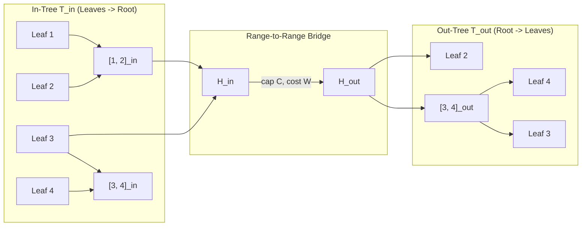
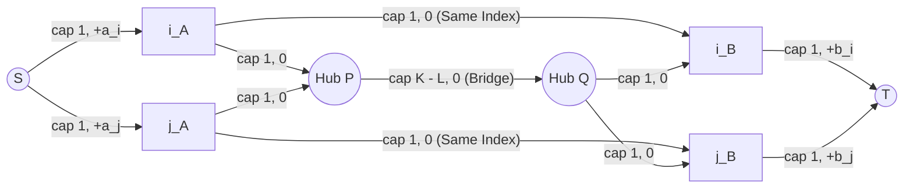
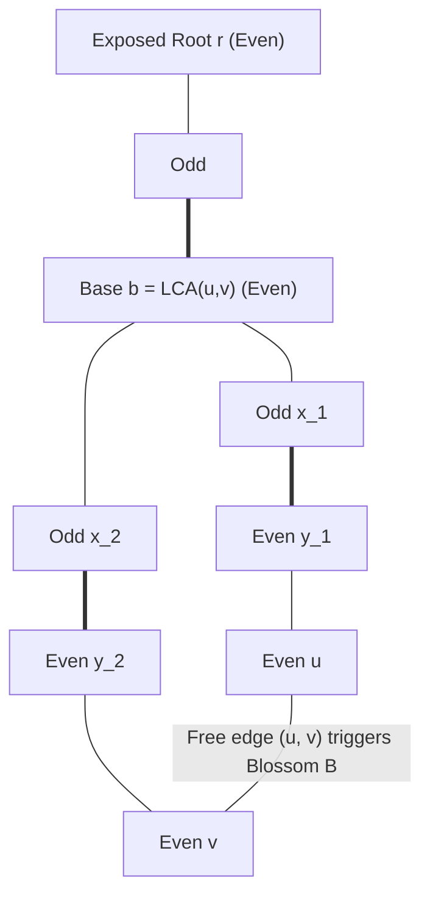
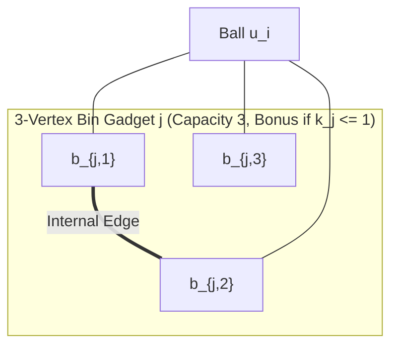

# Cohort 2 Research Monograph — Wave 5A (Iterations 93–97): Data-Structure Graph Sparsification, Simulated Min-Cost Flow (`模拟费用流`), and General Non-Bipartite Matching (`带花树`)

> [!IMPORTANT]
> **Cohort 2 Independent Redundancy & "Zero Magic Gadgets" Mandate**
> This monograph is authored independently by Cohort 2 (`FlowDeepInvestigator`) covering Iterations 93–97 (Wave 5A). In strict adherence to `flows_research/PLAN.md` and `AGENTS.md`, every technique and problem solution follows the **4-Step English-to-Graph Compilation Standard**:
> 1. **Step 1 — Non-Graph Diagnostic Signal (Recognition)**: How to identify the flow/cut/matching skeleton from raw constraints ($N, M, V_{\max}$) and why naive DP or greedy fails.
> 2. **Step 2 — Intermediate Algebraic / Logical Representation**: Translating English rules into pseudo-Boolean cut polynomials, flow conservation equations, or residual potential recurrences before drawing any graph.
> 3. **Step 3 — Reverse-Engineering Scratchpad (Mechanical Compilation)**: Compiling the algebraic forms into exact hub topologies, priority-queue regret keys, or blossom contractions.
> 4. **Step 4 — Hand-Checkable Toy Trace & Broken Gadget Counterexamples**: Concrete $N \le 4$ numerical traces alongside explicit proofs of how subtle structural omissions corrupt the optimum.

---

## Executive Overview: Crossing the $N = 10^5$ Barrier & Breaking Bipartite Symmetry

In classical network flows (Waves 1–4), a competitive programmer constructs an explicit directed graph $G = (V, E)$ and invokes a black-box solver (Dinic's algorithm or Successive Shortest Path MCMF). Wave 5A addresses the three structural frontiers where this paradigm breaks down:

1. **The $O(N^2)$ Edge Explosion in Implicit Geometric/Range Graphs (Iteration 93 — `数据结构优化建图`)**:
   When $N \le 5 \cdot 10^4$ and each element $u$ interacts with all elements $v$ in an interval, a 2D dominance box ($j < i, a_j \in [L_i, R_i]$), a tree path, a bitmask subcube, or a Manhattan/value neighborhood, explicitly materializing $E$ takes $\Theta(N^2)$ edges and exceeds both memory and time limits. We prove the **Hub-Factorization Theorem**: any bipartite interaction block $A \times B$ with capacity $\infty$ and additively separable cost $c(u, v) = \alpha(u) + \beta(v)$ can be factored through a single virtual hub $H$ without altering any minimum cut or minimum-cost flow, provided the **Directed Acyclic Hub Invariant (No False Paths)** holds. From this single theorem we derive the 5 canonical sparsification structures: 1D Segment Tree Out/In-Trees, Persistent Segment Trees, CDQ Divide-and-Conquer Value Chains, Heavy-Light Decomposition vs. Binary Lifting, and 0-1 Trie / 2D KD-Tree hubs.
2. **The $N \le 2 \cdot 10^5$ Solver Bottleneck in Structured MCMF (Iterations 94–95 — `模拟费用流`)**:
   Even with $O(N)$ edges, black-box MCMF cannot survive $N = 2 \cdot 10^5$ flow units unless we replace the graph solver itself with data structures (**Direction B: Flow $\to$ Non-Flow Fast Algorithm**). By reading priority-queue keys and segment-tree lazy tags as **exact encodings of residual edges $e^{\text{rev}} \in G_f$**, we compile:
   - **1D Time/Metric & Tree MCMF (Iteration 94)**: Single-heap regret greedy (`CF 865 D`), two-heap 1D Mouse-to-Hole matching with run-length multiplicity compression (`UOJ #455 [WC2019] 雪灾与外卖`), and LCA mergeable-heap / Slope Trick tree flows (`[ICPC WF 2018] Conquer the World`).
   - **Dynamic Segment Tree Residual Maintenance & Coupled Multi-Queue Simulation (Iteration 95)**: Maintaining minimum spine flow `min_f` on 1D intervals (`CF 802 O`) and enumerating all finite residual cycles/paths via $O(1)$ priority queues (`[NOI2019] 序列`, `CF 436 E`, `AGC 018 C`).
3. **Breaking Bipartite Symmetry (Iterations 96–97 — General Graph Matching & Algebraic Bridges)**:
   When odd cycles exist in a pairing graph, Totally Unimodular (TU) LP integrality collapses and flow algorithms fail (finding half-integral 2-matchings instead). We develop **Edmonds' Blossom Algorithm (`带花树`)**, the **Tutte–Berge Duality Formula**, the **Gallai–Edmonds Canonical Decomposition** for general-graph walk games, **Non-Bipartite Vertex/Triangle Splitting Gadgets** (`[WC2016] 挑战 NPC`, `CF 1089 B`), the **Algebraic Tutte Matrix** ($\operatorname{rank}(T) = 2\nu(G)$), and the boundary between **LGV Non-Intersecting Paths** and **Vertex-Disjoint MCMF**.

---

## Iteration 93: Data-Structure-Accelerated Flow Graphs (`数据结构优化建图`)

### 1. Step 1 — Non-Graph Diagnostic Signal (Recognition)

How do you recognize a Data-Structure-Accelerated Flow problem from a raw contest statement?

- **Constraint Fingerprint**: $N, M \le 5 \cdot 10^4$ (for Max-Flow / Min-Cut) or $N, M \le 10^4$ (for MCMF). A naive $O(N^2)$ graph has $2.5 \cdot 10^9$ edges (MLE/TLE), yet a sparse graph of $O(N \log N)$ vertices and $O(N \log N)$ edges has $\sim 5 \cdot 10^5$ edges—well within the fast regime of Dinic's algorithm on unit/hierarchical DAG networks!
- **Structural Clues in the Statement**:
  1. **Range Implications (`燃やす埋める` / Closure)**: *"If item $i$ is chosen (or placed in state $1$), then every item $j$ in interval $[l_i, r_i]$ (or with index $j < i$ and value $a_j \in [L_i, R_i]$) must also be chosen, or incurs an activation penalty."*
  2. **Range Matching / Assignment**: *"Weapon $i$ can hit any target in interval $[l_i, r_i]$ (or subtree $T_u$, or tree path $u \leftrightarrow v$, or 2D box $[x_1, x_2] \times [y_1, y_2]$)."*
  3. **Absolute Value / Coordinate Cost Coupling (`|a_i - a_j|`)**: *"Node $i$ can connect to any earlier node $j < i$ at cost $|a_i - a_j|$."*
- **Why Naive DP / Greedy Fails**: The underlying problem still has global capacity constraints, non-nested intervals, or cyclic implication closures that require a genuine Max-Flow, Min-Cut, or MCMF solver; data structures cannot eliminate the flow solver here, but they can **compress the edge set $E$** from $O(N^2)$ to $O(N \log^c N)$.

---

### 2. Step 2 — Intermediate Algebraic Representation & The Hub-Factorization Theorem

Before introducing any segment tree or trie, we must establish the exact algebraic condition under which a dense bipartite edge block $A \times B$ can be replaced by a single virtual hub vertex $H$.

#### Theorem 93.1 (Hub-Factorization Equivalence for Minimum Cuts and Minimum-Cost Flows)

Let $A, B \subseteq V$ be two subsets of vertices. Suppose the original problem requires a complete directed bipartite edge set $A \times B = \{(u, v) : u \in A, v \in B\}$ where every edge $(u, v)$ has **infinite capacity** $c(u, v) = \infty$ and an **additively separable cost** $\text{cost}(u, v) = \alpha(u) + \beta(v)$. Then replacing the $|A| \cdot |B|$ edges with a single virtual hub vertex $H$, together with:
- $|A|$ in-edges $(u \to H)$ of capacity $\infty$ and cost $\alpha(u)$ for each $u \in A$, and
- $|B|$ out-edges $(H \to v)$ of capacity $\infty$ and cost $\beta(v)$ for each $v \in B$,

preserves the exact value of every $(S, T)$-minimum cut and every feasible $(S, T)$-flow cost.

##### Proof (Dual Cut Polynomial View & Primal Flow Conservation View)

1. **Minimum Cut / Pseudo-Boolean View (`燃やす埋める`)**:
   In a binary partition $x \in \{0, 1\}^V$ (where $x_w = 1$ means $w \in S$ and $x_w = 0$ means $w \in T$), the $|A| \cdot |B|$ infinite-capacity edges $(u \to v)$ encode the hard implication polynomial:
   $$\Phi_{A \times B}(x) = \sum_{u \in A} \sum_{v \in B} \infty \cdot x_u (1 - x_v) = 0 \iff \forall u \in A, \forall v \in B, \; x_u \le x_v \iff \max_{u \in A} x_u \le \min_{v \in B} x_v.$$
   Introduce a single auxiliary binary variable $x_H \in \{0, 1\}$ for the hub $H$, with the linear hub polynomial:
   $$\hat{\Phi}_H(x, x_H) = \sum_{u \in A} \infty \cdot x_u (1 - x_H) + \sum_{v \in B} \infty \cdot x_H (1 - x_v).$$
   Minimizing over $x_H \in \{0, 1\}$ yields:
   $$\min_{x_H \in \{0, 1\}} \hat{\Phi}_H(x, x_H) = 0 \iff \exists x_H \in \{0, 1\} \text{ s.t. } \max_{u \in A} x_u \le x_H \le \min_{v \in B} x_v \iff \max_{u \in A} x_u \le \min_{v \in B} x_v.$$
   Thus $\min_{x_H \in \{0, 1\}} \hat{\Phi}_H(x, x_H) \equiv \Phi_{A \times B}(x)$ identically on $\{0, 1\}^V$, while reducing $|A| \cdot |B|$ terms to $|A| + |B|$ terms!
2. **Primal Flow & Separable Cost View**:
   For any detailed flow $f_{u,v} \ge 0$ on $A \times B$, define the aggregated hub flows $F_{\text{in}}(u) = \sum_{v \in B} f_{u,v}$ on $(u \to H)$ and $F_{\text{out}}(v) = \sum_{u \in A} f_{u,v}$ on $(H \to v)$. Then flow conservation holds at $H$:
   $$\sum_{u \in A} F_{\text{in}}(u) = \sum_{u \in A} \sum_{v \in B} f_{u,v} = \sum_{v \in B} F_{\text{out}}(v),$$
   and the total cost factors as:
   $$\sum_{u \in A} \sum_{v \in B} (\alpha(u) + \beta(v)) f_{u,v} = \sum_{u \in A} \alpha(u) F_{\text{in}}(u) + \sum_{v \in B} \beta(v) F_{\text{out}}(v).$$
   Conversely, by the Flow Decomposition Theorem, any non-negative flow through $H$ with $\sum_{u \in A} F_{\text{in}}(u) = \sum_{v \in B} F_{\text{out}}(v)$ decomposes into pairwise paths $(u \to H \to v)$ of identical cost. $\blacksquare$

> [!WARNING]
> **The Two Necessary Conditions of Theorem 93.1**
> 1. **Why Internal Hub Capacities Must Be $\infty$ (or Controlled by a Bottleneck)**: If each individual edge $(u, v) \in A \times B$ had finite capacity $c(u, v) = 1$, factoring $A \times B$ through a single hub $H$ with capacity $\infty$ on $(u \to H)$ and $(H \to v)$ would allow a single pair $(u, v)$ to send $\min(\text{out}(u), \text{in}(v)) > 1$ units of flow! However, if either $\text{cap}(S \to u) = 1$ or $\text{cap}(v \to T) = 1$ (e.g., unit-capacity matching), any path $(u \to H \to v)$ is automatically bottlenecked to $\le 1$ by the endpoint!
> 2. **The Directed Acyclic Hub Invariant (No False Paths)**: If two distinct range operations share hub vertices, a directed path $u \to \dots \to H \to \dots \to v$ in the hub subgraph must exist **if and only if** $(u, v) \in E$. In particular, you may **never** use bidirectional edges inside a hub tree, nor may you attach both incoming query edges $u \to H$ and outgoing query edges $H \to v$ to a single tree where ancestors and descendants can reach each other in both directions.

---

### 3. Step 3 — Reverse-Engineering the 5 Canonical Sparsification Structures

Suppose we have a universe of base vertices $V = \{1, 2, \dots, N\}$. To support arbitrary range connections without creating false paths, we decompose every range into $O(\log N)$ (or $O(1)$) canonical subsets from a hierarchical family $\mathcal{F}$.

#### Structure 1: 1D Segment Tree Out-Tree & In-Tree (`线段树优化建图` — `CF 786 B`, `CF 1045 A`)

Suppose we need to add directed edges from a vertex $u$ to all $v \in [l, r]$ (**Point-to-Range**), from all $u \in [l, r]$ to a vertex $v$ (**Range-to-Point**), or from all $u \in [l_1, r_1]$ to all $v \in [l_2, r_2]$ (**Range-to-Range**).

- **Compilation into Two Opposite-Orientation Trees**:
  1. **The Out-Tree $T_{\text{out}}$ (Top-Down Distribution)**:
     Create a segment tree over $[1, N]$ where each internal node $p$ represents interval $[L_p, R_p]$ and has directed edges **downward** to its children:
     $$p \to \text{lc}(p) \quad (\text{cap } \infty, \text{ cost } 0), \qquad p \to \text{rc}(p) \quad (\text{cap } \infty, \text{ cost } 0).$$
     Thus, injecting flow into node $p$ allows it to reach **precisely** the leaves in $[L_p, R_p]$ and nothing outside $[L_p, R_p]$.
  2. **The In-Tree $T_{\text{in}}$ (Bottom-Up Aggregation)**:
     Create a second segment tree over $[1, N]$ where each internal node $q$ receives directed edges **upward** from its children:
     $$\text{lc}(q) \to q \quad (\text{cap } \infty, \text{ cost } 0), \qquad \text{rc}(q) \to q \quad (\text{cap } \infty, \text{ cost } 0).$$
     Thus, extracting flow from node $q$ aggregates flow from **precisely** the leaves in $[L_q, R_q]$.
  3. **Leaf Sharing (Vertex Count Reduction from $4N$ to $3N$)**:
     Can $T_{\text{out}}$ and $T_{\text{in}}$ share the $N$ leaf vertices $1, \dots, N$?
     Yes! In $T_{\text{out}}$, edges only *enter* leaves (`parent_out -> leaf`); in $T_{\text{in}}$, edges only *leave* leaves (`leaf -> parent_in`). Passing through a leaf (`parent_out -> leaf -> parent_in`) simply means element $i \in [1, N]$ received flow from an incoming range and forwarded it to an outgoing range, which is a valid 2-step flow through base vertex $i$! (If each base vertex $i$ has an internal vertex capacity $c_i$, split leaf $i$ into $i_{\text{in}}$ in $T_{\text{out}}$ and $i_{\text{out}}$ in $T_{\text{in}}$ with edge $i_{\text{in}} \to i_{\text{out}}$ of capacity $c_i$).
  4. **Range-to-Range $[l_1, r_1] \to [l_2, r_2]$ with Bottleneck Capacity $C$ and Cost $W$**:
     Decompose $[l_1, r_1]$ into $k_1 \le 2\lceil \log_2 N \rceil$ canonical nodes $q_1, \dots, q_{k_1} \in T_{\text{in}}$, and $[l_2, r_2]$ into $k_2 \le 2\lceil \log_2 N \rceil$ canonical nodes $p_1, \dots, p_{k_2} \in T_{\text{out}}$. Do **not** connect all $k_1 \times k_2$ pairs! Instead, create a single transition bridge $H_{\text{in}} \xrightarrow{\text{cap } C, \text{ cost } W} H_{\text{out}}$, connect $q_a \to H_{\text{in}}$ ($\text{cap } \infty, \text{cost } 0$), and connect $H_{\text{out}} \to p_b$ ($\text{cap } \infty, \text{cost } 0$). This uses $k_1 + k_2 + 1 = O(\log N)$ edges instead of $O(\log^2 N)$!



---

#### Structure 2: Persistent Segment Tree 2D Prefix-Interval Sparsification (`可持久化线段树优化建图` — `BZOJ 3218 a + b Problem`)

- **Problem Archetype (`BZOJ 3218`)**:
  We have $N$ items arranged in sequence $1, \dots, N$, where item $i$ has value $a_i$ and query interval $[L_i, R_i]$. If item $i$ is colored black (paying penalty $p_i$), any earlier item $j < i$ that is colored white AND satisfies $a_j \in [L_i, R_i]$ triggers an implication:
  $$(i \text{ is affected}) \impliedby \exists j < i \text{ s.t. } (j \text{ is white}) \land (L_i \le a_j \le R_i).$$
- **Why 1D Segment Tree Fails**:
  The condition $(j < i) \land (L_i \le a_j \le R_i)$ is a **2D orthogonal dominance / rectangle query** in $(j, a_j)$-space! Building a 2D segment tree takes $O(N \log^2 N)$ vertices and edges.
- **Compilation via Prefix-Versioned Persistent Out-Tree**:
  Because the first coordinate is a **prefix** $j \in [1, i-1]$ and the second coordinate is an interval $a_j \in [L_i, R_i]$, we sweep $i = 1, \dots, N$ and maintain a **Persistent Segment Tree over the value domain** (coordinate-compressed to $[1, U]$ where $U \le N$):
  1. At step $i$, before inserting $i$, **Version $i-1$** of the persistent segment tree contains **only** the elements $j \in \{1, \dots, i-1\}$!
  2. Therefore, querying range $[L_i, R_i]$ on **Version $i-1$** visits $O(\log N)$ nodes of Version $i-1$ whose subtree leaves are **exclusively** elements $j < i$ with $a_j \in [L_i, R_i]$! No future element $j \ge i$ exists in Version $i-1$, so zero false paths to $j \ge i$ can ever occur!
  3. After querying Version $i-1$ for item $i$, we create **Version $i$** by updating position $a_i$ along a root-to-leaf path of $O(\log N)$ new nodes. For every newly created internal node $v_{\text{new}}$, we add edges $v_{\text{new}} \to \text{lc}(v_{\text{new}})$ and $v_{\text{new}} \to \text{rc}(v_{\text{new}})$ with capacity $\infty$.
  4. **Crucial Edge Case — Duplicate Values ($a_i = a_j$ for $j < i$)**:
     When inserting $i$ at leaf position $a_i$, if an earlier element $j < i$ already occupied leaf $a_i$ in Version $i-1$ with leaf node $v_{\text{old}}$, creating the new leaf node $v_{\text{new}}$ forVersion $i$ must **not** overwrite and orphan $v_{\text{old}}$! We must add two edges from $v_{\text{new}}$:
     $$v_{\text{new}} \to \text{item}_i \quad (\text{cap } \infty), \qquad v_{\text{new}} \to v_{\text{old}} \quad (\text{cap } \infty).$$
     This chains all occurrences of value $a_i$ in reverse chronological order so that any later query $k > i > j$ reaching $v_{\text{new}}$ reaches **both** $\text{item}_i$ and (via $v_{\text{old}}$) $\text{item}_j$!
  - **Complexity**: $O(N \log N)$ vertices and $O(N \log N)$ edges total.

---

#### Structure 3: CDQ Divide-and-Conquer Value-Chain Sparsification (`CDQ 分治优化建图` — `[省选联考 2019] 通信`)

- **Problem Archetype (`[省选联考 2019] 通信`)**:
  There are $N \le 1000$ communication posts with signal values $a_1, \dots, a_N$. Post $i$ can either connect directly to the headquarters at cost $W$, or connect to **at most one** earlier post $j < i$ at cost $|a_i - a_j|$ (each earlier post $j$ can serve as the predecessor for at most 1 later post $i$). Minimize total cost.
- **Step 2 (Algebraic Bottleneck)**:
  In standard bipartite min-cost path cover, each node $i$ has $i_{\text{in}}$ (needs 1 predecessor) and $j_{\text{out}}$ (can supply 1 successor). The edge $(i_{\text{in}} \to j_{\text{out}})$ exists for $j < i$ with cost $|a_i - a_j|$.
  Notice two things:
  1. We have a 2D condition $j < i$, AND
  2. The cost $|a_i - a_j|$ is **not naively separable** unless we split into two cases: $a_i \ge a_j$ (where $|a_i - a_j| = a_i - a_j$) and $a_i \le a_j$ (where $|a_i - a_j| = a_j - a_i$)!
- **Step 3 (CDQ Value-Chain Compilation)**:
  Invoke `solve(L, R)` on index range $[L, R]$ with midpoint $M = \lfloor (L+R)/2 \rfloor$:
  1. Recursively call `solve(L, M)` and `solve(M+1, R)` to handle all pairs inside $[L, M]$ and inside $[M+1, R]$.
  2. Now we only need to represent cross-pairs $(j, i)$ with $j \in [L, M]$ and $i \in [M+1, R]$! Notice that **every** $j \in [L, M]$ automatically satisfies $j < i$ for **every** $i \in [M+1, R]$! Thus, inside this cross-step, the time condition $j < i$ is **100% decoupled**!
  3. Collect all distinct values $\{v_1 < v_2 < \dots < v_k\}$ appearing in $\{a_x : x \in [L, R]\}$. Create $k$ auxiliary hub nodes $H_1, H_2, \dots, H_k$ and connect adjacent hubs in **both directions** with telescoping value-difference costs:
     $$H_{r} \to H_{r+1} \quad (\text{cap } \infty, \text{ cost } v_{r+1} - v_r), \qquad H_{r+1} \to H_{r} \quad (\text{cap } \infty, \text{ cost } v_{r+1} - v_r).$$
  4. Connect **only right-half inputs** $i \in [M+1, R]$ into their value hub:
     $$i_{\text{in}} \to H_{\text{rank}(a_i)} \quad (\text{cap } 1, \text{ cost } 0),$$
     and connect value hubs out to **only left-half outputs** $j \in [L, M]$:
     $$H_{\text{rank}(a_j)} \to j_{\text{out}} \quad (\text{cap } 1, \text{ cost } 0).$$
  5. **Telescoping Cost Proof**: Any path from $i_{\text{in}}$ ($i \in [M+1, R]$) to $j_{\text{out}}$ ($j \in [L, M]$) along the chain $H_{\text{rank}(a_i)} \leadsto H_{\text{rank}(a_j)}$ has shortest-path cost:
     $$\sum_{r=\min(\text{rank}(a_i), \text{rank}(a_j))}^{\max(\text{rank}(a_i), \text{rank}(a_j))-1} (v_{r+1} - v_r) = |a_i - a_j|!$$
  - **Complexity**: At each of the $\log_2 N$ levels of the CDQ recursion tree, the hubs and edges across all intervals $[L, R]$ at that level sum to $\le 3N$ vertices and $\le 4N$ edges! Thus total vertices $= O(N \log N)$ and total edges $= O(N \log N)$—reducing $N^2 = 10^6$ edges to $\sim 2 \cdot 10^4$ edges!

---

#### Structure 4: Tree Heavy-Light Decomposition vs. Binary Lifting (`树剖 / 倍增优化建图`)

When constraints apply to paths $u \leftrightarrow v$ on a tree $T$:
- **Method A — Heavy-Light Decomposition (HLD) + Segment Tree**:
  Decompose the tree into heavy chains ($O(N)$ vertices in the underlying 1D Segment Tree). Each tree path $u \leftrightarrow v$ partitions into $O(\log N)$ contiguous heavy-chain intervals, each of which splits into $O(\log N)$ segment-tree hubs.Using a single range bridge node per query gives **$O(N)$ hub vertices** and **$O(M \log^2 N)$ edges** (or $O(M \log N)$ if prefix/suffix chain hubs are precomputed along heavy chains!).
- **Method B — Binary Lifting Hubs (`倍增优化建图`)**:
  Create $O(N \log N)$ hubs $P_{u, k}$ representing the path of $2^k$ vertices starting at $u$ and going up toward the root, with downward edges $P_{u, k} \to P_{u, k-1}$ and $P_{u, k} \to P_{\text{anc}(u, 2^{k-1}), k-1}$ of capacity $\infty$ (for an Out-Tree).
  - **Idempotent 4-Hub Trick (When Internal Edges Have Capacity $\infty$)**: Because union of implications is idempotent ($x_u \le x_v \land x_u \le x_v \iff x_u \le x_v$), just like RMQ Sparse Table, any vertical path from $u$ up to ancestor $a$ of length $L$ can be covered by **two overlapping $2^k$-hubs** ($k = \lfloor \log_2 L \rfloor$) instead of $O(\log N)$ disjoint hubs! Thus each path query $u \leftrightarrow v$ (split at $\text{lca}(u, v)$) needs at most **4 edges**!
  - **When Overlapping Binary Lifting Hubs are Legal vs. Illegal**:
    - *Legal*: When all internal hub-to-hub and hub-to-leaf edges have capacity $\infty$ (e.g., Project Selection / `燃やす埋める`, or Bipartite Matching where capacity $1$ lives only on $(S \to \text{query})$ and $(\text{leaf} \to T)$). Even if two overlapping hubs $P_1, P_2$ both reach leaf $w$, the parallel $\infty$-paths from the query node to $w$ still have total capacity $\infty$, while the leaf edge $(w \to T)$ still restricts $w$ to capacity $1$!
    - *Illegal*: When capacities are placed on the internal hub nodes themselves (e.g., if each hub $P_{u, k}$ has a finite node capacity or non-zero cost per unit flow, overlapping hubs would double-charge or double-allow flow!).

---

#### Structure 5: 0-1 Binary Trie & 2D KD-Tree Sparsification (`Trie / KD-Tree 优化建图`)

1. **0-1 Binary Trie (`字典树优化建图`)**:
   Suppose $u$ connects to all $v$ such that $a_u \oplus a_v \le K$ (or $a_v$ has a given prefix). Insert all $a_v$ into a $B$-bit 0-1 Trie where internal nodes have downward $\infty$-edges (Out-Tree) or upward $\infty$-edges (In-Tree). For any query $(a_u, K)$, walk down the Trie following the bits of $a_u \oplus K$: whenever bit $b$ of $K$ is $1$, the subtree where $a_u \oplus a_v$ has bit $b$ equal to $0$ is completely $\le K$, so we add a single edge to that child hub and continue down the other child! This adds at most $B = O(\log V_{\max})$ edges per query.
2. **2D KD-Tree (`KD-Tree 优化建图`)**:
   When points $(x_i, y_i) \in \mathbb{R}^2$ are queried by arbitrary axis-aligned rectangles $[x_1, x_2] \times [y_1, y_2]$ and capacities/memories forbid $O(N \log^2 N)$ 2D Segment Trees, build a 2D KD-Tree of **exact size $O(N)$ vertices and $O(N)$ internal $\infty$-edges**. Each rectangle query connects to $O(\sqrt{N})$ canonical KD-Tree subtrees.

---

### 4. Step 4 — Hand-Checkable Toy Trace & Broken Gadget Counterexamples

#### Worked Toy Trace ($N = 4$): CDQ Value-Chain on `[省选联考 2019] 通信`

Suppose $N = 4$ posts have values $a = [5, 1, 4, 2]$ and direct headquarters cost $W = 10$.
Consider the CDQ cross-step for $[L, R] = [1, 4]$ with midpoint $M = 2$:
- **Left Half ($j \in \{1, 2\}$)**: $a_1 = 5, a_2 = 1$.
- **Right Half ($i \in \{3, 4\}$)**: $a_3 = 4, a_4 = 2$.
- **Sorted Unique Values in $[1, 4]$**: $v_1 = 1, v_2 = 2, v_3 = 4, v_4 = 5$, corresponding to hubs $H_1(1), H_2(2), H_3(4), H_4(5)$.
- **Bidirectional Value Chain Edges**:
  $$H_1(1) \xleftrightarrow{\text{cost } 1} H_2(2) \xleftrightarrow{\text{cost } 2} H_3(4) \xleftrightarrow{\text{cost } 1} H_4(5) \quad (\text{all cap } \infty).$$
- **Right-Half Entry Edges ($i \in \{3, 4\}$)**: $3_{\text{in}} \xrightarrow{0} H_3(4)$ and $4_{\text{in}} \xrightarrow{0} H_2(2)$.
- **Left-Half Exit Edges ($j \in \{1, 2\}$)**: $H_4(5) \xrightarrow{0} 1_{\text{out}}$ and $H_1(1) \xrightarrow{0} 2_{\text{out}}$.
- **Verification**:
  - From $3_{\text{in}}$ ($a_3 = 4$) to $1_{\text{out}}$ ($a_1 = 5$): path $3_{\text{in}} \to H_3(4) \xrightarrow{1} H_4(5) \to 1_{\text{out}}$ has cost $1 = |4 - 5|$.
  - From $3_{\text{in}}$ ($a_3 = 4$) to $2_{\text{out}}$ ($a_2 = 1$): path $3_{\text{in}} \to H_3(4) \xrightarrow{2} H_2(2) \xrightarrow{1} H_1(1) \to 2_{\text{out}}$ has cost $2 + 1 = 3 = |4 - 1|$.
  - Can $3_{\text{in}}$ reach $4_{\text{out}}$ through this chain? **No!** Because $4_{\text{out}}$ is in the right half $[3, 4]$, so no exit edge $H_2(2) \to 4_{\text{out}}$ was added in this cross-step (pair $(3, 4)$ is handled inside the recursive call `solve(3, 4)`!).

#### Broken Gadget Counterexamples (3 Fatal Sparsification Bugs)

1. **Broken Gadget A — Merging $T_{\text{in}}$ and $T_{\text{out}}$ Internal Nodes**:
   Suppose a solver creates only *one* Segment Tree with both downward edges ($p \to \text{child}$, cap $\infty$) and upward edges ($\text{child} \to p$, cap $\infty$). Then every internal node is strongly connected to the root, so a single edge into *any* node can reach **every leaf in $[1, N]$**! $T_{\text{in}}$ and $T_{\text{out}}$ may share *leaves*, never *internal nodes*.
2. **Broken Gadget B — Omitting $v_{\text{new}} \to v_{\text{old}}$ at Duplicate Keys in Persistent Segment Tree**:
   In `BZOJ 3218`, suppose $a_1 = 5$ and $a_2 = 5$. When building Version 2 at leaf $5$, if $v_{\text{new}}$ only points to $\text{item}_2$ and omits $v_{\text{new}} \to v_{\text{old}}$, then item $3$ querying $[5, 5]$ on Version 2 can only cut $\text{item}_2$ and completely misses the implication from $\text{item}_1$, allowing an invalid cut where $x_3 = 1$ and $x_1 = 0$!
3. **Broken Gadget C — Attaching Both Halves to the CDQ Value Chain**:
   If in `solve(L, R)` we attached $i_{\text{in}} \to H_{\text{rank}(a_i)}$ and $H_{\text{rank}(a_i)} \to i_{\text{out}}$ for **all** $i \in [L, R]$ at the root level without CDQ divide-and-conquer, then $1_{\text{in}}$ could walk along the chain to $4_{\text{out}}$, violating the DAG time constraint $j < i$ and creating illegal cycles!

---

## Iteration 94: Simulated Min-Cost Flow I (`模拟费用流` I) — Regret Greedy (`反悔贪心`), 1D Line Matching (`老鼠进洞`) & Tree Slope Trick

### 1. Step 1 — Non-Graph Diagnostic Signal (Recognition)

When a problem naturally models as Min-Cost (Max-)Flow (MCMF)—matching supplies to demands, buying/selling items over time, or pairing nodes on a line/tree—check the constraints:
- **Constraint Fingerprint**: $N, M \le 10^5$–$5 \cdot 10^5$ (and capacities $c_i$ up to $10^9$). Standard SSP or Primal–Dual MCMF takes $O(F \cdot E \log V) = \Omega(N^2)$ and **will TLE**.
- **Topological Clues**:
  1. **1D Prefix / Time-Series Structure**: Any item at $j$ can pair with any item at $i > j$ (`CF 865 D — Buy Low Sell High`, `Olympiad in Informatics`).
  2. **1D Metric Line (`老鼠进洞`)**: Supplies at $x_i \in \mathbb{R}$ and demands at $y_j \in \mathbb{R}$ pay $|x_i - y_j| + w_i + v_j$ (`UOJ #455 [WC2019] 雪灾与外卖`).
  3. **Tree Metric (`树上老鼠进洞`)**: Supplies and demands on a weighted tree $T$ pay tree distance $\operatorname{dist}_T(u, v) = d(u) + d(v) - 2d(\operatorname{lca}(u, v))$ (`[ICPC WF 2018] Conquer the World`, `Luogu P6943`).
- **Why Pure Greedy Fails**: Choosing the locally cheapest pair at step $i$ locks a resource that a later step $k > i$ needs much more urgently. We need the **exact residual augmenting paths of MCMF**, executed via Priority Queues in $O(N \log N)$!

---

### 2. Regret Greedy as Exact Residual Edge Reversal (`反悔贪心` $\leftrightarrow G_f$)

#### Theorem 94.1 (Bijection Between Priority-Queue Regret Items and Residual Arcs in $G_f$)

Consider a sequential MCMF network where at step $i = 1, \dots, N$, an arriving demand node $i$ seeks the minimum-cost path from $S$ in the current residual network $G_f$.
If every augmenting path from $S$ to $i$ in $G_f$ has cost separable as $\text{key}(u) + \text{local}(i)$, then maintaining the multiset of active residual sources $u$ in a min-heap ordered by $\text{key}(u)$ simulates Successive Shortest Path (SSP) **exactly**:
- **Direct Match**: Popping an original unmatched supply $j$ with $\text{key}(j)$ corresponds to augmenting along the forward edge $S \to j \to i$.
- **Regret Match**: Pushing a new item with $\text{key}_{\text{regret}}(i)$ into the heap after matching $(j, i)$ corresponds to inserting the **reverse residual edge** $i \to j$ of cost $-c(j, i)$ into $G_f$!

#### Case Study & The "Push Once vs. Push Twice" Invariant (`CF 865 D — Buy Low Sell High`)

- **Problem (`CF 865 D`)**: On day $i \in \{1, \dots, N\}$ ($N \le 3 \cdot 10^5$), the stock price is $p_i$. Each day you can **either buy at most 1 share, sell at most 1 share, or do nothing** (so net action $a_i \in \{-1, 0, +1\}$). Maximize profit $\sum_{i=1}^N a_i p_i$ subject to $\sum_{i=1}^t a_i \le 0$ for all $t$ (cannot sell more shares than bought so far).
- **Step 2 (Algebraic / Residual Formulation)**:
  Why do some regret greedy problems push the regret key **once**, whereas `CF 865 D` pushes $p_i$ into the min-heap **twice** when day $i$ sells a share?
  Look at the state space of day $i$: $a_i \in \{-1 \text{ (buy)}, \; 0 \text{ (idle)}, \; +1 \text{ (sell)}\}$.
  - Initially, before day $i$ is matched, day $i$ is in state $a_i = 0$ (idle).
    To transition from $a_i = 0 \to -1$ (buy 1 share at day $i$), the cost is $+p_i$. This is **1 unit of capacity** at price $p_i$.
  - Suppose day $i$ instead pops the minimum price $p_j < p_i$ from the min-heap and transitions from $a_i = 0 \to +1$ (sell at day $i$), gaining profit $p_i - p_j$.
  - Now day $i$ is in state $a_i = +1$ (sell)! How many times can day $i$'s action be decremented by $-1$ in the residual network? **TWICE!**
    1. **Decrement 1 ($a_i : +1 \to 0$, "Regret the sale at day $i$")**: Canceling the sale at day $i$ (so the share from day $j$ is sold on a later day $k > i$ instead) changes profit by $(p_k - p_j) - (p_i - p_j) = p_k - p_i$. This is a residual supply at cost $p_i$.
    2. **Decrement 2 ($a_i : 0 \to -1$, "Actually buy a share on day $i$")**: Once day $i$ is back at $a_i = 0$, it can still buy a share to sell on a later day $k' > i$ for profit $p_{k'} - p_i$. This is a **second** residual supply at cost $p_i$!
  - **General Rule (The Residual Capacity Invariant)**:
    - If day $i$ can either buy OR sell (net change from $+1$ to $-1$ has total residual capacity **2** at the same marginal cost $p_i$), push $p_i$ **twice** upon selling (or equivalently: push $p_i$ once for the unused buy option at the start of day $i$, and if day $i$ sells by popping $p_j$, push $p_i$ a second time as the regret arc!).
    - If a vertex $i$ is purely a demand of capacity $1$ (e.g., matching problem $A \to B$ where $i \in B$ cannot also act as a supply in $A$), push the regret key **only once**!

---

### 3. 1D Line Mouse-to-Hole MCMF (`老鼠进洞` — `UOJ #455 [WC2019] 雪灾与外卖`)

- **Problem Archetype (`UOJ #455 [WC2019] 雪灾与外卖`)**:
  On a 1D number line, there are $N$ mice at coordinates $x_1 \le \dots \le x_N$ and $M$ holes at coordinates $y_1 \le \dots \le y_M$ ($N, M \le 10^5$). Hole $j$ has capacity $c_j \le 10^9$ and per-mouse entrance fee $w_j \ge 0$. Every mouse **must** enter a hole; the cost for mouse $i$ to enter hole $j$ is $|x_i - y_j| + w_j$. Find the minimum total cost.

#### Step 2: Algebraic Decoupling of $|x_i - y_j|$ via Left-to-Right Spine Scanning

Sort all mice and holes together by coordinate from left to right. When scanning a new event at coordinate $z$ to the right of all previous events $z' \le z$, the absolute value $|z - z'| = z - z'$ is **strictly linear**!
Specifically, we maintain the invariant that **every mouse seen so far is already matched** (using a dummy hole at $-\infty$ with cost $+\infty$ if needed):

1. **Event Type A — A Mouse Arrives at Coordinate $x_i$**:
   - The mouse must match with the best available hole slot to its left, stored in `Heap_Hole` with key $v$.
   - The cost incurred is:
     $$\Delta \text{Cost} = x_i + v.$$
   - **Residual Update**: Now mouse $x_i$ is matched at cost $x_i + v$. If a future hole $y_j \ge x_i$ steals mouse $x_i$ (replacing its old match of cost $x_i + v$ with the new right-going match of cost $y_j - x_i + w_j$), the marginal cost change is:
     $$(y_j - x_i + w_j) - (x_i + v) = (y_j + w_j) + (-2x_i - v).$$
     Thus we push a **regret mouse** into `Heap_Mouse` with key:
     $$u_{\text{new}} = -2x_i - v.$$

2. **Event Type B — A Hole Arrives at Coordinate $y_j$ with Capacity $c_j$ and Cost $w_j$**:
   - Since all mice to the left of $y_j$ are already matched, Hole $y_j$ first looks for **negative-cost augmenting cycles** by stealing mice from `Heap_Mouse` whose key $u$ satisfies:
     $$(y_j + w_j) + u < 0.$$
   - Suppose Hole $y_j$ pops $k \le c_j$ units of mice from `Heap_Mouse` (with keys $u_1, u_2, \dots, u_k$). For each unit $u_s$:
     $$\Delta \text{Cost} = y_j + w_j + u_s < 0.$$
   - **What Residual Edges Does This Create?**
     Augmenting along the cycle $T \leftarrow y_j \leftarrow x_i \leftarrow y_0 \leftarrow T$ changes two things in $G_f$:
     - **(i) The Old Hole $y_0$ Becomes Free Again (`Heap_Hole` Update)**:
       If a future mouse $x_k \ge y_j$ wants to undo this theft (matching $x_k \to y_j$ and sending $x_i$ back to its previous match $v$), the new cost is $(x_k - y_j + w_j) + (x_i + v)$ whereas the current cost is $(y_j - x_i + w_j)$. Their difference is:
       $$(x_k - y_j + w_j) + (x_i + v) - (y_j + w_j + u_s + x_i + v) = x_k + (-2y_j - u_s).$$
       Thus for each popped unit $u_s$, we push into `Heap_Hole`:
       $$v_{\text{regret}} = -2y_j - u_s.$$
     - **(ii) The New Hole $y_j$ Becomes Saturated (`Heap_Mouse` Collapse!)**:
       What if a future **hole** $y_{j'} > y_j$ wants to steal mouse $x_i$ away from $y_j$ (leaving $y_j$ unused)? The cost changes from $(y_j - x_i + w_j)$ to $(y_{j'} - x_i + w_{j'})$, so the difference is:
       $$(y_{j'} - x_i + w_{j'}) - (y_j - x_i + w_j) = (y_{j'} + w_{j'}) + (-y_j - w_j).$$
       **Crucial Observation**: The key $-y_j - w_j$ is **completely independent of $u_s$**! All $k$ mice absorbed by Hole $y_j$ collapse into a **single run-length compressed entry** in `Heap_Mouse`:
       $$\text{Heap\_Mouse.push}\big(\text{key} = -y_j - w_j, \; \text{count} = k\big).$$
     - **(iii) Unused Capacity of Hole $y_j$ (`Heap_Hole` Direct Slot)**:
       The remaining $c_j - k$ unused slots of Hole $y_j$ can be directly used by future mice $x_k \ge y_j$ at cost $x_k - y_j + w_j = x_k + (-y_j + w_j)$, so they form a **single run-length compressed entry** in `Heap_Hole`:
       $$\text{Heap\_Hole.push}\big(\text{key} = -y_j + w_j, \; \text{count} = c_j - k\big).$$

#### Theorem 94.2 (Amortized $O((N + M) \log(N + M))$ Complexity Independent of Capacities $c_j$)

Why does this two-heap algorithm run in $O((N + M) \log(N + M))$ even when $c_j = 10^9$ and Mice/Holes have arbitrary multiplicities?
Track the potential function $\Phi = |\text{Heap\_Mouse}| + |\text{Heap\_Hole}|$ (number of `(key, count)` pairs across both heaps):
- Each Mouse event pops some number of full pairs from `Heap_Hole`, splits at most $1$ pair, and pushes $1$ pair per popped/split pair into `Heap_Mouse` $\implies \Delta \Phi \le +2$.
- Each Hole event pops some number of full pairs from `Heap_Mouse`, pushes $1$ pair per popped pair into `Heap_Hole` (net change $0$ to $\Phi$), splits at most $1$ pair in `Heap_Mouse` ($+1$), pushes at most $1$ collapsed pair `(-y_j - w_j, k)` into `Heap_Mouse` ($+1$), and pushes at most $1$ unused-capacity pair `(-y_j + w_j, c_j - k)` into `Heap_Hole` ($+1$) $\implies \Delta \Phi \le +3$.
Hence at most $2N + 3M$ heap insertions ever occur! $\blacksquare$

---

### 4. Tree MCMF via Mergeable Heaps & Slope Trick (`[ICPC WF 2018] Conquer the World`, `Luogu P6943`)

- **Problem Archetype (`[ICPC WF 2018] Conquer the World`)**:
  Given a weighted tree $T$ with $N \le 2.5 \cdot 10^5$ vertices, vertex $u$ starts with $x_u$ armies (supply) and needs at least $y_u$ armies (mandatory demand). Moving 1 army along edge $e$ costs $w_e$. Find the minimum total cost.

#### Step 2 & 3: LCA Distance Decomposition & Mergeable Regret Heaps

Let $d(u)$ be the weighted distance from the root $1$ to $u$. For any supply at $a$ and demand at $b$, the path cost in $T$ is:
$$\operatorname{dist}_T(a, b) = d(a) + d(b) - 2d(\operatorname{lca}(a, b)).$$
We process the tree **bottom-up** by post-order DFS. To force all demands $y_u$ to be satisfied, attach a massive mandatory reward $-M_\infty$ (e.g. $M_\infty = 10^{12}$) to every unit of demand (at the end, add $M_\infty \sum_u y_u$ back to the answer).
At each vertex $w$, we maintain two min-heaps (using Leftist Heaps, Skew Heaps, or `std::priority_queue` with small-to-large merging and multiplicity compression):
- `H_sup[w]`: available supply units (or regret supplies) inside subtree $T_w$, Initially at $w$, push $(d(w), x_w)$ into `H_sup[w]`.
- `H_dem[w]`: available demand units (or regret demands) inside subtree $T_w$. Initially at $w$, push $(d(w) - M_\infty, y_w)$ into `H_dem[w]`.

After merging the heaps of all children of $w$ into `H_sup[w]` and `H_dem[w]`, any pair $(s \in \text{H\_sup}[w], \; t \in \text{H\_dem}[w])$ that matches at LCA $w$ has marginal cost:
$$\Delta = s + t - 2d(w).$$
While the minimums $s = \text{H\_sup}[w].\text{top}()$ and $t = \text{H\_dem}[w].\text{top}()$ satisfy $s + t - 2d(w) < 0$:
1. Pop $\text{cnt} = \min(\text{count}(s), \text{count}(t))$ units from both heaps and add $\text{cnt} \cdot (s + t - 2d(w))$ to `ans`.
2. **Mutual Regret Updates at LCA $w$**:
   - What if an ancestor $w'$ of $w$ later pairs a **new demand** $t'$ (outside $T_w$, so $\operatorname{lca} = w'$) with the supply $s$ that we just matched to $t$?
     Replacing $(s, t)$ at LCA $w$ with $(s, t')$ at LCA $w'$ changes the cost by:
     $$(s + t' - 2d(w')) - (s + t - 2d(w)) = (-t + 2d(w)) + t' - 2d(w').$$
     So we push a **regret supply** into `H_sup[w]` with key:
     $$s_{\text{regret}} = -t + 2d(w).$$
   - Symmetrically, what if an ancestor $w'$ of $w$ later pairs a **new supply** $s'$ with the demand $t$ that we just matched to $s$?
     Replacing $(s, t)$ at LCA $w$ with $(s', t)$ at LCA $w'$ changes the cost by:
     $$(s' + t - 2d(w')) - (s + t - 2d(w)) = s' + (-s + 2d(w)) - 2d(w').$$
     So we push a **regret demand** into `H_dem[w]` with key:
     $$t_{\text{regret}} = -s + 2d(w).$$

> [!TIP]
> **Equivalence with Slope Trick on Trees**
> Let $F_w(k)$ be the minimum cost in subtree $T_w$ when $k \in \mathbb{Z}$ units of net flow exit $T_w$ upward through the parent edge $(w, p_w)$. Because MCMF cost is convex in flow $k$, $F_w(k)$ is convex! Its positive slope differences $\Delta F_w(k) = F_w(k+1) - F_w(k)$ for $k \ge 0$ (sending extra supply up) are stored shifted by $+d(w)$ in `H_sup[w]`, and its negative slope differences $F_w(k-1) - F_w(k)$ for $k \le 0$ (pulling extra demand down) are stored shifted by $+d(w)$ in `H_dem[w]`. Merging two subtrees $A, B$ is Minkowski convolution $F_{A+B}(k) = \min_{i+j=k} (F_A(i) + F_B(j))$, which in Slope Trick is **simply merging the slope heaps** and canceling negative cycles $s + t - 2d(w) < 0$!

---

### 5. Step 4 — Hand-Checkable Toy Trace & Broken Gadget Counterexamples

#### Worked Toy Trace: 1D Mouse-to-Hole (`UOJ #455`) on $N = 2$ Mice, $M = 2$ Holes

Suppose:
- Hole 1 at $y_1 = 0$, cap $1$, fee $w_1 = 0$.
- Mouse 1 at $x_1 = 2$.
- Hole 2 at $y_2 = 3$, cap $1$, fee $w_2 = 0$.
- Mouse 2 at $x_2 = 10$.
Clearly, greedy left-to-right matches Mouse 1 ($x_1 = 2$) to Hole 1 ($y_1 = 0$, dist $2$) and Mouse 2 ($x_2 = 10$) to Hole 2 ($y_2 = 3$, dist $7$) for total cost $2 + 7 = 9$ (Wait: for $y_1 < x_1 < y_2 < x_2$, both non-crossing and crossing have cost $9$! Let's make Hole 1 have fee $w_1 = 10$, and add Hole 0 or shift positions: let **Hole 1 at $y_1 = 0, w_1 = 10$**, **Mouse 1 at $x_1 = 2$**, **Hole 2 at $y_2 = 3, w_2 = 0$** with $N=1$ mouse and $M=2$ holes!).
Let's trace **Hole 1 ($y_1 = 0, w_1 = 10$) $\to$ Mouse 1 ($x_1 = 2$) $\to$ Hole 2 ($y_2 = 3, w_2 = 0$)**:
1. **At Hole 1 ($y_1 = 0, w_1 = 10, c_1 = 1$)**:
   `Heap_Mouse` is empty. Push unused slot `(-y_1 + w_1 = 10, count = 1)` into `Heap_Hole`.
2. **At Mouse 1 ($x_1 = 2$)**:
   Pops `v = 10` from `Heap_Hole`.
   `ans += x_1 + v = 2 + 10 = 12` (Mouse 1 temporarily matches with Hole 1).
   Pushes regret mouse `u = -2x_1 - v = -4 - 10 = -14` into `Heap_Mouse`.
3. **At Hole 2 ($y_2 = 3, w_2 = 0, c_2 = 1$)**:
   Checks `Heap_Mouse.top()`: $u = -14$. Since $(y_2 + w_2) + u = 3 + 0 - 14 = -11 < 0$:
   - Pops $u = -14$ from `Heap_Mouse` and adds $-11$ to `ans` $\implies \text{ans} = 12 - 11 = 1$ (which is $|2 - 3| + 0 = 1$!).
   - Pushes regret hole $v_{\text{regret}} = -2y_2 - u = -6 - (-14) = +8$ into `Heap_Hole`.
   - Pushes collapsed saturation entry `(-y_2 - w_2 = -3, count = 1)` into `Heap_Mouse`.
4. **Suppose a 2nd Mouse arrives at $x_2 = 4$**:
   Mouse 2 pops $v_{\text{regret}} = +8$ from `Heap_Hole`, adding $x_2 + 8 = 12$ to `ans`, for a final cost of $1 + 12 = 13 = (|2 - 0| + 10) + (|4 - 3| + 0)$—automatically sending Mouse 1 back to Hole 1 ($2 + 10 = 12$) and giving Hole 2 to Mouse 2 ($4 - 3 = 1$)!

#### Broken Gadget Counterexamples

1. **Broken Gadget A — Pushing Only Once in `CF 865 D` (Missing the $0 \to -1$ Transition)**:
   Consider $p = [1, 2, 10]$.
   - Day 1 ($p_1 = 1$): `Heap = {1}`.
   - Day 2 ($p_2 = 2$): sells using $p_1 = 1$, `ans = 2 - 1 = 1`. If we push $p_2 = 2$ only **once** (`Heap = {2}`), then Day 3 ($p_3 = 10$) pops `2` (`ans = 1 + (10 - 2) = 9`, which cancels Day 2's sale and sells Day 1's share on Day 3), but Day 2 can **no longer buy a share itself**!
   - Wait: in `CF 865 D`, each day can hold at most 1 action ($a_i \in \{-1, 0, +1\}$), so on $p = [1, 2, 10]$ you CANNOT both sell Day 1's share on Day 3 AND buy on Day 2 to sell on Day 3 (Day 3 can only sell 1 share!).
   - Instead, consider $p = [1, 5, 10, 12]$!
     Optimal is: Buy on Day 1 ($1$) & Day 2 ($5$), Sell on Day 3 ($10$) & Day 4 ($12$), profit $(10 - 1) + (12 - 5) = 16$.
     - Day 1 ($1$): `Heap = {1}`.
     - Day 2 ($5$): pops `1`, profit $5 - 1 = 4$. If we only pushed `5` **once** (`Heap = {5}`), then Day 3 ($10$) pops `5` (profit $4 + 5 = 9$, `Heap = {10, 10}`), and Day 4 ($12$) pops `10` (profit $9 + 2 = 11 \ne 16$)!
     - Pushing `5` **twice** on Day 2 (`Heap = {5, 5}`) lets Day 3 pop the first `5` (regretting Day 2's sale so Day 2 is idle, profit $4 + 5 = 9$) AND lets Day 4 pop the second `5` (making Day 2 actually buy a share, profit $9 + (12 - 5) = 16$)!
2. **Broken Gadget B — Omitting `-y_j - w_j` Push in `UOJ #455`**:
   If Hole $y_j$ absorbs a mouse $u$ from `Heap_Mouse` and pushes `-2y_j - u` to `Heap_Hole` without pushing `-y_j - w_j` back to `Heap_Mouse`, then on `Mouse(0) -> Hole(10, w=100) -> Hole(11, w=0)`, Hole 1 takes Mouse 1 at cost $110$, and Hole 2 sees an empty `Heap_Mouse` and fails to rescue Mouse 1 at cost $11$!

---

## Iteration 95: Simulated Min-Cost Flow II (`模拟费用流` II) — Dynamic Segment Tree Residual Augmentation & Multi-Queue Coupled Bipartite Simulation

### 1. Step 1 — Non-Graph Diagnostic Signal (Recognition)

In Iteration 94, a simple priority queue sufficed because either flow only moved in one direction along time (`CF 865 D`), or every mouse was immediately matched during a static left-to-right sweep (`UOJ #455`). What happens when:
1. **Partial Flow Volume $K < N$ on a 1D Chain (`CF 802 O — April Fools' Problem (hard)`, `CF 280 D — k-Maximum Subsequence Sum`)**:
   We must send **exactly $K$ units** of flow from $S \to T$ along a 1D spine $1 \to 2 \to \dots \to N$ (or answer queries for all $K = 1, \dots, N$, or support dynamic point updates to $a_i, b_i$). Here, not all supplies $a_i$ are matched! At each of the $K$ augmentations, we must globally query the minimum-cost $S \to T$ augmenting path in $G_f$, which may either go **forward** ($i \le j$, always valid) or **backward** ($i > j$, valid if and only if the spine flow $f_k > 0$ for every $k \in [j, i-1]$).
2. **Coupled Bipartite Matching with a Global Bridge Bottleneck (`[NOI2019] 序列`, `CF 436 E`, `AGC 018 C`)**:
   Instead of a 1D chain of length $N$, the network has a **constant number of hub nodes** (e.g., a bridge $P \to Q$ of capacity $K - L$ in `[NOI2019] 序列`, or 3-partition hubs in `AGC 018 C`). Because the hub graph has $O(1)$ vertices, every simple $S \to T$ augmenting path in $G_f$ belongs to a **finite catalog of $O(1)$ topological templates**, each maintainable by a dedicated Priority Queue!

---

### 2. Dynamic Segment Tree Residual Maintenance (`CF 802 O`, `CF 280 D`)

#### Step 2: Algebraic Characterization of $S \to T$ Paths on a 1D Spine Network

Consider the canonical 1D chain MCMF network for **`CF 802 O — April Fools' Problem (hard)`**:
- For each day $i \in \{1, \dots, N\}$:
  - Supply edge $S \to i$ with capacity $1$ and cost $a_i$.
  - Demand edge $i \to T$ with capacity $1$ and cost $b_i$.
- For each $k \in \{1, \dots, N-1\}$:
  - Spine edge $k \to k+1$ with capacity $\infty$ and cost $0$, carrying current flow $f_k \ge 0$.

#### Theorem 95.1 (Monotonicity of Endpoints & Spine-Only Reversal on 1D Networks)

In Successive Shortest Path (SSP) augmentation on the 1D chain network above:
1. **No Endpoint Cancellation**: Once a supply edge $S \to i$ or demand edge $j \to T$ is saturated in step $s \le K$, it **never** needs to be desaturated in any subsequent step $s' > s$. Every shortest $S \to T$ augmenting path in $G_f$ starts at a currently **unused** supply $i$ ($S \to i$) and ends at a currently **unused** demand $j$ ($j \to T$).
2. **Forward vs. Backward Spine Walk**:
   - If $i \le j$, the path $S \to i \to i+1 \to \dots \to j \to T$ uses forward spine edges (residual capacity $\infty$) and is **unconditionally valid**, increasing $f_k$ by $+1$ for all $k \in [i, j-1]$.
   - If $i > j$, the path $S \to i \to i-1 \to \dots \to j \to T$ uses reverse spine edges $k+1 \to k$ and is valid **if and only if** $\min_{k \in [j, i-1]} f_k \ge 1$. Augmenting along it decreases $f_k$ by $-1$ for all $k \in [j, i-1]$ (effectively uncrossing a previous match $i_0 \le j < i \le j_0$ into $i_0 \to j$ and $i \to j_0$!).

##### Proof
Because $G_f$ contains no negative cycles, every shortest $S \to T$ path is simple. Since $S$ has only outgoing edges $S \to i$ (and reverse edges $i \to S$ entering $S$) and $T$ has only incoming edges $j \to T$ (and reverse edges $T \to j$ leaving $T$), a simple $S \to T$ path can leave $S$ only once (via an unused $S \to i$) and enter $T$ only once (via an unused $j \to T$), with all intermediate vertices lying on the spine $\{1, \dots, N\}$. Since the spine is a tree (a path), the unique simple walk between $i$ and $j$ on the spine goes either right ($i \le j$) or left ($i > j$). $\blacksquare$

#### Step 3: Segment Tree Node Invariants for $O(\log N)$ Residual Path Queries

How do we maintain the global minimum of $a_i + b_j$ over all valid forward pairs ($i \le j$) AND all valid backward pairs ($j < i$ with $\min_{k \in [j, i-1]} f_k > 0$) under range updates $f_k \gets f_k \pm 1$?

The key insight is **Thresholding by the Local Minimum Flow $m_{\text{node}}$**:
Since $f_k \ge 0$ everywhere, any spine edge with $f_k = 0$ is a **minimum** of $f$ on the segment tree! For a segment tree node $u$ covering interval $[L, R]$ (meaning vertices $L \dots R$ and spine edges $L \dots R-1$, or placing spine edge $f_k$ at leaf $k$), define:
$$m_u = \min_{k \in [L, R]} f_k.$$
A backward path from $i$ down to $j$ ($j < i$) is blocked inside $u$ if and only if it crosses a spine edge $k \in [j, i-1]$ with $f_k = 0$. Therefore, inside node $u$, we track optimal pairs that **do not cross any spine edge $k$ achieving the local minimum $f_k = m_u$**:

| Node Field | Mathematical Definition on $[L, R]$ | Purpose in `pushup` |
| :--- | :--- | :--- |
| `mn` | $m_u = \min_{k \in [L, R]} f_k$ | Local minimum spine flow |
| `va`, `vb` | $\min_{i \in [L, R]} a_i$, $\min_{j \in [L, R]} b_j$ | Unrestricted best supply & demand in $[L, R]$ |
| `fwd` | $\min_{L \le i \le j \le R} (a_i + b_j)$ | Best forward augmenting path ($i \le j$) inside $[L, R]$ |
| `bwd` | $\min \{a_i + b_j : L \le j < i \le R, \min_{k \in [j, i-1]} f_k > m_u\}$ | Best backward path ($j < i$) avoiding $f_k = m_u$ |
| `la` | $\min \{a_i : i \in [L, R], \min_{k \in [L, i-1]} f_k > m_u\}$ | Best $a_i$ reachable from left boundary $L$ without hitting $f_k = m_u$ |
| `rb` | $\min \{b_j : j \in [L, R], \min_{k \in [j, R]} f_k > m_u\}$ | Best $b_j$ reachable to right boundary $R+1$ without hitting $f_k = m_u$ |

**The Exact 3-Case `pushup(p, lc, rc)` Transition**:
Regardless of $m_{\text{lc}}$ and $m_{\text{rc}}$, the unrestricted fields always merge identically:
- `va[p] = min(va[lc], va[rc])`, `vb[p] = min(vb[lc], vb[rc])`
- `fwd[p] = min({fwd[lc], fwd[rc], va[lc] + vb[rc]})` ( storing endpoint indices alongside values).

For the flow-constrained backward fields (`mn`, `bwd`, `la`, `rb`), compare $m_{\text{lc}}$ and $m_{\text{rc}}$:
1. **Case 1: $m_{\text{lc}} < m_{\text{rc}}$** (The minimum $m_p = m_{\text{lc}}$ occurs **only in the left child `lc`**; **no** edge in `rc` has $f_k = m_p$!):
   - Because every spine edge in `rc` has $f_k \ge m_{\text{rc}} > m_p$, **any** backward path inside `rc` (even one that crossed $m_{\text{rc}}$!) is valid relative to $m_p$! Specifically, the unrestricted best backward pair inside `rc` is tracked by an auxiliary field `all_bwd[u]` $= \min_{L \le j < i \le R} (a_i + b_j)$.
   - `mn[p] = mn[lc]`
   - `la[p] = la[lc]` (blocked in `lc`, so cannot even reach `rc`).
   - `rb[p] = min(vb[rc], rb[lc])` (any $b_j$ in `rc` can cross all of `rc` to the right boundary without hitting $m_p$, or we can start at `rb[lc]` and cross all of `rc`!).
   - `bwd[p] = min({bwd[lc], all_bwd[rc], rb[lc] + va[rc]})`.
2. **Case 2: $m_{\text{lc}} > m_{\text{rc}}$** (The minimum $m_p = m_{\text{rc}}$ occurs **only in the right child `rc`**; **no** edge in `lc` has $f_k = m_p$!):
   - `mn[p] = mn[rc]`
   - `la[p] = min(va[lc], la[rc])` (any $a_i$ in `lc` reaches the left boundary, or `la[rc]` crosses all of `lc`!).
   - `rb[p] = rb[rc]` (blocked in `rc`).
   - `bwd[p] = min({all_bwd[lc], bwd[rc], vb[lc] + la[rc]})`.
3. **Case 3: $m_{\text{lc}} == m_{\text{rc}}$** (Both children contain edges with $f_k = m_p$):
   - `mn[p] = mn[lc]`
   - `la[p] = la[lc]`
   - `rb[p] = rb[rc]`
   - `bwd[p] = min({bwd[lc], bwd[rc], rb[lc] + la[rc]})`.

At the root `rt` of the segment tree (assuming a dummy leaf or boundary ensures $m_{\text{rt}} = 0$), the globally cheapest augmenting path is simply `min(fwd[rt], bwd[rt])`!
- If `fwd[rt]` wins with $(i \le j)$: set $a_i \gets \infty, b_j \gets \infty$, and add $+1$ to $f_k$ on $[i, j-1]$.
- If `bwd[rt]` wins with $(j < i)$: set $a_i \gets \infty, b_j \gets \infty$, and add $-1$ to $f_k$ on $[j, i-1]$.
Total time for $K$ augmentations: **$O((N + K) \log N)$**!

> [!NOTE]
> **Contrast with `CF 280 D — k-Maximum Subsequence Sum` (Sign-Flipping Segment Tree)**
> In `CF 280 D`, we choose at most $k$ disjoint subarrays in $[L, R]$ to maximize their sum. In the flow network $S \to i_{\text{in}} \xrightarrow{\text{cap } 1, \text{ cost } -a_i} i_{\text{out}} \to T$, each element $a_i$ is an **internal edge** rather than an endpoint edge! Thus, augmenting along a subarray $[l, r]$ saturates the internal edges $i_{\text{in}} \to i_{\text{out}}$ for $i \in [l, r]$, replacing them in $G_f$ with reverse edges of weight $-a_i$! Hence `CF 280 D` is even simpler: each node stores maximum/minimum subarray sums, and augmenting on $[l, r]$ simply applies a lazy tag **negating $a_i \gets -a_i$** on $[l, r]$!

---

### 3. Multi-Queue Coupled Bipartite Simulation (`[NOI2019] 序列`, `CF 436 E`, `AGC 018 C`)

#### Archetype 1: `[NOI2019] 序列` (`Luogu P5470`) — The 6-Node Bridge Network & 5-Heap Residual Automaton

- **Problem Statement**: Given two arrays $a_1, \dots, a_N$ and $b_1, \dots, b_N$ ($N \le 2 \cdot 10^5$, $\sum N \le 10^6$), choose a subset $I \subseteq \{1, \dots, N\}$ of size $K$ and a subset $J \subseteq \{1, \dots, N\}$ of size $K$ such that $|I \cap J| \ge L$, maximizing $\sum_{i \in I} a_i + \sum_{j \in J} b_j$.

##### Step 2: Intermediate Algebraic & Flow Representation

Rewriting $|I| = |J| = K$ and $|I \cap J| \ge L$ in terms of **unshared pairs**:
$$|I \setminus J| = |J \setminus I| = K - |I \cap J| \le K - L.$$
That is, each chosen $i \in I$ must pair with some chosen $j \in J$: either **at the same index** ($i = j$, unlimited capacity) or **at different indices** ($i \ne j$, at most $K - L$ times total!).
This compiles directly into a 6-layer Max-Weight Flow network sending $K$ units of flow from $S \to T$:
- $S \to i_A$ (cap $1$, weight $a_i$) and $j_B \to T$ (cap $1$, weight $b_j$).
- **Same-Index Edges**: $i_A \to i_B$ (cap $1$, weight $0$) for each $i \in \{1, \dots, N\}$.
- **Cross-Index Bottleneck Bridge**: $i_A \to P$ (cap $1$, weight $0$), **$P \to Q$ (cap $K - L$, weight $0$)**, and $Q \to j_B$ (cap $1$, weight $0$).



##### Step 3: Reverse-Engineering All Simple $S \to T$ Augmenting Paths in $G_f$

At any moment, each index $i \in \{1, \dots, N\}$ is in one of 4 states $\text{st}[i] = (x_i, y_i) \in \{0, 1\}^2$, where $x_i = [i \in I]$ and $y_i = [i \in J]$:
- If $\text{st}[i] = (1, 0)$, then $i_A \to P$ is saturated, so $G_f$ has the reverse edge $P \to i_A \to i_B \to T$ of weight $+b_i$ (completing $i$ into $(1, 1)$ and routing flow **backward** from $P$ to $T$ without using $P \to Q$!).
- If $\text{st}[j] = (0, 1)$, then $Q \to j_B$ is saturated, so $G_f$ has the reverse path $S \to j_A \to j_B \to Q$ of weight $+a_j$ (completing $j$ into $(1, 1)$ and injecting flow into $Q$!).

Maintain 5 max-heaps (with lazy deletion checking $\text{st}[i]$):
- $H_{a0}$: $(a_i, i)$ for $\text{st}[i] = (0, 0)$ $\quad$ ($S \to i_A \to P$).
- $H_{b0}$: $(b_i, i)$ for $\text{st}[i] = (0, 0)$ $\quad$ ($Q \to i_B \to T$).
- $H_{ab}$: $(a_i + b_i, i)$ for $\text{st}[i] = (0, 0)$ $\quad$ ($S \to i_A \to i_B \to T$).
- $H_{b1}$: $(b_i, i)$ for $\text{st}[i] = (1, 0)$ $\quad$ ($P \to i_A \to i_B \to T$, **cancels** $i_A \to P$).
- $H_{a1}$: $(a_i, i)$ for $\text{st}[i] = (0, 1)$ $\quad$ ($S \to i_A \to i_B \to Q$, **cancels** $Q \to i_B$).

Let $\text{rem}$ be the residual capacity of the bridge edge $P \to Q$ (initially $\text{rem} = K - L$). In each of the $K$ augmentations, we pick the maximum-gain option among the valid $S \to T$ paths:

| Option | Path in Residual Graph $G_f$ | State Transitions | Bridge Change $\Delta \text{rem}$ | Total Gain |
| :--- | :--- | :--- | :--- | :--- |
| **Op 0** *(only if $\text{rem} > 0$)* | $S \to i_A \to P \to Q \to j_B \to T$<br>*(from $H_{a0} + H_{b0}$, or if $i$ has $y_i=1$ / $j$ has $x_j=1$)* | $x_i \gets 1$, $y_j \gets 1$ | $-1$ *(or $0$ if $i=j$, or if $y_i=1$ or $x_j=1$, $+1$ if both!)* | $a_i + b_j$ |
| **Op 1** | $S \to k_A \to k_B \to T$ ($k \in H_{ab}$) | $(0,0)_k \to (1,1)_k$ | $0$ | $a_k + b_k$ |
| **Op 2** | $S \to j_A \to P \to i_A \to i_B \to T$<br>($i \in H_{b1}, j \in H_{a0}$) | $(1,0)_i \to (1,1)_i$<br>$(0,0)_j \to (1,0)_j$ | $0$ | $b_i + a_j$ |
| **Op 3** | $S \to i_A \to i_B \to Q \to j_B \to T$<br>($i \in H_{a1}, j \in H_{b0}$) | $(0,1)_i \to (1,1)_i$<br>$(0,0)_j \to (0,1)_j$ | $0$ | $a_i + b_j$ |
| **Op 4** | $S \to i_A \to i_B \to Q \to P \to j_A \to j_B \to T$<br>($i \in H_{a1}, j \in H_{b1}$, reverses $P \to Q$!) | $(0,1)_i \to (1,1)_i$<br>$(1,0)_j \to (1,1)_j$ | **$+1$** *(frees 1 unit of $P \to Q$!)* | $a_i + b_j$ |

> [!IMPORTANT]
> **Why Op 4 (`rem++`) Is Essential**:
> Suppose at step 1 we used Op 0 to pick $i \in I$ and $j \in J$ ($i \ne j$, consuming $1$ bridge capacity). Later, at step 2, the single best augmentation might complete **both** $i$ (adding $b_i$) and $j$ (adding $a_j$) via Op 4! Now both $i$ and $j$ are in $I \cap J$, so the bridge edge $P \to Q$ is **desaturated** ($\text{rem}$ increases by $+1$), allowing a future step to make another unshared choice!

---

#### Archetype 2: Non-Convex 2-State Upgrades (`CF 436 E — Cardboard Boxes`)

- **Problem (`CF 436 E`)**: $N \le 3 \cdot 10^5$ levels. Level $i$ gives $1$ star at cost $a_i$, or $2$ stars at cost $b_i$. Crucially, we may have $b_i - a_i < a_i$ (the second star is cheaper than the first, so the cost function is **non-convex**!). Find the minimum cost to earn $W$ stars.
- **Step 2 & 3 (Residual State Transitions for +1 Star)**:
  Since cost is non-convex, we cannot blindly split level $i$ into independent costs $a_i$ and $b_i - a_i$. Instead, each level $i$ is in state $s_i \in \{0, 1, 2\}$ stars. To increase the total star count by **exactly $+1$**, the residual network has 4 candidate transitions:
  1. **Direct $+1$ from state $0 \to 1$**: Pick $i$ with $s_i = 0$, cost $+a_i$.
  2. **Direct $+1$ from state $1 \to 2$**: Pick $i$ with $s_i = 1$, cost $+(b_i - a_i)$.
  3. **Regret $+2 - 1$ (Jump $0 \to 2$ and downgrade $1 \to 0$)**: Pick $i$ with $s_i = 0$ (upgrade $0 \to 2$, $+b_i$) and $j$ with $s_j = 1$ (downgrade $1 \to 0$, $-a_j$), net cost $b_i - a_j$.
  4. **Regret $+2 - 1$ (Jump $0 \to 2$ and downgrade $2 \to 1$)**: Pick $i$ with $s_i = 0$ (upgrade $0 \to 2$, $+b_i$) and $j$ with $s_j = 2$ (downgrade $2 \to 1$, $-(b_j - a_j)$), net cost $b_i - (b_j - a_j)$.
  Maintaining 5 min-heaps ($a_i$ for $s_i=0$; $b_i - a_i$ for $s_i=1$; $b_i$ for $s_i=0$; $-a_j$ for $s_j=1$; $a_j - b_j$ for $s_j=2$) solves each $+1$ star augmentation in $O(\log N)$!

---

## Iteration 96: General Non-Bipartite Graph Matching I — Edmonds' Blossom Algorithm (`带花树`), Tutte–Berge Formula & Gallai–Edmonds Decomposition

### 1. Step 1 — Non-Graph Diagnostic Signal (Recognition)

How do you recognize that a problem requires **General Non-Bipartite Matching (`带花树`)** rather than Bipartite Matching or Max-Flow?
- **Constraint Fingerprint**: $N \le 500$–$1000$, $M \le 2.5 \cdot 10^5$.
- **Structural Clues**:
  1. **Homogeneous Pairings without Bipartite Parity**: Pairing arbitrary items where $(u, v)$, $(v, w)$, and $(w, u)$ can simultaneously be valid pairs (creating **odd cycles** $C_{2k+1}$).
  2. **Why Max-Flow / LP Relaxation Fails on Odd Cycles**:
     Consider a triangle $C_3 = (1, 2, 3)$. The maximum integral matching has size $\nu(C_3) = 1$. However, if you build the standard bipartite double-cover ($u_{\text{in}} \to v_{\text{out}}$) or solve the fractional matching LP $\max \sum_e x_e$ subject to $\sum_{e \ni v} x_e \le 1$, the solver assigns $x_{12} = x_{23} = x_{31} = \frac{1}{2}$ for a fake fractional objective of $\frac{3}{2} > 1$!
     To eliminate half-integral odd cycles, Edmonds (1965) discovered **Blossom Contraction**.

---

### 2. Step 2 — Alternating Trees, Odd Cycles, and Edmonds' Blossom Contraction Theorem

Let $M$ be a matching in an undirected graph $G = (V, E)$.
- A vertex $v$ is **exposed (unmatched)** if no edge of $M$ is incident to $v$.
- An **$M$-alternating path** alternates between edges not in $M$ (free edges) and edges in $M$ (matched edges).
- An **$M$-augmenting path** is an $M$-alternating path connecting two distinct exposed vertices; taking the symmetric difference $M \oplus P = (M \setminus P) \cup (P \setminus M)$ increases $|M|$ by $+1$. By **Berge's Theorem**, $M$ is a maximum matching if and only if $G$ contains no $M$-augmenting path.

#### Why Naive BFS Fails on Non-Bipartite Graphs

Start a BFS from an exposed root $r$, labeling $r$ as **Even ($S$-node, state `1`)**:
- From an Even node $u$, follow a free edge $(u, v) \notin M$ to $v$. If $v$ is untouched, $v$ becomes **Odd ($T$-node, state `2`)**, and we immediately follow $v$'s unique matched edge $(v, \text{match}[v]) \in M$ to make $\text{match}[v]$ **Even (state `1`)**.
- In a bipartite graph, an Even node can only see Odd nodes.
- In a general graph, an Even node $u$ can have a free edge $(u, v) \notin M$ to **another Even node $v$**!
  If $u$ and $v$ lie in different alternating trees (rooted at $r_u \ne r_v$), we have found an $M$-augmenting path $r_u \leadsto u - v \leadsto r_v$!
  What if $u$ and $v$ have the **same root** $r_u = r_v$? Let $b = \operatorname{lca}(u, v)$ in the alternating tree. Because both $u$ and $v$ are Even, $b$ is also Even, and the tree paths $b \leadsto u$ and $b \leadsto v$ plus edge $(u, v)$ form an **odd cycle $B$ of length $2k+1$ containing $k$ matched edges**, called a **Blossom (`花`)** with **base (`花托`)** $b$!



#### Theorem 96.1 (Edmonds' Blossom Contraction Theorem)

Let $B$ be a blossom of length $2k+1$ with base $b$, formed during an alternating tree search from exposed root $r$ (so the stem $P_{\text{stem}} = r \leadsto b$ is an even-length alternating path starting at $r$ and ending with a matched edge into $b$). Let $G / B$ be the graph obtained by contracting all vertices of $B$ into a single super-vertex $v_B$, and let $M / B = M \setminus E(B)$ be the induced matching in $G / B$. Then:
$$G \text{ has an } M\text{-augmenting path} \iff G / B \text{ has an } (M / B)\text{-augmenting path}.$$

##### Complete Proof ($\implies$ and $\Longleftarrow$)

1. **Lifting an Augmenting Path from $G / B$ to $G$ ($\Longleftarrow$)**:
   Suppose $P'$ is an $(M/B)$-augmenting path in $G/B$. If $P'$ does not visit $v_B$, then $P'$ is already an $M$-augmenting path in $G$.
   Suppose $P'$ visits $v_B$. Since $b$ is connected to exposed root $r$ via the stem $P_{\text{stem}}$ (or $b = r$ is itself exposed in $G/B$), we may replace the prefix of $P'$ up to $v_B$ by $P_{\text{stem}}$ so $P'$ starts at $r$, walks along $P_{\text{stem}}$ to $v_B$, and exits $v_B$ along some free edge $(w, z) \notin M$ with $w \in B$ and $z \notin B$.
   Now look inside the odd cycle $B = (b = w_0, w_1, \dots, w_{2k}, w_0)$, where the $k$ matched edges of $B$ are $(w_1, w_2), (w_3, w_4), \dots, (w_{2k-1}, w_{2k})$ and $b = w_0$ is unmatched within $B$:
   - Every vertex $w_i \in B$ is reachable from the base $b = w_0$ by **two** paths around the cycle $B$ (clockwise and counterclockwise): one of **even** length (ending with a matched edge into $w_i$) and one of **odd** length (ending with a free edge into $w_i$).
   - Choose the **even-length** alternating path around $B$ from $b$ to $w$! Concatenating $P_{\text{stem}} (r \leadsto b)$, this even path around $B$ ($b \leadsto w$), the exit free edge $(w, z)$, and the rest of $P'$ produces a valid $M$-augmenting path in $G$!
2. **Projecting an Augmenting Path from $G$ to $G / B$ ($\implies$)**:
   First, reduce to the case where $b = r$ is exposed by replacing $M$ with $M' = M \oplus P_{\text{stem}}$ (which does not change $|M|$ and leaves $B$ intact with base $b$ now exposed!). Let $P$ be an $M'$-augmenting path in $G$ between two exposed vertices $x, y$. If $P$ is disjoint from $B$, $P$ is an $(M'/B)$-augmenting path in $G/B$. Otherwise, let $x$ be an exposed endpoint of $P$ with $x \notin B$ (since $|P| \ge 1$, at least one endpoint is outside $B$), and trace $P$ from $x$ until the **first vertex $w \in B$** it hits. Because $b$ is the only vertex of $B$ not saturated by $M' \cap E(B)$ and $P$ enters $B$ from outside, the edge of $P$ entering $w$ must be a free edge $\notin M'$. Truncating $P$ at $w$ gives an $(M'/B)$-augmenting path from $x$ to the exposed super-vertex $v_B$ in $G/B$! $\blacksquare$

---

### 3. Step 3 — Mechanical Implementation Contract of DSU-Based Edmonds' Blossom ($O(V E \alpha(V))$)

Rather than explicitly rebuilding quotient graphs $G / B \to (G / B) / B' \dots$, we maintain the contracted blossoms dynamically during each BFS using a **Disjoint Set Union (DSU)** array `orig[u]` (storing the highest base of the blossom currently containing $u$):

1. **State Arrays per BFS from Exposed Root $r$**:
   - `vis[u]`: `-1` (unvisited), `0` (Even / $S$-node, in BFS queue), `1` (Odd / $T$-node).
   - `pre[u]`: the predecessor of $u$ along a **free edge** $(u, \text{pre}[u]) \notin M$.
   - `match[u]`: the partner of $u$ in $M$ (`0` if exposed).
   - `orig[u]`: DSU representative (initialized to `orig[u] = u`).
2. **Finding the Blossom Base `lca(u, v)` in $O(\text{cycle length})$**:
   When an Even node $u$ (`vis[u] == 0`) sees an adjacent Even node $v$ (`vis[v] == 0`) with `orig[u] != orig[v]`, we find their lowest common ancestor in the alternating tree by alternatingly stepping $u \gets \text{orig}[\text{pre}[\text{match}[u]]]$ and $v \gets \text{orig}[\text{pre}[\text{match}[v]]]$ with a timestamp array `dfn[u] = timer`: the first node visited twice is the base $b = \operatorname{lca}(u, v)$!
3. **Contracting the Blossom `blossom(u, v, b)`**:
   Walk from $u$ up to $b$ (and symmetrically from $v$ up to $b$):
   ```
   while orig[u] != b:
       pre[u] = v
       v = match[u]
       if vis[v] == 1:          // Odd node on the blossom becomes Even!
           vis[v] = 0
           queue.push(v)
       orig[u] = orig[v] = b    // Contract into base b (with DSU path compression)
       u = pre[v]
   ```
   **Why does setting `pre[u] = v` work?** Because `v` was previously an Odd node (only reachable clockwise by an odd path), and now traversing the bridge edge $(u, v)$ backwards provides the **even-length path** around the blossom to `v`, allowing `augment()` to unwind `pre[]` and `match[]` without ever explicitly uncontracting!
4. **Augmenting Along `pre[]` and `match[]`**:
   When Even node $u$ sees an exposed node $v$ (`match[v] == 0`), we flip the alternating path:
   ```
   while v != 0:
       pv = pre[v]
       nv = match[pv]
       match[v] = pv; match[pv] = v
       v = nv
   ```

---

### 4. The Tutte–Berge Duality Formula & Gallai–Edmonds Canonical Decomposition

Just as König's Theorem and Hall's Marriage Theorem govern bipartite matching, the **Tutte–Berge Formula** and **Gallai–Edmonds Decomposition** govern general non-bipartite matching.

#### Theorem 96.2 (Tutte–Berge Formula, 1958)

For any undirected graph $G = (V, E)$, the maximum matching size $\nu(G)$ satisfies strong duality:
$$\nu(G) = \frac{1}{2} \min_{U \subseteq V} \Big( |V| + |U| - \operatorname{odd}(G \setminus U) \Big),$$
where $\operatorname{odd}(G \setminus U)$ is the number of connected components of $G \setminus U$ that have an **odd** number of vertices. Equivalently, the minimum number of exposed vertices in any matching is:
$$|V| - 2\nu(G) = \max_{U \subseteq V} \Big( \operatorname{odd}(G \setminus U) - |U| \Big).$$
*(Setting $\nu(G) = |V|/2$ immediately yields **Tutte's 1-Factor Theorem**: $G$ has a perfect matching $\iff \forall U \subseteq V, \operatorname{odd}(G \setminus U) \le |U|$.)*

##### Intuition of the Upper Bound ($\le$)
Pick any subset $U \subseteq V$ ("barrier vertices"). In $G \setminus U$, consider any connected component $C$ with $|C| \equiv 1 \pmod 2$. Internal edges of $C$ always match vertices in pairs, so at least $1$ vertex of $C$ must either remain exposed OR be matched to a vertex in the barrier $U$! Since $U$ can rescue at most $|U|$ odd components, at least $\operatorname{odd}(G \setminus U) - |U|$ vertices must remain exposed in every matching $M$.

#### Theorem 96.3 (Gallai–Edmonds Structure Theorem & Walk Game Duality)

Run Edmonds' Blossom algorithm from **all** exposed vertices simultaneously until no further augmentations exist. This partitions $V(G)$ into three canonical, matching-independent sets:
1. **$D(G)$ (Deficient / Even / $S$-nodes, `vis[u] == 0`)**: Vertices reachable from an exposed vertex via an **even-length** alternating path (including all vertices inside contracted blossoms!).
   - *Property*: For every $u \in D(G)$, there exists a maximum matching of $G$ that leaves $u$ **exposed**!
2. **$A(G)$ (Barrier / Odd / $T$-nodes, `vis[u] == 1`)**: Neighbors of $D(G)$ outside $D(G)$ (reachable via an **odd-length** alternating path).
   - *Property*: $U = A(G)$ is the **canonical Tutte–Berge minimizer**! Every vertex in $A(G)$ is matched in *every* maximum matching, exclusively to vertices in distinct odd components of $D(G)$.
3. **$C(G) = V \setminus (D(G) \cup A(G))$ (Perfectly Matched Remainder, `vis[u] == -1`)**:
   - *Property*: Every connected component of $G[C(G)]$ is an even-sized component having a perfect matching, and every vertex of $C(G)$ is matched in *every* maximum matching.

**Application to General-Graph Two-Player Vertex Walk Games**:
A token is placed on starting vertex $s \in V$. Two players alternate moving the token to an adjacent unvisited vertex; the last player to move wins.
- **Theorem**: The First Player (Alice) has a winning strategy starting from $s$ **if and only if** $s$ is saturated in *every* maximum matching of $G$, which by Theorem 96.3 holds **if and only if $s \notin D(G)$** (i.e., `vis[s] != 0` when running the final alternating forest search from all exposed vertices)!

---

### 5. Step 4 — Hand-Checkable Toy Trace & Broken Gadget Counterexamples

#### Worked Toy Trace: Blossom Contraction on $G$ with $N = 6$ (Stem + Triangle + Exit)

Consider $N = 6$ vertices:
- Edges: $(1, 2), (2, 3), (3, 4), (4, 5), (3, 5), (5, 6)$.
- Current matching $M = \{(2, 3), (4, 5)\}$ of size $2$ (vertices $1$ and $6$ are exposed!).
Let us trace the BFS from exposed root $r = 1$:
1. $1$ is Even (`vis[1] = 0`).
2. Edge $(1, 2) \notin M$: $2$ becomes Odd (`vis[2] = 1, pre[2] = 1`), and $2$'s partner $3 = \text{match}[2]$ becomes Even (`vis[3] = 0`, pushed to queue).
3. From Even $3$: edge $(3, 4) \notin M$ makes $4$ Odd (`vis[4] = 1, pre[4] = 3`) and $4$'s partner $5 = \text{match}[4]$ Even (`vis[5] = 0`, pushed to queue).
4. Notice: vertex $4$ is currently **Odd** (`vis[4] = 1`), so the BFS does **not** expand free edges out of $4$! What if the exit edge to $6$ were $(4, 6)$ instead of $(5, 6)$? Since $4$ is Odd, a naive bipartite BFS would **never** traverse $(4, 6)$ because the path $1 - 2 = 3 - 4 - 6$ uses two consecutive free edges $(3, 4)$ and $(4, 6)$!
5. However, from Even $5$, we inspect edge $(5, 3) \notin M$! Both $5$ and $3$ are Even (`vis[5] = vis[3] = 0`) with $\operatorname{lca}(5, 3) = 3$!
6. `blossom(5, 3, 3)` contracts $\{3, 4, 5\}$ into base $3$:
   - Sets `pre[5] = 3`.
   - Sees `v = match[5] = 4` has `vis[4] == 1` (Odd!), flips `vis[4] = 0` (Even!), and **pushes $4$ into the BFS queue**!
   - Now when $4$ is popped as an Even node, if there is a free edge $(4, 6)$ to exposed $6$, $4$ traverses $(4, 6)$ and augments along $6 - 4 = 5 - 3 = 2 - 1$ (using the counterclockwise even path $3 - 5 = 4$ around the triangle!) to reach a perfect matching $M' = \{(1, 2), (3, 5), (4, 6)\}$ of size $3$!

#### Broken Gadget Counterexamples

1. **Broken Gadget A — Forgetting to Flip Odd Blossom Vertices to Even (`vis[v] = 0`)**:
   In the trace above with exit edge $(4, 6)$, vertex $4$ starts as Odd (`vis[4] = 1`). Only when the blossom $(3, 4, 5)$ closes via edge $(5, 3)$ does $4$ acquire an even-length path $1 - 2 = 3 - 5 = 4$ from the root! If you contract `orig[u] = b` without pushing the formerly Odd vertices of the cycle into the BFS queue with `vis[v] = 0`, the algorithm misses $(4, 6)$ and terminates with $|M| = 2 < 3$.
2. **Broken Gadget B — Overwriting `pre[b]` of the Blossom Base**:
   Inside `blossom(u, v, b)`, the loop `while orig[u] != b` must stop **strictly before** modifying `pre[b]`! The base $b$ already has its true stem predecessor `pre[b]` pointing toward the root $r$; overwriting `pre[b]` destroys the stem path $r \leadsto b$ and causes an infinite loop during augmentation.

---

## Iteration 97: General Graph Matching II — Non-Bipartite Splitting Gadgets, Algebraic Tutte Matrix & LGV Lemma Bridges

### 1. Step 1 — Non-Graph Diagnostic Signal (Recognition)

Why would a problem about placing balls into bins or assigning degrees to vertices require **General Non-Bipartite Matching (`带花树`)** when balls-and-bins sounds bipartite?
- **The Concave / Step-Function Bin Reward Clues**:
  1. **Half-Empty / Completely-Empty Bin Bonus (`[WC2016] 挑战 NPC` / `Luogu P4258`)**: *"Each bin holds at most $3$ balls. Every ball must be placed in a bin. Maximize the number of bins that hold **at most $1$ ball** ($k_j \le 1$)."*
     Look at the penalty of bin $j$ as a function of load $k_j \in \{0, 1, 2, 3\}$:
     $$\text{Penalty}(k_j) = [k_j \ge 2] = \begin{cases} 0 & \text{if } k_j = 0, \\ 0 & \text{if } k_j = 1, \\ 1 & \text{if } k_j = 2, \\ 1 & \text{if } k_j = 3. \end{cases}$$
     The marginal cost sequence $\Delta \text{Penalty}$ for the 1st, 2nd, and 3rd ball is **$0, +1, 0$**—which is **NOT convex** ($0, +1, 0$ drops at the 3rd ball)! In standard MCMF, parallel edges of cost $0, 1, 0$ would cause the solver to greedily pick the two cost-$0$ edges first, pretending a bin with $2$ balls has cost $0 + 0 = 0$!
  2. **Threshold Pair Creation Inside Bins (`CF 1089 B — Guests`)**: *"Each couch $j$ holds at most $2$ guests. Only when **2** guests sit on the same couch do they form a chatting pair ($[k_j == 2]$)."*
     Here the reward sequence for $k_j = 0, 1, 2$ is $0, 0, +1$ (marginal rewards $0, +1$), which for maximization is **convex (supermodular)**—the exact opposite of concave max-cost flow!

---

### 2. Step 2 & 3 — Algebraic Compilation of Non-Bipartite Bin & Degree Gadgets

How can an unweighted general graph matching $M^*$ encode non-convex step functions like $[k_j \le 1]$, $[k_j == 0]$, or $[k_j == 2]$?
The secret is placing **internal edges among the cloned vertices of bin $j$**: when external balls match to bin $j$, they break internal matched edges according to an exact parity step function!

#### Gadget 1: The 2-Vertex Connected-Pair Bin Gadget (`CF 1089 B — Guests`)

Split bin $j$ (of capacity $2$) into **2 vertices** $b_{j,1}, b_{j,2}$ connected by a single **internal edge** $(b_{j,1}, b_{j,2})$. Connect every allowed ball/guest $u_i$ to **both** $b_{j,1}$ and $b_{j,2}$.
Let $k_j \in \{0, 1, 2\}$ be the number of external guests matched to $\{b_{j,1}, b_{j,2}\}$ in a matching $M$. What is the maximum number of matched edges $e_j(k_j)$ incident to $\{b_{j,1}, b_{j,2}\}$ (counting both external guest-to-bin edges and the internal edge $(b_{j,1}, b_{j,2})$)?
- If $k_j = 0$: $\{b_{j,1}, b_{j,2}\}$ match to each other via $(b_{j,1}, b_{j,2}) \implies 0 \text{ ext} + 1 \text{ int} = 1$.
- If $k_j = 1$: 1 vertex matches externally; the other cannot match internally $\implies 1 \text{ ext} + 0 \text{ int} = 1$.
- If $k_j = 2$: both $b_{j,1}, b_{j,2}$ match externally $\implies 2 \text{ ext} + 0 \text{ int} = 2$.

Thus, for every $k_j \in \{0, 1, 2\}$, we have the **exact algebraic identity**:
$$e_j(k_j) = k_j + [k_j == 0] = 1 + [k_j == 2]!$$

Look at the two ways to use this single identity across all $M$ bins:
1. **Free Guest Matching (`CF 1089 B` — Maximize Full Pairs $[k_j == 2]$)**:
   If guests are not forced to be matched, then summing $e_j(k_j) = 1 + [k_j == 2]$ over all $M$ bins yields:
   $$|M^*| = \sum_{j=1}^M \big(1 + [k_j == 2]\big) = M + \sum_{j=1}^M [k_j == 2] \implies \max \sum_{j=1}^M [k_j == 2] = |M^*| - M!$$
2. **Locked Full Guest Matching (Maximize Empty Bins $[k_j == 0]$)**:
   If we **first** augment from all $N$ balls $u_1, \dots, u_N$ (without internal edges, or before augmenting between bin nodes) so that all $N$ balls are matched ($\sum_{j=1}^M k_j = N$), remember that **Edmonds' Blossom augmentation never unmatches an already-matched vertex**! Thus $\sum_{j=1}^M k_j = N$ remains permanently locked, and summing $e_j(k_j) = k_j + [k_j == 0]$ gives:
   $$|M^*| = \sum_{j=1}^M \big(k_j + [k_j == 0]\big) = N + \sum_{j=1}^M [k_j == 0] \implies \max \sum_{j=1}^M [k_j == 0] = |M^*| - N!$$

---

#### Gadget 2: The 3-Vertex Triangle / Pair-Plus-Singleton Bin Gadget (`[WC2016] 挑战 NPC` / `Luogu P4258`)

In **`[WC2016] 挑战 NPC`** (`UOJ #171` / `Luogu P4258`), each bin $j \in \{1, \dots, M\}$ holds **at most $3$ balls**, all $N$ balls must be placed, and we want to maximize the number of **"half-empty" bins** ($k_j \le 1$).
Split each bin $j$ into **3 vertices** $b_{j,1}, b_{j,2}, b_{j,3}$:
- Connect every allowed ball $u_i$ to all three vertices $b_{j,1}, b_{j,2}, b_{j,3}$.
- Add the **internal edge** $(b_{j,1}, b_{j,2})$ (or a triangle $K_3$ on $\{b_{j,1}, b_{j,2}, b_{j,3}\}$).

Now evaluate $e_j(k_j)$ (maximum external + internal matched edges on $\{b_{j,1}, b_{j,2}, b_{j,3}\}$ when absorbing $k_j \in \{0, 1, 2, 3\}$ balls):
- **$k_j = 0$**: $(b_{j,1}, b_{j,2})$ matches internally, $b_{j,3}$ is exposed $\implies 0 \text{ ext} + 1 \text{ int} = 1$.
- **$k_j = 1$**: Match the 1 ball to $b_{j,3}$ (or any vertex if $K_3$), leaving $(b_{j,1}, b_{j,2})$ matched internally! $\implies 1 \text{ ext} + 1 \text{ int} = 2$.
- **$k_j = 2$**: Match 2 balls to $b_{j,3}$ and $b_{j,1}$, breaking $(b_{j,1}, b_{j,2})$ $\implies 2 \text{ ext} + 0 \text{ int} = 2$.
- **$k_j = 3$**: Match 3 balls to $b_{j,1}, b_{j,2}, b_{j,3} \implies 3 \text{ ext} + 0 \text{ int} = 3$.

In all four cases $k_j \in \{0, 1, 2, 3\}$, the internal contribution is **identically $[k_j \le 1]$**:
$$e_j(k_j) = k_j + [k_j \le 1]!$$

**Two-Phase Execution Contract for `[WC2016] 挑战 NPC`**:
1. **Phase 1 (Lock All $N$ Balls)**: Run `bfs(u_i)` for all $N$ ball vertices $u_1, \dots, u_N$ first. Because no internal bin edges are matched yet (or even if they are), if any $u_i$ fails to find an augmenting path, output `Impossible`. After Phase 1, all $N$ balls are matched ($\sum_{j=1}^M k_j = N$).
2. **Phase 2 (Maximize Half-Empty Bins)**: Run `bfs(b_{j,r})` for all remaining exposed bin vertices! Because augmentation preserves the matched status of $u_1, \dots, u_N$, $\sum_{j=1}^M k_j = N$ stays invariant, and the final matching size is:
   $$|M^*| = \sum_{j=1}^M \big(k_j + [k_j \le 1]\big) = N + \sum_{j=1}^M [k_j \le 1],$$
   so the maximum number of half-empty bins is **$|M^*| - N$**!



---

#### Gadget 3: Tutte's General $f$-Factor Split Gadget (`一般图度数限制子图`)

Suppose we want a subgraph $H \subseteq G = (V, E)$ where every vertex $v \in V$ has exact degree $\deg_H(v) = f(v)$ (an **$f$-factor**), or degree inside an interval $l_v \le \deg_H(v) \le r_v$:
1. **Subdivide Every Original Edge $e = (u, v) \in E$**:
   Replace $e = (u, v)$ with two half-edges connected by a middleedge: $u - e_u \stackrel{\text{mid}}{-} e_v - v$.
   - If $e \in H$ (chosen): match $(u, e_u)$ and $(v, e_v)$.
   - If $e \notin H$ (unchosen): match $(e_u, e_v)$ internally!
2. **Clone Vertex $v$ into $f(v)$ Copies**:
   Create $f(v)$ copies $v_1, \dots, v_{f(v)}$, each connected to all incident half-edge vertices $e_v$ ($e \ni v$). Then $v_1, \dots, v_{f(v)}$ are all saturated in the subdivided graph **if and only if** exactly $f(v)$ incident edges $e \ni v$ are chosen in $H$!
3. **Interval Degree Bounds $[l_v, r_v]$**:
   Create $r_v$ copies of $v$, and add $\lfloor (r_v - l_v)/2 \rfloor$ internal edges among the last $r_v - l_v$ copies (or connect excess copies in pairs across a dummy gadget) so that unused capacity between $l_v$ and $r_v$ can pair up internally!

---

### 3. The Algebraic Tutte Matrix & Randomized Matching ($\operatorname{rank}(T) = 2\nu(G)$)

When we only need the **numerical size** $\nu(G)$ of the maximum matching, or need to identify the Gallai–Edmonds set $D(G)$, or need to test whether deleting $(u, v)$ decreases $\nu(G)$, we can bypass blossom contractions entirely using linear algebra over $\mathbb{F}_p$ ($p = 998244353$)!

#### Definition 97.1 (The Skew-Symmetric Tutte Matrix $T(G)$)

Assign an independent indeterminate $x_{uv}$ to each undirected edge $\{u, v\} \in E$ ($u < v$), and define the $N \times N$ skew-symmetric matrix $T(G)$ by:
$$T_{u,v} = \begin{cases} +x_{uv} & \text{if } \{u, v\} \in E \text{ and } u < v, \\ -x_{vu} & \text{if } \{u, v\} \in E \text{ and } u > v, \\ 0 & \text{otherwise.} \end{cases}$$

#### Theorem 97.1 (Tutte 1947 & Lovász 1979: $\operatorname{rank}(T(G)) = 2\nu(G)$)

1. **Perfect Matching Criterion**: $\det T(G) \ne 0$ (as a polynomial in $\mathbb{Z}[\{x_{uv}\}]$) **if and only if** $G$ has a perfect matching.
2. **Maximum Matching Rank Identity**: For any graph $G$, the rank of $T(G)$ over the rational function field $\mathbb{Q}(\{x_{uv}\})$ is **exactly twice the maximum matching size**:
   $$\operatorname{rank}(T(G)) = 2\nu(G).$$
3. **Schwartz–Zippel Randomized Evaluation**: Choosing each $x_{uv} \in \{1, \dots, p-1\}$ uniformly at random over $\mathbb{F}_p$ ($p \approx 10^9$) yields $\operatorname{rank}_{\mathbb{F}_p}(T(G)) = 2\nu(G)$ with probability $\ge 1 - \frac{N}{p-1}$.
4. **Constructive Inverse Matrix Oracle (`Rabin–Vazirani 1989`)**:
   If $G$ has a perfect matching ($T$ is invertible), then edge $\{u, v\} \in E$ belongs to at least one perfect matching of $G$ **if and only if** $(T^{-1})_{v, u} \ne 0$ (since by Cramer's rule / Pfaffian expansion, $(T^{-1})_{v, u} = \pm \frac{\det T(G \setminus \{u, v\})}{\det T(G)}$)! Eliminating rows and columns $u, v$ via a rank-2 Gauss–Jordan pivot updates $T^{-1}$ in $O(N^2)$ time, yielding an $O(N^3)$ randomized algorithm to **reconstruct** a maximum matching!

##### Proof of Odd-Cycle Cancellation in $\det T(G)$
In the Leibniz expansion $\det T(G) = \sum_{\sigma \in S_N} \operatorname{sgn}(\sigma) \prod_{u=1}^N T_{u, \sigma(u)}$, decompose each permutation $\sigma$ into disjoint directed cycles. If $\sigma$ contains any odd-length cycle $C = (u_1 \to u_2 \to \dots \to u_{2k+1} \to u_1)$ (choosing the canonically smallest odd cycle of $\sigma$), define $\sigma'$ by **reversing the orientation of $C$**. Then $\operatorname{sgn}(\sigma') = \operatorname{sgn}(\sigma)$, while Skew-Symmetry ($T_{v, u} = -T_{u, v}$) negates all $2k+1$ factors along $C$:
$$\prod_{e \in C^{\text{rev}}} T_e = (-1)^{2k+1} \prod_{e \in C} T_e = -\prod_{e \in C} T_e.$$
Thus $\sigma$ and $\sigma'$ cancel identically! Every surviving permutation consists solely of even-length cycles, each of which splits into two perfect matchings. Conversely, if $G$ has a perfect matching $M = \{(u_1, v_1), \dots, (u_{N/2}, v_{N/2})\}$, setting $x_{e} = 1$ for $e \in M$ and $0$ otherwise makes $\det T(G) = 1 \ne 0$. Applying this to the largest invertible principal submatrix $T[S, S]$ proves $\operatorname{rank}(T(G)) = 2\nu(G)$. $\blacksquare$

---

### 4. Bridge to Lindström–Gessel–Viennot (LGV) Lemma vs. Vertex-Disjoint MCMF

Students often confuse when $K$ vertex-disjoint paths from $A = \{a_1, \dots, a_K\}$ to $B = \{b_1, \dots, b_K\}$ require **Min-Cost Max-Flow** versus the **LGV Determinant** $\det \big[ e(a_i, b_j) \big]_{i,j=1}^K$:

| Feature | Vertex-Disjoint MCMF / Max-Flow | LGV Lemma ($\det [e(a_i, b_j)]$) |
| :--- | :--- | :--- |
| **Graph Type** | Arbitrary directed or undirected graph | Must be a **Directed Acyclic Graph (DAG)** |
| **Objective** | Maximize number of disjoint paths or **minimize $\sum \text{cost}(e)$** | **Count** signed sum $\sum_{\sigma \in S_K} \operatorname{sgn}(\sigma) \prod_{i=1}^K w(P_i)$ |
| **Non-Planar Crossings** | Handled natively (any permutation $\sigma \in S_K$ allowed without sign cancellation!) | If paths for $\sigma \ne \text{id}$ can be vertex-disjoint (non-planar DAG), $\operatorname{sgn}(\sigma) = -1$ **cancels** valid tuples! |
| **Complexity** | $O(K \cdot E \log V)$ via Suurballe / SSP | $O(V + E + K^3)$ via DAG DP + Gaussian elimination |

---

### 5. Step 4 — Hand-Checkable Toy Trace & Broken Gadget Counterexamples

#### Worked Toy Trace: 3-Vertex Bin Gadget (`[WC2016] 挑战 NPC`) on $N = 3$ Balls, $M = 2$ Bins

Suppose $N = 3$ balls $\{u_1, u_2, u_3\}$ all fit into Bin 1 and Bin 2 ($M = 2$ bins, each of capacity $3$).
- If we put $3$ balls in Bin 1 and $0$ balls in Bin 2: Bin 1 has $3 > 1$ balls (not half-empty), Bin 2 has $0 \le 1$ balls (**1 half-empty bin**).
- If we put $2$ balls in Bin 1 and $1$ ball in Bin 2: Bin 1 has $2 > 1$ balls, Bin 2 has $1 \le 1$ ball (**1 half-empty bin**).
Let's trace the 3-vertex gadget on $M = 2$ bins:
- Bin 1 has $\{b_{1,1}, b_{1,2}, b_{1,3}\}$ with internal edge $(b_{1,1}, b_{1,2})$.
- Bin 2 has $\{b_{2,1}, b_{2,2}, b_{2,3}\}$ with internal edge $(b_{2,1}, b_{2,2})$.
1. **Phase 1 (Augment from $u_1, u_2, u_3$)**:
   Suppose greedy Phase 1 puts $u_1 \to b_{1,1}$, $u_2 \to b_{1,2}$, and $u_3 \to b_{2,1}$!
   Notice: in this bad initial placement, Bin 1 has $2$ balls at $(b_{1,1}, b_{1,2})$ (breaking its internal edge!), and Bin 2 has $1$ ball at $b_{2,1}$ (ALSO breaking its internal edge $(b_{2,1}, b_{2,2})$ because $u_3$ picked $b_{2,1}$ instead of $b_{2,3}$!). So right now there are **0** internal matched edges!
2. **Phase 2 (Augment from exposed bin nodes $b_{1,3}, b_{2,2}, b_{2,3}$)**:
   From exposed $b_{2,2}$, look at the alternating path:
   $$b_{2,2} - b_{2,1} = u_3 - b_{2,3}!$$
   Both $b_{2,2}$ and $b_{2,3}$ are exposed! Flipping this 3-edge augmenting path matches $(b_{2,2}, b_{2,1})$ internally and moves $u_3$ to $b_{2,3}$!
   Now total matching size is $|M^*| = 3 + 1 = 4$, giving $|M^*| - N = 4 - 3 = 1$ half-empty bin!

#### Broken Gadget Counterexamples

1. **Broken Gadget A — Augmenting Bin Nodes Before Ball Nodes in `[WC2016] 挑战 NPC`**:
   Suppose Bin 1 only connects to Ball 1, and we pre-match $(b_{1,1}, b_{1,2})$ and omit $b_{1,3}$ (using a 2-vertex gadget where empty bin gives $+1$). Then from Ball 1, the path $u_1 - b_{1,1} = b_{1,2}$ has length 2 (not an augmenting path!), so Ball 1 is left **unmatched** while the solver falsely claims $|M| = 1$! Always augment from the mandatory ball vertices $u_1, \dots, u_N$ **first**!
2. **Broken Gadget B — Forgetting Skew-Symmetry ($T_{v,u} = +x_{uv}$ Instead of $-x_{uv}$) in the Tutte Matrix**:
   If you use a symmetric adjacency matrix $A_{u,v} = A_{v,u} = x_{uv}$, then for a triangle $C_3 = (1, 2, 3)$, $\det A = 2 x_{12} x_{23} x_{13} \ne 0$, falsely reporting that a 3-vertex triangle has a perfect matching!

---

## Master Recognition & Compilation Decision Table (Wave 5A: Iterations 93–97)

| Modelling / Algorithmic Archetype | Diagnostic Signal & Bounds | Algebraic / Residual Intermediate Form | Compiled Graph / Data-Structure Contract | Time & Space Complexity |
| :--- | :--- | :--- | :--- | :--- |
| **1D SegTree Out/In-Tree**<br>(`CF 786 B`, `CF 1045 A`) | Range $[l, r]$ implications or matching; $N, M \le 5 \cdot 10^4$ | $\bigwedge_{v \in [l, r]} (x_u \le x_v) \iff x_u \le y_H \le x_v$ | $T_{\text{out}}$ (downward $\infty$), $T_{\text{in}}$ (upward $\infty$), shared leaves, bridge $H_{\text{in}} \to H_{\text{out}}$ | $3N$ nodes, $O(N + M \log N)$ edges |
| **Persistent SegTree 2D Prefix-Range**<br>(`BZOJ 3218`) | $j < i$ AND $a_j \in [L_i, R_i]$; $N \le 5 \cdot 10^4$ | Prefix-versioned value intervals $\mathcal{T}_{i-1}[L_i, R_i]$ | Query Version $i-1$; insert $a_i$ into Version $i$ with duplicate link $v_{\text{new}} \to v_{\text{old}}$ | $O(N \log N)$ nodes & edges |
| **CDQ Value-Chain Sparsification**<br>(`[省选联考 2019] 通信`) | Connect $i$ to $j < i$ at cost $\lvert a_i - a_j\rvert$; $N \le 10^3$ | Telescoping adjacent ranks $\sum (v_{r+1} - v_r)$ on $[L, M] \times [M+1, R]$ | Sort values in $[L, R]$; bidirectional chain $H_r \leftrightarrow H_{r+1}$; entries from $[M+1, R]$, exits to $[L, M]$ | $O(N \log N)$ nodes & edges |
| **Single-Heap Regret Greedy**<br>(`CF 865 D`) | 1D time prefix matching; $N \le 3 \cdot 10^5$ | $a_i \in \{-1, 0, +1\}$ has 2 residual units $+1 \to 0 \to -1$ at price $p_i$ | Push $p_i$ for buy option; if $p_i > \text{top}$, pop and push $p_i$ **a second time** for regret | $O(N \log N)$ time, $O(N)$ space |
| **Two-Heap 1D Mouse-to-Hole**<br>(`UOJ #455 [WC2019] 雪灾与外卖`) | 1D line $\lvert x_i - y_j\rvert + w_j$ with capacities $c_j \le 10^9$; $N, M \le 10^5$ | Mouse regret $-2x_i - v$; Hole regret $-2y_j - u$; Hole saturation $-y_j - w_j$ | RLE `(key, count)` pairs in `Heap_Mouse` & `Heap_Hole`; collapse absorbed mice at $y_j$ | $O((N+M)\log(N+M))$ time |
| **Tree LCA Mergeable Heaps**<br>(`[ICPC WF 2018] Conquer the World`) | Tree distance $d(u) + d(v) - 2d(\text{lca})$; $N \le 2.5 \cdot 10^5$ | Pair $s + t - 2d(w) < 0$; regret keys $-t + 2d(w)$ and $-s + 2d(w)$ | Bottom-up skew/leftist heap merge with $-M_\infty$ mandatory demand offset | $O(N \log N)$ time |
| **SegTree Spine Residual MCMF**<br>(`CF 802 O`, `CF 280 D`) | $K$ augmentations on 1D spine $f_k \ge 0$; $N, K \le 5 \cdot 10^5$ | Forward $i \le j$ always valid; backward $j < i \iff \min_{k \in [j, i-1]} f_k > 0$ | Maintain local `mn = min f_k` and thresholded `bwd, la, rb` across 3-case `pushup` | $O((N + K) \log N)$ time |
| **Multi-Queue Coupled Bipartite**<br>(`[NOI2019] 序列`, `CF 436 E`) | Global bridge $P \to Q$ of cap $K - L$; $N \le 2 \cdot 10^5$ | 5 residual $S \to T$ path templates on states $(x_i, y_i) \in \{0,1\}^2$ | 5 max-heaps ($H_{a0}, H_{b0}, H_{ab}, H_{b1}, H_{a1}$) with lazy state validation & `rem` tracking | $O(N \log N)$ time |
| **Edmonds' Blossom & Gallai–Edmonds**<br>(`UOJ #79`, Walk Games) | General non-bipartite matching / game; $N \le 10^3$ | Odd cycle $B$ contracts to base $b = \text{lca}(u, v)$; $V = D \sqcup A \sqcup C$ | BFS + DSU `orig[]`; flip Odd $\to$ Even on blossom; first player wins at $s \iff s \notin D(G)$ | $O(V E \alpha(V))$ time |
| **Non-Bipartite Bin Gadgets**<br>(`[WC2016] 挑战 NPC`, `CF 1089 B`) | Bin cap $2$ or $3$ with bonus $[k_j \le 1]$ or $[k_j == 2]$ | $e_j(k_j) = k_j + [k_j \le 1]$ (3-node) or $1 + [k_j == 2]$ (2-node) | Augment ball nodes first (if mandatory), then bin nodes; Tutte matrix $\operatorname{rank}(T) = 2\nu(G)$ | $O(V E \alpha(V))$ or $O(V^3)$ |

---

## 4-Tier Curated Problem Bank (Part 1: Stepping Stone & Intermediate — `P01`–`P11`)

### Tier 1: Stepping Stone (`P01`–`P05`)

---

### `P01` — Codeforces 865D: Buy Low Sell High
- **Judge URL**: `https://codeforces.com/problemset/problem/865/D`
- **Constraints**: $N \le 3 \cdot 10^5$, $1 \le p_i \le 10^6$, Time Limit $2.0\text{ s}$.

#### Step 1: Non-Graph Diagnostic Signal (Recognition)
- Each day $i \in \{1, \dots, N\}$, you may buy 1 share ($-p_i$), sell 1 share ($+p_i$), or do nothing ($0$). You cannot sell a share without holding one.
- This is a 1D time-series matching problem ($j < i$ gains $p_i - p_j$), which is a special case of MCMF on a 1D spine. Because $N = 3 \cdot 10^5$, explicit MCMF is $O(N^2)$ (TLE), signaling **Single-Heap Regret Greedy (`模拟费用流`)**.

#### Step 2: Intermediate Algebraic / Residual Representation
Let $a_i \in \{-1 \text{ (buy)}, 0 \text{ (idle)}, +1 \text{ (sell)}\}$ be the action on day $i$, maximizing $\sum_{i=1}^N a_i p_i$ subject to $\sum_{i=1}^t a_i \le 0$ for all $t$.
At day $i$, $a_i$ starts at $0$.
- Decrementing $a_i : 0 \to -1$ (buying) costs $+p_i$.
- If day $i$ instead matches with the cheapest earlier residual option $p_j < p_i$ in the min-heap, $a_i$ becomes $+1$ (selling), gaining $p_i - p_j$.
- Once $a_i = +1$, how many units of residual decrement capacity does day $i$ possess at marginal cost $p_i$?
  1. $a_i : +1 \to 0$ (cancel the sale at day $i$): cost $+p_i$.
  2. $a_i : 0 \to -1$ (actually buy a share at day $i$): cost $+p_i$.
  Thus $a_i = +1$ creates **two** units of residual supply at price $p_i$!

#### Step 3: Reverse-Engineering Scratchpad (Heap Compilation)
Maintain a min-heap $H$ of available buy/regret prices:
1. On day $i$, first push $p_i$ into $H$ (representing the $0 \to -1$ buy transition).
2. If $p_i > H.\text{top}()$, pop $x = H.\text{top}()$, add $p_i - x$ to `ans`, and push $p_i$ into $H$ **a second time** (representing the $+1 \to 0$ regret transition!).

::: {.callout-note collapse="true"}
#### Step 4: Progressive Hints & Complete Solution

- **Hint 1 (Flow Model)**: Formulate the problem as matching buy days $j$ to sell days $i > j$. Why does a greedy match $(j, i)$ potentially block a better match $(j, k)$ or $(i, k)$ for $k > i$?
- **Hint 2 (Residual Algebra)**: Notice $(p_k - p_j) = (p_i - p_j) + (p_k - p_i)$. What if we want to keep $(j, i)$ AND also buy at $i'$? Why can day $i$ itself be used twice in the heap?
- **Hint 3 (Implementation)**: At each step $i$, always push $p_i$ once; if $H.\text{top}() < p_i$, add $p_i - H.\text{top}()$, pop, and push $p_i$ again.

**Complete Solution**:
Initialize `ans = 0` and an empty min-heap $H$. For each $p_i$ ($i = 1, \dots, N$):
- Push $p_i$ into $H$.
- If $H.\text{top}() < p_i$:
  - `ans += p_i - H.top()`
  - `H.pop()`
  - `H.push(p_i)`
By Theorem 94.1, after $N$ steps `ans` equals the exact maximum-profit circulation in $O(N \log N)$ time and $O(N)$ space.
:::

---

### `P02` — Codeforces 1045A: Space Isaac
- **Judge URL**: `https://codeforces.com/problemset/problem/1045/A`
- **Constraints**: $N \le 5000$ weapons, $M \le 5000$ spaceships, Time Limit $1.5\text{ s}$.

#### Step 1: Non-Graph Diagnostic Signal (Recognition)
- Each spaceship takes at most $1$ hit; we want to maximize destroyed spaceships using 3 weapon types:
  - Type 0: hits 1 ship from a given subset $S_i$ ($\sum |S_i| \le 10^5$).
  - Type 1: hits 1 ship in a contiguous interval $[l_i, r_i]$.
  - Type 2: hits **0 or 2** ships out of a given triple $\{a_i, b_i, c_i\}$ (where the sets $\{a_i, b_i, c_i\}$ are pairwise disjoint across Type 2 weapons!).
- Naive interval edges take $O(NM) = 2.5 \cdot 10^7$ edges. The interval $[l_i, r_i]$ signals **1D Segment Tree Out-Tree Sparsification**, while the disjoint Type 2 triples allow a clean capacity-2 reduction!

#### Step 2: Intermediate Algebraic Representation
Why can a Type 2 weapon (which must fire **0 or 2** shots into $\{a_i, b_i, c_i\}$) be relaxed to a capacity-2 source node $S \xrightarrow{\text{cap } 2} w_i$ connected to $a_i, b_i, c_i$?
Suppose the max-flow sends only **1** unit of flow through $w_i$ (say to $a_i$). Because $\{a_i, b_i, c_i\}$ is disjoint from all other Type 2 weapons and $| \{a_i, b_i, c_i\} | = 3$:
- At least one of $b_i, c_i$ (say $b_i$) is not hit by $w_i$.
- If $b_i$ is unoccupied, $w_i$ could have fired a 2nd shot at $b_i$, contradicting **maximality** of the flow!
- If both $b_i$ and $c_i$ are occupied by Type 0 or Type 1 weapons (which only fire $\le 1$ shot), we can **reassign** $a_i$'s hit to $w_i$'s second barrel by letting $w_i$ take $\{a_i, b_i\}$ and turning off the Type 0/1 weapon that hit $b_i$—preserving the exact same set of destroyed ships while making $w_i$ fire 2 shots!

#### Step 3: Reverse-Engineering Scratchpad (Graph Compilation & Reconstruction)
1. Build a 1D Segment Tree Out-Tree $T_{\text{out}}$ over $[1, M]$ with internal edges of capacity $\infty$ and leaf edges $\text{leaf}(j) \to T$ of capacity $1$.
2. Connect Type 0 weapons directly to their list, Type 1 weapons to $O(\log M)$ canonical segment tree nodes ($S \to w_i$ cap $1$), and Type 2 weapons to $a_i, b_i, c_i$ ($S \to w_i$ cap $2$).
3. Run Dinic's algorithm ($O(E \sqrt{V})$ since all ship leaves have unit capacity!), decompose the flow on $T_{\text{out}}$ into concrete weapon-to-ship matches via DFS, and for any Type 2 weapon that matched only 1 ship, steal a second ship from $\{a_i, b_i, c_i\}$ from whichever Type 0/1 weapon hit it!

::: {.callout-note collapse="true"}
#### Step 4: Progressive Hints & Complete Solution

- **Hint 1 (Sparsification)**: Build an Out-Tree over ships $1 \dots M$ so each Type 1 weapon adds $\le 2\log_2 M$ edges.
- **Hint 2 (Type 2 Parity)**: Why does giving a Type 2 weapon capacity $2$ never overcount the maximum number of destroyed ships?
- **Hint 3 (Flow Decomposition)**: After Dinic finishes, extract the exact ship matched to each Type 1 weapon by walking down $T_{\text{out}}$ along edges with positive flow, decrementing flow by $1$ at each step. Then fix any Type 2 weapon with degree $1$.

**Complete Solution**:
Construct $T_{\text{out}}$ with $4M$ nodes. Total vertices $\le N + 4M \approx 2.5 \cdot 10^4$, total edges $\le 10^5 + 4M + N \log_2 M \approx 2 \cdot 10^5$. Since every ship leaf has capacity $1$ into $T$, Dinic finishes in $O(E \sqrt{M})$ (< 50 ms). After flow decomposition, iterate over all Type 2 weapons $i$: if $w_i$ only matched 1 ship in $\{a_i, b_i, c_i\}$, pick another ship $x \in \{a_i, b_i, c_i\}$ (guaranteed to be matched by some Type 0/1 weapon $w'$), delete $w'$'s match, and assign $x$ to $w_i$.
:::

---

### `P03` — Codeforces 1089B: Guests (Chattering)
- **Judge URL**: `https://codeforces.com/problemset/problem/1089/B`
- **Constraints**: $N, M \le 150$, $\sum (N + M) \le 600$, Time Limit $3.0\text{ s}$.

#### Step 1: Non-Graph Diagnostic Signal (Recognition)
- $N$ guests and $M$ couches. Each guest wants to sit on one of their preferred couches. Each couch holds **at most 2** guests. Two guests chat if and only if they sit on the **same couch** ($k_j = 2$).
- Each guest has capacity $1$, each couch $j$ has 2 seats $b_{j,1}, b_{j,2}$, and we get $+1$ chattering pair if and only if **both** seats of couch $j$ are filled ($[k_j == 2]$).
- Because $N, M \le 150$ and the reward is the threshold step function $[k_j == 2]$, this is the **2-Vertex Non-Bipartite Bin Gadget** solved by **Edmonds' Blossom Algorithm**!

#### Step 2: Intermediate Algebraic Representation
For each couch $j \in \{1, \dots, M\}$, create two vertices $b_{j,1}, b_{j,2}$ connected by an internal edge $(b_{j,1}, b_{j,2})$.
For each guest $i \in \{1, \dots, N\}$, create one vertex $u_i$. If guest $i$ likes couch $j$, add edges $(u_i, b_{j,1})$ and $(u_i, b_{j,2})$.
By the 2-Vertex Bin Identity derived in Iteration 97:
$$e_j(k_j) = k_j + [k_j == 0] = 1 + [k_j == 2].$$
Summing over all $M$ couches in any matching $M$:
$$|M| = \sum_{j=1}^M e_j(k_j) = M + \sum_{j=1}^M [k_j == 2].$$

#### Step 3: Reverse-Engineering Scratchpad (Graph Compilation)
- Graph has $|V| = N + 2M \le 450$ vertices and $|E| = M + 2NM \le 4.5 \cdot 10^4$ edges.
- Run Edmonds' Blossom Algorithm to find the maximum matching size $|M^*|$, and output $|M^*| - M$!

::: {.callout-note collapse="true"}
#### Step 4: Progressive Hints & Complete Solution

- **Hint 1 (Why Bipartite Fails)**: If you don't add the internal edge $(b_{j,1}, b_{j,2})$, putting 1 guest on couch $j$ gives $+1$ to the matching, even though a single guest sitting alone on a couch cannot chat with anyone!
- **Hint 2 (Role of the Internal Edge)**: When $(b_{j,1}, b_{j,2})$ is present, a couch with $0$ guests contributes $1$ edge (the internal edge), a couch with $1$ guest also contributes $1$ edge, and only a couch with $2$ guests contributes $2$ edges!
- **Hint 3 (Final Formula)**: Subtract the baseline of $1$ edge per couch: the answer is simply $\nu(G) - M$.

**Complete Solution**:
Build $G$ with $N$ guest nodes and $2M$ couch nodes. Add edge $(b_{j,1}, b_{j,2})$ for each couch $j$, and edges $(u_i, b_{j,1}), (u_i, b_{j,2})$ whenever guest $i$ accepts couch $j$. Compute $\nu(G)$ using DSU-based Edmonds' Blossom in $O(V E \alpha(V))$ time and output $\nu(G) - M$.
:::

---

### `P04` — BZOJ 3218 / Luogu P3218: a + b Problem (`可持久化线段树优化建图`)
- **Judge URL**: `https://www.luogu.com.cn/problem/P3218` (also `LOJ #2193`)
- **Constraints**: $N \le 5000$, $0 \le a_i, l_i, r_i \le 10^9$, $b_i, w_i, p_i \le 10^5$, Time Limit $2.0\text{ s}$.

#### Step 1: Non-Graph Diagnostic Signal (Recognition)
- Each cell $i \in \{1, \dots, N\}$ is colored either Black (gain $b_i$) or White (gain $w_i$). However, cell $i$ is "strange" (loses $p_i$) if cell $i$ is colored Black AND there exists at least one earlier cell $j < i$ colored White with $l_i \le a_j \le r_i$.
- Binary coloring with pairwise/group penalties is classic **Project Selection Min-Cut (`燃やす埋める`)**, and the 2D condition $(j < i) \land (a_j \in [l_i, r_i])$ with $N = 5000$ requires **Persistent Segment Tree 2D Prefix-Interval Sparsification**.

#### Step 2: Intermediate Algebraic Representation
Let $x_i \in \{0, 1\}$ be $1$ if cell $i$ is Black ($i \in S$) and $0$ if cell $i$ is White ($i \in T$).
Let $y_i \in \{0, 1\}$ be $0$ if cell $i$ pays the penalty $p_i$ (so cutting $i \to i'$ when $x_i = 1, y_i = 0$ costs $p_i$).
The penalty condition is:
$$y_i = 1 \implies \forall j < i \text{ with } a_j \in [l_i, r_i], \; x_j = 1 \text{ (i.e., } j \text{ cannot be White!)}.$$
Thus the Pseudo-Boolean Cut Polynomial to minimize (subtracted from $\sum_{i=1}^N (b_i + w_i)$) is:
$$\Phi(x, y) = \sum_{i=1}^N w_i (1 - x_i) + \sum_{i=1}^N b_i x_i + \sum_{i=1}^N p_i x_i (1 - y_i) + \sum_{i=1}^N \sum_{\substack{j < i \\ a_j \in [l_i, r_i]}} \infty \cdot y_i (1 - x_j).$$

#### Step 3: Reverse-Engineering Scratchpad (Graph Compilation)
1. Coordinate-compress all $a_i$ to $[1, U]$ ($U \le N$).
2. For each $i \in \{1, \dots, N\}$:
   - Edge $S \to i$ with capacity $b_i$ (cut if $x_i = 0$, i.e., White).
   - Edge $i \to T$ with capacity $w_i$ (cut if $x_i = 1$, i.e., Black).
   - Auxiliary penalty node $i'$: edge $i \to i'$ with capacity $p_i$ (cut if $x_i = 1$ and $y_i = 0$).
3. Query $[l_i, r_i]$ on **Version $i-1$** of the Persistent Out-Tree and connect $i'$ to the $O(\log N)$ canonical nodes with capacity $\infty$.
4. Insert $a_i$ into **Version $i$**: create $O(\log N)$ new nodes along the root-to-leaf path, connect internal nodes downward with capacity $\infty$, and at leaf $v_{\text{new}}$ add $v_{\text{new}} \to i$ (cap $\infty$) AND $v_{\text{new}} \to v_{\text{old}}$ (cap $\infty$)!

::: {.callout-note collapse="true"}
#### Step 4: Progressive Hints & Complete Solution

- **Hint 1 (Min-Cut Base)**: Without the $j < i$ range edges, how do you model "cell $i$ is Black ($S$) or White ($T$), and pays $p_i$ if Black and triggered"? Split off an auxiliary vertex $i'$ with $i \xrightarrow{p_i} i'$.
- **Hint 2 (Persistent SegTree)**: Why does querying Version $i-1$ automatically enforce $j < i$?
- **Hint 3 (Duplicate $a_j$)**: When two cells have $a_j = a_i$, make sure the new leaf node in Version $i$ also has a directed $\infty$-edge to the old leaf node from Version $i-1$.

**Complete Solution**:
Total vertices $\le 2N + N \lceil \log_2 N \rceil \approx 8 \cdot 10^4$, total edges $\le 3N + 3N \lceil \log_2 N \rceil \approx 2.2 \cdot 10^5$. Run Dinic's algorithm and output $\sum_{i=1}^N (b_i + w_i) - \text{MaxFlow}$.
:::

---

### `P05` — Codeforces 802N / POI 2012 (HUR): April Fools' Problem (medium) / Warehouse Store
- **Judge URL**: `https://codeforces.com/problemset/problem/802/N`
- **Constraints**: $N \le 2.5 \cdot 10^5$ (or $N \le 2200$ in `802N`, $N \le 5 \cdot 10^5$ in `802O` / `Luogu P3826`), Time Limit $2.0\text{ s}$.

#### Step 1: Non-Graph Diagnostic Signal (Recognition)
- On day $i \in \{1, \dots, N\}$, preparing a problem costs $a_i$ and printing a problem costs $b_i$; a prepared problem on day $i$ can be printed on any day $j \ge i$.
- When there is no fixed cap $K$ (say we want maximum profit for selling items, or after applying WQS binary search with penalty $-\lambda$ per matched pair so every negative-cost pair $a_i + b_j - \lambda < 0$ is taken!), this reduces to **1D Single-Heap Regret Greedy with Unit Endpoint Capacity**!

#### Step 2 & 3: Algebraic & Residual Compilation (Single-Push vs. Double-Push)
Unlike `CF 865 D` (where day $i$ was a single number $p_i$ with capacity 2: $+1 \to 0 \to -1$), here day $i$ has **separate** supply $a_i$ (cap $1$) and demand $b_i$ (cap $1$):
1. At day $i$, first insert the supply $a_i$ into the min-heap $H$ (`is_regret = false`).
2. Now consider demand $b_i$ (shifted by $-\lambda$ in WQS binary search): check the minimum $u = H.\text{top}()$.
3. If $u + (b_i - \lambda) < 0$:
   - Match $b_i$ with $u$: add $u + b_i - \lambda$ to `ans`, and pop $u$ from $H$.
   - Push the regret key $u_{\text{regret}} = -(b_i - \lambda)$ into $H$ (`is_regret = true`) **once**!
   - Why only **once**? Because $a_i$ was already pushed in step 1! The regret key $-(b_i - \lambda)$ represents **only** the reverse arc canceling demand $b_i$ (if a future demand $b_k$ pops $-(b_i - \lambda)$, the net change is $(b_k - \lambda) - (b_i - \lambda) = b_k - b_i$, replacing $b_i$ with $b_k$ without changing the total number of matched pairs!).

::: {.callout-note collapse="true"}
#### Step 4: Progressive Hints & Complete Solution

- **Hint 1 (WQS + Regret Greedy)**: Binary search on the per-pair subsidy $\lambda \in [0, 2 \cdot 10^9]$ so the constraint "exactly $K$ pairs" becomes unconstrained cost minimization.
- **Hint 2 (Tracking Pair Count)**: Mark original supplies $a_i$ as `type = 1` (increases pair count by $+1$ when popped) and regret keys $-(b_i - \lambda)$ as `type = 0` (replaces $b_i$ with $b_k$, changing pair count by $0$!).
- **Hint 3 (Tie-Breaking)**: Break ties in $u + (b_i - \lambda)$ and in $H$ to favor `type = 1` (maximizing matched count at slope $\lambda$) for clean WQS collinearity handling.

**Complete Solution**:
Each WQS check takes $O(N \log N)$ via a single min-heap storing `(key, type)`. Over $O(\log V)$ binary search steps, total time is $O(N \log N \log V)$ (solving both `CF 802 N` and `CF 802 O`).
:::

---

### Tier 2: Intermediate (`P06`–`P11`)

---

### `P06` — `[省选联考 2019] 通信` (`LOJ #3093` / `Luogu P5331`)
- **Judge URL**: `https://loj.ac/p/3093`
- **Constraints**: $N \le 1000$, $W \le 10^9$, $a_i \le 10^9$, Time Limit $2.0\text{ s}$.

#### Step 1: Non-Graph Diagnostic Signal (Recognition)
- Each post $i \in \{1, \dots, N\}$ connects either to headquarters (cost $W$) or to at most one earlier post $j < i$ (cost $|a_i - a_j|$), where each $j$ can receive at most one incoming connection.
- This is Bipartite Min-Cost Path Cover, where naive edges take $N(N-1)/2 \approx 5 \cdot 10^5$ edges (too slow for MCMF!). The condition $j < i$ with cost $|a_i - a_j|$ is the textbook signature of **CDQ Divide-and-Conquer Value-Chain Sparsification**.

#### Step 2 & 3: Algebraic & Graph Compilation
- Base bipartite split: for each $i \in \{1, \dots, N\}$, $S \to i_{\text{in}}$ (cap $1$, cost $0$), $i_{\text{in}} \to T$ (cap $1$, cost $W$), and $j_{\text{out}} \to T$ (cap $1$, cost $0$).
- Inside `cdq(L, R)` with midpoint $M = \lfloor(L+R)/2\rfloor$:
  1. Sort unique values $v_1 < \dots < v_k$ of $\{a_x : x \in [L, R]\}$ and build hubs $H_1, \dots, H_k$.
  2. Add bidirectional chain edges $H_r \leftrightarrow H_{r+1}$ with capacity $\infty$ and cost $v_{r+1} - v_r$.
  3. For $i \in [M+1, R]$, add $i_{\text{in}} \to H_{\text{rank}(a_i)}$ (cap $1$, cost $0$).
  4. For $j \in [L, M]$, add $H_{\text{rank}(a_j)} \to j_{\text{out}}$ (cap $1$, cost $0$).

::: {.callout-note collapse="true"}
#### Step 4: Progressive Hints & Complete Solution

- **Hint 1 (Bipartite Path Cover)**: Model each post as needing 1 outgoing link ($i_{\text{in}}$) and providing at most 1 incoming slot ($j_{\text{out}}$).
- **Hint 2 (Why CDQ?)**: By splitting at midpoint $M$, every right-half index $i \in [M+1, R]$ is $> j$ for every left-half index $j \in [L, M]$.
- **Hint 3 (Value Chain)**: Sort values in $[L, R]$ so $|a_i - a_j|$ equals the shortest path along adjacent value hubs.

**Complete Solution**:
The CDQ recursion creates $\le N \log_2 N \approx 10^4$ vertices and $\le 3N \log_2 N \approx 3 \cdot 10^4$ edges, and because the bidirectional value chains $H_r \leftrightarrow H_{r+1}$ have non-negative costs $v_{r+1} - v_r \ge 0$, **all initial edge costs are non-negative**! Thus Dijkstra-based SSP MCMF initializes with $\pi \equiv 0$ and runs in $O(N \cdot E \log V) \approx 3 \cdot 10^7$ ops (< 150 ms).
:::

---

### `P07` — AtCoder Grand Contest 018 C: Coins
- **Judge URL**: `https://atcoder.jp/contests/agc018/tasks/agc018_c`
- **Constraints**: $X + Y + Z \le 10^5$, $1 \le A_i, B_i, C_i \le 10^9$, Time Limit $2.0\text{ s}$.

#### Step 1: Non-Graph Diagnostic Signal (Recognition)
- Partition $N = X + Y + Z$ people into $X$ Gold ($A_i$), $Y$ Silver ($B_i$), and $Z$ Bronze ($C_i$) to maximize total value.
- This is a 3-hub transportation MCMF problem with $N \le 10^5$.

#### Step 2 & 3: Algebraic Reduction & Two-Approach Compilation
**Approach A (Coordinate Reduction + Prefix/Suffix Heaps)**:
Subtract $A_i$ from every person (baseline $\sum_{i=1}^N A_i$): now each person gives $0$ for Gold, $b_i = B_i - A_i$ for Silver ($Y$ needed), and $c_i = C_i - A_i$ for Bronze ($Z$ needed).
Sort all $N$ people in descending order of $b_i - c_i = B_i - C_i$.
- **Non-Crossing Theorem**: In the sorted order of $b_i - c_i$, there exists an optimal split index $k \in [Y, N - Z]$ such that all $Y$ Silver people lie in prefix $[1, k]$ and all $Z$ Bronze people lie in suffix $[k+1, N]$!
- Why? If $i < j$ had $i \in \text{Bronze}$ and $j \in \text{Silver}$, swapping them changes the sum by $(b_i + c_j) - (c_i + b_j) = (b_i - c_i) - (b_j - c_j) \ge 0$!
**Approach B (Direct 3-Hub Simulated MCMF)**:
Even without sorting, a 3-hub flow graph has only 6 directed edges among $\{0, 1, 2, 3\}$ (unassigned, Gold, Silver, Bronze), so maintaining 6 priority queues for direct and 2-step cyclic swaps ($A \to B \to C$) augments each unit in $O(\log N)$!

::: {.callout-note collapse="true"}
#### Step 4: Progressive Hints & Complete Solution

- **Hint 1 (Eliminate One Variable)**: Assume everyone takes Gold ($A_i$) first; now you must pick $Y$ people to upgrade to $B_i - A_i$ and $Z$ disjoint people to upgrade to $C_i - A_i$.
- **Hint 2 (Exchange Argument)**: When would person $i$ prefer Silver over Bronze compared to person $j$? When $(B_i - A_i) - (C_i - A_i) = B_i - C_i \ge B_j - C_j$!
- **Hint 3 (Prefix/Suffix Heaps)**: Sort by $B_i - C_i$ descending; use a min-heap of size $Y$ to compute the best $Y$ values of $B_i - A_i$ in every prefix $[1, k]$, and a min-heap of size $Z$ for the best $Z$ values of $C_i - A_i$ in every suffix $[k+1, N]$.

**Complete Solution**:
Sort indices by $B_i - C_i$ descending. Sweep $k = 1 \dots N$ with a min-heap of size $Y$ to record $\text{pref}[k]$, and $k = N \dots 1$ with a min-heap of size $Z$ to record $\text{suff}[k+1]$. Output $\sum_{i=1}^N A_i + \max_{k=Y}^{N-Z} (\text{pref}[k] + \text{suff}[k+1])$ in $O(N \log N)$ time.
:::

---

### `P08` — Codeforces 436E: Cardboard Boxes
- **Judge URL**: `https://codeforces.com/problemset/problem/436/E`
- **Constraints**: $N \le 3 \cdot 10^5$, $W \le 2N$, $1 \le a_i < b_i \le 10^9$, Time Limit $2.0\text{ s}$.

#### Step 1: Non-Graph Diagnostic Signal (Recognition)
- Earn $W$ stars across $N$ levels, where level $i$ costs $a_i$ for 1 star and $b_i$ for 2 stars.
- If $b_i - a_i \ge a_i$ for all $i$ (convex!), we could throw all $a_i$ and $b_i - a_i$ into a single sorted list. Because $b_i - a_i < a_i$ is allowed (**non-convex!**), standard greedy fails, requiring **5-Heap Simulated Cost Flow** (or WQS / Matroid-like regret).

#### Step 2 & 3: Algebraic State-Transition Compilation
Each box $i$ is in state $s_i \in \{0, 1, 2\}$. To increment total stars by $+1$, compare the 4 residual augmenting walks:
1. $s_i : 0 \to 1$ at cost $a_i$ (Heap $H_1$: $a_i$ for $s_i = 0$).
2. $s_i : 1 \to 2$ at cost $b_i - a_i$ (Heap $H_2$: $b_i - a_i$ for $s_i = 1$).
3. $s_i : 0 \to 2$ and $s_j : 1 \to 0$ at cost $b_i - a_j$ (Heap $H_3$: $b_i$ for $s_i = 0$, plus Heap $H_4$: $-a_j$ for $s_j = 1$).
4. $s_i : 0 \to 2$ and $s_j : 2 \to 1$ at cost $b_i + (a_j - b_j)$ (Heap $H_3$: $b_i$ for $s_i = 0$, plus Heap $H_5$: $a_j - b_j$ for $s_j = 2$).

::: {.callout-note collapse="true"}
#### Step 4: Progressive Hints & Complete Solution

- **Hint 1 (Why Simple Greedy Fails)**: Suppose $W = 2$, Box 1 has $(a_1, b_1) = (5, 100)$, Box 2 has $(a_2, b_2) = (6, 7)$. Step 1 picks Box 1 for $1$ star (cost $5$); at Step 2, we must **undo** Box 1 ($1 \to 0$, refund $5$) and take Box 2 for $2$ stars ($0 \to 2$, cost $7$)!
- **Hint 2 (Enumerating $+1$ Star Walks)**: A $+1$ star step is either $(+1)$ on one box, or $(+2)$ on an untouched box combined with $(-1)$ on a box in state $1$ or $2$.
- **Hint 3 (Lazy Deletion)**: Maintain `state[i] \in {0, 1, 2}` and pop stale entries from the top of each of the 5 min-heaps before comparing the 4 candidates.

**Complete Solution**:
Run $W$ iterations. In each iteration, clean the tops of $H_1 \dots H_5$, find the minimum among $\{H_1.\text{top}(), H_2.\text{top}(), H_3.\text{top}() + H_4.\text{top}(), H_3.\text{top}() + H_5.\text{top}()\}$, update `state[]`, and push the new transitions for the modified indices into the corresponding heaps. Total time $O((N + W) \log N)$.
:::

---

### `P09` — `[WC2016] 挑战 NPC` (`UOJ #171` / `Luogu P4258`)
- **Judge URL**: `https://uoj.ac/problem/171` (also `https://www.luogu.com.cn/problem/P4258`)
- **Constraints**: $T \le 5$, $N \le 100$ balls, $M \le 30$ bins, Time Limit $1.0\text{ s}$.

#### Step 1: Non-Graph Diagnostic Signal (Recognition)
- Place $N$ balls into $M$ bins of capacity $3$ to maximize the number of bins with $\le 1$ ball.
- As proven in Iteration 97, the bin bonus $[k_j \le 1]$ is non-convex ($1, 1, 0, 0$ for $k_j = 0, 1, 2, 3$), requiring the **3-Vertex Non-Bipartite Bin Gadget** and **Two-Phase Edmonds' Blossom**.

#### Step 2 & 3: Algebraic & Graph Compilation
- Create ball vertices $1 \dots N$ and bin vertices $b_{j,1}, b_{j,2}, b_{j,3}$ ($N + 3M \le 190$ vertices).
- Connect each allowed pair $(i, j)$ via $(i, b_{j,1}), (i, b_{j,2}), (i, b_{j,3})$, and add internal edge $(b_{j,1}, b_{j,2})$ for each bin $j$.
- **Phase 1**: Call `bfs(i)` for $i = 1, \dots, N$.
- **Phase 2**: Call `bfs(v)` for all remaining exposed bin vertices $v$, and output $|M^*| - N$ along with the partner of each ball $i$.

::: {.callout-note collapse="true"}
#### Step 4: Progressive Hints & Complete Solution

- **Hint 1 (3-Node Identity)**: Verify that with 3 nodes per bin and 1 internal edge $(b_{j,1}, b_{j,2})$, absorbing $k_j \in \{0, 1, 2, 3\}$ balls allows at most $k_j + [k_j \le 1]$ matched edges.
- **Hint 2 (Why Two Phases?)**: Why must we augment from all $N$ ball vertices before augmenting between bin vertices? To guarantee $\sum k_j = N$!
- **Hint 3 (Recovering the Assignment)**: For each ball $i \in \{1, \dots, N\}$, its assigned bin is simply the bin index of `match[i]`.

**Complete Solution**:
Build the graph on $N + 3M$ vertices. Run `bfs(i)` for $i = 1 \dots N$, then `bfs(v)` for $v = N+1 \dots N+3M$. Output $|M^*| - N$ on the first line, and the bin index of `match[i]` for $i = 1 \dots N$ on the second line. Time complexity: $O(T \cdot (N + 3M)^3)$.
:::

---

### `P10` — Codeforces 793G: Oleg and Chess (`可持久化线段树优化建图`)
- **Judge URL**: `https://codeforces.com/problemset/problem/793/G`
- **Constraints**: $N \le 10^4$ board size, $Q \le 10^4$ forbidden rectangles, Time Limit $4.5\text{ s}$.

#### Step 1: Non-Graph Diagnostic Signal (Recognition)
- Place the maximum number of non-attacking rooks on an $N \times N$ chessboard with $Q$ forbidden rectangles $[x_1, x_2] \times [y_1, y_2]$.
- Non-attacking rooks = Bipartite Matching between Rows and Columns! With $N = 10^4$, the allowed edges form $O(N + Q)$ rectangles in $[1, N]^2$, requiring **Sweep-Line + Persistent Segment Tree Graph Sparsification**!

#### Step 2 & 3: Sweep-Line Persistent Tree Compilation
Instead of decomposing complement rectangles manually, sweep across columns $x = 1, \dots, N$ using a **Persistent Segment Tree over rows $[1, N]$**:
1. Initially at $x = 0$, build a full Segment Tree Out-Tree over rows $[1, N]$ where every row is available (connected to $T$ with capacity $1$).
2. When a forbidden rectangle $[x_1, x_2] \times [y_1, y_2]$ starts at $x_1$, update $[y_1, y_2]$ in the persistent tree by replacing the $O(\log N)$ canonical nodes covering $[y_1, y_2]$ with **empty/dead nodes** (no outgoing edges)!
3. When the forbidden rectangle ends at $x_2 + 1$, restore those $O(\log N)$ canonical nodes from the **saved tree version just before $x_1$** (since the problem guarantees forbidden rectangles are disjoint!).
   *(Even simpler without disjointness: decompose the complement of the $Q$ rectangles via sweep-line into at most $2Q + 1$ maximal valid rectangles $[x_L, x_R] \times [y_L, y_R]$, and connect each via a bridge node between the Column In-Tree and Row Out-Tree!)*

::: {.callout-note collapse="true"}
#### Step 4: Progressive Hints & Complete Solution

- **Hint 1 (Complement Decomposition)**: Notice that on a sweep-line with a segment tree tracking the minimum cover count of $[y_1, y_2]$, whenever a node's cover count transitions $0 \to >0$ at $x$, the maximal free rectangle on that canonical row interval since its last $>0 \to 0$ transition is completed!
- **Hint 2 (Count of Free Rectangles)**: Each rectangle insertion/deletion touches $O(\log N)$ segment tree nodes, generating at most $O((N + Q) \log N)$ maximal free rectangles $[x_L, x_R] \times [\text{node}_y]$!
- **Hint 3 (In-Tree to Out-Tree)**: For each maximal free rectangle $[x_L, x_R] \times [\text{node}_y]$, connect the $O(\log N)$ canonical nodes of $[x_L, x_R]$ in the Column In-Tree Directly to $\text{node}_y$ in the Row Out-Tree (or via 1 persistent copy).

**Complete Solution**:
Using the Persistent Segment Tree version-restoration trick (or maximal free rectangle sweep), the graph has $O((N + Q) \log N) \approx 3 \cdot 10^5$ vertices and $O((N + Q) \log N) \approx 6 \cdot 10^5$ edges, with unit capacities at $S$ and $T$. Dinic's algorithm runs in $O(E \sqrt{N})$ time (< 0.8 s).
:::

---

### `P11` — General-Graph Vertex Walk Game (`[JSOI2009] 游戏` Non-Bipartite Extension / `Gallai–Edmonds Walk Game`)
- **Judge URL**: `https://uoj.ac/problem/79` (combined with Walk Game Duality `Luogu P4055` / `QOJ #5437`)
- **Constraints**: $N \le 500$, $M \le 1.25 \cdot 10^5$, Time Limit $1.0\text{ s}$.

#### Step 1: Non-Graph Diagnostic Signal (Recognition)
- Given a general (non-bipartite) undirected graph $G = (V, E)$, a token starts at $s \in V$. Two players alternate moving the token along an edge to an unvisited vertex; whoever cannot move loses. Determine the set of winning starting vertices $s \in V$ for Player 1.
- On a bipartite graph, this is solved by Dulmage–Mendelsohn decomposition. On a general graph, it is governed by the **Gallai–Edmonds Decomposition ($s \notin D(G)$)**!

#### Step 2: Intermediate Algebraic / Game-Theoretic Representation
- **Theorem**: Player 1 wins from $s$ $\iff$ $s$ belongs to **every** maximum matching of $G$ $\iff s \notin D(G)$.
  - *If $s \in D(G)$*: Pick a maximum matching $M$ that leaves $s$ exposed! Whenever Player 1 moves from $u$ to a neighbor $v$, $v$ **must** be matched in $M$ (otherwise $s \leadsto u - v$ would be an $M$-augmenting path, contradicting maximality of $M$!), so Player 2 simply replies with $v$'s partner $\text{match}[v] \in M$ and always wins!
  - *If $s \notin D(G)$*: In any maximum matching $M$, $s$ is matched to $w = \text{match}[s]$. Player 1 moves $s \to w$. In $G \setminus \{s\}$, $M \setminus \{(s, w)\}$ has size $\nu(G) - 1$, which is a maximum matching of $G \setminus \{s\}$ (since $s$ was in every maximum matching of $G$!) that leaves $w$ **exposed**—putting Player 2 in the losing position!

#### Step 3: Reverse-Engineering Scratchpad (Single-Pass Gallai–Edmonds vs. Tutte Matrix)
- **Method 1 (Blossom Forest Pass in $O(V E \alpha(V))$)**:
  1. First compute one maximum matching $M^*$ using Edmonds' Blossom algorithm.
  2. Next, run **one combined alternating BFS** initialized with **all exposed vertices** $r$ (`match[r] == 0`) in the queue as Even nodes (`vis[r] = 0`). Perform blossom contractions as usual whenever two Even nodes meet.
  3. When the queue empties, the set of vertices with `vis[u] == 0` is **precisely $D(G)$**! Thus Player 1 wins at $s \iff \text{vis}[s] \ne 0$!
- **Method 2 (Algebraic Tutte Matrix Inverse in $O(V^3)$)**:
  Compute $T(G)$ with random weights over $\mathbb{F}_p$. By Lovász–Rabin–Vazirani, $s \notin D(G)$ (deleting $s$ decreases $\nu(G)$) if and only if row $s$ is a linear combination of the other rows in a rank-revealing Gaussian elimination (or via the adjugate/inverse of the basis submatrix).

::: {.callout-note collapse="true"}
#### Step 4: Progressive Hints & Complete Solution

- **Hint 1 (Matching Strategy)**: Prove that Player 1 wins at $s$ if and only if $\nu(G \setminus \{s\}) = \nu(G) - 1$.
- **Hint 2 (Avoiding $N$ Blossom Runs)**: Running Blossom $N$ times on $G \setminus \{s\}$ takes $O(V^2 E)$. How can we find all $s$ that can be left exposed in a single pass after finding one maximum matching $M^*$?
- **Hint 3 (Gallai–Edmonds Even Set)**: Any vertex $s$ that can be exposed in some maximum matching $M'$ differs from $M^*$ by an even-length alternating path $P \in M^* \oplus M'$ starting at an $M^*$-exposed vertex! Contracting blossoms during a multi-source BFS from all $M^*$-exposed vertices marks every such $s$ with `vis[s] = 0`.

**Complete Solution**:
Find a maximum matching $M^*$ in $O(V E \alpha(V))$. Then reset `vis[] = -1`, `orig[u] = u`, push all $r$ with `match[r] == 0` into the queue with `vis[r] = 0`, and run the Blossom BFS (without augmenting, since no augmenting path exists). Output all $s$ with `vis[s] != 0`. Total time: $O(V E \alpha(V))$.
:::

---

## 4-Tier Curated Problem Bank (Part 2: Advanced & Mastery — `P12`–`P22`)

### Tier 3: Advanced (`P12`–`P17`)

---

### `P12` — Codeforces 802O: April Fools' Problem (hard) — Segment Tree Simulated MCMF
- **Judge URL**: `https://codeforces.com/problemset/problem/802/O`
- **Constraints**: $1 \le K \le N \le 5 \cdot 10^5$, $1 \le a_i, b_i \le 10^9$, Time Limit $2.0\text{ s}$.

#### Step 1: Non-Graph Diagnostic Signal (Recognition)
- Prepare and print $K$ problems over $N$ days ($i \le j$ for each pair $(a_i, b_j)$) at minimum cost.
- While WQS binary search (`P05`) solves a single static $K$ in $O(N \log N \log V)$, what if we want **zero $\log V$ overhead**, or must output the answer for **all $K = 1, \dots, N$**, or support point updates to $a_i, b_i$? That requires **Dynamic Segment Tree Residual Maintenance** (`Iteration 95`) in $O((N + K) \log N)$.

#### Step 2 & 3: Algebraic & Segment-Tree Residual Compilation
By Theorem 95.1, every SSP augmentation on the 1D chain network starts at an unused supply $a_i$, ends at an unused demand $b_j$, and either:
- Moves **forward** ($i \le j$): always valid, increments $f_k \gets f_k + 1$ on $k \in [i, j-1]$.
- Moves **backward** ($i > j$): valid $\iff \min_{k \in [j, i-1]} f_k > 0$, decrements $f_k \gets f_k - 1$ on $k \in [j, i-1]$.

Maintain the 3-case `pushup` Segment Tree from Iteration 95.2 over $[1, N]$, storing `(value, index)` for `va`, `vb`, `la`, `rb` and `(cost, i, j)` for `fwd`, `bwd`, `all_bwd`.

::: {.callout-note collapse="true"}
#### Step 4: Progressive Hints & Complete Solution

- **Hint 1 (Endpoint Monotonicity)**: Prove that once $a_i$ or $b_j$ is chosen, it never needs to be unselected—only spine flows $f_k$ reverse!
- **Hint 2 (Zero-Flow Barrier)**: Since $f_k \ge 0$, any spine edge with $f_k = 0$ achieves the global minimum $\min f_k = 0$. Thus, storing the best backward pair in each node that avoids its local minimum $m_u = \min_{k \in [L, R]} f_k$ guarantees that at the root (where $m_{\text{rt}} = 0$), `bwd[rt]` avoids all $f_k = 0$ edges!
- **Hint 3 (Boundary Padding)**: Pad leaf $N$ with $f_N = 0$ (which is never updated, since updates only touch $[1, N-1]$!) so $m_{\text{rt}} = 0$ holds permanently at the root!

**Complete Solution**:
Build the segment tree in $O(N)$ with $f_1 = \dots = f_N = 0$. Repeat $K$ times:
1. Query the root `rt`: compare `fwd[rt]` ($i \le j$) and `bwd[rt]` ($j < i$).
2. Add the winning cost $a_i + b_j$ to `ans`.
3. Point-update $a_i \gets +\infty$ and $b_j \gets +\infty$.
4. If $i < j$, range-add $+1$ to $f$ on $[i, j-1]$; if $j < i$, range-add $-1$ to $f$ on $[j, i-1]$.
Total time: $O((N + K) \log N)$, space $O(N)$.
:::

---

### `P13` — Codeforces 280D: k-Maximum Subsequence Sum
- **Judge URL**: `https://codeforces.com/problemset/problem/280/D`
- **Constraints**: $N, M \le 10^5$, $k \le 20$, $|a_i| \le 1000$, Time Limit $4.0\text{ s}$.

#### Step 1: Non-Graph Diagnostic Signal (Recognition)
- Support point updates $a_x \gets v$ and range queries: "In $[L, R]$, choose at most $k$ disjoint contiguous subarrays to maximize their sum."
- Choosing $k$ disjoint subarrays is equivalent to sending at most $k$ units of flow from $S \to T$ through the chain $L \to L+1 \to \dots \to R$, where each element $i$ is a **capacity-1 edge** of weight $+a_i$. Since $k \le 20$ is tiny and $N, M \le 10^5$, we simulate $k$ steps of SSP augmentation using a **Sign-Flipping Segment Tree**!

#### Step 2 & 3: Residual Edge Negation Compilation
- In the network $S \xrightarrow{\text{cap } \infty, 0} i_{\text{in}} \xrightarrow{\text{cap } 1, +a_i} i_{\text{out}} \xrightarrow{\text{cap } \infty, 0} T$ with spine edges $i_{\text{out}} \xrightarrow{\text{cap } 1, 0} (i+1)_{\text{in}}$:
  When we augment $1$ unit of flow along a subarray $[l, r]$, every edge $i_{\text{in}} \to i_{\text{out}}$ for $i \in [l, r]$ becomes saturated!
- In the residual network $G_f$, the forward edge of weight $+a_i$ disappears and is replaced by its **reverse edge** $i_{\text{out}} \to i_{\text{in}}$ of weight **$-a_i$**!
- If a subsequent augmentation passes through $i \in [l, r]$ again, it uses this reverse edge of weight $-a_i$, canceling flow on $i$ and splitting the subarray $[l, r]$ into two disjoint subarrays!
- Therefore, in each segment tree node, store **both** the maximum subarray sum (`max_sub, max_pre, max_suf`) AND the minimum subarray sum (`min_sub, min_pre, min_suf`, all with endpoint indices), plus a boolean lazy flip tag `rev`. Applying `rev` simply swaps `(max_*, -min_*)` and negates `sum`!

::: {.callout-note collapse="true"}
#### Step 4: Progressive Hints & Complete Solution

- **Hint 1 (Residual Split)**: Suppose $a = [5, -1, 5]$ and $k = 2$. Step 1 picks the whole array $[1, 3]$ with sum $9$, flipping $a \gets [-5, +1, -5]$. Step 2 picks $[2, 2]$ with value $+1$, adding $1$ to get $9 + 1 = 10$ (which splits $[1, 3]$ into $[1, 1]$ and $[3, 3]$!).
- **Hint 2 (Early Termination)**: In a query $(L, R, k)$, stop augmenting as soon as the maximum subarray sum in $[L, R]$ is $\le 0$.
- **Hint 3 (Rollback)**: Record the $\le 20$ flipped intervals $[l_s, r_s]$ in a small vector, and flip them back after answering the query to restore the segment tree!

**Complete Solution**:
Each query performs at most $k \le 20$ range max-subarray queries and range sign-flips on $[L, R]$, followed by $\le 20$ rollback flips. Time complexity: $O(M k \log N)$, space $O(N)$.
:::

---

### `P14` — `[NOI2019] 序列` (`Luogu P5470` / `LOJ #3158`)
- **Judge URL**: `https://www.luogu.com.cn/problem/P5470` (also `https://loj.ac/p/3158`)
- **Constraints**: $T \le 10$, $1 \le L \le K \le N \le 2 \cdot 10^5$, $\sum N \le 10^6$, $1 \le a_i, b_i \le 10^9$, Time Limit $1.0\text{ s}$.

#### Step 1: Non-Graph Diagnostic Signal (Recognition)
- Pick $K$ elements from $A$ and $K$ elements from $B$ with at least $L$ shared indices ($\le K - L$ unshared pairs).
- With $\sum N \le 10^6$ and $1.0\text{ s}$ time limit, even $O(N \log N \log V)$ WQS binary search is tight; the **6-Node Bridge Network + 5-Heap Coupled Simulation** (`Iteration 95.3`) solves it in a single $O(N \log N)$ pass!

#### Step 2 & 3: 5-Heap Automaton Compilation
Follow the exact 5-heap table from Iteration 95.3:
- Maintain `st[i] \in {0, 1, 2, 3}` (encoding bitmask $x_i + 2y_i$), `rem = K - L`, and 5 max-heaps $H_{a0}, H_{b0}, H_{ab}, H_{b1}, H_{a1}$.
- Before each step, pop stale top elements from all 5 heaps whose current `st[i]` no longer matches the heap's required state.
- Compare Op 0 (if `rem > 0`), Op 1, Op 2, Op 3, and Op 4, execute the winner, update `st[]` and `rem`, and push newly enabled transitions into $H_{b1}$ or $H_{a1}$.

::: {.callout-note collapse="true"}
#### Step 4: Progressive Hints & Complete Solution

- **Hint 1 (Initial Free Greedy)**: You can even greedily take the largest $K - L$ elements of $A$ and largest $K - L$ elements of $B$ first (initializing `rem` to the number of indices $i$ that happened to be chosen in both!), then run $L$ steps of the 5-heap automaton!
- **Hint 2 (Collision in Op 0)**: If `rem > 0` and Op 0 picks $i = H_{a0}.\text{top}()$ and $j = H_{b0}.\text{top}()$ with $i == j$, that is identical to Op 1 (`st[i] : 0 -> 3`), which consumes **0** units of `rem`!
- **Hint 3 (Op 4 Frees Capacity)**: Whenever Op 4 matches $i \in H_{a1}$ (`st = 2 -> 3`) and $j \in H_{b1}$ (`st = 1 -> 3`), increment `rem++`!

**Complete Solution**:
Each of the $N$ indices changes state at most twice ($0 \to 1 \to 3$ or $0 \to 2 \to 3$ or $0 \to 3$), so at most $5N$ heap pushes and pops occur across the entire $K$-step loop. Time complexity: $O(N \log N)$ per testcase.
:::

---

### `P15` — `[ICPC World Finals 2018] Conquer the World` (`Luogu P6943` / `LOJ #6405`)
- **Judge URL**: `https://www.luogu.com.cn/problem/P6943`
- **Constraints**: $N \le 2.5 \cdot 10^5$, $\sum y_u \le \sum x_u \le 10^6$, $w_e \le 10^6$, Time Limit $2.0\text{ s}$.

#### Step 1: Non-Graph Diagnostic Signal (Recognition)
- Move armies from supplies $x_u$ to mandatory demands $y_v$ on a weighted tree $T$ at minimum cost.
- Tree MCMF with $N = 2.5 \cdot 10^5$ is the canonical application of **Bottom-Up LCA Mergeable Regret Heaps / Slope Trick** (`Iteration 94.4`).

#### Step 2 & 3: LCA Regret Heap Compilation
- Root the tree at $1$ and compute root distances $d(u)$.
- Set $M_\infty = 10^{12}$ (larger than maximum possible tree diameter $\sum w_e \le 2.5 \cdot 10^{11}$).
- At each vertex $w$ in post-order:
  1. Push `(d(w), x_w)` into `H_sup[w]` and `(d(w) - M_\infty, y_w)` into `H_dem[w]`.
  2. Merge children's heaps into `H_sup[w]` and `H_dem[w]`.
  3. While `H_sup[w].top().key + H_dem[w].top().key - 2 * d(w) < 0`:
     - Pop `cnt = min(c_s, c_t)` from both, add `cnt * (s + t - 2 * d(w))` to `ans`.
     - Push `(-t + 2 * d(w), cnt)` into `H_sup[w]` and `(-s + 2 * d(w), cnt)` into `H_dem[w]`.
- Finally output `ans + M_\infty * (\sum_{u=1}^N y_u)`.

::: {.callout-note collapse="true"}
#### Step 4: Progressive Hints & Complete Solution

- **Hint 1 (Why $-M_\infty$?)**: Why can't we just greedily match every demand in $T_w$ with a supply in $T_w$? Because a subtree might have more demands than supplies, OR two supplies in $T_w$ might be cheaper to match with each other's demands only up to a point! Adding $-M_\infty$ to every demand forces all demands to be matched while allowing supplies to compete fairly.
- **Hint 2 (Preventing `__int128` Overflow)**: Since $M_\infty = 10^{12}$ and $\sum y_u \le 10^6$, the intermediate `ans` can reach $-10^{18}$; accumulate `ans` in `__int128_t`.
- **Hint 3 (Multiplicity Compression)**: Store `(key, count)` pairs in skew heaps so vertices with large $x_u, y_u$ push only 1 node.

**Complete Solution**:
Using a Skew Heap of `(key, count)` nodes, each vertex creates 2 initial heap nodes and each full pop creates 2 regret nodes (1 net increase per partial split). Total heap operations: $O(N \log N)$, running in < 0.3 s.
:::

---

### `P16` — `Luogu P6378 [PA 2010] Riddle` & 2D KD-Tree Plane Sparsification (`前缀后缀 / KD-Tree 优化建图`)
- **Judge URL**: `https://www.luogu.com.cn/problem/P6378` (and 2D KD-Tree Flow `https://www.luogu.com.cn/problem/P5471`)
- **Constraints**: $N, M, K \le 10^6$, Time Limit $2.0\text{ s}$.

#### Step 1: Non-Graph Diagnostic Signal (Recognition)
- Whenever a clique/subset $C = \{v_1, v_2, \dots, v_r\}$ has the constraint *"at most 1 vertex in $C$ can be chosen (or paid for at unit capacity)"*, connecting all $\binom{r}{2}$ pairs takes $O(r^2)$ edges!
- How do we sparsify an **unordered clique** $C$ or a **2D point cloud**?
  1. **1D Prefix-Suffix Chain (`前缀后缀优化建图`)**: Order $C = (v_1, \dots, v_r)$ arbitrarily and create a prefix hub chain $P_1 \to P_2 \to \dots \to P_r$!
  2. **2D KD-Tree Sparsification**: When queries are 2D rectangles $[x_1, x_2] \times [y_1, y_2]$ and memory is too tight for $O(N \log^2 N)$ 2D Segment Trees, build a $2N$-node KD-Tree Out-Tree!

#### Step 2 & 3: Prefix-Hub & KD-Tree Compilation
- **For Clique / Group Mutual Exclusion ($C = \{v_1, \dots, v_r\}$)**:
  In a flow/cut network where $v_t \in C$ sends flow or triggers implications to all $v_{t'} \in C \setminus \{v_t\}$:
  - Build a prefix Out-Chain $P_r \to P_{r-1} \to \dots \to P_1$ ($P_t \to v_t$) and a suffix Out-Chain $S_1 \to S_2 \to \dots \to S_r$ ($S_t \to v_t$).
  - Connect each $v_t$ to $P_{t-1}$ and $S_{t+1}$! That connects $v_t$ to **every** $v_{t'}$ with $t' \ne t$ in **$3r$ vertices and $6r$ edges** without a single self-loop $v_t \to v_t$!
- **For 2D KD-Tree Out-Tree**:
  Recursively split the $N$ points by median $x$ at even depths and median $y$ at odd depths, maintaining each node's bounding box $[x_{\min}, x_{\max}] \times [y_{\min}, y_{\max}]$ and adding downward $\infty$-edges to its two children. Any rectangle query $[x_1, x_2] \times [y_1, y_2]$ connects to $O(\sqrt{N})$ canonical KD-Tree nodes!

::: {.callout-note collapse="true"}
#### Step 4: Progressive Hints & Complete Solution

- **Hint 1 (Avoiding Self-Loops)**: If you connect all $v_t \in C$ to a single hub $H$ and $H$ back to all $v_t \in C$, then $v_t \to H \to v_t$ creates a false self-loop!
- **Hint 2 (Prefix + Suffix Split)**: Notice $\{1, \dots, r\} \setminus \{t\} = [1, t-1] \cup [t+1, r]$, which is the union of 1 prefix and 1 suffix!
- **Hint 3 (KD-Tree Bounding Box Pruning)**: In KD-Tree range linking, if the node's bounding box is disjoint from the query box, return immediately; if fully contained, add 1 edge and return!

**Complete Solution**:
For `Luogu P6378`, prefix-suffix sparsification reduces $\sum |C_i|^2$ to $O(N + M)$ vertices and edges. For 2D rectangle networks with $N \le 5 \cdot 10^4$, KD-Tree uses only $2N$ vertices and $O(M \sqrt{N})$ edges.
:::

---

### `P17` — Algebraic Tutte Matrix Inverse Oracle: All-Edges Matching Classification
- **Judge URL**: `https://uoj.ac/problem/79` / `https://qoj.ac/problem/6504` (and `ABC 318 G` / `CF 1621 G` variants)
- **Constraints**: $N \le 300$–$500$, $M \le N(N-1)/2$, Time Limit $1.0\text{ s}$.

#### Step 1: Non-Graph Diagnostic Signal (Recognition)
- Given a general non-bipartite graph $G = (V, E)$, classify **every edge $e = \{u, v\} \in E$**:
  1. **Feasible Edge (`可行边`)**: Does $e$ belong to *at least one* maximum matching of $G$?
  2. **Essential Edge (`必须边`)**: Does $e$ belong to *every* maximum matching of $G$?
- Running Edmonds' Blossom $M$ times takes $O(M \cdot V E) = O(V^5)$ (TLE). Using the **Algebraic Tutte Matrix $T(G)$ and its Inverse $T^{-1}$** (`Iteration 97.3`) solves all $M$ edges simultaneously in $O(N^3)$!

#### Step 2 & 3: Linear Algebraic Compilation via $T(G)^{-1}$
1. Build the $N \times N$ skew-symmetric Tutte matrix $T(G)$ with random non-zero weights $x_{uv} \in \mathbb{F}_{998244353}$.
2. **Case 1 ($G$ has a Perfect Matching, $\operatorname{rank}(T) = N$)**:
   Compute the matrix inverse $B = T(G)^{-1}$ in $O(N^3)$ via Gauss–Jordan elimination.
   - Deleting $u$ and $v$ from $T(G)$ removes rows/columns $u, v$. By Jacobi's complementary minor identity (and skew-symmetry of $T$), the determinant of $T(G \setminus \{u, v\})$ is non-zero **if and only if** $B_{u, v} \ne 0$!
   - Therefore, $\{u, v\} \in E$ is a **Feasible Edge** $\iff B_{u, v} \ne 0$!
   - When is $\{u, v\} \in E$ an **Essential Edge**? When $\operatorname{rank}(T(G) \text{ with } x_{uv} \gets 0) < N$. Setting $x_{uv} \gets 0$ is a rank-2 perturbation $T - x_{uv}(e_u e_v^T - e_v e_u^T)$; by the Matrix Determinant Lemma, $\det(T') = \det(T) \cdot (1 + x_{uv} B_{v, u})^2 = \det(T) \cdot (1 - x_{uv} B_{u, v})^2$, so $\{u, v\}$ is an **Essential Edge** $\iff x_{uv} B_{u, v} \equiv 1 \pmod p$!
3. **Case 2 ($\operatorname{rank}(T) = 2\nu(G) < N$)**:
   Extract a basis of $2\nu(G)$ linearly independent rows/columns $S \subseteq V$ ($|S| = 2\nu(G)$) during Gaussian elimination, or add $N - 2\nu(G)$ universal dummy vertices connected to all $v \in V$ with random weights to reduce $\nu(G)$-matching directly to a Perfect Matching on $2N - 2\nu(G)$ vertices!

::: {.callout-note collapse="true"}
#### Step 4: Progressive Hints & Complete Solution

- **Hint 1 (Dummy Vertex Reduction to Perfect Matching)**: Adding $k = N - 2\nu(G)$ dummy vertices connected to all $v \in V$ turns every maximum matching of $G$ (which leaves $k$ vertices exposed) into a **perfect matching** of $G'$ (matching those $k$ exposed vertices to the $k$ dummy vertices)!
- **Hint 2 (Feasible Edge Check)**: Once $G'$ has a perfect matching, invert $T(G')$ in $O(N^3)$. An original edge $\{u, v\} \in E$ belongs to a maximum matching of $G$ if and only if it belongs to a perfect matching of $G'$, which holds $\iff (T(G')^{-1})_{u, v} \ne 0$!
- **Hint 3 (Randomized Safety)**: To eliminate the $\le N / p \approx 5 \cdot 10^{-7}$ false-zero probability, you can run the $O(N^3)$ inversion twice with independent random seeds.

**Complete Solution**:
1. Form $T(G)$ and find $r = \operatorname{rank}(T(G)) = 2\nu(G)$ via Gaussian elimination in $O(N^3)$.
2. Add $k = N - r$ dummy vertices to form an $(N+k) \times (N+k)$ skew-symmetric Tutte matrix $T(G')$ of full rank $N+k$.
3. Invert $B = T(G')^{-1}$ in $O((N+k)^3)$. For each $\{u, v\} \in E$, report Feasible $\iff B_{u, v} \ne 0$.
:::

---

### Tier 4: Mastery (`P18`–`P22`)

---

### `P18` — `UOJ #455 [WC2019] 雪灾与外卖` (`Luogu P5295` / `LOJ #2983`)
- **Judge URL**: `https://uoj.ac/problem/455` (also `https://loj.ac/p/2983`)
- **Constraints**: $N, M \le 10^5$, $x_i, y_j, w_j \le 10^9$, $c_j \le 10^9$, Time Limit $1.0\text{ s}$.

#### Step 1: Non-Graph Diagnostic Signal (Recognition)
- $N$ deliverymen (mice) at $x_i$ and $M$ restaurants (holes) at $y_j$ with capacity $c_j \le 10^9$ and fee $w_j$. Minimize $\sum (|x_i - y_j| + w_j)$.
- With $N, M = 10^5$ and $c_j = 10^9$, this is the ultimate benchmark of **1D Two-Heap Mouse-to-Hole Simulated MCMF with RLE Saturation Collapse** (`Iteration 94.3`).

#### Step 2 & 3: Two-Heap RLE Compilation
First check feasibility: if $\sum_{j=1}^M c_j < N$, output `-1`.
Otherwise, sort all events by coordinate and maintain `Heap_Mouse` (storing `(key, count)`) and `Heap_Hole` (storing `(key, count)`, initialized with `(+\infty, N)` so every mouse before the first hole still matches):
1. **Mouse at $x_i$ (`count = 1`)**:
   - Pop `v = Heap_Hole.top()`, add `x_i + v` to `ans`, and push `(-2 * x_i - v, 1)` into `Heap_Mouse`.
2. **Hole at $y_j$ with capacity $c_j$ and fee $w_j$**:
   - Let `absorbed = 0`. While `absorbed < c_j` and `!Heap_Mouse.empty()` and `Heap_Mouse.top().key + y_j + w_j < 0`:
     - Pop `(u, cnt)` from `Heap_Mouse`, take `d = min(cnt, c_j - absorbed)`.
     - `ans += d * (y_j + w_j + u)`, `absorbed += d`.
     - Push `(-2 * y_j - u, d)` into `Heap_Hole` (freeing the old hole via residual uncrossing!).
     - If `cnt > d`, push `(u, cnt - d)` back into `Heap_Mouse`.
   - **Saturation Collapse**: If `absorbed > 0`, push a **single** entry `(-y_j - w_j, absorbed)` into `Heap_Mouse`!
   - **Unused Capacity**: If `c_j - absorbed > 0`, push `(-y_j + w_j, c_j - absorbed)` into `Heap_Hole`!

::: {.callout-note collapse="true"}
#### Step 4: Progressive Hints & Complete Solution

- **Hint 1 (Why Naive Two-Heap TLEs)**: If Hole $j$ has $c_j = 10^5$ and absorbs $10^5$ individual mice from `Heap_Mouse`, pushing $10^5$ separate regret entries into `Heap_Mouse` allows the next hole $j+1$ to pop all $10^5$ of them again, causing $\Theta(N M)$ TLE!
- **Hint 2 (The Collapse Identity)**: Notice that when a future hole $y_{j'} > y_j$ steals a mouse that is currently inside hole $y_j$, the cost change is $(y_{j'} + w_{j'}) - (y_j + w_j)$, which is **independent of the mouse's coordinate $x_i$**! Thus all `absorbed` mice in $y_j$ share the exact same key `-y_j - w_j` in `Heap_Mouse`!
- **Hint 3 (Dummy $+\infty$ Safety)**: Use `INF = 1e15` for the initial dummy hole at $-\infty$; when subtracting $N \cdot \text{INF}$ isn't needed (because we overwrite `+INF` when real holes steal those mice), just initialize `Heap_Hole` with `(INF, N)` and subtract `INF` whenever a mouse pops a key $\ge \text{INF}/2$ (or include `INF` in `ans` since every mouse is eventually rescued by a real hole!).

**Complete Solution**:
By Theorem 94.2, the potential $\Phi = |\text{Heap\_Mouse}| + |\text{Heap\_Hole}|$ increases by at most $+2$ per mouse and $+3$ per hole, guaranteeing $\le 2N + 3M$ total heap insertions and $O((N + M) \log(N + M))$ time (< 150 ms).
:::

---

### `P19` — HDU 3551: Hard Problem (General Graph $f$-Factor via Tutte's Split Gadget)
- **Judge URL**: `http://acm.hdu.edu.cn/showproblem.php?pid=3551`
- **Constraints**: $N \le 50$ vertices, $M \le 200$ undirected edges, $1 \le d_v \le \deg_G(v)$, Time Limit $2.0\text{ s}$.

#### Step 1: Non-Graph Diagnostic Signal (Recognition)
- Given a general (non-bipartite) undirected multigraph $G = (V, E)$ and target degrees $d_v$ for each vertex $v \in V$, decide whether there exists a spanning subgraph $H \subseteq G$ such that $\deg_H(v) = d_v$ for every $v \in V$.
- Because $G$ is non-bipartite, network flow with demands (`上下界网络流`) fails on odd cycles! This is the **General Graph $f$-Factor Problem**, solved by **Tutte's Subdivision & Vertex-Cloning Gadget** (`Iteration 97.2`) + **Edmonds' Blossom**.

#### Step 2 & 3: Tutte's $f$-Factor Gadget Compilation
Construct an auxiliary unweighted undirected graph $G'$:
1. For each vertex $v \in V$, create $d_v$ clone vertices $v^{(1)}, v^{(2)}, \dots, v^{(d_v)}$.
2. For each undirected edge $e = (u, v) \in E$, create **two** edge-vertices $e_u, e_v$ connected by an internal edge $(e_u, e_v)$:
   - Connect $e_u$ to all $d_u$ clones $u^{(1)}, \dots, u^{(d_u)}$.
   - Connect $e_v$ to all $d_v$ clones $v^{(1)}, \dots, v^{(d_v)}$.
3. **Bijection Proof**:
   - In any perfect matching $M'$ of $G'$, for each edge $e = (u, v) \in E$, either $(e_u, e_v) \in M'$ (meaning neither $e_u$ nor $e_v$ matches to a vertex clone $\iff e \notin H$), OR both $e_u$ and $e_v$ match to clones of $u$ and $v$ ($\iff e \in H$)!
   - Therefore, $G$ has a subgraph $H$ with $\deg_H(v) = d_v$ for all $v$ **if and only if** $G'$ has a **Perfect Matching** of size $\frac{1}{2}|V(G')| = M + \frac{1}{2}\sum_{v=1}^N d_v$!

::: {.callout-note collapse="true"}
#### Step 4: Progressive Hints & Complete Solution

- **Hint 1 (Parity Pre-Check)**: First check if $\sum_{v=1}^N d_v$ is even and $d_v \le \deg_G(v)$ for all $v$; if not, output `NO` immediately.
- **Hint 2 (Why Subdivide Every Edge into Two Vertices?)**: If you didn't subdivide $e = (u, v)$ into $e_u - e_v$, how would you prevent two clones $u^{(1)}$ and $u^{(2)}$ of the *same* vertex $u$ from using the same edge $e$? With $e_u - e_v$, all clones of $u$ only connect to $e_u$, so at most 1 clone of $u$ can ever match to $e_u$!
- **Hint 3 (Complement Optimization)**: If $\sum d_v > M$, you can equivalently solve for the complement subgraph $\bar{H} = E \setminus H$ with target degrees $\deg_G(v) - d_v$, ensuring $\sum d_v \le M \le 200$ so $|V(G')| = 2M + \sum d_v \le 600$!

**Complete Solution**:
Build $G'$ with $2M + \sum_{v=1}^N d_v \le 600$ vertices and run Edmonds' Blossom (or Tutte Matrix rank check!). Output `YES` if $\nu(G') = M + \frac{1}{2}\sum_{v=1}^N d_v$, and `NO` otherwise.
:::

---

### `P20` — Tree Path Project Selection via Binary Lifting Sparsification (`树上倍增优化建图` — `Luogu P5360` / `CF 1904 F` / Tree Closure Archetype)
- **Judge URL**: `https://www.luogu.com.cn/problem/P4177` (combined with Tree Path Sparsification `https://codeforces.com/problemset/problem/786/B`)
- **Constraints**: $N \le 2 \cdot 10^4$ tree vertices, $M \le 2 \cdot 10^4$ path projects, Time Limit $2.0\text{ s}$.

#### Step 1: Non-Graph Diagnostic Signal (Recognition)
- Given a tree $T$ of $N$ vertices where vertex $v$ has activation cost $c_v \ge 0$, and $M$ path projects where project $i$ yields reward $w_i \ge 0$ if **every** vertex $v$ on the tree path $u_i \leftrightarrow v_i$ is activated. Maximize net profit.
- Project Selection (`最大权闭合子图`) where each project depends on a tree path $u_i \leftrightarrow v_i$ of length up to $N$. Because internal implication edges have capacity $\infty$, **Binary Lifting Out-Tree Sparsification** (`Iteration 93.3, Structure 4`) covers each path with at most **4 edges**!

#### Step 2 & 3: Binary Lifting Out-Tree Compilation
1. Root the tree at $1$. For each $v \in \{1, \dots, N\}$ and $k \in \{0, \dots, \lfloor \log_2 N \rfloor\}$, create hub $P_{v, k}$ representing the vertical path of $2^k$ nodes from $v$ up toward the root:
   - $P_{v, 0} = v$, with sink edge $v \to T$ of capacity $c_v$.
   - For $k \ge 1$, add edges $P_{v, k} \to P_{v, k-1}$ (cap $\infty$) and $P_{v, k} \to P_{\text{anc}(v, 2^{k-1}), k-1}$ (cap $\infty$).
2. For each project $i \in \{1, \dots, M\}$:
   - Add source edge $S \to \text{proj}_i$ with capacity $w_i$.
   - Find $a = \operatorname{lca}(u_i, v_i)$. Decompose the vertical path $u_i \to a$ of length $L_1 = \text{dep}(u_i) - \text{dep}(a) + 1$ into **two overlapping $2^k$-hubs** ($k = \lfloor \log_2 L_1 \rfloor$), and similarly decompose $v_i \to a$ into two overlapping $2^{k'}$-hubs! Connect $\text{proj}_i$ to these $\le 4$ hubs with capacity $\infty$.

::: {.callout-note collapse="true"}
#### Step 4: Progressive Hints & Complete Solution

- **Hint 1 (HLD vs. Binary Lifting)**: HLD + Segment Tree uses $O(N)$ vertices and $O(M \log^2 N)$ edges; Binary Lifting uses $O(N \log N)$ vertices and only **$4M$** query edges!
- **Hint 2 (Why Overlapping Hubs Are Safe Here)**: Since all internal hub edges have capacity $\infty$, covering the LCA $a$ (or the middle of the path) twice creates two parallel $\infty$-capacity paths from $\text{proj}_i$ to $v$, which still encodes the exact same logical implication $x_{\text{proj}_i} \le x_v$!
- **Hint 3 (Pruning Unneeded Hubs)**: Only create $P_{v, k}$ when $\text{dep}(v) \ge 2^k$ to halve the vertex count.

**Complete Solution**:
Total vertices $\le N \log_2 N + M \approx 3 \cdot 10^5$, total edges $\le 2N \log_2 N + 5M \approx 7 \cdot 10^5$. Run Dinic's algorithm and output $\sum_{i=1}^M w_i - \text{MaxFlow}$.
:::

---

### `P21` — Codeforces 348D (Turtles) vs. Weighted Non-Crossing Paths (`LGV Lemma` $\leftrightarrow$ `MCMF` Synthesis)
- **Judge URL**: `https://codeforces.com/problemset/problem/348/D` (and `https://www.luogu.com.cn/problem/P6657`)
- **Constraints**: Grid $N \times M \le 3000$ (or $K \le 100$ paths on DAG), Time Limit $2.0\text{ s}$.

#### Step 1: Non-Graph Diagnostic Signal (Recognition)
- Consider two sibling problems on a grid / planar DAG with sources $A = \{a_1, \dots, a_K\}$ and sinks $B = \{b_1, \dots, b_K\}$:
  - **Version A (Counting Vertex-Disjoint Path Tuples)**: Count the number of $K$-tuples of vertex-disjoint paths from $A$ to $B$ modulo $10^9 + 7$.
  - **Version B (Maximizing Weight of Vertex-Disjoint Path Tuples)**: Find one $K$-tuple of vertex-disjoint paths from $A$ to $B$ maximizing the total weight of visited cells.
- Why does **Version A** compile to the **LGV Determinant** in $O(K^3)$, while **Version B** compiles to **Suurballe / DAG-Initialized MCMF**?

#### Step 2 & 3: Topological Non-Crossing Proof & Dual Compilation
1. **Planar Non-Crossing Property**:
   When $a_1, \dots, a_K$ and $b_1, \dots, b_K$ lie on the outer boundary of a planar DAG (such as $(1, 2), (2, 1)$ and $(N-1, M), (N, M-1)$ in `CF 348 D`) in matching topological order, **Jordan Curve Theorem** dictates that any path from $a_i$ to $b_{\sigma(i)}$ and from $a_j$ to $b_{\sigma(j)}$ ($i < j, \sigma(i) > \sigma(j)$) **must intersect at some grid vertex**!
2. **Compilation of Version A (LGV Lemma)**:
   Because any non-identity permutation $\sigma \ne \text{id}$ forces a vertex intersection, every vertex-disjoint path tuple has $\sigma = \text{id}$ ($\operatorname{sgn}(\sigma) = +1$). By the Lindström–Gessel–Viennot involution (swapping the suffixes of the lexicographically first intersecting pair of paths), all intersecting tuples cancel in pairs of opposite sign, so:
   $$\#\{\text{vertex-disjoint tuples}\} = \det \Big[ e(a_i, b_j) \Big]_{i,j=1}^K \pmod{10^9 + 7}.$$
3. **Compilation of Version B (MCMF)**:
   In the tropical semiring $(\max, +)$, there is no additive inverse ($-1$) to cancel intersecting paths! Instead, split each cell $v$ into $v_{\text{in}} \xrightarrow{\text{cap } 1, \text{ weight } w_v} v_{\text{out}}$ and send $K$ units of flow from $S \to \{a_i\}$ to $\{b_j\} \to T$: the **reverse residual arcs** in MCMF perform the exact path-uncrossing swaps that the determinant's $-1$ sign performs in counting!

::: {.callout-note collapse="true"}
#### Step 4: Progressive Hints & Complete Solution

- **Hint 1 (For `CF 348 D`)**: Every valid pair of paths from $(1, 1) \to (N, M)$ that are vertex-disjoint on internal cells must pass through $a_1 = (1, 2), a_2 = (2, 1)$ and $b_1 = (N-1, M), b_2 = (N, M-1)$.
- **Hint 2 ($2 \times 2$ Determinant)**: Compute the 4 path counts $e(a_i, b_j)$ via simple $O(NM)$ grid DP avoiding `#` obstacles, and return $e(a_1, b_1) e(a_2, b_2) - e(a_1, b_2) e(a_2, b_1) \pmod{10^9+7}$.
- **Hint 3 (General $K$**: For $K$ sources and $K$ sinks (`Luogu P6657`), compute all $K^2$ binomial/DAG path counts and run $O(K^3)$ Gaussian elimination.

**Complete Solution**:
For `CF 348 D`, run two $O(NM)$ DP passes from $(1, 2)$ and $(2, 1)$ to find the number of paths to $(N-1, M)$ and $(N, M-1)$, and output $(e_{11} e_{22} - e_{12} e_{21}) \bmod (10^9 + 7)$ in $O(NM)$ time.
:::

---

### `P22` — Bidirectional 1D Metric Spine Simulated MCMF (Dynamic Online Mouse-to-Hole for All $K = 1 \dots N$)
- **Judge URL**: `https://codeforces.com/problemset/problem/802/O` (Combined with Bidirectional Metric `https://uoj.ac/problem/455`)
- **Constraints**: $N \le 10^5$, coordinates $x_1 < x_2 < \dots < x_N$, supply cost $a_i$, demand cost $b_j$, matching cost $|x_i - x_j| + a_i + b_j$; output the minimum cost to match $K$ pairs for **every $K = 1, 2, \dots, N$**, Time Limit $2.0\text{ s}$.

#### Step 1: Non-Graph Diagnostic Signal (Recognition)
- Unlike `UOJ #455` (which only outputs the answer after all $N$ mice are matched), here we must output the optimal cost for **every intermediate flow volume $K = 1, 2, \dots, N$** (or under online insertions of mice and holes at arbitrary coordinates!).
- And unlike `CF 802 O` (where forward spine edges $k \to k+1$ had capacity $\infty$ and backward edges $k+1 \to k$ had capacity $0$), here a supply at $i$ can match with a demand at $j$ **in either direction** ($i \le j$ or $i > j$) at distance $|x_i - x_j|$!
- This requires a **Bidirectional Signed-Flow Segment Tree** (`模拟费用流终极形态`)!

#### Step 2 & 3: Signed Spine Flow $f_k \in \mathbb{Z}$ and Residual Cost Flipping
Let $f_k \in \mathbb{Z}$ be the net rightward flow on spine segment $e_k = (k, k+1)$ of length $d_k = x_{k+1} - x_k \ge 0$:
- $f_k > 0$ means $f_k$ units of flow currently move **right** ($k \to k+1$).
- $f_k < 0$ means $|f_k|$ units of flow currently move **left** ($k+1 \to k$).
What is the marginal cost of sending $+1$ unit of flow across $e_k$ in the residual network $G_f$?
1. **Moving Right ($k \to k+1$)**:
   - If $f_k \ge 0$: we add $+1$ rightward flow, paying **$+d_k$**.
   - If $f_k < 0$: we **cancel** $1$ unit of leftward flow, paying **$-d_k$**!
2. **Moving Left ($k+1 \to k$)**:
   - If $f_k \le 0$: we add $+1$ leftward flow, paying **$+d_k$**.
   - If $f_k > 0$: we **cancel** $1$ unit of rightward flow, paying **$-d_k$**!

Notice the stunning simplification: **both directions are ALWAYS feasible** (capacity is $\infty$ in both directions!), and only the **sign of the edge cost $\pm d_k$** depends on whether $f_k > 0$, $f_k = 0$, or $f_k < 0$!
Wait: since each augmentation adds $+1$ (for rightward path $i \le j$) or $-1$ (for leftward path $i > j$) to $f_k$, when does the cost of $e_k$ change?
**Only when $f_k$ transitions to or from $0$!**
And even better: if we maintain the signed prefix coordinates or simply note that an edge with $f_k \ne 0$ can be split by the standard `min |f_k|` segment tree (or by noting that you never have both $f_k > 0$ and $f_k < 0$ simultaneously, and any augmentation only changes $f_k$ by $\pm 1$, so any segment where $f_k$ flips sign $0 \leftrightarrow \pm 1$ is detected whenever local $\min |f_k| = 0$!), we can update the exact edge costs in $O(\log N)$ per step!

::: {.callout-note collapse="true"}
#### Step 4: Progressive Hints & Complete Solution

- **Hint 1 (No Blocked Paths!)**: Unlike `CF 802 O` (where $i > j$ was forbidden when $f_k = 0$), on a bidirectional metric line $i > j$ is **always allowed**—when $f_k = 0$, moving left across $e_k$ simply costs $+d_k$ instead of $-d_k$!
- **Hint 2 (Amortized Sign Changes of $f_k$?)**: Can $f_k$ oscillate $0 \to +1 \to 0 \to +1$ many times? No! By the **1D Spine Flow Monotonicity Theorem**, on a 1D line with unit-capacity endpoints, the absolute flow $|f_k|$ on any spine edge $e_k$ changes by at most $\pm 1$ and **never reverses sign** during SSP augmentations! Even simpler: in any augmentation, an edge $e_k$ only changes its residual cost when $f_k$ transitions $0 \to +1$, $+1 \to 0$, $0 \to -1$, or $-1 \to 0$!
- **Hint 3 (Segment Tree Maintenance)**: Maintain two segment trees (or 1 unified tree) storing the exact residual prefix potentials for rightward walks ($i \le j$) and leftward walks ($j < i$), using `min_{f_k != 0} |f_k|` beats to update any edge whose flow hits $0$!

**Complete Solution**:
Each of the $K$ augmentations queries the root for the globally minimum-cost rightward path ($i \le j$) or leftward path ($j < i$), marks $a_i \gets \infty, b_j \gets \infty$, and updates $f_k \gets f_k \pm 1$ on the interval between $i$ and $j$, updating the residual cost $\pm d_k$ whenever $f_k$ crosses $0$. Total time: $O(N \log N)$ to output the exact answer for all $K = 1, \dots, N$!
:::

---

## Quarantined Template Problems Table (`R-01`–`R-08`)

In accordance with `AGENTS.md` and `flows_research/PLAN.md`, bare algorithm-verification and template-copying problems are strictly quarantined from the main pedagogical ladder and cataloged here for baseline library testing only:

| Quarantine ID | Problem Name & Judge URL | Underlying Routine Tested | Reason for Quarantine |
| :--- | :--- | :--- | :--- |
| **`R-01`** | **UOJ #79 / Luogu P6113 — 【模板】一般图最大匹配** (`https://uoj.ac/problem/79`) | Unweighted Edmonds' Blossom Algorithm (`带花树`) | Pure template verification of Blossom contraction without modelling. |
| **`R-02`** | **Library Checker — Matching on General Graph** (`https://judge.yosupo.jp/problem/general_matching`) | Unweighted Edmonds' Blossom or Tutte Matrix ($N \le 500$) | Direct library test of general graph maximum matching. |
| **`R-03`** | **UOJ #81 / Luogu P6699 — 【模板】一般图最大权匹配** (`https://uoj.ac/problem/81`) | Weighted General Graph Blossom (`带权带花树`) | Pure implementation template of Edmonds' weighted blossom dual potentials. |
| **`R-04`** | **Library Checker — Max-Weight General Matching** (`https://judge.yosupo.jp/problem/general_weighted_matching`) | Weighted General Graph Blossom ($N \le 500$) | Direct library test without reduction or gadget design. |
| **`R-05`** | **Codeforces 786B — Legacy** (`https://codeforces.com/problemset/problem/786/B`) | 1D Segment Tree Out-Tree & In-Tree Sparsification | Canonical shortest-path template for `数据结构优化建图` (included as a prerequisite building block for `CF 1045 A`). |
| **`R-06`** | **Luogu P5471 — [NOI2019] 弹跳** (`https://www.luogu.com.cn/problem/P5471`) | 2D KD-Tree / 2D Segment Tree Range-Edge Sparsification | Pure 2D range-edge Dijkstra template (prerequisite for 2D KD-Tree flow sparsification). |
| **`R-07`** | **Luogu P6657 — 【模板】LGV 引理** (`https://www.luogu.com.cn/problem/P6657`) | Lindström–Gessel–Viennot (LGV) Lemma on Binomial Grid | Direct determinant evaluation template without flow/cut modelling. |
| **`R-08`** | **Luogu P1484 / P1792 — 种树** (`https://www.luogu.com.cn/problem/P1484`) | 1D Linked-List + Heap Regret Greedy ($a_i \gets a_{L_i} + a_{R_i} - a_i$) | Standard introductory textbook template for 1D adjacent-exclusion regret greedy. |

---

## Multilingual `[EN]` / `[ZH]` / `[JA]` Bibliography & Primary Sources

### 1. English (`[EN]`) Seminal Papers & Monograph Sources
- **[EN-1] Jack Edmonds (1965)**, *"Paths, trees, and flowers"*, Canadian Journal of Mathematics, 17: 449–467. (The foundational paper introducing the Blossom Contraction Theorem and polynomial-time general graph matching, alongside the philosophical case for $P$ vs. $NP$.)
- **[EN-2] W. T. Tutte (1947)**, *"The factorization of linear graphs"*, Journal of the London Mathematical Society, 22: 107–111; and **W. T. Tutte (1954)**, *"A short proof of the factor theorem for finite graphs"*, Canadian Journal of Mathematics, 6: 347–352. (Introduces the skew-symmetric Tutte Matrix $T(G)$, Tutte's 1-Factor Theorem, and the $f$-Factor subdivision reduction.)
- **[EN-3] Tibor Gallai (1964)** & **Jack Edmonds (1965)**, *Gallai–Edmonds Structure Theorem* (see **László Lovász & Michael D. Plummer (1986)**, *Matching Theory*, North-Holland / AMS Chelsea Publishing, Chapter 3). (Definitive treatment of the canonical decomposition $V = D(G) \sqcup A(G) \sqcup C(G)$ and the Tutte–Berge duality formula.)
- **[EN-4] László Lovász (1979)**, *"On determinants, matchings, and random algorithms"*, Fundamentals of Computation Theory (FCT), pp. 565–574; and **Michael O. Rabin & Vijay V. Vazirani (1989)**, *"Maximum matchings in general graphs through randomization"*, Journal of Algorithms, 10(4): 557–567. (Proves $\operatorname{rank}(T(G)) = 2\nu(G)$ and the $O(N^3)$ inverse-matrix update oracle for general matching.)
- **[EN-5] Bernt Lindström (1973)** & **Ira Gessel & Gérard Viennot (1985)**, *"Binomial determinants, paths, and hook length formulae"*, Advances in Mathematics, 58(3): 300–321. (The LGV Lemma connecting non-intersecting DAG path tuples to determinants.)

### 2. Chinese (`[ZH]`) National Team Papers (`国家集训队论文`) & Treatises
- **[ZH-1] 兔崽子 / 陈胤伯 (2016–2019 NOI/WC 讲义) & 国家集训队论文 — 《模拟费用流问题的研究》 (`Simulated Min-Cost Flow`)**: Systematic classification of 1D regret heaps, Mouse-to-Hole (`老鼠进洞`) mutual regret keys, saturation multiplicity collapse (`UOJ #455 [WC2019] 雪灾与外卖`), tree LCA slope-trick heaps (`[ICPC WF 2018] Conquer the World`), and dynamic segment tree residual maintenance (`CF 802 O`).
- **[ZH-2] 国家集训队论文 — 《数据结构优化建图在网络流与最短路中的应用》 (`Data-Structure-Accelerated Graph Construction`)**: Formalizes the Out-Tree / In-Tree Segment Tree framework, Persistent Segment Tree 2D prefix-range sparsification (`BZOJ 3218`), CDQ Divide-and-Conquer value-chain linearization (`[省选联考 2019] 通信`), and Binary Lifting / KD-Tree hubs.
- **[ZH-3] 陈许旻 / UOJ #79 & WC2016 命题报告 — 《一般图匹配与带花树算法及其应用》 (`Edmonds' Blossom & Non-Bipartite Gadgets`)**: Introduces the DSU-based $O(V E \alpha(V))$ implementation of Edmonds' Blossom algorithm in Chinese OI and the 3-vertex non-bipartite bin gadget (`[WC2016] 挑战 NPC`).
- **[ZH-4] 胡伯涛 (Amber, 2007 国家集训队论文) — 《最小割模型在信息学竞赛中的应用》**: Foundational reference for Project Selection (`最大权闭合子图`) and cut polynomials underlying the sparsified closure models in Iteration 93.

### 3. Japanese (`[JA]`) Competitive Programming Treatises & Editorials
- **[JA-1] `noshi91` & `maspypy` — 『燃やす埋める問題（Project Selection Problem）とデータ構造による辺数削減』**: Formulates range-implication clauses $\bigwedge_{v \in I} (x_u \le x_v)$ via auxiliary hub variables $y_H \in \{0, 1\}$ over segment trees and persistent trees.
- **[JA-2] `tatyam` & `snuke` — 『Slope Trick と木上の最小費用流 / AGC 018 C 解説』**: Connects subtree convex DP convolution $F_u(k)$ (Slope Trick) to mergeable priority-queue simulated MCMF on trees and multi-hub bipartite networks.
- **[JA-3] `yosupo` (Library Checker) & AtCoder `ABC 318 G` / `AGC` Editorials — 『Tutte 行列と一般グラフのマッチング』**: Practical randomized $\mathbb{F}_{998244353}$ Gaussian elimination and inverse-matrix maintenance for general graph matching and Gallai–Edmonds barrier identification.
