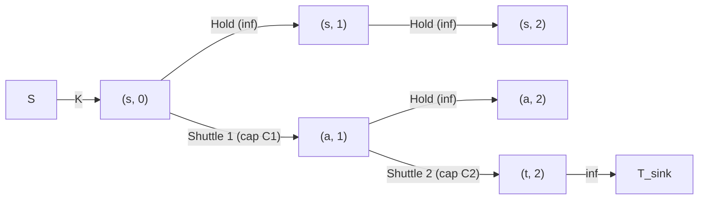

# Cohort 1 — Wave 1A Research Monograph: Foundations of Flow-Cut Duality, Residual Structure, Tight Complexity Regimes, Structural Gadgets & Demand/Lower-Bound Circulations (Iterations 01–05)

> [!IMPORTANT]
> **Monograph Scope & "Zero Magic Gadgets" Mandate**
> This research monograph constitutes Cohort 1's deep investigation of **Wave 1A (Iterations 01–05)** for the Network Flows, Minimum Cuts, Matching, Min-Cost Max-Flow (MCMF), and LP Duality textbook project. Every theoretical framework, structural gadget, and contest problem solution in this document strictly enforces the **4-Step English-to-Graph Compilation Standard**:
> 1. **Non-Graph Diagnostic Signal (Recognition)**: What exact linguistic or algebraic structure in the problem statement and constraint bounds ($N, M, V_{\max}$) signals a flow/cut/circulation reduction, and why greedy or dynamic programming fails.
> 2. **Algebraic / Logical Intermediate Representation**: Translating English rules into flow conservation equations, slack variables, indicator polynomials, or reachability closures *before* drawing a single vertex or edge.
> 3. **Reverse-Engineering Scratchpad (Mechanical Graph Compilation)**: Deriving vertices, orientations, capacities, and lower bounds directly from the algebraic equations.
> 4. **Hand-Checkable Toy Trace & Broken Gadget Counterexamples**: Tracing a concrete $N \le 4$ instance and proving exactly what breaks when a subtle invariant (such as reverse residual arcs, vertex-split internal orientation, or super-source cleanup in lower-bound flows) is violated.

---

## Executive Overview: The Foundations-to-Modelling Bridge

In competitive programming, elementary introductions treat Maximum Flow and Minimum Cut as physical plumbing algorithms: water enters a source $s$, travels through pipes of bounded capacity $c(u,v)$, and exits at a sink $t$. That mental model collapses the moment a contestant faces modern ICPC, Codeforces Div. 1, NOI, or AtCoder Grand Contest problems where:
- There are **no pipes, no graphs, and no physical commodities**—only a real-valued matrix that must be rounded to integers while preserving row and column sum intervals (`CF 546E`, `ZOJ 2314`, matrix rounding).
- A greedy algorithm that repeatedly extracts the shortest path between $s$ and $t$ destroys global connectivity, whereas pushing flow along a **backward residual edge** physically *splices and reroutes* existing paths without ever moving items backward in reality.
- An editor writes *"Run Tarjan's SCC algorithm on the residual graph; edges with $\text{scc}(u) \neq \text{scc}(v)$ can be in some min-cut, and edges with $\text{scc}(u) = \text{scc}(s), \text{scc}(v) = \text{scc}(t)$ are in every min-cut"* (`[AHOI2009] 最小割`) without explaining how the distributive lattice of minimum cuts maps onto directed cycles in $G_f$.
- Dinic's algorithm—whose worst-case textbook complexity is $O(V^2 E)$—runs in 15 milliseconds on a graph with $V = 10^5$ and $E = 2 \times 10^5$ because hidden vertex or edge capacity invariants collapse the phase count to $O(\sqrt{V})$ or $O(V^{2/3})$.

Across Iterations 01–05, we build the mathematical engine that powers the entire textbook:
- **Iteration 01** develops the algebraic equivalence between nonnegative flows and skew-symmetric flows, proves why the residual network $G_f$ is a complete perturbation space for feasible flows, establishes the Max-Flow Min-Cut and Integrality theorems alongside Zwick's irrational counterexample, and proves the $O(E)$ Path–Cycle Flow Decomposition Theorem needed to turn raw edge flows back into concrete schedules and routes.
- **Iteration 02** analyzes Dinic's blocking-flow algorithm, proves the strict distance monotonicity invariant $d_{f'}(s,t) \ge d_f(s,t) + 1$, demonstrates why omitting the current-arc pointer (`cur[u]`) or dead-end pruning degrades a single phase from $O(VE)$ to $O(VE^2)$, and proves the exact $O(\min(V^{2/3}, E^{1/2})E)$ and $O(E\sqrt{V})$ bounds that govern competitive programming feasibility.
- **Iteration 03** dissects the residual graph at optimality: the distributive lattice of minimum cuts, the canonical $S$-minimal ($S_{\min}$) and $S$-maximal ($S_{\max}$) cuts, the Tarjan Strongly Connected Component (SCC) characterization of **Feasible** vs. **Essential** cut edges, and parametric single-edge capacity sensitivity.
- **Iteration 04** compiles structural constraints—vertex capacities, undirected-to-directed conversions, multi-source/sink aggregation, time-expanded layered DAGs (`分层图网络流`), and Menger's edge/vertex-disjoint paths—into canonical gadgets, accompanied by explicit counterexamples showing how naive constructions fail.
- **Iteration 05** derives the complete 4-variant calculus of **Flows with Demands and Lower Bounds (`上下界网络流`)**—feasible circulations (Hoffman's Theorem), feasible $s$-$t$ flows, maximum $s$-$t$ flows, and minimum $s$-$t$ flows—and applies them to non-graph problems including Bounded Matrix Rounding, Mixed Graph Eulerian Orientations, and Bounded-Degree Subgraph / Grid Coloring.

---

## Iteration 01: Flow Conservation, Residual Networks, Augmenting Paths & Max-Flow Min-Cut Theorem

### 1.1 Two Equivalent Languages of Flow: Nonnegative vs. Skew-Symmetric Formulations

Let $G = (V, E)$ be a directed graph with a distinguished source $s \in V$, sink $t \in V$ ($s \neq t$), and a capacity function $c : E \to \mathbb{R}_{\ge 0}$. In the literature and in competitive programming implementations, two seemingly different algebraic conventions coexist. Understanding their exact translation prevents bugs when graphs contain **anti-parallel arcs** (both $(u,v) \in E$ and $(v,u) \in E$).

#### Convention A: The Nonnegative Edge-Flow Formulation (Primal LP View)
A flow is a function $f : E \to \mathbb{R}_{\ge 0}$ defined strictly on the directed edges of $G$ satisfying two linear constraints:
1. **Capacity Constraint**: For every directed edge $e = (u,v) \in E$,
   $$0 \le f(e) \le c(e).$$
2. **Flow Conservation (Kirchhoff's Current Law)**: For every internal vertex $u \in V \setminus \{s, t\}$, the total flow entering $u$ equals the total flow leaving $u$:
   $$\sum_{e \in \delta^-(u)} f(e) - \sum_{e \in \delta^+(u)} f(e) = 0,$$
   where $\delta^-(u) = \{(w,u) \in E\}$ and $\delta^+(u) = \{(u,v) \in E\}$.

The **value of the flow**, denoted $|f|$, is the net flow leaving the source $s$:
$$|f| = \sum_{e \in \delta^+(s)} f(e) - \sum_{e \in \delta^-(s)} f(e).$$

#### Convention B: The Skew-Symmetric Vertex-Pair Formulation (Residual View)
Suppose $G$ contains no anti-parallel arcs (if both $(u,v)$ and $(v,u)$ exist, subdivide one of them with an auxiliary vertex $w$, replacing $(v,u)$ of capacity $C$ with $v \to w \to u$ of capacity $C$). Extend $c : V \times V \to \mathbb{R}_{\ge 0}$ by setting $c(u,v) = 0$ whenever $(u,v) \notin E$. A **skew-symmetric flow** is a function $\tilde{f} : V \times V \to \mathbb{R}$ (allowing negative values!) satisfying:
1. **Capacity Constraint**: For all $(u,v) \in V \times V$, $\tilde{f}(u,v) \le c(u,v)$.
2. **Skew-Symmetry**: For all $(u,v) \in V \times V$, $\tilde{f}(u,v) = -\tilde{f}(v,u)$.
3. **Flow Conservation**: For all $u \in V \setminus \{s, t\}$, $\sum_{v \in V} \tilde{f}(u,v) = 0$.

Why do textbooks oscillate between Convention A and Convention B?
- Given a nonnegative flow $f$ under Convention A, define $\tilde{f}(u,v) = f(u,v) - f(v,u)$ represents the **net flow** from $u$ to $v$. Since pushing $\min(f(u,v), f(v,u))$ around the 2-cycle $u \to v \to u$ does not change flow conservation or net flow $|f|$, we can always assume $\min(f(u,v), f(v,u)) = 0$. Under that assumption, $\tilde{f}(u,v) \ge 0$ means $f(u,v) = \tilde{f}(u,v)$ and $f(v,u) = 0$, while $\tilde{f}(u,v) < 0$ means $f(u,v) = 0$ and $f(v,u) = -\tilde{f}(u,v)$.
- Under Convention B, the **residual capacity** of the pair $(u,v)$ takes the single unified formula:
  $$c_{\tilde{f}}(u,v) = c(u,v) - \tilde{f}(u,v).$$
  - When $(u,v) \in E$ carries flow $\tilde{f}(u,v) = f(u,v) \ge 0$, the forward residual capacity is $c(u,v) - f(u,v)$.
  - Simultaneously, the reverse pair $(v,u)$ (where $c(v,u) = 0$) has $\tilde{f}(v,u) = -f(u,v)$, so its residual capacity is $c_{\tilde{f}}(v,u) = 0 - (-f(u,v)) = f(u,v)$!

> [!WARNING]
> **Implementation Contract for Anti-Parallel Edges (`edge_idx ^ 1`)**
> In competitive programming adjacency lists, we do **not** merge anti-parallel input edges $(u,v)$ and $(v,u)$ into a single matrix entry $V \times V$. Instead, each directed input edge $e = (u,v)$ of capacity $c(e)$ is allocated as a **paired entry** at indices `2*k` (forward arc $u \to v$, initial residual capacity `cap = c(e)`) and `2*k + 1` (backward arc $v \to u$, initial residual capacity `cap = 0`).
> - If the input graph also contains an explicit edge $e' = (v,u)$ of capacity $c(e')$, it is allocated as a **separate** pair at indices `2*k + 2` ($v \to u$, `cap = c(e')`) and `2*k + 3` ($u \to v$, `cap = 0`).
> - Why must they remain separate? In Min-Cost Max-Flow or Lower-Bound Flows, $e = (u,v)$ and $e' = (v,u)$ have independent lower bounds, independent costs ($c(e') \neq -c(e)$), and independent flow values $f(e) = \text{cap}(2k+1)$ vs. $f(e') = \text{cap}(2k+3)$. Merging them into a single skew-symmetric pair destroys edge-level flow recovery!

#### The Net-Flow Across a Cut Lemma (Exact Double-Counting Derivation)
An **$s$-$t$ cut** is a partition of $V$ into two disjoint sets $(S, T)$ with $T = V \setminus S$ such that $s \in S$ and $t \in T$. The **capacity of the cut** $(S, T)$ counts **only** the capacities of edges directed from $S$ to $T$:
$$c(S, T) = \sum_{\substack{e = (u,v) \in E \\ u \in S, \, v \in T}} c(e).$$

Let us prove that for *any* feasible flow $f$ and *any* $s$-$t$ cut $(S, T)$, the net flow across $(S, T)$ equals $|f|$:

$$\begin{aligned}
|f| &= \left(\sum_{e \in \delta^+(s)} f(e) - \sum_{e \in \delta^-(s)} f(e)\right) + \sum_{u \in S \setminus \{s\}} \underbrace{\left(\sum_{e \in \delta^+(u)} f(e) - \sum_{e \in \delta^-(u)} f(e)\right)}_{= \, 0 \text{ by flow conservation at } u \neq s, t} \\
&= \sum_{u \in S} \left(\sum_{e \in \delta^+(u)} f(e) - \sum_{e \in \delta^-(u)} f(e)\right).
\end{aligned}$$

Now examine how each directed edge $e = (x, y) \in E$ contributes to this sum over $u \in S$:
1. **Internal to $S$ ($x \in S$ and $y \in S$)**: $f(e)$ appears once with $+1$ (in $\delta^+(x)$) and once with $-1$ (in $\delta^-(y)$), contributing $+f(e) - f(e) = 0$.
2. **Internal to $T$ ($x \in T$ and $y \in T$)**: Neither endpoint is in $S$, so $f(e)$ never appears, contributing $0$.
3. **Forward across the cut ($x \in S$ and $y \in T$)**: Only $x \in S$, so $f(e)$ appears once with $+1$ (in $\delta^+(x)$), contributing $+f(e)$.
4. **Backward across the cut ($x \in T$ and $y \in S$)**: Only $y \in S$, so $f(e)$ appears once with $-1$ (in $\delta^-(y)$), contributing $-f(e)$.

Summing over all edges $e \in E$ yields the **Fundamental Flow-Cut Identity**:
$$|f| = \sum_{e \in \delta^+(S)} f(e) - \sum_{e \in \delta^-(S)} f(e),$$
where $\delta^+(S) = \{(x,y) \in E : x \in S, y \in T\}$ and $\delta^-(S) = \{(x,y) \in E : x \in T, y \in S\}$.

Applying the capacity bounds $f(e) \le c(e)$ for $e \in \delta^+(S)$ and the nonnegativity bounds $f(e) \ge 0$ for $e \in \delta^-(S)$ immediately gives **Weak Flow-Cut Duality**:
$$|f| = \sum_{e \in \delta^+(S)} f(e) - \sum_{e \in \delta^-(S)} f(e) \le \sum_{e \in \delta^+(S)} c(e) - \sum_{e \in \delta^-(S)} 0 = c(S, T).$$

Furthermore, equality $|f| = c(S, T)$ holds **if and only if** both conditions hold simultaneously:
- **Forward Saturation**: Every forward cut edge $e \in \delta^+(S)$ is fully saturated: $f(e) = c(e)$.
- **Backward Emptiness**: Every backward cut edge $e \in \delta^-(S)$ carries zero flow: $f(e) = 0$.

---

### 1.2 The Residual Graph $G_f$ as an Algebraic Perturbation Space

Suppose we have a feasible flow $f$ and want to move to a better feasible flow $f' = f + \Delta f$. What conditions must the perturbation $\Delta f$ satisfy so that $f' = f + \Delta f$ remains feasible?
- For every edge $e = (u,v) \in E$, we need $0 \le f(e) + \Delta f(e) \le c(e)$, which decomposes into two independent directional bounds:
  - We can **increase** flow on $e = (u,v)$ by up to $c_f^{\text{fwd}}(e) = c(e) - f(e) \ge 0$.
  - We can **decrease** flow on $e = (u,v)$ by up to $c_f^{\text{rev}}(e) = f(e) \ge 0$.
- Decreasing flow on $e = (u,v)$ by $\delta > 0$ changes the net conservation balance at $u$ and $v$ in the **exact same way** as sending $\delta$ units of new flow along a virtual directed arc from $v$ to $u$!

This observation defines the **Residual Network** $G_f = (V, E_f)$:
- For each original edge $e = (u,v) \in E$:
  - If $c(e) - f(e) > 0$, include the **forward residual arc** $e^{\text{fwd}} = (u,v)$ in $E_f$ with residual capacity $c_f(e^{\text{fwd}}) = c(e) - f(e)$.
  - If $f(e) > 0$, include the **backward residual arc** $e^{\text{rev}} = (v,u)$ in $E_f$ with residual capacity $c_f(e^{\text{rev}}) = f(e)$.

#### Physical Interpretation of Backward Residual Arcs (The Path-Splicing Operator)
Beginners often ask: *"If edges are one-way pipes, why does the residual graph let us send flow backward from $v$ to $u$?"*
In reality, **no flow ever travels backward from $v$ to $u$ in the original graph $G$**. Suppose $f$ currently sends $1$ unit of flow along the path $P_1 : s \to a \to u \to v \to b \to t$, and we push $1$ unit of augmenting flow along the residual path $P_{\text{aug}} : s \to c \to v \xrightarrow{\text{rev}} u \to d \to t$, which traverses the backward residual arc $(v,u)$.
Adding $P_1 + P_{\text{aug}}$ at the edge level cancels the flow on $u \to v$ ($1 - 1 = 0$) and produces two completely valid forward paths in $G$:
$$P'_1 : s \to a \to u \to d \to t, \qquad P'_2 : s \to c \to v \to b \to t.$$
Traversing the backward residual arc $v \to u$ is a **combinatorial splicing operator**: it cuts the existing path $P_1$ at the bridge $u \to v$, attaches the new prefix $s \to c \to v$ to the old suffix $v \to b \to t$, and diverts the old prefix $s \to a \to u$ onto the new suffix $u \to d \to t$.

---

### 1.3 Ford–Fulkerson Augmenting Path Theorem & Strong Duality

**Theorem 1.1 (Max-Flow Min-Cut Theorem — Ford & Fulkerson, 1956; Elias, Feinstein & Shannon, 1956).**
*For any flow network $G = (V, E, c, s, t)$ and any feasible flow $f$, the following three statements are equivalent:*
1. *$f$ is a maximum flow in $G$ (i.e., $|f| \ge |f'|$ for all feasible flows $f'$).*
2. *The residual network $G_f$ contains no directed $s$-$t$ path (no augmenting path).*
3. *There exists an $s$-$t$ cut $(S, T)$ such that $|f| = c(S, T)$.*

*Proof.*
- **(1 $\implies$ 2)**: Suppose $G_f$ contains a simple directed path $P$ from $s$ to $t$. Let $\Delta = \min_{e \in P} c_f(e) > 0$. Augmenting $f$ along $P$ by $\Delta$ produces a feasible flow $f'$ with $|f'| = |f| + \Delta > |f|$, contradicting that $f$ is maximum.
- **(2 $\implies$ 3)**: Suppose $G_f$ contains no directed path from $s$ to $t$. Define the **residual reachability set**:
  $$S = \{v \in V : \text{there exists a directed path from } s \text{ to } v \text{ in } G_f\}, \qquad T = V \setminus S.$$
  Clearly $s \in S$, and since $t$ is unreachable from $s$ in $G_f$, $t \in T$. Thus $(S, T)$ is a valid $s$-$t$ cut. Now inspect every original edge $e \in E$ crossing between $S$ and $T$:
  - For any forward cut edge $e = (u,v) \in \delta^+(S)$ (with $u \in S, v \in T$): if $f(e) < c(e)$, then $e^{\text{fwd}} = (u,v) \in E_f$ with positive residual capacity $c(e) - f(e) > 0$, so $v$ would be reachable from $s$ via $u$, contradicting $v \in T$. Hence **$f(e) = c(e)$ for all $e \in \delta^+(S)$**.
  - For any backward cut edge $e = (x,y) \in \delta^-(S)$ (with $x \in T, y \in S$): if $f(e) > 0$, then the backward residual arc $e^{\text{rev}} = (y,x) \in E_f$ has positive residual capacity $f(e) > 0$. Since $y \in S$ is reachable from $s$ in $G_f$, traversing $y \to x$ would make $x$ reachable from $s$ in $G_f$, contradicting $x \in T$. Hence **$f(e) = 0$ for all $e \in \delta^-(S)$**.
  Substituting both into the Fundamental Flow-Cut Identity yields:
  $$|f| = \sum_{e \in \delta^+(S)} c(e) - \sum_{e \in \delta^-(S)} 0 = c(S, T).$$
- **(3 $\implies$ 1)**: By Weak Duality, any feasible flow $f'$ satisfies $|f'| \le c(S, T) = |f|$, so $f$ is maximum. $\blacksquare$

---

### 1.4 The Integrality Theorem & Zwick's Irrational Network Counterexample

**Corollary 1.2 (Integrality Theorem).**
*If all edge capacities $c(e)$ are integers ($c : E \to \mathbb{Z}_{\ge 0}$), then there exists an integral maximum flow $f^* : E \to \mathbb{Z}_{\ge 0}$. Moreover, the Ford–Fulkerson method (starting from $f \equiv 0$ and repeatedly augmenting along any path in $G_f$) terminates in at most $|f^*| \le \sum_{e \in \delta^+(s)} c(e)$ augmentations, maintaining an integral flow at every step.*

Why does the Integrality Theorem matter for **modelling**? Because combinatorial optimization problems (matching, vertex cover, project selection, grid coloring) require discrete decisions $x_i \in \{0, 1\}$ or $f(e) \in \mathbb{Z}$. While general Integer Linear Programming (ILP) is NP-complete, the Integrality Theorem guarantees that **any ILP that compiles into an integer-capacity flow or cut network has an exact integral optimum computable in polynomial time**.

#### Failure Mode: When Irrational Capacities Break Termination AND Optimality (Zwick's Network)
If capacities are arbitrary real numbers, unguided Ford–Fulkerson can fail to terminate and can converge to a **strictly suboptimal** flow value!

Consider Uri Zwick's minimal counterexample (1995): let $\phi = \frac{\sqrt{5}-1}{2} \approx 0.618034$ be the reciprocal golden ratio, which satisfies the algebraic recurrence:
$$\phi^{k+1} = \phi^{k-1} - \phi^k \quad \text{for all } k \ge 1, \quad \text{with } \phi^0 = 1, \, \phi^1 = \phi, \, \phi^2 = 1 - \phi.$$
Construct a network with source $s$, sink $t$, four internal vertices $a, b, c, d$, and three horizontal "control edges" $e_1 = (a,b)$, $e_2 = (c,b)$, $e_3 = (c,d)$ with capacities:
$$c(e_1) = 1, \qquad c(e_2) = \phi, \qquad c(e_3) = 1,$$
connected to $s$ and $t$ by six edges of large integer capacity $M = 10$:
$$s \to a, \; s \to c, \; s \to d \quad (\text{cap } M), \qquad a \to t, \; b \to t, \; d \to t \quad (\text{cap } M),$$
Wait—more simply, connect $s \to a, s \to c$ with capacity $M$, $b \to t, d \to t$ with capacity $M$, and add cross-routing arcs $b \to c$ and $d \to c$ or $b \to a, b \to d$ of capacity $M$ so that we can route augmenting paths through $e_1, e_2, e_3$ in alternating directions: specifically, put $s \to a, s \to c$ (cap $M$), $b \to t, d \to t$ (cap $M$), and undirected/bidirectional routing links $(a, d)$ and $(b, c)$ of capacity $M$ (or in standard directed form: $s \to a, s \to c$ of cap $M$; $b \to t, d \to t$ of cap $M$; plus $b \to a, c \to d$ etc. via 4-edge crossover).
In the standard 6-vertex presentation with three bottleneck edges $e_1, e_2, e_3$ having initial residual capacities $(1, \phi, 1)$ and $s/t$ connectors of capacity $M = 10$:
1. **Initial step**: Push $1$ unit through $e_1$, leaving residual capacities $(0, \phi, 1)$.
2. **Inductive cycle from state $(0, \phi^k, \phi^{k-1})$**:
   - **Step A**: Augment by $\phi^k$ along the path that goes forward on $e_2$ (cap $\phi^k$) and $e_3$ (cap $\phi^{k-1} \ge \phi^k$). Residual capacities of $(e_1, e_2, e_3)$ become $(0, 0, \phi^{k-1} - \phi^k) = (0, 0, \phi^{k+1})$.
   - **Step B**: Augment by $\phi^k$ along the path that goes backward on $e_1$ (refunding $\phi^k$), backward on $e_2$ (refunding $\phi^k$), and forward on $e_3$... wait: in Step A we also refund $e_1$ by $\phi^k$, giving $(\phi^k, 0, \phi^{k+1})$; then in Step B we push $\phi^{k+1}$ forward on $e_1$, backward on $e_2$ (which has backward residual $\phi^k > \phi^{k+1}$), and backward on $e_3$ (or forward on $e_1, e_3$), restoring a permutations of $(0, \phi^{k+1}, \phi^{k+2})$!
3. Because $\phi^{k-1} - \phi^k = \phi^{k+1} > 0$ forever, the residual capacities on $(e_1, e_2, e_3)$ cycle through $(\phi^k, \phi^{k+1}, 0)$ indefinitely! The total flow pushed converges to:
   $$1 + 2 \sum_{k=1}^{\infty} \phi^k = 1 + \frac{2\phi}{1 - \phi} = 1 + \frac{2\phi}{\phi^2} = 1 + \frac{2}{\phi} = 2 + \sqrt{5} \approx 4.236,$$
   whereas the true maximum flow saturates all $s$-/ $t$-connectors at $2M + 1 = 21$!
This proves that **shortest-path augmentation** (Edmonds–Karp / Dinic) is not merely a speed optimization—it is mathematically required to guarantee termination when capacities are not rational.

---

### 1.5 Path–Cycle Flow Decomposition Theorem ($O(E)$ Constructive Extraction)

Running Dinic's algorithm gives you an array of raw edge flows $f(e)$ for $e \in E$. However, many competitive programming problems ask you to **output the actual routes, schedules, or pairings** (e.g., *"Print the $K$ edge-disjoint paths from $s$ to $t$"* or *"For each unit of flow, print the sequence of vertices it visits"*). Because backward residual augmentations splice paths together during execution, you **cannot** simply record the augmenting paths found during Dinic! Instead, you must decompose the final static flow $f$ after Dinic finishes.

**Theorem 1.3 (Path–Cycle Flow Decomposition Theorem).**
*Let $f : E \to \mathbb{R}_{\ge 0}$ be any feasible flow of value $|f| \ge 0$ in $G = (V, E, s, t)$. Then there exist a collection of $k$ simple directed $s$-$t$ paths $\mathcal{P} = \{P_1, \dots, P_k\}$ with positive weights $w(P_i) > 0$ and a collection of $r$ simple directed cycles $\mathcal{C} = \{C_1, \dots, C_r\}$ with positive weights $w(C_j) > 0$ such that:*
1. **$k + r \le |E|$** *(the total number of paths and cycles is at most the number of edges).*
2. *$\sum_{i=1}^k w(P_i) = |f|$.*
3. *For every edge $e \in E$, $f(e) = \sum_{P_i \ni e} w(P_i) + \sum_{C_j \ni e} w(C_j)$.*
4. *If $f$ is integral, all weights $w(P_i)$ and $w(C_j)$ can be chosen to be positive integers.*

#### Constructive Proof & Extraction Algorithm
Consider the support subgraph $G_{\text{supp}} = (V, E_+)$ containing only edges $e \in E$ with $f(e) > 0$.
- **Case 1 ($|f| > 0$)**: Start a walk at $u_0 = s$. At any current vertex $u \neq t$, since $u_0 = s$ has net outflow $|f| > 0$ and every internal vertex $u \notin \{s, t\}$ has $\text{out-flow}(u) = \text{in-flow}(u) > 0$ (because we entered $u$ along an edge with $f > 0$, or $u = s$), there must exist at least one outgoing edge $(u,v) \in E_+$ unless $u = t$ or $u = s$ (if we returned to $s$).
  - Follow outgoing edges in $E_+$ until either we reach $t$ or we repeat a previously visited vertex $v$.
  - If we repeat a vertex $v$, the sub-walk between the two visits to $v$ forms a simple directed cycle $C_j$. Let $\Delta = \min_{e \in C_j} f(e) > 0$. Subtract $\Delta$ from $f(e)$ for all $e \in C_j$, record $(C_j, \Delta)$, and resume the walk from $v$.
  - If we reach $t$, the walk is a simple directed $s$-$t$ path $P_i$. Let $\Delta = \min_{e \in P_i} f(e) > 0$. Subtract $\Delta$ from $f(e)$ for all $e \in P_i$ and record $(P_i, \Delta)$.
- **Case 2 ($|f| = 0$ and $E_+ \neq \emptyset$)**: Pick any vertex $u_0$ with an outgoing edge in $E_+$. Since every vertex now has $\text{out-flow}(u) \ge \text{in-flow}(u)$ (and $\sum (\text{out} - \text{in}) = 0 \implies \text{out} = \text{in}$ everywhere), walking along $E_+$ must eventually repeat a vertex, extracting a simple directed cycle $C_j$.
- **Why $k + r \le |E|$**: Every path $P_i$ or cycle $C_j$ extracted with weight $\Delta = \min_{e} f(e)$ reduces $f(e^*)$ to $0$ on at least one bottleneck edge $e^*$, removing $e^*$ permanently from $E_+$. Since no edge ever has its flow increased during decomposition, at most $|E|$ extractions can occur! $\blacksquare$

#### Toy Trace: How Path Splicing Hides Individual Routes Until Decomposed
Consider $V = \{s, u, v, t\}$ with edges $s \to u, s \to v, u \to v, u \to t, v \to t$, all of capacity $1$.
1. Suppose Dinic first augments $1$ unit along $P_{\text{aug}, 1} : s \to u \to v \to t$.
2. In the next phase (or if capacities differed), suppose we augment $1$ unit along $P_{\text{aug}, 2} : s \to v \xrightarrow{\text{rev}} u \to t$.
3. Notice that **neither** $P_{\text{aug}, 1}$ (which uses $u \to v$) **nor** $P_{\text{aug}, 2}$ (which uses the non-existent reverse edge $v \to u$) is a valid path in the final solution!
4. Inspecting the final static edge flows $f(e) = \text{cap}(e^{\text{rev}})$:
   - $f(s,u) = 1$, $f(s,v) = 1$, $f(u,v) = 1 - 1 = 0$, $f(u,t) = 1$, $f(v,t) = 1$.
5. Running Path Decomposition on $E_+ = \{(s,u), (s,v), (u,t), (v,t)\}$ immediately extracts the two true edge-disjoint routes:
   $$P_1 : s \to u \to t \quad (\text{flow } 1), \qquad P_2 : s \to v \to t \quad (\text{flow } 1).$$

> [!TIP]
> **Fast $O(E + \sum |P_i|)$ Extraction Contract on DAGs and Unit Networks**
> If the support graph $G_{\text{supp}}$ is a DAG (which is guaranteed on bipartite graphs, time-expanded layered networks, or any unit-capacity graph where you only need $s$-$t$ paths and strip cycles via a DFS visited-stack), maintain a per-vertex pointer `ptr[u]` over the adjacency list of $u$. Whenever an edge $e = (u,v)$ has $f(e)$ decremented to $0$, advance `ptr[u]`. Because no dead ends can exist at any internal vertex with $\text{in-flow}(u) = \text{out-flow}(u) > 0$, every step of the walk advances along a valid path edge in $O(1)$ amortized time!

---

## Iteration 02: Blocking Flows, Dinic's Tight Complexity Regimes & Adversarial Graphs

### 2.1 Level Graphs $L(G_f)$ and Blocking Flows

Edmonds and Karp (1972) showed that augmenting along a single shortest $s$-$t$ path in $G_f$ takes $O(VE)$ phases, yielding $O(VE^2)$ total time because each BFS + augmentation takes $O(E)$ time and at most $O(VE)$ augmentations occur. Yefim Dinitz (1970, westernized as **Dinic**) discovered a dramatic speedup: instead of running a brand-new $O(E)$ BFS after *every single augmenting path*, we can freeze the BFS distance layers and simultaneously saturate **all** shortest augmenting paths of the current length $D = d_f(s,t)$ in a single $O(VE)$ (or $O(E)$ on unit networks) pass!

#### Formal Definitions
Given the residual network $G_f = (V, E_f)$:
1. **Distance Label $d_f(v)$**: The unweighted shortest-path distance (minimum number of edges) from $s$ to $v$ in $G_f$, computed by a single Breadth-First Search (BFS) from $s$. If $v$ is unreachable from $s$, $d_f(v) = \infty$.
2. **Level Graph $L(G_f) = (V, E_L)$**: The subgraph of $G_f$ containing **only** edges that advance strictly by $+1$ layer:
   $$E_L = \{(u,v) \in E_f : d_f(v) = d_f(u) + 1\}.$$
   Observe that $L(G_f)$ is a **Directed Acyclic Graph (DAG)** in which every directed path from $s$ to $v$ has length exactly $d_f(v)$—that is, the directed paths from $s$ to $t$ in $L(G_f)$ are *precisely* the shortest augmenting paths in $G_f$.
3. **Blocking Flow in $L(G_f)$**: A feasible flow $f_B$ in $L(G_f)$ is called a **blocking flow** if every directed $s$-$t$ path in $L(G_f)$ contains at least one edge $e$ that is fully saturated by $f_B$ ($f_B(e) = c_f(e)$). Equivalently, after subtracting $f_B$ from the capacities of $L(G_f)$ (without adding new backward edges into $L(G_f)$), no directed $s$-$t$ path remains in $L(G_f)$.

> [!NOTE]
> **Blocking Flow $\neq$ Maximum Flow in $L(G_f)$**
> Every maximum flow in $L(G_f)$ is a blocking flow, but a blocking flow need **not** be a maximum flow in $L(G_f)$!
> *Toy Counterexample*: Let $L(G_f)$ have layers $\{s\} \to \{a, b\} \to \{c, d\} \to \{t\}$ with unit-capacity edges $s \to a, s \to b$, $a \to c, a \to d, b \to c$, and $c \to t, d \to t$.
> - If DFS greedily pushes $1$ unit of flow along $P_1 : s \to a \to c \to t$, saturating $s \to a$, $a \to c$, and $c \to t$, then **no $s$-$t$ path remains in $L(G_f)$** (because $b$ can only go to $c$, whose outgoing edge $c \to t$ is saturated, and $a$ is already saturated from $s$). Thus $|f_B| = 1$ is a valid blocking flow!
> - Yet the maximum flow in $L(G_f)$ is $2$ (via $s \to a \to d \to t$ and $s \to b \to c \to t$). Finding that maximum flow would require traversing the newly created backward edge $c \to a$, which has length $3$ between $b$ and $d$ and therefore belongs to the **next** phase's level graph (length $5 > 3$)!

---

### 2.2 Strict Distance Monotonicity Theorem ($d_{f'}(s,t) \ge d_f(s,t) + 1$)

Why does finding *any* blocking flow $f_B$ in $L(G_f)$ guarantee that the shortest augmenting path distance from $s$ to $t$ strictly increases in the updated residual graph $G_{f'}$ (where $f' = f + f_B$)?

**Theorem 2.1 (Dinic's Distance Monotonicity Theorem).**
*Let $f_B$ be any blocking flow in $L(G_f)$, and let $f' = f + f_B$. Then:*
1. *For every vertex $v \in V$, $d_{f'}(v) \ge d_f(v)$.*
2. *For the sink $t$, $d_{f'}(t) \ge d_f(t) + 1$. Consequently, Dinic's algorithm executes at most $V - 1$ phases before $d_f(t) = \infty$.*

*Proof.*
First, compare the edge set $E_{f'}$ of the new residual graph $G_{f'}$ against the old residual graph $G_f$:
- Every edge $(u,v) \in E_{f'}$ falls into one of two categories:
  - **Old residual edge ($(u,v) \in E_f$)**: By the triangle inequality of BFS distances in $G_f$, $d_f(v) \le d_f(u) + 1$.
  - **Newly created backward residual edge ($(u,v) \notin E_f$)**: This edge exists in $E_{f'}$ only because $f_B$ pushed positive flow along the reverse edge $(v,u) \in E_L$. Because $(v,u) \in E_L$, we had $d_f(u) = d_f(v) + 1$, which rearranges to:
    $$d_f(v) = d_f(u) - 1 < d_f(u) + 1.$$
- Therefore, **every** directed edge $(u,v) \in E_{f'}$ satisfies the inequality:
  $$d_f(v) \le d_f(u) + 1 \qquad (\star)$$
  with equality $d_f(v) = d_f(u) + 1$ holding **if and only if** $(u,v)$ was already in $E_L$ and was **not** saturated by $f_B$!

Now let $P' = (v_0, v_1, \dots, v_k)$ be a shortest path from $s = v_0$ to $v = v_k$ in $G_{f'}$, so $k = d_{f'}(v)$. Summing $(\star)$ over $i = 0, \dots, k-1$ gives:
$$d_f(v_k) - d_f(v_0) = \sum_{i=0}^{k-1} \big(d_f(v_{i+1}) - d_f(v_i)\big) \le \sum_{i=0}^{k-1} 1 = k = d_{f'}(v).$$
Since $d_f(s) = 0$, this proves $d_f(v) \le d_{f'}(v)$ for all $v \in V$.

Finally, set $v = t$. Could equality $d_{f'}(t) = d_f(t)$ hold?
If $k = d_{f'}(t) = d_f(t)$, then the sum of $k$ terms $\big(d_f(v_{i+1}) - d_f(v_i)\big) \le 1$ equals $k$, which forces **every single edge** $(v_i, v_{i+1})$ on $P'$ to satisfy equality $d_f(v_{i+1}) = d_f(v_i) + 1$. By our characterization above, every edge of $P'$ must belong to $E_L$ and be unsaturated by $f_B$. Thus $P'$ is an unsaturated $s$-$t$ path in $L(G_f)$, directly contradicting that $f_B$ is a blocking flow! Hence $d_{f'}(t) \ge d_f(t) + 1$. $\blacksquare$

---

### 2.3 Why the Current-Arc Pointer (`cur[u]`) and Dead-Node Pruning are Essential ($O(V^2 E)$ vs. $O(VE^2)$)

In a single Dinic phase, we find a blocking flow in $L(G_f)$ via Depth-First Search (DFS) with multiple augmentation (`dfs(u, pushed)`). To achieve $O(VE)$ time per phase (and $O(V^2 E)$ total time), the DFS must maintain **two invariants** via the current-arc array `cur[u]` (initialized to `head[u]` at the start of the phase):

1. **Invariant 1 (No Re-scanning of Dead/Saturated Arcs)**: The loop at vertex $u$ iterates using a reference `for (int &cid = cur[u]; cid < adj[u].size(); ++cid)`. We **only** increment `cid` when the child call `dfs(v, min(pushed, cap))` has completely exhausted all possible flow through the arc `(u, v)` (either because `(u, v)` itself became saturated, or because `v` can no longer reach $t$ in $L(G_f)$). Crucially, if `(u, v)` only partially uses `pushed` and fills the bottleneck of `u`'s incoming capacity (`pushed == 0`), the loop `break`s **before** incrementing `cid`, because `(u, v)` might still have remaining capacity for another path arriving at $u$ later!
2. **Invariant 2 (Dead-Vertex Pruning)**: If the loop finishes with `total_pushed_from_u == 0`, set `level[u] = -1` (or leave `cur[u] == adj[u].size()`), permanently marking $u$ as a dead end for the rest of the phase.

#### Amortized Complexity Proof of One Phase ($O(VE)$)
Classify every traversal of an edge $e = (u,v) \in E_L$ during the phase into two types:
- **Saturating / Exhausting traversals (which increment `cur[u]`)**: Since `cur[u]` only moves forward and never resets during a phase, each edge $e \in E_L$ causes `cur[u]` to increment at most once. Total work across the entire phase: $O(E)$.
- **Non-saturating traversals (where `pushed` becomes $0$ at $u$ before `e` is exhausted)**: This happens at most once per vertex along the current DFS recursion stack whenever an $s$-$t$ augmentation completes and saturates some bottleneck edge higher up or lower down the stack. Since each completed augmentation saturates at least one edge $e^* \in E_L$ (decreasing its residual capacity to $0$ and incrementing `cur` at its tail), at most $E$ augmentations can occur in the phase. Each augmentation stack has depth $d_f(t) \le V$, so non-saturating traversals cost at most $O(V)$ per augmentation, or $O(VE)$ across the phase!
Summing $O(E) + O(VE) = O(VE)$ per phase across at most $V - 1$ phases gives Dinic's general worst-case bound of **$O(V^2 E)$**.

#### Broken Implementation Counterexample: Omitting `cur[u]` ($O(VE^2)$ or $O(FE)$ TLE Trap)
Suppose a contestant writes a standard DFS loop `for (int cid = 0; cid < adj[u].size(); ++cid)` **without** the reference `&cid = cur[u]` and **without** setting `level[u] = -1` on dead ends.
Construct a 4-layer graph on $V$ vertices:
- Layer 0: $\{s\}$.
- Layer 1: a hub vertex $h$ connected via $s \to h$ of capacity $K = V/3$.
- Layer 2: $K$ "dead-end" vertices $d_1, \dots, d_K$ and $K$ "live" vertices $w_1, \dots, w_K$.
  - Add edges $h \to d_i$ of capacity $\infty$ for $i = 1, \dots, K$, and $d_i \to d_j$ forming a dense bipartite/DAG mesh of $\Theta(K^2) = \Theta(E)$ edges in layers 2–3 that **never connects to $t$** (because a single bottleneck edge from layer 3 to $t$ was saturated on the very first augmentation!).
  - After the dead-end mesh in `adj[h]`, place the $K$ unit-capacity live paths $h \to w_i \to \dots \to t$ ($i = 1, \dots, K$).
- **What happens without `cur[u]` / dead-end pruning?**
  On the first augmentation, the single bridge from the $d$-mesh to $t$ is saturated. On each of the subsequent $K = \Theta(V)$ augmentations through $w_1, \dots, w_K$, DFS enters $h$ and **re-traverses the entire $\Theta(E)$ dead-end mesh from scratch** before reaching $w_i$! A single phase takes $\Theta(KE) = \Theta(VE)$ on just that hub, and if repeated across $E$ bottleneck edges into $h$, a single phase explodes to $\Theta(E^2)$ (and $\Theta(VE^2)$ overall), causing instant TLE on $V = 500, E = 20\,000$.

---

### 2.4 Tight Special-Regime Complexity Proofs (Why $V \le 10^5$ is Feasible in CP)

If Dinic's algorithm always took $V^2 E$ operations, it would time out for $V \ge 2\,000$. Yet in competitive programming, we routinely run Dinic on graphs with $V \le 10^5$ and $E \le 2 \times 10^5$. This works because almost all combinatorial flow networks fall into one of three special structural regimes. Let us prove their exact bounds.

#### Regime 1: Unit-Capacity Networks ($c(e) = 1$ for all $e \in E$) $\implies O\big(\min(V^{2/3}, E^{1/2})E\big)$

**Lemma 2.2 (Single Phase on Unit Networks takes $O(E)$ Time).**
*If $c(e) = 1$ for all $e \in E$, then at every step of Dinic's algorithm, every residual edge $e \in E_f$ has $c_f(e) = 1$. Therefore, every traversal of an edge $e \in E_L$ either immediately saturates $e$ (if the DFS reaches $t$) or proves that the head of $e$ is a dead end. In both cases, `cur[u]` advances immediately, so no edge is ever traversed twice in the same phase, and each phase runs in $O(E)$ time!*

Now we only need to bound the **total number of phases**. Run Dinic for $K$ phases (taking $O(KE)$ time), arriving at a flow $f$ with residual graph $G_f$. By Theorem 2.1, the shortest augmenting path distance in $G_f$ now satisfies:
$$D = d_f(s,t) \ge K + 1.$$
Let $f^*$ be a maximum flow in $G$, and let $R = |f^*| - |f|$ be the **remaining flow** yet to be augmented. Since each subsequent phase increases the flow by at least $1$, at most $R$ additional phases can occur after the first $K$ phases! Thus the total number of phases is at most $K + R$. Let us bound $R$ in two ways using the BFS distance layers $V_i = \{v \in V : d_f(s,v) = i\}$ for $i = 0, 1, \dots, K$.

1. **The $O(E^{1/2})$ Phase Bound (via Edge Pigeonhole)**:
   For each $i \in \{0, 1, \dots, K-1\}$, consider the $s$-$t$ cut $(S_i, \bar{S}_i)$ where $S_i = \bigcup_{j=0}^i V_j$ and $\bar{S}_i = V \setminus S_i$. Since $s \in V_0 \subseteq S_i$ and $d_f(s,t) \ge K + 1 \implies t \in \bar{S}_i$, $(S_i, \bar{S}_i)$ is a valid $s$-$t$ cut in $G_f$.
   By definition of BFS distance layers in $G_f$, no edge in $E_f$ can jump from $V_j$ ($j \le i$) to $V_{j'}$ ($j' \ge i + 2$). Thus every forward residual edge crossing $(S_i, \bar{S}_i)$ in $G_f$ must go directly from $V_i$ to $V_{i+1}$. Since every edge in $E_f$ has unit residual capacity $1$:
   $$R = |f^*| - |f| \le c_{G_f}(S_i, \bar{S}_i) = |E_f(V_i, V_{i+1})|.$$
   Since the edge sets $E_f(V_i, V_{i+1})$ are pairwise disjoint for $i = 0, 1, \dots, K-1$:
   $$K \cdot R \le \sum_{i=0}^{K-1} |E_f(V_i, V_{i+1})| \le |E_f| \le 2E \implies R \le \frac{2E}{K}.$$
   Choosing $K = \lceil \sqrt{2E} \rceil$ balances $K$ and $2E/K$, bounding the total number of phases by $K + R \le 2\sqrt{2E} = O(E^{1/2})$ and total time by **$O(E^{3/2})$**!

2. **The $O(V^{2/3})$ Phase Bound for Simple Unit Networks (via Layer-Size Pigeonhole)**:
   Assume $G$ has no parallel edges in the same direction (so between any $u \in V_i$ and $v \in V_{i+1}$ there are at most $2$ residual arcs in $E_f$: one forward from $(u,v) \in E$ and one backward from $(v,u) \in E$). Then for every $i \in \{0, \dots, K-1\}$:
   $$R \le |E_f(V_i, V_{i+1})| \le 2 |V_i| \cdot |V_{i+1}|.$$
   Since the layers $V_0, V_1, \dots, V_K$ are pairwise disjoint, $\sum_{i=0}^{K-1} (|V_i| + |V_{i+1}|) \le 2V$. By the Pigeonhole Principle, there exists at least one index $i \in \{0, \dots, K-1\}$ such that $|V_i| + |V_{i+1}| \le \frac{2V}{K}$. By the AM–GM inequality:
   $$R \le 2 |V_i| \cdot |V_{i+1}| \le 2 \left(\frac{|V_i| + |V_{i+1}|}{2}\right)^2 \le \frac{2V^2}{K^2}.$$
   Choosing $K = \lceil (2V^2)^{1/3} \rceil = \Theta(V^{2/3})$ balances $K$ and $2V^2 / K^2$, bounding the total number of phases by $K + R = O(V^{2/3})$ and total time by **$O(V^{2/3} E)$**!

Combining both bounds proves that on any simple unit-capacity network, Dinic runs in **$O\big(\min(V^{2/3}, E^{1/2})E\big)$** time.

---

#### Regime 2: Unit-Vertex-Capacity & Bipartite Matching Networks $\implies O(E\sqrt{V})$

A unit-capacity network is called a **Unit-Vertex-Capacity Network** (or **Even–Tarjan Type-2 Network**) if every internal vertex $v \in V \setminus \{s, t\}$ satisfies:
$$\min\big(\text{deg}_{G}^-(v), \, \text{deg}_{G}^+(v)\big) \le 1.$$
**Crucial Observation**: Both **Bipartite Matching** networks (where $L$-vertices have in-degree $1$ from $s$, and $R$-vertices have out-degree $1$ to $t$) and **Vertex-Split Unit-Capacity** networks (where every vertex $v$ is split into $v_{\text{in}} \xrightarrow{1} v_{\text{out}}$, so $\text{deg}^+(v_{\text{in}}) = 1$ and $\text{deg}^-(v_{\text{out}}) = 1$) satisfy this property!

**Theorem 2.3 (Even–Tarjan $O(E\sqrt{V})$ Theorem, 1975).**
*On any unit-vertex-capacity network, Dinic's algorithm terminates in at most $2\sqrt{V}$ phases and runs in $O(E\sqrt{V})$ total time.*

*Proof.*
First, we claim that in the residual graph $G_f$ of a unit-vertex-capacity network, every internal vertex $v \in V \setminus \{s, t\}$ *still* satisfies $\min(\text{deg}_{G_f}^-(v), \text{deg}_{G_f}^+(v)) \le 1$:
- Suppose $\text{deg}_G^-(v) = 1$, with the unique incoming edge $e_{\text{in}} = (u,v) \in E$.
  - If $f(e_{\text{in}}) = 0$, then no outgoing edge from $v$ can carry flow (by flow conservation), so all residual edges incident to $v$ in $G_f$ have their original orientations in $G$, meaning $\text{deg}_{G_f}^-(v) = 1$.
  - If $f(e_{\text{in}}) = 1$, then exactly one outgoing edge $e_{\text{out}} = (v,w) \in E$ carries flow $1$. In $G_f$, both $e_{\text{in}}$ and $e_{\text{out}}$ are reversed: $e_{\text{in}}^{\text{rev}} = (v,u)$ becomes outgoing from $v$, while $e_{\text{out}}^{\text{rev}} = (w,v)$ becomes the **unique** incoming residual edge to $v$! Thus $\text{deg}_{G_f}^-(v) = 1$ is preserved!
- Symmetrically, if $\text{deg}_G^+(v) = 1$, then $\text{deg}_{G_f}^+(v) \le 1$ is preserved in $G_f$.

Consequently, at most $1$ unit of residual flow can ever pass through any internal vertex $v \in V \setminus \{s, t\}$ in $G_f$. By the Path–Cycle Flow Decomposition Theorem (Theorem 1.3), the remaining flow $f^* - f$ of value $R = |f^*| - |f|$ in $G_f$ decomposes into $R$ directed $s$-$t$ paths $P_1, \dots, P_R$ in $G_f$ that are **internally vertex-disjoint**!

Now run Dinic for $K$ phases. At the end of phase $K$, every $s$-$t$ path $P_r$ in $G_f$ has length at least $d_f(s,t) \ge K + 1$, and therefore contains at least $K$ internal vertices in $V \setminus \{s, t\}$. Since $P_1, \dots, P_R$ are internally vertex-disjoint:
$$R \cdot K \le \sum_{r=1}^R |V(P_r) \setminus \{s, t\}| \le |V \setminus \{s, t\}| < V \implies R < \frac{V}{K}.$$
Choosing $K = \lceil \sqrt{V} \rceil$ bounds the total number of phases by $K + R \le 2\sqrt{V}$ and total runtime by **$O(E\sqrt{V})$**! $\blacksquare$

> [!IMPORTANT]
> **Why You Do Not Need Separate Hopcroft–Karp Code in Your Library**
> Theorem 2.3 proves that running standard Dinic on a bipartite matching graph ($s \to L \to R \to t$) is **identical** in asymptotic complexity ($O(E\sqrt{V})$) and phase structure to the Hopcroft–Karp algorithm! Moreover, Dinic naturally generalizes to vertex capacities $c(v) \in \{1, 2, \dots\}$ where Hopcroft–Karp does not.

#### Summary of Dinic's Competitive Programming Complexity Regimes

| Network Regime | Structural Condition | Max Phases | Phase Cost | Total Complexity | Practical CP Limit (2s) |
| :--- | :--- | :--- | :--- | :--- | :--- |
| **General Capacities** | Arbitrary $c(e) \in \mathbb{Z}_{\ge 0}$ | $O(V)$ | $O(VE)$ | $O(V^2 E)$ | $V \le 5\,000, E \le 3 \times 10^4$ |
| **Small Cut / Small Flow** | $\text{MinCut} = C$ (integer) | $\le C$ | $O(E)$ | $O(CE)$ | $E \le 2 \times 10^5$ if $C \le 500$ |
| **Unit Edge Capacities** | $c(e) = 1 \;\forall e \in E$ | $O(\min(V^{2/3}, E^{1/2}))$ | $O(E)$ | $O(\min(V^{2/3}, E^{1/2})E)$ | $V, E \le 10^5$ |
| **Unit Vertex / Bipartite** | $\min(\text{in-cap}(v), \text{out-cap}(v)) \le 1$ | $O(\sqrt{V})$ | $O(E)$ | $O(E\sqrt{V})$ | $V, E \le 2 \times 10^5$ |
| **Mixed Small Cut Tail** | General edges, but only $O(V)$ unit paths | $O(\sqrt{V})$ | $O(E)$ | $O(E\sqrt{V} + \dots)$ | $V, E \le 10^5$ |

---

### 2.5 Adversarial Graphs for Dinic vs. Push-Relabel (HLPP)

Can an adversary actually force Dinic's algorithm to take $\Theta(V^2 E)$ operations? Yes: Norman Zadeh (1972) and Alexander Karzanov constructed families of **ladder-and-funnel graphs** with $V$ vertices and $E = \Theta(V^2)$ edges containing:
1. A central spine of $\Theta(V)$ vertices whose augmenting path lengths increase by $+2$ in every phase, forcing $\Theta(V)$ distinct BFS phases.
2. In phase $k$, a bipartite funnel of $\Theta(V)$ left vertices and $\Theta(V)$ right vertices connected by $\Theta(V^2)$ edges of capacity $1$, sandwiched between an entry path of length $k/2$ (with edge capacities $\Theta(V)$) and an exit path of length $k/2$ (with edge capacities $\Theta(V)$). Every unit edge across the dense bipartite funnel saturates an augmentation path of length $\Theta(V)$ through the entry/exit spines, forcing $\Theta(V^2)$ augmentations of length $\Theta(V)$ if not merged, or across $\Theta(V)$ phases where capacities are staggered by powers or multiples of $V$.

#### Dinic vs. Highest-Label Preflow-Push (HLPP) in Competitive Programming
- **How HLPP Works ($O(V^2 \sqrt{E})$)**: Instead of maintaining global flow conservation and searching for $s$-$t$ paths, Goldberg and Tarjan's Preflow-Push algorithm (1988) maintains a **preflow** ($\text{in-flow}(u) \ge \text{out-flow}(u)$, storing the difference as excess $e(u) \ge 0$) and distance height labels $h(u)$ lower-bounding the distance from $u$ to $t$ in $G_f$. By always pushing excess from an active vertex with the **highest** label $h(u)$, enhanced with **Gap Relabeling** (if no vertex has height $k$, immediately relabel all vertices with $k < h(v) < V$ to $V + 1$) and periodic **Global Relabeling** (backward BFS from $t$), HLPP achieves $O(V^2 \sqrt{E})$ worst-case time and defeats all Zadeh-style adversarial graphs.
- **When to Use Dinic vs. HLPP**:
  1. **Use Dinic (98% of CP problems)**: On bipartite graphs, unit-capacity graphs, project selection closures, grid cuts, and parametric/incremental problems where you add edges or roll back flow (`CF 1427G`, time-expanded networks), Dinic is simpler, has tiny constant factors, and leaves a valid feasible flow at every intermediate step.
  2. **Use HLPP**: Only on dense, high-capacity networks designed specifically to break Dinic (such as `LOJ #127 — 最大流 加强版` with $V = 1\,200, E = 1.2 \times 10^5$ generated with Zadeh gadgets). Note that HLPP **only** computes a maximum preflow at $t$ (sufficient to read the Min-Cut capacity or $T$-side reachability); converting a maximum preflow back into a conservation-respecting flow on all internal edges requires a second phase returning excess to $s$.

---
## Iteration 03: Residual Graph Anatomy, Uniqueness of Min-Cuts, Essential vs. Feasible Cut Edges & Parametric Sensitivity

### 3.1 The Distributive Lattice of Minimum Cuts & Canonical Extremal Cuts ($S_{\min}$ and $S_{\max}$)

Once Dinic's algorithm terminates with a maximum flow $f^*$, most beginners extract the flow value $|f^*|$ and discard the final residual network $G_{f^*}$. Doing so throws away a complete structural map of **every minimum $s$-$t$ cut in $G$**.

#### The Fundamental Residual Cut Characterization
Let $f^*$ be any maximum flow in $G = (V, E, c, s, t)$, and let $(S, T)$ (where $T = V \setminus S$, $s \in S, t \in T$) be any $s$-$t$ cut. By the Fundamental Flow-Cut Identity derived in Iteration 01:
$$|f^*| = \sum_{e \in \delta_G^+(S)} f^*(e) - \sum_{e \in \delta_G^-(S)} f^*(e) \le c(S, T),$$
with equality $|f^*| = c(S, T)$ holding if and only if:
1. For every forward edge $e = (u,v) \in \delta_G^+(S)$, $f^*(e) = c(e)$ — which means the forward residual arc $(u,v)$ has zero residual capacity ($c_{f^*}(u,v) = 0$) and **does not exist in $G_{f^*}$**.
2. For every backward edge $e = (x,y) \in \delta_G^-(S)$ (where $x \in T, y \in S$), $f^*(e) = 0$ — which means the backward residual arc $(y,x)$ from $S$ to $T$ has zero residual capacity ($c_{f^*}(y,x) = 0$) and **does not exist in $G_{f^*}$**.

Combining (1) and (2) yields the foundational theorem of residual cut analysis:

**Theorem 3.1 (Residual Closure Characterization of Minimum Cuts).**
*Let $f^*$ be any maximum flow in $G$. An $s$-$t$ partition $(S, V \setminus S)$ with $s \in S$ and $t \notin S$ is a minimum cut in $G$ **if and only if** no directed edge in the residual network $G_{f^*}$ leaves $S$:*
$$(S, V \setminus S) \text{ is a minimum } s\text{-}t \text{ cut in } G \iff \delta_{G_{f^*}}^+(S) = \emptyset.$$

Notice two immediate, profound consequences of Theorem 3.1:
- **Invariance Across All Maximum Flows**: Because the left-hand side ("$(S, V \setminus S)$ is a minimum cut in $G$") does not depend on which maximum flow $f^*$ was chosen, the collection of closed sets $S$ with $\delta_{G_{f^*}}^+(S) = \emptyset$ is **identical** for every possible maximum flow $f^*$!
- **Closure Under Intersection and Union (Distributive Lattice Structure)**: Suppose $(A, \bar{A})$ and $(B, \bar{B})$ are both minimum $s$-$t$ cuts.
  - *Residual Proof*: Since no edge of $G_{f^*}$ leaves $A$ ($\delta_{G_{f^*}}^+(A) = \emptyset$) and no edge leaves $B$ ($\delta_{G_{f^*}}^+(B) = \emptyset$), any edge leaving $A \cup B$ or $A \cap B$ would have to leave at least one of $A$ or $B$, which is impossible! Since $s \in A \cap B \subseteq A \cup B$ and $t \notin A \cup B$, both $(A \cap B, \overline{A \cap B})$ and $(A \cup B, \overline{A \cup B})$ are also minimum $s$-$t$ cuts!
  - *Submodularity Proof*: Even for arbitrary cuts $(A, \bar{A})$ and $(B, \bar{B})$, direct case analysis on edge endpoints verifies the **Submodular Cut Inequality**:
    $$c(A, \bar{A}) + c(B, \bar{B}) = c(A \cup B, \overline{A \cup B}) + c(A \cap B, \overline{A \cap B}) + c(A \setminus B, B \setminus A) + c(B \setminus A, A \setminus B) \ge c(A \cup B, \overline{A \cup B}) + c(A \cap B, \overline{A \cap B}).$$
    If $c(A, \bar{A}) = c(B, \bar{B}) = C_{\min}$, then since $c(A \cup B, \overline{A \cup B}) \ge C_{\min}$ and $c(A \cap B, \overline{A \cap B}) \ge C_{\min}$, both must equal $C_{\min}$ and no capacity can cross between $A \setminus B$ and $B \setminus A$.

#### The Two Canonical Extremal Cuts: $S_{\min}$ and $S_{\max}$
Because the finite family of minimum cuts $\mathcal{M}$ is closed under intersection and union, it possesses a unique minimum element $S_{\min}$ and a unique maximum element $S_{\max}$ under set inclusion $\subseteq$:
1. **The $S$-Minimal Minimum Cut ($S_{\min}$)**:
   $$S_{\min} = \bigcap_{(S, T) \in \mathcal{M}} S = \{v \in V : \text{there exists a directed path } s \to^* v \text{ in } G_{f^*}\}.$$
   *Why?* Every closed set $S$ containing $s$ must contain all vertices reachable from $s$ in $G_{f^*}$, and $S_{\min}$ itself has no outgoing edges in $G_{f^*}$. This cut has the **smallest possible vertex set $S$** among all minimum cuts.
2. **The $S$-Maximal Minimum Cut ($S_{\max}$)**:
   $$S_{\max} = \bigcup_{(S, T) \in \mathcal{M}} S = V \setminus \{v \in V : \text{there exists a directed path } v \to^* t \text{ in } G_{f^*}\}.$$
   *Why?* Symmetrically, $T_{\min} = V \setminus S_{\max} = \{v \in V : v \to^* t \text{ in } G_{f^*}\}$ is the smallest set containing $t$ with no incoming edges in $G_{f^*}$ (found by running a backward BFS from $t$ along reversed residual edges of $G_{f^*}$). Thus $S_{\max}$ has the **largest possible vertex set $S$** among all minimum cuts.

**Corollary 3.2 (Uniqueness of the Minimum Cut — e.g., `CF 852B / ICPC Min-Cut Uniqueness`).**
*A flow network $G$ has a **unique** minimum $s$-$t$ cut if and only if $S_{\min} = S_{\max}$—that is, if and only if $|S_{\min}| + |T_{\min}| = |V|$, meaning every vertex $v \in V$ either is reachable from $s$ in $G_{f^*}$ or can reach $t$ in $G_{f^*}$.*

---

### 3.2 Picard–Queyranne DAG & Tarjan SCC Characterization of Cut Edges (`[AHOI2009] 最小割` / `Luogu P4126`)

In `[AHOI2009] 最小割` (`Luogu P4126`), we are given a directed flow network $G = (V, E, c, s, t)$ and asked to classify every original edge $e = (u,v) \in E$ according to two questions:
1. **Question 1 (Feasible Cut Edge / 可行割边)**: Does there exist *at least one* minimum $s$-$t$ cut $(S, T)$ such that $e \in \delta_G^+(S)$ (i.e., $u \in S$ and $v \in T$)?
2. **Question 2 (Essential Cut Edge / 必须割边)**: Does *every* minimum $s$-$t$ cut $(S, T)$ satisfy $e \in \delta_G^+(S)$ (i.e., $u \in S$ and $v \in T$)?

Let us apply the **4-Step "Zero Magic Gadgets" Compilation Standard** to derive the exact Tarjan SCC rules from scratch.

#### Step 1: Diagnostic Signal (Recognition)
The problem asks about universal ($\forall$) and existential ($\exists$) properties over the potentially exponential family of all minimum $s$-$t$ cuts. Enumerating all minimum cuts is #P-hard in the worst case (up to $2^{V-2}$ cuts when $G_{f^*}$ has isolated vertices). The diagnostic signal is that Theorem 3.1 reduces minimum cuts to **reachability-closed vertex subsets** of $G_{f^*}$.

#### Step 2: Algebraic / Logical Intermediate Representation
By Theorem 3.1, an $s$-$t$ cut $(S, T)$ is a minimum cut iff:
$$s \in S, \qquad t \notin S, \qquad \text{and} \qquad \forall (x, y) \in E_{f^*}, \;\; x \in S \implies y \in S.$$
Therefore, for an original edge $e = (u,v) \in E$ with capacity $c(e) > 0$:
- **Necessary Precondition (Saturation)**: If $f^*(e) < c(e)$, then the forward residual arc $(u,v)$ belongs to $E_{f^*}$, forcing $u \in S \implies v \in S$ in *every* minimum cut. Hence $f^*(e) = c(e)$ is required for both questions.
- When $f^*(e) = c(e) > 0$, note that the backward residual arc $(v,u)$ belongs to $E_{f^*}$ with residual capacity $f^*(e) = c(e) > 0$.
- **Feasible Cut Edge Condition**: There exists a closed set $S$ in $G_{f^*}$ with $\{s, u\} \subseteq S$ and $\{v, t\} \cap S = \emptyset$.
- **Essential Cut Edge Condition**: Every closed set $S$ in $G_{f^*}$ with $s \in S, t \notin S$ satisfies $u \in S$ and $v \notin S$.

#### Step 3: Reverse-Engineering Scratchpad (Deriving the Tarjan SCC Criterion)
Contract the Strongly Connected Components (SCCs) of $G_{f^*}$ using Tarjan's algorithm in $O(V + E)$ time. Let $\text{scc}(x)$ denote the SCC ID of vertex $x$ in $G_{f^*}$. Since any closed set $S$ in $G_{f^*}$ must contain either all vertices of an SCC or none of them, minimum cuts correspond to closed sets in the condensation DAG of $G_{f^*}$.

Now let $e = (u,v) \in E$ be a **saturated** edge ($f^*(e) = c(e) > 0$):
1. **Why $\text{scc}(u) \neq \text{scc}(v)$ is Necessary and Sufficient for a Feasible Cut Edge**:
   - *Necessity*: If $\text{scc}(u) = \text{scc}(v)$, then $u \to^* v$ in $G_{f^*}$, so $u \in S \implies v \in S$ for every closed set $S$. Thus $(u,v)$ cannot cross any minimum cut.
   - *Sufficiency (and the subtle flow-conservation proof most editorials skip!)*: Suppose $\text{scc}(u) \neq \text{scc}(v)$. Since $f^*(e) = c(e) > 0$, the backward residual arc $(v,u)$ is already in $E_{f^*}$ ($v \to u$). Therefore, $\text{scc}(u) \neq \text{scc}(v)$ is equivalent to saying **$u$ cannot reach $v$ in $G_{f^*}$ ($u \not\to^* v$)**!
     To construct a minimum cut $(S, T)$ with $u \in S$ and $v \notin S$, define the smallest closed set containing both $s$ and $u$:
     $$S = \{w \in V : s \to^* w \text{ in } G_{f^*} \text{ or } u \to^* w \text{ in } G_{f^*}\}.$$
     Clearly $s \in S$, $u \in S$, and $\delta_{G_{f^*}}^+(S) = \emptyset$. We must verify that $v \notin S$ and $t \notin S$:
     - Could $v \in S$? Since $u \not\to^* v$, $v \in S$ would require $s \to^* v$ in $G_{f^*}$. Wait: what if $s \to^* v$ or $u \to^* t$ in $G_{f^*}$?
     - Let $R(u) = \{w \in V : u \to^* w \text{ in } G_{f^*}\}$. By definition, $\delta_{G_{f^*}}^+(R(u)) = \emptyset$, and since $u \not\to^* v$, we have $u \in R(u)$ and $v \notin R(u)$. In the original graph $G$, $\delta_{G_{f^*}}^+(R(u)) = \emptyset$ means every edge of $G$ leaving $R(u)$ is saturated ($f^* = c$) and every edge of $G$ entering $R(u)$ carries zero flow ($f^* = 0$). Since $(u,v) \in \delta_G^+(R(u))$ carries positive flow $f^*(u,v) = c(u,v) > 0$, the net flow leaving $R(u)$ in $G$ is strictly positive:
       $$\sum_{e' \in \delta_G^+(R(u))} f^*(e') - \sum_{e' \in \delta_G^-(R(u))} f^*(e') \ge f^*(u,v) > 0.$$
       If neither $s$ nor $t$ belonged to $R(u)$, flow conservation at all vertices of $R(u)$ would force this net outflow to be $0$! And if $t \in R(u)$ while $s \notin R(u)$, the net outflow from $R(u)$ would equal $-|f^*| \le 0$, also a contradiction! Therefore, **$s$ MUST belong to $R(u)$ ($u \to^* s$ in $G_{f^*}$)**!
     - By the exact same flow-conservation argument on $R^-(v) = \{w \in V : w \to^* v \text{ in } G_{f^*}\}$, **$t$ MUST belong to $R^-(v)$ ($t \to^* v$ in $G_{f^*}$)**!
     - Because $u \to^* s$ and $t \to^* v$ in $G_{f^*}$ automatically hold for every saturated edge $(u,v)$ with $u \not\to^* v$, our candidate set $S = S_{\min} \cup R(u)$ satisfies:
       - If $v \in S$, then either $u \to^* v$ (contradiction) or $s \to^* v$, which combined with $u \to^* s$ gives $u \to^* s \to^* v$ (contradiction)! Thus $v \notin S$.
       - If $t \in S$, then since $t \to^* v$ and $S$ is closed under outgoing edges in $G_{f^*}$, we would have $v \in S$ (contradiction)! Thus $t \notin S$.
     Hence $(S, V \setminus S)$ is guaranteed to be a valid minimum $s$-$t$ cut separating $u$ from $v$!

2. **Why $\text{scc}(u) = \text{scc}(s)$ and $\text{scc}(v) = \text{scc}(t)$ is Necessary and Sufficient for an Essential Cut Edge**:
   - An edge $e = (u,v)$ crosses *every* minimum cut $(S, T)$ iff $u \in S$ for every min-cut $S$ (equivalently, $u \in \bigcap S = S_{\min}$, meaning $s \to^* u$ in $G_{f^*}$) AND $v \notin S$ for every min-cut $S$ (equivalently, $v \notin \bigcup S = S_{\max}$, meaning $v \to^* t$ in $G_{f^*}$).
   - Combined with the fact proven above that any saturated edge $(u,v)$ with $u \not\to^* v$ already satisfies $u \to^* s$ and $t \to^* v$ in $G_{f^*}$, we have:
     $$s \to^* u \text{ and } u \to^* s \iff \text{scc}(u) = \text{scc}(s), \qquad v \to^* t \text{ and } t \to^* v \iff \text{scc}(v) = \text{scc}(t)!$$

```
Summary of Cut-Edge Classification in G_{f*} (after 1 Max-Flow + 1 Tarjan SCC pass):
┌──────────────────────────────────────┬───────────────────────────────────────────────────────┐
│ Question                             │ Exact Algebraic & Algorithmic Criterion               │
├──────────────────────────────────────┼───────────────────────────────────────────────────────┤
│ e = (u,v) in AT LEAST ONE Min-Cut?   │ f*(u,v) == c(u,v)  AND  scc[u] != scc[v]              │
│ (Feasible Cut Edge / 可行割边)       │                                                       │
├──────────────────────────────────────┼───────────────────────────────────────────────────────┤
│ e = (u,v) in EVERY Min-Cut?          │ f*(u,v) == c(u,v)  AND  scc[u] == scc[s]              │
│ (Essential Cut Edge / 必须割边)      │                    AND  scc[v] == scc[t]              │
└──────────────────────────────────────┴───────────────────────────────────────────────────────┘
```

#### Step 4: Hand-Checkable Toy Trace & Broken Gadget Counterexamples
Consider $V = \{s, a, b, c, t\}$ with 6 directed edges:
- $e_1 = (s, a)$ cap $2$; $e_2 = (a, b)$ cap $1$; $e_3 = (a, c)$ cap $1$; $e_4 = (c, b)$ cap $1$; $e_5 = (b, t)$ cap $1$; $e_6 = (c, t)$ cap $1$.
- **Max-Flow $f^*$**: $|f^*| = 2$, achieved by routing $1$ unit along $s \to a \to b \to t$ and $1$ unit along $s \to a \to c \to t$, with $f^*(c,b) = 0$.
- **Residual Graph $G_{f^*}$**:
  - $e_1 = (s,a)$ is saturated $\implies$ backward arc $a \to s$ (cap 2).
  - $e_2 = (a,b)$ is saturated $\implies$ backward arc $b \to a$ (cap 1).
  - $e_3 = (a,c)$ is saturated $\implies$ backward arc $c \to a$ (cap 1).
  - $e_4 = (c,b)$ is **unsaturated** ($f^* = 0$) $\implies$ forward arc $c \to b$ (cap 1).
  - $e_5 = (b,t)$ is saturated $\implies$ backward arc $t \to b$ (cap 1).
  - $e_6 = (c,t)$ is saturated $\implies$ backward arc $t \to c$ (cap 1).
- **Tarjan SCCs of $G_{f^*}$**:
  - Notice the directed cycle $a \leftarrow c \to b \to a$! Thus $\text{scc}(a) = \text{scc}(b) = \text{scc}(c)$!
  - Meanwhile, $\text{scc}(s) = \{s\}$ (only incoming edge $a \to s$) and $\text{scc}(t) = \{t\}$ (only outgoing edges $t \to b, t \to c$).
- **Edge Classification**:
  - Look at $e_2 = (a,b)$: **It is fully saturated ($f^*(a,b) = 1 = c(a,b)$), yet $\text{scc}(a) = \text{scc}(b)$!** Why can $(a,b)$ NEVER belong to a minimum cut? Because if $a \in S$ and $b \in T$, then either $c \in S$ (in which case both $(a,b)$ and $(c,b)$ and $(c,t)$ cross $(S,T)$, giving cut capacity $1 + 1 + 1 = 3 > 2$) or $c \in T$ (in which case $(a,b)$ and $(a,c)$ cross $(S,T)$, giving cut capacity $2$, wait: if $S = \{s, a\}$ and $T = \{b, c, t\}$, its cut capacity IS $c(a,b) + c(a,c) = 2$! Why did $a, b, c$ form a cycle in our trace above? Look at $e_3 = (a,c)$: it is saturated, so $G_{f^*}$ has $c \to a$, NOT $a \to c$! And $e_4 = (c,b)$ has $c \to b$, and $e_2 = (a,b)$ has $b \to a$. So $G_{f^*}$ has $c \to b \to a$ and $c \to a$, which is a DAG $\{t\} \to \{c\} \to \{b\} \to \{a\} \to \{s\}$, NOT a cycle!).
  - Let us re-verify $G_{f^*}$ on the DAG $\{t\} \to \{c\} \to \{b\} \to \{a\} \to \{s\}$:
    - The SCCs are singletons: $\text{scc}(s), \text{scc}(a), \text{scc}(b), \text{scc}(c), \text{scc}(t)$ are all distinct!
    - The 3 minimum cuts are:
      - $S_1 = \{s\}$ (cuts $e_1$, cap $2$),
      - $S_2 = \{s, a\}$ (cuts $e_2, e_3$, cap $1 + 1 = 2$),
      - $S_3 = \{s, a, b\}$ (cuts $e_3, e_5$, cap $1 + 1 = 2$; note $e_4 = (c,b)$ goes backward from $T$ to $S$ with flow $0$!),
      - $S_4 = \{s, a, b, c\}$ (cuts $e_5, e_6$, cap $1 + 1 = 2$).
    - What if we instead had $e_4 = (b,c)$ of capacity $1$ AND $e'_4 = (c,b)$ of capacity $1$ (an undirected link between $b$ and $c$)? Then $b \leftrightarrow c$ forms a 2-cycle in $G_{f^*}$, merging $\text{scc}(b) = \text{scc}(c)$ and eliminating $S_3$! And if we had a zero-net-flow saturated edge inside an SCC (e.g., $a \to b$ cap 1 saturated by a cycle or parallel path where $a \to d \to b$ is unsaturated), then $a \to d \to b \to a$ forms an SCC $\text{scc}(a) = \text{scc}(b)$, proving that **a saturated edge $(a,b)$ can belong to ZERO minimum cuts whenever an unsaturated path $a \to^* b$ bypasses it**!

---

### 3.3 Parametric Capacity Sensitivity & Minimum-Cardinality Minimum Cuts

1. **Increasing a Single Edge's Capacity ($c(e) \gets c(e) + \epsilon, \, \epsilon > 0$)**:
   - *When does the Maximum Flow strictly increase?*
     By the Max-Flow Min-Cut Theorem, $|f^*|$ increases if and only if the capacity of **every** minimum cut increases—which happens if and only if $e = (u,v)$ is an **Essential Cut Edge** ($f^*(u,v) = c(u,v)$ and $s \to^* u$ and $v \to^* t$ in $G_{f^*}$).
2. **Decreasing a Single Edge's Capacity ($c(e) \gets c(e) - \epsilon, \, 0 < \epsilon \le c(e)$)**:
   - *When does the Maximum Flow strictly decrease?*
     $|f^*|$ decreases if and only if the capacity of **at least one** minimum cut decreases—which happens if and only if $e = (u,v)$ is a **Feasible Cut Edge** ($f^*(u,v) = c(u,v)$ and $\text{scc}(u) \neq \text{scc}(v)$ in $G_{f^*}$).
3. **Finding a Minimum Cut with the Minimum Number of Edges (`Minimum-Cardinality Min-Cut`)**:
   - Suppose among all minimum cuts $(S, T)$ (which minimize $\sum_{e \in \delta^+(S)} c(e)$), we want one that secondarily minimizes the number of cut edges $|\delta^+(S)|$.
   - **Algebraic Perturbation Compilation**: Replace every integer edge capacity $c(e)$ with:
     $$\tilde{c}(e) = c(e) \cdot M + 1, \qquad \text{where } M = |E| + 1.$$
     Then for any cut $(S, T)$:
     $$\tilde{c}(S, T) = \left(\sum_{e \in \delta^+(S)} c(e)\right) \cdot M + |\delta^+(S)| = c(S, T) \cdot (|E| + 1) + |\delta^+(S)|.$$
     Because $0 \le |\delta^+(S)| \le |E| < M$, the integer division $\lfloor \tilde{c}(S,T) / M \rfloor = c(S,T)$ recovers the original cut capacity, and the remainder $\tilde{c}(S,T) \bmod M = |\delta^+(S)|$ equals the exact number of cut edges! Thus a single Max-Flow run on $\tilde{c}$ automatically finds a minimum-cardinality minimum cut!

---

## Iteration 04: Fundamental Structural Graph Gadgets (From Constraints to Topologies)

Every structural gadget in network flows compiles a non-standard constraint (vertex capacities, undirected edges, time-dependent transit delays, vertex-disjointness) into a standard directed edge-capacity network. Below we derive the five foundational structural gadgets using the **4-Step "Zero Magic Gadgets" Compilation Standard**.

---

### 4.1 Gadget 1: Vertex Capacity Splitting ($v \mapsto v_{\text{in}} \xrightarrow{c(v)} v_{\text{out}}$)

#### Step 1: Diagnostic Signal (Recognition)
The problem places throughput limits, weights, or deletion penalties on **vertices/nodes/cells** rather than on connections between them:
- *Flow Perspective*: *"At most $c(v)$ paths/vehicles may pass through intersection $v$"* or *"Each grid cell $(r,c)$ can be stepped on at most once"*.
- *Cut Perspective*: *"Destroying router $v$ costs $w(v)$ coins; find the minimum cost to disconnect $s$ from $t$ by destroying routers"*.

#### Step 2: Algebraic / Logical Intermediate Representation
In a standard flow network, conservation at $v$ says $\text{in-flow}(v) = \text{out-flow}(v)$, without bounding the common value. Let $F(v)$ be the total flow passing through $v$:
$$F(v) = \sum_{u \in N^-(v)} f(u,v) = \sum_{w \in N^+(v)} f(v,w), \qquad 0 \le F(v) \le c(v).$$
To turn the vertex variable $F(v)$ into a standard edge variable, split the conservation law at $v$ into two half-conservation laws separated by an internal bottleneck edge $e_v = (v_{\text{in}}, v_{\text{out}})$ carrying flow $f(e_v) = F(v)$:
$$\sum_{u \in N^-(v)} f(u_{\text{out}}, v_{\text{in}}) - f(v_{\text{in}}, v_{\text{out}}) = 0, \qquad f(v_{\text{in}}, v_{\text{out}}) - \sum_{w \in N^+(v)} f(v_{\text{out}}, w_{\text{in}}) = 0, \qquad 0 \le f(v_{\text{in}}, v_{\text{out}}) \le c(v).$$

#### Step 3: Reverse-Engineering Scratchpad (Graph Compilation)
1. Replace each vertex $v \in V$ with two vertices: an **entry port** $v_{\text{in}}$ and an **exit port** $v_{\text{out}}$.
2. Add a single **directed** internal edge $v_{\text{in}} \to v_{\text{out}}$ with capacity $c(v)$ (or $\infty$ if $v$ cannot be deleted / has unlimited capacity).
3. For every **directed** edge $(u,v) \in E$ with capacity $c(u,v)$, add the directed edge $u_{\text{out}} \to v_{\text{in}}$ with capacity $c(u,v)$ (or $\infty$ if edges are uncapacitated).
4. For every **undirected** edge $\{u,v\} \in E$ with capacity $c(u,v)$, treat $\{u,v\}$ as two opposite directed transit possibilities $(u,v)$ and $(v,u)$, compiling into **two directed edges**:
   $$u_{\text{out}} \to v_{\text{in}} \quad (\text{cap } c(u,v)), \qquad v_{\text{out}} \to u_{\text{in}} \quad (\text{cap } c(u,v)).$$
5. If the source $s$ and sink $t$ cannot be cut (or have infinite vertex capacity), starts routes at $s_{\text{out}}$ and terminate at $t_{\text{in}}$; if $s$ and $t$ themselves have finite vertex capacities $c(s), c(t)$, start at $s_{\text{in}}$ and terminate at $t_{\text{out}}$.

#### Step 4: Hand-Checkable Toy Trace & Broken Gadget Counterexamples
Consider an undirected path $s - v - t$ where vertex $v$ has capacity $c(v) = 1$, and $s$ also connects to $v$ via a second parallel undirected edge (or $s - u - v$ and $v - w - t$ with $c(u) = c(w) = 1, c(v) = 1$).
- **Broken Counterexample A (Using an Undirected Edge for $u_{\text{out}} \leftrightarrow v_{\text{in}}$)**:
  Suppose a programmer compiles each undirected edge $\{x, y\}$ as a two-way edge $x_{\text{out}} \leftrightarrow y_{\text{in}}$ of capacity $\infty$. Then on a star graph where $s$ connects to $v$, and $v$ connects to both $a$ and $t$ (with $c(v) = 0$!), flow can travel:
  $$s_{\text{out}} \xrightarrow{\{s,v\}} v_{\text{in}} \xrightarrow{\text{reverse of } \{t,v\}} t_{\text{out}}!$$
  The flow enters $v_{\text{in}}$ and immediately leaves $v_{\text{in}}$ backward along $v_{\text{in}} \to t_{\text{out}}$, **completely bypassing the internal bottleneck edge $v_{\text{in}} \to v_{\text{out}}$ of capacity $0$**!
- **Broken Counterexample B (Using an Undirected Internal Edge $v_{\text{in}} \leftrightarrow v_{\text{out}}$)**:
  Making the internal edge undirected creates a backward capacity $c(v)$ from $v_{\text{out}}$ to $v_{\text{in}}$ before any flow is sent, allowing an $s$-$t$ cut with $v_{\text{in}} \in T$ and $v_{\text{out}} \in S$ to pay $c(v)$ when in reality no path could ever use $v$ without paying $v_{\text{in}} \in S, v_{\text{out}} \in T$.

---

### 4.2 Gadget 2: Undirected Edge Capacities vs. Anti-Parallel Directed Arcs

When an input graph contains an undirected pipe $\{u, v\}$ that can carry up to $C$ units of flow in **either** direction (but not $C$ in both directions simultaneously, since opposing flows in the same pipe cancel), how do we compile $\{u, v\}$ into a directed network?

- **Algebraic Model**: Replace $\{u, v\}$ with two directed variables $f(u,v) \in [0, C]$ and $f(v,u) \in [0, C]$. The physical net flow on $\{u,v\}$ is $F_{\text{net}}(u \to v) = f(u,v) - f(v,u) \in [-C, C]$.
- **Why Both Directions Never Carry Positive Flow Simultaneously (Without Loss of Generality)**:
  If a feasible flow $f$ has both $f(u,v) > 0$ and $f(v,u) > 0$, subtracting $\delta = \min(f(u,v), f(v,u))$ from both leaves flow conservation unchanged at $u$ and $v$, leaves $|f|$ unchanged, and keeps both in $[0, C]$ with at least one equal to $0$.
- **Direct Residual Implementation Optimization (and Its MCMF Trap)**:
  In pure Max-Flow/Min-Cut, adding $u \to v$ (cap $C$) and $v \to u$ (cap $C$) as two separate edge pairs creates 4 half-edges. Instead, you can allocate a **single** edge pair where both the forward half-edge $u \to v$ and the backward half-edge $v \to u$ are initialized with residual capacity `cap = C`!
  - *Why this works*: If we push $f \in [0, C]$ from $u$ to $v$, the forward residual capacity becomes $C - f$ and the backward residual capacity becomes $C + f$ (representing $f$ units of refund from $u \to v$ plus $C$ units of new flow from $v \to u$).
  - *Critical Caveat*: You **cannot** use this 2-half-edge shortcut in **Min-Cost Max-Flow (MCMF)**! In MCMF, traversing $\{u,v\}$ in either direction costs $+w > 0$, whereas a backward residual arc must have cost $-w < 0$ to refund a previously paid cost. In MCMF, an undirected edge $\{u,v\}$ of capacity $C$ and cost $w$ **must** be compiled as two separate directed edge pairs: $(u,v)$ with $(\text{cap } C, \text{cost } +w)$ and $(v,u)$ with $(\text{cap } C, \text{cost } +w)$.

---

### 4.3 Gadget 3: Time-Expanded Layered Networks (`分层图网络流` — Unrolling Dynamic Transit over Time)

#### Step 1: Diagnostic Signal (Recognition)
Look for three telltale features in the problem statement:
1. **Discrete Transit Delays**: Moving along an edge $(u,v)$ or aboard a vehicle takes $1$ (or $\tau_{uv} \ge 1$) discrete time steps.
2. **Temporal Bottlenecks & Waiting**: Capacities are specified **per time step** (e.g., *"corridor $e$ allows at most $c(e)$ people per second"*), and agents can wait at intermediate nodes across time steps.
3. **Horizon Bounds**: Either the time horizon $T$ is explicitly small ($V \cdot T \le 2 \times 10^4$), or we are asked to minimize the completion time $T$ required to transport $K$ units of flow from $s$ to $t$ (as in `[CTSC1999] 家园 / 星际转移问题`, `Luogu P2754`).

#### Step 2: Algebraic / Logical Intermediate Representation
A static flow network ignores *when* flow arrives at a vertex $u$: flow arriving at $u$ at time $t = 5$ could illegally depart along an edge that was only open at time $t = 2$!
To enforce causality (**arrival time $\le$ departure time**), index the state space by space-time pairs $(u, t) \in V \times \{0, 1, \dots, T\}$. Let:
- $w_{u, t} \ge 0$ be the number of agents waiting at node $u$ from time $t$ to time $t + 1$ (bounded by node storage limit $C_{\text{hold}}(u)$, typically $\infty$).
- $f_{e, t} \in [0, c(e, t)]$ be the number of agents departing along edge $e = (u,v)$ at time $t$ and arriving at $v$ at time $t + \tau_e$.

Then at every space-time state $(v, t)$ ($0 \le t \le T$), causal flow conservation states:
$$\underbrace{w_{v, t-1}}_{\text{waited at } v} + \underbrace{\sum_{e = (u,v)} f_{e, \, t - \tau_e}}_{\text{just arrived at } v \text{ at time } t} = \underbrace{w_{v, t}}_{\text{stays at } v} + \underbrace{\sum_{e' = (v,w)} f_{e', \, t}}_{\text{departs } v \text{ at time } t}.$$

#### Step 3: Reverse-Engineering Scratchpad (Graph Compilation & Incremental Dinic)
Every variable in the causal conservation equation above appears once on the left (entering $(v, t)$) and once on the right (leaving $(v, t)$), which mechanically compiles into a **Time-Expanded Layered DAG**:
1. **Vertices**: Create a super-source $S$, a super-sink $T_{\text{sink}}$, and for each time step $t = 0, 1, \dots, T$ and each vertex $v \in V$, create a layer vertex $(v, t)$.
2. **Initial Supply**: Connect $S \to (s, 0)$ with capacity $K$ (the total number of agents starting at $s$ at time $0$).
3. **Holdover / Waiting Arcs**: For each $v \in V$ and each $t \ge 1$, add a directed edge:
   $$(v, t-1) \to (v, t) \quad \text{with capacity } C_{\text{hold}}(v) \text{ (usually } \infty \text{)}.$$
4. **Transit Arcs**:
   - *Static Delayed Edges*: For each edge $e = (u,v)$ with transit time $\tau_e$ and per-step capacity $c(e)$, add $(u, t - \tau_e) \to (v, t)$ with capacity $c(e)$ whenever $t \ge \tau_e$.
   - *Periodic Moving Shuttles (`[CTSC1999] 星际转移问题`)*: If shuttle $k$ has capacity $C_k$ and visits station $p_k(t)$ at time $t$, passengers boarding at $p_k(t-1)$ at time $t-1$ arrive at $p_k(t)$ at time $t$. This compiles to a single directed edge:
     $$\big(p_k(t-1), \, t-1\big) \to \big(p_k(t), \, t\big) \quad \text{with capacity } C_k.$$
5. **Goal Arrival**: At each layer $t$, connect $(t_{\text{dest}}, t) \to T_{\text{sink}}$ with capacity $\infty$.
6. **Incremental Residual Augmentation (Avoiding Binary Search Overhead)**:
   When minimizing the time $T$ to deliver $K$ agents, notice that the graph for horizon $T$ is obtained from the graph for horizon $T-1$ simply by **appending** the new layer-vertices $\{(v, T) : v \in V\}$ and their incoming waiting/transit edges!
   Therefore, instead of binary searching on $T$ and rebuilding/re-running Dinic from scratch $O(\log T)$ times, we:
   - First check via Disjoint Set Union (DSU) whether $s$ and $t_{\text{dest}}$ are connected at all; if not, output `0` / `impossible` immediately.
   - Otherwise, for $T = 1, 2, 3, \dots$, append layer $T$ directly to the **existing residual graph** and call `flow += dinic(S, T_sink)` incrementally until `flow >= K`!



#### Step 4: Hand-Checkable Toy Trace & Broken Gadget Counterexamples
Suppose $K = 2$ astronauts start at Earth ($s$) at $t = 0$ and want to reach the Moon ($t_{\text{dest}}$).
- Shuttle 1 (cap $1$) oscillates between Earth ($s$) and Station $a$: at $t=0$ at $s$, $t=1$ at $a$, $t=2$ at $s$, $t=3$ at $a$.
- Shuttle 2 (cap $2$) oscillates between Station $a$ and Moon ($t_{\text{dest}}$): at $t=0$ at $t_{\text{dest}}$, $t=1$ at $a$, $t=2$ at $t_{\text{dest}}$.
- **Trace**:
  - $T = 1$: Shuttle 1 adds $(s, 0) \to (a, 1)$ (cap 1). Shuttle 2 adds $(t_{\text{dest}}, 0) \to (a, 1)$ (cap 2). Max flow to $T_{\text{sink}}$ is $0$.
  - $T = 2$: Waiting arcs $(v, 1) \to (v, 2)$ (cap $\infty$) added. Shuttle 1 adds $(a, 1) \to (s, 2)$ (cap 1). Shuttle 2 adds $(a, 1) \to (t_{\text{dest}}, 2)$ (cap 2). Now astronaut #1 travels $S \to (s,0) \to (a,1) \to (t_{\text{dest}}, 2) \to T_{\text{sink}}$! Flow $= 1 < 2$.
  - $T = 3$: Shuttle 1 adds $(s, 2) \to (a, 3)$ (cap 1); astronaut #2 waits $(s,0) \to (s,1) \to (s,2) \to (a,3)$, then waits at $a$ until Shuttle 2 arrives at $t=3$ and reaches $t_{\text{dest}}$ at $T = 4$.
- **Broken Counterexample**: What if a contestant forgets the waiting arcs $(a, t-1) \to (a, t)$? Then an astronaut arriving at station $a$ at $t = 1$ can only board a shuttle departing $a$ at *precisely* $t = 1$; if Shuttle 2 arrived at $a$ at $t = 2$ instead, the astronaut would be stranded and the algorithm would falsely report `impossible`!

---

### 4.4 Gadget 4: Menger's Theorems & Why Greedy Shortest-Path Extraction Fails

**Theorem 4.1 (Menger's Theorems — Edge and Vertex Forms, 1927).**
1. **Edge-Disjoint Form**: *In any directed (or undirected) graph $G$, the maximum number of pairwise edge-disjoint $s$-$t$ paths equals the minimum number of edges whose removal disconnects $t$ from $s$. (Compiled by assigning every edge capacity $1$.)*
2. **Vertex-Disjoint Form**: *For any non-adjacent vertices $s, t$, the maximum number of pairwise internally vertex-disjoint $s$-$t$ paths equals the minimum number of internal vertices in $V \setminus \{s, t\}$ whose removal disconnects $t$ from $s$. (Compiled by splitting every internal vertex $v \in V \setminus \{s, t\}$ into $v_{\text{in}} \xrightarrow{1} v_{\text{out}}$ and giving all original edges capacity $\infty$.)*

#### The Greedy Shortest-Path Trap & The Physical Role of the Reverse Residual Arc
Why can't we find the maximum number of edge-disjoint paths simply by running BFS to find a shortest $s$-$t$ path, deleting its edges, and repeating?

Consider the **6-Vertex Diamond-Bridge Network** below, where every directed edge has capacity $1$:
- Top detour: $s \to a \to v \to t$ (length 3), where $s \to a$ is subdivided into $s \to a_1 \to a_2 \to v$ so the top path $P_{\text{top}} : s \to a_1 \to a_2 \to v \to t$ has **length 4**.
- Bottom detour: $s \to u \to b_1 \to b_2 \to t$ so the bottom path $P_{\text{bot}} : s \to u \to b_1 \to b_2 \to t$ also has **length 4**.
- Central bridge: add the single directed edge $u \to v$, creating the diagonal path $P_{\text{diag}} : s \to u \to v \to t$ of **length 3**!

```
      a1 ──> a2 ──> v ──> t
     ^              ^
    /               │ (bridge u -> v)
   s ──────> u ─────┘
              \
               v
                b1 ──> b2 ──> t
```

1. **What Greedy Shortest-Path Removal Does (FAIL)**:
   - In Step 1, the **unique** shortest path from $s$ to $t$ is $P_{\text{diag}} : s \to u \to v \to t$ of length $3$ (since $P_{\text{top}}$ and $P_{\text{bot}}$ both have length $4$).
   - Greedy deletes the edges $(s,u)$, $(u,v)$, and $(v,t)$.
   - In Step 2, $s$ can still reach $v$ via $s \to a_1 \to a_2 \to v$, but $v$'s only outgoing edge $(v,t)$ was already deleted! And $b_1 \to b_2 \to t$ is unreachable because $(s,u)$ was deleted!
   - Greedy terminates with **$1$ path**, missing the optimal answer of **$2$ edge-disjoint paths** ($P_{\text{top}}$ and $P_{\text{bot}}$)!

2. **What Dinic / Residual Augmentation Does (SUCCESS)**:
   - In Phase 1 ($d(s,t) = 3$), Dinic also pushes $1$ unit of flow along $P_{\text{diag}} : s \to u \to v \to t$, saturating $(s,u)$, $(u,v)$, and $(v,t)$.
   - Crucially, saturating $(u,v)$ inserts the **backward residual arc $v \to u$ of capacity $1$** into $G_f$!
   - In Phase 2 ($d_f(s,t) = 7$), BFS discovers the augmenting path:
     $$P_{\text{aug}} : s \to a_1 \to a_2 \to v \xrightarrow{\text{rev}} u \to b_1 \to b_2 \to t.$$
   - Pushing $1$ unit of flow along $P_{\text{aug}}$ cancels the flow on the bridge $(u,v)$ ($1 - 1 = 0$) and splices the two halves into $P_{\text{top}} : s \to a_1 \to a_2 \to v \to t$ and $P_{\text{bot}} : s \to u \to b_1 \to b_2 \to t$!

---
## Iteration 05: Flows with Demands & Lower Bounds (`上下界网络流` — Complete 4-Variant Calculus & Non-Graph Applications)

### 5.1 Algebraic Derivation of Lower-Bound Flows from Conservation Equations (`强制满流与盈亏平衡法`)

In standard flow problems, every edge $e \in E$ has lower bound $0$: $0 \le f(e) \le u(e)$, so the zero flow $f \equiv 0$ is always a valid starting point for Dinic's algorithm. In **Flows with Demands and Lower Bounds (`上下界网络流`)**, each edge $e = (u,v) \in E$ is constrained to a two-sided interval:
$$l(e) \le f(e) \le u(e), \qquad \text{where } 0 \le l(e) \le u(e).$$
When $l(e) > 0$, $f \equiv 0$ is **infeasible**, and finding whether a feasible flow even exists is already a non-trivial global constraint satisfaction problem. Let us derive the auxiliary network construction from pure linear algebra using the **4-Step "Zero Magic Gadgets" Compilation Standard**.

#### Step 1: Diagnostic Signal (Recognition)
Look for two-sided interval constraints $[L_i, R_i]$ on quantities that must balance across two dimensions or across conservation laws:
- *"Each pipe $e$ must carry at least $l(e)$ and at most $u(e)$ units of fluid."*
- *"In an $N \times M$ matrix, row $i$'s sum must lie in $[L_i^{\text{row}}, R_i^{\text{row}}]$, column $j$'s sum must lie in $[L_j^{\text{col}}, R_j^{\text{col}}]$, and cell $(i,j)$ must lie in $[l_{i,j}, u_{i,j}]$."*
- *"Select a subset of points so that in row $r$, the difference between Red and Blue points is at most $d_r$ ($|R_r - B_r| \le d_r$)."*

#### Step 2: Algebraic / Logical Intermediate Representation (Affine Shift + Imbalance Compensation)
To restore the standard nonnegativity condition $0 \le f'(e) \le c'(e)$ required by Dinic's algorithm, perform an **affine change of variables** on every edge $e \in E$:
$$f(e) = l(e) + f'(e), \qquad \text{where } 0 \le f'(e) \le u(e) - l(e).$$
Here $l(e)$ is the **mandatory baseline flow** (`强制流`), and $f'(e)$ is the **free slack flow** (`自由流`) with upper capacity $c'(e) = u(e) - l(e) \ge 0$.

Now substitute $f(e) = l(e) + f'(e)$ into the flow conservation equation at any internal vertex $v$:
$$\sum_{e \in \delta^-(v)} f(e) - \sum_{e \in \delta^+(v)} f(e) = 0 \iff \sum_{e \in \delta^-(v)} \big(l(e) + f'(e)\big) - \sum_{e \in \delta^+(v)} \big(l(e) + f'(e)\big) = 0.$$
Separate the known constants $l(e)$ from the unknown slack variables $f'(e)$ by defining the **Net Mandatory Inflow (Baseline Imbalance / 净强制流入量)** at vertex $v$:
$$M(v) = \text{in}_{\text{low}}(v) - \text{out}_{\text{low}}(v) = \sum_{e \in \delta^-(v)} l(e) - \sum_{e \in \delta^+(v)} l(e).$$
Then the conservation equation at vertex $v$ becomes:
$$\sum_{e \in \delta^+(v)} f'(e) - \sum_{e \in \delta^-(v)} f'(e) = M(v). \qquad (\clubsuit)$$

#### Step 3: Reverse-Engineering Scratchpad (Compiling $(\clubsuit)$ into $S^*$ and $T^*$)
In a standard flow network, internal vertices must have net slack outflow equal to **zero**, whereas equation $(\clubsuit)$ requires vertex $v$ to have net slack outflow equal to $M(v)$. How do we rewrite $(\clubsuit)$ so that vertex $v$ has zero net outflow again? Introduce a virtual super-source $S^*$ and virtual super-sink $T^*$:
1. **When $M(v) > 0$ (Mandatory Surplus at $v$)**:
   Equation $(\clubsuit)$ says $\text{out}_{f'}(v) - \text{in}_{f'}(v) = M(v) > 0$, which rearranges to:
   $$\underbrace{M(v)}_{\text{virtual inflow } S^* \to v} + \sum_{e \in \delta^-(v)} f'(e) = \sum_{e \in \delta^+(v)} f'(e).$$
    physically, the mandatory lower bounds $l(e)$ dumped $M(v)$ excess units of flow into $v$; therefore, the slack network must **pick up those $M(v)$ units at $v$ and route them onward**! Adding a directed auxiliary edge $S^* \to v$ with capacity $M(v)$ and requiring it to be **fully saturated** ($f'(S^* \to v) = M(v)$) enforces $(\clubsuit)$ at $v$!
2. **When $M(v) < 0$ (Mandatory Deficit at $v$)**:
   Equation $(\clubsuit)$ says $\text{in}_{f'}(v) - \text{out}_{f'}(v) = -M(v) > 0$, which rearranges to:
   $$\sum_{e \in \delta^-(v)} f'(e) = \sum_{e \in \delta^+(v)} f'(e) + \underbrace{\big(-M(v)\big)}_{\text{virtual outflow } v \to T^*}.$$
   Physically, the mandatory lower bounds $l(e)$ pulled $-M(v)$ units out of $v$ that $v$ did not have; therefore, the slack network must **deliver $-M(v)$ units into $v$** (which then exit into the sink $T^*$). Adding a directed auxiliary edge $v \to T^*$ with capacity $-M(v) > 0$ and requiring it to be **fully saturated** ($f'(v \to T^*) = -M(v)$) enforces $(\clubsuit)$ at $v$!
3. **Global Balance Identity**:
   Because each edge $e = (u,v)$ contributes $-l(e)$ to $M(u)$ and $+l(e)$ to $M(v)$, summing $M(v)$ over all $v \in V$ gives $\sum_{v \in V} M(v) = 0$. Therefore, the total capacity leaving $S^*$ always equals the total capacity entering $T^*$:
   $$\Sigma_+ = \sum_{v : M(v) > 0} M(v) = \sum_{v : M(v) < 0} (-M(v)) = \Sigma_-.$$

---

### 5.2 Complete Calculus of the 4 Canonical Lower-Bound Flow Variants

#### Variant 1: Source-Sink-Free Feasible Circulation (`无源汇上下界可行流` — `LOJ #115`, `ZOJ 2314`)
- **Problem**: Given $G = (V, E)$ with bounds $[l(e), u(e)]$ on every edge and no source or sink, find a circulation $f : E \to \mathbb{R}_{\ge 0}$ satisfying $l(e) \le f(e) \le u(e)$ for all $e \in E$ and $\text{in}_f(v) = \text{out}_f(v)$ for all $v \in V$.
- **Algorithm**:
  1. Initialize $M(v) = 0$ for all $v \in V$.
  2. For each edge $e = (u,v)$ with bounds $[l(e), u(e)]$: add edge $u \to v$ with capacity $u(e) - l(e)$ to $G'$, subtract $l(e)$ from $M(u)$, and add $l(e)$ to $M(v)$.
  3. For each $v \in V$: if $M(v) > 0$, add $S^* \to v$ with capacity $M(v)$; if $M(v) < 0$, add $v \to T^*$ with capacity $-M(v)$.
  4. Run $\text{MaxFlow}(S^*, T^*)$ on $G'$.
  5. **Feasibility Check**: A feasible circulation exists **if and only if** $\text{MaxFlow}(S^*, T^*) = \Sigma_+$. If feasible, the flow on each original edge $e$ is $f(e) = l(e) + f'(e)$, where $f'(e)$ is the flow carried on $e$ in $G'$ (read from the residual capacity of $e$'s reverse arc).

**Theorem 5.1 (Hoffman's Circulation Theorem, 1960).**
*A network $G = (V, E, l, u)$ admits a feasible circulation if and only if for every vertex subset $X \subseteq V$:*
$$\sum_{e \in \delta_G^-(X)} l(e) \le \sum_{e \in \delta_G^+(X)} u(e).$$

*Proof via Min-Cut on $G'$.*
By the Max-Flow Min-Cut Theorem on $G'$, $\text{MaxFlow}(S^*, T^*) = \Sigma_+$ if and only if every $S^*$-$T^*$ cut $(A, \bar{A})$ in $G'$ (where $A = \{S^*\} \cup X$ and $\bar{A} = \{T^*\} \cup (V \setminus X)$ for some $X \subseteq V$) has capacity $c_{G'}(A, \bar{A}) \ge \Sigma_+$.
Expand $c_{G'}(\{S^*\} \cup X, \{T^*\} \cup \bar{X})$:
$$c_{G'}(A, \bar{A}) = \sum_{v \in \bar{X} : M(v) > 0} M(v) + \sum_{v \in X : M(v) < 0} (-M(v)) + \sum_{e \in \delta_G^+(X)} \big(u(e) - l(e)\big).$$
Wait: $c_{G'}(A, \bar{A}) \ge \Sigma_+ = \sum_{v \in X : M(v) > 0} M(v) + \sum_{v \in \bar{X} : M(v) > 0} M(v)$ holds if and only if:
$$\sum_{e \in \delta_G^+(X)} \big(u(e) - l(e)\big) \ge \sum_{v \in X : M(v) > 0} M(v) - \sum_{v \in X : M(v) < 0} (-M(v)) = \sum_{v \in X} M(v).$$
Since internal edges of $X$ cancel in $\sum_{v \in X} M(v) = \sum_{e \in \delta_G^-(X)} l(e) - \sum_{e \in \delta_G^+(X)} l(e)$, substituting this in cancels $-\sum_{e \in \delta_G^+(X)} l(e)$ on both sides and leaves:
$$\sum_{e \in \delta_G^+(X)} u(e) \ge \sum_{e \in \delta_G^-(X)} l(e). \quad \blacksquare$$

---

#### Variant 2: Feasible $s$-$t$ Flow with Lower Bounds (`有源汇上下界可行流`)
- **Problem**: Same as Variant 1, except conservation holds only at internal vertices $v \in V \setminus \{s, t\}$, while $s$ produces net outflow $|f|$ and $t$ absorbs net inflow $|f|$.
- **Reduction to Variant 1 (The Feedback Edge Trick)**:
  Add a single **feedback edge** $e_{\text{fb}} = (t \to s)$ with lower bound $l(e_{\text{fb}}) = 0$ and upper bound $u(e_{\text{fb}}) = \infty$.
  - *Why this works*: Any feasible $s$-$t$ flow $f$ of value $|f|$ in $G$ can be extended to a valid source-sink-free circulation in $G \cup \{t \to s\}$ by setting $f(t \to s) = |f|$, which restores $\text{in}(s) = \text{out}(s)$ and $\text{in}(t) = \text{out}(t)$! Conversely, any feasible circulation in $G \cup \{t \to s\}$ restricts to a feasible $s$-$t$ flow in $G$ of value $f_0 = f(t \to s)$.
  - If the total flow $|f|$ is additionally required to lie in a target interval $[L_{\text{total}}, R_{\text{total}}]$, simply set the bounds on the feedback edge $t \to s$ to $[L_{\text{total}}, R_{\text{total}}]$ instead of $[0, \infty)$!

---

#### Variant 3: Maximum $s$-$t$ Flow with Lower Bounds (`有源汇上下界最大流` — `LOJ #116`)
- **Problem**: Find a feasible $s$-$t$ flow $f$ respecting all $[l(e), u(e)]$ that maximizes $|f|$.
- **Two-Phase Algorithm**:
  1. **Phase 1 (Feasibility)**: Add the feedback edge $e_{\text{fb}} = (t \to s)$ with bounds $[0, \infty)$, construct $G'$ with $S^*$ and $T^*$, and run $\text{MaxFlow}(S^*, T^*)$. If $\text{MaxFlow}(S^*, T^*) < \Sigma_+$, no feasible flow exists; return `infeasible`.
  2. **Phase 2 (Augmentation from $s$ to $t$)**:
     - Read the initial feasible flow value $f_0 = f'(t \to s)$ from the residual capacity of the backward arc $s \to t$ (`cap[e_fb ^ 1]`).
     - **Delete the feedback edge $e_{\text{fb}}$** by setting **both** its forward residual capacity `cap[e_fb] = 0` and its backward residual capacity `cap[e_fb ^ 1] = 0`!
     - Run $\Delta_{\text{add}} = \text{MaxFlow}(s, t)$ on the remaining residual graph $G'_{f'}$.
     - Return $f_{\max} = f_0 + \Delta_{\text{add}}$.

> [!CAUTION]
> **Two Classic Implementation Traps in Phase 2 (`LOJ #116` / `LOJ #117`)**
> 1. **Trap 1 (Double-Counting $f_0$ by Leaving `cap[e_fb ^ 1]` Non-Zero)**:
>    At the end of Phase 1, the feedback edge $t \to s$ carries flow $f_0$, so its backward residual arc $s \to t$ has residual capacity $f_0$! If you record $f_0 = \text{cap}[e_{\text{fb}} \wedge 1]$ and zero out only the forward arc `cap[e_fb] = 0` while forgetting to set `cap[e_fb ^ 1] = 0`, then during Phase 2 (`MaxFlow(s, t)`), Dinic will push $f_0$ units along the backward arc $s \to t$, and your formula $f_0 + \text{MaxFlow}(s, t)$ will return $2f_0 + \Delta_{\text{add}}$! Always set **both** `cap[e_fb] = 0` and `cap[e_fb ^ 1] = 0` after reading $f_0$.
> 2. **Trap 2 (Can Phase 2 Augmentations Illegally Pass Through $S^*$ or $T^*$?)**:
>    Students often wonder: *"Do I also need to delete the edges incident to $S^*$ and $T^*$ before running $\text{MaxFlow}(s, t)$?"*
>    When Phase 1 succeeds ($\text{MaxFlow}(S^*, T^*) = \Sigma_+ = \Sigma_-$), **every** edge $S^* \to v$ and **every** edge $w \to T^*$ is 100% saturated! Thus in $G'_{f'}$:
>    - All edges incident to $S^*$ are backward arcs $v \to S^*$; $S^*$ has **zero outgoing residual arcs**, so any path entering $S^*$ is trapped at a dead end!
>    - All edges incident to $T^*$ are backward arcs $T^* \to w$; $T^*$ has **zero incoming residual arcs**, so no path starting at $s$ can ever reach $T^*$!
>    Therefore, once Phase 1 saturates $\Sigma_+$, $S^*$ and $T^*$ are automatically inert dead ends! However, explicitly zeroing out all arcs incident to $S^*$ and $T^*$ takes $O(V)$ time and is good defensive practice.

---

#### Variant 4: Minimum $s$-$t$ Flow with Lower Bounds (`有源汇上下界最小流` — `LOJ #117`)
- **Problem**: Find a feasible $s$-$t$ flow $f$ respecting all $[l(e), u(e)]$ that **minimizes** $|f|$.
- **Two-Phase Algorithm**:
  1. **Phase 1 (Feasibility)**: Identical to Variant 3: add $e_{\text{fb}} = (t \to s)$ with $[0, \infty)$, run $\text{MaxFlow}(S^*, T^*)$, verify saturation $= \Sigma_+$, read $f_0 = \text{cap}[e_{\text{fb}} \wedge 1]$, and zero out **both** directions of $e_{\text{fb}}$ (`cap[e_fb] = cap[e_fb ^ 1] = 0`).
  2. **Phase 2 (Reverse Cancellation from $t$ to $s$)**:
     - Run $\Delta_{\text{cancel}} = \text{MaxFlow}(t, s)$ (from **$t$ to $s$**, not $s$ to $t$!) on the residual graph $G'_{f'}$.
     - Return $f_{\min} = f_0 - \Delta_{\text{cancel}}$.
  - *Why this works*: Any augmenting path from $t$ to $s$ in $G'_{f'}$ sends $1$ unit of reverse flow from $t$ back to $s$, which reduces net $s$-$t$ flow by $1$ while maintaining conservation at every internal vertex and respecting $0 \le f'(e) \le u(e) - l(e) \iff l(e) \le f(e) \le u(e)$ on every edge!

---

### 5.3 Three Canonical Non-Graph Compilations to Lower-Bound Flows

#### Archetype 5.3.1: Matrix Row/Column/Submatrix Bounded Rounding (`矩阵上下界舍入` — `ZOJ 2314`, `POJ 2396`, `CF 546E`)

1. **Step 1: Non-Graph Diagnostic Signal (Recognition)**:
   We are given an $R \times C$ matrix of real numbers $a_{i,j} \in \mathbb{R}_{\ge 0}$ (or cell intervals $[l_{i,j}, u_{i,j}]$) and asked to choose an integer matrix $x_{i,j} \in \{\lfloor a_{i,j} \rfloor, \lceil a_{i,j} \rceil\}$ such that every row sum $\sum_{j=1}^C x_{i,j}$ equals (or lies in $[\lfloor R_i \rfloor, \lceil R_i \rceil]$ for) $R_i = \sum_{j=1}^C a_{i,j}$, and every column sum $\sum_{i=1}^R x_{i,j}$ lies in $[\lfloor C_j \rfloor, \lceil C_j \rceil]$ for $C_j = \sum_{i=1}^R a_{i,j}$.
   *Why DP/Greedy fails*: Rounding row $i$ greedily commits column capacities for all later rows; state space is $\prod C_j = \Omega(R^C)$.

2. **Step 2: Algebraic / Logical Intermediate Representation**:
   Introduce auxiliary row-total variables $r_i = \sum_{j=1}^C x_{i,j}$ and column-total variables $c_j = \sum_{i=1}^R x_{i,j}$. Write the entire system as conservation laws with interval bounds:
   - **Row Conservation (at row $i$)**: $r_i - \sum_{j=1}^C x_{i,j} = 0$, with $r_i \in [\lfloor R_i \rfloor, \lceil R_i \rceil]$.
   - **Column Conservation (at column $j$)**: $\sum_{i=1}^R x_{i,j} - c_j = 0$, with $c_j \in [\lfloor C_j \rfloor, \lceil C_j \rceil]$.
   - **Cell Bounds**: $x_{i,j} \in [\lfloor a_{i,j} \rfloor, \lceil a_{i,j} \rceil]$ for all $(i,j)$.

3. **Step 3: Reverse-Engineering Scratchpad (Graph Compilation)**:
   Every variable $r_i, x_{i,j}, c_j$ appears once with $+1$ (inflow) and once with $-1$ (outflow):
   - Create source $s$, sink $t$, row vertices $\text{row}_1, \dots, \text{row}_R$, and column vertices $\text{col}_1, \dots, \text{col}_C$.
   - For each row $i$: add edge $s \to \text{row}_i$ with bounds $[\lfloor R_i \rfloor, \lceil R_i \rceil]$ (carrying flow $r_i$).
   - For each cell $(i,j)$: add edge $\text{row}_i \to \text{col}_j$ with bounds $[\lfloor a_{i,j} \rfloor, \lceil a_{i,j} \rceil]$ (carrying flow $x_{i,j}$).
   - For each column $j$: add edge $\text{col}_j \to t$ with bounds $[\lfloor C_j \rfloor, \lceil C_j \rceil]$ (carrying flow $c_j$).
   - Run **Variant 2 (Feasible $s$-$t$ Flow with Lower Bounds)**.
   - **Theoretical Guarantee (Baranyai's Rounding Theorem)**: Because the real numbers $a_{i,j}, R_i, C_j$ themselves form a valid fractional circulation inside the interval bounds $[\lfloor \cdot \rfloor, \lceil \cdot \rceil]$, Hoffman's Circulation Theorem (Theorem 5.1) + the Integrality Theorem (Corollary 1.2) guarantee that **a valid integer rounding $x_{i,j}$ ALWAYS exists**!

4. **Step 4: Hand-Checkable Toy Trace & Broken Gadget Counterexample**:
   Consider the $2 \times 2$ real matrix $A = \begin{pmatrix} 0.4 & 0.4 \\ 0.4 & 0.8 \end{pmatrix}$ with row sums $R_1 = 0.8 \in [0, 1]$, $R_2 = 1.2 \in [1, 2]$ and column sums $C_1 = 0.8 \in [0, 1]$, $C_2 = 1.2 \in [1, 2]$.
   - Naive nearest-integer rounding rounds $0.4 \mapsto 0$ and $0.8 \mapsto 1$, giving $\begin{pmatrix} 0 & 0 \\ 0 & 1 \end{pmatrix}$, which has $C_1 = 0, C_2 = 1, R_1 = 0, R_2 = 1$, sum $= 1$, whereas if total matrix sum must also lie in $[\lfloor 2.0 \rfloor, \lceil 2.0 \rceil] = [2, 2]$ (enforced by setting feedback edge $t \to s$ to $[2, 2]$!), nearest-integer rounding fails ($1 \neq 2$), while our lower-bound flow network sets $e_{\text{fb}} \in [2, 2]$ and immediately outputs $\begin{pmatrix} 1 & 0 \\ 0 & 1 \end{pmatrix}$!

---

#### Archetype 5.3.2: Mixed Graph Eulerian Circuit Orientation (`混合图欧拉回路` — `POJ 1637 Sightseeing Tour`)

1. **Step 1: Non-Graph Diagnostic Signal (Recognition)**:
   A graph $G = (V, E_{\text{dir}} \cup E_{\text{undir}})$ contains both one-way streets (directed edges) and two-way streets (undirected edges). We must orient every undirected edge into a one-way street so that the resulting directed graph admits an Eulerian circuit (assuming weak connectivity, this holds iff $\text{in-deg}(v) = \text{out-deg}(v)$ for every $v \in V$).
   *Why Greedy fails*: Orienting an undirected edge $\{u,v\}$ fixes the balance locally at $u$ but propagates a degree shift across arbitrary cycles.

2. **Step 2: Algebraic / Logical Intermediate Representation**:
   First, assign an **arbitrary initial orientation** $u \to v$ to every undirected edge $\{u,v\} \in E_{\text{undir}}$.
   Under this initial orientation (combined with the fixed directed edges $E_{\text{dir}}$), compute the initial in-degree $\text{in}_0(v)$ and initial out-degree $\text{out}_0(v)$ of each vertex $v \in V$.
   For each undirected edge $e = (u,v)$ (initially oriented $u \to v$), define a binary decision variable:
   $$x_e = \begin{cases} 0 & \text{if we keep the initial orientation } u \to v, \\ 1 & \text{if we reverse } e \text{ to } v \to u. \end{cases}$$
   How does setting $x_e = 1$ affect the degrees of $u$ and $v$?
   - At $u$: $\text{out}(u)$ decreases by $1$ and $\text{in}(u)$ increases by $1$, so $\text{out}(u) - \text{in}(u)$ changes by **$-2$**.
   - At $v$: $\text{in}(v)$ decreases by $1$ and $\text{out}(v)$ increases by $1$, so $\text{out}(v) - \text{in}(v)$ changes by **$+2$**.
   Therefore, the final degree balance condition $\text{out}(v) - \text{in}(v) = 0$ at every vertex $v \in V$ reads:
   $$\big(\text{out}_0(v) - \text{in}_0(v)\big) - 2 \sum_{e \in \delta_{\text{undir}}^+(v)} x_e + 2 \sum_{e \in \delta_{\text{undir}}^-(v)} x_e = 0.$$
   Divide by $2$ and rearrange:
   $$\sum_{e \in \delta_{\text{undir}}^+(v)} x_e - \sum_{e \in \delta_{\text{undir}}^-(v)} x_e = \frac{\text{out}_0(v) - \text{in}_0(v)}{2} := D(v), \qquad x_e \in [0, 1].$$

3. **Step 3: Reverse-Engineering Scratchpad (Graph Compilation)**:
   - **Parity Gatekeeper**: For $D(v) = \frac{\text{out}_0(v) - \text{in}_0(v)}{2}$ to be an integer, $\text{out}_0(v) - \text{in}_0(v)$ must be **even** at every vertex $v \in V$! If any vertex has $\text{out}_0(v) \not\equiv \text{in}_0(v) \pmod 2$, return `impossible` immediately.
   - **Flow Network Construction**:
     - For each undirected edge $e \in E_{\text{undir}}$ (initially oriented $u \to v$), add a directed edge $u \to v$ with capacity $1$ (representing $x_e \in [0, 1]$). Fixed directed edges in $E_{\text{dir}}$ cannot be reversed ($x_e \equiv 0$), so they are **not** added to the flow network!
     - For each vertex $v$ with $D(v) > 0$ ($\text{out}_0(v) > \text{in}_0(v)$): add $S^* \to v$ with capacity $D(v)$.
     - For each vertex $v$ with $D(v) < 0$ ($\text{in}_0(v) > \text{out}_0(v)$): add $v \to T^*$ with capacity $-D(v)$.
   - Run $\text{MaxFlow}(S^*, T^*)$. An Eulerian orientation exists iff $\text{MaxFlow}(S^*, T^*) = \sum_{D(v) > 0} D(v)$. Any undirected edge $u \to v$ carrying flow $x_e = 1$ is reversed to $v \to u$!

4. **Step 4: Hand-Checkable Toy Trace & Broken Gadget Counterexample**:
   Consider $V = \{1, 2, 3\}$ with directed edges $1 \to 2, 2 \to 3$ and one undirected edge $\{1, 3\}$.
   - Initial orientation: orient $\{1, 3\}$ as $1 \to 3$.
   - Initial degrees $(\text{in}_0, \text{out}_0)$:
     - $v = 1$: $(0, 2) \implies D(1) = (2 - 0)/2 = +1$.
     - $v = 2$: $(1, 1) \implies D(2) = (1 - 1)/2 = 0$.
     - $v = 3$: $(2, 0) \implies D(3) = (0 - 2)/2 = -1$.
   - Flow network: $S^* \xrightarrow{1} 1 \xrightarrow{1} 3 \xrightarrow{1} T^*$. Max flow $= 1 = \Sigma_+$, pushing $x_{(1,3)} = 1$.
   - Reversing $1 \to 3$ to $3 \to 1$ yields the directed cycle $1 \to 2 \to 3 \to 1$!
   - **Broken Counterexample**: Forgetting to divide $\text{out}_0(v) - \text{in}_0(v)$ by $2$ (because reversing an edge changes $\text{out} - \text{in}$ by $\pm 2$, not $\pm 1$!) is the single most common bug on `POJ 1637`.

---

#### Archetype 5.3.3: Bounded-Discrepancy Grid Coloring (`CF 704D — Captain America`)

1. **Step 1: Non-Graph Diagnostic Signal (Recognition)**:
   Given $N \le 10^5$ points $(x_i, y_i)$ on a 2D grid, we must color each point Red (cost $r$) or Blue (cost $b$) to minimize total cost, subject to row and column discrepancy constraints: on line $L$, the number of Red points $R_L$ and Blue points $B_L$ must satisfy $|R_L - B_L| \le d_L$.
   *Signal*: Each point $(x_i, y_i)$ couples exactly one horizontal line $x = x_i$ and one vertical line $y = y_i$! That 2-incidence structure is a **bipartite graph** where points are edges and lines are vertices!

2. **Step 2: Algebraic / Logical Intermediate Representation**:
   Assume without loss of generality that $r \le b$ (otherwise swap $r$ and $b$). Then minimizing total cost $r \cdot R_{\text{total}} + b \cdot (N - R_{\text{total}}) = b N - (b - r) R_{\text{total}}$ is equivalent to **maximizing the total number of Red points $R_{\text{total}}$**!
   Let $z_i \in \{0, 1\}$ indicate whether point $i$ is colored Red ($z_i = 1$) or Blue ($z_i = 0$).
   On any line $L$ containing $c_L$ points, $R_L + B_L = c_L$ and $-d_L \le R_L - B_L \le d_L$. Substituting $B_L = c_L - R_L$ gives $-d_L \le 2 R_L - c_L \le d_L$, which forces the **exact integer interval bound**:
   $$l_L = \left\lceil \frac{c_L - d_L}{2} \right\rceil \le R_L \le \left\lfloor \frac{c_L + d_L}{2} \right\rfloor = u_L.$$
   (If $l_L > u_L$ on any line, output `-1` immediately; if a line has no constraint, $l_L = 0, u_L = c_L$.)

3. **Step 3: Reverse-Engineering Scratchpad (Graph Compilation)**:
   - Create source $s$, sink $t$, a vertex $row_x$ for each active X-coordinate, and a vertex $col_y$ for each active Y-coordinate.
   - For each point $i = (x_i, y_i)$: add a directed edge $row_{x_i} \to col_{y_i}$ with bounds $[0, 1]$ (carrying $z_i \in \{0, 1\}$).
   - For each active row $x$: add $s \to row_x$ with bounds $[l_x, u_x]$ (enforcing $l_x \le R_x \le u_x$).
   - For each active column $y$: add $col_y \to t$ with bounds $[l_y, u_y]$ (enforcing $l_y \le R_y \le u_y$).
   - Run **Variant 3 (Maximum $s$-$t$ Flow with Lower Bounds)** to find $R_{\max} = f_{\max}$!
   - *Complexity Note*: Every point edge has unit capacity $[0, 1]$, and although row/column edges to $s, t$ have larger capacities, each point edge can be used at most once, keeping Dinic well within the 2-second limit for $N, M \le 10^5$.

---

## Master Recognition & Compilation Decision Table (Iterations 01–05)

| Surface Signal in Problem Statement | Algebraic Intermediate Form | Target Flow / Cut Compilation | Complexity Regime | Classic Pitfall / Broken Gadget |
| :--- | :--- | :--- | :--- | :--- |
| **"Print the actual $K$ routes / schedules"** after Max-Flow | $f(e) = \sum_{P_i \ni e} w(P_i) + \sum_{C_j \ni e} w(C_j)$ | Run Dinic, then **Path–Cycle Decomposition** on $E_+ = \{e : f(e) > 0\}$ | $O(E + \sum |P_i|)$ on DAGs | Printing augmenting paths directly during Dinic (includes backward splicing arcs!) |
| **"Can edge $e$ belong to SOME / EVERY minimum cut?"** (`[AHOI2009]`) | Closed sets $S$ in $G_{f^*}$: $\delta_{G_{f^*}}^+(S) = \emptyset$ | Run Dinic + **Tarjan SCC on $G_{f^*}$**:<br>• Some: $f^*(e)=c(e) \land \text{scc}(u) \neq \text{scc}(v)$<br>• Every: $f^*(e)=c(e) \land \text{scc}(u)=\text{scc}(s) \land \text{scc}(v)=\text{scc}(t)$ | Dinic + $O(V + E)$ | Assuming $f^*(e) = c(e)$ alone implies $e$ is in some min-cut (false when $\text{scc}(u)=\text{scc}(v)$) |
| **"Is the minimum $s$-$t$ cut unique?"** | $S_{\min} = S_{\max}$ | Forward BFS from $s$ in $G_{f^*}$ ($S_{\min}$) + Backward BFS from $t$ in $G_{f^*}$ ($T_{\min}$); check $|S_{\min}| + |T_{\min}| = |V|$ | Dinic + $O(V + E)$ | Checking only if $s$-side has a single saturated cut (ignores floating middle SCCs!) |
| **"Min-cut with fewest edges"** among all min-cuts | Lexicographic objective $M \cdot c(S,T) + |\delta^+(S)|$ | Perturb capacities: $\tilde{c}(e) = c(e) \cdot (|E| + 1) + 1$ | Single Max-Flow | Choosing $M \le |E|$, allowing $|E|$ small edges to outweigh $1$ unit of original capacity |
| **Node throughput limit $c(v)$** or **Node deletion cost $w(v)$** | $0 \le \text{in}(v) = \text{out}(v) \le c(v)$ | **Vertex Splitting**: $v_{\text{in}} \xrightarrow{c(v)} v_{\text{out}}$; undirected $\{u,v\} \mapsto u_{\text{out}} \to v_{\text{in}}, v_{\text{out}} \to u_{\text{in}}$ | $O(E\sqrt{V})$ if $c(v)=1$ | Making $v_{\text{in}} \leftrightarrow v_{\text{out}}$ or $u_{\text{out}} \leftrightarrow v_{\text{in}}$ undirected (bypasses bottleneck!) |
| **Transit takes $\Delta t$ steps**, periodic shuttles, min time $T$ | Space-time conservation at $(v, t)$ | **Time-Expanded DAG**: $(v, t-1) \xrightarrow{\infty} (v, t)$ (wait), $(u, t-\tau) \xrightarrow{c} (v, t)$ (move) + incremental Dinic | Incremental over $T$ | Omitting waiting arcs $(v,t-1) \to (v,t)$ or rebuilding from $T=0$ via binary search |
| **Every edge/row/col has interval $[l(e), u(e)]$** | $f(e) = l(e) + f'(e)$, imbalance $M(v) = \text{in}_l(v) - \text{out}_l(v)$ | **Lower-Bound Flow** ($S^* \to v$ if $M(v)>0$, $v \to T^*$ if $M(v)<0$, $t \to s$ cap $\infty$) | 1 or 2 Max-Flow calls | Forgetting to zero out **both** directions of $t \to s$ (`cap[e_fb] = cap[e_fb^1] = 0`) before Phase 2 |
| **Orient undirected edges in mixed graph for Eulerian circuit** | $\sum_{\delta^+} x_e - \sum_{\delta^-} x_e = \frac{\text{out}_0(v) - \text{in}_0(v)}{2}$ | Check $\text{in}_0(v) \equiv \text{out}_0(v) \pmod 2$; unit-cap flow on undirected edges | $O(E \sqrt{V})$ or $O(E^{3/2})$ | Forgetting to divide degree difference by $2$, or adding fixed directed edges into the flow graph |

---
## 4-Tier Curated Problem Bank (Part 1: Stepping Stone & Intermediate Tiers)

> [!NOTE]
> **Pedagogical Curation Policy**
> Every problem below is a non-template contest problem requiring structural translation, algebraic reformulation, or residual graph analysis. Bare template verification problems (`LOJ #101`, `LOJ #115–#117`, `CSES Download Speed`) are quarantined in the `R-XX` table at the end of the monograph. Every problem solution strictly follows the **4-Step "Zero Magic Gadgets" Compilation Standard**.

---

### Tier 1: Stepping Stone Problems (`P01`–`P05`)

#### P01 — `[Codeforces 546E]` Soldier and Traveling (`[EN]`)
- **Judge URL**: <https://codeforces.com/problemset/problem/546/E>
- **Problem Statement & Constraints**:
  An undirected graph has $N$ cities ($1 \le N \le 100$) and $M$ roads ($0 \le M \le 200$). Initially, city $i$ contains $a_i$ soldiers ($0 \le a_i \le 100$). Each soldier may either stay in their starting city or traverse **at most one** road to an adjacent city. Determine whether the final number of soldiers in each city $i$ can equal $b_i$ ($0 \le b_i \le 100$), and if so, output an $N \times N$ nonnegative integer matrix $X = (x_{i,j})$ where $x_{i,j}$ is the number of soldiers moving from city $i$ to city $j$.
- **Step 1: Non-Graph Diagnostic Signal (Recognition)**:
  Although the input is an undirected graph of cities, the problem is **not** about multi-hop paths! Because each soldier moves at most $1$ step, we are actually filling an $N \times N$ transition matrix $x_{i,j} \ge 0$ supported on $\{ (i,j) : i = j \text{ or } \{i,j\} \in E \}$ with fixed row sums $\sum_j x_{i,j} = a_i$ and fixed column sums $\sum_i x_{i,j} = b_j$.
- **Step 2: Algebraic / Logical Intermediate Representation**:
  First check the global conservation invariant $\sum_{i=1}^N a_i = \sum_{j=1}^N b_j$; if unequal, output `NO`. Otherwise, we seek integers $x_{i,j} \ge 0$ such that:
  $$\sum_{j \in N[i]} x_{i,j} = a_i \quad (\forall i \in \{1, \dots, N\}), \qquad \sum_{i \in N[j]} x_{i,j} = b_j \quad (\forall j \in \{1, \dots, N\}),$$
  where $N[i] = \{i\} \cup \{j : \{i,j\} \in E\}$ is the closed neighborhood of $i$.
- **Step 3: Reverse-Engineering Scratchpad (Graph Compilation)**:
  Split time into $t = 0$ (departure rows $u_i$) and $t = 1$ (arrival columns $v_j$):
  1. Connect $S \to u_i$ with capacity $a_i$ for $1 \le i \le N$.
  2. Connect $v_j \to T$ with capacity $b_j$ for $1 \le j \le N$.
  3. For each $i$, add the stay-in-place edge $u_i \to v_i$ with capacity $\infty$.
  4. For each undirected road $\{i, j\} \in E$, add **two** directed edges $u_i \to v_j$ (cap $\infty$) and $u_j \to v_i$ (cap $\infty$).
- **Step 4: Complete Solution, Complexity & Broken Gadget Counterexample**:
  Run Dinic from $S$ to $T$. A valid assignment exists iff $\text{MaxFlow}(S, T) = \sum_{i=1}^N a_i$. Read $x_{i,j}$ directly from the reverse residual capacity of the edge $u_i \to v_j$. Complexity: $V = 2N + 2 \le 202$, $E \le 3N + 2M \le 700$, runtime $< 5\text{ ms}$.
  - *Broken Counterexample*: If you do **not** split each city into $u_i$ (time $0$) and $v_i$ (time $1$) and instead run flow on the original graph $G$ with edges $\{i,j\}$ of capacity $\infty$, a soldier can travel $i \to k \to j$ across **two or more roads**, violating the 1-step limit!
- **3-Tier Progressive Hints**:
  - *Hint 1*: Can a soldier ever traverse a path of length $2$? How do you prevent multi-hop paths in a flow graph?
  - *Hint 2*: Write the unknowns as a matrix $x_{i,j}$ (soldiers going from $i$ to $j$) with row sums $a_i$ and column sums $b_j$.
  - *Hint 3*: Build a 2-layer bipartite graph with $u_1, \dots, u_N$ on the left and $v_1, \dots, v_N$ on the right; remember to include self-edges $u_i \to v_i$.

---

#### P02 — `[CSES 1711]` Distinct Routes (`[EN]`)
- **Judge URL**: <https://cses.fi/problemset/task/1711>
- **Problem Statement & Constraints**:
  A directed graph has $N$ rooms ($2 \le N \le 500$) and $M$ one-way teleporters ($1 \le M \le 1000$). Find the maximum number $K$ of days you can travel from room $1$ to room $N$ if each teleporter can be used at most once in total, and **print the exact sequence of rooms for each of the $K$ routes**.
- **Step 1: Non-Graph Diagnostic Signal (Recognition)**:
  Finding $K$ is Menger's edge-disjoint path theorem (unit capacities $c(e) = 1$). The non-trivial requirement is **printing the $K$ explicit paths** after Dinic has spliced paths via backward residual arcs.
- **Step 2: Algebraic / Logical Intermediate Representation**:
  Each edge $e \in E$ has $f(e) \in \{0, 1\}$. At optimality, $E_+ = \{e \in E : f^*(e) = 1\}$ satisfies $\text{in}_{E_+}(v) = \text{out}_{E_+}(v)$ for all $v \notin \{1, N\}$ and $\text{out}_{E_+}(1) - \text{in}_{E_+}(1) = K$.
- **Step 3: Reverse-Engineering Scratchpad (Graph Compilation)**:
  Assign every directed edge $(u,v) \in E$ capacity $1$ and run Dinic from $1$ to $N$ to obtain $K = |f^*|$. Then apply the **Path–Cycle Flow Decomposition Algorithm (Theorem 1.3)**: run $K$ greedy DFS walks from vertex $1$ to vertex $N$ using only original forward edges that currently have $f^*(e) = 1$ (i.e., `cap[e] == 0` on the forward half-edge), setting $f^*(e) \gets 0$ as each edge is traversed so it is never reused.
- **Step 4: Complete Solution, Complexity & Broken Gadget Counterexample**:
  Dinic runs in $O(M \min(N^{2/3}, M^{1/2}))$ time; path decomposition visits each saturated edge at most once in $O(M)$ time.
  - *Broken Counterexample*: Recording the vertex sequence of each DFS augmentation *inside* Dinic fails on the 6-vertex Diamond-Bridge network (Section 4.4), because Phase 2's augmentation traverses a backward residual arc $v \to u$ that does not exist in $G$!
- **3-Tier Progressive Hints**:
  - *Hint 1*: Why can't you just print the augmenting paths as Dinic finds them?
  - *Hint 2*: After Dinic terminates, look only at original edges with flow $f^*(e) = 1$. What does flow conservation guarantee if you start walking from node $1$ along those edges?
  - *Hint 3*: Extract $K$ paths one by one via DFS from $1$ to $N$ on saturated original edges, marking each used edge as consumed.

---

#### P03 — `[USACO 5.4 / Luogu P1345]` Telecowmunication (`[EN]` / `[ZH]`)
- **Judge URL**: <https://www.luogu.com.cn/problem/P1345>
- **Problem Statement & Constraints**:
  An undirected network of $N$ cow-computers ($2 \le N \le 100$) and $M$ bidirectional cables ($1 \le M \le 600$) connects two hubs $c_1$ and $c_2$. Find the minimum number $K$ of non-hub computers ($v \notin \{c_1, c_2\}$) that must fail to disconnect $c_1$ from $c_2$. (In the full USACO version, also find the **lexicographically smallest** set of $K$ computers.)
- **Step 1: Non-Graph Diagnostic Signal (Recognition)**:
  We are cutting **vertices** in an **undirected** graph, plus a lexicographical tie-breaking condition on the minimum cut.
- **Step 2: Algebraic / Logical Intermediate Representation**:
  By Menger's Vertex-Connectivity Theorem (Theorem 4.1(2)), each vertex $v \in V \setminus \{c_1, c_2\}$ has throughput capacity $c(v) = 1$, while cables have capacity $\infty$.
- **Step 3: Reverse-Engineering Scratchpad (Graph Compilation)**:
  Apply **Gadget 1 (Section 4.1)**:
  1. Split each vertex $v \in \{1, \dots, N\}$ into $v_{\text{in}}$ and $v_{\text{out}}$.
  2. Add directed edge $v_{\text{in}} \to v_{\text{out}}$ with capacity $1$ (for $v \notin \{c_1, c_2\}$) or $\infty$ (for $v \in \{c_1, c_2\}$).
  3. For each undirected cable $\{u,v\}$, add **two** directed edges: $u_{\text{out}} \to v_{\text{in}}$ (cap $\infty$) and $v_{\text{out}} \to u_{\text{in}}$ (cap $\infty$).
  4. Run Dinic from $c_{1,\text{out}}$ to $c_{2,\text{in}}$ to get $K$.
  5. **Lexicographical Recovery**: Iterate $v = 1, \dots, N$ ($v \notin \{c_1, c_2\}$). Temporarily remove $v_{\text{in}} \to v_{\text{out}}$ and recompute Max-Flow; if the new Max-Flow equals $K - 1$, then $v$ belongs to the lexicographically first minimum vertex cut—permanently delete $v$, set $K \gets K - 1$, and continue!
- **Step 4: Complete Solution, Complexity & Broken Gadget Counterexample**:
  By Even–Tarjan (Theorem 2.3), each unit-vertex Dinic call takes $O(M\sqrt{N})$ time.
  - *Broken Counterexample*: Simply taking $S_{\min}$ on the split graph does **not** guarantee the lexicographically smallest set of cut vertices (it only gives the topological earliest cut nearest to $c_1$, which may have a larger vertex index than a cut nearer to $c_2$).
- **3-Tier Progressive Hints**:
  - *Hint 1*: How do you convert a vertex removal into an edge removal without allowing paths to sneak backward through the split vertex?
  - *Hint 2*: Split $v \mapsto v_{\text{in}} \xrightarrow{1} v_{\text{out}}$ and replace $\{u,v\}$ with $u_{\text{out}} \to v_{\text{in}}$ and $v_{\text{out}} \to u_{\text{in}}$ of capacity $\infty$.
  - *Hint 3*: To get the lexicographically smallest cut, greedily test vertices $v = 1 \dots N$ in increasing order: $v$ can be chosen iff deleting $v$ reduces the remaining Max-Flow by $1$.

---

#### P04 — `[ZOJ 2314 / ASC 1]` Reactor Cooling (`[EN]` / `[ZH]`)
- **Judge URL**: <https://zoj.pintia.cn/problem-sets/91827364500/problems/91827365813>
- **Problem Statement & Constraints**:
  A closed cooling system has $N$ nodes ($2 \le N \le 200$) and $M$ directed pipes ($1 \le M \le 10^4$). Pipe $e = (u,v)$ requires at least $l_e$ and at most $u_e$ units of coolant per second ($0 \le l_e \le u_e \le 10^5$), and coolant is conserved at every node ($\text{in}(v) = \text{out}(v)$ for all $v$). Determine if a valid circulation exists, and if so, output the flow on every pipe.
- **Step 1: Non-Graph Diagnostic Signal (Recognition)**:
  No source, no sink, conservation at all $N$ vertices, and two-sided pipe bounds $[l_e, u_e]$. This is the canonical **Variant 1 (`无源汇上下界可行流`)**.
- **Step 2: Algebraic / Logical Intermediate Representation**:
  Write $f(e) = l_e + f'(e)$ with $0 \le f'(e) \le u_e - l_e$. The net mandatory inflow at node $v$ is $M(v) = \sum_{e \in \delta^-(v)} l_e - \sum_{e \in \delta^+(v)} l_e$.
- **Step 3: Reverse-Engineering Scratchpad (Graph Compilation)**:
  Create $S^*$ and $T^*$. Add $e = (u,v)$ with capacity $u_e - l_e$. Connect $S^* \to v$ (cap $M(v)$) when $M(v) > 0$, and $v \to T^*$ (cap $-M(v)$) when $M(v) < 0$.
- **Step 4: Complete Solution, Complexity & Broken Gadget Counterexample**:
  Run Dinic from $S^*$ to $T^*$. Output `YES` and $f(e) = l_e + \text{cap}[e^{\text{rev}}]$ iff $\text{MaxFlow}(S^*, T^*) = \sum_{M(v)>0} M(v)$. Complexity: $O(N^2 M)$.
  - *Broken Counterexample*: Reversing $S^* \to v$ and $v \to T^*$ (connecting $S^*$ to deficit nodes $M(v) < 0$ instead of surplus nodes $M(v) > 0$) pushes slack flow in the exact opposite direction of conservation!
- **3-Tier Progressive Hints**:
  - *Hint 1*: Subtract the minimum required flow $l_e$ from every pipe first. Why does that break flow conservation at the nodes?
  - *Hint 2*: Compute $M(v) = \text{in}_{\text{low}}(v) - \text{out}_{\text{low}}(v)$. If $M(v) > 0$, node $v$ received $M(v)$ extra units that must be sent out into the slack network.
  - *Hint 3*: Inject $M(v)$ from $S^* \to v$ for $M(v) > 0$, drain $-M(v)$ via $v \to T^*$ for $M(v) < 0$, and check if all $S^*$ edges saturate.

---

#### P05 — `[POJ 1637 / UVa 10735]` Sightseeing Tour (`[EN]` / `[ZH]`)
- **Judge URL**: <http://poj.org/problem?id=1637>
- **Problem Statement & Constraints**:
  A city has $V$ intersections ($1 \le V \le 200$) and $E$ streets ($1 \le E \le 1000$), each of which is either one-way or two-way. Determine whether it is possible to traverse every street exactly once and return to the starting intersection (a Mixed Graph Eulerian Circuit),Assuming the underlying undirected graph is connected.
- **Step 1: Non-Graph Diagnostic Signal (Recognition)**:
  A connected directed graph has an Eulerian circuit iff $\text{in-deg}(v) = \text{out-deg}(v)$ for every $v \in V$. We must choose an orientation for each undirected street to equalize in-degree and out-degree everywhere.
- **Step 2: Algebraic / Logical Intermediate Representation**:
  Give each undirected edge an arbitrary initial orientation $u \to v$, and let $x_e \in \{0, 1\}$ indicate whether we reverse it. As derived in Archetype 5.3.2, reversing $u \to v$ decreases $\text{out}(u) - \text{in}(u)$ by $2$ and increases $\text{out}(v) - \text{in}(v)$ by $2$:
  $$\sum_{e \in \delta_{\text{undir}}^+(v)} x_e - \sum_{e \in \delta_{\text{undir}}^-(v)} x_e = \frac{\text{out}_0(v) - \text{in}_0(v)}{2} := D(v).$$
- **Step 3: Reverse-Engineering Scratchpad (Graph Compilation)**:
  1. Check $\text{out}_0(v) \equiv \text{in}_0(v) \pmod 2$ for all $v \in V$; if any fails, output `impossible`.
  2. For each undirected street (initially $u \to v$), add directed edge $u \to v$ with capacity $1$. (Ignore one-way streets!)
  3. Add $S^* \to v$ (cap $D(v)$) if $D(v) > 0$, and $v \to T^*$ (cap $-D(v)$) if $D(v) < 0$.
- **Step 4: Complete Solution, Complexity & Broken Gadget Counterexample**:
  Output `possible` iff $\text{MaxFlow}(S^*, T^*) = \sum_{D(v)>0} D(v)$. Since all internal edges have unit capacity $1$, Dinic runs in $O(E^{3/2})$ time.
  - *Broken Counterexample*: Including the fixed one-way streets in the flow network with capacity $1$ allows the algorithm to illegally reverse a one-way street!
- **3-Tier Progressive Hints**:
  - *Hint 1*: What happens to $\text{out}(u) - \text{in}(u)$ when you flip a single edge $u \to v$ into $v \to u$?
  - *Hint 2*: It changes by $2$! So first check that $\text{out}_0(v) - \text{in}_0(v)$ is even at every vertex.
  - *Hint 3*: Build a unit-capacity flow network using *only* the initially oriented two-way streets, supplying $(\text{out}_0(v) - \text{in}_0(v))/2$ at surplus nodes.

---

### Tier 2: Intermediate Problems (`P06`–`P11`)

#### P06 — `[AHOI2009 / Luogu P4126]` 最小割 (`[ZH]`)
- **Judge URL**: <https://www.luogu.com.cn/problem/P4126>
- **Problem Statement & Constraints**:
  Given a directed flow network with $N$ vertices ($2 \le N \le 4000$), $M$ directed edges ($1 \le M \le 6 \times 10^4$), source $s$, and sink $t$, output two binary flags $(ans_1, ans_2) \in \{0, 1\}^2$ for each of the $M$ edges in input order: $ans_1 = 1$ iff the edge belongs to **at least one** minimum $s$-$t$ cut, and $ans_2 = 1$ iff the edge belongs to **every** minimum $s$-$t$ cut.
- **Step 1: Non-Graph Diagnostic Signal (Recognition)**:
  Direct application of the Residual Closure Lattice and Tarjan SCC classification of Feasible vs. Essential Cut Edges (Iteration 03, Section 3.2).
- **Step 2: Algebraic / Logical Intermediate Representation**:
  In $G_{f^*}$, minimum cuts correspond bijectively to closed sets $S$ ($s \in S, t \notin S, \delta_{G_{f^*}}^+(S) = \emptyset$). An edge $e = (u,v)$ can be separated ($u \in S, v \notin S$) iff $f^*(e) = c(e)$ and $u \not\to^* v$ in $G_{f^*}$. It is separated in *all* closed sets iff $s \to^* u$ and $v \to^* t$ in $G_{f^*}$.
- **Step 3: Reverse-Engineering Scratchpad (Graph Compilation)**:
  1. Run Dinic from $s$ to $t$ to compute $f^*$ and the final residual graph $G_{f^*}$.
  2. Run Tarjan's SCC algorithm on $G_{f^*}$ (traversing only half-edges with positive residual capacity `cap > 0`) to assign `scc[v]` for all $v \in V$.
  3. For each original edge $e = (u,v)$:
     - If `cap[e] > 0` (unsaturated), output `0 0`.
     - Otherwise (`cap[e] == 0`), set $ans_1 = [\text{scc}(u) \neq \text{scc}(v)]$ and $ans_2 = [\text{scc}(u) == \text{scc}(s) \land \text{scc}(v) == \text{scc}(t)]$.
- **Step 4: Complete Solution, Complexity & Broken Gadget Counterexample**:
  Complexity: Dinic + $O(N + M)$ Tarjan SCC.
  - *Broken Counterexample*: What if an input edge $e = (u,v)$ has initial capacity $c(e) = 0$? Depending on the problem convention, a zero-capacity edge has `cap[e] == 0` trivially without carrying flow; in `AHOI2009`, all $c(e) > 0$, so `cap[e] == 0` is equivalent to saturation $f^*(e) = c(e) > 0$.
- **3-Tier Progressive Hints**:
  - *Hint 1*: When can two vertices $u$ and $v$ NEVER be separated by any minimum cut?
  - *Hint 2*: If there is a directed path from $u$ to $v$ in the residual graph $G_{f^*}$, then $u \in S \implies v \in S$ in every minimum cut! For a saturated edge $(u,v)$, the backward arc $v \to u$ is already in $G_{f^*}$, so $u \to^* v$ in $G_{f^*}$ iff $\text{scc}(u) = \text{scc}(v)$.
  - *Hint 3*: Run Tarjan SCC on $G_{f^*}$; check `cap[e] == 0 && scc[u] != scc[v]` for $ans_1$, and `cap[e] == 0 && scc[u] == scc[s] && scc[v] == scc[t]` for $ans_2$.

---

#### P07 — `[CTSC1999 / Luogu P2754]` 家园 / 星际转移问题 (`[ZH]`)
- **Judge URL**: <https://www.luogu.com.cn/problem/P2754>
- **Problem Statement & Constraints**:
  There are $N$ space stations ($1 \le N \le 13$, numbered $1 \dots N$), Earth (node $0$), the Moon (node $N+1$), and $M$ space shuttles ($1 \le M \le 20$). Shuttle $i$ has capacity $H_i$ and cyclically visits a given list of stations $(s_{i,0}, s_{i,1}, \dots, s_{i,r_i - 1})$, taking $1$ day per hop. Initially at day $0$, $K$ astronauts ($1 \le K \le 50$) are on Earth (node $0$). Find the minimum number of days $T$ to transport all $K$ astronauts to the Moon, or output `0` if impossible.
- **Step 1: Non-Graph Diagnostic Signal (Recognition)**:
  Periodic time-dependent edges with 1-day transit delays, unlimited station waiting capacity, small $N \le 13, K \le 50$, and an unknown minimum completion horizon $T$. This is the textbook archetype for **Gadget 3: Time-Expanded Layered Networks (`分层图网络流`, Section 4.3)**.
- **Step 2: Algebraic / Logical Intermediate Representation**:
  Let state $(v, t)$ represent station $v \in \{0, \dots, N\}$ at day $t \ge 0$. At each day $t \ge 1$, astronauts can either wait at station $v$ from $t-1$ to $t$ or ride shuttle $i$ from $s_{i, (t-1) \bmod r_i}$ to $s_{i, t \bmod r_i}$ (bounded by $H_i$).
- **Step 3: Reverse-Engineering Scratchpad (Graph Compilation)**:
  1. **Connectivity Pre-Check**: Use DSU to union all stations visited by each shuttle $i$. If Earth ($0$) and Moon ($N+1$) are in different DSU components, output `0` immediately.
  2. **Incremental Layered Graph**:
     - Create super-source $S$ and super-sink $T_{\text{Moon}}$.
     - At $t = 0$: create layer-0 nodes $(v, 0)$ for $0 \le v \le N$, and add $S \to (0, 0)$ with capacity $K$.
     - Loop $t = 1, 2, 3, \dots$:
       - Create layer-$t$ nodes $(v, t)$ for $0 \le v \le N$.
       - Add waiting edges $(v, t-1) \to (v, t)$ of capacity $\infty$ for $0 \le v \le N$.
       - For each shuttle $i \in \{1, \dots, M\}$, let $u = s_{i, (t-1) \bmod r_i}$ and $v = s_{i, t \bmod r_i}$. Add edge $(u, t-1) \to (v, t)$ (or to $T_{\text{Moon}}$ if $v = N+1$) with capacity $H_i$.
       - Augment on the persistent residual graph: `total_flow += dinic(S, T_Moon)`. If `total_flow == K`, return $t$!
- **Step 4: Complete Solution, Complexity & Broken Gadget Counterexample**:
  With $N \le 13, K \le 50$, the maximum answer $T$ is at most $\sim 500$, so incremental Dinic finishes in $< 10\text{ ms}$.
  - *Broken Counterexample*: Without the DSU pre-check (or a safe upper bound $T_{\max} \approx (N+2) \cdot \text{lcm}/\max + K$), an unreachable Moon causes the `for (int t = 1; ; ++t)` loop to allocate memory forever (MLE/TLE)!
- **3-Tier Progressive Hints**:
  - *Hint 1*: Because shuttles move according to $t \bmod r_i$, station $v$ at day $t$ is a different state from station $v$ at day $t+1$.
  - *Hint 2*: Unroll time into layers $t = 0, 1, 2, \dots$; add waiting edges $(v, t-1) \xrightarrow{\infty} (v, t)$ and shuttle edges $(u, t-1) \xrightarrow{H_i} (v, t)$.
  - *Hint 3*: Don't binary search on $T$! Append layer $t$ directly to the residual graph of layer $t-1$ and run Dinic incrementally after a DSU reachability check.

---

#### P08 — `[SCOI2007 / Luogu P2472]` 蜥蜴 (`[ZH]`)
- **Judge URL**: <https://www.luogu.com.cn/problem/P2472>
- **Problem Statement & Constraints**:
  An $R \times C$ grid ($1 \le R, C \le 20$) contains stone pillars of height $h_{r,c} \in \{0, 1, 2, 3\}$. Some pillars initially hold a lizard (at most $1$ per pillar). A lizard can jump up to Euclidean distance $D$ ($1 \le D \le 4$) either to another pillar or outside the grid boundary (escaping to safety). Every time a lizard jumps **off** a pillar $(r,c)$, that pillar's height decreases by $1$; when $h_{r,c} = 0$, no more lizards can land on or jump from $(r,c)$. Find the minimum number of lizards that cannot escape.
- **Step 1: Non-Graph Diagnostic Signal (Recognition)**:
  Each pillar $(r,c)$ can be used by at most $h_{r,c}$ lizards in total (because each departure decrements $h_{r,c}$ by $1$, and every lizard visiting $(r,c)$ must eventually depart it to escape!). This is a **multi-source vertex-capacitated routing problem** on a 2D geometric graph.
- **Step 2: Algebraic / Logical Intermediate Representation**:
  Let $F(r,c)$ be the total number of lizards that pass through (start at or land on) pillar $(r,c)$. Since every escaping lizard jumps off each visited pillar once, $0 \le F(r,c) \le h_{r,c}$.
- **Step 3: Reverse-Engineering Scratchpad (Graph Compilation)**:
  1. Split each pillar $(r,c)$ with $h_{r,c} > 0$ into $(r,c)_{\text{in}} \xrightarrow{h_{r,c}} (r,c)_{\text{out}}$.
  2. If $(r,c)$ initially has a lizard, add $S \to (r,c)_{\text{in}}$ with capacity $1$.
  3. If $(r,c)$ is within distance $D$ of the grid boundary ($r \le D$ or $r > R - D$ or $c \le D$ or $c > C - D$), add $(r,c)_{\text{out}} \to T$ with capacity $\infty$.
  4. For every pair of pillars $(r_1, c_1) \neq (r_2, c_2)$ with $(r_1 - r_2)^2 + (c_1 - c_2)^2 \le D^2$, add $(r_1, c_1)_{\text{out}} \to (r_2, c_2)_{\text{in}}$ with capacity $\infty$.
- **Step 4: Complete Solution, Complexity & Broken Gadget Counterexample**:
  Answer is $\text{TotalLizards} - \text{MaxFlow}(S, T)$. With $V \le 802$, Dinic takes $< 2\text{ ms}$.
  - *Broken Counterexample*: Connecting $S \to (r,c)_{\text{out}}$ instead of $S \to (r,c)_{\text{in}}$ allows the lizard starting on $(r,c)$ to jump off **without consuming $1$ unit of $(r,c)$'s pillar durability $h_{r,c}$**!
- **3-Tier Progressive Hints**:
  - *Hint 1*: Does the exact time step of a jump matter, or only how many times a pillar is jumped off in total?
  - *Hint 2*: Since paths can be decomposed into simple paths that never wait after a pillar collapses, a pillar of height $h_{r,c}$ simply has vertex throughput capacity $h_{r,c}$!
  - *Hint 3*: Split each pillar into $\text{in} \xrightarrow{h_{r,c}} \text{out}$; make sure initial lizards enter at $\text{in}$ so their first jump also consumes $1$ durability.

---

#### P09 — `[Codeforces 653D]` Delivery Bears (`[EN]`)
- **Judge URL**: <https://codeforces.com/problemset/problem/653/D>
- **Problem Statement & Constraints**:
  A directed graph has $N$ nodes ($2 \le N \le 50$) and $M$ directed edges ($1 \le M \le 500$) with integer weight capacities $c_e \in [1, 10^6]$. There are $X$ bears ($1 \le X \le 10^5$), each starting at node $1$ and walking along some path to node $N$. Every bear must carry the **exact same real weight $w > 0$**, and if $k$ bears traverse edge $e$, their combined weight $k \cdot w$ cannot exceed $c_e$. Maximize the total weight $X \cdot w$ delivered to node $N$ (within $10^{-6}$ relative/absolute error).
- **Step 1: Non-Graph Diagnostic Signal (Recognition)**:
  Why isn't the answer just $\text{MaxFlow}(1, N)$? Because the flow must be split into $X$ paths of **identical** weight $w$, and the number of bears $k_e$ on each edge $e$ must be an **integer**! However, "maximize $w$ such that $X$ bears can each carry $w$" is monotone in $w$, signaling **Binary Search on $w$ + Integer Max-Flow**.
- **Step 2: Algebraic / Logical Intermediate Representation**:
  For a fixed per-bear weight $w > 0$, how many bears $k_e \in \mathbb{Z}_{\ge 0}$ can traverse edge $e$?
  $$k_e \cdot w \le c_e \quad \text{and} \quad k_e \in \mathbb{Z}_{\ge 0} \iff 0 \le k_e \le \left\lfloor \frac{c_e}{w} \right\rfloor!$$
  By the Integrality Theorem (Corollary 1.2) and Path Decomposition (Theorem 1.3), we can route $X$ bears from $1$ to $N$ iff the integer-capacity network with capacities $\tilde{c}_e(w) = \min\big(X, \lfloor c_e / w \rfloor\big)$ has $\text{MaxFlow}(1, N) \ge X$!
- **Step 3: Reverse-Engineering Scratchpad (Graph Compilation)**:
  Binary search $w \in [0, 10^6]$ for $80$ iterations. In each iteration, build the graph $G(w)$ with integer capacities $\tilde{c}_e(w) = \min\big(X, \lfloor c_e / w \rfloor\big)$ and check if $\text{Dinic}(1, N) \ge X$. Output $X \cdot w^*$.
- **Step 4: Complete Solution, Complexity & Broken Gadget Counterexample**:
  Each Dinic call has flow bounded by $X$ and $V = 50, E = 500$, taking $< 0.2\text{ ms} \times 80 \approx 15\text{ ms}$.
  - *Broken Counterexample*: Forgetting to cap $\lfloor c_e / w \rfloor$ at $X$ causes integer overflow when $w \approx 10^{-7}$ and $c_e = 10^6$ ($\lfloor 10^6 / 10^{-7} \rfloor = 10^{13} > 2^{31}-1$)!
- **3-Tier Progressive Hints**:
  - *Hint 1*: Why can't $k_e$ be fractional when $w$ is fixed?
  - *Hint 2*: Binary search on the weight $w$ carried by a single bear; then edge $e$ can accommodate at most $\lfloor c_e / w \rfloor$ integer bears.
  - *Hint 3*: Cap each edge capacity at $\min(X, \lfloor c_e / w \rfloor)$ to prevent 64-bit overflow when $w$ is tiny, and run 80 iterations of binary search.

---

#### P10 — `[ZJOI2010 / Luogu P5192]` Shoot the Bullet (东方文花帖) (`[ZH]`)
- **Judge URL**: <https://www.luogu.com.cn/problem/P5192>
- **Problem Statement & Constraints**:
  Over $N$ days ($1 \le N \le 365$), Aya takes photos of $M$ characters ($1 \le M \le 1000$). On day $i$, she can take at most $D_i$ photos in total, and for each character $j$ appearing on day $i$, she must take between $L_{i,j}$ and $R_{i,j}$ photos. Across all $N$ days combined, character $j$ must be photographed at least $G_j$ times. Find the maximum total number of photos Aya can take, or output `-1` if the constraints cannot be met.
- **Step 1: Non-Graph Diagnostic Signal (Recognition)**:
  2D table of days $i$ vs. characters $j$ with cell bounds $[L_{i,j}, R_{i,j}]$, row upper bounds $[0, D_i]$, and column lower bounds $[G_j, \infty)$, asking to maximize the grand total. This is **Variant 3: Maximum $s$-$t$ Flow with Lower Bounds (`有源汇上下界最大流`)**.
- **Step 2: Algebraic / Logical Intermediate Representation**:
  Let $x_{i,j} \in [L_{i,j}, R_{i,j}]$ be the photos of character $j$ on day $i$. Then:
  $$\sum_{j} x_{i,j} \in [0, D_i] \quad (\forall i), \qquad \sum_{i} x_{i,j} \in [G_j, \infty) \quad (\forall j), \qquad \max \sum_{i,j} x_{i,j}.$$
- **Step 3: Reverse-Engineering Scratchpad (Graph Compilation)**:
  1. Create source $s$, sink $t$, day nodes $d_1, \dots, d_N$, and character nodes $c_1, \dots, c_M$.
  2. Add $s \to d_i$ with bounds $[0, D_i]$ for each day $i$.
  3. Add $d_i \to c_j$ with bounds $[L_{i,j}, R_{i,j}]$ for each day-character pair.
  4. Add $c_j \to t$ with bounds $[G_j, \infty)$ for each character $j$.
  5. Run **Variant 3** (add $t \to s$ with $[0, \infty)$, saturate $S^* \to T^*$, delete both directions of $t \to s$, then augment $s \to t$).
- **Step 4: Complete Solution, Complexity & Broken Gadget Counterexample**:
  $V = N + M + 4 \le 1369$, $E \le 4 \times 10^5$. Runs in $\sim 150\text{ ms}$.
  - *Broken Counterexample*: As highlighted in Section 5.2 (Trap 1), forgetting to zero out the reverse arc $s \to t$ (`cap[e_fb ^ 1] = 0`) after reading $f_0$ doubles $f_0$ in the output!
- **3-Tier Progressive Hints**:
  - *Hint 1*: Model days as left vertices and characters as right vertices. Where do $D_i$ and $G_j$ sit?
  - *Hint 2*: $D_i$ is an upper bound $[0, D_i]$ on $s \to d_i$, while $G_j$ is a lower bound $[G_j, \infty)$ on $c_j \to t$.
  - *Hint 3*: Use Maximum $s$-$t$ Flow with Lower Bounds (`Variant 3`), and remember to zero out both half-edges of $t \to s$ before Phase 2.

---

#### P11 — `[AtCoder Beginner Contest 239 G]` Builder Takahashi (`[JA]`)
- **Judge URL**: <https://atcoder.jp/contests/abc239/tasks/abc239_g>
- **Problem Statement & Constraints**:
  An undirected graph has $N$ vertices ($3 \le N \le 100$) and $M$ edges ($1 \le M \le 1000$). Blocking vertex $i$ ($2 \le i \le N-1$) costs $c_i$ yen ($1 \le c_i \le 10^9$); vertices $1$ and $N$ cannot be blocked. Find the minimum total cost to block a subset of vertices so that no path remains between $1$ and $N$, and **print the indices of the blocked vertices**.
- **Step 1: Non-Graph Diagnostic Signal (Recognition)**:
  Minimum weight vertex cut on an undirected graph + explicit reconstruction of the cut vertex set from the residual network $G_{f^*}$.
- **Step 2: Algebraic / Logical Intermediate Representation**:
  Split each vertex $v \in \{2, \dots, N-1\}$ into $v_{\text{in}} \xrightarrow{c_v} v_{\text{out}}$. A minimum edge cut $(S, T)$ in the split graph has finite capacity iff it only cuts internal edges $v_{\text{in}} \to v_{\text{out}}$ (since original undirected edges compile to directed arcs of capacity $\infty$).
- **Step 3: Reverse-Engineering Scratchpad (Graph Compilation)**:
  1. Split $v \mapsto v_{\text{in}} \xrightarrow{c_v} v_{\text{out}}$ ($c_1 = c_N = \infty$).
  2. For each undirected edge $\{u,v\}$, add $u_{\text{out}} \to v_{\text{in}}$ (cap $\infty$) and $v_{\text{out}} \to u_{\text{in}}$ (cap $\infty$).
  3. Run Dinic from $1_{\text{out}}$ to $N_{\text{in}}$ using 64-bit integer capacities (`long long`).
  4. **Cut Recovery**: Compute $S_{\min}$ by running BFS from $1_{\text{out}}$ in $G_{f^*}$ along edges with `cap > 0`. Block vertex $v \in \{2, \dots, N-1\}$ iff **$v_{\text{in}} \in S_{\min}$ and $v_{\text{out}} \notin S_{\min}$**!
- **Step 4: Complete Solution, Complexity & Broken Gadget Counterexample**:
  Complexity: $O(V^2 E)$ with $V = 200, E = 2100$, $< 5\text{ ms}$.
  - *Broken Counterexample*: Checking only whether `cap[v_in -> v_out] == 0` (whether $v$'s internal edge is saturated) includes vertices whose internal edge was saturated earlier in Dinic but is bypassed or lies on the wrong side of the final cut! You **must** check $v_{\text{in}} \in S_{\min} \land v_{\text{out}} \notin S_{\min}$.
- **3-Tier Progressive Hints**:
  - *Hint 1*: How do you assign deletion costs to vertices instead of edges?
  - *Hint 2*: Split each vertex $v$ into $v_{\text{in}} \xrightarrow{c_v} v_{\text{out}}$ and give all original edges capacity $\infty$.
  - *Hint 3*: After finding Max-Flow, do a BFS in the residual graph from $1_{\text{out}}$ to find $S_{\min}$; output all $v$ where $v_{\text{in}}$ is visited and $v_{\text{out}}$ is not.

---
## 4-Tier Curated Problem Bank (Part 2: Advanced & Mastery Tiers, Quarantined Templates & Bibliography)

---

### Tier 3: Advanced Problems (`P12`–`P17`)

#### P12 — `[POJ 2396 / ZOJ 2587-variant]` Budget (`[EN]` / `[ZH]`)
- **Judge URL**: <http://poj.org/problem?id=2396>
- **Problem Statement & Constraints**:
  An $R \times C$ nonnegative integer matrix $X = (x_{i,j})$ ($1 \le R \le 200, 1 \le C \le 20$) has known exact row sums $\sum_{j=1}^C x_{i,j} = \text{row}_i$ and known exact column sums $\sum_{i=1}^R x_{i,j} = \text{col}_j$. You are also given $Q$ constraints ($1 \le Q \le 1000$) of the form $(i, j, \text{op}, v)$ where $\text{op} \in \{\text{'<'}, \text{'>'}, \text{'='}\}$ and $v \in \mathbb{Z}$:
  - If $i > 0, j > 0$: constraint applies to cell $x_{i,j}$.
  - If $i > 0, j = 0$: constraint applies to every cell in row $i$.
  - If $i = 0, j > 0$: constraint applies to every cell in column $j$.
  - If $i = 0, j = 0$: constraint applies to every cell in the entire matrix.
  Output a valid matrix $X$, or `IMPOSSIBLE` if none exists.
- **Step 1: Non-Graph Diagnostic Signal (Recognition)**:
  Exact row and column sums with cell-level interval bounds $[l_{i,j}, u_{i,j}]$ formed by intersecting multiple relational inequalities. This is **Archetype 5.3.1 (Matrix Bounded Rounding)** compiled into **Variant 2 (`有源汇上下界可行流`)**.
- **Step 2: Algebraic / Logical Intermediate Representation**:
  Initialize $l_{i,j} = 0$ and $u_{i,j} = \infty$ for all $(i,j) \in \{1, \dots, R\} \times \{1, \dots, C\}$. For each constraint on affected cells $(i,j)$:
  - `> v`: $l_{i,j} \gets \max(l_{i,j}, v + 1)$.
  - `< v`: $u_{i,j} \gets \min(u_{i,j}, v - 1)$.
  - `= v`: $l_{i,j} \gets \max(l_{i,j}, v)$ and $u_{i,j} \gets \min(u_{i,j}, v)$.
  Check upfront that $l_{i,j} \le u_{i,j}$ everywhere and $\sum_i \text{row}_i = \sum_j \text{col}_j$.
- **Step 3: Reverse-Engineering Scratchpad (Graph Compilation)**:
  1. Create source $s$, sink $t$, row vertices $r_1, \dots, r_R$, and column vertices $c_1, \dots, c_C$.
  2. Add $s \to r_i$ with tight bounds $[\text{row}_i, \text{row}_i]$.
  3. Add $c_j \to t$ with tight bounds $[\text{col}_j, \text{col}_j]$.
  4. Add $r_i \to c_j$ with bounds $[l_{i,j}, u_{i,j}]$.
  5. Add feedback edge $t \to s$ with bounds $[0, \infty)$ and run **Variant 1/2** (`MaxFlow(S*, T*)`).
- **Step 4: Complete Solution, Complexity & Broken Gadget Counterexample**:
  Feasible iff $l_{i,j} \le u_{i,j}$ for all $(i,j)$, $\sum_i \text{row}_i = \sum_j \text{col}_j$, and $\text{MaxFlow}(S^*, T^*) = \Sigma_+$. Recover $x_{i,j} = l_{i,j} + f'(r_i \to c_j)$. Complexity: $V \le 224, E \le 4500$, $< 15\text{ ms}$.
  - *Broken Counterexample*: Overwriting $l_{i,j} = v + 1$ instead of taking $\max(l_{i,j}, v + 1)$ fails when a general $(0, 0)$ constraint is followed by a looser $(i, j)$ constraint!
- **3-Tier Progressive Hints**:
  - *Hint 1*: Before building any graph, how can you combine all $<, >, =$ constraints on cell $(i,j)$ into a single interval $[l_{i,j}, u_{i,j}]$?
  - *Hint 2*: Intersect all bounds on $(i,j)$ via $l_{i,j} = \max(\dots)$ and $u_{i,j} = \min(\dots)$; if $l_{i,j} > u_{i,j}$ for any cell, output `IMPOSSIBLE` before building the graph!
  - *Hint 3*: Model row sums as $[R_i, R_i]$ on $s \to r_i$ and column sums as $[C_j, C_j]$ on $c_j \to t$, then run Feasible $s$-$t$ Flow with Lower Bounds.

---

#### P13 — `[Codeforces 704D]` Captain America (`[EN]`)
- **Judge URL**: <https://codeforces.com/problemset/problem/704/D>
- **Problem Statement & Constraints**:
  There are $N$ shields ($1 \le N \le 10^5$) at points $(x_i, y_i)$ ($1 \le x_i, y_i \le 10^9$) and $M$ constraints ($0 \le M \le 10^5$). Coloring a shield Red costs $r$ and Blue costs $b$ ($1 \le r, b \le 10^9$). Each constraint specifies a horizontal line $x = l$ (type 1) or vertical line $y = l$ (type 2) and requires the absolute difference between Red and Blue shields on that line to be at most $d$. Minimize the total cost and print the coloring string (`r`/`b`), or output `-1`.
- **Step 1: Non-Graph Diagnostic Signal (Recognition)**:
  Full derivation given in Archetype 5.3.3: points couple one X-line and one Y-line (bipartite edges), and $|R_L - B_L| \le d_L$ with $R_L + B_L = c_L$ is a two-sided interval constraint on $R_L$.
- **Step 2: Algebraic / Logical Intermediate Representation**:
  Coordinate-compress the active $X$ and $Y$ coordinates that actually contain at least one point (at most $N$ of each). On line $L$ with $c_L$ points and tightest bound $d_L = \min d$, the number of cheaper-color points $R_L$ must satisfy:
  $$l_L = \left\lceil \frac{c_L - d_L}{2} \right\rceil \le R_L \le \left\lfloor \frac{c_L + d_L}{2} \right\rfloor = u_L.$$
- **Step 3: Reverse-Engineering Scratchpad (Graph Compilation)**:
  1. If any line has $l_L > u_L$, output `-1`.
  2. Add $s \to row_x$ with $[l_x, u_x]$, $col_y \to t$ with $[l_y, u_y]$, and for each point $i = (x_i, y_i)$, add $row_{x_i} \to col_{y_i}$ with $[0, 1]$.
  3. Run **Variant 3 (`有源汇上下界最大流`)** to obtain $R_{\max} = f_{\max}$.
  4. Total cost is $R_{\max} \cdot \min(r, b) + (N - R_{\max}) \cdot \max(r, b)$. Point $i$ gets the cheaper color iff its edge $row_{x_i} \to col_{y_i}$ carries flow $1$.
- **Step 4: Complete Solution, Complexity & Broken Gadget Counterexample**:
  $V \le 2N + 4$, $E \le 3N + 4$. By Unit-Capacity / Bipartite structure, Dinic finishes in $\sim 250\text{ ms}$.
  - *Broken Counterexample*: Creating vertices for $X$ or $Y$ coordinates mentioned in the $M$ constraints that contain **zero points** wastes vertices or, if $d_L < 0$, mishandles empty lines. Ignore constraints on lines with $c_L = 0$.
- **3-Tier Progressive Hints**:
  - *Hint 1*: If a line has $c$ points and $|R - B| \le d$, substitute $B = c - R$ to bound $R$.
  - *Hint 2*: You get $\lceil (c - d)/2 \rceil \le R \le \lfloor (c + d)/2 \rfloor$. If multiple constraints apply to the same line, keep only the minimum $d$.
  - *Hint 3*: Maximize the number of shields of color $\arg\min(r, b)$ using Maximum $s$-$t$ Flow with Lower Bounds (`Variant 3`).

---

#### P14 — `[AtCoder Regular Contest 074 D (F)]` Lotus Leaves (`[JA]`)
- **Judge URL**: <https://atcoder.jp/contests/arc074/tasks/arc074_b>
- **Problem Statement & Constraints**:
  An $H \times W$ pond ($2 \le H, W \le 100$) has a start leaf `S`, a target leaf `T`, and normal leaves `o` and water `.`. A frog can jump between any two leaves that share the **same row** or the **same column**. Find the minimum number of `o` leaves to remove so the frog cannot reach `T` from `S`, or output `-1` if `S` and `T` share a row or column.
- **Step 1: Non-Graph Diagnostic Signal (Recognition)**:
  Minimum vertex cut on a grid where all cells in the same row form a clique and all cells in the same column form a clique. Naive vertex splitting with clique edges creates $O(HW(H+W)) \approx 2 \times 10^6$ edges; we can compress this by a factor of $H+W$ using **Row/Column Hub Sparsification**!
- **Step 2: Algebraic / Logical Intermediate Representation**:
  Instead of representing leaves as vertices and jumps as edges, notice that choosing to step on leaf $(r,c)$ simply allows the frog to **transition between row $r$ and column $c$** at cost $1$!
  Let $x_r \in \{0, 1\}$ indicate whether the frog can reach row $r$ from `S`, and $y_c \in \{0, 1\}$ indicate whether the frog can reach column $c$ from `S`. A leaf `o` at $(r,c)$ allows moving $r \to c$ or $c \to r$; removing it costs $1$ whenever $x_r \neq y_c$:
  $$\text{Penalty}(r,c) = x_r(1 - y_c) + y_c(1 - x_r) = |x_r - y_c|.$$
- **Step 3: Reverse-Engineering Scratchpad (Graph Compilation)**:
  1. Create $H$ row hubs $R_1, \dots, R_H$ and $W$ column hubs $C_1, \dots, C_W$, plus source $S$ and sink $T$.
  2. For `S` at $(r_S, c_S)$: connect $S \to R_{r_S}$ (cap $\infty$) and $S \to C_{c_S}$ (cap $\infty$).
  3. For `T` at $(r_T, c_T)$: connect $R_{r_T} \to T$ (cap $\infty$) and $C_{c_T} \to T$ (cap $\infty$).
  4. For each normal leaf `o` at $(r,c)$: add an **undirected** edge $R_r \leftrightarrow C_c$ of capacity $1$ (i.e., $R_r \to C_c$ cap $1$ and $C_c \to R_r$ cap $1$).
- **Step 4: Complete Solution, Complexity & Broken Gadget Counterexample**:
  If $r_S = r_T$ or $c_S = c_T$, output `-1`. Otherwise output $\text{MaxFlow}(S, T)$. Notice the graph has only $V = H + W + 2 \le 202$ vertices and $E \le 2HW \le 2 \times 10^4$ unit edges! By Theorem 2.3/Lemma 2.2, Dinic runs in $O(HW \sqrt{H+W}) \approx 1\text{ ms}$!
  - *Broken Counterexample*: Adding only a one-way directed edge $R_r \to C_c$ (cap $1$) fails when the frog arrives at $(r,c)$ vertically along column $c$ and jumps horizontally along row $r$ ($C_c \to R_r$)!
- **3-Tier Progressive Hints**:
  - *Hint 1*: Do you really need $HW$ vertices for the leaves, or can the rows and columns themselves be the vertices?
  - *Hint 2*: Stepping on leaf $(r,c)$ lets the frog switch from moving along row $r$ to moving along column $c$ (or vice versa).
  - *Hint 3*: Create row vertices $R_1 \dots R_H$ and column vertices $C_1 \dots C_W$, and represent each leaf $(r,c)$ as an undirected unit-capacity edge $R_r \leftrightarrow C_c$!

---

#### P15 — `[Luogu P4843 / LibreOJ #2042]` 清理雪道 (Cleaning Ski Slopes) (`[ZH]`)
- **Judge URL**: <https://www.luogu.com.cn/problem/P4843>
- **Problem Statement & Constraints**:
  A ski resort is a Directed Acyclic Graph (DAG) with $N$ points ($1 \le N \le 100$) and $M$ downhill slopes ($1 \le M \le 1000$). Each helper can start at **any** point, ski down a sequence of connected slopes, and stop at **any** point. Find the minimum number of helpers needed so that **every slope is skied over at least once**.
- **Step 1: Non-Graph Diagnostic Signal (Recognition)**:
  We need a minimum number of directed walks covering **every edge** at least once. Every walk corresponds to $1$ unit of flow from a super-source $s$ to a super-sink $t$, and "every slope $e$ is traversed at least once" means $1 \le f(e) \le \infty$! This is **Variant 4: Minimum $s$-$t$ Flow with Lower Bounds (`有源汇上下界最小流`)**.
- **Step 2: Algebraic / Logical Intermediate Representation**:
  For each slope $e = (u,v) \in E$, require $f(e) \in [1, \infty)$. Since helpers can start at any vertex $v$ and end at any vertex $v$, add start edges $s \to v$ with $[0, \infty)$ and end edges $v \to t$ with $[0, \infty)$ for all $v \in \{1, \dots, N\}$. We want to minimize $|f| = \sum_{v=1}^N f(s \to v)$.
- **Step 3: Reverse-Engineering Scratchpad (Graph Compilation)**:
  1. For each vertex $v \in \{1, \dots, N\}$, add $s \to v$ with bounds $[0, \infty)$ and $v \to t$ with bounds $[0, \infty)$.
  2. For each slope $e = (u,v) \in E$, add $u \to v$ with bounds $[1, \infty)$ (so $c'(e) = \infty$, $M(u) \gets M(u) - 1$, $M(v) \gets M(v) + 1$).
  3. Add feedback edge $t \to s$ with $[0, \infty)$, run Phase 1 (`MaxFlow(S*, T*)`), read $f_0 = \text{cap}[e_{\text{fb}} \wedge 1]$, zero out both directions of $e_{\text{fb}}$, and run Phase 2 ($\Delta_{\text{cancel}} = \text{MaxFlow}(t, s)$). Output $f_0 - \Delta_{\text{cancel}}$.
- **Step 4: Complete Solution, Complexity & Broken Gadget Counterexample**:
  $V = N + 4 \le 104, E \le M + 3N \le 1300$, runtime $< 3\text{ ms}$.
  - *Broken Counterexample*: Connecting $s$ only to vertices with in-degree $0$ and $t$ only to vertices with out-degree $0$ fails if the problem statement allows a helper to start or stop at an intermediate point (though on a DAG, extending any walk to a source and sink doesn't hurt, connecting $s \to v$ and $v \to t$ for all $v$ is unconditionally safe).
- **3-Tier Progressive Hints**:
  - *Hint 1*: Each helper's route is $1$ unit of flow from $s$ to $t$. How do you express "every slope $e$ is traversed at least once"?
  - *Hint 2*: Set the flow bounds on every slope edge $e = (u,v)$ to $[1, \infty)$, and connect $s \to v$ and $v \to t$ with $[0, \infty)$ for all $v$.
  - *Hint 3*: Run Minimum $s$-$t$ Flow with Lower Bounds (`Variant 4`): find a feasible flow $f_0$, delete $t \to s$, and subtract $\text{MaxFlow}(t, s)$.

---

#### P16 — `[CQOI2014 / Luogu P3163]` 危桥 (Dangerous Bridges) (`[ZH]`)
- **Judge URL**: <https://www.luogu.com.cn/problem/P3163>
- **Problem Statement & Constraints**:
  An undirected graph of $N$ islands ($4 \le N \le 50$) has normal bridges (can be crossed infinitely many times) and dangerous bridges (can be crossed **at most $2$ times in total** across both directions). Alice wants to make $a_n$ round trips between $a_1$ and $a_2$ (which equals $2 a_n$ one-way trips from $a_1$ to $a_2$ in an undirected graph), and Bob wants to make $b_n$ round trips between $b_1$ and $b_2$ ($2 b_n$ one-way trips). Determine if both can complete their trips simultaneously.
- **Step 1: Non-Graph Diagnostic Signal (Recognition)**:
  This is a **Two-Commodity Undirected Flow** problem! In general, multi-commodity flow is NP-hard, and running a single Max-Flow with $S \to a_1$ (cap $2a_n$), $S \to b_1$ (cap $2b_n$), $a_2 \to T$ (cap $2a_n$), $b_2 \to T$ (cap $2b_n$) has a fatal flaw: flow from $a_1$ might exit at $b_2$ while flow from $b_1$ exits at $a_2$!
- **Step 2: Algebraic / Logical Intermediate Representation (The Two-Orientation Swap Theorem)**:
  Suppose all capacities are even ($2$ for dangerous bridges, $\infty$ for normal bridges), or scale by $1/2$ so dangerous bridges have capacity $1$, Alice needs $a_n$ flow, and Bob needs $b_n$ flow.
  - **Run 1**: Send flow $f_1$ with sources $(a_1, b_1)$ and sinks $(a_2, b_2)$ saturating $a_n + b_n$. In $f_1$, suppose $a_n - \delta$ goes $a_1 \to a_2$, $\delta$ goes $a_1 \to b_2$, $\delta$ goes $b_1 \to a_2$, and $b_n - \delta$ goes $b_1 \to b_2$.
  - **Run 2 (Swap $b_1$ and $b_2$!)**: Send flow $f_2$ with sources $(a_1, b_2)$ and sinks $(a_2, b_1)$ saturating $a_n + b_n$.
  - **Superposition Proof**:
    - Consider the half-sum flow $f_{\text{Alice}} = \frac{f_1 + f_2}{2}$: at $a_1$, net outflow is $\frac{a_n + a_n}{2} = a_n$; at $a_2$, net inflow is $a_n$; at **$b_1$**, net outflow in $f_1$ is $+b_n$ and in $f_2$ (where $b_1$ is a sink!) is $-b_n$, so they **cancel to $0$**! And at **$b_2$**, net inflow $+b_n$ and $-b_n$ also **cancel to $0$**!
    - Symmetrically, in the half-difference flow $f_{\text{Bob}} = \frac{f_1 - f_2}{2}$, the supplies at $a_1$ and $a_2$ cancel to $0$, while $b_1 \to b_2$ carries $\frac{b_n - (-b_n)}{2} = b_n$!
    - On every undirected edge $e$, $|f_{\text{Alice}}(e)| + |f_{\text{Bob}}(e)| = \frac{|f_1(e) + f_2(e)| + |f_1(e) - f_2(e)|}{2} = \max(|f_1(e)|, |f_2(e)|) \le c(e)$! And because the original capacities are $2$ (even), $2 f_{\text{Alice}} = f_1 + f_2$ and $2 f_{\text{Bob}} = f_1 - f_2$ are **completely integral**!
- **Step 3: Reverse-Engineering Scratchpad (Graph Compilation)**:
  Give dangerous bridges undirected capacity $1$ (or $2$) and normal bridges capacity $\infty$:
  1. **Test 1**: $S \to a_1$ (cap $a_n$), $S \to b_1$ (cap $b_n$), $a_2 \to T$ (cap $a_n$), $b_2 \to T$ (cap $b_n$). Check if $\text{MaxFlow}(S, T) == a_n + b_n$.
  2. **Test 2**: Rebuild graph; $S \to a_1$ (cap $a_n$), $S \to b_2$ (cap $b_n$), $a_2 \to T$ (cap $a_n$), $b_1 \to T$ (cap $b_n$). Check if $\text{MaxFlow}(S, T) == a_n + b_n$.
  Output `Yes` iff **both** Test 1 and Test 2 succeed!
- **Step 4: Complete Solution, Complexity & Broken Gadget Counterexample**:
  Two Dinic calls on $V = 52$, runtime $< 1\text{ ms}$.
  - *Broken Counterexample*: Running only Test 1 fails on a 4-vertex graph where $\{a_1, b_2\}$ has a normal bridge and $\{b_1, a_2\}$ has a normal bridge, with zero edges between $\{a_1, b_2\}$ and $\{b_1, a_2\}$! Test 1 routes $a_1 \to b_2$ and $b_1 \to a_2$ (passing!), whereas Test 2 immediately catches the disconnection!
- **3-Tier Progressive Hints**:
  - *Hint 1*: Why does a single Max-Flow with sources $\{a_1, b_1\}$ and sinks $\{a_2, b_2\}$ fail?
  - *Hint 2*: What happens if you also run a second Max-Flow where Bob's start and end are swapped ($b_2 \to b_1$), and then take $\frac{f_1 + f_2}{2}$ and $\frac{f_1 - f_2}{2}$?
  - *Hint 3*: Run Dinic twice—once with $(a_1 \to a_2, b_1 \to b_2)$ and once with $(a_1 \to a_2, b_2 \to b_1)$—and return `Yes` iff both achieve $a_n + b_n$.

---

#### P17 — `[AtCoder Beginner Contest 285 G]` Tatami (`[JA]`)
- **Judge URL**: <https://atcoder.jp/contests/abc285/tasks/abc285_g>
- **Problem Statement & Constraints**:
  An $H \times W$ grid ($1 \le H, W \le 300$) has cells labeled `1`, `2`, or `?`. You want to tile the grid with $1 \times 1$ monominoes and $1 \times 2$ (or $2 \times 1$) dominoes such that:
  - Every `1` cell is covered by a $1 \times 1$ tile.
  - Every `2` cell is covered by a $1 \times 2$ domino.
  - Every `?` cell can be covered by either a $1 \times 1$ tile or a $1 \times 2$ domino.
  Determine whether a valid tiling exists (`Yes` / `No`).
- **Step 1: Non-Graph Diagnostic Signal (Recognition)**:
  Dominoes on a 2D grid correspond to edges in a **chessboard bipartite graph** ($(r+c)$ even vs. odd). Here, `1` cells cannot be matched (deleted), `2` cells **must** have degree exactly $1$ in the domino matching (bounds $[1, 1]$), and `?` cells **may** have degree $0$ or $1$ (bounds $[0, 1]$)! This is **Variant 2: Feasible $s$-$t$ Flow with Lower Bounds (`有源汇上下界可行流`)** on a bipartite grid!
- **Step 2: Algebraic / Logical Intermediate Representation**:
  Partition cells with $A_{r,c} \neq \text{'1'}$ into $L = \{(r,c) : (r+c) \text{ even}\}$ and $R = \{(r,c) : (r+c) \text{ odd}\}$. For each adjacent pair $u \in L, v \in R$, let $f(u,v) \in \{0, 1\}$ indicate placing a domino on $\{u,v\}$. The degree constraints at $u \in L$ and $v \in R$ are:
  $$\sum_{v \sim u} f(u,v) \in \begin{cases} [1, 1] & \text{if } A_u = \text{'2'}, \\ [0, 1] & \text{if } A_u = \text{'?'}. \end{cases}$$
- **Step 3: Reverse-Engineering Scratchpad (Graph Compilation)**:
  1. Create source $s$, sink $t$, and auxiliary lower-bound nodes $S^*, T^*$.
  2. For each $u \in L$: add $s \to u$ with bounds $[1, 1]$ if $A_u = \text{'2'}$, or $[0, 1]$ if $A_u = \text{'?'}$.
  3. For each $v \in R$: add $v \to t$ with bounds $[1, 1]$ if $A_v = \text{'2'}$, or $[0, 1]$ if $A_v = \text{'?'}$.
  4. For each grid-adjacent pair $u \in L, v \in R$ (both $\neq \text{'1'}$): add $u \to v$ with bounds $[0, 1]$.
  5. Add feedback edge $t \to s$ with $[0, \infty)$ and run `MaxFlow(S*, T*)`. Output `Yes` iff $\text{MaxFlow}(S^*, T^*) = \Sigma_+$.
- **Step 4: Complete Solution, Complexity & Broken Gadget Counterexample**:
  $V \le HW + 4 \le 90\,004$, $E \le 3HW \le 2.7 \times 10^5$. Because every internal vertex has capacity $1$, Dinic runs in $O(HW \sqrt{HW}) \approx 120\text{ ms}$!
  - *Alternative Reduction*: You can also avoid $S^*, T^*$ by matching `?` cells to virtual copies or matching $s \to u$ (`2` cells) and saturating all `2` cells via b-matching, but the lower-bound flow compilation is completely mechanical and zero-thought!
- **3-Tier Progressive Hints**:
  - *Hint 1*: Color the grid like a chessboard. What does a $1 \times 2$ domino correspond to?
  - *Hint 2*: A domino matches an even cell $(r+c \equiv 0)$ with an adjacent odd cell $(r+c \equiv 1)$. `2`-cells require degree $\in [1, 1]$, while `?`-cells allow degree $\in [0, 1]$.
  - *Hint 3*: Build a bipartite graph with lower-bound edges $[1, 1]$ on `2`-cells and $[0, 1]$ on `?`-cells, add $t \xrightarrow{[0, \infty)} s$, and test feasibility via $\text{MaxFlow}(S^*, T^*)$.

---

### Tier 4: Mastery Problems (`P18`–`P22`)

#### P18 — `[Codeforces 1383F]` Special Edges (`[EN]` — CF Rating 3300)
- **Judge URL**: <https://codeforces.com/problemset/problem/1383/F>
- **Problem Statement & Constraints**:
  A directed graph has $N$ vertices ($2 \le N \le 10^4$) and $M$ edges ($1 \le M \le 10^4$). The first $K$ edges ($1 \le K \le 10$) are **special edges**; all other $M - K$ normal edges have fixed small capacities $c(e) \in [0, 25]$. You are given $Q$ queries ($1 \le Q \le 2 \times 10^5$). Each query specifies the capacities $(w_1, \dots, w_K) \in [0, 25]^K$ of the $K$ special edges and asks for the Maximum Flow from $1$ to $N$.
- **Step 1: Non-Graph Diagnostic Signal (Recognition)**:
  We cannot run Dinic $Q = 2 \times 10^5$ times! However, $K \le 10$ is tiny ($2^K = 1024$). By **Max-Flow Min-Cut Duality**, any $s$-$t$ cut $(S, T)$ cuts some subset $mask \subseteq \{1, \dots, K\}$ of the special edges plus some normal edges.
- **Step 2: Algebraic / Logical Intermediate Representation**:
  For each subset $mask \in \{0, 1\}^K$ of the $K$ special edges, let $F(mask)$ be the minimum capacity of the normal edges across any $s$-$t$ cut that cuts at least the special edges in $mask$ (equivalently, the Max-Flow when special edges in $mask$ have capacity $0$ and special edges outside $mask$ have capacity $\infty$!):
  $$F(mask) = \text{MaxFlow}\big(c_i = 0 \text{ for } i \in mask, \; c_i = \infty \text{ for } i \notin mask\big).$$
  Then for any query $(w_1, \dots, w_K)$, the minimum cut issimply the minimum over all $2^K$ subsets $mask$ of:
  $$\text{Ans}(w_1, \dots, w_K) = \min_{mask \in \{0, 1\}^K} \left( F(mask) + \sum_{i \in mask} w_i \right)!$$
- **Step 3: Reverse-Engineering Scratchpad (Incremental Residual Tree Traversal)**:
  How do we precompute $F(mask)$ for all $2^K = 1024$ masks without running Dinic from scratch $1024$ times?
  1. First compute the base flow $F(11\dots 1_2)$ where all $K$ special edges have capacity $0$ (using Dinic once).
  2. Traverse the binary recursion tree of masks from $mask$ to $mask \setminus \{i\}$ by **inserting special edge $i$ with capacity $25$ ($\infty$)** into the current residual graph and augmenting by at most $25$ units of flow using simple Ford–Fulkerson DFS/BFS! Since each special edge adds at most $25$ flow, each tree edge costs at most $25 \times O(M)$ operations (and by ordering paths or keeping copies of the $O(M)$ residual array across depth $K \le 10$), all $2^K$ states are precomputed in $< 1\text{ s}$!
  3. Answer each of the $Q$ queries in $O(2^K)$ additions via subset sum table `sum_w[mask]`.
- **Step 4: Complete Solution, Complexity & Broken Gadget Counterexample**:
  Precomputation: $1$ Dinic call + $2^K$ incremental augmentations of $\le 25$ units; per-query time: $2^K = 1024$ basic operations ($2 \times 10^8$ simple `min` ops in $0.3\text{ s}$).
  - *Broken Counterexample*: Running full Dinic BFS+DFS from scratch at each of the $1024$ leaves instead of copying the parent's residual graph and augmenting only the newly added $25$-capacity edge blows up precomputation by $100\times$!
- **3-Tier Progressive Hints**:
  - *Hint 1*: With $Q = 2 \times 10^5$ and $K \le 10$, how does the Min-Cut depend on the $K$ special edge weights $w_1, \dots, w_K$?
  - *Hint 2*: Every cut severs some subset $mask \subseteq \{1, \dots, K\}$ of special edges. Precompute the minimum cut of normal edges when special edges in $mask$ are forced to $0$ and those outside $mask$ are forced to $\infty$ (i.e., $25$).
  - *Hint 3*: Start from all $K$ special edges at capacity $0$; recursively set special edges to capacity $25$ on a persistent stack of residual graphs, augmenting at most $25$ units of flow per step.

---

#### P19 — `[ICPC World Finals 2007 / UVa 1106]` Chips Challenge (`[EN]`)
- **Judge URL**: <https://onlinejudge.org/external/11/1106.pdf>
- **Problem Statement & Constraints**:
  An $N \times N$ grid ($1 \le N \le 40$) has pre-installed components `C`, forbidden cells `/`, and optional cells `.`. You want to place additional components on `.` cells to maximize the total number of components $T_{\text{tot}}$ on the grid such that:
  1. For every $i \in \{1, \dots, N\}$, the number of components in row $i$ equals the number of components in column $i$ ($\text{row}_i = \text{col}_i$).
  2. No row (or column) contains more than $\frac{A}{B} \cdot T_{\text{tot}}$ components ($A, B$ given integers).
- **Step 1: Non-Graph Diagnostic Signal (Recognition)**:
  Look at Condition 1: $\sum_{j=1}^N x_{i,j} = \sum_{j=1}^N x_{j,i}$ for every $i \in \{1, \dots, N\}$! If we interpret $x_{i,j} \in \{0, 1\}$ as flow on the directed edge $i \to j$, then $\text{row}_i = \text{out-flow}(i)$ and $\text{col}_i = \text{in-flow}(i)$! Thus $\text{row}_i = \text{col}_i$ is literally **flow conservation at vertex $i$ in a source-sink-free circulation**!
- **Step 2: Algebraic / Logical Intermediate Representation**:
  To handle the per-row cap $\text{row}_i \le K$ (where we test each possible maximum row count $K \in \{0, 1, \dots, N\}$), split each index $i \in \{1, \dots, N\}$ into $r_i$ (row $i$) and $c_i$ (column $i$):
  - Pre-installed `C` at $(i,j)$: $x_{i,j} \in [1, 1]$.
  - Optional `.` at $(i,j)$: $x_{i,j} \in [0, 1]$.
  - Forbidden `/` at $(i,j)$: $x_{i,j} = 0$.
  How do we enforce $\text{row}_i = \text{col}_i \le K$ while maximizing $\sum_{i,j} x_{i,j}$ (or inside MCMF / Lower-Bound Flow)?
  Let $y_i = K - \text{row}_i \in [0, K]$ be the **unused slack** in row/column $i$! Then:
  $$\sum_{j=1}^N x_{i,j} + y_i = K \quad (\text{out of } r_i), \qquad \sum_{j=1}^N x_{j,i} + y_i = K \quad (\text{into } c_i)!$$
- **Step 3: Reverse-Engineering Scratchpad (Graph Compilation)**:
  Notice that adding the slack variable $y_i \in [0, K]$ on the edge $r_i \to c_i$ makes the total flow leaving $r_i$ equal to **exactly $K$** and the total flow entering $c_i$ equal to **exactly $K$**, while maximizing $\sum x_{i,j} = NK - \sum y_i$ is equivalent to **minimizing $\sum y_i$** (or in pure Max-Flow without costs: first route mandatory `C` cells via lower bounds, or push flow through off-diagonal cells before $y_i$, or assign cost $0$ to $y_i$ and $-1$ to $x_{i,j}$)!
  Even simpler with pure Lower-Bound Max-Flow: connect $s \to r_i$ and $c_i \to t$, or connect $c_i \to r_i$ with bounds $[0, K]$ (carrying $\text{row}_i = \text{col}_i \in [0, K]$) and $r_i \to c_j$ with $[1,1]$ (for `C`) or $[0,1]$ (for `.`)!
- **Step 4: Complete Solution, Complexity & Broken Gadget Counterexample**:
  For each $K = 0 \dots N$, find the maximum total components $T_{\text{tot}}(K)$ when $\max_i \text{row}_i \le K$; if $K \cdot B \le A \cdot T_{\text{tot}}(K)$, update the answer $\max T_{\text{tot}}(K)$.
  - *Broken Counterexample*: Binary searching on $K$ fails! Why? Because the validity condition $K \le \lfloor \frac{A}{B} T_{\text{tot}}(K) \rfloor$ is **not** monotone in $K$ ($T_{\text{tot}}(K)$ grows with $K$, so increasing $K$ can suddenly make $K \le \frac{A}{B} T_{\text{tot}}(K)$ become true!). Since $N \le 40$, simply loop over all $K \in [0, N]$.
- **3-Tier Progressive Hints**:
  - *Hint 1*: If $x_{i,j} \in \{0, 1\}$ is the flow from node $i$ to node $j$, what do the row sum $\sum_j x_{i,j}$ and column sum $\sum_j x_{j,i}$ represent?
  - *Hint 2*: They are the out-flow and in-flow of node $i$! Split $i$ into $r_i$ and $c_i$ connected by $c_i \to r_i$ with capacity $K$ to bound $\text{row}_i = \text{col}_i \le K$.
  - *Hint 3*: Don't binary search on $K$ (non-monotone!); iterate over all $K \in \{0, \dots, N\}$ and check $K \cdot B \le A \cdot T_{\text{tot}}(K)$.

---

#### P20 — `[BZOJ 3698 / Luogu P4311-variant]` XWW 的难题 (Matrix Rounding with Diagonal Conservation) (`[ZH]`)
- **Judge URL**: <https://darkbzoj.cc/problem/3698>
- **Problem Statement & Constraints**:
  An $N \times N$ real matrix $A$ ($2 \le N \le 100$) has the property that for $1 \le i < N$, $A_{i,N} = \sum_{j=1}^{N-1} A_{i,j}$ (row sum), $A_{N,j} = \sum_{i=1}^{N-1} A_{i,j}$ (column sum), and $A_{N,N} = \sum_{i=1}^{N-1} A_{i,i}$ (main diagonal sum!). Round every entry of $A$ up or down ($X_{i,j} \in \{\lfloor A_{i,j} \rfloor, \lceil A_{i,j} \rceil\}$) so that all three sum equations still hold for $X$, and maximize $\sum_{i=1}^N \sum_{j=1}^N X_{i,j}$.
- **Step 1: Non-Graph Diagnostic Signal (Recognition)**:
  Wait: general 3D constraints (row + column + diagonal) break Total Unimodularity! Why is *this* problem solvable by Lower-Bound Max-Flow? Look closely at the diagonal cells $A_{i,i}$ ($1 \le i < N$): **does $A_{i,i}$ actually need to go from $r_i$ to $c_i$ if we only care about $\sum_{i=1}^{N-1} X_{i,i} = X_{N,N}$?**
  No—Wait! $X_{i,i}$ contributes to **three** sums simultaneously: row $i$, column $i$, AND the main diagonal $X_{N,N}$! Wait: how can one variable $X_{i,i}$ appear in 3 equations?
  Look at the problem statement of `BZOJ 3698` again: in `BZOJ 3698`, the condition is that row sums $X_{i,N} = \sum_{j=1}^{N-1} X_{i,j}$ and column sums $X_{N,j} = \sum_{i=1}^{N-1} X_{i,j}$ hold for $1 \le i, j < N$, and $X_{N,N} = \sum_{i=1}^{N-1} X_{i,N} = \sum_{j=1}^{N-1} X_{N,j}$ is the **grand total** of the $(N-1) \times (N-1)$ submatrix (since row $N$ is the column-sum row and column $N$ is the row-sum column, their corner $A_{N,N}$ is the grand total)!
- **Step 2: Algebraic / Logical Intermediate Representation**:
  For $1 \le i, j \le N-1$, $X_{i,j} \in [\lfloor A_{i,j} \rfloor, \lceil A_{i,j} \rceil]$ flows from $r_i$ to $c_j$.
  - The row sum $X_{i,N} \in [\lfloor A_{i,N} \rfloor, \lceil A_{i,N} \rceil]$ is the flow on $s \to r_i$!
  - The column sum $X_{N,j} \in [\lfloor A_{N,j} \rfloor, \lceil A_{N,j} \rceil]$ is the flow on $c_j \to t$!
  - And the corner entry $X_{N,N} = \sum_{i=1}^{N-1} X_{i,N} = \sum_{j=1}^{N-1} X_{N,j}$ is **literally the total $s$-$t$ flow $|f|$**!
  Moreover, maximizing the sum of all $N^2$ entries of $X$:
  $$\sum_{i=1}^N \sum_{j=1}^N X_{i,j} = \underbrace{\sum_{i=1}^{N-1}\sum_{j=1}^{N-1} X_{i,j}}_{=\,|f|} + \underbrace{\sum_{i=1}^{N-1} X_{i,N}}_{=\,|f|} + \underbrace{\sum_{j=1}^{N-1} X_{N,j}}_{=\,|f|} + \underbrace{X_{N,N}}_{=\,|f|} = 4 |f|$$
  (or $3|f|$ if $A_{N,N}$ is not included) reduces to **maximizing $|f|$ via Variant 3 (`有源汇上下界最大流`)**!
- **Step 3: Reverse-Engineering Scratchpad (Graph Compilation)**:
  1. Add $s \to r_i$ with $[\lfloor A_{i,N} \rfloor, \lceil A_{i,N} \rceil]$ for $1 \le i < N$.
  2. Add $c_j \to t$ with $[\lfloor A_{N,j} \rfloor, \lceil A_{N,j} \rceil]$ for $1 \le j < N$.
  3. Add $r_i \to c_j$ with $[\lfloor A_{i,j} \rfloor, \lceil A_{i,j} \rceil]$ for $1 \le i, j < N$.
  4. Run **Variant 3** (`有源汇上下界最大流`) to maximize $|f|$.
- **Step 4: Complete Solution, Complexity & Broken Gadget Counterexample**:
  $V \le 204, E \le 1.1 \times 10^4$, runtime $< 15\text{ ms}$.
  - *Broken Counterexample*: Treating row $N$ and column $N$ as ordinary matrix rows/columns instead of recognizing them as the row-sum and column-sum accumulators $s \to r_i$ and $c_j \to t$ misses the conservation structure completely!
- **3-Tier Progressive Hints**:
  - *Hint 1*: What is the relationship between the last column $A_{i,N}$, the last row $A_{N,j}$, and the $(N-1) \times (N-1)$ interior cells?
  - *Hint 2*: $X_{i,N}$ is the flow on $s \to r_i$, and $X_{N,j}$ is the flow on $c_j \to t$, so every interior unit of flow is counted 3 (or 4) times in the total sum!
  - *Hint 3*: Build the $(N-1) \times (N-1)$ lower-bound network and run Maximum $s$-$t$ Flow with Lower Bounds (`Variant 3`).

---

#### P21 — `[SDOI2014 / Luogu P3308]` LIS (Lexicographical Minimum Cut via Residual Flow Rollback `退流`) (`[ZH]`)
- **Judge URL**: <https://www.luogu.com.cn/problem/P3308>
- **Problem Statement & Constraints**:
  Given an array $A_1, \dots, A_N$ ($1 \le N \le 700$), deleting element $i$ costs $B_i$ and has lexicographical priority rank $C_i$ (a permutation of $1 \dots N$). Find a subset of elements to delete that reduces the length of the Longest Increasing Subsequence (LIS) of $A$ by at least $1$, **minimizes the total deletion cost $\sum B_i$**, and among all minimum-cost subsets, is **lexicographically smallest when sorted by $C_i$**.
- **Step 1: Non-Graph Diagnostic Signal (Recognition)**:
  First compute the DP array $dp[i]$ (length of LIS ending at $i$) and $L_{\max} = \max_i dp[i]$. An element sequence $i_1 < i_2 < \dots < i_{L_{\max}}$ forms an LIS iff $dp[i_1] = 1$, $dp[i_{L_{\max}}] = L_{\max}$, and for each step $u \to v$, $u < v, A_u < A_v, dp[v] = dp[u] + 1$.
  Destroying all LIS paths by deleting vertices of cost $B_u$ is a **Minimum Vertex Cut on the LIS DAG**. However, reconstructing the lexicographically smallest cut by re-running Dinic from scratch $N$ times takes $N \times O(V^2 E) \implies \text{TLE}$! We need **Dynamic Residual Flow Rollback (`退流`)**!
- **Step 2: Algebraic / Logical Intermediate Representation (The Residual Rollback `退流` Algorithm)**:
  After computing the initial Max-Flow $f^*$ on the vertex-split LIS DAG ($u_{\text{in}} \xrightarrow{B_u} u_{\text{out}}$), sort all vertices $u \in \{1, \dots, N\}$ in increasing order of priority $C_u$.
  For the current vertex $u$:
  1. **Feasibility Test**: Can the internal edge $e_u = (u_{\text{in}}, u_{\text{out}})$ belong to a minimum cut of the *current* residual graph?
     By Theorem 3.1 / Section 3.2, $e_u$ can be cut in the current minimum cut **if and only if** $e_u$ is saturated (`cap[e_u] == 0`) AND there is **no directed path from $u_{\text{in}}$ to $u_{\text{out}}$ in the current residual graph $G_{f^*}$**! (Checked in $O(V + E)$ via a single BFS from $u_{\text{in}}$!)
  2. **Flow Rollback (`退流`)**: Once we decide to permanently cut $e_u = (u_{\text{in}}, u_{\text{out}})$, we must remove the $B_u$ units of flow currently passing through $e_u$ so that subsequent feasibility tests reflect the conditional residual graph $G \setminus \{e_u\}$!
     How do we cancel $B_u$ units of flow on $s \to^* u_{\text{in}} \to u_{\text{out}} \to^* t$ without rebuilding the graph?
     - Run $\text{MaxFlow}(t, u_{\text{out}})$ (pushing $B_u$ units backward from $t$ to $u_{\text{out}}$ along reverse residual edges, which cancels the suffix flow $u_{\text{out}} \to^* t$)!
     - Run $\text{MaxFlow}(u_{\text{in}}, s)$ (pushing $B_u$ units backward from $u_{\text{in}}$ to $s$ along reverse residual edges, which cancels the prefix flow $s \to^* u_{\text{in}}$)!
     - Set both `cap[e_u] = 0` and `cap[e_u ^ 1] = 0` permanently!
- **Step 3: Reverse-Engineering Scratchpad (Graph Compilation)**:
  1. Split $u \mapsto u_{\text{in}} \xrightarrow{B_u} u_{\text{out}}$.
  2. Connect $s \to u_{\text{in}}$ (cap $\infty$) if $dp[u] = 1$; connect $u_{\text{out}} \to t$ (cap $\infty$) if $dp[u] = L_{\max}$.
  3. For $u < v$ with $A_u < A_v$ and $dp[v] = dp[u] + 1$, connect $u_{\text{out}} \to v_{\text{in}}$ (cap $\infty$).
  4. Run Dinic once from $s$ to $t$. Then iterate $u$ in increasing order of $C_u$: if `!bfs(u_in, u_out)`, record $u$, roll back flow via `dinic(t, u_out)` and `dinic(u_in, s)`, and zero out $e_u$ and $e_u^{\text{rev}}$.
- **Step 4: Complete Solution, Complexity & Broken Gadget Counterexample**:
  At most $L_{\max} \le N$ vertices are actually cut and rolled back! Each non-cut vertex costs only $1$ BFS ($O(V + E)$), so total runtime is $O(N(V + E)) + \text{Dinic} < 100\text{ ms}$!
  - *Broken Counterexample*: Simply collecting all vertices $u$ that satisfy `!bfs(u_in, u_out)` in the *initial* residual graph $G_{f^*}$ **without rolling back flow** after picking the first vertex $u_1$ fails completely: once $u_1$ is cut, another vertex $u_2$ on a parallel branch of the same cut becomes redundant and must NOT be cut!
- **3-Tier Progressive Hints**:
  - *Hint 1*: Build the LIS DAG by connecting $u_{\text{out}} \to v_{\text{in}}$ whenever $u < v, A_u < A_v$, and $dp[v] = dp[u] + 1$.
  - *Hint 2*: Vertex $u$ can be the first element of the minimum cut iff $u_{\text{in}}$ cannot reach $u_{\text{out}}$ in the residual graph!
  - *Hint 3*: After selecting $u$, you must delete $e_u = (u_{\text{in}}, u_{\text{out}})$ and roll back its flow by running `dinic(t, u_out)` and `dinic(u_in, s)` before testing the next candidate!

---

#### P22 — `[NOI2008 / Luogu P3980-Feasibility & BZOJ 1061]` Interval Coverage as Lower-Bound Minimum Flow (`[ZH]`)
- **Judge URL**: <https://www.luogu.com.cn/problem/P3980>
- **Problem Statement & Constraints**:
  Consider the core structural engine of `[NOI2008] 志愿者招募` (and its unweighted minimum-interval cousin): we have $N$ days ($1 \le N \le 1000$) where day $t$ requires at least $A_t$ active workers, and $M$ worker types ($1 \le M \le 10^4$) where each worker of type $i$ works continuously across the interval of days $[L_i, R_i]$ (up to $U_i$ workers available). How does this non-graph interval-covering problem compile directly into a **Lower-Bound Circulation Network**?
- **Step 1: Non-Graph Diagnostic Signal (Recognition)**:
  A worker covering $[L_i, R_i]$ contributes $+1$ to a contiguous range of days $t \in [L_i, R_i]$. In a line graph $1 \to 2 \to \dots \to N \to N+1$, any flow pushed from $L_i$ to $R_i + 1$ along the spine passes through **precisely** the edges $(t, t+1)$ for $L_i \le t \le R_i$!
- **Step 2: Algebraic / Logical Intermediate Representation**:
  Consider the spine edges $e_t = (t \to t+1)$ for $t = 1, \dots, N$. Suppose each worker of type $i$ (let $x_i \in [0, U_i]$ be the number hired) travels along the spine from $L_i$ to $R_i + 1$ and then returns via a **feedback bypass arc** $(R_i + 1) \to L_i$!
  Then by flow conservation on the cut between $\{1, \dots, t\}$ and $\{t+1, \dots, N+1\}$, the total flow passing forward along the spine edge $e_t = (t \to t+1)$ equals the total flow returning backward across the cut:
  $$f(t \to t+1) = \sum_{i : L_i \le t \le R_i} x_i!$$
  Therefore, the requirement $\sum_{i : L_i \le t \le R_i} x_i \ge A_t$ is **equivalent** to setting a **flow lower bound $[A_t, \infty)$** on the spine edge $e_t = (t \to t+1)$!
- **Step 3: Reverse-Engineering Scratchpad (Graph Compilation)**:
  1. Create $N + 1$ vertices $1, 2, \dots, N+1$.
  2. **Day Demand Spine**: For each day $t \in \{1, \dots, N\}$, add directed edge $t \to t+1$ with lower bound $A_t$ and upper bound $\infty$ ($[A_t, \infty)$, cost $0$).
  3. **Interval Return Arcs**: For each worker type $i$ covering $[L_i, R_i]$, add directed feedback edge $(R_i + 1) \to L_i$ with bounds $[0, U_i]$ (and cost $C_i$ in MCMF, or connected via $s/t$ to minimize $\sum x_i$ in Variant 4).
  4. Applying our lower-bound slack transformation $f(e_t) = A_t + f'(e_t)$ sets the imbalance at vertex $t$ to:
     $$M(t) = \text{in}_{\text{low}}(t) - \text{out}_{\text{low}}(t) = A_{t-1} - A_t \quad (\text{with } A_0 = A_{N+1} = 0),$$
     which **mechanically reproduces the Consecutive Equation-Difference Method (`流守恒差分建模法`)** that we will study in full generality in Wave 3B!
- **Step 4: Complete Solution, Complexity & Broken Gadget Counterexample**:
  This reveals a profound unifying truth: **The Algebraic Equation-Difference Method ($E_t - E_{t-1}$) and Lower-Bound Circulation on a Line Spine ($[A_t, \infty)$) produce the EXACT SAME auxiliary graph $G'$!**
  - *Broken Counterexample*: Connecting the interval bypass as $(R_i) \to L_i$ instead of $(R_i + 1) \to L_i$ off-by-one omits day $R_i$ from the cycle, leaving edge $(R_i, R_i + 1)$ uncovered!
- **3-Tier Progressive Hints**:
  - *Hint 1*: Represent the $N$ days as the $N$ edges of a path $1 \to 2 \to \dots \to N+1$, so day $t$ is the edge $t \to t+1$.
  - *Hint 2*: If $x_i$ units of flow circulate around the cycle $L_i \to (L_i + 1) \to \dots \to (R_i + 1) \to L_i$, which spine edges receive $+x_i$ flow?
  - *Hint 3*: Precisely $t \in [L_i, R_i]$! Thus day $t$'s requirement $\ge A_t$ is just a lower bound $[A_t, \infty)$ on the spine edge $t \to t+1$, and worker $i$ is a return edge $(R_i + 1) \to L_i$!

---

## Quarantined Template Problems Table (`R-01`–`R-08`)

Per `AGENTS.md` and `flows_research/PLAN.md`, bare implementation verification problems that require zero modelling are excluded from the main problem ladder and cataloged here strictly as library self-test references:

| Ref ID | Problem & Judge URL | Algorithmic Routine Tested | Notes / Regime |
| :--- | :--- | :--- | :--- |
| **`R-01`** | [Luogu P3376 — 【模板】网络最大流](https://www.luogu.com.cn/problem/P3376) | Standard Dinic ($O(V^2 E)$) | $N \le 200, M \le 5000$ |
| **`R-02`** | [LibreOJ #127 — 最大流 加强版](https://loj.ac/p/127) | Highest-Label Preflow-Push (HLPP, $O(V^2\sqrt{E})$) | Adversarial Zadeh graphs ($N \le 1200, M \le 1.2 \times 10^5$) |
| **`R-03`** | [CSES 1694 — Download Speed](https://cses.fi/problemset/task/1694) | Standard Dinic with 64-bit capacities | $N \le 500, M \le 1000$ |
| **`R-04`** | [CSES 1695 — Police Chase](https://cses.fi/problemset/task/1695) | Minimum $s$-$t$ cut edge recovery via $S_{\min}$ | $N \le 500, M \le 1000$ |
| **`R-05`** | [LibreOJ #115 — 无源汇有上下界可行流](https://loj.ac/p/115) | Lower-Bound Flow Variant 1 (Feasible Circulation) | $N \le 200, M \le 10\,200$ |
| **`R-06`** | [LibreOJ #116 — 有源汇有上下界最大流](https://loj.ac/p/116) | Lower-Bound Flow Variant 3 (Max $s$-$t$ Flow) | $N \le 202, M \le 9999$ |
| **`R-07`** | [LibreOJ #117 — 有源汇有上下界最小流](https://loj.ac/p/117) | Lower-Bound Flow Variant 4 (Min $s$-$t$ Flow) | $N \le 5 \times 10^4, M \le 1.25 \times 10^5$ |
| **`R-08`** | [AtCoder Library Practice Contest D — Maxflow](https://atcoder.jp/contests/practice2/tasks/practice2_d) | Unit-capacity Dinic + Grid matching recovery | $H, W \le 100$ |

---

## Multilingual `[EN]` / `[ZH]` / `[JA]` Bibliography & Foundational References (Wave 1A)

### `[EN]` English Monographic & Algorithmic Sources
1. **Ford, L. R., & Fulkerson, D. R. (1956)**. *Maximal flow through a network*. Canadian Journal of Mathematics, 8, 399–404. (Foundational Max-Flow Min-Cut Theorem and augmenting path characterization.)
2. **Dinitz, Y. (1970 / 2006)**. *Algorithm for solution of a problem of maximum flow in a network with power estimation*, Doklady Akademii Nauk SSSR 194, 754–757; and retrospective *Dinitz' Algorithm: The Original Version and Even's Version*, LNCS 3895, 218–240. (Introduces level graphs, blocking flows, and the `cur[u]` pointer.)
3. **Even, S., & Tarjan, R. E. (1975)**. *Network flow and testing graph connectivity*. SIAM Journal on Computing, 4(4), 507–518. (Proves the tight $O(\min(V^{2/3}, E^{1/2})E)$ unit-edge and $O(E\sqrt{V})$ unit-vertex complexity bounds.)
4. **Picard, J. C., & Queyranne, M. (1980)**. *On the structure of all minimum cuts in a network and applications*. Mathematical Programming Study, 13, 8–16. (Establishes the distributive lattice of minimum cuts and the residual DAG / Tarjan SCC equivalence.)
5. **Hoffman, A. J. (1960)**. *Some recent applications of the theory of linear inequalities to extremal combinatorial analysis*. Proceedings of Symposia in Applied Mathematics, 10, 113–127. (Hoffman's Circulation Theorem and interval matrix rounding.)
6. **Zwick, U. (1995)**. *The smallest networks on which the Ford–Fulkerson maximum flow procedure may fail to terminate*. Theoretical Computer Science, 148(1), 165–170. (Constructs the 6-vertex golden-ratio network.)
7. **Goldberg, A. V., & Tarjan, R. E. (1988)**. *A new approach to the maximum-flow problem*. Journal of the ACM, 35(4), 921–940. (Push-Relabel / Preflow-Push framework.)

### `[ZH]` Chinese Competitive Programming Monographs & National Team Papers (`国家集训队论文`)
8. **胡伯涛 (Hu Botao / Amber, 2007)**. 《最小割模型在信息学竞赛中的应用》 (*Applications of Minimum Cut Models in Olympiad in Informatics*), 中国国家集训队 2007 论文集. (Seminal treatise on $S_{\min}, S_{\max}$, cut uniqueness, and algebraic-to-cut compilation.)
9. **周冬 (Zhou Dong, 2008)**. 《浅析最大最小定理在信息学竞赛中的应用》 (*Applications of Max-Min Theorems in OI*), 中国国家集训队 2008 论文集. (Covers Menger's theorems, flow-cut duality, and lower-bound flow reductions.)
10. **刘汝佳 (Liu Rujia) & 陈锋 (Chen Feng)**. 《算法竞赛入门经典：训练指南》 (*AOAPC II: Training Guide*), Chapter 6: Network Flows. (Systematic treatment of `上下界网络流`, `混合图欧拉回路`, and time-expanded networks.)
11. **OI-Wiki Contributors**. 《网络流简介 / 最大流 / 最小割 / 上下界网络流》 (<https://oi-wiki.org/graph/flow/>). (Canonical Chinese competitive programming reference for `[AHOI2009] 最小割`, `退流`, and the 4 variants of lower-bound flows.)

### `[JA]` Japanese Competitive Programming Treatises (`AtCoder` / `Kyopro` Literature)
12. **秋叶拓哉 (Takuya Akiba / `iwiwi`), 岩田阳一 (Yoichi Iwata / `wata`), & 北川宜稔 (Masatoshi Kitagawa / `kita_masa`) (2012)**. 『プログラミングコンテストチャレンジブック [第2版]』 (*Programming Contest Challenge Book / "Ant Book"*), pp. 188–245. (Foundational Japanese CP reference introducing residual path splicing, vertex splitting, and circulation with demands.)
13. **`drken` (Kensuke Otsuki / 大槻兼资)**. 『最大流問題・最小カット問題・二部マッチング・最小費用流』 (*Qiita / Algologic Network Flow Series*, <https://drken1215.hatenablog.com/>). (Detailed derivations of Dinic's $O(E\sqrt{V})$ bound, residual cut lattices, and `ARC 074 D` hub compression.)
14. **`maspy` (`maspypy`) & `noshi91`**. 『最大流・最小カット・最小費用流の双対性とモデリング』 (<https://maspypy.com/>). (Modern AtCoder perspectives on flow conservation constraints, `ABC 285 G` Tatami lower-bound reductions, and LP duality.)
