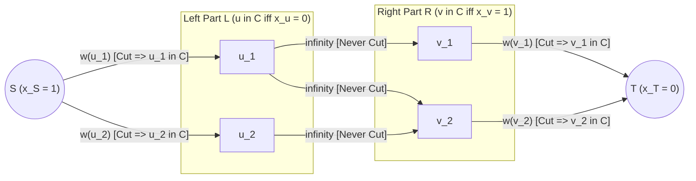
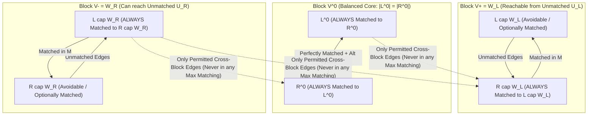
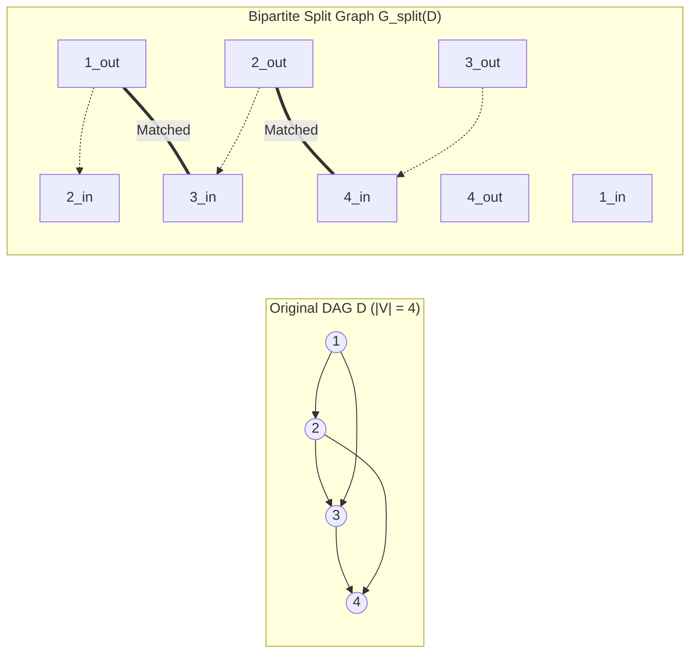

# Cohort 1 — Wave 1B Research Monograph: Bipartite Matching, König & Dilworth Dualities, Dulmage–Mendelsohn Decomposition, and Hall's Theorem Eliminations (Iterations 06–10)

> [!IMPORTANT]
> **Editorial Contract & Architectural Role (`flows_research/PLAN.md`)**
> This monograph covers **Iterations 06 through 10** of the Cohort 1 Discovery & Modelling Loop. Every theorem, structural decomposition, and problem solution adheres strictly to the **4-Step "Zero Magic Gadgets" Compilation Mandate**:
> 1. **Step 1: Non-Graph Diagnostic Signal (Recognition)** — Identifying the exact surface clues in raw English problem statements and constraint bounds ($N, M, V_{\max}$) that point to Bipartite Matching, Min Vertex Cover, DM Decomposition, Hall's Defect Optimization, or Dilworth Poset Chains, and diagnosing why greedy or dynamic programming fails.
> 2. **Step 2: Algebraic / Logical Intermediate Representation** — Translating the English problem into indicator variables $x_i \in \{0, 1\}$, disjunctive cover inequalities $x_u + y_v \ge 1$, pseudo-Boolean cut polynomials $\sum c_{uv} x_u(1 - x_v)$, Hall defect maximization $\max_{S \subseteq L}(|S| - |N(S)|)$, or poset chain/antichain LP duals **before** constructing any graph.
> 3. **Step 3: Reverse-Engineering Scratchpad (Mechanical Graph Compilation)** — Deriving the exact vertex split, edge orientation, capacity ($1$ vs. $\infty$), or data-structure transformation directly from the algebraic equations.
> 4. **Step 4: Hand-Checkable Toy Trace & Broken Gadget Counterexamples** — Tracing concrete small instances ($N \le 4$) and demonstrating the exact mathematical failure mode when an invariant is violated (e.g., odd cycles breaking Total Unimodularity, finite middle capacities corrupting vertex cover cuts, or missing transitive closure in overlapping path covers).

---

## Executive Overview: The Bipartite & Poset Duality Landscape

Across competitive programming, bipartite matching and partial order duality occupy a unique strategic position: they form the **bridge between pure discrete combinatorics and continuous Linear Programming / Network Flow duality**. Whereas general graphs suffer from the odd-cycle integrality gap—requiring Edmonds' Blossom shrinkings for matching and rendering Minimum Vertex Cover and Maximum Independent Set NP-hard—bipartite graphs and Directed Acyclic Graph (DAG) posets possess **Totally Unimodular (TU)** constraint matrices. Consequently, their packing and covering duals collapse into exact, polynomial-time minimax identities:

$$\begin{array}{rclcl}
\text{Max Bipartite Matching } \nu(G) & = & \text{Min Vertex Cover } \tau(G) & \quad & (\text{König's Theorem, 1931}) \\
\text{Max Independent Set } \alpha(G) & = & |V| - \tau(G) = \text{Min Edge Cover } \rho(G) & \quad & (\text{Gallai's Identities, 1959}) \\
\text{Max Matching Defect } |L| - \nu(G) & = & \max_{S \subseteq L} \big(|S| - |N(S)|\big) & \quad & (\text{Hall–Ore Defect Formula, 1935/1955}) \\
\text{Min Poset Chain Cover} & = & \text{Max Poset Antichain} & \quad & (\text{Dilworth's Theorem, 1950})
\end{array}$$

In contest problem solving, mastering these five iterations unlocks **both directions** of our bidirectional modelling philosophy:
- **Direction A (Non-Graph $\to$ Bipartite Flow/Cut)**: Recognizing hidden two-sided interactions in problems about grids, lasers, obstacles, number-theoretic prime sums, permutation rearrangements, two-player token games, and string containment, and compiling them into unit networks solved in $O(E\sqrt{V})$ time via Hopcroft–Karp / Dinic.
- **Direction B (Flow $\to$ Non-Flow Fast Algorithm for $N \le 2 \cdot 10^5$)**: Recognizing that a problem with $N = 2 \cdot 10^5$ *is* a bipartite matching or minimum vertex cover problem whose graph is too large to build explicitly, and replacing Dinic with **Ore's Defect Formula + Segment Trees**, **Sweep-Line Greedy**, or **Convex Hull / Monotone Queue** optimization in $O(N \log N)$ time.

---

## Iteration 06: Bipartite Matching, König's Theorem, Min Vertex Cover, Max Independent Set & Constructive Set Recovery

### 6.1 Core Combinatorial Objects & Definitions

Let $G = (V, E)$ be an undirected graph with $V = L \cup R$ ($L \cap R = \emptyset$) when $G$ is bipartite. Before stating any duality formula, we define the four fundamental packing and covering invariants on $G$:

1. **Matching ($M \subseteq E$) & Matching Number $\nu(G)$**: A subset of edges $M \subseteq E$ is a *matching* if no two edges in $M$ share a common endpoint ($\forall v \in V, |\delta_M(v)| \le 1$). The maximum cardinality of a matching is $\nu(G) = \max |M|$.
2. **Vertex Cover ($C \subseteq V$) & Vertex Cover Number $\tau(G)$**: A subset of vertices $C \subseteq V$ is a *vertex cover* if every edge $e = (u, v) \in E$ has at least one endpoint in $C$ ($u \in C$ or $v \in C$). The minimum cardinality of a vertex cover is $\tau(G) = \min |C|$.
3. **Independent Set ($I \subseteq V$) & Independence Number $\alpha(G)$**: A subset of vertices $I \subseteq V$ is *independent* (or *stable*) if no two vertices in $I$ are connected by an edge in $E$. The maximum cardinality of an independent set is $\alpha(G) = \max |I|$.
4. **Edge Cover ($F \subseteq E$) & Edge Cover Number $\rho(G)$**: Assuming $G$ has **no isolated vertices** ($\forall v \in V, \deg(v) \ge 1$), a subset of edges $F \subseteq E$ is an *edge cover* if every vertex $v \in V$ is incident to at least one edge in $F$. The minimum cardinality of an edge cover is $\rho(G) = \min |F|$.

In *any* graph $G$ (bipartite or not), weak duality holds trivially:
$$\nu(G) \le \tau(G),$$
because any vertex cover $C$ must pick at least one distinct endpoint from each of the $\nu(G)$ vertex-disjoint edges of a maximum matching $M$.

---

### 6.2 The 4-Step "Zero Magic Gadgets" Compilation of König's Duality

Why does strong duality $\nu(G) = \tau(G)$ hold on bipartite graphs, and how does this compile into an $s$-$t$ flow/cut network? Moreover, **why must the middle edges $(u, v)$ have capacity $\infty$ when modelling Minimum Vertex Cover, whereas capacity $1$ suffices when computing Maximum Matching?**

#### Step 1: The Non-Graph Diagnostic Signal (Recognition)
You are given a system of binary choices or entities that naturally partition into two disjoint classes $L$ and $R$ (or a single set of items whose conflict graph is $2$-colorable, containing no odd cycles). Look for two dual surface patterns:
- **Packing Signal (Matching)**: *"Pair up compatible items from $L$ and $R$ (or disjoint pairs in a parity-split universe) so each item is used at most once, maximizing the number of pairs."*
- **Covering / Conflict Signal (Vertex Cover / Independent Set)**: *"Every pair $(u, v) \in E$ is a forbidden conflict (or mandatory requirement). Either pay cost $w_u$ to activate/delete $u \in L$ OR pay cost $w_v$ to activate/delete $v \in R$, minimizing total cost (MVC), or equivalently select the maximum-weight subset of mutually compatible items (MIS)."*
- **Why Greedy and DP Fail**: Local greedy degree-picking fails on simple paths of length $3$ ($P_4$: picking the middle edge blocks two outer edges; picking a degree-$2$ center in MVC when endpoints are cheaper). Standard tree/bitmask DP fails when both $|L|, |R| \ge 50$ and the bipartite graph has high treewidth ($O(V)$).

#### Step 2: The Algebraic / Logical Intermediate Representation
Let us formulate **Minimum Weight Vertex Cover (MWVC)** on a bipartite graph $G = (L \cup R, E)$ with vertex weights $w_u \ge 0$ ($u \in L$) and $w_v \ge 0$ ($v \in R$). (Standard unweighted MVC is the special case $w_u = w_v = 1$.)

Assign a binary indicator variable to each vertex signifying whether it is included in the cover $C$:
$$p_u = [u \in C] \in \{0, 1\} \quad (\forall u \in L), \qquad q_v = [v \in C] \in \{0, 1\} \quad (\forall v \in R).$$
The problem asks to minimize total weight subject to covering every edge $(u, v) \in E$:
$$\min_{p \in \{0,1\}^L,\, q \in \{0,1\}^R} \sum_{u \in L} w_u p_u + \sum_{v \in R} w_v q_v \quad \text{subject to} \quad p_u + q_v \ge 1 \quad \forall (u, v) \in E.$$

Notice the obstacle: the constraint $p_u + q_v \ge 1$ is a symmetric OR clause ($p_u = 1 \lor q_v = 1$), whereas an $s$-$t$ minimum cut naturally encodes **implications** $x_u \le x_v$ (i.e., $x_u = 1 \implies x_v = 1$, penalized by $\infty \cdot x_u(1 - x_v)$).

To turn $p_u + q_v \ge 1$ into an implication, apply **Bipartite Variable Inversion** on the left side $L$ (or right side $R$). Define $s$-$t$ cut partition variables $x_w \in \{0, 1\}$ for all vertices $w \in L \cup R \cup \{S, T\}$, where $x_w = 1$ means $w \in S$-side of the cut and $x_w = 0$ means $w \in T$-side of the cut ($x_S = 1, x_T = 0$):
- For $u \in L$, set $p_u = 1 - x_u$. Thus $u \in C \iff p_u = 1 \iff x_u = 0$ ($u$ is separated from $S$).
- For $v \in R$, set $q_v = x_v$. Thus $v \in C \iff q_v = 1 \iff x_v = 1$ ($v$ is separated from $T$).

Substitute $p_u = 1 - x_u$ and $q_v = x_v$ into both the objective and the constraint:
1. **Objective Function**:
   $$\sum_{u \in L} w_u (1 - x_u) + \sum_{v \in R} w_v x_v = \sum_{u \in L} w_u x_S (1 - x_u) + \sum_{v \in R} w_v x_v (1 - x_T).$$
2. **Edge Coverage Constraint**:
   $$(1 - x_u) + x_v \ge 1 \iff x_u \le x_v \iff x_u(1 - x_v) = 0 \quad \forall (u, v) \in E.$$
   In words: it is forbidden to have $x_u = 1$ ($u \notin C$) and $x_v = 0$ ($v \notin C$) simultaneously! Adding an infinite penalty $\infty \cdot x_u(1 - x_v)$ enforces $x_u(1 - x_v) = 0$ in any finite-weight assignment.

Putting both pieces together yields the exact **Pseudo-Boolean Cut Polynomial**:
$$\Phi(x) = \sum_{u \in L} w_u x_S(1 - x_u) + \sum_{(u,v) \in E} \infty \cdot x_u(1 - x_v) + \sum_{v \in R} w_v x_v(1 - x_T).$$

#### Step 3: The Reverse-Engineering Scratchpad (Mechanical Graph Compilation)
In any directed network with source $S$ ($x_S = 1$) and sink $T$ ($x_T = 0$), a directed edge $\alpha \to \beta$ of capacity $c$ contributes $c \cdot x_\alpha(1 - x_\beta)$ to the capacity of the cut $(V_S, V_T)$ where $V_S = \{w : x_w = 1\}$. Reading $\Phi(x)$ term by term compiles the network with zero guesswork:

| Algebraic Term in $\Phi(x)$ | Compiled Directed Edge | Capacity | Combinatorial Meaning When Cut ($x_\alpha = 1, x_\beta = 0$) |
| :--- | :--- | :--- | :--- |
| $w_u x_S(1 - x_u)$ for $u \in L$ | $S \to u$ | $w_u$ (or $1$) | $x_u = 0 \implies p_u = 1 \implies u \in L$ is placed into Vertex Cover $C$. |
| $\infty \cdot x_u(1 - x_v)$ for $(u, v) \in E$ | $u \to v$ | $\infty$ | Forbids $x_u = 1 \land x_v = 0$ ($u \notin C \land v \notin C$, which leaves $(u,v)$ uncovered). |
| $w_v x_v(1 - x_T)$ for $v \in R$ | $v \to T$ | $w_v$ (or $1$) | $x_v = 1 \implies q_v = 1 \implies v \in R$ is placed into Vertex Cover $C$. |

> [!TIP]
> **Why Capacity $\infty$ vs. Capacity $1$ on Middle Edges $(u, v)$?**
> When $w_u = w_v = 1$ (unweighted matching/cover), each $u \in L$ has incoming capacity $1$ from $S$, and each $v \in R$ has outgoing capacity $1$ to $T$. By flow conservation, at most $1$ unit of flow can ever enter $u$ or leave $v$. Therefore, changing the capacity of $(u, v)$ from $\infty$ to $1$ **does not change the Maximum Flow value**!
> However, for **Minimum Cut / Vertex Cover**, setting capacity $\infty$ on $(u, v)$ is a mathematical device that guarantees no middle edge is ever cut in a minimum cut, forcing every cut edge to be a vertex-edge $(S, u)$ or $(v, T)$. And in **Weighted Vertex Cover** ($w_u, w_v$ arbitrary), middle edges *must* have capacity $\infty$, because flow along $(u, v)$ is no longer bounded by $1$!

#### Theorem 6.1 (König's Theorem, 1931)
*In any bipartite graph $G = (L \cup R, E)$, the maximum size of a matching equals the minimum size of a vertex cover:*
$$\nu(G) = \tau(G).$$

**Proof (via Max-Flow Min-Cut & Integrality)**:
Construct the network $\mathcal{N}$ above with $w_u = 1$ ($\forall u \in L$), $w_v = 1$ ($\forall v \in R$), and capacity $\infty$ on all $(u, v) \in E$.
1. **$\text{MinCut}(\mathcal{N}) = \tau(G)$**: Any vertex cover $C = C_L \cup C_R$ has finite capacity $\le |L| + |R| < \infty$. By the bijection in Step 3, setting $V_S = \{S\} \cup (L \setminus C_L) \cup C_R$ and $V_T = \{T\} \cup C_L \cup (R \setminus C_R)$ ensures no edge $(u, v) \in E$ has $u \in V_S$ and $v \in V_T$ (since $C$ covers $(u,v)$), so $\text{cap}(V_S, V_T) = |C_L| + |C_R| = |C|$. Conversely, any $s$-$t$ cut $(V_S, V_T)$ of finite capacity $< \infty$ cannot sever any $\infty$-capacity edge $(u, v) \in E$, so $C = (L \cap V_T) \cup (R \cap V_S)$ is a valid vertex cover of size $\text{cap}(V_S, V_T)$. Thus $\text{MinCut}(\mathcal{N}) = \tau(G)$.
2. **$\text{MaxFlow}(\mathcal{N}) = \nu(G)$**: By the Integrality Theorem of Max-Flow (since all finite capacities are integers), there exists an integer maximum flow $f^*$. For each $u \in L$, $\text{in-flow}(u) = f^*(S, u) \in \{0, 1\}$; for each $v \in R$, $\text{out-flow}(v) = f^*(v, T) \in \{0, 1\}$. Flow conservation at $u$ and $v$ implies that the set of middle edges $M = \{(u, v) \in E : f^*(u, v) = 1\}$ has at most one incident edge per vertex in $L \cup R$, forming a matching of size $|f^*|$. Conversely, any matching $M$ induces an integer flow of value $|M|$. Thus $\text{MaxFlow}(\mathcal{N}) = \nu(G)$.
3. By the Max-Flow Min-Cut Theorem, $\nu(G) = \text{MaxFlow}(\mathcal{N}) = \text{MinCut}(\mathcal{N}) = \tau(G)$. $\blacksquare$

---

### 6.3 Gallai's Identities: Independent Sets & Edge Covers

While König's theorem requires bipartiteness, Tibor Gallai (1959) proved two identities linking $\alpha(G)$ with $\tau(G)$ and $\nu(G)$ with $\rho(G)$ that hold for **all** graphs (even non-bipartite ones!).

#### Theorem 6.2 (Gallai's First Identity — Vertex Cover & Independent Set Complementarity)
*For **every** graph $G = (V, E)$, a subset $I \subseteq V$ is an independent set if and only if its complement $C = V \setminus I$ is a vertex cover. Consequently:*
$$\alpha(G) + \tau(G) = |V|, \qquad \text{and for weighted graphs:} \quad \text{MWIS}(G) + \text{MWVC}(G) = \sum_{v \in V} w_v.$$

**Proof**:
By definition, $I$ is an independent set $\iff$ no edge $e = (u, v) \in E$ has both $u \in I$ and $v \in I$ $\iff$ every edge $e = (u, v) \in E$ has at least one endpoint in $V \setminus I$ $\iff$ $V \setminus I$ is a vertex cover. Taking the maximum over $|I|$ (or $w(I)$) takes the minimum over $|V \setminus I|$ (or $w(V \setminus I)$). $\blacksquare$

#### Theorem 6.3 (Gallai's Second Identity — Matching & Edge Cover Duality)
*For **every** graph $G = (V, E)$ with **no isolated vertices** ($\forall v \in V, \deg(v) \ge 1$):*
$$\nu(G) + \rho(G) = |V|.$$

**Proof (Double Inequality via Constructive Extension & Contraction)**:
1. **Upper bound $\rho(G) \le |V| - \nu(G)$**: Let $M$ be a maximum matching of size $|M| = \nu(G)$. The edges of $M$ cover $2\nu(G)$ distinct vertices, leaving $|V| - 2\nu(G)$ vertices exposed (unmatched). Since $G$ has no isolated vertices, for each exposed vertex $v$ we can pick one arbitrary incident edge $e_v \in \delta(v)$ and add it to $M$. The resulting edge set $F = M \cup \{e_v : v \text{ exposed}\}$ covers all vertices in $V$ and uses at most $|M| + (|V| - 2\nu(G)) = |V| - \nu(G)$ edges. Thus $\rho(G) \le |F| \le |V| - \nu(G)$.
2. **Lower bound $\nu(G) \ge |V| - \rho(G)$**: Let $F \subseteq E$ be a minimum edge cover of size $|F| = \rho(G)$. Observe that the subgraph $(V, F)$ cannot contain any edge whose two endpoints both have degree $\ge 2$ in $(V, F)$—otherwise deleting that edge would leave a smaller valid edge cover, contradicting minimality of $F$! Therefore, $(V, F)$ contains no cycles (it is a forest) and no path of length $\ge 3$: every connected component of $(V, F)$ is a **star graph** $K_{1, d}$ ($d \ge 1$). If $(V, F)$ has $k$ connected components (stars), a forest on $|V|$ vertices with $|F| = \rho(G)$ edges has $k = |V| - |F| = |V| - \rho(G)$ components. Selecting one edge from each of the $k$ disjoint stars yields a valid matching $M'$ of size $k = |V| - \rho(G)$. Thus $\nu(G) \ge |M'| = |V| - \rho(G)$.
Combining both inequalities gives $\nu(G) + \rho(G) = |V|$. $\blacksquare$

> [!IMPORTANT]
> **The Complete Bipartite Quartet (Combining König + Gallai)**
> When $G = (L \cup R, E)$ is **bipartite** (and has no isolated vertices when discussing $\rho(G)$):
> $$\nu(G) = \tau(G), \qquad \alpha(G) = |V| - \tau(G) = |V| - \nu(G) = \rho(G).$$

---

### 6.4 Constructive Set Recovery: Alternating Reachability & Residual BFS Equivalence

Many contest problems (e.g., `POJ 2125 — Destroying The Graph`, `CF 590 E — Birthday`, `[CEOI 2008] Order`) ask not just for the *size* of the Minimum Vertex Cover or Maximum Independent Set, but for the **exact subset of vertices** achieving the optimum.

#### Theorem 6.4 (Constructive König–Egerváry Set Recovery)
Let $M$ be a maximum matching of a bipartite graph $G = (L \cup R, E)$, and let $U_L \subseteq L$ be the set of **unmatched** vertices in $L$. Define the **alternating reachability set** $Z \subseteq L \cup R$ as the set of all vertices reachable from $U_L$ via alternating paths that traverse **unmatched edges from $L$ to $R$** and **matched edges from $R$ to $L$**:
$$U_L \xrightarrow{e \notin M} R \xrightarrow{e \in M} L \xrightarrow{e \notin M} R \cdots$$
Then:
1. **Residual Graph Equivalence**: In the Max-Flow network $\mathcal{N}$ (with $\infty$-capacity middle edges), $Z$ is **identical** to the set of vertices in $L \cup R$ reachable from the source $S$ via positive-residual-capacity edges in the residual graph $G_f$!
2. **Minimum Vertex Cover**:
   $$C^* = (L \setminus Z) \cup (R \cap Z) \quad \text{is a Minimum Vertex Cover of } G \text{ with } |C^*| = |M|.$$
3. **Maximum Independent Set**:
   $$I^* = V \setminus C^* = (L \cap Z) \cup (R \setminus Z) \quad \text{is a Maximum Independent Set of } G \text{ with } |I^*| = |V| - |M|.$$

**Proof**:
Let us first verify the **Residual Graph Equivalence (1)**:
- An edge $(S, u)$ ($u \in L$) has residual capacity $1 - f(S, u) > 0 \iff f(S, u) = 0 \iff u \in U_L$ is unmatched! Thus the first step from $S$ into $L$ in $G_f$ reaches exactly $U_L$.
- From any $u \in L$, every edge $(u, v) \in E$ has residual capacity $\infty - f(u,v) = \infty > 0$, so $G_f$ can traverse any unmatched edge $u \to v$ (and traversing a matched edge $u \to v$ just stays at its own partner $v$).
- From any $v \in R$, the edge $(v, T)$ cannot be traversed if $f$ is a maximum flow—because if some $v \in R \cap Z$ had residual capacity on $(v, T)$ ($f(v, T) = 0$, meaning $v$ is unmatched), then the alternating path from $U_L$ to $v$ would be an **augmenting path** from $S$ to $T$, contradicting the maximality of $M$! Thus every $v \in R \cap Z$ is **matched** in $M$, and the only residual edges leaving $v \in R \cap Z$ in $G_f$ are the reverse edges $v \to u$ where $f(u, v) = 1$, i.e., $(u, v) \in M$!
Hence, residual BFS from $S$ in $G_f \setminus \{S, T\}$ visits literally $Z = (L \cap Z) \cup (R \cap Z)$!

Now we verify **(2)** and **(3)** via three structural invariants of $Z$:
- **Invariant A (No edge between $L \cap Z$ and $R \setminus Z$)**: Suppose $(u, v) \in E$ has $u \in L \cap Z$. If $(u, v) \notin M$, then by definition of $Z$, $u \in Z \implies v \in Z$. If $(u, v) \in M$, how did $u$ enter $Z$? Since $u$ is matched, $u \notin U_L$, so $u$ could only be reached in the alternating walk from its unique matched partner $v \in R$ via the matched edge $v \to u$, meaning $v \in R \cap Z$ was already in $Z$! In both cases, $v \in R \cap Z$. Thus **no edge $(u, v) \in E$ can have $u \in L \cap Z$ and $v \in R \setminus Z$**. This immediately proves every edge $(u, v) \in E$ has either $u \in L \setminus Z$ or $v \in R \cap Z$, so $C^* = (L \setminus Z) \cup (R \cap Z)$ is a valid vertex cover!
- **Invariant B (Every vertex in $C^*$ is matched)**: By definition, $U_L \subseteq L \cap Z$, so $L \setminus Z$ contains no unmatched $L$-vertices. And as proved above, $R \cap Z$ contains no unmatched $R$-vertices (otherwise an augmenting path from $U_L$ to $R \cap Z$ exists).
- **Invariant C (No matched edge $(u, v) \in M$ has both $u \in L \setminus Z$ and $v \in R \cap Z$)**: If $v \in R \cap Z$ and $(u, v) \in M$, then the alternating walk rule $R \xrightarrow{\in M} L$ forces $u \in L \cap Z$.
Combining Invariants B and C: every vertex in $C^* = (L \setminus Z) \cup (R \cap Z)$ is an endpoint of a unique edge in $M$, and no edge in $M$ has both endpoints in $C^*$. Thus $|C^*| \le |M| = \nu(G) \le \tau(G) \le |C^*|$, proving $|C^*| = |M|$ is minimum! $\blacksquare$

---

### 6.5 Step 4: Concrete Hand-Checkable Toy Trace & Broken Gadget Counterexamples

#### Hand-Checkable Toy Trace ($|L| = 3, |R| = 3$)
Consider $L = \{u_1, u_2, u_3\}$, $R = \{v_1, v_2, v_3\}$, with edges:
$$E = \{(u_1, v_1),\; (u_2, v_1),\; (u_3, v_1),\; (u_3, v_2)\}.$$
1. **Maximum Matching $M$**: $M = \{(u_1, v_1),\; (u_3, v_2)\}$ of size $\nu(G) = 2$.
2. **Unmatched $L$-vertices**: $U_L = \{u_2\}$ (while $v_3 \in R$ is also unmatched).
3. **Alternating Reachability $Z$ from $U_L = \{u_2\}$**:
   - Start at $u_2 \in L \cap Z$.
   - Traverse unmatched edge $(u_2, v_1) \notin M \implies v_1 \in R \cap Z$.
   - From $v_1$, traverse matched edge $(v_1, u_1) \in M \implies u_1 \in L \cap Z$.
   - From $u_1$, no other unmatched edges leave $u_1$.
   - Hence $Z = \{u_1, u_2\} \cup \{v_1\}$, with $L \cap Z = \{u_1, u_2\}$ and $R \cap Z = \{v_1\}$.
4. **Constructive Extraction**:
   - **Minimum Vertex Cover**: $C^* = (L \setminus Z) \cup (R \cap Z) = \{u_3\} \cup \{v_1\} = \{u_3, v_1\}$ of size $2 = |M|$. Check all edges in $E$: $(u_1, v_1), (u_2, v_1), (u_3, v_1)$ are covered by $v_1$, and $(u_3, v_2)$ is covered by $u_3$!
   - **Maximum Independent Set**: $I^* = (L \cap Z) \cup (R \setminus Z) = \{u_1, u_2\} \cup \{v_2, v_3\} = \{u_1, u_2, v_2, v_3\}$ of size $4 = 6 - 2$. Check that no edge in $E$ connects $\{u_1, u_2\}$ to $\{v_2, v_3\}$!

#### Broken Gadget Counterexamples (Failure Modes)
1. **Failure Mode 1: Non-Bipartite Odd Cycles ($C_{2k+1}$)**:
   On the triangle $C_3 = \{1, 2, 3\}$, $\nu(C_3) = 1$ (at most one edge can be matched), whereas $\tau(C_3) = 2$ (at least two vertices are needed to cover all $3$ edges) and $\alpha(C_3) = 1$. Why does the LP / Cut proof fail? Because the linear programming relaxation of Vertex Cover ($\min \sum x_v$ s.t. $x_u + x_v \ge 1$) assigns the **half-integral** solution $x_1 = x_2 = x_3 = 1/2$ with objective $3/2 < 2$, and the dual Matching LP assigns $f_e = 1/2$ to all $3$ edges with value $3/2 > 1$. In algebraic terms, our bipartite variable inversion $p_u = 1 - x_u, q_v = x_v$ requires a $2$-coloring of $G$; around an odd cycle, walking along the cycle flips the variable polarity an odd number of times, forcing a vertex $u$ to satisfy $x_u = 1 - x_u$, a contradiction!
2. **Failure Mode 2: Finite Capacity $1$ on Middle Edges $(u, v)$ During Cut Extraction**:
   Suppose in the toy trace above we set $\text{cap}(u, v) = 1$ instead of $\infty$ on the edge $(u_3, v_2)$. Since $(u_3, v_2) \in M$ carries $1$ unit of flow, the edge $(u_3, v_2)$ is **saturated** in $G_f$! If $u_3$ were reachable from $S$ (e.g., if $(S, u_3)$ had remaining capacity in a weighted instance, or if one naively picked any minimum edge cut), cutting the middle edge $(u_3, v_2)$ instead of $(S, u_3)$ or $(v_2, T)$ fails to identify which *vertex* belongs to the vertex cover! Always assign capacity $\infty$ to middle edges $u \to v$ when running residual BFS from $S$ for MVC/MIS recovery.

---

## Iteration 07: Dulmage–Mendelsohn (`DM`) Decomposition & Two-Player Games on Bipartite Graphs

In Iteration 06, we used a single maximum matching $M$ to recover one minimum vertex cover. A much deeper structural question arises in both graph theory and game theory:
> *Given a bipartite graph $G = (L \cup R, E)$, how can we classify **every vertex** and **every edge** according to whether it belongs to **all** maximum matchings, **some** maximum matchings, or **no** maximum matchings—without re-running Dinic for each vertex?*

The answer is the **Dulmage–Mendelsohn (`DM`) Decomposition** (1958), which is the bipartite matching counterpart of the residual SCC cut analysis (`[AHOI2009] 最小割`) from Wave 1A.

---

### 7.1 Vertex Classification: Always-Matched vs. Avoidable vs. Never-Matched

Let $M$ be any fixed maximum matching of $G = (L \cup R, E)$. Let $U_L \subseteq L$ be the unmatched vertices in $L$, and let $U_R \subseteq R$ be the unmatched vertices in $R$. We define **two** alternating reachability sets:

1. **Left-Unmatched Alternating Reachability $W_L$** (identical to $Z$ in Iteration 06):
   The set of vertices in $L \cup R$ reachable from $U_L$ via alternating paths starting with an unmatched edge:
   $$U_L \xrightarrow{\notin M} R \xrightarrow{\in M} L \xrightarrow{\notin M} R \cdots$$
2. **Right-Unmatched Alternating Reachability $W_R$**:
   The set of vertices in $L \cup R$ reachable from $U_R$ via alternating paths starting with an unmatched edge from $R$ to $L$:
   $$U_R \xrightarrow{\notin M} L \xrightarrow{\in M} R \xrightarrow{\notin M} L \cdots$$

#### Lemma 7.1 (Disjointness of $W_L$ and $W_R$)
*For any maximum matching $M$, the sets $W_L$ and $W_R$ are completely disjoint: $W_L \cap W_R = \emptyset$.*

**Proof**:
Suppose for contradiction that some vertex $x \in W_L \cap W_R$. Because every step into $R$ in $W_L$ is immediately followed by its unique matched edge in $M$ into $L$ (and similarly for $W_R$), concatenating the alternating path from $u_0 \in U_L$ to $x$ with the reverse of the alternating path from $v_0 \in U_R$ to $x$ yields an $M$-augmenting path between $u_0 \in U_L$ and $v_0 \in U_R$, contradicting the maximality of $M$. $\blacksquare$

#### Theorem 7.2 (Coarse Dulmage–Mendelsohn Decomposition & Vertex Essentiality)
Let $V^0 = (L \cup R) \setminus (W_L \cup W_R)$ be the remaining vertices not in $W_L$ or $W_R$. The partition of $V = L \cup R$ into three blocks:
$$V^+ = W_L = (L \cap W_L) \cup (R \cap W_L), \qquad V^- = W_R = (L \cap W_R) \cup (R \cap W_R), \qquad V^0 = (L \cap V^0) \cup (R \cap V^0)$$
is **canonical** (independent of which maximum matching $M$ was chosen to compute $W_L$ and $W_R$) and satisfies:

1. **Avoidable (Inessential) Vertices ($\mathcal{A}$ — Missed by at least one Maximum Matching)**:
   A vertex $w \in L \cup R$ is omitted by *at least one* maximum matching $M'$ if and only if:
   $$w \in (L \cap W_L) \cup (R \cap W_R).$$
   - *Proof*: If $u \in L \cap W_L$, there is an even-length alternating path $P$ from some $u_0 \in U_L$ to $u$. Taking the symmetric difference $M' = M \oplus E(P)$ produces a new matching $M'$ with $|M'| = |M|$ in which $u_0$ becomes matched and $u$ becomes **unmatched**! (Symmetrically for $v \in R \cap W_R$.)
   - Conversely, if there exists *any* maximum matching $M'$ in which $u \in L$ is unmatched, consider the symmetric difference $M \oplus M'$. Since $|M| = |M'|$, every connected component of $M \oplus M'$ is either an even cycle or an even-length alternating path between an $M'$-unmatched vertex and an $M$-unmatched vertex. Because $u \in L$ is $M'$-unmatched, the component of $M \oplus M'$ containing $u$ must be an even-length $M$-alternating path connecting $u$ to some $M$-unmatched vertex $u_0 \in U_L$! Hence $u \in L \cap W_L$.

2. **Always-Matched (Essential) Vertices ($\mathcal{E}$ — Matched in EVERY Maximum Matching)**:
   A vertex $w \in L \cup R$ belongs to **every** maximum matching of $G$ if and only if:
   $$w \notin (L \cap W_L) \cup (R \cap W_R) \iff w \in (R \cap W_L) \cup (L \cap W_R) \cup V^0.$$
   Equivalently, by Theorem 6.4, **$w$ is matched in every maximum matching if and only if $w$ belongs to at least one Minimum Vertex Cover (or even simpler: $L \setminus W_L$ and $R \cap W_L$ are subset blocks of the canonical extremal vertex covers)**!

3. **Never-Matched vs. Optionally-Matched Refinement of Avoidable Vertices**:
   Among the avoidable vertices $w \in (L \cap W_L) \cup (R \cap W_R)$:
   - $u \in L \cap W_L$ is **Never-Matched** (matched in *zero* maximum matchings) if and only if $\deg_G(u) = 0$ (i.e., $u$ is an isolated vertex!). Why? Because if $u \in U_L$ has *any* neighbor $v \in R$, then by definition of $W_L$, $v \in R \cap W_L$, which is matched in $M$ to some $u_1 \in L \cap W_L$. Replacing $(u_1, v) \in M$ with $(u, v)$ yields a maximum matching $M'$ that matches $u$!
   - Every non-isolated vertex in $(L \cap W_L) \cup (R \cap W_R)$ is **Optionally-Matched** (matched in *some* maximum matching, unmatched in *some* maximum matching).

#### Implementation Contract in the Dinic Residual Graph $G_f$ (Unit-Capacity Network)
When we run Dinic on the standard **unit-capacity** network $\mathcal{N}_1$ where **all edges** $(S, u)$, $(u, v)$, and $(v, T)$ have capacity $1$:
- An edge $(S, u)$ has residual capacity $1$ in $G_f \iff u \in U_L$.
- An unmatched edge $(u, v) \notin M$ has residual capacity $1$ in the forward direction $u \to v$.
- A matched edge $(u, v) \in M$ is saturated in the forward direction ($u \to v$ has residual capacity $0$) and has residual capacity $1$ in the backward direction $v \to u$!
- An edge $(v, T)$ has residual capacity $1$ in the forward direction $v \to T \iff v \in U_R$.

Therefore, in the unit-capacity residual graph $G_f$:
- **$L \cap W_L$** is the exact set of $L$-vertices reachable from $S$ via directed edges in $G_f$!
- **$R \cap W_R$** is the exact set of $R$-vertices from which $T$ is reachable via directed edges in $G_f$ (i.e., reachable from $T$ in the reversed residual graph $G_f^{\text{rev}}$)!

---

### 7.2 Edge Classification & The Fine DM Decomposition (Residual SCCs)

What if a problem asks whether a specific **edge** $e = (u, v) \in E$ belongs to **every**, **some**, or **no** maximum matching (e.g., `[BJWC2018] 社交网络`, `AGC 037`, or unique matching verification)?

Using the unit-capacity residual graph $G_f$ (deleting $S$ and $T$ when testing alternating cycles, or keeping $S$ and $T$ and contracting or inspecting $W_L, W_R$), Tarjan's Strongly Connected Components (SCC) algorithm on $G_f \setminus \{S, T\}$ gives the **Fine Dulmage–Mendelsohn Decomposition**:

#### Theorem 7.3 (Complete Characterization of Edges in Maximum Matchings)
Let $M$ be a maximum matching of $G = (L \cup R, E)$, and let $G_f^\circ = G_f \setminus \{S, T\}$ be the directed bipartite graph where unmatched edges $(u, v) \notin M$ are oriented $u \to v$ ($L \to R$) and matched edges $(u, v) \in M$ are oriented $v \to u$ ($R \to L$). Compute the SCCs of $G_f^\circ$ and the reachability sets $W_L, W_R$:

1. **Admissible Edges (Belong to AT LEAST ONE Maximum Matching)**:
   An edge $e = (u, v) \in E$ belongs to *some* maximum matching $M'$ if and only if at least one of the following three conditions holds:
   - $e \in M$ (it is already in the current maximum matching);
   - $u, v \in W_L$ (both endpoints lie in $V^+$);
   - $u, v \in W_R$ (both endpoints lie in $V^-$);
   - $u, v \in V^0$ and $\text{SCC}(u) = \text{SCC}(v)$ in $G_f^\circ$ (i.e., there is a directed path $v \to \dots \to u$ in $G_f^\circ$, so $e = (u, v)$ lies on an even-length alternating cycle!).
   *(Unified Residual Statement: In the full residual graph $G_f$ including $S$ and $T$, if we add dummy directed edges $u \to S$ for all $u \in L$ and $T \to v$ for all $v \in R$—or simply observe that paths through $U_L$ or $U_R$ can be cycled via $S$ or $T$—an edge $(u, v) \notin M$ is in some maximum matching iff $u$ is reachable from $v$ via an alternating path or via $W_L / W_R$!)*
2. **Essential Edges (Belong to EVERY Maximum Matching)**:
   An edge $e = (u, v) \in E$ belongs to *every* maximum matching of $G$ if and only if:
   $$e \in M, \qquad u, v \in V^0 \quad (\text{i.e., } u, v \notin W_L \cup W_R), \qquad \text{and} \qquad \text{SCC}(u) \ne \text{SCC}(v) \text{ in } G_f^\circ.$$
   - *Why?* An edge $e \in M$ can be replaced in another maximum matching $M'$ iff the component of $M \oplus M'$ containing $e$ is either an alternating cycle (which exists iff $u$ can reach $v$ in $G_f^\circ \setminus \{v \to u\}$, i.e., $\text{SCC}(u) = \text{SCC}(v)$) or an even alternating path starting in $U_L$ ($u, v \in W_L$) or ending in $U_R$ ($u, v \in W_R$).
3. **Forbidden Edges (Belong to NO Maximum Matching)**:
   All other edges $e = (u, v) \in E$—specifically, any edge jumping between different DM blocks (such as $L \cap V^0 \to R \cap W_L$ or $L \cap W_R \to R \cap V^0$) or between different SCCs inside $V^0$—can **never** appear in any maximum matching!

---

### 7.3 Impartial Two-Player Walk Games on Bipartite Graphs (`二分图博弈`)

One of the most celebrated applications of the Dulmage–Mendelsohn Decomposition in competitive programming is the **Bipartite Graph Walk Game** (`二分图博弈`, popularized in China by `[JSOI2009] 游戏` and in Japan by `ABC 354 G` / `ARC` game problems).

#### The Game Rules
Let $G = (L \cup R, E)$ be a bipartite graph (often disguised as a grid with obstacles, a word chain, or an algebraic state graph). A single token is initially placed on a starting vertex $v_0 \in V$. Two players, **Alice (First Player)** and **Bob (Second Player)**, alternate turns:
- In each turn, the current player must move the token from its current vertex $u$ along an edge $(u, v) \in E$ to an adjacent vertex $v$ that has **never been visited before** during the game.
- The first player who has no valid move loses (Normal Play Convention).

Since $G$ is finite and no vertex can be visited twice, the game is finite, impartial, and cannot end in a draw. Every starting vertex $v_0 \in V$ is either a **First-Player Winning (`N`)** position or a **Second-Player Winning (`P`)** position.

#### Step 1: The Non-Graph Diagnostic Signal (Recognition)
- **Surface Clues**: Two players take turns moving a single piece (or selecting an adjacent state) without ever revisiting a previously visited state. Constraints are typically $V \le 10^4$, $E \le 10^5$, preventing $O(2^V)$ bitmask Sprague–Grundy DP (which is required on general graphs, where Undirected Geography is PSPACE-complete!).
- **Key Structural Unlock**: The state-transition graph $G$ is **bipartite** (e.g., orthogonal moves $(r \pm 1, c), (r, c \pm 1)$ on a grid flip parity $(r + c) \bmod 2$ on every move!).

#### Step 2 & Step 3: Theorem & Strategy-Stealing Alternating-Path Proof

#### Theorem 7.4 (Fundamental Theorem of Bipartite Walk Games)
*In the impartial non-repeating walk game on a bipartite graph $G = (L \cup R, E)$, the starting vertex $v_0 \in V$ is a **First-Player Winning (`N`)** position if and only if $v_0$ is an **Essential (Always-Matched) Vertex** of $G$—that is, $v_0$ is covered by **every** maximum matching of $G$.*
*Equivalently, by Theorem 7.2:*
$$v_0 \text{ is First-Player Winning} \iff v_0 \notin (L \cap W_L) \cup (R \cap W_R).$$

**Proof (Constructive Pairing + Alternating Path Invariant)**:
Without loss of generality, assume the starting vertex lies on the left side: $v_0 \in L$.

1. **Case 1 ($v_0$ is Avoidable: there exists a maximum matching $M$ that does NOT cover $v_0$) $\implies$ Second Player (Bob) Wins**:
   Let $M$ be a maximum matching of $G$ with $v_0$ unmatched ($v_0 \in U_L$). We prove that Bob can win by adopting the **Mirror Strategy along $M$**: whenever Alice moves to a vertex $x$, Bob immediately moves along the unique matched edge $(x, M(x)) \in M$!
   - Why is Bob's move always legal? Let the game trace be $v_0 \xrightarrow{\text{Alice}} w_1 \xrightarrow{\text{Bob}} v_1 \xrightarrow{\text{Alice}} w_2 \xrightarrow{\text{Bob}} v_2 \dots$.
   - Since $G$ is bipartite and $v_0 \in L$, every Alice move goes from $L$ to $R$ along an **unmatched** edge (because $v_0$ was unmatched, and every subsequent $v_k \in L$ was just reached via the matched edge $(w_k, v_k) \in M$), and every Bob move goes from $R$ to $L$ along a **matched** edge in $M$.
   - Suppose for contradiction that on turn $k$, Alice moves from $v_{k-1} \in L$ to a previously unvisited vertex $w_k \in R$, and Bob has no matched move because $w_k$ is **unmatched** in $M$! (Note: if $w_k$ is matched to $v_k = M(w_k)$, could $v_k$ have been visited earlier? No! Because $v_0 \notin M$, and every earlier $v_i \in L$ ($1 \le i < k$) was entered only from its unique matched partner $w_i = M(v_i) \ne w_k$.)
   - If $w_k \in R$ is unmatched in $M$, then the game path Played so far:
     $$v_0 \xrightarrow{\notin M} w_1 \xrightarrow{\in M} v_1 \xrightarrow{\notin M} w_2 \dots \xrightarrow{\notin M} w_k$$
     is an **$M$-augmenting path** from the unmatched vertex $v_0 \in U_L$ to the unmatched vertex $w_k \in U_R$, contradicting the maximality of $M$! Thus every vertex $w_k \in R$ that Alice can ever reach is matched in $M$, so Bob always has a legal response and wins!

2. **Case 2 ($v_0$ is Essential: $v_0$ is covered by EVERY maximum matching of $G$) $\implies$ First Player (Alice) Wins**:
   Let $M$ be any maximum matching of $G$. Since $v_0$ is essential, $v_0$ is matched to some partner $w_1 = M(v_0) \in R$.
   - **Alice's Winning Strategy**: On Turn 1, Alice moves from $v_0$ to $w_1 = M(v_0)$!
   - Consider the remaining subgraph $G' = G \setminus \{v_0\}$ after $v_0$ is removed (since $v_0$ can never be revisited), where Bob is now the *first* player starting at $w_1 \in R$.
   - Notice that $M' = M \setminus \{(v_0, w_1)\}$ is a matching in $G'$ of size $|M| - 1$ that leaves $w_1$ **unmatched**.
   - Could $G' = G \setminus \{v_0\}$ have a matching $M''$ of size $|M|$? **No!** Because any matching $M''$ of $G \setminus \{v_0\}$ of size $|M|$ would be a maximum matching of $G$ that misses $v_0$, contradicting our hypothesis that $v_0$ belongs to *every* maximum matching of $G$!
   - Therefore, $\nu(G') = |M| - 1$, and $M' = M \setminus \{(v_0, w_1)\}$ is a **maximum matching of $G'$ that misses $w_1$**! By Case 1 applied to $(G', w_1)$, the player about to move from $w_1$ in $G'$ (namely Bob!) is in a losing position, and Alice wins by playing the Mirror Strategy along $M'$ for the rest of the game! $\blacksquare$

#### Step 4: Fast $O(E\sqrt{V})$ All-Vertices Algorithm & Toy Trace
A naive implementation of Theorem 7.4 deletes each vertex $v_0 \in V$ one by one and re-runs Hopcroft–Karp / Dinic $V$ times in $O(V \cdot E\sqrt{V})$ time, which TLEs when $V = 10^4, E = 10^5$.
Instead, combining Theorem 7.4 with the Dulmage–Mendelsohn reachability characterization (Theorem 7.2) solves **all $v_0 \in V$ simultaneously in a single Max-Flow run**:
1. Run Dinic once on the unit network $\mathcal{N}_1$ in $O(E\sqrt{V})$ time to obtain $G_f$.
2. Run a single BFS from $S$ in $G_f$ to mark all reachable $L$-vertices ($L \cap W_L$).
3. Run a single BFS backward from $T$ in $G_f$ to mark all $R$-vertices that can reach $T$ ($R \cap W_R$).
4. For any query $v_0 \in L$, output `First Player Wins` iff $v_0 \notin L \cap W_L$. For any query $v_0 \in R$, output `First Player Wins` iff $v_0 \notin R \cap W_R$. Total query time: **$O(1)$ per vertex**!

**Toy Trace on Path $P_3$ vs. Path $P_4$**:
- On $P_3 = u_1 - v_1 - u_2$ ($L = \{u_1, u_2\}, R = \{v_1\}$): Maximum matchings are $M_1 = \{(u_1, v_1)\}$ and $M_2 = \{(u_2, v_1)\}$. Here $v_1 \in R$ is in **both** maximum matchings (Always-Matched $\implies$ Alice wins starting at $v_1$ by moving to $u_1$, leaving Bob stuck!), whereas $u_1$ and $u_2$ are each missed by one maximum matching (Avoidable $\implies$ Bob wins starting at $u_1$ or $u_2$ by moving to $v_1$ and then to the other endpoint!).
- On $P_4 = u_1 - v_1 - u_2 - v_2$: There is a unique perfect matching $M = \{(u_1, v_1), (u_2, v_2)\}$. Since $U_L = U_R = \emptyset$, $W_L = W_R = \emptyset$, so **every** vertex in $P_4$ is Always-Matched and First-Player Winning!

---

## Iteration 08: Hidden Non-Graph Bipartite Modelling Archetypes

In competitive programming, a problem that explicitly gives you $L$, $R$, and $E$ is considered a warm-up. Grandmaster-level problems disguise a bipartite graph inside a **2D grid**, a **number-theoretic array**, a **bitmask space**, or a **multi-stage matrix permutation**. Below we catalog the four foundational non-graph-to-bipartite compilation archetypes, each derived through our 4-Step "Zero Magic Gadgets" protocol.

---

### 8.1 Archetype 1: Row-vs-Column Grid Duality (`行列二分图模型`)

#### Step 1: The Non-Graph Diagnostic Signal (Recognition)
The problem takes place on an $R \times C$ grid (or a sparse set of 2D points $(x_i, y_i)$). Look for operations or constraints that act along **entire rows and entire columns**:
- **Covering Variant**: *"Activating row $r$ costs $w_r$ and destroys all targets in row $r$; activating column $c$ costs $w_c$ and destroys all targets in column $c$. Destroy all targets at minimum cost."* (`POJ 3041 — Asteroids`, `CF 198 B / Grid Laser` variants).
- **Packing Variant**: *"Select a maximum number of marked cells $(r, c)$ such that no two selected cells share the same row or the same column (non-attacking rooks)."* (`[ZJOI2007] 矩阵游戏`).
- **Why Row-by-Row DP Fails**: When $R, C \le 500$, tracking which columns have already been used or covered requires $2^C$ bitmask state, which is exponential.

#### Step 2: The Algebraic / Logical Intermediate Representation
Instead of viewing a grid cell $(r, c)$ as a *vertex* (which would link $(r, c)$ to all other cells in row $r$ and column $c$, creating dense cliques $K_R$ and $K_C$), observe that every cell $(r, c)$ is an **ordered pair of one row index $r \in \{1, \dots, R\}$ and one column index $c \in \{1, \dots, C\}$**:
- **For Covering**: Let $p_r \in \{0, 1\}$ indicate whether row $r$ is fired, and $q_c \in \{0, 1\}$ indicate whether column $c$ is fired. Every target at $(r, c) \in \mathcal{T}$ requires:
  $$p_r + q_c \ge 1 \quad \forall (r, c) \in \mathcal{T}, \qquad \min \sum_{r=1}^R w_r p_r + \sum_{c=1}^C w_c q_c.$$
- **For Packing**: Let $f_{r, c} \in \{0, 1\}$ indicate whether a rook is placed on cell $(r, c) \in \mathcal{T}$. The row and column mutual-exclusion constraints are:
  $$\sum_{c : (r, c) \in \mathcal{T}} f_{r, c} \le 1 \quad (\forall r), \qquad \sum_{r : (r, c) \in \mathcal{T}} f_{r, c} \le 1 \quad (\forall c), \qquad \max \sum_{(r, c) \in \mathcal{T}} f_{r, c}.$$

#### Step 3: The Reverse-Engineering Scratchpad (Mechanical Graph Compilation)
Comparing the two equations in Step 2 with Iteration 06 reveals an exact isomorphism:
- **Left Vertices $L = \{1, \dots, R\}$**: The $R$ rows of the grid.
- **Right Vertices $R = \{1, \dots, C\}$**: The $C$ columns of the grid.
- **Bipartite Edges $E = \mathcal{T}$**: Each target/valid cell $(r, c)$ is a **directed bipartite edge $r \to c$**!
  - Placing non-attacking rooks $\equiv$ **Maximum Bipartite Matching** $\nu(G)$.
  - Firing a minimum number of row/column lasers to cover all targets $\equiv$ **Minimum Vertex Cover** $\tau(G) = \nu(G)$.
  - Furthermore, notice that swapping two rows or swapping two columns of a matrix only permutes the vertex labels of $L$ and $R$: **$\nu(G)$ is invariant under arbitrary row and column permutations** (`[ZJOI2007] 矩阵游戏`: $1$s can be placed on the main diagonal via row/column swaps iff $\nu(G) = N$!).

#### Step 4: Broken Gadget Counterexample (Why 3D Grids Break Bipartite Duality)
What if we have a 3D grid $X \times Y \times Z$ where a target at $(x, y, z)$ can be destroyed by firing plane $x$, plane $y$, OR plane $z$ ($p_x + q_y + r_z \ge 1$)?
- Then each target $(x, y, z)$ is a **3-uniform hyperedge** connecting three parts $(L_X, L_Y, L_Z)$. Finding a maximum matching of disjoint triples is **3-Dimensional Matching (`3DM`)**, one of Karp's original 21 NP-complete problems!
- **Exception (`[HNOI2013] 消毒` — Disinfection)**: If $X \cdot Y \cdot Z \le 5000$, then by the Pigeonhole Principle $\min(X, Y, Z) \le \lfloor 5000^{1/3} \rfloor = 17$. We can **brute-force a bitmask of $2^{\min(X,Y,Z)} \le 2^{17}$** on the smallest dimension, and for the remaining uncleaned slices, collapse the remaining two dimensions into a 2D Row-vs-Column Bipartite Minimum Vertex Cover!

---

### 8.2 Archetype 2: Maximal Contiguous Segment Splitting (`行/列极长连续段拆分`)

#### Step 1: The Non-Graph Diagnostic Signal (Recognition)
What happens to Row-vs-Column Duality when the grid contains **hard obstacles (`#` walls)** that block rooks or lasers from passing through, alongside **soft obstacles (`*` pits/grass)** where rooks cannot be placed (or boards cannot cover) but through which attacks/lasers still pass?
- **Classic Instances**: `[HEOI2012] 游戏` (Rooks with `#` walls and `*` pits), `POJ 2226 — Muddy Fields` / `[USACO05JAN] Muddy Fields` (covering mud `*` with horizontal/vertical planks that cannot cover grass `.`).
- **Why Simple Row-vs-Column Fails**: Two cells $(r, c_1)$ and $(r, c_2)$ in the same row $r$ *can* both contain rooks if there is at least one hard wall `#` at $(r, c_{\text{mid}})$ ($c_1 < c_{\text{mid}} < c_2$) between them! Treating the entire row $r$ as a single vertex in $L$ falsely forbids placing two rooks on opposite sides of a wall.

#### Step 2: The Algebraic / Logical Intermediate Representation
Instead of indexing constraints by whole rows and whole columns, decompose the grid into **maximal wall-free contiguous segments**:
1. **Horizontal Maximal Segments $\mathcal{H} = \{H_1, H_2, \dots, H_p\}$**: Within each row $r$, split the row at every hard wall `#` into maximal contiguous horizontal intervals of non-wall cells (including both empty cells `.` and soft pits `*`, because a rook's horizontal ray travels across `*` and stops only at `#`!).
2. **Vertical Maximal Segments $\mathcal{V} = \{V_1, V_2, \dots, V_q\}$**: Within each column $c$, split the column at every hard wall `#` into maximal contiguous vertical intervals of non-wall cells.

Now observe the fundamental incidence invariant:
> **Every empty placeable cell $(r, c)$ (where grid$[r][c] = \text{'.'}$) belongs to AT MOST ONE horizontal segment $h(r, c) \in \mathcal{H}$ and AT MOST ONE vertical segment $v(r, c) \in \mathcal{V}$!**
> Moreover, two placeable cells $(r_1, c_1)$ and $(r_2, c_2)$ attack each other if and only if $h(r_1, c_1) = h(r_2, c_2)$ OR $v(r_1, c_1) = v(r_2, c_2)$!

- **For Non-Attacking Rooks with Walls (`[HEOI2012] 游戏`)**: Let $f_{r,c} \in \{0, 1\}$ indicate placing a rook at empty cell $(r, c)$. The constraints are:
  $$\sum_{(r,c) \in H_i} f_{r,c} \le 1 \quad (\forall H_i \in \mathcal{H}), \qquad \sum_{(r,c) \in V_j} f_{r,c} \le 1 \quad (\forall V_j \in \mathcal{V}), \qquad \max \sum_{(r,c) = \text{'.'}} f_{r,c}.$$
- **For Plank Covering without Covering Grass (`POJ 2226 — Muddy Fields`)**: Since planks can overlap on mud `*` and extending a plank until it hits grass `.` never hurts (and only helps cover more mud), we only ever need to consider **maximal horizontal mud segments** $\mathcal{H}$ and **maximal vertical mud segments** $\mathcal{V}$! Each mud cell $(r, c)$ must be covered by either its unique horizontal mud segment $h(r, c) \in \mathcal{H}$ OR its unique vertical mud segment $v(r, c) \in \mathcal{V}$:
  $$p_{h(r,c)} + q_{v(r,c)} \ge 1 \quad \forall \text{ mud cell } (r, c), \qquad \min \sum_{H_i \in \mathcal{H}} p_{H_i} + \sum_{V_j \in \mathcal{V}} q_{V_j}.$$

#### Step 3: The Reverse-Engineering Scratchpad (Mechanical Graph Compilation)
- **Left Part $L = \mathcal{H}$**: One vertex for each maximal horizontal segment ($|L| \le R \cdot C$).
- **Right Part $R = \mathcal{V}$**: One vertex for each maximal vertical segment ($|R| \le R \cdot C$).
- **Edges $E$**: For each valid target cell $(r, c)$, add a directed edge $h(r, c) \to v(r, c)$.
  - In `[HEOI2012] 游戏`, only cells with `grid[r][c] == '.'` generate edges $h(r, c) \to v(r, c)$ (soft obstacles `*` are included when extending segments $H_i, V_j$, but **do not** generate edges!). Answer = $\nu(G)$.
  - In `POJ 2226 — Muddy Fields`, grass `.` acts as a hard wall `#` that terminates segments, and every mud cell `*` generates an edge $h(r, c) \to v(r, c)$. Answer = $\tau(G) = \nu(G)$.

#### Step 4: Hand-Checkable Toy Trace & Broken Gadget Counterexample
Consider a $3 \times 3$ grid for `[HEOI2012] 游戏` where `.` is empty, `*` is a soft pit, and `#` is a hard wall:
$$\begin{bmatrix}
\text{.} & \text{*} & \text{.} \\
\text{\#} & \text{.} & \text{\#} \\
\text{.} & \text{.} & \text{.}
\end{bmatrix}$$
1. **Horizontal Segments $\mathcal{H}$** (split only at `#`):
   - Row 1 has no `#`: $H_1 = \{(1,1), (1,2), (1,3)\}$ (note that $(1,2)=\text{'*'}$ does **not** split Row 1!).
   - Row 2 has `#` at $(2,1)$ and $(2,3)$: $H_2 = \{(2,2)\}$.
   - Row 3 has no `#`: $H_3 = \{(3,1), (3,2), (3,3)\}$.
2. **Vertical Segments $\mathcal{V}$** (split only at `#`):
   - Col 1 splits at $(2,1)=\text{'\#'}$: $V_1 = \{(1,1)\}$, $V_2 = \{(3,1)\}$.
   - Col 2 has no `#`: $V_3 = \{(1,2), (2,2), (3,2)\}$.
   - Col 3 splits at $(2,3)=\text{'\#'}$: $V_4 = \{(1,3)\}$, $V_5 = \{(3,3)\}$.
3. **Bipartite Edges** (created **only** at `.` cells, NOT at $(1,2)=\text{'*'}$):
   - Row 1 `.` cells: $(1,1) \implies (H_1, V_1)$; $(1,3) \implies (H_1, V_4)$.
   - Row 2 `.` cells: $(2,2) \implies (H_2, V_3)$.
   - Row 3 `.` cells: $(3,1) \implies (H_3, V_2)$; $(3,2) \implies (H_3, V_3)$; $(3,3) \implies (H_3, V_5)$.
4. **Maximum Matching**: $M = \{(H_1, V_1), (H_2, V_3), (H_3, V_2)\}$ of size $3$, placing rooks at $(1,1), (2,2), (3,1)$! Notice why $(1,1)$ and $(3,1)$ can both hold rooks: the wall at $(2,1)$ split Column 1 into $V_1$ and $V_2$!
5. **Broken Gadget Failure**: If a solver mistakenly splits Row 1 at the soft pit $(1,2)=\text{'*'}$, then $(1,1)$ and $(1,3)$ get assigned to different horizontal segments $H_{1a}, H_{1b}$ and both get matched to $V_1, V_4$, placing two rooks in Row 1 that shoot each other straight across the pit $(1,2)$!

---

### 8.3 Archetype 3: Parity, Chessboard, Prime-Sum, Power-of-2 & Bitmask Bipartitions

When a problem asks for the **Maximum Independent Set**, **Maximum Matching**, or **Minimum Vertex Cover** of a single conflict graph $G = (V, E)$, how do you know $G$ is bipartite ($2$-colorable) when the problem statement never mentions two sides? You must construct a **parity potential function** $\phi : V \to \{0, 1\}$ such that every conflict edge $(u, v) \in E$ satisfies $\phi(u) \ne \phi(v)$!

| Conflict Rule $(u, v) \in E$ | Parity Potential $\phi(u) \in \{0, 1\}$ | Proof that $(u,v) \in E \implies \phi(u) \ne \phi(v)$ & Corner Cases |
| :--- | :--- | :--- |
| **Orthogonal Grid Step** $|r_1 - r_2| + |c_1 - c_2| = 1$ | $\phi(r, c) = (r + c) \bmod 2$ | Changing $r$ by $\pm 1$ or $c$ by $\pm 1$ changes $r + c$ by $\pm 1$ (odd). |
| **Standard Chess Knight** $\{| \Delta r |, | \Delta c |\} = \{1, 2\}$ | $\phi(r, c) = (r + c) \bmod 2$ | $|\Delta r| + |\Delta c| = 1 + 2 = 3 \equiv 1 \pmod 2$. |
| **Generalized $(A, B)$-Leaper** $\{| \Delta r |, | \Delta c |\} = \{A, B\}$ | Reduce $(A, B)$ by $2^{\min(v_2(A), v_2(B))}$ so one is odd & one is even; then $(r'+c')\bmod 2$ | Let $g = 2^{\min(v_2(A), v_2(B))}$. Cells split into independent residue classes mod $g$; inside each class, $A/g + B/g$ is odd! (If $v_2(A)=v_2(B)$, use $\lfloor r/g \rfloor \bmod 2$). |
| **Prime Sum** $a_i + a_j = p \in \mathbb{P}$ | $\phi(a_i) = a_i \bmod 2$ *(Even vs. Odd)* | Every prime $p > 2$ is odd $\implies a_i \not\equiv a_j \pmod 2$. **Corner Case**: $1 + 1 = 2$! At most one `1` can exist in any independent set (or handle `1+1` explicitly). |
| **Power-of-2 Sum** $a_i + a_j = 2^k$ ($a_i, a_j > 0$) | Let $t = v_2(a_i)$ be highest $2^t \mid a_i$. $\phi(a_i) = \frac{(a_i / 2^{v_2(a_i)}) - 1}{2} \bmod 2$ | If $a_i + a_j = 2^k$ with $a_i \ne a_j$, then $v_2(a_i) = v_2(a_j) = t < k-1$. Dividing by $2^t$ gives two odd numbers summing to $2^{k-t} \ge 4$, so one is $\equiv 1 \pmod 4$ and one is $\equiv 3 \pmod 4$! (Deduplicate equal elements $a_i = a_j = 2^{k-1}$ first.) |
| **Single Bit Flip / Hypercube** $u \oplus v = 2^k$ | $\phi(u) = \operatorname{popcount}(u) \bmod 2$ | Flipping one bit changes the number of $1$-bits by $\pm 1$. |
| **Divisibility Prime Step** $u / v = p \in \mathbb{P}$ | $\phi(u) = \Omega(u) \bmod 2$ ($\Omega(u) = \sum e_i$ in $\prod p_i^{e_i}$) | Multiplying by a prime $p$ increases total prime factor count $\Omega(u)$ by $+1$. (Note: general divisibility $v \mid u$ is a *poset* $\to$ Iteration 10, not bipartite unless restricted to single prime steps!) |
| **2D Euclidean Distance $\sqrt{D}$** $(x_1 - x_2)^2 + (y_1 - y_2)^2 = D$ | Factor $D = 4^k \cdot d$. Scale by $2^k$: if $d \equiv 1, 2 \pmod 4$, $\phi$ exists (`AGC 025 D`) | After dividing coordinates by $2^k$: if $d$ is odd, $\Delta x^2 + \Delta y^2 \equiv 1 \pmod 2 \implies \phi(x,y) = (x+y)\bmod 2$; if $d \equiv 2 \pmod 4$, both $\Delta x, \Delta y$ are odd $\implies \phi(x,y) = x \bmod 2$! |

> [!WARNING]
> **The $1 + 1 = 2$ Trap in Prime-Sum Bipartite Graphs**
> In problems where conflict edges are defined by $a_i + a_j \in \mathbb{P}$ (e.g., selecting a maximum subset of an array with no prime-sum pair, or `CF 510 E — Fox And Dinner`):
> - Every odd prime $p \ge 3$ only connects an **even** number to an **odd** number.
> - However, $2$ is prime, and $1 + 1 = 2$ connects two **odd** numbers!
> - **Resolution**: Since all $1$s form a clique with each other ($1 + 1 = 2$), any independent set can contain **at most one `1`**. Furthermore, keeping one `1` imposes the exact same prime-sum conflicts against even numbers ($1 + e = p$) regardless of which copy of `1` we keep! Thus, simply deduplicate all `1`s into a **single** `1` before building the Even–Odd bipartite graph and running Maximum Independent Set $\alpha(G) = |V| - \nu(G)$!

---

### 8.4 Archetype 4: Birkhoff–von Neumann Decomposition & Regular Bipartite Edge Coloring

#### Theorem 8.1 (Kőnig's Line Coloring Theorem, 1916 & Birkhoff–von Neumann Decomposition)
1. **Regular Bipartite Decomposition**: Every $k$-regular bipartite multigraph $G = (L \cup R, E)$ ($|L| = |R| = N$) has a perfect matching, and by induction its edge set $E$ can be partitioned into **$k$ edge-disjoint perfect matchings** $M_1 \sqcup M_2 \sqcup \dots \sqcup M_k$.
2. **General Bipartite Edge Coloring**: Every bipartite multigraph with maximum degree $\Delta$ can be properly edge-colored using exactly $\Delta$ colors (i.e., partitioned into $\Delta$ matchings).

**Proof of (1) via Hall's Condition (and Max-Flow)**:
Let $G$ be a $k$-regular bipartite multigraph ($k \ge 1$). For any subset $S \subseteq L$, the number of edges incident to $S$ is exactly $e(S, N(S)) = k|S|$. Every such edge has its right endpoint in $N(S)$, and each vertex in $N(S)$ has total degree $k$, so $e(S, N(S)) \le k|N(S)|$. Therefore:
$$k|S| = e(S, N(S)) \le k|N(S)| \implies |N(S)| \ge |S| \quad \forall S \subseteq L.$$
By Hall's Marriage Theorem, $G$ contains a perfect matching $M_1$. Deleting $M_1$ reduces the degree of every vertex by $1$, leaving a $(k-1)$-regular bipartite multigraph $G \setminus M_1$. Repeating $k$ times decomposes $E = M_1 \sqcup \dots \sqcup M_k$. $\blacksquare$

#### Algorithmic Complexity & Implementation Choices
- **Method A (Repeated Hopcroft–Karp / Dinic)**: Find $M_1, \dots, M_k$ one by one in $O(k \cdot E\sqrt{V}) = O(k^2 N^{1.5})$ time. Ideal when $N, k \le 200$ (`AGC 037 D`).
- **Method B (Eulerian Circuit Halving when $k = 2^r$)**: In any bipartite multigraph where every vertex has **even** degree $2d$, finding an Eulerian circuit and alternatingly coloring edges along the circuit (odd steps = Left-to-Right $\to G_1$, even steps = Right-to-Left $\to G_2$) splits the $2d$-regular graph into two $d$-regular bipartite graphs in **$O(E)$ linear time**! Applying this recursively solves $k = 2^r$ in $O(E \log k)$ time (and with Cole–Ostrowski–Schrijver dummy-edge padding, any $k$-regular bipartite graph can be decomposed in $O(E \log k)$ time).
- **Method C (Kempe Chain Alternating Path Swaps for General $\Delta$-Edge Coloring)**: To edge-color any bipartite multigraph of max degree $\Delta$ in $O(V E)$ time (`CF 600 F — Edge coloring of bipartite graph`), insert edges $(u, v)$ one by one: let $c_1$ be a color missing at $u$ and $c_2$ be a color missing at $v$. If $c_1 = c_2$, assign $c_1$ to $(u, v)$; otherwise, flip colors $c_1 \leftrightarrow c_2$ along the maximal $(c_1, c_2)$-alternating path starting at $u$ (which cannot reach $v$ with color $c_1$ because $G$ is bipartite!), freeing $c_2$ at $u$.

---

#### Deep Walkthrough: `AGC 037 D — Sorting a Grid` (AtCoder Grand Contest 037 D)
> **Problem Summary**: Given an $N \times M$ grid $A$ ($N, M \le 100$) containing a permutation of $\{1, 2, \dots, NM\}$. You want to sort $A$ so that $A[i][j] = (i-1)M + j$ using three phases:
> 1. **Phase 1**: Independently permute the elements **within each row** of $A$ to form grid $B$.
> 2. **Phase 2**: Independently permute the elements **within each column** of $B$ to form grid $C$.
> 3. **Phase 3**: Independently permute the elements **within each row** of $C$ to obtain the final sorted grid.
> Construct valid intermediate grids $B$ and $C$.

- **Step 1 (Diagnostic Signal)**: Phase 3 can sort each row $i$ of $C$ if and only if row $i$ of $C$ already contains the exact set of numbers $\{ (i-1)M + 1, \dots, iM \}$ that belong to row $i$ in the sorted grid! Let $\text{dest}(x) = \lceil x / M \rceil \in \{1, \dots, N\}$ denote the **target row** of number $x$. Then Phase 2 (permuting within each column of $B$ to put each number $x$ into row $\text{dest}(x)$ of $C$) succeeds if and only if **every column $j \in \{1, \dots, M\}$ of $B$ contains one number with $\text{dest}(x) = 1$, one with $\text{dest}(x) = 2$, $\dots$, and one with $\text{dest}(x) = N$**!
- **Step 2 (Algebraic Representation)**: In Phase 1, each number $x$ originally in row $r \in \{1, \dots, N\}$ of $A$ must be assigned a column $c \in \{1, \dots, M\}$ in $B$ such that:
  1. The $M$ numbers originally in row $r$ of $A$ are assigned to $M$ **distinct columns** $1, \dots, M$.
  2. In each column $c \in \{1, \dots, M\}$, the $N$ numbers assigned to column $c$ have $N$ **distinct target rows** $\text{dest}(x) \in \{1, \dots, N\}$.
- **Step 3 (Reverse-Engineering Scratchpad)**: Look at what each number $x$ in the initial grid $A$ really is: it starts in **Original Row $r \in \{1, \dots, N\}$** and wants to go to **Target Row $\text{dest}(x) \in \{1, \dots, N\}$**!
  - Define a bipartite multigraph $G = (L \cup R, E)$ where:
    - $L = \{1, \dots, N\}$ represents the **Original Rows** of $A$.
    - $R = \{1, \dots, N\}$ represents the **Target Rows** $\text{dest}(x)$.
    - Each number $x$ in row $r$ of $A$ is a **bipartite edge $(r, \text{dest}(x))$**!
  - What are the degrees in $G$? Every original row $r \in L$ has exactly $M$ numbers, so $\deg_G(r) = M$. Every target row $d \in R$ is the destination of exactly $M$ numbers, so $\deg_G(d) = M$.
  - Therefore, **$G$ is an $M$-regular bipartite multigraph on $N + N$ vertices**!
  - And what is "Column $c$ of grid $B$"? It is a selection of $N$ numbers—one from each Original Row $r \in L$ and one for each Target Row $d \in R$—which is **literally a Perfect Matching $M_c$ of $G$**!
  - By **Theorem 8.1 (Birkhoff–von Neumann Decomposition)**, $G$ decomposes into $M$ edge-disjoint perfect matchings $M_1, M_2, \dots, M_M$. Assigning the $N$ numbers of matching $M_c$ to column $c$ of $B$ immediately gives $B$ (and sorting each column of $B$ by $\text{dest}(x)$ gives $C$)! Total time: $M$ runs of Hopcroft–Karp = $O(M \cdot (NM)\sqrt{N}) = O(N^{1.5} M^2) \approx 10^7$ ops!

---

## Iteration 09: Hall's Marriage Theorem, Ore's Defect Formula & Flow-Elimination via Data Structures ($N \le 10^5$)

What do you do when you recognize that a problem is a Bipartite Matching or Max-Flow problem, **but $N, M \le 2 \cdot 10^5$**, so you cannot even afford to build the $O(N^2)$ edges or run Dinic?
This is **Direction B (`Flow` $\to$ `Non-Flow Fast Algorithm`)**: we use **Hall's Marriage Theorem** and **Ore's Defect Formula** to convert the maximum matching value $\nu(G)$ into a combinatorial optimization problem $\max_{S \subseteq L}(|S| - |N(S)|)$, and then exploit geometric/interval structure of $N(S)$ to solve it in $O(N \log N)$ time with a **Segment Tree**, **Sweep-Line**, or **Binary Search**!

---

### 9.1 Hall's Marriage Theorem & Ore's Defect Formula (Unweighted & Capacitated)

Let $G = (L \cup R, E)$ be a bipartite graph. For any subset $S \subseteq L$, let $N(S) = \bigcup_{u \in S} N(u) \subseteq R$ denote the set of neighbors of $S$ in $R$.

#### Theorem 9.1 (Ore's Defect Formula, 1955 & Hall's Marriage Theorem, 1935)
1. **Ore's Defect Formula**: In any bipartite graph $G = (L \cup R, E)$, the maximum matching size $\nu(G)$ is given by:
   $$\nu(G) = |L| - \max_{S \subseteq L} \big(|S| - |N(S)|\big),$$
   where $\text{defect}(S) = |S| - |N(S)|$ is the *matching defect* of $S$ (note that $S = \emptyset$ gives $0$, so $\max_{S \subseteq L}(|S| - |N(S)|) \ge 0$).
2. **Hall's Marriage Theorem**: There exists a matching covering all of $L$ ($\nu(G) = |L|$) if and only if:
   $$\forall S \subseteq L, \quad |N(S)| \ge |S| \qquad \Big(\text{equivalently, } \max_{S \subseteq L} \big(|S| - |N(S)|\big) = 0\Big).$$
3. **Capacitated ($b$-Matching) Hall–Ore Formula**: If each left vertex $u \in L$ has supply $a_u \ge 0$, each right vertex $v \in R$ has capacity $b_v \ge 0$, and middle edges $(u, v) \in E$ have capacity $\infty$, then the maximum flow from $L$ to $R$ is:
   $$\text{MaxFlow}(G) = \sum_{u \in L} a_u - \max_{S \subseteq L} \left( \sum_{u \in S} a_u - \sum_{v \in N(S)} b_v \right).$$

**Proof (Directly from König's Theorem / Min-Cut)**:
By Theorem 6.1 (and its weighted extension in Section 6.2), $\text{MaxFlow}(G) = \text{MinWeightVertexCover}(G)$.
Suppose a vertex cover $C = C_L \cup C_R$ chooses $C_L \subseteq L$ on the left. Let $S = L \setminus C_L$ be the **uncovered** left vertices.
Because no vertex in $S$ is in $C_L$, every edge incident to $S$ must be covered by its right endpoint in $R$! Thus $C_R$ must contain all of $N(S)$: $N(S) \subseteq C_R$. To minimize the weight of $C_R$ for a fixed $S = L \setminus C_L$, the optimal choice is $C_R = N(S)$.
Therefore, minimizing the vertex cover weight over all $C_L \subseteq L$ is **identical** to maximizing over $S = L \setminus C_L \subseteq L$:
$$\text{MinCut} = \min_{S \subseteq L} \left( \sum_{u \in L \setminus S} a_u + \sum_{v \in N(S)} b_v \right) = \sum_{u \in L} a_u - \max_{S \subseteq L} \left( \sum_{u \in S} a_u - \sum_{v \in N(S)} b_v \right).$$
Setting $a_u = b_v = 1$ immediately yields Ore's Defect Formula $\nu(G) = |L| - \max_{S \subseteq L}(|S| - |N(S)|)$, and setting $\nu(G) = |L|$ yields Hall's Marriage Theorem! $\blacksquare$

---

### 9.2 The Interval Union Reduction (Eliminating $2^{|L|}$ Subsets via Segment Trees)

At first glance, Ore's formula replaces a polynomial Max-Flow with an exponential maximization over $2^{|L|}$ subsets $S \subseteq L$. Why is this ever faster?
Because whenever the neighborhood $N(u) \subseteq R$ of each left vertex $u \in L$ is a **geometric interval** (or complement of an interval, or circular arc), the union $N(S) = \bigcup_{u \in S} N(u)$ collapses into a tiny family of canonical shapes parameterized by just **two endpoints $(l, r)$**!

#### Archetype 9.2A: Contiguous Interval Neighborhoods ($N(u) = [l_u, r_u] \subseteq \{1, \dots, M\}$)
Suppose each left element $u \in L$ (with weight $a_u \ge 0$) can be matched to any right slot $v \in [l_u, r_u]$ (with capacity $b_v \ge 0$).

#### Theorem 9.2 (Single-Interval Reduction for Interval Bipartite Graphs)
*When every $N(u) = [l_u, r_u]$ is a contiguous interval in $\{1, \dots, M\}$, the maximum defect over all $2^{|L|}$ subsets $S \subseteq L$ equals the maximum defect over **single contiguous intervals** $[L_0, R_0] \subseteq \{1, \dots, M\}$:*
$$\max_{S \subseteq L} \left( \sum_{u \in S} a_u - \sum_{v \in N(S)} b_v \right) = \max \left( 0,\; \max_{1 \le L_0 \le R_0 \le M} \left[ \sum_{u \in L \,:\, [l_u, r_u] \subseteq [L_0, R_0]} a_u - \sum_{v = L_0}^{R_0} b_v \right] \right).$$

**Proof (Subadditivity over Connected Components of $N(S)$)**:
For any subset $S \subseteq L$, the union of intervals $N(S) = \bigcup_{u \in S} [l_u, r_u]$ decomposes into a finite number of **disjoint maximal contiguous intervals**:
$$N(S) = I_1 \sqcup I_2 \sqcup \dots \sqcup I_k, \qquad I_j = [L_j, R_j].$$
Since each $u \in S$ has a connected interval $[l_u, r_u] \subseteq N(S)$, each $[l_u, r_u]$ must lie entirely inside a **unique** component $I_j$! Partition $S = S_1 \sqcup S_2 \sqcup \dots \sqcup S_k$ where $S_j = \{u \in S : [l_u, r_u] \subseteq I_j\} \subseteq \{u \in L : [l_u, r_u] \subseteq [L_j, R_j]\}$. Then:
$$\sum_{u \in S} a_u - \sum_{v \in N(S)} b_v = \sum_{j=1}^k \left( \sum_{u \in S_j} a_u - \sum_{v \in I_j} b_v \right) \le \sum_{j=1}^k \max\left(0,\; \sum_{[l_u, r_u] \subseteq I_j} a_u - \sum_{v \in I_j} b_v\right).$$
Observe the two regimes implied by this decomposition:
- **Regime 1: Hall's Marriage Feasibility ($\text{MaxDefect} == 0$?)**: A sum of component defects is $> 0$ if and only if **at least one** single contiguous interval $I_j = [L_0, R_0]$ has $\sum_{[l_u, r_u] \subseteq [L_0, R_0]} a_u - \sum_{v=L_0}^{R_0} b_v > 0$! Thus for **testing Hall's condition (and binary searching on interval expansion, as in `CF 981 F`)**, testing single contiguous intervals $[L_0, R_0]$ is **100% necessary and sufficient**!
- **Regime 2: Exact Maximum Defect when Multiple Components Have Positive Defect**:
  1. For standard contiguous intervals $N(u) = [l_u, r_u]$ with arbitrary capacities, we maximize the sum over disjoint intervals $I_1 \sqcup \dots \sqcup I_k$ via **Dynamic Programming with a Segment Tree**: $dp[r] = \max_{0 \le l \le r} \big(dp[l-1] + \text{contained}(l, r) - \text{cost}(l, r)\big)$ in $O(M \log M)$ time!
  2. For **two-sided prefix-suffix intervals** $N(u) = [1, l_u] \cup [r_u, M]$ (`ARC 076 F`, below), any union $N(S)$ is the union of a prefix $[1, L_0]$ and a suffix $[R_0, M]$, which has **at most one complement gap** $(L_0, R_0)$, so maximizing over a single pair $(L_0, R_0)$ is 100% exact even for Maximum Defect! $\blacksquare$

> [!CAUTION]
> **Critical Distinction: Single-Interval Test vs. Disjoint-Intervals Sum for Exact Defect**
> - **To test if a complete matching exists ($\text{defect} \le 0$, or $\text{defect} \le K$ when $N(S)$ has a single complement gap)**: Checking single intervals $[L_0, R_0]$ is exact because $\forall j, \text{defect}(I_j) \le 0 \iff \sum_j \text{defect}(I_j) \le 0$.
> - **To compute the exact maximum matching size $\nu(G)$ on standard interval graphs $N(u) = [l_u, r_u]$**: Either run the classic **Earliest-Deadline-First (`EDF`) Greedy** with a priority queue in $O(N \log N)$ time (sort intervals by $l_u$, always match the available slot $v$ to the active interval with smallest $r_u$), or if capacities/costs vary, run the Segment-Tree DP $dp[r]$ over disjoint intervals $I_1 \sqcup \dots \sqcup I_k$!

---

### 9.3 Three Landmark Masterclasses in Hall Flow-Elimination

#### Masterclass 1: `ARC 076 F — Exhausted?` (AtCoder Regular Contest 076 F)
> **Problem Summary**: There are $N$ people and $M$ chairs ($N, M \le 2 \cdot 10^5$) at positions $1, 2, \dots, M$. Person $i$ wants to sit in a chair at position $\le l_i$ OR at position $\ge r_i$ (i.e., $N(i) = [1, l_i] \cup [r_i, M]$). Find the minimum number of additional chairs that must be added (equivalently, $N - \nu(G)$, the number of unmatched people in a maximum matching).

- **Step 1 (Diagnostic Signal)**: Bipartite matching between $N \le 2 \cdot 10^5$ people and $M \le 2 \cdot 10^5$ chairs. Dinic is impossible. Notice that each person's neighborhood $N(i) = [1, l_i] \cup [r_i, M]$ is the union of a **prefix** and a **suffix** of $\{1, \dots, M\}$!
- **Step 2 (Algebraic Intermediate Representation via Ore's Defect Formula)**:
  By Theorem 9.1, the number of unmatched people is:
  $$N - \nu(G) = \max_{S \subseteq \{1, \dots, N\}} \big(|S| - |N(S)|\big).$$
  For any subset of people $S \subseteq \{1, \dots, N\}$, what is the union of their prefix-suffix neighborhoods?
  $$N(S) = \bigcup_{i \in S} \big([1, l_i] \cup [r_i, M]\big) = \left[1,\; \max_{i \in S} l_i\right] \cup \left[\min_{i \in S} r_i,\; M\right]!$$
  That's it! Unlike arbitrary intervals whose union can have $k$ components, **the union of any number of prefix-suffix pairs is ALWAYS a single prefix $[1, L_0]$ and a single suffix $[R_0, M]$**!
  - If $L_0 \ge R_0 - 1$, then $N(S) = \{1, \dots, M\}$ covers all $M$ chairs, so $|S| - |N(S)| \le N - M$.
  - If $0 \le L_0 < R_0 \le M + 1$, then $|N(S)| = L_0 + (M - R_0 + 1)$. To maximize $|S|$ for a fixed $(L_0, R_0)$, we should include **every** person $i$ whose neighborhood is contained in $[1, L_0] \cup [R_0, M]$, i.e., $l_i \le L_0$ and $r_i \ge R_0$.
  Hence:
  $$N - \nu(G) = \max\left(0,\; N - M,\; \max_{0 \le L_0 < R_0 \le M+1} \Big[ \big|\{i : l_i \le L_0 \text{ and } r_i \ge R_0\}\big| - L_0 - M + R_0 - 1 \Big]\right).$$
- **Step 3 (Reverse-Engineering Scratchpad — Sweep-Line + Segment Tree)**:
  Group the expression by $L_0$ (sweeping $L_0$ from $0$ to $M$) and maintain an array $A[R_0]$ in a Range-Maximum Segment Tree over $R_0 \in \{1, \dots, M+1\}$:
  - Initialize $A[R_0] = R_0 - M - 1$ for each $R_0 \in [1, M+1]$.
  - Sort people by $l_i$ ascending. When the sweep-line reaches $L_0$:
    - For every person $i$ with $l_i = L_0$, they satisfy $l_i \le L_0$ and $r_i \ge R_0$ for all $R_0 \in [1, r_i]$: execute a **Range Add $+1$ on $[1, r_i]$** in the Segment Tree!
    - Query the **Range Maximum on $[L_0 + 1, M + 1]$** and subtract $L_0$: $\text{ans} = \max(\text{ans}, \text{QueryMax}(L_0 + 1, M + 1) - L_0)$.
  - Total complexity: **$O((N + M) \log M)$ time**, zero flow edges built!

---

#### Masterclass 2: `CF 981 F — Round Marriage` (Codeforces Avito Code Challenge 2018 F)
> **Problem Summary**: $N$ brides and $N$ grooms ($N \le 2 \cdot 10^5$) stand on a circle of circumference $L$ ($L \le 10^9$). Find the minimum maximum circular distance $D$ in a perfect matching between brides and grooms.

- **Step 1 & 2 (Circular Hall Reduction)**:
  Binary search on the maximum distance $D \in [0, L/2]$. For a fixed $D$, each bride $i$ at $a_i$ can match to grooms in the circular arc $[a_i - D, a_i + D]$.
  Unroll the circle by duplicating the sorted arrays $a$ and $b$: replicate $b$ three times into $b_1, \dots, b_{3N}$ (at $b_j, b_j + L, b_j + 2L$) and place $a_1, \dots, a_N$ in the middle copy $[L, 2L)$.
  Now, for each $i \in \{1, \dots, N\}$, bride $i$'s valid grooms in $b_1, \dots, b_{3N}$ form a contiguous index interval $[L_i, R_i]$ where both $L_i$ and $R_i$ are **monotonically non-decreasing** in $i$!
  By Theorem 9.2 (extended to circular arcs of length $\le 2N$), a perfect matching exists iff every contiguous index range of brides $[i, j]$ ($1 \le i \le j \le 2N$, after also duplicating $a$ to $2N$ to catch wrap-around subsets of brides!) satisfies:
  $$|N([i, j])| \ge |[i, j]| \iff R_j - L_i + 1 \ge j - i + 1 \iff (R_j - j) \ge (L_i - i) \quad \forall 1 \le i \le j \le 2N.$$
- **Step 3 (Mechanical Compilation)**:
  In $O(N)$ two-pointer time per binary search step, compute $L_i, R_i$ and check $\min_{j \ge i} (R_j - j) \ge L_i - i$ by maintaining the prefix maximum of $(L_i - i)$ as $j$ advances from $1$ to $2N$! Total time: **$O(N \log L)$**.

---

#### Masterclass 3: `AGC 029 F — Construction of a tree` (AtCoder Grand Contest 029 F)
> **Problem Summary**: Given $N-1$ subsets of vertices $E_1, E_2, \dots, E_{N-1} \subseteq \{1, \dots, N\}$ ($\sum |E_i| \le 2 \cdot 10^5$). Pick one edge $(u_i, v_i)$ from each subset $E_i$ ($u_i, v_i \in E_i$) so that the $N-1$ edges form a spanning tree on $\{1, \dots, N\}$, or report `-1`.

- **Step 1 & 2 (Tree Orientation $\leftrightarrow$ Bipartite Matching + Root Reachability)**:
  Root the hypothetical tree at vertex $1$. Every edge $e_i$ ($i \in \{1, \dots, N-1\}$) in a rooted tree has a unique child endpoint $c_i \in \{2, \dots, N\}$ and a parent endpoint $p_i \in E_i \setminus \{c_i\}$ closer to the root $1$.
  Since every non-root vertex $v \in \{2, \dots, N\}$ is the child of **exactly one** edge $e_i$, the map $e_i \mapsto c_i \in E_i \setminus \{1\}$ must be a **Perfect Bipartite Matching** between Left = $\{E_1, \dots, E_{N-1}\}$ and Right = $\{2, \dots, N\}$!
  Is a perfect matching sufficient? Not quite (it could form disconnected cycles if parents don't reach $1$). By Hall's condition on trees, a valid tree exists iff:
  1. There is a perfect matching $M$ between $\{E_1, \dots, E_{N-1}\}$ and $\{2, \dots, N\}$ (found via Dinic in $O(\sum |E_i| \sqrt{N})$).
  2. Starting a **BFS from root vertex $1$**: whenever vertex $u$ is visited, for every unmatched incidence $u \in E_i$ where $E_i$'s matched child is $c_i = M(E_i)$ hasn't been visited yet, we set $p_i = u$, add the tree edge $(u, c_i)$ for set $E_i$, and push $c_i$ into the BFS queue!
  If the BFS visits all $N$ vertices, the oriented edges $(p_i, c_i)$ are guaranteed to be acyclic and connected—forming a valid tree! If the BFS stalls after visiting a subset $S \subsetneq \{1, \dots, N\}$ of size $k < N$, then the $k-1$ sets matched to $S \setminus \{1\}$ are the only sets intersecting $S$, meaning the remaining $(N-1) - (k-1) = N - k$ sets lie entirely inside $V \setminus S$ (size $N - k$), violating Hall's tree condition $|\bigcup_{e \in T} E_e| \ge |T| + 1$!

---

## Iteration 10: Posets, Dilworth's Theorem, Mirsky's Dual & Minimum Path Covers on DAGs

Whereas Iterations 06–09 studied symmetric two-sided compatibility or conflict, many problems involve **asymmetric, transitive precedence or containment**: task $u$ can precede task $v$ ($u \prec v$), rectangle $u$ fits inside rectangle $v$, or string $s_u$ is a substring of $s_v$. These structures are **Directed Acyclic Graphs (DAGs)** and **Partially Ordered Sets (Posets)**.

---

### 10.1 Minimum Vertex-Disjoint Path Cover on DAGs (`DAG 不相交最小路径覆盖`)

#### Problem Definition
Given a Directed Acyclic Graph $D = (V, E)$, a **Vertex-Disjoint Path Cover** is a partition of $V$ into a collection of vertex-disjoint directed paths $\mathcal{P} = \{P_1, P_2, \dots, P_k\}$ (where a single isolated vertex counts as a path of length $0$). We want to find the minimum number of paths $k = \text{MinDisjointPathCover}(D)$.

#### The 4-Step "Zero Magic Gadgets" Compilation

1. **Step 1: The Non-Graph Diagnostic Signal (Recognition)**:
   - *"A fleet of $k$ identical vehicles/agents must visit all $N$ events $(t_i, x_i)$ ($N \le 1000$). Each event must be visited by **exactly one** agent, and an agent cannot visit an event more than once or pass through an already-visited vertex. Minimize $k$."* (`[网络流 24 题] 最小路径覆盖问题`, `[NOI2005] 瑰丽华尔兹` variants, `Taxi Cab Scheme`).
   - Why Greedy Fails: Greedily extending a single path as far as possible can consume a "bridge" vertex needed to link two other stranded path fragments (e.g., on $1 \to 2 \to 3 \to 4$ with extra edge $2 \to 3$, greedily taking $2 \to 3$ leaves $1$ and $4$ stranded on separate paths of size $1$, using $3$ paths instead of $2$ paths $1 \to 2$ and $3 \to 4$).

2. **Step 2: The Algebraic / Degree-Accounting Intermediate Representation**:
   Let $F \subseteq E$ be the set of directed edges used by the paths $P_1, \dots, P_k$. Because the paths are vertex-disjoint, a subset of edges $F \subseteq E$ in a DAG $D$ forms a valid vertex-disjoint path cover if and only if every vertex $v \in V$ has **at most one outgoing edge** in $F$ and **at most one incoming edge** in $F$:
   $$\deg^+_F(u) = \sum_{v : (u \to v) \in E} f_{u, v} \le 1 \quad (\forall u \in V), \qquad \deg^-_F(v) = \sum_{u : (u \to v) \in E} f_{u, v} \le 1 \quad (\forall v \in V).$$
   *(Crucial Invariant: Because $D$ is a DAG, $F$ can never contain a directed cycle! Thus any $F \subseteq E$ satisfying $\deg^+_F \le 1$ and $\deg^-_F \le 1$ is automatically a collection of vertex-disjoint directed paths!)*

   How many paths $k$ does $F$ produce?
   - When $F = \emptyset$, each of the $|V|$ vertices is its own trivial path of $0$ edges: $k = |V|$ paths.
   - Each edge $(u \to v) \in F$ merges the tail of $u$'s path with the head of $v$'s path, **reducing the total number of paths by exactly $1$**!
   Therefore, the number of paths is strictly:
   $$k = |V| - |F|, \qquad \text{so} \qquad \min_{F} k = |V| - \max_{F} |F|.$$

3. **Step 3: The Reverse-Engineering Scratchpad (Bipartite Split Graph $G_{\text{split}}(D)$)**:
   The constraints $\deg^+_F(u) \le 1$ and $\deg^-_F(v) \le 1$ mean that each vertex $u \in V$ acts in two independent roles: once as a **tail (out-port)** and once as a **head (in-port)**.
   Construct the **Bipartite Split Graph** $G_{\text{split}}(D) = (L \cup R, E_{\text{split}})$:
   - **Left Vertices $L = \{u_{\text{out}} : u \in V\}$**: $|V|$ out-ports.
   - **Right Vertices $R = \{v_{\text{in}} : v \in V\}$**: $|V|$ in-ports.
   - **Bipartite Edges**: For every directed edge $(u \to v) \in E(D)$, add a bipartite edge $u_{\text{out}} \to v_{\text{in}}$.

   Then valid path edge sets $F \subseteq E(D)$ are in $1$-to-$1$ correspondence with **bipartite matchings $M$** in $G_{\text{split}}(D)$!

#### Theorem 10.1 (DAG Vertex-Disjoint Path Cover Formula)
*For any Directed Acyclic Graph $D = (V, E)$:*
$$\text{MinDisjointPathCover}(D) = |V| - \nu\big(G_{\text{split}}(D)\big).$$
*To reconstruct the $k = |V| - |M|$ paths explicitly: every vertex $v \in V$ whose in-port $v_{\text{in}} \in R$ is **unmatched** in $M$ is the starting vertex of a path; from $v$, repeatedly step to the matched partner of $v_{\text{out}}$ until reaching a vertex whose out-port is unmatched.*

4. **Step 4: Broken Gadget Counterexample (Why Cycles Break Path Cover)**:
   Suppose $D$ is **not** a DAG, e.g., $D$ is a directed triangle $1 \to 2 \to 3 \to 1$. In $G_{\text{split}}(D)$, the edges $(1_{\text{out}}, 2_{\text{in}})$, $(2_{\text{out}}, 3_{\text{in}})$, and $(3_{\text{out}}, 1_{\text{in}})$ form a perfect matching of size $\nu = 3$. The formula $|V| - \nu = 3 - 3 = 0$ claims $0$ paths cover $3$ vertices! Why? Because without acyclicity, $\deg^+_F \le 1$ and $\deg^-_F \le 1$ permits **directed cycles** (the bipartite matching solves Minimum Path-and-Cycle Cover, not Path Cover!). If a problem graph can have cycles of zero-time transitions, you must first contract Strongly Connected Components (SCCs) or break ties by index to restore a strict DAG.

---

### 10.2 Posets, Mirsky's Dual, Dilworth's Theorem & Overlapping Path Covers (`可相交最小路径覆盖`)

Now suppose $D = (V, E)$ is a DAG where multiple paths are **allowed to share vertices** (`可相交最小路径覆盖`), or equivalently, we are given a finite **Partially Ordered Set (Poset)** $\mathcal{P} = (V, \preceq)$ where $u \prec v$ means $v$ is reachable from $u$ by a non-empty directed path in $D$.

#### Poset Vocabulary
- **Comparable vs. Incomparable**: Two distinct elements $u, v \in V$ are *comparable* if $u \prec v$ or $v \prec u$; otherwise they are *incomparable* ($u \parallel v$).
- **Chain ($C \subseteq V$)**: A subset of pairwise comparable elements ($u_1 \prec u_2 \prec \dots \prec u_r$). A chain in $\mathcal{P}$ corresponds to a path in the **Transitive Closure** $D^+ = (V, E^+)$ where $(u \to v) \in E^+ \iff u \prec v$.
- **Antichain ($A \subseteq V$)**: A subset of pairwise incomparable elements ($\forall u \ne v \in A, u \not\prec v \text{ and } v \not\prec u$).

Before stating Dilworth's Theorem, we state its twin, **Mirsky's Theorem**, so the two are never confused:

| Duality Theorem | Minimization Side | Maximization Side | Algorithm & Complexity |
| :--- | :--- | :--- | :--- |
| **Mirsky's Theorem (1971)** | **Min Antichain Cover** *(Partition $V$ into min # of antichains)* | **Max Chain Size (Height)** *(Longest chain in $\mathcal{P}$)* | **DAG Longest Path DP** in $O(V + E)$: $dp[v] = 1 + \max_{u \prec v} dp[u]$; group by $dp[v]$! |
| **Dilworth's Theorem (1950)** | **Min Chain Cover** *(Partition $V$ into min # of chains)* | **Max Antichain Size (Width)** *(Largest mutually incomparable set)* | **Transitive Closure $D^+$ + Bipartite Matching** in $O(V E / w + V\sqrt{V} E^+)$. |

#### Why Overlapping Path Cover on $D$ $\equiv$ Disjoint Path Cover on Transitive Closure $D^+$
Suppose we want to cover all vertices of $D = (V, E)$ using the minimum number of directed paths $P_1, \dots, P_k$ that are **allowed to share vertices**.
- Observe the **Bypass Operation**: Whenever two paths $P_1 = (\dots \to a \to x \to b \to \dots)$ and $P_2 = (\dots \to c \to x \to d \to \dots)$ share a common vertex $x$, since $x$ belongs to $P_2$, $P_1$ does not need to visit $x$ to cover $V$! And because $a \to x$ and $x \to b$ exist in $D$, the **transitive edge $(a \to b)$ exists in the Transitive Closure $D^+$**!
- Replacing $a \to x \to b$ in $P_1$ with the direct shortcut $a \to b \in E^+$ keeps the exact same set of covered vertices while eliminating the overlap at $x$.
- Repeating this bypass for every shared vertex transforms any overlapping path cover of $D$ into a **vertex-disjoint path cover of the transitive closure $D^+$** (i.e., a **chain cover** of the poset $\mathcal{P}$) with the exact same number of paths $k$!

---

### 10.3 Constructive Proof of Dilworth's Theorem & Maximum Antichain Recovery

Not only does the Minimum Chain Cover equal $|V| - \nu(G_{\text{split}}(D^+))$, we can use **König's Constructive Minimum Vertex Cover (Theorem 6.4)** on $G_{\text{split}}(D^+)$ to simultaneously **prove Dilworth's Theorem** and **extract the exact Maximum Antichain $A^*$**!

#### Theorem 10.2 (Dilworth's Theorem, 1950 & Constructive Antichain Extraction)
Let $\mathcal{P} = (V, \prec)$ be a finite poset (equivalently, let $D^+ = (V, E^+)$ be a transitively closed DAG where $(u \to v) \in E^+ \iff u \prec v$). Let $G_{\text{split}}(D^+) = (L \cup R, E^+)$ be its bipartite split graph with $L = \{v_{\text{out}} : v \in V\}$ and $R = \{v_{\text{in}} : v \in V\}$.
1. **Min-Max Equality**:
   $$\text{MinChainCover}(\mathcal{P}) = \text{MaxAntichain}(\mathcal{P}) = |V| - \nu\big(G_{\text{split}}(D^+)\big).$$
2. **Constructive Maximum Antichain Formula**:
   Let $M$ be a maximum matching of $G_{\text{split}}(D^+)$, let $Z \subseteq L \cup R$ be the alternating reachability set from unmatched $L$-vertices (Theorem 6.4), and let $C^* = C_L \cup C_R = (L \setminus Z) \cup (R \cap Z)$ be the resulting Minimum Vertex Cover of $G_{\text{split}}(D^+)$. Define:
   $$A^* = \big\{ v \in V \;:\; v_{\text{out}} \notin C_L \;\text{ and }\; v_{\text{in}} \notin C_R \big\} = \big\{ v \in V \;:\; v_{\text{out}} \in L \cap Z \;\text{ and }\; v_{\text{in}} \in R \setminus Z \big\}.$$
   Then **$A^*$ is a Maximum Antichain of $\mathcal{P}$** of size $|A^*| = |V| - \nu(G_{\text{split}}(D^+))$!

**Proof (Three-Line Pigeonhole + Vertex Cover Argument)**:
1. **Weak Duality ($\text{MaxAntichain} \le \text{MinChainCover}$)**: By definition, no chain can contain two distinct elements of an antichain $A$. Thus any chain cover of size $k$ must assign the elements of $A$ to $|A|$ distinct chains, so $|A| \le k$.
2. **$A^*$ is a valid Antichain**: Take any two distinct elements $u, v \in A^*$. Suppose for contradiction that $u$ and $v$ are comparable, say $u \prec v$. Then $(u_{\text{out}}, v_{\text{in}}) \in E^+$ is an edge in $G_{\text{split}}(D^+)$. Because $C^* = C_L \cup C_R$ is a valid vertex cover of $G_{\text{split}}(D^+)$, at least one endpoint of $(u_{\text{out}}, v_{\text{in}})$ must belong to $C^*$: either $u_{\text{out}} \in C_L$ (contradicting $u \in A^*$) or $v_{\text{in}} \in C_R$ (contradicting $v \in A^*$). Hence no two elements in $A^*$ are comparable, so $A^*$ is an antichain!
3. **Cardinality of $A^*$ equals $|V| - |M|$**: By definition of $A^*$, a vertex $v \in V$ is excluded from $A^*$ ($v \in V \setminus A^*$) only if $v_{\text{out}} \in C_L$ or $v_{\text{in}} \in C_R$. By union bound and König's Theorem ($|C^*| = |M|$):
   $$|V \setminus A^*| = \big|\{v \in V : v_{\text{out}} \in C_L\} \cup \{v \in V : v_{\text{in}} \in C_R\}\big| \le |C_L| + |C_R| = |C^*| = |M|.$$
   Therefore:
   $$|A^*| = |V| - |V \setminus A^*| \ge |V| - |M| = \text{MinChainCover}(\mathcal{P}) \ge \text{MaxAntichain}(\mathcal{P}) \ge |A^*|!$$
   Every inequality in this chain must be an **exact equality**! This simultaneously proves Dilworth's Theorem ($\text{MinChainCover} = \text{MaxAntichain} = |A^*|$) AND proves the remarkable structural corollary that $\{v : v_{\text{out}} \in C_L\}$ and $\{v : v_{\text{in}} \in C_R\}$ are **completely disjoint** subsets of $V$! $\blacksquare$

> [!WARNING]
> **Broken Gadget Counterexample: Forgetting Transitive Closure Before Extracting $A^*$**
> Suppose $\mathcal{P}$ is the 3-element chain $1 \prec 2 \prec 3$, but we are only given the Hasse diagram edges $D = \{1 \to 2,\; 2 \to 3\}$ **without** adding the transitive edge $1 \to 3$.
> - In $G_{\text{split}}(D)$, the maximum matching is still $M = \{(1_{\text{out}}, 2_{\text{in}}), (2_{\text{out}}, 3_{\text{in}})\}$ of size $2$? No! Even worse: on $1 \to 2 \to 3 \to 4$ with extra vertices, omitting $1 \to 3$ allows a minimum vertex cover of $G_{\text{split}}(D)$ to pick $C_L = \{2_{\text{out}}\}$ and $C_R = \{2_{\text{in}}\}$ (both copies of vertex $2$!), leaving $A^* = \{1, 3\}$ which is **NOT an antichain** because $1 \prec 3$!
> - Why did $C_L$ and $C_R$ collide on vertex $2$? Because the missing transitive edge $(1_{\text{out}}, 3_{\text{in}})$ was not present to forbid leaving both $1_{\text{out}} \notin C_L$ and $3_{\text{in}} \notin C_R$! **Never extract a Dilworth antichain or compute overlapping path cover without taking the Transitive Closure $D^+$ first!**

---

### 10.4 Masterclass Walkthrough: `CF 590 E — Birthday` (Codeforces Round 327 Div. 1 E)

> **Problem Summary**: Given $N \le 750$ distinct non-empty strings $s_1, s_2, \dots, s_N$ over `{'a', 'b'}` with total length $\sum_{i=1}^N |s_i| \le 10^7$. Select a maximum-size subset of strings such that no selected string is a substring of another selected string, and print the indices of the selected strings.

- **Step 1 (Diagnostic Signal)**: The relation "$s_u$ is a substring of $s_v$" ($s_u \prec s_v$) is a strict **partial order (poset)** on $\{1, \dots, N\}$ (since all strings are distinct, substring containment is irreflexive, asymmetric, and transitive). A subset of strings where no string is a substring of another is **literally a Maximum Antichain** of this poset! Constraints: $N \le 750$ fits $O(N^3 / w)$ transitive closure + $O(N^{2.5})$ Hopcroft–Karp + Theorem 10.2 constructive antichain extraction, **provided** we can build the poset edges in $O(\sum |s_i|)$ time!
- **Step 2 (Fast Poset Construction via Aho–Corasick Automaton)**:
  A string $s_u$ is a substring of $s_v$ iff $s_u$ is a **suffix of some prefix** of $s_v$.
  1. Insert all $N$ strings into an **Aho–Corasick Automaton** (trie + BFS failure links `fail[x]`) of size $\le \sum |s_i| \le 10^7$. Mark each terminal node $x$ with the string ID `id[x] = u`.
  2. During the BFS that builds `fail[x]`, also precompute for each trie node $x$ the pointer `nearest[x]`: the deepest ancestor of $x$ in the **fail-tree** that is a terminal node of some dictionary string:
     $$\text{nearest}[x] = \begin{cases} \text{id}[x] & \text{if } \text{id}[x] \ne 0, \\ \text{nearest}[\text{fail}[x]] & \text{otherwise.} \end{cases}$$
  3. Now, walk along the trie nodes of each string $s_v$:
     - For every prefix node $p$ of $s_v$ (except the full string $s_v$ itself, where we look at `nearest[fail[p]]` to avoid self-loops $v \to v$), we only add **one** directed edge: from `nearest[p]` (or `nearest[fail[p]]`) to $v$!
     - Why don't we need to walk all the way up the fail-tree from $p$? Because substring containment is **transitive**! Any shorter dictionary suffix $s_w$ of $p$ is also a suffix of $s_{\text{nearest}[p]}$, so $w \to \text{nearest}[p]$ will be discovered when processing $s_{\text{nearest}[p]}$, and the **Transitive Closure** on the $N \times N$ graph will recover $w \to v$!
- **Step 3 (Transitive Closure + Constructive Antichain Recovery)**:
  1. Run Floyd–Warshall (or bitset transitive closure) on the $N \times N$ boolean adjacency matrix `reach[u][v]` in $O(N^3 / 64)$ time.
  2. Build $G_{\text{split}}(D^+)$ on $750 + 750$ vertices and run Hopcroft–Karp / Dinic in $O(N^{2.5})$ time.
  3. Run alternating reachability BFS from unmatched left vertices $U_L$ to compute $Z$, and output $A^* = \{v \in \{1, \dots, N\} : v_{\text{out}} \in L \cap Z \text{ and } v_{\text{in}} \in R \setminus Z\}$!

---

## Master Recognition & Compilation Decision Table (Wave 1B Synthesis)

| Surface Clue in Non-Graph Statement | Underlying Theorem / Model | Algebraic Intermediate Form | Compiled Graph / Data Structure | Complexity & Critical Failure Trap |
| :--- | :--- | :--- | :--- | :--- |
| **"Activate row $r$ OR col $c$ to cover all targets $(r,c)$ at min cost"** | **König's Theorem (MWVC)** | $\min \sum w_r p_r + \sum w_c q_c$ s.t. $p_r + q_c \ge 1$ | $S \xrightarrow{w_r} r \xrightarrow{\infty} c \xrightarrow{w_c} T$; recover $C^* = (L \setminus Z) \cup (R \cap Z)$ | $O(E\sqrt{V})$ (unit) or $O(V^2 E)$ (weighted). **Trap**: Middle edges must have capacity $\infty$! |
| **"Place max non-attacking rooks on grid with `#` walls and `*` pits"** | **Maximal Segment Split + Bipartite Matching** | Split rows/cols at `#` into $\mathcal{H}, \mathcal{V}$; $\sum_{(r,c) \in H_i} f_{r,c} \le 1$ | $L = \mathcal{H}$, $R = \mathcal{V}$; add edge $h(r,c) \to v(r,c)$ **only** for `.` cells | $O(RC\sqrt{RC})$. **Trap**: Never split segments at soft pits `*`! |
| **"Select max subset of array with no prime sum $a_i + a_j \in \mathbb{P}$"** | **Parity Bipartition + Gallai MIS ($\alpha = |V| - \nu$)** | Even vs. Odd split; $p_u + q_v \ge 1$ for $a_u + a_v \in \mathbb{P}$ | Deduplicate all `1`s to at most one `1`; link Even $L$ to Odd $R$ if sum is prime | $O(N^2 \sqrt{N})$. **Trap**: $1 + 1 = 2$ is an odd-odd prime sum! |
| **"2-player non-repeating token walk game; who wins from $v_0$?"** | **Dulmage–Mendelsohn Essential Vertex Theorem** | $v_0$ is `N`-position $\iff$ $v_0 \in \bigcap_{M \text{ max}} V(M)$ | 1 Dinic run on $G$; BFS from $S$ in $G_f$ ($W_L$) and backward from $T$ ($W_R$) | $O(E\sqrt{V})$ total for all $v_0$. **Trap**: Fails on non-bipartite graphs (PSPACE)! |
| **"3-phase row-col-row grid sort / partition $k$-regular graph"** | **Birkhoff–von Neumann Decomposition** | $E = M_1 \sqcup M_2 \sqcup \dots \sqcup M_k$ into $k$ perfect matchings | $L = \text{OrigRow}$, $R = \text{DestRow}$; extract $M$ matchings via Hopcroft–Karp | $O(M \cdot E\sqrt{V})$. |
| **"Match $N \le 2\cdot 10^5$ items to intervals $[l_i, r_i]$ or $[1, l_i] \cup [r_i, M]$"** | **Hall's Theorem & Ore's Defect Formula** | $|L| - \nu = \max_{S \subseteq L}(|S| - |N(S)|)$ reduced to interval $(L_0, R_0)$ | Sweep-Line over $L_0$ + Range-Add / Range-Max Segment Tree over $R_0$ | $O((N+M)\log M)$. **Trap**: Disjoint interval unions need DP if defects sum! |
| **"Min chains to cover DAG / Max mutually incomparable subset"** | **Dilworth's Theorem** | $\text{Width}(\mathcal{P}) = \text{MinChainCover}$ $= |V| - \nu(G_{\text{split}}(D^+))$ | First compute **Transitive Closure $D^+$**; split $v \to (v_{\text{out}}, v_{\text{in}})$; extract $A^*$ | $O(V^3/w + V^{2.5})$. **Trap**: Omitting transitive closure corrupts $A^*$! |

---

## 4-Tier Curated Problem Bank (Part 1: Stepping Stone & Intermediate — `P01`–`P10`)

Every problem below is a non-template contest problem requiring structural recognition, algebraic-to-graph compilation, or constructive duality extraction. Bare template verification problems are quarantined in the `R-XX` table at the end of the monograph.

---

### Tier 1: Stepping Stone (`P01`–`P05`)

#### `P01` — `[ZJOI2007] 矩阵游戏` (Matrix Game)
- **Judge URL**: [Luogu P1129](https://www.luogu.com.cn/problem/P1129)
- **Problem Statement & Constraints**: Given an $N \times N$ binary matrix $A \in \{0, 1\}^{N \times N}$ ($N \le 200$, $T \le 20$ test cases). In each operation, you may either swap two entire rows of $A$ or swap two entire columns of $A$. Determine whether there exists a sequence of operations after which all $N$ entries on the main diagonal are $1$ ($A[1][1] = A[2][2] = \dots = A[N][N] = 1$).
- **Step 1: Diagnostic Signal (Recognition)**:
  Operations act globally on entire rows and columns (Archetype 8.1: Row-vs-Column Grid Duality). Notice that swapping two rows or two columns never changes the incidence relation between *which original row* and *which original column* share a `1`—it only relabels the rows and columns!
- **Step 2: Algebraic Intermediate Representation**:
  Seeking permutations $\pi, \sigma \in S_N$ of rows and columns such that $A[\pi(i)][\sigma(i)] = 1$ for all $i \in \{1, \dots, N\}$ is equivalent (by setting $\tau = \sigma \circ \pi^{-1} \in S_N$) to finding a permutation $\tau \in S_N$ such that $A[r][\tau(r)] = 1$ for all $r \in \{1, \dots, N\}$—i.e., selecting $N$ ones in $A$ with no two in the same row and no two in the same column:
  $$\sum_{c=1}^N f_{r,c} = 1 \quad (\forall r), \qquad \sum_{r=1}^N f_{r,c} = 1 \quad (\forall c), \qquad f_{r,c} \le A[r][c].$$
- **Step 3: Reverse-Engineering Scratchpad & Complete Solution**:
  Construct $G = (L \cup R, E)$ with $L = \{r_1, \dots, r_N\}$, $R = \{c_1, \dots, c_N\}$, and an edge $(r_i, c_j) \in E \iff A[i][j] = 1$. Run Hopcroft–Karp / Dinic in $O(N^{2.5})$ time; output `Yes` iff $\nu(G) = N$.
- **Step 4: Failure Mode & Progressive Hints**:
  - *Trap*: Thinking both row swaps AND column swaps are needed for sufficiency—in fact, once a perfect matching $\{(r, \tau(r))\}$ exists, column swaps alone (or row swaps alone) suffice to place the matched `1`s onto the main diagonal!
  - `Hint 1`: What happens to a set of non-attacking rooks when you swap two rows or two columns?
  - `Hint 2`: If $N$ rooks are placed on the main diagonal, how many rooks are in each row and each column?
  - `Hint 3`: Model rows as $L$, columns as $R$, and cells with $A[i][j]=1$ as edges; test if a perfect matching exists.

---

#### `P02` — `POJ 2125 — Destroying The Graph`
- **Judge URL**: [POJ 2125](http://poj.org/problem?id=2125)
- **Problem Statement & Constraints**: Given a directed graph $G = (V, E)$ with $N \le 100$ vertices and $M \le 5000$ directed edges. For each vertex $i \in \{1, \dots, N\}$:
  - Paying cost $W_i^-$ deletes all **incoming** edges to vertex $i$.
  - Paying cost $W_i^+$ deletes all **outgoing** edges from vertex $i$.
  Find the minimum total cost to delete all edges in $E$, and output the exact list of operations (`i +` or `i -`) performed.
- **Step 1: Diagnostic Signal (Recognition)**:
  Every directed edge $(u \to v) \in E$ is destroyed if and only if we activate operation `u +` OR we activate operation `v -`. This is a weighted disjunctive covering requirement over pairs of operations $\implies$ **Minimum Weight Vertex Cover (MWVC)** on a bipartite split graph, plus **Constructive Set Recovery** (Theorem 6.4)!
- **Step 2: Algebraic Intermediate Representation**:
  Let $p_u \in \{0, 1\}$ indicate choosing operation `u +` (cost $W_u^+$) and $q_v \in \{0, 1\}$ indicate choosing operation `v -` (cost $W_v^-$). Each directed edge $(u \to v) \in E$ imposes:
  $$p_u + q_v \ge 1 \quad \forall (u \to v) \in E, \qquad \min \sum_{u=1}^N W_u^+ p_u + \sum_{v=1}^N W_v^- q_v.$$
  Applying Bipartite Variable Inversion $p_u = 1 - x_u$ ($u \in L$) and $q_v = y_v$ ($v \in R$) yields the cut polynomial:
  $$\Phi(x, y) = \sum_{u=1}^N W_u^+ x_S(1 - x_u) + \sum_{(u \to v) \in E} \infty \cdot x_u(1 - y_v) + \sum_{v=1}^N W_v^- y_v(1 - x_T).$$
- **Step 3: Reverse-Engineering Scratchpad & Complete Solution**:
  1. Build a flow network with $S$, $T$, left vertices $L = \{u^+ : 1 \le u \le N\}$, and right vertices $R = \{v^- : 1 \le v \le N\}$.
  2. Add edges $S \to u^+$ with capacity $W_u^+$, edges $v^- \to T$ with capacity $W_v^-$, and for each $(u \to v) \in E$, add $u^+ \to v^-$ with capacity $\infty$.
  3. Run Dinic to find the maximum flow (= minimum total cost).
  4. Run a residual BFS from $S$ in $G_f$ using positive-residual-capacity edges to find the reachable set $Z$.
  5. By Theorem 6.4, output `u +` for every $u^+ \in L \setminus Z$ and output `v -` for every $v^- \in R \cap Z$.
- **Step 4: Failure Mode & Progressive Hints**:
  - *Trap*: Setting capacity $1$ instead of $\infty$ on the middle edges $u^+ \to v^-$! Because $W_u^+, W_v^-$ can be large, a capacity-$1$ middle edge would be cut instead of $(S, u^+)$ or $(v^-, T)$, destroying the vertex cover bijection.
  - `Hint 1`: Each edge $(u \to v)$ only cares about two operations: `u +` and `v -`. Split each vertex $i$ into $i^+$ and $i^-$.
  - `Hint 2`: Formulate the problem as Minimum Weight Vertex Cover on the bipartite graph $(L = \{i^+\}, R = \{i^-\})$.
  - `Hint 3`: After running Max-Flow with $\infty$ middle capacities, find all vertices $Z$ reachable from $S$ in the residual graph; output $L \setminus Z$ and $R \cap Z$.

---

#### `P03` — `CF 510 E — Fox And Dinner`
- **Judge URL**: [Codeforces 510E](https://codeforces.com/problemset/problem/510/E)
- **Problem Statement & Constraints**: Given $N \le 200$ foxes with integer ages $a_i \in [2, 10^4]$. Arrange all $N$ foxes into one or more circular tables (each table must contain $\ge 3$ foxes) such that the sum of ages of any two adjacent foxes at a table is a prime number. Output the tables or `Impossible`.
- **Step 1: Diagnostic Signal (Recognition)**:
  A collection of disjoint cycles of length $\ge 3$ covering all $N$ vertices is a **$2$-regular spanning subgraph ($2$-factor)** where no cycle has length $2$. Why isn't this an arbitrary graph problem? Look at the condition $a_i + a_j \in \mathbb{P}$ and the constraint $a_i \ge 2$! Since $a_i \ge 2$, $a_i + a_j \ge 4 > 2$, so $a_i + a_j$ can only be an **odd prime**! Thus every valid edge connects an **Even** age to an **Odd** age (Archetype 8.3)!
- **Step 2: Algebraic Intermediate Representation**:
  Partition foxes into $L = \{i : a_i \text{ is even}\}$ and $R = \{j : a_j \text{ is odd}\}$. Since the graph is bipartite, any cycle automatically has even length $\ge 4 \ge 3$! We need to select a subset of edges $F \subseteq E$ such that every vertex in $L$ and $R$ has degree **exactly $2$** in $F$:
  $$\sum_{j \in R : (i,j) \in E} f_{i,j} = 2 \quad (\forall i \in L), \qquad \sum_{i \in L : (i,j) \in E} f_{i,j} = 2 \quad (\forall j \in R), \qquad f_{i,j} \in \{0, 1\}.$$
- **Step 3: Reverse-Engineering Scratchpad & Complete Solution**:
  1. If $|L| \ne |R|$, output `Impossible` immediately.
  2. Sieve primes up to $2 \cdot 10^4$. Build a flow network:
     - $S \to i$ with capacity $2$ for each even fox $i \in L$;
     - $j \to T$ with capacity $2$ for each odd fox $j \in R$;
     - $i \to j$ with capacity $1$ for each pair $(i, j) \in L \times R$ with $a_i + a_j \in \mathbb{P}$ (capacity $1$ forbids $2$-cycles that use the same edge twice!).
  3. Run Dinic. If $\text{MaxFlow} < 2|L|$, output `Impossible`. Otherwise, extract the subgraph of middle edges with $f(i, j) = 1$; it is a $2$-regular bipartite simple graph, so DFS extracts its connected components (even cycles of length $\ge 4$).
- **Step 4: Failure Mode & Progressive Hints**:
  - *Trap*: Setting capacity $2$ or $\infty$ on middle edges $(i, j)$, which allows a degenerate "cycle of length $2$" between a single even fox and a single odd fox!
  - `Hint 1`: Notice $a_i \ge 2$, so $a_i + a_j \ge 4$. What parity must $a_i + a_j$ have to be prime?
  - `Hint 2`: The graph of valid adjacencies is bipartite (Even vs. Odd), so any simple cycle has length $\ge 4$.
  - `Hint 3`: Use Max-Flow with degree demand $2$ at every vertex and capacity $1$ on each prime-sum edge.

---

#### `P04` — `POJ 2226 / [USACO05JAN] Muddy Fields`
- **Judge URL**: [Luogu P6062](https://www.luogu.com.cn/problem/P6062) / [POJ 2226](http://poj.org/problem?id=2226)
- **Problem Statement & Constraints**: Given an $R \times C$ grid ($R, C \le 50$) where `*` denotes mud and `.` denotes clean grass. You want to cover all muddy cells `*` using the minimum number of wooden boards of width $1$ and arbitrary length. Boards may overlap each other on muddy cells, but **no board is allowed to cover any grass cell `.`**.
- **Step 1: Diagnostic Signal (Recognition)**:
  Grid covering with obstacles `.` that boards cannot cross $\implies$ **Archetype 8.2: Maximal Contiguous Segment Splitting**! Because boards can overlap for free and extending a board as far as possible within a mud strip never hurts, we only ever need to consider **maximal horizontal mud strips** and **maximal vertical mud strips**.
- **Step 2: Algebraic Intermediate Representation**:
  Let $\mathcal{H} = \{H_1, \dots, H_p\}$ be the maximal contiguous horizontal segments of `*` cells, and $\mathcal{V} = \{V_1, \dots, V_q\}$ be the maximal contiguous vertical segments of `*` cells. Every mud cell $(r, c)$ belongs to a unique $h(r, c) \in \mathcal{H}$ and a unique $v(r, c) \in \mathcal{V}$, and must be covered by at least one of them:
  $$p_{h(r,c)} + q_{v(r,c)} \ge 1 \quad \forall (r, c) \text{ with } \text{grid}[r][c] = \text{'*'}, \qquad \min \sum_{H \in \mathcal{H}} p_H + \sum_{V \in \mathcal{V}} q_V.$$
- **Step 3: Reverse-Engineering Scratchpad & Complete Solution**:
  Scan each row to assign IDs $h(r, c) \in \{1, \dots, p\}$ to maximal runs of `*`; scan each column to assign IDs $v(r, c) \in \{1, \dots, q\}$ to maximal runs of `*`. For each `*` cell $(r, c)$, add edge $h(r, c) \to v(r, c)$. By König's Theorem, the minimum number of boards is $\tau(G) = \nu(G)$, found in $O(RC\sqrt{RC})$ time.
- **Step 4: Failure Mode & Progressive Hints**:
  - `Hint 1`: If you place a horizontal board on a mud cell, is there any reason not to extend it until it hits grass `.` or the grid boundary?
  - `Hint 2`: Number all maximal horizontal mud strips as $L$ and maximal vertical mud strips as $R$.
  - `Hint 3`: Each mud cell $(r, c)$ is an edge between its horizontal strip and its vertical strip; find the Minimum Vertex Cover.

---

#### `P05` — `[网络流 24 题] 魔术球问题` (Magic Ball Problem)
- **Judge URL**: [Luogu P2765](https://www.luogu.com.cn/problem/P2765)
- **Problem Statement & Constraints**: You have $N$ pegs ($1 \le N \le 55$). You place balls numbered $1, 2, 3, \dots, M$ sequentially onto the pegs. A ball $v$ can be placed on top of ball $u$ ($u < v$) on the same peg if and only if $u + v$ is a perfect square. Find the maximum number of balls $M$ that can be placed on $N$ pegs, and print the balls on each peg.
- **Step 1: Diagnostic Signal (Recognition)**:
  Because balls are placed in strictly increasing order $1, 2, \dots, M$, each peg holds a strictly increasing chain $u_1 < u_2 < \dots < u_r$ where $u_i + u_{i+1} = k^2$. Since no ball can be duplicated, the $N$ pegs form a **Vertex-Disjoint Path Cover of Size $\le N$** on the DAG $D_M = (\{1, \dots, M\}, E_M)$ where $(u \to v) \in E_M \iff u < v \text{ and } u + v = k^2$!
- **Step 2 & Step 3: Incremental DAG Path Cover Compilation**:
  By Theorem 10.1, the minimum number of pegs needed to hold balls $\{1, \dots, M\}$ is:
  $$\text{MinPegs}(M) = M - \nu\big(G_{\text{split}}(D_M)\big).$$
  Because $\text{MinPegs}(M)$ increases by either $0$ or $1$ when ball $M$ is inserted (depending on whether adding $M_{\text{out}}, M_{\text{in}}$ and edges $u_{\text{out}} \to M_{\text{in}}$ for $u < M, u + M = k^2$ increases the maximum matching by $1$), we do **not** even need to binary search on $M$!
  We simply maintain the residual network of $G_{\text{split}}(D_M)$ **incrementally**:
  - For $M = 1, 2, 3, \dots$: insert $M_{\text{out}}, M_{\text{in}}$, add edges $u_{\text{out}} \to M_{\text{in}}$ for all $1 \le u < M$ with $\sqrt{u+M} \in \mathbb{Z}$, and run augmenting paths on the existing residual graph.
  - Maintain `pegs_used = M - total_flow`. The moment `pegs_used > N`, stop and output $M - 1$ (for $N \le 55$, $M \le 1600$)!
- **Step 4: Failure Mode & Progressive Hints**:
  - `Hint 1`: Direct edges from $u$ to $v$ whenever $u < v$ and $u + v$ is a square. What structure does each peg correspond to in this DAG?
  - `Hint 2`: By DAG disjoint path cover, the minimum pegs for $\{1, \dots, M\}$ is $M - \text{MaxMatching}$.
  - `Hint 3`: Add balls $M = 1, 2, \dots$ one by one to the residual flow graph and augment incrementally until $M - \text{flow} > N$.

---

### Tier 2: Intermediate (`P06`–`P10`)

#### `P06` — `[HEOI2012] 游戏` (Rooks with Soft & Hard Obstacles)
- **Judge URL**: [Luogu P2825](https://www.luogu.com.cn/problem/P2825)
- **Problem Statement & Constraints**: Given an $N \times M$ grid ($N, M \le 50$) with three cell types: empty `.` (can place a bomb), soft obstacle `*` (cannot place a bomb, but bomb blast passes through), and hard wall `#` (cannot place a bomb, and blocks bomb blast). Place the maximum number of bombs on `.` cells so that no bomb lies in the blast ray of another bomb.
- **Step 1 & Step 2: Diagnostic Signal & Algebraic Representation**:
  Directly follows **Archetype 8.2**: split each row and each column **only at hard walls `#`** into maximal horizontal segments $\mathcal{H}$ and maximal vertical segments $\mathcal{V}$. Soft obstacles `*` do not split segments!
- **Step 3: Graph Compilation**:
  Create left vertices $L = \mathcal{H}$ and right vertices $R = \mathcal{V}$. Iterate over all cells $(r, c)$: **only if `grid[r][c] == '.'`**, add a directed edge $h(r, c) \to v(r, c)$. Output $\nu(G)$ via Hopcroft–Karp.
- **Step 4: Progressive Hints**:
  - `Hint 1`: How do `*` and `#` differ? Which one splits a row into two independent non-attacking zones?
  - `Hint 2`: Split rows and columns into maximal contiguous segments broken only by `#`.
  - `Hint 3`: Add a bipartite edge between $h(r,c)$ and $v(r,c)$ if and only if $(r,c)$ is `.`.

---

#### `P07` — `[JSOI2009] 游戏` (Bipartite Grid Walk Game)
- **Judge URL**: [Luogu P4055](https://www.luogu.com.cn/problem/P4055)
- **Problem Statement & Constraints**: Given an $N \times M$ grid ($N, M \le 100$) of `.` (passable) and `#` (wall). First, YY (Chooser) selects a starting `.` cell $v_0$ and places the token on $v_0$. Then, starting with 亮亮 (First Mover), the two players alternate moving the token to an orthogonally adjacent unvisited `.` cell. The player with no valid move loses. Determine if YY (Chooser) has a winning strategy (`WIN` vs `LOSE`), and if so, output all winning starting choices $v_0$, sorted lexicographically.
- **Step 1 & Step 2: Diagnostic Signal & Game Duality**:
  Notice the role split in the statement: YY *picks* the starting vertex $v_0$, and **亮亮 makes the first move from $v_0$**! Therefore, YY (Chooser) wins by picking $v_0$ if and only if $v_0$ is a **First-Player Losing (`P`)** position in the impartial walk game starting at $v_0$!
  Because orthogonal grid steps flip $(r + c) \bmod 2$, the grid graph $G$ is bipartite. By **Theorem 7.4 (Fundamental Theorem of Bipartite Walk Games)**, the first mover (亮亮) loses from $v_0$ if and only if $v_0$ is an **Avoidable (Inessential) Vertex**—i.e., there exists a maximum matching of $G$ that leaves $v_0$ unmatched ($v_0 \in (L \cap W_L) \cup (R \cap W_R)$ in the Dulmage–Mendelsohn decomposition)!
- **Step 3: Reverse-Engineering Scratchpad & Fast $O(E\sqrt{V})$ Solution**:
  1. Partition passable `.` cells into $L = \{(r, c) : (r+c)\bmod 2 = 0\}$ and $R = \{(r, c) : (r+c)\bmod 2 = 1\}$.
  2. Run Dinic once on the unit network $\mathcal{N}_1$ ($N M \le 10^4$ vertices).
  3. In the residual graph $G_f$:
     - Run BFS from $S$ in $G_f$ to find $L \cap W_L$ (all $L$-vertices reachable from $S$).
     - Run reverse BFS from $T$ in $G_f$ to find $R \cap W_R$ (all $R$-vertices that can reach $T$).
     - The exact set of winning choices $v_0$ for YY (Chooser) is $I = (L \cap W_L) \cup (R \cap W_R)$. If $I = \emptyset$ (i.e., $G$ has a perfect matching), output `LOSE`; otherwise output `WIN` and list $I$ in sorted order! (Conversely, in games where the First Mover chooses or starts at $v_0$, the winning starts are the essential vertices $V \setminus I$.)
- **Step 4: Progressive Hints**:
  - `Hint 1`: Color the grid like a chessboard $(r+c)\bmod 2$. Every move goes between Black and White.
  - `Hint 2`: The first player to move from $v_0$ loses iff there exists a maximum matching of $G$ that leaves $v_0$ unmatched.
  - `Hint 3`: Instead of running Dinic $NM$ times, find all avoidable vertices in one shot via residual BFS from $S$ ($L \cap W_L$) and reverse BFS from $T$ ($R \cap W_R$).

---

#### `P08` — `[HNOI2013] 消毒` (3D Grid Disinfection — Dimension Reduction + König MVC)
- **Judge URL**: [Luogu P3231](https://www.luogu.com.cn/problem/P3231)
- **Problem Statement & Constraints**: Given a 3D box of dimensions $A \times B \times C$ with $A \cdot B \cdot C \le 5000$ containing infected unit cubes $(x, y, z)$. Disinfecting a sub-box of size $x_0 \times y_0 \times z_0$ costs $\min(x_0, y_0, z_0)$. Find the minimum total cost to disinfect all infected unit cubes.
- **Step 1 & Step 2: Cost Reduction & Pigeonhole Dimension Collapse**:
  1. Since $\min(1, y_0, z_0) = 1$, paying cost $1$ allows us to disinfect an **entire 2D slice** $1 \times B \times C$, $A \times 1 \times C$, or $A \times B \times 1$! There is never any reason to use a box with $\min(x_0, y_0, z_0) = k > 1$, because we can slice it into $k$ planes of thickness $1$ at the exact same cost $k$ (and each plane covers strictly more cells!).
  2. Thus the problem is **3D Minimum Plane Cover**: cover all infected points $(x, y, z)$ using axis-parallel planes $X = x$, $Y = y$, or $Z = z$.
  3. As noted in Section 8.1 (Step 4), 3D Matching / 3D Vertex Cover is NP-hard in general—**but $A \cdot B \cdot C \le 5000$ implies $\min(A, B, C) \le \lfloor 5000^{1/3} \rfloor = 17$**!
- **Step 3: Hybrid Bitmask + 2D Bipartite MVC Solution**:
  Assume without loss of generality that $A = \min(A, B, C) \le 17$.
  - Iterate over all $2^A \le 2^{17}$ bitmasks `mask` of which $X$-planes are disinfected directly (cost = $\operatorname{popcount}(\text{mask})$).
  - Any infected cell $(x, y, z)$ whose $X$-plane $x$ is **not** in `mask` must now be covered by either its $Y$-plane $y \in \{1, \dots, B\}$ or its $Z$-plane $z \in \{1, \dots, C\}$!
  - Project all such uncovered $(x, y, z)$ onto the 2D $(y, z)$ grid and compute the 2D Minimum Vertex Cover $\nu(G_{\text{mask}})$ via Hopcroft–Karp / Kuhn! Total time: $O(2^{\min(A,B,C)} \cdot B C \sqrt{\min(B, C)})$, easily passing within 1 second.
- **Step 4: Progressive Hints**:
  - `Hint 1`: Why would you ever pay cost $k = \min(x_0, y_0, z_0) > 1$ when $k$ full planes of thickness $1$ also cost $k$?
  - `Hint 2`: If $A \cdot B \cdot C \le 5000$, how large can $\min(A, B, C)$ be?
  - `Hint 3`: Brute-force a bitmask on the smallest dimension ($\le 17$), then solve 2D Row-vs-Column Bipartite MVC on the other two dimensions.

---

#### `P09` — `CF 1404 E — Bricks` (Adjacency Dualization to Bipartite MIS)
- **Judge URL**: [Codeforces 1404E](https://codeforces.com/problemset/problem/1404/E)
- **Problem Statement & Constraints**: Given an $N \times M$ grid ($N, M \le 200$) of black `#` and white `.` cells. Cover all black `#` cells using the minimum number of non-overlapping $1 \times L$ horizontal or $L \times 1$ vertical bricks ($L \ge 1$), without covering any white `.` cell.
- **Step 1: Diagnostic Signal (Recognition)**:
  Unlike `POJ 2226 — Muddy Fields` (`P04`), bricks here are **non-overlapping** (a cell cannot be covered by both a horizontal brick and a vertical brick!). Wait: why does non-overlapping change the problem? In fact, it makes it a **Bipartite Maximum Independent Set on Grid Edges**!
- **Step 2: Algebraic Intermediate Representation (Counting Merges Instead of Bricks)**:
  Suppose there are $B$ black cells in total. Initially, place $B$ unit $1 \times 1$ bricks on the $B$ black cells.
  - Whenever we merge two horizontally adjacent black cells $(r, c)$ and $(r, c+1)$ into the same horizontal brick, we activate the **horizontal internal boundary** $h_{r, c}$ and **reduce the total number of bricks by $1$**!
  - Whenever we merge two vertically adjacent black cells $(r, c)$ and $(r+1, c)$ into the same vertical brick, we activate the **vertical internal boundary** $v_{r, c}$ and **reduce the total number of bricks by $1$**!
  - **Conflict Rule**: When can a set of activated horizontal boundaries $H$ and vertical boundaries $V$ coexist? If and only if **no black cell $(r, c)$ is incident to both an activated horizontal boundary and an activated vertical boundary** (which would form an L-tromino or cross, violating $1 \times L$ or $L \times 1$ brick shapes)!
  - Notice that two horizontal boundaries $(r, c-1)\text{–}(r, c)$ and $(r, c)\text{–}(r, c+1)$ **can** both be activated (they just form a $1 \times 3$ horizontal brick!). Conflicts occur **ONLY between a horizontal boundary $h \in \mathcal{H}$ and a vertical boundary $v \in \mathcal{V}$ that share a common black cell $(r, c)$**!
- **Step 3: Reverse-Engineering Scratchpad & Complete Solution**:
  1. Create a bipartite conflict graph $G = (\mathcal{H} \cup \mathcal{V}, E_{\text{conflict}})$ where:
     - Left vertices $\mathcal{H}$: all pairs of horizontally adjacent `#` cells;
     - Right vertices $\mathcal{V}$: all pairs of vertically adjacent `#` cells;
     - Edges $E_{\text{conflict}}$: connect $h \in \mathcal{H}$ and $v \in \mathcal{V}$ if they share a common `#` cell $(r, c)$ (at most $4$ conflict edges per `#` cell!).
  2. We want to pick the **Maximum Independent Set** of boundaries $\alpha(G) = |\mathcal{H}| + |\mathcal{V}| - \nu(G)$!
  3. Minimum number of bricks = $B - \alpha(G) = B - \big(|\mathcal{H}| + |\mathcal{V}| - \nu(G)\big)$. Solved in $O(NM\sqrt{NM})$ via Dinic!
- **Step 4: Progressive Hints**:
  - `Hint 1`: Start with $1 \times 1$ bricks on every `#` cell. Each time you glue two adjacent `#` cells together, the brick count drops by $1$.
  - `Hint 2`: When is a set of horizontal gluings and vertical gluings valid? Only when no cell is glued both horizontally and vertically!
  - `Hint 3`: Horizontal gluings only conflict with vertical gluings—so the conflict graph of gluings is bipartite! Answer = $B - \text{MIS}(G)$.

---

#### `P10` — `[CTSC2008] 祭祀` (Poset Antichain Construction & Element Feasibility)
- **Judge URL**: [Luogu P4298](https://www.luogu.com.cn/problem/P4298)
- **Problem Statement & Constraints**: Given a DAG $D = (V, E)$ with $N \le 100$ vertices and $M \le 1000$ edges:
  1. Output the maximum size $K$ of a subset of vertices $A \subseteq V$ such that no vertex in $A$ can reach another vertex in $A$.
  2. Output a binary string of length $N$ representing one valid subset $A^*$ of size $K$.
  3. Output a binary string of length $N$ where the $v$-th bit is `1` iff vertex $v$ belongs to **at least one** valid subset $A$ of size $K$.
- **Step 1–3: Complete 3-Part Dilworth Solution**:
  1. **Part 1 (Width $K$)**: Compute the transitive closure $D^+ = (V, E^+)$ via Floyd–Warshall in $O(N^3)$. Build $G_{\text{split}}(D^+)$ and compute $K = N - \nu(G_{\text{split}}(D^+))$.
  2. **Part 2 (Constructive Antichain $A^*$ via Theorem 10.2)**: Compute the alternating reachability set $Z$ from unmatched $L$-vertices in $G_{\text{split}}(D^+)$. Set $C_L = L \setminus Z$ and $C_R = R \cap Z$. Then $A^* = \{v \in V : v_{\text{out}} \notin C_L \text{ and } v_{\text{in}} \notin C_R\}$ has size exactly $K$.
  3. **Part 3 (Testing Whether $v \in V$ Can Appear in *Some* Maximum Antichain)**:
     If we force $v$ into our antichain $A$, which other vertices in $V$ are now forbidden from joining $A$?
     Exactly $v$ itself plus all vertices **comparable** to $v$ in $D^+$:
     $$\text{Forbidden}(v) = \{v\} \cup \{u \in V : u \prec v \text{ or } v \prec u\}.$$
     Delete $\text{Forbidden}(v)$ from $D^+$ to obtain the induced sub-poset $D^+_v = D^+[V \setminus \text{Forbidden}(v)]$, and compute its maximum antichain size $K_v = |V \setminus \text{Forbidden}(v)| - \nu(G_{\text{split}}(D^+_v))$. Vertex $v$ belongs to at least one maximum antichain if and only if **$1 + K_v = K$**! Since $N \le 100$, running this check for each $v \in \{1, \dots, N\}$ takes $O(N \cdot N^{2.5}) = O(N^{3.5}) \approx 10^7$ ops!
- **Step 4: Progressive Hints**:
  - `Hint 1`: Take the transitive closure first; Part 1 is Dilworth's Theorem $K = N - \nu(G_{\text{split}}(D^+))$.
  - `Hint 2`: For Part 2, find the Minimum Vertex Cover $C_L \cup C_R$ of $G_{\text{split}}(D^+)$ via alternating paths from unmatched left vertices, and take $v \in A^* \iff v_{\text{out}} \notin C_L \land v_{\text{in}} \notin C_R$.
  - `Hint 3`: For Part 3, forcing $v$ into the antichain deletes $v$ and all ancestors/descendants of $v$ in $D^+$; check if the remaining poset has width $K - 1$.

---

## 4-Tier Curated Problem Bank (Part 2: Advanced & Mastery — `P11`–`P20`)

### Tier 3: Advanced (`P11`–`P15`)

#### `P11` — `AGC 037 D — Sorting a Grid` (Birkhoff–von Neumann $k$-Matching Decomposition)
- **Judge URL**: [AtCoder agc037_d](https://atcoder.jp/contests/agc037/tasks/agc037_d)
- **Problem Statement & Constraints**: Given an $N \times M$ matrix $A$ ($1 \le N, M \le 100$) containing each integer in $\{1, 2, \dots, NM\}$ exactly once. Transform $A$ into the sorted grid where entry $(i, j)$ equals $(i-1)M + j$ using three operations:
  1. Rearrange elements within each **row** of $A$ to obtain $B$.
  2. Rearrange elements within each **column** of $B$ to obtain $C$.
  3. Rearrange elements within each **row** of $C$ to obtain the sorted matrix.
  Output any valid intermediate matrices $B$ and $C$.
- **Step 1–3: Complete 4-Step Compilation (See Section 8.4)**:
  1. Each number $x \in \{1, \dots, NM\}$ has a unique target row $\text{dest}(x) = \lceil x / M \rceil \in \{1, \dots, N\}$ where it must reside in matrix $C$ before Operation 3 sorts each row.
  2. For Operation 2 to place every element of column $c$ of $B$ into its target row in $C$ without collision, **each column $c \in \{1, \dots, M\}$ of $B$ must contain exactly one element from each target row $\{1, \dots, N\}$**, while Operation 1 requires that column $c$ of $B$ picks **exactly one element from each original row $\{1, \dots, N\}$ of $A$**.
  3. Build an $M$-regular bipartite multigraph $G = (L \cup R, E)$ with $L = \{1, \dots, N\}$ (original rows), $R = \{1, \dots, N\}$ (target rows), and an edge $(r, \text{dest}(A[r][j]))$ for every cell $(r, j)$.
  4. By **Theorem 8.1 (Birkhoff–von Neumann Decomposition)**, run Hopcroft–Karp $M$ times: in iteration $c = 1, \dots, M$, find a perfect matching $M_c$, place its $N$ corresponding numbers into column $c$ of $B$, and delete $M_c$ from $G$. Finally, sort each column $c$ of $B$ by $\text{dest}(x)$ to obtain $C$. Time complexity: $O(M \cdot NM\sqrt{N}) = O(N^{1.5} M^2)$.
- **Step 4: Progressive Hints**:
  - `Hint 1`: Work backward from Operation 3: which numbers must end up in row $i$ of $C$?
  - `Hint 2`: For column $c$ of $B$ to supply one number to each row of $C$, what set of target rows must appear in column $c$ of $B$?
  - `Hint 3`: Model each number as an edge between its initial row in $A$ and its final row in $C$; decompose the $M$-regular bipartite graph into $M$ perfect matchings.

---

#### `P12` — `ABC 354 G — Select Strings` (Weighted Dilworth Antichain & Why Transitivity Saves Vertex Splitting)
- **Judge URL**: [AtCoder abc354_g](https://atcoder.jp/contests/abc354/tasks/abc354_g)
- **Problem Statement & Constraints**: Given $N \le 100$ strings $S_1, \dots, S_N$ ($|S_i| \le 5000$) and positive weights $A_1, \dots, A_N \le 10^9$. Find the maximum total weight of a subset of strings such that no chosen string is a contiguous substring of another chosen string.
- **Step 1: Diagnostic Signal (Recognition)**:
  First deduplicate identical strings: if $S_i = S_j$, we can never pick both, so keep only the copy with the largest weight $A_i$. Now all strings are distinct, and the relation "$S_u$ is a substring of $S_v$" ($u \prec v$) is a **strict transitive poset** $D^+ = (V, E^+)$. We want the **Maximum Weight Antichain** of $D^+$!
- **Step 2: Algebraic Proof That Weighted Bipartite Split Works Without Double-Counting**:
  Consider the bipartite split graph $G_{\text{split}}(D^+) = (L \cup R, E^+)$ where $u_{\text{out}} \in L$ has weight $A_u$, $v_{\text{in}} \in R$ has weight $A_v$, and edges $(u_{\text{out}}, v_{\text{in}}) \in E^+$ for $u \prec v$ have capacity $\infty$.
  Wait: if we compute the Minimum Weight Vertex Cover $C^* = C_L \cup C_R$ of $G_{\text{split}}(D^+)$, could $C^*$ ever pick **both** $v_{\text{out}} \in C_L$ and $v_{\text{in}} \in C_R$ for the same string $v$, paying $2A_v$ instead of $A_v$?
  **Theorem**: *In any transitively closed DAG $D^+$, for every antichain $A \subseteq V$, the complement $V \setminus A$ can be partitioned into two **disjoint** sets $X \sqcup Y = V \setminus A$ ($X \cap Y = \emptyset$) such that $C = \{x_{\text{out}} : x \in X\} \cup \{y_{\text{in}} : y \in Y\}$ is a valid vertex cover of $G_{\text{split}}(D^+)$ of weight $\sum_{v \notin A} A_v$!*
  - *Proof*: For any antichain $A \subseteq V$, define:
    $$X = \{u \in V \setminus A : \exists w \in A \text{ with } u \prec w\}, \qquad Y = (V \setminus A) \setminus X.$$
    Could any edge $(u_{\text{out}}, v_{\text{in}}) \in E^+$ ($u \prec v$) be left uncovered by $C = X_{\text{out}} \cup Y_{\text{in}}$?
    Suppose $u \notin X$ and $v \notin Y$. Since $v \notin Y$, either $v \in A$ or $v \in X$.
    - If $v \in A$: since $u \prec v$, either $u \in A$ (impossible since $A$ is an antichain and $u \prec v$) or $u \in V \setminus A$ has a descendant $v \in A$, which by definition forces $u \in X$! Contradiction!
    - If $v \in X$: by definition of $X$, there exists $w \in A$ with $v \prec w$. By **transitivity** of $\prec$, $u \prec v \prec w \implies u \prec w$, which again forces $u \in X$! Contradiction!
    Thus $\text{MaxWeightAntichain}(D^+) = \sum_{i=1}^N A_i - \text{MWVC}(G_{\text{split}}(D^+))$ holds **exactly**!
- **Step 3: Graph Compilation**:
  Deduplicate identical strings keeping max $A_i$. Test $S_u \subsetneq S_v$ in $O(N^2 \max |S_i|)$ via KMP/rolling hash. Build $S \xrightarrow{A_u} u_{\text{out}} \xrightarrow{\infty} v_{\text{in}} \xrightarrow{A_v} T$ and output $\sum A_i - \text{MaxFlow}$.
- **Step 4: Progressive Hints**:
  - `Hint 1`: First merge identical strings by keeping only the maximum weight among duplicates.
  - `Hint 2`: Substring containment on distinct strings is already transitively closed ($S_u \subset S_v \subset S_w \implies S_u \subset S_w$).
  - `Hint 3`: Split each vertex $i$ into $i_{\text{out}} \in L$ (weight $A_i$) and $i_{\text{in}} \in R$ (weight $A_i$); the answer is $\sum A_i - \text{MinCut}$.

---

#### `P13` — `AGC 025 D — Choosing Points` (2D Euclidean Distance Parity Bipartition)
- **Judge URL**: [AtCoder agc025_d](https://atcoder.jp/contests/agc025/tasks/agc025_d)
- **Problem Statement & Constraints**: Given integers $N \le 300$ and $D_1, D_2 \le 2 \cdot 10^5$. Select $N^2$ points from the $2N \times 2N$ grid $V = \{0, 1, \dots, 2N-1\}^2$ ($|V| = 4N^2$) such that no two selected points have Euclidean distance $\sqrt{D_1}$ or $\sqrt{D_2}$.
- **Step 1 & Step 2: Diagnostic Signal & 2-Adic Bipartition Proof**:
  Instead of running Dinic on $4N^2 = 3.6 \cdot 10^5$ vertices (too slow!), we prove a structural theorem from **Archetype 8.3**:
  **Lemma**: *For ANY positive integer $D$, the unit-distance graph $G_D = (\mathbb{Z}^2, E_D)$ where $((x_1, y_1), (x_2, y_2)) \in E_D \iff (x_1 - x_2)^2 + (y_1 - y_2)^2 = D$ is **bipartite**, and its $2$-coloring $\phi_D : \mathbb{Z}^2 \to \{0, 1\}$ can be computed in $O(1)$ per point!*
  - *Proof by Induction on $v_2(D)$*: Write $D = 4^k \cdot d$ where $4 \nmid d$.
    - Why does $4 \mid D$ imply $2 \mid \Delta x$ and $2 \mid \Delta y$? Because squares modulo $4$ are always $0$ or $1$: $(\Delta x)^2 + (\Delta y)^2 \equiv 0 \pmod 4 \iff \Delta x \equiv \Delta y \equiv 0 \pmod 2$!
    - Thus, dividing coordinates by $2^k$ ($x' = \lfloor x / 2^k \rfloor, y' = \lfloor y / 2^k \rfloor$) reduces $(\Delta x)^2 + (\Delta y)^2 = 4^k d$ to $(\Delta x')^2 + (\Delta y')^2 = d$ with $4 \nmid d$:
      - **Case A ($d \equiv 1 \text{ or } 3 \pmod 4$, i.e., $d$ is odd)**: One of $\Delta x', \Delta y'$ is odd and one is even, so $\Delta x' + \Delta y'$ is always **odd**! Thus $\phi_D(x, y) = (x' + y') \bmod 2$ properly $2$-colors $G_D$!
      - **Case B ($d \equiv 2 \pmod 4$)**: Since $1 + 1 \equiv 2 \pmod 4$, both $\Delta x'$ and $\Delta y'$ must be **odd**! Thus $\phi_D(x, y) = x' \bmod 2$ properly $2$-colors $G_D$!
- **Step 3: Intersecting Two Bipartitions ($4$-Coloring Pigeonhole)**:
  Assign each point $(x, y) \in \{0, \dots, 2N-1\}^2$ the combined $4$-color label $c(x, y) = \big(\phi_{D_1}(x, y),\; \phi_{D_2}(x, y)\big) \in \{0, 1\}^2$. Every color class is an independent set in **both** $G_{D_1}$ and $G_{D_2}$! Since $4N^2$ points are partitioned into $4$ color classes, by the Pigeonhole Principle at least one color class has size $\ge 4N^2 / 4 = N^2$! Output the first $N^2$ points of that class in **$O(N^2)$ time**!
- **Step 4: Progressive Hints**:
  - `Hint 1`: Prove that for a single distance $\sqrt{D}$, the conflict graph on $\mathbb{Z}^2$ is always bipartite.
  - `Hint 2`: If $D$ is a multiple of $4$, what must be true about the parities of $\Delta x$ and $\Delta y$? Divide $D$ by $4$ and coordinates by $2$ repeatedly!
  - `Hint 3`: Combine the $2$-coloring for $D_1$ and the $2$-coloring for $D_2$ into a $4$-coloring; one of the $4$ classes has $\ge (2N)^2 / 4 = N^2$ points.

---

#### `P14` — `ARC 076 F — Exhausted?` (Ore's Defect Formula + Segment Tree)
- **Judge URL**: [AtCoder arc076_d / abc065](https://atcoder.jp/contests/arc076/tasks/arc076_d)
- **Problem Statement & Constraints**: $N$ people and $M$ chairs ($1 \le N, M \le 2 \cdot 10^5$). Person $i$ can sit on chair $x \in \{1, \dots, M\}$ iff $x \le L_i$ or $x \ge R_i$. Find the minimum number of extra chairs needed so everyone can sit ($N - \nu(G)$).
- **Step 1–3: Complete 4-Step Compilation (See Section 9.3 Masterclass 1)**:
  1. By Ore's Defect Formula (Theorem 9.1), $N - \nu(G) = \max_{S \subseteq \{1,\dots,N\}}(|S| - |N(S)|)$.
  2. Since $N(i) = [1, L_i] \cup [R_i, M]$, for any $S \subseteq \{1, \dots, N\}$ we have $N(S) = [1, L_0] \cup [R_0, M]$ where $L_0 = \max_{i \in S} L_i$ and $R_0 = \min_{i \in S} R_i$.
  3. Sweep $L_0$ from $0$ to $M$ and maintain a Range-Add Range-Max Segment Tree over $R_0 \in [1, M+1]$ initialized with $A[R_0] = R_0 - M - 1$. When person $i$ with $L_i = L_0$ arrives, add $+1$ to $R_0 \in [1, R_i]$; query $\max_{R_0 \in [L_0+1, M+1]} A[R_0] - L_0$. Also take $\max$ with $0$ and $N - M$. Time: $O((N+M)\log M)$.
- **Step 4: Progressive Hints**:
  - `Hint 1`: Use Ore's Defect Formula: $N - \nu(G) = \max_{S} (|S| - |N(S)|)$.
  - `Hint 2`: What does the union of prefix-suffix intervals $[1, L_i] \cup [R_i, M]$ look like for any subset $S$?
  - `Hint 3`: Parameterize $N(S) = [1, L_0] \cup [R_0, M]$, sweep $L_0$, and maintain the best $R_0 > L_0$ in a Segment Tree.

---

#### `P15` — `CF 981 F — Round Marriage` (Circular Hall's Theorem + $3N$ Unrolling)
- **Judge URL**: [Codeforces 981F](https://codeforces.com/problemset/problem/981/F)
- **Problem Statement & Constraints**: Given $N \le 2 \cdot 10^5$ brides at positions $a_1 \le \dots \le a_N$ and $N$ grooms at positions $b_1 \le \dots \le b_N$ on a circle of length $L \le 10^9$. Minimize the maximum circular distance in a perfect matching.
- **Step 1–3: Complete 4-Step Compilation (See Section 9.3 Masterclass 2)**:
  Binary search on distance $D \in [0, \lfloor L/2 \rfloor]$. Unroll $b$ into $3N$ copies in $[0, 3L)$ and $a$ into $2N$ copies in $[L, 3L)$ so every circular arc of brides is a contiguous index interval $[i, j]$ ($1 \le i \le j \le 2N$) with $j - i < N$. For each $i \in [1, 2N]$, compute the valid groom index range $[L_i, R_i]$ via two pointers. Check $\forall 1 \le i \le j \le 2N: R_j - L_i + 1 \ge j - i + 1 \iff R_j - j \ge L_i - i$ in $O(N)$ time by tracking $\max_{1 \le i \le j} (L_i - i)$. Total time: $O(N \log L)$.
- **Step 4: Progressive Hints**:
  - `Hint 1`: Binary search the maximum distance $D$. How do you check if a circular interval bipartite graph has a perfect matching?
  - `Hint 2`: Unroll the circle to $3N$ grooms and $2N$ brides so wrap-around subsets become contiguous intervals $[i, j]$.
  - `Hint 3`: Rewrite $R_j - L_i + 1 \ge j - i + 1$ as $R_j - j \ge L_i - i$ and check in $O(N)$ using prefix maximums.

---

### Tier 4: Mastery (`P16`–`P20`)

#### `P16` — `AGC 029 F — Construction of a tree` (Hall Tree Realization + Root-BFS Orientation)
- **Judge URL**: [AtCoder agc029_f](https://atcoder.jp/contests/agc029/tasks/agc029_f)
- **Problem Statement & Constraints**: Given $N - 1$ subsets $E_1, \dots, E_{N-1} \subseteq \{1, \dots, N\}$ with $N \le 10^5$ and $\sum |E_i| \le 2 \cdot 10^5$. Choose one edge $(u_i, v_i)$ with $u_i, v_i \in E_i$ for each $i$ so that the $N-1$ edges form a tree, or output `-1`.
- **Step 1–3: Complete 4-Step Compilation (See Section 9.3 Masterclass 3)**:
  1. Root the tree at $1$. Every edge $i \in \{1, \dots, N-1\}$ must match to its unique child $c_i \in E_i \setminus \{1\}$, forming a perfect matching $M$ between $L = \{E_1, \dots, E_{N-1}\}$ and $R = \{2, \dots, N\}$.
  2. Find $M$ using Dinic in $O(\sum |E_i| \sqrt{N})$. If $|M| < N - 1$, output `-1`.
  3. To choose parent endpoints $p_i \in E_i \setminus \{c_i\}$ without creating cycles, run a BFS starting from vertex $1$: when visiting vertex $u$, for every set $E_i \ni u$ that hasn't been assigned a parent yet, set $p_i = u$ and push $c_i = M(E_i)$ into the BFS queue.
  4. If all $N$ vertices are visited, output $(p_i, c_i)$ for each $i$; otherwise output `-1` (by Hall's Theorem, the unvisited vertices trap a subset of hyperedges violating $|\bigcup E_i| \ge |S| + 1$).
- **Step 4: Progressive Hints**:
  - `Hint 1`: Root the tree at vertex $1$; each of the $N-1$ sets must provide the unique incoming edge to one vertex in $\{2, \dots, N\}$.
  - `Hint 2`: Match sets $\{E_1, \dots, E_{N-1}\}$ to child vertices $\{2, \dots, N\}$ via Dinic.
  - `Hint 3`: Start a BFS from vertex $1$ to greedily assign already-visited parent vertices $p_i \in E_i$ and unlock their matched children $c_i$.

---

#### `P17` — `CF 590 E — Birthday` (Aho–Corasick Fail-Tree Sparsification + Constructive Dilworth)
- **Judge URL**: [Codeforces 590E](https://codeforces.com/problemset/problem/590/E)
- **Problem Statement & Constraints**: Given $N \le 750$ distinct strings over `{'a', 'b'}` with $\sum |s_i| \le 10^7$. Find the maximum subset of strings where no string is a substring of another, and output their indices.
- **Step 1–3: Complete 4-Step Compilation (See Section 10.4 Masterclass)**:
  1. Build the Aho–Corasick Automaton in $O(\sum |s_i|)$ time; precompute `nearest[u]` = deepest dictionary terminal ancestor of node $u$ in the fail-tree.
  2. Walk the trie nodes $p$ of each string $s_v$: link `nearest[p]` (or `nearest[fail[p]]` when $p$ is the end of $s_v$) to $v$ in an $N \times N$ adjacency matrix.
  3. Run $O(N^3 / 64)$ bitset Floyd–Warshall to get the full transitive closure $D^+$.
  4. Run Hopcroft–Karp on $G_{\text{split}}(D^+)$, compute the alternating reachability set $Z$ from unmatched $L$-vertices, and output $A^* = \{v : v_{\text{out}} \in L \cap Z \text{ and } v_{\text{in}} \in R \setminus Z\}$ (Theorem 10.2).
- **Step 4: Progressive Hints**:
  - `Hint 1`: Why can't you explicitly add all substring edges directly from the fail-tree when $\sum |s_i| = 10^7$?
  - `Hint 2`: From each prefix node $p$ of $s_v$, only add ONE edge from the *longest* dictionary suffix of $p$; Floyd–Warshall on $N = 750$ will recover all shorter suffixes!
  - `Hint 3`: Extract the Maximum Antichain from the Minimum Vertex Cover of $G_{\text{split}}(D^+)$ via $A^* = \{v : v_{\text{out}} \notin C_L \land v_{\text{in}} \notin C_R\}$.

---

#### `P18` — `CF 600 F — Edge coloring of bipartite graph` (Constructive Kőnig Line Coloring)
- **Judge URL**: [Codeforces 600F](https://codeforces.com/problemset/problem/600/F)
- **Problem Statement & Constraints**: Given a bipartite graph $G = (L \cup R, E)$ with $|L|, |R| \le 1000$ and $|E| \le 10^5$. Color the edges with the minimum possible number of colors $D$ so no two adjacent edges share the same color.
- **Step 1–3: Kempe-Chain Alternating Path Compilation (Section 8.4)**:
  1. By Theorem 8.1 (Kőnig's Line Coloring Theorem), the minimum number of colors is $D = \Delta = \max_{v \in V} \deg(v)$.
  2. Maintain `color_edge[v][c]` = the vertex adjacent to $v$ via an edge of color $c \in \{1, \dots, \Delta\}$ (or $0$ if free).
  3. Insert edges $(u, v) \in E$ one by one:
     - Find a free color $c_1 \in \{1, \dots, \Delta\}$ at $u$ and a free color $c_2 \in \{1, \dots, \Delta\}$ at $v$ in $O(\Delta)$ time.
     - If $c_1 = c_2$, assign color $c_1$ to $(u, v)$.
     - If $c_1 \ne c_2$, trace the unique maximal alternating path of edges colored $c_2, c_1, c_2, c_1, \dots$ starting from $u$, and swap colors $c_1 \leftrightarrow c_2$ along this path! Because $G$ is bipartite, this alternating path can **never** end at $v$ on a $c_2$-edge (any path from $u \in L$ to $v \in R$ has odd length, so its last edge would have color $c_1$, which is already free at $v$!). After swapping, $c_2$ is free at both $u$ and $v$; color $(u, v)$ with $c_2$.
  4. Total time: $O(V E)$ with tiny constant factor!
- **Step 4: Progressive Hints**:
  - `Hint 1`: By Kőnig's theorem, the answer is always the maximum vertex degree $\Delta$.
  - `Hint 2`: When inserting $(u, v)$, suppose color $c_1$ is missing at $u$ and color $c_2$ is missing at $v$.
  - `Hint 3`: Swap colors $c_1 \leftrightarrow c_2$ along the $(c_2, c_1)$-alternating path starting from $u$ in $O(V)$ time, then color $(u, v)$ with $c_2$.

---

#### `P19` — `CF 1139 E — Maximize Mex` (Reverse-Time Offline Incremental Bipartite Matching)
- **Judge URL**: [Codeforces 1139E](https://codeforces.com/problemset/problem/1139/E)
- **Problem Statement & Constraints**: There are $N \le 5000$ students and $M \le 5000$ clubs. Student $i$ has potential $p_i \in [0, 5000]$ and belongs to club $c_i \in \{1, \dots, M\}$. Over $D \le 5000$ days, one student leaves school each day. On each day, select at most one remaining student from each club to form a team and maximize the $\operatorname{MEX}$ (minimum excluded non-negative integer) of the team's potentials.
- **Step 1 & Step 2: Diagnostic Signal & Time-Reversal Invariant**:
  A team can achieve $\operatorname{MEX} \ge K$ iff potentials $\{0, 1, \dots, K-1\}$ can be simultaneously matched to $K$ distinct clubs in the bipartite graph between **Potentials $L = \{0, 1, \dots, 5000\}$** and **Clubs $R = \{1, \dots, M\}$** where student $i$ is an edge $(p_i, c_i)$!
  Deleting edges from a bipartite matching is hard; **inserting edges** only ever increases $\operatorname{MEX}$ monotonically!
- **Step 3: Reverse-Time Incremental Kuhn / Dinic Compilation**:
  1. Process the $D$ days in **reverse order** $d = D, D-1, \dots, 1$, starting from the final state (after all $D$ students have left) and **adding** the leaving student's edge $(p_i, c_i)$ back each day!
  2. Maintain a single pointer `mex = 0` and the current matching arrays `matchL[]`, `matchR[]`.
  3. On each reverse step, while Kuhn's DFS / BFS can find an augmenting path starting from `mex` $\in L$ (using only edges $(p, c)$ with $p \le \text{mex}$ currently present in the graph), increment `mex++`!
  4. Since `mex` starts at $0$ and increments at most $5001$ times across the entire algorithm, we perform at most $5001 + D$ augmenting searches, taking **$O((N + M) \cdot (\max P + D)) \approx 5 \cdot 10^7$ operations** total!
- **Step 4: Progressive Hints**:
  - `Hint 1`: Model each student $i$ as a bipartite edge between potential $p_i \in L$ and club $c_i \in R$.
  - `Hint 2`: Deleting edges requires recomputing matchings, but adding edges only causes the answer `mex` to increase!
  - `Hint 3`: Process queries backward in time, maintaining the matching and advancing a single pointer `mex` whenever `mex` can be matched.

---

#### `P20` — `ARC 106 E — Medals` (Capacitated Hall's Theorem + Fast Zeta Transform / SOS DP)
- **Judge URL**: [AtCoder arc106_e](https://atcoder.jp/contests/arc106/tasks/arc106_e)
- **Problem Statement & Constraints**: There are $N \le 18$ employees. Employee $i$ works for $A_i$ consecutive days, then rests for $A_i$ consecutive days, repeating indefinitely ($1 \le A_i \le 10^5$). Each day, you may award at most $1$ medal to one employee who is working that day. Find the minimum number of days $D$ needed to award at least $K \le 10^5$ medals to **every** employee.
- **Step 1 & Step 2: Diagnostic Signal & Hall's Theorem on the Small Side ($N \le 18$)**:
  Since each employee needs $K$ medals and gets at most $1$ medal every $2$ days on average, the answer satisfies $NK \le D \le 2NK \le 3.6 \cdot 10^6$.
  Binary search on $D \in [NK, 2NK]$. For a fixed $D$, we have a bipartite graph between **Employees $L = \{0, \dots, N-1\}$** (each with demand $K$) and **Days $R = \{1, \dots, D\}$** (each with capacity $1$).
  Since $|L| = N \le 18$ is tiny while $|R| = D \le 3.6 \cdot 10^6$ is huge, apply **Capacitated Hall's Marriage Theorem (Theorem 9.1(3))** on the left side $L$:
  A valid schedule exists in $D$ days if and only if for every subset of employees $S \subseteq \{0, \dots, N-1\}$:
  $$|N(S)| \ge K \cdot |S|,$$
  where $N(S) \subseteq \{1, \dots, D\}$ is the set of days on which **at least one** employee in $S$ is working!
- **Step 3: Reverse-Engineering Scratchpad (Complement Counting + SOS DP)**:
  How do we compute $|N(S)|$ for all $2^N$ subsets $S$ in $O(N 2^N)$ time instead of $O(D \cdot 2^N)$?
  1. **Precomputation ($O(N \cdot 2NK)$ once before binary search)**: For each day $t \in \{1, \dots, 2NK\}$, compute the bitmask $m_t \in [0, 2^N)$ of employees working on day $t$.
  2. Inside the binary search for a fixed $D$:
     - Count the frequency $f[\text{mask}]$ of each bitmask among the first $D$ days $t \in \{1, \dots, D\}$ in $O(D)$ time (or even faster: only check $|N(S)|$ via SOS DP!).
     - Observe that day $t$ is **NOT** in $N(S)$ iff $m_t \cap S = \emptyset \iff m_t \subseteq \bar{S}$ (where $\bar{S} = ((1 \ll N) - 1) \oplus S$)!
     - Run **Fast Zeta Transform (SOS DP)** on $f[\text{mask}]$ in $O(N 2^N)$ time to compute $g[\text{mask}] = \sum_{\text{sub} \subseteq \text{mask}} f[\text{sub}]$.
     - Then for every $S \subseteq \{0, \dots, N-1\}$, $|N(S)| = D - g[\bar{S}]$! Check if $D - g[\bar{S}] \ge K \cdot \operatorname{popcount}(S)$ for all $S$.
     - Total time: $O(2NK + \log(NK) \cdot (2NK + N 2^N))$, easily running in $< 0.4$ seconds!
- **Step 4: Progressive Hints**:
  - `Hint 1`: Binary search on the number of days $D \le 2NK = 3.6 \cdot 10^6$.
  - `Hint 2`: Notice $N \le 18$. Use Hall's Marriage Theorem on the $2^N$ subsets of employees: $\forall S, |N(S)| \ge K|S|$.
  - `Hint 3`: Day $t$ with bitmask $m_t$ fails to help subset $S$ iff $m_t \subseteq \bar{S}$; use SOS DP (Fast Zeta Transform) to compute $|N(S)| = D - \sum_{m \subseteq \bar{S}} \text{cnt}[m]$ for all $S$ in $O(N 2^N)$ time.

---

## Quarantined Template Problems Table (`R-01`–`R-10`)

Per `AGENTS.md` and `flows_research/PLAN.md`, bare template verification problems whose primary task is pasting a standard solver without non-trivial modelling are quarantined from the practice tiers and cataloged below for reference only:

| Quarantine ID | Problem Name & Source | Underlying Bare Routine | Reason for Quarantine |
| :--- | :--- | :--- | :--- |
| **`R-01`** | **Library Checker — Matching on Bipartite Graph** | Hopcroft–Karp / Dinic $O(E\sqrt{V})$ | Pure bipartite matching template with explicit $L, R, E$ input. |
| **`R-02`** | **Luogu P3386 — 【模板】二分图最大匹配** | Kuhn / Hopcroft–Karp | Direct template benchmark on explicit bipartite graph. |
| **`R-03`** | **POJ 3041 / Luogu P7368 — Asteroids** | Unweighted Row-Col König MVC | Direct 1-to-1 textbook statement of unweighted Row-Col MVC (covered inline in Section 8.1). |
| **`R-04`** | **Luogu P2756 — 飞行员配对方案问题 (`网络流 24 题`)** | Bipartite Matching + Edge Printing | Explicit pilot pairing with zero modelling disguise. |
| **`R-05`** | **Luogu P2764 — 最小路径覆盖问题 (`网络流 24 题`)** | DAG Disjoint Path Cover | Direct statement of Theorem 10.1 on an explicit DAG. |
| **`R-06`** | **POJ 1469 — COURSES** | Bipartite Perfect Matching Test | Direct matching between $P$ courses and $N$ students. |
| **`R-07`** | **POJ 3692 — Kindergarten** | Bipartite Complement MIS | Direct application of $\alpha(G) = |V| - \nu(\bar{G})$ on explicit boy-girl acquaintance graph. |
| **`R-08`** | **Luogu P3355 — 骑士共存问题 (`网络流 24 题`)** | Chessboard Knight MIS | Direct $(r+c)\bmod 2$ chessboard bipartition with standard knight moves. |
| **`R-09`** | **UVa 11419 — SAM I AM** | Unweighted König MVC Recovery | Direct grid laser MVC with constructive row/col printing (superseded by weighted `P02`). |
| **`R-10`** | **SPOJ MATCHING — Fast Maximum Matching** | Hopcroft–Karp Speed Test | Pure $O(E\sqrt{V})$ implementation speed benchmark ($V, E \le 1.5 \cdot 10^5$). |

---

## Multilingual Bibliography & Seminal References (`[EN]` / `[ZH]` / `[JA]`)

### `[EN]` English Combinatorial Optimization & Competitive Programming Literature
1. **[EN] Kőnig, D. (1916 & 1931)**: *"Gráfok és alkalmazásuk a determinánsok és a halmazok elméletére"* (1916, Line Coloring Theorem) and *"Gráfok és mátrixok"* (*Matematikai és Fizikai Lapok*, 38: 116–119, 1931, König's Min-Max Theorem).
2. **[EN] Hall, P. (1935) & Ore, Ø. (1955)**: Hall, *"On Representatives of Subsets"* (*J. London Math. Soc.*, 10(1): 26–30, 1935); Ore, *"Graphs and Matching Theorems"* (*Duke Math. J.*, 22(4): 625–639, 1955 — introducing the matching defect formula $\nu(G) = |L| - \max_S(|S| - |N(S)|)$).
3. **[EN] Dilworth, R. P. (1950) & Mirsky, L. (1971)**: Dilworth, *"A Decomposition Theorem for Partially Ordered Sets"* (*Annals of Mathematics*, 51(1): 161–166, 1950); Mirsky, *"A Dual of Dilworth's Decomposition Theorem"* (*Amer. Math. Monthly*, 78(8): 876–877, 1971).
4. **[EN] Dulmage, A. L., & Mendelsohn, N. S. (1958)**: *"Coverings of Bipartite Graphs"* (*Canadian Journal of Mathematics*, 10: 517–534, 1958 — canonical coarse and fine DM decompositions).
5. **[EN] Gallai, T. (1959)**: *"Über extreme Punkt- und Kantenmengen"* (*Ann. Univ. Sci. Budapest. Eötvös Sect. Math.*, 2: 133–138, 1959 — proving $\alpha + \tau = |V|$ and $\nu + \rho = |V|$).
6. **[EN] Schrijver, A. (2003)**: *Combinatorial Optimization: Polyhedra and Efficiency* (Vol. A, Chapters 14 & 16–20, Springer — definitive polyhedral and historical treatment of bipartite matching, König, Hall, and Dilworth dualities).

### `[ZH]` Chinese National Team Papers (`国家集训队论文`) & Olympiad Monographs
7. **[ZH] 胡伯涛 (Amber / Hu Botao, 2007)**: 《最小割模型在信息学竞赛中的应用》 (*Applications of Minimum Cut Models in OI*, 2007 国家集训队论文 — foundational Chinese treatise on constructive vertex cover recovery, residual reachability $Z$, and bipartite duality).
8. **[ZH] 陈胤伯 (Chen Yinbo, 2015) & 彭宇翔 (Peng Yuxiang, 2016)**: 国家集训队论文关于二分图博弈 (`二分图博弈`)、必经点/必经边判定与 Dulmage–Mendelsohn 分解在网格与博弈问题中的应用 (`[JSOI2009] 游戏`).
9. **[ZH] 李煜东 (Li Yudong, 2018)**: 《算法竞赛进阶指南》 (*Advanced Guide to Algorithm Competitions*, Chapter 0x68–0x69: 二分图匹配与网络流 — systematic exposition of the "0要素 / 1要素 / 2要素" recognition framework for Row-vs-Column, Maximal Segment Splitting, and DAG Path Covers).
10. **[ZH] OI-Wiki Editorial Collective**: 《二分图最大匹配、最小点覆盖、最大独立集、偏序集与 Dilworth 定理、二分图博弈》 ([oi-wiki.org/graph/bi-graph/](https://oi-wiki.org/graph/bi-graph/)).

### `[JA]` Japanese AtCoder Treatises & Structural Tutorials
11. **[JA] `snuke` (Sothe / Keisukeiba) & `rng_58` (Makoto Soejima)**: AtCoder Grand Contest & Regular Contest Official Editorials for `AGC 025 D` (Euclidean distance 2-adic bipartitions), `AGC 029 F` (Hall's theorem tree construction), `AGC 037 D` (Birkhoff–von Neumann grid sorting), `ARC 076 F` (Hall's theorem + Segment Tree), and `ARC 106 E` (Hall's theorem + Fast Zeta Transform).
12. **[JA] `maspypy` (Maspy)**: *"Hall の結婚定理とその周辺 / 二部グラフの Dulmage–Mendelsohn 分解"* ([maspypy.com](https://maspypy.com/) — deep structural blog treatises on DM decomposition, poset antichain recovery, and eliminating flow via Hall's Defect + Segment Trees).
13. **[JA] `noshi91` & `tatyam`**: Treatises on Bipartite Variable Inversion, Poset Weighted Antichains (`ABC 354 G`), and Impartial Bipartite Walk Games.
