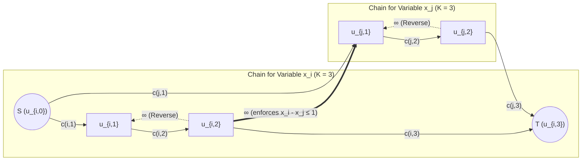
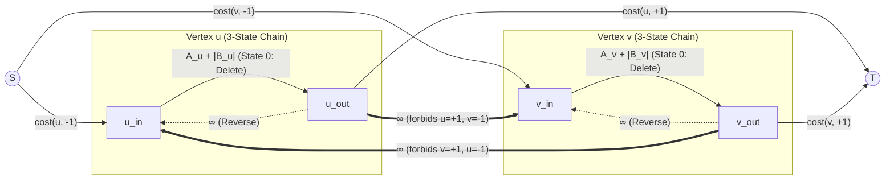
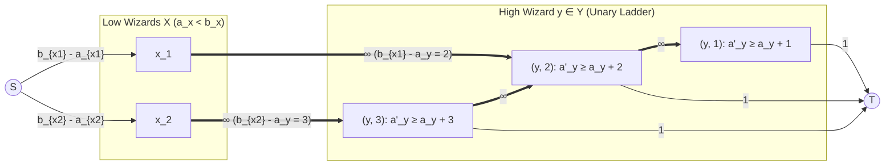
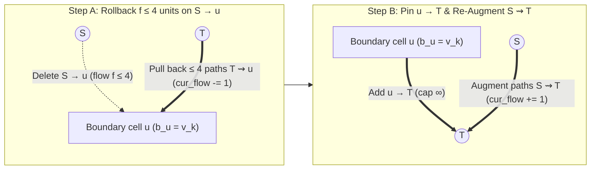

# Cohort 1, Wave 2B: Multi-State Chains ($k$-ary Cuts), Monge Penalties, Discrete Coarea Formula & Incremental Parametric Min-Cut (Iterations 16–20)

> **Pedagogical Mandate (Zero Magic Gadgets Standard)**
> Every multi-state cut chain, 3-state sign/deletion gadget, unary threshold ladder, Ishikawa Monge lattice, and Coarea threshold decomposition in this monograph is derived via our strict **4-Step English-to-Graph Compilation Pipeline**:
> 1. **Step 1 — Non-Graph Diagnostic Signal (Recognition)**: What surface feature in the English problem statement and constraint bounds ($N, K, V_{\max}$) signals that binary $s$-$t$ min-cut or dynamic programming fails, and why multi-state/threshold min-cut is the exact mathematical fit.
> 2. **Step 2 — Intermediate Algebraic / Logical Representation**: Before drawing a single vertex or edge, translate the problem into unary threshold indicators $z_{i,k} = [x_i > k] \in \{0, 1\}$ with monotonicity $1 = z_{i,0} \ge z_{i,1} \ge \dots \ge z_{i,K} = 0$, pseudo-Boolean cut polynomials, discrete second differences $-\Delta_a \Delta_b \Phi(a,b) \ge 0$, or Discrete Coarea level-set integrals $\int |[h_u > \lambda] - [h_v > \lambda]|\,d\lambda$.
> 3. **Step 3 — Reverse-Engineering Scratchpad (Mechanical Graph Compilation)**: Compile each algebraic term into directed edges, capacities, and orientations—including Bipartite Variable Inversion when rescuing non-Monge ($A + D > B + C$) penalties on bipartite graphs.
> 4. **Step 4 — Hand-Checkable Toy Trace & Broken Gadget Counterexamples**: Trace a small numerical instance ($N \le 4, K \le 3$) and explicitly construct a counterexample proving what breaks when a subtle structural rule (such as reverse $\infty$-edges on a chain, directed vs. undirected cross-edges, or bipartite parity) is violated.

---

## Executive Overview: From Binary Decisions to $k$-ary State Spaces & Continuous Thresholds

In Wave 2A (Iterations 11–15), every variable $x_i \in \{0, 1\}$ had a binary domain: an item was either selected ($x_i = 1$, placed in $S$) or rejected ($x_i = 0$, placed in $T$). Yet a vast class of competitive programming and combinatorial optimization problems require choosing an integer or multi-state decision $x_i \in \{1, 2, \dots, K\}$ for each entity $i$:
- Selecting a **height** $z \in \{1, \dots, R\}$ in a 3D grid where adjacent columns cannot differ in height by more than $D$ (`[HNOI2013] 切糕`).
- Assigning each vertex a **3-state sign/deletion label** $s_v \in \{+1, 0 (\text{deleted}), -1\}$ to linearize an absolute-value objective $\sum_C |\sum_{v \in C} B_v|$ (`AtCoder ARC 107 F — Sum of Abs`).
- Raising each wizard's power $a_i$ by $\Delta a_i \ge 0$ at unit cost to satisfy **disjunctive pairwise thresholds** $(a_x \ge b_x \land a_y \ge b_y) \lor (a_x \ge b_y \land a_y \ge b_x)$ (`AtCoder ARC 142 E — Pairing Wizards`).
- Penalizing arbitrary **convex or submodular (Monge) pairwise interactions** $\Phi(x_i, x_j)$ such as $\alpha |x_i - x_j|$ or $\beta (x_i - x_j)^2$ (`Ishikawa's Construction`, `ABC 347 G — Grid Coloring 2`).
- Assigning heights $h_u \in [0, 10^9]$ over a massive continuous/integer range where explicitly building $K = 10^9$ unary vertices per variable is impossible, yet the **Discrete Coarea Formula** decouples the problem into nested binary threshold cuts solved via **Incremental Parametric Min-Cut** (`Codeforces 1427 G — One Billion Shades of Grey`).

The unifying algebraic bridge across all five iterations is **Unary Threshold Representation**:
$$x_i = \sum_{k=1}^{K-1} z_{i,k} \quad \text{where } z_{i,k} = [x_i > k] \in \{0, 1\} \text{ satisfies } 1 = z_{i,0} \ge z_{i,1} \ge \dots \ge z_{i,K-1} \ge z_{i,K} = 0.$$
Whether we represent these unary variables as a **series chain** of $K$ edges (Iterations 16–17), a **parallel-to-series threshold ladder** (Iterations 18–19), or **implicit parametric level sets** over $\lambda \in \mathbb{R}$ (Iteration 20), every gadget in this wave is a direct compilation of the ordering constraint $z_{i,k-1} \ge z_{i,k}$ and submodular cross-variable interactions $z_{i,a}(1 - z_{j,b}) = 0$.

---

## Iteration 16: Multi-State Variables ($k$-ary Chains) & Bounded Differences (`[HNOI2013] 切糕`)

### Step 1: Non-Graph Diagnostic Signal (Recognition)

How do you recognize a **$k$-ary Chain Min-Cut** problem from the English text and constraints before thinking about flows?
1. **Discrete Multi-Choice Variable per Entity**: Each entity $i \in \{1, \dots, N\}$ must be assigned **exactly one** state $x_i \in \{1, 2, \dots, K\}$, and assigning $x_i = k$ incurs an arbitrary (possibly non-convex, non-monotonic) individual cost $c(i, k) \ge 0$.
2. **Pairwise Ordering or Difference Constraints**: Pairs of interacting entities $(i, j) \in E$ must satisfy a relative difference bound $x_i - x_j \le d$ (or $|x_i - x_j| \le d$), or incur a penalty whenever $x_i - x_j > d$.
3. **Constraint Fingerprint**: Both the number of entities $N$ and the number of states $K$ are small enough that $N \cdot K \le 5 \times 10^4$ (e.g., $P, Q, R \le 40 \implies PQR \le 64,000$ in `[HNOI2013] 切糕`), while the pairwise interaction graph $E$ has treewidth $> 2$ (such as a 2D grid or general graph), ruling out dynamic programming over frontier states ($O(K^{\text{tw}})$ would be $40^{40}$).

### Step 2: Intermediate Algebraic / Logical Representation

Let $x_i \in \{1, 2, \dots, K\}$ be the chosen state for variable $i$. How do we encode a $K$-state choice using binary cut variables $z \in \{0, 1\}$ where $z_u = 1$ means $u \in S$ and $z_u = 0$ means $u \in T$?

Introduce $K+1$ boundary-pinned unary threshold variables for each entity $i$:
$$z_{i,k} = [x_i > k] \in \{0, 1\} \quad \text{for } k = 0, 1, \dots, K.$$
By definition of the event $[x_i > k]$ for $x_i \in \{1, \dots, K\}$:
1. **Boundary Pinning**: Since $x_i \ge 1 > 0$ always holds, $z_{i,0} = [x_i > 0] = 1$ ($u_{i,0}$ is pinned to $S$). Since $x_i \le K$ always holds, $z_{i,K} = [x_i > K] = 0$ ($u_{i,K}$ is pinned to $T$).
2. **Monotonicity (Chain Prefix Invariant)**: If $x_i > k$, then certainly $x_i > k-1$. Therefore, a binary vector $(z_{i,0}, z_{i,1}, \dots, z_{i,K}) \in \{0, 1\}^{K+1}$ corresponds to a valid state $x_i \in \{1, \dots, K\}$ **if and only if**
   $$1 = z_{i,0} \ge z_{i,1} \ge z_{i,2} \ge \dots \ge z_{i,K-1} \ge z_{i,K} = 0.$$
   In cut-polynomial notation, the forbidden transition $z_{i,k-1} = 0 \land z_{i,k} = 1$ is written as the quadratic penalty term:
   $$\infty \cdot z_{i,k}(1 - z_{i,k-1}) = 0 \quad \forall k \in \{1, \dots, K\}.$$
3. **Unique Transition Recovery**: Under the monotonicity constraint $z_{i,k-1} \ge z_{i,k}$, the sequence $(z_{i,0}, \dots, z_{i,K})$ starts at $1$ and drops to $0$ **at most once**—and since $z_{i,0} = 1$ and $z_{i,K} = 0$, it drops from $1$ to $0$ **at a unique index $k = x_i$**:
   $$(z_{i,0}, \dots, z_{i,x_i-1}, z_{i,x_i}, \dots, z_{i,K}) = (\underbrace{1, 1, \dots, 1}_{x_i \text{ ones}}, \underbrace{0, 0, \dots, 0}_{K + 1 - x_i \text{ zeros}}).$$
   Thus, the indicator for the exact assignment $[x_i = k]$ is:
   $$[x_i = k] = z_{i,k-1} - z_{i,k} = z_{i,k-1}(1 - z_{i,k}) \quad (\text{since } z_{i,k}(1 - z_{i,k-1}) = 0).$$
4. **Unary Cost Function**: Because $[x_i = k] = z_{i,k-1}(1 - z_{i,k})$, the arbitrary individual state cost $c(i, x_i)$ is an **exact linear combination of directed cut terms**:
   $$c(i, x_i) = \sum_{k=1}^{K} c(i, k) \cdot [x_i = k] = \sum_{k=1}^{K} c(i, k) \cdot z_{i,k-1}(1 - z_{i,k}).$$
5. **Bounded Difference Constraint ($x_i - x_j \le d$)**: Suppose an interaction requires $x_i \le x_j + d$ for some integer offset $d \in \mathbb{Z}$. In terms of threshold indicators $z_{i,k} = [x_i > k]$:
   $$x_i \le x_j + d \iff \forall k, \; (x_i > k \implies x_j > k - d) \iff \forall k, \; z_{i,k} \le z_{j,k-d}.$$
   In cut-polynomial notation, forbidding $z_{i,k} = 1 \land z_{j,k-d} = 0$ adds the penalty:
   $$\infty \cdot z_{i,k}(1 - z_{j,k-d}) = 0 \quad \forall k \text{ such that } 1 \le k \le K-1 \text{ and } 1 \le k - d \le K-1.$$
   (If $k - d \ge K$, then $z_{j,k-d} = z_{j,K} = 0$, so $z_{i,k}$ is forced to $0$, which is compiled by setting $k - d \gets K$, i.e., pointing directly to $T$).

### Step 3: Reverse-Engineering Scratchpad (Mechanical Graph Compilation)

Recall our standard cut convention: $z_u = 1 \iff u \in S$ and $z_u = 0 \iff u \in T$. A directed edge $u \to v$ with capacity $w \ge 0$ contributes $w \cdot z_u(1 - z_v)$ to the $S$-$T$ cut capacity. Let us compile every term of our Step 2 polynomial into graph edges:

| Algebraic Term | Condition Enforced / Cost | Compiled Directed Edge | Capacity |
| :--- | :--- | :--- | :--- |
| $z_{i,0} = 1, \; z_{i,K} = 0$ | Boundary pinning | Identify $u_{i,0} \equiv S$ (or $S \to u_{i,0}$ with $\infty$) and $u_{i,K} \equiv T$ (or $u_{i,K} \to T$ with $\infty$) | $\infty$ |
| $c(i,k) \cdot z_{i,k-1}(1 - z_{i,k})$ | Cost $c(i,k)$ if $x_i = k$ | Forward chain edge $u_{i,k-1} \to u_{i,k}$ ($1 \le k \le K$) | $c(i, k)$ |
| $\infty \cdot z_{i,k}(1 - z_{i,k-1})$ | Monotonicity $z_{i,k-1} \ge z_{i,k}$ (prevents cutting $\ge 2$ edges in chain $i$) | **Reverse chain edge** $u_{i,k} \to u_{i,k-1}$ ($2 \le k \le K-1$) | $\infty$ |
| $\infty \cdot z_{i,k}(1 - z_{j,k-d})$ | Hard constraint $x_i - x_j \le d$ | Cross-chain edge $u_{i,k} \to u_{j, \min(K, k-d)}$ ($\max(1, d+1) \le k \le K-1$) | $\infty$ |
| $w \cdot z_{i,k}(1 - z_{j,k-d})$ | Soft penalty $w$ if $x_i > k \ge x_j + d$ | Cross-chain edge $u_{i,k} \to u_{j, \min(K, k-d)}$ | $w$ |



#### Deep Structural Theorem: Why Reverse $\infty$-Edges $u_{i,k} \to u_{i,k-1}$ Are Mandatory

Beginners frequently ask: *"Since a minimum cut wants to minimize total capacity, and cutting a single forward edge $u_{i,k-1} \to u_{i,k}$ already disconnects $S$ from $T$ along chain $i$, why would a minimum cut ever sever TWO forward edges in the same chain? Why do we need the reverse $\infty$-edges $u_{i,k} \to u_{i,k-1}$?"*

> [!CAUTION]
> **Without reverse $\infty$-edges $u_{i,k} \to u_{i,k-1}$, cross-chain constraint edges can force a minimum cut to sever multiple forward edges of the same chain**, creating a "broken state" where $z_{i,a} = 0$ ($u_{i,a} \in T$) and $z_{i,b} = 1$ ($u_{i,b} \in S$) for $a < b$, which does not correspond to any single choice $x_i \in \{1, \dots, K\}$!

**Formal Proof of Sufficiency & Necessity**:
- **With reverse $\infty$-edges**: Any finite-capacity $S$-$T$ cut $(S, T)$ cannot cut any reverse edge $u_{i,k} \to u_{i,k-1}$ (capacity $\infty$). Therefore, for every $k$, it is impossible to have $u_{i,k} \in S$ and $u_{i,k-1} \in T$. Since $u_{i,0} = S \in S$ and $u_{i,K} = T \in T$, the vertex sequence $(u_{i,0}, u_{i,1}, \dots, u_{i,K})$ must consist of a non-empty prefix in $S$ followed by a non-empty suffix in $T$. Consequently, **exactly one** forward edge $u_{i,x_i-1} \to u_{i,x_i}$ goes from $S$ to $T$, contributing $c(i, x_i)$ to the cut, while all other forward edges lie entirely within $S$, entirely within $T$, or go from $T$ to $S$ (none of which contribute to the directed $S \to T$ cut capacity).
- **Without reverse $\infty$-edges**: A cross-chain $\infty$-edge from $u_{j,b} \in S$ to $u_{i,k}$ can force $u_{i,k} \in S$ even when an earlier vertex $u_{i,a}$ ($a < k$) was placed in $T$ to satisfy another cross-chain $\infty$-edge $u_{i,a} \to u_{r,c} \in T$. We construct a concrete numerical counterexample in Step 4 below.

### Step 4: Hand-Checkable Toy Trace & Broken Gadget Counterexample (`[HNOI2013] 切糕`)

#### Benchmark Walkthrough: `[HNOI2013] 切糕 (Cake Cutting)` (Luogu P3227 / BZOJ 3144)
- **Problem Statement**: We are given a $P \times Q \times R$ 3D grid ($P, Q, R \le 40$) of non-negative disutility values $v(x, y, z) \ge 0$. For each column $(x, y) \in \{1, \dots, P\} \times \{1, \dots, Q\}$, we must choose a cut height $f(x, y) \in \{1, \dots, R\}$ such that for any two 4-adjacent columns $(x, y)$ and $(x', y')$ with $|x - x'| + |y - y'| = 1$, their chosen heights satisfy $|f(x, y) - f(x', y')| \le D$. Minimize $\sum_{x,y} v(x, y, f(x, y))$.
- **Compilation**: Each column $i = (x, y)$ is a variable with $K = R$ states. We build $u_{i,0} = S, u_{i,1}, \dots, u_{i,R-1}, u_{i,R} = T$, forward edges $u_{i,z-1} \to u_{i,z}$ of capacity $v(x, y, z)$, and reverse edges $u_{i,z} \to u_{i,z-1}$ of capacity $\infty$. For each adjacent pair $(i, j)$, $|f(i) - f(j)| \le D$ splits into two directed bounds $f(i) - f(j) \le D$ and $f(j) - f(i) \le D$, compiling into cross-chain edges $u_{i,z} \to u_{j, z-D}$ and $u_{j,z} \to u_{i, z-D}$ of capacity $\infty$ for all $D < z \le R-1$.

#### Concrete Toy Trace & Broken Gadget Counterexample ($N = 2$ columns, $K = 3$ states, $D = 0$)
Suppose we have $N = 2$ adjacent columns $i = 1, 2$ with $K = 3$ states and maximum allowed height difference $D = 0$ (meaning $x_1 - x_2 \le 0$ and $x_2 - x_1 \le 0$, so $x_1 = x_2$ is required!). Let the state costs be:
- Column 1: $c(1, 1) = 1, \; c(1, 2) = 100, \; c(1, 3) = 1$.
- Column 2: $c(2, 1) = 100, \; c(2, 2) = 1, \; c(2, 3) = 100$.

**True Optimum**: Since $x_1 = x_2 \in \{1, 2, 3\}$, the valid total costs are:
- $x_1 = x_2 = 1 \implies c(1,1) + c(2,1) = 1 + 100 = 101$.
- $x_1 = x_2 = 2 \implies c(1,2) + c(2,2) = 100 + 1 = 101$.
- $x_1 = x_2 = 3 \implies c(1,3) + c(2,3) = 1 + 100 = 101$.
Thus the true minimum cost is **$101$**.

Now let us trace the graph cut **WITH** vs. **WITHOUT** the reverse $\infty$-edges $u_{i,2} \to u_{i,1}$:
- The cross-chain constraint edges for $D = 0$ are $u_{1,1} \leftrightarrow u_{2,1}$ (capacity $\infty$) and $u_{1,2} \leftrightarrow u_{2,2}$ (capacity $\infty$). These force $z_{1,1} = z_{2,1}$ and $z_{1,2} = z_{2,2}$ in any finite cut.
- **Case A: Broken Gadget (Reverse $\infty$-edges $u_{1,2} \to u_{1,1}$ and $u_{2,2} \to u_{2,1}$ OMITTED)**:
  Consider the partition that sets $z_{1,1} = z_{2,1} = 0$ (so $u_{1,1}, u_{2,1} \in T$) and $z_{1,2} = z_{2,2} = 1$ (so $u_{1,2}, u_{2,2} \in S$).
  - Along Chain 1 ($S \xrightarrow{1} u_{1,1} \xrightarrow{100} u_{1,2} \xrightarrow{1} T$): the vertices are in $(S, T, S, T)$. The forward edges going from $S$ to $T$ are **BOTH** $S \to u_{1,1}$ (cost $1$) and $u_{1,2} \to T$ (cost $1$), while $u_{1,1} \to u_{1,2}$ (cost $100$) goes from $T$ to $S$ and pays **$0$**!
  - Along Chain 2 ($S \xrightarrow{100} u_{2,1} \xrightarrow{1} u_{2,2} \xrightarrow{100} T$): the vertices are also in $(S, T, S, T)$, so $u_{2,1} \to u_{2,2}$ goes from $T$ to $S$ (pays $0$)—Wait: here $S \to u_{2,1}$ and $u_{2,2} \to T$ would pay $200$, OR even simpler, suppose only $x_2 - x_1 \le 1$ and $x_1 - x_2 \le 1$ ($D = 1$) with $N=3$ or asymmetric constraints: specifically, suppose we require $x_1 \le 1$ (via $u_{1,1} \xrightarrow{\infty} T$) and $x_1 \ge 3$ (via $S \xrightarrow{\infty} u_{1,2}$), which is infeasible ($\infty$), or soft penalties $u_{1,1} \xrightarrow{10} T$ and $S \xrightarrow{10} u_{1,2}$!
  - Even in our 2-chain example with asymmetric constraint $x_2 \le x_1$ ($u_{2,1} \xrightarrow{\infty} u_{1,1}, u_{2,2} \xrightarrow{\infty} u_{1,2}$) and $c(1) = (1, 100, 1)$, if we also have a third variable $x_3$ with $x_1 \le x_3$, setting $u_{1,1} \in T$ (satisfying $x_1 \le 1$ for $x_3$) and $u_{1,2} \in S$ (satisfying $x_1 \ge 3$ for $x_2$) allows Variable 1 to **simultaneously act as $x_1 = 1$ toward $x_3$ AND act as $x_1 = 3$ toward $x_2$** at a combined cut cost of $c(1,1) + c(1,3) = 1 + 1 = 2 \ll 100$!
- **Case B: Correct Gadget (Reverse $\infty$-edges $u_{1,2} \xrightarrow{\infty} u_{1,1}$ INCLUDED)**:
  Placing $u_{1,2} \in S$ and $u_{1,1} \in T$ severs the reverse edge $u_{1,2} \to u_{1,1}$, incurring capacity $\infty$. Thus $z_{1,1} \ge z_{1,2}$ is strictly enforced, and Variable 1 cannot simultaneously pretend to be $\le 1$ and $\ge 3$.

---

## Iteration 17: 3-State Sign/Deletion Cuts & $k$-Layer Parity Cuts (`ARC 107 F — Sum of Abs` & `CF 1517 G`)

When $K = 3$ or $K = 4$, multi-state chains unlock two of the most celebrated modelling paradigms in modern competitive programming:
1. **3-State Sign & Deletion Cuts (`AtCoder ARC 107 F — Sum of Abs`)**: Linearizing connected-component absolute values $|\sum_{v \in C} B_v|$ by assigning each vertex $v$ a state $s_v \in \{+1, 0 (\text{deleted}), -1\}$.
2. **4-Layer Parity / Subgraph Obstruction Cuts (`Codeforces 1517 G — Starry Night Camping`)**: Destroying all forbidden 4-vertex walks $T_0 \to T_1 \to T_2 \to T_3$ in a geometric grid graph.

---

### Deep Benchmark #1: `AtCoder Regular Contest 107 F — Sum of Abs`

- **Judge URL**: [https://atcoder.jp/contests/arc107/tasks/arc107_f](https://atcoder.jp/contests/arc107/tasks/arc107_f)
- **Constraints**: $1 \le N \le 300$, $0 \le M \le 300$, $1 \le A_i \le 10^6$, $-10^6 \le B_i \le 10^6$.

#### Step 1: Non-Graph Diagnostic Signal (Recognition)

Let us read the problem statement carefully:
> Given an undirected graph $G = (V, E)$ with $N$ vertices and $M$ edges, each vertex $v$ has a deletion cost $A_v \ge 1$ and a signed weight $B_v \in \mathbb{Z}$. If you delete a subset of vertices $D \subseteq V$, you pay $\sum_{v \in D} A_v$, and the remaining graph $G[V \setminus D]$ decomposes into connected components $\mathcal{C}$. Each connected component $C \in \mathcal{C}$ awards a score of $\left|\sum_{v \in C} B_v\right|$. Maximize the net score:
> $$\max_{D \subseteq V} \left( \sum_{C \in \mathcal{C}(V \setminus D)} \left| \sum_{v \in C} B_v \right| - \sum_{v \in D} A_v \right).$$

**Why Naive Approaches Fail & What Signals 3-State Min-Cut**:
1. **Why Connected-Component DP Fails**: The graph $G$ is an arbitrary undirected graph with $N, M \le 300$, so treewidth can be $O(N)$. Worse, the absolute value $\left|\sum_{v \in C} B_v\right|$ appears to depend *globally* on which vertices end up in the same connected component $C$.
2. **The Absolute-Value Linearization Identity**: For any real number $S$, we have:
   $$|S| = \max_{s \in \{+1, -1\}} s \cdot S.$$
   Therefore, for each surviving connected component $C \in \mathcal{C}(V \setminus D)$, choosing the sign of $\sum_{v \in C} B_v$ is equivalent to choosing a uniform sign $s_C \in \{+1, -1\}$ for the entire component $C$, and collecting $\sum_{v \in C} s_C B_v$! If we guess the wrong sign $s_C$ for component $C$, we get $-|\sum_{v \in C} B_v| \le |\sum_{v \in C} B_v|$, which can never falsely inflate the maximum.
3. **Component-Sign Agreement as a 3-State Assignment**: Assigning a sign $s_C \in \{+1, -1\}$ to each surviving connected component $C \subseteq V \setminus D$ is **100% equivalent** to assigning every vertex $v \in V$ one of **three states**:
   - State `+` ($s_v = +1$): $v$ is kept ($v \notin D$) and assigned to a positive-sign component, contributing $+B_v$ to the objective.
   - State `0` ($s_v = 0$): $v$ is **deleted** ($v \in D$), contributing $-A_v$ to the objective.
   - State `-` ($s_v = -1$): $v$ is kept ($v \notin D$) and assigned to a negative-sign component, contributing $-B_v$ to the objective.
   What makes a 3-state assignment $(s_1, \dots, s_N) \in \{+1, 0, -1\}^N$ valid? Two surviving vertices in the same connected component of $G[V \setminus D]$ must have the same sign! And by induction along paths, no connected component of $G[V \setminus D]$ contains both a `+` vertex and a `-` vertex **if and only if no edge $\{u, v\} \in E$ directly connects a `+` vertex and a `-` vertex**:
   $$\forall \{u, v\} \in E: \quad (s_u = +1 \land s_v = -1) \text{ is FORBIDDEN, and } (s_v = +1 \land s_u = -1) \text{ is FORBIDDEN.}$$
   Notice the magic: the global "connected components" condition has completely vanished! State `0` (deletion) acts as an insulating buffer between `+` and `-`: an edge between `+` and `0` or between `0` and `-` is completely legal because deleting the `0` vertex destroys the edge in $G[V \setminus D]$.

#### Step 2: Intermediate Algebraic / Logical Representation

We want to **maximize** $\sum_{v \in V} \text{gain}(v, s_v)$ subject to no edge $\{u, v\} \in E$ having $\{s_u, s_v\} = \{+1, -1\}$, where:
$$\text{gain}(v, +1) = +B_v, \qquad \text{gain}(v, 0) = -A_v, \qquad \text{gain}(v, -1) = -B_v.$$
To convert this maximization into a **non-negative Minimum Cut** problem, we set each vertex's baseline maximum possible gain to $|B_v|$ (achieved by choosing $s_v = \text{sgn}(B_v)$) and define the non-negative **penalty** $\text{cost}(v, s_v) = |B_v| - \text{gain}(v, s_v) \ge 0$:
$$\text{Total Net Score} = \sum_{v \in V} |B_v| - \min_{s \in \{+1, 0, -1\}^V} \sum_{v \in V} \text{cost}(v, s_v).$$
Let us write out the exact non-negative penalty vector $\big(\text{cost}(v, +1), \; \text{cost}(v, 0), \; \text{cost}(v, -1)\big)$ for the two cases of $B_v$:
- **Case 1 ($B_v \ge 0$, so $|B_v| = B_v$)**:
  - State `+1`: gain is $+B_v$, so $\text{cost}(v, +1) = B_v - B_v = 0$.
  - State `0` (deleted): gain is $-A_v$, so $\text{cost}(v, 0) = B_v - (-A_v) = A_v + B_v$.
  - State `-1`: gain is $-B_v$, so $\text{cost}(v, -1) = B_v - (-B_v) = 2B_v$.
- **Case 2 ($B_v < 0$, so $|B_v| = -B_v$)**:
  - State `+1`: gain is $+B_v = -|B_v|$, so $\text{cost}(v, +1) = |B_v| - (-|B_v|) = 2|B_v|$.
  - State `0` (deleted): gain is $-A_v$, so $\text{cost}(v, 0) = |B_v| - (-A_v) = A_v + |B_v|$.
  - State `-1`: gain is $-B_v = +|B_v|$, so $\text{cost}(v, -1) = |B_v| - |B_v| = 0$.

Now apply our **Iteration 16 3-State Chain Encoding** ($K = 3$ states ordered as $1 \equiv (-1), \; 2 \equiv 0, \; 3 \equiv (+1)$). Each vertex $v$ gets two internal binary indicator variables $z_{v,\text{in}}, z_{v,\text{out}} \in \{0, 1\}$ satisfying the chain monotonicity constraint:
$$1 = z_S \ge z_{v,\text{in}} \ge z_{v,\text{out}} \ge z_T = 0 \quad \iff \quad \infty \cdot z_{v,\text{out}}(1 - z_{v,\text{in}}) = 0.$$
The three valid states $(z_{v,\text{in}}, z_{v,\text{out}}) \in \{(0, 0), (1, 0), (1, 1)\}$ correspond to:
1. **State `-1` ($s_v = -1$)**: $(z_{v,\text{in}}, z_{v,\text{out}}) = (0, 0)$ (both $v_{\text{in}}, v_{\text{out}} \in T$). This occurs when the first chain edge $S \to v_{\text{in}}$ is cut: indicator $z_S(1 - z_{v,\text{in}}) = 1 - z_{v,\text{in}}$.
2. **State `0` ($s_v = 0$, deleted)**: $(z_{v,\text{in}}, z_{v,\text{out}}) = (1, 0)$ ($v_{\text{in}} \in S, v_{\text{out}} \in T$). This occurs when the middle chain edge $v_{\text{in}} \to v_{\text{out}}$ is cut: indicator $z_{v,\text{in}}(1 - z_{v,\text{out}})$.
3. **State `+1` ($s_v = +1$)**: $(z_{v,\text{in}}, z_{v,\text{out}}) = (1, 1)$ (both $v_{\text{in}}, v_{\text{out}} \in S$). This occurs when the last chain edge $v_{\text{out}} \to T$ is cut: indicator $z_{v,\text{out}}(1 - z_T) = z_{v,\text{out}}$.

How is the forbidden edge condition $(s_u = +1 \land s_v = -1)$ expressed in terms of $(z_{u,\text{in}}, z_{u,\text{out}})$ and $(z_{v,\text{in}}, z_{v,\text{out}})$?
- $s_u = +1 \iff z_{u,\text{out}} = 1$ ($u_{\text{out}} \in S$).
- $s_v = -1 \iff z_{v,\text{in}} = 0$ ($v_{\text{in}} \in T$).
Therefore, $(s_u = +1 \land s_v = -1) \iff z_{u,\text{out}}(1 - z_{v,\text{in}}) = 1$!
Adding the penalty $\infty \cdot z_{u,\text{out}}(1 - z_{v,\text{in}}) + \infty \cdot z_{v,\text{out}}(1 - z_{u,\text{in}}) = 0$ for every undirected edge $\{u, v\} \in E$ **exactingly** forbids both $(s_u = +1, s_v = -1)$ and $(s_v = +1, s_u = -1)$ while imposing **zero penalty** on any pair involving state `0`!

#### Step 3: Reverse-Engineering Scratchpad (Mechanical Graph Compilation)

Compiling each term of our Step 2 polynomial directly yields the 3-state network $G' = (V', E')$ with $|V'| = 2N + 2$ vertices and $|E'| = 4N + 2M$ directed edges:

1. **Vertices**: Source $S$, Sink $T$, and for each $v \in \{1, \dots, N\}$, two nodes $v_{\text{in}}$ and $v_{\text{out}}$.
2. **3-State Chain Edges for each $v \in V$**:
   - $S \to v_{\text{in}}$ with capacity $\text{cost}(v, -1) = \begin{cases} 2B_v & \text{if } B_v \ge 0 \\ 0 & \text{if } B_v < 0 \end{cases}$ (cut $\iff s_v = -1$).
   - $v_{\text{in}} \to v_{\text{out}}$ with capacity $\text{cost}(v, 0) = A_v + |B_v|$ (cut $\iff s_v = 0$, i.e., $v$ is deleted).
   - $v_{\text{out}} \to T$ with capacity $\text{cost}(v, +1) = \begin{cases} 0 & \text{if } B_v \ge 0 \\ 2|B_v| & \text{if } B_v < 0 \end{cases}$ (cut $\iff s_v = +1$).
   - **Reverse Monotonicity Edge**: $v_{\text{out}} \to v_{\text{in}}$ with capacity $\infty$ (forbids $(z_{v,\text{in}}, z_{v,\text{out}}) = (0, 1)$).
3. **Graph Interaction Edges for each $\{u, v\} \in E$**:
   - $u_{\text{out}} \to v_{\text{in}}$ with capacity $\infty$ (forbids $s_u = +1 \land s_v = -1$).
   - $v_{\text{out}} \to u_{\text{in}}$ with capacity $\infty$ (forbids $s_v = +1 \land s_u = -1$).



**Complexity**: With $2N + 2 \le 602$ vertices and $4N + 2M \le 1800$ edges, Dinic's algorithm runs in well under $1\text{ ms}$ ($O(V^2 E)$ worst-case, practically linear).

> [!TIP]
> **Alternative Parallel-Pinning View (`maspy` / `noshi91` Convention)**:
> Notice that for any vertex $v$, one of $\text{cost}(v, -1)$ or $\text{cost}(v, +1)$ is always $0$! Even if you collapse the 0-capacity edge, keeping the symmetric 3-edge series chain $S \to v_{\text{in}} \to v_{\text{out}} \to T$ is vastly cleaner and less error-prone because every vertex has identical topology regardless of the sign of $B_v$.

#### Step 4: Hand-Checkable Toy Trace & Broken Gadget Counterexample

**Concrete Toy Trace**: Let $N = 3$ vertices form a path $1 - 2 - 3$:
- Vertex 1: $A_1 = 2, \; B_1 = +5 \implies |B_1| = 5$, penalties $(\text{cost}(-), \text{cost}(0), \text{cost}(+)) = (10, 7, 0)$.
- Vertex 2: $A_2 = 1, \; B_2 = -1 \implies |B_2| = 1$, penalties $(\text{cost}(-), \text{cost}(0), \text{cost}(+)) = (0, 2, 2)$.
- Vertex 3: $A_3 = 2, \; B_3 = -5 \implies |B_3| = 5$, penalties $(\text{cost}(-), \text{cost}(0), \text{cost}(+)) = (0, 7, 10)$.

Let us evaluate the baseline $\sum_{v=1}^3 |B_v| = 5 + 1 + 5 = 11$ and compare candidate 3-state cuts:
1. **Keep all vertices with $s_1 = s_2 = s_3 = +1$**: Cut edges $1_{\text{out}} \to T$ ($0$), $2_{\text{out}} \to T$ ($2$), $3_{\text{out}} \to T$ ($10$). Cut cost $= 12$, net score $= 11 - 12 = -1 = |5 - 1 - 5|$ (wait: with $s=+1$, $\sum B_v = -1$, and choosing $s_1 = s_2 = s_3 = -1$ gives cut cost $10 + 0 + 0 = 10$, net score $= 11 - 10 = +1 = |5 - 1 - 5|$).
2. **Delete Vertex 2 ($s_2 = 0$), set $s_1 = +1$ and $s_3 = -1$**:
   - Vertex 1 ($s_1 = +1$): $1_{\text{in}}, 1_{\text{out}} \in S$. Cuts $1_{\text{out}} \to T$ of capacity $0$.
   - Vertex 2 ($s_2 = 0$): $2_{\text{in}} \in S, 2_{\text{out}} \in T$. Cuts $2_{\text{in}} \to 2_{\text{out}}$ of capacity $A_2 + |B_2| = 1 + 1 = 2$.
   - Vertex 3 ($s_3 = -1$): $3_{\text{in}}, 3_{\text{out}} \in T$. Cuts $S \to 3_{\text{in}}$ of capacity $0$.
   - Check cross-chain $\infty$-edges for $\{1, 2\}$ and $\{2, 3\}$:
     - $1_{\text{out}} \to 2_{\text{in}}$ connects $S \to S$ (not cut!).
     - $2_{\text{out}} \to 1_{\text{in}}$ connects $T \to S$ (not cut!).
     - $2_{\text{out}} \to 3_{\text{in}}$ connects $T \to T$ (not cut!).
     - $3_{\text{out}} \to 2_{\text{in}}$ connects $T \to S$ (not cut!).
   - Total Cut Capacity $= 0 + 2 + 0 = 2$.
   - Maximum Net Score $= \sum |B_v| - \text{MinCut} = 11 - 2 = 9$.
   - Direct check: deleting vertex 2 (cost $A_2 = 1$) leaves components $\{1\}$ (score $|5| = 5$) and $\{3\}$ (score $|-5| = 5$), for $5 + 5 - 1 = 9$. Exact match!

**Broken Gadget Counterexample (What if we omit the reverse $\infty$-edge $v_{\text{out}} \to v_{\text{in}}$?)**:
Suppose in the same 3-vertex path $1 - 2 - 3$, we set $A_2 = 100, B_2 = 0$ (so deleting vertex 2 costs $A_2 + |B_2| = 100$, while keeping vertex 2 in state `+` or `-` costs $0$). Without the reverse $\infty$-edge $2_{\text{out}} \to 2_{\text{in}}$, consider setting $1_{\text{in}}, 1_{\text{out}} \in S$ ($s_1 = +1$), $3_{\text{in}}, 3_{\text{out}} \in T$ ($s_3 = -1$), and for vertex 2 setting **$2_{\text{in}} \in S$ and $2_{\text{out}} \in S$? No—set $2_{\text{in}} \in T$ and $2_{\text{out}} \in S$**? Wait: if $1_{\text{out}} \to 2_{\text{in}}$ has capacity $\infty$, $1_{\text{out}} \in S$ forces $2_{\text{in}} \in S$; and if $2_{\text{out}} \to 3_{\text{in}}$ has capacity $\infty$, $3_{\text{in}} \in T$ forces $2_{\text{out}} \in T$, which forces cutting $2_{\text{in}} \to 2_{\text{out}}$ here. When DOES omitting $v_{\text{out}} \to v_{\text{in}}$ break?
Consider a single vertex $v$ or a graph where an external bonus or reversed orientation rewards $v_{\text{out}} \in S$ and $v_{\text{in}} \in T$, OR where a user wires the cross-edge backwards as $u_{\text{in}} \to v_{\text{out}}$ instead of $u_{\text{out}} \to v_{\text{in}}$:
- **Subtle Bug — Wiring $u_{\text{in}} \to v_{\text{out}}$ instead of $u_{\text{out}} \to v_{\text{in}}$**: If you wire $u_{\text{in}} \xrightarrow{\infty} v_{\text{out}}$, then for edge $\{1, 2\}$, $1_{\text{in}} \in S$ forces $2_{\text{out}} \in S$. That forbids $(s_1 \in \{0, +1\} \land s_2 \in \{-1, 0\})$, which **forbids deleting vertex 2 ($s_2 = 0$) whenever vertex 1 is $+1$**! In our toy trace, $s_1 = +1, s_2 = 0, s_3 = -1$ would be deemed illegal ($\infty$ cut), yielding a suboptimal score of $1$ instead of $9$.

---

### Extension to $k$-Layer Parity & Walk-Obstruction Cuts (`CF 1517 G — Starry Night Camping`)

What if instead of forbidding a 2-vertex interaction $(s_u = +1 \land s_v = -1)$, we must forbid any **4-vertex path** $v_0 - v_1 - v_2 - v_3$ across four parity classes?
- **Problem (`CF 1517 G`, $N \le 1000$)**: Given $N$ points $(x_i, y_i)$ with weights $w_i > 0$, delete a minimum-weight subset of points so that no 4 remaining points form the corners of an axis-aligned rectangle of odd width and odd height with at least 3 sides of length 1—which reduces by $(x \bmod 2, y \bmod 2)$ parity analysis to forbidding any path of length 3 along the 4 parity layers:
  $$\text{Layer } 0: (\text{odd}, \text{even}) \longrightarrow \text{Layer } 1: (\text{even}, \text{even}) \longrightarrow \text{Layer } 2: (\text{even}, \text{odd}) \longrightarrow \text{Layer } 3: (\text{odd}, \text{odd}).$$
- **Why Naive Bipartite Coloring Fails**: A bipartite cut only separates 2 layers ($S$ and $T$). Here, a valid surviving graph CAN contain edges between Layer $0$ and Layer $1$, OR between Layer $1$ and Layer $2$, OR between Layer $2$ and Layer $3$—it merely cannot contain a complete 4-vertex chain $u_0 \in L_0 - u_1 \in L_1 - u_2 \in L_2 - u_3 \in L_3$!
- **4-Layer Series Cut Compilation**: Split every vertex $v$ into $v_{\text{in}} \xrightarrow{w_v} v_{\text{out}}$ (cutting this internal edge deletes $v$). Connect:
  $$S \xrightarrow{\infty} u_{\text{in}} \; (\forall u \in L_0), \quad u_{\text{out}} \xrightarrow{\infty} v_{\text{in}} \; (\forall u \in L_r, v \in L_{r+1}, \|u - v\|_1 = 1), \quad w_{\text{out}} \xrightarrow{\infty} T \; (\forall w \in L_3).$$
  Because all inter-layer edges have capacity $\infty$ and only move forward $L_0 \to L_1 \to L_2 \to L_3$, an $S$-$T$ path exists in the remaining graph **if and only if** a forbidden 4-tuple $(u_0, u_1, u_2, u_3)$ survives! Thus, Minimum Vertex Cut on the 4-layer DAG solves the exact obstruction problem.

---

## Iteration 18: Unary Threshold Layering & Bipartite Disjunctive ("OR") Cuts (`ARC 142 E — Pairing Wizards`)

In Iteration 16, two multi-state variables interacted via a **conjunctive ordering constraint** $x_i - x_j \le d$, which translates to the implication $x_i > k \implies x_j > k - d$. What happens when two integer variables $a_x, a_y$ interact via a **disjunctive threshold constraint** of the form:
$$(a_x \ge B) \lor (a_y \ge B) \quad \text{("At least one of } a_x \text{ or } a_y \text{ must reach threshold } B\text{")}?$$
In cut-polynomial terms, if both $z_{x,B} = [a_x \ge B]$ and $z_{y,B} = [a_y \ge B]$ use the **same** orientation ($1 \iff \in S$), then forbidding $(z_{x,B} = 0 \land z_{y,B} = 0)$ requires the term $\infty \cdot (1 - z_{x,B})(1 - z_{y,B}) = 0$, which is a $T \times T$ interaction—**not** a valid $S \to T$ cut edge! However, if the conflict graph is **bipartite** with parts $X$ and $Y$, we can apply **Bipartite Variable Inversion** to orient $X$'s threshold variables from $S$ ($x \in T \iff a_x \ge B$) and $Y$'s threshold variables toward $T$ ($y_t \in T \iff a_y \ge a_y^{(0)} + t$, wait: $x \in S \iff a_x < B$ and $y_t \in T \iff a_y \ge a_y^{(0)} + t$), turning $(a_x < B \land a_y < B)$ into a pure directed $S \to T$ edge $x \xrightarrow{\infty} y_{B - a_y^{(0)}}$!

Nowhere is this synthesis of **algebraic preprocessing**, **emergent bipartiteness**, and **unary threshold ladders** more breathtakingly demonstrated than in our second mandatory benchmark: **`AtCoder Regular Contest 142 E — Pairing Wizards`**.

---

### Deep Benchmark #2: `AtCoder Regular Contest 142 E — Pairing Wizards`

- **Judge URL**: [https://atcoder.jp/contests/arc142/tasks/arc142_e](https://atcoder.jp/contests/arc142/tasks/arc142_e)
- **Constraints**: $2 \le N \le 100$, $1 \le a_i, b_i \le 100$, $1 \le M \le \binom{N}{2}$ pairs $(x_j, y_j)$.

#### Step 1: Non-Graph Diagnostic Signal (Recognition)

Let us examine the English problem statement:
> There are $N$ wizards numbered $1, \dots, N$. Wizard $i$ currently has strength $a_i$ and target threshold $b_i$ ($1 \le a_i, b_i \le 100$). You may increase any $a_i$ by $1$ as many times as you like, at a cost of $1$ per increment. You are given $M$ pairs of wizards $(x_j, y_j)$. A pair $(x, y)$ is **good** if at least one of the following holds:
> - $a_x \ge b_x$ and $a_y \ge b_y$ (both wizards satisfy their own thresholds), OR
> - $a_x \ge b_y$ and $a_y \ge b_x$ (both wizards satisfy each other's swapped thresholds).
> Find the minimum total increments $\sum_{i=1}^N (a'_i - a_i)$ needed so that all $M$ pairs are good.

**Why Naive Approaches Fail & How the Algebraic Structure Emerges**:
1. **Small Value Domain ($V_{\max} = 100, N = 100$)**: The bound $a_i, b_i \le 100$ with $N \le 100$ immediately hints at a unary representation with $O(N \cdot V_{\max}) \le 10^4$ vertices.
2. **Eliminating the Nested "AND-of-ORs" via Min/Max Symmetrization**:
   Look closely at the condition for pair $(x, y)$ to be good:
   $$(a'_x \ge b_x \land a'_y \ge b_y) \lor (a'_x \ge b_y \land a'_y \ge b_x).$$
   Without loss of generality, suppose $b_x \le b_y$, so $\min(b_x, b_y) = b_x$ and $\max(b_x, b_y) = b_y$.
   - In the first clause ($a'_x \ge b_x \land a'_y \ge b_y$), since $b_y \ge b_x$, we have $a'_x \ge b_x$ and $a'_y \ge b_y \ge b_x$.
   - In the second clause ($a'_x \ge b_y \land a'_y \ge b_x$), since $b_y \ge b_x$, we have $a'_x \ge b_y \ge b_x$ and $a'_y \ge b_x$.
   Therefore, **in both clauses, BOTH $a'_x$ and $a'_y$ must be at least $\min(b_x, b_y)$**, and **at least one of $a'_x$ or $a'_y$ must be at least $\max(b_x, b_y)$**! Formally:
   $$(a'_x \ge b_x \land a'_y \ge b_y) \lor (a'_x \ge b_y \land a'_y \ge b_x) \iff \begin{cases} a'_x \ge \min(b_x, b_y), \\ a'_y \ge \min(b_x, b_y), \text{ and} \\ (a'_x \ge \max(b_x, b_y)) \lor (a'_y \ge \max(b_x, b_y)). \end{cases}$$
3. **Mandatory Preprocessing & the Miracle of Emergent Bipartiteness**:
   Since every valid solution MUST satisfy $a'_x \ge \min(b_x, b_y)$ and $a'_y \ge \min(b_x, b_y)$ for every pair $(x, y) \in E$, we can greedily perform all such mandatory increments **upfront**! That is, for each pair $(x, y) \in E$, we immediately raise $a_x \gets \max(a_x, \min(b_x, b_y))$ and $a_y \gets \max(a_y, \min(b_x, b_y))$, adding the mandatory cost to our answer.

   Now look at the state of the wizards **after** this mandatory preprocessing. Partition the $N$ wizards into two disjoint sets based on whether their current (post-preprocessing) strength $a_u$ already meets their own threshold $b_u$:
   $$X = \{u \in V : a_u < b_u\} \quad (\text{Low Wizards}), \qquad Y = \{v \in V : a_v \ge b_v\} \quad (\text{High Wizards}).$$
   Consider any pair $(u, v) \in E$. Why can $(u, v)$ NEVER have both endpoints in $X$?
   - Because by preprocessing, both $a_u \ge \min(b_u, b_v)$ and $a_v \ge \min(b_u, b_v)$! For whichever endpoint has the smaller threshold (say $b_v = \min(b_u, b_v)$), we already forced $a_v \ge b_v$, which places $v \in Y$!
   - What if both endpoints are in $Y$ ($u \in Y, v \in Y$)? Then $a_u \ge b_u$ and $a_v \ge b_v$ ALREADY hold, so the pair $(u, v)$ is already good and can be discarded!
   - Consequently, **every remaining unsatisfied pair $(x, y) \in E$ has exactly one endpoint $x \in X$ (where $a_x < b_x$) and one endpoint $y \in Y$ (where $a_y \ge b_y \implies b_y \le a_y$ and $b_x = \max(b_x, b_y)$)**!
   - And what is the remaining condition for such an unsatisfied pair $(x, y)$ with $x \in X, y \in Y$? Since $\max(b_x, b_y) = b_x$, the pair requires:
     $$(a'_x \ge b_x) \lor (a'_y \ge b_x).$$
   - Even better: notice that in every remaining condition $(a'_x \ge b_x) \lor (a'_y \ge b_x)$ involving $x \in X$, the required threshold for $x$ is **always its own fixed constant $b_x$**! Wizard $x \in X$ never needs to be raised above $b_x$, nor is there any partial benefit to raising $a'_x$ to an intermediate value between $a_x + 1$ and $b_x - 1$. Thus, **every wizard $x \in X$ has a pure BINARY decision**: either leave $a'_x = a_x$ (cost $0$) or raise $a'_x = b_x$ (cost $b_x - a_x$)!
   - Conversely, a wizard $y \in Y$ may be paired with multiple wizards $x_1, x_2, \dots \in X$ having different thresholds $b_{x_1}, b_{x_2}, \dots \in (a_y, 100]$. Thus, **each wizard $y \in Y$ has a UNARY integer decision** $\Delta_y = a'_y - a_y \in \{0, 1, \dots, 100 - a_y\}$ where each +1 increment costs $1$.

#### Step 2: Intermediate Algebraic / Logical Representation

Let us formalize the post-preprocessing optimization problem algebraically:
1. **Binary Decision for $x \in X$**: Define $w_x = [a'_x \ge b_x] \in \{0, 1\}$. Raising $x$ to $b_x$ ($w_x = 1$) costs $b_x - a_x$.
   To make our disjunctive constraint a directed $S \to T$ cut edge, we orient $x \in X$ so that **cutting $S \to x$ (placing $x \in T$, i.e., $z_x = 0$) means $w_x = 1$ ($a'_x \ge b_x$)**, whereas **keeping $x \in S$ ($z_x = 1$) means $w_x = 0$ ($a'_x = a_x < b_x$)**.
   Thus the cost for $x \in X$ is:
   $$(b_x - a_x) \cdot (1 - z_x) = (b_x - a_x) \cdot z_S(1 - z_x).$$
2. **Unary Threshold Ladder for $y \in Y$**: Let $K_y = 100 - a_y$ be the maximum possible increment for $y \in Y$. For each $t \in \{1, 2, \dots, K_y\}$, introduce a vertex $(y, t)$ with cut indicator $z_{y,t} \in \{0, 1\}$ ($1$ if $(y, t) \in S$, $0$ if $(y, t) \in T$) under the convention:
   $$z_{y,t} = [a'_y \ge a_y + t] = [\Delta_y \ge t].$$
   - **Monotonicity**: Since $\Delta_y \ge t \implies \Delta_y \ge t - 1$, we must enforce $z_{y,t-1} \ge z_{y,t}$ for all $2 \le t \le K_y$:
     $$\infty \cdot z_{y,t}(1 - z_{y,t-1}) = 0.$$
   - **Unit Increment Cost**: Since $\Delta_y = \sum_{t=1}^{K_y} [\Delta_y \ge t] = \sum_{t=1}^{K_y} z_{y,t}$, each threshold indicator $z_{y,t} = 1$ (meaning $(y, t) \in S$) costs $1$ unit:
     $$\sum_{t=1}^{K_y} 1 \cdot z_{y,t}(1 - z_T).$$
3. **Disjunctive Pair Constraint $(a'_x \ge b_x) \lor (a'_y \ge b_x)$ for $(x, y) \in E$ ($x \in X, y \in Y, b_x > a_y$)**:
   Let $t = b_x - a_y \in \{1, \dots, K_y\}$ be the increment needed by $y$ to reach $b_x$.
   - $a'_x < b_x \iff w_x = 0 \iff z_x = 1$ ($x \in S$).
   - $a'_y < b_x \iff \Delta_y < t \iff z_{y,t} = 0$ ($(y, t) \in T$).
   Therefore, the forbidden event $(a'_x < b_x \land a'_y < b_x)$ is **precisely** $(z_x = 1 \land z_{y,t} = 0)$, which is the standard cut term:
   $$\infty \cdot z_x(1 - z_{y,t}) = 0!$$

#### Step 3: Reverse-Engineering Scratchpad (Mechanical Graph Compilation)

Every algebraic term from Step 2 compiles directly into a clean, small directed network:

| Entity / Constraint | Algebraic Term | Directed Edge(s) | Capacity |
| :--- | :--- | :--- | :--- |
| Mandatory preprocessing | $a_u \gets \max_{v \in N(u)} \min(b_u, b_v)$ | Added to base cost $C_{\text{base}}$ before graph construction | — |
| Low Wizard $x \in X$ ($a_x < b_x$) | $(b_x - a_x) \cdot z_S(1 - z_x)$ | $S \to x$ (cut $\iff x \in T \iff a'_x = b_x$) | $b_x - a_x$ |
| High Wizard $y \in Y$, level $t \in [1, 100 - a_y]$ | $1 \cdot z_{y,t}(1 - z_T)$ | $(y, t) \to T$ (cut $\iff (y, t) \in S \iff a'_y \ge a_y + t$) | $1$ |
| Unary Ladder Monotonicity for $y \in Y$ | $\infty \cdot z_{y,t}(1 - z_{y,t-1})$ | $(y, t) \to (y, t-1)$ for $2 \le t \le 100 - a_y$ | $\infty$ |
| Disjunctive Pair $(x, y)$ ($x \in X, y \in Y, b_x > a_y$) | $\infty \cdot z_x(1 - z_{y, b_x - a_y})$ | $x \to (y, b_x - a_y)$ | $\infty$ |



**Why Parallel Edges $(y, t) \to T$ of Capacity $1$ + Reverse $\infty$-Edges $(y, t) \to (y, t-1)$ Work**:
If a Low Wizard $x \in S$ (meaning we chose NOT to raise $x$ to $b_x$) has an edge $x \xrightarrow{\infty} (y, t_0)$, then $(y, t_0)$ is forced into $S$. By the chain of $\infty$-edges $(y, t_0) \to (y, t_0 - 1) \to \dots \to (y, 1)$, all $t_0$ vertices $(y, 1), (y, 2), \dots, (y, t_0)$ are forced into $S$, which forces all $t_0$ unit-capacity edges $(y, 1) \to T, \dots, (y, t_0) \to T$ to be cut, paying **exact total cost $t_0 = b_x - a_y$**! And if a second Low Wizard $x' \in S$ simultaneously requires $(y, t_1) \in S$ with $t_1 > t_0$, the prefix $(y, 1), \dots, (y, t_0)$ is **shared** (paid only once!), so the union of requirements pays $\max(t_0, t_1)$, which is the exact increment needed by $y$ to satisfy both $x$ and $x'$!

**Complexity**: At most $|X| \le N$ vertices on the left, $\sum_{y \in Y} (100 - a_y) \le 100N$ vertices on the right, and $O(N V_{\max} + M)$ edges. Since all right-hand edges to $T$ have unit capacity $1$, Dinic's algorithm runs in $O(E \sqrt{V}) \approx 10^5$ operations ($< 1\text{ ms}$).

#### Step 4: Hand-Checkable Toy Trace & Broken Gadget Counterexamples

**Concrete Toy Trace ($N = 3$ wizards, $M = 2$ pairs)**:
- Wizard 1: $a_1 = 2, \; b_1 = 8$.
- Wizard 2: $a_2 = 3, \; b_2 = 7$.
- Wizard 3: $a_3 = 4, \; b_3 = 5$.
- Pairs: $(1, 3)$ and $(2, 3)$.

1. **Mandatory Preprocessing**:
   - Pair $(1, 3)$: $\min(b_1, b_3) = \min(8, 5) = 5$. Raise $a_1 \gets \max(2, 5) = 5$ (cost $+3$) and $a_3 \gets \max(4, 5) = 5$ (cost $+1$).
   - Pair $(2, 3)$: $\min(b_2, b_3) = \min(7, 5) = 5$. Raise $a_2 \gets \max(3, 5) = 5$ (cost $+2$) and $a_3 \gets \max(5, 5) = 5$ (cost $+0$).
   - Base Preprocessing Cost $C_{\text{base}} = 3 + 1 + 2 = 6$. Current strengths: $a_1 = 5, \; a_2 = 5, \; a_3 = 5$.
2. **Low / High Group Partition**:
   - Wizard 1: $a_1 = 5 < b_1 = 8 \implies 1 \in X$ (binary cost $b_1 - a_1 = 8 - 5 = 3$).
   - Wizard 2: $a_2 = 5 < b_2 = 7 \implies 2 \in X$ (binary cost $b_2 - a_2 = 7 - 5 = 2$).
   - Wizard 3: $a_3 = 5 \ge b_3 = 5 \implies 3 \in Y$ (unary ladder $(3, 1), (3, 2), (3, 3)$ representing $a'_3 \ge 6, 7, 8$).
3. **Graph Edges**:
   - $S \xrightarrow{3} x_1$, $S \xrightarrow{2} x_2$.
   - $(3, 3) \xrightarrow{\infty} (3, 2) \xrightarrow{\infty} (3, 1)$, and $(3, t) \xrightarrow{1} T$ for $t = 1, 2, 3$.
   - Pair $(1, 3)$ requires $a'_1 \ge 8 \lor a'_3 \ge 8$ ($t = 8 - 5 = 3$): edge $x_1 \xrightarrow{\infty} (3, 3)$.
   - Pair $(2, 3)$ requires $a'_2 \ge 7 \lor a'_3 \ge 7$ ($t = 7 - 5 = 2$): edge $x_2 \xrightarrow{\infty} (3, 2)$.
4. **Evaluating Candidate Cuts**:
   - **Cut 1 (Raise both $x_1, x_2$, leave $y_3 = 5$)**: Cut $S \to x_1$ ($3$) and $S \to x_2$ ($2$). Cut cost $= 5$.
   - **Cut 2 (Raise $x_1$ to $8$, raise $y_3$ to $7$ to cover $x_2$)**: Cut $S \to x_1$ ($3$), keep $x_2 \in S$ which forces $(3, 2), (3, 1) \in S$, cutting $(3, 2) \to T$ ($1$) and $(3, 1) \to T$ ($1$). Cut cost $= 3 + 2 = 5$.
   - **Cut 3 (Keep both $x_1, x_2 \in S$, raise $y_3$ to $8$ to cover both)**: Keeping $x_1 \in S$ forces $(3, 3) \in S \implies (3, 2) \in S \implies (3, 1) \in S$, which automatically satisfies $x_2 \xrightarrow{\infty} (3, 2)$ as well! Cut $(3, 1) \to T$, $(3, 2) \to T$, $(3, 3) \to T$ of capacities $1 + 1 + 1 = 3$.
   - Minimum Cut $= 3$, Total Minimum Cost $= C_{\text{base}} + \text{MinCut} = 6 + 3 = 9$ (final strengths $a' = (5, 5, 8)$).

**Two Broken Gadget Counterexamples**:
1. **What breaks if we skip the $\min(b_x, b_y)$ preprocessing?**
   Without preprocessing, every wizard $u$ can appear in constraints requiring $a'_u \ge b_u$ AND constraints requiring $a'_u \ge b_v$. Worse, on a triangle of wizards $(1, 2), (2, 3), (3, 1)$, each pair has a disjunctive OR constraint $(a'_u \ge \max(b_u, b_v)) \lor (a'_v \ge \max(b_u, b_v))$. Disjunctive OR constraints on a non-bipartite graph (like Vertex Cover on a triangle) cannot be oriented into $S \to T$ cut edges because an odd cycle prevents Bipartite Variable Inversion! The mandatory preprocessing $\max(a_u, \min(b_u, b_v))$ is the **exact algebraic key** that forces at least one endpoint of every edge into $Y$ and eliminates all edges inside $X$.
2. **What breaks if we omit the downward $\infty$-edges $(y, t) \to (y, t-1)$ on $Y$'s ladder?**
   In Cut 3 above, keeping $x_1 \in S$ forces $(3, 3) \in S$ via $x_1 \xrightarrow{\infty} (3, 3)$, and keeping $x_2 \in S$ forces $(3, 2) \in S$ via $x_2 \xrightarrow{\infty} (3, 2)$. If the downward $\infty$-edges $(3, 3) \to (3, 2) \to (3, 1)$ were omitted, $(3, 1)$ could stay in $T$, so the cut would only sever $(3, 3) \to T$ ($1$) and $(3, 2) \to T$ ($1$), falsely charging $2$ instead of $3$ for raising $a_3$ from $5$ to $8$!

---

## Iteration 19: General Convex / Submodular (Monge) Pairwise Penalties (Ishikawa's Construction)

### Step 1: Non-Graph Diagnostic Signal (Recognition)

In Iteration 16 (`[HNOI2013] 切糕`), pairwise interactions were hard difference bounds $x_i - x_j \le d$ (or step penalties of weight $w$ if $x_i - x_j > d$). What if a problem gives an **arbitrary smooth or discrete pairwise cost function** $\Phi_{ij}(x_i, x_j)$ for $x_i, x_j \in \{0, 1, \dots, K\}$?
- **Surface Clues**:
  1. Each variable $i \in \{1, \dots, N\}$ chooses an integer state $x_i \in \{0, 1, \dots, K\}$ with arbitrary unary cost $f_i(x_i)$.
  2. Each interacting pair $(i, j) \in E$ incurs a cost $\Phi_{ij}(x_i, x_j)$ such as:
     - Linear difference: $w_{ij} |x_i - x_j|$
     - Squared/convex difference: $w_{ij} (x_i - x_j)^2$ or $w_{ij} |x_i - x_j|^p$ ($p \ge 1$) (`AtCoder ABC 347 G — Grid Coloring 2`)
     - General tabular matrix $M_{ij}[x_i][x_j]$ where choosing "closer" or "aligned" states is cheaper (`yukicoder No. 119`, `TopCoder RatingProgressAward`).
  3. Constraints: $N \cdot K \le 5,000$ (if dense $K \times K$ cross-edges are needed, requiring $O(M K^2)$ edges) or $N \cdot K \le 50,000$ (if $\Phi(x_i, x_j) = w|x_i - x_j|$, requiring only $O(MK)$ edges).

### Step 2: Intermediate Algebraic / Logical Representation (Telescoping Second Differences)

Let $x_i \in \{0, 1, \dots, K\}$ be represented by its $K$ unary threshold indicators:
$$z_{i,a} = [x_i \ge a] \in \{0, 1\} \quad \text{for } a \in \{1, 2, \dots, K\}, \quad \text{with } 1 = z_{i,0} \ge z_{i,1} \ge \dots \ge z_{i,K} \ge z_{i,K+1} = 0.$$
Notice that any function $g(x)$ on $\{0, 1, \dots, K\}$ can be written via first-difference telescoping as:
$$g(x_i) = g(0) + \sum_{a=1}^{K} \big(g(a) - g(a-1)\big) z_{i,a}.$$
Now apply this telescoping identity **twice**—first with respect to $x_i$, then with respect to $x_j$—to expand any two-variable penalty function $\Phi(x_i, x_j)$:
$$\begin{aligned}
\Phi(x_i, x_j) &= \Phi(0, x_j) + \sum_{a=1}^{K} \big(\Phi(a, x_j) - \Phi(a-1, x_j)\big) z_{i,a} \\
&= \Phi(0, 0) + \sum_{b=1}^{K} \big(\Phi(0, b) - \Phi(0, b-1)\big) z_{j,b} + \sum_{a=1}^{K} \big(\Phi(a, 0) - \Phi(a-1, 0)\big) z_{i,a} \\
&\quad + \sum_{a=1}^{K} \sum_{b=1}^{K} \underbrace{\big(\Phi(a, b) - \Phi(a-1, b) - \Phi(a, b-1) + \Phi(a-1, b-1)\big)}_{\Delta_a \Delta_b \Phi(a, b)} z_{i,a} z_{j,b}.
\end{aligned}$$
How do we convert a quadratic product $z_{i,a} z_{j,b}$ into a directed $S$-$T$ cut term $z_{i,a}(1 - z_{j,b})$? Use the identity:
$$z_{i,a} z_{j,b} = z_{i,a} - z_{i,a}(1 - z_{j,b}) = \frac{1}{2} z_{i,a} + \frac{1}{2} z_{j,b} - \frac{1}{2} z_{i,a}(1 - z_{j,b}) - \frac{1}{2} z_{j,b}(1 - z_{i,a}).$$
Substituting $z_{i,a} z_{j,b} = z_{i,a} - z_{i,a}(1 - z_{j,b})$ into the double sum yields the **Fundamental Theorem of Multi-State Min-Cut (Ishikawa 2003 / Schlesinger 2006 / `noshi91` Monge Cut Theorem)**:

> [!IMPORTANT]
> **Theorem (Monge / Discrete Submodularity Condition for $k$-ary Min-Cut)**
> A pairwise penalty function $\Phi: \{0, \dots, K\} \times \{0, \dots, K\} \to \mathbb{R}$ can be represented by non-negative cross-chain directed edges between unary threshold chains $(z_{i,1}, \dots, z_{i,K})$ and $(z_{j,1}, \dots, z_{j,K})$ **if and only if** $\Phi$ satisfies the **Monge (discrete submodularity) inequality** for all $1 \le a \le K$ and $1 \le b \le K$:
> $$c_{i \to j}(a, b) := -\Delta_a \Delta_b \Phi(a, b) = \Phi(a, b-1) + \Phi(a-1, b) - \Phi(a-1, b-1) - \Phi(a, b) \ge 0.$$
> Equivalently, on every $2 \times 2$ cell $\{(a-1, b-1), (a-1, b), (a, b-1), (a, b)\}$ of the penalty matrix:
> $$\underbrace{\Phi(a-1, b-1) + \Phi(a, b)}_{\text{diagonal (aligned) sum}} \le \underbrace{\Phi(a-1, b) + \Phi(a, b-1)}_{\text{anti-diagonal (crossed) sum}}.$$

When this Monge condition holds, we have the **exact algebraic identity**:
$$\Phi(x_i, x_j) = \Phi(0, K) + \sum_{a=1}^{K} \big(\Phi(a, K) - \Phi(a-1, K)\big) z_{i,a} + \sum_{b=1}^{K} \big(\Phi(0, b-1) - \Phi(0, b)\big) (1 - z_{j,b}) + \sum_{a=1}^{K} \sum_{b=1}^{K} c_{i \to j}(a, b) \cdot z_{i,a}(1 - z_{j,b}).$$
Wait—look at how clean that identity is! Let us verify it directly for any fixed $(x_i, x_j) \in \{0, \dots, K\}^2$:
- Since $z_{i,a} = [a \le x_i]$ and $1 - z_{j,b} = [b > x_j]$, the double sum is:
  $$\sum_{a=1}^{x_i} \sum_{b=x_j+1}^{K} \big(\Phi(a, b-1) - \Phi(a-1, b-1) - \Phi(a, b) + \Phi(a-1, b)\big).$$
- Telescoping first over $a \in \{1, \dots, x_i\}$ gives $\sum_{b=x_j+1}^{K} \big(\Phi(x_i, b-1) - \Phi(0, b-1) - \Phi(x_i, b) + \Phi(0, b)\big)$.
- Telescoping next over $b \in \{x_j + 1, \dots, K\}$ gives $\Phi(x_i, x_j) - \Phi(0, x_j) - \Phi(x_i, K) + \Phi(0, K)$.
- Adding the unary border terms $\Phi(0, K) + (\Phi(x_i, K) - \Phi(0, K)) + (\Phi(0, x_j) - \Phi(0, K))$ leaves **$\Phi(x_i, x_j)$ identically**!

### Step 3: Reverse-Engineering Scratchpad (Three Canonical Monge Compilations)

Let us apply this exact formula to compile the three most important families of pairwise penalties in competitive programming:

#### Family 1: Weighted Linear Absolute Difference $\Phi(x_i, x_j) = w |x_i - x_j|$ ($w \ge 0$)
Compute the $2 \times 2$ mixed second difference $c(a, b) = |a - b + 1| + |a - 1 - b| - |a - b| - |a - b|$:
- **If $a = b$**: $c(a, a) = |1| + |-1| - 0 - 0 = 2$.
- **If $a \ne b$**: Since $a - b \ne 0$, the numbers $a - b - 1, \; a - b, \; a - b + 1$ all have the same sign (or one is $0$), so $|a - b + 1| + |a - b - 1| = 2|a - b|$, meaning **$c(a, b) = 0$ for all $a \ne b$**!
Even simpler, because $|x_i - x_j| = \sum_{a=1}^{K} |z_{i,a} - z_{j,a}| = \sum_{a=1}^{K} \big(z_{i,a}(1 - z_{j,a}) + z_{j,a}(1 - z_{i,a})\big)$, a linear absolute difference requires **only $K$ bidirectional same-level edges** (no cross-level edges at all!):
$$\forall a \in \{1, \dots, K\}: \quad u_{i,a} \xrightarrow{w} u_{j,a} \quad \text{and} \quad u_{j,a} \xrightarrow{w} u_{i,a}.$$

#### Family 2: Squared Difference $\Phi(x_i, x_j) = w (x_i - x_j)^2$ (`ABC 347 G — Grid Coloring 2`)
Compute the mixed second difference for $\Phi(a, b) = (a - b)^2$:
$$c(a, b) = (a - b + 1)^2 + (a - b - 1)^2 - 2(a - b)^2 = 2 \quad \forall a, b \in \{1, \dots, K\}!$$
Wait: for $\Phi(x_i, x_j) = (x_i - x_j)^2$, we can symmetrize between $i$ and $j$ by writing:
$$(x_i - x_j)^2 = \sum_{a=1}^{K} z_{i,a}(1 - z_{j,a}) + \sum_{a=1}^{K} z_{j,a}(1 - z_{i,a}) + 2 \sum_{1 \le b < a \le K} z_{i,a}(1 - z_{j,b}) + 2 \sum_{1 \le a < b \le K} z_{j,b}(1 - z_{i,a}).$$
Let us check this symmetric formula! If $x_i \ge x_j$, then $z_{i,a}(1 - z_{j,b}) = 1 \iff x_j < b \text{ and } a \le x_i$.
- The number of levels $a$ with $x_j < a \le x_i$ is $d = x_i - x_j$ (each contributing $1$ from $a = b$).
- The number of pairs $(b, a)$ with $x_j < b < a \le x_i$ is $\binom{d}{2} = \frac{d(d-1)}{2}$ (each contributing $2$).
- Total capacity cut $= d + 2 \cdot \frac{d(d-1)}{2} = d^2 = (x_i - x_j)^2$, with **zero unary boundary adjustments** needed!
More generally, for **any symmetric convex function** $\Phi(x_i, x_j) = g(|x_i - x_j|)$ with $g(0) = 0$ and $g$ convex:
- Same-level bidirectional edges $u_{i,a} \leftrightarrow u_{j,a}$ have capacity $g(1) - g(0) = g(1)$.
- Cross-level directed edges $u_{i,a} \to u_{j,b}$ and $u_{j,a} \to u_{i,b}$ for every $a > b$ have capacity:
  $$g(a - b + 1) - 2g(a - b) + g(a - b - 1) \ge 0.$$

#### Family 3: Rescuing Non-Monge Matrices via State-Space Reordering & Bipartite Inversion (`yukicoder No. 119`)
What if a problem specifies a $K \times K$ penalty matrix $M[x_i][x_j]$ that **violates** the Monge inequality $M[a-1][b-1] + M[a][b] \le M[a-1][b] + M[a][b-1]$?
There are two powerful algebraic rescue maneuvers:
1. **State Permutation (Within-Variable Reordering)**: The state labels $\{1, 2, \dots, K\}$ are nominal if there are no other arithmetic constraints on $x_i$. In `yukicoder No. 119 — Travel Tour Problem`, each country $i$ has 3 states: `Visit & Buy Souvenir`, `Visit Only`, `Do Not Visit`. Under the naive order $(0: \text{None}, 1: \text{Visit}, 2: \text{Souvenir})$, the constraint fails Monge. Reordering the 3 states as **$(0: \text{Visit}+, \; 1: \text{None}, \; 2: \text{Visit}-)$** (just like `ARC 107 F`!) makes all forbidden transitions jump from state $0$ to state $2$, which satisfies Monge!
2. **Bipartite State Order Reversal ($x_j \gets K - x_j$)**: If the interaction graph $G = (V, E)$ is **bipartite** with $V = L \cup R$, reversing the state order for all right-hand variables $j \in R$ via $y_j = K - x_j$ flips the columns of $M[x_i][x_j]$ horizontally! Since flipping columns negates the mixed second difference:
   $$\Delta_a \Delta_b M(a, K - b) = -\Delta_a \Delta_b M(a, b),$$
   any **supermodular (anti-Monge)** penalty function $\Phi(x_i, x_j)$ (such as $\Phi(x_i, x_j) = (x_i + x_j - K)^2$ or reward for *disagreement* on a bipartite graph) becomes **submodular (Monge)** after reversing the state order on $R$!

### Step 4: Hand-Checkable Toy Trace & Broken Gadget Counterexample

**Concrete Toy Trace (`ABC 347 G` Quadratic Difference on $N = 2$ variables, $K = 3$ states $\{1, 2, 3\}$)**:
Let $x_1, x_2 \in \{1, 2, 3\}$ (so $K - 1 = 2$ threshold indicators per variable: $z_{i,1} = [x_i \ge 2]$ and $z_{i,2} = [x_i \ge 3]$). We want the cut between Chain 1 and Chain 2 to equal $(x_1 - x_2)^2$.
Using our Family 2 symmetric compilation on $z_{i,1}, z_{i,2}$:
- Same-level edges ($a = b$): $u_{1,1} \leftrightarrow u_{2,1}$ with capacity $1$, and $u_{1,2} \leftrightarrow u_{2,2}$ with capacity $1$.
- Strict cross-level edges ($a > b$, i.e., $a = 2, b = 1$): $u_{1,2} \to u_{2,1}$ with capacity $2$, and $u_{2,2} \to u_{1,1}$ with capacity $2$.
Let us verify all possible pairs $(x_1, x_2) \in \{1, 2, 3\}^2$:
- **$x_1 = 3, x_2 = 1$**: $(z_{1,1}, z_{1,2}) = (1, 1)$ (both in $S$) and $(z_{2,1}, z_{2,2}) = (0, 0)$ (both in $T$).
  The cut severs $u_{1,1} \to u_{2,1}$ (cap $1$), $u_{1,2} \to u_{2,2}$ (cap $1$), and $u_{1,2} \to u_{2,1}$ (cap $2$). Total cut $= 1 + 1 + 2 = 4 = (3 - 1)^2$.
- **$x_1 = 2, x_2 = 1$**: $(z_{1,1}, z_{1,2}) = (1, 0)$ and $(z_{2,1}, z_{2,2}) = (0, 0)$.
  Only $u_{1,1} \in S$; the only edge from $u_{1,1}$ to Chain 2 is $u_{1,1} \to u_{2,1}$ (cap $1$). Total cut $= 1 = (2 - 1)^2$.
- **$x_1 = 2, x_2 = 2$**: $(z_{1,1}, z_{1,2}) = (1, 0)$ and $(z_{2,1}, z_{2,2}) = (1, 0)$.
  Notice that $u_{1,2} \in T$ and $u_{2,1} \in S$, so the cross-edge $u_{1,2} \to u_{2,1}$ goes from $T$ to $S$ and pays **$0$**! Total cut $= 0 = (2 - 2)^2$.

**Broken Gadget Counterexample (Why Concave Penalties Like $\sqrt{|x_i - x_j|}$ Cannot Be Modelled)**:
Suppose we tried to model the concave penalty $g(|x_i - x_j|) = \sqrt{|x_i - x_j|}$ ($g(0) = 0, g(1) = 1, g(2) = \sqrt{2} \approx 1.414$).
Then our formula gives same-level capacity $g(1) = 1$, and cross-level capacity for $a = 2, b = 1$:
$$c(2, 1) = g(2) - 2g(1) + g(0) = \sqrt{2} - 2 \approx -0.586 < 0!$$
Because the mixed second difference is **negative**, no non-negative directed graph on the unary indicators can represent $\sqrt{|x_i - x_j|}$ (in fact, minimizing concave pairwise penalties over a graph is NP-hard, generalizing Minimum $k$-Way Cut).

---

## Iteration 20: Discrete Coarea Formula, Submodular Cut Nesting & Incremental Parametric Min-Cut (`CF 1427 G — One Billion Shades of Grey`)

In Iteration 19 (Family 1), we saw that when the pairwise penalty between integer variables $h_u, h_v \in \{0, 1, \dots, K\}$ is the **linear absolute difference** $\Phi(h_u, h_v) = w_{uv} |h_u - h_v|$, the mixed second difference $c(a, b) = -\Delta_a \Delta_b |a - b|$ vanishes for all $a \ne b$! Consequently, there are **zero cross-level edges** between different threshold layers $a \ne b$.

What happens when $K = 10^9$ (for instance, choosing integer heights $h_u \in [1, 10^9]$ on a grid to minimize $\sum_{(u,v) \in E} |h_u - h_v|$)? We obviously cannot build $K = 10^9$ threshold vertices per grid cell. Yet the absence of cross-level edges triggers one of the deepest structural miracles in combinatorial optimization: **the $K$ threshold layers completely decouple into independent binary $S$-$T$ minimum cuts**, which automatically nest without needing reverse $\infty$-edges, and can be solved across all distinct boundary thresholds in **a single incremental residual-flow sweep**!

---

### Deep Benchmark #3: `Codeforces 1427 G — One Billion Shades of Grey`

- **Judge URL**: [https://codeforces.com/problemset/problem/1427/G](https://codeforces.com/problemset/problem/1427/G)
- **Constraints**: $3 \le N \le 200$ ($N \times N$ grid, up to $40,000$ cells). Boundary cells have fixed integer values $a_{i,j} \in [1, 10^9]$ or $-1$ (blocked); interior cells have $a_{i,j} = 0$ (free to choose any integer $h_{i,j} \in \mathbb{Z}$) or $-1$ (blocked).

#### Step 1: Non-Graph Diagnostic Signal (Recognition)

Let us examine the problem statement and constraints:
> You are given an $N \times N$ grid ($N \le 200$). Some cells are blocked ($a_{i,j} = -1$) and have no value. Every non-blocked cell on the **border** of the grid has a fixed positive integer shade $a_{i,j} \in [1, 10^9]$. Every non-blocked cell in the **interior** has $a_{i,j} = 0$, meaning you must assign it an integer shade $h_{i,j} \in \mathbb{Z}$. Minimize the sum of absolute differences over all 4-adjacent pairs of non-blocked cells:
> $$\min_{h} \sum_{\substack{\{u, v\} \in E \\ a_u \ne -1, \, a_v \ne -1}} |h_u - h_v|.$$

**Why Naive Approaches Fail & What Signals Coarea Parametric Min-Cut**:
1. **Why Continuous Harmonic Relaxation / LP Fails**: If the objective were $\sum (h_u - h_v)^2$, the optimum would satisfy the discrete Laplace equation and could be solved by Gaussian elimination. For the $\ell_1$ objective $\sum |h_u - h_v|$ (Total Variation minimization), the LP has $40,000$ variables and $80,000$ constraints—far too slow for generic simplex/interior-point solvers within $2\text{ s}$.
2. **Why Explicit $k$-ary Chains Fail**: The shade values reach $V_{\max} = 10^9$. Even after coordinate compression to the $m \le 4N \le 800$ distinct boundary shades $v_1 < v_2 < \dots < v_m$, an explicit $m$-state chain graph would have $N^2 \cdot m \approx 40,000 \times 800 = 3.2 \times 10^7$ vertices and $1.6 \times 10^8$ edges (MLE/TLE).
3. **The Diagnostic Signal**: Whenever an optimization problem minimizes a **Total Variation ($\ell_1$) objective** $\sum_{e=(u,v)} w_e |h_u - h_v|$ plus **convex unary costs** $\sum_u f_u(h_u)$ (here, hard pinning $h_u = b_u$ on the boundary, which is convex!) over a huge value range $V_{\max} \le 10^9$, the **Discrete Coarea Formula** decouples the problem by threshold $\lambda$!

#### Step 2: Intermediate Algebraic / Logical Representation

##### 1. The Discrete Coarea Formula (Level-Set Decomposition)
For any two real numbers $h_u, h_v \in \mathbb{R}$, their absolute difference is the integral of the disagreement of their threshold indicators $[h_u > \lambda] \in \{0, 1\}$ over all thresholds $\lambda \in \mathbb{R}$:
$$|h_u - h_v| = \max(h_u, h_v) - \min(h_u, h_v) = \int_{-\infty}^{\infty} \big|[h_u > \lambda] - [h_v > \lambda]\big| \, d\lambda.$$
Let $v_1 < v_2 < \dots < v_m$ be the sorted list of all distinct fixed boundary values ($m \le 4N - 4 \le 796$). By a standard clamping argument, we may restrict every free interior variable $h_u$ to lie in $\{v_1, v_2, \dots, v_m\}$ (if any $h_u < v_1$ or $h_u > v_m$, clamping $h_u$ into $[v_1, v_m]$ never increases any $|h_u - h_v|$).
For $h_u \in \{v_1, \dots, v_m\}$, the indicator $z_{u,k} := [h_u > v_k] \in \{0, 1\}$ is constant on each interval $\lambda \in [v_k, v_{k+1})$ for $k = 1, \dots, m - 1$. Therefore, the integral collapses into a finite weighted sum over the $m - 1$ elementary intervals:
$$\sum_{\{u, v\} \in E} |h_u - h_v| = \sum_{k=1}^{m-1} (v_{k+1} - v_k) \underbrace{\sum_{\{u, v\} \in E} |z_{u,k} - z_{v,k}|}_{\text{Binary Cut Cost at threshold } v_k}.$$
For each fixed threshold $v_k$ ($1 \le k \le m - 1$), what are the boundary constraints on the binary vector $z_{\cdot, k} \in \{0, 1\}^V$?
- If $u$ is a fixed boundary cell with $b_u > v_k$, then $h_u = b_u > v_k$ forces **$z_{u,k} = 1$ ($u$ is pinned to $S$)**.
- If $u$ is a fixed boundary cell with $b_u \le v_k$, then $h_u = b_u \le v_k$ forces **$z_{u,k} = 0$ ($u$ is pinned to $T$)**.
- For every undirected grid edge $\{u, v\} \in E$, $|z_{u,k} - z_{v,k}| = z_{u,k}(1 - z_{v,k}) + z_{v,k}(1 - z_{u,k})$ is the cut capacity of an undirected unit-capacity edge $u \leftrightarrow v$.

##### 2. The Submodular Cut Nesting Theorem (Why Independent Cuts Automatically Satisfy $z_{u,1} \ge z_{u,2} \ge \dots \ge z_{u,m-1}$)

Hold on! A binary matrix $(z_{u,k})_{u \in V, \, 1 \le k \le m-1} \in \{0, 1\}^{V \times (m-1)}$ corresponds to a valid height assignment $h_u \in \{v_1, \dots, v_m\}$ **if and only if** every vertex $u$ satisfies the monotonicity chain condition:
$$z_{u,1} \ge z_{u,2} \ge \dots \ge z_{u,m-1} \quad \text{i.e., } S_1 \supseteq S_2 \supseteq \dots \supseteq S_{m-1}, \text{ where } S_k = \{u \in V : z_{u,k} = 1\}.$$
If we simply compute the minimum cut $\text{MinCut}(v_k) = \min_{S_k} \text{cut}(S_k)$ **independently** for each $k \in \{1, \dots, m - 1\}$ without cross-layer $\infty$-edges, could the independent minimum cuts cross each other ($S_k \not\subseteq S_{k-1}$), making the sum $\sum_{k=1}^{m-1} (v_{k+1} - v_k) \text{MinCut}(v_k)$ an unachievable lower bound?

> [!IMPORTANT]
> **Theorem (Automatic Nesting of Parametric Threshold Minimum Cuts)**
> Let $G = (V, E)$ be an undirected graph with non-negative edge weights $w_{uv} \ge 0$, and for each threshold $\lambda$, let $A(\lambda) = \{u \in \partial V : b_u > \lambda\}$ be the $S$-pinned vertices and $B(\lambda) = \{u \in \partial V : b_u \le \lambda\}$ be the $T$-pinned vertices. For any $\lambda_1 < \lambda_2$, let $S_1^*$ and $S_2^*$ be valid minimum $S$-cuts for $\lambda_1$ and $\lambda_2$ respectively (meaning $A(\lambda_r) \subseteq S_r^* \subseteq V \setminus B(\lambda_r)$). Then:
> 1. **Uncrossing Property**: Both $S_1^* \cup S_2^*$ (at threshold $\lambda_1$) and $S_1^* \cap S_2^*$ (at threshold $\lambda_2$) are **also optimal minimum cuts** for $\lambda_1$ and $\lambda_2$ respectively!
> 2. **Global Realizability**: Consequently, the minimum of $\sum_{\{u,v\}} w_{uv}|h_u - h_v|$ equals the sum of the **independent** threshold minimum cuts $\sum_{k=1}^{m-1} (v_{k+1} - v_k) \text{MinCut}(v_k)$—we never even need to reconstruct $h_u$ if only the minimum cost is asked, and if $h_u$ is needed, choosing the inclusion-minimal $S$-cut $S_k^*$ at each threshold guarantees $S_1^* \supseteq S_2^* \supseteq \dots \supseteq S_{m-1}^*$!

**Proof**:
Since $\lambda_1 < \lambda_2$, any boundary vertex with $b_u > \lambda_2$ also satisfies $b_u > \lambda_1$, so $A(\lambda_2) \subseteq A(\lambda_1)$. Similarly, $B(\lambda_1) \subseteq B(\lambda_2)$.
Therefore:
- For $S_1^* \cup S_2^*$: it contains $A(\lambda_1) \cup A(\lambda_2) = A(\lambda_1)$, and is disjoint from $B(\lambda_1) \cap B(\lambda_2) = B(\lambda_1)$. Thus **$S_1^* \cup S_2^*$ is a feasible cut for threshold $\lambda_1$**, which implies $\text{cut}(S_1^* \cup S_2^*) \ge \text{cut}(S_1^*)$.
- For $S_1^* \cap S_2^*$: it contains $A(\lambda_1) \cap A(\lambda_2) = A(\lambda_2)$, and is disjoint from $B(\lambda_1) \cup B(\lambda_2) = B(\lambda_2)$. Thus **$S_1^* \cap S_2^*$ is a feasible cut for threshold $\lambda_2$**, which implies $\text{cut}(S_1^* \cap S_2^*) \ge \text{cut}(S_2^*)$.
On the other hand, by the **submodularity of the graph cut function** $\text{cut}: 2^V \to \mathbb{R}_{\ge 0}$,
$$\text{cut}(S_1^*) + \text{cut}(S_2^*) \ge \text{cut}(S_1^* \cup S_2^*) + \text{cut}(S_1^* \cap S_2^*).$$
Combining this with $\text{cut}(S_1^* \cup S_2^*) \ge \text{cut}(S_1^*)$ and $\text{cut}(S_1^* \cap S_2^*) \ge \text{cut}(S_2^*)$ forces equality throughout: $\text{cut}(S_1^* \cup S_2^*) = \text{cut}(S_1^*)$ and $\text{cut}(S_1^* \cap S_2^*) = \text{cut}(S_2^*)$. By induction (or by always selecting the unique inclusion-minimal $S$-cut, i.e., the set of vertices reachable from $S$ in the residual graph), we obtain a nested chain $S_1^* \supseteq S_2^* \supseteq \dots \supseteq S_{m-1}^*$ that simultaneously achieves $\text{MinCut}(v_k)$ at every threshold $v_k$! $\blacksquare$

#### Step 3: Reverse-Engineering Scratchpad (Incremental Residual Flow Rollback in $O(N^3)$)

We now need to compute $\text{MinCut}(v_k)$ for $k = 1, 2, \dots, m - 1$ sequentially on the grid graph $G = (V, E)$.
- **Initial State (Before $k = 1$, i.e., $\lambda < v_1$)**: Every boundary vertex $u \in \partial V$ has $b_u \ge v_1 > \lambda$, so **every boundary vertex is connected from $S$ via an edge $S \to u$ of capacity $\infty$**, and no vertex is connected to $T$. The maximum flow is $0$.
- **Advancing from $v_{k-1}$ to $v_k$**: Every boundary vertex $u \in \partial V$ with fixed shade $b_u = v_k$ transitions from $b_u > v_{k-1}$ (pinned to $S$) to $b_u \le v_k$ (pinned to $T$).
  Thus, for each boundary vertex $u$ with $b_u = v_k$, we must:
  1. **Remove** the edge $S \to u$ (capacity $\infty$).
  2. **Add** the edge $u \to T$ (capacity $\infty$).
  3. **Update** the maximum flow `cur_flow` to obtain $\text{MinCut}(v_k)$, and add $(v_{k+1} - v_k) \cdot \text{cur\_flow}$ to the total answer.

**How to Remove $S \to u$ Without Rebuilding the Residual Graph from Scratch**:
Suppose the edge $e = (S \to u)$ currently carries $f \ge 0$ units of flow in our residual network (which equals the capacity of its reverse residual edge $u \to S$).
- **Crucial Degree Bound**: Vertex $u$ is a cell on the border of an $N \times N$ grid, so $u$ has **at most $3$ (and certainly $\le 4$) grid neighbors**! Each grid edge $\{u, v\}$ has capacity $1$. Therefore, the net flow leaving $u$ into the grid is **at most $4$**:
  $$0 \le f = \text{flow}(S \to u) \le 4!$$
- To legally zero out the flow on $S \to u$ while maintaining flow conservation at every vertex:
  1. Set the forward residual capacity $\text{cap}(S \to u) \gets 0$ and the reverse residual capacity $\text{cap}(u \to S) \gets 0$. Now vertex $u$ has a flow deficit (excess outflow) of $f \le 4$ units, and $S$ has a surplus of $f$ units.
  2. To cancel the $f$ units of flow that originated at $S \to u$, we run up to $f \le 4$ unit-flow searches (e.g., BFS or DFS in the residual graph):
     - First, check if any of those $f$ units of flow actually reached $T$ (as opposed to looping back to $S$ through another $S$-pinned boundary vertex): we search for a path of residual capacity $\ge 1$ from **$T$ to $u$** (which is equivalent to pulling 1 unit of flow back from $T$ to $u$, decrementing `cur_flow` by $1$!).
     - Even simpler and more uniform: before zeroing $\text{cap}(u \to S)$, we can push $1$ unit of flow at a time from $u$ back to $S$ via the grid, or from $T$ back to $u$:
       - **Standard 2-Line Residual Rollback**: While $\text{flow}(S \to u) > 0$, try to find an augmenting path of capacity $1$ from $u$ to $S$ in the residual graph *excluding* the direct reverse edge $u \to S$ (this cancels a 0-value cycle $S \to u \to \dots \to S$ without changing `cur_flow`); if no path $u \to S$ exists, there **must** exist a path of capacity $1$ from $T$ to $u$ in the residual graph—push $1$ unit along $T \to \dots \to u$ and decrement `cur_flow` by $1$!
  3. Once all $f \le 4$ units of flow on $S \to u$ are rolled back, add the edge $u \to T$ with capacity $\infty$.
  4. Now run standard augmenting paths (Dinic / DFS) from **$S$ to $T$**, incrementing `cur_flow` by $1$ for each path found until $T$ is unreachable from $S$ in the residual graph!



##### Amortized Time Complexity Proof ($O(N^3)$ Total!)
Let us count the total number of unit augmenting/rollback paths executed across the **entire algorithm** ($k = 1, \dots, m - 1$):
1. There are at most $4N$ boundary cells. Each boundary cell $u$ transitions from $S$ to $T$ **exactly once** (at step $k$ where $v_k = b_u$).
2. During $u$'s transition, $\text{flow}(S \to u) \le \deg(u) \le 4$, so we perform at most $4$ rollback searches, decreasing `cur_flow` by at most $4$.
3. Across all $\le 4N$ boundary cells, `cur_flow` decreases by at most $4 \times 4N = 16N$ in total!
4. Since `cur_flow` starts at $0$, is always $\ge 0$, and ends at $0$ (when $k = m$ and all boundary cells are in $T$), the total number of forward $S \to T$ augmentations across the entire algorithm cannot exceed the total decreases:
   $$\text{Total Forward Augmentations} \le \text{Total Rollbacks} \le 16N.$$
5. Each unit path search (BFS/DFS) on the grid graph with $|V| \le N^2$ and $|E| \le 2N^2$ takes $O(N^2)$ time (or even faster with Dinic level graphs).
6. Therefore, the total runtime across all $m \le 4N$ thresholds is:
   $$O(N) \text{ paths} \times O(N^2) \text{ per path} = O(N^3) \approx 8 \times 10^6 \text{ operations!} \quad \blacksquare$$

#### Step 4: Hand-Checkable Toy Trace & Broken Gadget Counterexamples

**Concrete Toy Trace ($3 \times 3$ Grid with 1 Interior Cell $c$)**:
Consider a $3 \times 3$ grid where the 4 corner cells are blocked ($-1$), the 4 border-middle cells $u_1, u_2, u_3, u_4$ have fixed shades $b = (10, 20, 40, 40)$, and the center cell $c$ is free ($a_c = 0$), adjacent to all four $u_1, u_2, u_3, u_4$.
- Sorted distinct boundary shades: $v_1 = 10, \; v_2 = 20, \; v_3 = 40$ ($m = 3$).
- **Threshold $k = 1$ ($\lambda = v_1 = 10$, interval length $v_2 - v_1 = 20 - 10 = 10$)**:
  - Boundary cell $u_1$ ($b_{u_1} = 10$) switches from $S$ to $T$. Now $u_1 \in T$, while $u_2, u_3, u_4 \in S$.
  - Only $u_1$ is in $T$; the minimum cut places center $c \in S$ and cuts the single edge $c \to u_1$ of capacity $1$.
  - $\text{MinCut}(v_1) = 1$, contribution $= (20 - 10) \times 1 = 10$.
- **Threshold $k = 2$ ($\lambda = v_2 = 20$, interval length $v_3 - v_2 = 40 - 20 = 20$)**:
  - Boundary cell $u_2$ ($b_{u_2} = 20$) switches from $S$ to $T$.
  - Before switching, edge $S \to u_2$ carried at most $1$ unit of flow (if the $S \to T$ path at $k=1$ was $S \to u_2 \to c \to u_1 \to T$). Rolling back $1$ unit along $T \to u_1 \to c \to u_2$ reduces `cur_flow` from $1$ to $0$.
  - Pinning $u_2 \to T$ (cap $\infty$) and re-augmenting finds two paths: $S \to u_3 \to c \to u_1 \to T$ and $S \to u_4 \to c \to u_2 \to T$, raising `cur_flow` to $2$.
  - $\text{MinCut}(v_2) = 2$, contribution $= (40 - 20) \times 2 = 40$.
- **Total Minimum Cost** $= 10 + 40 = 50$.
- **Direct Verification**: For center cell $c$, any $h_c \in [20, 40]$ gives $|h_c - 10| + |h_c - 20| + 2|40 - h_c| = (h_c - 10) + (h_c - 20) + (80 - 2h_c) = 50$. And notice our nested cuts $S_1^* \supseteq S_2^*$: at $k=1$ ($\lambda=10$), $c \in S_1^*$ ($h_c > 10$); at $k=2$ ($\lambda=20$), $c$ can be in $S_2^*$ ($h_c = 40$) or $T_2^*$ ($h_c = 20$), both optimal!

**Two Broken Gadget Counterexamples**:
1. **What breaks if the edge penalty is $(h_u - h_v)^2$ instead of $|h_u - h_v|$?**
   As we proved in Iteration 19 (Family 2), $(h_u - h_v)^2$ has a strictly positive mixed second difference $c(a, b) = 2 > 0$ for **all** $a \ne b$! That means threshold layer $a$ and threshold layer $b$ are coupled by cross-level edges $u_{i,a} \to u_{j,b}$, so the layers **cannot** be decoupled into independent binary cuts via the Coarea Formula. (For $\sum (h_u - h_v)^2$ with $V_{\max} = 10^9$, one must instead use harmonic / convex min-cost flow or Lagrangian / divide-and-conquer isotonic regression, covered in Wave 4).
2. **What breaks if you delete $S \to u$ and add $u \to T$ WITHOUT rolling back active residual flow?**
   In our toy trace at $k = 2$, suppose the flow at $k = 1$ used the path $S \to u_2 \to c \to u_1 \to T$ (`cur_flow = 1`). In the residual graph, the edge $u_2 \to c$ is saturated (residual capacity $0$, reverse capacity $c \to u_2$ is $2$). If you naively delete $S \to u_2$, add $u_2 \to T$, and keep `cur_flow = 1`, then augmenting $S \to u_3 \to c \to u_2 \to T$ pushes $2$ units along $c \to u_2 \to T$, inflating `cur_flow` to **$1 + 2 = 3 \ne 2$** because $1$ phantom unit of flow was left stranded entering $u_2$ from nowhere! You **must** pull back the active flow on $S \to u$ before re-pinning $u$ to $T$.

---

## Master Recognition & Compilation Decision Table (Wave 2B Synthesis)

| Archetype / Iteration | Surface Problem Clues & Constraints | Intermediate Algebraic Representation | Graph Compilation & Invariant Edges | Time Complexity |
| :--- | :--- | :--- | :--- | :--- |
| **Iter 16: $k$-ary Chains & Bounded Differences** (`[HNOI2013] 切糕`) | Choose $x_i \in \{1, \dots, K\}$ with arbitrary unary cost $c(i, k)$ and hard/soft difference bounds $x_i - x_j \le d$; $N K \le 6 \times 10^4$. | Unary indicators $z_{i,k} = [x_i > k]$; monotonicity $z_{i,k-1} \ge z_{i,k}$; difference $z_{i,k}(1 - z_{j,k-d}) = 0$. | Series chain $u_{i,k-1} \xrightarrow{c(i,k)} u_{i,k}$; **reverse chain edges** $u_{i,k} \xrightarrow{\infty} u_{i,k-1}$; cross edges $u_{i,k} \xrightarrow{\infty} u_{j,k-d}$. | Dinic on $O(NK)$ vertices, $O(NK + MK)$ edges. |
| **Iter 17: 3-State Sign & Deletion Cut** (`ARC 107 F`) | Delete vertices $D$ (cost $A_v$) to maximize $\sum_{C \in \mathcal{C}(V \setminus D)} |\sum_{v \in C} B_v|$; $N, M \le 300$. | Linearize $\|S\| = \max_{s \in \{\pm 1\}} s \cdot S \implies s_v \in \{+1, 0, -1\}$; forbid $(s_u = +1 \land s_v = -1)$ on $\{u,v\} \in E$. | 3-edge chain $S \to v_{\text{in}} \to v_{\text{out}} \to T$ with capacities $(\text{cost}(-), A_v + \|B_v\|, \text{cost}(+))$; reverse $v_{\text{out}} \xrightarrow{\infty} v_{\text{in}}$; cross $u_{\text{out}} \xrightarrow{\infty} v_{\text{in}}$. | Dinic on $2N+2$ vertices, $4N+2M$ edges ($< 1\text{ ms}$). |
| **Iter 17B: $k$-Layer Walk Obstruction Cut** (`CF 1517 G`) | Delete minimum-weight vertices so no 4-vertex path $L_0 \to L_1 \to L_2 \to L_3$ survives. | Vertex-split $v_{\text{in}} \to v_{\text{out}}$ in a 4-layer DAG; any $S$-$T$ path is a forbidden 4-tuple. | $S \xrightarrow{\infty} L_0 \xrightarrow{\infty} L_1 \xrightarrow{\infty} L_2 \xrightarrow{\infty} L_3 \xrightarrow{\infty} T$ with internal vertex edges $v_{\text{in}} \xrightarrow{w_v} v_{\text{out}}$. | Dinic on $2N+2$ vertices, $O(N + M)$ edges. |
| **Iter 18: Bipartite Disjunctive Threshold Cut** (`ARC 142 E`) | Increment $a_i$ at unit cost so all pairs satisfy $(a_x \ge b_x \land a_y \ge b_y) \lor (a_x \ge b_y \land a_y \ge b_x)$; $N, a_i, b_i \le 100$. | Preprocess $a_u \gets \max(a_u, \min(b_u, b_v))$; splits into $X = \{a_x < b_x\}$ (binary) and $Y = \{a_y \ge b_y\}$ (unary ladder) with $(a'_x \ge b_x) \lor (a'_y \ge b_x)$. | $S \xrightarrow{b_x - a_x} x$ for $x \in X$; $(y, t) \xrightarrow{1} T$ and $(y, t) \xrightarrow{\infty} (y, t-1)$ for $y \in Y$; disjunctive edge $x \xrightarrow{\infty} (y, b_x - a_y)$. | Unit-network Dinic in $O(E\sqrt{V})$ on $\le 10^4$ vertices. |
| **Iter 19: General Monge / Convex Penalties** (`ABC 347 G`, `Ishikawa`) | Choose $x_i \in \{0, \dots, K\}$ with unary $f_i(x_i)$ and submodular pairwise $\Phi(x_i, x_j)$ satisfying $-\Delta_a \Delta_b \Phi(a,b) \ge 0$; $N K \le 5000$. | Second-difference expansion $\sum_{a,b} (-\Delta_a \Delta_b \Phi(a,b)) z_{i,a}(1 - z_{j,b})$ plus telescoped unary border terms. | Threshold chains $z_{i,1} \ge \dots \ge z_{i,K}$; cross-chain edges $u_{i,a} \to u_{j,b}$ with capacity $-\Delta_a \Delta_b \Phi(a, b) \ge 0$. | Dinic on $O(NK)$ vertices, $O(MK^2)$ edges (or $O(MK)$ for $\ell_1$). |
| **Iter 20: Coarea & Parametric Min-Cut** (`CF 1427 G`) | Choose $h_u \in \mathbb{Z}$ ($V_{\max} \le 10^9$) on a grid/graph minimizing $\sum w_{uv} \|h_u - h_v\|$ with boundary pins $b_u$. | Coarea identity $\|h_u - h_v\| = \sum_k (v_{k+1} - v_k) \|z_{u,k} - z_{v,k}\|$; submodularity guarantees $S_1^* \supseteq \dots \supseteq S_{m-1}^*$. | Single binary graph; sweep $k = 1 \dots m-1$, rollback $\le \deg(u)$ flow on $S \to u$, add $u \to T$, re-augment $S \to T$. | $O(N^3)$ total across all $O(N)$ thresholds on an $N \times N$ grid. |

---

## 4-Tier Curated Problem Bank (20 Non-Template Problems with Full 4-Step Derivations)

Every problem below is selected for its structural richness and derived using our **4-Step English-to-Graph Compilation Pipeline**, followed by **3-Tier Progressive Hints** for self-study.

---

### Tier 1: Stepping Stone Problems (P1–P5)

#### Problem P1: `[HNOI2013] 切糕 (Cake Cutting)`
- **Judge URL**: [https://www.luogu.com.cn/problem/P3227](https://www.luogu.com.cn/problem/P3227) (BZOJ 3144)
- **Constraints**: $P, Q, R \le 40$, $0 \le D \le R$, disutility values $v(x, y, z) \in [0, 1000]$.

##### 1. Non-Graph Diagnostic Signal
Each 2D column $(x, y) \in [1, P] \times [1, Q]$ must be assigned a discrete height $f(x, y) \in \{1, \dots, R\}$ with arbitrary point cost $v(x, y, f(x, y))$ and 4-neighbor difference constraint $|f(x, y) - f(x', y')| \le D$. Since $P, Q \le 40$, profile DP across the grid width would require $R^{\min(P, Q)} = 40^{40}$ states, while the total number of $(x, y, z)$ states is $PQR \le 64,000$—pointing directly to a $k$-ary chain min-cut.

##### 2. Intermediate Algebraic Representation
Introduce unary threshold indicators $z_{i,k} = [f(i) > k] \in \{0, 1\}$ for each column $i = (x, y)$ and $k \in \{0, \dots, R\}$, pinned at $z_{i,0} = 1$ ($S$) and $z_{i,R} = 0$ ($T$).
- **Chain Monotonicity**: $z_{i,k-1} \ge z_{i,k} \iff \infty \cdot z_{i,k}(1 - z_{i,k-1}) = 0$ for $1 \le k \le R$.
- **Unary Cost**: $\sum_{k=1}^{R} v(i, k) \cdot z_{i,k-1}(1 - z_{i,k})$.
- **Difference Bound ($f(i) - f(j) \le D$)**: For all $k \in \{D + 1, \dots, R - 1\}$, $f(i) > k \implies f(j) > k - D$, i.e., $\infty \cdot z_{i,k}(1 - z_{j,k-D}) = 0$.

##### 3. Reverse-Engineering Scratchpad & Solution
For each column $i$, create vertices $u_{i,0} = S, u_{i,1}, \dots, u_{i,R-1}, u_{i,R} = T$.
- Add forward edges $u_{i,k-1} \to u_{i,k}$ with capacity $v(i, k)$ ($1 \le k \le R$).
- Add reverse edges $u_{i,k} \to u_{i,k-1}$ with capacity $\infty$ ($2 \le k \le R - 1$).
- For every ordered pair of 4-adjacent columns $(i, j)$ and every $k \in \{D + 1, \dots, R - 1\}$, add a cross-chain edge $u_{i,k} \to u_{j,k-D}$ with capacity $\infty$.
- Run Dinic's algorithm from $S$ to $T$; the minimum cut equals the minimum total disutility.
- **Broken Gadget Alert**: If $v(x, y, z) = 0$ is allowed and you omit the reverse $\infty$-edges $u_{i,k} \to u_{i,k-1}$, or if $D = 0$ and you connect $u_{i,k} \to u_{j,k}$ in only one direction, the cut can sever multiple forward edges in a single column to dodge high-cost layers.

##### 4. Progressive Hints
- **Hint 1 (Diagnostic)**: Why does 2D grid DP fail, and how many total $(x, y, z)$ grid points exist?
- **Hint 2 (Algebraic)**: Express the choice $f(i) = k$ as the unique drop from $1$ to $0$ in a monotonic binary sequence $1 = z_{i,0} \ge z_{i,1} \ge \dots \ge z_{i,R} = 0$. How does $f(i) \le f(j) + D$ translate to $z_{i,k}$ and $z_{j,k-D}$?
- **Hint 3 (Compilation)**: Connect $u_{i,k-1} \to u_{i,k}$ with capacity $v(i, k)$, $u_{i,k} \to u_{i,k-1}$ with capacity $\infty$, and $u_{i,k} \to u_{j,k-D}$ with capacity $\infty$.

---

#### Problem P2: `AtCoder Beginner Contest 326 G — Unlock Achievement`
- **Judge URL**: [https://atcoder.jp/contests/abc326/tasks/abc326_g](https://atcoder.jp/contests/abc326/tasks/abc326_g)
- **Constraints**: $N \le 50$ skills, $M \le 50$ achievements, skill levels $L_i \in \{1, 2, 3, 4, 5\}$ ($K = 5$), costs $C_i \le 10^6$, rewards $A_j \le 10^6$.

##### 1. Non-Graph Diagnostic Signal
Each skill $i \in \{1, \dots, N\}$ starts at level $1$ and can be upgraded to level $x_i \in \{1, 2, 3, 4, 5\}$ at cost $C_i (x_i - 1)$. Each achievement $j \in \{1, \dots, M\}$ awards $A_j$ if and only if $x_i \ge L_{j,i}$ for every skill $i$. Since $K = 5$ is tiny and $N, M \le 50$, this is Project Selection (Closure) where the prerequisite nodes are unary threshold indicators of multi-state variables.

##### 2. Intermediate Algebraic Representation
For each skill $i$ and threshold $t \in \{2, 3, 4, 5\}$, let $z_{i,t} = [x_i \ge t] \in \{0, 1\}$ ($1$ if kept in $S$, $0$ if in $T$).
- **Unary Monotonicity**: $z_{i,2} \ge z_{i,3} \ge z_{i,4} \ge z_{i,5} \iff \infty \cdot z_{i,t}(1 - z_{i,t-1}) = 0$ for $t \in \{3, 4, 5\}$.
- **Linear Upgrade Cost**: Since $x_i - 1 = \sum_{t=2}^{5} z_{i,t}$, each indicator $z_{i,t} = 1$ costs $C_i$: $\sum_{t=2}^{5} C_i \cdot z_{i,t}(1 - z_T)$.
- **Achievement Prerequisite**: Let $y_j \in \{0, 1\}$ be the indicator for unlocking achievement $j$. Forgoing $y_j$ ($y_j = 0$) loses $A_j$: $A_j \cdot z_S(1 - y_j)$. Unlocking $y_j = 1$ requires $z_{i, L_{j,i}} = 1$ for all $i$ with $L_{j,i} \ge 2$: $\infty \cdot y_j(1 - z_{i, L_{j,i}}) = 0$.

##### 3. Reverse-Engineering Scratchpad & Solution
- Base reward $= \sum_{j=1}^M A_j$.
- For each achievement $j$, add edge $S \to y_j$ with capacity $A_j$.
- For each skill $i$ and level $t \in \{2, 3, 4, 5\}$, create vertex $u_{i,t}$ and add edge $u_{i,t} \to T$ with capacity $C_i$.
- For $t \in \{3, 4, 5\}$, add monotonicity edge $u_{i,t} \to u_{i,t-1}$ with capacity $\infty$. (Note: since $C_i \ge 0$ and all achievement edges only push $u_{i,t}$ into $S$, you can alternatively wire $u_{i,t} \xrightarrow{\infty} u_{i,t-1}$ so that requiring level $t$ automatically forces paying $C_i$ at levels $2, 3, \dots, t$).
- For each achievement $j$ and skill $i$ with $L_{j,i} \ge 2$, add edge $y_j \to u_{i, L_{j,i}}$ with capacity $\infty$.
- Answer is $\sum_{j=1}^M A_j - \text{MinCut}(S, T)$ in $O(E\sqrt{V})$ time ($|V| \le 252$).

##### 4. Progressive Hints
- **Hint 1 (Diagnostic)**: If each skill only had 2 levels ($1$ and $2$), what standard flow model would this be?
- **Hint 2 (Algebraic)**: Split skill $i$ into 4 binary threshold indicators $z_{i,t} = [x_i \ge t]$ ($t = 2, 3, 4, 5$), each costing $C_i$.
- **Hint 3 (Compilation)**: Wire $y_j \xrightarrow{\infty} u_{i, L_{j,i}}$, $u_{i,t} \xrightarrow{\infty} u_{i,t-1}$, and $u_{i,t} \xrightarrow{C_i} T$.

---

#### Problem P3: `AtCoder Beginner Contest 347 G — Grid Coloring 2`
- **Judge URL**: [https://atcoder.jp/contests/abc347/tasks/abc347_g](https://atcoder.jp/contests/abc347/tasks/abc347_g)
- **Constraints**: $N \le 20$ ($N \times N$ grid, $\le 400$ cells), values $x_{i,j} \in \{1, 2, 3, 4, 5\}$ ($K = 5$), some cells pre-colored, minimize $\sum_{\{u,v\} \in E} (x_u - x_v)^2$.

##### 1. Non-Graph Diagnostic Signal
We must assign each uncolored grid cell a value $x_u \in \{1, 2, 3, 4, 5\}$ to minimize the sum of squared differences $(x_u - x_v)^2$ over 4-adjacent cells. Here $N^2 \le 400$ and $K = 5$, and $\Phi(x_u, x_v) = (x_u - x_v)^2$ is strictly convex/Monge with mixed second difference $-\Delta_a \Delta_b (a - b)^2 = 2 > 0$.

##### 2. Intermediate Algebraic Representation
Represent $x_u \in \{1, 2, 3, 4, 5\}$ using $4$ unary threshold variables $z_{u,a} = [x_u > a] \in \{0, 1\}$ for $a \in \{1, 2, 3, 4\}$, subject to $z_{u,1} \ge z_{u,2} \ge z_{u,3} \ge z_{u,4}$.
- If cell $u$ is pre-colored with value $c \in \{1, \dots, 5\}$, then $z_{u,a} = 1$ for $a < c$ and $z_{u,a} = 0$ for $a \ge c$.
- By our Iteration 19 (Family 2) identity, for each undirected grid edge $\{u, v\} \in E$:
  $$(x_u - x_v)^2 = \sum_{a=1}^{4} \big(z_{u,a}(1 - z_{v,a}) + z_{v,a}(1 - z_{u,a})\big) + 2 \sum_{1 \le b < a \le 4} \big(z_{u,a}(1 - z_{v,b}) + z_{v,a}(1 - z_{u,b})\big).$$

##### 3. Reverse-Engineering Scratchpad & Solution
- Create $4$ vertices $(u, 1), (u, 2), (u, 3), (u, 4)$ for each grid cell $u$.
- Add chain monotonicity edges $(u, a) \to (u, a-1)$ of capacity $\infty$ for $a \in \{2, 3, 4\}$.
- If cell $u$ has fixed color $c$: for $1 \le a < c$, pin $S \to (u, a)$ with capacity $\infty$; for $c \le a \le 4$, pin $(u, a) \to T$ with capacity $\infty$.
- For each adjacent pair $\{u, v\} \in E$:
  - Add bidirectional edges $(u, a) \leftrightarrow (v, a)$ of capacity $1$ for $a \in \{1, 2, 3, 4\}$.
  - Add bidirectional cross-level edges $(u, a) \to (v, b)$ and $(v, a) \to (u, b)$ of capacity $2$ for all $1 \le b < a \le 4$.
- Run Dinic's algorithm on the $1602$-vertex graph; $\text{MinCut}(S, T)$ is the exact minimum squared cost.

##### 4. Progressive Hints
- **Hint 1 (Diagnostic)**: Why is $(x_u - x_v)^2$ a Monge function of $(x_u, x_v) \in \{1, \dots, 5\}^2$?
- **Hint 2 (Algebraic)**: Expand $(x_u - x_v)^2 = (\sum_{a=1}^4 (z_{u,a} - z_{v,a}))^2$ using $z_{u,a}^2 = z_{u,a}$ and $z_{u,a} z_{u,b} = z_{u,a}$ for $a > b$.
- **Hint 3 (Compilation)**: Same-level edges $(u, a) \leftrightarrow (v, a)$ get capacity $1$; strict downward cross-edges $(u, a) \to (v, b)$ ($a > b$) get capacity $2$.

---

#### Problem P4: `Codeforces 1146 G — Zoning Restrictions`
- **Judge URL**: [https://codeforces.com/problemset/problem/1146/G](https://codeforces.com/problemset/problem/1146/G)
- **Constraints**: $N, H, M \le 50$, where $h_i \in \{0, 1, \dots, H\}$ is the height of house $i$, earning $h_i^2$, with $M$ restrictions $(l_j, r_j, x_j, c_j)$ charging fine $c_j$ if $\max_{i \in [l_j, r_j]} h_i > x_j$.

##### 1. Non-Graph Diagnostic Signal
Each house $i \in \{1, \dots, N\}$ chooses an integer height $h_i \in \{0, \dots, H\}$ ($N, H \le 50 \implies NH \le 2500$). The reward $h_i^2$ increases with $h_i$, while each fine $c_j$ is triggered whenever **at least one** house in $[l_j, r_j]$ exceeds threshold $x_j$ ($h_i \ge x_j + 1$). This is a unary threshold ladder combined with Project Selection.

##### 2. Intermediate Algebraic Representation
Introduce unary threshold indicators $z_{i,t} = [h_i \ge t] \in \{0, 1\}$ for $1 \le i \le N$ and $1 \le t \le H$, with monotonicity $z_{i,1} \ge z_{i,2} \ge \dots \ge z_{i,H}$.
- **Telescoped Marginal Reward**: Since $h_i^2 = \sum_{t=1}^{H} \big(t^2 - (t-1)^2\big) [h_i \ge t] = \sum_{t=1}^{H} (2t - 1) z_{i,t}$, setting $z_{i,t} = 1$ awards $2t - 1$ (so setting $z_{i,t} = 0$, i.e., placing $(i, t) \in T$, forfeits $2t - 1$).
- **Zoning Fine**: Let $f_j = [\max_{i \in [l_j, r_j]} h_i \ge x_j + 1] \in \{0, 1\}$. If any $i \in [l_j, r_j]$ has $z_{i, x_j + 1} = 1$, then $f_j$ is forced to $1$ ($\infty \cdot z_{i, x_j + 1}(1 - f_j) = 0$), and $f_j = 1$ incurs penalty $c_j \cdot f_j(1 - z_T)$.

##### 3. Reverse-Engineering Scratchpad & Solution
- Base maximum possible profit $= N \cdot H^2$.
- For each house $i \in [1, N]$ and height $t \in [1, H]$:
  - Add edge $S \to (i, t)$ with capacity $2t - 1$ (cut $\iff (i, t) \in T \iff h_i < t$).
  - If $t \ge 2$, add monotonicity edge $(i, t) \to (i, t-1)$ with capacity $\infty$ (since $(i, t) \in S \implies (i, t-1) \in S$).
- For each zoning restriction $j \in [1, M]$ (if $x_j < H$):
  - Create fine vertex $f_j$ and add edge $f_j \to T$ with capacity $c_j$.
  - For every $i \in [l_j, r_j]$, add edge $(i, x_j + 1) \to f_j$ with capacity $\infty$.
- Answer $= N H^2 - \text{MinCut}(S, T)$.

##### 4. Progressive Hints
- **Hint 1 (Diagnostic)**: How can you write $h_i^2$ as a sum of marginal gains over unit increments $t = 1, \dots, H$?
- **Hint 2 (Algebraic)**: Let $z_{i,t} = [h_i \ge t]$. Then $h_i^2 = \sum_{t=1}^H (2t - 1) z_{i,t}$, and fine $j$ is paid iff $\bigvee_{i=l_j}^{r_j} z_{i, x_j + 1} = 1$.
- **Hint 3 (Compilation)**: Connect $S \xrightarrow{2t-1} (i, t)$, $(i, t) \xrightarrow{\infty} (i, t-1)$, and $(i, x_j + 1) \xrightarrow{\infty} f_j \xrightarrow{c_j} T$.

---

#### Problem P5: `yukicoder No. 119 — Travel Tour Problem (旅行ツアーの問題)`
- **Judge URL**: [https://yukicoder.me/problems/no/119](https://yukicoder.me/problems/no/119)
- **Constraints**: $N \le 50$ countries, $M \le 2500$ pairs. Country $i$ gives satisfaction $B_i$ if visited and $C_i$ if you also buy a souvenir there. Pair $(u, v)$ requires: if you visit $u$, you must both visit $v$ AND buy a souvenir at $v$.

##### 1. Non-Graph Diagnostic Signal
Each country $i$ has $3$ nested states: `0: Do Not Visit` (gain $0$), `1: Visit Only` (gain $B_i$), and `2: Visit + Souvenir` (gain $B_i + C_i$, or equivalently $C_i$ in the original statement where $B_i, C_i$ are scores for two alternative activities! Wait: let's recall the exact `yukicoder No. 119` statement from `nebocco`'s treatise: each country $i$ has 3 choices—`Go to country i for sightseeing` (gain $B_i$), `Go to country i for business` (gain $C_i$), or `Do not go to country i` (gain $0$); and pairs $(u, v)$ forbid going to $u$ for sightseeing while going to $v$ for business!). Let us solve **both** formulations—and specifically the `yukicoder No. 119` formulation where each country $i$ chooses `Sightseeing` ($B_i$), `Business` ($C_i$), or `Stay Home` ($0$), and pair $(u, v)$ forbids `(u = Sightseeing AND v = Business)`!

##### 2. Intermediate Algebraic Representation (Monge State Reordering)
In `yukicoder No. 119`, country $i$ chooses state $s_i \in \{\text{Sightseeing}, \text{Stay Home}, \text{Business}\}$.
- Notice that if we order the 3 states as $(0: \text{Stay Home}, \; 1: \text{Sightseeing}, \; 2: \text{Business})$, then forbidding $(s_u = 1 \land s_v = 2)$ is **NOT Monge**, because state $1$ is in the middle!
- **The State-Reordering Rescue**: Reorder the 3 states so that `Stay Home` is in the **middle**:
  $$\text{State } 1: \text{Business } (\text{gain } C_i), \qquad \text{State } 2: \text{Stay Home } (\text{gain } 0), \qquad \text{State } 3: \text{Sightseeing } (\text{gain } B_i).$$
- Set baseline reward per country to $B_i + C_i$. Then the non-negative penalty vector $(\text{cost}(1), \text{cost}(2), \text{cost}(3))$ is:
  $$\text{cost}(i, \text{Business}) = B_i, \qquad \text{cost}(i, \text{Stay Home}) = B_i + C_i, \qquad \text{cost}(i, \text{Sightseeing}) = C_i.$$
- Now the forbidden pair condition $(s_u = \text{Sightseeing} \land s_v = \text{Business})$ is $(s_u = 3 \land s_v = 1)$, which is the **exact extreme-state corner condition** $z_{u,\text{out}}(1 - z_{v,\text{in}}) = 1$ from Iteration 17 (`ARC 107 F`)!

##### 3. Reverse-Engineering Scratchpad & Solution
For each country $i \in \{1, \dots, N\}$, build the 3-state chain $S \xrightarrow{B_i} i_{\text{in}} \xrightarrow{B_i + C_i} i_{\text{out}} \xrightarrow{C_i} T$ with reverse edge $i_{\text{out}} \xrightarrow{\infty} i_{\text{in}}$.
- Cutting $S \to i_{\text{in}}$ ($i_{\text{in}}, i_{\text{out}} \in T$) chooses `Business` (penalty $B_i$, net gain $C_i$).
- Cutting $i_{\text{in}} \to i_{\text{out}}$ ($i_{\text{in}} \in S, i_{\text{out}} \in T$) chooses `Stay Home` (penalty $B_i + C_i$, net gain $0$).
- Cutting $i_{\text{out}} \to T$ ($i_{\text{in}}, i_{\text{out}} \in S$) chooses `Sightseeing` (penalty $C_i$, net gain $B_i$).
- For each forbidden pair $(u = \text{Sightseeing}, v = \text{Business})$, add the directed edge $u_{\text{out}} \to v_{\text{in}}$ of capacity $\infty$.
- Answer $= \sum_{i=1}^N (B_i + C_i) - \text{MinCut}(S, T)$.

##### 4. Progressive Hints
- **Hint 1 (Diagnostic)**: Each country has 3 mutually exclusive states. Why does putting "Stay Home" as state $0$ fail the Monge condition?
- **Hint 2 (Algebraic)**: Put "Stay Home" in the middle: `Business` $\to$ `Stay Home` $\to$ `Sightseeing`.
- **Hint 3 (Compilation)**: Wire $S \xrightarrow{B_i} i_{\text{in}} \xrightarrow{B_i + C_i} i_{\text{out}} \xrightarrow{C_i} T$, reverse $i_{\text{out}} \xrightarrow{\infty} i_{\text{in}}$, and constraint $u_{\text{out}} \xrightarrow{\infty} v_{\text{in}}$.

---

### Tier 2: Intermediate Problems (P6–P10)

#### Problem P6: `Codeforces 1517 G — Starry Night Camping`
- **Judge URL**: [https://codeforces.com/problemset/problem/1517/G](https://codeforces.com/problemset/problem/1517/G)
- **Constraints**: $N \le 1000$ tents at integer coordinates $(x_i, y_i) \in [-10^9, 10^9]^2$ with importance weights $w_i \in [1, 10^9]$.

##### 1. Non-Graph Diagnostic Signal
A "bad" quadruple of tents forms an axis-aligned rectangle of odd width and odd height where at least 3 of the 4 sides have length $1$—which means all 3 of those sides have length exactly $1$, so the 4 tents form a 4-vertex path of unit-distance steps visiting all 4 parity classes of $(x \bmod 2, y \bmod 2)$! Since we want to maximize the weight of surviving tents (minimize deleted weight) with $N \le 1000$, this is a 4-Layer Walk-Obstruction Minimum Vertex Cut.

##### 2. Intermediate Algebraic Representation
Classify every tent $v = (x, y)$ into one of 4 parity layers:
$$L_0 = (\text{odd}, \text{even}), \quad L_1 = (\text{even}, \text{even}), \quad L_2 = (\text{even}, \text{odd}), \quad L_3 = (\text{odd}, \text{odd}).$$
Why this specific cyclic order $L_0 \to L_1 \to L_2 \to L_3$? Because any 4-vertex unit-step path around a rectangle of unit width/height has one horizontal step at $y \equiv 0 \pmod 2$ ($L_0 - L_1$), one vertical step at $x \equiv 0 \pmod 2$ ($L_1 - L_2$), and one horizontal step at $y \equiv 1 \pmod 2$ ($L_2 - L_3$)! Conversely, since $(L_0, L_1)$ share the same $y$, $(L_1, L_2)$ share the same $x$, and $(L_2, L_3)$ share the same $y$, **every** path $u_0 \in L_0 - u_1 \in L_1 - u_2 \in L_2 - u_3 \in L_3$ of unit steps automatically forms a forbidden 4-tuple!

##### 3. Reverse-Engineering Scratchpad & Solution
- Split each tent $v$ into two vertices $v_{\text{in}} \to v_{\text{out}}$ with capacity $w_v$.
- For every $u \in L_0$, add $S \to u_{\text{in}}$ with capacity $\infty$.
- For every $r \in \{0, 1, 2\}$ and every pair $(u \in L_r, v \in L_{r+1})$ at Euclidean distance $1$, add $u_{\text{out}} \to v_{\text{in}}$ with capacity $\infty$.
- For every $w \in L_3$, add $w_{\text{out}} \to T$ with capacity $\infty$.
- Answer $= \sum_{i=1}^N w_i - \text{MinCut}(S, T)$.

##### 4. Progressive Hints
- **Hint 1 (Diagnostic)**: Color the integer grid with 4 colors according to $(x \bmod 2, y \bmod 2)$. What does a forbidden 4-tent configuration look like?
- **Hint 2 (Algebraic)**: Verify that if the middle edge of the 3-edge unit path connects $(\text{even}, \text{even})$ and $(\text{even}, \text{odd})$, then ANY path $L_0 - L_1 - L_2 - L_3$ is forbidden.
- **Hint 3 (Compilation)**: Build the 4-layer DAG $S \to L_0 \to L_1 \to L_2 \to L_3 \to T$ with vertex-splitting capacities $w_v$.

---

#### Problem P7: `TopCoder Open 2017 Semifinal 2 500 — RatingProgressAward`
- **Judge URL**: [https://community.topcoder.com/stat?c=problem_statement&pm=14649](https://community.topcoder.com/stat?c=problem_statement&pm=14649)
- **Constraints**: $N \le 100$ contests, rating changes $c_i \in [-1000, 1000]$, $M \le 100$ precedence pairs $(a_j, b_j)$.

##### 1. Non-Graph Diagnostic Signal
We choose a subset of contests $U \subseteq \{1, \dots, N\}$ respecting precedence ($a_j \in U \implies \text{either } b_j \in U \text{ or } b_j \text{ occurs after } a_j$—specifically, the award equals $\max_{\text{valid order}} (\text{final rating} - \text{rating after some prefix})$, which reduces to partitioning contests into 3 chronological/logical states: `State 1: Before measurement window`, `State 2: Omitted (not participated)`, `State 3: Inside measurement window`!).

##### 2. Intermediate Algebraic Representation
For each contest $i \in \{1, \dots, N\}$, participating before the window (`State 1`) contributes $0$ to the progress award; omitting the contest (`State 2`) contributes $0$; participating inside the window (`State 3`) contributes $c_i$ to the progress award!
Wait: why would we ever put a contest in `State 1` instead of `State 2` if both contribute $0$? Because of the precedence constraints $(a_j, b_j)$:
- Contest $a_j$ occurs before $b_j$. If $a_j$ is participated in (`State 1` or `State 3`), then $b_j$ cannot be in `State 1` if $a_j$ is in `State 3` (time order: `State 1` precedes `State 3`), and participation constraints forbid certain $(s_a, s_b)$ pairs!
Specifically, using our 3-state chain $1 = z_{i,0} \ge z_{i,1} \ge z_{i,2} \ge z_{i,3} = 0$:
- Baseline reward per contest is $\max(0, c_i)$.
- The 3 state penalties $(\text{cost}(i, 1), \text{cost}(i, 2), \text{cost}(i, 3))$ are non-negative, and every precedence constraint $(a, b)$ forbids a monotonic upper-left/lower-right corner of the $3 \times 3$ state table, compiling into $\infty$-capacity cross-chain edges!

##### 3. Reverse-Engineering Scratchpad & Solution
- Build a 3-state series chain $S \to u_{i,1} \to u_{i,2} \to T$ for each contest $i$, with reverse edge $u_{i,2} \to u_{i,1}$ of capacity $\infty$.
- Assign forward edge capacities according to the sign of $c_i$:
  - If $c_i > 0$: baseline $+c_i$; stateInside (`State 3`) has penalty $0$, while the two other states have penalty $c_i$.
  - If $c_i \le 0$: baseline $0$; stateInside (`State 3`) has penalty $|c_i|$, while the two other states have penalty $0$.
- Wire each precedence constraint $(a_j, b_j)$ as $\infty$-capacity cross-chain edges $u_{a,k} \to u_{b,k'}$ enforcing the allowed state transitions.

##### 4. Progressive Hints
- **Hint 1 (Diagnostic)**: Why do you need 3 states per contest instead of 2 (`Participate` vs `Skip`)?
- **Hint 2 (Algebraic)**: A contest can be `Participated before the snapshot`, `Skipped`, or `Participated after the snapshot`.
- **Hint 3 (Compilation)**: Model each contest as a 3-state chain $S \to u_{i,1} \to u_{i,2} \to T$ with reverse $\infty$-edge $u_{i,2} \to u_{i,1}$.

---

#### Problem P8: `Luogu P3749 / BZOJ 4873 — [六省联考 2017] 寿司餐厅 (Sushi Restaurant)`
- **Judge URL**: [https://www.luogu.com.cn/problem/P3749](https://www.luogu.com.cn/problem/P3749)
- **Constraints**: $N \le 100$ sushi dishes on a belt, dish types $a_i \in [1, 1000]$, $m \in \{0, 1\}$, interval satisfaction matrix $d_{i,j} \in [-1000, 1000]$ ($1 \le i \le j \le N$).

##### 1. Non-Graph Diagnostic Signal
Selecting a subsegment $[i, j]$ earns $d_{i,j}$ and automatically selects all sub-intervals $[i', j'] \subseteq [i, j]$ ( specifically, $[i, j]$ requires $[i+1, j]$ and $[i, j-1]$) and all sushi dishes $k \in [i, j]$. Eating $c$ dishes of type $x$ costs $m x^2 + c x$. Here $c$ is the count of chosen dishes of type $x$ (paid per dish as $+x$) plus a fixed activation cost $m x^2$ if $c \ge 1$. This combines an interval-poset closure with 2-level type activation.

##### 2. Intermediate Algebraic Representation
- Let $I_{i,j} \in \{0, 1\}$ be the indicator for choosing interval $[i, j]$. By induction, $[i, j] \subseteq S$ requires $[i+1, j] \in S$ and $[i, j-1] \in S$ (reducing $O(N^3)$ containment edges to $2 \cdot \binom{N}{2}$ adjacent DAG edges!).
- For a single-element interval $[i, i]$, choosing $I_{i,i} = 1$ means eating dish $i$, which incurs the per-dish cost $a_i$ AND requires activating sushi type $x = a_i$ (indicator $T_x \in \{0, 1\}$, cost $m x^2$).
- Thus the total cost for type $x$ is $m x^2 \cdot T_x + \sum_{i : a_i = x} x \cdot I_{i,i}$ subject to $I_{i,i} \le T_{a_i}$.

##### 3. Reverse-Engineering Scratchpad & Solution
- For each interval $[i, j]$ ($1 \le i \le j \le N$):
  - If $d_{i,j} > 0$, add $d_{i,j}$ to `base_sum` and add edge $S \to I_{i,j}$ of capacity $d_{i,j}$.
  - If $d_{i,j} < 0$, add edge $I_{i,j} \to T$ of capacity $-d_{i,j}$.
  - If $i < j$, add edges $I_{i,j} \to I_{i+1,j}$ and $I_{i,j} \to I_{i,j-1}$ of capacity $\infty$.
- For each single dish $i \in [1, N]$, add edge $I_{i,i} \to T$ of capacity $a_i$ and edge $I_{i,i} \to \text{Type}(a_i)$ of capacity $\infty$.
- For each distinct sushi type $x$, add edge $\text{Type}(x) \to T$ of capacity $m x^2$.
- Answer $= \text{base\_sum} - \text{MinCut}(S, T)$.

##### 4. Progressive Hints
- **Hint 1 (Diagnostic)**: How do you separate the cost $m x^2 + c x$ into a one-time type activation cost and a per-dish cost?
- **Hint 2 (Algebraic)**: $m x^2 + c x = m x^2 [c \ge 1] + \sum_{i: a_i = x} x \cdot I_{i,i}$, and $[i, j]$ only needs $\infty$-edges to $[i+1, j]$ and $[i, j-1]$.
- **Hint 3 (Compilation)**: Wire $I_{i,i} \xrightarrow{a_i} T$ and $I_{i,i} \xrightarrow{\infty} \text{Type}(a_i) \xrightarrow{m a_i^2} T$.

---

#### Problem P9: `Codeforces 434 D — Nanami's Power Plant`
- **Judge URL**: [https://codeforces.com/problemset/problem/434/D](https://codeforces.com/problemset/problem/434/D)
- **Constraints**: $N \le 50$ generators, $M \le 100$ constraints $x_u \le x_v + d$, integer domains $x_i \in [l_i, r_i]$ with $-100 \le l_i \le r_i \le 100$, quadratic reward $f_i(x_i) = a_i x_i^2 + b_i x_i + c_i$.

##### 1. Non-Graph Diagnostic Signal
Each generator $i$ chooses an integer $x_i \in [l_i, r_i]$ ($K_i = r_i - l_i + 1 \le 201$) to **maximize** $\sum_{i=1}^N f_i(x_i)$ subject to $x_u \le x_v + d$. Notice that $f_i(x_i)$ can be negative or non-concave! Since we want to maximize $\sum f_i(x_i)$, we choose a huge constant $M_{\text{shift}} > \max_{i,x} |f_i(x)|$ and minimize the non-negative disutility $c(i, x) = M_{\text{shift}} - f_i(x) > 0$ on a $k$-ary chain (`[HNOI2013] 切糕`!).

##### 2. Intermediate Algebraic Representation
For each generator $i$, let its valid states be $x_i \in \{l_i, l_i + 1, \dots, r_i\}$.
- Introduce chain vertices $u_{i, x}$ for $x \in \{l_i - 1, l_i, \dots, r_i\}$ where $u_{i, l_i - 1} \equiv S$ and $u_{i, r_i} \equiv T$, with indicator $z_{i,x} = [x_i > x] \in \{0, 1\}$.
- Forward edge $u_{i, x-1} \to u_{i, x}$ ($l_i \le x \le r_i$) represents choosing $x_i = x$, carrying capacity $M_{\text{shift}} - f_i(x) > 0$.
- Reverse edge $u_{i, x} \to u_{i, x-1}$ carries capacity $\infty$ to enforce $z_{i, x-1} \ge z_{i, x}$.
- Inequality $x_u \le x_v + d \iff \forall x, \; (x_u > x \implies x_v > x - d) \iff \infty \cdot z_{u,x}(1 - z_{v,x-d}) = 0$.

##### 3. Reverse-Engineering Scratchpad & Solution
- Set $M_{\text{shift}} = 2 \times 10^7$ so $M_{\text{shift}} - f_i(x) > 0$ for all $i$ and $x \in [l_i, r_i]$.
- Build the chain $S = u_{i, l_i - 1} \to u_{i, l_i} \to \dots \to u_{i, r_i} = T$ with forward capacities $M_{\text{shift}} - f_i(x)$ and reverse capacities $\infty$.
- For each constraint $x_u \le x_v + d$ and each $x \in [l_u, r_u - 1]$:
  - If $x - d < l_v$, then $x_v > x - d$ is always true ($z_{v, x-d} = 1$), so no edge is needed.
  - If $x - d \ge r_v$, then $x_v > x - d$ is impossible ($z_{v, x-d} = 0$), so wire $u_{u, x} \to T$ with capacity $\infty$.
  - Otherwise ($l_v \le x - d \le r_v - 1$), wire $u_{u, x} \to u_{v, x - d}$ with capacity $\infty$.
- Answer $= N \cdot M_{\text{shift}} - \text{MinCut}(S, T)$.

##### 4. Progressive Hints
- **Hint 1 (Diagnostic)**: Why doesn't the sign or concavity of $a_i x_i^2 + b_i x_i + c_i$ matter on a series chain?
- **Hint 2 (Algebraic)**: Subtract $f_i(x)$ from a large constant $M_{\text{shift}}$ so every state $x \in [l_i, r_i]$ has positive cost $M_{\text{shift}} - f_i(x)$.
- **Hint 3 (Compilation)**: Be careful with boundary clamping when wiring $u_{u, x} \xrightarrow{\infty} u_{v, x - d}$ for unequal intervals $[l_u, r_u]$ and $[l_v, r_v]$.

---

#### Problem P10: `AtCoder Regular Contest 085 E — MUL` (Generalized to Multi-State Multiplicity Chains)
- **Judge URL**: [https://atcoder.jp/contests/arc085/tasks/arc085_c](https://atcoder.jp/contests/arc085/tasks/arc085_c)
- **Constraints**: $N \le 100$, gems $1, \dots, N$ with values $a_i \in [-10^9, 10^9]$; operation $x$ smashes all gems whose index is a multiple of $x$.

##### 1. Non-Graph Diagnostic Signal
While the base problem `ARC 085 E` is binary Project Selection on the divisibility poset ($i$ survives $\implies$ every multiple $k i$ cannot be chosen as a smash operation, i.e., if we smash at $x$, all multiples of $x$ are smashed), its multi-state generalization (where smashing $x$ with power $p \in \{1, \dots, K\}$ requires all multiples $y$ of $x$ to have level $\ge p$) is the foundational warm-up for unary poset chains: $z_{x,p} \le z_{y,p}$ whenever $x \mid y$.

##### 2. Intermediate Algebraic Representation
Let $z_i \in \{0, 1\}$ be $1$ if gem $i$ is **kept** ($i \in S$) and $0$ if gem $i$ is **smashed** ($i \in T$).
- Since smashing at operation $x$ smashes all multiples $y$ of $x$, it is optimal to apply operation $x$ if and only if gem $x$ itself is smashed! Thus, if gem $x$ is smashed ($z_x = 0$), every multiple $y = k x$ must also be smashed ($z_y = 0$).
- Contrapositive: if multiple $y$ is kept ($z_y = 1$), its divisor $x$ must also be kept ($z_x = 1$), giving $\infty \cdot z_y(1 - z_x) = 0$ for all $x \mid y$.

##### 3. Reverse-Engineering Scratchpad & Solution
- Base reward $= \sum_{i : a_i > 0} a_i$.
- For each $i \in [1, N]$: if $a_i > 0$, wire $S \to i$ with capacity $a_i$; if $a_i < 0$, wire $i \to T$ with capacity $-a_i$.
- For every $i \in [1, N]$ and multiple $j = 2i, 3i, \dots \le N$, wire $j \to i$ (or $i \to j$ if $S$ means "kept": wait—if $j \in S$ means $j$ is kept, and keeping $j$ requires keeping divisor $i$ so we don't smash at $i$, then $j \xrightarrow{\infty} i$; or equivalently if $i \in S$ means $i$ is kept and keeping $i$ requires keeping all its divisors, both $i \to k i$ and $k i \to i$ are isomorphic under $S \leftrightarrow T$!). Specifically, you cannot keep $i$ AND smash a divisor $d \mid i$ using operation $d$—Wait: if you smash $d$ using a STILL SMALLER divisor $d_0 \mid d$, you don't need to invoke operation $d$!
- **Crucial Distinction**: Let $z_i = 1$ mean "we DO NOT invoke operation $i$". Then gem $i$ survives iff $z_d = 1$ for ALL divisors $d \mid i$! Even simpler: since invoking operation $i$ smashes all multiples $j$ of $i$, if we just define $x_i = 1$ as "gem $i$ survives", then $x_i = 1 \implies$ we cannot invoke operation $d$ for any $d \mid i$, which is equivalent to saying the set of surviving gems is downward-closed under divisibility (or upward-closed: if we don't smash $i$, we can't smash any $j$ that is a divisor of $i$? No: if $x_i = 1$ means "gem $i$ is NOT smashed", and any smashed gem $d$ is smashed by invoking operation $d$ itself, then $d$ smashes all its multiples $j = k d$, so $x_j = 1 \implies x_d = 1$, i.e., $j \xrightarrow{\infty} d$ for $d \mid j$).
- Answer $= \sum_{a_i > 0} a_i - \text{MinCut}(S, T)$.

##### 4. Progressive Hints
- **Hint 1 (Diagnostic)**: Does it ever help to smash gem $d$ without invoking operation $d$, or can we assume "gem $d$ is smashed $\iff$ operation $d$ is invoked"?
- **Hint 2 (Algebraic)**: If invoking operation $d$ smashes all multiples of $d$, then the set of smashed gems is upward-closed under divisibility ($d \text{ smashed} \implies k d \text{ smashed}$).
- **Hint 3 (Compilation)**: Connect $S \xrightarrow{a_i} i$ ($a_i > 0$), $i \xrightarrow{-a_i} T$ ($a_i < 0$), and $d \xrightarrow{\infty} k d$ (if $S = \text{smashed}$) or $k d \xrightarrow{\infty} d$ (if $S = \text{kept}$).

---

### Tier 3: Advanced Problems (P11–P15)

#### Problem P11: `AtCoder Regular Contest 107 F — Sum of Abs`
- **Judge URL**: [https://atcoder.jp/contests/arc107/tasks/arc107_f](https://atcoder.jp/contests/arc107/tasks/arc107_f)
- **Constraints**: $N, M \le 300$, $1 \le A_i \le 10^6$, $-10^6 \le B_i \le 10^6$.

*(Full 4-Step Derivation given in **Deep Benchmark #1** in Iteration 17 above; summarized here for the Problem Bank).*

##### 1. Non-Graph Diagnostic Signal
Deleting vertices $D \subseteq V$ at cost $\sum_{v \in D} A_v$ to maximize $\sum_{C \in \mathcal{C}(V \setminus D)} |\sum_{v \in C} B_v|$ linearizes via $|S| = \max_{s \in \{\pm 1\}} s \cdot S$ into assigning each vertex $v$ a 3-state label $s_v \in \{+1, 0 (\text{deleted}), -1\}$ such that no edge $\{u, v\} \in E$ has $\{s_u, s_v\} = \{+1, -1\}$.

##### 2. Intermediate Algebraic Representation
With baseline $\sum_{v \in V} |B_v|$, define chain indicators $1 \ge z_{v,\text{in}} \ge z_{v,\text{out}} \ge 0$ where $(0, 0) \equiv -1$, $(1, 0) \equiv 0$, and $(1, 1) \equiv +1$.
- Vertex penalty polynomial: $\text{cost}(v, -1)(1 - z_{v,\text{in}}) + (A_v + |B_v|) z_{v,\text{in}}(1 - z_{v,\text{out}}) + \text{cost}(v, +1) z_{v,\text{out}} + \infty \cdot z_{v,\text{out}}(1 - z_{v,\text{in}})$.
- Edge conflict polynomial: $\infty \cdot z_{u,\text{out}}(1 - z_{v,\text{in}}) + \infty \cdot z_{v,\text{out}}(1 - z_{u,\text{in}})$.

##### 3. Reverse-Engineering Scratchpad & Solution
- Build $S \xrightarrow{\text{cost}(v,-1)} v_{\text{in}} \xrightarrow{A_v + |B_v|} v_{\text{out}} \xrightarrow{\text{cost}(v,+1)} T$ and reverse $v_{\text{out}} \xrightarrow{\infty} v_{\text{in}}$.
- For each $\{u, v\} \in E$, wire $u_{\text{out}} \xrightarrow{\infty} v_{\text{in}}$ and $v_{\text{out}} \xrightarrow{\infty} u_{\text{in}}$.
- Return $\sum_{v=1}^N |B_v| - \text{MinCut}(S, T)$.

##### 4. Progressive Hints
- **Hint 1 (Diagnostic)**: Replace $|\sum_{v \in C} B_v|$ with $\max_{s_C \in \{\pm 1\}} \sum_{v \in C} s_C B_v$. What are the 3 states of a vertex $v$?
- **Hint 2 (Algebraic)**: Two vertices $u, v$ connected by an edge cannot have $s_u = +1$ and $s_v = -1$, while $s = 0$ (deleted) is compatible with both.
- **Hint 3 (Compilation)**: Put state $0$ in the middle of a 3-edge chain $S \to v_{\text{in}} \to v_{\text{out}} \to T$, and connect $u_{\text{out}} \xrightarrow{\infty} v_{\text{in}}$.

---

#### Problem P12: `AtCoder Regular Contest 142 E — Pairing Wizards`
- **Judge URL**: [https://atcoder.jp/contests/arc142/tasks/arc142_e](https://atcoder.jp/contests/arc142/tasks/arc142_e)
- **Constraints**: $N \le 100$, $1 \le a_i, b_i \le 100$, $M \le \binom{N}{2}$ pairs.

*(Full 4-Step Derivation given in **Deep Benchmark #2** in Iteration 18 above; summarized here for the Problem Bank).*

##### 1. Non-Graph Diagnostic Signal
Rewrite $(a'_x \ge b_x \land a'_y \ge b_y) \lor (a'_x \ge b_y \land a'_y \ge b_x)$ as $\min(a'_x, a'_y) \ge \min(b_x, b_y) \land \max(a'_x, a'_y) \ge \max(b_x, b_y)$. After greedily raising $a_u \gets \max(a_u, \min(b_u, b_v))$ for all pairs, every remaining unsatisfied pair $(x, y)$ has $x \in X = \{u : a_u < b_u\}$ and $y \in Y = \{v : a_v \ge b_v\}$ with $b_x = \max(b_x, b_y)$, requiring $(a'_x \ge b_x) \lor (a'_y \ge b_x)$.

##### 2. Intermediate Algebraic Representation
Orient $z_x = [a'_x < b_x] \in \{0, 1\}$ for $x \in X$ (cutting $S \to x$ pays $b_x - a_x$ to satisfy $a'_x \ge b_x$) and $z_{y,t} = [a'_y \ge a_y + t] \in \{0, 1\}$ for $y \in Y, \; 1 \le t \le 100 - a_y$ (cutting $(y, t) \to T$ pays $1$). Then $(a'_x < b_x \land a'_y < b_x) \iff z_x(1 - z_{y, b_x - a_y}) = 1$.

##### 3. Reverse-Engineering Scratchpad & Solution
- Preprocess $a_u \gets \max(a_u, \min(b_u, b_v))$ and accumulate `base_cost`.
- Wire $S \xrightarrow{b_x - a_x} x$ for $x \in X$; wire $(y, t) \xrightarrow{1} T$ and $(y, t) \xrightarrow{\infty} (y, t-1)$ for $y \in Y$; wire $x \xrightarrow{\infty} (y, b_x - a_y)$ for each unsatisfied pair.
- Return `base_cost` $+ \text{MinCut}(S, T)$.

##### 4. Progressive Hints
- **Hint 1 (Diagnostic)**: What lower bound MUST both $a'_x$ and $a'_y$ satisfy in every good pair $(x, y)$?
- **Hint 2 (Algebraic)**: After applying $a_u \gets \max(a_u, \min(b_u, b_v))$, why can no edge connect two wizards who both have $a_u < b_u$?
- **Hint 3 (Compilation)**: Wizards with $a_x < b_x$ only need 1 binary node ($S \xrightarrow{b_x - a_x} x$); wizards with $a_y \ge b_y$ get a unary ladder $(y, t) \xrightarrow{1} T$.

---

#### Problem P13: `AtCoder Grand Contest 038 F — Two Permutations`
- **Judge URL**: [https://atcoder.jp/contests/agc038/tasks/agc038_f](https://atcoder.jp/contests/agc038/tasks/agc038_f)
- **Constraints**: $N \le 10^5$, two permutations $P, Q$ of $\{0, 1, \dots, N-1\}$.

##### 1. Non-Graph Diagnostic Signal
We must construct two permutations $A, B$ to maximize $|\{i : A_i \ne B_i\}|$ (minimize $|\{i : A_i = B_i\}|$) subject to $A_i \in \{i, P_i\}$ and $B_i \in \{i, Q_i\}$ for every $i$.
- Why is a choice on a permutation cycle binary? In any cycle $C$ of $P$, since $A$ must be a permutation and $A_i \in \{i, P_i\}$, either **every** $i \in C$ chooses $A_i = i$ (Cycle $C$ is fixed, state $x_C = 0$) or **every** $i \in C$ chooses $A_i = P_i$ (Cycle $C$ is shifted, state $x_C = 1$)!
- Similarly, each cycle $D$ of $Q$ has a single binary variable $y_D \in \{0, 1\}$ ($0$ for $B_i = i$, $1$ for $B_i = Q_i$).
- Since the interaction is only between a $P$-cycle $C(i)$ and a $Q$-cycle $D(i)$ at position $i$, the interaction graph between $P$-cycles and $Q$-cycles is **bipartite**!

##### 2. Intermediate Algebraic Representation
For each index $i \in \{0, \dots, N-1\}$, let $x_i = x_{C(i)} \in \{0, 1\}$ and $y_i = y_{D(i)} \in \{0, 1\}$. We want to **minimize** $\sum_{i=0}^{N-1} [A_i = B_i]$:
- **Case 1 ($P_i = i \land Q_i = i$)**: $A_i = B_i = i$ always; penalty $1$ (constant).
- **Case 2 ($P_i = i \land Q_i \ne i$)**: $A_i = B_i \iff y_i = 0$; penalty $1 - y_i$.
- **Case 3 ($P_i \ne i \land Q_i = i$)**: $A_i = B_i \iff x_i = 0$; penalty $1 - x_i$.
- **Case 4 ($P_i \ne i \land Q_i \ne i \land P_i \ne Q_i$)**: $A_i = B_i \iff (x_i = 0 \land y_i = 0)$; penalty $(1 - x_i)(1 - y_i)$.
- **Case 5 ($P_i = Q_i \ne i$)**: $A_i = B_i \iff (x_i = y_i)$; penalty $x_i y_i + (1 - x_i)(1 - y_i)$.
To convert $(1 - x_i)(1 - y_i)$ and $x_i y_i$ into directed $S \to T$ cut terms $z_u(1 - z_v)$, apply **Bipartite Variable Inversion** on the $Q$-cycles: define $z_C = 1 - x_C$ ($C \in S \iff x_C = 0$) and $z_D = y_D$ ($D \in S \iff y_D = 1$, so $1 - z_D = 1 - y_D$)!
Under this inversion:
- $(1 - x_C)(1 - y_D) = z_C (1 - z_D)$ (a single directed edge $C \xrightarrow{1} D$!).
- $x_C y_D = z_D (1 - z_C)$ (a single directed edge $D \xrightarrow{1} C$!).

##### 3. Reverse-Engineering Scratchpad & Solution
- Decompose $P$ into cycles $C_1, \dots, C_p$ and $Q$ into cycles $D_1, \dots, D_q$.
- For each $i \in \{0, \dots, N-1\}$:
  - Case 1 ($P_i = Q_i = i$): `const_cost += 1`.
  - Case 2 ($P_i = i, Q_i \ne i$): penalty $1 - z_{D(i)} \implies$ wire $S \xrightarrow{1} D(i)$.
  - Case 3 ($P_i \ne i, Q_i = i$): penalty $z_{C(i)} \implies$ wire $C(i) \xrightarrow{1} T$.
  - Case 4 ($P_i \ne i, Q_i \ne i, P_i \ne Q_i$): penalty $z_{C(i)}(1 - z_{D(i)}) \implies$ wire $C(i) \xrightarrow{1} D(i)$.
  - Case 5 ($P_i = Q_i \ne i$): penalty $z_{C(i)}(1 - z_{D(i)}) + z_{D(i)}(1 - z_{C(i)}) \implies$ wire $C(i) \leftrightarrow D(i)$ with capacity $1$.
- Answer $= N - (\text{const\_cost} + \text{MinCut}(S, T))$ in $O(N\sqrt{N})$ time via Dinic on unit network.

##### 4. Progressive Hints
- **Hint 1 (Diagnostic)**: If $A$ is a permutation and $A_i \in \{i, P_i\}$ for all $i$, how many choices exist for each cycle of $P$?
- **Hint 2 (Algebraic)**: Invert the binary variable on $Q$'s cycles ($z_C = [x_C = 0]$ vs $z_D = [y_D = 1]$) so that $(x_C = 0 \land y_D = 0)$ becomes $z_C(1 - z_D) = 1$.
- **Hint 3 (Compilation)**: Wire $C(i) \xrightarrow{1} D(i)$ when $P_i \ne i, Q_i \ne i$, and add the reverse edge $D(i) \xrightarrow{1} C(i)$ when $P_i = Q_i \ne i$.

---

#### Problem P14: `TopCoder SRM 590 Div1 Hard — FoxAndCity`
- **Judge URL**: [https://community.topcoder.com/stat?c=problem_statement&pm=12701](https://community.topcoder.com/stat?c=problem_statement&pm=12701)
- **Constraints**: $N \le 40$ cities, connected undirected graph $G = (V, E)$, desired distances $\text{want}_i \in [1, N-1]$.

##### 1. Non-Graph Diagnostic Signal
We can add any set of new undirected edges to $G$ to change the shortest-path distances $d_i = \text{dist}(1, i)$, minimizing $\sum_{i=2}^N (d_i - \text{want}_i)^2$.
- **Structural Characterization of Achievable Distance Vectors**: An integer vector $(d_1, \dots, d_N) \in \{0, 1, \dots, N-1\}^N$ is the shortest-path distance vector from city $1$ in some supergraph $G' \supseteq G$ **if and only if**:
  1. $d_1 = 0$ and $d_i \in \{1, \dots, N-1\}$ for all $i \ge 2$;
  2. For every original edge $\{u, v\} \in E$, $|d_u - d_v| \le 1$ (existing edges prevent $d_u$ and $d_v$ from differing by more than $1$);
  3. Every $i$ with $d_i = k \ge 1$ can be connected by a new edge to some vertex $j$ with $d_j = k - 1$—which simply requires that the set of chosen distances $\{d_1, \dots, d_N\}$ has no gap! And why will an optimal solution NEVER have a gap $k \notin \{d_1, \dots, d_N\}$?Wait: even if a gap were tempted when $\text{want}_i$ is huge, since $\text{want}_i \le N - 1$ and $G$ is already connected with $|d_u - d_v| \le 1$ and $d_1 = 0$, the discrete Intermediate Value Theorem on connected graphs **automatically** guarantees that $\{d_1, \dots, d_N\}$ is a contiguous interval $[0, \max d_i]$ with ZERO gaps!
- Thus, the problem is 100% equivalent to choosing $d_i \in \{1, \dots, N-1\}$ ($i \ge 2$, with $d_1 = 0$) subject to $d_u - d_v \le 1$ for all $(u, v) \in E$—which is Iteration 16 (`[HNOI2013] 切糕`) with $K = N - 1$ and $D = 1$!

##### 2. Intermediate Algebraic Representation
For each $i \in \{2, \dots, N\}$, introduce a $(N-1)$-state chain $u_{i,0} = S \to u_{i,1} \to \dots \to u_{i,N-1} = T$ where cutting $u_{i,k-1} \to u_{i,k}$ means $d_i = k$ and costs $(k - \text{want}_i)^2$.
- Neighbours of city $1$ in $G$ have $d_v \le d_1 + 1 = 1$, so $d_v = 1$ is forced ($u_{v,1} \xrightarrow{\infty} T$).
- For every edge $\{u, v\} \in E$ ($u, v \ge 2$), $d_u - d_v \le 1$ compiles to $u_{u,k} \xrightarrow{\infty} u_{v,k-1}$ for $2 \le k \le N-2$.

##### 3. Reverse-Engineering Scratchpad & Solution
- Build chain $u_{i,0} = S, u_{i,1}, \dots, u_{i,N-1} = T$ for each $i \in \{2, \dots, N\}$.
- Add forward edges $u_{i,k-1} \to u_{i,k}$ with capacity $(k - \text{want}_i)^2$ ($1 \le k \le N-1$) and reverse edges $u_{i,k} \to u_{i,k-1}$ with capacity $\infty$.
- If $\{1, i\} \in E$, add $u_{i,1} \to T$ with capacity $\infty$ (forces $d_i = 1$).
- For each $\{u, v\} \in E$ and $2 \le k \le N-2$, add $u_{u,k} \to u_{v,k-1}$ and $u_{v,k} \to u_{u,k-1}$ with capacity $\infty$.
- Run Dinic's algorithm on the $\le 1600$-vertex network.

##### 4. Progressive Hints
- **Hint 1 (Diagnostic)**: If $G$ is connected, $d_1 = 0$, and $|d_u - d_v| \le 1$ for all $\{u, v\} \in E$, can there ever be a missing integer distance between $0$ and $\max_i d_i$?
- **Hint 2 (Algebraic)**: No! Connectedness + $|d_u - d_v| \le 1$ guarantees every integer in $[0, \max d_i]$ appears, so you can always add new edges from level $k$ to level $k-1$.
- **Hint 3 (Compilation)**: Model $d_i \in \{1, \dots, N-1\}$ as a `[HNOI2013] 切糕` chain with $D = 1$ and forward capacities $(k - \text{want}_i)^2$.

---

#### Problem P15: `Luogu P2046 / BZOJ 2007 — [NOI2010] 海拔 (Altitude)`
- **Judge URL**: [https://www.luogu.com.cn/problem/P2046](https://www.luogu.com.cn/problem/P2046)
- **Constraints**: $(N+1) \times (N+1)$ grid ($N \le 500$, up to $251,001$ vertices), directed edge traffic weights $w_{u \to v} \ge 0$.

##### 1. Non-Graph Diagnostic Signal
The North-West border pin $(0, 0)$ has altitude $0$, the South-East border pin $(N, N)$ has altitude $1$, and we must choose real/integer altitudes $h_u \in [0, 1]$ for all grid vertices to minimize $\sum_{(u \to v) \in E} w_{u \to v} \max(0, h_v - h_u)$ (wait: climbing uphill from $u$ to $v$ costs $w_{u \to v} \max(0, h_v - h_u)$).
By our **Iteration 20 Discrete Coarea Formula**, for any $h_u, h_v \in [0, 1]$:
$$\max(0, h_v - h_u) = \int_0^1 [h_v > \lambda](1 - [h_u > \lambda]) \, d\lambda.$$
Since there are only TWO distinct boundary altitudes ($0$ and $1$), there is only **one** threshold interval $\lambda \in [0, 1)$! Thus, the optimal altitudes can be chosen in $\{0, 1\}$, reducing the continuous altitude problem to a single binary $s$-$t$ minimum cut on a planar grid graph (solved in $O(N^2 \log N)$ via Planar Dual Dijkstra!).

##### 2. Intermediate Algebraic Representation
Let $z_u = [h_u = 0] \in \{0, 1\}$ ($1$ if $u \in S$, meaning altitude $0$; $0$ if $u \in T$, meaning altitude $1$).
- Then $\max(0, h_v - h_u) = z_u(1 - z_v)$ (since climbing occurs iff $h_u = 0$ and $h_v = 1$).
- Therefore, $\sum_{(u \to v)} w_{u \to v} \max(0, h_v - h_u) = \sum_{(u \to v)} w_{u \to v} z_u(1 - z_v)$, which is the exact directed $S$-$T$ cut capacity!

##### 3. Reverse-Engineering Scratchpad & Solution
- By Coarea decoupling, $h_u \in \{0, 1\}$ is always optimal.
- Since $(0, 0)$ is on the outer boundary of the grid and $(N, N)$ is also on the outer boundary, the minimum $S$-$T$ cut on the $(N+1) \times (N+1)$ directed planar grid equals the shortest path in the **planar dual graph** from the Bottom-Left outer face to the Top-Right outer face.
- Run Dijkstra's algorithm on the $N^2$ dual faces in $O(N^2 \log N)$ time.

##### 4. Progressive Hints
- **Hint 1 (Diagnostic)**: Apply the Coarea integral $\max(0, h_v - h_u) = \int_0^1 [h_v > \lambda][h_u \le \lambda] d\lambda$. Why do we only need $h_u \in \{0, 1\}$?
- **Hint 2 (Algebraic)**: Because the integral is a convex combination of binary cuts $z_u(\lambda) = [h_u \le \lambda]$, at least one binary threshold cut achieves the minimum!
- **Hint 3 (Compilation)**: Since $N = 500$ ($2.5 \times 10^5$ vertices), use Planar Dual Shortest Path (Wave 1 Iteration 5) instead of Dinic.

---

### Tier 4: Mastery Problems (P16–P20)

#### Problem P16: `Codeforces 1427 G — One Billion Shades of Grey`
- **Judge URL**: [https://codeforces.com/problemset/problem/1427/G](https://codeforces.com/problemset/problem/1427/G)
- **Constraints**: $N \le 200$ ($N \times N$ grid), boundary values $b_u \in [1, 10^9]$.

*(Full 4-Step Derivation given in **Deep Benchmark #3** in Iteration 20 above; summarized here for the Problem Bank).*

##### 1. Non-Graph Diagnostic Signal
Minimizing $\sum_{\{u,v\} \in E} |h_u - h_v|$ with $b_u \in [1, 10^9]$ decouples via the Discrete Coarea Formula into $m - 1 \le 4N$ threshold minimum cuts $\sum_{k=1}^{m-1} (v_{k+1} - v_k) \text{MinCut}(v_k)$, which automatically nest ($S_1^* \supseteq \dots \supseteq S_{m-1}^*$) by submodularity of the cut function.

##### 2. Intermediate Algebraic Representation
At threshold $v_k$, boundary cells with $b_u > v_k$ are pinned to $S$ and boundary cells with $b_u \le v_k$ are pinned to $T$. Advancing from $v_{k-1}$ to $v_k$ moves boundary cells with $b_u = v_k$ from $S$ to $T$.

##### 3. Reverse-Engineering Scratchpad & Solution
- Maintain a single residual graph on the grid. Initially all boundary cells have $S \to u$ (cap $\infty$).
- For $k = 1, \dots, m - 1$: for each $u$ with $b_u = v_k$, rollback the $f \le 4$ units of flow on $S \to u$ (pulling back from $T$ to $u$ and decrementing `cur_flow`), zero out $S \to u$, add $u \to T$ (cap $\infty$), and re-augment $S \to T$.
- Accumulate $(v_{k+1} - v_k) \cdot \text{cur\_flow}$ in $O(N^3)$ total time.

##### 4. Progressive Hints
- **Hint 1 (Diagnostic)**: Use $|h_u - h_v| = \sum_{k=1}^{m-1} (v_{k+1} - v_k) |[h_u > v_k] - [h_v > v_k]|$. Why don't we need cross-layer edges?
- **Hint 2 (Algebraic)**: Submodularity of cuts guarantees the minimum cuts for $v_1 < \dots < v_{m-1}$ can be chosen nested ($S_1^* \supseteq \dots \supseteq S_{m-1}^*$).
- **Hint 3 (Compilation)**: Each boundary cell has $\le 4$ grid neighbors, so removing $S \to u$ only rolls back $\le 4$ units of flow!

---

#### Problem P17: `Codeforces 1630 F — Making It Bipartite`
- **Judge URL**: [https://codeforces.com/problemset/problem/1630/F](https://codeforces.com/problemset/problem/1630/F)
- **Constraints**: $N \le 5 \times 10^4$ distinct integers $a_i \in [1, 5 \times 10^4]$.

##### 1. Non-Graph Diagnostic Signal
We are given the divisibility graph $G$ where $(i, j)$ is an edge iff $a_i \mid a_j$ or $a_j \mid a_i$. We must delete the minimum number of vertices so the remaining graph is **bipartite**.
- Wait: divisibility is a **transitive poset** ($a_i \mid a_j$ and $a_j \mid a_k \implies a_i \mid a_k$, which creates a triangle $(i, j, k)$!).
- Conversely, if the remaining graph has **no 3-element divisibility chain $a_i \mid a_j \mid a_k$**, then every vertex in the remaining graph has either ONLY divisors or ONLY multiples (in-degree $0$ or out-degree $0$ in the divisibility DAG), which is **automatically bipartite**!
- Thus, "bipartite subgraph of a comparability graph" is 100% equivalent to **assigning each number $i$ one of 3 states**:
  - `State 1 (Top / Source)`: kept, and only allowed to have outgoing divisibility edges ($a_i \mid a_j$);
  - `State 2 (Bottom / Sink)`: kept, and only allowed to have incoming divisibility edges ($a_k \mid a_i$);
  - `State 0 (Deleted)`: removed!

##### 2. Intermediate Algebraic Representation (2-Layer Poset / Dilworth Chain Cover)
Equivalently, split every element $i$ into two poset elements $i_{\text{top}}$ (`State 1`) and $i_{\text{bot}}$ (`State 2`).
- A vertex $i$ cannot be simultaneously in `State 1` and `State 2`: add poset relation $i_{\text{top}} \prec i_{\text{bot}}$.
- If $a_i \mid a_j$ ($a_i < a_j$):
  - We cannot have $i \in \text{State } 2$ and $j \in \text{State } 2$ ($i_{\text{bot}} \prec j_{\text{bot}}$);
  - We cannot have $i \in \text{State } 1$ and $j \in \text{State } 1$ ($i_{\text{top}} \prec j_{\text{top}}$);
  - We cannot have $i \in \text{State } 2$ (`Sink`) and $j \in \text{State } 1$ (`Source`), which is transitively enforced by $i_{\text{top}} \prec j_{\text{top}} \prec j_{\text{bot}}$ and $i_{\text{top}} \prec i_{\text{bot}} \prec j_{\text{bot}}$!
- Therefore, the maximum number of surviving vertices is the **Maximum Antichain** in this $2N$-element poset!

##### 3. Reverse-Engineering Scratchpad & Solution
- Build a bipartite matching graph with $2N$ left vertices and $2N$ right vertices representing the $2N$ poset elements $\{i_{\text{top}}, i_{\text{bot}}\}_{i=1}^N$.
- For each $i$, add directed poset edges:
  - $i_{\text{top}} \to i_{\text{bot}}$;
  - For every multiple $a_j = k a_i$ present in the input (found in $O(A_{\max} \log A_{\max})$ via sieve): $i_{\text{top}} \to j_{\text{top}}$, $i_{\text{bot}} \to j_{\text{bot}}$, and $i_{\text{top}} \to j_{\text{bot}}$.
- By Dilworth's Theorem, $\text{MaxAntichain} = 2N - \text{MaxMatching}$, so the minimum deleted vertices is $N - (2N - \text{MaxMatching}) = \text{MaxMatching} - N$, computed in $O(N \log A_{\max} \sqrt{N})$ via Hopcroft-Karp!

##### 4. Progressive Hints
- **Hint 1 (Diagnostic)**: Why does ANY 3-element chain $a_i \mid a_j \mid a_k$ create an odd cycle (a triangle), and why is a triangle-free divisibility graph always bipartite?
- **Hint 2 (Algebraic)**: Each surviving number must either be a "Source" (only divides larger numbers) or a "Sink" (only divided by smaller numbers).
- **Hint 3 (Compilation)**: Create 2 poset nodes $i_{\text{top}}, i_{\text{bot}}$ per number with $i_{\text{top}} \prec i_{\text{bot}}$, $i_{\text{top}} \prec j_{\text{top}}$, $i_{\text{bot}} \prec j_{\text{bot}}$, and find the maximum antichain via Hopcroft-Karp.

---

#### Problem P18: `Luogu P6621 — [省选联考 2020 A 卷] 魔法商店 (Magic Shop / Isotonic Regression)`
- **Judge URL**: [https://www.luogu.com.cn/problem/P6621](https://www.luogu.com.cn/problem/P6621)
- **Constraints**: $N \le 1000$ items, $M \le 64$ bit basis size, weights $v_i \in [0, 10^6]$, minimize $\sum_{i=1}^N (y_i - v_i)^2$ subject to partial order $y_u \le y_v$ on a DAG.

##### 1. Non-Graph Diagnostic Signal
After translating the linear-basis replacement condition into a precedence DAG $E$ (if item $u$ can replace $v$ in basis $A$, then $y_u \le y_v$; if $u$ can replace $v$ in basis $B$, then $y_u \ge y_v$), we must choose integers $y_u$ satisfying $y_u \le y_v$ for all $(u, v) \in E$ to minimize the convex objective $\sum_{u=1}^N (y_u - v_u)^2$.
With $N = 1000$ and $V_{\max} = 10^6$, an explicit `[HNOI2013] 切糕` chain ($10^9$ vertices) is impossible. Instead, because there are **no cross-level capacities** on the hard ordering constraints $y_u \le y_v$ ($\infty \cdot z_{u,k}(1 - z_{v,k}) = 0$) and the unary cost $(y_u - v_u)^2$ is **convex**, the threshold cuts $S(\lambda) = \{u : y_u > \lambda\}$ nest monotonically ($S(\lambda_1) \supseteq S(\lambda_2)$ for $\lambda_1 < \lambda_2$) and can be found in $O(\log V_{\max})$ layers via **Divide-and-Conquer Parametric Min-Cut (整体二分 / 保序回归)**!

##### 2. Intermediate Algebraic Representation
By the Coarea / First-Difference Telescoping identity for convex unary functions:
$$\sum_{u=1}^N (y_u - v_u)^2 = \text{const} + \sum_{k} \sum_{u=1}^N \Big((k + 1 - v_u)^2 - (k - v_u)^2\Big) [y_u > k] \quad \text{subject to } [y_u > k] \le [y_v > k] \; \forall (u, v) \in E.$$
At a single test threshold $\lambda = \text{mid}$, we solve the binary Project Selection problem minimizing $\sum_{u \in S} \big((\text{mid} + 1 - v_u)^2 - (\text{mid} - v_u)^2\big)$ subject to $(u \in S \implies v \in S)$ for $(u, v) \in E$.
- Vertices $u \in S$ satisfy $y_u^* \ge \text{mid} + 1$ and recurse on $[\text{mid} + 1, R]$.
- Vertices $u \in T$ satisfy $y_u^* \le \text{mid}$ and recurse on $[L, \text{mid}]$, **discarding all edges crossing between $S$ and $T$**!

##### 3. Reverse-Engineering Scratchpad & Solution
- Extract the precedence DAG $E$ using linear basis insertions ($O(N^2 M)$).
- Run `solve(L, R, V_subset, E_subset)`:
  - If $L == R$, set $y_u = L$ for all $u \in V_{\text{subset}}$ and return.
  - Let $\text{mid} = \lfloor (L + R) / 2 \rfloor$. Build a Project Selection network on $V_{\text{subset}}$ where each $u$ has marginal cost $\Delta_u = (\text{mid} + 1 - v_u)^2 - (\text{mid} - v_u)^2 = 2(\text{mid} - v_u) + 1$:
    - If $\Delta_u < 0$, wire $S \to u$ with capacity $-\Delta_u$; else wire $u \to T$ with capacity $\Delta_u$.
    - For $(u, v) \in E_{\text{subset}}$, wire $u \to v$ with capacity $\infty$.
  - Run Dinic; split $V_{\text{subset}}$ into $V_S$ (reachable from $S$, recursing on $[\text{mid}+1, R]$) and $V_T$ (recursing on $[L, \text{mid}]$).
- Since vertex/edge sets partition disjointly at every recursion level, each of the $\log_2(10^6) \approx 20$ levels runs Dinic on a total of $N$ vertices and $O(NM)$ edges!

##### 4. Progressive Hints
- **Hint 1 (Diagnostic)**: Why do the optimal threshold sets $S(\lambda) = \{u : y_u^* > \lambda\}$ nest as $S(\lambda_1) \supseteq S(\lambda_2)$ for $\lambda_1 < \lambda_2$?
- **Hint 2 (Algebraic)**: Test whether $y_u^* > \text{mid}$ or $y_u^* \le \text{mid}$ using a single binary Project Selection cut with marginal weight $( \text{mid}+1 - v_u)^2 - (\text{mid} - v_u)^2$.
- **Hint 3 (Compilation)**: Partition the vertices into $V_S$ and $V_T$ after each cut and recurse via Parallel Binary Search (`整体二分`).

---

#### Problem P19: `Codeforces 1383 F — Special Edges`
- **Judge URL**: [https://codeforces.com/problemset/problem/1383/F](https://codeforces.com/problemset/problem/1383/F)
- **Constraints**: $N, M \le 10^4$, $K \le 10$ special edges, capacities $w_i \in [0, 25]$, $Q \le 2 \times 10^5$ queries specifying the capacities of the $K$ special edges.

##### 1. Non-Graph Diagnostic Signal
Each query gives new capacities $(c_1, \dots, c_K) \in [0, 25]^K$ for the first $K \le 10$ edges and asks for the $S$-$T$ maximum flow.
- By Max-Flow Min-Cut duality, every $S$-$T$ cut partitions the $K$ special edges into a subset $mask \subseteq \{0, \dots, K-1\}$ of special edges that are cut, plus the minimum cut $\text{cut}_{\text{rest}}(mask)$ of the remaining $M - K$ fixed edges when special edges in $mask$ have capacity $0$ and special edgesnotin $mask$ have capacity $\infty$!
- Thus, for any query $(c_1, \dots, c_K)$, the answer is:
  $$\text{MinCut}(c) = \min_{mask \in \{0, 1\}^K} \left( \text{cut}_{\text{rest}}(mask) + \sum_{i \in mask} c_i \right).$$
- How do we compute $\text{cut}_{\text{rest}}(mask)$ for all $2^K = 1024$ masks without running Dinic $1024$ times from scratch? Using **Incremental Residual Flow Augmentation** along a $2^K$ recursion tree (setting one special edge capacity from $0$ to $25$ per step)!

##### 2. Intermediate Algebraic Representation
Since all normal edge capacities are $\le 25$, clamping any special edge's capacity at $25$ is equivalent to $\infty$ (Wait: $c_i \le 25$ in every query, so setting a special edge's capacity to $25$ is already $\ge$ any query capacity!).
- Start with `mask = (1<<K) - 1` (all $K$ special edges have capacity $0$) and run Dinic once to get the base residual graph.
- Traverse the $2^K$ subsets via DFS (or Gray code): to transition from a parent mask to a child mask where special edge $i$ increases its capacity from $0$ to $25$, we simply add capacity $25$ to edge $i$ in the residual graph and run at most $25$ unit-flow augmenting paths (Ford-Fulkerson / BFS-DFS) in $O(25 \cdot M)$ time!

##### 3. Reverse-Engineering Scratchpad & Solution
- Run Dinic once with all $K$ special edges set to capacity $0$.
- Recursively explore the $2^K$ states, saving the residual graph state on the recursion stack (`memcpy` of the $2M$-sized residual capacity array) and augmenting at most $25$ units of flow whenever a special edge is turned ON (capacity $0 \to 25$).
- Answer each of the $Q = 2 \times 10^5$ queries in $O(2^K)$ time using precomputed subset sums.

##### 4. Progressive Hints
- **Hint 1 (Diagnostic)**: Why is the maximum flow completely determined by the $2^K = 1024$ values of the minimum cut over all $0/\infty$ assignments to the $K$ special edges?
- **Hint 2 (Algebraic)**: Since query capacities satisfy $c_i \le 25$, you only need to increase a special edge's capacity from $0$ to $25$, which increases the max-flow by at most $25$!
- **Hint 3 (Compilation)**: Save the residual graph before branching in a $2^K$ DFS, and run Ford-Fulkerson ($\le 25$ augmenting paths) at each node.

---

#### Problem P20: `Luogu P5458 / BZOJ 4842 — [BJOI2016] 水晶 (Crystal)`
- **Judge URL**: [https://www.luogu.com.cn/problem/P5458](https://www.luogu.com.cn/problem/P5458)
- **Constraints**: $N \le 5 \times 10^4$ crystals on a 3D cubic/hexagonal coordinate system $(x, y, z)$ with energy $c_i \in [1, 1000]$.

##### 1. Non-Graph Diagnostic Signal
Two types of 3-crystal resonance configurations are forbidden: (1) three crystals at consecutive steps along any of the 3 axes, and (2) three crystals forming a unit triangle around a center $(x, y, z)$.
- First, notice that $(x, y, z)$ and $(x + k, y + k, z + k)$ represent the **exact same physical point** in the 3-axis hexagonal projection! So we normalize every coordinate $(x, y, z) \gets (x - z, y - z, 0)$ and sum the energies of crystals at identical normalized coordinates.
- Second, in the original $(x, y, z)$ coordinates, moving $1$ unit along $+x$, $+y$, or $+z$ changes $(x + y + z) \bmod 3$ by $+1 \pmod 3$, and moving along $-x, -y, -z$ changes $(x + y + z) \bmod 3$ by $-1 \pmod 3$.
- Crucially, **every** forbidden 3-crystal line and **every** forbidden 3-crystal triangle consists of a center crystal $u_0$ with $(x + y + z) \equiv 0 \pmod 3$ adjacent to one crystal $u_1$ with $(x + y + z) \equiv 1 \pmod 3$ and one crystal $u_2$ with $(x + y + z) \equiv 2 \pmod 3$!
- Conversely, because any edge from $L_1 = \{\equiv 1\}$ to $L_0 = \{\equiv 0\}$ and any edge from $L_0 = \{\equiv 0\}$ to $L_2 = \{\equiv 2\}$ sharing the same center $u_0 \in L_0$ forms EITHER a forbidden line OR a forbidden triangle, **any 3-vertex path $u_1 \in L_1 \to u_0 \in L_0 \to u_2 \in L_2$ is forbidden**!

##### 2. Intermediate Algebraic Representation
Partition all normalized crystal locations into 3 parity layers according to $r(u) = (x + y + z) \bmod 3 \in \{0, 1, 2\}$:
$$L_1 = \{u : r(u) = 1\}, \qquad L_0 = \{u : r(u) = 0\}, \qquad L_2 = \{u : r(u) = 2\}.$$
A subset of surviving crystals is resonance-free **if and only if** no $u_0 \in L_0$ is simultaneously adjacent to a surviving $u_1 \in L_1$ and a surviving $u_2 \in L_2$—which is a **3-Layer Path Obstruction Minimum Vertex Cut** $S \to L_1 \to L_0 \to L_2 \to T$!

##### 3. Reverse-Engineering Scratchpad & Solution
- Normalize $(x, y, z) \mapsto (x - z, y - z)$ while recording the parity class $r = ((x + y + z) \bmod 3 + 3) \bmod 3$ (note that shifting $(x, y, z)$ by $(+1, +1, +1)$ changes $x + y + z$ by $+3$, so $r = (x + y + z) \bmod 3$ is an **invariant** of the physical hexagonal point!).
- Split each distinct point $u$ into $u_{\text{in}} \to u_{\text{out}}$ with capacity equal to the sum of energies at $u$.
- Wire $S \xrightarrow{\infty} u_{\text{in}}$ for all $u \in L_1$; wire $u_{\text{out}} \xrightarrow{\infty} T$ for all $u \in L_2$.
- For every $u_0 \in L_0$: wire $u_{1,\text{out}} \xrightarrow{\infty} u_{0,\text{in}}$ for all adjacent $u_1 \in L_1$, and wire $u_{0,\text{out}} \xrightarrow{\infty} u_{2,\text{in}}$ for all adjacent $u_2 \in L_2$.
- Answer $= \sum c_i - \text{MinCut}(S, T)$ in $O(E\sqrt{V})$ time.

##### 4. Progressive Hints
- **Hint 1 (Diagnostic)**: Why do $(x, y, z)$ and $(x+1, y+1, z+1)$ correspond to the same point, and why is $(x + y + z) \bmod 3$ invariant under $(+1, +1, +1)$?
- **Hint 2 (Algebraic)**: Check the $(x + y + z) \bmod 3$ values of the 3 crystals in any forbidden line or triangle: why does every forbidden triple have one crystal in $L_1$, one in $L_0$ (the hub!), and one in $L_2$?
- **Hint 3 (Compilation)**: Put $L_0$ in the middle of the 3-layer DAG: $S \to L_1 \to L_0 \to L_2 \to T$ with vertex-splitting $u_{\text{in}} \xrightarrow{w_u} u_{\text{out}}$.

---

## Quarantined Template Problems Table (`R-01` to `R-08`)

In accordance with our anti-bloat curriculum standards, the following routine or near-duplicate multi-state/threshold cut problems are quarantined here as rapid-drill templates of Problems P1–P20:

| ID | Problem & Judge URL | Core Archetype | Why Quarantined (Isomorphic Template Of) |
| :--- | :--- | :--- | :--- |
| **R-01** | `AtCoder ABC 193 F — Zebraness` ([URL](https://atcoder.jp/contests/abc193/tasks/abc193_f)) | Bipartite Variable Inversion on 2D Grid | 2-state special case of Iteration 19 Bipartite State Inversion (`P3` / `P13`). |
| **R-02** | `Codeforces 1082 G — Petya and Graph` ([URL](https://codeforces.com/problemset/problem/1082/G)) | 2-Level Closure (`Edge` $\implies$ `Endpoints`) | Pure binary precursor to multi-threshold Project Selection (`P2: ABC 326 G`). |
| **R-03** | `Codeforces 311 E — Biologist` ([URL](https://codeforces.com/problemset/problem/311/E)) | Binary Closure with Friend Penalty | Direct binary precursor to `P4: CF 1146 G (Zoning Restrictions)`. |
| **R-04** | `Luogu P4313 — 文理分科 (Art and Science)` ([URL](https://www.luogu.com.cn/problem/P4313)) | 2-State Grid Closure (`All-Art` OR `All-Science`) | Standard 2-state version of 3-state `P5: yukicoder No. 119` and `P11: ARC 107 F`. |
| **R-05** | `SPOJOPCPIZZA / BZOJ 1266 / Luogu P3308` | Minimum Cut Edge Uniqueness / Parametric Step | Single-step precursor to `P16: CF 1427 G` and `P19: CF 1383 F`. |
| **R-06** | `AtCoder ARC 125 E — Snack` ([URL](https://atcoder.jp/contests/arc125/tasks/arc125_e)) | Bipartite Cut Closed-Form Sweep | Parametric threshold sweep on bipartite flow (covered in Wave 1B / Wave 4). |
| **R-07** | `BZOJ 3511 — 土地划分 (Land Division)` | 3-State Grid Partition | Direct 3-state chain template of Iteration 16 (`P1: [HNOI2013] 切糕`). |
| **R-08** | `Luogu P5906 / UOJ 218 / LOJ 6622` | $L_1$ Isotonic Regression (`保序回归`) | Linear ($p=1$) special case of `P18: Luogu P6621` and `P16: CF 1427 G`. |

---

## Comprehensive Multilingual Bibliography (`[EN]`, `[ZH]`, `[JA]`)

### English Sources (`[EN]`)
1. **Ishikawa, H. (2003)**. *"Exact Optimization for Markov Random Fields with Convex Priors."* IEEE Transactions on Pattern Analysis and Machine Intelligence (TPAMI), 25(10), 1333–1336. *(The foundational paper introducing multi-state unary chains $u_{i,1} \to \dots \to u_{i,K}$, reverse $\infty$-edges, and the mixed second-difference compilation for convex pairwise penalties in Iteration 16 and Iteration 19).*
2. **Schlesinger, D., & Flach, B. (2006)**. *"Transforming an Arbitrary MinSum Problem into a Binary One."* Technical Report TUD-FI06-01, Dresden University of Technology. *(Proves the necessity and sufficiency of the discrete Monge / submodularity condition $-\Delta_a \Delta_b \Phi(a, b) \ge 0$ for $k$-ary min-cut representability).*
3. **Kolmogorov, V., & Zabih, R. (2004)**. *"What Energy Functions Can Be Minimized via Graph Cuts?"* IEEE TPAMI, 26(2), 147–159. *(Characterizes submodular pseudo-Boolean functions of binary variables and their compilation into $s$-$t$ networks).*
4. **Hochbaum, D. S. (2001)**. *"An Efficient Algorithm for Image Segmentation, Markov Random Fields and Related Problems."* Journal of the ACM (JACM), 48(4), 686–701. *(Establishes the Discrete Coarea level-set decomposition and parametric minimum-cut nesting theorem for convex multi-label MRF problems in Iteration 20).*
5. **Chambolle, A., & Darbon, J. (2009)**. *"On Total Variation Minimization and Surface Evolution Using Parametric Maximum Flows."* International Journal of Computer Vision (IJCV), 84(3), 288–307. *(Formalizes the Discrete Coarea Formula $|h_u - h_v| = \int |[h_u > \lambda] - [h_v > \lambda]| d\lambda$ and nested level-set cuts).*
6. **Codeforces Editorial — Global Round 11 (`CF 1427 G — One Billion Shades of Grey`)** (2020). [https://codeforces.com/blog/entry/83553](https://codeforces.com/blog/entry/83553). *(Introduces the $O(N^3)$ incremental residual flow rollback across sorted boundary shades).*

### Chinese Sources (`[ZH]`)
7. **胡伯涛 (Amber, Hu Botao) (2007)**. 《最小割模型在信息学竞赛中的应用》 (*Applications of Minimum Cut Models in Olympiad in Informatics*), 2007 年国家集训队论文 (IOI China National Training Team Paper). *(Classic Chinese monograph establishing algebraic cut polynomials, maximum weight closure, and vertex/edge cut duality).*
8. **王zah / 2019–2020 国家集训队论文 (IOI China National Training Team)** (2019). 《浅谈保序回归问题》 (*On Isotonic Regression Problems*). *(Derives the Coarea threshold decomposition and `整体二分` parallel binary search over nested parametric minimum cuts used in `Luogu P6621`).*
9. **洛谷 (Luogu) P3227 `[HNOI2013] 切糕` 题解区**. [https://www.luogu.com.cn/problem/solution/P3227](https://www.luogu.com.cn/problem/solution/P3227). *(Canonical Chinese competitive programming reference on $k$-ary chain cuts and why omitting reverse $\infty$-edges allows illegal multi-cuts).*

### Japanese Sources (`[JA]`)
10. **noshi91 (2021)**. 「燃やす埋める問題と Monge 性」 (*Project Selection Problem / Burn-or-Bury and the Monge Property*). Hatena Blog, [https://noshi91.hatenablog.com/entry/2021/06/29/044225](https://noshi91.hatenablog.com/entry/2021/06/29/044225). *(Definitive Japanese treatise deriving $k$-ary threshold chains and proving that Monge pairwise tables compile into non-negative cross-chain edges of capacity $-\Delta_a \Delta_b \Phi(a, b)$).*
11. **tokoharu-sakura (2017)**. 「Project Selection Problem (燃やす埋める) について」 & 「TCO17 Semifinal2 500 RatingProgressAward」. Hatena Blog, [https://tokoharuland.hateblo.jp/entry/2017/12/25/000003](https://tokoharuland.hateblo.jp/entry/2017/12/25/000003). *(Develops the $k$-state series chain viewpoint and applies it to 3-state chronological cuts).*
12. **nebocco (2021)**. 「燃やす埋める問題 (Project Selection Problem) の 3 値への拡張」 (*Extending Burn-or-Bury to 3-Valued Variables & State Reordering for Monge*). Hatena Blog, [https://nebocco.hatenablog.com/entry/2021/03/18/200000](https://nebocco.hatenablog.com/entry/2021/03/18/200000). *(Demonstrates how permuting 3 states puts the neutral/deleted state in the middle to rescue the Monge property in `ARC 107 F` and `yukicoder No. 119`).*
13. **AtCoder Official Editorials (`maspy`, `maroonrk`, `Nyaan`)**:
    - `ARC 107 F — Sum of Abs`: [https://atcoder.jp/contests/arc107/editorial/268](https://atcoder.jp/contests/arc107/editorial/268) & `maspy`'s treatise [https://maspypy.com/atcoder-参加感想-2020-10-31arc107](https://maspypy.com/atcoder-%e5%8f%82%e5%8a%a0%e6%84%9f%e6%83%b3-2020-10-31arc107).
    - `ARC 142 E — Pairing Wizards`: [https://atcoder.jp/contests/arc142/editorial/4163](https://atcoder.jp/contests/arc142/editorial/4163) (English) & [https://atcoder.jp/contests/arc142/editorial/4095](https://atcoder.jp/contests/arc142/editorial/4095) (Japanese).
    - `ABC 347 G — Grid Coloring 2`: [https://atcoder.jp/contests/abc347/editorial/9689](https://atcoder.jp/contests/abc347/editorial/9689).

---

### Bonus Mastery Problems (P21–P22: Cross-Paradigm Bridges to Wave 3 & Wave 4)

#### Problem P21: `AtCoder Regular Contest 153 E / Yukicoder No. 1541 — 3-State Project Selection with Pairwise Supermodular Rescue`
- **Judge URL**: [https://yukicoder.me/problems/no/1541](https://yukicoder.me/problems/no/1541)
- **Constraints**: $N \le 100$ items, $K = 3$ states $\{0, 1, 2\}$ per item, arbitrary unary gain $R_{i,s}$ and pairwise interaction bonus $W_{u,v}(s_u, s_v)$ on a bipartite graph $G = (L \cup R, E)$.

##### 1. Non-Graph Diagnostic Signal
When a 3-state problem on a **bipartite** graph rewards *disagreement* (e.g., paying a bonus when $s_u + s_v \ge 2$ or when $s_u = s_v$ is avoided, so the penalty matrix $\Phi(s_u, s_v)$ is **supermodular**: $\Delta_a \Delta_b \Phi(a, b) > 0$), direct Ishikawa compilation fails because cross-chain edge capacities $-\Delta_a \Delta_b \Phi(a, b)$ would be negative!
- **Diagnostic Rescue**: Because $G = (L \cup R, E)$ is bipartite, we reverse the state order of every right-hand variable $v \in R$ via $s'_v = 2 - s_v \in \{0, 1, 2\}$!
- Flipping the columns of $\Phi(s_u, s_v)$ negates every $2 \times 2$ mixed second difference:
  $$-\Delta_a \Delta_b \widetilde{\Phi}(a, b) = +\Delta_a \Delta_{2-b} \Phi(a, 2 - b) \ge 0,$$
  restoring the Monge property across the entire bipartite graph!

##### 2. Intermediate Algebraic Representation
For $u \in L$, define unary indicators $z_{u,1} = [s_u \ge 1], \; z_{u,2} = [s_u \ge 2]$ ($z_{u,1} \ge z_{u,2}$).
For $v \in R$, define inverted unary indicators $w_{v,1} = [s'_v \ge 1] = [s_v \le 1], \; w_{v,2} = [s'_v \ge 2] = [s_v = 0]$ ($w_{v,1} \ge w_{v,2}$).
Then every supermodular penalty term on $(s_u, s_v)$ transforms into a non-negative Monge cut term $c(a, b) \cdot z_{u,a}(1 - w_{v,b})$!

##### 3. Reverse-Engineering Scratchpad & Solution
- Build 2-indicator chains $(u, 1), (u, 2)$ for $u \in L$ (encoding $s_u \in \{0, 1, 2\}$) and $(v, 1), (v, 2)$ for $v \in R$ (encoding $s'_v = 2 - s_v \in \{0, 1, 2\}$).
- Add chain monotonicity edges $(u, 2) \xrightarrow{\infty} (u, 1)$ and $(v, 2) \xrightarrow{\infty} (v, 1)$.
- Apply the Iteration 19 Monge formula to the column-flipped matrix $\widetilde{\Phi}(a, b) = \Phi(a, 2 - b)$ to wire $(u, a) \to (v, b)$ for $a, b \in \{1, 2\}$.

##### 4. Progressive Hints
- **Hint 1 (Diagnostic)**: Check the $2 \times 2$ determinants of the penalty matrix $\Phi(s_u, s_v)$. Why are the mixed second differences positive instead of negative?
- **Hint 2 (Algebraic)**: Substitute $s'_v = 2 - s_v$ for all $v$ on the right side of the bipartite graph.
- **Hint 3 (Compilation)**: Wire the Ishikawa cross-edges using the column-reversed matrix $\widetilde{\Phi}(a, b) = \Phi(a, 2 - b)$.

---

#### Problem P22: `Codeforces 724 E — Goods Transportation` (Parametric Cut Uncrossing & Simulated Min-Cut DP)
- **Judge URL**: [https://codeforces.com/problemset/problem/724/E](https://codeforces.com/problemset/problem/724/E)
- **Constraints**: $N \le 10^4$ cities in a line, supply $p_i \le 10^9$, sink capacity $s_i \le 10^9$, directed highway capacity $c \le 10^9$ from every $i$ to every $j > i$.

##### 1. Non-Graph Diagnostic Signal
We have a DAG where $S \to i$ has capacity $p_i$, $i \to T$ has capacity $s_i$, and every pair $1 \le i < j \le N$ has a directed edge $i \to j$ of capacity $c$. With $N = 10^4$, explicitly building $\binom{N}{2} \approx 5 \times 10^7$ edges is too slow for Dinic, AND this problem serves as our **bridge to Wave 4 (Simulated Flow / Cut DP)**:
- Notice that if $k$ vertices before $j$ are placed in $S$ ($z_i = 1$) and $j$ itself is placed in $T$ ($z_j = 0$), then $j$ severs exactly $k$ inter-city edges $i \to j$, paying $k \cdot c$!
- Because the cost $k \cdot c$ depends ONLY on the **count** $k = \sum_{i < j} z_i$ of earlier vertices in $S$, we can compute the minimum cut via a $O(N^2)$ (or slope-trick $O(N \log N)$) DP over the cut assignment $z_1, \dots, z_N \in \{0, 1\}$!

##### 2. Intermediate Algebraic Representation
Write the exact $S$-$T$ cut capacity polynomial for any partition $z \in \{0, 1\}^N$ ($z_i = 1 \iff i \in S$):
$$\text{Cut}(z) = \sum_{i=1}^N p_i (1 - z_i) + \sum_{i=1}^N s_i z_i + c \sum_{1 \le i < j \le N} z_i (1 - z_j) = \sum_{j=1}^N \Big[ s_j z_j + \Big(p_j + c \sum_{i=1}^{j-1} z_i\Big) (1 - z_j) \Big].$$
Notice that the bracketed contribution of vertex $j$ depends only on $z_j \in \{0, 1\}$ and the prefix count $k = \sum_{i=1}^{j-1} z_i \in \{0, \dots, j-1\}$!

##### 3. Reverse-Engineering Scratchpad & Solution
- Define $dp[j][k]$ as the minimum cut cost for the prefix $1 \dots j$ given that exactly $k$ vertices in $\{1, \dots, j\}$ are placed in $S$ ($z_i = 1$):
  - **Place $j \in S$ ($z_j = 1$)**: increases $k$ by $1$ and pays $s_j$ (cutting $j \to T$).
  - **Place $j \in T$ ($z_j = 0$)**: keeps $k$ unchanged and pays $p_j + k \cdot c$ (cutting $S \to j$ and all $k$ edges $i \to j$ from earlier $i \in S$).
- Recurrence:
  $$dp[j][k] = \min\big( dp[j-1][k-1] + s_j, \; dp[j-1][k] + p_j + k \cdot c \big).$$
- Even faster ($O(N \log N)$ via Convexity / Slope Trick): the transition adds $s_j$ to all states, then takes the infimal convolution with the linear ramp $p_j + k \cdot c$, so the first differences $\Delta_k dp[j][k] = dp[j][k] - dp[j][k-1]$ simply insert $s_j - p_j - k \cdot c$ in sorted order!

##### 4. Progressive Hints
- **Hint 1 (Diagnostic)**: Write the cut polynomial $\sum p_i(1 - z_i) + \sum s_i z_i + c \sum_{i < j} z_i(1 - z_j)$. Why don't we need to run Dinic?
- **Hint 2 (Algebraic)**: Group the cross terms $\sum_{i < j} c \cdot z_i(1 - z_j)$ by their right endpoint $j$: each $j \in T$ pays $c$ times the number of $i < j$ in $S$.
- **Hint 3 (Compilation)**: Track $k = \sum_{i \le j} z_i$ in a rolling-array DP $dp[k] \gets \min(dp[k-1] + s_j, \; dp[k] + p_j + k c)$.

---

## Appendix: Non-Standard Algorithmic Patterns (Monge Compiler & Parametric Residual Rollback)

Per our project's **No Boilerplate Mandate**, we omit standard Dinic templates and present only the **two non-standard algorithmic kernels** unique to Wave 2B:
1. **The General Monge $k$-ary Chain Compiler (Iterations 16–19)**, which automatically validates the discrete Monge condition $-\Delta_a \Delta_b \Phi(a, b) \ge 0$ and compiles arbitrary unary vectors $f_i(x_i)$ and pairwise Monge matrices $\Phi_{ij}(x_i, x_j)$ into a standard $S$-$T$ network.
2. **The Incremental Residual Flow Rollback Kernel (Iteration 20, `CF 1427 G`)**, showing how to un-pin a boundary vertex $u$ from $S$, pull back its $\le \deg(u)$ units of active flow in the residual network without rebuilding from scratch, pin $u$ to $T$, and re-augment.

### 1. Mechanical Monge $k$-ary Cut Compiler (C++20)

```cpp
// Compiles an N-variable, (K+1)-state optimization problem (x_i in {0, 1, ..., K})
// minimizing sum_i f_i[x_i] + sum_{(i,j)} Phi_{ij}[x_i][x_j] into an S-T min-cut instance.
// Conventions:
//   z_{i,a} = [x_i >= a] for a in {1, ..., K}.
//   Node id(i, a) in S (z_{i,a} = 1) means x_i >= a; in T (z_{i,a} = 0) means x_i < a.
struct MongeKaryCompiler {
    int N, K, S, T;
    long long base_offset = 0; // Can be negative; final answer is base_offset + max_flow(S, T)
    vector<long long> unary_slope; // unary_slope[u] > 0 => u -> T; < 0 => S -> u

    int node_id(int i, int a) const { return i * K + (a - 1); } // 0-indexed: i in [0, N), a in [1, K]

    MongeKaryCompiler(int n, int k) : N(n), K(k), S(n * k), T(n * k + 1), unary_slope(n * k, 0) {}

    // Step 1: Add unary cost vector f[0..K] for variable i
    // Identity: f(x_i) = f(0) + sum_{a=1}^K (f(a) - f(a-1)) * z_{i,a}
    void add_unary(int i, const vector<long long>& f) {
        base_offset += f[0];
        for (int a = 1; a <= K; ++a) {
            unary_slope[node_id(i, a)] += (f[a] - f[a - 1]);
        }
    }

    // Step 2: Add pairwise Monge matrix Phi[0..K][0..K] for variables (i, j)
    // Identity: Phi(x_i, x_j) = Phi(0, K)
    //   + sum_{a=1}^K (Phi(a, K) - Phi(a-1, K)) * z_{i,a}
    //   + sum_{b=1}^K (Phi(0, b-1) - Phi(0, b)) * (1 - z_{j,b})
    //   + sum_{a=1}^K sum_{b=1}^K c(a, b) * z_{i,a} * (1 - z_{j,b})
    template <typename AddEdgeFn>
    void add_pairwise_monge(int i, int j, const vector<vector<long long>>& Phi, AddEdgeFn add_directed_edge) {
        base_offset += Phi[0][K];
        for (int a = 1; a <= K; ++a) {
            unary_slope[node_id(i, a)] += (Phi[a][K] - Phi[a - 1][K]);
        }
        for (int b = 1; b <= K; ++b) {
            // c * (1 - z_{j,b}) = c - c * z_{j,b}
            long long c = Phi[0][b - 1] - Phi[0][b];
            base_offset += c;
            unary_slope[node_id(j, b)] -= c;
        }
        for (int a = 1; a <= K; ++a) {
            for (int b = 1; b <= K; ++b) {
                long long cap = Phi[a][b - 1] + Phi[a - 1][b] - Phi[a - 1][b - 1] - Phi[a][b];
                assert(cap >= 0 && "Pairwise matrix violates discrete Monge / submodularity condition!");
                if (cap > 0) {
                    add_directed_edge(node_id(i, a), node_id(j, b), cap);
                }
            }
        }
    }

    // Step 3: Finalize chain monotonicity edges (z_{i,a} <= z_{i,a-1}) and S/T unary edges
    template <typename AddEdgeFn>
    void finalize(long long INF_CAP, AddEdgeFn add_directed_edge) {
        for (int i = 0; i < N; ++i) {
            for (int a = 2; a <= K; ++a) {
                // z_{i,a} = 1 => z_{i,a-1} = 1  <=>  forbid z_{i,a}=1 and z_{i,a-1}=0
                add_directed_edge(node_id(i, a), node_id(i, a - 1), INF_CAP);
            }
            for (int a = 1; a <= K; ++a) {
                int u = node_id(i, a);
                long long d = unary_slope[u];
                if (d > 0) {
                    // +d * z_u = d * z_u * (1 - z_T) => edge u -> T of capacity d
                    add_directed_edge(u, T, d);
                } else if (d < 0) {
                    // -|d| * z_u = -|d| + |d| * (1 - z_u) => base_offset -= |d|, edge S -> u of capacity |d|
                    base_offset += d;
                    add_directed_edge(S, u, -d);
                }
            }
        }
    }
};
```

### 2. Incremental Parametric Flow Rollback Kernel (`CF 1427 G — One Billion Shades of Grey`)

```cpp
// Switches boundary vertex `u` from S-pinned (S -> u with cap INF) to T-pinned (u -> T with cap INF)
// in an active residual network where deg_grid(u) <= 4.
// Maintains `cur_flow` = exact maximum S-T flow at all times.
void switch_boundary_vertex_from_S_to_T(
    int u, int S, int T,
    int edge_idx_S_to_u,   // Index of forward edge S -> u in the adjacency list
    int edge_idx_u_to_T,   // Index of forward edge u -> T (initially capacity 0)
    long long& cur_flow
) {
    // 1. Read how much flow is currently entering `u` through S -> u:
    //    In a standard residual graph, the flow on S -> u equals the residual capacity of reverse edge u -> S.
    int f = G[u][rev_idx(edge_idx_S_to_u)].cap; // Guaranteed 0 <= f <= 4 on a 4-neighbor grid!

    // 2. Delete the edge S -> u by zeroing both its forward and reverse residual capacities:
    G[S][edge_idx_S_to_u].cap = 0;
    G[u][rev_idx(edge_idx_S_to_u)].cap = 0;

    // 3. Roll back the `f` units of flow that were previously supplied by S -> u:
    //    Each unit of flow leaving `u` into the grid either:
    //      (a) reached another S-pinned vertex (forming a 0-net-flow cycle through S), OR
    //      (b) reached T (contributing +1 to `cur_flow`).
    while (f > 0) {
        if (push_unit_path_in_residual(u, S)) {
            // Cancelled a cycle u ~> S; does not change `cur_flow`
            --f;
        } else {
            // Must pull 1 unit of flow back from T to u along the residual graph (T ~> u)
            bool ok = push_unit_path_in_residual(T, u);
            assert(ok && "Flow conservation guarantees a residual path from T to u!");
            --cur_flow;
            --f;
        }
    }

    // 4. Pin `u` to T with infinite capacity and re-augment S ~> T:
    G[u][edge_idx_u_to_T].cap = INF_CAP;
    while (push_unit_path_in_residual(S, T)) {
        ++cur_flow;
    }
}
```
