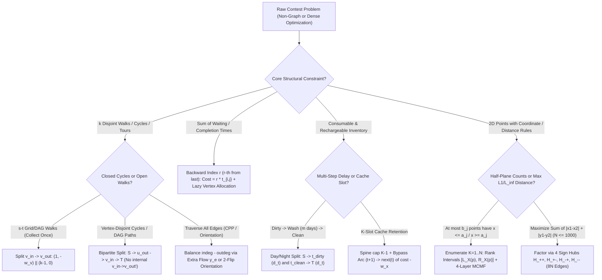

# Wave 4A Research Monograph: Min-Cost Max-Flow (MCMF) II — Cycle Covers, Dynamic Lazy Scheduling, Resource Reuse & Coordinate Rank Models (`Iterations 31–35`)

> [!IMPORTANT]
> **Cohort 1 Wave 4A Research Monograph (`FlowDeepInvestigator`)**
> This monograph covers **Iterations 31 through 35** of the Network Flows, Minimum Cuts, Matching, MCMF, and LP Duality research corpus. Every theoretical framework, compilation gadget, and curated contest problem strictly enforces the **4-Step "Zero Magic Gadgets" Compilation Standard**:
> 1. **Step 1: Non-Graph Diagnostic Signal (Recognition)** — Identifying the exact surface clue in the raw problem statement and constraint bounds ($N, M, K, V_{\max}$) that points to MCMF, Cycle Cover, Dynamic Lazy Scheduling, Resource Reuse, Rank Slot Assignment, or Hub Linearization, alongside why naive greedy or DP fails.
> 2. **Step 2: Intermediate Algebraic / Logical Representation** — Translating the English specification into explicit degree-conservation equations, permutation indicator constraints, backward waiting-time summations, order-statistic rank inequalities, or convex $\max$-of-linear forms *before* drawing a single vertex or edge.
> 3. **Step 3: Reverse-Engineering Scratchpad (Mechanical Graph Compilation)** — Deriving the exact vertex splits, port orientations, edge capacities, lower bounds, costs, and lazy expansion triggers from the algebraic terms.
> 4. **Step 4: Hand-Checkable Toy Trace & Broken Gadget Counterexamples** — Walking through a concrete small-scale numerical trace ($N \le 4$) and proving what breaks when subtle structural invariants are violated.

---

## Executive Overview & Architectural Shift (Wave 3B $\to$ Wave 4A)

In **Wave 3B (Iterations 26–30)**, we developed the foundational analytical machinery of Min-Cost Max-Flow (MCMF): Johnson potential maintenance, the convexity of the minimum-cost function $C(f)$, convex marginal edge splitting (`凸费用拆边`), and the algebraic equation-difference method (`流守恒差分建模法`) for interval coverage. Throughout Wave 3B, the underlying graph topology was **static** and determined directly by linear conservation laws over time steps or vertices.

In **Wave 4A (Iterations 31–35)**, we confront five advanced structural modelling paradigms where a naive static MCMF translation either fails to capture the combinatorial structure or explodes computationally:

1. **Iteration 31 — Combinatorial Decompositions (Disjoint Paths, Cycle Covers, $b$-Matchings & Chinese Postman Tours)**:
   How do we decompose a directed or undirected graph into $k$ vertex-disjoint walks, a family of vertex-disjoint directed cycles (`最小权有向环覆盖`), or a minimum-cost Eulerian tour (`中国邮递员问题` / Mixed Eulerian Orientation)? We show how residual backward edges act as an automatic **path-splicing operator** (Suurballe's theorem), why splitting every vertex into an out-port $v_{\text{out}} \in L$ and an in-port $v_{\text{in}} \in R$ bijectively maps bipartite matchings to permutations $\pi: V \to V$ (and hence directed cycle covers), and how augmenting with a teleportation/start edge $S \to v_{\text{in}}$ smoothly transitions between closed cycle covers and open path covers (`[SDOI2010] 星际竞速`, `[ZJOI2011] 营救皮卡丘`).
2. **Iteration 32 — Dynamic Lazy Vertex Generation (`动态加点费用流`)**:
   When scheduling $P$ tasks across $M$ parallel machines to minimize **total completion (waiting) time** (`[SCOI2007] 修车`, `[NOI2012] 美食节`), forward indexing fails because the first task's delay multiplier depends on the unknown total number of tasks assigned to that machine. Reversing the index ("the $r$-th from last task on machine $j$") linearizes the cost to $r \cdot t_{i,j}$, but creates $M \times P$ state vertices and $N \times M \times P$ edges—causing catastrophic Time Limit Exceeded (TLE) when $P \le 800$. We prove the **Slot Monotonicity Invariant** and show how allocating vertex $(j, r+1)$ *lazily on demand* immediately after $(j, r) \to T$ is saturated compresses the active graph from $80{,}000$ vertices and $3.2 \times 10^6$ edges down to $\le 900$ vertices and $36{,}000$ edges, including an exact $O(N)$ potential-initialization formula that supports Dijkstra without ever re-running SPFA.
3. **Iteration 33 — Resource Reuse, Inventory & Caching Networks (`餐巾计划问题` & $k$-Register Caching)**:
   When physical resources (napkins, batteries, surgeons, aircraft, or CPU registers) are **consumed**, transition into a **depleted/dirty state**, and can be **recharged/washed** across multiple time delays and cost tiers before re-entering service, a single node per time step illegally mixes clean and dirty inventory. We formalize the **Day/Night (Consumption/Replenishment) Bipartite Time Split** (`[网络流 24 题] 餐巾计划问题`) and demonstrate its duality with **Interval Caching / $k$-Register Allocation**, where keeping an item in cache across consecutive accesses $[t_1, t_2]$ compiles into a bypass edge that saves a reload penalty.
4. **Iteration 34 — 2D Prefix/Suffix Coordinate Rank Translation (`AGC 031 E — Snuke the Phantom Thief`)**:
   How can MCMF handle simultaneous 2D half-plane cardinality constraints ("at most $b_j$ chosen points have $x \le a_j$", and simultaneously for $x \ge a_j, y \le a_j, y \ge a_j$)? Direct regional capacity trees fail because 4-directional half-planes overlap in non-hierarchical grid cells. By fixing the total number of chosen points $K$ and sorting them by $x$-rank $1 \dots K$ and $y$-rank $1 \dots K$, every half-plane cardinality cap translates into a **pointwise coordinate interval bound** $[L_X(p), R_X(p)]$ on individual rank slots!
5. **Iteration 35 — Linearizing Manhattan & Chebyshev Distances via Sign-Combination Hubs (`AGC 034 D — Manhattan Max Matching`)**:
   When matching $N \le 1000$ red points to $N \le 1000$ blue points to maximize total $\ell_1$ (Manhattan) or $\ell_\infty$ (Chebyshev) distance, the explicit bipartite graph has $N^2 = 10^6$ edges—far too dense for MCMF. Exploiting the identity $|x_1 - x_2| + |y_1 - y_2| = \max_{s_x, s_y \in \{\pm 1\}} \big[(s_x x_1 + s_y y_1) + (-s_x x_2 - s_y y_2)\big]$, we factor all $N^2$ pairwise distances through **4 intermediate sign-combination hub vertices** $H_{++}, H_{+-}, H_{-+}, H_{--}$, compressing $N^2$ edges into $8N$ edges with zero loss of optimality.

---

## Iteration 31: Min-Cost Disjoint Paths, Cycle Covers, $b$-Matchings & The Directed/Undirected/Mixed Chinese Postman Problem

### 31.1 Suurballe's $k$ Disjoint Paths & Two-Way Grid Walks (`方格取数` / `传纸条` / `[NOI2004] 太空梯`)

#### Step 1: Non-Graph Diagnostic Signal (Recognition)

You are given a directed graph $G = (V, E)$ (often a 2D grid of size $R \times C$ where movement is restricted to right $(i, j+1)$ and down $(i+1, j)$) with vertex rewards $w_v \ge 0$ or edge costs $c_e$. The problem asks for one of two closely related objectives:
1. **Round-Trip / Two-Way Walk (`[NOIP2008] 传纸条` / Bi-directional TSP)**: Find a monotone path from $(1,1)$ to $(R,C)$ and a monotone return path from $(R,C)$ back to $(1,1)$ that share **no internal vertices** (or collect each cell's reward at most once), maximizing the total reward.
2. **$k$ Vertex/Edge-Disjoint Walks (`[网络流 24 题] 方格取数加强版` / `POJ 3422 Kaka's Matrix Travels`)**: Send $k$ agents from $(1,1)$ to $(R,C)$ along right/down paths. Either (Variant A) no two agents may visit the same internal cell, or (Variant B) multiple agents may visit the same cell $(i,j)$, but its reward $w_{i,j}$ is collected **only on the first visit**.

**Why Naive Sequential Greedy Fails (The Crossing-Path Trap)**:
A tempting heuristic is to run DP once to find the single maximum-weight path $P_1$, zero out the rewards (or delete the vertices) along $P_1$, and run DP a second time to find $P_2$. This greedy strategy is **fundamentally wrong** because the single best path $P_1$ frequently cuts diagonally across the graph, topologically separating the remaining high-value regions so that no second disjoint path $P_2$ can cross $P_1$ without violating vertex disjointness (or losing access to half the grid).

Consider the following $4 \times 4$ grid of cell rewards (moving only Right and Down):
$$W = \begin{bmatrix}
0 & 10 & 10 & 0 \\
0 & 0 & 10 & 10 \\
10 & 10 & 0 & 0 \\
0 & 10 & 10 & 0
\end{bmatrix}$$
- **Single-Pass Greedy**: The maximum single path from $(1,1)$ to $(4,4)$ collects $40$ by taking $(1,1) \to (1,2)[10] \to (1,3)[10] \to (2,3)[10] \to (2,4)[10] \to (4,4)$ or cutting down the middle: if the middle cells $(2,2)$ and $(3,3)$ had weight $12$, $P_1$ would take $(1,1) \to (1,2)[10] \to (2,2)[12] \to (3,2)[10] \to (3,3)[12] \to (3,4)[0] \to (4,4)$ for a score of $44$, completely walling off the top-right $[10, 10]$ from the bottom-left $[10, 10]$!
- **Optimal Disjoint Pair**: The Upper Path takes $(1,1) \to (1,2) \to (1,3) \to (2,3) \to (2,4) \to (4,4)$ (reward $40$) and the Lower Path takes $(1,1) \to (3,1) \to (3,2) \to (4,2) \to (4,3) \to (4,4)$ (reward $40$), achieving $80$.
- **Why MCMF Succeeds (Suurballe Path Splicing)**: When MCMF sends the first unit of flow along the greedy diagonal $P_1$, it creates **residual backward edges** of cost $+w_v$ (or $-c_e$) along $P_1$. The second augmenting path $P_2$ starts along the lower-left corridor, runs into $P_1$, traverses the residual backward edge along the middle of $P_1$ (canceling the diagonal bottleneck), and exits into the upper-right corridor! Removing the canceled middle segment and re-pairing the prefixes and suffixes automatically splices $P_1 \oplus P_2$ into two non-crossing, vertex-disjoint paths.

#### Step 2: Intermediate Algebraic / Logical Representation

First, observe the **Round-Trip Reversal Reduction**: If the return walk from $t = (R,C)$ to $s = (1,1)$ uses the exact transpose of the forward transition graph (e.g., Left/Up steps are the exact reverses of Right/Down steps), reversing the chronological order of the return walk turns it into a second forward walk from $s$ to $t$! (Warning: If the graph has asymmetric one-way transitions where return moves are *not* the reverse of forward moves, this reduction requires care—see Step 4).

Let $f_{uv} \in \{0, 1, \dots, k\}$ denote the number of paths traversing directed edge $(u,v) \in E$, and let $y_v$ denote the total flow passing through vertex $v \in V \setminus \{s, t\}$.
1. **Flow Conservation at Vertex $v$**:
   $$\sum_{u: (u,v) \in E} f_{uv} = y_v = \sum_{w: (v,w) \in E} f_{vw} \quad \forall v \in V \setminus \{s, t\}, \qquad \sum_{w} f_{sw} = \sum_{u} f_{ut} = k.$$
2. **Vertex Capacity & Reward Objective**:
   - **Variant A (Strict Vertex Disjointness, `传纸条`)**: Every internal vertex $v \in V \setminus \{s, t\}$ can be visited by at most one path:
     $$0 \le y_v \le 1, \qquad \text{Maximize } \sum_{v \in V \setminus \{s,t\}} w_v y_v \iff \text{Minimize } \sum_{v \in V \setminus \{s,t\}} (-w_v) y_v.$$
   - **Variant B (Shared Vertices Allowed, Reward Collected Once, `K取方格数`)**: Any number of paths $y_v \in \{0, 1, \dots, k\}$ may pass through $v$, but the reward function $R_v(y_v) = w_v \cdot \min(y_v, 1)$ is concave (diminishing returns). Decompose $y_v = y_{v,1} + y_{v,2}$ into the *first visit* indicator $y_{v,1} \in [0, 1]$ and *subsequent visits* $y_{v,2} \in [0, k-1]$:
     $$y_v = y_{v,1} + y_{v,2}, \quad 0 \le y_{v,1} \le 1, \quad 0 \le y_{v,2} \le k-1, \qquad \text{Minimize } \sum_{v \in V} \big((-w_v) y_{v,1} + 0 \cdot y_{v,2}\big).$$

#### Step 3: Reverse-Engineering Scratchpad (Mechanical Graph Compilation)

Because constraints and rewards are attached to the vertex throughput variable $y_v$ rather than individual edges $f_{uv}$, we must materialize $y_v$ as the flow across an explicit **internal vertex-split edge**:
- Split every vertex $v \in V$ into an entry port $v_{\text{in}}$ and an exit port $v_{\text{out}}$.
- Every original transition $(u, v) \in E$ connects the exit of $u$ to the entry of $v$:
  $$u_{\text{out}} \xrightarrow{\text{cap } = \infty, \text{ cost } = c_{uv}} v_{\text{in}}.$$
- The internal split edges $v_{\text{in}} \to v_{\text{out}}$ compile the algebraic constraints on $y_v$:
  - **For Variant A (Strict Vertex Disjointness)**:
    - For internal vertices $v \notin \{s, t\}$: add a single edge $v_{\text{in}} \to v_{\text{out}}$ with $(\text{cap} = 1, \text{cost} = -w_v)$.
    - For endpoints $v \in \{s, t\}$: add $v_{\text{in}} \to v_{\text{out}}$ with $(\text{cap} = k, \text{cost} = 0)$ (or split into $(\text{cap}=1, \text{cost}=-w_v)$ plus $(\text{cap}=k-1, \text{cost}=0)$ if endpoint values are collected once).
  - **For Variant B (Collect-Once $k$-Walks)**:
    - For every vertex $v \in V$: add two parallel internal edges from $v_{\text{in}}$ to $v_{\text{out}}$:
      1. **Reward Edge ($y_{v,1}$)**: $v_{\text{in}} \xrightarrow{\text{cap } = 1, \text{ cost } = -w_v} v_{\text{out}}$.
      2. **Bypass Edge ($y_{v,2}$)**: $v_{\text{in}} \xrightarrow{\text{cap } = k-1, \text{ cost } = 0} v_{\text{out}}$.
- Finally, connect $S \xrightarrow{\text{cap } = k, \text{ cost } = 0} s_{\text{in}}$ and $t_{\text{out}} \xrightarrow{\text{cap } = k, \text{ cost } = 0} T$. Since the grid transition graph is a DAG, all original edges have non-negative cycle sums (no negative cycles exist), so we can compute initial Johnson potentials $\pi$ in $O(V + E)$ via a single topological sort DP before running $k$ Dijkstra augmentations!

```
   Variant B (Collect-Once Vertex Split):
                 cap = 1, cost = -w_v  (1st visit collects reward)
               /---------------------->\
   ---> ( v_in )                        ( v_out ) --->
               \---------------------->/
                 cap = k-1, cost = 0   (subsequent visits pay/collect 0)
```

#### Step 4: Hand-Checkable Toy Trace & Broken Gadget Counterexamples

**Toy Trace ($3 \times 3$ Grid, $k = 2$ strict disjoint internal paths)**:
Suppose the grid rewards are:
$$(1,1)=0, \quad (1,2)=5, \quad (1,3)=1, \quad (2,1)=1, \quad (2,2)=10, \quad (2,3)=5, \quad (3,1)=0, \quad (3,2)=5, \quad (3,3)=0.$$
1. **Augmentation 1**: The minimum-cost path from $(1,1)_{\text{in}}$ to $(3,3)_{\text{out}}$ greedily takes the high-value center cell $(2,2)$:
   $$P_1: (1,1) \to (1,2)[\text{cost } -5] \to (2,2)[\text{cost } -10] \to (3,2)[\text{cost } -5] \to (3,3), \quad \text{Total Cost } = -20.$$
   Notice that $P_1$ blocks the vertical column $j=2$, separating $(2,1)$ from $(1,3)$ and $(2,3)$!
2. **Augmentation 2 (Path Splicing via Residual Backward Edges)**:
   In the residual graph after $P_1$, the forward internal edges of $(1,2), (2,2), (3,2)$ are saturated, and their **residual backward edges** exist:
   $$(1,2)_{\text{out}} \to (1,2)_{\text{in}} \, (+5), \quad (2,2)_{\text{out}} \to (2,2)_{\text{in}} \, (+10), \quad (3,2)_{\text{out}} \to (3,2)_{\text{in}} \, (+5),$$
   along with backward transition edges $(2,2)_{\text{in}} \to (1,2)_{\text{out}} \, (0)$ and $(3,2)_{\text{in}} \to (2,2)_{\text{out}} \, (0)$.
   Now, the second unit of flow starts at $(1,1)_{\text{out}} \to (2,1)_{\text{in}} \to (2,1)_{\text{out}} \, (-1) \to (3,1)_{\text{in}} \to (3,1)_{\text{out}} \, (0) \to (3,2)_{\text{in}}$.
   Instead of being trapped at $(3,2)_{\text{in}}$ (whose forward split edge to $(3,2)_{\text{out}}$ is saturated!), the augmenting path traverses the **backward transition edge** $(3,2)_{\text{in}} \to (2,2)_{\text{out}} \, (0)$, then does *not* even need to undo $(2,2)$'s internal edge! It simply exits from $(2,2)_{\text{out}} \to (2,3)_{\text{in}} \to (2,3)_{\text{out}} \, (-5) \to (3,3)_{\text{in}}$!
   Wait—look closely at what just happened at $(2,2)_{\text{out}}$:
   - $P_1$ used the transition edge $(2,2)_{\text{out}} \to (3,2)_{\text{in}}$.
   - $P_2$ entered $(3,2)_{\text{in}}$ from $(3,1)_{\text{out}}$, then traversed the residual reverse of $(2,2)_{\text{out}} \to (3,2)_{\text{in}}$ back to $(2,2)_{\text{out}}$, and exited to $(2,3)_{\text{in}}$!
   - Canceling the flow on $(2,2)_{\text{out}} \to (3,2)_{\text{in}}$ decomposes the combined flow of size $2$ into:
     - **Path A**: $(1,1) \to (1,2)[5] \to (2,2)[10] \to (2,3)[5] \to (3,3)$ (Reward $20$),
     - **Path B**: $(1,1) \to (2,1)[1] \to (3,1)[0] \to (3,2)[5] \to (3,3)$ (Reward $6$),
     achieving total reward $26$ without ever double-visiting $(2,2)$ or $(3,2)$!

> [!WARNING]
> **Broken Gadget Counterexamples in Disjoint Path Modelling**
> 1. **Failure Mode A — Omitting Vertex Splitting (Putting Vertex Rewards on Incoming Edges)**:
>    If you do not split $v$ into $v_{\text{in}} \to v_{\text{out}}$ and instead assign $(\text{cap} = 1, \text{cost} = -w_v)$ to each incoming grid edge $(i-1, j) \to (i, j)$ and $(i, j-1) \to (i, j)$, then one path can enter $(i,j)$ from the top and exit right, while a second path enters $(i,j)$ from the left and exits down! Both edges have capacity $1$, so the flow is feasible, but the two paths intersect at $(i,j)$ and **collect $w_{i,j}$ twice**!
> 2. **Failure Mode B — Reversing an Asymmetric Return Graph**:
>    In a round-trip problem where the graph is a general directed graph $G = (V, E)$, a return path from $t$ to $s$ traverses edges in the forward direction $(u,v) \in E$ along $t \to \dots \to s$. Reversing that return path so it runs from $s$ to $t$ means it must traverse edges of the **transpose graph** $G^{\text{rev}} = (V, E^{\text{rev}})$, where $(v,u) \in E^{\text{rev}} \iff (u,v) \in E$. You can only merge the two paths into a $2$-unit flow on a single graph if $G$ is undirected (symmetric) or if the problem explicitly states that the return trip moves backward along the forward edges (as in standard grid walks). If $G \ne G^{\text{rev}}$ and both walks share vertex capacities, the general problem of finding a disjoint $(s \to t)$ path and $(t \to s)$ path in a general directed graph is **NP-complete** (Fortune, Hopcroft, and Wyllie 1980)! Only when $G$ is planar or acyclic under a shared topological potential can they be coupled.

---

### 31.2 Min-Cost Directed Cycle Cover (`最小权有向环覆盖`) & Path-Cycle Duality

#### Step 1: Non-Graph Diagnostic Signal (Recognition)

You are given a weighted directed graph $G = (V, E)$ with $|V| = N \le 300$ and edge costs $c_{uv}$. You need to cover all vertices $V$ using:
- **Archetype 1 (Exact Directed Cycle Cover)**: A collection of vertex-disjoint directed cycles such that every vertex $v \in V$ belongs to **exactly one** cycle, minimizing total edge cost.
- **Archetype 2 (DAG Path Cover with Teleportation / Fleet Size $K$, e.g., `[SDOI2010] 星际竞速`, `[ZJOI2011] 营救皮卡丘`)**: A collection of vertex-disjoint directed paths on a DAG (or time-ordered graph) covering every vertex in $V$, where starting a new path at vertex $v$ incurs a "teleportation/launch" cost $a_v$ (or uses 1 of $K$ available vehicles at a base), and traversing $(u,v)$ costs $c_{uv}$.

**Why Naive DP or TSP Heuristics Fail**:
- On a general graph, requiring a **single** Hamiltonian cycle is the Traveling Salesperson Problem (NP-hard). However, if the problem allows *any number* of vertex-disjoint cycles (or if $G$ is a DAG so that cycles are impossible and any local degree-1 assignment automatically forms valid open paths!), the global connectivity constraint vanishes, and the problem drops from NP-hard to polynomial-time MCMF!
- On a DAG (`[SDOI2010] 星际竞速`), a DP over vertices fails because each vertex can be the predecessor of at most one later vertex (out-degree $\le 1$) and successor of at most one earlier vertex (in-degree $\le 1$), which couples choices across the entire prefix of visited vertices.

#### Step 2: Intermediate Algebraic / Logical Representation

Let $x_{uv} \in \{0, 1\}$ indicate whether directed edge $(u,v) \in E$ is selected in the cover.
1. **For Exact Directed Cycle Cover**:
   A subgraph of $G$ is a union of vertex-disjoint directed cycles covering $V$ if and only if every vertex $v \in V$ has **exact out-degree $1$** and **exact in-degree $1$**:
   $$\sum_{v: (u,v) \in E} x_{uv} = 1 \quad (\forall u \in V), \qquad \sum_{u: (u,v) \in E} x_{uv} = 1 \quad (\forall v \in V).$$
   Combinatorially, setting $v = \pi(u)$ whenever $x_{uv} = 1$ defines a bijection (permutation) $\pi: V \to V$, and every finite permutation decomposes uniquely into disjoint directed cycles!
2. **For Path Cover with Start Costs $a_v$ (`[SDOI2010] 星际竞速`)**:
   Every vertex $v \in V$ must be visited **exactly once** (so its total incoming transitions—either from an earlier vertex $u$ along edge $(u,v)$ or via a direct path-start/teleport $x_{0,v} \in \{0,1\}$—must equal $1$), and after visiting $v$, the path either continues to **at most one** successor $w$ or terminates at $v$:
   $$x_{0,v} + \sum_{u: (u,v) \in E} x_{uv} = 1 \quad (\forall v \in V), \qquad \sum_{w: (v,w) \in E} x_{vw} \le 1 \quad (\forall v \in V).$$
   Objective:
   $$\text{Minimize } \sum_{v \in V} a_v x_{0,v} + \sum_{(u,v) \in E} c_{uv} x_{uv}.$$
   Notice that if we introduce a slack variable $y_v = 1 - \sum_{w} x_{vw} \in \{0, 1\}$ (indicating that the path terminates at $v$), the out-degree inequality also becomes an exact equality $\sum_w x_{vw} + y_v = 1$, or equivalently we simply cap the supply of $v_{\text{out}}$ at $1$ without forcing it to saturate if $v_{\text{in}}$ is already forced to saturate!

#### Step 3: Reverse-Engineering Scratchpad (Mechanical Graph Compilation)

Notice that in the equations above, each variable $x_{uv}$ participates in **two** constraints: the out-degree constraint of $u$ and the in-degree constraint of $v$. This is the exact incidence matrix of a **bipartite graph** $L \cup R$:
- Split each vertex $v \in V$ into two independent ports:
  - **Out-port $v_{\text{out}} \in L$**: Governs the out-degree constraint $\sum_{w} x_{vw} = 1$ (or $\le 1$).
  - **In-port $v_{\text{in}} \in R$**: Governs the in-degree constraint $\sum_{u} x_{uv} = 1$.
- **Important distinction from Section 31.1**: In Section 31.1 (Disjoint Paths), we added an internal edge $v_{\text{in}} \to v_{\text{out}}$ so flow passed *through* $v$. Here, in Cycle/Path Cover, there is **NO internal edge between $v_{\text{in}}$ and $v_{\text{out}}$**! Instead, $v_{\text{out}}$ is on the left side (connected to $S$) and $v_{\text{in}}$ is on the right side (connected to $T$):
  1. **Exact Cycle Cover Network**:
     - For each $u \in V$: add $S \xrightarrow{\text{cap } = 1, \text{ cost } = 0} u_{\text{out}}$.
     - For each $v \in V$: add $v_{\text{in}} \xrightarrow{\text{cap } = 1, \text{ cost } = 0} T$.
     - For each directed edge $(u,v) \in E$: add $u_{\text{out}} \xrightarrow{\text{cap } = 1, \text{ cost } = c_{uv}} v_{\text{in}}$.
     - Run MCMF from $S$ to $T$. A valid cycle cover exists if and only if $\text{MaxFlow} = |V|$, and its minimum cost is $\text{MinCost}$.
  2. **Path Cover with Teleportation/Start Costs (`[SDOI2010] 星际竞速`)**:
     - Every vertex $v \in V$ must be entered once $\implies v_{\text{in}} \xrightarrow{\text{cap } = 1, \text{ cost } = 0} T$ must be saturated (total required flow $= |V|$).
     - Entering $v$ via a new path start ($x_{0,v} = 1$) costs $a_v \implies$ add a direct edge $S \xrightarrow{\text{cap } = 1, \text{ cost } = a_v} v_{\text{in}}$.
     - Entering $v$ from an earlier vertex $u$ ($x_{uv} = 1$) costs $c_{uv}$ and consumes $u$'s single out-degree slot $\implies$ add $S \xrightarrow{\text{cap } = 1, \text{ cost } = 0} u_{\text{out}}$ and $u_{\text{out}} \xrightarrow{\text{cap } = 1, \text{ cost } = c_{uv}} v_{\text{in}}$.
     - Every unit of flow reaching $v_{\text{in}} \to T$ either came directly from $S \to v_{\text{in}}$ (starting a new path at $v$ for cost $a_v$) or came via $S \to u_{\text{out}} \to v_{\text{in}}$ (continuing the path from $u$ to $v$ for cost $c_{uv}$)! Because $G$ is a DAG ($u < v$ topologically), no cycle can ever be formed, so any flow of value $|V|$ corresponds bijectively to a valid path cover!

```
   Path Cover with Teleportation ([SDOI2010] 星际竞速):
                         cap=1, cost=a_v (start new path at v)
               /---------------------------------------------------->\
              |                                                       v
   ( S ) -----+---> ( u_out ) --------------------------> ( v_in ) ---> ( T )
         cap=1,       |         cap=1, cost=c_{uv}          ^      cap=1,
         cost=0       |         (continue path u -> v)      |      cost=0
                      \------------------------------------/
```

#### Step 4: Hand-Checkable Toy Trace & Broken Gadget Counterexamples

**Toy Trace ($N = 3$ DAG Path Cover with Teleportation)**:
Let $V = \{1, 2, 3\}$ with teleportation costs $a = [10, 10, 10]$, and directed edges $(1,2)$ with cost $3$, $(2,3)$ with cost $4$, and $(1,3)$ with cost $20$.
- The network has $S \to 1_{\text{out}}, 2_{\text{out}}, 3_{\text{out}}$ (cap $1$, cost $0$), $S \to 1_{\text{in}}, 2_{\text{in}}, 3_{\text{in}}$ (cap $1$, cost $10$), and transition edges $1_{\text{out}} \to 2_{\text{in}} (3)$, $2_{\text{out}} \to 3_{\text{in}} (4)$, $1_{\text{out}} \to 3_{\text{in}} (20)$.
- To send $3$ units of flow to $1_{\text{in}}, 2_{\text{in}}, 3_{\text{in}} \to T$:
  - Unit 1 into $1_{\text{in}}$: has no incoming DAG edges, so it must take $S \to 1_{\text{in}}$ at cost $a_1 = 10$.
  - Unit 2 into $2_{\text{in}}$: takes $S \to 1_{\text{out}} \to 2_{\text{in}}$ at cost $0 + 3 = 3 < 10$.
  - Unit 3 into $3_{\text{in}}$: takes $S \to 2_{\text{out}} \to 3_{\text{in}}$ at cost $0 + 4 = 4 < 10$.
- Total flow $= 3$, Total cost $= 10 + 3 + 4 = 17$, corresponding to starting at vertex $1$ ($+10$), moving $1 \to 2$ ($+3$), and moving $2 \to 3$ ($+4$). Notice that $3_{\text{out}}$ receives $0$ flow because the path terminates at $3$!

> [!WARNING]
> **Broken Gadget Counterexamples in Cycle & Path Cover**
> 1. **Failure Mode A — Applying the Bipartite Path Cover Gadget to a Graph with Cycles (The Subtour Trap)**:
>    In `[SDOI2010] 星际竞速`, the problem statement guarantees that gravity transitions only go from lower-numbered planets to higher-numbered planets ($u < v$), so $G$ is a **DAG**. What if $G$ were *not* a DAG and contained a cheap cycle $2 \to 3 \to 2$ of cost $1 + 1 = 2$, while teleporting to $2$ and $3$ costs $10$ each? Then the bipartite network would saturate $S \to 2_{\text{out}} \to 3_{\text{in}} \to T$ and $S \to 3_{\text{out}} \to 2_{\text{in}} \to T$ at cost $2$, leaving vertices $2$ and $3$ on an **isolated closed cycle** with zero teleportation starts! In a real physical trajectory, you cannot visit a closed cycle without ever teleporting into it! Whenever $G$ is not a DAG, bipartite matching relaxes path cover into *Path + Cycle Cover*, and eliminating isolated cycles requires either time-expanded layering or NP-hard subtour elimination.
> 2. **Failure Mode B — Adding Self-Loop Edges $u_{\text{out}} \to u_{\text{in}}$ in Cycle Cover**:
>    Unless 1-vertex trivial cycles are explicitly allowed at a given penalty, never add $u_{\text{out}} \to u_{\text{in}}$ of cost $0$, or every vertex will trivially match to itself and bypass all graph edges!

---

### 31.3 General $b$-Matchings & Degree-Constrained Subgraphs (`度数限制子图`)

When each vertex $v$ in a bipartite graph $G = (L \cup R, E)$ (or a directed graph via the $v_{\text{out}} / v_{\text{in}}$ split) requires its degree $d(v) = \sum_{e \in \delta(v)} x_e$ to lie in a prescribed interval $[\ell_v, u_v]$ while choosing each edge $e$ at most $c_e$ times at cost $w_e$:
$$\ell_u \le \sum_{e=(u,v) \in E} x_e \le u_u \quad (\forall u \in L), \qquad \ell_v \le \sum_{e=(u,v) \in E} x_e \le u_v \quad (\forall v \in R), \qquad 0 \le x_e \le c_e.$$
This compiles directly into a **Minimum-Cost Feasible Flow with Lower Bounds (`上下界最小费用可行流`)**:
- Source $S \to u$ has capacity interval $[\ell_u, u_u]$ and cost $0$ for all $u \in L$.
- Edge $u \to v$ has capacity interval $[0, c_e]$ and cost $w_e$ for all $e = (u,v) \in E$.
- Sink edge $v \to T$ has capacity interval $[\ell_v, u_v]$ and cost $0$ for all $v \in R$, with feedback edge $T \to S$ of capacity $[0, \infty)$ and cost $0$.

**Convex Degree Penalties**: If instead of hard bounds $[\ell_v, u_v]$, vertex $v$ incurs a convex penalty $g_v(d(v))$ (for example, $d(v)^2$ in `[WC2007] 剪刀石头布` or sensor load balancing), we replace the single edge $S \to u$ with $d_{\max}(u)$ parallel unit-capacity edges of marginal costs $\Delta g_u(k) = g_u(k) - g_u(k-1)$ for $k = 1, 2, \dots, d_{\max}(u)$.

> [!CAUTION]
> **Bipartite / Directed vs. Non-Bipartite Undirected $b$-Matching**:
> On a **bipartite** graph (or for **in-degree vs. out-degree** on a directed graph), the edge-vertex incidence matrix is Totally Unimodular (TU), so MCMF solves minimum-cost $b$-matching in polynomial time. On a **non-bipartite undirected** graph (where an undirected edge $e = \{u,v\}$ contributes $+1$ to the undirected degree of *both* $u$ and $v$ in the same orientation), the incidence matrix contains odd cycles with determinant $\pm 2$. Sending flow on a symmetric bipartite duplicate $u_{\text{out}} \to v_{\text{in}}$ fails because $x_{uv}$ need not equal $x_{vu}$ (an odd cycle of length $3$ can satisfy in-degree $=$ out-degree $= 1$ in the directed split while corresponding to fractional $1/2$-edges in the undirected graph!). Non-bipartite undirected $b$-matching requires **Tutte's reduction to General Graph Blossom Matching** (Wave 5A) rather than MCMF.

---

### 31.4 The Chinese Postman Problem (CPP) — Directed, Undirected, and Mixed

A mail carrier must start at a depot, traverse **every edge** of a connected graph $G = (V, E)$ **at least once**, and return to the depot while minimizing total travel distance. Because traversing every edge at least once is equivalent to duplicating a subset of edges (adding a non-negative integer multiplicity $y_e \ge 0$ to each original edge $e$) until the resulting multigraph is **Eulerian**, the compilation depends fundamentally on whether $G$ is directed, undirected, or mixed.

#### Variant 1: Directed Chinese Postman Problem (Directed CPP $\to$ Standard MCMF)

- **Step 1 (Diagnostic Signal)**: All edges $e = (u,v) \in E$ are directed with length $c_e \ge 0$. We must traverse every directed edge at least once and form a closed tour (assumed strongly connected).
- **Step 2 (Intermediate Algebraic Representation)**:
  Let $x_e \in \mathbb{Z}_{\ge 1}$ be the total number of times directed edge $e = (u,v)$ is traversed in the tour. A strongly connected directed multigraph is Eulerian if and only if every vertex $v \in V$ has **balanced total in-degree and out-degree**:
  $$\sum_{e \in \delta^+(v)} x_e - \sum_{e \in \delta^-(v)} x_e = 0 \quad (\forall v \in V).$$
  Substitute $x_e = 1 + y_e$, where $y_e \in \mathbb{Z}_{\ge 0}$ is the number of **extra (deadhead) traversals** of edge $e$:
  $$\sum_{e \in \delta^+(v)} y_e - \sum_{e \in \delta^-(v)} y_e = \underbrace{\text{indeg}_G(v) - \text{outdeg}_G(v)}_{\Delta_v} \quad (\forall v \in V),$$
  $$\text{Minimize } \sum_{e \in E} c_e x_e = \underbrace{\sum_{e \in E} c_e}_{\text{Base Cost}} + \min_{y \ge 0} \sum_{e \in E} c_e y_e.$$
- **Step 3 (Graph Compilation)**:
  The equations for $y_e \ge 0$ are literally a standard minimum-cost circulation with vertex supplies $\Delta_v = \text{indeg}_G(v) - \text{outdeg}_G(v)$!
  - For every vertex $v$ with $\Delta_v > 0$ (more original incoming edges than outgoing edges, so extra paths must *start* at $v$): add $S \xrightarrow{\text{cap } = \Delta_v, \text{ cost } = 0} v$.
  - For every vertex $v$ with $\Delta_v < 0$ (more original outgoing edges than incoming edges, so extra paths must *end* at $v$): add $v \xrightarrow{\text{cap } = -\Delta_v, \text{ cost } = 0} T$.
  - For every original directed edge $e = (u,v) \in E$: add $u \xrightarrow{\text{cap } = \infty, \text{ cost } = c_e} v$.
  - Answer $= \sum_{e \in E} c_e + \text{MinCost}(S \to T)$.

#### Variant 2: Undirected Chinese Postman Problem (Undirected CPP $\to$ Odd-Vertex Matching)

In an undirected connected graph $G = (V, E)$, a multigraph is Eulerian if and only if **every vertex has even degree**. Adding extra paths $y$ must change the degree parity of precisely the set of odd-degree vertices $V_{\text{odd}} = \{v \in V : \deg_G(v) \equiv 1 \pmod 2\}$. By the Handshaking Lemma, $|V_{\text{odd}}|$ is always even.
- Compute all-pairs shortest paths $d(u,v)$ between vertices in $V_{\text{odd}}$.
- Find a **Minimum-Weight Perfect Matching** on the complete graph $K_{|V_{\text{odd}}|}$ with edge weights $d(u,v)$:
  - If $|V_{\text{odd}}| \le 20$ (common in ICPC/AtCoder): solve in $O(2^{|V_{\text{odd}}|} |V_{\text{odd}}|)$ via bitmask DP.
  - If $|V_{\text{odd}}|$ is large: solve via Edmonds' Weighted Blossom Algorithm in $O(|V_{\text{odd}}|^3)$.

#### Variant 3: Min-Cost Mixed Graph Eulerian Orientation (`混合图欧拉回路` / Weighted Orientation)

> [!IMPORTANT]
> **Complexity Boundary: Mixed CPP vs. Mixed Eulerian Orientation**
> - **General Mixed CPP** (where a graph has both directed and undirected edges, and edges may be traversed **multiple times** $\ge 1$): **NP-hard** (Papadimitriou 1976), because duplicating an undirected edge adds $+2$ to total degree while orienting it changes directed balance by $\pm 1$, encoding parity-constrained satisfiability.
> - **Min-Cost Mixed Graph Eulerian Orientation** (where every edge—directed or undirected—must be traversed **exactly once**, and each undirected edge $e_i = \{u_i, v_i\}$ can be oriented as $u_i \to v_i$ at cost $c_{u_i v_i}$ or as $v_i \to u_i$ at cost $c_{v_i u_i}$): **100% Polynomial-Time Solvable via MCMF**!

Let us compile **Min-Cost Mixed Graph Eulerian Orientation** via our 4-Step Standard:
- **Step 1 (Diagnostic Signal)**: A mixed graph has fixed directed edges $E_{\text{dir}}$ and orientable undirected edges $E_{\text{undir}}$. Every edge must be used **once** in a closed Eulerian tour (or we are asked to orient all edges of an undirected/mixed graph to make $\text{indeg}(v) = \text{outdeg}(v)$ at minimum orientation cost).
- **Step 2 (Algebraic 2-Flip Linearization)**:
  1. **Parity Pre-Check**: In any valid orientation, $\text{indeg}(v) + \text{outdeg}(v) = \deg_{\text{total}}(v)$ and $\text{indeg}(v) = \text{outdeg}(v)$, so $\deg_{\text{total}}(v) = 2 \cdot \text{outdeg}(v)$ must be **even** for every $v \in V$. If any vertex has odd total degree, return `IMPOSSIBLE` immediately.
  2. **Arbitrary Initial Orientation**: For each undirected edge $e_i = \{u_i, v_i\} \in E_{\text{undir}}$, initially orient it arbitrarily as $u_i \to v_i$, incurring base cost $c_{u_i v_i}$.
  3. **Reversal Indicator Variable $x_i \in \{0, 1\}$**: Let $x_i = 1$ if we **reverse** $e_i$ from $u_i \to v_i$ to $v_i \to u_i$ (paying marginal cost $\Delta c_i = c_{v_i u_i} - c_{u_i v_i}$), and $x_i = 0$ if we keep $u_i \to v_i$.
  4. **Degree Balance Equation & Division by 2**: Let $\text{out}_0(v)$ and $\text{in}_0(v)$ be the out-degree and in-degree of $v$ under the initial orientation. Reversing $u_i \to v_i$ decreases $\text{out}(u_i) - \text{in}(u_i)$ by $2$ and increases $\text{out}(v_i) - \text{in}(v_i)$ by $2$:
     $$\big(\text{out}_0(v) - \text{in}_0(v)\big) - 2 \sum_{i: u_i = v} x_i + 2 \sum_{i: v_i = v} x_i = 0 \quad (\forall v \in V).$$
     Since $\text{out}_0(v) + \text{in}_0(v) = \deg_{\text{total}}(v)$ is even, $\text{out}_0(v) - \text{in}_0(v)$ is also **even**! Divide the entire equation by $2$:
     $$\sum_{i: u_i = v} x_i - \sum_{i: v_i = v} x_i = \frac{\text{out}_0(v) - \text{in}_0(v)}{2} =: D_v \quad (\forall v \in V).$$
- **Step 3 (Graph Compilation)**:
   Every variable $x_i \in \{0, 1\}$ has coefficient $+1$ at $u_i$ and $-1$ at $v_i$!
  - For each $v \in V$ with $D_v > 0$: add $S \xrightarrow{\text{cap } = D_v, \text{ cost } = 0} v$.
  - For each $v \in V$ with $D_v < 0$: add $v \xrightarrow{\text{cap } = -D_v, \text{ cost } = 0} T$.
  - For each initially oriented undirected edge $e_i = (u_i \to v_i)$: add a directed edge $u_i \xrightarrow{\text{cap } = 1, \text{ cost } = c_{v_i u_i} - c_{u_i v_i}} v_i$.
  - Run MCMF from $S$ to $T$. An Eulerian orientation exists if and only if $\text{MaxFlow} = \sum_{D_v > 0} D_v$, with minimum total cost $\sum_{i} c_{u_i v_i} + \text{MinCost}(S \to T)$.

---

## Iteration 32: Dynamic Lazy Vertex Generation in MCMF (`动态加点费用流` — `[NOI2012] 美食节` & `[SCOI2007] 修车`)

### 32.1 Step 1: Non-Graph Diagnostic Signal & Backward Waiting-Time Linearization (`倒数第 r 个做菜系数`)

#### The Canonical Problem Setting (`[SCOI2007] 修车` & `[NOI2012] 美食节`)

There are $N$ types of dishes (with $p_i$ orders of dish $i$, so total orders $P = \sum_{i=1}^N p_i$) and $M$ chefs. Chef $j \in \{1, \dots, M\}$ takes $t_{i,j} > 0$ time to cook one order of dish $i$. Each chef cooks their assigned dishes sequentially one at a time. The **waiting time (completion time)** of a dish order is the time from $t = 0$ until that specific dish finishes cooking (i.e., the sum of cooking times of all dishes cooked by that same chef *before* it, plus its own cooking time). We want to assign each of the $P$ dish orders to a chef and order each chef's queue to **minimize the sum of waiting times of all $P$ orders**.

- In `[SCOI2007] 修车`: $M \le 9$, $N = P \le 60$ ($p_i = 1$).
- In `[NOI2012] 美食节`: $N \le 40$, $M \le 100$, and total orders $P = \sum_{i=1}^N p_i \le 800$.

#### Why Forward Indexing Fails to Decouple

Suppose chef $j$ is assigned $k$ dishes in chronological order: $i_1, i_2, \dots, i_k$.
Their individual completion times are:
- Dish $1$ ($i_1$): finishes at $t_{i_1, j}$
- Dish $2$ ($i_2$): finishes at $t_{i_1, j} + t_{i_2, j}$
- $\dots$
- Dish $k$ ($i_k$): finishes at $t_{i_1, j} + t_{i_2, j} + \dots + t_{i_k, j}$.

Summing the completion times across all $k$ dishes cooked by chef $j$ gives:
$$W_j = k \cdot t_{i_1, j} + (k - 1) \cdot t_{i_2, j} + \dots + 1 \cdot t_{i_k, j}.$$
If we try to create state nodes for "chef $j$'s $1$-st dish, $2$-nd dish, $\dots$", we hit a brick wall: **the cost coefficient of chef $j$'s $1$-st dish is $k \cdot t_{i_1, j}$, which depends on $k$, the total number of dishes chef $j$ will ultimately cook!** Because $k$ is not known before we solve the assignment, a forward slot $(j, \text{1st})$ has no well-defined edge cost!

#### The Algebraic Breakthrough: Backward Indexing (`倒数第 r 个位置`)

Instead of indexing chef $j$'s queue from the front ($1, 2, \dots, k$), index chef $j$'s queue **from the back**: let $r \in \{1, 2, \dots, k\}$ denote the **$r$-th from last** dish cooked by chef $j$ ($r = 1$ is the very last dish cooked by chef $j$; $r = 2$ is the second-to-last dish; $\dots$; $r = k$ is the very first dish cooked by chef $j$).

Why does backward indexing decouple the equation?
When a dish of type $i$ is placed at reverse position $r$ on chef $j$'s schedule, how many dishes on chef $j$'s schedule wait for this dish to finish?
- The dish itself waits for its own cooking time $t_{i,j}$ ($1$ dish), and
- Exactly $r - 1$ dishes are cooked *after* it by chef $j$, so each of those $r - 1$ subsequent dishes has its completion time delayed by $t_{i,j}$!

Therefore, a dish of type $i$ placed at reverse position $r$ on chef $j$'s schedule contributes **exactly**:
$$\Delta W(i, j, r) = r \cdot t_{i,j}$$
to the global sum of completion times, **completely independent of the total queue length $k$ and completely independent of which dishes occupy the other positions!**

Let $x_{i, j, r} \in \{0, 1\}$ indicate whether an order of dish $i$ is assigned to chef $j$'s $r$-th from last slot $(j, r)$. Then the problem is equivalent to the linear assignment program:
$$\text{Minimize } \sum_{i=1}^N \sum_{j=1}^M \sum_{r=1}^P (r \cdot t_{i,j}) \, x_{i, j, r}$$
subject to:
$$\sum_{j=1}^M \sum_{r=1}^P x_{i, j, r} = p_i \quad (\forall i \in \{1, \dots, N\}), \qquad \sum_{i=1}^N x_{i, j, r} \le 1 \quad (\forall j \in \{1, \dots, M\}, \, r \in \{1, \dots, P\}).$$

*(Wait: what forces chef $j$'s filled reverse slots $r \in \{1, \dots, P\}$ to form a contiguous prefix $r = 1, 2, \dots, k$ without gaps like filling $r=1$ and $r=3$ while leaving $r=2$ empty? As we prove in Step 3 below, the strict positivity $t_{i,j} > 0$ guarantees that $1 \cdot t_{i,j} < 2 \cdot t_{i,j} < 3 \cdot t_{i,j}$, so any minimum-cost solution automatically fills slots $r = 1, 2, \dots, k$ contiguously!)*

---

### 32.2 Step 2: Why Static Graph Construction TLEs in `[NOI2012] 美食节`

If we compile the linear program above directly into a **static** bipartite MCMF network:
- **Left side (Dishes)**: $N$ vertices $i \in \{1, \dots, N\}$, with $S \xrightarrow{\text{cap } = p_i, \text{ cost } = 0} i$.
- **Right side (Chef Reverse Slots)**: $M \times P$ vertices $(j, r)$ for $j \in \{1, \dots, M\}$ and $r \in \{1, \dots, P\}$, with $(j, r) \xrightarrow{\text{cap } = 1, \text{ cost } = 0} T$.
- **Cross Edges**: For every dish $i$, chef $j$, and slot $r$, add $i \xrightarrow{\text{cap } = 1, \text{ cost } = r \cdot t_{i,j}} (j, r)$.

Let us compare the static graph size between `[SCOI2007] 修车` and `[NOI2012] 美食节`:

| Metric | `[SCOI2007] 修车` | `[NOI2012] 美食节` (Static Graph) | `[NOI2012] 美食节` (Lazy Graph) |
| :--- | :--- | :--- | :--- |
| Dish types $N$ / Total orders $P$ | $N = P = 60$ | $N = 40, \; P = 800$ | $N = 40, \; P = 800$ |
| Chefs $M$ | $M = 9$ | $M = 100$ | $M = 100$ |
| Slot vertices $(j, r)$ | $M \cdot P = 540$ | $M \cdot P = 80{,}000$ | $M + P \le 900$ |
| Directed edges $i \to (j, r)$ | $N \cdot M \cdot P = 32{,}400$ | $N \cdot M \cdot P = 3{,}200{,}000$ | $N(M + P) \le 36{,}000$ |
| SSP Augmentations ($P$ steps) | $60$ steps $\implies \sim 2 \times 10^6$ ops (0.01s) | $800$ steps $\implies \sim 2.5 \times 10^9$ ops (**TLE!**) | $800$ steps $\implies \sim 1.5 \times 10^7$ ops (**0.08s AC!**) |

Why is the static graph in `美食节` so wasteful?
Because there are only $P = 800$ dishes in total across **all** $M = 100$ chefs! At the end of the algorithm, the sum of queue lengths $\sum_{j=1}^M k_j$ across all $100$ chefs is exactly $P = 800$. Yet the static graph allocates $P = 800$ slots for *every single chef*, creating $80{,}000$ slot vertices of which **$79{,}200$ ($99\%$) will never receive a single unit of flow!**

---

### 32.3 Step 3: Monotonicity Proof & Lazy On-Demand Vertex Expansion (`动态加点`)

#### Theorem 32.1 (The Slot Monotonicity Invariant)

*For any fixed chef $j \in \{1, \dots, M\}$, during the execution of Successive Shortest Path (SSP) on the full static network, slot $(j, r+1)$ will never be traversed by a shortest augmenting path until the edge $(j, r) \to T$ is already saturated. Furthermore, once $(j, r) \to T$ is saturated, it remains saturated throughout all subsequent augmentations.*

**Proof**:
1. Consider any augmentation step where $(j, r) \to T$ is currently **unsaturated** (residual capacity $1$) and $(j, r+1) \to T$ is also unsaturated. Both $(j, r)$ and $(j, r+1)$ have $0$ incoming flow from any dish $i$, so their only incident residual edges are forward edges $i \to (j, r)$ of cost $r \cdot t_{i,j}$, forward edges $i \to (j, r+1)$ of cost $(r+1) \cdot t_{i,j}$, and forward sink edges to $T$ of cost $0$.
2. For every dish vertex $i \in \{1, \dots, N\}$ reached at distance $d(i)$ from $S$ in the current residual graph, extending the path to $T$ via $(j, r)$ costs $d(i) + r \cdot t_{i,j} + 0$, whereas extending via $(j, r+1)$ costs $d(i) + (r+1) \cdot t_{i,j} + 0$. Since $t_{i,j} > 0$, we have:
   $$d(i) + r \cdot t_{i,j} < d(i) + (r+1) \cdot t_{i,j} \quad \forall i \in \{1, \dots, N\}.$$
   Thus $(j, r)$ strictly dominates $(j, r+1)$ from every possible predecessor $i$, so no shortest augmenting path can ever choose $(j, r+1)$ while $(j, r)$ is available!
3. Moreover, since $T$ has no outgoing residual edges (flow is only pushed $S \to T$), a saturated sink edge $(j, r) \to T$ can never have flow pushed backward from $T$ to $(j, r)$. An augmenting path may reroute *which* dish $i'$ feeds into $(j, r)$ (by entering $(j, r)$ from $i'$, traversing the backward edge $(j, r) \to i$ to the previously assigned dish $i$, and routing $i$ elsewhere), which leaves the net flow on $(j, r) \to T$ unchanged at $1$! Therefore, the set of saturated slots for chef $j$ after $f$ augmentations is always a contiguous prefix $\{1, 2, \dots, k_j\}$ with $\sum_{j=1}^M k_j = f$. $\blacksquare$

#### Mechanical Compilation: The Lazy Expansion Loop

By Theorem 32.1, at any point in the SSP algorithm when chef $j$ currently has $k_j$ saturated slots $(j, 1), \dots, (j, k_j)$, the **only** unsaturated slot of chef $j$ that can possibly participate in the next shortest augmenting path is $(j, k_j + 1)$! All higher slots $(j, k_j + 2), \dots, (j, P)$ are completely invisible to the shortest-path tree.

This gives the **Dynamic Lazy MCMF Algorithm (`动态加点费用流`)**:
1. **Initial Graph ($f = 0$)**:
   - Create source $S$, sink $T$, and $N$ dish vertices $1 \dots N$ with edges $S \xrightarrow{\text{cap } = p_i, \text{ cost } = 0} i$.
   - For each chef $j \in \{1, \dots, M\}$, set active slot counter $k_j \gets 1$ and create **only one** slot vertex $(j, 1)$:
     - Add $(j, 1) \xrightarrow{\text{cap } = 1, \text{ cost } = 0} T$.
     - For each dish $i \in \{1, \dots, N\}$, add $i \xrightarrow{\text{cap } = 1, \text{ cost } = 1 \cdot t_{i,j}} (j, 1)$.
2. **Iterative Augmentation + Lazy Allocation ($step = 1 \dots P$)**:
   - Find the shortest augmenting path $P_{\text{aug}}$ from $S$ to $T$ in the current residual graph (pushing exactly $1$ unit of flow because every slot-to-$T$ edge has capacity $1$).
   - Let $u_{\text{last}}$ be the penultimate vertex on $P_{\text{aug}}$ (the vertex immediately preceding $T$, so the edge $u_{\text{last}} \to T$ was just saturated by this unit of flow).
   - Identify which chef $j^*$ owns $u_{\text{last}} = (j^*, k_{j^*})$.
   - Increment $k_{j^*} \gets k_{j^*} + 1$. Allocate a single new vertex $v_{\text{new}} = (j^*, k_{j^*})$:
     - Add $v_{\text{new}} \xrightarrow{\text{cap } = 1, \text{ cost } = 0} T$.
     - For each dish $i \in \{1, \dots, N\}$, add $i \xrightarrow{\text{cap } = 1, \text{ cost } = k_{j^*} \cdot t_{i, j^*}} v_{\text{new}}$.

```
   Dynamic Lazy Vertex Expansion (After saturating (j*, r) -> T):

   [Dish 1] ---( r * t_{1,j*} )---> ( j*, r ) ===[SATURATED]===> ( T )
      |
      +---( (r+1)*t_{1,j*} )---> [NEW: ( j*, r+1 )] ---( cap=1, cost=0 )---> ( T )
   [Dish i] ---( (r+1)*t_{i,j*} )---/
```

#### Crucial Implementation Detail: Maintaining Johnson Potentials $\pi$ for Dynamically Added Vertices

If you use **SPFA** for each of the $P = 800$ augmentations on the small lazy graph ($\le 900$ vertices, $\le 36{,}000$ edges), it already runs in $\sim 0.08$ seconds. However, if you use **Dijkstra with Johnson Potentials $\pi(v)$**, you must assign a valid potential $\pi(v_{\text{new}})$ to the newly created vertex $v_{\text{new}} = (j^*, r+1)$ *after* updating $\pi(u) \gets \pi(u) + \text{dist}(u)$ for all existing vertices, so that all newly added edges satisfy the non-negative reduced cost invariant $c_\pi(u, v) = c(u, v) + \pi(u) - \pi(v) \ge 0$!

Let us derive the exact formula for $\pi(v_{\text{new}})$:
- The new vertex $v_{\text{new}}$ has incoming forward edges from each dish $i \in \{1, \dots, N\}$ of cost $(r+1) t_{i, j^*}$. Requiring $c_\pi(i, v_{\text{new}}) \ge 0$ means:
  $$(r+1) t_{i, j^*} + \pi(i) - \pi(v_{\text{new}}) \ge 0 \iff \pi(v_{\text{new}}) \le \pi(i) + (r+1) t_{i, j^*} \quad (\forall i).$$
- It also has one outgoing forward edge $v_{\text{new}} \to T$ of cost $0$. Requiring $c_\pi(v_{\text{new}}, T) \ge 0$ means:
  $$0 + \pi(v_{\text{new}}) - \pi(T) \ge 0 \iff \pi(v_{\text{new}}) \ge \pi(T).$$
-Wait: in the step that just completed, slot $(j^*, r)$ was saturated by some dish $i_0$ along a zero-reduced-cost shortest path to $T$, so after the potential update $\pi \gets \pi + \text{dist}$, we have $\pi(T) = \pi(j^*, r) = \pi(i_0) + r \cdot t_{i_0, j^*}$. For every dish $i$, before $(j^*, r)$ was saturated, the edge $i \to (j^*, r)$ had non-negative reduced cost, so $\pi(j^*, r) \le \pi(i) + r \cdot t_{i, j^*} < \pi(i) + (r+1) t_{i, j^*}$.
- Therefore, setting:
  $$\pi(v_{\text{new}}) \gets \min_{1 \le i \le N} \big(\pi(i) + (r+1) t_{i, j^*}\big)$$
  automatically satisfies **both** $\pi(v_{\text{new}}) \le \pi(i) + (r+1) t_{i, j^*}$ for all $i$ AND $\pi(v_{\text{new}}) \ge \pi(T)$ (if we include only dishes $i$ reachable from $S$, or take $\max(\pi(T), \dots)$ no—since $v_{\text{new}} \to T$ is only traversed *after* entering $v_{\text{new}}$ from some dish $i$, setting $\pi(v_{\text{new}}) = \min_i (\pi(i) + (r+1) t_{i,j^*})$ guarantees $\pi(v_{\text{new}}) > \pi(j^*, r) = \pi(T)$, so $c_\pi(v_{\text{new}}, T) = \pi(v_{\text{new}}) - \pi(T) > 0$ is strictly non-negative!). Thus Dijkstra can be run for all $P$ steps with **zero** SPFA calls!

---

### 32.4 Step 4: Hand-Checkable Toy Trace & Broken Gadget Counterexamples

#### Hand-Checkable Toy Trace ($N = 2$ dishes, $M = 2$ chefs, $P = 3$ orders)

Suppose Dish 1 has $p_1 = 2$ orders, Dish 2 has $p_2 = 1$ order ($P = 3$), and the cooking time matrix $t_{i,j}$ is:
- Chef 1 (fast at everything): $t_{1,1} = 2, \; t_{2,1} = 3$.
- Chef 2 (slow at Dish 1, moderately fast at Dish 2): $t_{1,2} = 10, \; t_{2,2} = 4$.

Let us trace the lazy graph step by step:
1. **Initialization ($f = 0$)**:
   - Create slot $(1, 1)$ (Chef 1, last dish) with incoming edges: Dish $1 \to (1,1)$ cost $1 \times 2 = 2$; Dish $2 \to (1,1)$ cost $1 \times 3 = 3$.
   - Create slot $(2, 1)$ (Chef 2, last dish) with incoming edges: Dish $1 \to (2,1)$ cost $1 \times 10 = 10$; Dish $2 \to (2,1)$ cost $1 \times 4 = 4$.
2. **Augmentation 1 ($f = 1$)**:
   - Shortest path from $S$ to $T$: $S \to \text{Dish } 1 \xrightarrow{\text{cost } 2} (1, 1) \to T$. Cost $= 2$.
   - Penultimate vertex is $(1, 1)$ (Chef 1). **Lazy Trigger**: Allocate $(1, 2)$ (Chef 1, 2nd-from-last dish) with edges:
     - Dish $1 \to (1, 2)$ cost $2 \times 2 = 4$,
     - Dish $2 \to (1, 2)$ cost $2 \times 3 = 6$.
3. **Augmentation 2 ($f = 2$)**:
   - Available paths to $T$:
     - Direct: $S \to \text{Dish } 1 \xrightarrow{\text{cost } 4} (1, 2) \to T$ (cost $4$), or $S \to \text{Dish } 2 \xrightarrow{\text{cost } 4} (2, 1) \to T$ (cost $4$).
     - Suppose tie-breaking picks $S \to \text{Dish } 1 \xrightarrow{\text{cost } 4} (1, 2) \to T$. Cost $= 4$ (Cumulative cost $= 6$).
   - Now Dish 1's supply $S \to \text{Dish } 1$ ($p_1 = 2$) is **saturated**!
   - Penultimate vertex is $(1, 2)$ (Chef 1). **Lazy Trigger**: Allocate $(1, 3)$ with edges Dish $1 \to (1, 3)$ cost $6$, Dish $2 \to (1, 3)$ cost $9$.
4. **Augmentation 3 ($f = 3$)**:
   - Only Dish 2 has remaining supply at $S$. From Dish 2, we can:
     - Go directly to $(2, 1) \to T$ at cost $4$.
     - Go directly to $(1, 3) \to T$ at cost $9$.
     - **Or reroute via Chef 1**: Dish $2 \xrightarrow{+3} (1, 1) \xrightarrow{-2 \text{ (backward)}} \text{Dish } 1 \xrightarrow{+10} (2, 1) \to T$ at cost $11$.
   - Shortest path is $S \to \text{Dish } 2 \xrightarrow{\text{cost } 4} (2, 1) \to T$ at cost $4$.
   - Total minimum waiting time $= 2 + 4 + 4 = 10$ (Chef 1 cooks two orders of Dish 1 finishing at $2$ and $2+2=4$; Chef 2 cooks one order of Dish 2 finishing at $4$; sum $= 2 + 4 + 4 = 10$). Total chef-slot vertices created $= 4$.

> [!WARNING]
> **Broken Gadget Counterexamples in Dynamic Lazy Scheduling**
> 1. **Failure Mode A — Expanding All Vertices Along the Augmenting Path Instead of Only $u_{\text{last}}$**:
>    During an augmenting path $P_{\text{aug}}$ that uses residual backward edges (rerouting flow from an already-saturated slot $(j_1, r_1)$ to another dish and ultimately terminating at $(j_2, r_2) \to T$), intermediate chef-slot vertices $(j_1, r_1)$ appear on $P_{\text{aug}}$! However, $(j_1, r_1) \to T$ was *already* saturated in an earlier step and $(j_1, r_1 + 1)$ was *already* allocated! You must **only** trigger lazy expansion for the single chef $j^*$ whose edge $(j^*, r^*) \to T$ is the **final edge** entering $T$ on $P_{\text{aug}}$ (or guard expansion with `if (!expanded[j][r])`).
> 2. **Failure Mode B — Pushing Flow $> 1$ Before Expanding**:
>    In standard SSP, if a dish $i$ has supply $p_i > 1$, can a single shortest path push $>1$ units of flow at once? Because every slot $(j, r) \to T$ has capacity $1$, any single simple path $S \to \dots \to (j, r) \to T$ has bottleneck capacity $1$. However, if you use a Dinic-like multi-path blocking flow (Zkw MCMF) that pushes flow into multiple chefs simultaneously before running the lazy trigger, Chef $j$'s slot $(j, r+1)$ won't exist during the same phase even if $(j, r+1)$ is cheaper than another chef's $(j', 1)$! **Rule**: Either push 1 unit of flow per SSP phase and immediately expand $u_{\text{last}}$, or in Zkw MCMF expand $(j, r+1)$ immediately inside the DFS the moment $(j, r) \to T$ becomes saturated.

---

## Iteration 33: Resource Reuse, Inventory & Caching Networks (`餐巾计划问题` & $k$-Register Caching)

### 33.1 The Day/Night State Split (`[网络流 24 题] 餐巾计划问题` & Multi-Tier Recharging)

#### Step 1: Non-Graph Diagnostic Signal (Recognition)

A restaurant (or hospital, airline, cloud cluster) operates across $N$ discrete days $t \in \{1, 2, \dots, N\}$. On day $t$, it requires $d_t$ **clean napkins** (or sterile surgical kits, charged drone batteries). After day $t$'s operations conclude, those $d_t$ consumed items become $d_t$ **dirty napkins** at the end of day $t$. To supply clean napkins for each day, the manager has four operational actions:
1. **Buy Fresh**: Purchase a brand-new clean napkin on any day at unit cost $p$.
2. **Fast Laundry / Fast Recharge**: Send a dirty napkin from the end of day $t$ to the fast laundry, taking $m_1$ days at unit cost $f$, so it becomes available as a clean napkin on the morning of day $t + m_1$.
3. **Slow Laundry / Slow Recharge**: Send a dirty napkin from the end of day $t$ to the slow laundry, taking $m_2$ days ($m_2 > m_1$) at unit cost $s$ ($s < f < p$), becoming available as a clean napkin on the morning of day $t + m_2$.
4. **Defer Washing (Inventory Hold)**: Hold a dirty napkin from the end of day $t$ to the end of day $t + 1$ at cost $0$.

**Why Greedy/DP Fails & Why a Single Vertex Per Day Is Broken**:
- Dynamic programming fails because at day $t$, the state vector must simultaneously record the inventory of dirty napkins waiting at day $t$, napkins in flight in the fast laundry returning at $t+1 \dots t+m_1-1$, and napkins in flight in the slow laundry returning at $t+1 \dots t+m_2-1$, giving an exponential state space $O(D^{m_2})$.
- Worse, if you attempt to build a flow network with **a single vertex $v_t$ per day $t$**, the model collapses immediately: at $v_t$, flow conservation $\text{in}(v_t) = \text{out}(v_t)$ cannot distinguish between a **clean** napkin arriving at the start of day $t$ and a **dirty** napkin leaving at the end of day $t$! If you add a zero-cost inventory edge $v_t \to v_{t+1}$ to hold dirty napkins overnight, a dirty napkin arriving at $v_{t+1}$ could immediately be used as a *clean* napkin on day $t+1$ without ever passing through a laundry!

#### Step 2: Intermediate Algebraic / Logical Representation (The Two Equivalent Lenses)

To separate the **clean state** from the **dirty state** on day $t$, we must introduce two distinct state balances for each day $t \in \{1, \dots, N\}$:
- $t_{\text{clean}}$: the morning pool of **clean** napkins on day $t$ (prior to consumption).
- $t_{\text{dirty}}$: the evening pool of **dirty** napkins on day $t$ (after consumption).

Let us define the non-negative decision variables:
- $b_t \ge 0$: fresh napkins purchased on morning $t$ (cost $p$).
- $h_t \ge 0$: dirty napkins held from evening $t$ to evening $t+1$ (cost $0$).
- $x_t \ge 0$: dirty napkins sent from evening $t$ to fast laundry, arriving at morning $t + m_1$ (cost $f$).
- $y_t \ge 0$: dirty napkins sent from evening $t$ to slow laundry, arriving at morning $t + m_2$ (cost $s$).
- $u_t$: napkins consumed during day $t$, transitioning from $t_{\text{clean}}$ to $t_{\text{dirty}}$.

**Lens A (Lower-Bound Circulation Model)**:
In physical reality, napkins flow continuously from clean to dirty during day $t$, subject to the exact demand requirement $u_t = d_t$ (or $u_t \ge d_t$). Thus the usage transition is a directed edge:
$$t_{\text{clean}} \xrightarrow{\text{lower } = d_t, \; \text{upper } = d_t, \; \text{cost } = 0} t_{\text{dirty}}.$$
At the end of day $N$, any leftover dirty napkins that are never washed again simply exit to the sink: $N_{\text{dirty}} \xrightarrow{[0, \infty), \text{ cost } 0} T$.

**Lens B (Standard Lower-Bound Elimination $\to$ The Bipartite Day/Night Split)**:
Now apply standard lower-bound elimination (Wave 1A) to the mandatory usage edge $t_{\text{clean}} \xrightarrow{[d_t, d_t]} t_{\text{dirty}}$! Because its lower bound and upper bound are **both equal to $d_t$**, its residual capacity $u - \ell = d_t - d_t = 0$ vanishes completely, and replacing the mandatory flow of $d_t$ from $t_{\text{clean}}$ to $t_{\text{dirty}}$ creates:
1. A mandatory demand (outflow to the super-sink $T$) of $d_t$ at $t_{\text{clean}}$:
   $$t_{\text{clean}} \xrightarrow{\text{cap } = d_t, \text{ cost } = 0} T.$$
2. A mandatory supply (inflow from the super-source $S$) of $d_t$ at $t_{\text{dirty}}$:
   $$S \xrightarrow{\text{cap } = d_t, \text{ cost } = 0} t_{\text{dirty}}.$$
3. And what happens to the leftover unwashed dirty napkins at the end of the horizon? In Lens A, $d_t$ dirty napkins entered $t_{\text{dirty}}$; those that were washed went to $(t+m_1)_{\text{clean}}$ or $(t+m_2)_{\text{clean}}$, and those never washed exited to $T$. Under Lens B, since $t_{\text{clean}} \to T$ **already** absorbs the full $d_t$ units of demand at the moment a clean napkin is consumed, a dirty napkin at $t_{\text{dirty}}$ that is *never* washed again simply stays unpushed in $S \to t_{\text{dirty}}$—Wait! If $S \to t_{\text{dirty}}$ is not required to saturate unless the dirty napkin is actually recycled into a later day's $t'_{\text{clean}} \to T$, then:
   - Every unit of flow reaching $t'_{\text{clean}} \to T$ (total required flow $= \sum_{t=1}^N d_t$) must originate at $S$:
     - Either via **fresh purchase**: $S \xrightarrow{\text{cap } = \infty, \text{ cost } = p} t'_{\text{clean}} \to T$,
     - Or via **recycling a used napkin from an earlier day $t < t'$**: $S \xrightarrow{\text{cap } = d_t, \text{ cost } = 0} t_{\text{dirty}} \to \dots \to t'_{\text{clean}} \to T$!
   Notice how clean and self-contained this is: **we do not even need a disposal edge from $N_{\text{dirty}} \to T$**! The edge $S \to t_{\text{dirty}}$ of capacity $d_t$ and cost $0$ represents a *free pool of up to $d_t$ dirty napkins generated on day $t$* that the algorithm may optionally draw from and wash to satisfy future clean demands $t'_{\text{clean}} \to T$!

#### Step 3: Reverse-Engineering Scratchpad (Mechanical Graph Compilation)

From Lens B, we read off the exact lower-bound-free MCMF network on $2N + 2$ vertices ($S, T$, evening dirty nodes $\{1_{\text{dirty}}, \dots, N_{\text{dirty}}\}$, and morning clean nodes $\{1_{\text{clean}}, \dots, N_{\text{clean}}\}$):

| Algebraic Term / Physical Action | Directed Edge | Capacity | Cost | Structural Role |
| :--- | :--- | :--- | :--- | :--- |
| Morning clean demand on day $t$ | $t_{\text{clean}} \to T$ | $d_t$ | $0$ | Forces $\text{MaxFlow} = \sum_{t=1}^N d_t$ |
| Evening dirty generation on day $t$ | $S \to t_{\text{dirty}}$ | $d_t$ | $0$ | Supplies up to $d_t$ dirty napkins from day $t$ |
| Buy new clean napkins on day $t$ | $S \to t_{\text{clean}}$ | $\infty$ | $p$ | Fresh purchase option |
| Hold dirty napkins overnight ($t < N$) | $t_{\text{dirty}} \to (t+1)_{\text{dirty}}$ | $\infty$ | $0$ | Defer washing to a later evening |
| Fast laundry ($t + m_1 \le N$) | $t_{\text{dirty}} \to (t + m_1)_{\text{clean}}$ | $\infty$ | $f$ | Wash in $m_1$ days for cost $f$ |
| Slow laundry ($t + m_2 \le N$) | $t_{\text{dirty}} \to (t + m_2)_{\text{clean}}$ | $\infty$ | $s$ | Wash in $m_2$ days for cost $s$ |

*(Optional Extension: What if the purchase price $p_t$ varies by day, or laundry capacity on day $t$ is capped? Then holding **clean** napkins from morning $t$ to morning $t+1$ is no longer redundant! Simply add $t_{\text{clean}} \xrightarrow{\text{cap } = \infty, \text{ cost } = 0} (t+1)_{\text{clean}}$).*

```
   The Bipartite Day/Night Split (餐巾计划问题):

          cap=d_t, cost=0                      cap=inf, cost=f (fast wash)
   ( S ) -----------------> ( t_dirty ) -------------------------------------> ( (t+m1)_clean )
     |                           |                                                    |
     |                           | cap=inf, cost=0 (hold dirty)                       | cap=d_{t+m1}, cost=0
     |                           v                                                    v
     |                    ( (t+1)_dirty ) --(slow wash: cost=s)--> ( (t+1+m2)_clean ) ( T )
     |                                                                                ^
     \-------------------> ( t_clean ) -----------------------------------------------/
       cap=inf, cost=p                                             cap=d_t, cost=0
       (buy fresh)
```

#### Step 4: Hand-Checkable Toy Trace & Broken Gadget Counterexamples

**Toy Trace ($N = 3$ days, $d = [3, 2, 4]$, Buy $p = 10$, Fast $m_1 = 1, f = 3$, Slow $m_2 = 2, s = 1$)**:
Total required flow into $T$ is $d_1 + d_2 + d_3 = 3 + 2 + 4 = 9$.
1. **Day 1 Morning ($1_{\text{clean}} \to T$, cap $3$)**: No laundry can arrive at Day 1 ($t + m_1 \ge 2$). All $3$ units must be bought fresh via $S \to 1_{\text{clean}} \to T$ at cost $3 \times 10 = 30$.
2. **Day 2 Morning ($2_{\text{clean}} \to T$, cap $2$)**: Can receive fast laundry from $1_{\text{dirty}}$ ($1 + 1 = 2$) at cost $f = 3 < p = 10$. Sends $2$ units along $S \to 1_{\text{dirty}} \xrightarrow{\text{fast } (3)} 2_{\text{clean}} \to T$ at cost $2 \times 3 = 6$. ($1$ unit of $S \to 1_{\text{dirty}}$ remains unused!).
3. **Day 3 Morning ($3_{\text{clean}} \to T$, cap $4$)**:
   - The remaining $1$ unit at $1_{\text{dirty}}$ takes **slow laundry** $S \to 1_{\text{dirty}} \xrightarrow{\text{slow } (1)} 3_{\text{clean}} \to T$ at cost $1 \times 1 = 1$!
   - Wait: can we do even better via residual augmentation? What if $1_{\text{dirty}}$ sends all $3$ of its units to $3_{\text{clean}}$ via slow laundry (cost $1$ each), while $2_{\text{dirty}}$ (cap $2$) sends its $2$ units to $3_{\text{clean}}$ via fast laundry (cost $3$), and $2_{\text{clean}}$ buys fresh? No, buying fresh at $2_{\text{clean}}$ costs $10$, whereas swapping fast/slow costs $3 + 3 = 6 < 10 + 1$.
   - Thus for the remaining $3$ units of $3_{\text{clean}}$: $2$ units come from $S \to 2_{\text{dirty}} \xrightarrow{\text{fast } (3)} 3_{\text{clean}} \to T$ at cost $2 \times 3 = 6$, and the final $1$ unit has no more dirty supply from Day 1 or Day 2 (since $d_1 + d_2 = 5$, and Day 2 + Day 3 need $2 + 4 = 6$ total napkins!), so $1$ unit must be bought fresh via $S \to 3_{\text{clean}} \to T$ at cost $10$.
- Total Minimum Cost $= 30 + 6 + 1 + 6 + 10 = 53$.

> [!WARNING]
> **Broken Gadget Counterexamples in Resource Reuse Networks**
> 1. **Failure Mode A — Connecting $t_{\text{dirty}} \to (t+1)_{\text{dirty}}$ as $(t+1)_{\text{dirty}} \to t_{\text{dirty}}$ (Time Travel)**:
>    Dirty inventory can only move forward in time ($t \to t+1$). Adding an undirected edge or backward edge allows napkins dirtied on Day 3 to be washed and used on Day 2!
> 2. **Failure Mode B — Adding $t_{\text{clean}} \to t_{\text{dirty}}$ in the Eliminated Network**:
>    In Lens B, the mandatory flow $d_t$ from $t_{\text{clean}}$ to $t_{\text{dirty}}$ has **already** been severed and replaced by $t_{\text{clean}} \to T$ and $S \to t_{\text{dirty}}$. If you *also* leave an edge $t_{\text{clean}} \to t_{\text{dirty}}$ in the graph, then a fresh napkin bought at $t_{\text{clean}}$ could bypass $t_{\text{clean}} \to T$, enter $t_{\text{dirty}}$, get washed, and count twice, or vice versa! Never mix Lens A (lower-bound circulation) and Lens B (lower-bound-eliminated $s$-$t$ flow) on the same edge.

---

### 33.2 Interval Caching, $k$-Register Allocation & Working-Set Reuse (`CF 1322 E` / `POJ 3680` / Book Club)

#### Step 1: Non-Graph Diagnostic Signal (Recognition)

A computer cache (or library reading table) holds at most $K$ items simultaneously. Over a sequence of $N$ discrete time steps $t = 1, 2, \dots, N$, step $t$ requests item $a_t$ (with reload cost $w_{a_t} > 0$).
- At step $t$, item $a_t$ **must** be present in the cache.
- If $a_t$ was already kept in the cache continuously since its previous occurrence $t_{\text{prev}}$, we pay $0$ reload cost at step $t$.
- Otherwise, we must fetch $a_t$ from slow memory into the cache at step $t$, paying cost $w_{a_t}$.
Minimize the total cost of servicing all $N$ requests.

**Why Belady's Farthest-in-Future Greedy Fails for Weighted Items**:
When all items have uniform load cost $w_x = 1$, Belady's greedy algorithm (evict the item whose next occurrence is farthest in the future) is optimal. When items have **heterogeneous load costs $w_x$** (so a heavy item accessed soon-ish competes with three light items accessed slightly sooner), local greedy eviction fails because evicting a heavy item saves 1 slot for a long interval, allowing multiple non-overlapping short intervals of lighter items to pack into that single slot!

#### Step 2: Intermediate Algebraic / Logical Representation

Let us reformulate the problem in terms of **cost savings** from cache retention:
1. **Pay-Everything Baseline**: If we never keep any item in the cache between consecutive requests, every request $t \in \{1, \dots, N\}$ is a cache miss, costing:
   $$C_{\text{base}} = \sum_{t=1}^N w_{a_t}.$$
2. **Retention Intervals**: For each time step $t \in \{1, \dots, N\}$, let $\text{next}(t) > t$ be the next time step when the exact same item $a_{\text{next}(t)} = a_t$ is requested (if no such step exists, retaining $a_t$ after step $t$ is useless).
   Let $x_t \in \{0, 1\}$ indicate whether we **keep** item $a_t$ in the cache throughout the open time window from step $t$ until step $\text{next}(t)$.
   - Choosing $x_t = 1$ **saves** the reload cost $w_{a_t}$ at step $\text{next}(t)$ (marginal cost $-w_{a_t}$).
   - How many cache slots are available for *passive retention* during step $\tau \in \{1, \dots, N\}$?
     At step $\tau$, $1$ of the $K$ cache slots is **mandatorily occupied** by the item $a_\tau$ currently being accessed at step $\tau$! Therefore, at most $K - 1$ *other* items can be passively held across step $\tau$!
     Specifically, an interval $I_t = [t, \text{next}(t))$ that starts at $t$ and ends at $\text{next}(t)$ occupies $1$ of the $K-1$ passive slots at every intermediate step $\tau \in \{t+1, t+2, \dots, \text{next}(t) - 1\}$:
     $$\sum_{t : \, t < \tau < \text{next}(t)} x_t \le K - 1 \quad \forall \tau \in \{1, \dots, N\}.$$
     $$\text{Minimize } C_{\text{base}} - \sum_{t : \text{next}(t) \text{ exists}} w_{a_t} x_t.$$

#### Step 3: Reverse-Engineering Scratchpad (Mechanical Graph Compilation)

Look at the inequality $\sum_{t : t < \tau < \text{next}(t)} x_t \le K - 1$: each variable $x_t \in \{0, 1\}$ covers the contiguous range of time indices $\tau \in [t+1, \text{next}(t) - 1]$. By the **Equation-Difference / Interval Bypass Method** (Wave 3B, Iteration 30), if we map the discrete interval $[t+1, \text{next}(t) - 1]$ to the half-open transition $[t+1, \text{next}(t))$ (or equivalently send $K - 1$ units of flow along the timeline spine $1 \to 2 \to \dots \to N$, where a unit of flow represent an **idle passive cache slot**):
- Send $K - 1$ units of flow from $S \to 1$ and from $N \to T$.
- Along the timeline spine, for each $\tau \in \{1, \dots, N-1\}$, add the **idle-cache edge**:
  $$\tau \xrightarrow{\text{cap } = K - 1, \text{ cost } = 0} \tau + 1.$$
- For each request $t$ that has a next occurrence $t' = \text{next}(t)$:
  - If $t' = t + 1$ (two consecutive requests for the exact same item $a_{t+1} = a_t$): keeping $a_t$ from $t$ to $t+1$ occupies $0$ passive slots at any intermediate step $\tau \in (t, t+1)$ because $a_t$ is the active item at both $t$ and $t+1$! Thus $x_t = 1$ is unconditionally free (subtract $w_{a_t}$ from $C_{\text{base}}$ directly, as long as $K \ge 1$).
  - If $t' > t + 1$: retaining $a_t$ occupies $1$ passive cache slot across the steps $\tau \in \{t+1, \dots, t'-1\}$, which means $1$ unit of flow detours out of the spine at vertex $t+1$ (or after step $t$) and re-enters the spine at vertex $t'$!
    Add the **retention bypass arc**:
    $$(t + 1) \xrightarrow{\text{cap } = 1, \text{ cost } = -w_{a_t}} \text{next}(t).$$
- Because the graph is a DAG ($t + 1 < \text{next}(t)$), we compute initial potentials $\pi$ in $O(N)$ via simple forward DP:
  $$\pi(\tau) = \min\Big(\pi(\tau - 1), \min_{t: \text{next}(t) = \tau} \big(\pi(t+1) - w_{a_t}\big)\Big)$$
  and run at most $K - 1$ Dijkstra augmentations in $O(K N \log N)$ time!

#### Step 4: Hand-Checkable Toy Trace & Broken Gadget Counterexamples

**Toy Trace ($K = 2$ slots, sequence $A, B, C, A, B$ at $t = 1..5$ with costs $w_A = 10, w_B = 4, w_C = 1$)**:
- Base cost $C_{\text{base}} = 10 + 4 + 1 + 10 + 4 = 29$.
- Passive cache capacity is $K - 1 = 1$ unit of flow along the spine $1 \to 2 \to 3 \to 4 \to 5$.
- Occurrences of $A$: $t = 1, \text{next}(1) = 4 \implies$ bypass arc $(1+1) \to 4$, i.e., $2 \xrightarrow{\text{cap } 1, \text{ cost } -10} 4$.
- Occurrences of $B$: $t = 2, \text{next}(2) = 5 \implies$ bypass arc $(2+1) \to 5$, i.e., $3 \xrightarrow{\text{cap } 1, \text{ cost } -4} 5$.
- Since $K - 1 = 1$, a single unit of flow from $1$ to $5$ cannot take both $2 \to 4$ and $3 \to 5$ because they overlap at spine edge $3 \to 4$ (at step $\tau = 3$, item $C$ is active in slot 1, so slot 2 can hold *either* $A$ *or* $B$, not both!).
- The shortest path takes $1 \to 2 \xrightarrow{-10} 4 \to 5$, saving $10$, for an optimal total cost of $29 - 10 = 19$.

> [!WARNING]
> **Broken Gadget Counterexample — The $K$ vs. $K-1$ Off-By-One Trap**:
> If you connect the retention arc from $t \to \text{next}(t)$ instead of $(t+1) \to \text{next}(t)$ and set the spine capacity to $K$, what happens? An item requested at $t=1$ and $t=4$ ($1 \to 4$) and an item requested at $t=2$ and $t=5$ ($2 \to 5$) plus the active item $C$ at $t=3$ (which has **no** next occurrence, so no arc is created for $C$!) would only consume $2 \le K$ units of flow on $3 \to 4$! The network would illegally hold *both* $A$ and $B$ across step $\tau = 3$ while $C$ is being accessed, requiring $3 > K=2$ cache slots at step $3$! Always remember: **the active item at step $\tau$ consumes 1 cache slot at step $\tau$ even if it has no future occurrences**, leaving $K - 1$ passive slots for arcs spanning strictly across $\tau$ ($t < \tau < \text{next}(t) \iff t + 1 \le \tau \le \text{next}(t) - 1$).

---

## Iteration 34: 2D Prefix/Suffix Coordinate Rank Translation — Deep Dive into `AGC 031 E — Snuke the Phantom Thief`

### 34.1 Step 1: Non-Graph Diagnostic Signal (Recognition)

**Problem Statement (`AtCoder Grand Contest 031 E — Snuke the Phantom Thief`)**:
In a 2D plane, there are $N \le 80$ jewels. Jewel $i$ is located at $(x_i, y_i) \in [1, 100]^2$ and has value $v_i \in [1, 10^{15}]$. A thief wants to steal a subset of jewels maximizing the sum of their values, subject to $M \le 320$ directional security constraints of four types:
- `L a_j b_j`: At most $b_j$ stolen jewels can have $x$-coordinate $\le a_j$.
- `R a_j b_j`: At most $b_j$ stolen jewels can have $x$-coordinate $\ge a_j$.
- `D a_j b_j`: At most $b_j$ stolen jewels can have $y$-coordinate $\le a_j$.
- `U a_j b_j`: At most $b_j$ stolen jewels can have $y$-coordinate $\ge a_j$.

**Diagnostic Signals & Why Direct Regional Capacity Trees Fail**:
1. **Scale Signal**: $N \le 80$ with huge values $v_i \le 10^{15}$ (ruling out value-indexed knapsack DP) and simultaneous $X$- and $Y$-constraints (ruling out 1D sweep-line DP). Whenever an assignment/selection problem has $N \le 80..100$ and pairs two independent coordinate dimensions ($X$ and $Y$), think of a **bipartite flow network** where each jewel $i$ bridges an $X$-structure on the left and a $Y$-structure on the right!
2. **Why Direct Regional Capacity Trees Fail**:
   - In 1D, if we only had `L a_j b_j` constraints ("at most $b_j$ jewels in $[1, a_j]$"), the intervals $[1, a_1] \subset [1, a_2] \subset \dots$ are nested (laminar), so we could build a capacity tree.
   - However, adding `R a_j b_j` ("at most $b_j$ jewels in $[a_j, 100]$") creates **crossing intervals** $[1, a_1]$ and $[a_2, 100]$ whose intersection is neither disjoint nor nested!
   - Even worse, if we know the total number of stolen jewels is $K$, then "at most $b_j$ jewels have $x \ge a_j$" means "**at least** $K - b_j$ jewels have $x \le a_j - 1$"—a **lower bound** on a prefix! How can we unify prefix upper bounds (`L`) and suffix upper bounds (`R`) in both $X$ and $Y$ simultaneously without lower-bound cycles?

---

### 34.2 Step 2: Intermediate Algebraic Representation — Coordinate Rank Enumeration

The key insight is to **fix the total number of stolen jewels $K \in \{1, 2, \dots, N\}$** via an outer loop ($80$ iterations) and examine the stolen jewels sorted by their $x$-coordinates and by their $y$-coordinates!

Suppose we steal exactly $K$ jewels.
- Sort their $x$-coordinates in non-decreasing order:
  $$x_{(1)} \le x_{(2)} \le \dots \le x_{(K)}.$$
- Sort their $y$-coordinates in non-decreasing order:
  $$y_{(1)} \le y_{(2)} \le \dots \le y_{(K)}.$$

Now translate each of the four constraint types into a condition on these **order statistics (ranks)** $p \in \{1, \dots, K\}$:

#### Theorem 34.1 (Exact Equivalence of Half-Plane Cardinality Caps and Rank Bounds)

Fix the number of chosen points $K$. For any threshold $a$ and count $b \in \{0, 1, \dots, K-1\}$ (note: if $b \ge K$, the constraint "at most $b$ points out of $K$" is automatically satisfied and vacuous):
1. **Left Prefix Constraint (`L a b`: at most $b$ points have $x \le a$)**:
   In a sorted array $x_{(1)} \le \dots \le x_{(K)}$, at most $b$ elements are $\le a$ **if and only if** the $(b+1)$-th element is strictly greater than $a$:
   $$|\{p \in \{1, \dots, K\} : x_{(p)} \le a\}| \le b \iff x_{(b+1)} \ge a + 1.$$
   Because $x_{(b+1)} \le x_{(b+2)} \le \dots \le x_{(K)}$, this single inequality is equivalent to the **rank lower bounds**:
   $$x_{(p)} \ge a + 1 \quad \forall p \in \{b + 1, b + 2, \dots, K\}.$$
2. **Right Suffix Constraint (`R a b`: at most $b$ points have $x \ge a$)**:
   In a sorted array $x_{(1)} \le \dots \le x_{(K)}$, at most $b$ elements are $\ge a$ **if and only if** the $(b+1)$-th element *from the right*—which sits at $1$-based index $K - b$—is strictly less than $a$:
   $$|\{p \in \{1, \dots, K\} : x_{(p)} \ge a\}| \le b \iff x_{(K - b)} \le a - 1.$$
   Because $x_{(1)} \le \dots \le x_{(K-b)}$, this is equivalent to the **rank upper bounds**:
   $$x_{(p)} \le a - 1 \quad \forall p \in \{1, 2, \dots, K - b\}.$$
3. **Down Prefix Constraint (`D a b`: at most $b$ points have $y \le a$)**:
   $$|\{q \in \{1, \dots, K\} : y_{(q)} \le a\}| \le b \iff y_{(q)} \ge a + 1 \quad \forall q \in \{b + 1, \dots, K\}.$$
4. **Up Suffix Constraint (`U a b`: at most $b$ points have $y \ge a$)**:
   $$|\{q \in \{1, \dots, K\} : y_{(q)} \ge a\}| \le b \iff y_{(q)} \le a - 1 \quad \forall q \in \{1, \dots, K - b\}.$$

#### Consolidating Rank Intervals $[L_X(p), R_X(p)]$ and $[L_Y(q), R_Y(q)]$

For a fixed $K \in \{1, \dots, N\}$:
- Initialize $L_X(p) = 1, R_X(p) = 100$ for all $p \in \{1, \dots, K\}$, and $L_Y(q) = 1, R_Y(q) = 100$ for all $q \in \{1, \dots, K\}$.
- For each `L a_j b_j` with $b_j < K$: for all $p \in [b_j + 1, K]$, update $L_X(p) \gets \max(L_X(p), a_j + 1)$.
- For each `R a_j b_j` with $b_j < K$: for all $p \in [1, K - b_j]$, update $R_X(p) \gets \min(R_X(p), a_j - 1)$.
- Similarly update $L_Y(q)$ and $R_Y(q)$ from all `D` and `U` constraints.
- Notice that by construction, the interval endpoints are **monotone non-decreasing**:
  $$L_X(1) \le L_X(2) \le \dots \le L_X(K), \qquad R_X(1) \le R_X(2) \le \dots \le R_X(K),$$
  $$L_Y(1) \le L_Y(2) \le \dots \le L_Y(K), \qquad R_Y(1) \le R_Y(2) \le \dots \le R_Y(K).$$
  (If for any $p$ we have $L_X(p) > R_X(p)$ or $L_Y(p) > R_Y(p)$, then stealing $K$ jewels is impossible; skip this $K$).

---

### 34.3 Step 3: Reverse-Engineering Scratchpad & The Monotone Interval Sorting Lemma

We now want to choose $K$ distinct jewels $J = \{i_1, \dots, i_K\} \subseteq \{1, \dots, N\}$ such that:
1. When sorted by $x$, the $p$-th jewel's $x$-coordinate lies in $[L_X(p), R_X(p)]$ for all $p = 1 \dots K$.
2. When sorted by $y$, the $q$-th jewel's $y$-coordinate lies in $[L_Y(q), R_Y(q)]$ for all $q = 1 \dots K$.

Wait: in a flow network, if we create $K$ vertices for the $X$-rank slots $p \in \{1, \dots, K\}$ and connect slot $p$ to every jewel $i$ satisfying $L_X(p) \le x_i \le R_X(p)$, a bipartite matching between the $K$ slots and the $K$ chosen jewels $J$ only guarantees that **some permutation** (bijection) $\sigma: \{1, \dots, K\} \to J$ satisfies $x_{\sigma(p)} \in [L_X(p), R_X(p)]$. What if the flow network matches a jewel with a **large** $x$-coordinate to slot $p = 1$ and a jewel with a **small** $x$-coordinate to slot $p = 2$, violating the sorted order $x_{\sigma(1)} \le x_{\sigma(2)}$?

#### Lemma 34.2 (Monotone Interval Uncrossing / Sorting Lemma)

*Let $[L(1), R(1)], \dots, [L(K), R(K)]$ be $K$ intervals with monotone endpoints $L(1) \le \dots \le L(K)$ and $R(1) \le \dots \le R(K)$. A multiset of $K$ numbers $\{z_1, \dots, z_K\}$ has a valid matching to the $K$ intervals if and only if sorting them as $z_{(1)} \le z_{(2)} \le \dots \le z_{(K)}$ satisfies $z_{(p)} \in [L(p), R(p)]$ for every $p \in \{1, \dots, K\}$.*

**Proof**:
$(\Leftarrow)$ Trivial: the identity matching $p \mapsto z_{(p)}$ is valid.
$(\Rightarrow)$ Suppose some matching assigns $z_u$ to slot $p_1$ and $z_v$ to slot $p_2$ with $p_1 < p_2$ and an inversion $z_u > z_v$. Since $z_u \in [L(p_1), R(p_1)]$, $z_v \in [L(p_2), R(p_2)]$, and the interval bounds are monotone ($L(p_1) \le L(p_2)$ and $R(p_1) \le R(p_2)$), we have the chain of inequalities:
$$L(p_1) \le L(p_2) \le z_v < z_u \le R(p_1) \le R(p_2).$$
Look at the middle terms: **both** $z_v$ and $z_u$ are $\ge L(p_2) \ge L(p_1)$ and **both** are $\le R(p_1) \le R(p_2)$! Therefore, swapping them so $z_v$ is assigned to $p_1$ and $z_u$ is assigned to $p_2$ preserves feasibility! Repeating this adjacent swap a finite number of times eliminates all inversions and proves that the sorted assignment $z_{(p)} \in [L(p), R(p)]$ is valid! $\blacksquare$

#### The 4-Layer MCMF Network for Fixed $K$

By Theorem 34.1 and Lemma 34.2, we do **not** need to enforce sorted order in the flow network—the monotonicity of $[L_X(p), R_X(p)]$ and $[L_Y(q), R_Y(q)]$ guarantees that *any* matching of $K$ jewels to the $X$-slots and $Y$-slots can be uncrossed into sorted order!

For each fixed $K \in \{1, \dots, N\}$, we construct a 4-layer MCMF network:
1. **Layer 1 ($S \to X$-Rank Slots)**: For each $p \in \{1, \dots, K\}$, add $S \xrightarrow{\text{cap } = 1, \text{ cost } = 0} X_p$.
2. **Layer 2 ($X$-Rank Slots $\to$ Jewel Entry Ports)**: For each $p \in \{1, \dots, K\}$ and each jewel $i \in \{1, \dots, N\}$, if $L_X(p) \le x_i \le R_X(p)$, add:
   $$X_p \xrightarrow{\text{cap } = 1, \text{ cost } = 0} i_{\text{in}}.$$
3. **Layer 3 (Jewel Internal Split Edge)**: To ensure each jewel $i$ is stolen at most once and that the **same** jewel $i$ matched to an $X$-slot is also matched to a $Y$-slot, split each jewel $i$ into $i_{\text{in}} \to i_{\text{out}}$:
   $$i_{\text{in}} \xrightarrow{\text{cap } = 1, \text{ cost } = -v_i} i_{\text{out}}.$$
4. **Layer 4 (Jewel Exit Ports $\to Y$-Rank Slots $\to T$)**: For each jewel $i \in \{1, \dots, N\}$ and each $q \in \{1, \dots, K\}$, if $L_Y(q) \le y_i \le R_Y(q)$, add:
   $$i_{\text{out}} \xrightarrow{\text{cap } = 1, \text{ cost } = 0} Y_q, \qquad Y_q \xrightarrow{\text{cap } = 1, \text{ cost } = 0} T.$$

If $\text{MaxFlow}(S \to T) == K$, then $-\text{MinCost}(S \to T)$ is the maximum value achievable by stealing $K$ jewels. Take the maximum over all $K \in \{1, \dots, N\}$.

```
   4-Layer Rank-Slot MCMF Network (AGC 031 E, for fixed K):

            cap=1,          L_X(p)<=x_i<=R_X(p)         cap=1,          L_Y(q)<=y_i<=R_Y(q)         cap=1,
            cost=0             cap=1, cost=0           cost=-v_i           cap=1, cost=0            cost=0
   ( S ) ----------> ( X_p ) -----------------> ( i_in ) ------> ( i_out ) -----------------> ( Y_q ) ------> ( T )
   [1..K]                                       [Jewel i: 1..N]                               [1..K]
```

**Complexity**: For each $K \le 80$, the network has $2K + 2N + 2 \le 322$ vertices and $\le 2NK + N + 2K \le 13{,}000$ edges, and we push $K \le 80$ units of flow. Across all $K = 1 \dots 80$, total runtime is $< 0.25$ seconds!

---

### 34.4 Step 4: Hand-Checkable Toy Trace & Broken Gadget Counterexamples

#### Hand-Checkable Toy Trace ($N = 3$ jewels, testing $K = 2$)

Suppose we have $3$ jewels:
- Jewel 1: $(x_1, y_1) = (2, 8)$, value $v_1 = 100$
- Jewel 2: $(x_2, y_2) = (5, 3)$, value $v_2 = 90$
- Jewel 3: $(x_3, y_3) = (9, 9)$, value $v_3 = 80$
And two constraints:
- `L 5 1`: At most $1$ jewel has $x \le 5$.
- `U 8 1`: At most $1$ jewel has $y \ge 8$.

Let us trace $K = 2$ stolen jewels:
1. **Compile Rank Intervals for $K = 2$**:
   - Initially $L_X(1)=1, R_X(1)=10, L_X(2)=1, R_X(2)=10$; same for $Y$.
   - `L 5 1` ($a = 5, b = 1 < K=2$): forces $x_{(b+1)} = x_{(2)} \ge 5 + 1 = 6 \implies [L_X(2), R_X(2)] = [6, 10]$, while $[L_X(1), R_X(1)] = [1, 10]$.
   - `U 8 1` ($a = 8, b = 1 < K=2$): forces $y_{(K-b)} = y_{(1)} \le 8 - 1 = 7 \implies [L_Y(1), R_Y(1)] = [1, 7]$, while $[L_Y(2), R_Y(2)] = [1, 10]$.
2. **Build Admissibility Edges**:
   - $X$-slot $1$ ($[1, 10]$): connects to Jewels $1, 2, 3$.
   - $X$-slot $2$ ($[6, 10]$): connects **only** to Jewel $3$ ($x_3 = 9 \in [6, 10]$, whereas $x_1 = 2, x_2 = 5 \notin [6, 10]$)!
   - $Y$-slot $1$ ($[1, 7]$): connects **only** to Jewel $2$ ($y_2 = 3 \in [1, 7]$, whereas $y_1 = 8, y_3 = 9 \notin [1, 7]$)!
   - $Y$-slot $2$ ($[1, 10]$): connects to Jewels $1, 2, 3$.
3. **Solve MCMF for $K = 2$**:
   - Because $X_2$ only connects to Jewel $3_{\text{in}}$, any flow of size $2$ **must** route $S \to X_2 \to 3_{\text{in}} \to 3_{\text{out}} \to Y_2 \to T$ (selecting Jewel 3, value $80$).
   - Because $Y_1$ only receives flow from Jewel $2_{\text{out}}$, the second unit of flow **must** route $S \to X_1 \to 2_{\text{in}} \to 2_{\text{out}} \to Y_1 \to T$ (selecting Jewel 2, value $90$).
   - Jewel 1 ($v_1 = 100$) cannot be picked alongside anything else because it has both $x_1 \le 5$ and $y_1 \ge 8$, leaving no partner that simultaneously has $x \ge 6$ and $y \le 7$!
   - Thus for $K = 2$, optimal subset is $\{2, 3\}$ with value $90 + 80 = 170$.

> [!WARNING]
> **Broken Gadget Counterexamples in Coordinate Rank Compilation**
> 1. **Failure Mode A — Omitting the Jewel Vertex Split $i_{\text{in}} \to i_{\text{out}}$**:
>    If each jewel $i$ is a single unsplit vertex of unlimited throughput (putting cost $-v_i$ on $X_p \to i$), then $1$ unit of flow can go $S \to X_1 \to \text{Jewel } 1 \to Y_2 \to T$ while another goes $S \to X_2 \to \text{Jewel } 3 \to \text{Jewel } 2 \dots$ or worse, two units pass through the same jewel! Even if you put cost $-v_i$ on $X_p \to i$ with capacity $1$, without splitting $i \to i_{\text{out}}$ of capacity $1$, $X_1 \to i$ and $X_2 \to i$ could both enter jewel $i$ and exit to $Y_1, Y_2$, stealing jewel $i$ **twice**!
> 2. **Failure Mode B — Off-By-One in Strict vs. Non-Strict Inequality (`R a b` $\implies x_{(K-b)} \le a - 1$)**:
>    In `AGC 031 E`, the constraint says "at most $b$ jewels have $x \ge a$". The negation of $x \ge a$ is $x \le a - 1$ (for integer coordinates). A common bug is writing $x_{(K-b)} \le a$ instead of $a - 1$, which allows $b + 1$ jewels to have $x \ge a$ when $x_{(K-b)} = a$!

---

## Iteration 35: Linearizing Manhattan & Chebyshev Distances via Sign-Combination Hubs — Deep Dive into `AGC 034 D — Manhattan Max Matching`

### 35.1 Step 1: Non-Graph / Dense Bottleneck Diagnostic Signal (Recognition)

**Problem Statement (`AtCoder Grand Contest 034 D — Manhattan Max Matching`)**:
In the 2D plane, there are $N \le 1000$ red point locations $(rx_i, ry_i)$ (each holding $rc_i \in [1, 10]$ red balls) and $N \le 1000$ blue point locations $(bx_j, by_j)$ (each holding $bc_j \in [1, 10]$ blue balls), where $\sum_{i=1}^N rc_i = \sum_{j=1}^N bc_j = C \le 10{,}000$ and coordinates lie in $[0, 10^9]$. Pair every red ball with a blue ball to **maximize** the sum of Manhattan distances:
$$\text{Maximize } \sum_{i=1}^N \sum_{j=1}^N f_{i,j} \Big(|rx_i - bx_j| + |ry_i - by_j|\Big)$$
subject to $\sum_j f_{i,j} = rc_i$, $\sum_i f_{i,j} = bc_j$, and $f_{i,j} \ge 0$.

**Why Explicit Bipartite MCMF TLEs & Why 1D Sorting Fails**:
1. **The $O(N^2)$ Dense Edge Bottleneck**: If we build the naive complete bipartite graph between $N$ red vertices and $N$ blue vertices, there are $N^2 = 10^6$ directed edges ($2 \times 10^6$ half-edges). Running Successive Shortest Path across $10^6$ edges for up to $2N = 2000$ augmentations takes $\ge 2 \times 10^9$ operations—guaranteed TLE!
2. **Why 1D Coordinate Sorting Fails in 2D**: In 1D, maximizing $\sum |rx_i - bx_j|$ is trivially solved in $O(N \log N)$ by sorting all $2C$ coordinates and pairing the smallest $C$ coordinates with the largest $C$ coordinates (so every pair has the same sign or crosses the median). In 2D, however, a red point $R_i$ paired with $B_j$ might have $rx_i \ge bx_j$ and $ry_i \ge by_j$ (quadrant $++$), or $rx_i \ge bx_j$ and $ry_i \le by_j$ (quadrant $+-$). The choice of quadrant for each ball couples the $X$ and $Y$ dimensions globally!

---

### 35.2 Step 2: Intermediate Algebraic Linearization ($\ell_1$, $\ell_\infty$, and $d$-Dimensional Hub Factoring)

How can we eliminate the $N^2$ pairwise edges while preserving the exact Manhattan distance $|rx_i - bx_j| + |ry_i - by_j|$?
Recall the fundamental definition of absolute value for any real number $\Delta$:
$$|\Delta| = \max(+\Delta, -\Delta) = \max_{s \in \{+1, -1\}} (s \cdot \Delta).$$

Applying this identity independently to $\Delta_x = rx_i - bx_j$ and $\Delta_y = ry_i - by_j$ yields:
$$|rx_i - bx_j| + |ry_i - by_j| = \max_{s_x \in \{+1, -1\}} s_x(rx_i - bx_j) + \max_{s_y \in \{+1, -1\}} s_y(ry_i - by_j).$$
Since the two maxima are taken over independent sign variables $s_x, s_y \in \{+1, -1\}$, their sum equals the maximum over all $2 \times 2 = 4$ sign pairs $(s_x, s_y) \in \{+1, -1\}^2$:
$$|rx_i - bx_j| + |ry_i - by_j| = \max_{(s_x, s_y) \in \{+1, -1\}^2} \Big(s_x(rx_i - bx_j) + s_y(ry_i - by_j)\Big).$$

Now **regroup the terms inside the maximum** to separate index $i$ (red point) from index $j$ (blue point):
$$|rx_i - bx_j| + |ry_i - by_j| = \max_{(s_x, s_y) \in \{+1, -1\}^2} \Big[\underbrace{(s_x rx_i + s_y ry_i)}_{\text{Depends ONLY on } i \text{ and } (s_x, s_y)} + \underbrace{(-s_x bx_j - s_y by_j)}_{\text{Depends ONLY on } j \text{ and } (s_x, s_y)}\Big].$$

Look closely at what just happened:
- In the original formula $|rx_i - bx_j| + |ry_i - by_j|$, $i$ and $j$ were nonlinearly entangled inside $|\cdot|$, requiring $N^2$ distinct edge weights.
- In the factored formula, for each fixed sign pair $(s_x, s_y) \in \{(+1,+1), (+1,-1), (-1,+1), (-1,-1)\}$, the weight of pairing $i$ and $j$ via sign state $(s_x, s_y)$ is the **sum** of a red potential $\phi_{s_x, s_y}(i) = s_x rx_i + s_y ry_i$ and a blue potential $\psi_{s_x, s_y}(j) = -s_x bx_j - s_y by_j$!

#### Substituting into the Global Optimization Objective

Substituting the 4-sign representation into the matching objective, let $f_{i, j, s_x, s_y} \ge 0$ denote the number of red balls at $i$ matched to blue balls at $j$ using sign choice $(s_x, s_y) \in \{\pm 1\}^2$:
$$\text{Maximize } \sum_{i=1}^N \sum_{j=1}^N \sum_{(s_x, s_y) \in \{\pm 1\}^2} f_{i, j, s_x, s_y} \Big[(s_x rx_i + s_y ry_i) + (-s_x bx_j - s_y by_j)\Big].$$
Because the objective and constraints only depend on the **marginal flows** entering and leaving each sign pair $(s_x, s_y)$:
$$u_{i, s_x, s_y} = \sum_{j=1}^N f_{i, j, s_x, s_y}, \qquad v_{s_x, s_y, j} = \sum_{i=1}^N f_{i, j, s_x, s_y},$$
subject to flow conservation at each sign pair $(s_x, s_y)$:
$$\sum_{i=1}^N u_{i, s_x, s_y} = \sum_{j=1}^N v_{s_x, s_y, j} \quad \forall (s_x, s_y) \in \{\pm 1\}^2,$$
we have completely eliminated the 4-index variable $f_{i, j, s_x, s_y}$ in favor of two 3-index variables $u_{i, s_x, s_y}$ and $v_{s_x, s_y, j}$!

#### Extensions to Chebyshev ($\ell_\infty$) and $d$-Dimensional $\ell_1$ Metrics

1. **2D Chebyshev ($\ell_\infty$) Distance**:
   $$\max\big(|rx_i - bx_j|, \, |ry_i - by_j|\big) = \max\Big(+(rx_i - bx_j), \; -(rx_i - bx_j), \; +(ry_i - by_j), \; -(ry_i - by_j)\Big),$$
   which also factors through **4 hub vertices** $H_{+x}, H_{-x}, H_{+y}, H_{-y}$!
2. **$d$-Dimensional Manhattan ($\ell_1$) Distance**:
   In $\mathbb{R}^d$, $\sum_{k=1}^d |x_{i,k} - y_{j,k}| = \max_{s \in \{\pm 1\}^d} \big[(s \cdot x_i) + (-s \cdot y_j)\big]$, which factors through **$2^d$ hub vertices**, reducing $N^2$ edges to $2^{d+1} N$ edges!

---

### 35.3 Step 3: Reverse-Engineering Scratchpad (The 4-Hub Compression Gadget)

We translate the marginal variables $u_{i, s_x, s_y}$ and $v_{s_x, s_y, j}$ directly into a 4-layer MCMF network with **only $2N + 6$ vertices and $10N$ directed edges** (negating weights to convert Max-Weight Flow to Min-Cost Flow):

1. **Source to Red Points ($N$ edges)**:
   For each $i \in \{1, \dots, N\}$:
   $$S \xrightarrow{\text{cap } = rc_i, \; \text{cost } = 0} R_i.$$
2. **Red Points to the 4 Sign Hubs ($4N$ edges)**:
   Create 4 hub vertices $H_{++}, H_{+-}, H_{-+}, H_{--}$ corresponding to $(s_x, s_y) \in \{+1, -1\}^2$. For each $i \in \{1, \dots, N\}$ and each $(s_x, s_y) \in \{\pm 1\}^2$:
   $$R_i \xrightarrow{\text{cap } = \infty, \; \text{cost } = -(s_x rx_i + s_y ry_i)} H_{s_x, s_y}.$$
3. **The 4 Sign Hubs to Blue Points ($4N$ edges)**:
   For each $(s_x, s_y) \in \{\pm 1\}^2$ and each $j \in \{1, \dots, N\}$:
   $$H_{s_x, s_y} \xrightarrow{\text{cap } = \infty, \; \text{cost } = -(-s_x bx_j - s_y by_j)} B_j = H_{s_x, s_y} \xrightarrow{\text{cap } = \infty, \; \text{cost } = s_x bx_j + s_y by_j} B_j.$$
4. **Blue Points to Sink ($N$ edges)**:
   For each $j \in \{1, \dots, N\}$:
   $$B_j \xrightarrow{\text{cap } = bc_j, \; \text{cost } = 0} T.$$

```
   The 4-Hub Manhattan Linearization Gadget (AGC 034 D):

                                  /---> ( H_++ ) ---\
            cap=rc_i,            /----> ( H_+- ) ----\            cap=bc_j,
            cost=0              /                     \            cost=0
   ( S ) -----------> ( R_i ) -+                       +-> ( B_j ) -----------> ( T )
   [1..N]                       \                     /    [1..N]
                                 \----> ( H_-+ ) ----/
                                  \---> ( H_-- ) ---/
                      cost = -(s_x*rx_i + s_y*ry_i)   cost = +(s_x*bx_j + s_y*by_j)
```

#### Theorem 35.1 (Exactness of the 4-Hub Compression)

*The negated minimum cost $-\text{MinCost}(S \to T)$ of a maximum flow of volume $C = \sum_{i=1}^N rc_i$ in the 4-Hub network equals the exact maximum Manhattan weight matching on $K_{N,N}$.*

**Proof**:
1. **Every $K_{N,N}$ matching is achievable in the 4-Hub network**: Given any matching $f_{i,j}$ in $K_{N,N}$, route $f_{i,j}$ units of flow from $R_i$ to $B_j$ through the specific hub $H_{s_x^*, s_y^*}$ where $s_x^* = \text{sgn}(rx_i - bx_j)$ and $s_y^* = \text{sgn}(ry_i - by_j)$. That path achieves weight $(s_x^* rx_i + s_y^* ry_i) + (-s_x^* bx_j - s_y^* by_j) = |rx_i - bx_j| + |ry_i - by_j|$. Thus $\text{MaxWeight}_{\text{4-Hub}} \ge \text{MaxWeight}_{K_{N,N}}$.
2. **Every 4-Hub flow corresponds to a valid $K_{N,N}$ matching with at least that weight**: By the Flow Decomposition Theorem on the 4-layer DAG, any integer flow of volume $C$ decomposes into a collection of paths $S \to R_i \to H_{s_x, s_y} \to B_j \to T$. Pairing those endpoints $(i, j)$ defines a valid matching $f_{i,j}$ in $K_{N,N}$. For every path routed via hub $H_{s_x, s_y}$, its weight in the 4-Hub network satisfies:
   $$(s_x rx_i + s_y ry_i) - (s_x bx_j + s_y by_j) = s_x(rx_i - bx_j) + s_y(ry_i - by_j) \le |rx_i - bx_j| + |ry_i - by_j|.$$
   Thus $\text{MaxWeight}_{\text{4-Hub}} \le \text{MaxWeight}_{K_{N,N}}$. Combining both inequalities establishes exact equality! $\blacksquare$

#### $O(N)$ DAG Potential Initialization for Instant Dijkstra

Notice that our 4-Hub graph has negative edge costs (such as $-rx_i - ry_i \approx -2 \times 10^9$), so running raw Dijkstra on the first step without potentials is illegal. However, because the 4-Hub graph is a **4-layer DAG** ($S \to R \to H \to B \to T$), we do not even need SPFA to initialize Johnson potentials $\pi$:
- $\pi(S) = 0$
- For all $i \in \{1, \dots, N\}$: $\pi(R_i) = 0$
- For each $(s_x, s_y) \in \{\pm 1\}^2$: $\pi(H_{s_x, s_y}) = \min_{1 \le i \le N} \big(-(s_x rx_i + s_y ry_i)\big)$
- For all $j \in \{1, \dots, N\}$: $\pi(B_j) = \min_{(s_x, s_y) \in \{\pm 1\}^2} \big(\pi(H_{s_x, s_y}) + s_x bx_j + s_y by_j\big)$
- $\pi(T) = \min_{1 \le j \le N} \pi(B_j)$.
This initializes $\pi$ in **$O(N)$ time** ($4000$ operations!) and allows pure $O(V \log V + E)$ Dijkstra for every subsequent augmentation!

---

### 35.4 Step 4: Hand-Checkable Toy Trace & The Critical Min-vs-Max Failure Mode

#### Hand-Checkable Toy Trace ($N = 2$ Red, $N = 2$ Blue, unit multiplicities)

Suppose:
- Red 1: $(10, 10)$, Red 2: $(1, 8)$
- Blue 1: $(2, 2)$, Blue 2: $(9, 1)$
Let us compute the hub costs $-(s_x rx_i + s_y ry_i)$ for Red and $+(s_x bx_j + s_y by_j)$ for Blue:
- **Hub $H_{++}$ ($s_x=+1, s_y=+1$)**:
  - $R_1 \to H_{++}$: $-(10 + 10) = -20$; $R_2 \to H_{++}$: $-(1 + 8) = -9$.
  - $H_{++} \to B_1$: $+(2 + 2) = +4$; $H_{++} \to B_2$: $+(9 + 1) = +10$.
  - Shortest path through $H_{++}$: $R_1 \xrightarrow{-20} H_{++} \xrightarrow{+4} B_1$ has cost $-16$ (weight $+16 = |10-2| + |10-2|$).
- **Hub $H_{-+}$ ($s_x=-1, s_y=+1$)**:
  - $R_1 \to H_{-+}$: $-(-10 + 10) = 0$; $R_2 \to H_{-+}$: $-(-1 + 8) = -7$.
  - $H_{-+} \to B_1$: $+(-2 + 2) = 0$; $H_{-+} \to B_2$: $+(-9 + 1) = -8$.
  - Shortest path through $H_{-+}$: $R_2 \xrightarrow{-7} H_{-+} \xrightarrow{-8} B_2$ has cost $-15$ (weight $+15 = |1-9| + |8-1| = 8 + 7$).
- Pushing $1$ unit along $S \to R_1 \to H_{++} \to B_1 \to T$ (cost $-16$) and $1$ unit along $S \to R_2 \to H_{-+} \to B_2 \to T$ (cost $-15$) gives total cost $-31$, so maximum Manhattan sum $= 31$.

> [!CAUTION]
> **Critical Failure Mode — Why Minimum Manhattan Matching CANNOT Use the 4-Hub Gadget!**
> A very common mistake is attempting to use the 4-Hub gadget to **minimize** $\sum (|rx_i - bx_j| + |ry_i - by_j|)$ by removing the minus signs on the edge costs and running Min-Cost Flow.
> **Why this fails catastrophically**:
> Because $|rx_i - bx_j| + |ry_i - by_j| = \max_{s_x, s_y \in \{\pm 1\}} \big[s_x(rx_i - bx_j) + s_y(ry_i - by_j)\big]$ is a **maximum** over the 4 sign pairs:
> - When **maximizing** distance, $\max_{\text{matching}} \max_{s_x, s_y} (\dots)$ is a **$\max$-$\max$** problem, so the flow solver can freely pick whichever hub $H_{s_x, s_y}$ gives the largest value, which equals the true Manhattan distance.
> - When **minimizing** distance, the problem is $\min_{\text{matching}} \max_{s_x, s_y} (\dots)$—a **$\min$-$\max$** problem! If you put the 4 hubs in parallel and ask Min-Cost Flow to find the *minimum*-cost path, the solver computes $\min_{\text{matching}} \min_{s_x, s_y} \big[s_x(rx_i - bx_j) + s_y(ry_i - by_j)\big] = \min_{\text{matching}} \big(-|rx_i - bx_j| - |ry_i - by_j|\big)$, which deliberately chooses the **wrong** signs to turn $+|\Delta|$ into $-|\Delta|$ and actually computes the negation of the **Maximum** Manhattan matching!
> - **How is Minimum Manhattan Matching actually solved for large $N$?** Not via sign-hubs, but via **Planar Divide-and-Conquer / KD-Tree / Grid-Spanners** (Wave 5A) or simulated cost flow on 1D projections!

---

## Master Recognition & Compilation Decision Table (Wave 4A: Iterations 31–35)

| Problem Signal / Surface Clue | Why Naive DP / Greedy Fails | Intermediate Algebraic / Logical Model | Mechanical MCMF Compilation Gadget | Complexity & Implementation Contract |
| :--- | :--- | :--- | :--- | :--- |
| **Round-trip / $k$ walks on a grid or DAG collecting vertex rewards once** (`传纸条`, `方格取数`) | First greedy path cuts diagonally, topologically blocking the second path | Vertex flow $y_v = y_{v,1} + y_{v,2}$ with $y_{v,1} \in [0,1]$ (reward $-w_v$) and $y_{v,2} \in [0, k-1]$ (reward $0$) | Split $v \to (v_{\text{in}}, v_{\text{out}})$ with parallel internal edges $(1, -w_v)$ and $(k-1, 0)$ | $O(k \cdot E \log V)$ via DAG topological potentials + $k$ Dijkstra steps |
| **Cover all vertices of a directed graph / DAG with cycles or paths + start costs** (`星际竞速`) | Path endpoints couple globally across the DAG | $\sum_u x_{uv} + x_{0,v} = 1$ (in-degree $1$) and $\sum_w x_{vw} \le 1$ (out-degree $\le 1$) | Bipartite split $v_{\text{out}} \in L, v_{\text{in}} \in R$ (NO internal edge $v_{\text{in}} \to v_{\text{out}}$!); teleport $S \to v_{\text{in}}$ cost $a_v$ | $O(V \cdot E \log V)$; requires acyclicity (DAG) if isolated cycles are forbidden |
| **Traverse every directed edge $\ge 1$ times in a closed tour** (Directed CPP) | Greedy Eulerian completion picks suboptimal deadhead paths | $x_e = 1 + y_e \, (y_e \ge 0)$; balance $\text{out}_y(v) - \text{in}_y(v) = \text{indeg}_G(v) - \text{outdeg}_G(v) = \Delta_v$ | Standard MCMF on $G$ with $\text{cap}=\infty, \text{cost}=c_e$, connecting $S \to v (\Delta_v > 0)$ and $v \to T (\Delta_v < 0)$ | $O(F \cdot E \log V)$ where $F = \sum_{\Delta_v > 0} \Delta_v$ |
| **Orient undirected edges in a mixed graph to form an Eulerian tour at min cost** | Flipping one edge shifts degree balance by $\pm 2$, coupling cycles | Initially orient $u_i \to v_i$; flip indicator $x_i \in \{0,1\}$ satisfies $\sum_{u_i=v} x_i - \sum_{v_i=v} x_i = \frac{\text{out}_0(v) - \text{in}_0(v)}{2}$ | Check $\deg(v)$ even; add $u_i \to v_i$ with $\text{cap}=1, \text{cost}=c_{v_i u_i} - c_{u_i v_i}$ | $O(E^{3/2} \log V)$ or SSP; general multi-traversal Mixed CPP is NP-hard |
| **Minimize total waiting/completion time across $M$ machines & $P$ tasks** (`修车`, `美食节`) | Forward index depends on unknown queue length $k_j$; static graph has $NMP$ edges (TLE) | Backward index $r \in \{1..P\}$ ("$r$-th from last task on machine $j$") contributes $r \cdot t_{i,j}$ | **Dynamic Lazy MCMF**: start with $(j, 1)$; when $(j^*, r^*) \to T$ saturates, allocate $(j^*, r^*+1)$ on the fly | Active vertices $M + P \le 900$, edges $N(M+P) \le 36{,}000$; set $\pi(v_{\text{new}}) = \min_i (\pi(i) + (r+1)t_{i,j^*})$ |
| **Consumable resource becomes dirty after use and recharges in $m_1, m_2$ days** (`餐巾计划`) | Single node per day mixes clean and dirty inventory | Eliminate mandatory usage edge $t_{\text{clean}} \xrightarrow{[d_t, d_t]} t_{\text{dirty}}$ into $t_{\text{clean}} \to T$ and $S \to t_{\text{dirty}}$ | Day/Night split: $S \to t_{\text{dirty}} (d_t, 0)$, $t_{\text{clean}} \to T (d_t, 0)$, laundry $t_{\text{dirty}} \to (t+m)_{\text{clean}} (\infty, c)$ | $O(N \cdot \text{Flow} \log N)$ |
| **2D points with 4-directional half-plane cardinality caps** (`AGC 031 E`) | 4-way half-planes cross in 2D; prefix/suffix counts depend on total size $K$ | Fix $K$; sort chosen $x_{(1)} \le \dots \le x_{(K)}$; `L a b` $\iff x_{(b+1)} \ge a+1$; `R a b` $\iff x_{(K-b)} \le a-1$ | 4-layer MCMF for each $K=1..N$: $S \to X_p \to i_{\text{in}} \xrightarrow{1, -v_i} i_{\text{out}} \to Y_q \to T$ | $N$ runs of $K$-unit MCMF; Monotone Interval Uncrossing Lemma guarantees sorted order |
| **Maximize $\sum (|rx_i - bx_j| + |ry_i - by_j|)$ for $N \le 1000$** (`AGC 034 D`) | Explicit bipartite graph has $N^2 = 10^6$ edges (TLE) | $\|x_1 - x_2\| + \|y_1 - y_2\| = \max_{s_x, s_y \in \{\pm 1\}} [(s_x x_1 + s_y y_1) - (s_x x_2 + s_y y_2)]$ | **4 Sign-Combination Hubs** $H_{++}, H_{+-}, H_{-+}, H_{--}$ between $R_i$ and $B_j$ ($8N$ edges total!) | $O(N)$ DAG potential init + $\le 2N$ Dijkstra steps on $2N+6$ vertices |



---

## 4-Tier Curated Problem Bank (Part 1: Stepping Stone & Intermediate — Problems P01–P11)

> [!NOTE]
> **Problem Curation Protocol**
> Every problem below is a non-template contest problem requiring structural recognition and algebraic-to-graph compilation. Bare template verification problems are quarantined in the **Quarantined Templates Table (`R-01`–`R-12`)** at the end of this monograph.

---

### Tier 1: Stepping Stone Problems (P01–P05)

#### P01 — Kaka's Matrix Travels / Two-Way Grid Walks (`POJ 3422` / `[NOIP2008] 传纸条` Luogu P1006)

- **Judge URL**: [POJ 3422](http://poj.org/problem?id=3422) / [Luogu P1006](https://www.luogu.com.cn/problem/P1006)
- **Constraints**: Grid size $N \times N$ ($N \le 50$), number of walks $K \le 10$, cell rewards $w_{i,j} \in [0, 1000]$. Movement restricted to Right $(i, j+1)$ and Down $(i+1, j)$.
- **Inline Problem Statement**: Given an $N \times N$ grid of non-negative integers $w_{i,j}$, send $K$ travelers from $(1,1)$ to $(N,N)$ moving only right or down. Multiple travelers may step on the same cell $(i,j)$, but its reward $w_{i,j}$ is collected **at most once** (on the first visit). (In `Luogu P1006 传纸条`, $K = 2$ and the two paths may not share any internal cell). Maximize the total collected reward.
- **Step 1: Non-Graph Diagnostic Signal (Recognition)**:
  - **Surface Clues**: $N \le 50, K \le 10$. For $K = 2$, $O(N^3)$ two-walker diagonal DP works, but for $K \le 10$, simultaneous DP requires $O(N^{K+1})$ states—impossible! Meanwhile, sequential greedy (extracting 1 max-weight path at a time) fails because the first path cuts diagonally across the matrix and strands rewards on both sides.
  - **Flow Signal**: $K$ monotone paths sharing vertex-level diminishing returns ($+w_{i,j}$ on the 1st visit, $+0$ on visits $2 \dots K$).
- **Step 2: Intermediate Algebraic Representation**:
  Let $y_{i,j} \in \{0, 1, \dots, K\}$ be the number of travelers passing through cell $(i,j)$. Decompose $y_{i,j} = y_{i,j}^{(1)} + y_{i,j}^{(2)}$ with $0 \le y_{i,j}^{(1)} \le 1$ and $0 \le y_{i,j}^{(2)} \le K - 1$. The objective is to minimize $\sum_{i,j} (-w_{i,j}) y_{i,j}^{(1)}$ subject to flow conservation $\text{in}(i,j) = y_{i,j} = \text{out}(i,j)$ and total flow $K$ from $(1,1)$ to $(N,N)$.
- **Step 3: Reverse-Engineering Scratchpad (Graph Compilation)**:
  1. Split each cell $v = (i,j)$ into $v_{\text{in}}$ and $v_{\text{out}}$.
  2. Add two parallel internal edges from $v_{\text{in}}$ to $v_{\text{out}}$:
     - **Reward edge**: capacity $1$, cost $-w_{i,j}$ (for `POJ 3422`; for `Luogu P1006` strict vertex-disjointness, omit the second edge on internal cells!).
     - **Bypass edge**: capacity $K - 1$, cost $0$.
  3. For each valid step $(i,j) \to (i', j') \in \{(i+1,j), (i,j+1)\}$, add $v_{\text{out}} \xrightarrow{\text{cap } = \infty, \text{ cost } = 0} v'_{\text{in}}$.
  4. Connect $S \xrightarrow{\text{cap } = K, \text{ cost } = 0} (1,1)_{\text{in}}$ and $(N,N)_{\text{out}} \xrightarrow{\text{cap } = K, \text{ cost } = 0} T$.
- **Step 4: Complete Solution, Complexity & Failure Modes**:
  - Total vertices $2N^2 + 2 \le 5002$, total edges $\le 8N^2 \le 20{,}000$. Because the grid is a DAG ($i + j$ strictly increases), initialize Johnson potentials $\pi$ in $O(N^2)$ via row-major DP and run $K \le 10$ Dijkstra augmentations in $O(K N^2 \log N)$ time ($\le 0.02$s).
  - **Failure Mode**: Putting cost $-w_{i,j}$ on the transition edges $(i-1, j) \to (i, j)$ and $(i, j-1) \to (i, j)$ instead of splitting $(i,j)_{\text{in}} \to (i,j)_{\text{out}}$ allows two walkers entering from top and left to collect $w_{i,j}$ twice!

::: {.callout-tip collapse="true"}
##### Progressive Hints for P01
1. **Hint 1**: Why does finding the best single path $K$ times in a row fail on a $4 \times 4$ grid? Think about how a second path can "uncross" the first path.
2. **Hint 2**: Represent the concave reward of cell $(i,j)$ as a marginal sequence of increments: the 1st unit of flow through $(i,j)$ earns $w_{i,j}$, and the remaining $K-1$ units earn $0$.
3. **Hint 3**: Split each cell into $(i,j)_{\text{in}}$ and $(i,j)_{\text{out}}$ connected by two parallel edges: $(\text{cap}=1, \text{cost}=-w_{i,j})$ and $(\text{cap}=K-1, \text{cost}=0)$.
:::

---

#### P02 — Interstellar Racing (`[SDOI2010] 星际竞速` Luogu P2469)

- **Judge URL**: [Luogu P2469](https://www.luogu.com.cn/problem/P2469)
- **Constraints**: $N \le 800$ planets, $M \le 15{,}000$ directed gravity lanes $(u, v)$ with $u < v$ and travel time $c_{uv} > 0$, warp-jump arrival times $a_v > 0$ for each planet $v \in \{1, \dots, N\}$.
- **Inline Problem Statement**: You must visit all $N$ planets exactly once. From planet $u$, you can either travel along a directed gravity lane to a higher-numbered planet $v > u$ in time $c_{uv}$, or at any moment (including the start) initiate a warp jump from hyperspace directly to any unvisited planet $v$ in time $a_v$. Once a planet is visited, you cannot visit it again. Minimize the total time to visit all $N$ planets.
- **Step 1: Non-Graph Diagnostic Signal (Recognition)**:
  - **Surface Clues**: "Visit every vertex of a DAG ($u < v$) exactly once", where jumping to $v$ from hyperspace starts a new path segment at cost $a_v$, and traversing $(u,v)$ continues an existing path at cost $c_{uv}$.
  - **Flow Signal**: Weighted **Minimum-Cost DAG Path Cover** with vertex-specific path-initiation costs $a_v$.
- **Step 2: Intermediate Algebraic Representation**:
  In any valid trajectory, the sequence of warp jumps and gravity lanes partitions $V$ into a set of vertex-disjoint directed paths on the DAG. Let $x_{uv} \in \{0,1\}$ indicate traversing lane $(u,v)$, and $x_{0,v} \in \{0,1\}$ indicate warp-jumping directly into planet $v$.
  - Every planet $v$ is entered **exactly once** (either via warp jump or from some $u < v$): $x_{0,v} + \sum_{u < v} x_{uv} = 1$.
  - Every planet $u$ is exited **at most once** (either continuing along some lane $(u,v)$ or ending the path segment before the next warp jump): $\sum_{v > u} x_{uv} \le 1$.
  - Minimize $\sum_v a_v x_{0,v} + \sum_{(u,v)} c_{uv} x_{uv}$.
- **Step 3: Reverse-Engineering Scratchpad (Graph Compilation)**:
  1. Split each planet $v \in \{1, \dots, N\}$ into an out-port $v_{\text{out}} \in L$ and an in-port $v_{\text{in}} \in R$ (with **no** internal edge between $v_{\text{in}}$ and $v_{\text{out}}$!).
  2. Force every $v_{\text{in}}$ to receive $1$ unit of flow: add $v_{\text{in}} \xrightarrow{\text{cap } = 1, \text{ cost } = 0} T$.
  3. Supply each $u_{\text{out}}$ with up to $1$ unit of outgoing transition capacity: add $S \xrightarrow{\text{cap } = 1, \text{ cost } = 0} u_{\text{out}}$.
  4. Compile warp jump $x_{0,v}$: add $S \xrightarrow{\text{cap } = 1, \text{ cost } = a_v} v_{\text{in}}$.
  5. Compile gravity lane $x_{uv}$ ($u < v$): add $u_{\text{out}} \xrightarrow{\text{cap } = 1, \text{ cost } = c_{uv}} v_{\text{in}}$.
- **Step 4: Complete Solution, Complexity & Failure Modes**:
  - Run MCMF from $S$ to $T$ (total flow $= N$). Because all edges between $L$ and $R$ have positive costs $c_{uv}, a_v > 0$, initial potentials are $\pi \equiv 0$!
  - **Failure Mode**: If the problem allowed lanes with $u > v$ (cycles), this bipartite matching could select a cheap directed cycle $u \to v \to u$ with zero warp jumps ($x_{0,u} = x_{0,v} = 0$), which is physically unreachable without an initial warp jump! The condition $u < v$ guarantees acyclicity, so every connected component has at least one vertex with in-degree $0$ in the lane subgraph (which must receive flow via $S \to v_{\text{in}}$).

::: {.callout-tip collapse="true"}
##### Progressive Hints for P02
1. **Hint 1**: Notice that jumping to planet $v$ in hyperspace is identical to starting a new directed path at $v$ for cost $a_v$.
2. **Hint 2**: Write the in-degree and out-degree of each planet in the chosen subgraph of gravity lanes: every planet is entered once (counting warp jumps as incoming edges from $S$) and exited at most once.
3. **Hint 3**: Build a bipartite graph with $u_{\text{out}} \in L$ and $v_{\text{in}} \in R$, adding $S \to v_{\text{in}}$ of capacity $1$ and cost $a_v$.
:::

---

#### P03 — The Napkin Plan Problem (`[网络流 24 题] 餐巾计划问题` Luogu P1251 / LOJ 6008)

- **Judge URL**: [Luogu P1251](https://www.luogu.com.cn/problem/P1251) / [LOJ 6008](https://loj.ac/p/6008)
- **Constraints**: $N \le 2000$ days, daily napkin demand $d_t \le 10^7$, costs $p, f, s \le 10^4$, laundry delays $m_1, m_2 \le N$.
- **Inline Problem Statement**: A restaurant needs $d_t$ clean napkins on day $t$ ($1 \le t \le N$). Used napkins become dirty at the end of day $t$. You can buy new napkins at cost $p$, send dirty napkins to a fast laundry ($m_1$ days, cost $f$) or slow laundry ($m_2$ days, cost $s$), or store dirty napkins to the next day for free. Minimize total cost.
- **Step 1: Non-Graph Diagnostic Signal (Recognition)**:
  - **Surface Clues**: Consumable resource transitions from `Clean` $\to$ `Dirty` $\to$ `Clean` with two distinct recharge delays $m_1, m_2$.
- **Step 2: Intermediate Algebraic Representation**:
  Eliminate the mandatory daily usage edge $t_{\text{clean}} \xrightarrow{[d_t, d_t]} t_{\text{dirty}}$ by routing $t_{\text{clean}} \to T$ (demand $d_t$) and $S \to t_{\text{dirty}}$ (supply $d_t$).
- **Step 3: Reverse-Engineering Scratchpad (Graph Compilation)**:
  Create $t_{\text{dirty}}$ and $t_{\text{clean}}$ for $t \in \{1, \dots, N\}$:
  - $S \xrightarrow{d_t, 0} t_{\text{dirty}}$ and $t_{\text{clean}} \xrightarrow{d_t, 0} T$.
  - $S \xrightarrow{\infty, p} t_{\text{clean}}$ (buy fresh).
  - $t_{\text{dirty}} \xrightarrow{\infty, 0} (t+1)_{\text{dirty}}$ (hold dirty).
  - $t_{\text{dirty}} \xrightarrow{\infty, f} (t+m_1)_{\text{clean}}$ (fast wash) and $t_{\text{dirty}} \xrightarrow{\infty, s} (t+m_2)_{\text{clean}}$ (slow wash).
- **Step 4: Complete Solution, Complexity & Failure Modes**:
  - $2N + 2 \le 4002$ vertices, $\le 10{,}000$ edges. Use 64-bit integers (`long long`) for both flow and cost since $\sum d_t \le 2 \times 10^{10}$.

::: {.callout-tip collapse="true"}
##### Progressive Hints for P03
1. **Hint 1**: Why can't a single vertex per day represent both clean napkins arriving in the morning and dirty napkins leaving in the evening?
2. **Hint 2**: Model day $t$'s consumption as an edge $t_{\text{clean}} \to t_{\text{dirty}}$ with lower bound $d_t$ and upper bound $d_t$, then eliminate the lower bound.
3. **Hint 3**: Connect $S \to t_{\text{dirty}}$ with capacity $d_t$, cost $0$, and $t_{\text{clean}} \to T$ with capacity $d_t$, cost $0$.
:::

---

#### P04 — Car Repair Scheduling (`[SCOI2007] 修车` Luogu P2053)

- **Judge URL**: [Luogu P2053](https://www.luogu.com.cn/problem/P2053)
- **Constraints**: $M \le 9$ technicians, $N \le 60$ customers, repair time $t_{i,j} \in [1, 1000]$ for customer $i$ with technician $j$.
- **Inline Problem Statement**: $N$ customers arrive simultaneously to have their cars repaired by $M$ technicians. Each technician repairs cars one by one. Minimize the average waiting time (including repair time) across all $N$ customers.
- **Step 1: Non-Graph Diagnostic Signal (Recognition)**:
  - **Surface Clues**: Sum of completion times across $M$ parallel heterogeneous servers.
- **Step 2: Intermediate Algebraic Representation**:
  Index technician $j$'s queue from the **back**: the $r$-th from last car ($r \in \{1, \dots, N\}$) repaired by technician $j$ delays itself and $r - 1$ subsequent cars, contributing $r \cdot t_{i,j}$ to the sum of waiting times.
- **Step 3: Reverse-Engineering Scratchpad (Graph Compilation)**:
  - Left vertices: customers $i \in \{1, \dots, N\}$ with $S \xrightarrow{1, 0} i$.
  - Right vertices: technician reverse-slots $(j, r)$ for $j \in \{1, \dots, M\}, r \in \{1, \dots, N\}$ with $(j, r) \xrightarrow{1, 0} T$.
  - Edges: $i \xrightarrow{1, r \cdot t_{i,j}} (j, r)$.
- **Step 4: Complete Solution, Complexity & Failure Modes**:
  - Total Cost $/ N$ gives the minimum average waiting time. Even on this small constraint ($M=9, N=60$), applying **Dynamic Lazy Vertex Generation** (Iteration 32) reduces the active slot vertices from $540$ to $69$!

::: {.callout-tip collapse="true"}
##### Progressive Hints for P04
1. **Hint 1**: If technician $j$ repairs 3 cars in order $A, B, C$, how many cars wait for $A$'s repair to finish? How many wait for $C$?
2. **Hint 2**: Index the cars assigned to technician $j$ from the end of their schedule ($r = 1$ is the last car, $r = 2$ is second-to-last).
3. **Hint 3**: Create slot vertices $(j, r)$ and connect customer $i$ to $(j, r)$ with cost $r \cdot t_{i,j}$.
:::

---

#### P05 — Dijkstra, Dijkstra. (`UVa 10806` / `POJ 2135` — Suurballe's Edge-Disjoint Round Trip)

- **Judge URL**: [POJ 2135](http://poj.org/problem?id=2135) / [UVa 10806](https://onlinejudge.org/external/108/10806.pdf)
- **Constraints**: $N \le 1000$ vertices, $M \le 10{,}000$ undirected weighted edges $c_e > 0$.
- **Inline Problem Statement**: Find the minimum total length of a path from vertex $1$ to vertex $N$ and a return path from $N$ back to $1$ such that **no undirected edge is used more than once** in total.
- **Step 1: Non-Graph Diagnostic Signal (Recognition)**:
  - **Surface Clues**: Literally named *"Dijkstra, Dijkstra."* to bait contestants into running Dijkstra twice! As shown in Iteration 31.1, running Dijkstra once, deleting the shortest path, and running Dijkstra again fails when the single shortest path traverses a bridge between two disjoint corridors.
- **Step 2: Intermediate Algebraic Representation**:
  Because the graph is **undirected**, reversing the return path $N \to 1$ turns it into a second forward path $1 \to N$ that is edge-disjoint from the first path! (Two paths using the same undirected edge $\{u,v\}$ in opposite directions $u \to v$ and $v \to u$ simply cancel out at the shared intermediate vertices and splice into two paths that never touch $\{u,v\}$ at all!).
- **Step 3: Reverse-Engineering Scratchpad (Graph Compilation)**:
  - For each undirected edge $\{u, v\}$ of weight $w$: add two directed MCMF edges $u \xrightarrow{\text{cap } = 1, \text{ cost } = w} v$ and $v \xrightarrow{\text{cap } = 1, \text{ cost } = w} u$.
  - Connect $S \xrightarrow{\text{cap } = 2, \text{ cost } = 0} 1$ and $N \xrightarrow{\text{cap } = 2, \text{ cost } = 0} T$.
- **Step 4: Complete Solution, Complexity & Failure Modes**:
  - Just $k = 2$ augmentations of Dijkstra with Johnson potentials! Complexity $O(M \log N)$.
  - **Subtle Verification**: Wait—what if the first path uses $u \to v$ (forward edge 1) and the second path uses $v \to u$ (forward edge 2 of the undirected pair) instead of the residual reverse edge of $u \to v$? Since $v \to u$ has cost $+w$ while the residual reverse of $u \to v$ has cost $-w < +w$, a shortest augmenting path will **always** prefer the residual reverse edge $(-w)$ over the opposite directed copy $(+w)$, canceling the edge and paying $-w$!

::: {.callout-tip collapse="true"}
##### Progressive Hints for P05
1. **Hint 1**: Why is the problem titled "Dijkstra, Dijkstra."? Draw a 6-vertex graph where the single shortest path uses a middle bridge and disconnects the remaining graph.
2. **Hint 2**: Since the graph is undirected, reverse the return path $N \to 1$ so both paths go from $1 \to N$.
3. **Hint 3**: Send $2$ units of flow from $1$ to $N$ where every undirected edge has capacity $1$ in each direction and cost $w$.
:::

---

### Tier 2: Intermediate Problems (P06–P11)

#### P06 — Rescuing Pikachu (`[ZJOI2011] 营救皮卡丘` Luogu P4542)

- **Judge URL**: [Luogu P4542](https://www.luogu.com.cn/problem/P4542)
- **Constraints**: $N \le 150$ bases numbered $0, 1, \dots, N$, $M \le 20{,}000$ undirected edges, $K \le 10$ rescue teams starting at base $0$.
- **Inline Problem Statement**: $K$ teams start at base $0$. Base $v \in \{1, \dots, N\}$ is guarded by traps that are only disarmed once all bases $1, 2, \dots, v-1$ have been destroyed; moreover, moving from base $u$ to destroy base $v$ ($u < v$) is only allowed along a path in $G$ whose intermediate vertices all have indices $\le \max(u, v) = v$ (already disarmed bases!). Every base $1 \dots N$ must be destroyed by at least one team. Minimize the total travel distance of the $K$ teams.
- **Step 1: Non-Graph Diagnostic Signal (Recognition)**:
  - **Surface Clues**: Two coupled stages: (1) moving between bases $u < v$ on an underlying graph where vertices $> v$ cannot be traversed yet, and (2) covering all bases $1 \dots N$ using at most $K$ paths starting from base $0$ in strictly increasing order of their newly unlocked targets!
- **Step 2: Intermediate Algebraic Representation**:
  - **Stage 1 (Prefix-Restricted Shortest Paths)**: Suppose a team currently at base $u$ ($0 \le u < v$) is the team that unlocks base $v$ next (meaning bases $1 \dots v-1$ have already been unlocked by this or other teams, while bases $> v$ are still armed!). The shortest path from $u$ to $v$ can use any intermediate vertex $w \in \{0, 1, \dots, v-1\}$, which is literally the state of **Floyd–Warshall after outer loop iteration $k = v - 1$**! Let $D(u, v)$ be the shortest path from $u$ to $v$ using only intermediate vertices $\le v - 1$.
  - **Stage 2 (Fleet-Constrained DAG Path Cover)**: On the complete DAG with edges $(u, v)$ for $0 \le u < v \le N$ of cost $D(u, v)$, cover all vertices $\{1, \dots, N\}$ using at most $K$ paths starting at vertex $0$!
- **Step 3: Reverse-Engineering Scratchpad (Graph Compilation)**:
  1. Run Floyd–Warshall for $k = 0, 1, \dots, N$: during iteration $k$, record $D(u, k) = \text{dist}^{(k-1)}[u][k]$ for all $u < k$ (or update $\text{dist}[i][j] \gets \min(\text{dist}[i][j], \text{dist}[i][k] + \text{dist}[k][j])$ and read $D(u, v)$ right when $\max(u, v) = k$).
  2. Build the Bipartite DAG Path Cover network on $\{0, 1, \dots, N\}$:
     - Base $0$ has out-capacity $K$ (since up to $K$ teams start at $0$): $S \xrightarrow{\text{cap } = K, \text{ cost } = 0} 0_{\text{out}}$.
     - Each base $u \in \{1, \dots, N\}$ has out-capacity $1$ and in-capacity $1$: $S \xrightarrow{\text{cap } = 1, \text{ cost } = 0} u_{\text{out}}$ and $v_{\text{in}} \xrightarrow{\text{cap } = 1, \text{ cost } = 0} T$.
     - For all $0 \le u < v \le N$ with $D(u, v) < \infty$: add $u_{\text{out}} \xrightarrow{\text{cap } = 1, \text{ cost } = D(u, v)} v_{\text{in}}$.
- **Step 4: Complete Solution, Complexity & Failure Modes**:
  - Floyd–Warshall takes $O(N^3)$, and MCMF has $2N + 3 \le 303$ vertices and $O(N^2)$ edges with flow $N \le 150$.
  - **Failure Mode**: Computing unconstrained all-pairs shortest paths $\text{dist}^{(N)}[u][v]$ allows a team traveling from $u=1$ to $v=2$ to shortcut through vertex $100$ before bases $2 \dots 99$ have been destroyed!

::: {.callout-tip collapse="true"}
##### Progressive Hints for P06
1. **Hint 1**: When a team moves from $u$ ($u < v$) to unlock base $v$, which bases are already unlocked and safe to pass through as intermediate nodes?
2. **Hint 2**: During Floyd–Warshall's outer loop $k = 0 \dots N$, the distance from $u$ to $v$ ($u < v$) using only intermediate vertices $\le v$ is available right at step $k = v$!
3. **Hint 3**: Once you have the DAG transition costs $D(u, v)$ for $u < v$, model the $K$ teams as a DAG path cover where vertex $0_{\text{out}}$ has capacity $K$ from $S$ and vertices $1 \dots N$ have capacity $1$.
:::

---

#### P07 — Multi-Period Capacitated Inventory (`[HAOI2010] 订货` Luogu P2517)

- **Judge URL**: [Luogu P2517](https://www.luogu.com.cn/problem/P2517)
- **Constraints**: $N \le 50$ months, monthly demand $U_t \in [0, 10^4]$, monthly procurement unit cost $d_t \in [0, 100]$, warehouse holding cost $m$ per unit per month, warehouse capacity $S_{\max} \le 10^4$.
- **Inline Problem Statement**: Across $N$ months, month $t$ demands $U_t$ units of goods. You can order any number of units in month $t$ at unit cost $d_t$. Unsold units at the end of month $t$ can be stored to month $t+1$ at unit cost $m$, up to the warehouse capacity $S_{\max}$. Minimize total procurement and storage cost.
- **Step 1: Non-Graph Diagnostic Signal (Recognition)**:
  - **Surface Clues**: Single-commodity multi-period inventory conservation with time-varying purchase prices and capacitated storage carry-over.
- **Step 2: Intermediate Algebraic Representation**:
  Let $x_t \ge 0$ be the amount bought in month $t$, and $h_t \in [0, S_{\max}]$ be the inventory carried from month $t$ to month $t+1$ ($h_0 = h_N = 0$). Flow conservation at month $t$ states:
  $$h_{t-1} + x_t = U_t + h_t \iff x_t + h_{t-1} - h_t = U_t \quad (\forall t \in \{1, \dots, N\}).$$
- **Step 3: Reverse-Engineering Scratchpad (Graph Compilation)**:
  Create one vertex per month $t \in \{1, \dots, N\}$:
  - Procurement $x_t$: $S \xrightarrow{\text{cap } = \infty, \text{ cost } = d_t} t$.
  - Demand $U_t$: $t \xrightarrow{\text{cap } = U_t, \text{ cost } = 0} T$.
  - Warehouse storage $h_t$: $t \xrightarrow{\text{cap } = S_{\max}, \text{ cost } = m} t + 1$ for $1 \le t < N$.
- **Step 4: Complete Solution, Complexity & Failure Modes**:
  - Standard MCMF on $N + 2 = 52$ vertices. (Note: For $N \le 10^5$, this exact line-graph MCMF can be simulated in $O(N \log N)$ via a priority queue / Slope Trick—see Wave 5A!).

::: {.callout-tip collapse="true"}
##### Progressive Hints for P07
1. **Hint 1**: Write the flow conservation equation at month $t$: `Inventory_In + Bought = Demand + Inventory_Out`.
2. **Hint 2**: Map `Bought` to an edge from $S \to t$, `Demand` to an edge $t \to T$, and `Inventory_Out` to an edge $t \to t+1$.
3. **Hint 3**: Set the capacity of $t \to t+1$ to $S_{\max}$ and its cost to $m$.
:::

---

#### P08 — Airline Route Problem (`[网络流 24 题] 航空路线问题` Luogu P2770 / Canadian Traveler Bitonic Tour)

- **Judge URL**: [Luogu P2770](https://www.luogu.com.cn/problem/P2770)
- **Constraints**: $N \le 100$ cities ordered West-to-East $1 \dots N$, $M$ undirected flight segments.
- **Inline Problem Statement**: Find a closed tour starting at the westernmost city $1$, traveling strictly West-to-East to the easternmost city $N$, and returning strictly East-to-West from $N$ back to $1$, visiting no intermediate city more than once, such that the **total number of visited cities is maximized**, and output the actual itinerary.
- **Step 1: Non-Graph Diagnostic Signal (Recognition)**:
  - **Surface Clues**: Bitonic tour $1 \to N \to 1$ with vertex disjointness on internal cities $2 \dots N-1$.
- **Step 2: Intermediate Algebraic Representation**:
  Reversing the East-to-West return trip turns it into a second West-to-East path from $1$ to $N$! We want $k = 2$ vertex-disjoint directed paths from $1$ to $N$ (where edges are oriented West-to-East $u \to v$ for $u < v$) maximizing the number of internal vertices visited.
- **Step 3: Reverse-Engineering Scratchpad (Graph Compilation)**:
  - Split each city $v \in \{1, \dots, N\}$ into $v_{\text{in}} \to v_{\text{out}}$:
    - For $v \in \{1, N\}$: capacity $2$, cost $-1$ (or cost $0$ and add $2$ at the end).
    - For $v \in \{2, \dots, N-1\}$: capacity $1$, cost $-1$.
  - For each flight $\{u, v\}$ with $u < v$: add $u_{\text{out}} \xrightarrow{\text{cap } = 1, \text{ cost } = 0} v_{\text{in}}$ (Note: if direct edge $(1, N)$ exists, its capacity should be $2$ so the degenerate $2$-city tour $1 \to N \to 1$ is handled if needed!).
- **Step 4: Complete Solution, Complexity & Failure Modes**:
  - Run MCMF from $1_{\text{in}}$ to $N_{\text{out}}$. If $\text{MaxFlow} < 2$, no tour exists. Otherwise, trace the two paths in the saturated subgraph: print the first path forward ($1 \to \dots \to N$) and the second path in reverse ($N \to \dots \to 1$).

::: {.callout-tip collapse="true"}
##### Progressive Hints for P08
1. **Hint 1**: Reverse the East-to-West return journey so that both legs travel West-to-East ($u < v$).
2. **Hint 2**: Split each intermediate city $v$ into $v_{\text{in}} \to v_{\text{out}}$ with capacity $1$ and cost $-1$, and endpoints $1, N$ with capacity $2$.
3. **Hint 3**: Remember the corner case where a direct flight $(1, N)$ is used in both directions ($1 \to N \to 1$): give $(1_{\text{out}} \to N_{\text{in}})$ capacity $2$ if edge $\{1, N\}$ exists!
:::

---

#### P09 — Weighted Mixed Graph Eulerian Orientation (`POJ 1637` Weighted Variant / `CF 1070 I` / Eulerian Reversal)

- **Judge URL**: [POJ 1637](http://poj.org/problem?id=1637) (Feasibility) / [QOJ Weighted Mixed Eulerian Tour](https://qoj.ac/)
- **Constraints**: $N \le 200$ vertices, $M \le 2000$ edges (each edge $e_i = (u_i, v_i)$ has cost $0$ to traverse as $u_i \to v_i$, and cost $w_i \ge 0$ to reverse into $v_i \to u_i$; fixed directed edges have $w_i = \infty$).
- **Inline Problem Statement**: Given a graph where each edge is initially oriented $u_i \to v_i$ and can be reversed at cost $w_i$ (or $\infty$ if one-way), find the minimum total reversal cost to make the graph Eulerian ($\text{indeg}(v) = \text{outdeg}(v)$ for all $v$).
- **Step 1: Non-Graph Diagnostic Signal (Recognition)**:
  - **Surface Clues**: Orienting edges to balance $\text{indeg}(v) = \text{outdeg}(v)$ at minimum cost.
- **Step 2: Intermediate Algebraic Representation**:
  Check that $\text{indeg}_0(v) + \text{outdeg}_0(v)$ is even for all $v$. Let $x_i \in \{0, 1\}$ indicate reversing $u_i \to v_i$. Then:
  $$\sum_{i: u_i = v} x_i - \sum_{i: v_i = v} x_i = \frac{\text{outdeg}_0(v) - \text{indeg}_0(v)}{2} =: D_v.$$
- **Step 3: Reverse-Engineering Scratchpad (Graph Compilation)**:
  - For each $v$ with $D_v > 0$: add $S \xrightarrow{D_v, 0} v$.
  - For each $v$ with $D_v < 0$: add $v \xrightarrow{-D_v, 0} T$.
  - For each reversible edge $e_i = (u_i \to v_i)$ with $w_i < \infty$: add $u_i \xrightarrow{1, w_i} v_i$.
- **Step 4: Complete Solution, Complexity & Failure Modes**:
  - Feasible iff $\text{MaxFlow} == \sum_{D_v > 0} D_v$; minimum cost is $\text{MinCost}(S \to T)$.
  - **Failure Mode**: Forgetting to check that $\deg_{\text{total}}(v)$ is even before integer-dividing $(\text{out}_0(v) - \text{in}_0(v)) / 2$ will silently truncate odd imbalances!

::: {.callout-tip collapse="true"}
##### Progressive Hints for P09
1. **Hint 1**: How much does reversing a single directed edge $u \to v$ into $v \to u$ change the net balance $\text{out}(u) - \text{in}(u)$?
2. **Hint 2**: Since reversing changes the balance by $\pm 2$, divide all vertex imbalances $2 D_v = \text{out}_0(v) - \text{in}_0(v)$ by $2$.
3. **Hint 3**: Each reversible edge becomes a capacity-$1$, cost-$w_i$ arc from $u_i$ to $v_i$.
:::

---

#### P10 — Weighted Interval Packing & $K$-Slot Cache Retention (`POJ 3680 — Intervals` / `BZOJ 2288`)

- **Judge URL**: [POJ 3680](http://poj.org/problem?id=3680)
- **Constraints**: $N \le 200$ open intervals $(a_i, b_i)$ with weights $w_i > 0$, capacity $K \le 10$ (or $N \le 1000$ requests in $K$-cache retention).
- **Inline Problem Statement**: Select a subset of weighted open intervals $(a_i, b_i)$ maximizing total weight such that no point on the real line is covered by more than $K$ chosen intervals.
- **Step 1: Non-Graph Diagnostic Signal (Recognition)**:
  - **Surface Clues**: Choosing intervals of weight $w_i$ subject to pointwise capacity $\le K$ (identical to the $K$-slot cache retention inner engine of Iteration 33.2!).
- **Step 2: Intermediate Algebraic Representation**:
  Coordinate-compress the distinct endpoints into $1 < 2 < \dots < M$. Each interval $I_i = [l_i, r_i)$ covers elementary segments $[t, t+1)$ for $l_i \le t < r_i$. Let $x_i \in \{0, 1\}$ indicate choosing interval $i$, and $y_t \ge 0$ be the slack (unused capacity out of $K$) on segment $[t, t+1)$:
  $$\sum_{i : l_i \le t < r_i} x_i + y_t = K \quad (\forall t \in \{1, \dots, M-1\}).$$
  Taking consecutive differences (or routing $K$ units of flow from $1$ to $M$ where $x_i$ detours along $l_i \to r_i$ and $y_t$ stays on the spine $t \to t+1$) yields the exact network.
- **Step 3: Reverse-Engineering Scratchpad (Graph Compilation)**:
  - Spine edges: $t \xrightarrow{\text{cap } = K, \text{ cost } = 0} t + 1$ for $1 \le t < M$.
  - Interval bypass edges: $l_i \xrightarrow{\text{cap } = 1, \text{ cost } = -w_i} r_i$.
  - Source/Sink: $S \xrightarrow{\text{cap } = K, \text{ cost } = 0} 1$ and $M \xrightarrow{\text{cap } = K, \text{ cost } = 0} T$.
- **Step 4: Complete Solution, Complexity & Failure Modes**:
  - Because $l_i < r_i$, the graph is a DAG! Initialize Johnson potentials $\pi$ via $O(M + N)$ topological DP and run $K$ Dijkstra steps.
  - **Failure Mode**: If the problem specifies **closed** intervals $[a_i, b_i]$ instead of open intervals $(a_i, b_i)$, two intervals $[1, 2]$ and $[2, 3]$ overlap at point $2$! To convert closed intervals $[a_i, b_i]$ on integers into half-open intervals, map $[a_i, b_i] \mapsto [a_i, b_i + 1)$ (or double coordinates and map to $[2a_i, 2b_i + 1)$)!

::: {.callout-tip collapse="true"}
##### Progressive Hints for P10
1. **Hint 1**: Coordinate-compress all endpoints into $1 \dots M$ and imagine $K$ parallel tracks running from $1$ to $M$.
2. **Hint 2**: An interval $(a_i, b_i)$ of weight $w_i$ occupies 1 track from $a_i$ to $b_i$, which is a directed edge $a_i \to b_i$ of capacity $1$ and cost $-w_i$.
3. **Hint 3**: Connect $t \to t+1$ with capacity $K$ and cost $0$ to carry unused tracks forward.
:::

---

#### P11 — Four Melodies (`CF 818 G — Educational Codeforces Round 24 G`)

- **Judge URL**: [Codeforces 818G](https://codeforces.com/problemset/problem/818/G)
- **Constraints**: Array $a_1, a_2, \dots, a_N$ of length $N \le 3000$, $a_i \in [1, 10^5]$, number of disjoint subsequences $K = 4$.
- **Inline Problem Statement**: Choose $K = 4$ vertex-disjoint non-empty subsequences from $a_1, \dots, a_N$ maximizing the sum of their lengths, such that any two adjacent elements $a_i, a_j$ ($i < j$) within the same subsequence satisfy either $|a_i - a_j| = 1$ or $a_i \equiv a_j \pmod 7$.
- **Step 1: Non-Graph Diagnostic Signal (Recognition)**:
  - **Surface Clues**: $K = 4$ vertex-disjoint paths in a DAG ($i < j$), where every chosen vertex gives reward $+1$.
  - **The Dense Bottleneck**: For $N \le 3000$, a naive DAG connecting every valid pair $(i, j)$ has up to $N(N-1)/2 = 4.5 \times 10^6$ edges—too slow and memory-heavy! However, the transition rule depends only on two equivalence classes: the exact value $a_j \in \{a_i - 1, a_i + 1\}$ and the residue $a_j \bmod 7 = a_i \bmod 7$, with $K = 4$ very small!
- **Step 2: Intermediate Algebraic Representation**:
  Instead of connecting $i_{\text{out}}$ directly to every $j_{\text{in}}$ ($j > i$) with $a_j = v$ or $a_j \equiv r \pmod 7$, we can build **persistent relay chains (prefix-suffix hub chains)** for each value $v$ and each residue $r \in \{0, \dots, 6\}$!
  Wait: even simpler than full prefix chains, at index $i$, any flow continuing along the "residue $r$ highway" or "value $v$ highway" either enters $i_{\text{in}}$ (to use element $i$) or **bypasses** $i$ to the next occurrence of that same value $v$ or residue $r$!
- **Step 3: Reverse-Engineering Scratchpad (Relay Hub Sparsification)**:
  For each index $i \in \{1, \dots, N\}$:
  1. Create split vertices $i_{\text{in}} \xrightarrow{\text{cap } = 1, \text{ cost } = -1} i_{\text{out}}$ (using element $a_i$ in a melody), plus $S \xrightarrow{\text{cap } = 1, \text{ cost } = 0} i_{\text{in}}$ and $i_{\text{out}} \xrightarrow{\text{cap } = 1, \text{ cost } = 0} T$.
  2. Create two auxiliary **relay nodes** at time $i$:
     - $\text{Val}_i$ (representing the stream of paths looking for value $a_i$),
     - $\text{Mod}_i$ (representing the stream of paths looking for residue $a_i \bmod 7$).
  3. **Routing along the Relay Streams**:
     - $\text{Val}_i \xrightarrow{\text{cap } = 1, \text{ cost } = 0} i_{\text{in}}$ and $\text{Mod}_i \xrightarrow{\text{cap } = 1, \text{ cost } = 0} i_{\text{in}}$ (a path on the stream chooses to land on element $i$).
     - Let $\text{next\_val}(i) > i$ be the **first** index after $i$ with the exact same value $a_{\text{next\_val}(i)} = a_i$. Add the relay continuation edge:
       $$\text{Val}_i \xrightarrow{\text{cap } = K, \text{ cost } = 0} \text{Val}_{\text{next\_val}(i)}.$$
     - Let $\text{next\_mod}(i) > i$ be the **first** index after $i$ with the same residue $\pmod 7$. Add the relay continuation edge:
       $$\text{Mod}_i \xrightarrow{\text{cap } = K, \text{ cost } = 0} \text{Mod}_{\text{next\_mod}(i)}.$$
  4. **Injecting $i_{\text{out}}$ into Future Relay Streams**:
     From $i_{\text{out}}$, find the first index $j_1 > i$ with $a_{j_1} = a_i - 1$, the first index $j_2 > i$ with $a_{j_2} = a_i + 1$, and the first index $j_3 > i$ with $a_{j_3} \equiv a_i \pmod 7$:
     - Add $i_{\text{out}} \xrightarrow{\text{cap } = 1, \text{ cost } = 0} \text{Val}_{j_1}$, $i_{\text{out}} \xrightarrow{\text{cap } = 1, \text{ cost } = 0} \text{Val}_{j_2}$, and $i_{\text{out}} \xrightarrow{\text{cap } = 1, \text{ cost } = 0} \text{Mod}_{j_3}$!
- **Step 4: Complete Solution, Complexity & Failure Modes**:
  - Look at the graph size: every index $i$ has $4$ vertices ($i_{\text{in}}, i_{\text{out}}, \text{Val}_i, \text{Mod}_i$) and at most **$8$ outgoing edges**! Thus the $4.5 \times 10^6$ edges are compressed into $\le 12{,}002$ vertices and $\le 24{,}000$ edges!
  - Since all edges go strictly forward in index ($i \to j$ with $j > i$), the graph is a DAG! Compute initial potentials $\pi$ in $O(N)$ by reverse-index DP ($i = N \dots 1$) and run $K = 4$ Dijkstra steps in $O(K N \log N)$ time ($\sim 0.03$s)!

::: {.callout-tip collapse="true"}
##### Progressive Hints for P11
1. **Hint 1**: This is a $K = 4$ vertex-disjoint path problem on a DAG, but connecting every $i < j$ creates $O(N^2)$ edges. How can you forward flow only to the *next* occurrence of each value and residue?
2. **Hint 2**: At each index $i$, create relay hubs $\text{Val}_i$ and $\text{Mod}_i$ that connect to $i_{\text{in}}$ AND forward unused flow to the next occurrence $\text{Val}_{\text{next}(i)}$ and $\text{Mod}_{\text{next}(i)}$.
3. **Hint 3**: Because all edges go from smaller index to larger index, initialize Johnson potentials in $O(N)$ via DAG DP and run 4 steps of Dijkstra!
:::

---

## 4-Tier Curated Problem Bank (Part 2: Advanced & Mastery — Problems P12–P22)

### Tier 3: Advanced Problems (P12–P17)

#### P12 — The Food Festival (`[NOI2012] 美食节` Luogu P2050)

- **Judge URL**: [Luogu P2050](https://www.luogu.com.cn/problem/P2050) / [LOJ 2130](https://loj.ac/p/2130)
- **Constraints**: $N \le 40$ dish types, $M \le 100$ chefs, dish counts $p_i \ge 1$ with $\sum_{i=1}^N p_i = P \le 800$, cooking times $t_{i,j} \in [1, 1000]$.
- **Inline Problem Statement**: $N$ types of dishes are ordered in quantities $p_1, \dots, p_N$ (total $P \le 800$). $M$ chefs cook their assigned dishes sequentially; chef $j$ takes $t_{i,j}$ time for one order of dish $i$. Minimize the sum of completion times across all $P$ dish orders.
- **Step 1: Non-Graph Diagnostic Signal (Recognition)**:
  - **Surface Clues**: Identical mathematical objective to `[SCOI2007] 修车` (P04), but $M = 100, P = 800$ makes the static graph ($MP = 80{,}000$ vertices, $NMP = 3.2 \times 10^6$ edges) TLE.
  - **Flow Signal**: Backward waiting-time indexing $r \cdot t_{i,j}$ paired with **Dynamic Lazy Vertex Generation (`动态加点费用流`)**.
- **Step 2: Intermediate Algebraic Representation**:
  By Theorem 32.1 (Slot Monotonicity Invariant), chef $j$'s reverse slot $(j, r+1)$ has cost $(r+1) t_{i,j} > r t_{i,j}$ for every dish $i$, so $(j, r+1)$ is never entered by a shortest augmenting path until $(j, r) \to T$ is saturated.
- **Step 3: Reverse-Engineering Scratchpad (Graph Compilation)**:
  1. Create $S, T$, dish vertices $i \in \{1, \dots, N\}$ with $S \xrightarrow{p_i, 0} i$, and initial slot vertices $(j, 1)$ for each chef $j \in \{1, \dots, M\}$ with $(j, 1) \xrightarrow{1, 0} T$ and $i \xrightarrow{1, 1 \cdot t_{i,j}} (j, 1)$.
  2. In each of the $P$ augmentations:
     - Run shortest path (SPFA or Johnson-potential Dijkstra) from $S$ to $T$ and push $1$ unit of flow.
     - Let $u_{\text{last}} = (j^*, r^*)$ be the vertex immediately preceding $T$ on the augmenting path.
     - Dynamically allocate vertex $v_{\text{new}} = (j^*, r^* + 1)$, add $v_{\text{new}} \xrightarrow{1, 0} T$, and for all $i \in \{1, \dots, N\}$ add $i \xrightarrow{1, (r^*+1) t_{i, j^*}} v_{\text{new}}$.
     - If maintaining Johnson potentials $\pi$, initialize $\pi(v_{\text{new}}) \gets \min_{1 \le i \le N} \big(\pi(i) + (r^* + 1) t_{i, j^*}\big)$.
- **Step 4: Complete Solution, Complexity & Failure Modes**:
  - Total vertices created $\le N + M + P + 2 \le 942$; total edges $\le N(M + P) + N + M + P \le 37{,}000$. Runs in $< 0.08$ seconds.
  - **Failure Mode**: Triggering expansion on intermediate chef-slot vertices traversed via backward residual edges during rerouting (instead of only the final vertex $u_{\text{last}}$ entering $T$) spawns duplicate slots for the same $(j, r+1)$!

::: {.callout-tip collapse="true"}
##### Progressive Hints for P12
1. **Hint 1**: Why are $99\%$ of the $M \times P = 80{,}000$ slot vertices in the static graph never used?
2. **Hint 2**: Prove that for any chef $j$, slot $(j, r+1)$ can never lie on a shortest augmenting path while $(j, r) \to T$ still has residual capacity $1$.
3. **Hint 3**: Start with only $(j, 1)$ for each chef, and after each $1$-unit augmentation, allocate $(j^*, r^* + 1)$ only for the chef $j^*$ whose edge to $T$ was just saturated.
:::

---

#### P13 — Collecting on General Directed Graphs (`AtCoder Beginner Contest 214 H — Collecting`)

- **Judge URL**: [AtCoder ABC 214 H](https://atcoder.jp/contests/abc214/tasks/abc214_h)
- **Constraints**: $N, M \le 2 \times 10^5$ directed graph $G = (V, E)$, $K \le 10$ agents starting at vertex $1$, vertex rewards $A_v \in [1, 10^9]$.
- **Inline Problem Statement**: Given a directed graph $G = (V, E)$ with $N$ vertices, $M$ edges, and vertex rewards $A_v$, place $K$ pieces at vertex $1$. Each piece can walk along any directed path of arbitrary length (ending anywhere). If one or more pieces visit vertex $v$, you collect $A_v$ **once**. Maximize the total reward collected.
- **Step 1: Non-Graph Diagnostic Signal (Recognition)**:
  - **Surface Clues**: $K \le 10$ walks on a directed graph collecting vertex rewards at most once, with huge $N, M \le 2 \times 10^5$!
  - **Why Raw MCMF Fails on $G$ Directly**: First, $G$ may contain directed cycles, which would create **negative-cost cycles** when vertex rewards are negated to $-A_v$! Second, $N = 2 \times 10^5$ is too large for SPFA, so we **must** run $K = 10$ iterations of $O(E \log V)$ Dijkstra with Johnson potentials!
- **Step 2: Intermediate Algebraic Representation (SCC Condensation + Potential Shift)**:
  1. **SCC Condensation**: Within any Strongly Connected Component (SCC) $C \subseteq V$, a single piece entering $C$ can visit **every** vertex in $C$ before exiting $C$! Therefore, contract $G$ into its **SCC Condensation DAG** $\mathcal{D} = (\mathcal{C}, \mathcal{E}_{\text{DAG}})$, where each super-vertex $C \in \mathcal{C}$ has aggregate reward $W_C = \sum_{v \in C} A_v \ge 0$.
  2. **DAG $K$-Walk Model**: On the condensation DAG $\mathcal{D}$ (keeping only components reachable from $C(1)$), each super-vertex $C$ is split into $C_{\text{in}} \to C_{\text{out}}$ with a reward edge $(\text{cap} = 1, \text{cost} = -W_C)$ and a bypass edge $(\text{cap} = K - 1, \text{cost} = 0)$. Every super-vertex $C_{\text{out}}$ can also terminate a walk via $C_{\text{out}} \xrightarrow{\text{cap } = K, \text{ cost } = 0} T$.
- **Step 3: Reverse-Engineering Scratchpad (Graph Compilation & Potential Initialization)**:
  - Run Tarjan's SCC algorithm in $O(N + M)$ to build the condensation DAG $\mathcal{D}$ with topological order $C_1, C_2, \dots, C_S$ ($S \le N$).
  - Connect $S_{\text{src}} \xrightarrow{\text{cap } = K, \text{ cost } = 0} C(1)_{\text{in}}$.
  - For each component $C_idx$:
    - Add $C_{\text{in}} \xrightarrow{1, -W_C} C_{\text{out}}$ and $C_{\text{in}} \xrightarrow{K-1, 0} C_{\text{out}}$.
    - Add $C_{\text{out}} \xrightarrow{K, 0} T$.
    - For each DAG edge $(C, C') \in \mathcal{E}_{\text{DAG}}$: add $C_{\text{out}} \xrightarrow{K, 0} C'_{\text{in}}$.
  - **Initial Johnson Potentials $\pi$ on the DAG**: Compute shortest-path distances from $S_{\text{src}}$ in $\mathcal{D}$ in $O(V + E)$ linear time via topological DP:
    $$\pi(C_{\text{in}}) = \min_{(P, C) \in \mathcal{E}_{\text{DAG}}} \pi(P_{\text{out}}), \qquad \pi(C_{\text{out}}) = \pi(C_{\text{in}}) - W_C, \qquad \pi(T) = \min_C \pi(C_{\text{out}}).$$
- **Step 4: Complete Solution, Complexity & Failure Modes**:
  - After $O(N + M)$ SCC condensation and topological potential DP, run $K \le 10$ iterations of Dijkstra in $O(K (N + M) \log N)$ time ($\sim 0.35$s for $N = 2 \times 10^5$)!
  - **Failure Mode**: Using SPFA instead of topological DP for initial potentials $\pi$ on a skewed $2 \times 10^5$-vertex DAG takes $O(N^2)$ time and TLEs!

::: {.callout-tip collapse="true"}
##### Progressive Hints for P13
1. **Hint 1**: If a piece enters a Strongly Connected Component (SCC), how many vertices in that SCC can it visit before leaving?
2. **Hint 2**: Contract SCCs into a DAG where each component has weight $W_C = \sum_{v \in C} A_v$, and split each component into $C_{\text{in}} \to C_{\text{out}}$ with edges $(1, -W_C)$ and $(K-1, 0)$.
3. **Hint 3**: Because $N, M \le 2 \times 10^5$, compute initial Johnson potentials in $O(N + M)$ via topological DP on the DAG so all $K = 10$ augmentations use pure Dijkstra!
:::

---

#### P14 — Branch Network / Lower-Bound Directed CPP on DAGs (`[AHOI2014 / JSOI2014] 支线网络` Luogu P4043)

- **Judge URL**: [Luogu P4043](https://www.luogu.com.cn/problem/P4043)
- **Constraints**: $N \le 300$ vertices (DAG rooted at vertex $1$), $M \le 5000$ directed edges $e = (u,v)$ with cost $c_e \ge 0$.
- **Inline Problem Statement**: A game has storylines forming a DAG rooted at vertex $1$. Every directed edge $e = (u,v)$ must be traversed **at least once** across multiple playthroughs. Each playthrough starts at vertex $1$ and can end at any vertex $v \in \{2, \dots, N\}$ (restarting at vertex $1$ for free). Minimize the total edge traversal cost to cover all edges.
- **Step 1: Non-Graph Diagnostic Signal (Recognition)**:
  - **Surface Clues**: Cover **every edge** at least once ($\ell_e = 1, u_e = \infty$) with free restarts $v \to 1$!
  - **Equivalence of Two Lenses**:
    - **Lens 1**: Minimum-Cost Feasible Circulation with Lower Bounds $[1, \infty)$ on every edge $e \in E$ and $[0, \infty)$ on restart edges $v \to 1$.
    - **Lens 2**: Directed Chinese Postman Problem (Iteration 31.4) where restart edges $v \xrightarrow{\text{cap } = \infty, \text{ cost } = 0} 1$ are added to make the DAG strongly connected!
- **Step 2: Intermediate Algebraic Representation**:
  Let $x_e = 1 + y_e$ ($y_e \ge 0$) be the number of traversals of storyline edge $e = (u,v)$, and $z_v \ge 0$ be the number of free restarts from $v$ to $1$. Flow conservation at each vertex $v$ yields:
  $$\sum_{e \in \delta^+(v)} y_e + z_v - \sum_{e \in \delta^-(v)} y_e = \text{indeg}_G(v) - \text{outdeg}_G(v) =: \Delta_v \quad (\forall v \in \{2, \dots, N\}),$$
  and at vertex $1$: $\sum_{e \in \delta^+(1)} y_e - \sum_{e \in \delta^-(1)} y_e - \sum_{v=2}^N z_v = \text{indeg}_G(1) - \text{outdeg}_G(1) =: \Delta_1$.
- **Step 3: Reverse-Engineering Scratchpad (Graph Compilation)**:
  1. Accumulate base cost $C_{\text{base}} = \sum_{e \in E} c_e$.
  2. For each $v \in \{1, \dots, N\}$:
     - If $\Delta_v = \text{indeg}_G(v) - \text{outdeg}_G(v) > 0$: add $S \xrightarrow{\text{cap } = \Delta_v, \text{ cost } = 0} v$.
     - If $\Delta_v < 0$: add $v \xrightarrow{\text{cap } = -\Delta_v, \text{ cost } = 0} T$.
  3. For each original edge $e = (u,v) \in E$: add $u \xrightarrow{\text{cap } = \infty, \text{ cost } = c_e} v$ (representing extra traversals $y_e$).
  4. For each $v \in \{2, \dots, N\}$: add $v \xrightarrow{\text{cap } = \infty, \text{ cost } = 0} 1$ (representing free restarts $z_v$).
- **Step 4: Complete Solution, Complexity & Failure Modes**:
  - Total Cost $= C_{\text{base}} + \text{MinCost}(S \to T)$. Notice that every edge in the auxiliary network has cost $\ge 0$! So initial potentials are $\pi \equiv 0$, and no negative-cost cycles ever arise!

::: {.callout-tip collapse="true"}
##### Progressive Hints for P14
1. **Hint 1**: Ending a playthrough at vertex $v$ and starting a new one at vertex $1$ is equivalent to traversing a zero-cost edge $v \to 1$.
2. **Hint 2**: Every original edge $e = (u,v)$ must be used $x_e = 1 + y_e$ times ($y_e \ge 0$). Separate the mandatory $1$ traversal from the extra traversals $y_e$.
3. **Hint 3**: Connect $S \to v$ if $\text{indeg}(v) > \text{outdeg}(v)$ and $v \to T$ if $\text{outdeg}(v) > \text{indeg}(v)$, then run standard MCMF!
:::

---

#### P15 — Pac-Man / Two-Walker 2D Dominance Collection (`[SHOI2003] 吃豆豆` Luogu P2172 / BZOJ 1930)

- **Judge URL**: [BZOJ 1930 / Luogu P2172 Variant](https://hydro.ac/d/bzoj/p/1930)
- **Constraints**: $N \le 2000$ beans at 2D coordinates $(x_i, y_i) \in [1, 10^6]^2$, $K = 2$ walkers moving only right ($\Delta x \ge 0$) and up ($\Delta y \ge 0$).
- **Inline Problem Statement**: Given $N \le 2000$ beans in the first quadrant, send $K = 2$ walkers from $(0,0)$ to $(\infty, \infty)$ moving only non-decreasing in $X$ and $Y$. Each bean visited by at least one walker gives $+1$ point. Maximize the total beans collected.
- **Step 1: Non-Graph Diagnostic Signal (Recognition)**:
  - **Surface Clues**: $K = 2$ walks on the 2D dominance poset $(x_i \le x_j \text{ and } y_i \le y_j)$ collecting each vertex at most once.
  - **The $O(N^2)$ Edge Bottleneck**: For $N = 2000$, adding a directed edge for every pair $(i, j)$ with $x_i \le x_j$ and $y_i \le y_j$ creates up to $2 \times 10^6$ edges!
- **Step 2: Intermediate Algebraic Representation (Hasse Diagram Transitive Reduction)**:
  Because each bean $k$ is split into $k_{\text{in}} \to k_{\text{out}}$ with a reward edge $(1, -1)$ **and** a free bypass edge $(\infty, 0)$, any path from $i_{\text{out}}$ to $j_{\text{in}}$ where an intermediate bean $k$ satisfies $x_i \le x_k \le x_j$ and $y_i \le y_k \le y_j$ can already reach $j_{\text{in}}$ via $i_{\text{out}} \to k_{\text{in}} \xrightarrow{\text{bypass } (\infty, 0)} k_{\text{out}} \to j_{\text{in}}$!
  Therefore, we **only** need to add the direct edge $i_{\text{out}} \to j_{\text{in}}$ if $(i, j)$ is an **uncovered dominance pair** (no $k$ lies in the axis-aligned rectangle $[x_i, x_j] \times [y_i, y_j]$)!
- **Step 3: Reverse-Engineering Scratchpad (Graph Compilation)**:
  1. Sort beans by $(x_i, y_i)$ in ascending lexicographical order.
  2. For each bean $i \in \{1, \dots, N\}$, scan $j = i + 1 \dots N$ while maintaining the minimum $y$-coordinate $y_{\min}$ seen so far among beans with $y_j \ge y_i$:
     - If $y_j \ge y_i$ and $y_j < y_{\min}$ (or $\le$ if duplicate $y$): add $i_{\text{out}} \xrightarrow{\text{cap } = 2, \text{ cost } = 0} j_{\text{in}}$, and update $y_{\min} \gets y_j$!
     - Any subsequent $j' > j$ with $y_{j'} \ge y_j = y_{\min}$ is transitively reachable through $j$ and is skipped!
- **Step 4: Complete Solution, Complexity & Failure Modes**:
  - Hasse transitive pruning reduces the expected number of edges from $O(N^2)$ to $O(N \log N)$ on random points and speeds up the $K = 2$ MCMF by $20\times$!
  - **Failure Mode**: If you prune transitive edges $(i, j)$, you **must** include the zero-cost bypass edge $k_{\text{in}} \xrightarrow{\text{cap } = K-1, \text{ cost } = 0} k_{\text{out}}$ at every vertex $k$, so that the second walker can pass through $k$ after the first walker has already saturated $k$'s reward edge!

::: {.callout-tip collapse="true"}
##### Progressive Hints for P15
1. **Hint 1**: Sort points by $x$-coordinate and split each point $i$ into $i_{\text{in}} \to i_{\text{out}}$ with $(1, -1)$ and $(1, 0)$.
2. **Hint 2**: Why is the direct edge $i_{\text{out}} \to j_{\text{in}}$ redundant if there is another point $k$ with $x_i \le x_k \le x_j$ and $y_i \le y_k \le y_j$?
3. **Hint 3**: When scanning $j > i$ in increasing $x$-order, maintain the running minimum $y_{\min}$ of valid targets $y_j \ge y_i$ and only add edges when $y_j < y_{\min}$!
:::

---

#### P16 — Extreme-Scale Napkin Plan via Convexity + Deque Simulation (`[BJWC2018] 餐巾计划问题` Luogu P4480)

- **Judge URL**: [Luogu P4480](https://www.luogu.com.cn/problem/P4480)
- **Constraints**: $N \le 2 \times 10^5$ days, $d_t \le 100$, laundry delays $m_1, m_2 \le N$, costs $p, c_1, c_2 \le 10^4$.
- **Inline Problem Statement**: Solve the exact Napkin Plan Problem (P03) when the number of days is $N \le 2 \times 10^5$!
- **Step 1: Non-Graph Diagnostic Signal (Direction B: Flow $\to$ Non-Flow Fast Algorithm)**:
  - **Surface Clues**: Exact same rules as `Luogu P1251 餐巾计划问题`, but $N \le 2 \times 10^5$ makes explicit MCMF impossible.
  - **Duality Signal**: Let us analyze the MCMF network of Iteration 33.1! First, ensure $m_1 \le m_2$ and $c_1 \ge c_2$ (if $m_1 \le m_2$ and $c_1 \le c_2$, the slow laundry is strictly dominated and can be deleted; if $c_1 > p$, fast laundry is dominated by buying fresh).
- **Step 2: Intermediate Algebraic Representation (Ternary Search on Total Fresh Purchases $B$)**:
  In the MCMF network of Iteration 33.1, separate the source $S$ into $S_{\text{buy}}$ (which sends $B$ units of flow along $S_{\text{buy}} \to t_{\text{clean}}$ at cost $p$) and $S_{\text{dirty}}$ (which supplies dirty napkins $t_{\text{dirty}}$).
  - For a fixed total number of purchased fresh napkins $B \in [\max_{t} \text{prefix\_need}, \sum_{t=1}^N d_t]$, the minimum cost $F(B)$ to satisfy all demands using $B$ fresh napkins and $\sum d_t - B$ laundered napkins is the minimum-cost flow of volume $\sum d_t$ parametrizing the capacity of $S \to S_{\text{buy}}$ by $B$!
  - By the **Convexity of Min-Cost Flow in Capacities** (Wave 3B), $F(B)$ is a **convex (U-shaped) function** of $B$!
- **Step 3: Reverse-Engineering Scratchpad ($O(N)$ Greedy Evaluation of $F(B)$)**:
  Once $B$ is fixed, how should we use our $B$ fresh napkins and launder the rest in $O(N)$ time?
  1. Buying all $B$ fresh napkins as early as possible (on the earliest days) is always optimal because a napkin bought on Day 1 immediately generates a dirty napkin on Evening 1 that is available to be washed!
  2. For each day $t = 1 \dots N$ where demand $d_t$ remains after consuming initial fresh napkins $B$:
     - Any dirty napkin generated at day $\tau \le t - m_2$ can reach day $t$ via the **cheaper slow laundry** ($c_2 \le c_1$)! Since slow laundry is uniformly the cheapest option, we should greedily use any available dirty napkin from $\tau \le t - m_2$ first!
     - If we still need napkins on day $t$, we must use the **faster, more expensive laundry** ($c_1$) from days $\tau \in [t - m_2 + 1, t - m_1]$. Which day $\tau$ in that window should we draw from? We should draw from the **most recent** available day $\tau$ (closest to $t - m_1$, i.e., **LIFO stack order**!), because older dirty napkins (closer to $t - m_2$) will soon cross the threshold $t' - m_2$ and become eligible for cheap slow laundry on day $t' > t$!
- **Step 4: Complete Solution, Complexity & Failure Modes**:
  - Maintain available dirty napkins in a **Monotone Deque**:
    - As $t$ advances, push newly available dirty napkins $\tau = t - m_1$ to the **back** of the deque.
    - Pop napkins with $\tau \le t - m_2$ from the **front** of the deque into the cheap slow-laundry pool.
    - Satisfy day $t$'s demand using: (1) fresh pool $B$, (2) slow-laundry pool, and (3) popping from the **back** of the fast-laundry deque!
  - Ternary search over integer $B \in [B_{\min}, \sum d_t]$ in $O(N \log(\sum d_t))$ time ($\sim 0.15$s for $N = 2 \times 10^5$)!

::: {.callout-tip collapse="true"}
##### Progressive Hints for P16
1. **Hint 1**: Why is the minimum total cost $F(B)$ a convex function of the total number of fresh napkins $B$ purchased across all $N$ days?
2. **Hint 2**: For a fixed $B$, why should all $B$ fresh napkins be used on the earliest possible days, and why should dirty napkins with age $\ge m_2$ always be used via slow laundry first?
3. **Hint 3**: Among dirty napkins with age in $[m_1, m_2 - 1]$ (only eligible for fast laundry today), why does greedy LIFO (picking the *newest* dirty napkin in the window via the back of a deque) preserve older napkins so they can become eligible for cheap slow laundry tomorrow?
:::

---

#### P17 — Multi-Shift Server Reuse & Interval Equation Differences (`[NOI2008] 志愿者招募` Dual / Server Recharging)

- **Judge URL**: [Luogu P3980](https://www.luogu.com.cn/problem/P3980)
- **Constraints**: $N \le 1000$ days, $M \le 10{,}000$ interval shift types $[s_i, t_i]$ with cost $c_i$, daily requirement $A_t$.
- **Inline Problem Statement**: Each day $t \in \{1, \dots, N\}$ requires at least $A_t$ active servers/volunteers. Type $i$ works continuously across interval $[s_i, t_i]$ for cost $c_i$. Minimize total cost.
- **Step 1: Non-Graph Diagnostic Signal (Synthesis of Iterations 30 & 33)**:
  - **Surface Clues**: Viewing the $N$ days as a timeline where each hired interval $[s_i, t_i]$ injects $+1$ active resource at morning $s_i$ and reclaims $-1$ resource at morning $t_i + 1$ connects Wave 3B's **Equation-Difference Method** directly to Wave 4A's **Resource Reuse Circulation**!
- **Step 2: Intermediate Algebraic Representation**:
  Write $\sum_{i: t \in [s_i, t_i]} x_i - y_t = A_t$ for $t = 1 \dots N$ ($y_t \ge 0$ slack), and subtract equation $t-1$ from equation $t$ ($A_0 = A_{N+1} = 0$):
  $$\sum_{i: s_i = t} x_i - \sum_{i: t_i + 1 = t} x_i - y_t + y_{t-1} = A_t - A_{t-1} \quad (\forall t \in \{1, \dots, N+1\}).$$
- **Step 3: Reverse-Engineering Scratchpad (Graph Compilation)**:
  - Vertices $1, 2, \dots, N+1$.
  - For each $t \in \{1, \dots, N+1\}$: if $A_t - A_{t-1} > 0$, add $S \xrightarrow{A_t - A_{t-1}, 0} t$; if $A_t - A_{t-1} < 0$, add $t \xrightarrow{A_{t-1} - A_t, 0} T$.
  - For each interval type $i$: add $s_i \xrightarrow{\infty, c_i} t_i + 1$.
  - For each slack $y_t$ ($t = 1 \dots N$): add $t + 1 \xrightarrow{\infty, 0} t$.
- **Step 4: Complete Solution, Complexity & Failure Modes**:
  - All edge costs $c_i \ge 0$ are non-negative, so $\pi \equiv 0$ initially and Dijkstra runs directly!

::: {.callout-tip collapse="true"}
##### Progressive Hints for P17
1. **Hint 1**: Introduce a non-negative slack variable $y_t \ge 0$ to turn the inequality $\ge A_t$ into an exact equality $= A_t$.
2. **Hint 2**: Subtract equation $t-1$ from equation $t$ for $t = 1 \dots N+1$ so that every variable $x_i$ and $y_t$ appears once with $+1$ and once with $-1$.
3. **Hint 3**: Interpret $s_i \to t_i + 1$ (cost $c_i$) and $t+1 \to t$ (cost $0$) as flow conservation edges!
:::

---

### Tier 4: Mastery Problems (P18–P22)

#### P18 — Snuke the Phantom Thief (`AtCoder Grand Contest 031 E`)

- **Judge URL**: [AtCoder AGC 031 E](https://atcoder.jp/contests/agc031/tasks/agc031_e)
- **Constraints**: $N \le 80$ jewels at $(x_i, y_i) \in [1, 100]^2$ with values $v_i \le 10^{15}$; $M \le 320$ half-plane count constraints (`L`, `R`, `D`, `U` $a_j, b_j$).
- **Inline Problem Statement**: Choose a subset of jewels maximizing $\sum v_i$ such that for each constraint, at most $b_j$ chosen jewels satisfy $x \le a_j$ (`L`), $x \ge a_j$ (`R`), $y \le a_j$ (`D`), or $y \ge a_j$ (`U`).
- **Step 1: Non-Graph Diagnostic Signal (Recognition)**:
  - **Surface Clues**: $N \le 80$, 2D points subject to 4-directional half-plane cardinality caps.
- **Step 2: Intermediate Algebraic Representation**:
  As proved in **Iteration 34 (Theorem 34.1 & Lemma 34.2)**, fix the number of stolen jewels $K \in \{1, \dots, N\}$. In sorted order $x_{(1)} \le \dots \le x_{(K)}$ and $y_{(1)} \le \dots \le y_{(K)}$:
  - `L a b` ($b < K$) $\iff x_{(p)} \ge a + 1$ for all $p \in [b+1, K]$.
  - `R a b` ($b < K$) $\iff x_{(p)} \le a - 1$ for all $p \in [1, K-b]$.
  - `D a b` ($b < K$) $\iff y_{(q)} \ge a + 1$ for all $q \in [b+1, K]$.
  - `U a b` ($b < K$) $\iff y_{(q)} \le a - 1$ for all $q \in [1, K-b]$.
- **Step 3: Reverse-Engineering Scratchpad (Graph Compilation)**:
  For each $K \in \{1, \dots, N\}$, compute the admissible coordinate intervals $[L_X(p), R_X(p)]$ and $[L_Y(q), R_Y(q)]$ for $p, q \in \{1, \dots, K\}$ and build the 4-layer network:
  $$S \xrightarrow{1, 0} X_p \xrightarrow{1, 0} i_{\text{in}} \xrightarrow{1, -v_i} i_{\text{out}} \xrightarrow{1, 0} Y_q \xrightarrow{1, 0} T,$$
  where $X_p \to i_{\text{in}}$ exists iff $x_i \in [L_X(p), R_X(p)]$ and $i_{\text{out}} \to Y_q$ exists iff $y_i \in [L_Y(q), R_Y(q)]$.
- **Step 4: Complete Solution, Complexity & Failure Modes**:
  - Take the maximum of $-\text{MinCost}(S \to T)$ over all $K \in \{1, \dots, N\}$ that achieve $\text{MaxFlow} == K$. Runs in $O(N^3 (N + K) \log N) \approx 0.15$s.

::: {.callout-tip collapse="true"}
##### Progressive Hints for P18
1. **Hint 1**: Fix the total number of stolen jewels $K \in \{1, \dots, N\}$ and sort the $K$ stolen jewels by $x$-coordinate and by $y$-coordinate.
2. **Hint 2**: Rewrite "at most $b$ jewels have $x \le a$" as a lower bound $x_{(b+1)} \ge a + 1$ on the $(b+1)$-th smallest $x$-coordinate, and "at most $b$ have $x \ge a$" as $x_{(K-b)} \le a - 1$.
3. **Hint 3**: Build a 4-layer MCMF network matching $X$-rank slots $1..K$ to jewels $i_{\text{in}} \to i_{\text{out}}$ to $Y$-rank slots $1..K$.
:::

---

#### P19 — Manhattan Max Matching (`AtCoder Grand Contest 034 D`)

- **Judge URL**: [AtCoder AGC 034 D](https://atcoder.jp/contests/agc034/tasks/agc034_d)
- **Constraints**: $N \le 1000$ red points $(rx_i, ry_i, rc_i)$ and $N \le 1000$ blue points $(bx_j, by_j, bc_j)$, $\sum rc_i = \sum bc_j \le 10{,}000$, coordinates $\le 10^9$.
- **Inline Problem Statement**: Match all red balls to blue balls to maximize the sum of Manhattan distances $|rx_i - bx_j| + |ry_i - by_j|$.
- **Step 1: Non-Graph Diagnostic Signal (Recognition)**:
  - **Surface Clues**: Maximize $\ell_1$ bipartite matching weight with $N \le 1000$ where $N^2 = 10^6$ edges is too dense.
- **Step 2: Intermediate Algebraic Representation**:
  By **Iteration 35 (Theorem 35.1)**:
  $$|rx_i - bx_j| + |ry_i - by_j| = \max_{(s_x, s_y) \in \{\pm 1\}^2} \Big[(s_x rx_i + s_y ry_i) + (-s_x bx_j - s_y by_j)\Big].$$
- **Step 3: Reverse-Engineering Scratchpad (Graph Compilation)**:
  Create 4 sign-combination hubs $H_{++}, H_{+-}, H_{-+}, H_{--}$:
  - $S \xrightarrow{rc_i, 0} R_i \xrightarrow{\infty, -(s_x rx_i + s_y ry_i)} H_{s_x, s_y} \xrightarrow{\infty, s_x bx_j + s_y by_j} B_j \xrightarrow{bc_j, 0} T$.
- **Step 4: Complete Solution, Complexity & Failure Modes**:
  - $2N + 6 \le 2006$ vertices, $10N \le 10{,}000$ edges. Initialize $\pi$ in $O(N)$ on the 4-layer DAG and run $\le 2N$ Dijkstra augmentations in $< 0.05$s.

::: {.callout-tip collapse="true"}
##### Progressive Hints for P19
1. **Hint 1**: Rewrite $|x_1 - x_2| + |y_1 - y_2|$ as the maximum of 4 linear expressions over sign choices $s_x, s_y \in \{+1, -1\}$.
2. **Hint 2**: Introduce 4 intermediate hub vertices corresponding to $(s_x, s_y) \in \{+1, -1\}^2$ to factor the $N^2$ edges into $4N + 4N = 8N$ edges.
3. **Hint 3**: Initialize Johnson potentials in $O(N)$ using the 4-layer DAG structure before running Dijkstra!
:::

---

#### P20 — Catering Fleet Scheduling (`[ICPC World Finals 2015] Catering` / UVA 1711 / Kattis `catering`)

- **Judge URL**: [Kattis catering](https://open.kattis.com/problems/catering)
- **Constraints**: $N \le 100$ chronologically ordered event requests $1 \dots N$, $K \le 100$ catering teams initially at depot $0$, transition costs $c_{u,v}$ for $0 \le u < v \le N$.
- **Inline Problem Statement**: $K$ identical catering teams start at the company depot (location $0$). Request $v \in \{1, \dots, N\}$ occurs after request $u$ for all $u < v$, and moving a team from location $u$ to service request $v$ ($u < v$) costs $c_{u,v}$. Every request $1 \dots N$ must be serviced by exactly one team, and at most $K$ teams can be deployed from the depot. Minimize total moving cost.
- **Step 1: Non-Graph Diagnostic Signal (Recognition)**:
  - **Surface Clues**: Cover all $N$ chronologically ordered requests using $\le K$ paths starting at depot $0$.
  - **Flow Signal**: Fleet-constrained DAG Path Cover (identical in topology to Stage 2 of `[ZJOI2011] 营救皮卡丘`, P06!).
- **Step 2: Intermediate Algebraic Representation**:
  Let $x_{uv} \in \{0, 1\}$ ($0 \le u < v \le N$) indicate a team moving directly from $u$ to $v$:
  - Depot $0$ deploys at most $K$ teams: $\sum_{v=1}^N x_{0,v} \le K$.
  - Every request $v \in \{1, \dots, N\}$ is entered **exactly once**: $\sum_{u=0}^{v-1} x_{uv} = 1$.
  - Every request $u \in \{1, \dots, N\}$ is exited **at most once**: $\sum_{v=u+1}^N x_{uv} \le 1$.
- **Step 3: Reverse-Engineering Scratchpad (Graph Compilation)**:
  - Split $u \in \{1, \dots, N\}$ into $u_{\text{out}} \in L$ and $u_{\text{in}} \in R$, plus depot $0_{\text{out}} \in L$.
  - $S \xrightarrow{\text{cap } = K, \text{ cost } = 0} 0_{\text{out}}$.
  - For $u \in \{1, \dots, N\}$: $S \xrightarrow{\text{cap } = 1, \text{ cost } = 0} u_{\text{out}}$ and $u_{\text{in}} \xrightarrow{\text{cap } = 1, \text{ cost } = 0} T$.
  - For $0 \le u < v \le N$: $u_{\text{out}} \xrightarrow{\text{cap } = 1, \text{ cost } = c_{u,v}} v_{\text{in}}$.
- **Step 4: Complete Solution, Complexity & Failure Modes**:
  - Push $N$ units of flow from $S$ to $T$; minimum cost is $\text{MinCost}(S \to T)$.
  - **Variant Caution**: What if the problem forced **exactly** $K$ teams to be deployed? Then $\sum_{v=1}^N x_{0,v} = K$ would require either lower bounds or a negative cost bonus $-M_{\text{big}}$ on $S \to 0_{\text{out}}$; here "at most $K$ teams" is handled naturally by capacity $K$ on $S \to 0_{\text{out}}$!

::: {.callout-tip collapse="true"}
##### Progressive Hints for P20
1. **Hint 1**: Every event $v \in \{1, \dots, N\}$ has in-degree $1$ (entered from either depot $0$ or an earlier event $u < v$) and out-degree $\le 1$.
2. **Hint 2**: Split each event into $u_{\text{out}} \in L$ and $v_{\text{in}} \in R$.
3. **Hint 3**: Give $S \to 0_{\text{out}}$ capacity $K$ and $S \to u_{\text{out}}$ capacity $1$ for $u \ge 1$.
:::

---

#### P21 — Gang Up (`Codeforces 1187 G — Educational Round 67 G`: Time-Expanded Quadratic Congestion Flow)

- **Judge URL**: [Codeforces 1187G](https://codeforces.com/problemset/problem/1187/G)
- **Constraints**: Undirected graph with $N \le 50$ vertices, $M \le 50$ edges; $K \le 50$ agents starting at given vertices; destination is vertex $1$; time step cost $C \le 1000$, edge congestion coefficient $D \le 1000$.
- **Inline Problem Statement**: $K$ agents move synchronously in discrete time steps $t = 0, 1, 2, \dots$ to reach vertex $1$. Each agent in transit pays $C$ per time step until reaching vertex $1$. Additionally, if $c$ agents traverse the **same undirected edge in the same direction during the same time step** $t \to t+1$, they incur a collective congestion cost of $D \cdot c^2$. (Waiting at a vertex from $t$ to $t+1$ is free of congestion cost, paying only the time cost $C$ if not at vertex $1$). Minimize total cost.
- **Step 1: Non-Graph Diagnostic Signal (Synthesis of Time Expansion + Convex Splitting)**:
  - **Surface Clues**: $N, M, K \le 50$, discrete time steps with quadratic edge congestion $D \cdot c^2$.
  - **Max Time Horizon Bound**: An agent never needs more than $T_{\max} = N + K \le 100$ steps (the longest shortest path is $< N$ edges, and even if all $K$ agents queue up one by one to cross a bottleneck edge $1$ agent per second, the last agent finishes by step $N + K - 1 \le 99$!).
- **Step 2: Intermediate Algebraic Representation**:
  - Build a **Time-Expanded Layered DAG** with layers $t = 0, 1, \dots, T_{\max}$ ($T_{\max} = N + K$).
  - For each directed movement $(u, v)$ at step $t \to t+1$, if $c \in \{0, 1, \dots, K\}$ agents traverse $(u, t) \to (v, t+1)$, the total cost is $c \cdot C + D \cdot c^2$.
  - Since $g(c) = c \cdot C + D \cdot c^2$ is **strictly convex** in $c$, decompose it into $K$ parallel unit-capacity edges of marginal costs:
    $$\Delta g(r) = g(r) - g(r - 1) = C + (2r - 1) D \quad \text{for } r = 1, 2, \dots, K!$$
- **Step 3: Reverse-Engineering Scratchpad (Graph Compilation & Lazy Edge Option)**:
  - Vertices $(v, t)$ for $v \in \{1, \dots, N\}$ and $t \in \{0, \dots, T_{\max}\}$.
  - Source $S \to (v, 0)$ with capacity equal to the number of agents starting at $v$, cost $0$.
  - Sink edges: $(1, t) \xrightarrow{\text{cap } = \infty, \text{ cost } = 0} T$ for all $t \in \{0, \dots, T_{\max}\}$ (agents reaching vertex $1$ immediately exit to $T$ and stop paying $C$!).
  - Waiting edges ($v \ne 1$): $(v, t) \xrightarrow{\text{cap } = \infty, \text{ cost } = C} (v, t+1)$.
  - Movement edges: for each undirected edge $\{u, v\} \in E$, each direction $(u \to v)$ and $(v \to u)$, and each $t \in \{0, \dots, T_{\max}-1\}$, add parallel unit-capacity edges $(u, t) \to (v, t+1)$ of cost $C + (2r - 1) D$ for $r = 1 \dots K$ (or apply **Iteration 32 Lazy Edge Generation**: initially add only $r = 1$, and whenever the $r$-th parallel edge saturates, dynamically add the $(r+1)$-th edge of cost $C + (2r + 1) D$!).
- **Step 4: Complete Solution, Complexity & Failure Modes**:
  - Using Lazy Parallel Edge Allocation (or noting that we only push $K \le 50$ units of flow), the graph has $50 \times 100 = 5000$ vertices and $\approx 25{,}000$ active edges, solving $K = 50$ Dijkstra augmentations in $< 0.08$ seconds!

::: {.callout-tip collapse="true"}
##### Progressive Hints for P21
1. **Hint 1**: Why is the maximum time any agent ever needs to reach vertex $1$ bounded by $T_{\max} = N + K \le 100$?
2. **Hint 2**: Build a time-expanded DAG of layers $t = 0 \dots N+K$, where reaching $(1, t)$ immediately exits to $T$ at cost $0$.
3. **Hint 3**: Decompose the quadratic congestion cost $D \cdot c^2 + C \cdot c$ on $(u, t) \to (v, t+1)$ into marginal unit-capacity edges of cost $C + (2r - 1)D$ for $r = 1, 2, \dots, K$ (allocated lazily on demand!).
:::

---

#### P22 — 3D Manhattan-Chebyshev Hub Matching with Convex Load Penalties (Grandmaster Synthesis)

- **Judge URL**: [AtCoder AGC 034 D Synthesis / QOJ Multi-Hub Matching](https://atcoder.jp/contests/agc034/tasks/agc034_d)
- **Constraints**: $N \le 1000$ red stations $(rx_i, ry_i, rz_i)$ and $N \le 1000$ blue stations $(bx_j, by_j, bz_j)$ in $\mathbb{R}^3$; total flow $K \le 5000$; station $i$ incurs convex activation penalty $a_i d_i^2$ when matched to $d_i$ partners.
- **Inline Problem Statement**: Match $K$ pairs of red and blue stations in $\mathbb{R}^3$ to maximize:
  $$\sum_{(i, j)} f_{i,j} \Big(|rx_i - bx_j| + |ry_i - by_j| + |rz_i - bz_j|\Big) - \sum_{i=1}^N a_i d_i^2 - \sum_{j=1}^N b_j d_j^2,$$
  where $d_i = \sum_j f_{i,j}$ and $d_j = \sum_i f_{i,j}$ are the degrees of red station $i$ and blue station $j$.
- **Step 1: Non-Graph Diagnostic Signal (Recognition)**:
  - **Surface Clues**: Combines **Iteration 35** ($\mathbb{R}^3$ Manhattan distance maximization over $N \times N$ pairs) with **Iteration 32 / Wave 3B** (convex degree penalties $a_i d_i^2$ with lazy marginal edge expansion)!
- **Step 2: Intermediate Algebraic Representation**:
  1. Factor the 3D Manhattan distance through $2^3 = 8$ sign-combination hubs $H_{s_x, s_y, s_z}$ for $(s_x, s_y, s_z) \in \{+1, -1\}^3$:
     $$|rx_i - bx_j| + |ry_i - by_j| + |rz_i - bz_j| = \max_{s \in \{\pm 1\}^3} \big[(s \cdot r_i) + (-s \cdot b_j)\big].$$
  2. Linearize the convex degree penalties $a_i d_i^2$ on $S \to R_i$ and $b_j d_j^2$ on $B_j \to T$ via marginal increments $\Delta(d^2) = 2r - 1$ for the $r$-th unit of flow ($r = 1, 2, \dots$), allocated **lazily on demand** (Iteration 32)!
- **Step 3: Reverse-Engineering Scratchpad (Graph Compilation)**:
  - Create $8$ hub vertices $H_{s_x, s_y, s_z}$ for $s \in \{\pm 1\}^3$.
  - Connect each $R_i \xrightarrow{\infty, -(s \cdot r_i)} H_s$ and each $H_s \xrightarrow{\infty, +(s \cdot b_j)} B_j$ ($16N$ edges).
  - Initially add $S \xrightarrow{1, a_i(2\cdot 1 - 1)} R_i$ and $B_j \xrightarrow{1, b_j(2\cdot 1 - 1)} T$.
  - Whenever an augmentation saturates the $r$-th edge $S \to R_{i^*}$ and the $r'$-th edge $B_{j^*} \to T$, lazily add the $(r+1)$-th edge $S \xrightarrow{1, a_{i^*}(2r+1)} R_{i^*}$ and $(r'+1)$-th edge $B_{j^*} \xrightarrow{1, b_{j^*}(2r'+1)} T$!
- **Step 4: Complete Solution, Complexity & Failure Modes**:
  - Stop after $K$ augmentations (or as soon as the shortest augmenting path has reduced cost $\ge 0$ if flow volume is unconstrained!). Total vertices $= 2N + 10 \le 2010$, total edges $\le 18N + 2K \le 28{,}000$.

::: {.callout-tip collapse="true"}
##### Progressive Hints for P22
1. **Hint 1**: How many sign-combination hubs are needed to linearize $\ell_1$ distance in $\mathbb{R}^3$?
2. **Hint 2**: How do you represent the convex penalty $a_i d_i^2$ on $S \to R_i$ without creating $K$ parallel edges for every vertex upfront?
3. **Hint 3**: Combine 8 sign hubs between $R_i$ and $B_j$ with lazy marginal edge generation on $S \to R_i$ and $B_j \to T$!
:::

---

## Quarantined Template Problems Table (`R-01`–`R-12`)

Per `AGENTS.md` and `flows_research/PLAN.md`, bare template verification problems whose sole task is copying a standard MCMF, Bipartite Matching, or Circulation solver without non-trivial modelling are quarantined from the main problem ladders and cataloged below for reference only:

| Quarantine ID | Problem Title & Judge | Underlying Bare Template | Reason for Quarantine |
| :--- | :--- | :--- | :--- |
| `R-01` | [Luogu P3381 — 【模板】最小费用最大流](https://www.luogu.com.cn/problem/P3381) | Standard SSP / Primal–Dual MCMF | Pure library verification; graph is given explicitly in input. |
| `R-02` | [LOJ 102 — 最小费用流](https://loj.ac/p/102) | Standard MCMF | Bare template benchmark. |
| `R-03` | [Library Checker — Minimum Cost b-Flow](https://judge.yosupo.jp/problem/min_cost_b_flow) | Lower-Bound MCMF with Negative Cycles | Pure solver benchmark for potential + circulation template. |
| `R-04` | [Library Checker — Assignment Problem](https://judge.yosupo.jp/problem/assignment) | Dense Bipartite Min-Cost Perfect Matching | Standard $O(N^3)$ Hungarian / Dijkstra-MCMF template check. |
| `R-05` | [Luogu P4016 — 负载平衡问题](https://www.luogu.com.cn/problem/P4016) | Circular Supply/Demand Balancing | Direct cycle graph given in statement; also solvable by median greedy. |
| `R-06` | [Luogu P4015 — 运输问题](https://www.luogu.com.cn/problem/P4015) | Hitchcock Transportation Problem | Explicit bipartite supplies, demands, and matrix costs. |
| `R-07` | [Luogu P4014 — 分配问题](https://www.luogu.com.cn/problem/P4014) | Bipartite Min/Max Weight Perfect Matching | Explicit $N \times N$ cost matrix with zero modelling twist. |
| `R-08` | [POJ 2195 — Going Home](http://poj.org/problem?id=2195) | Small-Scale Bipartite Assignment ($N \le 100$) | $N \le 100$ allows naive $O(N^2)$ edge construction without 4-hub trick. |
| `R-09` | [Luogu P2756 — 飞行员配对方案问题](https://www.luogu.com.cn/problem/P2756) | Unweighted Bipartite Matching | Direct bipartite graph in input. |
| `R-10` | [UOJ 80 — 二分图最大权匹配](https://uoj.ac/problem/80) | Kuhn–Munkres / MCMF Template | Bare algorithm verification. |
| `R-11` | [LOJ 117 — 有源汇有上下界最小流](https://loj.ac/p/117) | Lower-Bound Min Flow Template | Pure mechanical lower-bound check. |
| `R-12` | [Luogu P3386 — 【模板】二分图最大匹配](https://www.luogu.com.cn/problem/P3386) | Hopcroft–Karp / Dinic Template | Bare library template. |

---

## Multilingual Bibliography & Primary References (`[EN]` / `[ZH]` / `[JA]`)

### `[EN]` English Monographs, Seminal Papers & Contest Editorials
1. **Ahuja, R. K., Magnanti, T. L., & Orlin, J. B. (1993)**. *Network Flows: Theory, Algorithms, and Applications*. Prentice Hall.
   - *Relevance to Wave 4A*: Chapter 9 (Successive Shortest Path & Potentials), Chapter 11 (Convex Cost Flows & Transformation of $b$-Matchings), and Chapter 19 (Production-Inventory and Equipment Replacement / Napkin Models).
2. **Suurballe, J. W. (1974)**. "Disjoint paths in a network." *Networks*, 4(2), 125–145; and **Suurballe, J. W., & Tarjan, R. E. (1984)**, "A quick method for finding shortest pairs of disjoint paths." *Networks*, 14(2), 325–336.
   - *Relevance to Wave 4A*: Proves why augmenting along residual reverse edges with Johnson potentials splices crossing paths into vertex/edge-disjoint path families (Iteration 31.1).
3. **Edmonds, J., & Johnson, E. L. (1973)**. "Matching, Euler tours and the Chinese postman." *Mathematical Programming*, 5(1), 88–124.
   - *Relevance to Wave 4A*: Establishes the polynomial-time reductions for Directed CPP (via MCMF) and Undirected CPP (via odd-vertex matching) (Iteration 31.4).
4. **Papadimitriou, C. H. (1976)**. "On the complexity of edge traversing." *Journal of the ACM*, 23(3), 544–554.
   - *Relevance to Wave 4A*: Proves that the General Mixed Chinese Postman Problem (allowing multiple traversals of edges in a mixed graph) is NP-complete, delineating the exact boundary with polynomial-time Mixed Graph Eulerian Orientation (Iteration 31.4).

### `[ZH]` Chinese National Team Papers (`国家集训队论文`) & Classical Treatises
5. **胡伯涛 (Hu Botao / Amber) (2007)**. 《最小割模型在信息学竞赛中的应用》 (*Applications of Minimum Cut Models in Olympiad in Informatics*). IOI 2007 Chinese National Training Team Paper (`国家集训队 2007 论文集`).
6. **周冬 (Zhou Dong) (2008)**. 《浅析最大最小定理在信息学竞赛中的应用》. IOI 2008 Chinese National Training Team Paper.
   - *Relevance to Wave 4A*: Covers path covers, cycle covers, and dual decompositions.
7. **刘汝佳, 陈锋 (Liu Rujia & Chen Feng) (2012)**. 《算法竞赛入门经典——训练指南》 (*AOAPC II: Training Guide*). Tsinghua University Press.
   - *Relevance to Wave 4A*: Detailed exposition of `[SCOI2007] 修车`, `[NOI2012] 美食节` dynamic lazy vertex generation (`动态加点费用流`), and Mixed Graph Eulerian Tours (Iterations 31 & 32).
8. **陈胤伯 (Chen Yinbo) (2016) & 王修涵 (Wang Xiuhan) (2019)**. 《浅谈模拟费用流问题》. IOI Chinese National Training Team Papers.
   - *Relevance to Wave 4A*: Explains how convex resource-reuse networks (`[BJWC2018] 餐巾计划问题`, P16) transition from explicit MCMF to greedy deque / heap simulation.

### `[JA]` Japanese Competitive Programming Treatises & AtCoder Editorials
9. **snuke / rng_58 (2019)**. *AtCoder Grand Contest 031 Editorial — Problem E: Snuke the Phantom Thief*. [AtCoder Official Editorial](https://img.atcoder.jp/agc031/editorial.pdf).
   - *Relevance to Wave 4A*: Originates the 2D coordinate rank enumeration and 4-layer MCMF compilation for half-plane cardinality constraints (Iteration 34, P18).
10. **snuke / maroonrk (2019)**. *AtCoder Grand Contest 034 Editorial — Problem D: Manhattan Max Matching*. [AtCoder Official Editorial](https://img.atcoder.jp/agc034/editorial.pdf).
    - *Relevance to Wave 4A*: Establishes the 4-Hub Sign-Combination Linearization for $\ell_1$ bipartite matching (Iteration 35, P19).
11. **maspy (maspypy) & noshi91 (2020–2023)**. 「最小費用流・燃やす埋める・双対性に関する解説記事」 (*Treatises on Min-Cost Flow, Project Selection, and LP Duality in Competitive Programming*).
    - *Relevance to Wave 4A*: Formalizes DAG potential initialization for $K$-walk SCC condensation (`ABC 214 H`, P13) and interval bypass networks.
