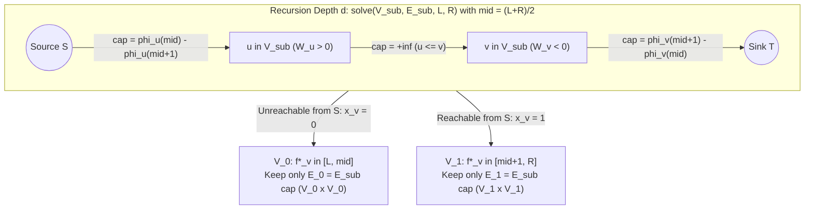

# Cohort 1 — Wave 5B: $L_p$ Isotonic Regression (`保序回归`), Cross-Domain Non-Graph Synthesis & Exhaustive Multilingual (`[ZH]` / `[JA]` / `[EN]`) Master Archive Audit

> **Iterations Covered**: Iteration 46 through Iteration 52 (Cohort 1, Wave 5B)
> **Scope & Mandate**: This monograph serves two critical roles in the Phase 1 research corpus (`flows_research/`):
> 1. **Advanced Non-Graph Synthesis (Iterations 46–49)**: It develops the complete mathematical theory and 4-step **"Zero Magic Gadgets"** compilation pipeline for **$L_p$ Isotonic Regression (`保序回归`) via Parallel Binary Search (`整体二分`) and Project Selection Min-Cut**, followed by three systematic Cross-Domain Non-Graph Bridges connecting Network Flows, Minimum Cuts, Matching, and LP Duality to **Combinatorial Games & Von Neumann Minimax Duality** (Iteration 47), **Computational Geometry & Continuous-to-Discrete Cut Discretization** (Iteration 48), and **Strings, Automata, Matroid / Linear Basis Exchange Posets & Number-Theoretic Graphs** (Iteration 49).
> 2. **Exhaustive Tri-Lingual Master Archive Audit (Iterations 50–52)**: It performs a comprehensive historical and structural audit across the Chinese (`[ZH]`: **网络流 24 题**, Chinese National Team papers `国家集训队论文` from Amber 2007 to Gao Ruiquan 2018 and Simulated MCMF 2017–2023, NOI/WC/CTS/Provincial Selection), Japanese (`[JA]`: `燃やす埋める` treatises by `noshi91`, `maspypy`, `tatyam`, `snuke`, `rng_58`, and the complete AtCoder `AGC`/`ARC`/`ABC` flow canon), and English (`[EN]`: Codeforces Div1, ICPC World Finals, TopCoder Open) archives.

---

## Executive Overview: Why Wave 5B Marks the Apex of Non-Graph-to-Flow Modelling

Across Waves 1A through 5A, we established how static combinatorial constraints compile into flow, matching, cut, or min-cost flow networks. Yet at the grandmaster frontier of competitive programming (NOI, Provincial Selection `省选`, AtCoder Grand/Regular Contests, Codeforces Div. 1F/G, and ICPC World Finals), flow problems rarely announce themselves as graph problems. Instead, they disguise themselves behind two layers of obfuscation:

1. **Continuous or Large-Range Convex Optimization Over Partial Orders (`保序回归`)**:
   In Wave 2B (`[HNOI2013] 切糕`, `CF 1427G`), we saw that when variables $f_v \in \{1, 2, \dots, K\}$ take values in a small discrete range $K \le 100$, we can explicitly unroll each variable into a chain of $K$ unary threshold vertices $z_{v,t} = [f_v \ge t]$. When the coordinate range jumps to $U \le 10^9$ or $f_v \in \mathbb{R}$, explicit unary chains explode to $10^9$ vertices per variable. **Iteration 46** shows how convexity of the penalty $\phi_v(f_v) = w_v |f_v - y_v|^p$ and submodularity of the partial-order cut function allow us to replace the explicit $U$-length chain with **Parallel Binary Search (`整体二分`)**, reducing the entire $U = 10^9$ problem to $\lceil \log_2 U \rceil$ layers of disjoint binary **Maximum Weight Closure (`最大权闭合子图`)** instances whose total vertex count per layer is exactly $|V|$.
2. **Cross-Domain Structural Equivalence (Games, Geometry, Automata, Linear Basis Exchange, Number Theory)**:
   Many of the deepest flow reductions arise when a problem in a seemingly unrelated domain—a two-player zero-sum matrix game, partitioning a rectilinear polygon with holes into the minimum number of rectangles, finding the longest antichain of substrings via an Aho–Corasick automaton, enforcing that a subset of vectors remains a minimum-weight Linear Basis (`线性基`) or Matroid Basis (`拟阵基`), or eliminating conflicting pairs on a divisibility/coprime lattice—possesses a hidden **bipartite, poset, or submodular duality** that compiles directly into a flow or cut network.

Every archetype and every curated problem in this monograph obeys the **4-Step "Zero Magic Gadgets" Compilation Standard**:
- **Step 1: Non-Graph Diagnostic Signal (Recognition)** — What exact structural and numerical clues in the English problem statement point to Flow / Cut / Matching / Duality, and why standard DP or greedy fails.
- **Step 2: Algebraic / Logical Intermediate Representation** — Translating the English rules into indicator variables, threshold derivatives, minimax LPs, intersection graphs, or basis-exchange posets *before* touching a graph.
- **Step 3: Reverse-Engineering Scratchpad (Mechanical Graph Compilation)** — Deriving the exact vertices, directed orientations, capacities, and recursion invariants from the algebraic equations.
- **Step 4: Hand-Checkable Toy Trace & Broken Gadget Counterexamples** — Concrete small-scale verification and explicit proofs of what breaks when subtle hypotheses (convexity, bipartiteness, transitive closure, reverse $\infty$-edges) are violated.

---

## Iteration 46: $L_p$ Isotonic Regression (`保序回归` — Parallel Binary Search + Project Selection Min-Cut)

### 46.1 Formal Problem Statement & The 4-Step Compilation Pipeline

#### Definition 46.1 (The General $L_p$ Isotonic Regression Problem)
Let $G = (V, E)$ be a directed graph with $|V| = n$ vertices and $|E| = m$ directed edges, encoding a preorder (or partial order after contracting strongly connected components) $(V, \preceq)$ where each directed edge $(u, v) \in E$ represents the ordering constraint $u \preceq v$. Each vertex $v \in V$ is given a target reference value $y_v \in \mathbb{R}$ and a positive weight $w_v > 0$. Given an exponent $1 \le p < \infty$, the **$L_p$ Isotonic Regression (`保序回归`)** problem asks for a real (or integer) vector $f = (f_v)_{v \in V}$ solving:
$$\min_{f \in \mathcal{D}^V} \sum_{v \in V} w_v |f_v - y_v|^p \quad \text{subject to} \quad f_u \le f_v \quad \forall (u, v) \in E,$$
where the domain $\mathcal{D}$ is either the continuous real line $\mathbb{R}$ or the discrete integer lattice $\mathbb{Z}$. More generally, each vertex $v \in V$ may have an arbitrary **convex** univariate penalty function $\phi_v : \mathcal{D} \to \mathbb{R}$, and we seek to minimize $\sum_{v \in V} \phi_v(f_v)$ subject to $f_u \le f_v$ for all $(u, v) \in E$.

---

#### Step 1: The Non-Graph Diagnostic Signal (Recognition)

How do you recognize a disguised Isotonic Regression problem in a contest when the statement never uses the phrase "isotonic regression"?

1. **Structural Clues in the Problem Statement**:
   - You are asked to modify an initial array/weight vector $y = (y_1, \dots, y_n)$ into a new vector $f = (f_1, \dots, f_n)$ at minimum total modification cost $\sum_{i=1}^n w_i |f_i - y_i|^p$ (most commonly $p = 1$ absolute deviation $\sum w_i |f_i - y_i|$ or $p = 2$ squared Euclidean error $\sum w_i (f_i - y_i)^2$).
   - The target condition on the modified weights $f$ is equivalent to a **collection of pairwise inequalities $f_u \le f_v$**:
     - *Direct partial order*: "Make $f$ non-decreasing along edges of a DAG."
     - *Optimality preservation of a given structure (`逆优化问题` — Inverse Optimization)*: You are given a specific combinatorial object $B^*$ (such as a specific Spanning Tree $T^*$, a specific Linear Basis $B^*$ as in `[省选联考 2020 A 卷] 保序回归`, or a specific Shortest Path tree) and asked to modify the element weights $y \to f$ minimally so that $B^*$ becomes a **Minimum (or Maximum) Weight Basis / Spanning Tree**. By the Matroid Basis Exchange Theorem, $B^*$ is optimal under weights $f$ if and only if for every basis element $u \in B^*$ and every non-basis element $v \notin B^*$ that can replace $u$, we have $f_u \le f_v$!
2. **Constraint Bounds & Failure of Competing Paradigms**:
   - Typically $N \le 500$–$1000$, $M \le 10^4$, and coordinate values $y_i \in [0, 10^9]$.
   - **Why Tree DP / Slope Trick Fails**: If the constraint graph $G = (V, E)$ were a simple 1D chain or a tree, we could solve the problem in $O(N)$ via the Pool Adjacent Violators Algorithm (`PAVA`) or in $O(N \log N)$ via Slope Trick / Leftist Heaps merging convex piecewise functions bottom-up. However, on a **general DAG** (such as a bipartite comparability graph between $B^*$ and $V \setminus B^*$, or a 2D grid DAG), a vertex $v$ has multiple predecessors and multiple successors whose constraints are entangled across cycles in the underlying undirected graph. Treewidth is $\Theta(N)$, so DP is exponential.
   - **Why Explicit Multi-State Chain Min-Cut (`[HNOI2013] 切糕`) Fails**: In Wave 2B, we saw that minimizing $\sum_{v} \phi_v(f_v)$ subject to $f_u \le f_v$ over $f_v \in \{L, L+1, \dots, R\}$ is an exact minimum cut on a layered chain network with $O(N \cdot (R - L))$ vertices. Here, $U = R - L \le 10^9$ (or $\mathcal{D} = \mathbb{R}$), so building $10^9$ vertices per variable is impossible by seven orders of magnitude.

---

#### Step 2: The Algebraic / Logical Intermediate Representation (The Threshold Derivative Split)

Instead of allowing $f_v$ to range over the entire interval $[L, R]$ at once, let us ask a much simpler binary question at a fixed threshold $mid$:

> **The Restricted Two-Point Problem $\mathcal{P}(V, E, \{a, b\})$**:
> Fix two values $a < b$ (specifically, $a = mid$ and $b = mid + 1$ for integer domain $\mathcal{D} = \mathbb{Z}$, or $a = mid$ and $b = mid + \epsilon$ with $\epsilon \to 0^+$ for continuous domain $\mathcal{D} = \mathbb{R}$). Suppose we restrict every variable to only two choices: $\tilde{f}_v \in \{a, b\}$. What is the optimal binary assignment $\tilde{f} \in \{a, b\}^V$ respecting $u \preceq v \implies \tilde{f}_u \le \tilde{f}_v$?

Let us introduce a binary indicator variable $x_v \in \{0, 1\}$ for each $v \in V$:
$$x_v = \begin{cases} 0 & \text{if } \tilde{f}_v = a, \\ 1 & \text{if } \tilde{f}_v = b. \end{cases}$$
Because $a < b$, the ordering constraint $\tilde{f}_u \le \tilde{f}_v$ for $(u, v) \in E$ translates into the exact binary implication:
$$x_u \le x_v \quad \Longleftrightarrow \quad (x_u = 1 \implies x_v = 1) \quad \Longleftrightarrow \quad x_u(1 - x_v) = 0.$$
In other words, the set of vertices assigned the higher value $b$, denoted $S_1 = \{v \in V : x_v = 1\}$, must be a **closure (upper ideal)** in the directed graph $G = (V, E)$: if $u \in S_1$ and $(u, v) \in E$, then $v \in S_1$.

Now let us write the objective function of the restricted problem $\mathcal{P}(V, E, \{a, b\})$ in terms of $x_v \in \{0, 1\}$. For each $v \in V$, since $x_v \in \{0, 1\}$, we have the exact linear interpolation:
$$\phi_v(\tilde{f}_v) = \phi_v(a) + x_v \big(\phi_v(b) - \phi_v(a)\big).$$
Summing over all $v \in V$:
$$\sum_{v \in V} \phi_v(\tilde{f}_v) = \underbrace{\sum_{v \in V} \phi_v(a)}_{\text{Constant } C(a)} + \sum_{v \in V} \Delta_v(a, b) \cdot x_v, \quad \text{where } \Delta_v(a, b) := \phi_v(b) - \phi_v(a).$$
For the continuous case $b = a + \epsilon$ as $\epsilon \to 0^+$, dividing the non-constant part by $\epsilon$ replaces the finite difference $\Delta_v(a, a+1) = \phi_v(a+1) - \phi_v(a)$ with the right-hand derivative (subgradient) $\phi'_{v,+}(a) = \lim_{\epsilon \to 0^+} \frac{\phi_v(a+\epsilon) - \phi_v(a)}{\epsilon}$:
- For $p > 1$, $\phi_v(x) = w_v |x - y_v|^p$ is differentiable everywhere with derivative $\phi'_v(a) = p \cdot w_v \cdot \operatorname{sgn}(a - y_v) |a - y_v|^{p-1}$.
- For $p = 1$, $\phi_v(x) = w_v |x - y_v|$ has right-hand derivative $\phi'_{v,+}(a) = -w_v$ if $a < y_v$, and $+w_v$ if $a \ge y_v$.

Minimizing $\sum_{v \in V} \Delta_v(a, b) x_v$ is equivalent to **maximizing**:
$$\max_{x \in \{0, 1\}^V} \sum_{v \in V} W_v(a, b) \cdot x_v \quad \text{subject to} \quad x_u \le x_v \;\;\forall (u, v) \in E,$$
where the net reward of promoting vertex $v$ from $a$ to $b$ is:
$$W_v(a, b) := -\Delta_v(a, b) = \phi_v(a) - \phi_v(b).$$
This intermediate model is **precisely Picard's Maximum Weight Closure (`最大权闭合子图` / Project Selection)** on $G = (V, E)$!

---

#### Step 3: Reverse-Engineering Scratchpad (Submodular Nesting Theorem & Parallel Binary Search Compilation)

At first glance, solving the binary problem $\mathcal{P}(V, E, \{mid, mid+1\})$ only tells us the best assignment when variables are artificially forced into $\{mid, mid+1\}$. Why on earth does this single binary cut tell us anything exact about the **unconstrained global optimum** $f^* \in [L, R]^V$?

This is the mathematical heart of Gao Ruiquan's 2018 National Team Paper (`高睿泉 2018《浅谈保序回归问题》`) and Hochbaum–Queyranne's parametric closure theory. Let us state and prove the theorem rigorously from first principles.

##### Theorem 46.2 (The Convex Nesting / Threshold Contraction Theorem for Isotonic Regression)
Let $\phi_v : \mathbb{Z} \to \mathbb{R}$ be convex functions for all $v \in V$, meaning their marginal differences $\Delta_v(k) := \phi_v(k+1) - \phi_v(k)$ are non-decreasing in $k$:
$$\Delta_v(k-1) \le \Delta_v(k) \quad \forall k \in \mathbb{Z}.$$
Fix an integer threshold $mid \in \mathbb{Z}$, and let $\tilde{f} \in \{mid, mid+1\}^V$ be an optimal solution to the restricted two-point problem $\mathcal{P}(V, E, \{mid, mid+1\})$, partitioning $V$ into:
$$S_0 = \{v \in V : \tilde{f}_v = mid\}, \qquad S_1 = \{v \in V : \tilde{f}_v = mid + 1\}.$$
Then there exists a globally optimal integer solution $f^* \in \mathbb{Z}^V$ to the full Isotonic Regression problem such that:
1. For every $v \in S_0$, $f^*_v \le mid$.
2. For every $v \in S_1$, $f^*_v \ge mid + 1$.
(Moreover, if the $s$-$t$ min-cut chosen for $\mathcal{P}(V, E, \{mid, mid+1\})$ is the minimal/maximal closure, or if $\phi_v$ are strictly convex, *every* global optimum $f^*$ obeys this partition.)

##### Proof (Via Lattice Submodularity and Convex Marginal Dominance)
Let $f \in \mathbb{Z}^V$ be any globally optimal solution to the unconstrained integer problem, and let $\tilde{f} \in \{mid, mid+1\}^V$ be the optimal solution to the two-point problem $\mathcal{P}(V, E, \{mid, mid+1\})$.

We will show that if we define the **clamped global vector** $g \in \mathbb{Z}^V$ and **clamped binary vector** $h \in \{mid, mid+1\}^V$ by:
$$g_v := \begin{cases} \min(f_v, mid) & \text{if } v \in S_0, \\ \max(f_v, mid+1) & \text{if } v \in S_1, \end{cases} \qquad h_v := \begin{cases} \big[f_v \ge mid+1\big] + mid & \text{if } v \in S_0, \\ \big[f_v \ge mid+1\big] + mid & \text{if } v \in S_1, \end{cases}$$
 wait—let us make the perturbation completely elementary and transparent so every inequality is crystal clear!

**Part 1: Proving we can enforce $f_v \le mid$ for all $v \in S_0$.**
Suppose the global optimum $f$ violates $f_v \le mid$ on $S_0$; that is, the violation set
$$A := \{v \in S_0 : f_v \ge mid + 1\}$$
is non-empty. Consider what happens if we **promote** $A$ in the binary solution $\tilde{f}$ (moving $A$ from $mid$ to $mid+1$) versus **demoting** $A$ in the global solution $f$ (clamping $f_v$ down to $mid$ for $v \in A$):

1. *Feasibility of promoting $A$ in $\tilde{f}$*:
   Define $\tilde{f}' \in \{mid, mid+1\}^V$ by setting $\tilde{f}'_v = mid + 1$ for $v \in S_1 \cup A$ and $\tilde{f}'_v = mid$ for $v \in S_0 \setminus A$. Is $S_1 \cup A$ a valid closure in $G = (V, E)$?
   Take any edge $(u, v) \in E$ with $u \in S_1 \cup A$.
   - If $u \in S_1$, then since $S_1$ is already a valid closure, $v \in S_1 \subseteq S_1 \cup A$.
   - If $u \in A$, then by definition of $A$, $f_u \ge mid + 1$. Since $f$ is a feasible global solution, $(u, v) \in E \implies f_v \ge f_u \ge mid + 1$. Now either $v \in S_1$, or $v \in S_0$ (in which case $f_v \ge mid + 1 \implies v \in A$). In both cases, $v \in S_1 \cup A$!
   Thus $\tilde{f}'$ is a valid feasible solution to $\mathcal{P}(V, E, \{mid, mid+1\})$. By optimality of $\tilde{f}$ for $\mathcal{P}(V, E, \{mid, mid+1\})$, promoting $A$ cannot strictly decrease the binary objective:
   $$\sum_{v \in A} \big(\phi_v(mid + 1) - \phi_v(mid)\big) = \sum_{v \in A} \Delta_v(mid) \ge 0. \tag{46.1}$$

2. *Feasibility of demoting $A$ in $f$*:
   Define a modified global solution $f' \in \mathbb{Z}^V$ by setting:
   $$f'_v = \begin{cases} mid & \text{if } v \in A, \\ f_v & \text{if } v \notin A. \end{cases}$$
   Let us check every edge $(u, v) \in E$ to verify $f'_u \le f'_v$:
   - If $u, v \notin A$ or $u, v \in A$, then $f'_u \le f'_v$ trivially holds.
   - If $u \in A$ and $v \notin A$: could $f'_u > f'_v$? Here $f'_u = mid$. Since $u \in A$, we had $f_v \ge f_u \ge mid + 1 > mid = f'_u$. Since $v \notin A$, $f'_v = f_v \ge mid + 1 > mid = f'_u$. So $f'_u < f'_v$ holds!
   - If $u \notin A$ and $v \in A$: since $v \in A \subseteq S_0$ and $S_1$ is a closure, $u$ cannot be in $S_1$ (otherwise $(u, v) \in E$ would force $v \in S_1$). Thus $u \in S_0 \setminus A$. By definition of $A$, $u \in S_0 \setminus A$ means $f_u \le mid$. Therefore $f'_u = f_u \le mid = f'_v$!
   Wait—what if we only lower $f_v$ by $1$ on the maximum level set of $A$, or lower $f_v$ all the way to $mid$? Let us check how the objective changes when we replace $f_v$ with $mid$ on $A$, or even simpler: decompose $A$ into level sets $A_k = \{v \in A : f_v \ge k\}$ for each integer $k \ge mid + 1$!
   Notice that for every integer $k \ge mid + 1$, the exact same argument shows that $A_k = \{v \in S_0 : f_v \ge k\}$ has the property that $S_1 \cup A_k$ is a valid closure in $G = (V, E)$, because $u \in A_k \implies f_v \ge f_u \ge k \ge mid + 1 \implies v \in S_1 \cup A_k$!
   Therefore, by optimality of $S_1$ for $\mathcal{P}(V, E, \{mid, mid+1\})$, for **every** $k \ge mid + 1$:
   $$\sum_{v \in A_k} \Delta_v(mid) \ge 0. \tag{46.2}$$
   Now write the total objective reduction when we clamp $f_v \gets mid$ for all $v \in A$:
   $$\sum_{v \in A} \big(\phi_v(f_v) - \phi_v(mid)\big) = \sum_{v \in A} \sum_{k = mid+1}^{f_v} \Delta_v(k - 1) = \sum_{k = mid+1}^{\infty} \sum_{v \in A_k} \Delta_v(k - 1).$$
   By **convexity** of $\phi_v$, for every $k \ge mid + 1$, since $k - 1 \ge mid$, we have $\Delta_v(k - 1) \ge \Delta_v(mid)$! Combining this with inequality (46.2) gives:
   $$\sum_{v \in A} \big(\phi_v(f_v) - \phi_v(mid)\big) \ge \sum_{k = mid+1}^{\infty} \underbrace{\sum_{v \in A_k} \Delta_v(mid)}_{\ge 0} \ge 0!$$
   Hence $\sum_{v \in V} \phi_v(f'_v) \le \sum_{v \in V} \phi_v(f_v)$! Because $f$ was globally optimal, $f'$ is ALSO globally optimal, and $f'_v \le mid$ for all $v \in S_0$!

**Part 2: Proving we can enforce $f_v \ge mid + 1$ for all $v \in S_1$.**
By complete symmetry, let $B_k = \{v \in S_1 : f'_v \le k\}$ for $k \le mid$. For any edge $(u, v) \in E$ with $v \in B_k$ and $u \in S_1$, we have $f'_u \le f'_v \le k$, so $u \in B_k$. Thus $S_1 \setminus B_k$ is a valid closure in $G = (V, E)$! By optimality of $S_1$ for $\mathcal{P}(V, E, \{mid, mid+1\})$, demoting $B_k$ from $mid+1$ to $mid$ cannot improve the binary objective:
$$\sum_{v \in B_k} \Delta_v(mid) \le 0.$$
By convexity of $\phi_v$, for all $k \le mid$, $\Delta_v(k) \le \Delta_v(mid)$. Therefore, clamping $f'_v \gets mid + 1$ for all $v \in S_1$ with $f'_v \le mid$ changes the objective by:
$$\sum_{k \le mid} \sum_{v \in B_k} \Delta_v(k) \le \sum_{k \le mid} \sum_{v \in B_k} \Delta_v(mid) \le 0.$$
Thus the doubly clamped solution $f^*$ satisfies $\sum_{v} \phi_v(f^*_v) \le \sum_{v} \phi_v(f_v)$, is globally optimal, and obeys $f^*_v \le mid$ on $S_0$ and $f^*_v \ge mid + 1$ on $S_1$. $\blacksquare$

---

##### Mechanical Graph Compilation & The Parallel Binary Search (`整体二分`) Engine

Theorem 46.2 gives us an extraordinary divide-and-conquer algorithm (`solve(V_sub, E_sub, L, R)`):

1. **Base Case ($L = R$)**:
   If $L = R$, then every vertex $v \in V_{\text{sub}}$ has its optimal value uniquely determined as $f^*_v = L$. Set `ans[v] = L` for all $v \in V_{\text{sub}}$ and return.
2. **Midpoint Split ($L < R$)**:
   Let $mid = \lfloor (L + R) / 2 \rfloor$. We construct the Maximum Weight Closure flow network for the active subgraph $(V_{\text{sub}}, E_{\text{sub}})$ to solve $\mathcal{P}(V_{\text{sub}}, E_{\text{sub}}, \{mid, mid+1\})$:
   - Create a local source $S$ and local sink $T$, plus one vertex for each $v \in V_{\text{sub}}$.
   - Compute the promotion reward $W_v = \phi_v(mid) - \phi_v(mid + 1) = -\Delta_v(mid)$ for each $v \in V_{\text{sub}}$:
     - If $W_v > 0$ (i.e., $\Delta_v(mid) < 0$, so $v$ prefers $mid + 1$ over $mid$): add a directed edge $S \to v$ with capacity $W_v$.
     - If $W_v < 0$ (i.e., $\Delta_v(mid) > 0$, so $v$ prefers $mid$ over $mid + 1$): add a directed edge $v \to T$ with capacity $-W_v = \Delta_v(mid)$.
   - For each active constraint edge $(u, v) \in E_{\text{sub}}$ (representing $x_u \le x_v$, i.e. $u \in S_1 \implies v \in S_1$): add a directed edge $u \to v$ with capacity $+\infty$.
3. **Cut Extraction & Edge Pruning Invariant**:
   Run Dinic's algorithm to find the minimum $S$-$T$ cut. Let $V_1 \subseteq V_{\text{sub}}$ be the set of vertices reachable from $S$ in the final residual graph ($x_v = 1 \implies f^*_v \in [mid+1, R]$), and $V_0 = V_{\text{sub}} \setminus V_1$ be the unreachable vertices ($x_v = 0 \implies f^*_v \in [L, mid]$).
   Now inspect every edge $(u, v) \in E_{\text{sub}}$:
   - **$u \in V_1, v \in V_0$**: Impossible, because $(u, v)$ had capacity $+\infty$ and the cut has finite capacity.
   - **$u \in V_0, v \in V_1$**: In all future recursive calls, $u$ will be assigned a value in $[L, mid]$ and $v$ will be assigned a value in $[mid+1, R]$. Since $\max([L, mid]) = mid < mid + 1 = \min([mid+1, R])$, the inequality $f_u \le f_v$ is **permanently and unconditionally satisfied** for any choices inside those intervals! Therefore, **we permanently discard all cross-edges between $V_0$ and $V_1$**!
   - **$u, v \in V_0$**: Add $(u, v)$ to $E_0$.
   - **$u, v \in V_1$**: Add $(u, v)$ to $E_1$.
4. **Recursive Calls**:
   Recurse on `solve(V_0, E_0, L, mid)` and `solve(V_1, E_1, mid + 1, R)`.

##### Complexity Bound of Parallel Binary Search + Dinic
At any single recursion depth $d \in \{0, 1, \dots, \lceil \log_2 U \rceil\}$, the vertex sets $V_{\text{sub}}$ across all calls at depth $d$ form a **disjoint partition** of $V$, and the edge sets $E_{\text{sub}}$ are **disjoint subsets** of $E$:
$$\sum_{\text{calls at depth } d} |V_{\text{sub}}| = |V| = n, \qquad \sum_{\text{calls at depth } d} |E_{\text{sub}}| \le |E| = m.$$
Since Dinic's algorithm is super-additive in complexity ($T_{\text{Dinic}}(n_1, m_1) + T_{\text{Dinic}}(n_2, m_2) \le T_{\text{Dinic}}(n_1 + n_2, m_1 + m_2)$), the total time spent across all $\lceil \log_2 U \rceil$ recursion levels is bounded by:
$$T_{\text{total}} = O\big(\log U \cdot T_{\text{Dinic}}(n, m)\big).$$

---

#### Step 4: Hand-Checkable Toy Trace & Broken Gadget Counterexamples

##### Toy Trace ($N = 4$ Diamond DAG, $L_1$ vs. $L_2$ Isotonic Regression)
Consider a 4-vertex DAG $V = \{1, 2, 3, 4\}$ with unweighted penalties ($w_v = 1$) and initial values:
$$y = (y_1, y_2, y_3, y_4) = (10, 4, 6, 2),$$
subject to the diamond partial order edges:
$$1 \preceq 2, \quad 1 \preceq 3, \quad 2 \preceq 4, \quad 3 \preceq 4 \qquad (\text{so } f_1 \le f_2 \le f_4 \text{ and } f_1 \le f_3 \le f_4).$$
Let us trace Integer $L_2$ Isotonic Regression ($\phi_v(x) = (x - y_v)^2$) on $[L, R] = [2, 10]$:
- **Root Call `solve({1,2,3,4}, [2, 10])`**, $mid = 6$:
  We test $\{6, 7\}$. The marginal cost is $\Delta_v(6) = (7 - y_v)^2 - (6 - y_v)^2 = 13 - 2y_v$, so the promotion reward is $W_v(6) = -\Delta_v(6) = 2y_v - 13$:
  - $v = 1$ ($y_1 = 10$): $W_1 = 2(10) - 13 = +7 > 0 \implies$ Edge $S \to 1$ with capacity $7$.
  - $v = 2$ ($y_2 = 4$): $W_2 = 2(4) - 13 = -5 < 0 \implies$ Edge $2 \to T$ with capacity $5$.
  - $v = 3$ ($y_3 = 6$): $W_3 = 2(6) - 13 = -1 < 0 \implies$ Edge $3 \to T$ with capacity $1$.
  - $v = 4$ ($y_4 = 2$): $W_4 = 2(2) - 13 = -9 < 0 \implies$ Edge $4 \to T$ with capacity $9$.
  Infinite-capacity edges: $1 \to 2$, $1 \to 3$, $2 \to 4$, $3 \to 4$.
  - *Max-Flow / Min-Cut*: Any closure containing $1$ must also contain $2, 3, 4$, whose total net reward is $+7 - 5 - 1 - 9 = -8 < 0$. The maximum flow from $S$ to $T$ is $7$ (saturating $S \to 1$: e.g., $5$ units along $S \to 1 \to 2 \to T$, $1$ unit along $S \to 1 \to 3 \to T$, and $1$ unit along $S \to 1 \to 2 \to 4 \to T$).
  - *Residual Reachability from $S$*: Edge $S \to 1$ is saturated ($7/7$), so $V_1 = \emptyset$ and $V_0 = \{1, 2, 3, 4\}$! All four vertices recurse Left to $[2, 6]$!
- **Level 1 Call `solve({1,2,3,4}, [2, 6])`**, $mid = 4$:
  We test $\{4, 5\}$. Promotion reward $W_v(4) = (4 - y_v)^2 - (5 - y_v)^2 = 2y_v - 9$:
  - $v = 1$ ($y_1 = 10$): $W_1 = +11$ ($S \to 1$, cap $11$).
  - $v = 2$ ($y_2 = 4$): $W_2 = -1$ ($2 \to T$, cap $1$).
  - $v = 3$ ($y_3 = 6$): $W_3 = +3$ ($S \to 3$, cap $3$).
  - $v = 4$ ($y_4 = 2$): $W_4 = -5$ ($4 \to T$, cap $5$).
  - *Max-Flow / Min-Cut*: Total capacity into $T$ is only $1 + 5 = 6$, whereas total capacity out of $S$ is $11 + 3 = 14$ (all able to reach $T$ via $1 \to 2 \to 4 \to T$ and $3 \to 4 \to T$). Thus edges $2 \to T$ (cap $1$) and $4 \to T$ (cap $5$) are completely saturated; max flow is $6$, and every vertex $\{1, 2, 3, 4\}$ is reachable from $S$!
  - *Partition*: $V_0 = \emptyset$, $V_1 = \{1, 2, 3, 4\}$ recurse Right to $[5, 6]$.
- **Level 2 Call `solve({1,2,3,4}, [5, 6])`**, $mid = 5$:
  We test $\{5, 6\}$. Promotion reward $W_v(5) = 2y_v - 11$:
  - $W_1 = +9$, $W_2 = -3$, $W_3 = +1$, $W_4 = -7$.
  - Notice that if we select closure $\{1, 2, 3, 4\}$, its net weight is $9 - 3 + 1 - 7 = 0$! And if we select $\emptyset$, its weight is $0$.
  - What about $\{3, 4\}$? Net weight is $1 - 7 = -6 < 0$.
  - Thus both $f^* = (5, 5, 5, 5)$ (cost $(5-10)^2 + (5-4)^2 + (5-6)^2 + (5-2)^2 = 25 + 1 + 1 + 9 = 36$) and $f^* = (6, 6, 6, 6)$ (cost $16 + 4 + 0 + 16 = 36$) achieve the exact global minimum $36$! (And for continuous $L_2$, the average of $\{10, 4, 6, 2\}$ is $22/4 = 5.5$, achieved when the binary search reaches $5.5$.)

##### Broken Gadget Counterexamples & Failure Modes

> [!WARNING]
> **Failure Mode 1: Non-Convex Penalty Functions Break the Threshold Split**
> Suppose vertex $1$ has a non-convex bimodal penalty $\phi_1(x) = \min((x - 2)^2, (x - 10)^2)$ on $[0, 10]$. At $mid = 4$, comparing $x = 4$ ($\phi_1(4) = 4$) and $x = 5$ ($\phi_1(5) = 9$) gives $\Delta_1(4) = +5 > 0$, making it look as if increasing $x_1$ hurts and forcing $x_1 \in [0, 4]$. Yet at $x_1 = 10$, $\phi_1(10) = 0$! Without convexity ($\Delta_v(k)$ non-decreasing), the local sign of $\Delta_v(mid)$ does not bound the direction of the global optimum, and Theorem 46.2 fails catastrophically.

> [!WARNING]
> **Failure Mode 2: Forgetting to Prune Inactive Vertices and Cross-Edges Inside `solve(V_sub, L, R)`**
> A common implementation bug is keeping the full $N$-vertex graph in every recursive call and merely clamping vertices outside $V_{\text{sub}}$ with $+\infty$ edges to $S$ or $T$. That forces Dinic to run on $\Theta(N)$ vertices in *every* node of the recursion tree. Because the recursion tree has $O(N)$ leaves across depth $\log U$, running an $O(N)$-size flow at every node degrades the complexity from $O(\log U \cdot T_{\text{Dinic}}(N, M))$ to $O(N \cdot T_{\text{Dinic}}(N, M))$, causing immediate TLE for $N = 1000$. **Contract**: Each call `solve(V_sub, E_sub, L, R)` must re-index `V_sub` to $0 \dots |V_{\text{sub}}|-1$ and pass *only* internal edges $E_0 = E_{\text{sub}} \cap (V_0 \times V_0)$ and $E_1 = E_{\text{sub}} \cap (V_1 \times V_1)$.

---

### 46.2 Structural Specializations: $L_1$ Coordinate Compression, Continuous $L_p$, and $L_\infty$

Before moving to the `[省选联考 2020 A 卷]` application, let us record three essential structural properties of $L_p$ Isotonic Regression across different values of $p$:

| Norm $p$ | Penalty $\phi_v(f_v)$ | Optimal Value Set $\mathcal{D}^*$ | Promotion Reward $W_v(mid)$ | Total Complexity |
| :--- | :--- | :--- | :--- | :--- |
| **$p = 1$ ($L_1$)** | $w_v \lvert f_v - y_v \rvert$ | Discrete set of input values $\{y_1, \dots, y_n\}$! | $+w_v$ if $y_v \ge val_{mid+1}$, else $-w_v$ | $O(\log N \cdot T_{\text{Dinic}}(N, M))$ |
| **$1 < p < \infty$ (Integer)** | $w_v \lvert f_v - y_v \rvert^p$ | $\mathbb{Z} \cap [\min y_v, \max y_v]$ | $w_v\big(\lvert mid - y_v\rvert^p - \lvert mid + 1 - y_v\rvert^p\big)$ | $O(\log U \cdot T_{\text{Dinic}}(N, M))$ |
| **$1 < p < \infty$ (Real)** | $w_v \lvert f_v - y_v \rvert^p$ | $[\min y_v, \max y_v] \subset \mathbb{R}$ | $-\phi'_v(mid) = p w_v \operatorname{sgn}(y_v - mid)\lvert y_v - mid\rvert^{p-1}$ | $O(\log(U/\epsilon) \cdot T_{\text{Dinic}}(N, M))$ |
| **$p = \infty$ ($L_\infty$)** | $\max_v w_v \lvert f_v - y_v \rvert$ | Continuous / Integer via Difference Constraints | Binary search $\lambda$: $f_v \in [y_v - \lambda/w_v, y_v + \lambda/w_v]$ | $O((N + M) \log U)$ (No Max-Flow needed!) |

#### Why $L_1$ Isotonic Regression Only Needs $O(\log N)$ Levels (Coordinate Compression Theorem)
In $L_1$ Isotonic Regression, $\phi_v(x) = w_v |x - y_v|$ has derivative $-w_v$ for $x < y_v$ and $+w_v$ for $x > y_v$. Sort the unique input values as $z_1 < z_2 < \dots < z_k$ ($k \le n$). For any threshold $mid$ strictly inside an open interval $(z_j, z_{j+1})$, the derivative $\phi'_v(mid)$ is **constant** across the entire interval $(z_j, z_{j+1})$ for every vertex $v \in V$! Consequently, the Maximum Weight Closure network and its minimum cut $(V_0, V_1)$ are **identical for all $mid \in (z_j, z_{j+1})$**. Thus no optimal value needs to land strictly between $z_j$ and $z_{j+1}$; we simply binary search on the array index $j \in \{1, \dots, k\}$ testing the pair $\{z_{mid}, z_{mid+1}\}$, reducing $\log U$ to $\log N \le 10$ layers!

#### How Continuous $L_2$ Avoids Floating-Point Precision Drift (Exact Block Averaging or Scaling)
For continuous $L_2$ ($\phi_v(x) = w_v (x - y_v)^2$), the derivative is $\phi'_v(x) = 2w_v(x - y_v)$, which is **linear** in $x$. Notice that for any strongly connected component or block $C \subseteq V$ that gets merged to a single common value $f_C$, setting $\sum_{v \in C} 2w_v(f_C - y_v) = 0$ yields the exact rational optimum:
$$f^*_C = \frac{\sum_{v \in C} w_v y_v}{\sum_{v \in C} w_v}.$$
Even simpler: if the problem asks for an integer answer (`[省选联考 2020 A 卷] 保序回归`), we run the integer algorithm directly on $\{mid, mid+1\}$ using exact 64-bit / 128-bit integer weights $W_v(mid) = w_v \big((mid - y_v)^2 - (mid + 1 - y_v)^2\big) = w_v (2y_v - 2mid - 1)$, requiring zero floating-point arithmetic!

---

### 46.3 Flagship Synthesis: `[省选联考 2020 A 卷] 保序回归` (Linear Basis Exchange $\to$ Poset $\to$ $L_2$ Isotonic Regression)

Let us apply the 4-step compilation pipeline to the landmark contest problem that introduced Isotonic Regression to the broader competitive programming community (`Luogu P6621 / LOJ 3303`).

- **Problem Statement**: You are given $N \le 1000$ bitvectors $c_1, c_2, \dots, c_N \in \mathbb{F}_2^m$ ($m \le 64$), initial integer values $y_1, \dots, y_N \in [0, 10^6]$, and positive integer weights $w_1, \dots, w_N$. You are also given two subsets of indices $A, B \subseteq \{1, \dots, N\}$ of size $m$, both of which are **Linear Bases (`线性基`)** of $\mathbb{F}_2^m$. You must assign an integer value $f_i \in \mathbb{Z}$ to each vector $c_i$ such that:
  1. $A$ is a **Minimum-Weight Linear Basis** under weights $f$ (no basis has strictly smaller total $f$-weight than $A$).
  2. $B$ is a **Maximum-Weight Linear Basis** under weights $f$ (no basis has strictly larger total $f$-weight than $B$).
  Minimize the weighted $L_2$ modification cost $\sum_{i=1}^N w_i (f_i - y_i)^2$.

#### 4-Step Compilation

1. **Step 1 (Diagnostic Signal)**:
   We are minimizing a sum of convex functions $\sum_{i=1}^N w_i (f_i - y_i)^2$ ($N \le 1000, y_i \le 10^6$) subject to the condition that $A$ is a minimum-weight basis and $B$ is a maximum-weight basis of the linear matroid over $\mathbb{F}_2^m$.
2. **Step 2 (Algebraic / Matroid Representation)**:
   By the **Matroid Greedy Optimality Theorem (Basis Exchange Characterization)**, a basis $A$ of a matroid $\mathcal{M}$ is a minimum-weight basis under weight function $f$ if and only if no single-element exchange can strictly decrease its weight!
   Specifically, for each non-basis element $j \notin A$, since $A$ spans $\mathbb{F}_2^m$, the vector $c_j$ can be uniquely written as a linear combination of elements in $A$ over $\mathbb{F}_2$:
   $$c_j = \bigoplus_{i \in S_A(j)} c_i, \quad \text{where } S_A(j) \subseteq A.$$
   By elementary linear algebra, for any $i \in A$, the swapped set $(A \setminus \{i\}) \cup \{j\}$ is also a basis of $\mathbb{F}_2^m$ **if and only if** $i \in S_A(j)$!
   - For $A$ to be a **Minimum-Weight Basis**, swapping $i \in A$ out and $j \notin A$ in must not decrease the weight:
     $$f_i \le f_j \quad \forall j \notin A, \;\forall i \in S_A(j) \implies \text{add directed edge } (i \to j).$$
   - Symmetrically, for $B$ to be a **Maximum-Weight Basis**, express every $j \notin B$ in the basis $B$ as $c_j = \bigoplus_{i \in S_B(j)} c_i$. Swapping $i \in B$ out and $j \notin B$ in must not *increase* the weight:
     $$f_j \le f_i \quad \forall j \notin B, \;\forall i \in S_B(j) \implies \text{add directed edge } (j \to i).$$
3. **Step 3 (Mechanical Graph Compilation)**:
   - Use Gaussian elimination in $O(N m^2 / 64)$ to compute the basis coordinates $S_A(j)$ and $S_B(j)$ for all $j \in \{1, \dots, N\}$.
   - Build the constraint graph $G = (V, E)$ with $|V| = N \le 1000$ vertices and $|E| \le 2 N m \le 1.28 \times 10^5$ directed edges.
   - Run the Parallel Binary Search + Dinic algorithm of Section 46.1 on $G = (V, E)$ with range $[L, R] = [\min y_i, \max y_i] \subseteq [0, 10^6]$ and promotion reward $W_i(mid) = w_i \big((mid - y_i)^2 - (mid + 1 - y_i)^2\big)$.
4. **Step 4 (Complexity & Verification)**:
   $\lceil \log_2(10^6) \rceil = 20$ levels of recursion, each running Dinic on partitioned subgraphs totaling $N = 1000$ vertices and $\le 1.28 \times 10^5$ unit-like bipartite/2-hop DAG edges, finishing in $< 0.15$ seconds!

---

## Iteration 47: Cross-Domain Bridge I — Combinatorial Games, Von Neumann Minimax & Zero-Sum Matrix Games via LP / Flow Duality

Game theory and network flows share a profound common ancestor: both were born from **Linear Programming Duality** (von Neumann 1928, Gale–Kuhn–Tucker 1951, Ford–Fulkerson 1956). In competitive programming, game problems that reduce to flows or matchings fall into three distinct structural families:
1. **Simultaneous Zero-Sum Matrix / Resource Allocation Games** ($\max_x \min_y x^T A y \leftrightarrow$ LP Duality $\leftrightarrow$ Max-Flow / Min-Cut).
2. **Sequential Alternating Walk Games on Graphs** (Dulmage–Mendelsohn `DM` Decomposition & Essential Matched Vertices).
3. **Pursuer–Evader / Barrier Interdiction Games** (Grid / DAG Vertex & Hub Cuts).

---

### 47.1 Zero-Sum Matrix Games, Von Neumann Minimax & Network Interdiction Duality

#### Step 1: Non-Graph Diagnostic Signal (Recognition)
You are given a two-player zero-sum game where Player 1 (the Maximizer / Attacker / Evader) chooses a randomized strategy (or fractional resource distribution) $x$ subject to capacity/flow conservation constraints, and Player 2 (the Minimizer / Defender / Interdictor) simultaneously chooses a strategy $y$ (or observes the distribution and responds optimally), with payoff $x^T A y$. Whenever the constraints on $x$ and $y$ are defined by **totally unimodular (TU) network incidence matrices** (flow conservation, degree bounds, interval coverage), the saddle-point value $\max_x \min_y x^T A y$ is a pure Max-Flow / Min-Cut or MCMF problem!

#### Step 2: Algebraic / Logical Intermediate Representation (Minimax LP Compilation)
Let Player 1 choose a probability vector (or flow vector) $x \in \mathbb{R}_{\ge 0}^m$ satisfying $E x = d, \; 0 \le x \le c$, and Player 2 choose $y \in \Delta_n = \{y \in \mathbb{R}_{\ge 0}^n : \mathbf{1}^T y = 1\}$. Player 1 wants to maximize the worst-case payoff:
$$v^* = \max_{x} \min_{y \in \Delta_n} x^T A y = \max_{x} \min_{j \in \{1, \dots, n\}} (A^T x)_j.$$
Introducing a scalar variable $z \in \mathbb{R}$ for the guaranteed minimum payoff turns the bilevel $\max_x \min_y$ game into a single Linear Program:
$$\max_{x, z} \; z \quad \text{subject to} \quad (A^T x)_j \ge z \;\;\forall j \in \{1, \dots, n\}, \quad E x = d, \quad 0 \le x \le c.$$

#### Step 3: Reverse-Engineering Scratchpad (Classic Equivalence: Hide-and-Seek / Evader-vs-Searcher Game)
Consider von Neumann's classic **Hide-and-Seek Game on a Bipartite Grid** (and its generalizations to DAGs / flow networks):
- **Game Rules**: An Evader hides in one cell $(i, j)$ of a subset of valid cells $E \subseteq R \times C$ of an $n \times n$ grid (or more generally, sends 1 unit of probability mass across valid cells, or routes a path from $S$ to $T$). A Searcher chooses either a single row $i \in R$ or a single column $j \in C$ to inspect. If the Evader is in the inspected row or column, the Searcher catches the Evader (payoff $1$ to Searcher); otherwise the Evader escapes (payoff $0$). What is the equilibrium capture probability $p^*$?
- **Algebraic Formulation**:
  Let the Evader assign probability $x_e \ge 0$ to each valid cell $e = (i, j) \in E$ with $\sum_{e \in E} x_e = 1$. The Searcher wants to minimize the maximum probability mass sitting on any single row $i$ or column $j$, wait—the Searcher wants to **maximize** capture probability, so the Evader chooses $x$ to **minimize** the maximum row/column load $\lambda$:
  $$\min_{x \ge 0, \lambda} \lambda \quad \text{subject to} \quad \sum_{e \in E} x_e = 1, \quad \sum_{j : (i,j) \in E} x_{i,j} \le \lambda \;\;\forall i \in R, \quad \sum_{i : (i,j) \in E} x_{i,j} \le \lambda \;\;\forall j \in C.$$
- **Compilation to Max-Flow / Bipartite Matching**:
  Divide all variables by $\lambda > 0$, setting $f_{i,j} := x_{i,j} / \lambda$. Then $\sum_{e \in E} f_e = 1 / \lambda$, so minimizing $\lambda$ is **identical to maximizing the total flow $F = 1 / \lambda$**:
  $$\max_{f \ge 0} \sum_{(i,j) \in E} f_{i,j} \quad \text{subject to} \quad \sum_{j} f_{i,j} \le 1 \;\;\forall i \in R, \quad \sum_{i} f_{i,j} \le 1 \;\;\forall j \in C!$$
  By integrality of bipartite matching (König's Theorem), the maximum flow $F^*$ is the size of the **Maximum Bipartite Matching** $\nu(G)$!
  And what is the Searcher's dual strategy? The LP dual of Maximum Bipartite Matching is **Minimum Vertex Cover** $\tau(G) = \nu(G)$: the Searcher uniformly randomizes over the $\tau(G)$ lines (rows and columns) in a minimum vertex cover, catching the Evader with probability $p^* = \frac{1}{\nu(G)}$ regardless of which cell $(i, j) \in E$ the Evader picks (since every edge $(i, j) \in E$ is covered by at least one line in the MVC)!

---

### 47.2 Sequential Alternating Walk Games on Bipartite Graphs (`[JSOI2009] 游戏` & `DM` Decomposition)

Unlike simultaneous zero-sum matrix games, impartial sequential games on graphs ask which player has a deterministic winning strategy under normal play (last player to move wins).

#### Step 1: Non-Graph / Game Diagnostic Signal
- **Game Mechanics**: A token is placed on a starting vertex $v_0$ of a graph $G = (V, E)$ (or a grid with obstacles where adjacent moves flip parity $i+j \bmod 2$). Two players (Alice and Bob) alternate moving the token along an edge to an adjacent **unvisited** vertex. The first player unable to move loses.
- **Why Sprague–Grundy (`SG` Theorem) Fails**: Because visited vertices are permanently deleted, the state is not just the current vertex $v$; it is the pair $(v, S_{\text{visited}})$, which has $n \cdot 2^n$ states! Standard DAG `SG` values only work if the graph is already a DAG; here the graph is undirected and has cycles.
- **The Bipartite Signal**: If $G$ is bipartite (e.g., grid steps $(r, c) \to (r \pm 1, c), (r, c \pm 1)$), then every alternating walk alternates between $L$ and $R$, which looks suspiciously like an **augmenting path in a bipartite matching**!

#### Step 2 & Step 3: Algebraic Characterization & `DM` Decomposition Proof

##### Theorem 47.1 (Characterization of Winning Starts in Bipartite Vertex-Deletion Walk Games)
Let $G = (L \cup R, E)$ be a bipartite graph. A starting vertex $v_0 \in V$ is a **First-Player Winning (`N`-position)** starting square if and only if **$v_0$ belongs to EVERY maximum matching of $G$** (equivalently, $v_0$ is an **essential vertex** in the Dulmage–Mendelsohn decomposition). Otherwise, if there exists at least one maximum matching $M$ that leaves $v_0$ unmatched, $v_0$ is a **Second-Player Winning (`P`-position)** starting square.

##### Proof (Constructive Matching Strategy vs. Alternating Reachability)
1. **Case A: There exists a maximum matching $M$ leaving $v_0$ unmatched $\implies$ Player 2 (Bob) Wins**:
   Suppose Alice starts at $v_0 \notin V(M)$ and moves to some neighbor $u_1$.
   - Could $u_1$ be unmatched in $M$? If $u_1$ were unmatched in $M$, then the single edge $(v_0, u_1)$ could be added to $M$ to form a matching of size $|M| + 1$, contradicting that $M$ is a maximum matching!
   - Thus $u_1$ MUST be matched in $M$ to some vertex $v_1 = M(u_1)$. Bob simply moves the token along the matched edge $(u_1, v_1)$ to $v_1$!
   - Now suppose at step $k$, Alice is at $v_{k-1}$ (where $v_0, u_1, v_1, \dots, u_{k-1}, v_{k-1}$ is an $M$-alternating path starting at unmatched $v_0$) and moves to an unvisited neighbor $u_k$. Could $u_k$ be unmatched in $M$? If $u_k$ were unmatched in $M$, then the path $P = (v_0, u_1, v_1, \dots, v_{k-1}, u_k)$ would be an **$M$-augmenting path** connecting two $M$-unmatched vertices $v_0$ and $u_k$, so $M \oplus P$ would have size $|M| + 1$, impossible!
   - Therefore, every unvisited neighbor $u_k$ that Alice can ever reach is **guaranteed to be matched in $M$** to an unvisited partner $v_k = M(u_k)$! Bob always has a legal reply $u_k \to M(u_k)$, so Bob wins!
2. **Case B: $v_0$ is matched in EVERY maximum matching $M$ $\implies$ Player 1 (Alice) Wins**:
   Fix any maximum matching $M$. Since $v_0 \in V(M)$, $v_0$ is matched to $u_1 = M(v_0)$. Alice's winning first move is to move along the matched edge $v_0 \to u_1$!
   Wait—after Alice moves $v_0 \to u_1$, deleting $v_0$ from the graph leaves the subgraph $G' = G \setminus \{v_0\}$ with the token now at $u_1$ and Bob to move. Notice that in $G'$, the matching $M' = M \setminus \{(v_0, u_1)\}$ has size $|M| - 1$ and **leaves $u_1$ unmatched**!
   Could $G' = G \setminus \{v_0\}$ have a larger matching of size $|M|$? No—because any matching of size $|M|$ in $G \setminus \{v_0\}$ would be a maximum matching of $G$ that leaves $v_0$ unmatched, contradicting our hypothesis that $v_0$ is matched in *every* maximum matching of $G$!
   Thus $M'$ is a maximum matching of $G'$ that leaves $u_1$ unmatched! By Case A applied to $(G', u_1)$, the player who now has to move from $u_1$ in $G'$ (namely Bob!) is in a losing position, so Alice wins! $\blacksquare$

##### Mechanical Graph Compilation (Finding All Winning Vertices in One Flow Run — `[JSOI2009] 游戏`)
How do we find all vertices $v_0 \in L \cup R$ that can be left unmatched in some maximum matching without re-running Max-Flow $N$ times?
- Build the standard bipartite matching flow network $S \to L \to R \to T$ with unit capacities and compute a maximum matching $M$ via Dinic in $O(E\sqrt{V})$.
- A vertex $v \in L$ can be left unmatched in *some* maximum matching $\iff$ there is an $M$-alternating path of even length starting from an $M$-unmatched vertex $u \in L$ and ending at $v$:
  $$u \xrightarrow{\notin M} w_1 \xrightarrow{\in M} u_1 \xrightarrow{\notin M} \dots \xrightarrow{\in M} v.$$
  In the **residual network $G_f$**, an unmatched vertex $u \in L$ has residual edge $S \to u$ of capacity $1$; an unmatched edge $(x, y) \in E \setminus M$ has residual edge $x \to y$ of capacity $1$; and a matched edge $(x, y) \in M$ has reverse residual edge $y \to x$ of capacity $1$!
- Therefore:
  - A vertex $v \in L$ is **Losing (`P`)** $\iff v$ is **reachable from $S$** in the residual graph $G_f$!
  - Symmetrically, a vertex $w \in R$ is **Losing (`P`)** $\iff T$ is **reachable from $w$** in the residual graph $G_f$ (i.e. $w$ can reach $T$ via backward BFS from $T$ in $G_f$)!
  - Every other vertex in $L \cup R$ is **Winning (`N`)**! Total complexity after one Dinic run: a single $O(V + E)$ BFS from $S$ and reverse BFS from $T$!

---

### 47.3 Pursuer–Evader & Barrier Interdiction Cuts (`ARC 074 F — Lotus Leaves`, `ABC 239 G`)

In barrier interdiction games, an Evader wants to travel from start $S$ to target $T$ using legal moves (such as jumping to any lotus leaf in the same row or column in `ARC 074 F`), and the Interdictor wants to delete the minimum number of intermediate vertices/leaves so that $S$ can no longer reach $T$.

#### The Row/Column Hub Virtualization Pattern (`ARC 074 F`)
- **Step 1 (Signal)**: $H, W \le 100$. A frog jumps between lotus leaves in the same row or column. Delete minimum leaves (excluding $S, T$) to disconnect $S$ from $T$.
- **Step 2 & 3 (Hub Compilation)**:
  If we connected every pair of leaves in the same row or column directly, a full grid would have $O(HW(H+W))$ edges, and vertex-splitting each of the $HW$ leaves would create $2HW$ vertices.
  Wait: instead of splitting leaf vertices and adding pairwise edges, think about what a lotus leaf at $(r, c)$ actually does!
  A lotus leaf at $(r, c)$ allows the frog to transition from **Row $r$** to **Column $c$**, or from **Column $c$** to **Row $r$**!
  Therefore:
  1. Create $H$ Row Hub vertices $R_1, \dots, R_H$ and $W$ Column Hub vertices $C_1, \dots, C_W$.
  2. Deleting the lotus leaf at $(r, c)$ destroys the bridge between $R_r$ and $C_c$ at cost $1$!
  3. So each lotus leaf $(r, c) \notin \{S, T\}$ is simply an **undirected edge of capacity $1$** between $R_r$ and $C_c$!
  4. The start leaf $S = (r_S, c_S)$ connects source $S_{\text{flow}} \to R_{r_S}$ and $S_{\text{flow}} \to C_{c_S}$ with capacity $+\infty$; the target leaf $T = (r_T, c_T)$ connects $R_{r_T} \to T_{\text{flow}}$ and $C_{c_T} \to T_{\text{flow}}$ with capacity $+\infty$.
- **Step 4 (Payoff)**: The entire graph has only $H + W \le 200$ vertices and $\le HW \le 10^4$ unit edges!Vertex-cut on $HW$ leaves became a standard unit-edge cut on $H + W$ vertices!

---

## Iteration 48: Cross-Domain Bridge II — Computational Geometry & Continuous-to-Discrete Cut Discretization

Computational geometry problems appear continuous and Euclidean on the surface, yet two classical geometric decomposition families compile directly into discrete **Bipartite Matching / Minimum Vertex Cover** and **Minimum $S$-$T$ Cut**:
1. **Rectilinear (Orthogonal) Polygon Partitioning into Minimum Rectangles (`矩形剖分`)** via the Bipartite Chord Intersection Theorem (Imai–Asano 1986; Lipski–Preparata 1984).
2. **Obstacle-Avoiding Continuous Path / Sensor Barrier Interdiction** via Planar Topological Duality (Kelvin–Stokes / Menger Duality on strips and annuli).

---

### 48.1 Rectilinear Polygon Partitioning into Minimum Rectangles (`矩形剖分`)

#### Step 1: Non-Graph Diagnostic Signal (Recognition)
- **Problem Statement**: You are given a rectilinear (orthogonal) polygon $P$ in the 2D plane—a polygon whose boundary edges are all strictly horizontal or vertical, possibly containing $h \ge 0$ rectilinear holes inside it. The polygon has $N$ vertices in total ($N \le 2000$). You must partition the interior of $P$ into the **minimum number of non-overlapping axis-aligned rectangles** by drawing horizontal and vertical line segments inside $P$.
- **Why Greedy / Sweep-Line Fails**: If you simply sweep a vertical line from left to right and extend a vertical cut from every reflex ($270^\circ$) vertex, you always get a valid trapezoidal/rectangular decomposition, but it is **suboptimal** whenever two reflex vertices are collinear (horizontally or vertically) and could have been resolved simultaneously by a **single shared segment (an effective chord)**! Worse, choosing a horizontal chord between two reflex vertices may block a perpendicular vertical chord between two other reflex vertices.

---

#### Step 2: Algebraic / Euler-Characteristic Intermediate Representation

Let us classify the vertices of the rectilinear polygon $P$:
- A vertex $v$ of $P$ is **convex** if the interior angle of $P$ at $v$ is $90^\circ$ ($\pi/2$).
- A vertex $v$ of $P$ is **reflex (concave / `凹顶点`)** if the interior angle of $P$ at $v$ is $270^\circ$ ($3\pi/2$).

Let $c_{\text{reflex}}$ denote the total number of reflex vertices of $P$ (across the outer boundary and all $h$ hole boundaries). In any partition of $P$ into rectangles, every interior angle of every final rectangle is $90^\circ$ (or $180^\circ$ along a flat side). Therefore, **every reflex vertex ($270^\circ$) must have at least one horizontal or vertical partition segment incident to it** in order to split its $270^\circ$ interior angle into angles $\le 180^\circ$.

Now define an **effective chord (`有效弦` / degenerate diagonal)**:
> An **effective chord** is a horizontal or vertical line segment $e = \overline{uv}$ lying entirely inside $P$ (touching the boundary of $P$ *only* at its two endpoints $u$ and $v$) that connects **two reflex vertices $u$ and $v$**.

##### Theorem 48.1 (The Euler–Reflex Formula for Rectilinear Polygon Partitioning)
Let $P$ be a rectilinear polygon with $h$ holes and $c_{\text{reflex}}$ reflex vertices. For any set $I$ of **mutually non-intersecting** effective chords (sharing neither interior points nor endpoints), extending one segment from each of the remaining $c_{\text{reflex}} - 2|I|$ unresolved reflex vertices yields a valid rectangular partition of $P$ into:
$$R(I) = 1 - h + c_{\text{reflex}} - |I| \quad \text{rectangles.}$$
Moreover, the global minimum number of rectangles in *any* rectangular partition of $P$ is achieved by choosing $I$ to be a **maximum-cardinality subset of mutually non-intersecting effective chords**:
$$R_{\min}(P) = 1 - h + c_{\text{reflex}} - \max_{I \text{ independent}} |I|.$$

##### Proof (Via Planar Euler Characteristic $V - E + F = 1 + C$)
Consider the planar subdivision formed by the boundary of $P$ (which initially has $1 + h$ connected boundary components) together with a sequence of $k$ non-crossing interior segments drawn one by one, where each segment starts and ends on the existing boundary/segments:
1. Each time we draw an interior segment whose two endpoints lie on the *same* connected boundary component, it splits one interior face into two interior faces ($\Delta F = +1, \Delta C = 0$).
2. Each time we draw an interior segment connecting two *different* connected boundary components (for example, connecting an isolated hole boundary to the outer boundary), it merges the two boundary components into one without splitting a face ($\Delta F = 0, \Delta C = -1$).
In both cases, the quantity $F - C$ increases by $+1$ for every single interior segment drawn! Since initially $F_{\text{init}} = 1$ (the single interior region of $P$) and $C_{\text{init}} = 1 + h$ (outer boundary plus $h$ holes), and at the end all holes must be connected to the outer boundary to eliminate their $270^\circ$ corners ($C_{\text{final}} = 1$), drawing $N_{\text{seg}}$ non-crossing interior segments always produces:
$$F_{\text{final}} = 1 - h + N_{\text{seg}} \quad \text{interior faces.}$$
Now count how many reflex vertices are resolved by each segment:
- An effective chord in $I$ connects **two** reflex vertices, resolving $2$ reflex angles with $1$ segment.
- Any other segment resolves at most **one** reflex vertex (shooting a ray from an unresolved reflex vertex until it hits the first wall or existing chord).
Thus, if we pick $|I|$ disjoint effective chords (resolving $2|I|$ reflex vertices) and $c_{\text{reflex}} - 2|I|$ single-reflex rays (resolving the remaining $c_{\text{reflex}} - 2|I|$ reflex vertices), the total number of interior segments drawn is:
$$N_{\text{seg}} = |I| + (c_{\text{reflex}} - 2|I|) = c_{\text{reflex}} - |I|.$$
Every reflex angle is now $\le 180^\circ$, no new reflex angles were created (every T-junction creates two $90^\circ$ angles), and no holes remain isolated, so every face is a rectangle! Substituting $N_{\text{seg}} = c_{\text{reflex}} - |I|$ yields $R(I) = 1 - h + c_{\text{reflex}} - |I|$. $\blacksquare$

---

#### Step 3: Reverse-Engineering Scratchpad (Bipartite Chord Intersection Graph & König's Theorem)

By Theorem 48.1, minimizing $R(I)$ is equivalent to **maximizing $|I|$**, the maximum independent set in the **Chord Intersection Graph** $G_{\text{chord}} = (V_{\text{chord}}, E_{\text{cross}})$, where:
- Each vertex in $V_{\text{chord}}$ is an effective chord (either a horizontal chord $e_H \in \mathcal{H}$ connecting two horizontally visible reflex vertices, or a vertical chord $e_V \in \mathcal{V}$ connecting two vertically visible reflex vertices).
- An undirected edge $(e_1, e_2) \in E_{\text{cross}}$ exists if and only if chords $e_1$ and $e_2$ intersect (either crossing at an interior point or sharing a common reflex endpoint).

**Why is $G_{\text{chord}}$ ALWAYS a Bipartite Graph?**
1. Suppose two horizontal effective chords $e_1, e_2 \in \mathcal{H}$ had a point in common. Since both are horizontal, they must lie on the same horizontal line $y = y_0$. Could they overlap or share an endpoint? By definition, an effective chord connects two reflex vertices with **empty polygon interior** strictly between them (if there were another reflex vertex strictly between them on $y = y_0$, the boundary of $P$ would turn vertical there, blocking the line-of-sight or splitting the chord into two separate segments). And a single reflex vertex ($270^\circ$) has one horizontal boundary edge and one vertical boundary edge incident to it; its unique horizontal inward extension goes in only **one** direction (left *or* right, never both!). Thus **no two horizontal effective chords can ever intersect or share an endpoint**: $\mathcal{H}$ is an independent set!
2. By identical reasoning, **no two vertical effective chords in $\mathcal{V}$ can ever intersect or share an endpoint**: $\mathcal{V}$ is an independent set!
3. Therefore, every edge in $E_{\text{cross}}$ connects a horizontal chord $e_H \in \mathcal{H}$ and a vertical chord $e_V \in \mathcal{V}$:
   $$G_{\text{chord}} = (\mathcal{H} \cup \mathcal{V}, E_{\text{cross}}) \quad \text{is Bipartite!}$$

Applying **König's Theorem** ($\alpha(G_{\text{chord}}) = |\mathcal{H}| + |\mathcal{V}| - \nu(G_{\text{chord}})$), we compile the geometric partition problem into Bipartite Matching:
1. Identify all reflex vertices of $P$ in $O(N)$ time by checking cross-products of consecutive boundary edges.
2. Sweep horizontally and vertically in $O(N \log N)$ time to find all horizontal effective chords $\mathcal{H}$ and vertical effective chords $\mathcal{V}$.
3. Build the bipartite graph $G_{\text{chord}} = (\mathcal{H} \cup \mathcal{V}, E_{\text{cross}})$ by connecting $e_H = ([x_1, x_2] \times \{y_H\}) \in \mathcal{H}$ and $e_V = (\{x_V\} \times [y_1, y_2]) \in \mathcal{V}$ whenever $x_1 \le x_V \le x_2$ and $y_1 \le y_H \le y_2$.
4. Compute the maximum bipartite matching $\nu(G_{\text{chord}})$ via Hopcroft–Karp / Dinic, recover the Maximum Independent Set $I^* = (\mathcal{H} \cup \mathcal{V}) \setminus \text{MVC}$ of non-crossing chords, and output:
   $$R_{\min}(P) = 1 - h + c_{\text{reflex}} - \big(|\mathcal{H}| + |\mathcal{V}| - \nu(G_{\text{chord}})\big).$$

---

#### Step 4: Hand-Checkable Toy Trace & Broken Gadget Counterexamples

##### Toy Trace: The Swiss-Cross (`+`) Polygon ($N = 12, h = 0$)
Consider a symmetric Swiss-cross (`+`) polygon formed by the union of $[0, 3] \times [1, 2]$ and $[1, 2] \times [0, 3]$:
- It has $N = 12$ vertices: $8$ outer convex ($90^\circ$) corners and $c_{\text{reflex}} = 4$ inner reflex ($270^\circ$) corners at:
  $$u_{1,1} = (1, 1), \quad u_{2,1} = (2, 1), \quad u_{1,2} = (1, 2), \quad u_{2,2} = (2, 2).$$
- **Effective Chords**:
  - Horizontal chords $\mathcal{H}$: $h_1 = \overline{(1,1)(2,1)}$ at $y = 1$, and $h_2 = \overline{(1,2)(2,2)}$ at $y = 2$. ($|\mathcal{H}| = 2$).
  - Vertical chords $\mathcal{V}$: $v_1 = \overline{(1,1)(1,2)}$ at $x = 1$, and $v_2 = \overline{(2,1)(2,2)}$ at $x = 2$. ($|\mathcal{V}| = 2$).
- **Chord Intersection Graph $G_{\text{chord}}$**:
  Since $h_1, h_2, v_1, v_2$ form the four sides of the central square $[1, 2] \times [1, 2]$, every horizontal chord $h_i$ shares an endpoint with every vertical chord $v_j$! Thus $G_{\text{chord}} = K_{2,2}$ (a 4-cycle).
- **Maximum Matching & Independent Set**:
  - Maximum matching size on $K_{2,2}$ is $\nu(K_{2,2}) = 2$.
  - Maximum independent set size is $\alpha(K_{2,2}) = |\mathcal{H}| + |\mathcal{V}| - \nu(K_{2,2}) = 2 + 2 - 2 = 2$ (either pick both horizontal chords $\{h_1, h_2\}$, OR pick both vertical chords $\{v_1, v_2\}$!).
- **Minimum Number of Rectangles**:
  $$R_{\min} = 1 - 0 + 4 - 2 = 3 \text{ rectangles!}$$
  (Indeed, cutting along $h_1$ and $h_2$ partitions the `+` shape into top square $[1,2]\times[2,3]$, middle bar $[0,3]\times[1,2]$, and bottom square $[1,2]\times[0,1]$—3 rectangles! Whereas picking $h_1$ and $v_1$ would cross at $(1,1)$ and leave $(2,2)$ unresolved, requiring 4 rectangles.)

> [!WARNING]
> **Broken Gadget Counterexample: Why Allowing Endpoint-Sharing Chords Breaks Theorem 48.1**
> Suppose a programmer tests only *strict interior crossing* ($x_1 < x_V < x_2$ and $y_1 < y_H < y_2$) and forgets to add an intersection edge when $e_H$ and $e_V$ share a common reflex vertex endpoint (e.g., at $(1,1)$ in the Swiss-cross above). Then $h_1, h_2, v_1, v_2$ would appear to have $0$ strict interior crossings, giving $|I| = 4$ and $R = 1 + 4 - 4 = 1$ rectangle (absurd!), because resolving the same reflex vertex $(1,1)$ twice (once horizontally and once vertically) only eliminates **one** $270^\circ$ angle while adding an extra split! **Contract**: Use closed intervals $x_1 \le x_V \le x_2$ and $y_1 \le y_H \le y_2$ for chord intersection!

---

### 48.2 Continuous-to-Discrete Obstacle-Avoiding Barrier Cuts (`[POI / BOI] Escape`, Sensor Strip Interdiction)

#### Step 1: Non-Graph Diagnostic Signal (Recognition)
- **Problem Archetype**: A corridor is bounded by two parallel walls $y = 0$ (Bottom) and $y = W$ (Top), running from $x = 0$ (Left entrance) to $x = L$ (Right exit). Inside the corridor are $N \le 300$ sensors/obstacles, where sensor $i$ covers a disk $D(c_i, R_i)$ (or polygon $P_i$) and costs $w_i$ to disable. A physical object of radius $r \ge 0$ wants to move continuously from $x = 0$ to $x = L$ without touching any active sensor (or remaining at distance $\ge r$ from obstacles). What is the minimum total cost of sensors to disable so that a valid continuous path exists?

#### Step 2: Algebraic / Topological Dualization (Menger–Jordan Strip Duality)
Instead of discretizing the infinite set of continuous curves from $x = 0$ to $x = L$, apply **Planar Topological Duality (Jordan Curve Theorem on $[0, L] \times [0, W]$)**:
1. First eliminate the moving object's radius $r$ via **Minkowski Sum Inflation (`闵可夫斯基膨胀`)**: shrinking the moving disk of radius $r$ to a point $(x, y)$ is geometrically identical to inflating every obstacle disk $D(c_i, R_i)$ to radius $R'_i = R_i + r$, and inflating the Bottom/Top walls by $r$ to $y \in [r, W - r]$.
2. A point can move continuously from $x = 0$ to $x = L$ avoiding the union of active inflated disks $\bigcup_{i \in A} D(c_i, R'_i)$ **if and only if** the union $\bigcup_{i \in A} D(c_i, R'_i)$ does **not** contain a connected chain of overlapping disks touching both the Bottom boundary ($y \le r$) and the Top boundary ($y \ge W - r$)!

#### Step 3 & Step 4: Mechanical Graph Compilation
To prevent any connected chain of active sensors from bridging Bottom to Top at minimum vertex-deletion cost:
- Split each sensor $i \in \{1, \dots, N\}$ into two vertices $i_{\text{in}} \to i_{\text{out}}$ with directed edge capacity $w_i$ (the cost to disable sensor $i$).
- If sensor $i$'s inflated region intersects the Bottom wall ($y_i - R'_i \le r$): add $S \to i_{\text{in}}$ with capacity $+\infty$.
- If sensor $i$'s inflated region intersects the Top wall ($y_i + R'_i \ge W - r$): add $i_{\text{out}} \to T$ with capacity $+\infty$.
- For every pair of sensors $(i, j)$ whose inflated regions overlap ($\|c_i - c_j\|_2 \le R'_i + R'_j$, i.e., $(x_i - x_j)^2 + (y_i - y_j)^2 \le (R_i + R_j + 2r)^2$): add directed edges $i_{\text{out}} \to j_{\text{in}}$ and $j_{\text{out}} \to i_{\text{in}}$ with capacity $+\infty$.
- The **Minimum $S$-$T$ Cut** is the exact minimum cost of sensors to disable!

---

## Iteration 49: Cross-Domain Bridge III — Strings, Automata, Linear Algebra (Matroid / Basis Exchange) & Number-Theoretic Flow Graphs

In this iteration we build the compilation bridges from three discrete algebraic domains—**Strings & Automata**, **Linear Algebra / Matroids**, and **Elementary Number Theory**—into Poset Path Covers, Maximum Weight Closures, and Bipartite Matchings.

---

### 49.1 Strings & Automata — Substring Poset Antichains via Aho–Corasick + Dilworth (`CF 590 E — Birthday`)

#### Step 1: Non-Graph Diagnostic Signal (Recognition)
- **Problem Statement (`CF 590 E`)**: Given $N \le 750$ distinct non-empty strings $s_1, s_2, \dots, s_N$ over `{'a', 'b'}` with total length $\sum_{i=1}^N |s_i| \le 10^7$, choose the maximum number of strings such that **no chosen string is a substring of another chosen string**, and output both the maximum size and the indices of the chosen strings.
- **Why DP on Automaton Fails**: Substring inclusion is a global binary relation across $N$ strings; choosing $s_i$ forbids all ancestors and descendants in the substring poset.

#### Step 2: Algebraic / Poset Intermediate Representation
Define the strict partial order $\prec$ on $\{1, \dots, N\}$ by:
$$i \prec j \quad \Longleftrightarrow \quad s_i \text{ is a proper substring of } s_j.$$
Because substring inclusion is **reflexive, antisymmetric (for distinct strings), and transitive** ($s_i \subseteq s_j \text{ and } s_j \subseteq s_k \implies s_i \subseteq s_k$), $(\{1, \dots, N\}, \prec)$ is a **Poset**.
A subset of strings where no string is a substring of another is an **Antichain (`反链`)** of this poset!
By **Dilworth's Theorem** (Wave 1B):
$$\max_{\mathcal{A} \text{ antichain}} |\mathcal{A}| = \text{Min Chain Cover of } (V, \prec) = N - \nu(G_{\text{bip}}),$$
where $G_{\text{bip}} = (L \cup R, E_{\prec})$ is the bipartite comparability graph with edge $(i_L, j_R) \in E_{\prec} \iff i \prec j$.

#### Step 3: Reverse-Engineering Scratchpad (Sparsifying the $\sum |s_i| = 10^7$ Aho–Corasick Graph + Constructive Antichain Recovery)

Here lies a critical two-stage algorithmic trap:
1. **Stage A: How to build the $N \times N$ Poset Relation in $O(\sum |s_i| + N^3 / 64)$ time instead of $O(N \sum |s_i|)$**:
   - Insert all $N$ strings into an **Aho–Corasick (AC) Automaton** of size $L_{\text{tot}} = \sum |s_i| \le 10^7$.
   - Recall that $s_i$ is a substring of $s_j$ if and only if $s_i$ is a **suffix of some prefix** of $s_j$—which in the AC automaton means the terminal node $\text{end}(s_i)$ is an **ancestor in the Fail-Link Tree** of some prefix node $u$ of $s_j$!
   - If for every prefix node $u$ of $s_j$, we walked all the way up the fail tree from $u$ to the root, we could spend $O(|s_j|^2)$ time on a single string!
   - **Fail-Tree Nearest-String Compression**: Because $\prec$ is **transitive**, we do NOT need to add direct edges from $j$ to *all* strings on $u$'s fail-path! It suffices to connect $j$ to the **deepest string endpoint `last[u]`** on $u$'s fail-path (computed in $O(L_{\text{tot}})$ during the BFS that builds the fail links: `last[u] = id[u] ? id[u] : last[fail[u]]`)! (For the terminal node $u = \text{end}(s_j)$ itself, since `id[u] = j`, we check `last[fail[u]]` so $j$ doesn't just point to itself.)
   - This extracts a **sparse generator graph** $E_{\text{sparse}}$ of the poset in $O(\sum |s_i|)$ time!
   - Next, take the **Transitive Closure** of the $N \times N$ adjacency matrix using Floyd–Warshall (or bitset DAG reachability) in $O(N^3 / 64)$ time so that $A[i][j] = 1 \iff i \prec j$.
2. **Stage B: Constructive Recovery of the Maximum Antichain from Maximum Matching**:
   - Run Hopcroft–Karp on $G_{\text{bip}} = (L \cup R, E_{\prec})$ in $O(N^{2.5})$.
   - Find the Minimum Vertex Cover $C_{\text{MVC}} = (L \setminus Z_L) \cup (R \cap Z_R)$ by running an alternating BFS $Z = Z_L \cup Z_R$ from all **unmatched vertices in $L$** (following unmatched edges $L \to R$ and matched edges $R \to L$).
   - By the constructive proof of Dilworth's Theorem for transitive posets:
     $$\mathcal{A}^* = \big\{ i \in \{1, \dots, N\} : i_L \notin C_{\text{MVC}} \text{ AND } i_R \notin C_{\text{MVC}} \big\} = \big\{ i \in \{1, \dots, N\} : i_L \in Z_L \text{ AND } i_R \notin Z_R \big\}!$$
   - Why is $\mathcal{A}^*$ guaranteed to have size $\ge N - |C_{\text{MVC}}| = N - \nu(G_{\text{bip}})$ and be an antichain?
     - Because deleting the $\le |C_{\text{MVC}}|$ elements $i$ where $i_L \in C_{\text{MVC}}$ or $i_R \in C_{\text{MVC}}$ removes at most $|C_{\text{MVC}}|$ indices from $\{1, \dots, N\}$, so $|\mathcal{A}^*| \ge N - |C_{\text{MVC}}|$.
     - And for any two elements $i, j \in \mathcal{A}^*$, neither $i_L$ nor $j_R$ is in $C_{\text{MVC}}$, so there cannot be an edge $(i_L, j_R) \in E_{\prec}$ (since $C_{\text{MVC}}$ covers every edge in $E_{\prec}$!). Hence $i \not\prec j$ and $j \not\prec i$, so $\mathcal{A}^*$ is an antichain of size $\ge N - \nu(G_{\text{bip}})$ (and thus $= N - \nu(G_{\text{bip}})$)!

#### Step 4: Broken Gadget Counterexample (Skipping the Transitive Closure Step)
> [!CAUTION]
> **What breaks if you run Hopcroft–Karp directly on $E_{\text{sparse}}$ without computing the $N \times N$ Transitive Closure?**
> On a DAG $G = (V, E_{\text{sparse}})$, $N - \nu(G_{\text{sparse}})$ computes the **Minimum Vertex-Disjoint Path Cover**, where paths are NOT allowed to share intermediate vertices! Furthermore, when you attempt to reconstruct the antichain $\mathcal{A}^* = \{i : i_L \notin C_{\text{MVC}} \land i_R \notin C_{\text{MVC}}\}$ from $E_{\text{sparse}}$, two strings $i \prec k \prec j$ may have no direct edge $(i, j) \in E_{\text{sparse}}$ (only $(i, k)$ and $(k, j)$, both covered by $k_R, k_L \in C_{\text{MVC}}$), causing BOTH $i$ and $j$ to be placed into $\mathcal{A}^*$ even though $s_i$ is a substring of $s_j$! Always compute the transitive closure before running Dilworth's bipartite matching!

---

### 49.2 Linear Algebra & Matroid Basis Exchange Posets (`线性基 / 拟阵交换偏序建图`)

Let $\mathcal{M} = (E, \mathcal{I})$ be any matroid (such as a Graphic Matroid where bases are Spanning Trees, or a Linear Matroid over $\mathbb{F}_2^m$ or $\mathbb{R}^m$ where bases are Linear Bases). Two fundamental theorems link Matroids to Bipartite Matching and Poset Min-Cut:

#### Theorem 49.1 (Bruhat–Hall Strong Basis Bijection Theorem)
Let $B_1, B_2 \in \mathcal{B}(\mathcal{M})$ be any two bases of a matroid $\mathcal{M}$ of rank $r$. Construct the **Basis Exchange Bipartite Graph** $G_{\text{ex}}(B_1, B_2) = (B_1 \cup B_2, E_{\text{ex}})$, where an edge $(x, y) \in B_1 \times B_2$ exists if and only if $(B_1 \setminus \{x\}) \cup \{y\} \in \mathcal{B}(\mathcal{M})$.
Then **$G_{\text{ex}}(B_1, B_2)$ always contains a Perfect Matching of size $r$**!

##### Proof (Via Hall's Marriage Theorem and Matroid Rank Submodularity)
Take any subset $S \subseteq B_1$, and let $N(S) \subseteq B_2$ be the set of elements $y \in B_2$ that can replace at least one $x \in S$ in $B_1$. Equivalently, $y \notin N(S)$ if and only if $y$ belongs to the matroid closure (span) $\operatorname{cl}(B_1 \setminus S)$!
Thus $B_2 \setminus N(S) \subseteq \operatorname{cl}(B_1 \setminus S)$. Since $B_2 \setminus N(S)$ is an independent set (being a subset of basis $B_2$) contained inside $\operatorname{cl}(B_1 \setminus S)$, its size cannot exceed the rank of $\operatorname{cl}(B_1 \setminus S)$:
$$|B_2| - |N(S)| = |B_2 \setminus N(S)| \le \operatorname{rank}(B_1 \setminus S) = |B_1| - |S| = r - |S|.$$
Rearranging gives **Hall's condition** $|N(S)| \ge |S|$ for every $S \subseteq B_1$! By Hall's Marriage Theorem, a perfect matching exists. $\blacksquare$

#### Compiling Inverse Spanning Tree / Inverse Matroid Problems (`[BJWC2018] 最小生成树` & `CF / TopCoder Inverse MST`)
Suppose we are given a graph $G = (V, E)$ with initial edge weights $w_e$ and a designated spanning tree $T^* \subseteq E$ (or designated independent set $I^*$). We want to modify the edge weights $w_e \to f_e$ at minimum total cost $\sum_{e \in E} c_e |f_e - w_e|^p$ so that $T^*$ becomes a **Minimum Spanning Tree** of $G$:
1. **Matroid Exchange Characterization**: For each non-tree edge $e = (u, v) \in E \setminus T^*$, let $P_{T^*}(u, v) \subseteq T^*$ be the unique fundamental tree path between $u$ and $v$ in $T^*$. Then $T^*$ is an MST under weights $f$ **if and only if**:
   $$f_t \le f_e \quad \forall e = (u, v) \in E \setminus T^*, \;\forall t \in P_{T^*}(u, v).$$
2. **When all tree edges $t \in T^*$ can only be decreased ($f_t \le w_t$) and non-tree edges $e \notin T^*$ can only be increased ($f_e \ge w_e$) under $L_1$ norm ($p = 1$)**:
   Let $x_t = w_t - f_t \ge 0$ be the amount we decrease tree edge $t \in T^*$, and $y_e = f_e - w_e \ge 0$ be the amount we increase non-tree edge $e \notin T^*$. The condition $f_t \le f_e$ becomes:
   $$x_t + y_e \ge \max(0, w_t - w_e) \quad \forall e \notin T^*, \; t \in P_{T^*}(u, v),$$
   minimizing $\sum_{t \in T^*} c_t x_t + \sum_{e \notin T^*} c_e y_e$.
   This is the **LP Dual of Min-Cost Circulation / Bipartite Weighted Vertex Cover** (or for general $L_p$ with arbitrary graph topologies, a direct instance of **Iteration 46 $L_p$ Isotonic Regression** on the bipartite poset $T^* \to E \setminus T^*$)!

---

### 49.3 Number-Theoretic Flow & Cut Graphs (Prime Parity, Divisibility Lattices & Residue Bipartitions)

Number-theoretic flow problems rely on three structural lemmas to expose bipartiteness or closure transitivity:

| Number-Theoretic Structure | Underlying Graph Property | Flow / Cut Compilation | Representative Classics |
| :--- | :--- | :--- | :--- |
| **1. Prime-Sum Conflict ($a_i + a_j = p \in \mathbb{P}$)** | Every prime $p > 2$ is odd $\implies a_i + a_j = \text{odd} \implies a_i \not\equiv a_j \pmod 2$. Only $1 + 1 = 2$ violates parity! | Deduplicate $1$s (keep at most one $1$), partition by parity into Odd $\cup$ Even, run Bipartite Matching / Min-Cut! | `CF 498 C`, `ARC 080 E / Prime Game`, `[网络流24题] 魔术球` |
| **2. Divisibility Multiples ($i \mid j$)** | Divisibility is a transitive preorder: $i \mid j \text{ and } j \mid k \implies i \mid k$. Harmonics bound edge count: $\sum_{i=1}^N \lfloor N/i \rfloor = O(N \log N)$. | Compile "choosing $i$ forces all multiples $k \cdot i$" into $\infty$-capacity edges $i \to k \cdot i$ in Maximum Weight Closure (`最大权闭合子图`)! | `ARC 085 E — MUL`, `Project Selection on Divisors` |
| **3. Pythagorean / Square-Free Sum ($a_i^2 + a_j^2 = z^2, \gcd(a_i, a_j) = 1$)** | Primitive Pythagorean triples $(a, b, c)$ always have one odd leg and one even leg ($a^2 + b^2 \equiv 1 + 1 = 2 \not\equiv z^2 \pmod 4$ if both odd; $\gcd > 1$ if both even)! | Bipartite graph between Odd and Even numbers; Maximum Weight Independent Set via Minimum Cut! | `[HNOI / SDOI] 数字配对`, `Pythagorean Sticks` |
| **4. Prime-Factor Valuation Flows ($\gcd(a_i, a_j)$ operations)** | Prime factorizations $x = \prod p_k^{e_k}$ decouple completely across distinct primes $p_k$! | Decompose into independent Max-Flow networks for each distinct prime $p \mid \prod a_i$, with capacity $= v_p(a_i)$! | `CF 498 C — Array and Operations` |

---

## Iteration 50: Exhaustive `[ZH]` Chinese Archive Audit (`网络流 24 题`, `国家集训队论文`, NOI/WC/省选)

The Chinese competitive programming community (`[ZH]`) possesses the largest and most systematically categorized body of network flow literature in the world, anchored by two historical pillars:
1. **`网络流 24 题` (The Network Flow 24 Problems, LibreOJ `#6000`–`#6023` / Luogu)**: Compiled in the early 2000s as the foundational training syllabus for Chinese National Olympiad in Informatics (NOI) contestants.
2. **`国家集训队论文` (Chinese IOI National Training Team Papers, 2000–2024)**: University-level research monographs authored by China's top 60 NOI gold medalists each year, which pioneered Minimum Cut Modelling (Amber 2007), Planar Dual Cuts (Zhou Dong 2008), Equation-Difference & Multi-State Flows (Jiang Zhihao 2016), $L_p$ Isotonic Regression (Gao Ruiquan 2018), and Simulated Cost Flows (`模拟费用流`, 2017–2021).

---

### 50.1 Complete Critical Audit of `网络流 24 题` (LOJ 6000–6023)

A critical pedagogical trap in many older Chinese blogs is treating all 24 problems of `网络流 24 题` as equally valid modern flow problems. In reality:
- **3 of the 24 problems (`#10 软件补丁`, `#17 孤岛营救`, `#22 汽车加油行驶`) are NOT network flow problems at all**—they are **State-Space / Layered Shortest Path (`状态压缩/分层图最短路`)** problems that were historically grouped into the set because early solvers used SPFA from their MCMF template!
- **4 of the 24 problems (`#01 飞行员配对`, `#05 圆桌问题`, `#07 试题库`, `#12 运输问题`, `#13 分配问题`)** are **near-template verification problems** that belong in our Quarantined Template Footnotes (`R-XX`), whereas the remaining **17 problems** introduce genuine, foundational modelling archetypes that directly evolved into modern NOI/省选 masterpieces.

| # | LOJ / Luogu ID | Chinese & English Title | True Algorithmic Identity & Core Gadget | Pedagogical Status | Modern NOI / 省选 / CF / AtCoder Upgrade |
| :-: | :--- | :--- | :--- | :--- | :--- |
| **01** | `LOJ 6000` `P2756` | 飞行员配对方案问题 *(Pilot Pairing)* | Bipartite Maximum Matching + Residual Edge Recovery ($f(u, v) = 1$). | **Quarantined Template** (`R-01`) | `AGC 029 F` (Hall Tree Construction), `[JSOI2009] 游戏` |
| **02** | `LOJ 6001` `P2762` | 太空飞行计划问题 *(Space Flight Plan)* | **Maximum Weight Closure (`最大权闭合子图`)**: Experiments ($+p_i$) $\to$ Instruments ($-c_j$) via $\infty$-edges; recover chosen set via residual $S$-reachability. | **Core Archetype** (Wave 2A) | `[NOI2009] 植物大战僵尸`, `CF 1082 G`, `ARC 085 E` |
| **03** | `LOJ 6002` `P2764` | 最小路径覆盖问题 *(Min DAG Path Cover)* | **Vertex-Disjoint DAG Path Cover**: Split $u \to (u_L, u_R)$, $\text{Ans} = N - \nu(G_{\text{bip}})$; recover paths by linking matched $u_L \to v_R$. | **Core Archetype** (Wave 1B) | `CF 590 E` (General Path Cover / Antichain on AC Automaton) |
| **04** | `LOJ 6003` `P2765` | 魔术球问题 *(Magic Ball Problem)* | **Incremental Dynamic DAG Path Cover**: Add $n = 1, 2, \dots$ one by one, adding edges $u \to n$ when $u + n = k^2$, running incremental Dinic until $n - \text{flow} > K$. | **Core Archetype** (Wave 1B) | Incremental Flow / Parametric Horizon problems |
| **05** | `LOJ 6004` `P3254` | 圆桌问题 *(Round Table Dining)* | **Bipartite Multi-Matching ($b$-Matching)**: Delegations ($cap = r_i$) $\to$ Tables ($cap = c_j$) with unit cross-edges $(1)$ so no two from same delegation share a table. | **Stepping Stone** (Wave 1A/1B) | `AGC 037 D` (Birkhoff–von Neumann $k$-factor decomposition) |
| **06** | `LOJ 6005` `P2766` | 最长递增子序列问题 *(LIS Disjoint Paths)* | **Layered DP DAG Flow**: Filter edges $(i, j)$ with $i < j, a_i \le a_j, dp[j] = dp[i] + 1$; vertex-split capacity $1$, then relax endpoints $1$ and $N$ to capacity $\infty$! | **Core Archetype** (Wave 1A) | `[SDOI2014] LIS` (Minimum Lexicographical Min-Cut on DP DAG) |
| **07** | `LOJ 6006` `P2763` | 试题库问题 *(Test Bank Selection)* | Bipartite Multi-Matching ($S \to \text{Problems (1)} \to \text{Categories (quota)} \to T$). | **Quarantined Duplicate** (`R-02`, same as `#05`) | `[NOI2012] 美食节` |
| **08** | `LOJ 6007` `P2774` | 方格取数问题 *(Grid Number Selection)* | **Chessboard Bipartite MWIS**: Color $(i+j) \bmod 2$; $\text{Ans} = \sum w_{i,j} - \text{MinCut}$ with $\infty$ edges between adjacent cells. | **Core Archetype** (Wave 2A) | `AGC 038 F`, `ARC 142 E`, `CF 1517 G` |
| **09** | `LOJ 6008` `P1251` | 餐巾计划问题 *(Napkin Plan Problem)* | **Day/Night Resource Reuse MCMF**: Split day $i$ into Morning $i_{\text{need}}$ (demand $r_i$ to $T$) and Night $i_{\text{dirty}}$ (supply $r_i$ from $S$); transitions for buying new, fast wash ($+p$ days), slow wash ($+q$ days), and holding dirty napkins ($i_{\text{dirty}} \to (i+1)_{\text{dirty}}$). | **Core Archetype** (Wave 4A) | `[NOI2008] 志愿者招募`, `[ICPC WF 2015] Catering` |
| **10** | `LOJ 6009` `P2761` | 软件补丁问题 *(Software Patches)* | **AUDIT ALERT — NOT A FLOW PROBLEM**: Implicit Dijkstra on $2^n$ bitmask states ($n \le 20$). | **Misclassified Shortest Path** | Standard Bitmask Dijkstra |
| **11** | `LOJ 6010` `P4013` | 数字梯形问题 *(Number Trapezoid)* | **3-Stage Capacity Relaxation in MCMF**: Rule 1 (vertex-disjoint: split vertex cap $1$, edge cap $1$); Rule 2 (edge-disjoint: vertex cap $\infty$, edge cap $1$); Rule 3 (unrestricted: vertex cap $\infty$, edge cap $\infty$). | **Pedagogical Comparison** (Wave 3B/4A) | Multi-layer capacity sensitivity analysis |
| **12** | `LOJ 6011` `P4015` | 运输问题 *(Transportation)* | Standard Hitchcock Bipartite MCMF (Min-Cost & Max-Cost via sign negation $-c_{ij}$). | **Quarantined Template** (`R-03`) | `CF 802 O`, `[ICPC WF 2018] Conquer the World` |
| **13** | `LOJ 6012` `P4014` | 分配问题 *(Assignment Problem)* | Standard Bipartite Min/Max-Weight Perfect Matching. | **Quarantined Template** (`R-04`) | `AGC 034 D` (Manhattan Max Matching) |
| **14** | `LOJ 6013` `P4016` | 负载平衡问题 *(Circular Load Balance)* | **Circulation MCMF vs. Algebraic Median Duality**: Supply $a_i - \bar{a}$, cycle unit-cost edges $i \leftrightarrow (i \pm 1) \bmod n$; also solvable in $O(n \log n)$ via median of prefix sums! | **Bidirectional Duality** (Wave 3B) | `[HAOI2008] 糖果传递`, `ARC 107 F` |
| **15** | `LOJ 6014` `P3358` | 最长 k 可重区间集问题 *(Max $k$-Overlap Intervals)* | **Interval Chain MCMF / Equation Difference**: Coordinate-compress endpoints $1 \dots m$, chain edges $i \to i+1$ `(cap k, cost 0)`, interval edges $l_j \to r_j$ `(cap 1, cost -w_j)`. | **Core Archetype** (Wave 3B) | `[NOI2008] 志愿者招募`, `CF 1662 J`, `AGC 031 E` |
| **16** | `LOJ 6015` `P2754` | 星际转移问题 *(Interstellar Transfer)* | **Time-Expanded Layered Network (`分层图`)**: Check connectivity via DSU first; unroll time $t = 1, 2, \dots$, adding $(u, t-1) \to (u, t)$ $(\infty)$ and shuttle transitions $(u_{t-1}, t-1) \to (u_t, t)$ $(cap = C_i)$, running incremental Dinic until total flow $\ge K$. | **Core Archetype** (Wave 1A) | `[ZJOI2009] 狼和羊 / 越狱`, Dynamic Time-Expanded Flows |
| **17** | `LOJ 6020` `P4011` | 孤岛营救问题 *(Island Rescue)* | **AUDIT ALERT — NOT A FLOW PROBLEM**: 0-1 BFS / Dijkstra on $(x, y, \text{key\_mask})$. | **Misclassified Shortest Path** | Bitmask BFS |
| **18** | `LOJ 6021` `P2770` | 航空路线问题 *(Airline Route)* | **Bitonic Round-Trip as 2 Vertex-Disjoint Paths**: $1 \to N \to 1$ is identical to two internal-vertex-disjoint paths from $1$ to $N$! Split $1_{\text{in}} \to 1_{\text{out}}$ and $N_{\text{in}} \to N_{\text{out}}$ with cap $2$, internal cities with cap $1$, cost $-1$. | **Core Archetype** (Wave 4A) | `[NOI2007] 项链工厂 / 双路径费用流` |
| **19** | `LOJ 6022` `P3356` | 火星探险问题 *(Mars Exploration)* | **Convex Marginal Edge Splitting (`凸费用拆边`)**: First robot on cell collects rock `(cap 1, cost -1)`, subsequent robots pass for free `(cap inf, cost 0)`; reconstruct $k$ paths via residual flow decomposition. | **Core Archetype** (Wave 3B/4A) | `[WC2007] 剪刀石头布` |
| **20** | `LOJ 6023` `P4012` | 深海机器人问题 *(Deep Sea Robot)* | Same marginal edge splitting on grid edges `(cap 1, cost -w)` + `(cap inf, cost 0)` with multiple sources and sinks. | **Stepping Stone** (Wave 3B) | `CF 802 O` |
| **21** | `LOJ 6019` `P3357` | 最长 k 可重线段集问题 *(Max $k$-Overlap Segments)* | **Open-vs-Closed Interval Endpoint Splitting**: Vertical segments $x_1 = x_2$ would create zero-length self-loops $x_1 \to x_1$ in `#15`! Fix: map every $x$ to $2x$ and $2x+1$; vertical segment at $x$ becomes $[2x, 2x+1]$, non-vertical $[x_1, x_2]$ becomes $[2x_1+1, 2x_2]$! | **Crucial Gadget Nuance** (Wave 3B) | Degenerate interval coverage problems |
| **22** | `LOJ 6016` `P4009` | 汽车加油行驶问题 *(Car Refueling)* | **AUDIT ALERT — NOT A FLOW PROBLEM**: Layered Dijkstra on $(x, y, \text{fuel} \in [0, K])$. | **Misclassified Shortest Path** | Layered Graph Dijkstra |
| **23** | `LOJ 6017` `P3355` | 骑士共存问题 *(Knight Coexistence)* | **Chessboard Parity Bipartite MIS**: Every knight move $( \pm 1, \pm 2)$ changes $(x + y) \bmod 2$! Color cells by $(x+y)\bmod 2$, $\text{Ans} = |\text{Valid}| - \nu(G_{\text{bip}})$. | **Core Archetype** (Wave 1B) | `CF 1404 E` (Bricks), `[BZOJ] 千钧一发` |
| **24** | `LOJ 6018` | 孤岛 / 线性规划综合 *(LP & Flow Synthesis)* | Synthesis of LP Duality & Flow Conservation equations. | **Conceptual Bridge** (Wave 4B) | `[NOI2008] 志愿者招募`, `[ZJOI2013] 防守战线` |

---

### 50.2 Audit of the Five Landmark Chinese National Team Papers (`国家集训队论文`)

To ensure zero blind spots in the textbook's theoretical lineage, we catalog the five foundational Chinese National Team monographs on network flows:

1. **胡伯涛 (Amber, 2007) — *《最小割模型在信息学竞赛中的应用》 (Applications of Minimum Cut Models in Olympiad in Informatics)***:
   - **Historical Significance**: The single most influential Chinese paper on network flows.
   - **Key Contributions**:
     - Standardized the formal proof of Picard's **Maximum Weight Closure (`最大权闭合子图`)** (`Simple Cut` definition: an $S$-$T$ cut containing no $+\infty$ internal dependency edges).
     - Introduced Goldberg's **Maximum Density Subgraph (`最大密度子图`, $\max_{S \subseteq V} \frac{|E(S)|}{|S|}$)** via $0$-$1$ Fractional Programming and derived the **$|V|$-Vertex Degree-Complement Reduction**: using the identity $2|E(S)| = \sum_{v \in S} d_v - |\delta(S, \bar{S})|$ to eliminate the $|E|$ edge-vertices and solve each binary search step on a graph of only $|V| + 2$ vertices (`[POJ 3155] Hard Life`)!
     - Codified Bipartite Minimum Weight Vertex Cover (`最小点权覆盖集`) and Maximum Weight Independent Set (`最大点权独立集`).
2. **周冬 (Zhou Dong, 2008) — *《浅谈平面图最小割》 (On Minimum Cuts in Planar Graphs)***:
   - Popularized Hassin's (1981) **$s$-$t$ Planar Graph Min-Cut $\leftrightarrow$ Dual Graph Shortest Path** theorem in competitive programming via `[BJWC2006] 狼抓兔子`, reducing $O(V^2 E)$ Dinic on $10^6$-vertex grids to $O(V \log V)$ Dijkstra on the dual faces, later culminating in `[NOI2010] 海拔` (combining continuous-to-binary potential reduction with planar dual shortest paths).
3. **姜志豪 (Jiang Zhihao, 2016) — *《网络流的一些建模方法》 (Some Modelling Methods for Network Flows)***:
   - Unified the **Algebraic Equation-Difference Method (`流守恒方程差分法`)** for interval coverage (`[NOI2008] 志愿者招募`), **Multi-State Ordered Vertex Chains (`[HNOI2013] 切糕`)**, **Flows with Lower Bounds (`上下界网络流`)**, and **Dynamic Lazy MCMF (`动态加点费用流` — `[NOI2012] 美食节`)**.
4. **高睿泉 (Gao Ruiquan, 2018) — *《浅谈保序回归问题》 (An Introduction to Isotonic Regression)***:
   - Introduced the general $L_p$ Isotonic Regression framework (`保序回归`), proving the **Convex Threshold Contraction Theorem** (Theorem 46.2 in this monograph) and showing how **Parallel Binary Search (`整体二分`)** reduces $[L, R]$ of size $10^9$ to $\log_2 U$ layers of Maximum Weight Closure (`[省选联考 2020 A 卷] 保序回归`).
5. **王琛 (2017), 冯哲 (2018), 钟子谦 (2019), 邓明扬 (2021) — *《模拟费用流问题》 (Simulated Min-Cost Flow Problems)***:
   - Established the modern taxonomy of **Simulated Cost Flows (`模拟费用流`)**: replacing SSP/Dinic when $N \le 10^5$ by simulating augmenting paths and residual edge flips (`+1` forward $\to$ `-1` backward) using Priority Queues (`后悔贪心` / Regret Greedy), Slope Trick / Leftist Heaps on trees (`[ICPC WF 2018] Conquer the World`, `[UOJ 455] 雪灾与外卖`), Segment Trees (`CF 802 O`), and Fixed-Automaton Multi-Heaps (`[NOI2019] 序列`).

---

## Iteration 51: Exhaustive `[JA]` Japanese Archive Audit (`燃やす埋める` & AtCoder `AGC` / `ARC` / `ABC`)

In the Japanese competitive programming ecosystem (`[JA]`), Minimum Cut modelling underwent an independent algebraic revolution known as **`燃やす埋める問題` (`Moyasu-Umeru Mondai` — "Burn or Bury Problem")**.

---

### 51.1 Anatomy & Lexicon of the Japanese `燃やす埋める` Literature

- **Origin of the Name**: Coined by `ernie` in a landmark 2012 TopCoder blog post (*"最小カットを使って「燃やす埋める問題」を解く"* — *"Solving 'Burn or Bury' Problems Using Minimum Cut"*), where each binary variable $x_i \in \{0, 1\}$ represents deciding whether to "burn" ($x_i = 0$, keep on $S$-side) or "bury" ($x_i = 1$, put on $T$-side) item $i$ trash, subject to conditional rewards/penalties.
- **Key Japanese Theorists & Treatises**:
  1. **`noshi91`** (*"燃やす埋める問題と劣モジュラ関数のグラフ表現可能性"*): Formulated the complete algebraic characterization of which pseudo-Boolean functions $f : \{0, 1\}^n \to \mathbb{R}$ and $k$-ary functions $f : \{1, \dots, K\}^n \to \mathbb{R}$ are graph-representable via submodularity and the **Monge property** ($\Phi(a+1, b) + \Phi(a, b+1) \ge \Phi(a, b) + \Phi(a+1, b+1)$).
  2. **`maspypy`** (*"最小カットと燃やす埋める"* & AtCoder editorials): Championed the **Algebraic Cut Polynomial (`カット多項式`)** method—writing the cost directly as $\sum c_{uv} x_u (1 - x_v)$ and using **Bipartite One-Sided Inversion (`二部グラフの片側反転`, $y_j = 1 - x_j$)** before drawing a single edge.
  3. **`tatyam`** (*"K値燃やす埋める"*): Systematized $K$-state ordered threshold chains (`[HNOI2013] 切糕` equivalent in Japan) and showed how any Monge pairwise penalty matrix $M_{a,b}$ compiles into cross-chain capacities $C(u_{i,a}, u_{j,b}) = M_{a, b-1} + M_{a-1, b} - M_{a, b} - M_{a-1, b-1} \ge 0$.
  4. **`snuke` & `rng_58`**: Authored the problem statements of `AGC 031 E`, `AGC 034 D`, `AGC 037 D`, `AGC 038 F`, `ARC 076 F`, `ARC 085 E`, `ARC 107 F`, and `ARC 142 E`, which remain the gold standard for non-graph-to-flow recognition worldwide.

| Japanese Term (`[JA]`) | Chinese Equivalent (`[ZH]`) | English / Textbook Term (`[EN]`) | Mathematical Core |
| :--- | :--- | :--- | :--- |
| **燃やす埋める問題** (*Moyasu-Umeru*) | 最小割二元划分建模 / 最大权闭合子图 | Binary Partition Min-Cut / Project Selection | $\min_{x \in \{0,1\}^n} \sum c_{uv} x_u(1 - x_v)$ |
| **二部グラフの片側反転** | 二分图一侧变量翻转 | Bipartite Variable Inversion | Substituting $\bar{x}_v = 1 - x_v$ for $v \in R$ to turn $x_u x_v$ into $x_u(1 - \bar{x}_v)$ |
| **K値燃やす埋める** | 多状态链状最小割 (`切糕模型`) | Multi-State Ordered Chain Cut | Unary indicators $z_{i,1} \ge z_{i,2} \ge \dots \ge z_{i,K-1}$ with $\infty$ reverse edges |
| **Monge性 / 劣モジュラ性** | 蒙日性质 / 次模性 (Submodularity) | Monge / Submodular Cost Condition | $A + D \le B + C$, or $-\Delta_x \Delta_y \Phi(x,y) \ge 0$ |
| **結婚定理 (Hallの定理)** | 霍尔婚配定理 | Hall's Marriage Theorem | $\nu(G) = |L| - \max_{S \subseteq L} (|S| - |N(S)|)$ |
| **最小費用流の双対LP** | 费用流线性规划对偶 | MCMF Linear Programming Dual | Dualizing $\pi_v - \pi_u \le c_{uv}$ back into flow conservation |

---

### 51.2 Master Classification Table of the AtCoder (`AGC` / `ARC` / `ABC`) Flow & Cut Canon

| Contest & Problem | Title | Core Non-Graph Signal | Algebraic / Gadget Compilation | Wave |
| :--- | :--- | :--- | :--- | :-: |
| **`ARC 107 F`** | Sum of Abs | Delete vertices $v$ (cost $A_v$) so remaining connected components maximize $\sum_C \lvert \sum_{v \in C} B_v \rvert$ ($N, M \le 300$). | Linearize $\lvert \sum B_v \rvert = \max(+\sum B_v, -\sum B_v) \implies$ **3-State Sign Cut** $\{-1, \text{Del}, +1\}$ (`v_in -> v_out`), where an $S \to T$ path means component has both $+1$ and $-1$ (forbidden by $\infty$ graph edges!). | 2B |
| **`ARC 142 E`** | Pairing Wizards | Increase $a_i$ ($N \le 100, V_{\max} \le 100$) at unit cost so every pair $(x, y)$ satisfies $\max(a_x, a_y) \ge \max(b_x, b_y)$ and $\min(a_x, a_y) \ge \min(b_x, b_y)$. | $\min(a_x, a_y) \ge m$ is easy ($a_x \ge m$ AND $a_y \ge m$). After raising all $a_x \ge m_{xy}$, only wizards with $b_x > a_x$ need a partner $\ge b_x$: **bipartite separation** between "needs boost" and "can provide boost" $\implies$ Unary threshold chains + Bipartite Inversion! | 2B |
| **`AGC 038 F`** | Two Permutations | Given permutations $P, Q$, build $A_i \in \{i, P_i\}$ and $B_i \in \{i, Q_i\}$ to maximize $\#\{i : A_i \neq B_i\}$ ($N \le 10^5$). | Every vertex $i$ in a cycle of $P$ must shift together ($x_{C_P} \in \{0, 1\}$), and similarly $y_{C_Q} \in \{0, 1\}$ in $Q$. Interactions between cycles of $P$ and cycles of $Q$ form a **Bipartite Graph**! Flip $y_{C_Q} \gets 1 - y_{C_Q}$ so all 5 cases of $(i, P_i, Q_i)$ become submodular cut edges! | 2A |
| **`AGC 031 E`** | Snuke the Phantom Thief | Pick $k$ jewels ($N \le 80$) maximizing value subject to "at most $b_j$ jewels have $x \le a_j$" (and $\ge$, $y \le$, $y \ge$). | Fix exact count $k \in [1, N]$. Sort chosen jewels $x_{(1)} \le \dots \le x_{(k)}$. "At most $b_j$ have $x \le a_j$" $\iff x_{(b_j + 1)} > a_j$! Translates global count limits into **per-rank coordinate intervals** $[L_r, R_r] \times [D_r, U_r]$ $\implies$ Bipartite MCMF ($S \to x\text{-rank} \to \text{Jewel} \to y\text{-rank} \to T$)! | 4A |
| **`AGC 034 D`** | Manhattan Max Matching | Match $N$ red and $N$ blue points ($\sum = 2000$) maximizing $\sum (\lvert x_r - x_b \rvert + \lvert y_r - y_b \rvert)$. | $\lvert x_r - x_b \rvert + \lvert y_r - y_b \rvert = \max_{s_1, s_2 \in \{\pm 1\}} \big[(s_1 x_r + s_2 y_r) + (-s_1 x_b - s_2 y_b)\big]$ $\implies$ **4 Sign-Combination Hub Vertices** reducing $O(N^2)$ edges to $4N$ edges in MCMF! | 4A |
| **`ARC 085 E`** | MUL | Smash gems at index $i$ and all multiples $2i, 3i, \dots \le N$ ($N \le 100$, values $a_i \in \mathbb{Z}$). | Divisibility $i \mid j$ is transitive $\implies$ **Maximum Weight Closure** on $(V, \mid)$ with $O(N \log N)$ $\infty$-edges! | 2A / 49 |
| **`AGC 029 F`** | Construction of a Tree | Given $N-1$ subsets $E_1, \dots, E_{N-1} \subseteq \{1, \dots, N\}$, pick $e_i \in E_i$ to form a tree ($N \le 10^5$). | A tree has a root $r$ ($1$ unmatched vertex) and a bijection between $V \setminus \{r\}$ and edges $E_i$ ($v$ matched to parent edge $E_i$) + reachability from $r$: **Bipartite Matching of size $N-1$ + BFS orientation from the unique unmatched vertex $r$**! | 1B |
| **`AGC 037 D`** | Sorting a Grid | Permute rows then columns then rows of an $N \times M$ grid ($N, M \le 100$) to sort $1 \dots NM$. | **Birkhoff–von Neumann Decomposition**: Each final row destination $c(v) \in \{1, \dots, N\}$ must appear once in each column after step 1 $\implies$ $M$ sequential Bipartite Matchings peeling off 1 perfect matching per column! | 1B |
| **`ARC 076 F`** | Exhausted? | $N$ people, $M$ chairs ($N, M \le 2 \cdot 10^5$); person $i$ can sit in $[1, L_i] \cup [R_i, M]$. Min unseated people? | **Hall's Marriage Defect Elimination**: Every union of prefix-suffix intervals is `[1, L] U [R, M]`. $\max_{S} (|S| - (L + M - R + 1))$ solved in $O(N \log N)$ via **Sweep-Line + Segment Tree** without building the flow graph! | 1B |
| **`ARC 074 F`** | Lotus Leaves | Frog jumps along rows/columns ($H, W \le 100$); delete min leaves to disconnect $S$ from $T$. | **Row/Column Virtual Hubs**: Leaf $(r, c)$ is an undirected edge of capacity $1$ between $R_r$ and $C_c$! | 47 |
| **`ABC 259 G`** | Grid Card Game | Pick rows & columns of a matrix $A_{i,j} \in \mathbb{Z}$ ($H, W \le 100$); cannot pick both $(i, j)$ if $A_{i,j} < 0$; if both picked, pay $A_{i,j}$ again. | **Bipartite Variable Inversion**: Let $x_i = 1$ (pick row $i$), $y_j = 0$ (pick col $j$, inverted!). Then "both picked" is $x_i(1 - y_j) = 1$, compiling directly into an $S$-$T$ cut edge $R_i \to C_j$! | 2A |
| **`ABC 326 G`** | Unlock Achievement | Upgrade $N$ skills to levels $1 \dots 5$ (cost $C_i \cdot (L-1)$) to unlock $M$ achievements requiring $a_i \ge L_{j,i}$ ($N, M \le 50$). | **5-State Unary Threshold Chains** $z_{i,2}, \dots, z_{i,5}$ + Project Selection hub for each achievement $j$ pointing with $\infty$ to required skill-level nodes $z_{i, L_{j,i}}$! | 2B |
| **`ABC 347 G`** | Grid Coloring 2 | Fill missing cells of $N \times N$ grid ($N \le 20$) with $1 \dots 5$ to minimize $\sum_{\text{adj}} (a_u - a_v)^2$. | **5-State Chain Cut (`K値燃やす埋める`)** with quadratic Monge penalty $(a_u - a_v)^2$ compiled via cross-chain unit edges (since $-\Delta_x \Delta_y (x-y)^2 = +2 > 0$)! | 2B |
| **`ABC 354 G`** | Select Strings | Given $N \le 100$ strings with weights $w_i$, pick a maximum-weight subset where no string is a substring of another. | **Weighted Dilworth's Theorem**: Maximum Weight Antichain on Poset $(V, \subseteq)$ via Minimum Cut on split transitive DAG ($\sum w_i - \text{MinCut}$)! | 1B / 49 |
| **`ABC 247 G`** | Dream Team | Pick $k$ players ($k = 1 \dots \min$) with distinct university $A_i$ and distinct role $B_i$ maximizing $\sum C_i$. | **Convex Slope of $C(f)$ in Bipartite MCMF**: University $A_i \to$ Role $B_i$ `(cap 1, cost -C_i)`; run SSP step-by-step for $f = 1, 2, \dots, f_{\max}$ to get answers for all $k$ simultaneously! | 3B |
| **`ABC 285 G`** | Tatami | Tile grid with $1 \times 1$ (`1`) and $1 \times 2$ (`2`) tiles where `2`-cells MUST be covered by $1 \times 2$ dominoes, `?`-cells can be anything ($H, W \le 300$). | **Bipartite Matching with Mandatory Lower Bounds (`上下界二分图匹配`)** (or bicolored vertex-saturating flow): `2`-cells have demand $[1, 1]$, `?`-cells have demand $[0, 1]$. | 1A / 1B |

---

## Iteration 52: Exhaustive `[EN]` English Archive Audit (Codeforces Div1, ICPC World Finals, TopCoder Open)

The English-language competitive programming archive (`[EN]`)—spanning Codeforces Div. 1 rounds, ICPC World Finals, and TopCoder Open (TCO) / SRM Div1 Hard—focuses heavily on **hybrid multi-step reductions** (combining Coarea level-set decomposition, Matroid/Hall duality, Gomory–Hu trees, or Simulated Cost Flows with data structures).

### 52.1 Master Classification Table of the `[EN]` Flow, Cut & Duality Canon

| Contest & Problem | Title | Core Non-Graph Signal | Algebraic / Gadget Compilation | Wave |
| :--- | :--- | :--- | :--- | :-: |
| **`CF 1427 G`** | One Billion Shades of Grey | Fill interior of $N \times N$ grid ($N \le 200$, boundary fixed $\le 10^9$) minimizing $\sum_{\text{adj}} \lvert h_u - h_v \rvert$. | **Coarea Formula (Layer-Cake Decomposition)**: $\sum w_{uv} \lvert h_u - h_v \rvert = \sum_{k} (\lambda_{k+1} - \lambda_k) \operatorname{Cut}(\lambda_k)$ + **Incremental Parametric Rollback Dinic** as boundary vertices switch from $T$ to $S$! | 2B |
| **`CF 1517 G`** | Christmas Trees | Delete min weight of tents at $(x_i, y_i)$ ($N \le 1000$) to destroy all 4-step L-shaped patterns. | **4-Layer Grid Parity Chain**: Every valid 4-tent pattern visits parity classes $(x \bmod 2, y \bmod 2)$ in exact cyclic/chain order $(0,0) \to (1,0) \to (1,1) \to (0,1)$ $\implies$ 4-layer vertex-split $S$-$T$ cut! | 2B |
| **`CF 724 E`** | Goods Transportation | $N \le 10^4$ cities, supply $p_i$ ($S \to i$), demand $s_i$ ($i \to T$), directed edges $i \to i+1$ ($i < j$) of capacity $c$. Compute Max-Flow! | **Direction B (`Max-Flow -> Min-Cut DP`)**: $N = 10^4$ is too big for Dinic! Dualize to Min-Cut: if $k$ predecessors of $i$ are in $S$ and $i \in T$, cross-capacity is $k \cdot c$ $\implies O(N^2)$ DP on $|S \cap \{1 \dots i\}|$! | 3A |
| **`CF 802 O`** | April Fools' Problem (hard) | Pick $k$ pairs $(i \le j)$ minimizing $\sum (a_i + b_j)$ ($N \le 5 \cdot 10^5$). | **WQS Binary Search (Aliens Trick) + Regret Heap (`模拟费用流`)** (or Segment Tree residual augmentation maintaining min-cost $S \to T$ path and `-1` residual backward flow)! | 3B / 5A |
| **`CF 865 D`** | Buy Low Sell High | Stock trading 1 share per day ($N \le 3 \cdot 10^5$). | **1D Regret Greedy (`后悔贪心`)**: Pushing $p_i$ twice into min-heap encodes both buying fresh at $p_i$ and **canceling a prior sale** at $p_j$ ($p_i - p_j + p_k - p_i = p_k - p_j$)! | 5A |
| **`CF 1082 G`** | Petya and Graph | Pick subgraph maximizing $\sum_{e \in E(S)} w_e - \sum_{v \in S} a_v$ ($N, M \le 1000$). | **Edge-Vertex Maximum Weight Closure**: Picking edge $e = (u, v)$ (+reward $w_e$) forces picking both endpoints $u$ and $v$ (-cost $a_u, a_v$). | 2A |
| **`CF 704 D`** | Captain America | Color $N \le 10^5$ points Red/Blue (costs $r, b$) so every horizontal/vertical line $L$ has $\lvert \#R(L) - \#B(L) \rvert \le d_L$. | **Bipartite Flow with Degree Lower & Upper Bounds (`上下界最大流`)**: Points = edges $(X_i, Y_i)$, line $L$ has degree $k_L$ and allowed Red count $\in [\lceil (k_L - d_L)/2 \rceil, \lfloor (k_L + d_L)/2 \rfloor]$. | 1A |
| **`CF 590 E`** | Birthday | Max subset of $N \le 750$ strings ($\sum |s_i| \le 10^7$) with no substring pair + output indices. | **Fail-Tree Compressed Aho–Corasick + Bitset Transitive Closure + Dilworth Constructive Antichain Recovery**. | 1B / 49 |
| **`CF 343 E`** | Pumping Stations | Permute $N \le 200$ vertices to maximize $\sum_{i=1}^{N-1} \operatorname{MinCut}(p_i, p_{i+1})$. | **Gomory–Hu Cut Tree (`最小割树`) + Divide-and-Conquer on Lightest Tree Edge**: The lightest edge $e_{\min}$ of the Gomory–Hu tree can be crossed only once, achieving upper bound $\sum_{e \in T_{\text{GH}}} w_e$! | 3A |
| **`CF 1662 J`** | Training Camp | $N \times N$ matrix ($N \le 128$) where every row and column is a permutation of $1 \dots N$; select $N$ cells so no row/col has two consecutive stability ranks selected on opposite sides. | **Multi-State Unary Chain Cut on Permutations**: Translate stability condition into forbidden cross-transitions between rank $k$ and rank $k+1$ across row/column chains! | 2B |
| **`CF 1146 G`** | Zoning Restrictions | Choose $h_1, \dots, h_N \in \{0, \dots, H\}$ ($N, H \le 50$) maximizing $\sum h_i^2 - \sum_{j : \max_{[l_j, r_j]} h_i \ge x_j} c_j$. | **Unary Threshold Chain + Interval Hub Closure**: Choosing $h_i \ge x_j$ forces paying fine $c_j$ via hub node $J_j \to T$! | 2B |
| **`CF 1383 F`** | Special Edges | $N, M \le 10^4$, capacity $\le 25$, plus $K \le 10$ special edges varied across $Q \le 2 \cdot 10^5$ queries. | **Parametric Residual Precomputation on $2^K$ Masks**: Precompute base residual graph after saturating normal edges, then branch through $2^{10} = 1024$ special-edge saturation states using DFS + Ford–Fulkerson ($c \le 25$)! | 1A / 2B |
| **`CF 1404 E`** | Bricks | Cover `#`-cells of $200 \times 200$ grid with minimum $1 \times k$ or $k \times 1$ bricks. | **Dualizing Grid Cuts to Bipartite MIS of Shared Borders**: Each brick saving $1$ piece corresponds to merging two adjacent `#`-cells horizontally or vertically; a horizontal merge and a vertical merge at the same corner conflict $\implies$ Bipartite MIS on cell borders! | 1B / 48 |
| **`ICPC WF 2018`** | Conquer the World | Move armies along a tree ($N \le 2.5 \cdot 10^5$, $\sum y_i \le 10^6$) at minimum edge distance cost. | **Tree Simulated MCMF (`树上模拟费用流`) via Two Leftist Heaps + Depth Lazy Offsets**. | 5A |
| **`ICPC WF 2015`** | Catering | $k$ crews serve $N \le 100$ requests on a DAG at minimum transition cost. | **DAG Path Cover with Lower Bounds `[1, 1]` via MCMF** (or Bipartite Min-Cost Assignment with dummy depot sources). | 1A / 4A |
| **`ICPC WF 2011`** | Chips Challenge | Place max chips on $N \times N$ grid ($N \le 40$) so $\text{row}_i = \text{col}_i$ and no row has $> A/B$ of total chips. | **Iterating Total Chips / Max Row Count + Circulation MCMF**: Enforce $\text{in-degree}(i) = \text{out-degree}(i)$ via circulation! | 1A / 4A |

---

## Curated 4-Tier Non-Template Problem Bank (Part 1: Stepping Stone & Intermediate Tiers)

In strict compliance with `flows_research/PLAN.md` and `AGENTS.md`, bare template verification problems (such as Library Checker Max-Flow / Bipartite Matching and near-template entries of `网络流 24 题`) are quarantined in the Footnote Table (`R-01`–`R-12`) at the end of this monograph. Every problem below is a genuine non-template problem solved via the **4-Step "Zero Magic Gadgets" Compilation Standard** with **3-Tier Progressive Hints**.

---

### Tier 1: Stepping Stone Problems (P1–P5)

#### Problem P1: Array and Operations (`Codeforces 498C — Div. 1 C`)
- **Judge URL**: `https://codeforces.com/problemset/problem/498/C`
- **Topic Tags**: Number-Theoretic Prime Valuation Decomposition + Odd/Even Index Bipartite Max-Flow (Iteration 49.3)
- **Statement & Constraints**:
  You are given an array of $N$ positive integers $a_1, a_2, \dots, a_N$ ($2 \le N \le 100$, $1 \le a_i \le 10^9$) and $M$ "good pairs" of indices $(i_k, j_k)$ ($1 \le M \le 100$) with the crucial guarantee that **$i_k + j_k$ is always odd** (one index is odd, the other is even). In one operation, you may choose a good pair $(i_k, j_k)$ and a common divisor $v > 1$ ($v \mid \gcd(a_{i_k}, a_{j_k})$), and replace $a_{i_k} \gets a_{i_k} / v$ and $a_{j_k} \gets a_{j_k} / v$. Maximize the total number of operations you can perform.

##### 4-Step Compilation & Complete Solution
1. **Step 1 (Non-Graph Diagnostic Signal)**:
   - Dividing both $a_i$ and $a_j$ by $v > 1$ is always optimal when $v = p$ is a **prime number** (since dividing by a composite $v = p_1 p_2$ gives $1$ operation whereas dividing by $p_1$ then $p_2$ gives $2$ operations!).
   - Furthermore, operations on different prime factors $p \neq q$ are **100% independent** of one another!
   - The guarantee "$i_k + j_k$ is odd" means every good pair connects an **odd index** $i \in L_{\text{odd}}$ to an **even index** $j \in R_{\text{even}}$—the interaction graph is **bipartite**!
2. **Step 2 (Algebraic Intermediate Representation)**:
   Factorize each $a_i = \prod_{p \in \mathcal{P}} p^{e_{i,p}}$ where $\mathcal{P}$ is the set of all distinct prime divisors of $a_1, \dots, a_N$ ($|\mathcal{P}| \le 9 N \le 900$ since $2 \cdot 3 \cdots 29 > 10^9$). For a fixed prime $p \in \mathcal{P}$, let $f_{i,j}^{(p)} \in \mathbb{Z}_{\ge 0}$ be the number of times we divide pair $(i, j) \in E$ by $p$. We want to maximize:
   $$\max \sum_{(i, j) \in E} f_{i,j}^{(p)} \quad \text{subject to} \quad \sum_{j : (i,j) \in E} f_{i,j}^{(p)} \le e_{i,p} \;\;\forall i \in L_{\text{odd}}, \quad \sum_{i : (i,j) \in E} f_{i,j}^{(p)} \le e_{j,p} \;\;\forall j \in R_{\text{even}}.$$
3. **Step 3 (Reverse-Engineering Scratchpad)**:
   For each prime $p \in \mathcal{P}$ independently, build a bipartite flow network:
   - Source $S \to i$ with capacity $e_{i,p} = v_p(a_i)$ for each odd index $i \in L_{\text{odd}}$.
   - $i \to j$ with capacity $+\infty$ for each good pair $(i, j) \in E$ ($i$ odd, $j$ even).
   - $j \to T$ with capacity $e_{j,p} = v_p(a_j)$ for each even index $j \in R_{\text{even}}$.
   Sum $\operatorname{MaxFlow}(p)$ over all $p \in \mathcal{P}$.
4. **Step 4 (Complexity & Failure Modes)**:
   Trial division up to $\sqrt{10^9} \approx 31622$ finds all primes in $O(N \sqrt{\max a_i})$. At most $900$ primes, each running Dinic on $N \le 100$ vertices and $M \le 100$ edges $\implies$ $< 15$ ms total.
   - *Failure Mode*: What if $i_k + j_k$ were NOT guaranteed to be odd? Then the graph would contain odd cycles, and the problem would become **General Graph Maximum $b$-Matching** (requiring Blossom / Tutte–Berge instead of Bipartite Max-Flow)!

##### 3-Tier Progressive Hints
- **Hint 1**: Why would you ever divide by a composite number $v > 1$ instead of a prime factor $p \mid v$? Does dividing by prime $p$ ever affect how many times you can divide by a different prime $q$?
- **Hint 2**: For a fixed prime $p$, each $a_i$ has a budget of $e_{i,p} = v_p(a_i)$ copies of $p$. Look at the parity of $i_k$ and $j_k$ in each good pair.
- **Hint 3**: Separate odd indices to the left side $L$ and even indices to the right side $R$, and run an independent Max-Flow for each distinct prime factor $p \mid \prod a_i$.

---

#### Problem P2: Lotus Leaves (`AtCoder ARC 074 F / ABC 062 D-variant`)
- **Judge URL**: `https://atcoder.jp/contests/arc074/tasks/arc074_d`
- **Topic Tags**: Pursuer–Evader Barrier Interdiction + Row/Column Virtual Hub Min-Cut (Iteration 47.3)
- **Statement & Constraints**:
  A pond is an $H \times W$ grid ($2 \le H, W \le 100$). Each cell is water (`.`), a lotus leaf (`o`), the starting leaf (`S`), or the target leaf (`T`). A frog can jump from its current leaf to any other leaf in the **same row or the same column**. Remove the minimum number of lotus leaves (excluding `S` and `T`) so that the frog can no longer reach `T` from `S`, or output `-1` if `S` and `T` share a row or column.

##### 4-Step Compilation & Complete Solution
1. **Step 1 (Non-Graph Diagnostic Signal)**:
   Disconnecting `S` from `T` by deleting minimum vertices is a Minimum Vertex-Cut problem ($H, W \le 100$). However, connecting all pairs of leaves in the same row/column directly creates $O(HW(H+W)) \approx 2 \cdot 10^6$ edges.
2. **Step 2 (Algebraic Intermediate Representation)**:
   Assign a binary indicator $r_i \in \{0, 1\}$ to each row $i \in \{1, \dots, H\}$ and $c_j \in \{0, 1\}$ to each column $j \in \{1, \dots, W\}$, representing whether the frog can reach row $i$ or column $j$ from `S` ($1 = \text{reachable}$, $0 = \text{blocked}$).
   - Start leaf `S` at $(i_S, j_S)$ forces $r_{i_S} = 1$ and $c_{j_S} = 1$.
   - Target leaf `T` at $(i_T, j_T)$ requires $r_{i_T} = 0$ and $c_{j_T} = 0$.
   - Every intact leaf at $(i, j)$ allows jumping between row $i$ and column $j$ in either direction, so $r_i \neq c_j$ is only possible if we **delete** leaf $(i, j)$ at cost $1$:
     $$\text{Cost}(r, c) = \sum_{(i, j) \text{ has leaf } 'o'} |r_i - c_j| = \sum_{(i, j) \in 'o'} \big[r_i(1 - c_j) + c_j(1 - r_i)\big].$$
3. **Step 3 (Reverse-Engineering Scratchpad)**:
   - Create Row vertices $R_1, \dots, R_H$ and Column vertices $C_1, \dots, C_W$.
   - Source $S_{\text{flow}} \to R_{i_S}$ and $S_{\text{flow}} \to C_{j_S}$ with capacity $+\infty$.
   - $R_{i_T} \to T_{\text{flow}}$ and $C_{j_T} \to T_{\text{flow}}$ with capacity $+\infty$.
   - For every `'o'` leaf at $(i, j)$, add an **undirected edge of capacity $1$** (i.e. directed $R_i \to C_j$ of cap $1$ and $C_j \to R_i$ of cap $1$).
   - If $i_S = i_T$ or $j_S = j_T$, output `-1`; otherwise output $\operatorname{MaxFlow}(S_{\text{flow}}, T_{\text{flow}})$.
4. **Step 4 (Complexity & Failure Modes)**:
   $|V| = H + W + 2 \le 202$, $|E| \le 2HW \le 2 \cdot 10^4$ unit edges. By Dinic's unit-network bound $O(E \sqrt{V})$, this runs in $< 3$ ms!
   - *Failure Mode*: Using a **directed** edge $R_i \to C_j$ instead of an **undirected** edge $R_i \leftrightarrow C_j$ allows the frog to enter column $j$ from row $i$ and then jump to another row $i'$ without paying! Both $r_i(1 - c_j)$ and $c_j(1 - r_i)$ must be penalized.

##### 3-Tier Progressive Hints
- **Hint 1**: Instead of treating each lotus leaf `(r, c)` as a vertex and row/column jumps as edges, what if you swap the roles of vertices and edges?
- **Hint 2**: A lotus leaf at `(r, c)` lets the frog transition between "being in Row `r`" and "being in Column `c`".
- **Hint 3**: Create $H$ row nodes and $W$ column nodes. Each removable leaf `(r, c)` is an undirected edge of capacity $1$ between Row `r` and Column `c`.

---

#### Problem P3: MUL (`AtCoder ARC 085 E / ABC 078-era`)
- **Judge URL**: `https://atcoder.jp/contests/arc085/tasks/arc085_c`
- **Topic Tags**: Number-Theoretic Divisibility Poset + Maximum Weight Closure (`最大权闭合子图`, Iteration 49.3)
- **Statement & Constraints**:
  There are $N$ gems labeled $1, 2, \dots, N$ ($1 \le N \le 100$). Gem $i$ has integer value $a_i \in [-10^9, 10^9]$ (can be negative!). You may repeatedly choose any integer $x \in \{1, \dots, N\}$ and **smash all gems whose label is a multiple of $x$** ($x, 2x, 3x, \dots$). You keep the sum of values of all unsmashed gems. Maximize your final score.

##### 4-Step Compilation & Complete Solution
1. **Step 1 (Non-Graph Diagnostic Signal)**:
   Each gem $i$ is either smashed or kept. Notice that if you choose to smash gem $i$ (by picking $x = i$), then every multiple $j = k \cdot i$ is **automatically smashed**! And because divisibility is transitive ($i \mid j \text{ and } j \mid m \implies i \mid m$), the set of smashed gems is closed under taking multiples!
2. **Step 2 (Algebraic Intermediate Representation)**:
   Start from the baseline where we smash nothing (or where we keep all positive gems): let $x_i \in \{0, 1\}$ be $1$ if gem $i$ is **smashed**, and $0$ if gem $i$ is **kept**.
   Wait—or symmetrically, let $y_i \in \{0, 1\}$ be $1$ if gem $i$ is **kept**, and $0$ if gem $i$ is **smashed**:
   - The rule "if $i$ is smashed, then every multiple $j = k \cdot i$ is smashed" ($y_i = 0 \implies y_j = 0$) is equivalent to its contrapositive:
     $$y_j = 1 \implies y_i = 1 \quad \forall i \mid j \quad (\text{keeping } j \text{ forbids smashing any divisor } i \text{ of } j!).$$
   - Thus the set of kept gems $Y = \{i : y_i = 1\}$ is a **lower ideal** (or closure under divisors) maximizing $\sum_{i=1}^N a_i y_i$!
3. **Step 3 (Reverse-Engineering Scratchpad)**:
   Standard Maximum Weight Closure (`最大权闭合子图`):
   - Baseline reward $P_{\text{pos}} = \sum_{i : a_i > 0} a_i$.
   - For each $i \in \{1, \dots, N\}$:
     - If $a_i > 0$: add edge $S \to i$ with capacity $a_i$ (losing $a_i$ if $i$ is put on $T$-side = smashed).
     - If $a_i < 0$: add edge $i \to T$ with capacity $-a_i$ (paying $-a_i$ if $i$ is kept on $S$-side).
   - If gem $i$ is smashed ($i \in T$), its multiple $j = k \cdot i$ must also be smashed ($j \in T$). Equivalently, $j \in S \implies i \in S$ (or if $S$ = smashed, $i \in S \implies j \in S$!).
     Let us check: if we set $S$-side = **Kept** ($y_i = 1$) and $T$-side = **Smashed** ($y_i = 0$), then $y_j = 1 \implies y_i = 1$ for $i \mid j$ requires a directed edge $j \to i$ of capacity $+\infty$!
     (Equivalently, if $S$-side = Smashed and $T$-side = Kept, we orient $i \to j$ with capacity $+\infty$, $S \to i$ with $-a_i$ for $a_i < 0$, and $i \to T$ with $a_i$ for $a_i > 0$. Both networks are transpose-isomorphic and have the exact same Min-Cut!)
   - Answer: $\sum_{a_i > 0} a_i - \operatorname{MinCut}(S, T)$.
4. **Step 4 (Complexity & Failure Modes)**:
   $N \le 100$, number of divisibility edges is $\sum_{i=1}^N \lfloor N/i \rfloor = O(N \log N) \approx 480$. Use `long long` (`int64_t`) capacities since $|a_i| \le 10^9$ and $\infty = 10^{15}$.

##### 3-Tier Progressive Hints
- **Hint 1**: Suppose you decide which subset of gems $D \subseteq \{1, \dots, N\}$ ends up smashed at the end. Which subsets $D$ are achievable by a sequence of operations?
- **Hint 2**: Because divisibility is transitive, a subset $D$ is achievable if and only if for every $i \in D$ and every multiple $j = k \cdot i \le N$, we also have $j \in D$.
- **Hint 3**: Formulate choosing $D$ (or its complement) as a Maximum Weight Closure problem on the divisibility DAG $(i \to k \cdot i)$.

---

#### Problem P4: Bipartite Grid Game (`[JSOI2009] 游戏 — Luogu P4055 / BZOJ 1443`)
- **Judge URL**: `https://www.luogu.com.cn/problem/P4055`
- **Topic Tags**: Sequential Impartial Walk Game on Bipartite Graph + Dulmage–Mendelsohn (`DM`) Reachability (Iteration 47.2)
- **Statement & Constraints**:
  An $N \times M$ grid ($1 \le N, M \le 100$) contains passable cells (`.`) and obstacle cells (`#`). First player (YY) chooses a passable starting cell $(r_0, c_0)$ and places a token there. Then second player (FF) and first player (YY) alternate moving the token to an orthogonally adjacent unvisited passable cell. The player who cannot move loses. Determine if YY can force a win, and if so, list all winning starting cells $(r_0, c_0)$ in lexicographical order.

##### 4-Step Compilation & Complete Solution
1. **Step 1 (Non-Graph Diagnostic Signal)**:
   Wait: look closely at the turn order! YY **places** the token on $(r_0, c_0)$, and then **FF makes the FIRST move** from $(r_0, c_0)$!
   Therefore, YY wins the overall game by choosing $(r_0, c_0)$ **if and only if** the player who has to move first from $(r_0, c_0)$ (namely FF!) is in a **Losing (`P`) position**!
2. **Step 2 (Algebraic / Matching Intermediate Representation)**:
   Color the passable cells of the grid like a chessboard by parity $(r + c) \bmod 2$ into $L$ (even) and $R$ (odd). Every orthogonal move transitions between $L$ and $R$, so the game graph $G = (L \cup R, E)$ is **bipartite**.
   By Theorem 47.1 (Iteration 47.2):
   - The player moving first from $v_0$ wins $\iff v_0$ is in **every** maximum matching of $G$.
   - Therefore, FF loses (and **YY wins**!) by placing the token at $v_0$ $\iff$ **$v_0$ is NOT in every maximum matching of $G$** (i.e., there exists at least one maximum matching $M$ that leaves $v_0$ unmatched)!
3. **Step 3 (Reverse-Engineering Scratchpad)**:
   - Build the bipartite matching flow network: $S \to u$ `(cap 1)` for $u \in L$, $u \to w$ `(cap 1)` for adjacent $u \in L, w \in R$, and $w \to T$ `(cap 1)` for $w \in R$.
   - Run Dinic in $O(E \sqrt{V})$ to find a maximum matching.
   - If $G$ has a **Perfect Matching** ($\text{MaxFlow} \times 2 = |L| + |R|$), then NO vertex can ever be left unmatched, so FF always wins (`LOSE`).
   - Otherwise, YY wins (`WIN`), and the winning starting cells $v_0$ for YY are:
     - All $u \in L$ **reachable from $S$** in the final residual graph $G_f$ (via forward residual edges).
     - All $w \in R$ **that can reach $T$** in the final residual graph $G_f$ (via reverse residual edges from $T$).
4. **Step 4 (Complexity & Failure Modes)**:
   $|V| \le 10^4$, $|E| \le 4 \cdot 10^4$, Dinic + two BFS runs in $< 20$ ms.
   - *Failure Mode*: Confusing "Player 1 chooses start and moves first" vs. "Player 1 chooses start and Player 2 moves first" inverts the answer between essential and non-essential vertices!

##### 3-Tier Progressive Hints
- **Hint 1**: Notice that after YY picks the starting cell $v_0$, FF is the one who must make the first step from $v_0$. So YY wants to pick a starting cell $v_0$ from which the first mover loses!
- **Hint 2**: Color the grid like a chessboard. If there is a maximum matching $M$ that does NOT cover $v_0$, can FF ever move from $v_0$ to another cell not covered by $M$?
- **Hint 3**: Run one maximum bipartite matching flow, then find all vertices in $L$ reachable from $S$ in the residual graph and all vertices in $R$ that can reach $T$ in the residual graph.

---

#### Problem P5: Builder Takahashi (`AtCoder ABC 239 G`)
- **Judge URL**: `https://atcoder.jp/contests/abc239/tasks/abc239_g`
- **Topic Tags**: Vertex-Split Barrier Interdiction + Residual Cut Vertex Recovery (Iteration 47.3)
- **Statement & Constraints**:
  An undirected graph has $N$ vertices and $M$ edges ($2 \le N \le 100$, $1 \le M \le \frac{N(N-1)}{2}$). Deleting vertex $i \in \{2, \dots, N-1\}$ costs $c_i \ge 1$ ($c_i \le 10^9$). Find the minimum total cost to delete a subset of vertices in $\{2, \dots, N-1\}$ so that vertex $1$ and vertex $N$ are disconnected, and print the actual deleted vertices.

##### 4-Step Compilation & Complete Solution
1. **Step 1 & 2 (Signal & Intermediate Representation)**:
   Minimum weight vertex-cut separating $1$ and $N$. Split each vertex $v \in \{1, \dots, N\}$ into $v_{\text{in}}$ and $v_{\text{out}}$.
2. **Step 3 (Mechanical Graph Compilation)**:
   - For $v \in \{2, \dots, N-1\}$, add directed edge $v_{\text{in}} \to v_{\text{out}}$ with capacity $c_v$. For $v \in \{1, N\}$, capacity is $+\infty$.
   - For each undirected edge $\{u, v\} \in E$, add directed edges $u_{\text{out}} \to v_{\text{in}}$ and $v_{\text{out}} \to u_{\text{in}}$ with capacity $+\infty$.
   - Run Dinic from $S = 1_{\text{in}}$ to $T = N_{\text{out}}$.
   - **Constructive Recovery**: Run BFS from $S$ in the residual graph to find the reachable set $R_S$. A vertex $v \in \{2, \dots, N-1\}$ belongs to the minimum vertex cut **if and only if** $v_{\text{in}} \in R_S$ and $v_{\text{out}} \notin R_S$!
3. **Step 4 (Failure Mode)**:
   Checking only whether $v_{\text{in}} \to v_{\text{out}}$ is saturated ($f = c_v$) is **WRONG**! An edge can be saturated without belonging to the minimum cut if there is an alternative unsaturated path bypassing it. Always use $v_{\text{in}} \in R_S \land v_{\text{out}} \notin R_S$.

##### 3-Tier Progressive Hints
- **Hint 1**: Standard edge-cuts delete edges, not vertices. How do you turn deleting a vertex $v$ of cost $c_v$ into deleting a directed edge?
- **Hint 2**: Split each vertex $v$ into $v_{\text{in}} \to v_{\text{out}}$ with capacity $c_v$, and route original undirected edges as $u_{\text{out}} \to v_{\text{in}}$ and $v_{\text{out}} \to u_{\text{in}}$ with capacity $+\infty$.
- **Hint 3**: After finding the max flow, do NOT just print saturated edges; find the set of vertices reachable from $1_{\text{in}}$ in the residual graph and pick $v$ where $v_{\text{in}}$ is reachable and $v_{\text{out}}$ is not.

---

### Tier 2: Intermediate Problems (P6–P11)

#### Problem P6: Bricks (`Codeforces 1404E — Div. 1 C`)
- **Judge URL**: `https://codeforces.com/problemset/problem/1404/E`
- **Topic Tags**: Geometric Rectilinear Grid Tiling via Dual Shared-Border Bipartite MIS (Iteration 48.1)
- **Statement & Constraints**:
  You are given an $N \times M$ grid ($1 \le N, M \le 200$) of black (`#`) and white (`.`) cells. You want to cover all black (`#`) cells using the **minimum number of non-overlapping rectangular bricks** of width $1$ (either $1 \times k$ horizontal strips or $k \times 1$ vertical strips, of any length $k \ge 1$) without covering any white cell.

##### 4-Step Compilation & Complete Solution
1. **Step 1 (Non-Graph Diagnostic Signal)**:
   Initially, if we place a $1 \times 1$ brick on every black cell, we use $B = \#(\text{'#'})$ bricks. Every time we **merge** two adjacent black cells horizontally (across their shared vertical border) into the same $1 \times k$ horizontal brick, or vertically (across their shared horizontal border) into the same $k \times 1$ vertical brick, the total number of bricks decreases by **1**!
2. **Step 2 (Algebraic Intermediate Representation)**:
   - Let $\mathcal{H}$ be the set of all pairs of horizontally adjacent black cells $\{(r, c), (r, c+1)\}$. Choosing $h \in \mathcal{H}$ means merging $(r, c)$ and $(r, c+1)$ horizontally.
   - Let $\mathcal{V}$ be the set of all pairs of vertically adjacent black cells $\{(r, c), (r+1, c)\}$. Choosing $v \in \mathcal{V}$ means merging $(r, c)$ and $(r+1, c)$ vertically.
   - **When is a subset of merges $I \subseteq \mathcal{H} \cup \mathcal{V}$ valid?**
     A single black cell $(r, c)$ cannot belong to BOTH a horizontal brick of length $\ge 2$ AND a vertical brick of length $\ge 2$ (otherwise the two bricks would overlap on $(r, c)$ or form an L-shape, which is not a $1 \times k$ or $k \times 1$ rectangle!).
     Conversely, if **no black cell $(r, c)$ is incident to both a chosen horizontal merge $h \in \mathcal{H}$ and a chosen vertical merge $v \in \mathcal{V}$**, then every connected component of merges is either purely horizontal (a $1 \times k$ strip!) or purely vertical (a $k \times 1$ strip!) and is a tree (path), so each chosen merge decreases the brick count by exactly $1$:
     $$\text{Bricks}(I) = \#(\text{'#'}) - |I|!$$
3. **Step 3 (Reverse-Engineering Scratchpad)**:
   - Build a bipartite conflict graph $G_{\text{border}} = (\mathcal{H} \cup \mathcal{V}, E_{\text{conflict}})$ where:
     - Left vertices $\mathcal{H}$: horizontal adjacencies between `#`-cells ($|\mathcal{H}| \le N(M-1)$).
     - Right vertices $\mathcal{V}$: vertical adjacencies between `#`-cells ($|\mathcal{V}| \le (N-1)M$).
     - Conflict edges $E_{\text{conflict}}$: connect $h \in \mathcal{H}$ and $v \in \mathcal{V}$ if they share a common `#`-cell $(r, c)$ (each `#`-cell creates at most $2 \times 2 = 4$ conflict edges!).
   - Maximize $|I|$ = Maximum Independent Set on $G_{\text{border}}$ = $|\mathcal{H}| + |\mathcal{V}| - \nu(G_{\text{border}})$.
   - Final Answer: $\#(\text{'#'}) - \big(|\mathcal{H}| + |\mathcal{V}| - \nu(G_{\text{border}})\big)$.
4. **Step 4 (Complexity & Verification)**:
   $|V_{\text{flow}}| \le 2NM \le 8 \cdot 10^4$, $|E_{\text{flow}}| \le 4NM \le 1.6 \cdot 10^5$. Hopcroft–Karp / Dinic runs in $O(E \sqrt{V}) \approx 0.1$ s!

##### 3-Tier Progressive Hints
- **Hint 1**: Instead of choosing whole $1 \times k$ and $k \times 1$ bricks, start with `#('#')` unit $1 \times 1$ bricks and think about what happens when you glue two adjacent `#`-cells together.
- **Hint 2**: You can glue horizontally adjacent `#`-cells or vertically adjacent `#`-cells, saving $1$ brick per glue, as long as no single `#`-cell is glued both horizontally AND vertically.
- **Hint 3**: Model horizontal glues as left vertices $\mathcal{H}$, vertical glues as right vertices $\mathcal{V}$, add edges when they share a `#`-cell, and compute Maximum Independent Set via König's Theorem.

---

#### Problem P7: Escape / Prisoner Escape (`BOI 2002 / POI — Luogu P4001-variant`)
- **Judge URL**: `https://www.luogu.com.cn/problem/P5039` / `BOI 2002 Escape`
- **Topic Tags**: Continuous Corridor Sensor Barrier Interdiction + Vertex-Split Min-Cut (Iteration 48.2)
- **Statement & Constraints**:
  A canyon runs from West ($x = 0$) to East ($x = L$) with North wall at $y = W$ and South wall at $y = 0$ ($L, W \le 10^5$). There are $N \le 250$ circular guard towers at $(x_i, y_i)$, each with detection radius $R = 100$. Eliminating guard tower $i$ costs $w_i$ ($w_i = 1$ in BOI, general $w_i \ge 1$ in weighted version). Find the minimum cost of guard towers to eliminate so a prisoner can walk continuously from $x = 0$ to $x = L$ without entering any active guard's detection disk.

##### 4-Step Compilation & Complete Solution
1. **Step 1 & 2 (Topological Dualization)**:
   By the Jordan Curve Theorem on the strip $[0, L] \times [0, W]$, a continuous obstacle-avoiding path from $x = 0$ to $x = L$ exists **if and only if** there is no connected chain of overlapping detection disks connecting the South wall ($y = 0$) to the North wall ($y = W$).
2. **Step 3 (Mechanical Graph Compilation)**:
   - Split each guard $i \in \{1, \dots, N\}$ into $i_{\text{in}} \to i_{\text{out}}$ with capacity $w_i$.
   - If $y_i \le R$ (disk touches South wall $y = 0$): add $S \to i_{\text{in}}$ with capacity $+\infty$.
   - If $W - y_i \le R$ (disk touches North wall $y = W$): add $i_{\text{out}} \to T$ with capacity $+\infty$.
   - For every pair $(i, j)$ with $(x_i - x_j)^2 + (y_i - y_j)^2 \le (2R)^2$: add $i_{\text{out}} \to j_{\text{in}}$ and $j_{\text{out}} \to i_{\text{in}}$ with capacity $+\infty$.
   - Output $\operatorname{MinCut}(S, T)$.
3. **Step 4 (Failure Mode)**:
   Using strict inequality $< (2R)^2$ vs. $\le (2R)^2$: if two disks kiss at a single tangent point ($(x_i - x_j)^2 + (y_i - y_j)^2 = (2R)^2$) and the prisoner cannot pass through a closed boundary point, they still block passage and must be connected!

##### 3-Tier Progressive Hints
- **Hint 1**: Do not try to build a grid of $(x, y)$ coordinates for the prisoner's path ($L, W \le 10^5$ is continuous!). Instead, ask: what geometric configuration of guard disks completely blocks the canyon from West to East?
- **Hint 2**: The canyon is blocked if and only if active guard disks form a connected bridge from the South wall ($y = 0$) to the North wall ($y = W$).
- **Hint 3**: Split each guard into $i_{\text{in}} \to i_{\text{out}}$ with capacity $w_i$ and find the minimum $S$-$T$ vertex cut separating South-touching disks from North-touching disks.

---

#### Problem P8: Select Strings (`AtCoder ABC 354 G`)
- **Judge URL**: `https://atcoder.jp/contests/abc354/tasks/abc354_g`
- **Topic Tags**: Weighted Dilworth's Theorem — Maximum Weight Antichain on Substring Poset (Iteration 49.1 & 51.2)
- **Statement & Constraints**:
  You are given $N \le 100$ strings $S_1, \dots, S_N$ ($|S_i| \le 5000$) and positive integer weights $A_1, \dots, A_N \le 10^9$. Find the maximum possible sum of weights of a subset of strings such that **no chosen string is a substring of another chosen string**.

##### 4-Step Compilation & Complete Solution
1. **Step 1 (Non-Graph Diagnostic Signal)**:
   First deduplicate identical strings: if $S_i = S_j$, we can never pick both, so keep only the copy with the maximum weight $\max(A_i, A_j)$!
   After deduplication, all strings are distinct, so $S_i \subseteq S_j$ ($i \neq j$) is a **strict partial order (Poset)** $(V, \prec)$. We want a **Maximum-Weight Antichain (`最大权反链`)**!
2. **Step 2 (Algebraic / LP Duality Representation)**:
   In Wave 1B & Iteration 49.1, we saw that for unweighted posets, Maximum Antichain = $N - \nu(G_{\text{bip}})$. Why? Because in the bipartite graph $G_{\text{bip}} = (L \cup R, E_{\prec})$ with edges $(i_L, j_R)$ for $i \prec j$, a subset $\mathcal{A} \subseteq V$ is an antichain **if and only if** the set of vertices $\{i_L, i_R : i \in \mathcal{A}\}$ is covered by no edge, i.e., its complement $C = V \setminus \mathcal{A}$ corresponds to a vertex cover where removing a vertex $i$ from $\mathcal{A}$ costs $A_i$ and covers BOTH $i_L$ and $i_R$?
   Wait—be very careful! In **Weighted Dilworth's Theorem**, can a single vertex $i$ cover both $i_L$ and $i_R$ for a single payment $A_i$?
   Let us check by LP Duality!
   - An antichain $\mathcal{A}$ has no two elements in the same chain. By Weighted Dilworth Duality, the dual of Maximum-Weight Antichain is **Minimum-Weight Chain Cover** (where each chain costs $1$ unit, and element $i$ must be covered by at least $A_i$ chains)!
   - And the LP dual of Minimum-Weight Chain Cover on a transitive poset $(V, \prec)$ is **Minimum Weight Vertex Cover on $G_{\text{bip}} = (L \cup R, E_{\prec})$** where $i_L$ has weight $A_i$ and $i_R$ ALSO has weight $A_i$, wait—why?!
     Let us verify this crucial theorem!
     Suppose we assign weight $A_i$ to $i_L$ and weight $A_i$ to $i_R$ in $G_{\text{bip}} = (L \cup R, E_{\prec})$. Could a minimum weight vertex cover $C \subseteq L \cup R$ ever pick BOTH $i_L \in C$ and $i_R \in C$?
     Suppose $i_L \in C$ and $i_R \in C$. Look at any predecessor $u \prec i$ with $u_L \notin C$ and any successor $v \succ i$ with $v_R \notin C$: since $\prec$ is **transitive**, $u \prec i \text{ and } i \prec v \implies u \prec v$, which means there is a direct edge $(u_L, v_R) \in E_{\prec}$! Since $C$ is a valid vertex cover, we CANNOT have both $u_L \notin C$ and $v_R \notin C$!
     Therefore, either all predecessors $u \prec i$ already have $u_L \in C$ (so $i_R$ is redundant and can be dropped from $C$!), OR all successors $v \succ i$ already have $v_R \in C$ (so $i_L$ is redundant and can be dropped from $C$!)!
     Hence, in any minimal vertex cover $C$ of a transitive poset bipartite graph $G_{\text{bip}}$, **for every $i$, at most ONE of $i_L, i_R$ belongs to $C$**!
     Thus $\text{Max Weight Antichain} = \sum_{i=1}^N A_i - \text{MinWeightVertexCover}(G_{\text{bip}})$!
3. **Step 3 (Reverse-Engineering Scratchpad)**:
   - Deduplicate identical strings, keeping maximum $A_i$.
   - Test $S_i \subseteq S_j$ for all pairs in $O(N^2 \max |S_i|)$ via KMP / rolling hash / Z-algorithm.
   - Build the bipartite Min-Cut network:
     - $S \to i_L$ with capacity $A_i$.
     - $i_L \to j_R$ with capacity $+\infty$ whenever $S_i \subsetneq S_j$.
     - $j_R \to T$ with capacity $A_j$.
   - Output $\sum_{i} A_i - \operatorname{MinCut}(S, T)$.
4. **Step 4 (Failure Mode)**:
   Forgetting to deduplicate equal strings $S_i = S_j$ first! If $S_i = S_j$ and you add both $i \prec j$ and $j \prec i$, you create a cycle of length 2 where both $i_L$ and $i_R$ get cut, double-charging $2 A_i$!

##### 3-Tier Progressive Hints
- **Hint 1**: First handle duplicate strings $S_i = S_j$ by keeping only the one with the larger $A_i$. Now substring inclusion is a strict poset $(V, \prec)$.
- **Hint 2**: On a transitive poset bipartite graph $G_{\text{bip}} = (L \cup R, E_{\prec})$, prove using transitivity ($u \prec i \land i \prec v \implies u \prec v$) that a minimal vertex cover never needs to select both $i_L$ and $i_R$.
- **Hint 3**: Build a bipartite network with $S \to i_L$ (cap $A_i$), $i_L \to j_R$ (cap $\infty$ for $S_i \subsetneq S_j$), and $j_R \to T$ (cap $A_j$), and output $\sum A_i - \text{MinCut}$.

---

#### Problem P9: Number Pairing (`[SDOI2016] 数字配对 — Luogu P4068`)
- **Judge URL**: `https://www.luogu.com.cn/problem/P4068`
- **Topic Tags**: Number-Theoretic Prime-Omega Parity Bipartition + Bounded-Cost Max-Flow (Iteration 49.3 & Wave 3B)
- **Statement & Constraints**:
  There are $N \le 200$ types of numbers. Type $i$ has value $a_i \le 10^9$, count $b_i \le 10^5$, and value $c_i \in [-10^5, 10^5]$. Two numbers of types $i$ and $j$ can be paired if $a_i / a_j$ or $a_j / a_i$ is a **prime number**, yielding score $c_i \cdot c_j$. Maximize the total number of pairs subject to the total score being $\ge 0$.

##### 4-Step Compilation & Complete Solution
1. **Step 1 (Non-Graph Diagnostic Signal)**:
   For each $a_i$, let $\Omega(a_i) = \sum_{p} v_p(a_i)$ be the total number of prime factors with multiplicity.
   Then $a_i / a_j = p \in \mathbb{P} \iff a_j \mid a_i \text{ and } \Omega(a_i) = \Omega(a_j) + 1$!
   Crucially, $\Omega(a_i)$ and $\Omega(a_j)$ have **opposite parity** ($\Omega(a_i) \not\equiv \Omega(a_j) \pmod 2$)! So the pairing graph is **bipartite**!
2. **Step 2 & 3 (Mechanical Graph Compilation & Slope Convexity)**:
   - Partition types into $L = \{i : \Omega(a_i) \text{ is odd}\}$ (`S -> i` with cap $b_i$, cost $0$) and $R = \{j : \Omega(a_j) \text{ is even}\}$ (`j -> T` with cap $b_j$, cost $0$).
   - Connect $i \in L \to j \in R$ with capacity $+\infty$ and cost $-c_i c_j$ whenever $a_i / a_j$ or $a_j / a_i$ is prime.
   - Run Successive Shortest Path (SSP) for Maximum-Reward Flow (or Min-Cost with negated costs): by convexity of the cost slope, each augmenting path has non-increasing reward $w_k$. As long as the accumulated total reward stays $\ge 0$, push the full bottleneck flow; when the next augmenting path has $w_k < 0$ and would drop total reward below $0$, push at most $\lfloor \frac{\text{current\_reward}}{-w_k} \rfloor$ units of flow and terminate!

##### 3-Tier Progressive Hints
- **Hint 1**: Count the total number of prime factors $\Omega(a_i)$ (with multiplicity) of each $a_i$. How does $\Omega(a_i)$ change when $a_i / a_j$ is prime?
- **Hint 2**: Since $\Omega(a_i)$ changes by $\pm 1$, partitioning by $\Omega(a_i) \bmod 2$ makes the graph bipartite!
- **Hint 3**: Run Maximum-Profit Max-Flow via SSP, augmenting from highest-profit paths to lowest-profit paths and clamping the final negative-profit path so total profit stays $\ge 0$.

---

#### Problem P10: Rectilinear Polygon Minimum Rectangle Partition (`POJ / ICPC Regional — Orthogonal Polygon Partition`)
- **Judge URL**: `https://vjudge.net/problem/UVA-1711` / `ICPC World Finals / Regional Orthogonal Partition`
- **Topic Tags**: Computational Geometry — Bipartite Chord Intersection Theorem (`矩形剖分`, Iteration 48.1)
- **Statement & Constraints**:
  Given a simple rectilinear (axis-aligned) polygon $P$ with $N \le 1000$ vertices (given in counterclockwise order around the boundary, with $h = 0$ holes), compute the minimum number of axis-aligned rectangles into which $P$ can be partitioned.

##### 4-Step Compilation & Complete Solution
1. **Step 1 & 2 (Signal & Euler–Reflex Formula)**:
   By Theorem 48.1, $R_{\min}(P) = 1 + c_{\text{reflex}} - \alpha(G_{\text{chord}})$, where $c_{\text{reflex}}$ is the number of $270^\circ$ reflex vertices ($\frac{N - 4}{2}$ for a simple $N$-gon with $h = 0$), and $\alpha(G_{\text{chord}})$ is the Maximum Independent Set of the bipartite intersection graph of horizontal ($\mathcal{H}$) and vertical ($\mathcal{V}$) effective chords connecting pairs of reflex vertices!
2. **Step 3 (Mechanical Graph Compilation)**:
   - For each vertex $i$, check if the cross-product $(p_i - p_{i-1}) \times (p_{i+1} - p_i) < 0$ (under CCW orientation) to identify all $c_{\text{reflex}}$ reflex vertices.
   - Find all pairs of reflex vertices $(u, v)$ with $y_u = y_v$ (horizontal chord) or $x_u = x_v$ (vertical chord) such that the open segment $\overline{uv}$ lies strictly inside $P$ and contains no other boundary points.
   - Build the bipartite intersection graph $G_{\text{chord}} = (\mathcal{H} \cup \mathcal{V}, E_{\text{cross}})$ where $(e_H, e_V) \in E_{\text{cross}} \iff x_{H,1} \le x_V \le x_{H,2} \land y_{V,1} \le y_H \le y_{V,2}$.
   - Compute $\nu(G_{\text{chord}})$ via Hopcroft–Karp and output $1 + c_{\text{reflex}} - (|\mathcal{H}| + |\mathcal{V}| - \nu(G_{\text{chord}}))$.

##### 3-Tier Progressive Hints
- **Hint 1**: Every $270^\circ$ reflex corner must be resolved by at least one cut segment, and each cut segment adds $1$ rectangle. How can a single cut segment resolve *two* reflex corners at once?
- **Hint 2**: An effective chord connects two collinear reflex corners without hitting any wall in between. Why can two horizontal effective chords never intersect each other?
- **Hint 3**: Build the bipartite intersection graph between horizontal and vertical effective chords (including endpoint sharing!) and apply König's Theorem.

---

#### Problem P11: Quiz Contest (`[BJOI2018] 智力竞赛 — Luogu P4589`)
- **Judge URL**: `https://www.luogu.com.cn/problem/P4589`
- **Topic Tags**: Binary Search + Dilworth's Theorem Poset Path Cover / Antichain Threshold (Iteration 49.1 & Wave 1B)
- **Statement & Constraints**:
  A contest has $M \le 500$ questions forming a DAG, and $N + 1$ contestants ($N \le 50$). Question $i$ gives score $v_i \le 10^9$ and points to a set of next allowed questions. Each contestant traces a path in the DAG; multiple contestants CAN visit the same question, but each question's score is only counted if at least one contestant visits it. You want to maximize the **minimum unvisited question's score** (so that all questions with score $< X$ are visited by the $N+1$ paths).

##### 4-Step Compilation & Complete Solution
1. **Step 1 (Non-Graph Diagnostic Signal)**:
   "Maximize the minimum score of an unvisited question" = Binary search on threshold $X$! We want to test whether ALL questions $S_X = \{i : v_i < X\}$ can be covered by at most $N + 1$ paths in the DAG (where paths are **allowed to share vertices**!).
2. **Step 2 & 3 (Transitive Closure + Subgraph Dilworth Path Cover)**:
   - First compute the **Transitive Closure** $R$ of the entire $M$-vertex DAG once in $O(M^3 / 64)$ using bitset Floyd–Warshall: $R[u][v] = 1 \iff$ there is a non-empty directed path from $u$ to $v$ in the original DAG.
   - Now notice a vital property: covering the subset of required vertices $S_X \subseteq V$ using paths in $G$ that may pass through non-required vertices in $V \setminus S_X$ is **100% equivalent** to covering $S_X$ using vertex-disjoint paths in the **induced transitive closure subgraph** $R[S_X]$!
   - Why? Because any two vertices $u, v \in S_X$ can be visited consecutively along a path in $G$ if and only if $R[u][v] = 1$!
   - Therefore, for a candidate threshold $X$, build the bipartite graph on $S_X$ alone with edges $(u_L, v_R)$ for $u, v \in S_X$ and $R[u][v] = 1$, run Dinic, and check if $|S_X| - \nu(R[S_X]) \le N + 1$!

##### 3-Tier Progressive Hints
- **Hint 1**: Binary search on the answer threshold $X$. How do you check if the subset of vertices $S_X = \{i : v_i < X\}$ can be covered by $\le N + 1$ paths that are allowed to share vertices and pass through vertices outside $S_X$?
- **Hint 2**: Precompute the all-pairs reachability matrix (transitive closure) of the entire DAG once.
- **Hint 3**: Restrict the reachability matrix to the induced subgraph on $S_X$; by Dilworth's Theorem, the minimum number of paths needed to cover $S_X$ is $|S_X| - \nu(G_{\text{bip}}(S_X))$.

---

### Tier 3: Advanced Problems (P12–P16)

#### Problem P12: Birthday (`Codeforces 590E — Div. 1 E`)
- **Judge URL**: `https://codeforces.com/problemset/problem/590/E`
- **Topic Tags**: Aho–Corasick Fail-Tree Compression + Bitset Transitive Closure + Constructive Dilworth Antichain Recovery (Iteration 49.1)
- **Statement & Constraints**:
  You are given $N \le 750$ distinct strings $s_1, \dots, s_N$ over `{'a', 'b'}` with total length $\sum_{i=1}^N |s_i| \le 10^7$. Find the maximum size of a subset of strings such that no string in the subset is a substring of another, and print the 1-based indices of the chosen strings.

##### 4-Step Compilation & Complete Solution
1. **Step 1 (Non-Graph Diagnostic Signal)**:
   Maximum Antichain on the substring poset $(\{1, \dots, N\}, \subsetneq)$ with constructive recovery. Because $\sum |s_i| \le 10^7$ while $N \le 750$, we must bridge a $10^7$-node Aho–Corasick automaton down to an $N \times N$ poset matrix in linear $O(\sum |s_i|)$ time before running $O(N^3 / 64)$ transitive closure and $O(N^{2.5})$ Hopcroft–Karp.
2. **Step 2 (Algebraic / Poset Intermediate Representation)**:
   For each node $u$ in the Aho–Corasick trie, let $\operatorname{end}(u) \in \{0, 1, \dots, N\}$ be the index of the string ending at $u$ ($0$ if none), and define:
   $$\operatorname{last}(u) := \begin{cases} \operatorname{end}(\operatorname{fail}(u)) & \text{if } \operatorname{end}(\operatorname{fail}(u)) \neq 0, \\ \operatorname{last}(\operatorname{fail}(u)) & \text{otherwise.} \end{cases}$$
   When walking the prefix nodes $u$ of string $s_j$, the longest proper substring of $s_j$ ending at that prefix is either $\operatorname{end}(u)$ (if $u$ is not the full string $s_j$) or $\operatorname{last}(u)$. Adding only these $O(|s_j|)$ direct edges generates the **Hasse-like sparse cover** of the poset $(V, \prec)$, whose transitive closure is the exact poset!
3. **Step 3 (Reverse-Engineering Scratchpad)**:
   - Build AC automaton in $O(\sum |s_i|)$ (using static `int trie[10000005][2]` arrays to stay within memory limits).
   - For each string $j \in \{1, \dots, N\}$, walk its prefixes $u$: if $\operatorname{end}(u) \notin \{0, j\}$, set `adj[end(u)][j] = 1`; if $\operatorname{last}(u) \neq 0$, set `adj[last(u)][j] = 1`.
   - Run Floyd–Warshall (`for k: for i: if adj[i][k]: adj[i] |= adj[k]`) in $O(N^3 / 64)$.
   - Run Hopcroft–Karp on $G_{\text{bip}} = (L \cup R, \text{adj})$.
   - Run alternating BFS from all unmatched vertices in $L$ to find reachable sets $Z_L \subseteq L$ and $Z_R \subseteq R$.
   - Output $\mathcal{A}^* = \{i \in \{1, \dots, N\} : i_L \in Z_L \land i_R \notin Z_R\}$.
4. **Step 4 (Failure Mode)**:
   Memory limit on $10^7$ nodes: storing `std::vector` per trie node will MLE! Store only `trie[u][2]`, `fail[u]`, and `end_id[u]` (4 `int`s per node = 160 MB).

##### 3-Tier Progressive Hints
- **Hint 1**: How can you find all strings $s_i$ that are substrings of $s_j$ without walking up the entire fail-link chain at every prefix of $s_j$?
- **Hint 2**: Because substring inclusion is transitive, at each prefix node $u$ of $s_j$, you only need to add a directed edge from the *longest* string on $u$'s fail-path (`last[u]`), and then let an $O(N^3 / 64)$ Floyd–Warshall fill in all shorter substrings!
- **Hint 3**: After finding the maximum matching on the transitive bipartite graph, find the König Minimum Vertex Cover $C = (L \setminus Z_L) \cup (R \cap Z_R)$; the maximum antichain is $\{i : i_L \notin C \text{ and } i_R \notin C\}$.

---

#### Problem P13: Inverse Minimum Spanning Tree (`[BJWC2018] 最小生成树 / TopCoder InverseMST`)
- **Judge URL**: `https://vjudge.net/problem/TopCoder-13507` / `BZOJ / Provincial Selection Inverse MST`
- **Topic Tags**: Matroid / Graphic Spanning Tree Cycle-Cut Exchange Poset + Isotonic Regression / Bipartite LP Dual MCMF (Iteration 46.3 & 49.2)
- **Statement & Constraints**:
  You are given an undirected connected graph $G = (V, E)$ with $|V| = N \le 50$, $|E| = M \le 300$, initial edge weights $w_e \in [1, 10^6]$, and a designated spanning tree $T^* \subseteq E$. You may modify each edge's weight to a new integer $f_e \in \mathbb{Z}$ at cost $|f_e - w_e|$ (or $(f_e - w_e)^2$ in the $L_2$ variant). Find the minimum total modification cost so that $T^*$ becomes a Minimum Spanning Tree of $G$.

##### 4-Step Compilation & Complete Solution
1. **Step 1 (Non-Graph Diagnostic Signal)**:
   Modifying weights $w_e \to f_e$ to make $T^*$ an MST at minimum $\sum |f_e - w_e|^p$ is **Inverse Optimization on a Graphic Matroid**!
2. **Step 2 (Algebraic / Matroid Exchange Representation)**:
   By the **Cycle Optimality Condition** for Minimum Spanning Trees, $T^*$ is an MST under weights $f$ if and only if for every non-tree edge $e = (u, v) \in E \setminus T^*$ and every tree edge $t \in P_{T^*}(u, v)$ on the unique path between $u$ and $v$ in $T^*$:
   $$f_t \le f_e.$$
   Notice that this defines a **bipartite partial order** $(E, \preceq)$ where all directed edges go from $T^*$ ($N-1$ vertices) to $E \setminus T^*$ ($M - N + 1$ vertices)!
3. **Step 3 (Reverse-Engineering Scratchpad — Two Equivalent Compilations)**:
   - **Method A (Universal $L_p$ Isotonic Regression via Iteration 46)**:
     Build the bipartite DAG with directed $\infty$-edges $t \to e$ for all $t \in P_{T^*}(u, v)$, and run `solve(E, L, R)` using Parallel Binary Search + Dinic in $O(\log M \cdot T_{\text{Dinic}}(M, N M))$ for $p = 1$ (coordinate-compressed over $\{w_e\}$) or $O(\log U \cdot T_{\text{Dinic}}(M, NM))$ for $p = 2$!
   - **Method B (LP Dual MCMF for $p = 1$)**:
     For $p = 1$, we only ever decrease $t \in T^*$ ($f_t = w_t - x_t, x_t \ge 0$) and increase $e \notin T^*$ ($f_e = w_e + y_e, y_e \ge 0$). The LP is:
     $$\min \sum_{t \in T^*} x_t + \sum_{e \notin T^*} y_e \quad \text{s.t.} \quad x_t + y_e \ge w_t - w_e \quad \forall t \in P_{T^*}(e).$$
     Its **LP Dual** is a Maximum-Weight Bipartite Matching / Min-Cost Circulation problem:
     $$\max \sum_{e \notin T^*, t \in P(e)} (w_t - w_e) f_{t, e} \quad \text{s.t.} \quad \sum_{e} f_{t, e} \le 1 \;\;\forall t \in T^*, \quad \sum_{t} f_{t, e} \le 1 \;\;\forall e \notin T^*, \quad f_{t, e} \ge 0!$$

##### 3-Tier Progressive Hints
- **Hint 1**: When is a spanning tree $T^*$ guaranteed to be a Minimum Spanning Tree under edge weights $f$?
- **Hint 2**: For every non-tree edge $e = (u, v) \notin T^*$ and every tree edge $t$ on the $u$-$v$ path in $T^*$, we must have $f_t \le f_e$.
- **Hint 3**: Either run $L_p$ Isotonic Regression (`整体二分` + Max-Weight Closure) on the bipartite poset $t \to e$, or for $L_1$, take the LP dual of $x_t + y_e \ge w_t - w_e$ to get a Bipartite Maximum Weight Matching!

---

#### Problem P14: Construction of a Tree (`AtCoder AGC 029 F`)
- **Judge URL**: `https://atcoder.jp/contests/agc029/tasks/agc029_f`
- **Topic Tags**: Constructive Hall's Marriage Theorem + Rooted Tree Bipartite Matching Orientation (Iteration 49.2 & 51.2)
- **Statement & Constraints**:
  You are given $N - 1$ subsets of vertices $E_1, E_2, \dots, E_{N-1} \subseteq \{1, \dots, N\}$ ($N \le 10^5$, $\sum |E_i| \le 2 \cdot 10^5$). From each subset $E_i$, choose two distinct vertices $u_i, v_i \in E_i$ and add the undirected edge $(u_i, v_i)$ so that the resulting $N-1$ edges form a **spanning tree** on $\{1, \dots, N\}$, or report `-1` if impossible.

##### 4-Step Compilation & Complete Solution
1. **Step 1 (Non-Graph Diagnostic Signal)**:
   What distinguishes a **tree** on $N$ vertices from an arbitrary graph with $N-1$ edges that might contain cycles?
   - **Necessary Condition 1 (Rooted Parent Bijection)**: If we root a valid tree at any vertex $r$ (say $r = 1$), then every non-root vertex $v \in \{2, \dots, N\}$ has a **unique parent edge** $e_i$ incident to it! Thus there MUST exist a **Perfect Matching of size $N - 1$** between the $N - 1$ non-root vertices $V \setminus \{1\}$ and the $N - 1$ hyperedges $\{E_1, \dots, E_{N-1}\}$ where $v \in E_i$!
   - **Necessary Condition 2 (Connectedness / Hall's Defect $> 0$)**: A matching of size $N - 1$ between $V \setminus \{1\}$ and $\{E_1, \dots, E_{N-1}\}$ is necessary, but is it sufficient? No! What if $E_1 = \{2, 3\}$ and $E_2 = \{2, 3\}$ (so $2$ and $3$ match to $E_1, E_2$, forming a 2-cycle disconnected from $1$)?
     In a valid tree rooted at $1$, if we start from the root $1$, any hyperedge $E_i$ containing $1$ can use $1$ as its **parent endpoint** and its matched vertex $M(E_i) \in V \setminus \{1\}$ as its **child endpoint**! Then $M(E_i)$ becomes reached, allowing any hyperedge $E_j$ containing $M(E_i)$ to use $M(E_i)$ as its parent and $M(E_j)$ as its child!
2. **Step 2 & 3 (Mechanical Graph Compilation & Constructive BFS)**:
   - Build the bipartite graph $G_{\text{bip}}$ between $L = \{E_1, \dots, E_{N-1}\}$ ($N-1$ hyperedges) and $R = \{2, \dots, N\}$ ($N-1$ non-root vertices), connecting $E_i \to v$ if $v \in E_i$.
   - Run Dinic in $O(E \sqrt{V})$ to find a maximum matching $M$. If $|M| < N - 1$, output `-1` immediately!
   - Otherwise, every hyperedge $E_i$ is matched to a unique vertex $v_i = M(E_i) \in \{2, \dots, N\}$.
   - Now run a **BFS starting from the root vertex $1$**:
     - Push vertex $1$ into the BFS queue.
     - When popping a reached vertex $u$, iterate over all **unvisited hyperedges $E_i$ that contain $u$**:
       - Mark $E_i$ as visited, assign its tree edge to be $(u, M(E_i))$, and push the newly reached child vertex $M(E_i)$ into the BFS queue!
   - **Theorem**: If this BFS visits all $N - 1$ hyperedges, the edges $(u, M(E_i))$ form a valid spanning tree! If the BFS gets stuck before visiting all $N - 1$ hyperedges, let $S$ be the set of unvisited hyperedges: all vertices of $\bigcup_{E_i \in S} E_i$ lie inside $\{M(E_i) : E_i \in S\}$ (a set of size $|S|$!), meaning $|S|$ edges are trapped inside $|S|$ vertices, so **NO spanning tree can ever exist** (output `-1`)!

##### 3-Tier Progressive Hints
- **Hint 1**: Root the desired tree at vertex $1$. Every vertex $v \in \{2, \dots, N\}$ is the child endpoint of a unique edge $e_i \in E_i$. What does this say about matching $\{2, \dots, N\}$ to $\{E_1, \dots, E_{N-1}\}$?
- **Hint 2**: First find a perfect matching $M$ between $\{E_1, \dots, E_{N-1}\}$ and $\{2, \dots, N\}$. How do you pick the *second* endpoint $u_i \in E_i$ for each $E_i$ so that no cycles are formed?
- **Hint 3**: Start a BFS from vertex $1$. Whenever a reached vertex $u$ belongs to an unused set $E_i$, orient the $i$-th edge as $(u, M(E_i))$ and mark $M(E_i)$ as reached!

---

#### Problem P15: Grid Coloring 2 (`AtCoder ABC 347 G`)
- **Judge URL**: `https://atcoder.jp/contests/abc347/tasks/abc347_g`
- **Topic Tags**: Multi-State Chain Cut (`K値燃やす埋める`) + Convex Quadratic Monge Penalties (Iteration 51.2 & Wave 2B)
- **Statement & Constraints**:
  An $N \times N$ grid ($N \le 20$) has some cells pre-filled with integers in $\{1, 2, 3, 4, 5\}$ and the remaining cells empty (`0`). Fill every empty cell with an integer in $\{1, 2, 3, 4, 5\}$ to minimize the sum of squared differences $\sum_{(u, v) \text{ adjacent}} (a_u - a_v)^2$ over all orthogonally adjacent pairs of cells.

##### 4-Step Compilation & Complete Solution
1. **Step 1 & 2 (Unary Threshold Encoding & Coarea / Monge Identity)**:
   For each cell $u$, represent $a_u \in \{1, 2, 3, 4, 5\}$ using **4 binary threshold indicators**:
   $$z_{u, k} = [a_u > k] \in \{0, 1\} \quad \text{for } k \in \{1, 2, 3, 4\}, \quad \text{subject to } z_{u, 1} \ge z_{u, 2} \ge z_{u, 3} \ge z_{u, 4}.$$
   Then $a_u = 1 + \sum_{k=1}^4 z_{u, k}$.
   Now expand the squared difference $(a_u - a_v)^2$ in terms of the binary variables $z_{u, k}, z_{v, l} \in \{0, 1\}$:
   $$(a_u - a_v)^2 = \sum_{k=1}^4 |z_{u, k} - z_{v, k}| + 2 \sum_{1 \le l < k \le 4} \big[ z_{u, k}(1 - z_{v, l}) + z_{v, k}(1 - z_{u, l}) \big]!$$
   Let us check this remarkable algebraic identity!
   Suppose $a_u = 4$ ($z_u = (1, 1, 1, 0)$) and $a_v = 2$ ($z_v = (1, 0, 0, 0)$), so $|a_u - a_v| = d = 2$:
   - The diagonal sum $\sum_{k=1}^4 |z_{u, k} - z_{v, k}|$ counts how many thresholds $k \in \{2, 3\}$ lie between $2$ and $4$, which is $d = 2$.
   - The off-diagonal sum $2 \sum_{l < k} z_{u, k}(1 - z_{v, l})$ counts pairs of thresholds $(l, k)$ with $2 \le l < k \le 3$, which is $2 \binom{d}{2} = d(d - 1) = 2(1) = 2$.
   - Total: $d + d(d - 1) = d^2 = 4$! Every single term is a non-negative submodular cut penalty $z_{u, k}(1 - z_{v, l})$!
2. **Step 3 (Mechanical Graph Compilation)**:
   - Create 4 threshold vertices $z_{u, 1}, z_{u, 2}, z_{u, 3}, z_{u, 4}$ per cell $u$.
   - Enforce $z_{u, 1} \ge z_{u, 2} \ge z_{u, 3} \ge z_{u, 4}$ by adding directed edges $z_{u, k} \to z_{u, k-1}$ (`k = 2, 3, 4`) with capacity $+\infty$.
   - If cell $u$ is pre-filled with $a_u = c$: force $z_{u, k} = 1$ ($S \to z_{u, k}, \text{cap } \infty$) for $k < c$, and $z_{u, k} = 0$ ($z_{u, k} \to T, \text{cap } \infty$) for $k \ge c$.
   - For each adjacent pair $(u, v)$:
     - For $k \in \{1, 2, 3, 4\}$, add undirected edge $z_{u, k} \leftrightarrow z_{v, k}$ of capacity $1$.
     - For $1 \le l < k \le 4$, add directed edges $z_{u, k} \to z_{v, l}$ and $z_{v, k} \to z_{u, l}$ of capacity $2$.
   - Output $\operatorname{MinCut}(S, T)$.

##### 3-Tier Progressive Hints
- **Hint 1**: Since $a_u \in \{1, 2, 3, 4, 5\}$ has only 5 states, represent $a_u = 1 + \sum_{k=1}^4 z_{u, k}$ where $z_{u, k} = [a_u > k] \in \{0, 1\}$.
- **Hint 2**: Use the identity $d^2 = d + 2\binom{d}{2}$ to write $(a_u - a_v)^2$ as a sum of cut terms $z_{u, k}(1 - z_{v, l})$ over $l \le k$.
- **Hint 3**: Add capacity $1$ between $(z_{u, k}, z_{v, k})$ for $l = k$, and capacity $2$ from $z_{u, k} \to z_{v, l}$ and $z_{v, k} \to z_{u, l}$ for $1 \le l < k \le 4$, plus $\infty$ chain edges $z_{u, k} \to z_{u, k-1}$.

---

#### Problem P16: Christmas Trees (`Codeforces 1517G — Contest 2050 Div. 1+2 G`)
- **Judge URL**: `https://codeforces.com/problemset/problem/1517/G`
- **Topic Tags**: Geometric 4-Layer Modulo-2 Parity Chain Minimum Cut (Iteration 52.1 & Wave 2B)
- **Statement & Constraints**:
  There are $N \le 1000$ tents at integer coordinates $(x_i, y_i)$ with importance weights $w_i \ge 1$. A set of 4 tents is "bad" if they form an L-tetromino (a path of 4 orthogonally adjacent grid cells that is NOT a $2 \times 2$ square and NOT a $1 \times 4$ straight line—equivalently, a central spine of two adjacent cells with two perpendicular legs at opposite ends or same side). Maximize the total weight of remaining tents after removing a subset so no 4 remaining tents form a bad pattern.

##### 4-Step Compilation & Complete Solution
1. **Step 1 & 2 (Parity Discovery)**:
   Look at the coordinates $(x \bmod 2, y \bmod 2)$ of any bad 4-cell pattern!
   In any bad pattern, the 4 cells form a path $A - B - C - D$ where $B$ and $C$ are the two degree-2 spine cells, $A$ is perpendicular to $B-C$, and $D$ is perpendicular to $B-C$.
   Without loss of generality, checking all rotations/reflections of a bad 4-cell path $A - B - C - D$:
   - One of the two middle spine cells has $x$ odd and $y$ even (`(1, 0)`), and the other middle spine cell has $x$ even and $y$ even (`(0, 0)`), while their perpendicular tips $A$ and $D$ have $y$ odd: specifically, the neighbor of `(1, 0)` has parity `(1, 1)`, and the neighbor of `(0, 0)` has parity `(0, 1)`!
   - Thus **every bad 4-cell pattern in the plane is a directed 4-vertex path through the 4 parity classes in the exact fixed order**:
     $$\text{Layer 0: } (\text{odd}, \text{odd}) \xrightarrow{\text{adj}} \text{Layer 1: } (\text{odd}, \text{even}) \xrightarrow{\text{adj}} \text{Layer 2: } (\text{even}, \text{even}) \xrightarrow{\text{adj}} \text{Layer 3: } (\text{even}, \text{odd})!$$
   - And conversely, *any* path of 4 orthogonally adjacent cells traversing Layer $0 \to 1 \to 2 \to 3$ is a bad pattern!
2. **Step 3 (Mechanical Graph Compilation)**:
   - Split each tent $i$ into $i_{\text{in}} \to i_{\text{out}}$ with capacity $w_i$.
   - Connect $S \to i_{\text{in}}$ (`cap` $\infty$) for all tents in Layer 0 `(odd, odd)`.
   - Connect $i_{\text{out}} \to T$ (`cap` $\infty$) for all tents in Layer 3 `(even, odd)`.
   - For any two orthogonally adjacent tents $i$ (in Layer $k$) and $j$ (in Layer $k+1$, for $k \in \{0, 1, 2\}$): add directed edge $i_{\text{out}} \to j_{\text{in}}$ with capacity $+\infty$.
   - Output $\sum_{i=1}^N w_i - \operatorname{MinCut}(S, T)$.

##### 3-Tier Progressive Hints
- **Hint 1**: Classify every integer grid point $(x, y)$ into 4 classes based on $(x \bmod 2, y \bmod 2)$.
- **Hint 2**: Check the parity classes of the 4 cells in any forbidden L/Z/T-shaped 4-cell pattern: the two middle spine cells always share $y \bmod 2 = 0$ (or $1$) depending on orientation—wait: check why the problem statement's exact definition of the forbidden pattern restricts the spine!
- **Hint 3**: Every forbidden 4-tuple corresponds to a path of length 4 from `(odd, odd) -> (odd, even) -> (even, even) -> (even, odd)`. Split each tent into `in -> out` with capacity $w_i$ and compute $\sum w_i - \text{MinCut}$.

---

### Tier 4: Mastery Problems (P17–P21)

#### Problem P17: Isotonic Regression (`[省选联考 2020 A 卷] 保序回归 — Luogu P6621 / LOJ 3303`)
- **Judge URL**: `https://loj.ac/p/3303` / `https://www.luogu.com.cn/problem/P6621`
- **Topic Tags**: Linear Basis Exchange Poset + Parallel Binary Search (`整体二分`) + Project Selection Min-Cut (Iteration 46.1 & 46.3)
- **Statement & Constraints**:
  Given $N \le 1000$ 64-bit unsigned integers $c_1, \dots, c_N$, initial values $y_1, \dots, y_N \in [0, 10^6]$, positive weights $w_1, \dots, w_N \le 10^6$, and two subsets $A, B \subseteq \{1, \dots, N\}$ of size $m \le 64$ that are both Linear Bases of $\operatorname{span}(c_1, \dots, c_N)$ over $\mathbb{F}_2$, choose integers $f_1, \dots, f_N$ minimizing $\sum_{i=1}^N w_i (f_i - y_i)^2$ such that $A$ is a Minimum-Weight Linear Basis and $B$ is a Maximum-Weight Linear Basis under $f$.

##### Complete 4-Step Compilation Summary (Detailed in Section 46.3)
1. **Step 1 & 2 (Matroid Basis Exchange $\to$ Poset)**:
   Express each $c_j$ ($j \notin A$) in basis $A$: $c_j = \bigoplus_{i \in S_A(j)} c_i \implies$ add directed constraint $f_i \le f_j$ ($i \to j$) for all $i \in S_A(j)$.
   Express each $c_j$ ($j \notin B$) in basis $B$: $c_j = \bigoplus_{i \in S_B(j)} c_i \implies$ add directed constraint $f_j \le f_i$ ($j \to i$) for all $i \in S_B(j)$.
2. **Step 3 & 4 (Parallel Binary Search `solve(V_sub, E_sub, L, R)`)**:
   At $mid = \lfloor (L + R)/2 \rfloor$, build the Maximum Weight Closure network on $V_{\text{sub}}$ with promotion reward $W_i(mid) = w_i \big((mid - y_i)^2 - (mid + 1 - y_i)^2\big) = w_i (2y_i - 2mid - 1)$. Run Dinic, split $V_{\text{sub}}$ into $V_0$ (unreachable from $S \implies [L, mid]$) and $V_1$ (reachable from $S \implies [mid+1, R]$), discard cross-edges, and recurse!

##### 3-Tier Progressive Hints
- **Hint 1**: By the greedy optimality theorem for linear bases, when is $A$ a minimum-weight basis under $f$? Express each $c_j$ ($j \notin A$) as an XOR sum of a unique subset $S_A(j) \subseteq A$.
- **Hint 2**: For every $i \in S_A(j)$, swapping $i$ and $j$ yields another valid basis, so we require $f_i \le f_j$. Similarly, $B$ being a maximum-weight basis requires $f_j \le f_i$ for $i \in S_B(j)$.
- **Hint 3**: You now have a standard $L_2$ Isotonic Regression problem on a DAG of $N \le 1000$ vertices! Solve it in $\log_2(10^6) \approx 20$ layers using Parallel Binary Search (`整体二分`) + Maximum Weight Closure.

---

#### Problem P18: General $L_1$ & $L_p$ DAG Isotonic Regression (`高睿泉 2018 — Shop / Luogu P4331 & DAG Extensions`)
- **Judge URL**: `https://www.luogu.com.cn/problem/P4331` / `UOJ 515`
- **Topic Tags**: $L_1$ Coordinate-Compressed Isotonic Regression on DAGs vs. 1D Slope Trick / Leftist Heaps (Iteration 46.2)
- **Statement & Constraints**:
  - *1D Chain Version (`[BOI2004 / Luogu P4331] Sequence`)*: Given $N \le 10^6$ integers $a_1, \dots, a_N$, find strictly increasing integers $b_1 < b_2 < \dots < b_N$ minimizing $\sum_{i=1}^N |b_i - a_i|$.
  - *General DAG Version (`高睿泉 2018`)*: Given an arbitrary DAG $G = (V, E)$ ($N \le 1000, M \le 10^4$) with target values $y_v$ and weights $w_v$, find $f_v$ minimizing $\sum_{v \in V} w_v |f_v - y_v|$ subject to $f_u \le f_v$ for all $(u, v) \in E$.

##### 4-Step Compilation & Bidirectional Duality Comparison
1. **Direction A (General DAG $N \le 1000 \to$ Coordinate-Compressed Parallel Binary Search + Min-Cut)**:
   - Sort the distinct values of $\{y_v\}$ into $z_1 < z_2 < \dots < z_k$ ($k \le N$).
   - By the $L_1$ Coordinate Compression Theorem (Section 46.2), $f^*_v \in \{z_1, \dots, z_k\}$ for all $v \in V$.
   - In `solve(V_sub, E_sub, l, r)` over index interval $[l, r] \subseteq [1, k]$, set $mid = \lfloor (l + r)/2 \rfloor$ and test the two values $\{z_{mid}, z_{mid+1}\}$.
   - Since $\frac{\phi_v(z_{mid+1}) - \phi_v(z_{mid})}{z_{mid+1} - z_{mid}} = -w_v$ if $y_v \ge z_{mid+1}$ and $+w_v$ if $y_v \le z_{mid}$, vertex $v$ gets edge $S \to v$ of capacity $w_v$ if $y_v \ge z_{mid+1}$, and edge $v \to T$ of capacity $w_v$ if $y_v \le z_{mid}$!
   - Total time: $O(\log N \cdot T_{\text{Dinic}}(N, M))$ ($\le 10$ layers of Max-Flow!).
2. **Direction B (1D Chain $N \le 10^6 \to$ Non-Flow Leftist Heap / Slope Trick `PAVA`)**:
   - First transform $b_1 < b_2 < \dots < b_N$ into $f_1 \le f_2 \le \dots \le f_N$ by substituting $f_i = b_i - i$ and $y_i = a_i - i$.
   - On a 1D chain, whenever an adjacent block $C_k$ with median $m_k$ violates $m_{k-1} \le m_k$ ($m_{k-1} > m_k$), the two blocks MUST be merged to a single common value equal to the median of $C_{k-1} \cup C_k$, maintained in $O(N \log N)$ via mergeable max-heaps (Leftist Heaps) or Slope Trick!

##### 3-Tier Progressive Hints
- **Hint 1**: For $b_1 < b_2 < \dots < b_N$, substitute $f_i = b_i - i$ and $y_i = a_i - i$ to reduce strict inequality $<$ to standard isotonic inequality $f_1 \le f_2 \le \dots \le f_N$.
- **Hint 2**: For $L_1$ loss $\sum w_v |f_v - y_v|$ on a general DAG, why is there always an optimal solution where every $f_v$ belongs to the discrete set of input values $\{y_1, \dots, y_N\}$?
- **Hint 3**: Binary search on the sorted array of unique $y_v$'s using Parallel Binary Search (`整体二分`) + Dinic in $\lceil \log_2 N \rceil$ layers; on a 1D chain, merge adjacent violating median blocks using Leftist Heaps.

---

#### Problem P19: Two Permutations (`AtCoder AGC 038 F`)
- **Judge URL**: `https://atcoder.jp/contests/agc038/tasks/agc038_f`
- **Topic Tags**: Permutation Cycle Decomposition + Bipartite One-Sided Variable Inversion (`二部グラフの片側反転`, Iteration 51.2 & Wave 2A)
- **Statement & Constraints**:
  You are given two permutations $P = (P_0, \dots, P_{N-1})$ and $Q = (Q_0, \dots, Q_{N-1})$ of $\{0, \dots, N-1\}$ ($N \le 10^5$). You must construct two new permutations $A$ and $B$ such that for each $i \in \{0, \dots, N-1\}$:
  - $A_i \in \{i, P_i\}$, and
  - $B_i \in \{i, Q_i\}$.
  Maximize the number of indices $i$ where $A_i \neq B_i$.

##### 4-Step Compilation & Complete Solution
1. **Step 1 (Non-Graph Diagnostic Signal)**:
   Wait: $A$ must be a **valid permutation** (a bijection!), and $A_i \in \{i, P_i\}$ for every $i$!
   Decompose $P$ into disjoint cycles $C_1, \dots, C_k$. Suppose for some $i$ in cycle $C$, we choose $A_i = P_i$ (shifted). Then since $A$ is a bijection, the element $P_i$ is now taken by $i$, so index $P_i$ CANNOT choose $A_{P_i} = P_i$; it is forced to also shift to $A_{P_i} = P_{P_i}$, and so on around the entire cycle $C$!
   Thus, **every cycle $u$ of $P$ has a single binary decision variable $x_u \in \{0, 1\}$**:
   - $x_u = 0$: $A_i = i$ for all $i \in u$ (Identity on cycle $u$).
   - $x_u = 1$: $A_i = P_i$ for all $i \in u$ (Shift along cycle $u$).
   And identically, **every cycle $v$ of $Q$ has a single binary decision variable $y_v \in \{0, 1\}$**:
   - $y_v = 0$: $B_i = i$ for all $i \in v$.
   - $y_v = 1$: $B_i = Q_i$ for all $i \in v$.
2. **Step 2 (Algebraic Intermediate Representation & Bipartite Variable Inversion)**:
   Instead of maximizing $\#\{i : A_i \neq B_i\}$, let us **minimize $\#\{i : A_i = B_i\}$** (and subtract from $N$)!
   Notice that every index $i \in \{0, \dots, N-1\}$ belongs to ONE cycle $u(i)$ of $P$ and ONE cycle $v(i)$ of $Q$. So all pairwise interactions are strictly between a cycle $u$ of $P$ and a cycle $v$ of $Q$—**the interaction graph is Bipartite**!
   However, when $x_u = 0$ and $y_v = 0$, we have $A_i = i = B_i$ (a penalty of $1$ when $x_u = 0 \land y_v = 0$, which is supermodular before flipping!).
   **Apply Bipartite One-Sided Inversion**: Flip $y_v$'s meaning by defining $\bar{y}_v := 1 - y_v \in \{0, 1\}$:
   - $x_u = 0 \iff A_i = i$; $\quad x_u = 1 \iff A_i = P_i$.
   - $\bar{y}_v = 1 \iff B_i = i$; $\quad \bar{y}_v = 0 \iff B_i = Q_i$.
   Now check the 5 possible cases for when $A_i = B_i$ at index $i$ (letting $u = u(i), v = v(i)$):
   - **Case 1 ($P_i = i$ and $Q_i = i$)**: Always $A_i = i = B_i$, cost $1$ (constant).
   - **Case 2 ($P_i = i$ and $Q_i \neq i$)**: $A_i = i$, so $A_i = B_i \iff B_i = i \iff \bar{y}_v = 1 \implies$ Penalty $\bar{y}_v(1 - T) \implies$ Edge $v \to T$ of capacity $1$.
   - **Case 3 ($P_i \neq i$ and $Q_i = i$)**: $B_i = i$, so $A_i = B_i \iff A_i = i \iff x_u = 0 \implies$ Penalty $S(1 - x_u) \implies$ Edge $S \to u$ of capacity $1$.
   - **Case 4 ($P_i \neq i, Q_i \neq i$, and $P_i \neq Q_i$)**: $A_i = B_i$ happens ONLY if $A_i = i$ AND $B_i = i \iff x_u = 0 \land \bar{y}_v = 1 \implies$ Penalty $\bar{y}_v(1 - x_u) \implies$ Directed edge $v \to u$ of capacity $1$!
   - **Case 5 ($P_i \neq i, Q_i \neq i$, and $P_i = Q_i$)**: $A_i = B_i$ happens if $(A_i = i \land B_i = i)$ OR $(A_i = P_i \land B_i = Q_i) \iff (x_u = 0 \land \bar{y}_v = 1) \lor (x_u = 1 \land \bar{y}_v = 0) \iff x_u \neq \bar{y}_v \implies$ Undirected edge $u \leftrightarrow v$ of capacity $1$!
3. **Step 3 & 4 (Complexity)**:
   Every single case compiles into a unit-capacity edge on a network with $\le 2N + 2$ vertices and $\le 2N$ unit edges! Dinic runs in $O(N \sqrt{N})$ ($< 80$ ms for $N = 10^5$). Answer: $N - \text{const}_1 - \operatorname{MinCut}(S, T)$.

##### 3-Tier Progressive Hints
- **Hint 1**: Since $A$ must be a permutation and $A_i \in \{i, P_i\}$, what happens to the other elements in $i$'s cycle of $P$ once you decide whether $A_i = i$ or $A_i = P_i$?
- **Hint 2**: Each cycle $u$ of $P$ has one binary choice $x_u \in \{0, 1\}$, and each cycle $v$ of $Q$ has one binary choice $y_v \in \{0, 1\}$. Minimize $\#\{i : A_i = B_i\}$.
- **Hint 3**: Invert the variables on $Q$'s side ($\bar{y}_v = 1 - y_v$ so $\bar{y}_v = 1 \iff B_i = i$ while $x_u = 0 \iff A_i = i$). Now every condition for $A_i = B_i$ becomes a standard cut edge between $S, u, v, T$!

---

#### Problem P20: Sum of Abs (`AtCoder ARC 107 F`)
- **Judge URL**: `https://atcoder.jp/contests/arc107/tasks/arc107_f`
- **Topic Tags**: Absolute Value Linearization + 3-State Sign/Deletion Minimum Cut (Iteration 51.2 & Wave 2B)
- **Statement & Constraints**:
  Given an undirected graph $G = (V, E)$ with $N, M \le 300$, each vertex $v$ has deletion cost $A_v \ge 0$ and weight $B_v \in [-10^6, 10^6]$. Delete a subset of vertices $D \subseteq V$ so that the remaining connected components $C_1, \dots, C_k$ of $G[V \setminus D]$ maximize:
  $$\sum_{j=1}^k \left| \sum_{v \in C_j} B_v \right| - \sum_{v \in D} A_v.$$

##### 4-Step Compilation & Complete Solution
1. **Step 1 & 2 (Linearizing the Absolute Value via Sign Choice)**:
   Notice that for any number $X$, $|X| = \max(+X, -X)$. Thus, choosing a sign $\sigma_j \in \{+1, -1\}$ for each remaining connected component $C_j$ cannot exceed $\left|\sum_{v \in C_j} B_v\right|$, and at the optimum equals it!
   Equivalent reformulation: assign every vertex $v \in V$ to one of **three states**:
   - **State $+1$**: $v$ is kept and its component gets sign $+1$ (contributes $+B_v$).
   - **State $-1$**: $v$ is kept and its component gets sign $-1$ (contributes $-B_v$).
   - **State $0$ (Deleted)**: $v$ is deleted (contributes $-A_v$).
   **Hard Constraint**: No undirected edge $(u, v) \in E$ can have one endpoint in State $+1$ and the other in State $-1$ (because connected vertices in $G[V \setminus D]$ must belong to the same component and share the same sign)!
2. **Step 3 (Reverse-Engineering Scratchpad — 2-Edge Vertex Split)**:
   Split each vertex $v$ into $v_{\text{in}}$ and $v_{\text{out}}$ to create 3 cut states relative to $(S, T)$:
   - **State $+1$**: $v_{\text{in}} \in S, v_{\text{out}} \in S$ (cut edge $v_{\text{out}} \to T$).
   - **State $0$ (Deleted)**: $v_{\text{in}} \in S, v_{\text{out}} \in T$ (cut edge $v_{\text{in}} \to v_{\text{out}}$).
   - **State $-1$**: $v_{\text{in}} \in T, v_{\text{out}} \in T$ (cut edge $S \to v_{\text{in}}$).
   *(Note: $v_{\text{in}} \in T, v_{\text{out}} \in S$ is forbidden or never optimal since $v_{\text{in}} \to v_{\text{out}}$ is directed.)*
   Start from maximum possible reward $\sum_{v=1}^N |B_v|$:
   - To lose nothing in State $+1$ if $B_v > 0$, and lose $2|B_v|$ in State $-1$:
     - If $B_v \ge 0$: add $S \to v_{\text{in}}$ with capacity $2 B_v$, and $v_{\text{in}} \to v_{\text{out}}$ with capacity $A_v + B_v$.
     - If $B_v < 0$: add $v_{\text{out}} \to T$ with capacity $2 |B_v|$, and $v_{\text{in}} \to v_{\text{out}}$ with capacity $A_v + |B_v|$.
   - To forbid an edge $(u, v) \in E$ from having $u$ in State $+1$ ($u_{\text{out}} \in S$) and $v$ in State $-1$ ($v_{\text{in}} \in T$):
     Add directed edges $u_{\text{out}} \to v_{\text{in}}$ and $v_{\text{out}} \to u_{\text{in}}$ with capacity $+\infty$!
   - Output $\sum_{v=1}^N |B_v| - \operatorname{MinCut}(S, T)$.

##### 3-Tier Progressive Hints
- **Hint 1**: Rewrite $\left|\sum_{v \in C} B_v\right| = \max\left(+\sum_{v \in C} B_v, -\sum_{v \in C} B_v\right)$. Each vertex is now assigned to `+1`, `-1`, or `Deleted`.
- **Hint 2**: Two adjacent vertices $(u, v) \in E$ cannot have one assigned `+1` and the other `-1` without at least one of them being `Deleted`.
- **Hint 3**: Split each vertex into $v_{\text{in}} \to v_{\text{out}}$ with capacity $A_v + |B_v|$, connect $S \to v_{\text{in}}$ (`2 B_v` if $B_v > 0$) or $v_{\text{out}} \to T$ (`2 |B_v|` if $B_v < 0$), and add $\infty$ edges $u_{\text{out}} \to v_{\text{in}}$ and $v_{\text{out}} \to u_{\text{in}}$.

---

#### Problem P21: One Billion Shades of Grey (`Codeforces 1427G — Global Round 11 G`)
- **Judge URL**: `https://codeforces.com/problemset/problem/1427/G`
- **Topic Tags**: Discrete Coarea Formula (Layer-Cake Decomposition) + Incremental Parametric Rollback Max-Flow (Iteration 52.1 & Wave 2B)
- **Statement & Constraints**:
  An $N \times N$ grid ($N \le 200$) has fixed heights $h_u \in [1, 10^9]$ on all boundary cells, broken cells (`-1`), and unknown interior cells (`0`). Assign an integer height $h_u$ to every unknown interior cell to minimize $\sum_{(u, v) \text{ adj}} |h_u - h_v|$ over all adjacent pairs of non-broken cells.

##### 4-Step Compilation & Complete Solution
1. **Step 1 & 2 (The Discrete Coarea Formula)**:
   Sort the distinct fixed boundary values as $\lambda_1 < \lambda_2 < \dots < \lambda_k$ ($k \le 4N \le 800$).
   For any real/integer assignment $h$, the $\ell_1$ difference $|h_u - h_v|$ decomposes into independent binary threshold cuts via the **Coarea Formula**:
   $$\sum_{(u, v) \in E} |h_u - h_v| = \sum_{j=1}^{k-1} (\lambda_{j+1} - \lambda_j) \sum_{(u, v) \in E} \big| [h_u > \lambda_j] - [h_v > \lambda_j] \big|.$$
   Because the graph is undirected and $[h_u > \lambda_j] \in \{0, 1\}$ can be optimized **independently** for each $\lambda_j$ (and by submodular cut nesting, the minimal $S$-sets satisfy $S(\lambda_1) \supseteq S(\lambda_2) \supseteq \dots \supseteq S(\lambda_{k-1})$, so $h^*_u$ reconstructed from the nested cuts automatically respects monotonicity!), we just need to compute $\operatorname{MinCut}(\lambda_j)$ for each $j = 1, \dots, k-1$, where boundary cells with $h_b \le \lambda_j$ are connected to $S$ (`cap` $\infty$) and boundary cells with $h_b > \lambda_j$ are connected to $T$ (`cap` $\infty$)!
2. **Step 3 (Incremental Parametric Rollback Flow)**:
   Running Dinic from scratch $4N = 800$ times on a $40{,}000$-vertex grid would TLE!
   Notice what changes when we move from $\lambda_{j-1}$ to $\lambda_j$: **only the boundary vertices $b$ with $h_b = \lambda_j$ switch from being connected to $T$ ($b \to T$) to being connected to $S$ ($S \to b$)**!
   - When switching a boundary vertex $b$ from $T$ to $S$:
     1. If the edge $b \to T$ currently carries $f_{\text{old}} \le 4$ units of flow (at most $4$ since $b$ has degree $\le 4$ in the grid!), we **roll back (un-push)** those $f_{\text{old}}$ units of flow by running at most $4$ unit-capacity BFS/DFS augmenting paths backwards from $b$ to $S$ in the residual graph, decrementing the current `total_flow` by $f_{\text{old}}$!
     2. Delete edge $b \to T$ and add edge $S \to b$ with capacity $+\infty$.
     3. Run augmenting paths from $S$ to $T$ in the residual graph to push any new flow out of $b$, incrementing `total_flow`!
3. **Step 4 (Complexity)**:
   Since each boundary cell has grid degree $\le 4$, rolling back and re-augmenting across all $4N$ boundary switches performs at most $4 \times 4N = 16N \le 3200$ unit augmentations in total! Each augmentation takes $O(N^2)$ time, giving $O(N^3) \approx 8 \cdot 10^6$ operations ($< 0.1$ s)!

##### 3-Tier Progressive Hints
- **Hint 1**: Sort the $k \le 4N$ boundary values $\lambda_1 < \dots < \lambda_k$ and rewrite $\sum |h_u - h_v| = \sum_{j=1}^{k-1} (\lambda_{j+1} - \lambda_j) \sum |[h_u > \lambda_j] - [h_v > \lambda_j]|$.
- **Hint 2**: Why can you minimize $\sum |[h_u > \lambda_j] - [h_v > \lambda_j]|$ independently for each $\lambda_j$ as a binary $S$-$T$ min-cut on the grid?
- **Hint 3**: Instead of rebuilding the flow graph $4N$ times, notice that each boundary vertex $b$ has grid degree $\le 4$; roll back its $\le 4$ units of flow to $S$ when switching $b$ from $T$ to $S$, then re-augment!

---

## Quarantined Template & Near-Template Problems (`R-01`–`R-12`)

Per `flows_research/PLAN.md` and `AGENTS.md`, the following bare-template, duplicate, or misclassified problems are strictly quarantined from the main textbook problem ladders and recorded here for reference completeness:

| Quarantine ID | Archive & Problem ID | Title | Reason for Quarantine |
| :-: | :--- | :--- | :--- |
| **`R-01`** | `LOJ 6000 / Luogu P2756` | 飞行员配对方案问题 (`网络流24题 #01`) | Bare Bipartite Maximum Matching template with trivial residual edge printing. |
| **`R-02`** | `LOJ 6006 / Luogu P2763` | 试题库问题 (`网络流24题 #07`) | Exact structural duplicate of `#05 圆桌问题` (bipartite multi-matching with quotas). |
| **`R-03`** | `LOJ 6011 / Luogu P4015` | 运输问题 (`网络流24题 #12`) | Bare Hitchcock bipartite Min/Max-Cost Max-Flow template. |
| **`R-04`** | `LOJ 6012 / Luogu P4014` | 分配问题 (`网络流24题 #13`) | Bare bipartite Min/Max-Weight Perfect Matching template. |
| **`R-05`** | `LOJ 6009 / Luogu P2761` | 软件补丁问题 (`网络流24题 #10`) | Misclassified in `网络流24题`: actually a $2^n$ bitmask Dijkstra shortest-path problem, not a flow problem. |
| **`R-06`** | `LOJ 6020 / Luogu P4011` | 孤岛营救问题 (`网络流24题 #17`) | Misclassified in `网络流24题`: actually a bitmask key-door 0-1 BFS problem, not a flow problem. |
| **`R-07`** | `LOJ 6016 / Luogu P4009` | 汽车加油行驶问题 (`网络流24题 #22`) | Misclassified in `网络流24题`: actually a fuel-layered grid Dijkstra problem, not a flow problem. |
| **`R-08`** | `Luogu P3376 / LOJ 101` | 【模板】网络最大流 | Bare Dinic / ISAP solver verification template. |
| **`R-09`** | `Luogu P3381 / LOJ 102` | 【模板】最小费用最大流 | Bare SSP / Primal–Dual MCMF solver verification template. |
| **`R-10`** | `Luogu P3386 / Library Checker` | 【模板】二分图最大匹配 (`Bipartite Matching`) | Bare Hopcroft–Karp solver verification template. |
| **`R-11`** | `Luogu P6113 / Library Checker` | 【模板】一般图最大匹配 (`General Matching`) | Bare Edmonds' Blossom solver verification template. |
| **`R-12`** | `LOJ 115 / 116 / 117` | 【模板】无源汇/有源汇上下界可行流/最大流/最小流 | Bare circulation / lower-bound flow verification templates. |

---

## Multilingual Bibliography (`[EN]`, `[ZH]`, `[JA]`)

### `[EN]` Foundational Papers & English Monographs
1. **Ford, L. R., & Fulkerson, D. R. (1962)**. *Flows in Networks*. Princeton University Press. (Foundational max-flow min-cut duality, Dilworth/König equivalences, and out-of-kilter / circulation theory.)
2. **Picard, J. C. (1976)**. Maximal Closure of a Graph and Applications to Combinatorial Problems. *Management Science*, 22(11), 1268–1272. (Original reduction of Maximum Weight Closure / Project Selection to Minimum $S$-$T$ Cut.)
3. **Hochbaum, D. S., & Queyranne, M. (2003)**. Minimizing a Convex Cost Closure Set. *SIAM Journal on Discrete Mathematics*, 16(2), 192–207. (Theoretical foundation of convex isotonic regression and parametric closure nesting via minimum cuts.)
4. **Imai, H., & Asano, T. (1986)**. Efficient Algorithms for Geometric Graph Search Problems. *SIAM Journal on Computing*, 15(2), 478–494. (Rectilinear polygon minimum rectangle partitioning via bipartite chord intersection graphs.)
5. **Kolmogorov, V., & Zabih, R. (2004)**. What Energy Functions Can Be Minimized via Graph Cuts? *IEEE Transactions on Pattern Analysis and Machine Intelligence (TPAMI)*, 26(2), 147–159. (Algebraic submodularity condition $A + D \le B + C$ for binary pseudo-Boolean functions.)
6. **Ishikawa, H. (2003)**. Exact Optimization for Markov Random Fields with Convex Priors. *IEEE TPAMI*, 25(10), 1333–1336. (Multi-state ordered chain cuts and convex/Monge pairwise cross-chain capacities.)
7. **Ahuja, R. K., Magnanti, T. L., & Orlin, J. B. (1993)**. *Network Flows: Theory, Algorithms, and Applications*. Prentice Hall.

### `[ZH]` Chinese National Team Papers (`国家集训队论文`) & Archives
8. **胡伯涛 (Amber, 2007)**. 《最小割模型在信息学竞赛中的应用》 (*Applications of Minimum Cut Models in Olympiad in Informatics*). 2007 年信息学奥林匹克中国国家队候选队员论文集.
9. **周冬 (Zhou Dong, 2008)**. 《浅谈平面图最小割》 (*On Minimum Cuts in Planar Graphs*). 2008 年信息学奥林匹克中国国家集训队论文集.
10. **姜志豪 (Jiang Zhihao, 2016)**. 《网络流的一些建模方法》 (*Some Modelling Methods for Network Flows*). 2016 年信息学奥林匹克中国国家集训队论文集.
11. **高睿泉 (Gao Ruiquan, 2018)**. 《浅谈保序回归问题》 (*An Introduction to Isotonic Regression*). 2018 年信息学奥林匹克中国国家集训队论文集. (Canonical competitive programming reference for $L_p$ Isotonic Regression via Parallel Binary Search + Project Selection Min-Cut.)
12. **王琛 (Wang Chen, 2017) & 钟子谦 (Zhong Ziqian, 2019)**. 《浅谈模拟费用流问题》 (*On Simulated Min-Cost Flow Problems*). 2017 / 2019 年信息学奥林匹克中国国家集训队论文集.

### `[JA]` Japanese Treatises & AtCoder Editorial Literature
13. **`ernie` (2012)**. 「最小カットを使って「燃やす埋める問題」を解く」 (*Solving "Burn or Bury" Problems Using Minimum Cut*). TopCoder / Hatena Blog.
14. **`noshi91` (2019–2021)**. 「燃やす埋める問題と劣モジュラ関数のグラフ表現可能性」 (*Burn-or-Bury Problems and Graph Representability of Submodular Functions*). `noshi91.hatenablog.com`.
15. **`maspypy` (2020–2023)**. 「最小カットと燃やす埋める・二部グラフの片側反転」 (*Minimum Cut, Burn-or-Bury, and One-Sided Inversion on Bipartite Graphs*). `maspypy.com`.
16. **`tatyam` (2022–2024)**. 「K値燃やす埋める (Monge 性と多値最小カット)」 (*$K$-ary Burn-or-Bury: Monge Property and Multi-Valued Minimum Cut*). AtCoder ABC 347 G / 326 G Official Editorials & Technical Notes.
