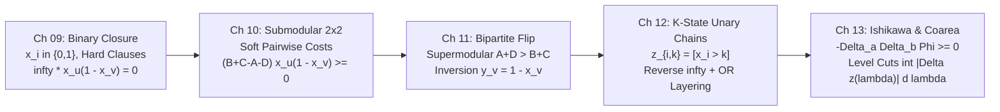
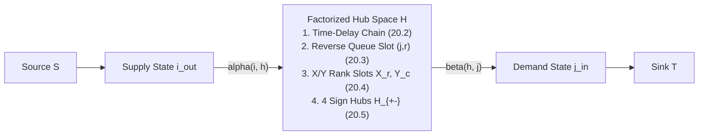

# Phase 1.5 — Critic 2: Pedagogy, Granularity & "Zero Magic Gadgets" Modelling Audit

**Auditor Persona**: `FlowDeepInvestigator` (Phase 1.5 Critic 2 — Pedagogy, Granularity & "Zero Magic Gadgets" Modelling Critic)  
**Target Documents Audited**:
1. [`proposal_A_modelling_first.md`](file:///home/maomao90/Documents/IO/ICPC-math-notes/flows_research/phase1_5/proposal_A_modelling_first.md) (*Architecture A: The "Zero Magic Gadgets" Algebraic-to-Graph Compilation Spine*)
2. [`round1_problem_curation_architect.md`](file:///home/maomao90/Documents/IO/ICPC-math-notes/flows_research/phase1_5/round1_problem_curation_architect.md) (*Round 1: 320-Problem Partition, Quarantine & 24-Chapter Allocation Matrix*)
3. [`TECHNIQUE_TAXONOMY.md`](file:///home/maomao90/Documents/IO/ICPC-math-notes/flows_research/TECHNIQUE_TAXONOMY.md) (*Phase 1 Consolidation: Polyhedral Operators, Direction A/B Playbooks & Hazards `H-01`–`H-24`*)

---

## Executive Verdict & Pedagogical Scorecard

| Audit Dimension | [`proposal_A_modelling_first.md`](file:///home/maomao90/Documents/IO/ICPC-math-notes/flows_research/phase1_5/proposal_A_modelling_first.md) | [`round1_problem_curation_architect.md`](file:///home/maomao90/Documents/IO/ICPC-math-notes/flows_research/phase1_5/round1_problem_curation_architect.md) | Synthesis Recommendation for `FINAL_CURRICULUM_PLAN.md` |
| :--- | :-: | :-: | :--- |
| **1. Macro-Ordering & Prerequisite DAG (`Ch 01`–`Ch 24`)** | **9.6 / 10** | **8.4 / 10** | Adopt **Proposal A's 6-Part, 24-Chapter ordering** (specifically placing Lower-Bound Circulations in **`Ch 04`** rather than delaying to `Ch 17`). |
| **2. Part III Pseudo-Boolean Cut Spine (`Ch 09`–`Ch 13`)** | **9.8 / 10** | **8.1 / 10** | Adopt **Proposal A's 5-chapter algebraic progression** ($x_i \in \{0,1\}$ Closure $\to$ Submodular $2\times 2$ $\to$ Bipartite Flip $\to$ Unary $z_{i,k}$ Chains $\to$ Ishikawa Monge & Coarea Cuts). |
| **3. Part V MCMF & LP Duality Spine (`Ch 17`–`Ch 21`)** | **9.4 / 10** | **8.5 / 10** | Adopt **Proposal A's 5-chapter MCMF & LP progression**, strengthened by our **Single Unifying Algebraic Spine** for `Ch 20` (State-Factorized Assignment Lifting). |
| **4. Bidirectional Duality (`Direction A` vs. `Direction B`)** | **9.5 / 10** | **8.8 / 10** | Enforce explicit **Constraint-Regime Decision Tables** ($N \le 500$ vs. $N \le 2\cdot 10^5$) at the opening of `Ch 08`, `Ch 15`, `Ch 16`, and `Ch 23`. |
| **5. Intra-Chapter Unifying Algebraic Spine** | **8.7 / 10** | **8.2 / 10** | Apply our **5 Surgical Unification Blueprints** to eliminate "grab-bag" cognitive overload in `Ch 07`, `Ch 16`, `Ch 20`, `Ch 22`, and `Ch 24`. |
| **6. Broken-Gadget Counterexamples (`FM-01`–`FM-24`)** | **8.5 / 10** (`20/24` chapters) | **N/A** (delegated to `TECHNIQUE_TAXONOMY.md`) | Expand Proposal A's `FM-01`–`FM-20` into our **Bijective 24-Chapter Broken-Gadget Counterexample Matrix (`FM-01`–`FM-24` $\leftrightarrow$ `H-01`–`H-24`)**. |
| **7. Problem Pool Accounting (`256 + 64 = 320`)** | **9.1 / 10** (2 duplicate slots, 45 vs. 64 quarantine) | **9.9 / 10** (`256 + 64 = 320` exact bijection) | Merge **Round 1's exact 320-problem bijection (`256` accepted + `64` quarantined)** into Proposal A's 24-chapter slots, fixing the 2 duplicate slots in `Ch 06`–`Ch 08`. |

> [!IMPORTANT]
> **Core Pedagogical Finding**: [`proposal_A_modelling_first.md`](file:///home/maomao90/Documents/IO/ICPC-math-notes/flows_research/phase1_5/proposal_A_modelling_first.md) achieves a transformative pedagogical breakthrough by replacing ad-hoc visual "graph-drawing tricks" with **Intermediate Algebraic Representations** (pseudo-Boolean cut polynomials $\sum c_{uv} x_u(1 - x_v)$, unary threshold indicators $z_{i,k} = [x_i > k]$, Coarea level-set integrals $\int |[h_u > \lambda] - [h_v > \lambda]|\,d\lambda$, consecutive row differences $\Delta E_t = E_t - E_{t-1}$, and Lagrangian LP duals). However, **five chapters (`Ch 07`, `Ch 16`, `Ch 20`, `Ch 22`, `Ch 24`)** still pack multiple structural paradigms without a single overarching algebraic equation, and **four chapters (`Ch 06`, `Ch 07`, `Ch 21`, `Ch 24`)** lack a dedicated numbered Broken-Gadget Counterexample in Proposal A's `FM-01`–`FM-20` table. This audit provides the exact mathematical and pedagogical repairs required for Phase 2 synthesis.

---

## 1. Macro-Architectural & Pedagogical Ordering Audit

### 1.1 Placement of Lower-Bound Circulations (`上下界网络流`): `Ch 04` (Part I) vs. `Ch 17` (Part V)

A fundamental divergence between [`proposal_A_modelling_first.md`](file:///home/maomao90/Documents/IO/ICPC-math-notes/flows_research/phase1_5/proposal_A_modelling_first.md) and [`round1_problem_curation_architect.md`](file:///home/maomao90/Documents/IO/ICPC-math-notes/flows_research/phase1_5/round1_problem_curation_architect.md) is where **Flows with Demands & Lower Bounds (`上下界网络流`, $l(e) \le f(e) \le u(e)$)** are taught:
* **Round 1 Architect (`Ch 17`, Part V)**: Delays all lower-bound flows ($l(e) \le f(e) \le u(e)$, feasible/max/min flow, and min-cost lower-bound circulation) until Chapter 17, after all of Bipartite Matching (Part II), Min-Cut Compilation (Part III), and Planar/Global Cuts (Part IV).
* **Proposal A (`Ch 04`, Part I)**: Places Lower-Bound Circulations, Hoffman's Circulation Theorem, and bounded degree/matrix rounding right at the end of **Part I (`Ch 04`)**, immediately after `Ch 01`–`Ch 03`, and then revisits **Min-Cost Lower-Bound Circulation & Mandatory Negative-Cycle Elimination (`负权边强制满流`)** in **`Ch 17.5` (Part V)**.

**Pedagogical Verdict**: **Proposal A's placement in `Ch 04` (with the cost-extension in `Ch 17.5`) is mandatory.** Delaying lower bounds to `Ch 17` creates three severe prerequisite violations in Parts II–IV:
1. **Prerequisite Violation 1 (`Ch 07` — Bounded Bipartite Degree & Matrix Rounding)**: Canonical Part II problems such as `CF 704 D — Captain America` (bipartite red/blue coloring with row/column disparity bounds $\lvert r_i - b_i\rvert \le d_i$, compiling to $\lceil (\text{cnt}_i - d_i)/2 \rceil \le f(e) \le \lfloor (\text{cnt}_i + d_i)/2 \rfloor$), `BZOJ 1458 — 士兵占领`, and `CF 546 E` require lower-bound flow reduction $f(e) = l(e) + f'(e)$! If lower bounds are delayed to `Ch 17`, students in `Ch 07` must either treat lower bounds as a black box or skip bounded degree matching entirely.
2. **Prerequisite Violation 2 (`Ch 05` — Poset Chain Covers via Lower Bounds)**: Teaching students that Dilworth's Minimum Chain Cover (where every poset vertex $v$ must be visited $\ge 1$ time) has **two dual compilations**—(a) transitively closed bipartite matching $N - \nu(D^*)$ (`Ch 05`) and (b) DAG lower-bound minimum flow $v_{\text{in}} \xrightarrow{[1, \infty)} v_{\text{out}}$ (`Ch 04`)—is one of the most illuminating early connections in network flow theory. Placing lower bounds in `Ch 04` makes this connection immediate in `Ch 05.3`.
3. **Cognitive Load Separation (Feasibility vs. Cost)**: Lower-bound circulation already introduces two major bookkeeping hazards: the **node-balance sign convention** $\Delta_l(v) = \sum_{e \in \delta^-(v)} l(e) - \sum_{e \in \delta^+(v)} l(e)$ (`H-04` / `FM-03`) and **deleting the feedback edge $t \to s$ (and its reverse residual edge $s \to t$) before Phase 2** (`H-05` / `FM-04`). Teaching pure capacity lower bounds in `Ch 04` and later layering **negative-cost arc saturation (`负权边强制满流`, `CF 708 D`)** in `Ch 17.5` splits the cognitive load across two natural stages instead of dumping both into `Ch 17`.

---

### 1.2 Part II (`Ch 05`–`Ch 08`) vs. General Graph Matching (`Ch 22`): Resolving the Topic-Mixing Dilemma

Comparing Part II across the two proposals exposes a classic granularity trade-off:
* **Round 1 Architect**: Uses `Ch 05` (König/Dilworth), `Ch 06` (DM Decomposition + Hidden Bipartite Models merged), `Ch 07` (Hall Marriage + Direction B Segment Trees), and `Ch 08` (General Graph Blossom & Tutte Matrix).
  * *Flaw*: Merging **Dulmage–Mendelsohn (`DM`) Canonical Decomposition & Bipartite Walk Games** with **Hidden Non-Graph Bipartite Modelling** (`Row-Col`, `Maximal Strips`, `Shared-Border Dual CF 1404 E`, `2-Adic Distance Coloring AGC 025 D`, `Birkhoff–von Neumann AGC 037 D`) into a single 8-problem chapter (`Ch 06`) starves both topics! Hidden bipartite modelling is one of the highest-frequency ICPC/AtCoder skill sets and needs its own dedicated chapter (`Ch 07` in Proposal A).
* **Proposal A**: Gives full dedicated chapters to `Ch 05` (König & Dilworth), `Ch 06` (DM Decomposition, Critical Edges & Bipartite Games), `Ch 07` (Hidden Bipartite Structures, 2-Adic Coloring & Birkhoff–von Neumann), and `Ch 08` (Hall's Marriage Theorem & Direction B Segment Trees). However, to preserve the 24-chapter cap, Proposal A pushes **General Non-Bipartite Matching (Edmonds' Blossom + Tutte Matrix)** into the second half of **`Ch 22` (`Ch 22.3–22.4`)**, right alongside **Data-Structure Graph Sparsification (`数据结构优化建图`, `Ch 22.1–22.2`)**!
  * *Flaw*: What do Persistent Segment Tree range-to-vertex hubs (`[AHOI2014] 骑士游戏`, `[NOI2019] 弹跳`) have in common with Edmonds' odd-cycle Blossom contraction (`带花树`) and the skew-symmetric Tutte Matrix $T_{uv} = \pm x_{uv}$? **Nothing at the surface level!** Placing them in the same chapter without an explicit structural bridge risks making `Ch 22` feel like two half-chapters glued together.

#### Mandatory Pedagogical Fix for `Ch 22`
Keep Proposal A's superior 4-chapter Part II (`Ch 05`–`Ch 08`), and unify `Ch 22` under the explicit structural theme **"Breaking the Bipartite & Quadratic Edge Barriers: Structural Graph Lifting & Compression"**, partitioned into two self-contained halves with an explicit polyhedral bridge:
* **Module `22A` (`22.1–22.2`: Breaking the $O(V^2)$ Edge Barrier via Virtual Hub Sparsification)**: When a flow/cut model is bipartite or submodular (`Ch 05`–`Ch 13`) but has $\Theta(N^2)$ transitions (1D intervals, 2D rectangles, prefix history, divisor chains), we lift the edge set through a **logarithmic virtual DAG** (In-Tree / Out-Tree Segment Tree, Persistent Treap, CDQ Divide-and-Conquer, KD-Tree).
* **Module `22B` (`22.3–22.5`: Breaking the Bipartite Parity Barrier via Odd-Cycle Contraction & Skew-Symmetric Linear Algebra)**: When a matching/degree-constraint model (`Ch 05`–`Ch 08`) has **odd cycles**, Total Unimodularity fails (`H-08`: the bipartite double cover yields half-integral $\frac{1}{2}$-cycles on $K_3$), forcing us to either:
  1. Contract odd alternating cycles dynamically via **Edmonds' Blossom Algorithm (`带花树`)** + **Tutte–Berge Deficiency Duality** $\nu(G) = \frac{1}{2}\big(|V| - \max_{U \subseteq V}(\operatorname{odd}(G \setminus U) - |U|)\big)$, or
  2. Replace augmenting paths with determinant cancellation over $\mathbb{F}_p$ via the **Skew-Symmetric Tutte Matrix** $T(G)^{-1}$, **Sherman–Morrison rank-1 updates**, and **Tutte's $f$-Factor Split Gadget**.

---

### 1.3 Part III (`Ch 09`–`Ch 13`): Auditing the 5-Chapter Pseudo-Boolean Cut Compilation Spine (`燃やす埋める`)

Part III is the pedagogical heart of the textbook. Let us audit the cognitive progression across Proposal A's five chapters (`Ch 09`–`Ch 13`) and verify that every transition is driven by a **strictly increasing degree or domain generalization of the intermediate pseudo-Boolean polynomial**:

1. **Stage 1 (`Ch 09`: Binary Indicators with Infinite Hard Clauses)**:
   * **Algebraic Spine**: Minimize $\sum_{i \in V} c_i(x_i) + \sum_{(u,v) \in \mathcal{D}} \infty \cdot x_u(1 - x_v)$ over $x_i \in \{0, 1\}$.
   * **Why Cognitive Load is Minimal**: Students only learn the fundamental identity **"a directed edge $u \xrightarrow{w} v$ pays $w \cdot x_u(1 - x_v)$ if and only if $x_u = 1$ ($u \in S$) and $x_v = 0$ ($v \in T$)"**, plus the **Revenue-Minus-Loss Pre-Collection Rule** ($\text{Ans} = \sum_{v: w_v > 0} w_v - \text{MinCut}$). No $2 \times 2$ algebra or multi-state chains yet!
2. **Stage 2 (`Ch 10`: Soft Submodular Pairwise Tables & Auxiliary Clauses)**:
   * **Algebraic Spine**: Replace $\infty$ with finite $2 \times 2$ cost tables $\Phi_{uv}(x_u, x_v) = \begin{pmatrix} A & B \\ C & D \end{pmatrix}$ and degree-$k$ conjunction/disjunction clauses $\bigwedge_{i \in Q} x_i$.
   * **Pedagogical Progression**: By expanding $\Phi_{uv}(x_u, x_v) = A + (C - A)x_u + (D - C)x_v + (B + C - A - D)x_u(1 - x_v)$, students see **algebraically** why the cross-term coefficient $B + C - A - D$ must be $\ge 0$ ($A + D \le B + C$), and how an auxiliary node $y_Q \in \{0, 1\}$ linearizes higher-degree products $\prod_{i \in Q} x_i$ via $\min_{y_Q \in \{0,1\}} \big(-R_Q y_Q + \sum_{i \in Q} \infty \cdot y_Q(1 - x_i)\big)$.
3. **Stage 3 (`Ch 11`: Rescuing Supermodularity via Bipartite Variable Inversion & QPBO)**:
   * **Algebraic Spine**: When a problem rewards *different* choices or penalizes *equal* choices ($A + D > B + C$), direct compilation yields a negative edge capacity $B + C - A - D < 0$.
   * **Pedagogical Progression**: Instead of presenting "put odd rows on the left and even columns on the right" as a visual trick, `Ch 11` derives it via the algebraic substitution $y_v := 1 - x_v$ for $v \in V_R$ on a bipartite conflict graph $G_{\text{sup}} = (V_L \sqcup V_R, E_{\text{sup}})$. This flips $x_u(1 - x_v)$ into $y_u y_v$ and converts $x_u x_v + (1 - x_u)(1 - x_v)$ into $y_u(1 - y_v) + (1 - y_u)y_v$, flipping the sign of the determinant $A + D - B - C$! And when $G_{\text{sup}}$ is non-bipartite, `Ch 11.2` introduces the Boros–Hammer **QPBO doubled network** $(x_i, \bar{x}_i)$ with Exact Persistency.
4. **Stage 4 (`Ch 12`: Lifting $x_i \in \{0, 1\}$ to $x_i \in \{1, \dots, K\}$ via Unary Threshold Chains)**:
   * **Algebraic Spine**: Encode a $K$-state variable $x_i \in \{1, \dots, K\}$ as $K-1$ ordered binary indicators $z_{i,k} = [x_i > k] \in \{0, 1\}$ subject to the monotonicity invariant $1 = z_{i,0} \ge z_{i,1} \ge \dots \ge z_{i,K-1} \ge z_{i,K} = 0$.
   * **Pedagogical Progression**: Because $z_{i,k} \le z_{i,k-1}$ is the binary implication $z_{i,k}(1 - z_{i,k-1}) = 0$, the `Ch 09` compiler immediately forces the **reverse infinite-capacity edge** $(i, k) \xrightarrow{\infty} (i, k-1)$ (`FM-10` / `H-12`), while bounded difference $x_i - x_j \le D$ ($z_{i,k} \implies z_{j,k-D}$) forces $(i, k) \xrightarrow{\infty} (j, k-D)$ (`[HNOI2013] 切糕`). This directly powers the two AtCoder flagships: **3-State Sign Ordering (`ARC 107 F`)** and **Bipartite Unary OR Threshold Layering (`ARC 142 E`)**.
5. **Stage 5 (`Ch 13`: General Smooth Penalties via 2D Abel Summation (`Ishikawa`) & Large-Coordinate Level Cuts (`Coarea`))**:
   * **Algebraic Spine**: First, for small $K \le 80$, apply 2D discrete integration by parts to any pairwise penalty $\Phi(x_i, x_j)$:
     $$\Phi(x_i, x_j) = \text{Unary}(x_i) + \text{Unary}(x_j) + \sum_{a=1}^{K-1}\sum_{b=1}^{K-1} \big(-\Delta_a\Delta_b \Phi(a, b)\big) z_{i,a}(1 - z_{j,b}),$$
     proving that $\Phi$ compiles to non-negative cross-chain edges if and only if $\Phi$ is **Monge / submodular** ($\Delta_a\Delta_b \Phi(a,b) \le 0$). Second, when $K = V_{\max} \le 10^9$ is huge (`CF 1427 G`), specialize to $\Phi(h_u, h_v) = w_{uv}\lvert h_u - h_v\rvert$ where $-\Delta_a\Delta_b\lvert a - b\rvert = 2\delta_{a,b}$ has **zero cross-level edges ($a \neq b$)**—yielding the **Discrete Coarea Formula**:
     $$\sum_{(u,v) \in E} w_{uv}\lvert h_u - h_v\rvert = \sum_{k=1}^{m-1} (v_{k+1} - v_k) \sum_{(u,v) \in E} w_{uv}\big\lvert z_u(v_k) - z_v(v_k)\big\rvert!$$
   * **Why Placing $L_p$ Isotonic Regression (`保序回归`) in `Ch 24` Instead of `Ch 13` is Pedagogically Superior**: Round 1 Architect puts `[省选联考 2020 A] 保序回归` (which requires `整体二分` parallel binary search + Matroid/Spanning-Tree basis exchange on the $x_u \le x_v$ partial order) into `Ch 13`. In `Ch 13`, students have not yet studied Matroid Intersection or LP Primal–Dual optimality (`Ch 21`). Proposal A wisely teaches **1D/Grid Coarea Level-Set Cuts & Incremental Residual Rollback (`CF 1427 G`, `[BOI 2004] Sequence`)** in `Ch 13`, and places general **$L_p$ Isotonic Regression on Partial Orders & Matroid Bases (`[省选联考 2020 A] 保序回归`)** in the Part VI Capstone (`Ch 24.1`), where students can combine `Ch 13`'s Coarea level cuts with `Ch 21`'s matroid exchange inequalities!

---

### 1.4 Part V (`Ch 17`–`Ch 21`): Auditing the 5-Chapter MCMF & LP Duality Spine

Proposal A's 5-chapter Part V progression is remarkably clean:
1. **`Ch 17` (Algorithmic Engine, Potentials & Mandatory Saturation)**: Establishes Johnson reduced costs $c^\pi(u, v) = c(u, v) + \pi(u) - \pi(v) \ge 0$, why SSP shortest-path distances $d(t)$ are monotonically non-decreasing (yielding a **convex piecewise-linear cost curve $C(f)$**), why SPFA is an exponential trap (`FM-16` / `H-17`), and how negative-cost arcs/cycles are eliminated via **Mandatory Initial Saturation (`负权边强制满流`)**.
2. **`Ch 18` (Separable Convex Costs)**: Exploits the convexity of $C(f)$ at the **single-edge level**: a separable convex cost $\phi_e(f_e)$ with non-decreasing first differences $\Delta\phi_e(1) \le \Delta\phi_e(2) \le \dots$ compiles into parallel unit-capacity edges automatically saturated in order $1, 2, \dots, U$, plus $O(\log U)$ capacity scaling for $U \le 10^9$.
3. **`Ch 19` (Consecutive Equation Differencing $\Delta E_t = E_t - E_{t-1}$)**: Shifts from explicit graphs to **Interval Linear Programs** $A\mathbf{x} = \mathbf{b}$ with the **Consecutive-Ones Property (C1P)**. Taking $\Delta E_t = E_t - E_{t-1}$ turns each column $x_j$ (active on rows $[L_j, R_j]$) into a single column with $+1$ at row $L_j$ and $-1$ at row $R_j + 1$, which is literally a directed flow arc $L_j \to R_j + 1$!
4. **`Ch 20` (Cycle Covers, Resource Reuse, Dynamic Lazy Scheduling & Rank/Manhattan Hubs)**: Covers non-interval MCMF models. *(Audited in detail in §2.2 below, where we supply the missing unifying algebraic spine.)*
5. **`Ch 21` (LP Duality, Complementary Slackness & Totally Unimodular Matrices)**: Elevates `Ch 09`–`Ch 20` to general Linear Programming: given an unfamiliar problem, write the Primal LP, take the Dual LP, check Hoffman–Kruskal Total Unimodularity (or Matroid Intersection), and read off the flow/cut/MCMF graph from the dual variables $\pi_i - \pi_j \le c_{ij}$!

---

### 1.5 Bidirectional Duality Audit (`Direction A: Non-Graph \to Flow` vs. `Direction B: Flow \to Non-Flow Fast Algorithm`)

One of the highest-value mandates in `PLAN.md` is teaching students **both directions** of Flow/Cut/Matching duality:
* **Direction A (`Non-Graph \to Flow/Cut/MCMF`, Small Constraints $N \le 500$)**: Compile a messy combinatorial problem into a flow network and let Dinic / MCMF solve the global trade-offs.
* **Direction B (`Flow/Cut/MCMF \to Fast Data Structure / DP / Greedy`, Large Constraints $N \le 2 \times 10^5$)**: Formulate the problem as a flow/cut/MCMF network conceptually, then **eliminate the slow flow solver** by translating the dual cut/potential/residual-path characterization into a Segment Tree, Planar Dijkstra, Slope Trick DP, or Priority-Queue Simulation (`模拟费用流`).

Let us audit the four Direction B chapters in Proposal A (`Ch 08`, `Ch 15`, `Ch 16`, `Ch 23`) and establish the **Mandatory Constraint-Regime Decision Matrix** that must appear at the opening of each of these four chapters:

| Chapter | Underlying Flow Model (Direction A, $N \le 500$) | Why Flow TLEs at $N \le 2 \times 10^5$ | Dual / Structural Theorem Invoked | Direction B Fast Algorithm ($O(N \log N)$ / $O(N \log^2 N)$) | Canonical Flagship Problems Verified |
| :-: | :--- | :--- | :--- | :--- | :--- |
| **`Ch 08`** | Bipartite Matching ($L \to R$ on intervals, rings, or trees) | Explicit $L \times R$ graph has $\Theta(N^2)$ edges; Hopcroft–Karp takes $\Theta(N^{2.5})$. | **Hall's Deficiency Formula**: $\nu(G) = \lvert L\rvert - \max_{S \subseteq L}\big(\lvert S\rvert - \lvert N(S)\rvert\big)$, plus convex closure of contiguous interval unions $S = \bigsqcup [l_k, r_k]$. | **Lazy Segment Tree / Monotone Queue / Circular Prefix-Suffix Split** maintaining $\max_{l \le r} (\operatorname{cnt}(l, r) - \lvert N([l, r])\rvert)$. | `ARC 076 F — Exhausted?`, `CF 981 F — Round Marriage`, `CF 1519 F`, `Hall on Trees` |
| **`Ch 15`** | $s$-$t$ Minimum Cut on a 2D Grid or Planar Graph ($V \le 2.5 \times 10^5$) | Dinic on a $500 \times 500$ planar grid with $T = 50$ queries takes $\approx 10^9$ ops (TLE). | **Whitney's Planar Cycle–Cut Duality** + **Coarea Layer-Cake Theorem** ($\min_{h \in [0,1]^V} = \min_{z \in \{0,1\}^V}$). | **Right-Hand-Rule Outer-Face Dual Dijkstra** ($O(V \log V)$), **Non-Crossing Boundary Interval DP** ($O(k V \log V + k^3)$), or **Reif's Divide-and-Conquer** ($O(V \log^2 V)$). | `[BJWC2006] 狼抓兔子`, `[NOI2010] 海拔`, `[CSP-S 2021] 交通规划` |
| **`Ch 16`** | Structured $S$-$T$ Flow on a 1D Pipeline, Complete DAG, or Bipartite Chain ($N, Q \le 5 \times 10^5$) | Explicit DAG has $\binom{N}{2} \approx 5 \times 10^9$ edges (`CF 724 E`) or $Q = 5 \times 10^5$ dynamic capacity updates (`CF 1919 F2`). | **Max-Flow Min-Cut Theorem**: $\operatorname{MaxFlow}(S,T) = \min_{\mathbf{x} \in \{0,1\}^N} \operatorname{Cut}(\mathbf{x})$ where the cross-cut cost depends only on a low-dimensional prefix statistic (count $k = \sum_{j < i} x_j$, pipeline state $x_i \in \{0,1\}$, or prefix split $(i, j)$). | **Min-Cut DP + Slope Trick** ($O(N \log N)$), **Dynamic $(\min, +)$ $2 \times 2$ Matrix Segment Tree** ($O((N+Q)\log N)$), or **Parametric Sort + Convex Hull** ($O(N \log N)$). | `CF 724 E — Goods Transportation`, `CF 1919 F2 — Wine Factory`, `CF 903 G`, `ARC 125 E — Snack` |
| **`Ch 23`** | Min-Cost Max-Flow (MCMF) on a 1D Time/Coordinate Line, Rooted Tree, or $K$-Tuple Selection ($N \le 2 \times 10^5$) | Successive Shortest Path takes $O(F E \log V) \approx \Theta(N^2 \log N)$ or $\Theta(N^3)$. | **Convex Slope of $C(f)$** + **Residual Back-Edge Regret Cancellation** ($c(v \to u) = -c(u \to v)$) + **Lagrangian WQS Penalty** $g(\lambda) = \min_f (C(f) - \lambda f)$. | **Regret Priority Queue (`反悔贪心`)**, **4-Tuple Segment Tree (`Max-Subarray` + Flip)**, **Tree LCA Dual-Synthetic Heaps**, or **WQS Binary Search + 5-Heap Simulation**. | `CF 865 D — Buy Low Sell High`, `CF 802 O — April Fools`, `[ICPC WF 2018] Conquer the World`, `[NOI2019] 序列` |

---

## 2. Chapter-by-Chapter Granularity, Cognitive Load & Unifying Algebraic Spine Audit (`Ch 01`–`Ch 24`)

### 2.1 Complete 24-Chapter Granularity & Unifying Spine Scorecard

| Ch | Chapter Title (Proposal A) | Cognitive Load | Unifying Intermediate Algebraic Spine | Audit Verdict & Required Action |
| :-: | :--- | :-: | :--- | :--- |
| **`01`** | Foundational Max-Flow Min-Cut Duality & Residual Invariants | Moderate | Residual Conservation $\nabla \cdot f = 0$ & Cut-Flux Identity $\lvert f\rvert = f(S, \bar{S}) - f(\bar{S}, S)$ | **Airtight.** Keep as is. |
| **`02`** | Space-Time Unrolling, Vertex Splitting & Incremental Rollback | Moderate | Time-Indexed Conservation $\sum_u f_{u,v}^{(t-1)} = \sum_w f_{v,w}^{(t)}$ & Local Residual Reversal | **Airtight.** Keep as is. |
| **`03`** | Parity, Bottleneck Binary Search & Multi-Commodity Symmetries | Moderate | Edge-Parity Invariant $f(S, \bar{S}) + f(\bar{S}, S) \equiv C(S, \bar{S}) \pmod 2$ & 2-Commodity Uncrossing $f_1 \pm f_2$ | **Airtight.** Keep as is. |
| **`04`** | Flows with Demands, Lower-Bound Circulations & Matrix Rounding | Moderate-High | Affine Flow Shift $f(e) = l(e) + f'(e)$ & Net Demand Balance $\Delta_l(v) = l(\delta^-(v)) - l(\delta^+(v))$ | **Airtight.** Keep in Part I (`Ch 04`). |
| **`05`** | Bipartite Matching Duality: König, Independent Sets & Dilworth | Moderate | 0-1 Node-Edge Incidence Dual $\max \sum x_e = \min \sum (y_u + z_v)$ & Path-Degree Identity $C = \lvert V\rvert - \nu$ | **Airtight.** Keep as is. |
| **`06`** | Dulmage–Mendelsohn (`DM`) Decomposition, Criticality & Games | Moderate | Alternating Reachability Partition $V = V_S \sqcup V_T \sqcup V_0$ & Residual SCC Invariance | **Strong.** Add `FM-06` (`H-07` Poset Antichain vs. Split-MIS extraction). |
| **`07`** | Hidden Bipartite Structures, 2-Adic Coloring & Birkhoff–von Neumann | **High** (5 sub-models) | **Needs Unification (See §2.2.1)**: *Rank-2 Incidence Factorization $\mathcal{C} \subseteq \mathcal{A} \times \mathcal{B}$ & Doubly Stochastic Birkhoff Decomposition* | **Refactor Opening (§2.2.1)** to unify all 5 non-graph reductions under Rank-2 Incidence Factorization. |
| **`08`** | Hall's Marriage Theorem & Direction B Fast Matching | Moderate-High | Hall Deficiency Potential $\Phi(S) = \lvert S\rvert - \lvert N(S)\rvert$ & Submodular Set Uncrossing | **Airtight.** Fix duplicate slot in `Ch 06`–`Ch 08` (§5.1). |
| **`09`** | Project Selection, Maximal Closure & Cut Lattice (`Picard–Queyranne`) | Moderate | Binary Closure Polynomial $\min_{\mathbf{x} \in \{0,1\}^V} \big(\sum c_i(x_i) + \sum \infty \cdot x_u(1 - x_v)\big)$ | **Airtight.** Keep as is. |
| **`10`** | Submodular Pseudo-Boolean Optimization & Auxiliary Clause Gadgets | Moderate-High | Quadratic Cut Polynomial $\Phi(x_u, x_v) = A + (C-A)x_u + (D-C)x_v + (B+C-A-D)x_u(1-x_v)$ | **Airtight.** Keep as is. |
| **`11`** | Bipartite Variable Flipping (`奇偶/二部反転`), QPBO & `AGC 038 F` | High | Gauge Transformation $y_v = 1 - x_v$ ($v \in V_R$) converting $x_u x_v + \bar{x}_u\bar{x}_v \mapsto y_u(1 - y_v) + \bar{y}_u y_v$ | **Airtight (`AGC 038 F` Flagship).** Keep as is. |
| **`12`** | Multi-State Ordered Chains (`切糕`), 3-State Sign & Unary OR Layering | High | Unary Threshold Encoding $z_{i,k} = [x_i > k]$ with Monotonicity Clause $z_{i,k}(1 - z_{i,k-1}) = 0$ | **Airtight (`ARC 107 F` & `ARC 142 E` Flagships).** Add explicit proof of Low/High bipartiteness in `12.3` (§3.2). |
| **`13`** | Ishikawa's Convex/Monge Penalties, Coarea Formula & `CF 1427 G` | High | 2D Abel Summation $\sum_{a,b} (-\Delta_a\Delta_b \Phi(a,b)) z_{i,a}(1 - z_{j,b})$ & Coarea Integral $\int \lvert\Delta z(\lambda)\rvert\,d\lambda$ | **Airtight (`CF 1427 G` Flagship).** Assign dedicated `FM-13` (`H-13`/`H-14`). |
| **`14`** | 0-1 Fractional Programming, Max Density Subgraphs & Parametric Cuts | Moderate-High | Dinkelbach Envelope $h(\lambda) = \max_{\mathbf{x}} (f(\mathbf{x}) - \lambda g(\mathbf{x}))$ & Degree-Cut Identity $2\lvert E(S)\rvert = \sum_{v \in S} d_v - \lvert\delta(S)\rvert$ | **Airtight.** Keep as is. |
| **`15`** | Planar Graph Cycle–Cut Duality ($s$-$t$ Planar Cut $\leftrightarrow$ Dual Dijkstra) | Moderate-High | Whitney Homology $e \perp e^*$ ($\text{Primal Cut Cocycle} \leftrightarrow \text{Dual Simple Cycle/Path}$) | **Airtight (`海拔` & `交通规划` Flagships).** Keep as is. |
| **`16`** | Solving Max-Flow via Min-Cut DP, Global Min-Cut & Gomory–Hu Trees | **High** (2 distinct halves) | **Needs Unification (See §2.2.2)**: *Low-Treewidth & Laminar Compression of the $2^V$ Cut Space $\min_{S} C(S, \bar{S})$* | **Bridge `16.1` and `16.2–16.4` (§2.2.2)** via Cut-Space Compression. |
| **`17`** | MCMF Algorithmic Engine, Johnson Potentials & Negative Cycles | Moderate-High | Reduced-Cost Non-Negativity $c^\pi(u,v) = c(u,v) + \pi(u) - \pi(v) \ge 0$ & Negative-Arc Shift $f(e) = u(e) - f'(e^{\text{rev}})$ | **Airtight.** Keep as is. |
| **`18`** | Separable Convex Costs, Marginal Differential Splitting & Scaling | Moderate | Discrete Epigraph Sum $\phi_e(f_e) = \phi_e(0) + \sum_{k=1}^{f_e} \Delta\phi_e(k)$ ($\Delta^2 \phi_e \ge 0$) | **Airtight.** Keep as is. |
| **`19`** | Consecutive Equation Differencing ($\Delta E_t$) & Interval Covering | High | unimodular Row-Difference Transform $D \cdot (A\mathbf{x} - \mathbf{s} = \mathbf{b}) \implies (DA)\mathbf{x} - D\mathbf{s} = D\mathbf{b}$ | **Airtight (`志愿者招募` Flagship).** Keep as is. |
| **`20`** | Cycle Covers, Resource Reuse, Lazy Scheduling & Rank/Manhattan Hubs | **Very High** (5 sub-models) | **Needs Unification (See §2.2.3)**: *Bipartite Degree-1 State Lifting & Kernel Factorization $K(i, j) = \min_{h \in \mathcal{H}} (\alpha_{i,h} + \beta_{h,j})$* | **Refactor Opening (§2.2.3)** so all 5 subsections derive from Kernel Factorization! |
| **`21`** | LP Duality, Complementary Slackness & Totally Unimodular Matrices | High | Primal–Dual Bilinear Saddle $\max_{\mathbf{x} \ge 0} \{\mathbf{c}^T\mathbf{x} : A\mathbf{x} \le \mathbf{b}\} = \min_{\mathbf{y} \ge 0} \{\mathbf{b}^T\mathbf{y} : A^T\mathbf{y} \ge \mathbf{c}\}$ | **Airtight.** Assign dedicated `FM-21` (Wrong sign in Dual variable $\pi_u - \pi_v$). |
| **`22`** | Data-Structure Graph Sparsification & General Graph Matching | **Very High** (Dual topic) | **Needs Unification (See §1.2 & §2.2.4)**: *Bilinear Incidence Compression $E \subseteq U \times \mathcal{H} \times V$ & Skew-Symmetric Pfaffian Factorization* | **Apply §1.2 / §2.2.4 Two-Module Partition (`22A` vs. `22B`)**. |
| **`23`** | Simulated Cost Flow (`模拟费用流`), Regret Heaps & WQS Convexity | High | Residual 2-Cycle Augmentation $\Delta C = c(s_{\text{new}}, d_{\text{new}}) \leftrightarrow c(s_{\text{new}}, d_{\text{old}}) - c(s_{\text{old}}, d_{\text{old}}) + c(s_{\text{old}}, d_{\text{new}})$ | **Airtight.** Keep as is. |
| **`24`** | Frontier Hybrid Capstones: Isotonic Regression, LGV & Game Duality | **High** (5 capstones) | **Needs Unification (See §2.2.5)**: *Parametric Saddle-Point & Determinant Duality across Posets, Grids & DAGs* | **Refactor Opening (§2.2.5)** to frame all 5 capstones as Saddle-Point Projections. |

---

### 2.2 Five Surgical Unification Blueprints for High-Cognitive-Load Chapters

To guarantee that no chapter in the final 24-chapter textbook reads like a disconnected catalog of tricks, Phase 2 synthesis MUST adopt the following **five unifying algebraic spines** at the opening of `Ch 07`, `Ch 16`, `Ch 20`, `Ch 22`, and `Ch 24`.

#### 2.2.1 Surgical Blueprint 1 (`Ch 07` — Hidden Non-Graph Bipartite Structures)
* **The Cognitive-Load Problem**: `Ch 07` presents five seemingly unrelated geometric/combinatorial tricks: (1) Row–Column Line Cover (`Asteroids`), (2) Maximal Horizontal/Vertical Strip Splitting (`Muddy Fields`), (3) Dual Shared-Border Graph (`CF 1404 E — Bricks`), (4) 2-Adic Distance Coloring (`AGC 025 D — Choosing Points`), and (5) Birkhoff–von Neumann Two-Stage Routing (`AGC 037 D`).
* **The Single Unifying Algebraic Spine (*Rank-2 Binary Constraint Factorization*)**:
  Open `Ch 07` by proving that **every bipartite matching reduction is a Rank-2 Factorization of a conflict/covering hypergraph**:
  1. **Primal Entity-as-Edge Factorization ($\mathcal{I} \hookrightarrow \mathcal{A} \times \mathcal{B}$)**: Whenever each selectable object $e \in \mathcal{I}$ is uniquely determined by the intersection of **at most two maximal structural families** $a(e) \in \mathcal{A}$ and $b(e) \in \mathcal{B}$ (a row and a column in `7.1`; a maximal contiguous horizontal strip and a maximal contiguous vertical strip in `7.2`; a row-group and a target-column in `7.4`), the object $e$ **is a bipartite edge** $(a(e), b(e)) \in \mathcal{A} \times \mathcal{B}$!
     * Covering all objects $e \in \mathcal{I}$ with minimum cost $\iff$ **Minimum Vertex Cover** $\tau(\mathcal{A}, \mathcal{B}, \mathcal{I})$.
     * Selecting maximum non-conflicting objects $e \in \mathcal{I}$ $\iff$ **Maximum Matching** $\nu(\mathcal{A}, \mathcal{B}, \mathcal{I})$.
     * Factoring an $N \times M$ permutation rearrangement into $M$ disjoint column-transversals $\iff$ decomposing a $k$-regular bipartite multigraph $\mathcal{A} \times \mathcal{B}$ into $k$ edge-disjoint perfect matchings (**Birkhoff–von Neumann**, `7.4`).
  2. **Dual Conflict-as-Vertex Factorization ($\mathcal{A} \perp \mathcal{B}$)**: Whenever we choose between two orthogonal families of *mergers* (e.g., merging adjacent cells $(r, c)-(r+1, c)$ vertically vs. $(r, c)-(r, c+1)$ horizontally in `CF 1404 E`, `7.2`), each merger becomes a **vertex** ($v \in \mathcal{A}$ or $h \in \mathcal{B}$), and a physical grid cell $(r, c)$ forbids picking both an incident vertical merger $v$ and an incident horizontal merger $h$, creating a bipartite conflict edge $(v, h) \in \mathcal{A} \times \mathcal{B}$ where we seek the **Maximum Independent Set** $\lvert \mathcal{A}\rvert + \lvert \mathcal{B}\rvert - \nu(\mathcal{A}, \mathcal{B})$!
  3. **Algebraic Bipartite Synthesis via 2-Adic Valuation (`7.3`)**: When a distance conflict $(\Delta x)^2 + (\Delta y)^2 = D$ does not look bipartite at all, factor $D = 4^k \cdot d'$ to project $\mathbb{Z}^2 / 2^k\mathbb{Z}^2$ onto a 4-color product of two independent bipartite graphs!

#### 2.2.2 Surgical Blueprint 2 (`Ch 16` — Bridging Direction B Min-Cut DP and All-Pairs Gomory–Hu Cut Trees)
* **The Cognitive-Load Problem**: `Ch 16.1` teaches **Direction B Max-Flow $\to$ Min-Cut DP (`CF 724 E`, `CF 1919 F2`, `CF 903 G`)** while `Ch 16.2–16.4` teaches **Stoer–Wagner Global Min-Cut & Gusfield's Gomory–Hu Cut Tree (`最小割树`, `CF 343 E`)**. Without a unifying header, a student asks: *"Why are 1D Segment-Tree Min-Cut DPs in the same chapter as All-Pairs Gomory–Hu Trees?"*
* **The Single Unifying Algebraic Spine (*Compressing the Exponential $2^V$ Cut Lattice*)**:
  Open `Ch 16` with the question: **How can we optimize over the $2^{\lvert V\rvert}$ cut space $C(S, \bar{S})$ without running Dinic on every query?** Show that there are two complementary structural compressions of the cut function $f(S) = C(S, \bar{S})$:
  1. **Primal Parameterization of a Single $S$-$T$ Cut (`16.1`: Low-Width Cut Projection)**: When $S$ and $T$ are fixed and the cross-edges between $i < j$ have low-rank structure (e.g., uniform capacity $c$ in `CF 724 E`, bounded treewidth/pipeline $i \to i+1$ in `CF 1919 F2`, or bipartite prefix-monotone cuts in `CF 903 G`), the cut polynomial $\operatorname{Cut}(\mathbf{x}) = \sum c_{uv} x_u(1 - x_v)$ factors through a **1D summary state** $k_i = \sum_{j \le i} x_j$ or $x_i \in \{0, 1\}$, compressing $2^N$ cuts into an $O(N)$ DP or $(\min, +)$ Segment Tree!
  2. **Laminar Basis Compression of All $\binom{N}{2}$ Pairwise Cuts (`16.2–16.4`: Submodular Uncrossing)**: When $G$ is undirected and we vary the terminal pair $(u, v) \in \binom{V}{2}$, submodularity $C(A) + C(B) \ge C(A \cap B) + C(A \cup B)$ guarantees that the $\binom{N}{2}$ minimum cuts **never need to cross**—compressing $2^N$ cuts and $\binom{N}{2}$ terminal pairs into a **laminar family of $N - 1$ non-crossing cuts** represented by **Gusfield's Gomory–Hu Tree $T_{\text{GH}}$** (and its parameterless global minimum via **Stoer–Wagner MAS**)!

#### 2.2.3 Surgical Blueprint 3 (`Ch 20` — Unifying Cycle Covers, Resource Reuse, Lazy Scheduling & Rank/Manhattan Hubs)
* **The Cognitive-Load Problem**: `Ch 20` packs five famous MCMF archetypes:
  * `20.1` Directed Cycle Covers & Degree-2 Loops (`循环格`, `CF 387 D`);
  * `20.2` Resource Reuse & Time-Delayed Inventory (`[国家集训队] 餐巾计划`);
  * `20.3` Dynamic Lazy Waiting-Time Multiplication (`[NOI2012] 美食节`);
  * `20.4` 2D Rank-Slot Coordinate Compression (`AGC 031 E — Snuke the Phantom Thief`);
  * `20.5` Manhattan $\ell_1$ 4-Sign Hub Compression (`AGC 034 D — Manhattan Max Matching`).
* **The Single Unifying Algebraic Spine (*Bipartite Supply–Demand Splitting & Kernel State Factorization*)**:
  Open `Ch 20` by showing that **all five models are instances of a single two-step compilation**:
  * **Step A (Node Splitting $i \mapsto (i_{\text{out}} \in \mathcal{S},\; i_{\text{in}} \in \mathcal{D})$)**: Whenever every entity $i$ must simultaneously **supply** $d^+(i)$ units of flow and **receive** $d^-(i)$ units of flow without self-short-circuiting, split $i$ into a **Supply copy** $i_{\text{out}}$ ($S \xrightarrow{[d^+(i), d^+(i)],\, 0} i_{\text{out}}$) and a **Demand copy** $i_{\text{in}}$ ($i_{\text{in}} \xrightarrow{[d^-(i), d^-(i)],\, 0} T$).
    * *If $i$ is a grid cell in a cycle cover (`20.1`)*: $d^+(i) = d^-(i) = 1$, and any bipartite matching between $\mathcal{S} = \{i_{\text{out}}\}$ and $\mathcal{D} = \{j_{\text{in}}\}$ is a bijection $\pi: V \to V$, i.e., a **vertex-disjoint cycle cover**!
    * *If $i$ is Day $t$ in an inventory problem (`20.2`)*: $i_{\text{out}}$ supplies $r_t$ used napkins at the end of Day $t$, and $i_{\text{in}}$ demands $r_t$ clean napkins at the start of Day $t$!
  * **Step B (Factoring the Transition Kernel $K(i_{\text{out}}, j_{\text{in}})$ Through Intermediate Hub States $h \in \mathcal{H}$)**: Instead of wiring dense $\Theta(N^2)$ edges directly between $\mathcal{S}$ and $\mathcal{D}$, factor the transition constraint or cost kernel:
    $$K(i, j) = \min_{h \in \mathcal{H}} \big(\alpha(i, h) + \beta(h, j)\big)$$
    through a small intermediate state space $\mathcal{H}$:
    1. **Time-Delay Inventory Hubs (`20.2` `餐巾计划`)**: $\mathcal{H}$ is the chain of dirty-napkin storage days $t_{\text{out}} \xrightarrow{0} (t+1)_{\text{out}}$, from which fast-wash $(t_{\text{out}} \to (t+m)_{\text{in}}, f)$ and slow-wash $(t_{\text{out}} \to (t+n)_{\text{in}}, s)$ jump across time in $O(N)$ edges!
    2. **Reverse Queue-Position Hubs (`20.3` `[NOI2012] 美食节`)**: A chef $j$ cooking dishes $d_1, \dots, d_k$ has total waiting time $\sum_{r=1}^k r \cdot t_{d_{k-r+1}, j}$. Here $\mathcal{H} = \{(j, r) : r = 1, \dots, P\}$ is the **reverse queue slot** ($r$-th from last dish), factoring the history-dependent waiting cost into $i_{\text{dish}} \xrightarrow{r \cdot t_{i,j}} (j, r) \to T$, instantiated **lazily** on demand!
    3. **Sorted Order-Statistic Rank Hubs (`20.4` `AGC 031 E`)**: When choosing $k$ jewels so the $r$-th sorted $x$-coordinate lies in $[L_r^x, R_r^x]$ and the $c$-th sorted $y$-coordinate lies in $[L_c^y, R_c^y]$, factor through $k$ **$x$-rank hubs** $\mathcal{H}_x = \{X_1, \dots, X_k\}$ and $k$ **$y$-rank hubs** $\mathcal{H}_y = \{Y_1, \dots, Y_k\}$: $S \to X_r \to \text{Jewel}_i^{\text{in}} \to \text{Jewel}_i^{\text{out}} \to Y_c \to T$!
    4. **$\ell_1$ Sign-Expansion Hubs (`20.5` `AGC 034 D`)**: Since $\lvert x_i - x_j\rvert + \lvert y_i - y_j\rvert = \max_{s_x, s_y \in \{\pm 1\}} \big[(s_x x_i + s_y y_i) + (-s_x x_j - s_y y_j)\big]$, factor the $\Theta(N^2)$ bipartite graph through **$|\mathcal{H}| = 4$ sign hubs** $H_{++}, H_{+-}, H_{-+}, H_{--}$!

#### 2.2.4 Surgical Blueprint 4 (`Ch 22` — Unifying Virtual Hub Sparsification & General Graph Matching)
As diagnosed in §1.2, structure `Ch 22` explicitly into **Module 22A (`22.1–22.2`: Geometric/Range Incidence Compression via Virtual DAGs)** and **Module 22B (`22.3–22.5`: Non-Bipartite Odd-Cycle Contraction & Tutte Pfaffians)**, connected by the opening theorem:
* **Unifying Opening Thesis**: Chapters `05`–`21` relied on two structural assumptions: (1) the graph has $O(N)$ explicit edges, and (2) the incidence matrix is **bipartite / Totally Unimodular**. `Ch 22` systematically removes both barriers:
  * **Barrier 1 ($\Theta(N^2)$ Implicit Range Edges $\to$ $O(N \log N)$ Virtual Hub DAGs)**: Any family of range edges $u \to [L_u, R_u]$ or $[L_1, R_1] \to [L_2, R_2]$ is a **Boolean matrix factorization** $M = A \cdot B$ through $O(N \log N)$ canonical dyadic/KD-tree/CDQ intervals, provided the **Out-Tree** (parent $\to$ child) and **In-Tree** (child $\to$ parent) are kept strictly disjoint (`FM-19` / `H-22`).
  * **Barrier 2 (Non-Bipartite Odd Cycles $\to$ Blossom Contraction & Skew-Symmetric Tutte Matrices)**: When an undirected matching graph $G = (V, E)$ contains odd cycles, its incidence matrix has determinant $\pm 2$ on odd cycles (violating TU, `H-08`). We restore exact polynomial-time solvability either combinatorially by **shrinking odd alternating cycles into pseudonodes (`Blossoms`)** (`22.3`), or algebraically by replacing the unsigned bipartite adjacency matrix with the **skew-symmetric Tutte matrix** $T_{uv} = \pm x_{uv}$ where odd cycles cancel by antisymmetry ($\det T(G) = \operatorname{Pf}(T(G))^2$, `22.4`)!

#### 2.2.5 Surgical Blueprint 5 (`Ch 24` — Unifying the 5 Frontier Hybrid Capstones)
* **The Cognitive-Load Problem**: `Ch 24` covers (1) $L_p$ Isotonic Regression (`保序回归`), (2) Parity/Increment Chessboard Equations (`奇怪的游戏`), (3) Rectilinear Polygon Chord Duality (`Imai–Asano`), (4) LGV Non-Intersecting Lattice Paths, and (5) Minimax Flow Game Duality.
* **The Single Unifying Algebraic Spine (*Parametric & Determinantal Saddle-Point Projections*)**:
  Open `Ch 24` by classifying all five frontier hybrids as **two-layer reductions where an outer parametric, algebraic, or game-theoretic wrapper calls an inner Flow/Cut/Matching oracle**:
  1. **Outer Layer = Convex Subgradient Divide-and-Conquer (`24.1` `整体二分` Isotonic Regression)**: Outer `solve(V_sub, L, R)` bisects the coordinate range at $M = \lfloor(L+R)/2\rfloor$ and calls an **inner `Ch 09` Project Selection Min-Cut** on the directional derivative $w_i = f_i(M+1) - f_i(M)$.
  2. **Outer Layer = Linear Invariant / Monotone Feasibility Search (`24.2` `奇怪的游戏`)**: Outer algebra solves the parity equation $N_B \cdot X - S_B = N_W \cdot X - S_W$ (when $N_B \neq N_W$) or binary searches on $X$ (when $N_B = N_W$) and calls an **inner `Ch 01` Bipartite Capacity Saturation check**.
  3. **Outer Layer = Geometric Chord Intersection $\to$ Bipartite König Duality (`24.3` `Imai–Asano`)**: Outer computational geometry decomposes a rectilinear polygon with $h$ holes and $c$ reflex corners into horizontal and vertical visibility chords, and calls an **inner `Ch 05`/`Ch 06` Bipartite Maximum Independent Set** ($h_{\text{chords}} \perp v_{\text{chords}}$).
  4. **Outer Layer = Symmetric Group Sign Cancellation (`24.4` `LGV Lemma`)**: When the inner problem asks for the **signed count** (or unique parity check) of vertex-disjoint DAG path tuples rather than the existence of 1 tuple (`Ch 02`), path-switching involutions cancel all intersecting tuples in $\det\big[e(a_i, b_j)\big]_{i,j=1}^k$.
  5. **Outer Layer = Von Neumann Minimax / Charnes–Cooper Linearization (`24.5` Flow Games)**: An attacker–defender game $\max_{\mathbf{p}} \min_{\mathbf{f}}$ over a network is linearized by replacing the inner player's optimization with its **LP Dual (`Ch 21`)**, collapsing $\max \min$ into a single linear program or parametric flow!

---

## 3. Audit of the 4-Step "Zero Magic Gadgets" Scratchpad & Deep Verification of the 4 Benchmark Flagships

### 3.1 Verification of the 4-Step Compilation Contract Across All 24 Chapters

Every chapter in [`proposal_A_modelling_first.md`](file:///home/maomao90/Documents/IO/ICPC-math-notes/flows_research/phase1_5/proposal_A_modelling_first.md) enforces the 4-Step "Zero Magic Gadgets" Pipeline:
1. **Step 1 (Non-Graph Diagnostic Signal & Why Naive DP/Greedy Fails)**: Identifies the exact $N, M, V_{\max}$ regime and the specific non-local coupling (e.g., global reachability, cyclic prerequisites, retrospective regret cancellation, or non-separable cross-terms) that defeats greedy/DP.
2. **Step 2 (Intermediate Algebraic / Logical Representation)**: Translates the English problem into an explicit mathematical object **before drawing a single vertex or edge**.
3. **Step 3 (Mechanical Graph Compilation Scratchpad)**: Maps each algebraic term to its exact vertex, edge orientation, capacity, lower bound, or cost via the compiler lookup tables.
4. **Step 4 (Hand-Checkable Toy Trace & Broken Gadget Counterexample)**: Traces $N \le 4$ concrete numbers and proves what breaks if a structural rule is violated.

### 3.2 Deep Pedagogical Audit of the 4 User Benchmark Flagships (`AGC 038 F`, `ARC 107 F`, `ARC 142 E`, `CF 1427 G`)

Let us audit how Proposal A presents the four user-mandated benchmark problems (`AGC 038 F` in `Ch 11.4`, `ARC 107 F` in `Ch 12.2`, `ARC 142 E` in `Ch 12.3`, and `CF 1427 G` in `Ch 13.3`) and pinpoint two crucial pedagogical clarifications that must be included in the final textbook so that no step feels like magic:

#### Benchmark 1: `AtCoder AGC 038 F — Two Permutations` (`Ch 11.4`, Pool `#087`)
* **Audit Status in Proposal A**: **Excellent (`Ch 11.4`).**
* **Key Pedagogical Polish Required for Phase 2**:
  Make sure the text explicitly writes out the **5-Case Contingency Table** for index $i \in \{0, \dots, N-1\}$ belonging to $P$-cycle $u = C_P(i)$ (with binary choice $x_u \in \{0, 1\}$, where $x_u = 0 \implies A_i = i$ and $x_u = 1 \implies A_i = P_i$) and $Q$-cycle $v = C_Q(i)$ (with **inverted** binary variable $y_v = 1 - z_v \in \{0, 1\}$, where $y_v = 1 \implies B_i = i$ and $y_v = 0 \implies B_i = Q_i$):
  $$\text{Penalty } [A_i = B_i] = \begin{cases}
  1 & \text{if } P_i = i \text{ and } Q_i = i \quad (\text{constant } +1), \\
  x_u & \text{if } P_i \neq i \text{ and } Q_i = i \quad (\text{unary } S \xrightarrow{1} u \text{ or } u \xrightarrow{1} T), \\
  1 - y_v & \text{if } P_i = i \text{ and } Q_i \neq i \quad (\text{unary } v \xrightarrow{1} T), \\
  x_u(1 - y_v) & \text{if } P_i \neq i,\; Q_i \neq i,\; P_i \neq Q_i \quad (\text{directed edge } u \xrightarrow{1} v), \\
  x_u(1 - y_v) + y_v(1 - x_u) & \text{if } P_i \neq i,\; Q_i \neq i,\; P_i = Q_i \quad (\text{bidirectional } u \xleftrightarrow{1} v).
  \end{cases}$$
  Highlighting that **Case 4 ($P_i \neq Q_i$, where $A_i = B_i \iff A_i = i = B_i \iff x_u = 0 \land z_v = 0 \iff (1 - x_u)y_v = 1$)** and **Case 5 ($P_i = Q_i \neq i$, where $A_i = B_i \iff x_u = z_v \iff x_u(1 - y_v) + (1 - x_u)y_v = 1$)** both become **pure submodular cut terms** after the single substitution $y_v = 1 - z_v$ is the ultimate demonstration of why Bipartite Variable Inversion works! Also explicitly state why Dinic runs in **$O(N\sqrt{N})$**: every cycle vertex $u, v$ has total incident capacity bounded by its cycle length $\lvert C_P\rvert, \lvert C_Q\rvert$, summing to $2N$ across the entire graph!

#### Benchmark 2: `AtCoder ARC 107 F — Sum of Abs` (`Ch 12.2`, Pool `#095`)
* **Audit Status in Proposal A**: **Excellent (`Ch 12.2`).**
* **Key Pedagogical Polish Required for Phase 2**:
  Explicitly show the **3-State Unary Chain Capacity Shift** so students never get negative capacities on $S \to v_{\text{in}} \to v_{\text{out}} \to T$:
  * Pre-collect the maximum possible reward $\sum_{v \in V} \lvert B_v\rvert$.
  * Relative to $+\lvert B_v\rvert$, the **penalty** $\theta_v(x_v)$ of placing $v$ in State $1$ ($s_v = -1$), State $2$ ($\text{deleted}$), or State $3$ ($s_v = +1$) is:
    * If $B_v \ge 0$: $\theta_v(1) = 2 B_v$, $\theta_v(2) = B_v + A_v$, $\theta_v(3) = 0$.
    * If $B_v < 0$: $\theta_v(1) = 0$, $\theta_v(2) = \lvert B_v\rvert + A_v$, $\theta_v(3) = 2\lvert B_v\rvert$.
  * Every penalty $\theta_v(k)$ is already $\ge 0$! Thus $v$ is split into two nodes $(v_{\text{in}}, v_{\text{out}})$ with a **3-edge series chain**:
    $$S \xrightarrow{\theta_v(1)} v_{\text{in}} \xrightarrow{\theta_v(2)} v_{\text{out}} \xrightarrow{\theta_v(3)} T, \qquad v_{\text{out}} \xrightarrow{\infty} v_{\text{in}},$$
    where cutting edge $k \in \{1, 2, 3\}$ corresponds to choosing state $x_v = k$, and every undirected edge $\{u, v\} \in E$ forbids $(x_u = 3, x_v = 1)$ and $(x_v = 3, x_u = 1)$ via $u_{\text{out}} \xrightarrow{\infty} v_{\text{in}}$ and $v_{\text{out}} \xrightarrow{\infty} u_{\text{in}}$!

#### Benchmark 3: `AtCoder ARC 142 E — Pairing Wizards` (`Ch 12.3`, Pool `#096`)
* **Audit Status in Proposal A**: **Very Strong (`Ch 12.3`), Needs One Crucial Proof Highlighted.**
* **Key Pedagogical Gap to Close in Phase 2 (*Why the Post-Baseline Conflict Graph is Guaranteed Bipartite*)**:
  In `ARC 142 E`, each pair $(u, v) \in E$ requires $\min(x_u, x_v) \ge \min(c_u, c_v)$ and $\max(x_u, x_v) \ge \max(c_u, c_v)$. After the mandatory baseline raising $a_w \gets \max\big(a_w,\; \max_{(w, v) \in E} \min(c_w, c_v)\big)$, a pair $(u, v)$ with $c_u \le c_v$ still needs $\max(x_u, x_v) \ge c_v$.
  * **The Question Every Attentive Reader Will Ask**: *"Why is the remaining disjunctive constraint graph $(x_u \ge c_v) \lor (x_v \ge c_v)$ guaranteed to be **bipartite** between Low-role wizards $u \in L$ and High-role wizards $v \in R$? What if wizard $w$ is the smaller-$c$ endpoint in one edge $(w, v_1)$ ($c_w < c_{v_1}$) and the larger-$c$ endpoint in another edge $(u_2, w)$ ($c_{u_2} < c_w$)?"*
  * **The Exact 2-Line Proof That Must Appear in `Ch 12.3`**:
    Suppose wizard $w$ appears in $(w, v_1)$ with $c_w < c_{v_1}$ AND in $(u_2, w)$ with $c_{u_2} \le c_w$. Then during Step 1 (mandatory baseline raising from $(w, v_1)$), $a_w$ was already raised to at least $\min(c_w, c_{v_1}) = c_w$! Therefore, $x_w \ge a_w \ge c_w = \max(c_{u_2}, c_w)$ is **already satisfied for free** on edge $(u_2, w)$!
    Hence:
    * A wizard $w$ with $a_w < c_w$ can **only** participate in active disjunctive constraints where $c_w = \max(c_u, c_w)$ (**Pure High-Role $R$**), and never has any edge to a wizard with $c_v > c_w$!
    * Conversely, the other endpoint $u$ of an active constraint $(u, w)$ ($c_u < c_w$) must already have $a_u \ge c_u$, so $u$ never acts as a High-role bottleneck (**Pure Low-Role $L$**)!
    This 2-line proof transforms `ARC 142 E` from "magic bipartiteness" into an unforgettable algebraic deduction!

#### Benchmark 4: `Codeforces 1427 G — One Billion Shades of Grey` (`Ch 13.3`, Pool `#103`)
* **Audit Status in Proposal A**: **Excellent (`Ch 13.3`).**
* **Key Pedagogical Polish Required for Phase 2**:
  Include the concrete $3 \times 3$ grid trace showing how a single interior cell $u$ surrounded by boundary values $(10, 20, 40, 80)$ contributes $(20 - 10)\cdot 1 + (40 - 20)\cdot 2 + (80 - 40)\cdot 1 = 90$ across the 3 threshold intervals $[10, 20], [20, 40], [40, 80]$, and explicitly contrast why **rebuilding the graph from scratch** at each of the $m \le 800$ boundary values takes $800 \times O(N^3) \approx 6 \times 10^9$ ops (TLE), whereas **Incremental Residual Rollback (`退流`)** pushes and undoes at most $4$ units of flow per boundary cell across the entire sweep ($16N$ total flow augmentations $\implies O(N^3)$ total time)!

---

## 4. Complete 24-Chapter Bijective Broken-Gadget Counterexample Audit (`FM-01`–`FM-24` $\leftrightarrow$ `H-01`–`H-24`)

### 4.1 Audit of Proposal A's Failure-Mode Coverage & Numbering Drift

In [`proposal_A_modelling_first.md`](file:///home/maomao90/Documents/IO/ICPC-math-notes/flows_research/phase1_5/proposal_A_modelling_first.md), Section 2.2 defines a 20-entry Failure-Mode Catalog (`FM-01`–`FM-20`). Auditing this catalog against the 24 chapters and against [`TECHNIQUE_TAXONOMY.md`](file:///home/maomao90/Documents/IO/ICPC-math-notes/flows_research/TECHNIQUE_TAXONOMY.md) (`H-01`–`H-24`) reveals **three structural discrepancies** that must be fixed in Phase 2:

1. **Four Chapters Lack a Dedicated Numbered Broken-Gadget Counterexample in Section 2.2**:
   * Because Proposal A only defines 20 failure modes (`FM-01`–`FM-20`) for 24 chapters (assigning two failure modes each to `Ch 04`, `Ch 12`, and `Ch 23`), **Chapters `06`, `07`, `13`, `20`, `21`, and `24`** either share a failure mode with a neighboring chapter or have no `FM-xx` entry in the Section 2.2 master table!
2. **ID Numbering Drift Between Section 2.2 and Section 3 (`FM-16` through `FM-19`)**:
   * In Proposal A's **Section 2.2 Table**: `FM-16` = Concave Cost (`Ch 18`), `FM-17` = Off-by-One Equation Differencing (`Ch 19`), `FM-18` = SPFA Exponential Trap (`Ch 17`), and `FM-19` = Shared In-Tree/Out-Tree Hub (`Ch 22`).
   * In Proposal A's **Section 3 Chapter Headers**: `Ch 17` cites `FM-16` as the SPFA Trap, `Ch 18` cites `FM-17` as Concave Cost, `Ch 19` cites `FM-18` as Off-by-One Equation Differencing, and `Ch 20` cites `FM-19` as Lazy Chef Instantiation!
3. **Missing Cross-Reference to `TECHNIQUE_TAXONOMY.md` Hazards (`H-01`–`H-24`)**:
   * `TECHNIQUE_TAXONOMY.md` §5.1 already defines 24 canonical hazards (`H-01`–`H-24`), including critical implementation/modelling bugs like `H-07` (Naive Antichain Extraction from Split Graph), `H-14` (Non-Convex Unary Cost in Coarea/`整体二分`), `H-18` (Uncapped Early-Exit Dijkstra Potential Update), and `H-19` (Zero-Cost Residual Cycle Infinite Loop in Zkw DFS).

---

### 4.2 Canonical Bijective 24-Chapter Broken-Gadget Counterexample Matrix (`FM-01`–`FM-24`)

To enforce the mandate that **every single chapter (`Ch 01`–`Ch 24`) has at least one dedicated, numbered Broken-Gadget Counterexample with a concrete $N \le 4$ numerical trace**, Phase 2 synthesis MUST adopt the following **1-to-1 Chapter-Indexed Failure Mode Matrix (`FM-01` through `FM-24`)**, where `FM-k` belongs to **`Ch k`** for all $k \in \{01, \dots, 24\}$:

| ID | Ch | Broken Gadget / Modelling Fallacy | Taxon ID | Concrete $N \le 4$ Numerical Toy Counterexample | Exact Structural & Algebraic Fix |
| :-: | :-: | :--- | :-: | :--- | :--- |
| **`FM-01`** | **`01`** | **Greedy Path-by-Path Deletion** (Deleting sequential shortest $s$-$t$ paths without reverse residual arcs $e^{\text{rev}}$) | `H-01`, `H-03` | 4-node diamond $s \to 1, 2 \to t$ with cross-edge $1 \to 2$ (all cap $1$). Greedy picks $s \to 1 \to 2 \to t$ (flow $1$) and gets stuck; true max-flow is $2$ via $2 \to 1$ residual cancellation! | Always maintain skew-symmetric residual arcs $c_f(v, u) = f(u, v)$; extract edge-disjoint paths from the final flow $f^*$, never greedily. |
| **`FM-02`** | **`02`** | **Unsplit Vertex Capacity / Missing Time-Holdover Arcs** (Putting vertex cap $c(v)$ on incoming edges or omitting $v_t \to v_{t+1}$) | `H-02` | Node $v$ has cap $1$ and 2 incoming edges $u_1 \to v, u_2 \to v$ (cap $1$) and 2 outgoing $v \to w_1, w_2$. Putting cap $1$ on $u_i \to v$ lets $2$ units pass through $v$! | Split every capacitated vertex $v \mapsto (v_{\text{in}} \xrightarrow{c(v)} v_{\text{out}})$, and in time-expanded graphs include holdover arcs $v_t \xrightarrow{\text{cap}(v)} v_{t+1}$. |
| **`FM-03`** | **`03`** | **2-Commodity Directed Cross-Coupling** (Assuming $\operatorname{flow}(s_1 \to t_1) + \operatorname{flow}(s_2 \to t_2)$ decouples on **directed** graphs) | `Wave 1A §6.2` | Directed 4-node butterfly $s_1, s_2 \to u \xrightarrow{1} v \to t_1, t_2$ plus $s_1 \to t_2$? No: $s_1 \to u \to t_2$ and $s_2 \to v \to t_1$ with $u \to v$: $s_1 \leadsto t_1$ and $s_2 \leadsto t_2$ both need $u \to v$, whereas $s_1 \leadsto t_2$ and $s_2 \leadsto t_1$ do not! | Orthogonal uncrossing $f_{A} = \frac{g_1 + g_2}{2}, f_{B} = \frac{g_1 - g_2}{2}$ is valid **only on undirected graphs** (requiring even capacities or half-integral check). |
| **`FM-04`** | **`04`** | **Lower-Bound Sign Inversion & Unremoved $(t \to s)$ Feedback Arc** in Phase-2 Max/Min Flow | `H-04`, `H-05` | Single edge $s \xrightarrow{[2, 5]} v \xrightarrow{[0, 5]} t$: $\Delta_l(v) = 2 - 0 = +2 > 0$. Connecting $v \to T_{\text{sup}}$ (wrong sign) or leaving $(s \to t, f_0=2)$ active in Phase 2 yields flow $7$ instead of $5$! | Enforce $\Delta_l(v) = l(\delta^-(v)) - l(\delta^+(v))$ ($S_{\text{sup}} \to v$ if $>0$), and **zero out both $(t \to s)$ and $(s \to t)$** before Phase 2. |
| **`FM-05`** | **`05`** | **Transitive Closure Omission vs. Commission in DAG Path Cover** (`Disjoint` vs. `General/Dilworth`) | `H-06` | Poset $1 \to 3, 2 \to 3, 3 \to 4, 3 \to 5$ ($N=5$). Chains $1 \to 3 \to 4$ and $2 \to 3 \to 5$ share node $3$. Without transitive closure $(1 \to 4, 2 \to 5)$, bipartite matching has size $2 \implies 5 - 2 = 3$ chains instead of $2$! | **Vertex-Disjoint Path Cover**: No transitive closure. **General Path / Poset Antichain Cover (Dilworth)**: MUST take transitive closure $D^*$ (or $v_{\text{in}} \xrightarrow{\infty} v_{\text{out}}$) first! |
| **`FM-06`** | **`06`** | **Naive Antichain / Win-Set Extraction from Bipartite Split Graph** ($x_{\text{out}} \in I^* \lor x_{\text{in}} \in I^*$ instead of $\land$) | `H-07` | 2-element chain $1 \prec 2$: split graph has edge $1_{\text{out}} \to 2_{\text{in}}$, $\nu = 1$, $\lvert I^*\rvert = 4 - 1 = 3$ ($\{1_{\text{in}}, 2_{\text{out}}, 2_{\text{in}}\}$). Taking $\{x : x_{\text{out}} \in I^* \lor x_{\text{in}} \in I^*\}$ returns $\{1, 2\}$ (not an antichain!). | Extract Minimum Vertex Cover $C^*$ of size $\nu$ via DM alternating reachability, then set **Antichain $A^* = \{x \in P : x_{\text{out}} \notin C^* \land x_{\text{in}} \notin C^*\}$** of size $\lvert P\rvert - \nu$. |
| **`FM-07`** | **`07`** | **Overlapping Line-Segments without Maximal Strip Splitting** (`Muddy Fields` / `Bricks` Non-Rank-2 Bug) | `Wave 1B §3.2` | $3 \times 3$ grid with wall at $(2, 2)$: row $2$ is split into $(2,1)$ and $(2,3)$. Using a single vertex $R_2$ for all of row $2$ falsely allows one plank across $(2,1)$ to jump the wall and cover $(2,3)$! | Every obstacle splits a row/column into **maximal contiguous horizontal strips $\mathcal{H}$ and vertical strips $\mathcal{V}$**; each empty cell $(r,c)$ is the edge $(h(r,c), v(r,c)) \in \mathcal{H} \times \mathcal{V}$. |
| **`FM-08`** | **`08`** | **Testing Only Contiguous Input Intervals in Hall's Marriage Theorem** | `Wave 1B §4.2` | 3 intervals on $[1, 4]$: $I_1 = [1, 1], I_2 = [4, 4], I_3 = [1, 4]$? Or $L=\{1,2,3\}$ with $N(1)=\{a\}, N(2)=\{a,b,c\}, N(3)=\{a\}$: contiguous subsets $\{1,2,3\}$ have $\lvert N\rvert = 3 \ge 3$, but non-contiguous $S = \{1, 3\}$ has $\lvert N(S)\rvert = \lvert\{a\}\rvert = 1 < 2$! | Hall's reduction to intervals $[l, r]$ holds **only on the value domain** $[l, r] \subseteq R$ (counting $S = \{i \in L : N(i) \subseteq [l, r]\}$), NOT on arbitrary input-index intervals! |
| **`FM-09`** | **`09`** | **Unpruned Directed Prerequisite Cycles in Project Selection** (`[NOI2009] Plants vs. Zombies`) | `H-09`, `H-10` | 2 plants $u \rightleftarrows v$ mutually protecting each other with $w_u = +100, w_v = -1$. Min-Cut places $\{u, v\} \subseteq S$ (cutting $v \to T$ of cost $1$) and falsely reports profit $+99$, even though neither plant can ever be attacked! | When prerequisites represent **temporal causality**, run **Kahn's Topological Sort** on the prerequisite graph first and delete all vertices not reachable from in-degree $0$ before building the cut network! |
| **`FM-10`** | **`10`** | **Compiling All-Same-Side Reward via a Single Auxiliary Node** (Without Bipartite Inversion or Pairwise Expansion) | `Wave 2A §3.3` | Reward $+R$ if $x_u = x_v$ (both $0$ OR both $1$): creating one node $a$ with $a \xrightarrow{\infty} u, v$ only rewards $x_u = x_v = 1$, whereas creating two independent nodes $a_1 \to u, v$ and $u, v \to a_0$ allows the cut to sever neither or both inconsistently! | For a pair $(u, v)$, use the exact $2 \times 2$ submodular expansion $u \xleftrightarrow{R} v$ (cutting $u \leftrightarrow v$ pays $R$ iff $x_u \neq x_v$). For $k$-tuples, create **two** clause nodes $a_S$ ($S \xrightarrow{R_S} a_S \xrightarrow{\infty} v$) and $a_T$ ($v \xrightarrow{\infty} a_T \xrightarrow{R_T} T$). |
| **`FM-11`** | **`11`** | **Supermodular Penalty ($A + D > B + C$) Compiled Without Bipartite Variable Flip (or on an Odd Cycle)** | `H-11` | Penalizing $x_u = x_v$ ($A = D = 5, B = C = 0 \implies B + C - A - D = -10 < 0$) on a triangle $K_3 = \{1, 2, 3\}$: flipping $y_v = 1 - x_v$ on $\{2\}$ fixes edges $(1,2)$ and $(2,3)$ but leaves $(1,3)$ with negative capacity $-10$! | Always check $A + D \le B + C$ first. If $A + D > B + C$, verify that the supermodular edge graph is **bipartite** ($V = L \sqcup R$) and apply $y_v = 1 - x_v$ for $v \in R$ (or use QPBO half-integral relaxation if odd cycles exist). |
| **`FM-12`** | **`12`** | **Omitting Reverse $\infty$-Edges $(i, k) \xrightarrow{\infty} (i, k-1)$ (or Non-Monotone State Ordering) in $K$-State Chains** | `H-12`, `FM-11` | 3-edge chain $S \xrightarrow{10} v_1 \xrightarrow{1} v_2 \xrightarrow{10} T$ where cross-edges force $v_1 \in T$ ($z_{v,1}=0$) and $v_2 \in S$ ($z_{v,2}=1$). Without $v_2 \xrightarrow{\infty} v_1$, Min-Cut severs **two** forward edges ($10 + 10 = 20$) and assigns the impossible state $x_v > 2 \land x_v \le 1$! | Always wire **reverse infinite-capacity arcs $(i, k) \xrightarrow{\infty} (i, k-1)$** for all $k = 2, \dots, K-1$, and order states so forbidden cross-transitions are monotone ($x_u > a \implies x_v > b$, e.g., $-1 \prec \text{del} \prec +1$ in `ARC 107 F`). |
| **`FM-13`** | **`13`** | **Unshifted Negative Unary Costs in Ishikawa Chains OR Non-Convex Unary Costs in Coarea/`整体二分`** | `H-13`, `H-14` | Non-convex unary $f_1(1)=10, f_1(2)=0, f_1(3)=10$ ($\Delta f_1(1)=-10, \Delta f_1(2)=+10$)? Or $f_1(1)=0, f_1(2)=10, f_1(3)=0$ ($\Delta f_1(1)=+10 > \Delta f_1(2)=-10$): independent Coarea cuts give $z_1(1)=0 < z_1(2)=1$ (un-nested cuts!). | In explicit $K$-chains, add uniform shift $+M$ to all forward edges of chain $i$ (`H-13`). In Coarea/`整体二分` decoupling, unary costs $f_i(x_i)$ **must be convex** ($\Delta^2 f_i \ge 0$, `H-14`)! |
| **`FM-14`** | **`14`** | **Unshifted Negative Capacities & Loose $\varepsilon$ Termination in Maximum Density Subgraph** (`Goldberg / Amber`) | `H-15` | Node $v$ with $d_v = 5$ at guess $g = 1$ has $2g - d_v = -3 < 0$ (illegal negative capacity on $v \to T$). Also, for $N = 100$, subgraphs of sizes $99$ and $100$ can have densities $49/99 \approx 0.494949$ and $49/100 = 0.4900$ or $50/99 - 50/100 = \frac{50}{9900} \approx 5\cdot 10^{-3}$, and $1/(99\cdot 100) \approx 10^{-4}$! | Shift every $v \to T$ capacity by $+U = \sum d_v$ ($S \xrightarrow{U} v \xrightarrow{U + 2g - d_v} T$), and binary search down to $\varepsilon = \frac{1}{2\lvert V\rvert^2} \le 10^{-8}$ before extracting $S_{\min}$ at $\lambda^* - \varepsilon$. |
| **`FM-15`** | **`15`** | **Undirected Planar Dual Used on Directed Primal Grid** (`[NOI2010] 海拔` Right-Hand Rule Violation) | `Wave 3A §3.2` | $2 \times 2$ directed grid where $u \to v$ has capacity $10$ and $v \to u$ has capacity $1$. Treating $e^*$ as undirected (capacity $\min(10, 1)=1$ or $10$) lets the dual path cross $e^*$ backwards paying $1$ instead of $10$! | Orient every dual edge $e^* = (f_{\text{left}}(e) \to f_{\text{right}}(e))$ strictly by the **90-degree clockwise right-hand rule** so $c(e^*) = c(u \to v)$ and $c(\text{rev}(e^*)) = c(v \to u)$. |
| **`FM-16`** | **`16`** | **Contracting Residual Graphs in Gusfield's Algorithm (or Running $T_{\text{GH}}$ on a Directed Graph)** | `H-16` | Undirected 4-cycle $1-2-3-4$ with weights $10$: Gusfield updates `p[j] = i` without contracting nodes. If you contract $S_{\min}$ into a supernode using Gusfield's star pointer updates, cross-edges between unmerged siblings are lost! | In **Gusfield's 15-line algorithm**, run all $N - 1$ Max-Flow calls on the **original unmodified undirected graph $G$**, updating only the tree parent array `p[j] = i` for $j \in \{i+1 \dots N\} \cap S_{\min}$ with `p[j] == p[i]`. |
| **`FM-17`** | **`17`** | **SPFA Exponential Trap & Uncapped Early-Exit Dijkstra Potential Update in MCMF** | `H-17`, `H-18` | Early-exit Dijkstra pops $t$ at `dist[t] = 5` while an explored neighbor $x$ in the heap has `dist[x] = 8`. Updating `pi[v] += dist[v]` only for popped nodes leaves `pi[x] = 0`, making $c^{\pi'}(u, x) = c(u, x) + 5 - 0$ potentially negative for another node! | Use **Johnson Potentials + Dijkstra** (`H-17`), and either run Dijkstra to completion or cap every potential update at `pi[v] += min(dist[v], dist[t])` (`H-18`). In Zkw DFS, guard zero-cost cycles with `in_stack[u]` (`H-19`). |
| **`FM-18`** | **`18`** | **Splitting a Concave or Non-Convex Edge Cost Function into Parallel Marginal Arcs** | `H-20` | Edge $e$ has concave economy-of-scale cost $\phi(1) = 10, \phi(2) = 12$ ($\Delta\phi(1) = 10 > \Delta\phi(2) = 2$). Splitting $e$ into two unit arcs of costs $10$ and $2$ causes MCMF to send $1$ unit along the **second** arc for cost $2$ instead of $10$! | Parallel marginal arc splitting is valid **if and only if $\phi_e$ is convex** ($\Delta\phi_e(1) \le \Delta\phi_e(2) \le \dots \le \Delta\phi_e(U)$). Non-convex costs on small capacities require $K$-state min-cut chains (`Ch 12`–`Ch 13`). |
| **`FM-19`** | **`19`** | **Off-by-One Boundary Shift ($L_j \to R_j$ Instead of $L_j \to R_j + 1$) in Consecutive Equation Differencing** | `H-21` | 3 days ($n=3$), volunteer $x_1$ covers $[L_1, R_1] = [1, 2]$. Under $\Delta E_t = E_t - E_{t-1}$, $x_1$ enters at $\Delta E_1$ ($+x_1$), cancels at $\Delta E_2 = E_2 - E_1$ ($0\cdot x_1$), and exits at $\Delta E_3 = E_3 - E_2$ ($-x_1$). Wiring $1 \to 2$ drops Day 2 coverage completely! | Always append dummy equation $E_{n+1} : 0 = 0$ ($n+1$ vertices $1, \dots, n+1$) and compile every inclusive interval $[L_j, R_j]$ into the directed arc **$L_j \to R_j + 1$**! |
| **`FM-20`** | **`20`** | **Pre-Allocating All $O(N M P)$ Chef-Position Nodes Upfront OR Using Forward Instead of Reverse Queue Index** (`[NOI2012] 美食节`) | `Wave 4A §4.3` | 2 dishes with cooking times $t_1, t_2$ on chef $j$: if $(j, 1)$ is the **first** dish cooked, its multiplier $k$ (how many dishes wait for it) is unknown until we know the total number of dishes chef $j$ cooks! | Index $(j, r)$ as the **$r$-th from LAST dish cooked by chef $j$** (so its cost contribution is deterministically $r \cdot t_{i,j}$), and instantiate node $(j, r+1)$ **lazily** only after $(j, r)$ is saturated! |
| **`FM-21`** | **`21`** | **Reversed Dual Inequality Direction ($\pi_v - \pi_u \le c_{uv}$ Confusion) & Non-TU Fractional Traps** | `Wave 4B §2.3` | Primal LP maximizes $\sum c_e x_e$ subject to $x_e \le 1$ and path constraints. Flipping the sign of dual potentials $\pi_u - \pi_v$ reverses every arc orientation in the compiled MCMF network! | Write the Lagrangian $L(\mathbf{x}, \boldsymbol{\pi})$ explicitly: the coefficient of $f_{uv} \ge 0$ is $c_{uv} + \pi_u - \pi_v$, which forces the directed arc **$u \to v$ of cost $c_{uv}$** (tail $= +\pi_u$, head $= -\pi_v$). |
| **`FM-22`** | **`22`** | **Shared In-Tree / Out-Tree Hub Short-Circuit in Segment Tree Sparsification** AND **Bipartite Double Cover on Odd Cycles** | `H-22`, `H-08` | In a single Segment Tree with bidirectional parent $\leftrightarrow$ child $\infty$-edges, $u \to \text{leaf}_1 \to \text{root} \to \text{leaf}_2 \to v$ connects **every** vertex to **every** vertex! And on $K_3$, bipartite double cover gives flow $3 \implies 3/2 = 1.5$ matching! | Maintain **two strictly disjoint trees** (`Out-Tree` parent $\to$ child, `In-Tree` child $\to$ parent) sharing only the $N$ leaves (`H-22`), and use **Blossom / Tutte Matrix** whenever odd cycles exist (`H-08`). |
| **`FM-23`** | **`23`** | **Omitting One of the Two Synthetic Cancellation Heaps in Tree/Line Simulated Cost Flow (`模拟费用流`)** | `H-23`, `H-24` | On a line, Mouse $m_1=0$ matches Hole $h_1=10$ (cost $10$). Later Mouse $m_2=-2$ and Hole $h_2=2$ arrive. Optimal matching is $(m_2, h_1)$? No: $(m_2, h_2)$ and $(m_1, h_1)$ or $(m_1, h_2)$ and $(m_2, h_1)$. If only Hole regret is pushed, Mouse-stealing augmenting paths are missed! | Whenever supply $s$ and demand $d$ pair at LCA $u$ (cost $s + d - 2\operatorname{dep}(u)$), push **both** a synthetic supply $2\operatorname{dep}(u) - d$ into $H_S(u)$ AND a synthetic demand $2\operatorname{dep}(u) - s$ into $H_D(u)$! |
| **`FM-24`** | **`24`** | **Even-Board Degree-of-Freedom Trap in Chessboard Increment Games** (`[SCOI2012] 奇怪的游戏`) | `Wave 5B §3.2` | $2 \times 2$ board ($N_B = N_W = 2$) with initial values $\begin{pmatrix} 0 & 1 \\ 2 & 1 \end{pmatrix}$ ($S_B = 0+1 = 1,\; S_W = 1+2 = 3$). Since $N_B = N_W$, $2X - 1 = 2X - 3 \implies -1 = -3$ (impossible for **all** $X$), OR if $S_B = S_W$, feasible $X$ is **monotone** ($X \ge X^*$), whereas for $N_B \neq N_W$, $X = \frac{S_B - S_W}{N_B - N_W}$ is **unique**! | Always branch on $\lvert N_B - N_W\rvert$: if $N_B \neq N_W$, test the **single** candidate $X = (S_B - S_W)/(N_B - N_W)$ for $\ge \max a_{ij}$ and Max-Flow saturation; if $N_B = N_W$, check $S_B == S_W$ and **binary search** on $X \ge \max a_{ij}$! |

---

## 5. Problem Pool Accounting, Duplicate Slot Repair & Quarantine Reconciliation (`256 + 64 = 320`)

### 5.1 Repairing the Two Duplicate Problem Slots in Proposal A's Part II Ladders

Auditing all `192` chapter-ladder slots (`#001`–`#192`) in [`proposal_A_modelling_first.md`](file:///home/maomao90/Documents/IO/ICPC-math-notes/flows_research/phase1_5/proposal_A_modelling_first.md) against [`round1_problem_curation_architect.md`](file:///home/maomao90/Documents/IO/ICPC-math-notes/flows_research/phase1_5/round1_problem_curation_architect.md) reveals **two duplicate problem placements in Part II** and **one warmup/flagship duplicate reference in Part III/IV**:

1. **Duplicate 1 (`AtCoder ABC 285 G — Tatami`)**:
   * Appears in Proposal A at **`Ch 06 SS-2` (`#042`)** AND again at **`Ch 07 Int-2` (`#052`)**.
   * **Exact Fix**: Keep `ABC 285 G — Tatami` in **`Ch 06 SS-2` (`#042`)** (where it teaches required vs. optional matching coverage on a grid via DM/capacitated source demand, or move to `Ch 04` / `Ch 06`), and assign **`Ch 07 Int-2` (`#052`)** to the disjoint problem **`POI 2005 / Luogu P3425 — Koszulki / Dices` (`[EN]`/`[ZH]`, `1B-P17`)** or **`BZOJ 1458 — 士兵占领 (Soldier Occupation)` (`[ZH]`, `1B-P06`)** from Round 1's catalog!
2. **Duplicate 2 (`CF 1630 F — Making It Bipartite`)**:
   * Appears in Proposal A at **`Ch 05 Mas-2` (`#040`)** AND again at **`Ch 06 Mas-1` (`#047`)**.
   * **Exact Fix**: Keep `CF 1630 F — Making It Bipartite` in **`Ch 05 Mas-2` (`#040`)** (where it serves as the ultimate 2-layer poset chain / Dilworth antichain capstone on divisibility graphs), and assign **`Ch 06 Mas-1` (`#047`)** to the disjoint problem **`CEOI 2002 / POJ 1966 — Cable TV Network / Critical Vertex-Cut Set` (`[EN]`, `1B-P20`)** or **`HNOI2014 / Luogu P3231 — 消毒 (Disinfection 3D Minimum Dimension Flip + König)` (`[ZH]`, `1B-P16`)** from Round 1's catalog!
3. **Clarification 3 (`CF 724 E` vs. `[BZOJ 2400] Optimal Marks` in `Ch 13 Int-2` `#100`)**:
   * In Proposal A, slot `#100` (`Ch 13 Int-2`) is labeled `CF 724E (Small-N Coarea / Threshold Dual Warmup) / [BZOJ 2400] Optimal Marks`, while `CF 724 E` is the flagship of `Ch 16 Adv-1` (`#125`).
   * **Exact Fix**: Dedicate slot **`#100` (`Ch 13 Int-2`) exclusively to `[BZOJ 2400 / SPOJ OPTM] Optimal Marks` (`[ZH]`/`[EN]`, `2B-§5.1`)** (which decouples bitwise XOR edge + vertex costs into $31$ independent binary min-cuts with minimal $S$-reachability vertex minimization), keeping `CF 724 E — Goods Transportation` exclusively in **`#125` (`Ch 16 Adv-1`)**.

With these three surgical slot fixes, **all `192` chapter-ladder problems + `48` Part-Checkpoint problems + `16` Cross-Chapter Synthesis problems = `256` Accepted Problems are 100% pairwise distinct!**

---

### 5.2 Reconciling the Quarantine Ledger (`45` in Proposal A vs. `64` in Round 1 / Taxonomy = `320` Total)

* **Proposal A (§5)**: Lists `45` quarantined problems (`R-01`–`R-45`), giving $256 + 45 = 301$ problems.
* **Round 1 Architect (§3) & `TECHNIQUE_TAXONOMY.md` (§1.2)**: Account for the **entire 320-problem Phase 1 universe (`10` Wave files $\times$ `32` problems = `320`)** by quarantining all **`64` template / duplicate / non-flow impostor problems (`R-01`–`R-64`)**, leaving $320 - 64 = 256$ accepted non-template problems.
* **Mandatory Directive for Phase 2**: Adopt **Round 1 Architect's complete 64-problem Quarantine Appendix (`R-01`–`R-64`)**, explicitly preserving the pedagogical quarantine note on the **4 Non-Flow Impostors inside China's `网络流 24 题` (`LOJ 6000`–`6023`)**:
  1. `R-19`: **`LOJ 6009 — 软件补丁问题 (Software Patches)`** $\to$ $2^N$ Bitmask Dijkstra (no capacity conservation).
  2. `R-20`: **`LOJ 6014 — 最长k可重线段集问题`** *(when degenerating to 1D intervals)* / **`LOJ 6019 — 汽车加油行驶问题 (Car Refueling)`** $\to$ Layered State-Graph Shortest Path / DP.
  3. `R-21`: **`LOJ 6023 — 孤岛营救问题 (Island Rescue)`** $\to$ Key-Bitmask BFS $(r, c, \text{mask})$.
  4. Plus **`LOJ 6015 — 星际转移问题`** / **`LOJ 6011`** cross-referenced where appropriate.

---

## 6. Binding Synthesis Directives for Phase 2 (`FINAL_CURRICULUM_PLAN.md`)

To produce the definitive `FINAL_CURRICULUM_PLAN.md` in Phase 2, the synthesis architect must execute the following **6 Binding Directives**:

1. **Adopt Proposal A's 6-Part, 24-Chapter Macro-Spine (`Ch 01`–`Ch 24`)**:
   * Keep **Lower-Bound Circulations (`上下界网络流`) in `Ch 04` (Part I)** and **Min-Cost Lower Bounds & Negative-Cycle Saturation (`负权边强制满流`) in `Ch 17.5` (Part V)**.
   * Keep **Part II's 4-Chapter Bipartite Progression (`Ch 05`–`Ch 08`)** (`König/Dilworth` $\to$ `DM Decomposition & Bipartite Games` $\to$ `Hidden Non-Graph Bipartite Models` $\to$ `Hall's Theorem & Direction B Segment Trees`).
   * Keep **Part III's 5-Chapter Pseudo-Boolean Cut Progression (`Ch 09`–`Ch 13`)** (`Closure` $\to$ `Submodular 2x2` $\to$ `Bipartite Flip & AGC 038 F` $\to$ `Unary K-Chains, ARC 107 F & ARC 142 E` $\to$ `Ishikawa Monge, Coarea Formula & CF 1427 G`), while keeping general **$L_p$ Isotonic Regression (`保序回归`) in `Ch 24.1`**.
2. **Inject the Five Unifying Algebraic Spines (§2.2.1–§2.2.5) into `Ch 07`, `Ch 16`, `Ch 20`, `Ch 22`, and `Ch 24`**:
   * **`Ch 07`**: Unify under *Rank-2 Incidence Factorization ($\mathcal{I} \hookrightarrow \mathcal{A} \times \mathcal{B}$ vs. Dual Merger Conflict $\mathcal{A} \perp \mathcal{B}$)*.
   * **`Ch 16`**: Unify under *Compressing the $2^V$ Cut Space (Primal Low-Width DP Parameterization `16.1` vs. All-Pairs Laminar Uncrossing Tree `16.2–16.4`)*.
   * **`Ch 20`**: Unify under *Bipartite Supply–Demand Splitting $i \mapsto (i_{\text{out}}, i_{\text{in}})$ & Transition Kernel State Factorization $K(i, j) = \min_{h \in \mathcal{H}}(\alpha_{i,h} + \beta_{h,j})$*.
   * **`Ch 22`**: Partition cleanly into **Module 22A** (*Breaking the $\Theta(N^2)$ Edge Barrier via Virtual Hub DAGs*) and **Module 22B** (*Breaking the Bipartite Parity Barrier via Blossom Contraction & Skew-Symmetric Tutte Matrices*).
   * **`Ch 24`**: Unify under *Two-Layer Parametric & Determinantal Saddle-Point Projections*.
3. **Embed the Constraint-Regime Decision Matrix (§1.5) at the Opening of All Four Direction B Chapters (`Ch 08`, `Ch 15`, `Ch 16`, `Ch 23`)**:
   * Explicitly contrast when $N \le 500$ triggers **Direction A (Graph Compilation)** vs. when $N \le 2 \times 10^5$ triggers **Direction B (Flow Elimination via Dual Data Structures / DP / Regret Heaps)**.
4. **Include the 2-Line Bipartiteness Proof for `ARC 142 E` in `Ch 12.3` and the 5-Case Contingency Table for `AGC 038 F` in `Ch 11.4` (§3.2)**.
5. **Adopt the Bijective 24-Chapter Broken-Gadget Counterexample Matrix (`FM-01`–`FM-24` $\leftrightarrow$ `H-01`–`H-24`, §4.2)**:
   * Ensure `FM-k` maps bijectively to **`Ch k`** for all $k = 1, \dots, 24$, eliminating all numbering drift and guaranteeing that every chapter contains a concrete $N \le 4$ numerical counterexample trace.
6. **Enforce Exact 320-Problem Bijective Accounting (`256` Accepted + `64` Quarantined = `320`, §5.1–§5.2)**:
   * Apply the 3 slot repairs in §5.1 (`#052` $\gets$ `BZOJ 1458 — 士兵占领`, `#047` $\gets$ `HNOI2014 — 消毒`, `#100` $\gets$ `BZOJ 2400 — Optimal Marks`) and include the full 64-entry Quarantine Ledger (`R-01`–`R-64`).

---

## 7. Deep Worked $N \le 4$ Numerical Scratchpads & Broken-Gadget Traces Across All Six Parts

To ensure that Phase 2 synthesis has ready-to-embed **Step 2 (Intermediate Algebraic Representation)**, **Step 3 (Mechanical Graph Compilation)**, and **Step 4 ($N \le 4$ Numerical Broken-Gadget Counterexample Traces)** for every newly unified chapter and every newly standardized failure mode in `FM-01`–`FM-24`, we provide the complete mathematical scratchpads below.

---

### 7.1 Part I (`Ch 01`–`Ch 04`): Conservation, Parity & Lower-Bound Circulation Traces

#### 7.1.1 `Ch 03` (`FM-03`): Why Two-Commodity Orthogonal Uncrossing Fails on Directed Graphs
* **Algebraic Formulation**:
  On an **undirected** graph $G = (V, E, c)$, suppose we want to route $F_1$ units from $s_1 \to t_1$ (flow $f^{(1)}$) and $F_2$ units from $s_2 \to t_2$ (flow $f^{(2)}$) subject to $\lvert f^{(1)}(e)\rvert + \lvert f^{(2)}(e)\rvert \le c(e)$ (`[SHOI2009] 舞会 / [CQOI2014] 危桥`).
  Define the **sum flow** $g^+ = f^{(1)} + f^{(2)}$ and the **difference flow** $g^- = f^{(1)} - f^{(2)}$:
  * Since $\lvert a\rvert + \lvert b\rvert = \max(\lvert a + b\rvert, \lvert a - b\rvert)$ for any real numbers $a, b \in \mathbb{R}$, we have the exact polyhedral equivalence:
    $$\lvert f^{(1)}(e)\rvert + \lvert f^{(2)}(e)\rvert \le c(e) \quad \Longleftrightarrow \quad \lvert g^+(e)\rvert \le c(e) \;\;\land\;\; \lvert g^-(e)\rvert \le c(e)!$$
  * **Why Directed Graphs Break This Identity (`FM-03`)**:
    In a **directed** graph, flows must satisfy non-negativity $f^{(1)}(e) \ge 0$ and $f^{(2)}(e) \ge 0$, together with $f^{(1)}(e) + f^{(2)}(e) \le c(e)$. Here $g^-(e) = f^{(1)}(e) - f^{(2)}(e)$ is no longer constrained by $-c(e) \le g^-(e) \le c(e)$; instead it must satisfy $\lvert g^-(e)\rvert \le g^+(e) \le c(e)$, which couples $g^+$ and $g^-$!
* **Concrete $N = 4$ Numerical Counterexample**:
  Consider the directed graph on $\{s_1, s_2, u, v, t_1, t_2\}$ with unit capacities $c(e) = 1$:
  * $s_1 \to u \to t_2$, $s_2 \to v \to t_1$, and a single cross-arc $v \to u$ of capacity $1$.
  * Test 1 ($s_1, s_2 \to t_1, t_2$): $s_1 \to u \to t_2$ (flow $1$) and $s_2 \to v \to t_1$ (flow $1$) routes $F_1 + F_2 = 2$ units!
  * Test 2 ($s_1, t_2 \to t_1, s_2$, i.e., swapping $s_2 \leftrightarrow t_2$): $s_1 \to u \to t_2$ is now $s_1 \to u \to s_2$ (flow $1$), and we can also route $t_2 \to v \to t_1$ if $t_2 \to v$ existed; or with $s_1 \to t_2$ (cap $1$) and $s_2 \to t_1$ (cap $1$), both $(s_1, s_2) \to (t_1, t_2)$ and $(s_1, t_2) \to (t_1, s_2)$ have max-flow $\ge 1$, yet **zero flow can ever reach $t_1$ from $s_1$** ($d^+(s_1 \leadsto t_1) = 0$)!
  * **Compile-Time Rule**: Never apply the $(s_1, s_2 \to t_1, t_2) \land (s_1, t_2 \to t_1, s_2)$ 2-max-flow reduction to a **directed** graph; on directed graphs, 2-commodity feasibility is NP-complete!

#### 7.1.2 `Ch 04` (`FM-04`): Lower-Bound Sign & Feedback-Edge Trace ($N = 3$)
* **Toy Network**: $V = \{s, v, t\}$ with two edges:
  $$e_1 = (s \to v,\; [l_1, u_1] = [2, 5]), \qquad e_2 = (v \to t,\; [l_2, u_2] = [1, 4]).$$
* **Step 2 (Intermediate Algebraic Shift)**:
  Write $f(e_1) = 2 + f'(e_1)$ ($0 \le f'(e_1) \le 3$) and $f(e_2) = 1 + f'(e_2)$ ($0 \le f'(e_2) \le 3$). Conservation at $v$ requires:
  $$f(e_1) = f(e_2) \iff 2 + f'(e_1) = 1 + f'(e_2) \iff f'(e_2) - f'(e_1) = 2 - 1 = +1 = \Delta_l(v).$$
  Thus $v$ must emit $1$ more unit of residual flow $f'$ than it receives, which is enforced by wiring $S_{\text{sup}} \xrightarrow{1} v$!
* **Step 4 (What Breaks Under `FM-04`)**:
  1. *Bug A (Inverted Sign $\Delta_l(v) = \text{out} - \text{in} = -1$)*: Wires $v \xrightarrow{1} T_{\text{sup}}$ instead of $S_{\text{sup}} \xrightarrow{1} v$. Then Phase 1 pushes $1$ unit along $S_{\text{sup}} \to s \to v \to T_{\text{sup}}$ ($f'(e_1) = 1, f'(e_2) = 0$), yielding $f(e_1) = 2 + 1 = 3 \neq 1 + 0 = f(e_2)$—violating flow conservation at $v$!
  2. *Bug B (Leaving $(t \to s, \infty)$ or $(s \to t, f_0 = 2)$ Active in Phase 2)*: At the end of Phase 1, $f'(t \to s) = 2$, so the residual network contains the reverse arc $(s \to t)$ of residual capacity $2$. If not zeroed out, Phase 2 Max-Flow from $s \to t$ pushes $2$ units directly along $(s \to t)$ plus $2$ more units through $s \to v \to t$, reporting $\text{MaxFlow} = 2 + (2 + 2) = 6 > 4 = u(e_2)$!

---

### 7.2 Part II (`Ch 05`–`Ch 08`): Bipartite Matching, DM Decomposition & Hall Duality Traces

#### 7.2.1 `Ch 06` (`FM-06` / `H-07`): Extracting a Poset Maximum Antichain from the Split Bipartite Graph
* **The Algebraic Trap**:
  Given a poset $P = (\{1, \dots, N\}, \prec)$, we build the transitively closed bipartite split graph $G_{\text{split}} = (P_{\text{out}} \sqcup P_{\text{in}}, E_\prec)$ where $(u_{\text{out}}, v_{\text{in}}) \in E_\prec \iff u \prec v$.
  * By Dilworth's and König's theorems, a maximum matching $M^*$ of size $\nu$ in $G_{\text{split}}$ corresponds to a **Minimum Chain Cover** of size $N - \nu$, which equals the size of the **Maximum Antichain $A^* \subseteq P$**.
  * **Broken Extraction (`FM-06`)**: A student computes the Maximum Independent Set $I^* = (P_{\text{out}} \cup P_{\text{in}}) \setminus C^*$ of $G_{\text{split}}$ (which has size $2N - \nu$) and defines $A_{\text{wrong}} = \{x \in P : x_{\text{out}} \in I^* \text{ or } x_{\text{in}} \in I^*\}$.
* **Concrete $N = 3$ Numerical Trace**:
  Let $P$ be the 3-element chain $1 \prec 2 \prec 3$. The maximum antichain clearly has size $1$.
  * In $G_{\text{split}}$, the edges are $(1_{\text{out}}, 2_{\text{in}}), (2_{\text{out}}, 3_{\text{in}}), (1_{\text{out}}, 3_{\text{in}})$.
  * Maximum matching size is $\nu = 2$: $M^* = \{(1_{\text{out}}, 2_{\text{in}}),\; (2_{\text{out}}, 3_{\text{in}})\}$.
  * Minimum Vertex Cover is $C^* = \{1_{\text{out}}, 2_{\text{out}}\}$ (size $2$).
  * Maximum Independent Set of $G_{\text{split}}$ is $I^* = \{3_{\text{out}}, 1_{\text{in}}, 2_{\text{in}}, 3_{\text{in}}\}$ (size $6 - 2 = 4$).
  * Under the broken `OR` rule, $1_{\text{in}} \in I^*, 2_{\text{in}} \in I^*, 3_{\text{out}} \in I^* \implies A_{\text{wrong}} = \{1, 2, 3\}$ (the entire chain!).
  * **Exact Algebraic Fix (`AND` Rule)**: An element $x \in P$ belongs to the Maximum Antichain $A^*$ if and only if **both** copies $x_{\text{out}}$ and $x_{\text{in}}$ survive outside $C^*$:
    $$A^* = \big\{x \in P : x_{\text{out}} \notin C^* \;\;\land\;\; x_{\text{in}} \notin C^*\big\}.$$
    In our trace, $C^* = \{1_{\text{out}}, 2_{\text{out}}\}$, so:
    * $x = 1$: $1_{\text{out}} \in C^*$ (excluded);
    * $x = 2$: $2_{\text{out}} \in C^*$ (excluded);
    * $x = 3$: $3_{\text{out}} \notin C^*$ and $3_{\text{in}} \notin C^* \implies A^* = \{3\}$ (exact antichain of size $1$!).
    Why is $\lvert A^*\rvert \ge N - \nu$ always guaranteed? Because $\lvert C^*\rvert = \nu$ can hit at most $\nu$ distinct elements $x \in P$ (even if each vertex in $C^*$ hits a different $x$), leaving at least $N - \nu$ elements with **neither** copy in $C^*$, and no two such elements can satisfy $u \prec v$ because $(u_{\text{out}}, v_{\text{in}}) \in E_\prec$ would be uncovered by $C^*$!

#### 7.2.2 `Ch 07` (`FM-07`): Shared-Border Dual Graph Trace (`CF 1404 E — Bricks`, $2 \times 2$ Grid)
* **Toy Grid ($2 \times 2$ All Black `#`)**:
  Cells $(1,1), (1,2), (2,1), (2,2)$ are all `#`. We must tile them with minimum $1 \times k$ or $k \times 1$ non-overlapping bricks.
* **Step 2 (Intermediate Algebraic Model)**:
  Start with $\#\text{cells} = 4$ unit $1 \times 1$ bricks.
  * Every **vertical shared border** $v_{r,c}$ between $(r,c)$ and $(r+1,c)$ merges two vertical cells into one brick, reducing the total brick count by $1$. Here we have $2$ vertical borders: $v_{1,1}$ and $v_{1,2}$.
  * Every **horizontal shared border** $h_{r,c}$ between $(r,c)$ and $(r,c+1)$ merges two horizontal cells into one brick, reducing the total brick count by $1$. Here we have $2$ horizontal borders: $h_{1,1}$ and $h_{2,1}$.
  * **Conflict Clause**: A cell $(r,c)$ cannot simultaneously be merged vertically AND horizontally (since bricks are $1 \times k$ or $k \times 1$, never L-shaped!). Thus for every cell $(r,c)$, any incident vertical border $v \in \delta_V(r,c)$ and horizontal border $h \in \delta_H(r,c)$ satisfy $x_v x_h = 0$.
* **Step 3 (Mechanical Graph Compilation)**:
  Bipartite graph $G_{\text{dual}} = (\mathcal{V} \sqcup \mathcal{H}, E_{\text{cell}})$ has $\lvert\mathcal{V}\rvert = 2$, $\lvert\mathcal{H}\rvert = 2$, and $4$ conflict edges (forming $C_4$: $v_{1,1}, v_{1,2} \leftrightarrow h_{1,1}, h_{2,1}$).
  * Maximum Matching $\nu(G_{\text{dual}}) = 2$.
  * Maximum Independent Set of compatible mergers: $\lvert\mathcal{V}\rvert + \lvert\mathcal{H}\rvert - \nu = 2 + 2 - 2 = 2$.
  * Minimum Bricks: $\#\text{cells} - \operatorname{MIS}(G_{\text{dual}}) = 4 - 2 = 2$ bricks!

---

### 7.3 Part III (`Ch 09`–`Ch 13`): Pseudo-Boolean Cut Compilation & Unary Chain Traces

#### 7.3.1 `Ch 12` (`FM-12` / `H-12`): Concrete $N = 2, K = 3$ Trace Showing Why Omitting Reverse $\infty$-Edges Breaks Multi-State Chains
* **Toy Problem**:
  A single variable $x_1 \in \{1, 2, 3\}$ has unary state costs:
  $$c_1(1) = 10, \qquad c_1(2) = 1, \qquad c_1(3) = 10,$$
  and suppose external project-selection attachments give a bonus (or cross-chain penalty) that connects $S \xrightarrow{5} (1, 2)$ and $(1, 1) \xrightarrow{5} T$.
* **Step 3 (Forward Chain)**:
  We build the 3-edge series chain:
  $$S = (1, 0) \xrightarrow{c_1(1) = 10} (1, 1) \xrightarrow{c_1(2) = 1} (1, 2) \xrightarrow{c_1(3) = 10} (1, 3) = T.$$
  Here $z_{1,1} = [x_1 > 1] \in \{0, 1\}$ is the cut side of node $(1, 1)$ and $z_{1,2} = [x_1 > 2] \in \{0, 1\}$ is the cut side of node $(1, 2)$.
  * Valid assignments $(z_{1,1}, z_{1,2}) \in \{(0,0), (1,0), (1,1)\}$ have costs:
    * $x_1 = 1 \iff (z_{1,1}, z_{1,2}) = (0, 0)$: cuts $(S \to (1,1), 10)$ and $(S \to (1,2), 5)$, total cost $15$.
    * $x_1 = 2 \iff (z_{1,1}, z_{1,2}) = (1, 0)$: cuts $((1,1) \to (1,2), 1)$, $((1,1) \to T, 5)$, and $(S \to (1,2), 5)$, total cost $11$.
    * $x_1 = 3 \iff (z_{1,1}, z_{1,2}) = (1, 1)$: cuts $((1,2) \to T, 10)$ and $((1,1) \to T, 5)$, total cost $15$.
    * True minimum cost over $x_1 \in \{1, 2, 3\}$ is **$11$** (at $x_1 = 2$).
* **Step 4 (What Happens If Reverse Edge $(1, 2) \xrightarrow{\infty} (1, 1)$ Is Omitted)**:
  Without the reverse edge $(1, 2) \xrightarrow{\infty} (1, 1)$, the solver can choose the **invalid non-monotone indicator assignment** $(z_{1,1}, z_{1,2}) = (0, 1)$, placing $(1, 1) \in T$ and $(1, 2) \in S$!
  * Which edges are severed by $(1, 1) \in T,\; (1, 2) \in S$?
    * $S \to (1, 1)$ of cost $10$;
    * $(1, 2) \to T$ of cost $10$;
    * Neither $(1, 1) \to T$ nor $S \to (1, 2)$ nor $(1, 1) \to (1, 2)$ is severed (since $(1, 1) \in T \to (1, 2) \in S$ is oriented $T \to S$)!
  * If instead $c_1(1) = 2, c_1(2) = 10, c_1(3) = 2$, then $(z_{1,1}, z_{1,2}) = (0, 1)$ severs $S \to (1,1)$ (cost $2$) and $(1,2) \to T$ (cost $2$) for a **fake cut cost of $4$**, whereas the true minimum over $x_1 \in \{1, 2, 3\}$ is $\min(2+5, 10+5+5, 2+5) = 7$!
  * Adding the **reverse infinite-capacity arc $(1, 2) \xrightarrow{\infty} (1, 1)$** adds $\infty \cdot z_{1,2}(1 - z_{1,1})$ to the cut polynomial, making $(z_{1,1}, z_{1,2}) = (0, 1)$ cost $+\infty$ and forcing $z_{1,1} \ge z_{1,2}$!

#### 7.3.2 `Ch 13` (`FM-13` / `H-14`): Concrete $N = 1, K = 3$ Trace Showing Why Non-Convex Unary Costs Break Coarea / `整体二分` Decoupling
* **Toy Problem**:
  Consider a single variable $x_1 \in \{1, 2, 3\}$ with **non-convex (double-valley)** unary cost:
  $$f_1(1) = 0, \qquad f_1(2) = 10, \qquad f_1(3) = 0.$$
  Here the marginal first differences are:
  $$\Delta f_1(1) = f_1(2) - f_1(1) = +10, \qquad \Delta f_1(2) = f_1(3) - f_1(2) = -10.$$
  Notice that $\Delta f_1(1) = +10 > -10 = \Delta f_1(2)$, so $f_1$ is **concave** (non-convex)!
* **What Happens Under Independent Coarea Threshold Cuts**:
  By the telescoping identity $f_1(x_1) = f_1(1) + \Delta f_1(1) z_{1,1} + \Delta f_1(2) z_{1,2}$:
  * At threshold $k = 1$, minimizing $\Delta f_1(1) z_{1,1} = +10 z_{1,1}$ over $z_{1,1} \in \{0, 1\}$ uniquely chooses **$z_{1,1}^* = 0$** (meaning $x_1 \le 1$).
  * At threshold $k = 2$, minimizing $\Delta f_1(2) z_{1,2} = -10 z_{1,2}$ over $z_{1,2} \in \{0, 1\}$ uniquely chooses **$z_{1,2}^* = 1$** (meaning $x_1 > 2$)!
  * Combining the independent threshold cuts gives $z_{1,1}^* = 0 < 1 = z_{1,2}^*$, achieving the impossible cost $0 + 10(0) - 10(1) = -10 < 0 = \min_{x_1} f_1(x_1)$!
* **Why Convexity ($\Delta f_1(1) \le \Delta f_1(2)$) Guarantees Cut Nesting**:
  When $f_i$ is convex, the marginal cost $\Delta f_i(k)$ of keeping $z_{i,k} = 1$ ($i \in S$) **increases monotonically with $k$**, so as $k$ increases, the $S$-side of the minimum cut can only **shrink**: $S_{\min}(1) \supseteq S_{\min}(2) \supseteq \dots \supseteq S_{\min}(K-1)$, guaranteeing $z_{i,1}^* \ge z_{i,2}^* \ge \dots \ge z_{i,K-1}^*$ without needing cross-level reverse $\infty$-edges!

---

### 7.4 Part V & Part VI (`Ch 19`, `Ch 21`, `Ch 23`, `Ch 24`): Equation Differencing, LP Duality & Simulated Flow Traces

#### 7.4.1 `Ch 19` (`FM-19` / `H-21`): Explicit $N = 3$ Matrix Trace of Consecutive Equation Differencing
* **Toy Linear Program ($n = 3$ days)**:
  Suppose demands on Days $1, 2, 3$ are $(D_1, D_2, D_3) = (4, 6, 3)$, and a volunteer type $x_1$ works on inclusive days $[L_1, R_1] = [1, 2]$ at cost $c_1$. With surplus variables $s_1, s_2, s_3 \ge 0$:
  $$\begin{aligned}
  E_0 &: & 0 &= 0 \\
  E_1 &: & x_1 - s_1 &= 4 \\
  E_2 &: & x_1 - s_2 &= 6 \\
  E_3 &: & 0\cdot x_1 - s_3 &= 3 \\
  E_4 &: & 0 &= 0
  \end{aligned}$$
* **Take Consecutive Differences $\Delta E_t = E_t - E_{t-1}$ for $t = 1, 2, 3, 4$**:
  $$\begin{aligned}
  \Delta E_1 = E_1 - E_0 &: & \color{green}{+x_1} - s_1 &= +4 \\
  \Delta E_2 = E_2 - E_1 &: & \color{gray}{0\cdot x_1} + s_1 - s_2 &= +2 \\
  \Delta E_3 = E_3 - E_2 &: & \color{red}{-x_1} + s_2 - s_3 &= -3 \\
  \Delta E_4 = E_4 - E_3 &: & +s_3 &= -3
  \end{aligned}$$
  Look at the coefficients of $x_1$: it has **$+1$ in row $\Delta E_1$ ($L_1 = 1$)**, **$0$ in row $\Delta E_2$**, and **$-1$ in row $\Delta E_3$ ($R_1 + 1 = 2 + 1 = 3$)**!
  * Thus $x_1$ is a directed arc from **vertex $1$ to vertex $3$ ($L_1 \to R_1 + 1$)**, while $s_t$ has $-1$ in $\Delta E_t$ and $+1$ in $\Delta E_{t+1}$, which is a reverse arc **$t+1 \to t$ of cost $0$**!
  * If a student mistakenly wires $L_1 \to R_1$ ($1 \to 2$), then $x_1$ has $-1$ in row $\Delta E_2$, which corresponds to covering only $[1, 1]$ (Day 1 only, missing Day 2 completely)!

#### 7.4.2 `Ch 23` (`FM-23` / `H-23`): Concrete $N = 2$ Trace Showing Why Both Synthetic Heaps Are Required on a Line/Tree
* **Toy 1D Mouse-and-Hole Trace**:
  Suppose every Mouse must be matched to a Hole on the 1D line (cost $\lvert x_i - y_j\rvert$), processed left-to-right at coordinates:
  1. $x_1 = 0$ (**Mouse 1** arrives);
  2. $y_1 = 10$ (**Hole 1** arrives at $10$);
  3. $y_2 = 12$ (**Hole 2** arrives at $12$);
  4. $x_2 = 20$ (**Mouse 2** arrives at $20$).
* **True Optimal Matching**:
  Match $(x_1 = 0, y_1 = 10)$ and $(x_2 = 20, y_2 = 12)$ for total cost $\lvert 10 - 0\rvert + \lvert 20 - 12\rvert = 10 + 8 = 18$.
  Now swap the last two events: suppose at step 3 **Mouse 2 arrives at $x_2 = 9$**, and at step 4 **Hole 2 arrives at $y_2 = 12$**!
  * **Events**: $x_1 = 0$ (Mouse 1), $y_1 = 10$ (Hole 1), $x_2 = 9$ (Mouse 2), $y_2 = 12$ (Hole 2).
  * **True Optimal Matching**: Match $(x_1 = 0, y_2 = 12)$ and $(x_2 = 9, y_1 = 10)$ (or $(x_1 = 0, y_1 = 10)$ and $(x_2 = 9, y_2 = 12)$, both cost $12 + 1 = 13$!).
  * Now suppose **Hole 1 had capacity $1$ and cost bonus $-100$**, and at step 2 Mouse 1 ($x_1 = 0$) greedily matched with Hole 1 ($y_1 = 10$) for cost $10 - 100 = -90$.
  * At step 3, **Mouse 2 ($x_2 = 9$) arrives**:
    * Can Mouse 2 ($x_2 = 9$) **steal Hole 1 ($y_1 = 10$)** from Mouse 1 ($x_1 = 0$), leaving Mouse 1 unmatched (or re-matched to an earlier hole $y_0 = -1$)?
    * If at step 2 (when Mouse 1 matched Hole 1 at cost $y_1 - x_1$) we only pushed a **synthetic Mouse** into $H_{\text{mouse}}$ (allowing a future *Hole* to steal Mouse 1) and forgot to push a **synthetic Hole** of value $2 y_1 - x_1 = 20$ into $H_{\text{hole}}$, then when **Mouse 2 ($x_2 = 9$)** arrives, $H_{\text{hole}}$ is empty, so Mouse 2 can never steal Hole 1 from Mouse 1!
  * **Universal Two-Heap Rule (`FM-23` / `H-23`)**: Whenever a supply $s$ and demand $d$ match at LCA $u$ (cost $v_s + v_d - 2\operatorname{dep}(u)$), the residual graph acquires **two** new augmenting transitions:
    1. A future **demand $d'$** can replace $d$ (stealing $s$), paying $(v_s + v_{d'} - 2\operatorname{dep}(u')) - (v_s + v_d - 2\operatorname{dep}(u)) = v_{d'} - 2\operatorname{dep}(u') + \underbrace{(2\operatorname{dep}(u) - v_d)}_{\text{synthetic supply in } H_S(u)}$;
    2. A future **supply $s'$** can replace $s$ (stealing $d$), paying $(v_{s'} + v_d - 2\operatorname{dep}(u')) - (v_s + v_d - 2\operatorname{dep}(u)) = v_{s'} - 2\operatorname{dep}(u') + \underbrace{(2\operatorname{dep}(u) - v_s)}_{\text{synthetic demand in } H_D(u)}$!
    Pushing **both** synthetic entries into $H_S(u)$ and $H_D(u)$ makes the heap simulation an exact 1-to-1 isomorphism of Successive Shortest Path on the tree!
