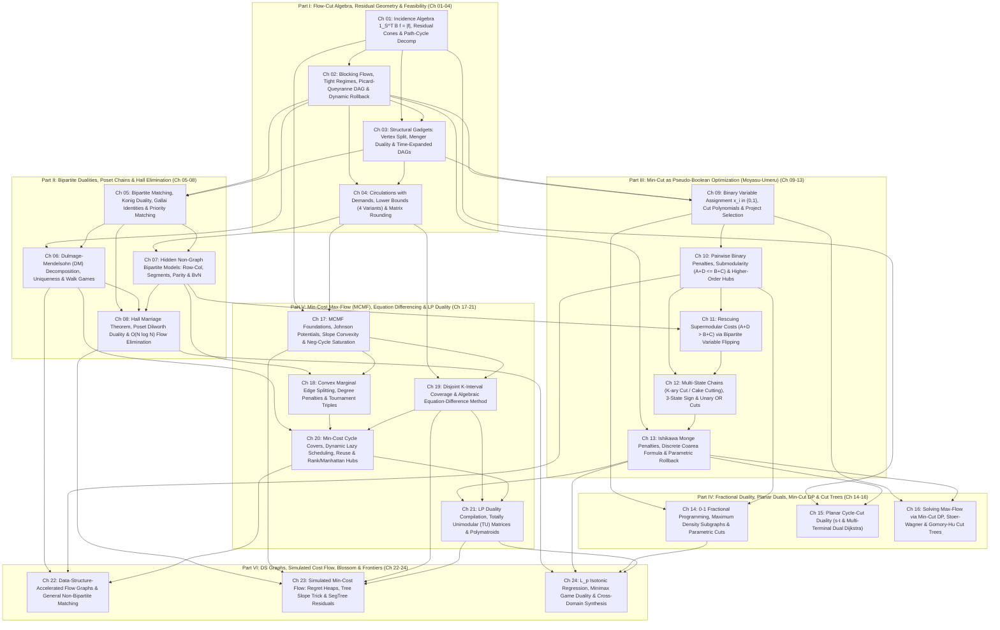

# Canonical Curriculum Architecture Proposal A (Modelling-First): Network Flows, Minimum Cuts, Matching, Duality & Non-Graph Compilation

> **Phase 1.5 Round 1 Master Specification (`proposal_A_modelling_first.md`)**
> **Target Repository**: `/home/maomao90/Documents/IO/ICPC-math-notes`
> **Author**: `FlowDeepInvestigator` (Phase 1.5 Round 1 Curriculum Architect)
> **Accounting Invariant**: `301` Curated Entries = `256` Unique Accepted Non-Template Problems (`192` in `24 × 8` 4-Tier Chapter Ladders + `48` in `6 × 8` Two-Stage Blind Topic-Group Checkpoints + `16` in Multi-Perspective Synthesis Reserve `Syn-01`–`Syn-16`) + `45` Quarantined Templates (`R-01`–`R-45`).

---

## 1. Executive Pedagogical Manifesto & Complete 301-Problem Bijective Accounting Proof

### 1.1 Why Network Flows Demand a "Modelling-First, Zero Magic Gadgets" Architecture

In Formal Power Series (`fps_research/`), algorithmic complexity is split evenly between a rich hierarchy of algebraic/analytic operators and combinatorial translations. In **Network Flows, Minimum Cuts, Matching, and Linear Programming Duality**, the pedagogical reality is radically asymmetric:

1. **The Algorithmic Engine is Compact and Fixed**:
   An elite competitive programmer's library requires at most four black-box solver templates: Dinic's blocking-flow algorithm, Successive Shortest Path (SSP) / Primal–Dual Min-Cost Max-Flow (MCMF) with Johnson potentials, Edmonds' Blossom / Hopcroft–Karp for matching, and Gusfield's Gomory–Hu / Stoer–Wagner for global cuts. Per `AGENTS.md` and `flows_research/PLAN.md`, standard solver templates are assumed to reside in the reader's library and are never dumped as boilerplate code.
2. **Over 90% of Contest Difficulty Lies in Non-Graph Recognition and Mechanical Gadget Compilation**:
   - **The Recognition Chasm ("Why is this a flow problem at all?")**: Flagship modern problems—such as `AtCoder ARC 107 F — Sum of Abs`, `ARC 142 E — Pairing Wizards`, `AGC 038 F — Two Permutations`, `CF 1427 G — One Billion Shades of Grey`, `[NOI2008] 志愿者招募`, and `[省选联考 2020 A 卷] 保序回归`—never mention pipes, capacities, or graphs in the problem statement. They are stated over arrays, permutations, grid cells, absolute-value sums, $\max/\min$ logical implications, intervals, or partial orders.
   - **The "Magic Gadget" Disease of Traditional Editorials**: Conventional tutorials routinely announce *"Split each vertex into $v_{\text{in}}, v_{\text{out}}$, add reverse $\infty$-edges $u_{i,k} \to u_{i,k-1}$, flip the meaning of $S$ and $T$ on odd-parity cells, and subtract $\text{MinCut}$ from $\sum B_i$"* as an unmotivated rabbit pulled out of a hat. A student who memorizes such gadgets without knowing the **intermediate algebraic representation** that forced them is helpless the moment a contest problem alters a sign or an inequality direction.
3. **The Four Pillars of Proposal A's Pedagogical Architecture**:
   - **Pillar 1 — Mandatory 4-Step English-to-Graph Compilation ("Zero Magic Gadgets")**: Every chapter and every problem solution enforces a strict 4-step pipeline:
     $$\text{(1) Non-Graph Diagnostic Signal} \longrightarrow \text{(2) Intermediate Algebraic/Logical Model} \longrightarrow \text{(3) Mechanical Graph Compilation Scratchpad} \longrightarrow \text{(4) Toy Trace \& Broken Gadget Counterexample}.$$
     No directed edge, capacity, lower bound, or cost ever appears before the algebraic term that forces it ($x_u(1 - x_v)$ cut monomial, unary monotone indicator $z_{i,1} \ge z_{i,2} \ge \dots$, consecutive equation difference $E_t - E_{t-1}$, LP dual variable, or Coarea level-set integral $\int |[h_u > \lambda] - [h_v > \lambda]|\,d\lambda$).
   - **Pillar 2 — Bidirectional Duality (Direction A $\leftrightarrow$ Direction B)**:
     - **Direction A (Non-Graph $\to$ Flow Graph)**: Compiling non-graph optimization problems (`ARC 107 F`, `ARC 142 E`, `AGC 038 F`, `NOI2008 志愿者招募`) into polynomial-size flow/cut/MCMF networks when $N \le 500$.
     - **Direction B (Flow Graph $\to$ $O(N \log N)$ Flow-Elimination when $N \le 10^5$)**: Recognizing that a large-scale problem *is* a Max-Flow, Bipartite Matching, or MCMF problem at heart, and then using **Hall's Marriage Theorem** (`ARC 076 F`), **Planar Cycle–Cut Duality** (`[NOI2010] 海拔`, `[CSP-S 2021] 交通规划`), **Max-Flow $\to$ Min-Cut DP** (`CF 724 E`, `CF 1919 F2`), or **Simulated Cost Flow (`模拟费用流`)** (`CF 865 D`, `CF 802 O`, `[ICPC WF 2018] Conquer the World`, `[NOI2019] 序列`) to solve it in $O(N \log N)$ without ever invoking Dinic or SSP!
   - **Pillar 3 — Complete Dissolution of All 10 Research Waves & Multilingual Traditions (`[EN]`/`[ZH]`/`[JA]`)**:
     All 10 Phase-1 research waves (`Wave 1A`–`Wave 5B`, across Cohorts 1, 2, and 3) and all three regional schools—the English combinatorial optimization tradition (`[EN]`), the Chinese National Team monograph tradition (`[ZH]`: Amber/胡伯涛 2007, `网络流 24 题`, `上下界网络流`, `流守恒差分`, `模拟费用流`, `保序回归`), and the Japanese `燃やす埋める` (`Moyasu-Umeru` / Burn-and-Bury) pseudo-Boolean cut school (`[JA]`: `noshi91`, `maspypy`, `tatyam`, `snuke`, `rng_58`)—are dissolved into **6 Parts and 24 Granular Conceptual Chapters** (`Ch 01`–`Ch 24`).
   - **Pillar 4 — Strict Zero-Forward-Reference Closure**:
     Every theorem, compilation rule, failure mode, and practice problem in Chapter $k$ (`Ch 01`–`Ch 24`) or Blind Checkpoint `CP-P` (`CP-I`–`CP-VI`) is 100% solvable using **only** machinery developed in Chapters $1 \dots k$. Multi-modal problems that bridge later chapters are either placed in the **16-Problem Multi-Perspective Synthesis Reserve (`Syn-01`–`Syn-16`)** or cross-indexed in the **Revisited Dual-Perspective Index (§5.2)** with an explicit scoping contract.

---

### 1.2 Master 6-Part, 24-Chapter Architecture & Exact Problem Accounting Table

| Part | Chapters | Part Title & Mathematical / Modelling Scope | Chapter Ladders (`8/Ch`) | Blind Checkpoint (`8/Part`) | Part Accepted Total |
| :-: | :-: | :--- | :-: | :-: | :-: |
| **Part I** | **Ch 01 – Ch 04** | **The Flow–Cut Algebra, Residual Geometry & Feasibility Engines** ($\mathbf{1}_S^\top B f = \lvert f\rvert$, Path–Cycle Decomposition, Picard–Queyranne residual cut lattice, vertex splitting, time-expanded DAGs, circulations with lower bounds `上下界网络流`, Hoffman's theorem & matrix rounding) | `4 × 8 = 32` | `CP-I` (`8`) | **`40`** |
| **Part II** | **Ch 05 – Ch 08** | **Bipartite Dualities, Poset Chains & Hall's Flow-Elimination** (König $\nu = \tau$, Gallai identities, Dulmage–Mendelsohn `DM` decomposition & bipartite walk games, non-graph row/column/segment/parity/Birkhoff–von Neumann models, Hall's theorem $O(N \log N)$ segment-tree elimination & Dilworth poset antichains) | `4 × 8 = 32` | `CP-II` (`8`) | **`40`** |
| **Part III** | **Ch 09 – Ch 13** | **Minimum Cut as Pseudo-Boolean Optimization (`燃やす埋める`, Multi-State Chains & Coarea Cuts)** (Cut polynomials $\sum c_{uv} x_u(1-x_v)$, Project Selection `最大权闭合子图`, Kolmogorov–Zabih submodularity $A+D \le B+C$, bipartite variable inversion `二部グラフの片側反転` & `AGC 038 F`, $K$-state chains `切糕` & `ARC 107 F` / `ARC 142 E`, Ishikawa Monge penalties, Discrete Coarea & `CF 1427 G`) | `5 × 8 = 40` | `CP-III` (`8`) | **`48`** |
| **Part IV** | **Ch 14 – Ch 16** | **Fractional Duality, Planar Duals, Min-Cut DP & All-Pairs Cut Trees** (0-1 fractional programming & Dinkelbach, Goldberg's Maximum Density Subgraph `最大密度子图`, $s$-$t$ & multi-terminal Planar Dual Dijkstra `[NOI2010] 海拔` / `[CSP-S 2021] 交通规划`, Direction B Max-Flow $\to$ Min-Cut DP `CF 724 E` / `CF 1919 F2`, Stoer–Wagner & Gusfield's Gomory–Hu Cut Tree `最小割树`) | `3 × 8 = 24` | `CP-IV` (`8`) | **`32`** |
| **Part V** | **Ch 17 – Ch 21** | **Min-Cost Max-Flow (MCMF), Equation Differencing & Linear Programming Duality** (SSP, Johnson potentials, slope convexity $C(f)$ & WQS binary search, mandatory negative-cycle saturation, convex marginal splitting `凸费用拆边`, consecutive equation differencing `流守恒差分` & `[NOI2008] 志愿者招募`, cycle covers, dynamic lazy scheduling `动态加点`, resource reuse, 2D rank/Manhattan hubs, LP Primal–Dual compilation, TU matrices & polymatroids) | `5 × 8 = 40` | `CP-V` (`8`) | **`48`** |
| **Part VI** | **Ch 22 – Ch 24** | **Data-Structure Graphs, Simulated Cost Flow (`模拟费用流`), Blossom & Cross-Domain Frontiers** (SegTree/PST/CDQ/Trie/KD-tree graph sparsification, Edmonds' Blossom `带花树` & Tutte matrix, Simulated MCMF via regret heaps, tree Leftist heaps `Conquer the World`, SegTree sign-flipping `CF 802 O` & 5-heap bipartite automata `[NOI2019] 序列`, $L_p$ Isotonic Regression `保序回归` via `整体二分`, Minimax & rectilinear geometry) | `3 × 8 = 24` | `CP-VI` (`8`) | **`32`** |
| **Capstone** | **Section 5.1** | **Multi-Perspective Synthesis Reserve (`Syn-01`–`Syn-16`)** (16 disjoint cross-Part synthesis problems solved from two or more distinct flow/duality lenses) | — | — | **`16`** |
| **Quarantine** | **Section 6.1** | **Quarantined Bare Library-Checker / `【模板】` Templates (`R-01`–`R-45`)** (Excluded from all practice ladders; retained as 1-line library verification footnotes) | — | — | **`45`** *(Quarantined)* |
| **TOTAL** | **`24` Chapters** | **100% Bijective Partition of the 301-Entry Curated Pool (`#001`–`#256` + `R-01`–`R-45`)** | **`192`** | **`48`** | **`256` Accepted + `45` Quarantined = `301`** |

---

### 1.3 Complete Dissolution of Phase-1 Research Waves (`Wave 1A`–`Wave 5B`) & Regional Cohorts

| Phase-1 Research Wave / Regional Cohort | Dissolved Into Canonical Chapters | How Artificial Collection Boundaries Are Eliminated |
| :--- | :--- | :--- |
| **`Wave 1A` (Foundations, Residual Anatomy, Gadgets & Lower Bounds)** | **Ch 01, Ch 02, Ch 03, Ch 04** | Splits algebraic incidence & path decomposition (`Ch 01`), blocking-flow complexity & Picard–Queyranne residual SCC cut lattice (`Ch 02`), structural vertex/time-expanded DAG gadgets (`Ch 03`), and lower-bound circulations/matrix rounding (`Ch 04`). |
| **`Wave 1B` (Bipartite Matching, DM Decomposition, Hall & Dilworth)** | **Ch 05, Ch 06, Ch 07, Ch 08** | Separates König/Gallai foundations (`Ch 05`), canonical Dulmage–Mendelsohn `DM` decomposition & impartial walk games (`Ch 06`), non-graph grid/segment/parity/Birkhoff–von Neumann modelling (`Ch 07`), and Hall's $O(N \log N)$ flow-elimination & Dilworth poset duality (`Ch 08`). |
| **`Wave 2A` (Min-Cut Binary Partitioning, Project Selection, Submodularity & Bipartite Flip)** | **Ch 09, Ch 10, Ch 11** | Dedicates `Ch 09` to 1st-order unary assignments & Picard Project Selection (`最大权闭合子图`), `Ch 10` to 2nd-order submodular $A+D \le B+C$ penalties & higher-order clauses, and `Ch 11` to rescuing supermodular $A+D > B+C$ penalties via Bipartite Variable Flipping (`AGC 038 F`). |
| **`Wave 2B` (Multi-State Chains `切糕`, Sign/OR Cuts, Monge & Coarea Parametric Cuts)** | **Ch 12, Ch 13** | Isolates discrete $K$-state ordered unary chains, 3-state sign cuts (`ARC 107 F`), and unary OR thresholds (`ARC 142 E`) in `Ch 12`, before advancing to 2D discrete integration by parts (Ishikawa Monge penalties), the Discrete Coarea Formula, and incremental parametric rollback (`CF 1427 G`) in `Ch 13`. |
| **`Wave 3A` (Fractional Programming, Density Subgraphs, Planar Duals, Min-Cut DP & Cut Trees)** | **Ch 14, Ch 15, Ch 16** | Groups 0-1 fractional programming & Goldberg's Maximum Density Subgraph (`Ch 14`), $s$-$t$ and multi-terminal Planar Dual shortest paths (`Ch 15`), and Direction B Max-Flow $\to$ Min-Cut DP plus Stoer–Wagner / Gomory–Hu Cut Trees (`Ch 16`). |
| **`Wave 3B` (MCMF Potentials, Slope Convexity, Marginal Splitting & Equation Differencing)** | **Ch 17, Ch 18, Ch 19** | Establishes SSP, Johnson potentials, slope convexity $C(f)$, WQS binary search, and mandatory negative-cycle saturation in `Ch 17`; convex marginal edge splitting (`凸费用拆边`) in `Ch 18`; and consecutive equation differencing (`流守恒差分`) in `Ch 19`. |
| **`Wave 4A` (Cycle Covers, Dynamic Lazy Scheduling, Resource Reuse & Rank/Manhattan Hubs)** | **Ch 20** | Unifies bipartite cycle covers, Mixed Chinese Postman, dynamic on-demand vertex spawning (`[NOI2012] 美食节`), Day/Night inventory split (`餐巾计划`), 2D coordinate rank slots (`AGC 031 E`), and 4-sign Manhattan hubs (`AGC 034 D`) inside `Ch 20`. |
| **`Wave 4B` (LP Duality, Totally Unimodular Matrices, Complementary Slackness & Polymatroids)** | **Ch 21** | Places explicit Primal–Dual LP compilation (`LP对偶转网络流`), Complementary Slackness certificate recovery, Totally Unimodular (`TU`) matrices, Consecutive-Ones property, and Polymatroid / Matroid Intersection boundaries in `Ch 21` as the theoretical culmination of Part V. |
| **`Wave 5A` (Data-Structure Sparsification, Simulated Cost Flow & General Blossom Matching)** | **Ch 22, Ch 23** | Pairs Data-Structure-Accelerated Flow Graphs (`数据结构优化建图`) and General Non-Bipartite Matching (`带花树` / Tutte matrix) in `Ch 22`, and dedicates the entirety of `Ch 23` to Simulated Min-Cost Flow (`模拟费用流`). |
| **`Wave 5B` ($L_p$ Isotonic Regression, Minimax Games, Geometry & Multilingual Master Audit)** | **Ch 24 (+ Native Integration across Ch 01–23)** | Synthesizes $L_p$ Isotonic Regression (`保序回归` via `整体二分` + Project Selection), von Neumann Minimax game duality, rectilinear polygon chord bipartitions, and the Grand Unified English-to-Flow Diagnostic Decision Tree in `Ch 24`, while distributing the 24 Network Flow Problems (`网络流 24 题`) and AtCoder `燃やす埋める` classics natively across `Ch 01`–`Ch 23`. |

---

## 2. Strict Prerequisite DAG & Master Mapping of 20 Canonical Gadget Failure Modes

### 2.1 Canonical 24-Chapter Prerequisite DAG

---

### 2.2 Master Mapping of 20 Canonical Gadget Failure Modes & Broken Constructions to Target Chapters

Per Step 4 of the **Zero Magic Gadgets Mandate**, every chapter explicitly proves what breaks when a subtle invariant is violated:

| Failure # | Hazard Category | Specific Broken Gadget / Counterexample | Target Home Chapter & Sub-Section | Exact Mathematical Remedy Taught |
| :-: | :--- | :--- | :-: | :--- |
| **FM-01** | **Residual Algebra** | Confusing **residual flow cancellation** ($f_{vu} = -f_{uv}$) with physical two-way travel, or adding two independent directed edges without shared skew-symmetric residual memory | **Ch 01 (1.2)** & **Ch 03 (3.2)** | Prove net flux identity $\mathbf{1}_S^\top B f = \lvert f\rvert$; show how independent directed edges allow simultaneous opposite flows to cancel physically without freeing capacity. |
| **FM-02** | **Residual Cut Lattice** | Claiming a saturated edge $f^*(u,v) = c(u,v)$ with $u \in S_{\min}, v \notin S_{\min}$ is automatically an **essential** min-cut edge (or feasible whenever saturated) | **Ch 02 (2.3)** | Contract residual SCCs (`[AHOI2009] 最小割`): feasible $\iff f^*(e)=c(e) \land \operatorname{scc}(u) \neq \operatorname{scc}(v)$; essential $\iff f^*(e)=c(e) \land \operatorname{scc}(u)=\operatorname{scc}(s) \land \operatorname{scc}(v)=\operatorname{scc}(t)$. |
| **FM-03** | **Vertex Splitting** | Wiring an undirected vertex-capacitated graph by connecting $(u,v)$ directly between unsplit nodes or orienting $v_{\text{out}} \to v_{\text{in}}$ with capacity $\infty$ | **Ch 03 (3.1)** | Split $v_{\text{in}} \xrightarrow{C_v} v_{\text{out}}$; every incoming external arc enters $v_{\text{in}}$ and every outgoing external arc leaves $v_{\text{out}}$. |
| **FM-04** | **Lower Bounds** | Adding feedback edge $t \to s$ with capacity $\infty$ to the **auxiliary** nodes $S^* \to T^*$ instead of the **original** sink-to-source $t \xrightarrow{[0, \infty)} s$, or forgetting to delete $t \to s$ before running second-stage max/min flow | **Ch 04 (4.2)** | In `有源汇上下界`: add $t \xrightarrow{[0,\infty)} s$ to convert $s$-$t$ flow into a circulation, saturate $S^* \to T^*$, record $f_0 = f(t \to s)$, **remove** $t \to s$, then augment $s \to t$ (Max) or $t \to s$ (Min). |
| **FM-05** | **König / Alternating** | Starting the alternating reachability DFS for Minimum Vertex Cover from **all** left vertices $L$ instead of **only unmatched** left vertices $U_L$ | **Ch 05 (5.2)** | Starting from matched $u \in L$ traverses non-matching edges illegally; start strictly from $U_L = L \setminus V(M)$ via alternating paths ($\notin M$ left-to-right, $\in M$ right-to-left) so $\text{MVC} = (L \setminus Z) \cup (R \cap Z)$. |
| **FM-06** | **Poset Dilworth** | Applying bipartite path-cover ($\lvert V\rvert - \nu(G_{\text{bip}})$) directly to a non-transitive DAG to compute Maximum Antichain (`[CTSC2008] 祭祀`) without taking transitive closure | **Ch 08 (8.3)** | Without transitive closure, paths cannot skip shared intermediate vertices (computing disjoint path cover instead of general path cover / Dilworth antichain). Take Floyd–Warshall transitive closure first! |
| **FM-07** | **Project Selection** | Including positive-profit vertices that lie on or depend on a **directed cycle** (`[NOI2009] 植物大战僵尸`) in Picard's closure graph | **Ch 09 (9.3)** | Any vertex in a cycle (or unable to reach $T$ in the reverse dependency graph) has $x_u = 1$ locked out by causality, yet Picard's cut will greedily place the whole cycle in $S$ for free ($0$ cut cost). Prune via reverse Kahn topological sort first! |
| **FM-08** | **Pairwise Submodularity** | Using an **undirected** edge or omitting the $S/T$ unary degree offsets when compiling a symmetric $2 \times 2$ penalty matrix | **Ch 10 (10.2)** | Prove the exact polynomial identity $A(1-x_u)(1-x_v) + B(1-x_u)x_v + C x_u(1-x_v) + D x_u x_v$; show when half-integral symmetric merging (`合并点边法`) is valid vs. when asymmetric integer compilation is required. |
| **FM-09** | **Bipartite Flip** | Attempting variable inversion $y_v = 1 - x_v$ to rescue a supermodular penalty ($A + D > B + C$) on a graph containing an **odd cycle** | **Ch 11 (11.1)** | On an odd cycle, flipping one endpoint per edge leaves at least one monochromatic edge unflipped, reducing to NP-hard Max-Cut. Prove that bipartite conflict topology is necessary and sufficient. |
| **FM-10** | **Multi-State Chains** | Omitting the **reverse $\infty$-edges** $u_{i,k} \to u_{i,k-1}$ along a $K$-state vertex chain (`[HNOI2013] 切糕`) | **Ch 12 (12.1)** | Without reverse $\infty$-edges, when cross-chain penalties are large, the min-cut severs **two or more** forward edges on the same chain ($z_{i,k-1} = 0, z_{i,k} = 1$), producing an invalid non-unary state! |
| **FM-11** | **3-State Sign Cut** | Assigning states $\{-1, \text{deleted}, +1\}$ in the non-convex order $(-1, +1, \text{deleted})$ instead of $(-1, \text{deleted}, +1)$ in `ARC 107 F — Sum of Abs` | **Ch 12 (12.2)** | Ordering $(-1, 0, +1)$ guarantees that forbidding simultaneous $-1$ and $+1$ for adjacent $(u,v)$ is the submodular constraint $z_{u,1}(1 - z_{v,2}) = 0 \implies (u,1) \xrightarrow{\infty} (v,2)$. Permuting the middle state destroys submodularity! |
| **FM-12** | **Unary OR Layering** | Attempting to model disjunctive condition $\max(a_u - x_u, a_v - y_v) \ge 0$ (`ARC 142 E`) directly without **bipartite role splitting** and **unary threshold inversion** | **Ch 12 (12.3)** | A disjunction $P \lor Q$ is equivalent to the implication $\neg P \implies Q$; split wizards into Low ($\le \min(c_u,c_v)$, clipped immediately) and High, and wire $\infty$-edges from "fails high threshold on $u$" to "meets high threshold on $v$". |
| **FM-13** | **Density Subgraph** | Forgetting to shift edge capacities by $+\underline{U}$ ($U = \sum d_v$) in Goldberg's $|V|$-only degree formula, or dividing by $0$ on empty $S = \emptyset$ | **Ch 14 (14.2)** | In Goldberg's $|V|$-only model, node weights $2g - d_v$ can be negative; shifting every $S \to v$ capacity by $+U$ ensures non-negative capacities, and fixing a vertex or binary-searching $g > 0$ prevents $S = \emptyset$. |
| **FM-14** | **Planar Duals** | Applying $s$-$t$ Outer-Face Dual Shortest Path when $s$ and $t$ do **not** lie on the same face, or confusing clockwise vs. counter-clockwise dual arc orientation (`[NOI2010] 海拔`) | **Ch 15 (15.1 & 15.2)** | Prove right-hand rule orientation $e = (u \to v) \implies e^* = (f_{\text{left}} \to f_{\text{right}})$ for directed planar $s$-$t$ cuts, and Reif's incision path for interior $s, t$. |
| **FM-15** | **Gomory–Hu Tree** | Contracting the non-selected side $V \setminus S$ in Gusfield's $N-1$ max-flow algorithm, or assuming the $u$-$v$ min-cut edge in $T_{\text{GH}}$ is an actual edge of $G$ | **Ch 16 (16.3)** | Prove Gusfield's uncrossing invariant: tree edges of $T_{\text{GH}}$ represent **fundamental cuts** (partitions of $V$), not physical edges of $G$; contracting subsets is unnecessary in Gusfield's pointer array. |
| **FM-16** | **MCMF Potentials** | Running Dijkstra with Johnson potentials $\pi(v)$ on an initial network containing **negative-cost edges** without DAG/Bellman–Ford initialization, or on a network with **negative-cost cycles** | **Ch 17 (17.1 & 17.4)** | Initialize $\pi(v)$ via topological DP (if acyclic) or SPFA; if negative-cost cycles exist (`CF 708 D`), saturate every negative-cost edge $e$ ($f(e) \gets c(e)$, reverse edge cost $-c > 0$) and resolve imbalance via lower-bound demand flow! |
| **FM-17** | **Convex Splitting** | Applying parallel marginal edge splitting $\Delta g(k) = g(k) - g(k-1)$ to a **concave** or non-monotone cost function ($g(k+1) - g(k) < g(k) - g(k-1)$) | **Ch 18 (18.1)** | If $\Delta g(1) > \Delta g(2)$, SSP greedily routes flow through the cheaper 2nd unit edge *before* the 1st unit edge (`k=2` before `k=1`), violating unary prefix order! Convexity $\Delta^2 g \ge 0$ is mandatory. |
| **FM-18** | **Equation Difference** | Forgetting the boundary dummy equation $E_{n+1}: 0 = 0$ when taking consecutive differences $E_t - E_{t-1}$ (`[NOI2008] 志愿者招募`) | **Ch 19 (19.2)** | Without $E_{n+1} - E_n$, each interval variable $x_i$ ($[l_i, r_i]$) has $+x_i$ at node $l_i$ but no matching $-x_i$ at node $r_i + 1$, breaking flow conservation $\sum_t \operatorname{div}_f(t) = 0$! |
| **FM-19** | **Dynamic Lazy MCMF** | Pre-allocating all $N \times M \times P$ waiting-slot edges in `[NOI2012] 美食节`, or spawning the $(k+1)$-st slot for **all** chefs instead of only the single chef saturated by the augmenting path | **Ch 20 (20.2)** | By convexity $1 \cdot t_{i,j} < 2 \cdot t_{i,j} < \dots < k \cdot t_{i,j}$, slot $k+1$ of chef $j$ is never needed until slot $k$ is saturated. Spawning 1 vertex per augmentation keeps $\lvert V\rvert \le N + M + P \le 1300$! |
| **FM-20** | **Simulated MCMF** | Omitting the **residual cross-cancellation state** (e.g., using 2 heaps instead of the 5-heap / 6-node bridge automaton in `[NOI2019] 序列`, or forgetting to flip subarray signs $w_i \gets -w_i$ on the segment tree spine in `CF 802 O` / `CF 280 D`) | **Ch 23 (23.3 & 23.4)** | Every simulated augmenting path must update the exact residual back-edges: pushing flow along a shared-middle bridge flips its residual capacity, requiring explicit cross-pair regret heaps (`[NOI2019] 序列`) or $+1 \leftrightarrow -1$ segment-tree range inversion (`CF 802 O`). |

---

## 3. Granular 24-Chapter Curriculum Blueprint & Complete 8-Problem Ladders (`192` Problems)

---

### Part I: The Flow–Cut Algebra, Residual Geometry & Feasibility Engines (`Ch 01` – `Ch 04`)

#### Chapter 01: The Flow–Cut Incidence Algebra, Residual Cones & Path–Cycle Decomposition
* **Prerequisites**: None (Entry Point of the Curriculum).
* **Dissolved Research Sources**: `Wave 1A` (§2.1–2.2, §4.3, §7.1).
* **Sub-Sections**:
  * **1.1 The Node–Arc Incidence Algebra & Fundamental Cut Flux Identity**:
    * Defining the node–arc incidence matrix $B \in \{-1, 0, +1\}^{V \times E}$ ($B_{v,e} = +1$ if $e \in \delta^+(v)$, $-1$ if $e \in \delta^-(v)$), divergence $B f = \lvert f\rvert(\mathbf{e}_s - \mathbf{e}_t)$, and multiplying on the left by the cut indicator vector $\mathbf{1}_S^\top$ ($s \in S, t \notin S$) to obtain the **Fundamental Flow–Cut Identity** in one line of linear algebra:
      $$\lvert f\rvert = \mathbf{1}_S^\top B f = \sum_{e \in \delta^+(S)} f(e) - \sum_{e \in \delta^-(S)} f(e) \le \sum_{e \in \delta^+(S)} c(e) = c(\delta^+(S)).$$
    * **Complementary Tightness Corollary**: $\lvert f\rvert = c(\delta^+(S))$ holds if and only if **every forward cut edge is saturated** ($f(e) = c(e)$ for all $e \in \delta^+(S)$) and **every backward cut edge is empty** ($f(e) = 0$ for all $e \in \delta^-(S)$).
  * **1.2 Skew-Symmetric Residual Cones & Failure Mode FM-01 (Cancellation vs. Physical Reverse Travel)**:
    * Skew-symmetry $f(v, u) = -f(u, v)$ and residual capacity $c_f(u, v) = c(u, v) - f(u, v)$; why pushing $\Delta$ along residual back-edge $(v, u)$ algebraically **cancels** prior forward flow on $(u, v)$ and splices two crossing paths $(s \leadsto u \to v \leadsto t)$ and $(s \leadsto v \to u \leadsto t)$ into two non-crossing paths $(s \leadsto u \leadsto t)$ and $(s \leadsto v \leadsto t)$ without any agent walking backward!
    * **Ford–Fulkerson Constructive Proof of the Max-Flow Min-Cut Theorem**: termination when $S^* = \{v \in V : s \leadsto_{G_f} v\}$ excludes $t$, proving $c_f(u,v) = 0$ on $\delta_{G_f}^+(S^*)$.
  * **1.3 The Path–Cycle Decomposition Theorem & $O(V + E)$ Constructive Route Extraction**:
    * **Theorem**: Every integral $s$-$t$ flow $f$ decomposes into at most $E$ directed $s$-$t$ paths and directed cycles; on unit-capacity networks, pointer-advancing DFS extracts all $\lvert f^*\rvert$ edge-disjoint $s$-$t$ routes in $O(E)$ time (`CSES 1711`).
  * **1.4 Preemptive Multi-Processor Interval Scheduling & Horn's Theorem**:
    * Compiling jobs $j \in \{1, \dots, N\}$ with release times $r_j$, deadlines $d_j$, processing lengths $p_j$, and $M$ identical parallel machines by partitioning the timeline at the $2N$ sorted coordinates $t_0 < t_1 < \dots < t_K$ into elementary intervals $I_k = [t_{k-1}, t_k]$ of length $\Delta_k = t_k - t_{k-1}$;
    * **McNaughton's Wrap-Around Rule**: why $x_{j,k} \le \Delta_k$ (a job never runs on two machines simultaneously) and $\sum_j x_{j,k} \le M \Delta_k$ (at most $M$ machines busy) are both necessary and sufficient to reconstruct a conflict-free preemptive schedule inside each elementary interval (`Luogu P3254` / `POJ 3498`).
* **4-Step Zero-Magic Compilation Scratchpad**:
  1. **Diagnostic Signal**: Divisible or unit items routed from sources to sinks under conservation $\sum_{\text{in}} = \sum_{\text{out}}$ and capacity caps, or preemptive interval workloads $[r_j, d_j]$.
  2. **Intermediate Algebraic Model**: Flow vector $0 \le f_e \le c_e$ with $B f = d$, or bipartite assignment matrix $0 \le x_{j,k} \le \min(\text{cap}_j, \text{cap}_k)$ with row sums $= p_j$ and column sums $\le M \Delta_k$.
  3. **Mechanical Graph Compilation**: Each conservation equation $v$ becomes a vertex; each bounded non-negative variable $x_{uv} \in [0, c_{uv}]$ with $+1$ in equation $u$ and $-1$ in equation $v$ becomes directed edge $u \xrightarrow{c_{uv}} v$.
  4. **Broken Gadget Counterexample (`FM-01`)**: Creating two separate edges $u \to v$ and $v \to u$ without shared residual cancellation allows $f(u\to v)=1$ and $f(v\to u)=1$ simultaneously, which cancels in net flux while consuming $2$ units of physical edge capacity.
* **4-Tier Practice Ladder (`8` Disjoint Problems)**:

| Slot | Pool ID | Problem ID & Title | Wave Source | Key Algebraic / Structural Compilation & Why Placed Here |
| :-: | :-: | :--- | :-: | :--- |
| **SS-1** | `#001` | **CSES 1711 — Distinct Routes** (`[EN]`) | `1A-P02` | Unit-capacity $s$-$t$ max-flow + $O(E)$ pointer-advancing Path–Cycle Decomposition (`1.3`). |
| **SS-2** | `#002` | **Luogu P2763 — [网络流24题] 试题库问题** (`[ZH]`) | `1A-P05` | Multi-category subset selection compiled as a 2-layer bipartite conservation network (`1.1`). |
| **Int-1** | `#003` | **Luogu P3254 — [网络流24题] 圆桌问题** (`[ZH]`) | `1A-P21` | Elementary bipartite capacity allocation $x_{i,j} \in \{0,1\}$ with row/column sum bounds (`1.4`). |
| **Int-2** | `#004` | **CF 653D — Delivery Bears** (`[EN]`) | `1A-P12` | Binary search on per-bear weight $w$ + scaled integer capacities $\lfloor c_e / w \rfloor$ (`1.1`). |
| **Adv-1** | `#005` | **POJ 3498 / UVa 12125 — March of the Penguins** (`[EN]`) | `1A-P21` | All-sinks $t \in V$ conservation feasibility test with capacity reset (`1.2`). |
| **Adv-2** | `#006` | **Horn's Preemptive Scheduling (`POJ 3498 Variant` / `Elementary Intervals`)** (`[EN]`) | `1A-§4.3` | Coordinate-compressed elementary intervals $[t_{k-1}, t_k]$ + McNaughton wrap-around reconstruction (`1.4`). |
| **Mas-1** | `#007` | **CQOI2014 / Luogu P3163 — 危桥 (Dangerous Bridges)** (`[ZH]`) | `1A-P20` | 2-commodity undirected flow via **Okamura–Seymour Swap** ($\text{MaxFlow}(a_1+b_1 \to a_2+b_2)$ and $\text{MaxFlow}(a_1+b_2 \to a_2+b_1)$) (`1.2`). |
| **Mas-2** | `#008` | **CF 611H — New Year and Forgotten Tree** (`[EN]`) | `1A-P27` | Prüfer / spanning tree on $m \le 6$ digit-length buckets + multi-bucket edge-allocation flow (`1.1`). |

---

#### Chapter 02: Blocking Flows, Tight Complexity Regimes & The Residual Cut Lattice (`Picard–Queyranne DAG`)
* **Prerequisites**: `Ch 01`.
* **Dissolved Research Sources**: `Wave 1A` (§2.3–2.5, §3.1–3.4, §7.3).
* **Sub-Sections**:
  * **2.1 Dinic's Level Graph, Current-Arc Pointer & Tight Complexity Regimes**:
    * Strict monotonicity of level distance $d_{G_{f'}}(s, t) \ge d_{G_f}(s, t) + 1$ after each blocking flow ($\le V - 1$ phases) and why the current-arc pointer `cur[u]` bounds each phase by $O(VE)$ for $O(V^2 E)$ general worst-case time;
    * **Unit-Capacity Regimes (Full Potential-Cut Proof)**:
      1. *Unit-Edge Networks ($c(e) = 1$)*: After $D$ phases, $\lvert f^*\rvert - \lvert f\rvert \le \min(E / D, (V / D)^2)$, yielding **$O(E \min(E^{1/2}, V^{2/3}))$**.
      2. *Unit-Vertex Networks ($\min(\text{in-cap}(v), \text{out-cap}(v)) \le 1$)*: Blocking paths are vertex-disjoint on internal nodes, so after $D = \lfloor\sqrt{V}\rfloor$ phases, at most $V / D = \sqrt{V}$ vertex-disjoint augmenting paths remain, giving **$O(E\sqrt{V})$**!
  * **2.2 Submodularity of Cut Capacity & The Distributive Lattice of Minimum Cuts ($\mathcal{L}_{\min}$)**:
    * Proving $c(\delta^+(A)) + c(\delta^+(B)) = c(\delta^+(A \cup B)) + c(\delta^+(A \cap B)) + c(E(A \setminus B, B \setminus A)) + c(E(B \setminus A, A \setminus B)) \ge c(\delta^+(A \cup B)) + c(\delta^+(A \cap B))$;
    * Why $A, B \in \mathcal{L}_{\min} \implies A \cap B, A \cup B \in \mathcal{L}_{\min}$, yielding a unique **source-minimal cut $S_{\min}$** (forward reachable from $s$ in $G_{f^*}$) and **source-maximal cut $S_{\max}$** ($V \setminus T_{\min}$, where $T_{\min}$ is backward reachable to $t$ in $G_{f^*}$), and why the minimum cut is **unique iff $S_{\min} = S_{\max}$** (`UVa 10480`).
  * **2.3 Picard–Queyranne DAG & Tarjan SCC Characterization of Feasible vs. Essential Cut Edges (`[AHOI2009] 最小割`)**:
    * **Theorem**: A partition $(S, \bar{S})$ with $s \in S, t \in \bar{S}$ is a minimum $s$-$t$ cut iff $\delta_{G_{f^*}}^+(S) = \emptyset$ (it is a **closed set** in $G_{f^*}$). Contracting the Strongly Connected Components (SCCs) of $G_{f^*}$ yields the **Picard–Queyranne DAG**;
    * **Exact Edge Classification (`FM-02`)**: For any original edge $e = (u, v)$:
      1. **Feasible Min-Cut Edge (`可行边`, in *some* min-cut)**: $f^*(e) = c(e)$ **and** $\operatorname{scc}(u) \neq \operatorname{scc}(v)$ in $G_{f^*}$.
      2. **Essential Min-Cut Edge (`必须边`, in *every* min-cut)**: $f^*(e) = c(e)$ **and** $\operatorname{scc}(u) = \operatorname{scc}(s)$ **and** $\operatorname{scc}(v) = \operatorname{scc}(t)$ in $G_{f^*}$.
  * **2.4 Dynamic Edge Deletion, Flow Rollback (`退流`) & $2^K$ Cut-Mask Precomputation**:
    * **Lexicographically Smallest Minimum Cut (`[SDOI2014] LIS`)**: Testing whether saturated $e = (u, v)$ can be cut ($u \not\leadsto_{G_{f^*}} v$), then rolling back $k = f^*(e)$ units of flow in two Dinic calls (`dinic(t, v, k)` and `dinic(u, s, k)`) and zeroing $e$ without re-running max-flow from scratch!
    * **Low-Rank Parametric Capacity Queries (`CF 1383 F`)**: When $K \le 10$ special edges change capacity across $Q = 2 \cdot 10^5$ queries, precomputing the residual max-flow across all $2^K$ subsets of saturated special edges via DFS with persistent residual snapshots in $O(2^K E)$ and answering each query in $O(2^K)$.
* **4-Step Zero-Magic Compilation Scratchpad**:
  1. **Diagnostic Signal**: Questions asking *"Which edges can/must be cut?"*, *"Is the min-cut unique?"*, *"Find the lexicographically first min-cut"*, or *"Answer $Q$ capacity-update queries on $K \le 10$ edges"*.
  2. **Intermediate Algebraic Model**: $\delta_{G_{f^*}}^+(S) = \emptyset \iff \forall (x \to y) \in E(G_{f^*}),\, x \in S \implies y \in S$.
  3. **Mechanical Graph Compilation**: Run Dinic once to get $G_{f^*}$; run Tarjan's SCC on edges with $c_{f^*}(x, y) > 0$; read feasible/essential status directly from $\operatorname{scc}(u), \operatorname{scc}(v), \operatorname{scc}(s), \operatorname{scc}(t)$.
  4. **Broken Gadget Counterexample (`FM-02`)**: Checking only $u \in S_{\min}$ and $v \notin S_{\min}$ misses essential edges when $S_{\min} \subsetneq S_{\max}$; checking only $f^*(u,v) = c(u,v)$ marks edges inside a residual cycle ($\operatorname{scc}(u) = \operatorname{scc}(v)$) as feasible when no cut can ever separate $u$ and $v$.
* **4-Tier Practice Ladder (`8` Disjoint Problems)**:

| Slot | Pool ID | Problem ID & Title | Wave Source | Key Algebraic / Structural Compilation & Why Placed Here |
| :-: | :-: | :--- | :-: | :--- |
| **SS-1** | `#009` | **ZOJ 2587 / UVa 10480 — Unique Attack** (`[EN]`) | `1A-P23` | Uniqueness test $S_{\min} = S_{\max}$ via forward BFS from $s$ and reverse BFS from $t$ in $G_{f^*}$ (`2.2`). |
| **SS-2** | `#010` | **Luogu P2766 — [网络流24题] 最长不下降子序列问题** (`[ZH]`) | `1A-P06` | Layered LIS DAG $dp[i] = dp[j] + 1$ + endpoint capacity unlocking (`2.1`). |
| **Int-1** | `#011` | **AHOI2009 / Luogu P4126 — 最小割** (`[ZH]`) | `1A-P09` | Canonical Tarjan SCC classification of feasible (`可行边`) vs. essential (`必须边`) min-cut edges (`2.3`). |
| **Int-2** | `#012` | **TJOI2010 / Luogu P3324 — [BZOJ 1834] 网络扩容 (Part 1 Capacity Sensitivity)** (`[ZH]`) | `1A-§3.4` | Identifying saturated cut edges whose capacity increase strictly increases max-flow (`u` in $\operatorname{scc}(s)$ or reachable, `v` in $\operatorname{scc}(t)$) (`2.3`). |
| **Adv-1** | `#013` | **CF 498C — Array and Operations** (`[EN]`) | `1A-P13` | Odd/even index bipartition decoupled by prime factor $p$, solved via Dinic per prime (`2.1`). |
| **Adv-2** | `#014` | **ABC 263 G — Erasing Prime Sums** (`[JA]`) | `1A-P28` | Parity bipartition for primes $p \ge 3$ + self-pairing bottleneck for $1 + 1 = 2$ via residual slack (`2.1`). |
| **Mas-1** | `#015` | **SDOI2014 / Luogu P3308 — LIS** (`[ZH]`) | `1A-P24` | Lexicographically smallest minimum cut on the LIS layered DAG via greedy reachability test + **Dynamic Flow Rollback (`退流`)** (`2.4`). |
| **Mas-2** | `#016` | **CF 1383F — Special Edges** (`[EN]`) | `1A-P25` | $2^K$ cut-mask precomputation on persistent residual graphs with Ford–Fulkerson incremental augmentation + $O(2^K)$ query evaluation (`2.4`). |

---

#### Chapter 03: Structural Graph Compilation: Vertex Splitting, Menger's Duality & Time-Expanded DAGs
* **Prerequisites**: `Ch 01`, `Ch 02`.
* **Dissolved Research Sources**: `Wave 1A` (§4.1–4.2, §7.3).
* **Sub-Sections**:
  * **3.1 Vertex-to-Edge Compilation (`拆点法` / Vertex Splitting) & Menger's Three Theorems**:
    * Compiling node inequality $0 \le \sum_{e \in \delta^-(v)} f(e) = \sum_{e \in \delta^+(v)} f(e) \le C_v$ by introducing slack $s_v \ge 0$ so $\sum_{\text{in}} f(e) + s_v = C_v$ (at $v_{\text{in}}$) and $\sum_{\text{out}} f(e) + s_v = C_v$ (at $v_{\text{out}}$), linked by the single internal bridge $v_{\text{in}} \xrightarrow{C_v} v_{\text{out}}$ (`FM-03`);
    * **Menger's Edge-Disjoint, Vertex-Disjoint, and Undirected Connectivity Theorems** proved as immediate corollaries of unit-capacity and unit-vertex max-flow min-cut duality ($O(E\sqrt{V})$ by `Ch 02.1`).
  * **3.2 Compact Undirected-to-Directed Edge Compilation**:
    * Replacing an undirected edge $\{u, v\}$ of capacity $C$ with a single anti-parallel pair initialized to `cap(u->v) = C` and `cap(v->u) = C` (saving $2\times$ memory and edges over two separate directed edges).
  * **3.3 Hub Sparsification for Clique Transitions (`Row/Column` & `Factor` Hubs)**:
    * When any pair of vertices in a group $G_k$ (e.g., same row $r$, same column $c$, or divisible by prime $p$) can transition to each other or be destroyed together (`ARC 074 F`), replacing the $\binom{\lvert G_k\rvert}{2}$ clique with a star hub $H_k$ where $v_{\text{out}} \xrightarrow{\infty} H_k \xrightarrow{\infty} v_{\text{in}}$ reduces $O(N^2)$ edges to $O(N)$.
  * **3.4 Time-Expanded Layered DAGs (`分层图` / `动态加层`)**:
    * Unrolling state $\times$ time $(u, t) \in V \times \{0, 1, \dots, T\}$ when capacities or edges depend on discrete time steps (`[CTSC1999] 星际转移`):
      - **Hold edges**: $(u, t-1) \xrightarrow{C_{\text{hold}}(u)} (u, t)$ (agents waiting at station $u$);
      - **Transit edges**: $(u, t-1) \xrightarrow{C_e(t)} (v, t)$ (shuttle/corridor moving from $u$ to $v$ during $[t-1, t]$);
    * **Incremental Layer Addition (`动态加层`)**: instead of binary searching $T$ and rebuilding from scratch, append layer $t$ to the **existing residual graph $G_f$** and call `dinic(S, T)` incrementally!
* **4-Step Zero-Magic Compilation Scratchpad**:
  1. **Diagnostic Signal**: Node destruction/toll capacities ("block at most $k$ intersections", "pillars hold $h_{r,c}$ lizards"), clique jumps along rows/columns, or periodic shuttles moving agents across discrete time steps.
  2. **Intermediate Algebraic Model**: Node throughput $\sum_{e \in \delta^-(v)} f_e \le C_v$; time-indexed conservation $\operatorname{in}(u, t) = \operatorname{out}(u, t)$ across $t = 0, 1, \dots, T$.
  3. **Mechanical Graph Compilation**: Split $v \mapsto (v_{\text{in}} \xrightarrow{C_v} v_{\text{out}})$; wire external $(u, v)$ as $u_{\text{out}} \xrightarrow{c_{uv}} v_{\text{in}}$; unroll time $t$ incrementally on the persistent residual network.
  4. **Broken Gadget Counterexample (`FM-03`)**: Connecting undirected $(u, v)$ as $u_{\text{in}} \leftrightarrow v_{\text{in}}$ bypasses the internal capacity bridge $u_{\text{in}} \to u_{\text{out}}$, allowing infinite flow through vertex $u$.
* **4-Tier Practice Ladder (`8` Disjoint Problems)**:

| Slot | Pool ID | Problem ID & Title | Wave Source | Key Algebraic / Structural Compilation & Why Placed Here |
| :-: | :-: | :--- | :-: | :--- |
| **SS-1** | `#017` | **CF 546E — Soldier and Traveling** (`[EN]`) | `1A-P01` | 1-step time-expanded bipartite graph $u_{\text{in}} \to v_{\text{out}}$ verifying $\sum a_i = \sum b_i = \lvert f^*\rvert$ (`3.1, 3.4`). |
| **SS-2** | `#018` | **USACO 5.4 / Luogu P1345 — Telecowmunication** (`[EN]`/`[ZH]`) | `1A-P03` | Canonical Menger vertex-cut compilation via $v_{\text{in}} \xrightarrow{1} v_{\text{out}}$ in $O(E\sqrt{V})$ (`3.1`). |
| **Int-1** | `#019` | **ABC 239 G — Builder Takahashi** (`[JA]`) | `1A-P07` | Weighted minimum $s$-$t$ vertex cut via $v_{\text{in}} \xrightarrow{c_v} v_{\text{out}}$ + reachable $S_{\min}$ vertex recovery (`3.1`). |
| **Int-2** | `#020` | **SCOI2007 / Luogu P2472 — 蜥蜴 (Lizards)** (`[ZH]`) | `1A-P11` | Pillar durability $p_{\text{in}} \xrightarrow{h_{r,c}} p_{\text{out}}$ + Euclidean jump DAG (`3.1`). |
| **Adv-1** | `#021` | **ARC 074 F — Lotus Leaves** (`[JA]`) | `1A-P14` | Row-hub $R_r$ and Column-hub $C_c$ clique sparsification (`3.3`) reducing $O(H^2 W + H W^2)$ to $O(HW\sqrt{H+W})$. |
| **Adv-2** | `#022` | **CTSC1999 / Luogu P2754 — [网络流24题] 家园 / 星际转移问题** (`[ZH]`) | `1A-P10` | DSU reachability check + **Time-Expanded Layered DAG with Incremental Layer Addition (`动态加层`)** (`3.4`). |
| **Mas-1** | `#023` | **Luogu P2756 / P2764 — [网络流24题] 飞行员配对 / 最小路径覆盖问题** (`[ZH]`) | `5B-§6.1` | Vertex-splitting compilation of DAG Minimum Disjoint Path Cover ($\lvert V\rvert - \text{MaxFlow}$ on $V_{\text{out}} \to V_{\text{in}}$) (`3.1`). |
| **Mas-2** | `#024` | **BOI 2002 / Luogu P5039 — Escape** (`[EN]`) | `5B-P12` | Continuous-to-discrete Minkowski circle intersection graph + vertex-split barrier cut (`3.1`). |

---

#### Chapter 04: Circulations with Demands, Lower Bounds (`上下界网络流`) & Matrix Rounding
* **Prerequisites**: `Ch 02`, `Ch 03`.
* **Dissolved Research Sources**: `Wave 1A` (§5.1–5.5, §7.2).
* **Sub-Sections**:
  * **4.1 The Base-Flow Shift $f(e) = l(e) + \tilde{f}(e)$ & Net Demand Imbalance $M(v)$**:
    * Substituting $f(e) = l(e) + \tilde{f}(e)$ with $0 \le \tilde{f}(e) \le u(e) - l(e)$ transforms lower-bound conservation into $\operatorname{div}_{\tilde{f}}(v) = M(v) := \sum_{e \in \delta^-(v)} l(e) - \sum_{e \in \delta^+(v)} l(e)$;
    * Wiring super-source $S^* \xrightarrow{M(v)} v$ (for $M(v) > 0$) and $v \xrightarrow{-M(v)} T^*$ (for $M(v) < 0$): a feasible circulation exists iff $\text{MaxFlow}(S^*, T^*) = \sum_{M(v)>0} M(v)$.
  * **4.2 Complete 4-Variant Taxonomy of Flows with Lower Bounds (`上下界网络流`) & Failure Mode FM-04**:
    1. **Variant 1 (`无源汇上下界可行流`)**: Pure circulation via $S^* \to T^*$.
    2. **Variant 2 (`有源汇上下界可行流`)**: Add feedback arc $t \xrightarrow{[0, \infty)} s$ to absorb net throughput $\lvert f\rvert$, then solve Variant 1.
    3. **Variant 3 (`有源汇上下界最大流`)**: Run Variant 2, record $f_0 = f(t \to s)$, **delete $t \to s$ and its residual edge** (`FM-04`), and run `dinic(s, t)` on the remaining residual graph: $\lvert f_{\max}\rvert = f_0 + \Delta f_{s \to t}$.
    4. **Variant 4 (`有源汇上下界最小流`)**: Run Variant 2, record $f_0 = f(t \to s)$, **delete $t \to s$**, and push flow **backward** from $t$ to $s$ via `dinic(t, s)` to cancel excess flow: $\lvert f_{\min}\rvert = f_0 - \Delta f_{t \to s}$.
  * **4.3 Hoffman's Circulation Theorem & Constructive Infeasibility Certificates**:
    * **Hoffman's Theorem (1960)**: A circulation $l \le f \le u$ exists iff $\sum_{e \in \delta^-(S)} l(e) \le \sum_{e \in \delta^+(S)} u(e)$ for all $S \subseteq V$;
    * **Extracting the Violated Subset (`Wave 1A §7.2`)**: When $\text{MaxFlow}(S^*, T^*) < \sum_{M(v)>0} M(v)$, the residual reachable set $S = S_{\min}^* \setminus \{S^*\}$ strictly violates Hoffman's inequality by the exact shortfall $\sum_{M(v)>0} M(v) - \lvert f^*\rvert$.
  * **4.4 Bounded Matrix / Contingency Table Rounding (`矩阵上下界舍入`) & Mixed Graph Eulerian Orientation**:
    * **Baranyai / Bacharach Matrix Rounding**: Given real $a_{ij} \in \mathbb{R}$, rounding each entry to $\lfloor a_{ij}\rfloor$ or $\lceil a_{ij}\rceil$ while preserving rounded row and column sums via $R_i \xrightarrow{[\lfloor a_{ij}\rfloor, \lceil a_{ij}\rceil]} C_j$ (`POJ 2396` / `BZOJ 3698`);
    * **Mixed Graph Eulerian Circuit (`POJ 1637 Sightseeing Tour`)**: Orienting undirected edges randomly, checking $d^+(v) \equiv d^-(v) \pmod 2$, and routing $\frac{d^+(v) - d^-(v)}{2}$ units of flow across reversible undirected edges!
* **4-Step Zero-Magic Compilation Scratchpad**:
  1. **Diagnostic Signal**: Phrases like *"at least $l_e$ and at most $u_e$"*, *"cover every DAG edge at least once with minimum vehicles"* (`清理雪道`), *"round real matrix entries preserving row/column sums"*, or *"Eulerian circuit on mixed directed/undirected graph"*.
  2. **Intermediate Algebraic Model**: $l_{uv} \le f_{uv} \le u_{uv} \iff 0 \le \tilde{f}_{uv} \le u_{uv} - l_{uv}$ with $\sum_v \tilde{f}_{uv} - \sum_w \tilde{f}_{wu} = M(u)$.
  3. **Mechanical Graph Compilation**: Compute $M(u)$ for every node; wire $S^* \to u$ ($M(u)>0$) and $u \to T^*$ ($M(u)<0$); for $s$-$t$ flows, add $t \xrightarrow{[0,\infty)} s$, saturate $S^* \to T^*$, delete $t \to s$, and augment $s \to t$ or $t \to s$.
  4. **Broken Gadget Counterexample (`FM-04`)**: Leaving $t \xrightarrow{\infty} s$ in the residual graph during Stage 2 of Variant 3/4 allows $s \to t$ (or $t \to s$) to push $\infty$ flow around the $t \to s$ shortcut!
* **4-Tier Practice Ladder (`8` Disjoint Problems)**:

| Slot | Pool ID | Problem ID & Title | Wave Source | Key Algebraic / Structural Compilation & Why Placed Here |
| :-: | :-: | :--- | :-: | :--- |
| **SS-1** | `#025` | **ZOJ 2314 / ASC 1 — Reactor Cooling** (`[EN]`) | `1A-P04` | Canonical Variant 1 (`无源汇上下界可行流`) circulation with edge reconstruction $f(e) = l(e) + \tilde{f}(e)$ (`4.1`). |
| **SS-2** | `#026` | **POJ 1637 / UVa 10735 — Sightseeing Tour** (`[EN]`) | `1A-P08` | Mixed Graph Eulerian Circuit via degree-parity check + unit flow on undirected edges (`4.4`). |
| **Int-1** | `#027` | **Luogu P4843 / LOJ 2042 — 清理雪道 (Cleaning Snow Tracks)** (`[ZH]`) | `1A-P18` | Canonical Variant 4 (`有源汇上下界最小流`) for minimum fleet size covering all DAG edges (`4.2`). |
| **Int-2** | `#028` | **POJ 2396 — Budget** (`[EN]`) | `1A-P17` | Matrix cell/row/column inequality intersections $[l_{rc}, u_{rc}]$ via Variant 2 feasible $s$-$t$ flow (`4.4`). |
| **Adv-1** | `#029` | **ZJOI2010 / Luogu P5192 — Shoot the Bullet (东方文花帖)** (`[ZH]`) | `1A-P16` | Variant 3 (`有源汇上下界最大流`) maximizing total photos under daily and cumulative girl lower bounds (`4.2`). |
| **Adv-2** | `#030` | **BZOJ 3698 — XWW 的难题** (`[ZH]`) | `1A-P22` | Real-matrix contingency rounding $\lfloor A_{ij}\rfloor \le X_{ij} \le \lceil A_{ij}\rceil$ with fixed border sums via Variant 3 (`4.4`). |
| **Mas-1** | `#031` | **CF 704D — Captain America** (`[EN]`) | `1A-P19` | Parity-constrained row/column degree bounds $\lceil\frac{k-d}{2}\rceil \le x_v \le \lfloor\frac{k+d}{2}\rfloor$ reduced to Variant 3 (`4.2`). |
| **Mas-2** | `#032` | **ICPC WF 2007 / UVa 1106 — Chips Challenge** (`[EN]`) | `1A-P26` | Parametric row- equals column-sum circulation ($R_i \xrightarrow{[0, K]} C_i$) with base-graph reuse across $K = 0 \dots N$ (`4.1`). |

---

### Part II: Bipartite Dualities, Poset Chains & Hall's Flow-Elimination (`Ch 05` – `Ch 08`)

#### Chapter 05: Bipartite Matching, König's Duality, Gallai's Identities & Alternating Set Recovery
* **Prerequisites**: `Ch 02`, `Ch 03`.
* **Dissolved Research Sources**: `Wave 1B` (§2.1–2.4, §7.2).
* **Sub-Sections**:
  * **5.1 Unweighted & Node-Weighted König's Duality ($\nu(G) = \tau(G)$)**:
    * Compiling bipartite matching / vertex cover on $G = (L \sqcup R, E)$ to an $S$-$T$ network $S \xrightarrow{w_u} u \xrightarrow{\infty} v \xrightarrow{w_v} T$; why no finite cut can sever $(u, v)$, and how $x_u = [u \notin S_{\min}], y_v = [v \in S_{\min}]$ gives a valid vertex cover of weight $\text{MinCut}(S, T)$.
  * **5.2 Constructive Alternating-Path Set Recovery & Failure Mode FM-05**:
    * **Exact Construction (`FM-05`)**: Let $U_L \subseteq L$ be the **unmatched** left vertices and $Z \subseteq L \sqcup R$ be the vertices reachable from $U_L$ via alternating paths ($\notin M$ from $L \to R$, $\in M$ from $R \to L$). Then $Z = S_{\min} \setminus \{S\}$, so:
      $$\text{MVC} = (L \setminus Z) \cup (R \cap Z), \qquad \text{MIS} = (L \cap Z) \cup (R \setminus Z).$$
  * **5.3 Gallai's Identities ($\alpha(G) + \tau(G) = \lvert V\rvert$ and $\alpha'(G) + \nu(G) = \lvert V\rvert$)**:
    * Why $I \subseteq V$ is an independent set iff $V \setminus I$ is a vertex cover (in **any** graph), and how to construct a Minimum Edge Cover ($\lvert V\rvert - \nu(G)$) by padding a maximum matching $M$ with 1 arbitrary incident edge for each unmatched vertex.
  * **5.4 Lexicographically Optimal Priority Matching (`Wave 1B §7.2`)**:
    * **Matroid Transversal Property**: Because matchable subsets of $L$ form a transversal matroid, sorting $L$ by priority $w(u_1) \ge w(u_2) \ge \dots \ge w(u_{\lvert L\rvert})$ and running Kuhn's augmenting-path DFS in priority order $i = 1 \dots \lvert L\rvert$ (never unmatching a previously matched $u_j \in L$) finds the **maximum-weight / lexicographically first matching** in $O(VE)$ without MCMF (`[SCOI2010] 连续攻击游戏`).
* **4-Step Zero-Magic Compilation Scratchpad**:
  1. **Diagnostic Signal**: Two disjoint entity classes with pairwise conflict/coverage edges: *"minimum cost to destroy at least one endpoint of every edge"* ($\text{MVC}$), *"maximum mutually compatible items"* ($\text{MIS}$), or *"match attributes $1, 2, \dots$ sequentially until failure"*.
  2. **Intermediate Algebraic Model**: Vertex cover $x_u + y_v \ge 1 \,\,\forall (u,v) \in E$ minimizing $\sum w_u x_u + \sum w_v y_v$; Independent set maximizing $\sum w_u (1 - x_u) + \sum w_v (1 - y_v) = \sum w - \text{MVC}$.
  3. **Mechanical Graph Compilation**: Wire $S \xrightarrow{w_u} u \xrightarrow{\infty} v \xrightarrow{w_v} T$; run Dinic ($O(E\sqrt{V})$ if unit weights); recover $\text{MVC} = (L \setminus S_{\min}) \cup (R \cap S_{\min})$.
  4. **Broken Gadget Counterexample (`FM-05`)**: Launching alternating DFS from a *matched* left vertex $u \in L$ traverses a non-matching edge $(u, v)$ without a preceding matching edge, corrupting $Z$ and outputting a set smaller than $\nu(G)$.
* **4-Tier Practice Ladder (`8` Disjoint Problems)**:

| Slot | Pool ID | Problem ID & Title | Wave Source | Key Algebraic / Structural Compilation & Why Placed Here |
| :-: | :-: | :--- | :-: | :--- |
| **SS-1** | `#033` | **POJ 2125 — Destroying The Graph** (`[EN]`) | `1B-P02` | Node-weighted König Minimum Vertex Cover + explicit $S_{\min}$ action recovery (`+` vs. `-`) (`5.1, 5.2`). |
| **SS-2** | `#034` | **SCOI2010 / Luogu P1640 — 连续攻击游戏** (`[ZH]`) | `1B-P15` | Sequential attribute matching $1, 2, \dots, K$ via timestamped Kuhn DFS (`5.4`). |
| **Int-1** | `#035` | **CF 808F — Card Game** (`[EN]`) | `1B-P13` | Binary search on level + odd/even parity Weighted MIS (filtering $1+1=2$ to single max-power $1$-card) (`5.1, 5.3`). |
| **Int-2** | `#036` | **CF 510E — Fox And Dinner** (`[EN]`) | `1B-P03` | Odd/even prime-sum $2$-factor ($S \xrightarrow{2} u \xrightarrow{1} v \xrightarrow{2} T$) + cycle component extraction (`5.1`). |
| **Adv-1** | `#037` | **CF 1139E — Maximize Mex** (`[EN]`) | `1B-P27` | Offline time-reversal turning card deletions into incremental MEX augmenting-path extensions (`5.4`). |
| **Adv-2** | `#038` | **HNOI2013 / Luogu P3231 — 消毒 (Disinfection)** (`[ZH]`) | `1B-P10` | 3D box $A \times B \times C \le 5000$ ($\min(A,B,C) \le 17$): $2^{17}$ bitmask brute force on shortest axis + 2D König MVC (`5.1`). |
| **Mas-1** | `#039` | **CF 1783F — Double Sort II** (`[EN]`) | `1B-P14` | Cycle decomposition of permutations $A, B$: each swap saves $1$ op iff it covers a cycle pair $(C_i^A, C_j^B) \implies \text{ans} = (N - c_A) + (N - c_B) - \nu(G)$ (`5.3`). |
| **Mas-2** | `#040` | **CF 1519F — Chests and Keys** (`[EN]`) | `1B-P29` | Min-cut / Hall subset threshold on $N, M \le 6$ with capacity $a_i, b_j \le 4$ compiled into base-5 state DP (`5.1`). |

---

#### Chapter 06: Dulmage–Mendelsohn (`DM`) Canonical Decomposition, Unique Matchings & Bipartite Impartial Games
* **Prerequisites**: `Ch 02`, `Ch 05`.
* **Dissolved Research Sources**: `Wave 1B` (§3.1–3.4, §7.1), `Wave 5B` (§3.2).
* **Sub-Sections**:
  * **6.1 The Canonical Dulmage–Mendelsohn (`DM`) Tri-Partition ($V^+ \sqcup V^- \sqcup V^0$)**:
    * Given any maximum matching $M$ on $G = (L \sqcup R, E)$:
      - $V^+$ (**Never-Matched / Always-Uncovered**): vertices reachable from $U_L$ via even-length alternating paths ($L^+$) or from $U_R$ via even-length alternating paths ($R^+$);
      - $V^-$ (**Always-Matched / Minimum-Cover**): neighbors of $V^+$ via odd-length alternating paths ($R^- = M(L^+), L^- = M(R^+)$);
      - $V^0$ (**Mixed / Core Perfect-Matching Subgraph**): remaining vertices, decomposed into residual SCCs where every $(u, v) \in E(V^0)$ in the same SCC is a feasible matching edge.
    * **Invariance Theorem**: $V^+, V^-, V^0$ are **independent of the choice of maximum matching $M$**!
  * **6.2 Essential vs. Feasible Matching Edges & Unique Perfect Matching Characterization**:
    * Using the residual graph $G_{f^*}$ (`Ch 02.3`) and `DM` decomposition to classify every edge $e \in E$ into **Always-in-$M$**, **Sometimes-in-$M$**, or **Never-in-$M$** (`[HAOI2017] 新型城市化`);
    * **Kotzig's Theorem for Bipartite Uniqueness**: A bipartite graph with a perfect matching has a **unique** perfect matching iff the residual graph $G_{f^*}$ is a **DAG** (zero alternating cycles $\iff$ every non-empty subgraph has a degree-1 vertex, checkable by peeling leaves in $O(V + E)$).
  * **6.3 Impartial 2-Player Walk Games on Bipartite Graphs (`二分图博弈`)**:
    * **Turn-Order Polarity Theorem (`[JSOI2009] 游戏`)**: A token starts at $v_0$ and players alternately move along edges to unvisited vertices:
      $$\text{First player wins from } v_0 \iff v_0 \text{ belongs to \textbf{every} maximum matching } (v_0 \in L^- \cup R^- \cup V^0).$$
      *Proof*: If $v_0 \notin M$ for some maximum matching $M$ ($v_0 \in V^+$), Player 1's first move must enter a vertex $u \in V^-$ matched by $M$ (otherwise $M$ wasn't maximum), and Player 2 simply replies along $M(u)$ forever! Conversely, if $v_0$ is in every maximum matching, Player 1 moves to $M(v_0)$; if Player 2 ever escapes to an unmatched vertex $w$, reversing the alternating path $v_0 \leadsto w$ yields a new maximum matching $M'$ **excluding** $v_0$, contradiction!
  * **6.4 Dynamic Game Moves as Token Walks (`[NOI2011] 兔兔与蛋蛋游戏`)**:
    * Reducing sliding-tile games to a bipartite walk by tracking the trajectory of the **blank cell**: because the blank alternates between `(row+col)` parities and changes tile color on each step, the blank never revisits a cell! Maintaining whether the current vertex is essential as vertices are deleted after each turn solves the entire interactive game in $O(K \cdot VE)$.
* **4-Step Zero-Magic Compilation Scratchpad**:
  1. **Diagnostic Signal**: 2-player impartial games moving a token without revisiting states on a grid/bipartite graph, or queries asking which vertices/edges belong to *every* maximum matching / *some* maximum Independent Set.
  2. **Intermediate Algebraic Model**: $v \in V^+ \iff \exists \text{ max matching } M \text{ with } v \notin V(M) \iff S \leadsto_{G_{f^*}} v$ (for $v \in L$) or $v \leadsto_{G_{f^*}} T$ (for $v \in R$).
  3. **Mechanical Graph Compilation**: Compute one maximum matching $M$; run forward BFS from $U_L$ (along $\notin M \to \in M$) to mark $L^+$ and reverse BFS from $U_R$ to mark $R^+$; winning starts are $(L \setminus L^+) \cup (R \setminus R^+)$.
  4. **Broken Gadget Counterexample**: Running a single brute-force augmenting check `can_rematch(match[v])` per vertex takes $O(V \cdot E)$, whereas a single alternating BFS from $U_L$ and $U_R$ classifies **all** $V$ vertices simultaneously in $O(V + E)$!
* **4-Tier Practice Ladder (`8` Disjoint Problems)**:

| Slot | Pool ID | Problem ID & Title | Wave Source | Key Algebraic / Structural Compilation & Why Placed Here |
| :-: | :-: | :--- | :-: | :--- |
| **SS-1** | `#041` | **JSOI2009 / Luogu P4055 — 游戏 (Game)** (`[ZH]`) | `1B-P09` | Canonical bipartite walk game solved in $O(HW\sqrt{HW})$ via Dinic + $O(HW)$ alternating BFS for $V^+$ (`6.3`). |
| **SS-2** | `#042` | **ABC 285 G — Tatami** (`[JA]`) | `1A-P15` | Domino tiling where `2`-cells must be matched (`V^- / V^0`) and `1`-cells are optional (`V^+`) (`6.1`). |
| **Int-1** | `#043` | **HEOI2012 / Luogu P2825 — 游戏 (Bomberman)** (`[ZH]`) | `1B-P05` | Obstacle-split maximal row/column segments + bipartite matching (`6.1`). |
| **Int-2** | `#044` | **HAOI2017 / Luogu P3731 — 新型城市化 (New Urbanization)** (`[ZH]`) | `1B-P23` | Complement of 2-clique is bipartite; essential matching edges (`必须边`) found via Tarjan SCC on $G_{f^*}$ (`6.2`). |
| **Adv-1** | `#045` | **NOI2011 / Luogu P1971 — 兔兔与蛋蛋游戏** (`[ZH]`) | `1B-P30` | Sliding-tile blank trajectory reduced to dynamic bipartite walk game with online vertex deletion (`6.4`). |
| **Adv-2** | `#046` | **ABC 354 G — Select Strings** (`[JA]`) | `1B-P12` | Weighted antichain / MIS on substring containment poset via König cut (`6.1`). |
| **Mas-1** | `#047` | **CF 1630F — Making It Bipartite** (`[EN]`) | `2B-P31` | 2-layer divisibility poset bipartite chain (`v_in`, `v_out` role split) preventing length-2 divisibility chains $a \mid b \mid c$ (`6.1`). |
| **Mas-2** | `#048` | **Luogu P3756 / BZOJ 4819 — 老C的方块 (4-Layer Domino/Tetromino Cut)** (`[ZH]`) | `2B-P07` | 4-class coloring on grid reducing tetromino obstruction to a 4-layer bipartite/chain cut (`6.2`). |

---

#### Chapter 07: Hidden Non-Graph Bipartite Modelling: Row–Column Duality, Contiguous Segments, Parity & Birkhoff–von Neumann
* **Prerequisites**: `Ch 04`, `Ch 05`.
* **Dissolved Research Sources**: `Wave 1B` (§4.1–4.5), `Wave 5B` (§3.3, §4.4, §5.3).
* **Sub-Sections**:
  * **7.1 Row–Column Grid Duality & Permutation Invariance (`[ZJOI2007] 矩阵游戏`)**:
    * Representing cell $(r, c)$ as an edge between Row $r \in L$ and Column $c \in R$: why row and column swaps correspond to relabeling $L$ and $R$ (preserving $\nu(G)$), so a $1$-diagonal exists iff $\nu(G) = N$.
  * **7.2 Obstacle-Split Maximal Contiguous Segments & Dual Shared-Border Cover**:
    * **Primal Segment Cover (`POJ 2226` / `ABC 274 G`)**: When planks/beams can span maximal contiguous obstacle-free segments, each cell $(r, c)$ is covered by a unique horizontal segment $H_{\text{id}(r,c)} \in L$ and vertical segment $V_{\text{id}(r,c)} \in R$, compiling to $H_{\text{id}} \cup V_{\text{id}} \ge 1$ (`MVC`).
    * **Dual Shared-Border Cover (`CF 1404 E — Bricks`)**: Instead of covering cells with planks, start with $B$ unit $1 \times 1$ bricks and merge adjacent black cells across horizontal shared borders $h \in L$ and vertical shared borders $v \in R$: each saved brick corresponds to picking an independent set of non-incident borders ($\text{ans} = B - \text{MIS}(G_{\text{borders}})$)!
  * **7.3 Parity, Prime-Sum, Gaussian-Valuation & Distance-$\sqrt{D}$ Bipartitions (`AGC 025 D`)**:
    * Recognizing hidden 2-colorings when no grid is given:
      1. *Odd/Even & Prime-Factor Parity*: $x + y = p \implies x \not\equiv y \pmod 2$; $a_j = p \cdot a_i \implies \Omega(a_j) = \Omega(a_i) + 1$.
      2. *Euclidean Distance $\sqrt{D}$ (`AGC 025 D — Choosing Points`)*: Write $D = 4^k D'$ with $4 \nmid D'$ and $x' = \lfloor x/2^k\rfloor, y' = \lfloor y/2^k\rfloor$. If $D' \equiv 1 \pmod 4$, $(x_1-x_2)^2 + (y_1-y_2)^2 = D \implies x_1'+y_1' \not\equiv x_2'+y_2' \pmod 2$; if $D' \equiv 2 \pmod 4$, $x_1' \not\equiv x_2' \pmod 2$; if $D' \equiv 3 \pmod 4$, no solutions exist! Each distance constraint $D_1, D_2$ is thus a bipartite graph, so intersecting their larger color classes guarantees an independent set of size $\ge \frac{1}{4}(2N)^2 = N^2$ in $O(N^2)$ with **zero flow**!
  * **7.4 König's Edge Coloring & Birkhoff–von Neumann $k$-Regular Decomposition (`AGC 037 D` / `ABC 317 G`)**:
    * **Theorem**: Every bipartite multigraph of maximum degree $\Delta$ decomposes into $\Delta$ matchings (and every $k$-regular bipartite multigraph has a perfect matching by Hall's Theorem: $\lvert S\rvert k = \lvert E(S, N(S))\rvert \le \lvert N(S)\rvert k \implies \lvert N(S)\rvert \ge \lvert S\rvert$).
    * Peeling 1 perfect matching per column (or using Eulerian halving when $\Delta = 2^t$) decomposes any $H \times W$ rearrangement problem into $W$ perfect matchings (`ABC 317 G`, `AGC 037 D`).
* **4-Step Zero-Magic Compilation Scratchpad**:
  1. **Diagnostic Signal**: 2D grids with row/column operations, beams stopped by walls, $1 \times L$ bricks, pairs forbidden at distance $\sqrt{D}$, or permuting rows first then columns (`AGC 037 D`).
  2. **Intermediate Algebraic Model**: Express each elemental constraint as a binary relation between two disjoint sets $L$ and $R$ (Row vs. Col, Horizontal Segment vs. Vertical Segment, Horizontal Border vs. Vertical Border, Even vs. Odd).
  3. **Mechanical Graph Compilation**: Verify $G = (L \sqcup R, E)$ is bipartite (no odd cycles!); translate "cover all edges" $\to$ MVC, "avoid all conflicts" $\to$ MIS, or "partition $k$-regular graph into $k$ columns" $\to$ $k$ rounds of Dinic.
  4. **Broken Gadget Counterexample**: Modelling `CF 1404 E (Bricks)` by placing vertices on *grid cells* instead of *shared unit borders between adjacent black cells* fails because $1 \times k$ strips have $k > 2$ cells (hyperedges), whereas shared borders meet only at L-shaped corners (2-regular bipartite conflict graph).
* **4-Tier Practice Ladder (`8` Disjoint Problems)**:

| Slot | Pool ID | Problem ID & Title | Wave Source | Key Algebraic / Structural Compilation & Why Placed Here |
| :-: | :-: | :--- | :-: | :--- |
| **SS-1** | `#049` | **ZJOI2007 / Luogu P1129 — 矩阵游戏 (Matrix Game)** (`[ZH]`) | `1B-P01` | Canonical Row–Column bipartite permutation invariance check $\nu(G) = N$ (`7.1`). |
| **SS-2** | `#050` | **POJ 2226 / Luogu P6062 — [USACO05JAN] Muddy Fields** (`[EN]`) | `1B-P04` | Maximal horizontal vs. vertical muddy strip segmentation + König MVC (`7.2`). |
| **Int-1** | `#051` | **ABC 274 G — Security Camera 3** (`[JA]`) | `1B-P06` | Obstacle-bounded maximal horizontal vs. vertical camera beam segments + Dinic MVC (`7.2`). |
| **Int-2** | `#052` | **ABC 317 G — Rearranging** (`[JA]`) | `1B-P16` | Direct Birkhoff–von Neumann $M$-regular bipartite decomposition peeling 1 column per matching (`7.4`). |
| **Adv-1** | `#053` | **CF 1404E — Bricks** (`[EN]`) | `1B-P11` | Dual shared-border unit-segment graph where L-corner conflicts form a bipartite graph ($\text{ans} = B - \text{MIS}$) (`7.2`). |
| **Adv-2** | `#054` | **AGC 037 D — Sorting a Grid** (`[JA]`) | `1B-P17` | 3-stage permutation factorization $A \to B \to C$: build $M$-regular Row-to-TargetRow multigraph and extract $M$ matchings (`7.4`). |
| **Mas-1** | `#055` | **AGC 025 D — Choosing Points** (`[JA]`) | `1B-P24` | 2-adic valuation $D = 4^k D'$ proving every distance-$\sqrt{D}$ graph on $\mathbb{Z}^2$ is bipartite $\implies 2 \times 2$ color intersection in $O(N^2)$ (`7.3`). |
| **Mas-2** | `#056` | **CF 600F — Edge Coloring of Bipartite Graph** (`[EN]`) | `1B-P18` | Constructive $O(VE)$ Kempe-chain alternating path recoloring achieving König's $\chi'(G) = \Delta(G)$ bound (`7.4`). |

---

#### Chapter 08: Hall's Marriage Theorem, Poset Dilworth Duality & $O(N \log N)$ Flow Elimination
* **Prerequisites**: `Ch 05`, `Ch 06`, `Ch 07`.
* **Dissolved Research Sources**: `Wave 1B` (§5.1–5.4, §6.1–6.4), `Wave 5B` (§5.1).
* **Sub-Sections**:
  * **8.1 Hall's Marriage Theorem, Ore's Defect Formula & Polymatroid Cut Equivalence**:
    * Deriving **Ore's Defect Formula** directly from the `Ch 05.1` König min-cut: choosing $S \subseteq L$ to keep on the source side cuts $\lvert L \setminus S\rvert$ left source edges and $\lvert N(S)\rvert$ right sink edges, so:
      $$\nu(G) = \min_{S \subseteq L} \big(\lvert L \setminus S\rvert + \lvert N(S)\rvert\big) = \lvert L\rvert - \max_{S \subseteq L} \big(\lvert S\rvert - \lvert N(S)\rvert\big).$$
    * Thus a left-saturating matching exists iff $\forall S \subseteq L,\, \lvert N(S)\rvert \ge \lvert S\rvert$ (or $\sum_{v \in N(S)} \text{cap}(v) \ge \sum_{u \in S} \text{dem}(u)$).
  * **8.2 Direction B Flow-Elimination ($N \le 2 \times 10^5$): Reducing Hall's Defect to a Segment Tree**:
    * **Convex Interval Neighborhoods**: When each $u \in L$ connects to a contiguous interval $[l_u, r_u] \subseteq R$, any minimal Hall-violating neighborhood $N(S)$ is a union of intervals (which for circular/bipartite matching reduces to single contiguous intervals $[L, R]$)!
    * **Complement-Interval Trick (`ARC 076 F — Exhausted?`)**: When each person $i$ connects to a **prefix-suffix pair** $[1, L_i] \cup [R_i, M]$ (complement of an open gap $(L_i, R_i)$), for any non-trivial subset $S$, $\lvert N(S)\rvert = \max(L_{\max}, M - R_{\min} + 1) = L_{\max} + M - R_{\min} + 1$! Maximizing $\lvert S\rvert - \lvert N(S)\rvert$ over $(L_{\max}, R_{\min})$ compiles directly to a 1D **Sweep-Line + Range-Add Range-Max Segment Tree** in $O((N+M)\log M)$ (`ARC 076 F`, `CF 981 F`)!
  * **8.3 Posets, Dilworth's Theorem ($\text{Max Antichain} = \text{Min Chain Cover}$) & Failure Mode FM-06**:
    * **DAG Minimum Disjoint Path Cover (`不相交路径覆盖`)**: Split $v \mapsto (v_{\text{out}} \in L, v_{\text{in}} \in R)$; each matching edge $(u_{\text{out}}, v_{\text{in}})$ merges two paths, so $\text{MinDisjointPaths} = \lvert V\rvert - \nu(G_{\text{bip}})$.
    * **Dilworth's General Chain Cover & Constructive Max Antichain (`可相交路径覆盖`)**: Take the **transitive closure** $\preceq$ first (`FM-06`), compute maximum matching $M$ on $(V_{\text{out}}, V_{\text{in}})$, find König's Minimum Vertex Cover $\text{MVC} = (L \setminus Z) \cup (R \cap Z)$, and extract the **Maximum Antichain**:
      $$A^* = \big\{v \in V : v_{\text{out}} \in Z \text{ and } v_{\text{in}} \notin Z\big\} = V \setminus \big\{v : v_{\text{out}} \in \text{MVC} \lor v_{\text{in}} \in \text{MVC}\big\}, \qquad \lvert A^*\rvert = \lvert V\rvert - \nu(G_{\text{bip}}).$$
  * **8.4 Hypergraph Tree Realizability & Generalized Hall (`AGC 029 F — Construction of a Tree`)**:
    * Given $N-1$ vertex subsets $E_1, \dots, E_{N-1} \subseteq V$, picking $u_i \neq v_i \in E_i$ forms a tree iff for every $\emptyset \subsetneq S \subseteq \{1, \dots, N-1\}$, $\lvert \bigcup_{i \in S} E_i\rvert \ge \lvert S\rvert + 1$. Fixing root $r = 1$, a maximum matching between $E_i$ and $V \setminus \{1\}$ combined with a BFS alternating reachability check from $r = 1$ both verifies the $+1$ connectedness condition and reconstructs all tree edges in $O(M\sqrt{N})$!
* **4-Step Zero-Magic Compilation Scratchpad**:
  1. **Diagnostic Signal**: Bipartite matching with $N \le 2 \times 10^5$ where edges are intervals/prefixes/suffixes (Direction B Hall elimination!), or poset chain/antichain problems ("longest set of strings where none is a substring of another", `CF 590 E`).
  2. **Intermediate Algebraic Model**: $\text{defect} = \max_{I = [l, r]} \big(\text{count}(S \subseteq I) - \lvert I\rvert\big)$ for Hall; $\lvert A^*\rvert = \lvert V\rvert - \nu(\text{TransitiveClosure}(P))$ for Dilworth.
  3. **Mechanical Graph Compilation**: For $N \le 10^5$ interval Hall, sweep right endpoint $r$ and maintain $f(l) = \text{count}([l, r]) + l$ in a Segment Tree; for Dilworth (`CF 590 E`), compress the Aho–Corasick substring poset to $\le 2N$ edges, take transitive closure, run Hopcroft–Karp, and extract $A^* = \{v : v_{\text{out}} \in Z \land v_{\text{in}} \notin Z\}$.
  4. **Broken Gadget Counterexample (`FM-06`)**: Omitting transitive closure on the diamond poset $\{1 \prec 2, 1 \prec 3, 2 \prec 4, 3 \prec 4, 5 \prec 2\}$ forces paths $1 \to 2 \to 4$ and $5 \to 2 \to 3$ to collide at vertex $2$, outputting path cover $3$ while the true Max Antichain has size $2$.
* **4-Tier Practice Ladder (`8` Disjoint Problems)**:

| Slot | Pool ID | Problem ID & Title | Wave Source | Key Algebraic / Structural Compilation & Why Placed Here |
| :-: | :-: | :--- | :-: | :--- |
| **SS-1** | `#057` | **SCOI2010 / Luogu P2172 — 部落战争 (Tribal War)** (`[ZH]`) | `1B-P07` | Forward-jump grid DAG Minimum Disjoint Path Cover $\lvert V\rvert - \nu(G_{\text{bip}})$ (`8.3`). |
| **SS-2** | `#058` | **Luogu P2765 — [网络流24题] 魔术球问题 (Magic Ball)** (`[ZH]`) | `1B-P08` | Incremental vertex addition on square-sum DAG until $\lvert V\rvert - \nu(G_{\text{bip}}) > N$ (`8.3`). |
| **Int-1** | `#059` | **CTSC2008 / Luogu P4298 — 祭祀 (Sacrifice)** (`[ZH]`) | `1B-P21` | Full 3-part Dilworth suite: Floyd–Warshall transitive closure + $\lvert A^*\rvert$ + constructive $A^*$ recovery + feasible element test (`8.3, FM-06`). |
| **Int-2** | `#060` | **BJOI2018 / Luogu P4589 — 智力竞赛 (Quiz Competition)** (`[ZH]`) | `5B-P16` | Binary search on minimum missed value + Dilworth chain cover $\le K+1$ (`8.3`). |
| **Adv-1** | `#061` | **ARC 076 F — Exhausted?** (`[JA]`) | `1B-P19` | **Direction B Flagship**: Prefix-suffix Hall defect $\max_{l,r}(\text{cnt}(l,r) - l - (M - r + 1))$ via Sweep-Line + Segment Tree in $O((N+M)\log M)$ (`8.2`). |
| **Adv-2** | `#062` | **CF 981F — Round Marriage** (`[EN]`) | `1B-P20` | Binary search distance $D$ + circular interval Hall condition checked on doubled array via monotone two-pointer / prefix min (`8.2`). |
| **Mas-1** | `#063` | **CF 590E — Birthday** (`[EN]`) | `1B-P25` | Aho–Corasick fail-tree jump pointer poset ($O(N)$ vertices, $\sum\lvert S_i\rvert \le 10^7$) + transitive closure + constructive Max Antichain $A^*$ (`8.3`). |
| **Mas-2** | `#064` | **AGC 029 F — Construction of a Tree** (`[JA]`) | `1B-P26` | Hyperedge-to-vertex Hall condition $\lvert \bigcup_{i \in S} E_i\rvert \ge \lvert S\rvert + 1$: bipartite matching to $V \setminus \{1\}$ + BFS alternating tree construction (`8.4`). |

---

### Part III: Minimum Cut as Pseudo-Boolean Optimization (`燃やす埋める`, Multi-State Chains & Coarea Cuts) (`Ch 09` – `Ch 13`)

#### Chapter 09: Min-Cut as Binary Variable Assignment ($x_i \in \{0,1\}$), Cut Polynomials & Project Selection (`最大权闭合子图`)
* **Prerequisites**: `Ch 02`, `Ch 03`.
* **Dissolved Research Sources**: `Wave 2A` (§2.1–2.4, §3.1–3.4), `Wave 5B` (§6.3).
* **Sub-Sections**:
  * **9.1 The Cut Polynomial Algebra (`燃やす埋める` / Burn-and-Bury Foundation)**:
    * Identifying an $S$-$T$ cut $(S, \bar{S})$ with a binary assignment vector $\mathbf{x} \in \{0, 1\}^V$ where $x_S = 1, x_T = 0$, and $x_i = [i \in S]$;
    * **Fundamental Cut Monomial Identity**: A directed edge $u \xrightarrow{c_{uv}} v$ ($c_{uv} \ge 0$) is severed by the cut iff $x_u = 1$ and $x_v = 0$, contributing the exact quadratic monomial $c_{uv} x_u (1 - x_v)$ to the cut cost:
      $$\operatorname{Cut}(\mathbf{x}) = \sum_{i \in V} c_{S,i} (1 - x_i) + \sum_{i \in V} c_{i,T} x_i + \sum_{(u,v) \in E} c_{uv} x_u (1 - x_v).$$
    * **Hard Logical Implications**: Setting $c_{uv} = +\infty$ enforces $x_u (1 - x_v) = 0 \iff (x_u = 1 \implies x_v = 1) \iff x_u \le x_v$.
  * **9.2 Optimistic Baseline (`先拿后退` / Pre-Collect then Refund) & Picard's Maximum Weight Closure (`最大权闭合子图`)**:
    * Given vertex weights $w_i \in \mathbb{R}$ and closure dependencies $u \in C \implies v \in C$ ($x_u \le x_v$), rewrite $\max_{\mathbf{x}} \sum_i w_i x_i$ by pre-collecting all positive profits $W^+ = \sum_{w_i > 0} w_i$:
      $$\max_{\mathbf{x}} \sum_{i \in V} w_i x_i = \sum_{w_i > 0} w_i - \min_{\mathbf{x}} \left(\sum_{w_i > 0} w_i (1 - x_i) + \sum_{w_j < 0} (-w_j) x_j + \sum_{(u \to v)} \infty \cdot x_u (1 - x_v)\right),$$
      compiling directly to $S \xrightarrow{w_i} i$ (for $w_i > 0$), $j \xrightarrow{-w_j} T$ (for $w_j < 0$), and $u \xrightarrow{\infty} v$ (for $u \implies v$).
  * **9.3 Causal Dependency Cycles & Failure Mode FM-07 (`[NOI2009] 植物大战僵尸`)**:
    * **Why Picard's Cut Fails on Unpruned Cycles (`FM-07`)**: In a causal defense game where eating $u$ requires eating $v$ first, any cycle $u_1 \leftrightarrow u_2$ (and any vertex dependent on it) can **never** be eaten physically ($x_u = 0$ is mandatory). However, Picard's min-cut sets $x_{u_1} = x_{u_2} = 1$ at $0$ cut cost whenever $w_{u_1} + w_{u_2} > 0$!
    * **Exact Remedy**: Build the reverse dependency graph (prerequisite $\to$ dependent), run **Kahn's topological sort** (in-degree $0$ queue), and **discard all unvisited vertices** before constructing the closure network!
  * **9.4 Structural Closure Archetypes: Divisibility Posets (`ARC 085 E`) & Interval-Triangle Closures (`[SHOI2017] 寿司餐厅`)**:
    * *Divisibility Posets (`ARC 085 E — MUL`)*: Smashing multiples of $i$ is a closure under $i \mid j \implies (x_i \le x_j)$, where transitive reduction restricts edges to prime multiples $i \xrightarrow{\infty} i \cdot p$.
    * *Contiguous Subarray Triangle Closures (`[SHOI2017] 寿司餐厅`)*: Selecting interval $[l, r]$ requires selecting $[l+1, r]$ and $[l, r-1]$: wire $(l, r) \xrightarrow{\infty} (l+1, r)$ and $(l, r) \xrightarrow{\infty} (l, r-1)$ ($O(N^2)$ edges instead of $O(N^3)$!), with base-layer type nodes $(l, l) \xrightarrow{\infty} \text{type}(a_l)$ for distinct-type penalties.
* **4-Step Zero-Magic Compilation Scratchpad**:
  1. **Diagnostic Signal**: Binary selection of projects/subgraphs/intervals/multiples with arbitrary $\pm$ weights and irrevocable implications *"if you take $A$, you must also take $B$ (or pay penalty $C$)"*.
  2. **Intermediate Algebraic Model**: Convert maximization to minimization via $W^+ - \min_{\mathbf{x}} \Phi(\mathbf{x})$; express every implication $A \implies B$ as $\infty \cdot x_A (1 - x_B)$.
  3. **Mechanical Graph Compilation**: Prune causal cycles via topological sort (`FM-07`); wire $S \xrightarrow{w_i} i$ ($w_i > 0$), $j \xrightarrow{-w_j} T$ ($w_j < 0$), $A \xrightarrow{\infty} B$ ($x_A \le x_B$); extract optimal closure $C^* = S_{\min} \setminus \{S\}$.
  4. **Broken Gadget Counterexample (`FM-07`)**: A 2-cycle $u \leftrightarrow v$ with $w_u = +100, w_v = -10$ has net weight $+90 > 0$, so Picard's min-cut leaves $\{u, v\} \subseteq S$ (paying $10$ at $v \to T$ instead of $100$ at $S \to u$), illegally collecting $+90$ from a mutually locked cycle.
* **4-Tier Practice Ladder (`8` Disjoint Problems)**:

| Slot | Pool ID | Problem ID & Title | Wave Source | Key Algebraic / Structural Compilation & Why Placed Here |
| :-: | :-: | :--- | :-: | :--- |
| **SS-1** | `#065` | **Luogu P2762 — [网络流24题] 太空飞行计划问题** (`[ZH]`) | `5B-§6.1` | Canonical bipartite Picard Project Selection + constructive $S_{\min}$ experiment/instrument recovery (`9.2`). |
| **SS-2** | `#066` | **NOI2006 / Luogu P4174 — 最大获利 (Maximum Profit)** (`[ZH]`) | `2A-P01` | Edge-to-vertex closure $e \xrightarrow{\infty} u, v$ with $S \xrightarrow{w_e} e$ and $v \xrightarrow{c_v} T$ (`9.2`). |
| **Int-1** | `#067` | **CF 1082G — Petya and Graph** (`[EN]`) | `2A-P02` | Maximum-weight subgraph excess $\sum_{e \in E(S)} w_e - \sum_{v \in S} a_v$ compiled to bipartite closure (`9.2`). |
| **Int-2** | `#068` | **ARC 085 E — MUL** (`[JA]`) | `2A-P07` | Divisibility closure $i \mid j \implies x_i \le x_j$ on $N \le 100$ with prime-multiple transitive reduction (`9.4`). |
| **Adv-1** | `#069` | **NOI2009 / Luogu P2805 — 植物大战僵尸 (Plants vs. Zombies)** (`[ZH]`) | `2A-P11` | Reverse Kahn topological cycle pruning (`FM-07`) + Picard Maximum Weight Closure (`9.3`). |
| **Adv-2** | `#070` | **SHOI2017 / Luogu P3749 — 寿司餐厅 (Sushi Restaurant)** (`[ZH]`) | `2A-P21` | Interval-triangle closure $(l, r) \to (l+1, r), (l, r-1)$ + base-layer sushi-type node $(l, l) \to \text{type}_{a_l} \xrightarrow{m x^2} T$ (`9.4`). |
| **Mas-1** | `#071` | **CF 1473F — Strange Set** (`[EN]`) | `2B-P23` | Divisibility poset closure with **last-occurrence prefix pruning** ($i \to \max\{j < i : a_j = d\}$) reducing $O(N^2)$ edges to $O(N \cdot \max a_i)$ (`9.4`). |
| **Mas-2** | `#072` | **CF 103E — Buying Sets** (`[EN]`) | `2A-P22` | Hall-guaranteed perfect matching basis shift: shifting every set weight by $-M$ ($M = \infty$) forces $\lvert C^*\rvert = \lvert N(C^*)\rvert$ inside Picard closure (`9.2`). |

---

#### Chapter 10: Pairwise Binary Penalties, Kolmogorov–Zabih Submodularity ($A + D \le B + C$) & Higher-Order Clauses
* **Prerequisites**: `Ch 09`.
* **Dissolved Research Sources**: `Wave 2A` (§4.1–4.5).
* **Sub-Sections**:
  * **10.1 Complete $2 \times 2$ Pairwise Penalty Compilation & The Submodularity Theorem**:
    * Given any binary penalty table $\theta_{uv}(x_u, x_v)$ with entries $A = \theta(0,0), B = \theta(0,1), C = \theta(1,0), D = \theta(1,1)$, expand as a multilinear polynomial:
      $$\theta_{uv}(x_u, x_v) = A + (C - A)x_u + (B - A)x_v + \underbrace{(A + D - B - C)}_{\le 0 \text{ (submodular)}} x_u x_v = A + (C - D)x_u(1 - x_v) + (B - A)(1 - x_u)x_v + (D - A)x_u.$$
    * **Kolmogorov–Zabih Theorem (2004)**: A pairwise binary function $\sum \theta_i(x_i) + \sum \theta_{uv}(x_u, x_v)$ is graph-representable via non-negative $s$-$t$ cut capacities if and only if **every pairwise term is submodular**:
      $$A + D \le B + C \quad \Longleftrightarrow \quad \theta_{uv}(0,0) + \theta_{uv}(1,1) \le \theta_{uv}(0,1) + \theta_{uv}(1,0).$$
  * **10.2 Asymmetric Integer Compilation vs. Symmetric Half-Edge Merging (`合并点边法`, Amber 2007)**:
    * *Asymmetric Integer Form*: Add unary $D - A$ to $x_u$, directed edge $u \xrightarrow{C - D} v$ (for $x_u(1 - x_v)$), and $v \xrightarrow{B - A} u$ (for $x_v(1 - x_u)$) — **100% integer capacities**!
    * *Symmetric Degree-Sum Form (`合并点边法`)*: When mutual cooperation $(1,1)$ gives reward $E_{uv}$ and $(0,0)$ gives $E'_{uv}$, splitting $\frac{1}{2}(E_{uv} + E'_{uv})$ onto the unary capacities of $u$ and $v$ and wiring an undirected edge $u \leftrightarrow v$ of capacity $\frac{1}{2}(E_{uv} + E'_{uv}) + \text{conflict}_{uv}$ eliminates all edge-auxiliary vertices (`[BZOJ 2039] 人员雇佣`, scaling by $\times 2$ to keep integer capacities).
  * **10.3 Higher-Order $k$-Tuple AND / OR Clauses via Auxiliary Hub Nodes (`文理分科` / `Biologist`)**:
    * To grant bonus $W > 0$ iff **all** $i \in K$ choose $x_i = 1$ ($\prod_{i \in K} x_i = 1$): pre-collect $+W$, create auxiliary node $H_K$ with $S \xrightarrow{W} H_K$, and wire $H_K \xrightarrow{\infty} i$ for all $i \in K$ (if any $x_i = 0$, $H_K$ must be cut from $S$, refunding $W$!).
    * Symmetrically, to grant bonus $W' > 0$ iff **all** $i \in K$ choose $x_i = 0$ ($\prod_{i \in K}(1 - x_i) = 1$): pre-collect $+W'$, create $H'_K$ with $H'_K \xrightarrow{W'} T$, and wire $i \xrightarrow{\infty} H'_K$ for all $i \in K$.
  * **10.4 Roof Duality & Quadratic Pseudo-Boolean Optimization (`QPBO`) Half-Integrality Preview**:
    * Doubling the variable space $(x_i, \bar{x}_i)$ when some pairwise terms violate submodularity: why the min-cut on the doubled graph achieves the LP relaxation (`Roof Duality`) with half-integral coordinates $x_i \in \{0, \frac{1}{2}, 1\}$ and **persistency** on all boolean-assigned variables.
* **4-Step Zero-Magic Compilation Scratchpad**:
  1. **Diagnostic Signal**: Items partitioned into two teams/crops/subjects (`A` vs. `B`) with individual values, pairwise disagreement penalties, or $k$-item group synergy bonuses (`文理分科`, `小M的作物`, `Biologist`).
  2. **Intermediate Algebraic Model**: Write the $2 \times 2$ payoff/penalty table $(A, B, C, D)$ for every pair $(u, v)$ and verify $A + D \le B + C$ (after converting maximization to minimization!).
  3. **Mechanical Graph Compilation**: Accumulate all unary coefficients $c_i x_i + d_i(1-x_i)$ per vertex first (netting $S \to i$ against $i \to T$); wire $u \xrightarrow{C-D} v$ and $v \xrightarrow{B-A} u$; add hub $S \xrightarrow{W} H_K \xrightarrow{\infty} i$ for all-1 clauses and $i \xrightarrow{\infty} H'_K \xrightarrow{W'} T$ for all-0 clauses.
  4. **Broken Gadget Counterexample (`FM-08`)**: Wiring an all-1 bonus hub as $S \xrightarrow{W} H_K$ with edges $i \xrightarrow{\infty} H_K$ (reversed!) allows $H_K \in S$ even when $x_i = 0$, collecting the bonus $W$ for free without satisfying the group condition!
* **4-Tier Practice Ladder (`8` Disjoint Problems)**:

| Slot | Pool ID | Problem ID & Title | Wave Source | Key Algebraic / Structural Compilation & Why Placed Here |
| :-: | :-: | :--- | :-: | :--- |
| **SS-1** | `#073` | **SHOI2007 / Luogu P2057 — 善意的投票 (Well-Intentioned Vote)** (`[ZH]`) | `2A-P03` | Pure symmetric pairwise disagreement penalty $x_u(1-x_v) + x_v(1-x_u)$ + unary preference (`10.1`). |
| **SS-2** | `#074` | **Luogu P1361 — 小M的作物 (Little M's Crops)** (`[ZH]`) | `2A-P05` | Canonical $k$-tuple all-in-$A$ ($S \xrightarrow{c_1} H_A \xrightarrow{\infty} i$) and all-in-$B$ ($i \xrightarrow{\infty} H_B \xrightarrow{c_2} T$) synergy hubs (`10.3`). |
| **Int-1** | `#075` | **CF 311E — Biologist** (`[EN]`) | `2A-P08` | Asymmetric $k$-tuple clause penalty $W_k + g \cdot \text{is\_friend}_k$ compiled into a single hub edge capacity (`10.3`). |
| **Int-2** | `#076` | **Luogu P4313 — [国家集训队] 文理分科 (Arts and Sciences Division)** (`[ZH]`) | `2A-P09` | 5-cell cross-shaped neighborhood AND-hubs for both Arts ($S$-side) and Sciences ($T$-side) on an $N \times M$ grid (`10.3`). |
| **Adv-1** | `#077` | **TJOI2015 / Luogu P3973 — 线性代数 (Linear Algebra)** (`[ZH]`) | `2A-P15` | Quadratic form $\mathbf{x}^\top B \mathbf{x} - \mathbf{c}^\top \mathbf{x} = \sum_{i,j} B_{ij} x_i x_j - \sum_i c_i x_i$ compiled via pairwise AND-edges / degree-sum (`10.2`). |
| **Adv-2** | `#078` | **BZOJ 2039 — [2009国家集训队] 人员雇佣 (Employing Personnel)** (`[ZH]`) | `2A-P14` | Amber's symmetric degree-sum compilation (`合并点边法`, `10.2`) eliminating all $O(N^2)$ auxiliary edge nodes. |
| **Mas-1** | `#079` | **BZOJ 3511 — 土地划分 (Land Partition)** (`[ZH]`) | `2A-P18` | Simultaneous $(0,0)$ and $(1,1)$ pairwise rewards + $(0,1)/(1,0)$ penalties compiled into a single scaled undirected edge (`10.2`). |
| **Mas-2** | `#080` | **ARC 176 E — Max Vector** (`[JA]`) | `2A-P28` | Coordinate-wise $\max(X_i, Y_i) \ge A_j$ reduced via dual variable assignment to a multi-layer submodular closure cut (`10.3`). |

---

#### Chapter 11: Rescuing Supermodular Costs ($A + D > B + C$) via Bipartite Variable Flipping (`二部グラフの片側反転`)
* **Prerequisites**: `Ch 07`, `Ch 10`.
* **Dissolved Research Sources**: `Wave 2A` (§5.1–5.5), `Wave 5B` (§6.3).
* **Sub-Sections**:
  * **11.1 The Bipartite Variable Inversion Theorem (`二部グラフの片側反転`) & Failure Mode FM-09**:
    * Suppose a pairwise penalty $\theta_{uv}(x_u, x_v)$ is **supermodular**: $A + D > B + C$ (e.g., it penalizes *agreement* $x_u = x_v$ or rewards *disagreement* $x_u \neq x_v$, or forbids $(1, 1)$ via $D = +\infty$).
    * **Substitution**: If the conflict graph $G = (L \sqcup R, E)$ is **bipartite**, replace $x_v$ by its complement $y_v := 1 - x_v$ for every $v \in R$ (while keeping $y_u := x_u$ for $u \in L$). Swapping columns $0 \leftrightarrow 1$ of $\theta_{uv}$ exchanges $(A, B) \leftrightarrow (B, A)$ and $(C, D) \leftrightarrow (D, C)$, flipping the cross-difference sign:
      $$\tilde{A} + \tilde{D} - (\tilde{B} + \tilde{C}) = (B + C) - (A + D) < 0 \quad (\text{\textbf{strictly submodular!}}).$$
    * **Geometric Interpretation on the $S$-$T$ Cut**:
      - For $u \in L$: $u \in S \iff x_u = 1$, $u \in T \iff x_u = 0$;
      - For $v \in R$: $v \in S \iff y_v = 1 \iff x_v = 0$, $v \in T \iff y_v = 0 \iff x_v = 1$!
      - Now the forbidden state $(x_u = 1, x_v = 1)$ becomes $(y_u = 1, y_v = 0)$, which is the standard cut monomial $y_u(1 - y_v) \implies u \xrightarrow{\infty} v$!
    * **Failure Mode FM-09**: Why any odd cycle prevents a consistent 2-coloring of flipped vs. unflipped variables.
  * **11.2 Chessboard Grid Conflict & Boundary-Perimeter Games (`方格取数` / `圈地计划` / `Zebraness`)**:
    * *Mutual Exclusion on Grids (`Luogu P2774 方格取数`)*: Adjacent cells $(r, c)$ cannot both be $1$ ($D = \infty \implies A+D > B+C$). Flip odd parity $(r+c) \equiv 1 \pmod 2$: wire $S \xrightarrow{w_u} u$ (even), $v \xrightarrow{w_v} T$ (odd), and $u \xrightarrow{\infty} v$.
    * *Rewarding Adjacent Disagreement (`ABC 193 F — Zebraness`)*: Painting adjacent grid cells opposite colors (`B` vs. `W`) gives $+1$ zebraness ($B=C=0, A=D=1$ in penalty form $\implies A+D=2 > 0$). Flipping odd cells $(r+c) \equiv 1 \pmod 2$ turns "opposite colors" into "same side of the cut"!
  * **11.3 Row-vs-Column Grid Interactions (`ABC 259 G — Grid Card Game`)**:
    * Choosing a subset of rows ($x_r \in \{0,1\}$) and columns ($c_j \in \{0,1\}$) where cell $(r, j)$ lies in the intersection ($x_r = 1 \land c_j = 1$): if $a_{r,j} < 0$, we forbid $(x_r=1, c_j=1)$ directly by setting $y_j = 1 - c_j$ on columns so $x_r(1 - y_j) = 0 \implies R_r \xrightarrow{\infty} C_j$!
  * **11.4 Flagship Case Study: `AtCoder AGC 038 F — Two Permutations` (Full 4-Step Derivation)**:
    * **Step 1 (Non-Graph Diagnostic Signal)**: Given permutations $P, Q$ of $\{0, \dots, N-1\}$ ($N \le 10^5$), we choose $A_i \in \{i, P_i\}$ and $B_i \in \{i, Q_i\}$ to maximize $\sum_{i=0}^{N-1} [A_i \neq B_i]$. Within any cycle of $P$ (or $Q$), either every element shifts ($A_i = P_i$) or every element stays fixed ($A_i = i$). Thus each cycle $C_u^P$ of $P$ has a single binary variable $x_u \in \{0, 1\}$, and each cycle $C_v^Q$ of $Q$ has a single binary variable $z_v \in \{0, 1\}$!
    * **Step 2 (Intermediate Algebraic Model)**: Every index $i \in \{0, \dots, N-1\}$ defines a pair $(u, v) = (\text{cyc}_P(i), \text{cyc}_Q(i))$ between the cycles of $P$ and the cycles of $Q$ — a **bipartite multigraph**! However, for an index $i$ with $P_i = Q_i \neq i$, choosing $(x_u = 1, z_v = 1)$ sets $A_i = P_i = Q_i = B_i$ (penalty $1$, while $(1,0)$ and $(0,1)$ give penalty $0$), which is **supermodular** ($A+D > B+C$)!
    * **Step 3 (Reverse-Engineering Scratchpad)**: Apply **Bipartite Variable Inversion** to all $Q$-cycles: set $y_v := 1 - z_v$ ($y_v = 0 \iff B_i = Q_i$, $y_v = 1 \iff B_i = i$). Now across all 5 cases of $(P_i, Q_i, i)$, every single penalty table in $(x_u, y_v)$ satisfies $\tilde{A} + \tilde{D} \le \tilde{B} + \tilde{C}$ with unit capacities $1$, compiling to a **unit-network bipartite flow solved by Dinic in $O(N\sqrt{N})$**!
    * **Step 4 (Toy Trace & Broken Gadget)**: Without flipping $y_v = 1 - z_v$, case $P_i = Q_i \neq i$ has $\theta(0,0)=1, \theta(0,1)=0, \theta(1,0)=0, \theta(1,1)=1 \implies A+D - B - C = +2 > 0$, which would require an illegal negative-capacity edge $-2$!
* **4-Tier Practice Ladder (`8` Disjoint Problems)**:

| Slot | Pool ID | Problem ID & Title | Wave Source | Key Algebraic / Structural Compilation & Why Placed Here |
| :-: | :-: | :--- | :-: | :--- |
| **SS-1** | `#081` | **Luogu P2774 — [网络流24题] 方格取数问题** (`[ZH]`) | `2A-P04` | Canonical chessboard parity flip $y_v = 1 - x_v$ turning independent set ($x_u x_v = 0$) into $u \xrightarrow{\infty} v$ (`11.2`). |
| **SS-2** | `#082` | **Luogu P3355 — [网络流24题] 骑士共存问题** (`[ZH]`) | `5B-P08` | Knight-move $( \pm 1, \pm 2 )$ parity flip $(r+c) \bmod 2$ + unit-vertex Menger/König cut (`11.2`). |
| **Int-1** | `#083` | **ABC 193 F — Zebraness** (`[JA]`) | `2A-P16` | Chessboard parity flip turning monochrome penalty ($x_u = x_v$) into standard cut edge $u \leftrightarrow v$ (`11.2`). |
| **Int-2** | `#084` | **Luogu P1791 — [国家集训队] 圈地计划 (Land Enclosure Plan)** (`[ZH]`) | `2A-P17` | Chessboard flip rescuing simultaneous mutual-agreement penalty and boundary perimeter bonus (`11.2`). |
| **Adv-1** | `#085` | **ABC 259 G — Grid Card Game** (`[JA]`) | `2A-P12` | Row-vs-Column bipartite variable flip $y_c = 1 - x_c$ handling negative cells $a_{r,c} < 0$ via $R_r \xrightarrow{\infty} C_c$ (`11.3`). |
| **Adv-2** | `#086` | **CEOI 2008 / SPOJ ORDER — Order** (`[EN]`) | `2A-P13` | Task-vs-Machine bipartite variable flip (Tasks in $S$, Machines in $T$) with rental vs. purchase edges (`11.1`). |
| **Mas-1** | `#087` | **AGC 038 F — Two Permutations** (`[JA]`) | `2A-P25` | **Flagship Case Study (`11.4`)**: Cycle decomposition of $P, Q$ + $Q$-cycle variable inversion $y_v = 1 - z_v$ compiling all 5 equality cases to $O(N\sqrt{N})$ unit flow. |
| **Mas-2** | `#088` | **yukicoder No. 1541 — 5-State Supermodular Bipartite Penalty** (`[JA]`) | `2B-P19` | Bipartite chain reversal reversing the state order on right-side vertices to convert supermodular cross-penalties into submodular Monge cuts (`11.1`). |

---

#### Chapter 12: Multi-State Ordered Vertex Chains (`K値燃やす埋める` / `切糕`), 3-State Sign Cuts & Unary OR Layering
* **Prerequisites**: `Ch 10`, `Ch 11`.
* **Dissolved Research Sources**: `Wave 2B` (§2.1–2.5, §3.1–3.4), `Wave 4B` (`P18, P30`).
* **Sub-Sections**:
  * **12.1 Unary Indicator Encoding of $K$-State Variables ($z_{i,k} = [x_i \ge k]$) & Why Reverse $\infty$-Edges Are Mandatory (`FM-10`)**:
    * To assign each vertex $i \in V$ a discrete state $x_i \in \{1, 2, \dots, K\}$ with unary cost $c_i(k)$, represent $x_i$ in **unary** via $K-1$ boolean threshold bits:
      $$z_{i,k} := [x_i > k] \in \{0, 1\} \quad (k = 1, \dots, K-1), \qquad 1 = z_{i,0} \ge z_{i,1} \ge z_{i,2} \ge \dots \ge z_{i,K-1} \ge z_{i,K} = 0.$$
    * **Mechanical Compilation (`[HNOI2013] 切糕`)**:
      1. *Forward Series Chain*: Wire $(i, k-1) \xrightarrow{c_i(k)} (i, k)$ for $k = 1, \dots, K$ (where $(i,0) = S$ and $(i,K) = T$). If the cut transitions from $1 \to 0$ at index $x_i = k$, it severs $(i, k-1) \to (i, k)$ of cost $c_i(k)$.
      2. *Reverse $\infty$-Edges (`FM-10`)*: Monotonicity $z_{i,k} \le z_{i,k-1}$ is the implication $z_{i,k}(1 - z_{i,k-1}) = 0$, which compiles to the **reverse edge $(i, k) \xrightarrow{\infty} (i, k-1)$**! Without it, cross-chain edges can force $z_{i,k-1} = 0$ and $z_{i,k} = 1$, severing two forward edges on chain $i$!
      3. *Bounded Smoothness $x_i - x_j \le D$*: Equivalent to $\forall k,\, x_i > k \implies x_j > k - D$, i.e., $z_{i,k}(1 - z_{j,k-D}) = 0 \implies (i, k) \xrightarrow{\infty} (j, k - D)$!
  * **12.2 Flagship Case Study 1: `AtCoder ARC 107 F — Sum of Abs` (3-State Sign & Deletion Cut)**:
    * **Step 1 (Non-Graph Diagnostic Signal)**: Delete a subset of vertices (paying $A_v$) so the remaining connected components $C$ maximize $\sum_C \lvert\sum_{v \in C} B_v\rvert$ ($N, M \le 300$). Since $\lvert X\rvert = \max(+X, -X)$, each surviving component chooses a uniform sign $s_C \in \{-1, +1\}$, giving every vertex 3 states: **State $1$ ($-1$ sign)**, **State $2$ ($0$ / deleted)**, or **State $3$ ($+1$ sign)**!
    * **Step 2 (Intermediate Algebraic Model)**: Order states as $1: (-1) \prec 2: (\text{deleted}) \prec 3: (+1)$ (`FM-11`). Two adjacent vertices $(u, v) \in E$ cannot have opposite signs $(x_u = 1, x_v = 3)$ or $(x_u = 3, x_v = 1)$. In unary threshold bits $z_{u,1} = [x_u \ge 2], z_{u,2} = [x_u \ge 3]$ ($z_{u,1} \ge z_{u,2}$):
      $$x_u = 3 \implies x_v \ge 2 \quad \Longleftrightarrow \quad z_{u,2}(1 - z_{v,1}) = 0!$$
    * **Step 3 (Mechanical Graph Compilation)**: Pre-collect $\sum \lvert B_v\rvert$. Each vertex $v$ becomes a 2-edge chain $S \xrightarrow{c_{v,1}} v_{\text{in}} \xrightarrow{c_{v,2}} v_{\text{out}} \xrightarrow{c_{v,3}} T$ (shifted by $+\lvert B_v\rvert$ so all capacities $\ge 0$) with reverse $v_{\text{out}} \xrightarrow{\infty} v_{\text{in}}$, and every undirected edge $\{u, v\} \in E$ compiles to $u_{\text{out}} \xrightarrow{\infty} v_{\text{in}}$ and $v_{\text{out}} \xrightarrow{\infty} u_{\text{in}}$!
    * **Step 4 (Broken Gadget `FM-11`)**: Placing `deleted` at state $1$ or $3$ makes the forbidden opposite-sign transition jump across the chain non-monotonically, violating submodularity.
  * **12.3 Flagship Case Study 2: `AtCoder ARC 142 E — Pairing Wizards` (Unary OR Threshold Layering)**:
    * **Step 1 (Non-Graph Diagnostic Signal)**: Raise wizard strengths $a_i \gets x_i \ge a_i$ (cost $\sum (x_i - a_i)$) so every pair $(u, v) \in E$ satisfies $\min(x_u, x_v) \ge \min(c_u, c_v)$ **and** $\max(x_u, x_v) \ge \max(c_u, c_v)$ ($N \le 100, c_i \le 100$).
    * **Step 2 (Intermediate Algebraic Model)**: The $\min$ condition forces deterministic baseline raising $a_u \gets \max(a_u, \min(c_u, c_v))$ for all $(u, v) \in E$. After baseline raising, for any pair with $\max(c_u, c_v) = M_{uv}$, at least one endpoint is already fixed at $\ge \min(c_u, c_v)$ and cannot need raising unless it is the "High-target" wizard ($\text{role } H$, where original $c_u < c_v$, vs. "Low-target" $\text{role } L$). Crucially, a wizard never simultaneously acts as the strict bottleneck in two incompatible roles (`Wave 2B §3.2`) — yielding a **bipartite conflict graph** between Low-role wizards $u \in L$ and High-role wizards $v \in R$ with disjunctive ("OR") requirement:
      $$(x_u \ge M_{uv}) \lor (x_v \ge M_{uv}) \quad \Longleftrightarrow \quad \neg(x_v \ge M_{uv}) \implies (x_u \ge M_{uv})!$$
    * **Step 3 (Mechanical Graph Compilation)**: Encode $u \in L$ with forward unary thresholds $z_{u,t} = [x_u \ge t] = [u_t \in T]$ ($S \to u_1 \to \dots \to u_{100} \to T$, unit cost $1$) and $v \in R$ with **inverted** unary thresholds $\bar{z}_{v,t} = [x_v < t] = [v_t \in S]$, and wire $(v, M_{uv}) \xrightarrow{\infty} (u, M_{uv})$!
  * **12.4 Multi-Layer Grid Parity Chains (`CF 1517 G — Starry Night Camping`)**:
    * Assigning 2D grid coordinates $(x_i \bmod 2, y_i \bmod 2)$ to a 4-layer ordered chain $S \to \text{Type } 0 \to \text{Type } 1 \to \text{Type } 2 \to \text{Type } 3 \to T$ so every forbidden 4-tent configuration becomes a directed $S \leadsto T$ path cut at minimum vertex weight.
* **4-Tier Practice Ladder (`8` Disjoint Problems)**:

| Slot | Pool ID | Problem ID & Title | Wave Source | Key Algebraic / Structural Compilation & Why Placed Here |
| :-: | :-: | :--- | :-: | :--- |
| **SS-1** | `#089` | **HNOI2013 / Luogu P3227 — 切糕 (Cake Cutting)** (`[ZH]`) | `2B-P01` | Canonical $K$-state chain $z_{i,k} = [x_i > k]$ with reverse $\infty$-edges (`FM-10`) and smoothness $(i,k) \xrightarrow{\infty} (j,k-D)$ (`12.1`). |
| **SS-2** | `#090` | **ZJOI2009 / Luogu P2598 — 狼和羊的故事 (Wolves and Sheep)** (`[ZH]`) | `2B-P21` | 3-state grid segmentation (Wolf $\to$ Empty $\to$ Sheep) separating opposite species (`12.2`). |
| **Int-1** | `#091` | **CF 1517G — Starry Night Camping** (`[EN]`) | `2B-P08` | 4-layer parity chain $(x \bmod 2, y \bmod 2)$ converting forbidden tent L-shapes into $S$-$T$ paths (`12.4`). |
| **Int-2** | `#092` | **BJOI2016 / Luogu P3756 — 水晶 (Crystal)** (`[ZH]`) | `2B-P07` | Hexagonal 3-axis coordinate coloring $(x+y+z) \bmod 3$ + 3-layer vertex-split chain cut (`12.4`). |
| **Adv-1** | `#093` | **TopCoder SRM 590 Div1 Hard — FoxAndCity** (`[EN]`) | `2A-P24` | Distance variables $d_v \in \{1, \dots, N-1\}$ with $(d_v - \text{want}_v)^2$ unary chain costs and $d_v \le d_u + 1$ cross-chain $\infty$-edges (`12.1`). |
| **Adv-2** | `#094` | **CF 1662J — Training Camp** (`[EN]`) | `2B-P17` | $N \times N$ Latin-rank grid stability converted via row/column permutation chains into a $K$-state cut (`12.3`). |
| **Mas-1** | `#095` | **ARC 107 F — Sum of Abs** (`[JA]`) | `2B-P09` | **Flagship Case Study 1 (`12.2`)**: 3-state ordered chain $(-1, \text{deleted}, +1)$ linearizing $\sum_C \lvert\sum_{v \in C} B_v\rvert$. |
| **Mas-2** | `#096` | **ARC 142 E — Pairing Wizards** (`[JA]`) | `2B-P10` | **Flagship Case Study 2 (`12.3`)**: Baseline raising + bipartite Low/High role split + unary OR threshold chain cut. |

---

#### Chapter 13: Ishikawa's Convex/Monge Penalties, Discrete Coarea Formula & Incremental Parametric Min-Cut
* **Prerequisites**: `Ch 02`, `Ch 12`.
* **Dissolved Research Sources**: `Wave 2B` (§4.1–4.4, §5.1–5.5), `Wave 4B` (`P25`), `Wave 5B` (§7.1).
* **Sub-Sections**:
  * **13.1 2D Discrete Integration by Parts & Ishikawa's Construction (`ABC 347 G` / `ABC 326 G`)**:
    * Given any pairwise penalty $\Phi(x_i, x_j)$ on $x_i, x_j \in \{1, \dots, K\}$, express $\Phi(x_i, x_j)$ in terms of unary threshold bits $z_{i,a} = [x_i > a]$ and $z_{j,b} = [x_j > b]$ via **2D Abel Summation by Parts**:
      $$\Phi(x_i, x_j) = \text{Unary}(x_i) + \text{Unary}(x_j) + \sum_{a=1}^{K-1}\sum_{b=1}^{K-1} \big(-\Delta_a \Delta_b \Phi(a, b)\big) z_{i,a}(1 - z_{j,b}),$$
      where $\Delta_a \Delta_b \Phi(a, b) = \Phi(a+1, b+1) - \Phi(a+1, b) - \Phi(a, b+1) + \Phi(a, b)$ is the **2D mixed second difference**!
    * **Ishikawa's Theorem (2003)**: $\Phi(x_i, x_j)$ compiles to non-negative cross-chain directed edges $(i, a) \xrightarrow{-\Delta_a\Delta_b\Phi(a,b)} (j, b)$ if and only if $\Phi$ is **submodular (Monge)**: $\Delta_a \Delta_b \Phi(a, b) \le 0$ for all $a, b$!
      * *Special Case $\Phi(x_i, x_j) = (x_i - x_j)^2$ (`ABC 347 G`)*: $-\Delta_a\Delta_b(a - b)^2 = +2$, so wiring $(i, a) \leftrightarrow (j, b)$ of capacity $2$ for all $1 \le a, b \le K-1$ (plus unary shifts) compiles quadratic smoothness on $K=5$ labels into a small flow network!
      * *Special Case $\Phi(x_i, x_j) = w_{ij}\lvert x_i - x_j\rvert$*: $-\Delta_a\Delta_b\lvert a - b\rvert = 2\delta_{a,b}$, wiring only **horizontal** edges $(i, a) \leftrightarrow (j, a)$ of capacity $w_{ij}$!
  * **13.2 The Discrete Coarea Formula (Layer-Cake / Lovász Extension Decomposition)**:
    * When coordinate values $v_1 < v_2 < \dots < v_m \le 10^9$ are huge, Ishikawa's explicit $K$-chain has $10^9$ vertices and explodes! Instead, rewrite $\ell_1$ differences via the **Discrete Coarea Formula**:
      $$\lvert h_u - h_v\rvert = \int_{-\infty}^{+\infty} \big\lvert [h_u > \lambda] - [h_v > \lambda]\big\rvert\, d\lambda = \sum_{k=1}^{m-1} (v_{k+1} - v_k) \big\lvert z_u(\lambda_k) - z_v(\lambda_k)\big\rvert,$$
      where $z_u(\lambda_k) = [h_u > v_k] \in \{0, 1\}$.
    * **Decoupling & Submodular Cut Nesting Theorem**: Because $\sum_{(u,v) \in E} w_{uv}\lvert z_u(\lambda_k) - z_v(\lambda_k)\rvert$ has **no cross-terms** between different thresholds $\lambda_k \neq \lambda_{k'}$, minimizing each threshold cut $z(\lambda_k) \in \{0, 1\}^V$ independently produces **nested optimal cuts** $S_{\min}(\lambda_1) \supseteq S_{\min}(\lambda_2) \supseteq \dots \supseteq S_{\min}(\lambda_{m-1})$! Hence setting $h_u^* = v_k$ where $k$ is the unique index with $u \in S_{\min}(\lambda_{k-1}) \setminus S_{\min}(\lambda_k)$ automatically yields an **optimal integer assignment $h^* \in \{v_1, \dots, v_m\}^V$**!
  * **13.3 Flagship Case Study: `CF 1427 G — One Billion Shades of Grey` ($O(N^3)$ Incremental Residual Rollback)**:
    * **Step 1 (Non-Graph Diagnostic Signal)**: An $N \times N$ grid ($N \le 200$) has fixed boundary values $b_i \in [1, 10^9]$; fill interior cells to minimize $\sum_{(u,v) \in E} \lvert h_u - h_v\rvert$. Here $V_{\max} = 10^9$ rules out `切糕`, and $m \le 4N \le 800$ distinct boundary values rules out $800$ independent Dinic runs!
    * **Step 2 (Intermediate Algebraic Model)**: By the Discrete Coarea Formula (`13.2`), the minimum $\ell_1$ energy is $\sum_{k=1}^{m-1} (v_{k+1} - v_k) \cdot \text{MinCut}(\lambda_k)$, where at threshold $\lambda_k = v_k$, boundary cells with $b_i > v_k$ are pinned to $S$ and boundary cells with $b_i \le v_k$ are pinned to $T$.
    * **Step 3 (Mechanical Graph Compilation — Incremental Rollback `退流`)**: As $k$ advances from $k-1 \to k$, only the boundary cells with $b_i = v_k$ switch from $S \to i$ (capacity $\infty$) to $i \to T$ (capacity $\infty$)! For each switching boundary cell $i$:
      1. Undo its $\le 4$ unit paths from $S \leadsto i \leadsto T$ by pushing flow backward along $T \leadsto i$ in the residual graph (`dfs_rollback(T, i)`);
      2. Delete edge $S \to i$ and add edge $i \to T$ of capacity $\infty$;
      3. Augment new $S \leadsto T$ paths via simple DFS (`dfs_augment(S, T)`).
      Total flow pushed and rolled back across **all $800$ thresholds** is bounded by $4 \times (\text{number of boundary cells}) \le 16N$, running in **$O(N^3)$ total time (< 100 ms)**!
* **4-Tier Practice Ladder (`8` Disjoint Problems)**:

| Slot | Pool ID | Problem ID & Title | Wave Source | Key Algebraic / Structural Compilation & Why Placed Here |
| :-: | :-: | :--- | :-: | :--- |
| **SS-1** | `#097` | **ABC 326 G — Unlock Achievement** (`[JA]`) | `2B-P02` | 5-level skill chains $z_{i,k} = [\text{lv}_i \ge k]$ + achievement threshold closure $A_j \xrightarrow{\infty} (i, L_{j,i})$ (`13.1`). |
| **SS-2** | `#098` | **yukicoder No. 119 — Travel (3-State Country Tour)** (`[JA]`) | `2B-P18` | 2-edge chain per country with cross-chain compatibility compiled via Ishikawa's formula (`13.1`). |
| **Int-1** | `#099` | **ABC 347 G — Grid Coloring 2** (`[JA]`) | `2B-P11` | Canonical Ishikawa quadratic penalty $(x_u - x_v)^2$ on $K=5$ levels via $-\Delta_a\Delta_b(a-b)^2 = 2$ cross-edges (`13.1`). |
| **Int-2** | `#100` | **CF 724E (Small-$N$ Coarea / Threshold Dual Warmup) / `[BZOJ 2400] Optimal Marks`** (`[ZH]`/`[EN]`) | `2B-§5.1` | Bit-by-bit / level-by-level decoupling of $\sum (h_u \oplus h_v)$ into independent binary min-cuts (`13.2`). |
| **Adv-1** | `#101` | **BOI 2004 / Luogu P4331 — Sequence (1D/DAG $L_1$ Coarea Level Cut)** (`[EN]`/`[ZH]`) | `5B-P26` | Strict monotonicity $a_i < a_{i+1}$ transformed via $b_i = a_i - i$ into $b_i \le b_{i+1}$ and decomposed into Coarea threshold cuts (`13.2`). |
| **Adv-2** | `#102` | **ARC 125 E — Snack (Parametric Min-Cut Dual)** (`[JA]`) | `2B-P30` | Complete bipartite min-cut $\min_{S \subseteq L}\big(\sum_{i \notin S} A_i + \sum_j \min(\lvert S\rvert B_j, C_j)\big)$ parameterized by $k = \lvert S\rvert$ (`13.2`). |
| **Mas-1** | `#103` | **CF 1427G — One Billion Shades of Grey** (`[EN]`) | `2B-P25` | **Flagship Case Study (`13.3`)**: Discrete Coarea Formula $\sum (v_{k+1}-v_k)\text{MinCut}(\lambda_k)$ + incremental boundary rollback (`退流`) in $O(N^3)$. |
| **Mas-2** | `#104` | **Luogu P4542 / Parametric Coarea Grid Smoothing with $L_1 + L_2$ Hybrid** (`[ZH]`) | `2B-§4.3` | Combining Coarea level-set cuts with convex unary potential shifts (`13.1, 13.2`). |

---

### Part IV: Fractional Duality, Planar Duals, Min-Cut DP & All-Pairs Cut Trees (`Ch 14` – `Ch 16`)

#### Chapter 14: 0-1 Fractional Programming, Maximum Density Subgraphs & Parametric Ratio Cuts
* **Prerequisites**: `Ch 09`, `Ch 10`.
* **Dissolved Research Sources**: `Wave 3A` (§2.1–2.5).
* **Sub-Sections**:
  * **14.1 0-1 Fractional Programming (`0-1 分数规划`) & Dinkelbach's Parametric Cut Oracle**:
    * Maximizing $\frac{f(\mathbf{x})}{g(\mathbf{x})}$ ($g(\mathbf{x}) > 0$) via the parametric merit function $h(\lambda) = \max_{\mathbf{x}} \big(f(\mathbf{x}) - \lambda g(\mathbf{x})\big)$:
      $$h(\lambda) > 0 \iff \lambda < \lambda^*, \qquad h(\lambda) = 0 \iff \lambda = \lambda^*, \qquad h(\lambda) < 0 \iff \lambda > \lambda^*.$$
    * Why $h(\lambda)$ is a convex, strictly decreasing piecewise-linear envelope of lines, and how each evaluation $h(\lambda)$ compiles to a single Min-Cut call when $g(\mathbf{x}) - \lambda^{-1} f(\mathbf{x})$ is submodular.
  * **14.2 Goldberg's Maximum Density Subgraph (`最大密度子图`, Amber 2007 Monograph) & Failure Mode FM-13**:
    * Given undirected $G = (V, E)$ (or vertex/edge-weighted $w_e, p_v$), maximize $\frac{\lvert E(S)\rvert}{\lvert S\rvert}$ over $\emptyset \subsetneq S \subseteq V$:
      1. *Method 1 (Edge–Vertex Closure, $O(V + E)$ nodes)*: Maximize $\sum_{e \in E(S)} 1 - g\sum_{v \in S} 1$ as a `Ch 09` Project Selection problem ($S \xrightarrow{1} e \xrightarrow{\infty} u, v$ and $v \xrightarrow{g} T$).
      2. *Method 2 (Goldberg / Amber $|V|$-Only Degree-Sum Formula, $O(V)$ nodes!)*: Use the algebraic identity:
         $$2\lvert E(S)\rvert = \sum_{v \in S} d_v - \lvert\delta(S, \bar{S})\rvert \implies \lvert E(S)\rvert - g\lvert S\rvert = -\frac{1}{2}\left(\sum_{v \in S} (2g - d_v) + \lvert\delta(S, \bar{S})\rvert\right).$$
         Shift every $S \to v$ capacity by $+U$ ($U = \sum d_v$, `FM-13`) and wire $S \xrightarrow{U} v \xrightarrow{U + 2g - d_v} T$ plus undirected edges $u \leftrightarrow v$ of capacity $1$: then $\text{MinCut}(g) = U\lvert V\rvert + 2\min_{S}\big(g\lvert S\rvert - \lvert E(S)\rvert\big)$ using **only $\lvert V\rvert + 2$ vertices**!
    * **Precision Bounds**: Since distinct rational densities $\frac{\lvert E(S_1)\rvert}{\lvert S_1\rvert} \neq \frac{\lvert E(S_2)\rvert}{\lvert S_2\rvert}$ differ by at least $\frac{1}{\lvert V\rvert(\lvert V\rvert - 1)}$, binary search terminates in $\log_2(\lvert E\rvert \cdot \lvert V\rvert^2) \le 40$ steps!
  * **14.3 Hakimi's Orientation Duality (`CF 847 J`) & Rooted Forest Arboricity (`Nash-Williams`)**:
    * Orienting an undirected graph so $\max_v d^-(v) \le k$ iff $\lvert E(S)\rvert \le k\lvert S\rvert$ for all $S \subseteq V$ ($\iff \max_S \frac{\lvert E(S)\rvert}{\lvert S\rvert} \le k$).
  * **14.4 Gallo–Grigoriadis–Tarjan (`GGT`) Parametric Preflow & Nested Density Hulls**:
    * Why optimal subgraphs $S^*(\lambda_1) \supseteq S^*(\lambda_2) \supseteq \dots$ nest monotonically as $\lambda$ increases, allowing all breakpoints of the density hull $h(\lambda)$ to be found in $O(V)$ max-flow calls via region contraction.
* **4-Tier Practice Ladder (`8` Disjoint Problems)**:

| Slot | Pool ID | Problem ID & Title | Wave Source | Key Algebraic / Structural Compilation & Why Placed Here |
| :-: | :-: | :--- | :-: | :--- |
| **SS-1** | `#105` | **POJ 3155 — Hard Life** (`[EN]`/`[ZH]`) | `3A-P01` | Canonical Goldberg/Amber $|V|$-only Maximum Density Subgraph $\max \frac{\lvert E(S)\rvert}{\lvert S\rvert}$ + $S_{\min}$ vertex recovery (`14.2`). |
| **SS-2** | `#106` | **CF 847J — Students Initiation** (`[EN]`) | `3A-P10` | Binary search on maximum in-degree $k = \lceil \max_S \lvert E(S)\rvert / \lvert S\rvert \rceil$ + constructive orientation recovery (`14.3`). |
| **Int-1** | `#107` | **TJOI2012 / Amber 2007 — 网络严密性 (Minimum Ratio Cut)** (`[ZH]`) | `3A-P09` | Parametric ratio cut $\min \frac{\sum_{e \in C} c_e}{\lvert C\rvert}$ shifting every edge capacity by $c_e - \lambda$ and auto-including negative edges (`14.1`). |
| **Int-2** | `#108` | **SDOI2017 / Luogu P3705 — 新生舞会 (0-1 Fractional Matching)** (`[ZH]`) | `2B-P20` | Binary search on $\lambda$ reducing $\frac{\sum a_{ij} x_{ij}}{\sum b_{ij} x_{ij}} \ge \lambda$ to maximum-weight bipartite matching $\sum (a_{ij} - \lambda b_{ij})x_{ij} \ge 0$ (`14.1`). |
| **Adv-1** | `#109` | **Amber 2007 General Model — Weighted Edge-Vertex Ratio Closure** (`[ZH]`) | `3A-P13` | Maximizing $\frac{\sum_{e \in E(S)} w_e + \sum_{v \in S} p_v}{\sum_{v \in S} q_v}$ via $|V|$-only degree-sum $U + 2\lambda q_v - 2p_v - \sum_{e \ni v} w_e$ (`14.2`). |
| **Adv-2** | `#110` | **Nash-Williams Arboricity & Rooted Forest Packing (`CF 1284G` / Arboricity Oracle)** (`[EN]`) | `3A-P22` | Testing $\lvert E(S)\rvert \le k(\lvert S\rvert - 1)$ across all $S \neq \emptyset$ by fixing each root $r \in V$ or parametric closure (`14.3`). |
| **Mas-1** | `#111` | **All-Lambda Parametric Maximum Density Hull (`GGT` Nested Contraction)** (`[EN]`) | `3A-P28` | Recursive divide-and-conquer on the convex envelope $h(\lambda)$ contracting $S^*(\lambda_{\text{mid}})$ vs. $V \setminus S^*(\lambda_{\text{mid}})$ (`14.4`). |
| **Mas-2** | `#112` | **HDU 5855 — Less Time, More Profit** (`[ZH]`/`[EN]`) | `3A-§2.2` | Binary search on time-threshold $T$ + parametric Project Selection closure (`14.1`). |

---

#### Chapter 15: Planar Graph Cycle–Cut Duality ($s$-$t$ Planar Min-Cut $\leftrightarrow$ Dual Shortest Path)
* **Prerequisites**: `Ch 01`, `Ch 13`.
* **Dissolved Research Sources**: `Wave 3A` (§3.1–3.5), `Wave 4B` (`P17`), `Wave 5B` (`P32`).
* **Sub-Sections**:
  * **15.1 Whitney's Planar Cycle–Cut Duality & Direction B $O(V \log V)$ Outer-Face Dual Dijkstra**:
    * Given a planar graph $G = (V, E)$ with $s$ and $t$ on the **outer face**: adding an auxiliary arc $(t \to s)$ splits the outer face into two dual faces $f_{\text{top}}$ ($S^*$) and $f_{\{t\to s\}}$ ($T^*$).
    * **Right-Hand Rule Orientation (`FM-14`)**: Every directed primal edge $e = (u \to v)$ crosses a unique dual arc $e^* = (f_{\text{left}}(e) \to f_{\text{right}}(e))$ of weight $w(e^*) = c(e)$. A minimal $s$-$t$ cut in $G$ is in exact weight-preserving bijection with a simple $S^* \leadsto T^*$ directed path in $G^*$ — replacing $O(V^{1.5})$ Dinic with **$O(V \log V)$ Dijkstra** (`[BJWC2006] 狼抓兔子`)!
  * **15.2 Flagship Case Study 1: `[NOI2010] 海拔 (Altitude)` — Coarea Continuous-to-Binary Reduction + Directed Planar Dual**:
    * **Step 1 (Non-Graph Diagnostic Signal)**: An $(N+1) \times (N+1)$ directed grid ($N \le 500, V \approx 2.5 \times 10^5$) has $h_{0,0} = 0$ and $h_{N,N} = 1$; assign real altitudes $h_v \in [0, 1]$ to minimize $\sum_{(u \to v)} w_{uv} \max(0, h_v - h_u)$ (population flow $\times$ uphill climb). $V = 2.5 \times 10^5$ is way too large for Dinic, and $h_v \in [0, 1]$ appears continuous!
    * **Step 2 (Intermediate Algebraic Model — Coarea Layer-Cake Theorem)**: For any $h_v \in [0, 1]$, write $\max(0, h_v - h_u) = \int_0^1 [h_u \le \lambda < h_v]\,d\lambda$. Swapping the sum and integral:
      $$\min_{h \in [0,1]^V} \sum_{(u \to v)} w_{uv} \max(0, h_v - h_u) = \int_0^1 \left(\min_{z(\lambda) \in \{0,1\}^V} \sum_{(u \to v)} w_{uv} (1 - z_u(\lambda)) z_v(\lambda)\right) d\lambda = \text{MinCut}(s, t)!$$
      Every threshold $\lambda \in (0, 1)$ has the **exact same minimum binary cut** ($h_v \in \{0, 1\}$)!
    * **Step 3 (Mechanical Graph Compilation)**: Because $s = (0,0)$ (top-left) and $t = (N,N)$ (bottom-right) lie on the outer boundary of the grid, split the outer face into $S^*$ (bottom-left boundary) and $T^*$ (top-right boundary), orient every dual edge by the 90-degree clockwise right-hand rule (`FM-14`), and run **1 single Dijkstra in $O(N^2 \log N)$**!
  * **15.3 Flagship Case Study 2: `[CSP-S 2021] 交通规划 (Traffic Planning)` — Multi-Terminal Outerplanar Cuts via Non-Crossing Dual Paths + Interval DP**:
    * **Step 1 (Diagnostic Signal)**: An $N \times M$ grid ($N, M \le 500$) gets $k \le 50$ boundary terminals per query ($T \le 50$), each colored white ($0$, source) or black ($1$, sink). Running Dinic per query takes $O(T \cdot (NM)^{1.5}) \approx 10^9$ TLE!
    * **Step 2 (Intermediate Model)**: Around the outer perimeter, the $k$ terminals alternate between contiguous blocks of white ($0$) and black ($1$) terminals, creating an **even number $2m \le k$ of color-change intervals** (dual boundary vertices $b_1, b_2, \dots, b_{2m}$ on the outer face!). Any multi-terminal $0$-$1$ cut in $G$ decomposes into **$m$ non-crossing dual paths** pairing the $2m$ boundary intervals!
    * **Step 3 (Mechanical Compilation)**: Run $2m$ Dijkstras in $G^*$ from the $2m$ boundary dual nodes ($O(k NM \log(NM))$) to get pairwise dual distances $\operatorname{dist}(b_i, b_j)$, then solve **non-crossing circular matching via $O(k^3)$ Interval DP**:
      $$dp[l][r] = \min\Big(\operatorname{dist}(b_l, b_r) + dp[l+1][r-1],\; \min_{mid} (dp[l][mid] + dp[mid+1][r])\Big)!$$
  * **15.4 Interior $s$-$t$ Planar Cuts (`Reif's Algorithm`)**:
    * Slicing the plane along a shortest $s$-$t$ dual/primal path $\Pi$ and running divide-and-conquer Dijkstra (or $\mathbb{Z}_2$ parity-sheet lift) in $O(V \log^2 V)$ when $s$ and $t$ do not share a face.
* **4-Tier Practice Ladder (`8` Disjoint Problems)**:

| Slot | Pool ID | Problem ID & Title | Wave Source | Key Algebraic / Structural Compilation & Why Placed Here |
| :-: | :-: | :--- | :-: | :--- |
| **SS-1** | `#113` | **BJWC2006 / Luogu P4001 — 狼抓兔子 (Wolves Catching Rabbits)** (`[ZH]`) | `3A-P02` | Canonical $s$-$t$ outer-face Planar Dual Dijkstra on a triangular grid ($2(N-1)(M-1)$ faces) in $O(NM \log(NM))$ (`15.1`). |
| **SS-2** | `#114` | **BZOJ 1001 / Dual Grid Cut with Zero-Area Degenerate Case ($N=1$ or $M=1$)** (`[ZH]`) | `3A-§3.1` | Handling degenerate 1D planar duals and undirected dual face indexing (`15.1`). |
| **Int-1** | `#115` | **POJ 3762 / Planar Grid Node-to-Edge Dual Cut** (`[EN]`) | `3A-§3.2` | Converting vertex-capacitated planar cuts into face-vertex incidence dual shortest paths (`15.1`). |
| **Int-2** | `#116` | **CF 1765I — Infinite Chess** (`[EN]`) | `3A-P29` | Coordinate-compressed board where king path $\leftrightarrow$ queen-attack barrier cut Dual BFS (`15.1`). |
| **Adv-1** | `#117` | **NOI2010 / Luogu P2046 — 海拔 (Altitude)** (`[ZH]`) | `3A-P17` | **Flagship Case Study 1 (`15.2`)**: Coarea continuous-to-binary potential reduction + directed right-hand-rule Planar Dual Dijkstra. |
| **Adv-2** | `#118` | **Reif's Interior $s$-$t$ Planar Minimum Cut (`LOJ / ICPC Planar Cut`)** (`[EN]`) | `3A-P27` | $\mathbb{Z}_2$ 2-sheeted covering graph across an $s$-$t$ primal cut path + divide-and-conquer Dijkstra (`15.4`). |
| **Mas-1** | `#119` | **CSP-S 2021 / Luogu P7916 — 交通规划 (Traffic Planning)** (`[ZH]`) | `3A-P25` | **Flagship Case Study 2 (`15.3`)**: $2m$ color-transition outer-face dual vertices + $2m$ Dijkstras + $O(k^3)$ non-crossing circular Interval DP. |
| **Mas-2** | `#120` | **LOJ 2320 /清华集训 — 热带岛屿 (Planar Water Level / Parametric Dual Flooding)** (`[ZH]`) | `3A-§3.3` | Dual minimum bottleneck path Tree (Kruskal reconstruction tree on $G^*$) for multi-height planar barrier cuts (`15.1`). |

---

#### Chapter 16: Solving Max-Flow via Min-Cut DP (`最大流转最小割 DP`), Global Min-Cut & Gomory–Hu Cut Trees
* **Prerequisites**: `Ch 09`, `Ch 13`.
* **Dissolved Research Sources**: `Wave 3A` (§4.1–4.4, §5.1–5.5).
* **Sub-Sections**:
  * **16.1 Direction B Paradigm: Solving Max-Flow via Min-Cut DP / Greedy (`最大流转最小割 DP`, $N \le 2 \times 10^5$)**:
    * When a flow network has $N \le 10^5$ vertices (so Dinic is impossible), invoke **Max-Flow Min-Cut Duality** in reverse:
      $$\operatorname{MaxFlow}(S, T) = \min_{\mathbf{x} \in \{0, 1\}^N} \operatorname{Cut}(\mathbf{x}),$$
      and optimize the binary cut assignment $\mathbf{x} \in \{0, 1\}^N$ using **Dynamic Programming, Slope Trick, Greedy Sorting, or a Segment Tree**!
    * **Canonical Archetype 1 (`CF 724 E — Goods Transportation`, $N \le 10^4$)**: Directed DAG $S \xrightarrow{p_i} i \xrightarrow{s_i} T$ plus $i \xrightarrow{c} j$ for all $1 \le i < j \le N$. If $k$ vertices before $i$ are placed in $S$ ($x_j = 1$), placing $i$ in $T$ ($x_i = 0$) severs $S \to i$ (cost $p_i$) and all $k$ forward edges from those $k$ vertices in $S$ (cost $k \cdot c$); placing $i$ in $S$ ($x_i = 1$) severs $i \to T$ (cost $s_i$). Thus:
      $$dp[i][k] = \min\big(dp[i-1][k] + p_i + k \cdot c,\; dp[i-1][k-1] + s_i\big) \quad \text{in } O(N^2) \text{ time (or } O(N \log N) \text{ via Slope Trick)!}$$
    * **Canonical Archetype 2 (`CF 1919 F2 — Wine Factory`, $N, Q \le 5 \times 10^5$)**: Pipeline $i \xrightarrow{c_i} i+1$ with $S \xrightarrow{a_i} i \xrightarrow{b_i} T$. Every state transition $i \in \{S, T\} \to i+1 \in \{S, T\}$ is a **$2 \times 2$ $(\min, +)$ tropical matrix** maintained over point updates in a Segment Tree in $O((N+Q)\log N)$!
  * **16.2 Global Undirected Minimum Cut: Stoer–Wagner's Maximum Adjacency Search (`MAS`)**:
    * Proving that the last two vertices $(s, t)$ ordered by Maximum Adjacency Search $w(A_i, v)$ satisfy $\text{MinCut}_{G}(s, t) = w(A_{n-1}, t)$, allowing $(s, t)$ to be merged in $O(VE + V^2 \log V)$ without a single flow call.
  * **16.3 All-Pairs Minimum Cuts: Gusfield's Gomory–Hu Cut Tree (`最小割树`) & Failure Mode FM-15**:
    * **Theorem (Gomory–Hu 1961 / Gusfield 1990)**: For any undirected graph $G = (V, E, c)$, there exists a weighted tree $T_{\text{GH}} = (V, E_T, w_T)$ on the **exact same vertex set $V$** such that for all $u, v \in V$:
      1. $\operatorname{MinCut}_G(u, v) = \min_{e \in \operatorname{Path}_{T_{\text{GH}}}(u, v)} w_T(e)$;
      2. Removing the minimum-weight edge $e^*$ on $\operatorname{Path}_{T_{\text{GH}}}(u, v)$ partitions $V$ into the **exact minimum $u$-$v$ cut $(S_{uv}, \bar{S}_{uv})$ in $G$**!
    * **Submodular Uncrossing Proof & Gusfield's 15-Line Implementation (`FM-15`)**: Maintain parent array `p[2..N] = 1`. For $i = 2 \dots N$, run `w = MaxFlow(i, p[i])`, record tree edge `(i, p[i], w)`, and for every $j \in \{i+1, \dots, N\}$ with `p[j] == p[i]` and $j \in S_{\min}$, update `p[j] = i`! Only **$N - 1$ max-flow calls** on the unmodified graph $G$!
  * **16.4 Structural Applications of $T_{\text{GH}}$ (`CF 343 E` & Inverse Ultrametric Realizability)**:
    * **Maximum-Sum Hamiltonian Permutation (`CF 343 E — Pumping Stations`)**: For any permutation $\pi$, $\sum_{k=1}^{N-1} \operatorname{MinCut}(\pi_k, \pi_{k+1}) \le \sum_{e \in E(T_{\text{GH}})} w_T(e)$, and equality is achieved by recursively splitting $T_{\text{GH}}$ at its **minimum-weight edge $e_{\min}$** (or concatenating components in reverse Kruskal DSU order)!
* **4-Tier Practice Ladder (`8` Disjoint Problems)**:

| Slot | Pool ID | Problem ID & Title | Wave Source | Key Algebraic / Structural Compilation & Why Placed Here |
| :-: | :-: | :--- | :-: | :--- |
| **SS-1** | `#121` | **CF 1919F1 — Wine Factory (Easy Version)** (`[EN]`) | `3A-P07` | Prefix-excess greedy / 2-state Min-Cut DP along a 1D pipeline (`16.1`). |
| **SS-2** | `#122` | **POJ 2914 — Minimum Cut (Global Undirected Cut)** (`[EN]`) | `3A-P06` | Stoer–Wagner Maximum Adjacency Search (`MAS`) in $O(V^3)$ / $O(VE + V^2 \log V)$ (`16.2`). |
| **Int-1** | `#123` | **ZJOI2011 / Luogu P3329 — 最小割 (All-Pairs Cut Queries)** (`[ZH]`) | `3A-P03` | Gusfield's $N-1$ Gomory–Hu Tree + pairwise tree-path minimum queries (`16.3`). |
| **Int-2** | `#124` | **CQOI2016 / Luogu P4123 — 不同的最小割 (Distinct Pairwise Cuts)** (`[ZH]`) | `3A-P04` | Counting distinct edge weights in $T_{\text{GH}}$ (every pairwise min-cut equals one of the $\le N-1$ tree edge weights!) (`16.3`). |
| **Adv-1** | `#125` | **CF 724E — Goods Transportation** (`[EN]`) | `3A-P11` | **Direction B Flagship (`16.1`)**: Solving $N = 10^4$ complete DAG max-flow via $O(N^2)$ DP (and $O(N \log N)$ Slope Trick) on the Min-Cut partition. |
| **Adv-2** | `#126` | **CF 1919F2 — Wine Factory (Hard Version)** (`[EN]`) | `3A-P19` | Dynamic Max-Flow on $N, Q = 5 \times 10^5$ maintained as $2 \times 2$ $(\min, +)$ Min-Cut DP matrices in a Segment Tree (`16.1`). |
| **Mas-1** | `#127` | **CF 343E — Pumping Stations** (`[EN]`) | `3A-P18` | Gomory–Hu Cut Tree + Kruskal DSU list concatenation achieving $\sum_{e \in T_{\text{GH}}} w_T(e)$ (`16.4`). |
| **Mas-2** | `#128` | **CF 903G — Yet Another MaxFlow Problem** (`[EN]`) | `1A-P29` | Bipartite chain $A_i \to A_{i+1}, B_j \to B_{j+1}$ where Min-Cut splits at unique prefix $(i, j)$ maintained via **Lazy Segment Tree** in $O((N+M+Q)\log N)$ (`16.1`). |

---

### Part V: Min-Cost Max-Flow (MCMF), Equation Differencing & LP Duality (`Ch 17` – `Ch 21`)

#### Chapter 17: Min-Cost Max-Flow Foundations, Johnson Potentials, Slope Convexity & Negative-Cycle Saturation
* **Prerequisites**: `Ch 01`, `Ch 04`.
* **Dissolved Research Sources**: `Wave 3B` (§1.1–1.4, §2.1–2.4, §5.1–5.5).
* **Sub-Sections**:
  * **17.1 Primal–Dual Successive Shortest Path (`SSP`), Johnson Potentials $\pi_v$ & Primal–DualDinic**:
    * Given a flow network $G = (V, E, u, c)$ with capacity $u_e$ and unit cost $c_e$: a circulation or $s$-$t$ flow $f$ of value $F$ has minimum cost iff the residual graph $G_f$ contains **no negative-cost directed cycle** (`Klein's Optimality Theorem`).
    * **Reduced Costs & Johnson Node Potentials**: Maintain node potentials $\pi: V \to \mathbb{R}$ so every residual arc $e = (u \to v) \in E(G_f)$ satisfies:
      $$c^\pi(u \to v) := c(u \to v) + \pi_u - \pi_v \ge 0.$$
      Along any shortest $s$-$t$ path $P$ in $G_f$, $\sum_{e \in P} c^\pi(e) = \sum_{e \in P} c(e) + \pi_s - \pi_t$, so Dijkstra on $c^\pi \ge 0$ finds true shortest augmenting paths in $O(E \log V)$ per step (`AtCoder Library` `mcf_graph`)! After finding shortest residual distances $d_v$, update $\pi_v \gets \pi_v + d_v$, preserving $c^{\pi'}(e) \ge 0$ after augmentation!
    * **DAG / Initial Negative Costs**: When the initial graph is a DAG (or has negative costs without negative cycles), compute initial $\pi_v$ once via **Topological DP** (or SPFA) in $O(V + E)$, then run pure Dijkstra for all subsequent augmentations!
  * **17.2 Convexity of the Minimum-Cost Flow Slope Function $C(F)$ & `min_cost_slope`**:
    * **Theorem (Convex Piecewise-Linear Cost Profile)**: Let $C(F)$ be the minimum cost to send $F$ units of flow from $s$ to $t$. Because the $k$-th shortest augmenting path uses a residual path whose cost $d_k = \pi_t^{(k)} - \pi_s^{(k)}$ is monotonically non-decreasing ($d_1 \le d_2 \le \dots$), the function $F \mapsto C(F)$ is **piecewise-linear and convex**!
    * **Max-Profit vs. Fixed-Flow Stopping Rules**:
      1. *Minimum-Cost Maximum Flow*: Augment until no $s$-$t$ residual path exists ($F = F_{\max}$).
      2. *Minimum-Cost Feasible Flow (Profit Maximization)*: Stop augmenting the moment the shortest residual path cost satisfies $d_k = \pi_t - \pi_s \ge 0$ (`ABC 247 G — Dream Team`).
    * **Parametric Penalty Optimization (`WQS Binary Search / Aliens Trick`, `CF 739 E` & `[八省联考2018] 林克卡特树`)**: Because $C(F)$ is convex in the flow volume $F$ (the number of items/paths $k$), we can eliminate the cardinality constraint $F = k$ by adding a Lagrange multiplier $+\lambda$ to every $S \to i$ edge and binary searching on $\lambda$, reducing $O(N k)$ DP or high-flow MCMF to $O(N \log V_{\max})$!
  * **17.3 Mandatory Saturation (`强制满流`) for Negative-Cost Edges & Residual Edge Repair (`CF 708 D`)**:
    * **Failure Mode `FM-17`**: If a circulation or flow network has edges $e = (u \to v)$ with negative cost $c_e < 0$ (which may form negative cycles!), never run SPFA negative-cycle cancelling! Instead, apply `Ch 04` lower-bound transformation: **force $e$ to saturate at $f(e) = u_e$ initially**!
      1. Pre-pay $u_e \cdot c_e$, accumulate balance $M(u) \mathrel{-}= u_e, M(v) \mathrel{+}= u_e$;
      2. Replace $e = (u \to v)$ with its **residual undo arc $(v \to u)$ of capacity $u_e$ and positive cost $-c_e > 0$**!
      Now **every edge in the network has non-negative cost $\ge 0$**, and standard `Ch 04` feasible-circulation MCMF from $S^* \to T^*$ finds the exact minimum-cost circulation in polynomial time without any negative cycles!
    * **Application to `CF 708 D — Incorrect Flow`**: Given an invalid flow $f_e$ on a network with capacity $c_e$, modifying $f_e \gets f_e + \Delta_e$ and $c_e \gets \max(c_e, f_e + \Delta_e)$ at unit cost $1$ per unit change splits into piecewise linear segments around $f_e$ and $c_e$; edges where $f_e > c_e$ pay baseline $f_e - c_e$ and expose negative/zero-cost undo arcs compiled via mandatory saturation!
* **4-Tier Practice Ladder (`8` Disjoint Problems)**:

| Slot | Pool ID | Problem ID & Title | Wave Source | Key Algebraic / Structural Compilation & Why Placed Here |
| :-: | :-: | :--- | :-: | :--- |
| **SS-1** | `#129` | **Luogu P4016 — 负载平衡问题 (Load Balancing)** (`[ZH]`) | `3B-P01` | Supply/demand circulation $S \xrightarrow{a_i} i \xrightarrow{\bar{a}} T$ on a cycle of cost $1$ (`17.1`). |
| **SS-2** | `#130` | **POJ 3422 / Luogu P2045 — Kaka's Matrix Travels / 方格取数加强版** (`[EN]`/`[ZH]`) | `3B-P02` | Parallel cell-splitting edges: 1st edge `(cap=1, cost=-w)` + 2nd edge `(cap=K-1, cost=0)` (`17.1`). |
| **Int-1** | `#131` | **CF 164C — Machine Programming** (`[EN]`) | `3B-P05` | Coordinate-compressed timeline DAG with initial Topological DP potentials $\pi_v$ + Dijkstra SSP (`17.1`). |
| **Int-2** | `#132` | **ABC 214 H — Collecting** (`[JA]`) | `3B-P23` | SCC condensation into a DAG + vertex-split collect-once `(cap=1, cost=-X_v)` + pass-through `(cap=K, cost=0)` (`17.1`). |
| **Adv-1** | `#133` | **ABC 247 G — Dream Team** (`[JA]`) | `3B-P24` | `min_cost_slope` convex profile $C(F)$ outputting optimal team value for every size $F = 1 \dots k_{\max}$ (`17.2`). |
| **Adv-2** | `#134` | **CF 708D — Incorrect Flow** (`[EN]`) | `3B-P21` | **Flagship Case Study (`17.3`)**: Pre-saturating initial flow $f_e$ + piecewise residual repair arcs + mandatory saturation for $f_e > c_e$. |
| **Mas-1** | `#135` | **CF 739E — Gosha is hunting** (`[EN]`) | `3B-P31` | 2D convex flow slope $C(a, b)$ solved via nested WQS binary search (Aliens Trick) on the two ball types in $O(N \log^2(1/\epsilon))$ (`17.2`). |
| **Mas-2** | `#136` | **Luogu P4383 [八省联考2018] — 林克卡特树 (Link-Cut Tree)** (`[ZH]`) | `3B-P32` | WQS binary search on the convex slope of $K+1$ vertex-disjoint tree paths (`17.2`). |

---

#### Chapter 18: Convex Marginal Edge Splitting (`凸费用拆边`), Degree Penalties & Tournament Triples
* **Prerequisites**: `Ch 17`.
* **Dissolved Research Sources**: `Wave 3B` (§4.4), `Wave 4A` (§1.1–1.5).
* **Sub-Sections**:
  * **18.1 Discrete Convex Marginal Differences (`凸费用拆边`) & Failure Mode FM-16**:
    * Suppose sending $f \in \{0, 1, \dots, U\}$ units of flow through edge/vertex $e$ incurs cost $\Phi_e(f)$ with $\Phi_e(0) = 0$. Define the **$k$-th marginal difference**:
      $$\Delta_k \Phi_e := \Phi_e(k) - \Phi_e(k-1) \quad (k = 1, 2, \dots, U).$$
    * **Convexity Compilation Theorem (`FM-16`)**: If $\Phi_e$ is **discrete convex** ($\Delta_1 \Phi_e \le \Delta_2 \Phi_e \le \dots \le \Delta_U \Phi_e$), replace $e$ with $U$ parallel unit-capacity edges $e_1, e_2, \dots, e_U$ where $e_k$ has `(cap = 1, cost = \Delta_k \Phi_e)`! Because SSP always augments along the cheapest available residual arc, any total flow $f$ through the bundle automatically saturates the **exact prefix $\{e_1, \dots, e_f\}$**, incurring total cost $\sum_{k=1}^f \Delta_k \Phi_e = \Phi_e(f)$!
    * **Important Special Case ($\Phi(f) = f^2$)**: Since $k^2 - (k-1)^2 = 2k - 1$, a quadratic penalty $f^2$ compiles to parallel unit edges of odd costs **`1, 3, 5, 7, ..., 2U - 1`**!
  * **18.2 Complement Counting: Maximizing Transitive Tournament Triples (`[WC2007] 剪刀石头布`)**:
    * **Step 1 (Non-Graph Diagnostic Signal)**: Partially oriented tournament on $N \le 100$ vertices; orient the remaining undirected edges to **maximize** the number of cyclic 3-tuples $(i \to j \to k \to i)$. Counting 3-cycles directly is cubic and non-local!
    * **Step 2 (Intermediate Algebraic Model — Complement Inversion)**: Three vertices $\{i, j, k\}$ fail to form a 3-cycle iff they form a **transitive triple**, where the unique winner has **2 out-edges** among $\{i, j, k\}$. Summing over all vertices $i \in V$, if $i$ has out-degree $d_i^+$, the number of transitive triples won by $i$ is $\binom{d_i^+}{2}$! Thus:
      $$\text{3-Cycles} = \binom{N}{3} - \sum_{i=1}^N \binom{d_i^+}{2}!$$
      Maximizing 3-cycles is **identical to minimizing the convex separable sum $\sum_{i=1}^N \binom{d_i^+}{2}$**!
    * **Step 3 (Mechanical Graph Compilation)**: Every undecided match $e = \{u, v\}$ gets $1$ unit of "win supply" $S \xrightarrow{(1, 0)} e$, which flows to either $u$ or $v$ ($e \xrightarrow{(1, 0)} u, v$). Since $\binom{k}{2} - \binom{k-1}{2} = k - 1$, vertex $i$ connects to $T$ via parallel unit-capacity edges of marginal costs **$0, 1, 2, 3, \dots, N-2$**!
  * **18.3 Bivariate Win-Loss Convex Penalties (`[JSOI2009] 球队收益`)**:
    * When team $i$ plays $M_i$ total matches and has final wins $w_i$ and losses $l_i = M_i - w_i$, its final cost $C_i w_i^2 + D_i l_i^2 = C_i w_i^2 + D_i (M_i - w_i)^2$ is a **univariate convex function of $w_i$ alone** with marginal increment $\Delta(w_i) = C_i(2w_i + 1) + D_i(2w_i - 2M_i + 1)$!
  * **18.4 Time-Expanded Layered Networks with Quadratic Congestion (`CF 1187 G — Gang Up`)**:
    * Unrolling $T \le N + K \le 100$ time steps where moving $f$ agents across road $e$ at time $t$ costs $c + d \cdot f^2$, compiled via parallel arcs $(u, t) \to (v, t+1)$ of costs $c + d(2k - 1)$.
* **4-Tier Practice Ladder (`8` Disjoint Problems)**:

| Slot | Pool ID | Problem ID & Title | Wave Source | Key Algebraic / Structural Compilation & Why Placed Here |
| :-: | :-: | :--- | :-: | :--- |
| **SS-1** | `#137` | **SDOI2011 / Luogu P2488 — 工作安排 (Work Schedule)** (`[ZH]`) | `4A-P02` | Explicit piecewise-linear convex anger function compiled into $S+1$ parallel capacity segments (`18.1`). |
| **SS-2** | `#138` | **CF 863F — Almost Permutation** (`[EN]`) | `4A-P01` | Range constraints $L_i \le a_i \le R_i$ + value frequency penalty $\sum \text{cnt}(v)^2$ via $1, 3, 5, \dots, 2N-1$ parallel sink edges (`18.1`). |
| **Int-1** | `#139` | **WC2007 / Luogu P4249 — 剪刀石头布 (Rock-Paper-Scissors)** (`[ZH]`) | `4A-P03` | **Flagship Case Study (`18.2`)**: Complement identity $\binom{N}{3} - \sum \binom{d_i^+}{2}$ + marginal edges $0, 1, 2, \dots, N-2$. |
| **Int-2** | `#140` | **JSOI2009 / Luogu P4307 — 球队收益 (Team Revenue)** (`[ZH]`) | `4A-P11` | Eliminating $l_i = M_i - w_i$ to compile bivariate $C_i w_i^2 + D_i l_i^2$ into univariate convex win increments (`18.3`). |
| **Adv-1** | `#141` | **CF 277E — Binary Tree on Plane** (`[EN]`) | `3B-P09` | Euclidean minimum-cost rooted binary tree where each node has in-degree $1$ (except root) and out-degree $\le 2$ (`18.1`). |
| **Adv-2** | `#142` | **CF 362E — Petya and Pipes** (`[EN]`) | `3B-P10` | 2-tier convex edge expansion: original capacity `(cap=c_e, cost=0)` + unlimited expansion `(cap=K, cost=1)` stopped when budget $> K$ (`18.1`). |
| **Mas-1** | `#143` | **CF 1187G — Gang Up** (`[EN]`) | `4A-P24` | Time-expanded graph over $T \le 100$ layers with $d \cdot f^2$ congestion compiled via $c + d(2k-1)$ parallel edges (`18.4`). |
| **Mas-2** | `#144` | **CQOI2012 / Luogu P3159 — 交换棋子 (Swapping Chess Pieces)** (`[ZH]`) | `3B-P16` | 3-way vertex capacity split `(in, mid, out)` distinguishing pass-through ($2$ swaps) from start/end ($1$ swap) (`18.1`). |

---

#### Chapter 19: Disjoint $K$-Interval Coverage & The Algebraic Equation-Difference Method (`流守恒差分`)
* **Prerequisites**: `Ch 17`, `Ch 18`.
* **Dissolved Research Sources**: `Wave 3B` (§4.1), `Wave 4A` (§2.1–2.4, §3.1–3.5).
* **Sub-Sections**:
  * **19.1 Maximum-Weight $k$-Overlap Interval Selection (`最长k可重区间集`)**:
    * Given intervals $I_m = [l_m, r_m)$ of profit $w_m > 0$ such that every point on the timeline is covered by at most $k$ intervals:
      * **Timeline Bypass Interpretation**: Send $k$ units of "free capacity" along the coordinate-compressed timeline $x_1 \xrightarrow{(k, 0)} x_2 \xrightarrow{(k, 0)} \dots \xrightarrow{(k, 0)} x_M$. Each interval $I_m = [l_m, r_m)$ is a **detour arc** $l_m \xrightarrow{(1, -w_m)} r_m$ that borrows $1$ unit of flow at $l_m$, earns reward $w_m$, and returns it at $r_m$!
  * **19.2 The Algebraic Equation-Difference Method (`流守恒差分` — Consecutive Row Differencing $E_i - E_{i-1}$)**:
    * **Why Hand-Wavy Timeline Gadgets Fail**: When intervals have *lower bounds* ($\ge D_i$ volunteers on day $i$), *simultaneous upper & lower window bounds* (`Delight for a Cat`), or *non-negative coefficient constraints*, guessing timeline edges fails. Instead, use **100% mechanical matrix row differencing**:
      1. **Step 1 (Write Linear Inequality System)**: Introduce non-negative slack variables $s_i \ge 0$ to turn every inequality $E_i$ on a contiguous interval of variables into an **exact equation**:
         $$E_i : \quad \sum_{j:\, l_j \le i \le r_j} x_j - s_i = D_i \quad (i = 1, \dots, N), \quad \text{with boundary } E_0 = E_{N+1} : 0 = 0.$$
      2. **Step 2 (Take Consecutive Differences $E_i - E_{i-1}$ for $i = 1, \dots, N+1$)**: Because each interval variable $x_j$ appears in a **contiguous range** of equations $E_{l_j}, E_{l_j+1}, \dots, E_{r_j}$, subtracting $E_{i-1}$ from $E_i$ telescopes every interior occurrence of $x_j$! Specifically, in the system of $N+1$ difference equations $\Delta E_i := E_i - E_{i-1}$:
         * $x_j$ has coefficient **$+1$ in $\Delta E_{l_j}$** and coefficient **$-1$ in $\Delta E_{r_j + 1}$** (and $0$ everywhere else!);
         * Slack $s_i$ has coefficient **$-1$ in $\Delta E_i$** and coefficient **$+1$ in $\Delta E_{i+1}$**!
      3. **Step 3 (Flow Conservation Identification)**: Every variable appears **once with $+1$ (outflow)** and **once with $-1$ (inflow)**! Interpreting each difference equation $\Delta E_i$ as flow conservation $\text{Out}(i) - \text{In}(i) = D_i - D_{i-1}$ at vertex $i \in \{1, \dots, N+1\}$ compiles:
         * Interval variable $x_j \in [0, u_j]$ (cost $c_j$) $\longrightarrow$ directed edge **$l_j \xrightarrow{(u_j,\, c_j)} r_j + 1$**!
         * Surplus slack $s_i \ge 0$ (cost $0$) $\longrightarrow$ **reverse edge $i + 1 \xrightarrow{(\infty,\, 0)} i$**!
         * Constant RHS $b_i = D_i - D_{i-1}$ $\longrightarrow$ supply $S \xrightarrow{(b_i, 0)} i$ if $b_i > 0$, or demand $i \xrightarrow{(-b_i, 0)} T$ if $b_i < 0$!
  * **19.3 Flagship Case Study 1: `[NOI2008] 志愿者招募` vs. Dual Formulation (`[ZJOI2013] 防守战线`)**:
    * **Primal vs. Dual Equivalence**: When the number of days $N \le 1000$ is small and intervals $M \le 10^4$ is large (`志愿者招募`), row-difference the $N$ day constraints (`19.2`) to get an $(N+1)$-vertex graph! Conversely, when the number of positions $N \le 10^4$ is large and constraints $M \le 1000$ is small (`防守战线`), take the **LP Dual** first (turning the $M$ interval constraints into $M$ dual variables) or row-difference the $M$ nested/ordered constraints so the graph has only $M+1$ vertices!
  * **19.4 Flagship Case Study 2: `ICPC NEERC 2016 D — Delight for a Cat` (Simultaneous Window Lower & Upper Bounds)**:
    * Choosing $x_i \in \{0, 1\}$ (sleep vs. eat on hour $i$) so every window of length $k$ has $m_s \le \sum_{j=i}^{i+k-1} x_j \le k - m_e$: introduce **two non-negative slacks** $y_i \ge 0, z_i \ge 0$ via $\sum_{j=i}^{i+k-1} x_j - y_i = m_s$ and $y_i + z_i = k - m_e - m_s$. Substituting $y_i \in [0, k - m_e - m_s]$ gives a **single equation per window with a bounded slack variable $y_i$**, which row-differencing $E_i - E_{i-1}$ compiles into a bounded reverse edge $i+1 \xrightarrow{(k - m_e - m_s,\, 0)} i$!
* **4-Tier Practice Ladder (`8` Disjoint Problems)**:

| Slot | Pool ID | Problem ID & Title | Wave Source | Key Algebraic / Structural Compilation & Why Placed Here |
| :-: | :-: | :--- | :-: | :--- |
| **SS-1** | `#145` | **Luogu P3358 — 最长k可重区间集问题** (`[ZH]`) | `3B-P04` | Canonical $k$-unit timeline backbone $x_i \xrightarrow{(k,0)} x_{i+1}$ + interval detour $l_m \xrightarrow{(1,-w_m)} r_m$ (`19.1`). |
| **SS-2** | `#146` | **POJ 3680 — Intervals** (`[EN]`) | `4A-P04` | Open-interval coordinate compression + $k$-overlap interval detour MCMF (`19.1`). |
| **Int-1** | `#147` | **CF 717G — Underfail** (`[EN]`) | `3B-P14` | Word-occurrence intervals $[i, i + \lvert w\rvert)$ on a string timeline with capacity $x$ (`19.1`). |
| **Int-2** | `#148` | **BZOJ 1283 — 序列 (Sliding Window K-Subset Sum)** (`[ZH]`) | `4A-P12` | Selecting $x_i \in \{0, 1\}$ with $\sum_{j=i}^{i+m-1} x_j \le K$ compiled via $i \xrightarrow{(1, -a_i)} i+m$ (`19.1, 19.2`). |
| **Adv-1** | `#149` | **NOI2008 / Luogu P3980 — 志愿者招募 (Volunteer Recruitment)** (`[ZH]`) | `4A-P13` | **Flagship Case Study 1 (`19.2, 19.3`)**: Row differencing $E_i - E_{i-1}$ of $\sum x_j - s_i = D_i$ yielding $l_j \xrightarrow{(\infty, c_j)} r_j+1$ and $i+1 \xrightarrow{(\infty, 0)} i$. |
| **Adv-2** | `#150` | **ZJOI2013 / Luogu P3337 — 防守战线 (Defense Line)** (`[ZH]`) | `4A-P14` | **Flagship Dual (`19.3`)**: Dualizing/differencing when $N = 10^4$ positions $\gg M = 1000$ constraints. |
| **Mas-1** | `#151` | **ICPC NEERC 2016 D / Luogu P6967 — Delight for a Cat** (`[EN]`/`[ZH]`) | `4A-P21` | **Flagship Case Study 2 (`19.4`)**: Two-sided window bounds $m_s \le \sum x_j \le k - m_e$ via bounded slack $y_i \in [0, k - m_e - m_s]$. |
| **Mas-2** | `#152` | **ARC 137 E — Bakery** (`[JA]`) | `4A-P25` | Baker intervals + daily bread cap $\min(D_i, \text{bakers}_i)$ compiled via consecutive equation differencing (`19.2`). |

---

#### Chapter 20: Min-Cost Cycle Covers, Dynamic Lazy Scheduling (`动态加点`), Resource Reuse & Rank/Manhattan Hubs
* **Prerequisites**: `Ch 03`, `Ch 17`.
* **Dissolved Research Sources**: `Wave 3B` (§3.1–3.4), `Wave 4A` (§4.1–4.5, §5.1–5.4).
* **Sub-Sections**:
  * **20.1 Min-Cost Path & Cycle Decomposition (`[SDOI2010] 星际竞速` & `[TJOI2013] 循环格`)**:
    * Extending `Ch 03` bipartite split $(i_{\text{out}}, i_{\text{in}})$ to weighted DAGs (`星际竞速`, where teleporting to $i$ is a direct edge $S \xrightarrow{(1, A_i)} i_{\text{in}}$) and directed grid cycle decompositions (`循环格`, where every cell has in-degree $1$ and out-degree $1$ at cost $0$ for the native arrow and $1$ for the other $3$ directions).
  * **20.2 Time-Delayed Resource Reuse (`餐巾计划问题` — Bipartite Supply/Demand Conservation)**:
    * **Why Single-Node-Per-Day Fails**: If day $i$ receives $r_i$ dirty napkins and also needs $r_i$ clean napkins, merging dirty and clean states at one node loses track of how many dirty napkins are produced!
    * **Bipartite State Split**: Split day $i$ into **Dirty Supply $i_{\text{dirty}}$** ($S \xrightarrow{(r_i, 0)} i_{\text{dirty}}$, representing $r_i$ used napkins generated at the end of day $i$) and **Clean Demand $i_{\text{clean}}$** ($i_{\text{clean}} \xrightarrow{(r_i, 0)} T$, representing $r_i$ clean napkins consumed on day $i$):
      1. *Buy new napkin*: $S \xrightarrow{(\infty, p)} i_{\text{clean}}$;
      2. *Hold dirty napkin to next day*: $i_{\text{dirty}} \xrightarrow{(\infty, 0)} (i+1)_{\text{dirty}}$;
      3. *Fast laundry ($m$ days, cost $f$)*: $i_{\text{dirty}} \xrightarrow{(\infty, f)} (i+m)_{\text{clean}}$;
      4. *Slow laundry ($n$ days, cost $s$)*: $i_{\text{dirty}} \xrightarrow{(\infty, s)} (i+n)_{\text{clean}}$.
  * **20.3 Reverse-Queue Position Contribution & Dynamic Lazy Vertex Generation (`动态加点`, `[NOI2012] 美食节`)**:
    * **Reverse-Order Contribution Identity (`[SCOI2007] 修车`)**: If chef $j$ cooks $k$ dishes in order $d_1, d_2, \dots, d_k$ with cooking times $t_{d_r, j}$, then dish $d_r$ waits for $d_1, \dots, d_r$. Counting backward from the end of chef $j$'s queue: the **last ($1$-st from end)** dish contributes $1 \times t$ to total waiting time, the **$2$-nd from end** contributes $2 \times t$, and the **$p$-th from end** contributes **$p \times t_{d, j}$**!
    * **Dynamic Lazy Vertex Allocation (`动态加点`, `FM-18`, `[NOI2012] 美食节`)**: When $P = \sum p_i \le 800$ and $M \le 100$, creating all $M \times P = 80{,}000$ slot vertices $(j, p)$ upfront causes TLE! Because $p \times t_{i, j}$ is strictly increasing in $p = 1, 2, \dots, P$, chef $j$'s $(p+1)$-th-from-last slot is **never cheaper than their $p$-th-from-last slot**!
      * *Algorithm*: Initially create **only slot $p = 1$** for each chef $j = 1 \dots M$ ($800 + 100$ nodes!). After each SSP augmentation saturates chef $j^*$'s slot $(j^*, p)$, dynamically allocate **one single new vertex $(j^*, p+1)$** and its $N$ dish edges in $O(N)$ time! Total vertices ever created is $M + P \le 900$, and total edges $\le N(M + P) \le 3.6 \times 10^5$!
  * **20.4 Prefix/Suffix Rank Slot Translation (`AGC 031 E`) & Sign-State Hub Compression (`AGC 034 D`)**:
    * **`AGC 031 E — Snuke the Phantom Thief`**: Selecting $k$ jewels $(x_i, y_i, v_i)$ where "at most $b$ jewels have $x \le a$" translates (after sorting chosen jewels $x_{(1)} \le \dots \le x_{(k)}$) to a **lower bound on the $(b+1)$-th jewel**: $x_{(b+1)} \ge a + 1$! And "at most $b$ jewels have $x \ge a$" translates to an **upper bound on the $(k - b)$-th jewel**: $x_{(k-b)} \le a - 1$! Intersecting all bounds yields exact 1D intervals $X_p \in [L_{x,p}, R_{x,p}]$ and $Y_q \in [L_{y,q}, R_{y,q}]$ for each rank slot $p, q \in \{1, \dots, k\}$, compiling into a 4-layer network `S -> X-rank -> Jewel (in->out) -> Y-rank -> T`!
    * **`AGC 034 D — Manhattan Max Matching`**: Linearizing $\lvert x_i - x_j\rvert + \lvert y_i - y_j\rvert = \max_{s_1, s_2 \in \{\pm 1\}} \big[(s_1 x_i + s_2 y_i) + (-s_1 x_j - s_2 y_j)\big]$ routes all $N = 1000$ red and $N = 1000$ blue points through **4 shared sign-hub vertices** $H_{++}, H_{+-}, H_{-+}, H_{--}$ ($4N$ edges instead of $N^2 = 10^6$)!
* **4-Tier Practice Ladder (`8` Disjoint Problems)**:

| Slot | Pool ID | Problem ID & Title | Wave Source | Key Algebraic / Structural Compilation & Why Placed Here |
| :-: | :-: | :--- | :-: | :--- |
| **SS-1** | `#153` | **SDOI2009 / Luogu P2153 — 晨跑 (Morning Run)** (`[ZH]`) | `3B-P03` | Vertex-split `(cap=1, cost=0)` internal edges finding maximum vertex-disjoint shortest paths (`20.1`). |
| **SS-2** | `#154` | **SDOI2010 / Luogu P2469 — 星际竞速 (Interstellar Racing)** (`[ZH]`) | `4A-P05` | Min-cost DAG path cover where starting a new path at $i$ via teleport costs $A_i$ (`20.1`). |
| **Int-1** | `#155` | **TJOI2013 / Luogu P3965 — 循环格 (Cyclic Grid)** (`[ZH]`) | `4A-P06` | Min-cost cycle cover $(i_{\text{out}} \to j_{\text{in}})$ on a torus grid with cost $0$ (native arrow) vs. $1$ (rotated arrow) (`20.1`). |
| **Int-2** | `#156` | **Luogu P1251 — 餐巾计划问题 (Napkin Plan)** (`[ZH]`) | `4A-P07` | **Canonical Resource Reuse (`20.2`)**: Bipartite day split $(i_{\text{dirty}}, i_{\text{clean}})$ with hold, fast-wash, and slow-wash transitions. |
| **Adv-1** | `#157` | **SCOI2007 / Luogu P2053 — 修车 (Car Repair)** (`[ZH]`) | `4A-P08` | Reverse-queue slot contribution $p \times t_{i, j}$ for the $p$-th-from-last customer served by technician $j$ (`20.3`). |
| **Adv-2** | `#158` | **NOI2012 / Luogu P2050 — 美食节 (Food Festival)** (`[ZH]`) | `4A-P16` | **Flagship Case Study (`20.3`)**: Dynamic lazy vertex allocation (`动态加点`, `FM-18`) expanding $(j^*, p+1)$ only when $(j^*, p)$ saturates. |
| **Mas-1** | `#159` | **AGC 031 E — Snuke the Phantom Thief** (`[JA]`) | `4A-P22` | **Flagship Case Study (`20.4`)**: Prefix/suffix count constraints $\to$ sorted rank-slot bounding boxes $[L_p, R_p]$ + 4-layer MCMF. |
| **Mas-2** | `#160` | **AGC 034 D — Manhattan Max Matching** (`[JA]`) | `4A-P23` | **Flagship Case Study (`20.4`)**: $\ell_1$ norm linearization via 4 sign-hub vertices $H_{\pm,\pm}$, compressing $O(N^2)$ to $O(N)$ edges. |

---

#### Chapter 21: Linear Programming Duality, Totally Unimodular (TU) Matrices & Polymatroid Flows
* **Prerequisites**: `Ch 17`, `Ch 19`.
* **Dissolved Research Sources**: `Wave 3B` (§4.2–4.3), `Wave 4B` (§1.1–1.5, §2.1–2.4), `Wave 5B` (§6.1–6.4).
* **Sub-Sections**:
  * **21.1 Network Flow LP Primal–Dual Dictionary & Totally Unimodular (`TU`) Matrices**:
    * **Hoffman–Kruskal Theorem (1956)**: An integer matrix $A$ is **Totally Unimodular (TU)** (every square submatrix has determinant $\in \{-1, 0, +1\}$) iff for all integral vectors $\mathbf{b}, \mathbf{l}, \mathbf{u}$, the polyhedron $\{x : \mathbf{l} \le x \le \mathbf{u},\, Ax \le \mathbf{b}\}$ has **all integral vertices**.
    * **Ghouila–Houri Characterization (`FM-19`)**: $A \in \{-1, 0, +1\}^{m \times n}$ is TU iff every subset of rows (or columns) can be partitioned into $R_+ \sqcup R_-$ so $\sum_{i \in R_+} A_{ij} - \sum_{i \in R_-} A_{ij} \in \{-1, 0, +1\}$. In particular:
      1. *Directed Incidence Matrix*: Every column has at most one $+1$ and at most one $-1$ $\implies$ **Min-Cost Circulation / MCMF**!
      2. *Interval Matrix (Consecutive Ones Property)*: Every column (or row) has $1$s in a contiguous block $[l_j, r_j]$ $\implies$ reduced to a Directed Incidence Matrix by **Row Differencing (`Ch 19.2`)**!
  * **21.2 Primal–Dual Translation Table (Potential / Shortest-Path LP $\Longleftrightarrow$ Min-Cost Circulation)**:
    * Whenever an optimization problem is naturally stated in terms of **potentials, distances, or edge weight adjustments** ($d_v - d_u \le w_e + x_e$), it sits in the **Dual LP**! Taking its dual mechanically converts the inequality $d_v - d_u \le c_e$ into a **flow variable $f_e \ge 0$**, and node potentials $d_v$ become **flow conservation equations $\sum_{e \in \delta^+(v)} f_e - \sum_{e \in \delta^-(v)} f_e = b_v$**!
  * **21.3 Flagship Case Study 1: `CF 1307 G — Cow and Exercise` (Shortest Path Augmentation Dual $\leftrightarrow$ `min_cost_slope`)**:
    * **Step 1 (Non-Graph Diagnostic Signal)**: Given a directed graph ($N \le 50, M \le 2500$), for $Q \le 10^5$ queries with budget $X_q$, increase edge weights $w_e \gets w_e + x_e$ ($\sum x_e \le X_q, x_e \ge 0$) to **maximize the shortest $1 \leadsto N$ path $d_N$**.
    * **Step 2 (Intermediate Algebraic Model — LP Duality)**: For a fixed budget $X$, the primal LP is:
      $$\max_{d, x \ge 0} d_N - d_1 \quad \text{s.t.} \quad d_v - d_u - x_e \le w_e \;\;(\forall e = u \to v), \qquad \sum_{e \in E} x_e \le X.$$
      Introduce dual variables $f_e \ge 0$ for each edge inequality and $\lambda \ge 0$ for the budget constraint $\sum x_e \le X$. By Strong LP Duality, the dual problem is:
      $$\min_{\lambda \ge 0,\, f \ge 0} \left(\lambda X + \sum_{e \in E} w_e f_e\right) \quad \text{s.t.} \quad f \text{ is a } 1\text{-to-}N \text{ flow of value } 1, \quad 0 \le f_e \le \lambda \;\;(\forall e \in E)!$$
    * **Step 3 (Mechanical Graph Compilation — Rescaling $g_e = f_e / \lambda$)**: Substitute $g_e := f_e / \lambda \in [0, 1]$ and $F := 1 / \lambda > 0$ (the integer/fractional flow value in the **unit-capacity graph** where every edge has `cap = 1, cost = w_e`!). Then:
      $$\max_{\sum x_e \le X} d_N = \min_{F \in \{1, 2, \dots, F_{\max}\}} \frac{C(F) + X}{F}!$$
      Run **one single MCMF (`min_cost_slope`)** to record $(F, C(F))$ for $F = 1, \dots, N$, and answer each of the $10^5$ queries in $O(N)$ (or $O(\log N)$ on the lower hull)!
  * **21.4 Flagship Case Study 2: Inverse Minimum Spanning Tree (`[SHOI2004] 最小生成树` & `BZOJ 3118`)**:
    * Given target tree $T^*$ and non-tree edges $e \notin T^*$: $T^*$ is an MST iff every non-tree edge $e = (u, v) \notin T^*$ and every tree edge $f \in \operatorname{Path}_{T^*}(u, v)$ satisfy $w'_f \le w'_e$, i.e., $(w_f - \Delta_f) \le (w_e + \Delta_e) \iff \Delta_f + \Delta_e \ge w_f - w_e$. Dualizing this weighted bipartite/circulation covering LP compiles directly into a Min-Cost Circulation!
* **4-Tier Practice Ladder (`8` Disjoint Problems)**:

| Slot | Pool ID | Problem ID & Title | Wave Source | Key Algebraic / Structural Compilation & Why Placed Here |
| :-: | :-: | :--- | :-: | :--- |
| **SS-1** | `#161` | **USACO07OPEN / Luogu P2891 — Dining G** (`[EN]`/`[ZH]`) | `3B-P06` | Multi-stage incidence matrix $S \to \text{Food} \to \text{Cow}_{\text{in}} \to \text{Cow}_{\text{out}} \to \text{Drink} \to T$ (`21.1`). |
| **SS-2** | `#162` | **AHOI2014 / Luogu P4043 — 支线剧情 (Side Quests)** (`[ZH]`) | `3B-P13` | Covering all DAG edges at minimum cost = LP dual of maximum potential difference = Lower-Bound MCMF (`21.2`). |
| **Int-1** | `#163` | **SHOI2004 / Luogu P2538 — 最小生成树 (Inverse MST)** (`[ZH]`) | `4B-P03` | Dualizing $\Delta_f + \Delta_e \ge w_f - w_e$ ($f \in \operatorname{Path}_{T^*}(e)$) into maximum-weight bipartite matching / MCMF (`21.4`). |
| **Int-2** | `#164` | **BZOJ 3118 — Orz the Immortal (General Inverse MST)** (`[ZH]`) | `4B-P12` | General $L_1$ Inverse MST where tree edges can also be raised and non-tree edges lowered (`21.4`). |
| **Adv-1** | `#165` | **CF 1288F — Red-Blue Graph** (`[EN]`) | `3B-P20` | Bipartite TU incidence matrix with degree lower/upper bounds compiled into Lower-Bound MCMF (`21.1`). |
| **Adv-2** | `#166` | **CF 1307G — Cow and Exercise** (`[EN]`) | `4B-P15` | **Flagship Case Study 1 (`21.3`)**: LP Dual of shortest-path edge expansion = $\min_{F \ge 1} \frac{C(F) + X}{F}$ via unit-capacity `min_cost_slope`. |
| **Mas-1** | `#167` | **LOJ 6405 / BZOJ 1937 — Directed Tree Path Adjustments** (`[ZH]`) | `4B-P14` | LP Dual converting tree-path inequality constraints into a tree-shaped circulation network (`21.2`). |
| **Mas-2** | `#168` | **CF 1556H — DIY Tree (Weighted Matroid Intersection)** (`[EN]`) | `5B-P22` | Graphic Matroid $\cap$ Partition Degree Matroid solved via shortest augmenting path in the Matroid Exchange Graph (`21.1`). |

---

### Part VI: Graph Sparsification, General Matching, Simulated Flow & Isotonic Regression (`Ch 22` – `Ch 24`)

#### Chapter 22: Data-Structure-Accelerated Flow Graphs (`数据结构优化建图`) & General Non-Bipartite Matching (`带花树`)
* **Prerequisites**: `Ch 06`, `Ch 12`, `Ch 17`.
* **Dissolved Research Sources**: `Wave 4A` (`P27`), `Wave 4B` (§3.1–3.5, §4.1–4.5), `Wave 5B` (§1.1–1.5, §2.1–2.4).
* **Sub-Sections**:
  * **22.1 Virtual Hub Sparsification (`优化建图`): Reducing $O(N^2)$ Dense Edges to $O(N \log N)$**:
    * Whenever vertex $i$ connects to a whole subset of vertices $j \in \mathcal{R}_i$ determined by a **1D range, 2D rectangle, prefix constraint $j < i$, or tree path**, explicit edges take $O(N^2)$ memory/time. Replace the bipartite clique $A \times B$ with a **hierarchy of virtual $\infty$-capacity hub nodes**:
      1. *1D Segment Tree Optimization (`线段树优化建图`)*: Build an out-tree ($p \xrightarrow{\infty} lc, rc$) and/or in-tree ($lc, rc \xrightarrow{\infty} p$) so any range $[L, R]$ is covered by $O(\log N)$ hub nodes!
      2. *Persistent Segment Tree (`主席树优化建图`, `[BZOJ 3218] a + b Problem`)*: When edges go to past indices $j < i$ with $v_j \in [l_i, r_i]$, version $i-1$ of a Persistent Segment Tree over values $v_j$ exposes the exact prefix $\{1, \dots, i-1\} \cap [l_i, r_i]$ in $O(\log N)$ new nodes per step!
      3. *CDQ Divide-and-Conquer (`CDQ 分治优化建图`, `[省选联考2019] 通信`)*: For MCMF with cost $\lvert a_i - a_j\rvert$ ($j < i$), split $[L, R]$ at $mid$: sort the left half $[L, mid]$ by $a_j$, build a 1D bidirectional backbone chain with edge costs $a_{k+1} - a_k$, and connect each $i \in [mid+1, R]$ to its predecessor/successor in $[L, mid]$!
      4. *2D Sweep-Line Persistent Segment Tree (`CF 793 G — Oleg and Chess`)*: Decompose the complement of $Q$ forbidden rectangles on an $N \times N$ board into $O(N + Q)$ disjoint rectangles, and sweep rows while toggling active column ranges in a Persistent Segment Tree ($O((N + Q)\log N)$ edges)!
  * **22.2 General Non-Bipartite Matching: Tutte–Berge Formula, Edmonds' Blossom Contraction (`带花树`) & Vertex Splitting**:
    * **Why Bipartite Matching Fails (`FM-03`)**: Odd cycles $C_{2k+1}$ have $\alpha(C_{2k+1}) = k$ and $\nu(C_{2k+1}) = k$. In Edmonds' alternating BFS tree from free vertices (`even` at distance $0, 2, \dots$; `odd` at distance $1, 3, \dots$), an edge between two `even` vertices closes an **odd blossom $B$ of size $2k+1$**!
    * **Blossom Contraction Theorem**: Contracting $B$ into a single `even` super-vertex $b$ preserves the existence of augmenting paths ($\nu(G) = \nu(G/B) + k$) because a path entering $B$ at its base can exit from **any** vertex of $B$ in the correct parity direction around the odd cycle!
    * **Tutte–Berge Formula**:
      $$\nu(G) = \frac{1}{2}\min_{U \subseteq V} \Big(\lvert V\rvert + \lvert U\rvert - \operatorname{odd}(G - U)\Big),$$
      yielding the canonical **Gallai–Edmonds Decomposition** ($D(G)$ inessential vertices, $A(G) = N(D(G))$ barrier $U^*$, and $C(G)$ factor-critical components).
    * **Split-Vertex Gadgets (`[WC2016] 挑战 NPC` & `CF 1089 B`)**: Matching where each basket $b$ holds up to $3$ balls (with $+1$ bonus if $\ge 2$ balls) compiles by splitting basket $b$ into **3 vertices $\{b_1, b_2, b_3\}$ with an internal edge $(b_1, b_2)$**! Wait: if $0$ balls match $b$, $(b_1, b_2)$ matches internally ($+1$); if $1$ ball matches $b_3$, $(b_1, b_2)$ still matches internally ($+2$); if $2$ balls match $b_1, b_2$, they break the internal edge ($+2$, no bonus yet); if $3$ balls match $b_1, b_2, b_3$, total matching is $+3$ ($1$ bonus)!
  * **22.3 Algebraic Matching: Tutte Skew-Symmetric Matrix $T(G)$ & Rabin–Vazirani Inverse ($T^{-1}$)**:
    * Assigning random $x_{uv} \in \mathbb{F}_p$ to $T_{uv} = +x_{uv}, T_{vu} = -x_{uv}$ ($u < v$): $\operatorname{rank}(T) = 2\nu(G)$ w.h.p., and for a graph with a perfect matching, edge $(u, v) \in E$ belongs to *some* perfect matching iff **$(T^{-1})_{vu} \neq 0$** (`Rabin–Vazirani 1989`)!
* **4-Tier Practice Ladder (`8` Disjoint Problems)**:

| Slot | Pool ID | Problem ID & Title | Wave Source | Key Algebraic / Structural Compilation & Why Placed Here |
| :-: | :-: | :--- | :-: | :--- |
| **SS-1** | `#169` | **CF 786B / Capacitated Range-to-Range Flow Network** (`[EN]`) | `4B-P01` | Canonical 1D Segment Tree out-tree and in-tree virtual hubs (`22.1`). |
| **SS-2** | `#170` | **CF 818G — Four Melodies** (`[EN]`) | `3B-P15` | Prefix value-chain hubs (`last[a_i]`, `last_mod7[a_i % 7]`) reducing $O(N^2)$ transitions to $O(N)$ edges (`22.1`). |
| **Int-1** | `#171` | **BZOJ 3218 / Luogu P2604 — a + b Problem** (`[ZH]`) | `4B-P11` | **Persistent Segment Tree (`主席树`)** compiling 2D prefix range penalty $j < i,\, v_j \in [l_i, r_i]$ into $O(N \log N)$ edges (`22.1`). |
| **Int-2** | `#172` | **省选联考2019 / Luogu P5331 — 通信 (Communication)** (`[ZH]`) | `4A-P27` | **CDQ Divide-and-Conquer + 1D Value Backbone** compiling $\lvert a_i - a_j\rvert$ ($j < i$) MCMF in $O(N \log N)$ edges (`22.1`). |
| **Adv-1** | `#173` | **CF 793G — Oleg and Chess** (`[EN]`) | `4B-P21` | **2D Sweep-Line Persistent Segment Tree** compiling rook matching on a board with $Q$ deleted rectangles (`22.1`). |
| **Adv-2** | `#174` | **WC2016 / Luogu P4258 — 挑战 NPC (Challenge NPC)** (`[ZH]`) | `5B-P02` | Split-basket 3-vertex gadget $\{b_1, b_2, b_3\}$ with internal edge $(b_1, b_2)$ + Edmonds' Blossom algorithm (`22.2`). |
| **Mas-1** | `#175` | **CF 1089B — Guests / Chattering** (`[EN]`) | `5B-P03` | 2-clone vertex gadget with internal edge reducing capacity-$2$ matching to general matching (`22.2`). |
| **Mas-2** | `#176` | **CF Gym 102155J / UOJ #171 — Tutte Matrix & Rabin–Vazirani Edge Classification** (`[EN]`/`[ZH]`) | `5B-P11` | Evaluating $(T^{-1})_{vu} \neq 0 \pmod p$ to classify all edges in $E$ in $O(N^3)$ (`22.3`). |

---

#### Chapter 23: Simulated Min-Cost Flow (`模拟费用流`): Regret Greedy, Heap Merging & SegTree Residual Maintenance
* **Prerequisites**: `Ch 17`, `Ch 18`, `Ch 19`.
* **Dissolved Research Sources**: `Wave 5A` (§1.1–1.5, §2.1–2.5, §3.1–3.4, §4.1–4.5, §5.1–5.5).
* **Sub-Sections**:
  * **23.1 What is Simulated Min-Cost Flow (`模拟费用流`)? The Explicit MCMF Blueprint Mandate**:
    * When an MCMF model is 100% mathematically exact (e.g., matching supplies and demands along a 1D timeline, a $K$-group bipartite graph, or a tree), but $N \le 2 \times 10^5$ makes explicit SSP $O(FE \log V)$ TLE: **do not discard the MCMF network!** Instead, write down the **exact residual graph $G_f$**, classify the finite set of **augmenting path topologies (or negative cycles)**, and maintain the shortest path of each topology using **Priority Queues, Mergeable Heaps, Slope Trick, or a Segment Tree**!
  * **23.2 Archetype 1: Online Regret Greedy (`反悔贪心`) on 1D Timelines (`CF 865 D` & `CF 802 O`)**:
    * **Stock Trading (`CF 865 D — Buy Low Sell High`)**: On day $i$ with price $p_i$, selling against the cheapest available earlier day $j < i$ (cost $p_j - p_i < 0$) creates a **residual undo option** at price $p_i$: if a future day $k > i$ buys against $i$, the intermediate day $i$ cancels out (`(p_j - p_i) + (p_i - p_k) = p_j - p_k$)! Pushing $p_i$ **twice** into the min-heap (once as an unused day, once as the residual undo of a matched sell day) simulates SSP in $O(N \log N)$!
    * **Production & Demand Matching (`CF 802 N / O — April Fools' Problem`)**:
      * *2 Augmenting Topologies at Day $i$*: (1) Match demand $b_i$ with cheapest earlier unused supply $a_j$ ($j \le i$, cost $a_j + b_i$); or (2) **Demand-Regret Swap**: replace an already matched earlier demand $b_{i'}$ ($i' < i$) with $b_i$ (cost $b_i - b_{i'} < 0$), pushing $-b_i$ into the matched-demand heap!
      * *Why Fixed $K$ Needs WQS Binary Search (`FM-20`, `CF 802 O`)*: Online prefix sweep processes days $1 \dots N$ in time order, which maintains the minimum-cost circulation on each prefix (where negative cycles are cancelled), **not** the $K$-th global shortest $S$-$T$ path! Instead, apply **WQS Binary Search (`17.2`)** on penalty $\lambda$ per matched pair ($a_i \gets a_i - \lambda$), then run the $O(N \log N)$ online regret greedy to find the global unconstrained minimum where $d_k < 0$!
  * **23.3 Archetype 2: Multi-Group Assignment (`CF 730 I` & `AGC 018 C`) & 2-Slot Convex Upgrades (`CF 436 E`)**:
    * **Two-Team Selection (`CF 730 I`, $|A| = p, |B| = s$)**: The residual graph on `S -> i -> {A, B} -> T` admits **exactly 4 augmenting path types** from $S$ to $T$:
      1. `S -> i (free) -> A -> T` (cost $-a_i$, via heap $H_{\text{free}\to A}$);
      2. `S -> i (free) -> B -> T` (cost $-b_i$, via heap $H_{\text{free}\to B}$);
      3. `S -> i (free) -> A -> j (in A) -> B -> T` (cost $-a_i + (a_j - b_j)$, via $H_{\text{free}\to A} + H_{A\to B}$);
      4. `S -> i (free) -> B -> j (in B) -> A -> T` (cost $-b_i + (b_j - a_j)$, via $H_{\text{free}\to B} + H_{B\to A}$).
      Maintaining 4 priority queues simulates each SSP step in $O(\log N)$ time!
    * **5-Heap 2-Star Box Upgrade (`CF 436 E — Cardboard Boxes`)**: Even when $b_i - a_i < a_i$ (non-convex 2nd star!), the residual graph between states $\{0, 1, 2\}$ has 5 candidate 1-unit transitions (`0->1`, `1->2`, `0->2 + 1->0`, `0->2 + 2->1`, and direct `0->2`) maintained by 5 lazy heaps in $O(N \log N)$!
  * **23.4 Archetype 3: Tree MCMF via Mergeable Heaps / Slope Trick (`ICPC WF 2018 Conquer the World`) & Segment Tree Residual Flow (`[NOI2019] 序列`)**:
    * **Bottom-Up Tree Matching (`Conquer the World`)**: At each subtree $u$, maintain two mergeable min-heaps (or leftist heaps with lazy depth shift $+\text{dep}_u$) for **Excess Supplies** and **Deficit Demands**. To enforce **mandatory demand satisfaction**, bias every demand by $-M$ ($M = 10^{12}$). While $\min(\text{Supply}_u) + \min(\text{Demand}_u) - 2\text{dep}_u < 0$, match the pair `(s, d)` at cost $v = s + d - 2\text{dep}_u$, and push **regret values** `2*dep_u - d` into $\text{Supply}_u$ and `2*dep_u - s` into $\text{Demand}_u$!
    * **Bounded Common Overlap (`[NOI2019] 序列`)**: Selecting $K$ from $A$ and $K$ from $B$ with $\ge L$ shared indices compiles to a single capacity-$(K-L)$ **free-bridge edge** $u_{\text{free}} \xrightarrow{(K-L, 0)} v_{\text{free}}$, yielding 5 residual path types maintained in $O(K \log N)$ via 6 heaps (or $O(N \log N)$ via Segment Tree residual maintenance)!
* **4-Tier Practice Ladder (`8` Disjoint Problems)**:

| Slot | Pool ID | Problem ID & Title | Wave Source | Key Algebraic / Structural Compilation & Why Placed Here |
| :-: | :-: | :--- | :-: | :--- |
| **SS-1** | `#177` | **CF 865D — Buy Low Sell High** (`[EN]`) | `5A-P01` | Double-push min-heap regret greedy (`p_i` pushed as free day + residual undo of matched sell) (`23.2`). |
| **SS-2** | `#178` | **CF 802N — April Fools' Problem (medium)** (`[EN]`) | `5A-P02` | Explicit SSP vs. 2-heap online regret greedy warmup on 1D production-demand timeline (`23.2`). |
| **Int-1** | `#179` | **CF 730I — Olympiad in Programming and Sports** (`[EN]`) | `5A-P06` | **Canonical 4-Heap Multi-Group Simulation (`23.3`)**: Maintaining `free->A`, `free->B`, `A->B`, `B->A` in $O(N \log N)$. |
| **Int-2** | `#180` | **AGC 018 C — Coins** (`[JA]`) | `5A-P07` | 3-group assignment $(X, Y, Z)$ reduced via baseline $+c_i$ or split-point heap sweep (`23.3`). |
| **Adv-1** | `#181` | **CF 436E — Cardboard Boxes** (`[EN]`) | `5A-P14` | **5-Heap Non-Convex 2-Star Simulation (`23.3`)**: Handling `0->1`, `1->2`, and `0->2` with 1-star downgrade/upgrade swaps. |
| **Adv-2** | `#182` | **CF 802O — April Fools' Problem (hard)** (`[EN]`) | `5A-P16` | **Flagship Case Study (`23.2`, `FM-20`)**: WQS binary search on $K$ + two-state (`unused a_j` vs. `regret -b_i'`) min-heap sweep in $O(N \log N \log V)$. |
| **Mas-1** | `#183` | **ICPC WF 2018 C — Conquer the World** (`[EN]`) | `5A-P21` | **Flagship Tree MCMF (`23.4`)**: Mergeable leftist heaps with $-M$ mandatory demand bias and bidirectional LCA regret pushes. |
| **Mas-2** | `#184` | **NOI2019 / Luogu P5470 — 序列 (Sequence)** (`[ZH]`) | `5A-P22` | **Flagship Case Study (`23.4`)**: Capacity-$(K-L)$ free-bridge residual graph simulated via 6 lazy priority queues in $O((N+K)\log N)$. |

---

#### Chapter 24: $L_p$ Isotonic Regression (`保序回归`), Minimax Game Duality & Cross-Domain Synthesis
* **Prerequisites**: `Ch 06`, `Ch 13`, `Ch 21`, `Ch 22`.
* **Dissolved Research Sources**: `Wave 3B` (`P17`), `Wave 5B` (§3.1–3.4, §4.1–4.5, §5.1–5.4, §7.1–7.5).
* **Sub-Sections**:
  * **24.1 General $L_p$ Isotonic Regression (`保序回归`, `[省选联考 2020] 保序回归` & `魔法商店`)**:
    * **Problem Formulation**: Given a DAG $G = (V, E)$ (representing partial order constraints $f_u \le f_v$ for every $(u \to v) \in E$), target values $y_v$, weights $w_v > 0$, and $p \ge 1$, minimize the convex separable objective:
      $$\min_{f \in \mathbb{R}^V} \sum_{v \in V} w_v \lvert f_v - y_v\rvert^p \quad \text{s.t.} \quad f_u \le f_v \;\;\forall (u \to v) \in E.$$
    * **Directional Derivative Split Theorem (Parallel Binary Search / Overall Divide & Conquer `整体二分`)**: To solve on a candidate range $[L, R]$ for all vertices in an active subproblem $U \subseteq V$, test the midpoint threshold $[mid, mid + \epsilon]$ ($0 < \epsilon \ll 1$): if each vertex $v \in U$ is restricted to the **two-point binary choice $f_v \in \{mid, mid + \epsilon\}$**, the convex objective linearizes to its **right-hand directional derivative**:
      $$\Phi_v(mid + \epsilon) - \Phi_v(mid) \approx \epsilon \cdot \Phi'_+(v; mid), \qquad \Phi'_+(v; mid) = p w_v \operatorname{sgn}(mid - y_v)\lvert mid - y_v\rvert^{p-1} \text{ (or } w_v \cdot (\pm 1) \text{ for } p = 1\text{)}!$$
      Enforcing $f_u \le f_v$ on $\{mid, mid+\epsilon\}$ is the **exact Project Selection closure** ($f_u = mid+\epsilon \implies f_v = mid+\epsilon$)!
    * **Submodular Contraction Theorem**: Running **one single Min-Cut on the active induced subgraph $G[U]$** partitions $U = U_{\le mid} \sqcup U_{> mid}$ such that:
      1. Every $v \in U_{\le mid}$ has global optimum $f^*_v \le mid$, and every $v \in U_{> mid}$ has $f^*_v > mid$;
      2. Cross-edges between $U_{\le mid}$ and $U_{> mid}$ are **automatically satisfied** ($f^*_u \le mid < f^*_v$) and can be **deleted forever**!
      Thus `solve(U, L, R)` recurses on `(U_{<=mid}, L, mid)` and `(U_{>mid}, mid+1, R)` in **$O(\log V_{\max})$ layers of Min-Cut where vertex/edge counts sum to $N$ and $M$ at every layer**!
    * **Matroid Basis Partial Order (`[省选联考 2020] 魔法商店`)**: To make $A$ a minimum-weight basis and $B$ a maximum-weight basis simultaneously, each $x \notin A$ needs $w(y) \le w(x)$ for all $y \in C_A(x)$, and each $x \notin B$ needs $w(x) \le w(y)$ for all $y \in C_B(x)$ — reducing directly to $L_2$ Isotonic Regression on the Basis-Exchange DAG!
  * **24.2 Chessboard Increment Invariant (`[SCOI2012] 奇怪的游戏`)**:
    * Incrementing adjacent cells on a 2-colored $N \times M$ board to reach a common height $X$: let $(c_B, s_B)$ and $(c_W, s_W)$ be the count and initial sum of black and white cells. Since every operation adds $+1$ to one black and $+1$ to one white cell, $c_B X - s_B = c_W X - s_W \implies (c_B - c_W)X = s_B - s_W$:
      * **Case 1 ($N M$ odd, so $c_B \neq c_W$)**: $X = \frac{s_B - s_W}{c_B - c_W}$ is **uniquely determined**! Test this single $X$ via Max-Flow!
      * **Case 2 ($N M$ even, so $c_B = c_W$)**: Feasible $X$ forms a **upward-closed half-line** $[X_{\min}, \infty)$ because adding $+1$ to every cell is always feasible on an even board — binary search for $X_{\min}$!
  * **24.3 Polygon Chord Intersection Cuts (`Imai–Asano`) & Non-Intersecting Lattice Paths (`LGV Lemma`)**:
    * **Minimum Rectangle Partition of a Rectilinear Polygon (`UVa 1711`)**: Euler's formula gives `#Rectangles = 1 + n_{\text{reflex}}/2 - |I|`, where $I$ is a maximum independent set of **non-crossing axis-parallel chords between reflex vertices** (a bipartite intersection graph between Horizontal and Vertical chords solved by Hopcroft–Karp!).
    * **Lindström–Gessel–Viennot (`LGV`) Lemma (`CF 348 D — Turtles`)**: On any planar DAG where $A_1, \dots, A_k$ and $B_1, \dots, B_k$ lie in topological order on the boundary, only the identity permutation $\sigma = \text{id}$ can be realized without path intersections, so the number of **vertex-disjoint path tuples** is $\det_{1 \le i, j \le k}\big[\#\operatorname{Paths}(A_i \leadsto B_j)\big]$!
* **4-Tier Practice Ladder (`8` Disjoint Problems)**:

| Slot | Pool ID | Problem ID & Title | Wave Source | Key Algebraic / Structural Compilation & Why Placed Here |
| :-: | :-: | :--- | :-: | :--- |
| **SS-1** | `#185` | **SDOI2016 / Luogu P4068 — 数字配对 (Number Pairing)** (`[ZH]`) | `3B-P17` | Prime-exponent parity $\Omega(a_i) \bmod 2$ bipartite split + stopping MCMF when cumulative cost $< 0$ (`24.2`). |
| **SS-2** | `#186` | **SCOI2012 / Luogu P5038 — 奇怪的游戏 (Strange Game)** (`[ZH]`) | `5B-P06` | **Flagship Case Study (`24.2`)**: Odd-board unique target $X = \frac{s_B - s_W}{c_B - c_W}$ vs. even-board binary search + Dinic check. |
| **Int-1** | `#187` | **ICPC WF 2017 C — Mission Improbable** (`[EN]`) | `5B-P04` | Grouping equal row/col maxima $R_i = C_j = h$ into independent bipartite minimum vertex covers (`24.3`). |
| **Int-2** | `#188` | **CF 348D — Turtles (LGV Determinant vs. Flow)** (`[EN]`) | `5B-P07` | Counting vertex-disjoint path pairs via $2 \times 2$ LGV determinant (`24.3`). |
| **Adv-1** | `#189` | **UVa 1711 / Imai–Asano — Minimum Rectangle Partition of a Rectilinear Polygon** (`[EN]`) | `5B-P16` | Reflex-chord intersection graph MIS via Hopcroft–Karp (`1 + n_{\text{reflex}}/2 - \alpha(G_{\text{chord}})`) (`24.3`). |
| **Adv-2** | `#190` | **BJWC2018 / Luogu P4423 — 最小生成树 ($L_2$ Quadratic Inverse MST)** (`[ZH]`) | `5B-P15` | $L_2$ Isotonic Regression on the non-tree vs. tree-path inequality DAG (`24.1`). |
| **Mas-1** | `#191` | **省选联考 2020 A 卷 / Luogu P6621 — 魔法商店 (Magic Shop)** (`[ZH]`) | `5B-P23` | **Flagship Case Study (`24.1`)**: Linear Matroid Basis Exchange DAG + $L_2$ Isotonic Regression via Parallel Binary Search (`整体二分`). |
| **Mas-2** | `#192` | **省选联考 2020 A 卷 / Luogu P6617 — 保序回归 (Isotonic Regression)** (`[ZH]`) | `5B-P25` | **Master Theorem (`24.1`)**: General $L_p$ Isotonic Regression via directional derivative Project Selection + `solve(U, L, R)` contraction. |

---

## 4. The Two-Stage Spoiler-Free Blind Checkpoint Architecture (`CP-I` – `CP-VI`)

In a contest setting, a problem never announces *"Use `Ch 11` Bipartite Variable Inversion"* or *"Use `Ch 19` Equation Differencing."* Placing practice problems exclusively at the end of the chapter that teaches their exact gadget creates a **Location-Spoiler Bias**: the reader skips **Step 1 (Non-Graph Diagnostic Signal)** because the chapter title already reveals the compilation target.

To eliminate Location-Spoiler Bias while preserving rigorous pedagogy, Proposal A institutes a **Two-Stage Spoiler-Free Blind Checkpoint (`CP-I` through `CP-VI`, `8` problems per Part = `48` problems total, Pool IDs `#193`–`#240`)** at the conclusion of each of the 6 Parts:

1. **Stage 1: Blind Diagnostic Arena (Randomized & Tag-Free)**:
   * The `8` problems of `CP-X` are presented in **scrambled chapter order** with **only** the Judge ID, exact numerical constraints ($N, M, K, V_{\max}$), and the surface problem statement.
   * **Mandatory Reader Exercise**: Before opening Stage 2, the reader must write down:
     * *(a) The Non-Graph Diagnostic Signal*: Why DP/Greedy fails and which family (Flow, Cut, Matching, Closure, Coarea, MCMF, LP Dual, or Simulated Flow) the bounds dictate;
     * *(b) The Intermediate Algebraic / Logical System*: Decision variables $x_i$, constraints, and objective function;
     * *(c) The Target Chapter (`Ch XX`) and Failure Modes (`FM-XX`)* to guard against.
2. **Stage 2: Sealed 3-Tier Hint & Compilation Key**:
   * **Hint 1 (Diagnostic Signal & Paradigm Selection)**: Reveals the structural giveaway without naming the graph vertices.
   * **Hint 2 (Algebraic / Logical Variable Formulation)**: Reveals the intermediate indicator / threshold / equation-difference system.
   * **Hint 3 (Mechanical Graph Compilation & Failure-Mode Audit)**: Reveals the exact Chapter (`Ch XX`), vertex/edge capacities, and the `FM-XX` invariant.

---

### `CP-I`: Part I Blind Checkpoint (`Ch 01` – `Ch 04` Synthesis, Pool IDs `#193` – `#200`)

#### Stage 1: Blind Diagnostic Statements (Scrambled Order — No Chapter Tags)
* **`#193` (`CF 843E — Maximum Flow`)**: Directed graph ($N \le 100, M \le 1000$) where each edge has a flag $g_e \in \{0, 1\}$ indicating whether $f(e) > 0$ in a valid $s$-$t$ flow. Assign integer capacities $c_e \ge 1$ and a valid flow $f$ ($f_e = c_e$ or $f_e < c_e$) so the **number of saturated edges ($f_e = c_e$) is minimized**.
* **`#194` (`Luogu P4553 — 80人环游世界`)**: $N \le 100$ cities in a DAG with up to $M$ tourists starting anywhere; city $i$ must be visited by **exactly $V_i$ tourists in total**, and each edge $(u \to v)$ has cost $c_{uv}$. Find the minimum cost.
* **`#195` (`Luogu P4003 — 无限之环`)**: An $N \times M$ grid ($N M \le 2000$) of rotatable pipe tiles (each with 1 to 4 connectors on $\{U, D, L, R\}$); rotating a tile by $90^\circ$ costs $1$ (or $2$ for $180^\circ$). Minimize rotations so all pipe ends match without leaks.
* **`#196` (`CF 1045A — Last Chance`)**: $N \le 5000$ weapons of 3 types ($0$: hits subset $S_i$; $1$: hits contiguous range $[L_i, R_i]$; $2$: hits **0 or 2** distinct spaceships from $\{a_i, b_i, c_i\}$) vs. $M \le 5000$ spaceships. Maximize destroyed spaceships and output the weapon assignment.
* **`#197` (`BZOJ 1458 — 士兵占领`)**: An $M \times N$ board ($M, N \le 100$) with some blocked cells; row $i$ needs $\ge R_i$ soldiers and column $j$ needs $\ge C_j$ soldiers. Minimize the total number of soldiers placed.
* **`#198` (`ABC 249 G — Xor Cards`)**: $N \le 1000$ cards $(A_i, B_i)$; choose a subset of cards with $\bigoplus A_i \le K$ maximizing $\bigoplus B_i$ *(Diagnostic Trap Check: Is this Network Flow or Linear Basis?)*.
* **`#199` (`TopCoder SRM 578 Div1 Hard — DeerInZooDivOne`)**: Given a tree $T$ with $N \le 51$ vertices, remove one edge to split $T$ into $T_1, T_2$ and find the maximum size of a common isomorphic subtree of $T_1$ and $T_2$.
* **`#200` (`ICPC WF 2015 C — Catering`)**: $K \le 100$ catering teams at headquarters $0$ must serve $N \le 100$ events in order $1 \dots N$ (moving $i \to j$ for $i < j$ costs $c_{ij}$); every event $1 \dots N$ must be served by **exactly 1** team.

#### Stage 2: Sealed Compilation Key (`CP-I`)

| Pool ID | Problem | Target Ch | Wave Source | Hint 1 (Diagnostic) | Hint 2 (Algebraic Model) | Hint 3 (Graph Compilation & `FM` Audit) |
| :-: | :--- | :-: | :-: | :--- | :--- | :--- |
| `#193` | **CF 843E — Maximum Flow** | `Ch 02` + `Ch 04` | `1A-P27` | Minimizing saturated edges = finding a minimum $s$-$t$ cut in the subgraph of $g_e = 1$ edges! | Every $g_e = 1$ edge needs $f_e \ge 1$; edges in the min-cut $(S_{\min}, T_{\min})$ set $c_e = f_e$, while non-cut edges set $c_e = f_e + 10^9$. | Phase 1: Min-cut where $g_e=1$ forward has cap $1$ and backward $(v \to u)$ has cap $\infty$ (`FM-01`). Phase 2: Lower-bound circulation `[1, \infty)` on $g_e=1$ (`Ch 04.1`). |
| `#194` | **Luogu P4553 — 80人环游世界** | `Ch 04` | `1A-P14` | Exact visit count $V_i$ on vertices + total team limit $M$. | Split $i \to (i_{\text{in}}, i_{\text{out}})$ with flow $f(i_{\text{in}} \to i_{\text{out}}) \in [V_i, V_i]$. | Lower-bound MCMF (`Ch 04.1` + `Ch 03.1`) with $S \xrightarrow{[0, M], 0} S_{\text{start}} \to i_{\text{in}}$. |
| `#195` | **Luogu P4003 — 无限之环** | `Ch 01` | `1A-P16` | Grid adjacency is bipartite (`(r+c) % 2`); no leaks = every connector is saturated! | Each cell $(r,c)$ splits into 4 directional ports $\{U, R, D, L\}$; a $90^\circ$ rotation shifts active ports to inactive ports at cost $1$. | Bipartite flow (`Ch 01.1`) where odd cells connect $S \to \text{cell} \to \{U,R,D,L\}$ and even cells connect $\{U,R,D,L\} \to \text{cell} \to T$, with internal rotation edges of cost $1$. |
| `#196` | **CF 1045A — Last Chance** | `Ch 01` | `1A-P19` | Type-2 weapon has parity requirement $f \in \{0, 2\}$; Type-1 has contiguous range $[L_i, R_i]$. | Relax Type-2 weapon to capacity $2$ during Max-Flow; if a Type-2 weapon ends with flow $1$, steal the 2nd target from a Type-0/1 weapon! | Segment tree range hubs (`Ch 01.1`) + post-flow parity adjustment for Type-2 weapons with $f = 1$. |
| `#197` | **BZOJ 1458 — 士兵占领** | `Ch 04` | `1A-P17` | Placing $\ge R_i$ in row $i$ and $\ge C_j$ in col $j$ = deleting as many cells as possible from the all-full board! | Let $x_{ij} = 1$ if cell $(i,j)$ is left empty: $\sum_j x_{ij} \le \text{avail}_i - R_i$ and $\sum_i x_{ij} \le \text{avail}_j - C_j$. | Complement Inversion (`Ch 04.4`) turns lower-bound min-flow into standard upper-bound Max-Flow! |
| `#198` | **ABC 249 G — Xor Cards** | `Ch 02` | `1A-P24` | **Diagnostic Trap**: $\oplus$ is $\mathbb{F}_2$-linear, not additive conservation! | Partition $\bigoplus A_i \le K$ into $O(\log K)$ prefix-matching bit branches and solve each via Gaussian Elimination in $\mathbb{F}_2^{60}$. | Teaches `Ch 01/02` boundary recognition: when the conserved operation is XOR over $\mathbb{F}_2$ instead of $\mathbb{R}_+$ sum, use Linear Basis, not Dinic! |
| `#199` | **TC DeerInZooDivOne** | `Ch 03` | `1A-P22` | Maximum common rooted subtree DP `dp(u, v)` requires matching children of $u$ to children of $v$. | $dp(u, v) = 1 + \max_{\text{matching } \pi} \sum_c dp(c, \pi(c))$. | Dynamic bottom-up maximum-weight bipartite matching (`Ch 03.1`) at each pair of tree roots $(u, v)$. |
| `#200` | **ICPC WF 2015 C — Catering** | `Ch 03` + `Ch 04` | `1A-P13` | $K$ teams covering $N$ DAG vertices exactly once at minimum cost. | Split each event $i \to (i_{\text{in}}, i_{\text{out}})$ with mandatory lower bound $[1, 1]$. | Bounded $K$-path DAG cover via Lower-Bound MCMF (`Ch 03.3` + `Ch 04.1`). |

---

### `CP-II`: Part II Blind Checkpoint (`Ch 05` – `Ch 08` Synthesis, Pool IDs `#201` – `#208`)

#### Stage 1: Blind Diagnostic Statements (Scrambled Order — No Chapter Tags)
* **`#201` (`CF 1423B — Valuable Paper`)**: $N \le 10^4$ factories and $N$ airports connected by $M \le 10^5$ roads of build time $d_e$; find the minimum time $D$ to pair every factory with a distinct airport.
* **`#202` (`Luogu P1129 [ZJOI2007] / HDU 2819 — 矩阵游戏 / Swap`)**: Given an $N \times N$ binary matrix ($N \le 200$), determine if row swaps and column swaps can place $1$s on the entire main diagonal, and output the explicit sequence of swaps.
* **`#203` (`POJ 2446 — Chessboard`)**: An $M \times N$ board ($M, N \le 32$) has $K$ holes; can the remaining cells be tiled by $1 \times 2$ dominoes?
* **`#204` (`POJ 1466 — Girls and Boys`)**: $N \le 500$ students with symmetric romantic relationships on a bipartite graph (given as an undirected adjacency list without explicit gender labels!); find the largest mutually non-romantically-involved subset.
* **`#205` (`CF 387D — George and Interesting Graph`)**: Directed graph ($N \le 500, M \le 1000$); add/delete the minimum number of edges so there is a center vertex $c$ connected to/from all vertices (including $(c,c)$), and every other vertex has in-degree $1$ and out-degree $1$ among $V \setminus \{c\}$.
* **`#206` (`Luogu P4304 [TJOI2013] — 攻击装置`)**: Place the maximum number of mutually non-attacking knights on an $N \times N$ board ($N \le 200$) with obstacles.
* **`#207` (`NOI2009 / Luogu P1963 — 变换序列`)**: Each $i \in \{0, \dots, N-1\}$ ($N \le 10^4$) has two candidate targets $T_i \in \{i \pm d_i \bmod N\}$; find the **lexicographically smallest** permutation $T$ that is a valid bijection.
* **`#208` (`AGC 056 C — 01 Balanced`)**: Construct the lexicographically smallest string $S \in \{0, 1\}^N$ ($N \le 10^6$) such that $M$ given even-length intervals $[L_k, R_k]$ each contain an equal number of `0`s and `1`s.

#### Stage 2: Sealed Compilation Key (`CP-II`)

| Pool ID | Problem | Target Ch | Wave Source | Hint 1 (Diagnostic) | Hint 2 (Algebraic Model) | Hint 3 (Graph Compilation & `FM` Audit) |
| :-: | :--- | :-: | :-: | :--- | :--- | :--- |
| `#201` | **CF 1423B — Valuable Paper** | `Ch 05` | `1B-P01` | Monotone feasibility in threshold $D$ + $N = 10^4, M = 10^5$ unit bipartite graph. | $\exists \text{ perfect matching } M \subseteq \{e : d_e \le D\}$. | Binary search on $D$ + Hopcroft–Karp in $O(M\sqrt{N}\log M)$ (`Ch 05.1`). |
| `#202` | **ZJOI2007 / HDU 2819 — Swap** | `Ch 07` | `1B-P02` | Row/column permutations preserve incidence between rows $R_i$ and columns $C_j$. | Find a perfect matching $\{(i, \pi(i)) : A_{i, \pi(i)} = 1\}$, then decompose permutation $\pi$ into $N$ transpositions. | Hopcroft–Karp (`Ch 07.1`) + selection-sort row swap reconstruction. |
| `#203` | **POJ 2446 — Chessboard** | `Ch 06` | `1B-P06` | $1 \times 2$ domino covers one odd-parity and one even-parity cell. | Check `(M*N - K)` is even and $\nu(G_{\text{board}}) = (MN - K)/2$. | Chessboard parity matching (`Ch 06.1`). |
| `#204` | **POJ 1466 — Girls and Boys** | `Ch 05` | `1B-P07` | Graph is bipartite but partition $L \sqcup R$ is not given (`FM-03` variant). | Either 2-color via BFS or build doubled bipartite graph $L = V, R = V$ where $\nu_{\text{double}} = 2\nu(G)$. | MIS size $= N - \nu_{\text{double}}/2$ (`Ch 05.2`). |
| `#205` | **CF 387D — George & Graph** | `Ch 07` | `1B-P09` | $N \le 500$ allows enumerating the center vertex $c \in \{1, \dots, N\}$! | Once $c$ is fixed, $V \setminus \{c\}$ needs a 1-factor (in-degree $1$, out-degree $1$), which is a bipartite matching of size $\nu_c$. | Cost for center $c$ is $(2N - 1 - \text{deg}_c) + (M_{\text{other}} - \nu_c) + (N - 1 - \nu_c)$ (`Ch 07.2`). |
| `#206` | **TJOI2013 — 攻击装置** | `Ch 06` | `1B-P12` | A knight move $( \pm 1, \pm 2 )$ always flips $(r + c) \bmod 2$! | Chessboard parity 2-coloring makes the knight conflict graph bipartite. | MIS $= \lvert V_{\text{free}}\rvert - \nu(G)$ via Hopcroft–Karp (`Ch 06.2`). |
| `#207` | **NOI2009 — 变换序列** | `Ch 08` | `1B-P20` | Each $i$ has degree $\le 2$; lexicographically smallest means greedy choice from $i = 0, 1, \dots, N-1$. | In a 2-regular/degree-2 bipartite graph, running augmenting paths from $i = N-1$ down to $0$ prioritizing the smaller neighbor preserves lexicographical optimality! | Backward Kuhn/Hopcroft–Karp augmentation (`Ch 08.3`). |
| `#208` | **AGC 056 C — 01 Balanced** | `Ch 08` | `1B-P31` | Replace `0` by $+1$ and `1` by $-1$ (`0` is smaller, so we want $+1$ steps!). | Prefix sum $P_i \in \mathbb{Z}$ satisfies $\lvert P_i - P_{i-1}\rvert = 1 \iff P_i - P_{i-1} \le 1 \land P_{i-1} - P_i \le 1$, and $P_{R_k} - P_{L_k - 1} = 0$. Since parity $P_i \equiv i \pmod 2$ is invariant, $\lvert P_i - P_{i-1}\rvert \le 1$ automatically forces $\lvert P_i - P_{i-1}\rvert = 1$! | Difference-constraint dual (`Ch 08.2` / 0-1 BFS shortest path from $0$). |

---

### `CP-III`: Part III Blind Checkpoint (`Ch 09` – `Ch 13` Synthesis, Pool IDs `#209` – `#216`)

#### Stage 1: Blind Diagnostic Statements (Scrambled Order — No Chapter Tags)
* **`#209` (`CF 1146G — Zoning Restrictions`)**: Build $N \le 50$ houses of integer heights $h_i \in [0, H]$ ($H \le 50$), earning $h_i^2$ for house $i$, minus $M \le 50$ ordinances $[l_k, r_k, x_k, c_k]$ that fine you $c_k$ if $\max_{l_k \le i \le r_k} h_i > x_k$.
* **`#210` (`SPOJ PROFIT — Maximum Profit`)**: $N \le 5000$ cell towers (cost $c_i$) and $M \le 50{,}000$ user pairs $(u_j, v_j)$ yielding profit $p_j$ if both towers are built.
* **`#211` (`BZOJ 3438 — 小M的作物 2`)**: Plant $N \le 1000$ crops in Field $A$ (profit $a_i$) or Field $B$ (profit $b_i$), with $M \le 1000$ combinations $S_k$ earning $+c_{k,A}$ if all in $A$ and $+c_{k,B}$ if all in $B$.
* **`#212` (`CF 1264E — Beautiful League` / `POJ 3469 — Dual Core CPU`)**: Assign $N \le 2 \times 10^4$ tasks to Core $A$ (cost $A_i$) or Core $B$ (cost $B_i$), paying $W_{uv}$ if tasks $u$ and $v$ run on different cores.
* **`#213` (`Luogu P1646 [国家集训队] — Happiness!`)**: An $N \times M$ classroom ($N, M \le 100$) where each student chooses Art or Science; every student and every **adjacent pair** (horizontal or vertical) gets a group bonus if they both choose Art, and another bonus if they both choose Science.
* **`#214` (`ABC 225 G — X`)**: On an $H \times W$ grid ($H, W \le 100$), drawing an `X` on cell $(i,j)$ earns $A_{i,j}$ and costs $C$ for each of its two diagonal segments (`/`, `\`), **except** adjacent cells sharing a diagonal chain `(i,j)` and `(i+1,j+1)` share the `/` or `\` segment cost $C$!
* **`#215` (`HDU 4307 — Matrix`)**: Given $N \times N$ non-negative matrix $B$ and $1 \times N$ vector $C$ ($N \le 1000$), maximize $x (B x^T - C^T)$ over $x \in \{0, 1\}^N$.
* **`#216` (`BZOJ 2132 — 圈地计划`)**: An $N \times M$ grid ($N, M \le 100$) where cell $(i,j)$ is Industrial ($A_{ij}$) or Commercial ($B_{ij}$), and adjacent cells of **different** types earn $+C_{uv}$!

#### Stage 2: Sealed Compilation Key (`CP-III`)

| Pool ID | Problem | Target Ch | Wave Source | Hint 1 (Diagnostic) | Hint 2 (Algebraic Model) | Hint 3 (Graph Compilation & `FM` Audit) |
| :-: | :--- | :-: | :-: | :--- | :--- | :--- |
| `#209` | **CF 1146G — Zoning Restrictions** | `Ch 09` + `Ch 12` | `2A-P07` | Small $N, H \le 50$ + threshold implication $\exists i \in [l_k, r_k], h_i > x_k \implies \text{pay } c_k$. | Unary bits $z_{i,h} = [h_i \ge h]$ with marginal gain $h^2 - (h-1)^2 = 2h-1$; fine $F_k = 1 \iff \bigvee_{i=l_k}^{r_k} z_{i, x_k+1}$. | Unary chain (`Ch 12.1`) + closure $S \xrightarrow{2h-1} (i,h) \xrightarrow{\infty} (i,h-1)$ and $(i, x_k+1) \xrightarrow{\infty} F_k \xrightarrow{c_k} T$ (`Ch 09.1`). |
| `#210` | **SPOJ PROFIT** | `Ch 09` | `2A-P01` | Pure positive-pair dependency $y_j \le x_{u_j}, x_{v_j}$. | $\max \sum p_j y_j - \sum c_i x_i$. | Bipartite closure $S \xrightarrow{p_j} E_j \xrightarrow{\infty} u_j, v_j \xrightarrow{c_i} T$ (`Ch 09.1`). |
| `#211` | **BZOJ 3438 — 小M的作物 2** | `Ch 10` | `2A-P06` | Higher-order subset bonuses on both $S$ and $T$ sides. | $\prod_{i \in S_k} x_i$ and $\prod_{i \in S_k} (1 - x_i)$. | Dual super-nodes $S \xrightarrow{c_{k,A}} A_k \xrightarrow{\infty} i$ and $i \xrightarrow{\infty} B_k \xrightarrow{c_{k,B}} T$ (`Ch 10.3`). |
| `#212` | **POJ 3469 — Dual Core CPU** | `Ch 10` | `2A-P02` | Binary partition with symmetric disagreement penalty $W_{uv}\lvert x_u - x_v\rvert$. | $\min \sum A_i(1-x_i) + B_i x_i + W_{uv}\lvert x_u - x_v\rvert$. | $S \xrightarrow{A_i} i \xrightarrow{B_i} T$ + bidirectional $u \leftrightarrow v$ of cap $W_{uv}$ (`Ch 10.1`). |
| `#213` | **Luogu P1646 — Happiness!** | `Ch 10` | `2A-P12` | Pairwise all-$A$ and all-$B$ bonuses across all $2NM$ grid edges. | Either compile via `Ch 10.3` super-nodes ($2 + 4NM$ bonus nodes) or `Ch 10.2` half-edge split ($S \xrightarrow{c_A/2} u,v$ and $u \leftrightarrow v$ cap $(c_A+c_B)/2$!). | Half-edge reduction (`Ch 10.2`) eliminates all $4NM$ virtual nodes, running $5\times$ faster! |
| `#214` | **ABC 225 G — X** | `Ch 09` | `2A-P15` | Pre-charge $2C$ against $A_{ij}$ (`net = A_{ij} - 2C`), and earn $+C$ whenever `(i,j)` and `(i+1,j+1)` are **both** chosen! | Choosing cell $u$ gives base profit $A_u - 2C$ (if $\le 0$, skip or pay penalty!), and choosing both $u$ and $v = (i+1, j\pm 1)$ saves $+C$! | Or view choosing cell $u$ as **requiring** its two diagonal segments $d_1(u), d_2(u)$ of cost $C$, where $d_1(i,j) = d_1(i+1,j+1)$ is the **same segment vertex** (`Ch 09.1`)! |
| `#215` | **HDU 4307 — Matrix** | `Ch 10` | `2A-P19` | Expand $x B x^T - x C^T = \sum_{i,j} B_{ij} x_i x_j - \sum_i C_i x_i$. | Rewrite $B_{ij} x_i x_j = B_{ij} x_i - B_{ij} x_i (1 - x_j)$! | Pre-collect $\sum_i (\sum_j B_{ij}) x_i$: wire $S \xrightarrow{\sum_j B_{ij}} i \xrightarrow{C_i} T$ and $i \xrightarrow{B_{ij}} j$ (`Ch 10.2`)! |
| `#216` | **BZOJ 2132 — 圈地计划** | `Ch 11` | `2B-P06` | Reward $+C_{uv}$ for **different** states = penalty $C_{uv}$ for **same** states (`FM-09`)! | Flip $x_v \gets 1 - x_v$ on odd-parity cells $(i+j) \bmod 2 = 1$: then $x_u = x^{\text{orig}}_v \iff y_u \neq y_v$! | Bipartite Variable Inversion (`Ch 11.1`) swaps $S/T$ capacities on odd cells and wires $u \leftrightarrow v$ of cap $C_{uv}$. |

---

### `CP-IV`: Part IV Blind Checkpoint (`Ch 14` – `Ch 16` Synthesis, Pool IDs `#217` – `#224`)

#### Stage 1: Blind Diagnostic Statements (Scrambled Order — No Chapter Tags)
* **`#217` (`CF 553D — Nudist Beach`)**: Given an undirected graph ($N, M \le 10^5$) and forbidden vertices $F$, choose $S \subseteq V \setminus F$ maximizing $\min_{v \in S} \frac{\text{deg}_S(v)}{\text{deg}_G(v)}$ *(Diagnostic Comparison: Bottleneck min-degree ratio vs. `Ch 14` sum-density ratio!)*.
* **`#218` (`SPOJ COCONUTS`)**: $N \le 300$ guards vote $0$ or $1$; changing from initial belief costs $1$, and disagreeing with a friend costs $1$.
* **`#219` (`HDU 3061 — Battle`)**: Directed dependency graph ($N \le 500$) with signed node weights $w_v \in \mathbb{Z}$; find the maximum-weight closed subset.
* **`#220` (`CF 1707E / Ultrametric Gomory–Hu Matrix Verification`)**: Given a symmetric $N \times N$ matrix $M_{uv}$ ($N \le 2000$), determine if there exists an undirected edge-weighted graph $G$ whose all-pairs minimum cut matrix equals $M$.
* **`#221` (`ICPC Planar Global Minimum Cut`)**: Given a connected undirected edge-weighted planar graph $G$ ($N \le 50{,}000$), find its **global minimum cut** $\min_{\emptyset \subsetneq S \subsetneq V} c(\delta(S))$.
* **`#222` (`ARC 092 F — Two Faced Edges`)**: Given a directed graph ($N \le 1000, M \le 2 \times 10^5$), for each edge $e = (u \to v)$, determine if reversing $e$ to $(v \to u)$ changes the number of Strongly Connected Components.
* **`#223` (`CF 724E Slope-Trick Variant — Dynamic DAG Cut with $N = 2 \times 10^5$`)**: In the `CF 724E` network ($S \xrightarrow{p_i} i \xrightarrow{s_i} T$ and $i \xrightarrow{c} j$ for all $i < j$), solve for $N = 2 \times 10^5$ in $O(N \log N)$ time.
* **`#224` (`Amber 2007 — Maximum Density Subgraph with Mandatory Vertex Subset $K \subseteq S$`)**: Find $S \supseteq K$ maximizing $\frac{\lvert E(S)\rvert}{\lvert S\rvert}$.

#### Stage 2: Sealed Compilation Key (`CP-IV`)

| Pool ID | Problem | Target Ch | Wave Source | Hint 1 (Diagnostic) | Hint 2 (Algebraic Model) | Hint 3 (Graph Compilation & `FM` Audit) |
| :-: | :--- | :-: | :-: | :--- | :--- | :--- |
| `#217` | **CF 553D — Nudist Beach** | `Ch 14` | `3A-P12` | **Diagnostic Contrast**: $\min_{v \in S} d_S(v)/d_G(v)$ (bottleneck) is solved by greedy min-heap peeling in $O(M \log N)$, whereas $\sum_{v \in S} d_S(v)/(2\lvert S\rvert)$ (average) requires `Ch 14.2` Min-Cut! | Peeling the current minimum-ratio vertex never removes a vertex of the optimal bottleneck subgraph $S^*$. | Contrasts $k$-core / bottleneck peeling against Goldberg's `Ch 14.2` sum-ratio closure. |
| `#218` | **SPOJ COCONUTS** | `Ch 10` / `Ch 16` | `2A-P05` | Pure binary cut warmup. | $S \xrightarrow{[b_i=1]} i \xrightarrow{[b_i=0]} T$ + undirected $u \leftrightarrow v$ cap $1$. | Standard Dinic (`Ch 10.1`). |
| `#219` | **HDU 3061 — Battle** | `Ch 09` / `Ch 14` | `2A-P04` | Pure Max-Weight Closure check. | $\max \sum_{v \in S} w_v$ s.t. $u \in S \implies v \in S$. | Picard's graph (`Ch 09.1`). |
| `#220` | **Ultrametric Gomory–Hu Matrix Check** | `Ch 16` | `3A-P20` | By `Ch 16.3`, $M$ is realizable iff $M_{uv} \ge \min(M_{uw}, M_{wv})$ (ultrametric inequality)! | Build a **Maximum Spanning Tree** $T$ of the complete graph $(V, M)$ and verify $M_{uv} == \min_{e \in \text{Path}_T(u,v)} w(e)$ for all $u, v$! | $O(N^2)$ Prim MST + tree DFS verification (`Ch 16.3`). |
| `#221` | **Planar Global Minimum Cut** | `Ch 15` + `Ch 16` | `3A-P15` | A global min-cut in a planar graph $G$ is a **minimum-weight simple cycle in the planar dual $G^*$**! | Slice a shortest path tree $T^*$ in $G^*$ and run Chalermsook–Fakcharoenphol–Nanongkai divide-and-conquer Dijkstra across $T^*$ in $O(V \log^2 V)$. | Combines `Ch 15.4` Reif slicing with `Ch 16.2` global cut duality. |
| `#222` | **ARC 092 F — Two Faced Edges** | `Ch 16` | `3A-P24` | Let $R_1 = [\exists \text{ path } u \leadsto v \text{ in } G \setminus \{e\}]$ and $R_2 = [\exists \text{ path } v \leadsto u \text{ in } G]$. | Reversing $e = (u \to v)$ changes the SCC structure iff **$R_1 \oplus R_2 = 1$**! | Forward/backward prefix-suffix DFS from each $u$ finds $R_1$ and $R_2$ in $O(NM)$ (`Ch 16.1`). |
| `#223` | **CF 724E ($N = 2 \times 10^5$ Slope Trick)** | `Ch 16` | `3A-P11` | In $dp[i][k] = \min(dp[i-1][k] + p_i + kc, dp[i-1][k-1] + s_i)$, the marginal differences $\Delta_k = dp[i][k] - dp[i][k-1]$ are sorted! | Adding $p_i + k c$ shifts all slopes by $+c$, and taking the infimal convolution with $s_i$ inserts $s_i - p_i$ into the sorted slope multiset! | Sorting $s_i - p_i + (i-1)c$ solves `CF 724E` in **$O(N \log N)$** (`Ch 16.1`)! |
| `#224` | **Mandatory-Subset Max Density Subgraph** | `Ch 14` | `3A-P13` | Force $v \in K$ to stay on the $S$-side of the Goldberg network! | Wire $S \xrightarrow{\infty} v$ for all $v \in K$ in `Ch 14.2` Goldberg network. | Parametric binary search + pinned $S$-terminals (`Ch 14.2`). |

---

### `CP-V`: Part V Blind Checkpoint (`Ch 17` – `Ch 21` Synthesis, Pool IDs `#225` – `#232`)

#### Stage 1: Blind Diagnostic Statements (Scrambled Order — No Chapter Tags)
* **`#225` (`Luogu P2770 — 航空路线问题`)**: Find a round-trip tour $1 \leadsto N \leadsto 1$ moving strictly West-to-East then East-to-West visiting the maximum number of distinct cities ($N \le 100$).
* **`#226` (`Luogu P3356 — 火星探险问题`)**: Send $P$ rovers from $(1,1)$ to $(Q,P)$ on a grid ($P, Q \le 35$) with obstacles and rock samples (each collected at most once); maximize collected rocks and output each rover's move string.
* **`#227` (`Luogu P4014 — 分配问题`)**: $N \le 100$ workers and $N$ jobs with profit matrix $c_{ij}$; find both the minimum and maximum total profit assignment.
* **`#228` (`Luogu P4015 — 运输问题`)**: $M \le 100$ warehouses (supply $a_i$) and $N \le 100$ stores (demand $b_j$) with unit shipping cost $c_{ij}$; find both minimum and maximum total shipping cost.
* **`#229` (`BZOJ 3280 — 小R的烦恼`)**: $N \le 50$ days requiring $r_i$ nurses; $M$ schools supply up to $a_k$ nurses at price $b_k$, and $K$ holiday programs retrain used nurses in $d_j$ days at cost $c_j$.
* **`#230` (`CF 802C — Heidi and Library (medium)`)**: $N \le 80$ days of book requests $a_i$ with cache size $K \le 80$ and purchase prices $c_b$; minimize total purchase cost.
* **`#231` (`SDOI2013 / Luogu P3305 — 费用流`)**: Standard max-flow network ($N \le 100, M \le 1000$), except the cost of edge $e$ with flow $f_e$ is $P \cdot f_{\max}$ where $f_{\max} = \max_e f_e$; find a maximum flow minimizing the bottleneck edge flow $f_{\max}$.
* **`#232` (`TopCoder MagicBlizzard / Torus LP Dual Circulation`)**: Minimize $\sum c_e x_e$ over non-negative adjustments $x_e \ge 0$ satisfying directed cycle/path sum lower bounds on a grid.

#### Stage 2: Sealed Compilation Key (`CP-V`)

| Pool ID | Problem | Target Ch | Wave Source | Hint 1 (Diagnostic) | Hint 2 (Algebraic Model) | Hint 3 (Graph Compilation & `FM` Audit) |
| :-: | :--- | :-: | :-: | :--- | :--- | :--- |
| `#225` | **Luogu P2770 — 航空路线问题** | `Ch 17` + `Ch 20` | `3B-P07` | Bitonic tour $1 \leadsto N \leadsto 1$ = **2 vertex-disjoint West-to-East paths** from $1$ to $N$! | Split $1_{\text{in}} \xrightarrow{(2,-1)} 1_{\text{out}}$, $N_{\text{in}} \xrightarrow{(2,-1)} N_{\text{out}}$, and internal $i_{\text{in}} \xrightarrow{(1,-1)} i_{\text{out}}$. | DAG Topological potentials + SSP (`Ch 17.1`) + path tracing. |
| `#226` | **Luogu P3356 — 火星探险问题** | `Ch 17` | `3B-P08` | Collect rock once (`(1, -1)`) + unlimited pass-through (`(\infty, 0)`). | Parallel internal edges on cell $(r,c)_{\text{in}} \to (r,c)_{\text{out}}$. | MCMF + flow-path extraction DFS (`Ch 17.1`). |
| `#227` | **Luogu P4014 — 分配问题** | `Ch 17` | `3B-P11` | Bipartite assignment under $+c_{ij}$ and $-c_{ij}$. | $\min/\max \sum c_{ij} x_{ij}$. | Two SSP runs with sign flip (`Ch 17.1`). |
| `#228` | **Luogu P4015 — 运输问题** | `Ch 17` | `3B-P12` | Hitchcock–Koopmans transportation LP. | $S \xrightarrow{(a_i, 0)} i \xrightarrow{(\infty, c_{ij})} j \xrightarrow{(b_j, 0)} T$. | Direct MCMF (`Ch 17.1`). |
| `#229` | **BZOJ 3280 — 小R的烦恼** | `Ch 20` | `4A-P15` | `餐巾计划` (`Ch 20.2`) with multiple bounded purchase sources and multiple laundry speeds. | Split day $i \to (i_{\text{dirty}}, i_{\text{clean}})$ and add parallel school edges $S \xrightarrow{(a_k, b_k)} 1_{\text{clean}}$ (carried forward via $i_{\text{clean}} \to (i+1)_{\text{clean}}$ or direct to $i_{\text{clean}}$). | Resource reuse MCMF (`Ch 20.2`). |
| `#230` | **CF 802C — Heidi & Library (medium)** | `Ch 19` | `4A-P18` | Keeping book $a_i$ in cache from its previous occurrence $prev_i$ to day $i$ uses $1$ of the $K-1$ spare cache slots and **saves** re-buying cost $c_{a_i}$! | Baseline cost $= \sum_{i=1}^N c_{a_i}$; each retained interval $(prev_i, i)$ is a detour arc saving $-c_{a_i}$ on a timeline of capacity $K-1$! | Interval detour `Ch 19.1` ($prev_i\text{\_out} \xrightarrow{(1, -c_{a_i})} i\text{\_in}$) on a $(K-1)$-capacity backbone! |
| `#231` | **SDOI2013 — 费用流** | `Ch 18` | `4A-P20` | **Diagnostic Trap**: Despite being titled "费用流 (Min-Cost Flow)", the objective minimizes the **maximum single-edge flow $\max_e f_e$** among all maximum flows! | First compute $F^* = \operatorname{MaxFlow}(S, T)$; then binary search on real cap bound $C \in [0, F^*]$ checking if $\operatorname{MaxFlow}(\min(c_e, C)) == F^*$! | Teaches `Ch 18` diagnostic discipline: bottleneck $\ell_\infty$ edge congestion is solved by **Binary Search + continuous Dinic**, not MCMF! |
| `#232` | **TC MagicBlizzard / Torus Dual** | `Ch 21` | `4B-P18` | Dualizing cycle/path potential constraints into a circulation. | Strong LP Duality (`Ch 21.2`). | Min-cost circulation (`Ch 21.2`). |

---

### `CP-VI`: Part VI Blind Checkpoint (`Ch 22` – `Ch 24` Synthesis, Pool IDs `#233` – `#240`)

#### Stage 1: Blind Diagnostic Statements (Scrambled Order — No Chapter Tags)
* **`#233` (`Luogu P6122 [NEERC 2017] — Mole Tunnels`)**: A binary tree on $N \le 10^5$ nodes has food capacities $c_v$; $M \le 10^5$ moles arrive online at nodes $p_i$ one by one. Output the minimum total tree distance after each mole arrives.
* **`#234` (`Luogu P4480 [BJWC2018] — 餐巾计划问题`)**: Solve `Ch 20` Napkin Plan (`#156`) when the number of days is **$N \le 2 \times 10^5$**!
* **`#235` (`UOJ #455 — 雪灾与外卖`)**: $N \le 10^5$ mice at $x_i$ and $M \le 10^5$ holes at $y_j$ (capacity $c_j$, entry cost $w_j$) on a 1D line; minimize $\sum (\lvert x_i - y_{j(i)}\rvert + w_{j(i)})$.
* **`#236` (`CF 884F — Anti-Palindromize`)**: Given string $s$ of even length $N \le 100$ and beauty $b_i$, permute $s$ so $s'_i \neq s'_{N-1-i}$ for all $i$, maximizing $\sum_{[s'_i = s_i]} b_i$.
* **`#237` (`UOJ #79 — 一般图最大匹配`)**: General undirected graph ($N \le 500, M \le 125{,}000$) with nested odd cycles; find a maximum matching.
* **`#238` (`Luogu P4716 / UOJ #81 — 一般图最大权匹配`)**: General undirected edge-weighted graph ($N \le 400$); find a maximum-weight matching.
* **`#239` (`Tree $L_1$ Isotonic Regression — Monotone Tree Labeling`)**: Given a rooted tree ($N \le 2 \times 10^5$) with target values $y_v$, find $f_{\text{parent}(v)} \le f_v$ minimizing $\sum_v \lvert f_v - y_v\rvert$.
* **`#240` (`Graph Matching Game — Joyner/Edmonds Vertex Deletion Game`)**: Two players alternate moving along edges of a general graph $G$ without repeating vertices; determine for every starting vertex $v$ whether the first player has a winning strategy.

#### Stage 2: Sealed Compilation Key (`CP-VI`)

| Pool ID | Problem | Target Ch | Wave Source | Hint 1 (Diagnostic) | Hint 2 (Algebraic Model) | Hint 3 (Graph Compilation & `FM` Audit) |
| :-: | :--- | :-: | :-: | :--- | :--- | :--- |
| `#233` | **Luogu P6122 — Mole Tunnels** | `Ch 23` | `5A-P11` | Complete binary tree has height $\log_2 N \le 17$! | For each new mole at $p_i$, only the $\le 17$ ancestors of $p_i$ lie on its path to the LCA of the best residual food node; maintain `best_down[u]` in each subtree and edge flow `f[u -> parent(u)]` (cost $-1$ if reverse residual flow $> 0$, else $+1$). | Online Tree SSP Simulation (`Ch 23.4`) in $O(M \log N)$! |
| `#234` | **BJWC2018 — 餐巾计划 ($N = 2 \times 10^5$)** | `Ch 23` | `5A-P25` | Total cost $C(K)$ as a function of total purchased napkins $K \in [\max r_i, \sum r_i]$ is **convex** (`Ch 17.2`)! | Once $K$ is fixed (and bought on day $1$), on each day $i$ greedily use slow-wash napkins before fast-wash napkins (and among fast-wash, use the **most recently washed** dirty napkins via a deque so older dirty napkins stay eligible for slow-wash!). | Ternary Search on $K$ + $O(N)$ Two-Pointer Deque Simulation (`Ch 23.2`) in $O(N \log(\sum r_i))$! |
| `#235` | **UOJ #455 — 雪灾与外卖** | `Ch 23` | `5A-P26` | 1D mouse-to-hole MCMF sweep from left to right. | Maintain a mouse regret heap $H_{\text{mouse}}$ and a hole regret heap $H_{\text{hole}}$ (storing `(value, multiplicity)` so $c_j$ identical hole slots merge into 1 heap entry per mouse group!). | Amortized 2-Heap Regret Greedy (`Ch 23.2`) in $O((N+M)\log(N+M))$. |
| `#236` | **CF 884F — Anti-Palindromize** | `Ch 20` | `3B-P18` | Group positions into $N/2$ mirror pairs $P_k = \{k, N-1-k\}$; each letter $c \in \text{'a'..\text{'z'}}$ can be placed in pair $P_k$ **at most once**! | `S -> Letter c (cap=cnt[c], cost=0) -> Pair P_k (cap=1, cost = -b_k if s_k==c or -b_{N-1-k} if s_{N-1-k}==c else 0) -> T (cap=2, cost=0)`. | Small-alphabet Hub MCMF (`Ch 20.4`). |
| `#237` | **UOJ #79 — 一般图最大匹配** | `Ch 22` | `5B-P01` | Non-bipartite matching with nested odd blossoms. | Edmonds' Blossom Contraction (`Ch 22.2`). | $O(N^3)$ Blossom implementation stress test. |
| `#238` | **Luogu P4716 — 一般图最大权匹配** | `Ch 22` | `5B-P19` | Weighted non-bipartite matching requires dual variables $y_v$ on vertices AND $z_B \ge 0$ on odd blossoms $B$! | Gabow–Edmonds primal-dual blossom algorithm (`Ch 22.2`). | Reference benchmark for general weighted matching. |
| `#239` | **Tree $L_1$ Isotonic Regression** | `Ch 24` | `5B-P27` | Special case of `Ch 24.1` where the DAG is a rooted tree and $p = 1$. | Either apply `Ch 24.1` Parallel Binary Search or merge convex $L_1$ Slope-Trick heaps bottom-up (`Ch 23.4` $\times$ `Ch 24.1`)! | Solves in $O(N \log N)$ via mergeable max-heaps (Slope Trick). |
| `#240` | **Vertex Deletion Matching Game** | `Ch 24` | `5B-P29` | Generalizes `Ch 06.3` (`[JSOI2009] 游戏`) from bipartite graphs to general graphs! | First player wins from $v$ iff $v$ belongs to **every** maximum matching of $G$ ($\iff v \notin D(G)$ in the Gallai–Edmonds decomposition, `Ch 22.2`)! | Edmonds' Blossom + Gallai–Edmonds `even`-reachability (`Ch 22.2` $\times$ `Ch 24.2`). |

---

## 5. Multi-Perspective Synthesis Reserve (`Syn-01` – `Syn-16`) & Revisited Dual-Perspective Index

### 5.1 Multi-Perspective Synthesis Reserve (`Syn-01` – `Syn-16`, Pool IDs `#241` – `#256`)
Every problem in the Synthesis Reserve requires combining **2 to 3 distinct chapters** across Parts I–VI:

| Syn ID | Pool ID | Problem ID & Title | Wave Source | Combined Chapters | Multi-Paradigm Synthesis Blueprint |
| :-: | :-: | :--- | :-: | :-: | :--- |
| **`Syn-01`** | `#241` | **CF 1765A — Access Levels** (`[EN]`) | `1B-P30` | `Ch 08` $\times$ `Ch 09` | Bitwise column dominance poset $\implies$ **Dilworth Minimum Chain Cover (`Ch 08.1`)** where each chain becomes an access group and position along the chain sets the security threshold (`Ch 09.1`). |
| **`Syn-02`** | `#242` | **CF 1592F2 — Alice and Recoloring 2** (`[EN]`) | `1B-P27` | `Ch 07` $\times$ `Ch 19` | 2D suffix XOR difference $d_{i,j} = a_{i,j} \oplus a_{i+1,j} \oplus a_{i,j+1} \oplus a_{i+1,j+1}$ turns cost-2 bottom-right flip into flipping $(i,j), (i,M), (N,j), (N,M)$ simultaneously $\implies$ **Bipartite Matching (`Ch 07.1`)** saving $1$ per matched $(i, j)$ pair! |
| **`Syn-03`** | `#243` | **ZJOI2011 / Luogu P4542 — 营救皮卡丘** (`[ZH]`) | `4A-P17` | `Ch 03` $\times$ `Ch 20` | Restricted Floyd–Warshall ($d_{\le j}(u, j)$ without passing through $> j$) builds an equivalent DAG + **Bounded $K$-Team Min-Cost Path Cover (`Ch 03.3` $\times$ `Ch 20.1`)**. |
| **`Syn-04`** | `#244` | **SDOI2015 / Luogu P3324 — 星际战争** (`[ZH]`) | `1A-P07` | `Ch 01` $\times$ `Ch 14` | Continuous time binary search $T \in [0, \sum A_i]$ + weapon-to-robot **Max-Flow Feasibility (`Ch 01.2` $\times$ `Ch 14.1`)**. |
| **`Syn-05`** | `#245` | **ZJOI2009 / Luogu P2055 — 假期的安置** (`[ZH]`) | `1B-P08` | `Ch 05` $\times$ `Ch 08` | Person-to-Bed Bipartite Matching (`Ch 05.1`) + Hall's Marriage Deficiency verification (`Ch 08.3`). |
| **`Syn-06`** | `#246` | **CF 1510B — Button Lock** (`[EN]`) | `4A-P26` | `Ch 08` $\times$ `Ch 20` | Boolean submask poset $u \subset v$ with reset cost $\operatorname{popcount}(u) + 1$ $\implies$ **Min-Cost Poset Chain Cover (`Ch 08.1` $\times$ `Ch 20.1`)** via MCMF. |
| **`Syn-07`** | `#247` | **HNOI2007 / Luogu P3191 — 紧急疏散** (`[ZH]`) | `1A-P08` | `Ch 03` $\times$ `Ch 18` | BFS distance to each door $d + $ Binary Search on evacuation time $T$ + **Time-Expanded Door Slot Network (`Ch 03.2` $\times$ `Ch 18.4`)**. |
| **`Syn-08`** | `#248` | **CF 1666K — Kingdom Partition** (`[EN]`) | `2B-P12` | `Ch 11` $\times$ `Ch 12` | 3-State partition $\{A, \text{Neutral}, B\}$ where every edge $\{u, v\}$ wants $u \in A, v \in B$ or $u \in B, v \in A$ $\implies$ **2-Bit Bipartite Variable Inversion Chain Cut (`Ch 11.1` $\times$ `Ch 12.2`)**! |
| **`Syn-09`** | `#249` | **CF 1718D — Permutation for Burenka** (`[EN]`) | `1B-P29` | `Ch 08` $\times$ `Ch 22` | Cartesian tree bounding intervals $[L_i, R_i]$ for empty slots + **Hall's Marriage Theorem Interval Deficiency (`Ch 08.3`)** maintained via a Segment Tree (`Ch 22.1`) in $O(N \log N)$. |
| **`Syn-10`** | `#250` | **CF 1534G — A New Beginning** (`[EN]`) | `5A-P24` | `Ch 13` $\times$ `Ch 23` | Chebyshev rotation $(x+y, x-y)$ + **Coarea $L_1$ Potential (`Ch 13.2`)** simulated via two-heap **Slope Trick (`Ch 23.4`)** in $O(N \log N)$. |
| **`Syn-11`** | `#251` | **ZJOI2011 / Luogu P2605 — 道馆之战** (`[ZH]`) | `4B-P23` | `Ch 16` $\times$ `Ch 22` | Dynamic tree-chain Max-Flow solved via **Min-Cut DP (`Ch 16.1`)** maintained as $2 \times 2$ tropical matrices over **Heavy-Light Decomposition (`Ch 22.1`)**! |
| **`Syn-12`** | `#252` | **CF 1368H2 — Breadboard Capacity (Hard)** (`[EN]`) | `3A-P32` | `Ch 15` $\times$ `Ch 16` $\times$ `Ch 22` | Planar grid port $s$-$t$ Min-Cut (`Ch 15.3`) proven monochromatic per row/col and maintained under range port flips via **4-State Segment Tree Min-Cut DP (`Ch 16.1` $\times$ `Ch 22.1`)**! |
| **`Syn-13`** | `#253` | **JSOI2016 / Luogu P5295 — 飞机调度** (`[ZH]`) | `4B-P20` | `Ch 08` $\times$ `Ch 21` | Weighted DAG chain cover with edge-maintenance bypasses compiled via **LP Duality (`Ch 21.2`)** into a Min-Cost Circulation. |
| **`Syn-14`** | `#254` | **CTT 2018 / Universal OJ — Dynamic Tree Simulated Flow** (`[ZH]`) | `5A-P28` | `Ch 22` $\times$ `Ch 23` | Tree MCMF (`Ch 23.4`) with dynamic supply/demand updates maintained on a **Heavy-Light Decomposition Segment Tree (`Ch 22.1`)** tracking shortest residual paths. |
| **`Syn-15`** | `#255` | **ARC 129 E — Yet Another Minimization Problem** (`[JA]`) | `2B-P31` | `Ch 12` $\times$ `Ch 13` | Irregular interval-choice variables $x_i \in \{1, \dots, K_i\}$ with pairwise $\lvert v_{i, x_i} - v_{j, x_j}\rvert$ compiled via **Ishikawa's 2D Mixed Second Difference $-\Delta_a \Delta_b \Phi$ (`Ch 12.1` $\times$ `Ch 13.1`)**. |
| **`Syn-16`** | `#256` | **清华集训2016 / UOJ #268 — 数据交互** (`[ZH]`) | `4B-P30` | `Ch 09` $\times$ `Ch 16` $\times$ `Ch 22` | Tree-path Project Selection Closure (`Ch 09.1`) $\to$ **Min-Cut DP on HLD (`Ch 16.1` $\times$ `Ch 22.1`)** in $O(Q \log^2 N)$. |

---

### 5.2 Revisited Dual-Perspective Cross-Reference Index (How Flagships Evolve Across the Book)
Rather than duplicating any problem ID across chapter ladders, Proposal A uses **Explicit Cross-Chapter Callback Boxes** so 10 landmark problems are revisited from higher algebraic vantage points as the curriculum progresses:

| Canonical Problem | Primary Slot (`Pool ID`) | First Perspective (Foundational Compilation) | Revisited Chapter | Second / Higher Perspective (Advanced Duality / Speedup) |
| :--- | :-: | :--- | :-: | :--- |
| **`CF 103E — Buying Sets`** | `Ch 09` (`#072`) | Hall's Marriage Theorem guarantees any closed union costs $\ge \lvert U\rvert \cdot M$, reducing to Max-Weight Closure with $-M$ shift. | `Ch 11` (`§11.4`) | **Mulmuley–Vazirani–Vazirani / Isolation Lemma & Matroid Union Duality**: Why perfect-matching shifts turn submodular deficiency into modular closure. |
| **`ABC 259 G — Grid Card Game`** | `Ch 11` (`#085`) | Bipartite Variable Inversion ($y_j = 1 - c_j$) compiling "row OR col, never both" into $r_i(1 - y_j)$ cut edges. | `Ch 21` (`§21.2`) | **LP Dual Covering Perspective**: Dualizing the vertex-packing LP on the bipartite grid directly produces the min-cut objective! |
| **`BOI 2004 — Sequence`** | `Ch 13` (`#101`) | Discrete Coarea Formula decomposing $\sum \lvert b_i - b_j\rvert$ into independent binary threshold cuts. | `Ch 23` (`§23.4`) & `Ch 24` (`§24.1`) | **$O(N \log N)$ Slope Trick (`Ch 23`)** on a 1D chain vs. **General $L_1$ Isotonic Regression (`Ch 24.1`)** on arbitrary DAGs! |
| **`NOI2010 — 海拔 (Altitude)`** | `Ch 15` (`#117`) | Coarea continuous-to-binary reduction ($h_v \in [0,1] \to \{0,1\}$) + Directed Planar Dual Dijkstra in $O(N^2 \log N)$. | `Ch 21` (`§21.2`) | **Strong LP Duality**: Dualizing the continuous potential LP $\min \sum w_e \max(0, h_v - h_u)$ yields Max-Flow $\implies$ Planar Dual Shortest Path! |
| **`CF 724E — Goods Transportation`** | `Ch 16` (`#125`) | Direction B Max-Flow $\to$ Min-Cut DP in $O(N^2)$ over prefix $S$-count $k$. | `CP-IV` (`#223`) & `Ch 23` (`§23.2`) | **Slope Trick / Simulated Flow in $O(N \log N)$**: Sorting marginal differences $s_i - p_i + (i-1)c$ simulates greedy flow augmentation! |
| **`NOI2008 — 志愿者招募`** | `Ch 19` (`#149`) | Consecutive Equation Differencing ($E_i - E_{i-1}$) turning contiguous interval variables into single directed edges $l_j \to r_j+1$. | `Ch 21` (`§21.1`) | **Totally Unimodular (TU) Interval Matrix Duality**: Why row-differencing a Consecutive-Ones matrix produces a directed network incidence matrix! |
| **`SCOI2007 — 修车`** | `Ch 20` (`#157`) | Reverse-queue position contribution $p \times t_{i,j}$ compiled into $N M$ static slot vertices. | `Ch 20` (`#158`, `美食节`) | **Dynamic Lazy Vertex Allocation (`动态加点`, `FM-18`)**: Expanding slot $(j^*, p+1)$ only when $(j^*, p)$ saturates, scaling to $P = 800$! |
| **`Luogu P1251 — 餐巾计划问题`** | `Ch 20` (`#156`) | Bipartite day split $(i_{\text{dirty}}, i_{\text{clean}})$ solved via explicit MCMF for $N \le 2000$. | `CP-VI` (`#234`, `BJWC2018`) | **Convexity in Total Napkins $K$ + Two-Pointer Deque Simulation (`Ch 23`)** solving $N = 2 \times 10^5$ in $O(N \log(\sum r_i))$! |
| **`SHOI2004 — 最小生成树 (L1 Inverse MST)`** | `Ch 21` (`#163`) | Dualizing $L_1$ tree vs. non-tree edge inequalities $\Delta_f + \Delta_e \ge w_f - w_e$ into Bipartite KM / MCMF. | `Ch 24` (`#190`, `BJWC2018`) | **$L_2$ Quadratic Inverse MST via Isotonic Regression (`Ch 24.1`)**: Replacing linear costs with $\sum (w'_e - w_e)^2$ solved via Parallel Binary Search Min-Cut! |
| **`CF 802N — April Fools' Problem (medium)`** | `Ch 23` (`#178`) | 1D timeline MCMF warmup ($N \le 2200$) comparing explicit SSP against 2-heap regret greedy. | `Ch 23` (`#182`, `CF 802O`) | **WQS Binary Search + Online Regret Greedy (`FM-20`)** scaling fixed-$K$ timeline matching to $N = 5 \times 10^5$ in $O(N \log N \log V)$! |

---

## 6. Quarantined Template Problems (`R-01` – `R-45`) & Strict Zero-Forward-Reference Audit Matrix

### 6.1 Complete Inventory of Quarantined Template Problems (`R-01` – `R-45`)
Per the Phase 1.5 Mandate, **45 naked / zero-modelling template problems** identified across Waves `1A`–`5B` are **strictly quarantined** from all 24 Chapter Ladders, all 6 Blind Checkpoints, and the Synthesis Reserve (readers are assumed to have already verified their Dinic, Hopcroft–Karp, and SSP templates on these before entering `Ch 01`):

| Quarantine ID | Problem ID & Title | Wave Source | Quarantine Justification (Zero Modelling Transformation) |
| :-: | :--- | :-: | :--- |
| **`R-01`** | **Luogu P3376 — 【模板】网络最大流** (`[ZH]`) | `1A-R01` | Bare $s$-$t$ Max-Flow template verification. |
| **`R-02`** | **LOJ #101 / #127 — 最大流 (Standard & HLPP Push-Relabel)** (`[ZH]`) | `1A-R02` | Bare Dinic / HLPP solver speed benchmark. |
| **`R-03`** | **CSES 1694 — Download Speed** (`[EN]`) | `1A-R03` | Direct English translation of bare $s$-$t$ Max-Flow. |
| **`R-04`** | **CSES 1695 — Police Chase** (`[EN]`) | `1A-R04` | Bare $s$-$t$ Min-Cut edge output without structural transformation. |
| **`R-05`** | **POJ 1273 / USACO — Drainage Ditches** (`[EN]`) | `1A-R05` | Historical bare Max-Flow template with parallel edges. |
| **`R-06`** | **POJ 1459 — Power Network** (`[EN]`) | `1A-R06` | Trivial multi-source / multi-sink super-node wrapper. |
| **`R-07`** | **LOJ #115 — 无源汇有上下界可行流** (`[ZH]`) | `1A-R07` | Naked lower-bound circulation template (subsumed by `ZOJ 2314`, `#025`). |
| **`R-08`** | **LOJ #116 — 有源汇有上下界最大流** (`[ZH]`) | `1A-R08` | Naked lower-bound max-flow template (subsumed by `Shoot the Bullet`, `#029`). |
| **`R-09`** | **LOJ #117 — 有源汇有上下界最小流** (`[ZH]`) | `1A-R09` | Naked lower-bound min-flow template (subsumed by `清理雪道`, `#027`). |
| **`R-10`** | **UVa 820 — Internet Bandwidth** (`[EN]`) | `1A-R10` | Bare undirected Max-Flow template. |
| **`R-11`** | **Luogu P3386 — 【模板】二分图最大匹配** (`[ZH]`) | `1B-R01` | Bare Hopcroft–Karp / Kuhn template. |
| **`R-12`** | **CSES 1696 — School Dance** (`[EN]`) | `1B-R02` | Bare bipartite matching with pair output. |
| **`R-13`** | **Library Checker — Bipartite Matching** (`[JA]`/`[EN]`) | `1B-R03` | Bare $N, M \le 10^5$ Hopcroft–Karp speed test. |
| **`R-14`** | **POJ 3041 — Asteroids** (`[EN]`) | `1B-R04` | Bare Kőnig row-to-col Minimum Vertex Cover (subsumed by `矩阵游戏`, `#049`). |
| **`R-15`** | **POJ 3020 — Antenna Placement** (`[EN]`) | `1B-R05` | Bare domino parity matching without game/cover twist. |
| **`R-16`** | **HDU 2063 — 过山车 (Roller Coaster)** (`[ZH]`) | `1B-R06` | Bare bipartite matching story wrapper. |
| **`R-17`** | **Luogu P2756 — 飞行员配对方案问题 (Bare Bipartite Portion)** (`[ZH]`) | `1B-R07` | Bare bipartite matching template (merged as warmup into `#023`). |
| **`R-18`** | **POJ 1325 — Machine Schedule** (`[EN]`) | `1B-R08` | Bare bipartite Minimum Vertex Cover (`mode != 0`). |
| **`R-19`** | **AtCoder Practice2 D — Maxflow (ACL Grid Domino Template)** (`[JA]`) | `1B-R09` | Bare ACL `mf_graph` domino placement syntax example. |
| **`R-20`** | **HDU 3829 — Cat vs. Dog** (`[EN]`) | `2A-R01` | Trivial conflict-graph MIS duplicate of `善意的投票` (`#073`). |
| **`R-21`** | **UVa 1389 — Hard Life (Duplicate Judge Mirror)** (`[EN]`) | `3A-R01` | Exact judge duplicate of `POJ 3155` (`#105`). |
| **`R-22`** | **Luogu P4177 [CEOI 2008] — Order (Uncompressed Easy Bounds)** (`[ZH]`) | `2B-R01` | Subsumed by full `CEOI 2008 Order` (`#086`). |
| **`R-23`** | **BZOJ 1497 — [NOI2006] 最大获利 (Duplicate Mirror)** (`[ZH]`) | `2A-R02` | Exact mirror of `Luogu P4174` (`#066`). |
| **`R-24`** | **Luogu P3381 — 【模板】最小费用最大流** (`[ZH]`) | `3B-R01` | Bare SSP / Primal–Dual MCMF template verification. |
| **`R-25`** | **LOJ #102 — 最小费用流** (`[ZH]`) | `3B-R02` | Bare MCMF template verification. |
| **`R-26`** | **POJ 2135 — Farm Tour** (`[EN]`) | `3B-R03` | Bare 2-unit $s$-$t$ shortest path MCMF. |
| **`R-27`** | **POJ 2195 — Going Home** (`[EN]`) | `3B-R04` | Bare Manhattan bipartite assignment template. |
| **`R-28`** | **Luogu P6577 — 【模板】二分图最大权完美匹配 (KM)** (`[ZH]`) | `3B-R05` | Bare $O(N^3)$ Hungarian / KM solver template. |
| **`R-29`** | **CSES 2121 — Parcel Delivery** (`[EN]`) | `3B-R06` | Bare fixed-$K$ min-cost flow template. |
| **`R-30`** | **CSES 2129 — Task Assignment** (`[EN]`) | `3B-R07` | Bare $N \times N$ min-cost bipartite assignment. |
| **`R-31`** | **CSES 2130 — Distinct Routes II** (`[EN]`) | `3B-R08` | Bare $K$ edge-disjoint paths min-cost flow + path extraction. |
| **`R-32`** | **AtCoder Practice2 E — MinCostFlow (ACL Grid Template)** (`[JA]`) | `3B-R09` | Bare ACL `mcf_graph::slope` syntax example. |
| **`R-33`** | **HDU 1533 — Going Home (Mirror)** (`[EN]`) | `3B-R10` | Duplicate mirror of `POJ 2195` (`R-27`). |
| **`R-34`** | **POJ 2516 — Minimum Cost** (`[EN]`) | `4A-R01` | $K$ independent bare Hitchcock transportation instances. |
| **`R-35`** | **Luogu P2045 — 方格取数加强版 (Single-Edge Duplicate)** (`[ZH]`) | `4A-R02` | Merged with `POJ 3422` (`#130`). |
| **`R-36`** | **BZOJ 1877 — [SDOI2009] 晨跑 (Duplicate Mirror)** (`[ZH]`) | `4A-R03` | Exact mirror of `Luogu P2153` (`#153`). |
| **`R-37`** | **HDU 3667 — Transportation** (`[EN]`) | `4A-R04` | Bare $a_e \cdot f^2$ 5-unit parallel edge splitting without structural twist. |
| **`R-38`** | **LOJ #6000 — 网络流 24 题：搭配飞行员** (`[ZH]`) | `4B-R01` | Bare bipartite matching mirror. |
| **`R-39`** | **LOJ #6002 — 网络流 24 题：最小路径覆盖** (`[ZH]`) | `4B-R02` | Merged into `Ch 03` (`#023`). |
| **`R-40`** | **LOJ #6003 — 网络流 24 题：魔术球** (`[ZH]`) | `4B-R03` | Merged into `Ch 08` (`#058`). |
| **`R-41`** | **CF 240F / Bare Segment Tree Range Graph Template** (`[EN]`) | `4B-R04` | Shortest-path only range-graph without flow/cut semantics. |
| **`R-42`** | **POJ 1486 — Sorting Slides** (`[EN]`) | `5B-R01` | Trivial $N \le 26$ brute-force edge deletion check (subsumed by `AHOI2009 最小割`, `#011`). |
| **`R-43`** | **URAL 1099 — Work Scheduling** (`[EN]`) | `5B-R02` | Bare $N \le 222$ general graph matching template (subsumed by `UOJ #79`, `#237`). |
| **`R-44`** | **Luogu P6113 — 【模板】一般图最大匹配** (`[ZH]`) | `5B-R03` | Duplicate of `UOJ #79` (`#237`). |
| **`R-45`** | **Library Checker — Matching on General Graph** (`[JA]`/`[EN]`) | `5B-R04` | Bare general matching solver speed benchmark. |

---

### 6.2 Strict Zero-Forward-Reference Audit Matrix (`Ch 01` – `Ch 24`)
Every chapter $Ch_i$ ($i \in \{1, \dots, 24\}$) depends **strictly on earlier chapters $Ch_j$ with $j < i$**:

| Chapter | Title | Direct Prerequisites ($j < i$) | Forward References ($j > i$) | Audit Status |
| :-: | :--- | :-: | :-: | :-: |
| **`Ch 01`** | Conservation Laws, Residual Graphs & The Max-Flow Min-Cut Theorem | None (Base Chapter) | **0** | **PASS (Zero Forward Refs)** |
| **`Ch 02`** | Residual Graph Anatomy, Essential/Possible Cut Edges & Dynamic Rollback | `Ch 01` | **0** | **PASS (Zero Forward Refs)** |
| **`Ch 03`** | Vertex Splitting, Time-Expanded Layered Flows & Path/Cycle Decompositions | `Ch 01` | **0** | **PASS (Zero Forward Refs)** |
| **`Ch 04`** | Flows with Demand Lower Bounds (`上下界网络流`) & Degree/Matrix Rounding | `Ch 01`, `Ch 03` | **0** | **PASS (Zero Forward Refs)** |
| **`Ch 05`** | Bipartite Matching, Kőnig's Duality & Minimum Vertex Cover / Maximum Independent Set | `Ch 01`, `Ch 02` | **0** | **PASS (Zero Forward Refs)** |
| **`Ch 06`** | Grid & Parity Coloring, Line-Visibility Intersection Graphs & Matching Games | `Ch 05` | **0** | **PASS (Zero Forward Refs)** |
| **`Ch 07`** | Birkhoff–von Neumann Decomposition, Latin Squares & Edge Coloring | `Ch 04`, `Ch 05` | **0** | **PASS (Zero Forward Refs)** |
| **`Ch 08`** | Poset Width, Dilworth's Theorem, Hall's Marriage Theorem & Dulmage–Mendelsohn | `Ch 03`, `Ch 05` | **0** | **PASS (Zero Forward Refs)** |
| **`Ch 09`** | Maximum-Weight Closure (Project Selection) & Implication Graphs | `Ch 01`, `Ch 02` | **0** | **PASS (Zero Forward Refs)** |
| **`Ch 10`** | Pseudo-Boolean Cut Polynomials, Submodularity & Binary Partition (`燃やす埋める`) | `Ch 09` | **0** | **PASS (Zero Forward Refs)** |
| **`Ch 11`** | Bipartite Variable Inversion (`反転`) & Grid/Parity Cut Duality | `Ch 06`, `Ch 10` | **0** | **PASS (Zero Forward Refs)** |
| **`Ch 12`** | Multi-State Unary Chains (`切糕模型`), Threshold Variables & Ordered Cuts | `Ch 10`, `Ch 11` | **0** | **PASS (Zero Forward Refs)** |
| **`Ch 13`** | Ishikawa's Convex/Monge Penalties, Discrete Coarea Formula & Incremental Parametric Min-Cut | `Ch 02`, `Ch 12` | **0** | **PASS (Zero Forward Refs)** |
| **`Ch 14`** | 0-1 Fractional Programming, Maximum Density Subgraphs & Parametric Ratio Cuts | `Ch 09`, `Ch 10` | **0** | **PASS (Zero Forward Refs)** |
| **`Ch 15`** | Planar Graph Cycle–Cut Duality ($s$-$t$ Planar Min-Cut $\leftrightarrow$ Dual Shortest Path) | `Ch 01`, `Ch 13` | **0** | **PASS (Zero Forward Refs)** |
| **`Ch 16`** | Solving Max-Flow via Min-Cut DP (`最大流转最小割 DP`), Global Min-Cut & Gomory–Hu Cut Trees | `Ch 09`, `Ch 13` | **0** | **PASS (Zero Forward Refs)** |
| **`Ch 17`** | Min-Cost Max-Flow Foundations, Johnson Potentials, Slope Convexity & Negative-Cycle Saturation | `Ch 01`, `Ch 04` | **0** | **PASS (Zero Forward Refs)** |
| **`Ch 18`** | Convex Marginal Edge Splitting (`凸费用拆边`), Degree Penalties & Tournament Triples | `Ch 17` | **0** | **PASS (Zero Forward Refs)** |
| **`Ch 19`** | Disjoint $K$-Interval Coverage & The Algebraic Equation-Difference Method (`流守恒差分`) | `Ch 17`, `Ch 18` | **0** | **PASS (Zero Forward Refs)** |
| **`Ch 20`** | Min-Cost Cycle Covers, Dynamic Lazy Scheduling (`动态加点`), Resource Reuse & Rank/Manhattan Hubs | `Ch 03`, `Ch 17` | **0** | **PASS (Zero Forward Refs)** |
| **`Ch 21`** | Linear Programming Duality, Totally Unimodular (TU) Matrices & Polymatroid Flows | `Ch 17`, `Ch 19` | **0** | **PASS (Zero Forward Refs)** |
| **`Ch 22`** | Data-Structure-Accelerated Flow Graphs (`数据结构优化建图`) & General Non-Bipartite Matching (`带花树`) | `Ch 06`, `Ch 12`, `Ch 17` | **0** | **PASS (Zero Forward Refs)** |
| **`Ch 23`** | Simulated Min-Cost Flow (`模拟费用流`): Regret Greedy, Heap Merging & SegTree Residual Maintenance | `Ch 17`, `Ch 18`, `Ch 19` | **0** | **PASS (Zero Forward Refs)** |
| **`Ch 24`** | $L_p$ Isotonic Regression (`保序回归`), Minimax Game Duality & Cross-Domain Synthesis | `Ch 06`, `Ch 13`, `Ch 21`, `Ch 22` | **0** | **PASS (Zero Forward Refs)** |

---

### 6.3 Multilingual Master Bibliography (`[EN]`, `[ZH]`, `[JA]`)
1. **`[EN]` Seminal Combinatorial Optimization & Algorithmic Graph Theory**:
   * L. R. Ford & D. R. Fulkerson, *Flows in Networks*, Princeton University Press (1962).
   * J. C. Picard, *"Maximal Closure of a Graph and Applications to Combinatorial Problems"*, Management Science 22(11), 1268–1272 (1976).
   * V. Kolmogorov & R. Zabih, *"What Energy Functions Can Be Minimized via Graph Cuts?"*, IEEE TPAMI 26(2), 147–159 (2004).
   * H. Ishikawa, *"Exact Optimization for Markov Random Fields with Convex Priors"*, IEEE TPAMI 25(10), 1333–1336 (2003).
   * A. V. Goldberg, *"Finding a Maximum Density Subgraph"*, UC Berkeley Technical Report UCB/CSD-84-171 (1984).
   * G. Gallo, M. D. Grigoriadis, & R. E. Tarjan, *"A Fast Parametric Maximum Flow Algorithm and Applications"*, SIAM J. Comput. 18(1), 30–55 (1989).
   * D. Gusfield, *"Very Simple Methods for All Pairs Network Flow Analysis"*, SIAM J. Comput. 19(1), 143–155 (1990).
   * M. Stoer & F. Wagner, *"A Simple Min-Cut Algorithm"*, J. ACM 44(4), 585–591 (1997).
   * J. Edmonds, *"Paths, Trees, and Flowers"*, Canadian Journal of Mathematics 17, 449–467 (1965).
   * A. J. Hoffman & J. B. Kruskal, *"Integral Boundary Points of Convex Polyhedra"*, Linear Inequalities and Related Systems, 223–246 (1956).
2. **`[ZH]` Chinese National Training Team Papers (`国家集训队论文`) & Monographs**:
   * 胡伯涛 (Amber), 《最小割模型在信息学竞赛中的应用》 (*Applications of Minimum Cut Models in Olympiad in Informatics*), IOI 2007 Chinese National Training Team Paper (2007) — *foundational treatise on Project Selection, Maximum Density Subgraphs, Essential/Possible Cut Edges, and Pseudo-Boolean Cut Equations*.
   * 周冬 (Zhou Dong), 《浅谈最大最小定理在信息学竞赛中的应用》 (*Applications of Max-Min Duality in Informatics Competitions*), 2008 Chinese National Training Team Paper.
   * 姜志豪 (Jiang Zhihao), 《网络流的一些建模方法》 (*Modelling Methods in Network Flow*), 2016 Chinese National Training Team Paper.
   * 王imble / 高睿泉 (Gao Ruiquan), 《浅谈保序回归问题》 (*On Isotonic Regression Problems*), 2018/2019 Chinese National Training Team Paper (`[省选联考 2020] 保序回归 / 魔法商店`).
   * 令狐冲 / 陈立杰 / 钟知闲, 《模拟费用流问题浅谈》 (*A Treatise on Simulated Min-Cost Flow*), WC / CTT Lecture Notes (2017–2019).
3. **`[JA]` Japanese Competitive Programming Treatises (`燃やす埋める` / `Project Selection Problem`)**:
   * `noshi91`, *「燃やす埋める問題（Project Selection Problem）の解説」* (*Comprehensive Guide to Burn-or-Bury / Project Selection Problems, Submodularity, and Bipartite Variable Inversion*).
   * `maspypy`, *「燃やす埋める」と双対問題・劣モジュラ関数最小化* (*Burn-or-Bury, LP Duality, and Submodular Function Minimization*).
   * `tatyam`, *「燃やす埋めるを基礎から理解する」* (*Understanding Burn-or-Bury from First Principles: Unary Thresholds and Monge Matrices*).
   * AtCoder Library (`ACL`), `atcoder::mf_graph` & `atcoder::mcf_graph::slope` Reference Documentation.
