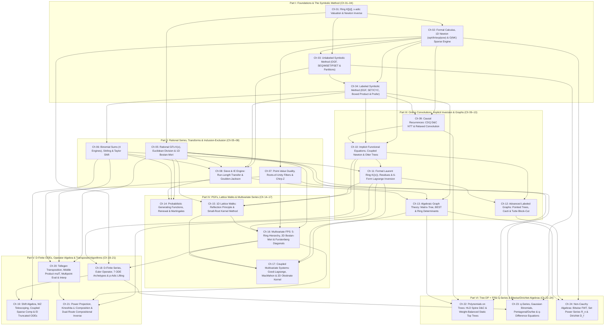

# Canonical Curriculum Architecture Blueprint: Formal Power Series & Generating Functions

> **Phase 1.5 Master Specification (Final Canonical Architecture)**
> **Target Repository**: `/home/maomao90/Documents/IO/ICPC-math-notes`
> **Accounting Invariant**: `321` Curated Entries = `254` Accepted Problems (`192` in `24 × 8` 4-Tier Chapter Ladders + `48` in `6 × 8` Two-Stage Blind Topic-Group Checkpoints + `14` in Multi-Perspective Synthesis Reserve) + `67` Quarantined Templates (`R-01`–`R-67`).

---

## 1. Executive Pedagogical Manifesto & Complete 321-Problem Accounting Proof

### 1.1 Core Editorial Philosophy
1. **Zero-Magic Algebraic Grounding for Algorithmists**:
   The reader is an expert competitive programmer who already commands `NTT`, modular arithmetic, divide-and-conquer, and standard DP optimizations, and treats low-level polynomial library primitives (`inv`, `ln`, `exp`, `sqrt`, `pow`) as black boxes once their mathematical well-definedness and complexity are established. Every algebraic ring ($K[[x]]$, $K((x))$, $K[y][[x]]$, $(K[y,y^{-1}])[[x]]$, $K((x))[[y]]$, $K[[t]]((y))$, $K[x]\langle D_x \rangle$, $\mathcal{R}_n = K[x_1,\dots,x_n]/(x_1^2,\dots,x_n^2)$, $\mathcal{D}_f$), formal topology ($x$-adic metric and valuation $\operatorname{val}(F)$), operator ($\vartheta = x D_x$, $\operatorname{Res}_{x=0}$, $\operatorname{Diag}$), and characteristic-$p$ constraint is constructed from first principles with **zero forward-reference traps** and **zero hand-waved analytic leaps**.
2. **Complete Dissolution of Research Collection Waves & Regional Audit Buckets**:
   All 10 Phase-1 research waves (`Wave 1A`–`Wave 5B`) and all regional audit cohorts (`[ZH]` `Elegia`/`EI` notes and `[JA]` `maspypy`/`noshi91`/`Nyaan` notes) are **completely dissolved**. Their mathematical techniques, diagnostic signals, failure-mode remedies, and curated problems are integrated into **6 Parts and 24 Granular Conceptual Chapters** (`Ch 01`–`Ch 24`).
3. **Strict Prerequisite Closure Across Both Theory and Problem Ladders**:
   Every problem assigned to Chapter $k$'s 8-problem ladder (`2 Stepping Stones`, `2 Intermediate`, `2 Advanced`, `2 Mastery`) and every problem in Part $P$'s Blind Checkpoint (`CP-I`–`CP-VI`) is solvable using **only** the concepts taught in Chapters $1 \dots k$ (or Parts $1 \dots P$). Whenever a rich problem admits a second, deeper solution using a later chapter's machinery, it is placed in its earliest valid home chapter (or in the **14-Problem Multi-Perspective Synthesis Reserve** `Syn-01`–`Syn-14`) and cross-indexed in **Section 5.2 (Revisited Dual-Perspective Index)** with an explicit scoping note.

### 1.2 Master 6-Part, 24-Chapter Architecture & Exact Problem Accounting Table

| Part | Chapters | Part Title & Mathematical Scope | Chapter Ladders (`8/Ch`) | Blind Checkpoint (`8/Part`) | Part Accepted Total |
| :-: | :-: | :--- | :-: | :-: | :-: |
| **Part I** | **Ch 01 – Ch 04** | **Foundations of Formal Power Series & The Symbolic Method** ($K[[x]]$, valuation topology, 1D Newton & $O(NK)$ sparse engine, unlabeled OGFs, labeled EGFs) | `4 × 8 = 32` | `CP-I` (`8`) | **`40`** |
| **Part II** | **Ch 05 – Ch 08** | **Rational Series, Binomial/Transform Engines & Inclusion–Exclusion** ($K(x)$ & Bostan–Mori, 4-engine binomial sums & Taylor shift, roots of unity & Chirp-Z, run-length & Goulden–Jackson IE) | `4 × 8 = 32` | `CP-II` (`8`) | **`40`** |
| **Part III** | **Ch 09 – Ch 13** | **Online Convolutions, Implicit Inversion & Graph Enumeration** (CDQ & relaxed convolution, coupled/implicit Newton & Otter trees, Laurent residues & 6-form LIF, Tutte block-cut & cactus EGFs, Matrix-Tree & symbolic ring determinants) | `5 × 8 = 40` | `CP-III` (`8`) | **`48`** |
| **Part IV** | **Ch 14 – Ch 17** | **Probabilistic Generating Functions, Lattice Walks & Multivariate Series** (PGFs & martingales, 1D reflections & small-root kernel method, 5-ring bivariate hierarchy & Furstenberg diagonals, Good–Lagrange & 2D obstinate kernel method) | `4 × 8 = 32` | `CP-IV` (`8`) | **`40`** |
| **Part V** | **Ch 18 – Ch 21** | **Differential Equations (D-Finite), Operator Algebra & Transposed Algorithms** (Euler operator $\vartheta$, 7 ODE archetypes & $p$-adic indicial lifting, Weyl shift algebra, WZ & `EI` truncated Taylor ODEs, Tellegen transposition & `mulT`, Kinoshita–Li `compose` & dual-route `revert`) | `4 × 8 = 32` | `CP-V` (`8`) | **`40`** |
| **Part VI** | **Ch 22 – Ch 24** | **Structural Extensions: Tree DP + FPS, $q$-Series & Bitwise/Dirichlet Algebras** (HLD + weight-balanced static top tree `Rake`/`Compress`, Gaussian $q$-binomials & $q$-difference equations, bitwise FWT, Set Power Series $\mathcal{R}_n$ & Dirichlet $\Omega(n)$-derivation) | `3 × 8 = 24` | `CP-VI` (`8`) | **`32`** |
| **Capstone** | **Section 5.1** | **Multi-Perspective Synthesis Reserve (`Syn-01`–`Syn-14`)** (Cross-Part synthesis problems solved from two or more distinct perspectives) | — | — | **`14`** |
| **Quarantine** | **Section 6.1** | **Quarantined Bare Library-Checker / `【模板】` Templates (`R-01`–`R-67`)** (Excluded from all practice ladders; retained as 1-line library verification footnotes) | — | — | **`67`** *(Quarantined)* |
| **TOTAL** | **`24` Chapters** | **100% Bijective Partition of the 321-Problem Curated Pool (`fps_research/PROBLEM_CURATION.md`)** | **`192`** | **`48`** | **`254` Accepted + `67` Quarantined = `321`** |

### 1.3 Complete Dissolution of Phase-1 Research Waves & Regional Audits into Canonical Chapters

| Phase-1 Research Wave / Regional Cohort | Dissolved Into Canonical Chapters | How Artificial Boundaries Are Eliminated |
| :--- | :--- | :--- |
| **`Wave 1A` & `Wave 1B`** (Foundations, OGF/EGF, Basic Transforms, Rational GFs) | **Ch 01, Ch 02, Ch 03, Ch 04, Ch 05, Ch 06, Ch 07** | Separated ring axioms & `inv` (`Ch 01`), $\ln/\exp/\text{pow}$ & $O(NK)$ sparse recurrences (`Ch 02`), unlabeled OGFs (`Ch 03`), labeled EGFs (`Ch 04`), rational GFs (`Ch 05`), binomial/Stirling engines (`Ch 06`), and roots-of-unity/Chirp-Z (`Ch 07`). |
| **`Wave 2A` & `Wave 2B`** (Binomial Sums, Inclusion–Exclusion, Goulden–Jackson, PGFs) | **Ch 06, Ch 08, Ch 14** | Split into pure algebraic coefficient extraction & Taylor shift (`Ch 06`), deterministic cluster/run-length/poset IE (`Ch 08`), and stochastic stopping-time PGFs & martingales (`Ch 14`). |
| **`Wave 3A` & `Wave 3B`** (Prüfer, Matrix-Tree, LIF, Functional Equations, Cactus/Block-Cut) | **Ch 04, Ch 10, Ch 11, Ch 12, Ch 13** | Unpacked into Prüfer degree EGFs (`Ch 04.4`), coupled/Pólya implicit Newton (`Ch 10`), formal Laurent residues & 6-form LIF (`Ch 11`), pointed block-cut/cactus LIF (`Ch 12`), and Matrix-Tree/BEST/characteristic polynomials (`Ch 13`). |
| **`Wave 4A` & `Wave 4B`** (Bostan–Mori, Multivariate FPS, Lattice Walks, Kernel Method, Diagonals) | **Ch 05, Ch 15, Ch 16, Ch 17** | Separated 1D Bostan–Mori (`Ch 05`) from 1D bounded walks & small-root kernel method (`Ch 15`), 2D Bostan–Mori, twisted Kronecker & Furstenberg diagonals (`Ch 16`), and Good–Lagrange, MacMahon, & 2D quarter-plane obstinate kernel method (`Ch 17`). |
| **`Wave 5A` & `Wave 5B`** (D-Finite ODEs, Transposed Algorithms, Kinoshita–Li, Tree DP, $q$-Series, SPS, Dirichlet) | **Ch 02, Ch 09, Ch 18, Ch 19, Ch 20, Ch 21, Ch 22, Ch 23, Ch 24** | Elementary $O(NK)$ sparse recurrences moved early to `Ch 02.4`; CDQ/relaxed convolution placed in `Ch 09`; D-finite ODEs & 7 archetypes in `Ch 18`; Weyl shift algebra, WZ & `EI` truncated Taylor ODEs in `Ch 19`; Tellegen transposition in `Ch 20`; Kinoshita–Li `compose`/`revert` in `Ch 21`; Tree DP in `Ch 22`; $q$-series in `Ch 23`; SPS & Dirichlet in `Ch 24`. |
| **`[ZH]` Regional Cohort (`Elegia`, `EI`) & `[JA]` Regional Cohort (`maspypy`, `noshi91`, `Nyaan`)** | **Embedded natively across Ch 02, 06, 08, 09, 11, 16, 18, 19, 20, 21, 22, 24** | Every regional technique (`EI` differential-residue & truncated Taylor ODEs, `Elegia` LIF linearization & SPS composition, `maspypy` monic $y$-reversal & PDE companion matrices, `noshi91` relaxed convolution & power projection) is taught inside its exact mathematical chapter. |

---

## 2. Strict Prerequisite DAG, Zero-Magic Verification Matrix, Characteristic-$p$ Audit & 16 Canonical Failure Modes

### 2.1 Canonical 24-Chapter Prerequisite DAG

### 2.2 Topological Edge Justification & Zero-Forward-Reference Audit Matrix

| Chapter | Direct Prerequisites | New Algebraic Objects & Primitives Unlocked | Zero-Forward-Reference Verification |
| :-: | :--- | :--- | :--- |
| **Ch 01** | None | Formal ring $K[[x]]$, $x$-adic valuation $\operatorname{val}(F)$, unit group $K[[x]]^\times$, Newton `inv` ($G_{k+1} = G_k(2 - AG_k)$), D&C tree multiplication $\prod_{i=1}^m P_i(x)$. | Uses only ring axioms and `inv`; zero derivatives, $\ln$, or $\exp$. |
| **Ch 02** | `Ch 01` | Formal derivative $D_x$, integral $\int$, 1D Newton quadratic convergence for `sqrt`/`exp`, `ln`/`pow`, 4 Master $O(NK)$ sparse recurrences (`sparse_div/ln/exp/pow`), Frobenius $A(x)^p \equiv A(x^p) \pmod p$. | 1D Newton proved directly via Taylor expansion in $K[[x]]$; coupled/implicit functional equations deferred to `Ch 10`. |
| **Ch 03** | `Ch 01, 02` | Unlabeled classes $\mathcal{A}$, $\operatorname{SEQ}$, $\operatorname{MSET}$ (Pólya $\exp$), $\operatorname{PSET}$, Young diagram Ferrers involution, $O(N\sqrt{N})$ Pentagonal recurrence. | Uses only `Ch 01`–`Ch 02` primitives; general $q$-binomial algebra deferred to `Ch 23`. |
| **Ch 04** | `Ch 02, 03` | Labeled classes, binomial convolution, $\operatorname{SET}(\mathcal{A}) \mapsto \exp(A(x))$, $\operatorname{CYC}(\mathcal{A}) \mapsto \ln(1/(1-A(x)))$, Greene–Wilf Boxed Product $C' = A' \cdot B$, Prüfer degree EGFs. | Uses only 1D `inv`/`sqrt`/`ln`/`exp`; implicit functional equations (`CF 438E` Newton view) deferred to `Ch 10`. |
| **Ch 05** | `Ch 01` | Rational series $P(x)/Q(x)$, Euclidean `divmod` via reversal $x^n A(1/x)$, Bostan–Mori $O(d \log d \log N)$, partial fractions, Berlekamp–Massey. | Self-contained in $K[[x]]$ and $K[x]$; transposed Bostan–Mori deferred to `Ch 20`. |
| **Ch 06** | `Ch 04` | Golden Rule of Index Alignment, Snake Oil, Egorychev method (polynomial negative-exponent extraction $[x^{-1}] x^{-k-1} G(x)$), Stirling $S_1/S_2$ rows/columns, FFP basis $x^{\underline{k}}$, Taylor shift $F(x+c)$, generalized $\alpha$-Euler transform. | Egorychev method uses only finite Laurent shift $[x^k]G(x) = [x^{-1}]x^{-k-1}G(x)$; full formal residue invariance theorem proved in `Ch 11`. |
| **Ch 07** | `Ch 02` | Root-of-unity index filter (`单位根反演`), cyclotomic quotient ring $\mathbb{F}_p[\omega]/(\Phi_m(\omega))$ when $m \nmid (p-1)$, 3-Prime Garner NTT (`MTT`), primal Chirp Z-Transform $F(ac^i)$ via $\binom{i+j}{2}$. | Uses only point-value evaluation and Bluestein's identity; transposed CZT ($\text{czt}^\top$) deferred to `Ch 20.4`. |
| **Ch 08** | `Ch 03, 04, 05, 06` | Binomial inversion as bivariate shift $G(x, y-1)$, universal run-length IE $F(x) = \frac{W(x)}{1+W(x)}$, `ez_lcw` bounded-run sparsity, forbidden-edge path covers, Goulden–Jackson cluster method (4 regimes). | Deterministic counting only; stochastic stopping times and PGFs deferred to `Ch 14`. |
| **Ch 09** | `Ch 02, 04` | Semi-online CDQ D&C NTT (`cdq(l,r)`), `lowbit(q+1)` full-online `RelaxedConvolution` (van der Hoeven / Nyaan), online $\exp$ ($n f_n = \sum k g_k f_{n-k}$) and online Dirichlet multiple updates. | Uses only 1D D&C and binary prefix partitioning. |
| **Ch 10** | `Ch 02, 04, 09` | Implicit functional equations $A(x, F(x)) = 0$ over $K[[x]][y]$, Fréchet derivative, coupled $2\times 2$ Jacobian Newton systems, integrating-factor differential Newton (`#206 UOJ 50`), Pólya–Euler & Otter's dissimilarity theorem. | Upgrades `Ch 02` 1D Newton to general implicit & coupled systems before `Ch 11` extracts single coefficients via LIF. |
| **Ch 11** | `Ch 06, 10` | Formal Laurent field $K((x))$, formal residue $\operatorname{Res}_{x=0} A'(x) = 0$ & change-of-variables formula, 6 Canonical Forms of LIF, `Elegia`'s coupled binomial sum linearization (Fixed-$n$ Case A), `ABC 345 G` Laurent prefix trick, base-$p$ Frobenius LIF. | Fixed-$n$ Case A (`#201`) runs in $O(n \log n)$ via 1D algebraic power; All-$n$ Case B (`compose`) explicitly cross-referenced to `Ch 21`. |
| **Ch 12** | `Ch 10, 11` | Pointed operator $\Theta = x D_x$, Husimi cactus EGF $T(x) = x\exp(\sum_{m \ge 3}\frac{T^m}{2} + T)$, Tutte's Pointed Block-Cut Tree equation $\ln(R(x)/x) = B'(R(x))$ inverted at single degree $n$ via LIF. | Single-$n$ extraction uses `Ch 11` LIF in $O(n \log n)$; all-$n$ extraction via `revert` (`Ch 21`) and fixed-graph SPS (`Ch 24`) explicitly scoped. |
| **Ch 13** | `Ch 04, 05, 08` | Kirchhoff Matrix-Tree Theorem, BEST Theorem for directed Eulerian circuits, rank-1 matrix determinant lemma, Symbolic Matrix-Tree over truncated FPS rings $\mathbb{F}_p[x]/(x^{k+1})$ (`#163 Luogu P5296`), Hessenberg $O(V^3)$ characteristic polynomial. | Duplicate Block-Cut section removed; `Ch 13.4` focuses purely on Symbolic Matrix-Tree over Commutative Rings & Characteristic Polynomials. |
| **Ch 14** | `Ch 05, 06, 08` | PGFs $F(z) = \mathbb{E}[z^T]$, formal Taylor shift $z = 1+t \bmod t^3$ for $0/0$ L'Hôpital pole cancellation, renewal first-passage deconvolution, Singing Kingdom KMP border theorem & optional stopping martingale. | Combines `Ch 05` rational GFs, `Ch 06` Taylor shift, and `Ch 08` string border correlations. |
| **Ch 15** | `Ch 05, 10, 11` | André's reflection principle, Kelvin's alternating image sum in strip $[0, H]$, Laurent ring $(K[y, y^{-1}])[[x]]$, 1D Bivariate Kernel Method (Regimes A, B, C & Vieta's large-root trick). | Grounds step polynomial in $(K[y, y^{-1}])[[x]]$ where $y \mapsto y_0(x)$ ($\operatorname{val}_x(y_0) \ge 1$) converges in $x$-adic topology. |
| **Ch 16** | `Ch 05, 07, 11, 15` | 5-Ring Bivariate Hierarchy, 4 Regimes of 2D Bostan–Mori (`Truncated`, `Eval-Interp`, `Kinoshita-Li`, `Frobenius`), Twisted Kronecker substitution $\chi(\mathbf{i}) \bmod d$, Furstenberg's diagonal reduction in $K[[t]]((y))$, Lipshitz 3D D-finite diagonals & radial derivation $\mathfrak{D}$. | Proves Furstenberg's residue extraction algebraically inside $K[[t]]((y))$ using `Ch 11` Laurent residues; prepares `Ch 18` D-finite ODEs. |
| **Ch 17** | `Ch 11, 13, 15, 16` | Multivariate Good–Lagrange Inversion (Forms 1 & 2, bipartite rank-1 collapse), MacMahon's Master Theorem, Symmetric Function Ring $\Lambda$ & Newton–Girard identities, 2D Quarter-Plane Walks & Obstinate Kernel Method (Group of the Walk $\mathcal{G} = \langle \Phi, \Psi \rangle$), Bivariate PDE Companion Matrix Product. | Combines `Ch 11` residues, `Ch 13` determinants, `Ch 15` kernel method, and `Ch 16` bivariate diagonals. |
| **Ch 18** | `Ch 02, 10, 16` | D-finite $\leftrightarrow$ P-recursive equivalence, Euler operator dictionary $\vartheta = x D_x$, Abel–Cockle–Harley–Comtet Theorem (Recipes A & B), 7 ODE Archetypes (Inhomogeneous 1st-Order, Bernoulli, Riccati, Autonomous 1st/2nd-Order, Liouville, Gauge), $p$-adic indicial lifting over $\mathbb{Z}/p^{V+1}\mathbb{Z}$. | Unrolls D-finite recurrences in $O(N)$ time (`Ch 18`); $O(\sqrt{N}\log N)$ BSGS factorial/recurrence deferred to `Ch 20`. |
| **Ch 19** | `Ch 06, 18` | Weyl algebra $K[x]\langle D_x \rangle$ & shift algebra $K[n]\langle E_n \rangle$, Zeilberger's creative telescoping & WZ pairs, `EI`'s differential-residue binomial sum method, coupled $r$-state sparse composition $F(P(x))$ in $O(rNK)$, `EI 科技` truncated Taylor ODEs ($F_{<N}'$). | Purely algebraic operator & truncated ODE mechanics, with a brief self-contained motivating sub-section (`19.4`) on singularity growth intuition. |
| **Ch 20** | `Ch 05, 06, 07` | Tellegen's Transposition Principle, middle product `mulT` ($2\times$ FFT length reduction & DIF/DIT bit-reversal elimination), division-free subproduct tree multipoint `eval`, fast `interp`, transposed Chirp-Z ($\text{czt}^\top$), shift of sampling points, $O(\sqrt{P}\log P)$ block factorial. | Directly transposes `Ch 05` subproduct trees and `Ch 07` Chirp-Z into `mulT` circuits. |
| **Ch 21** | `Ch 11, 16, 20` | Power Projection $[x^{N-1}]\frac{P_0(x)}{1 - yF(x)}$ via Kinoshita–Li 2D Bostan–Mori, transposed `compose` $G(F(x)) \bmod x^N$ in $O(N \log^2 N)$, Dual-Route `revert` (Route A: `noshi91` Power Projection + `pow` for $p > N$; Route B: Newton + `compose` for $p \le N$), functional square roots $G(G(x)) = F(x)$ & Artin–Schreier obstruction at degree $p+2$. | Combines `Ch 11` LIF, `Ch 16` 2D Bostan–Mori, and `Ch 20` 2D middle product $\operatorname{mulT}_{x,y}$. |
| **Ch 22** | `Ch 05, 09, 13` | Subtree convolution bounds, HLD + Weight-Balanced Static Top Tree (`全局平衡二叉树`): Huffman min-heap `Rake` + 3-Way Weighted-Midpoint `Compress`, Fourier-domain $3c^2$ matrix product, zero-divisor pairs $(a,c) \equiv a\cdot 0^c$, rerooting Vandermonde `mulT`. | Self-contained tree D&C + polynomial matrix multiplication. |
| **Ch 23** | `Ch 03, 07, 18` | $q$-Pochhammer $(a;q)_n$, Gaussian $q$-binomials $\begin{bmatrix} n \\ k \end{bmatrix}_q$, Cauchy's $q$-binomial theorem, $q$-difference equation engine ($x \mapsto qx$), $q$-Lucas theorem when $\operatorname{ord}_p(q) \le n$, Pentagonal & Durfee square $\sum \frac{q^{d^2}}{(q;q)_d^2}$, Grassmannian subspace counting & MacWilliams/Krawtchouk duality. | Includes a self-contained 5-line hypercube character derivation for $q=2$ Krawtchouk duality (`#172, #063`) so `Ch 23` has zero dependency on `Ch 24`. |
| **Ch 24** | `Ch 02, 12, 13` | Bitwise OR/AND/XOR FWT, Set Power Series $\mathcal{R}_n = K[x_1,\dots,x_n]/(x_1^2,\dots,x_n^2)$, L1-contiguous `[1<<n][n+1]` ranked FZT, $O(n^2 2^n)$ SPS `inv`/`ln`/`exp`, division-free MSB split, `Elegia`'s $O(n^2 2^n)$ Taylor-shift SPS composition, pointed biconnected SPS $\ln$, Dirichlet ring $\mathcal{D}_f$ & prime-multiplicity $\Omega(n)$-derivation. | Completes the textbook by lifting `Ch 02` formal calculus and `Ch 12` pointed block-cut trees to $\mathcal{R}_n$ and $\mathcal{D}_f$. |

### 2.3 Characteristic-$p$ & Non-NTT Modulus Progression Audit

| Chapter & Sub-Section | Characteristic-$p$ / Non-NTT Regime | Algebraic Obstruction | Exact Canonical Bypass Taught |
| :--- | :--- | :--- | :--- |
| **Ch 02 (2.2 & 2.3)** | Small prime $p \le N$ or rational power $P(x)^{a/b}$ | $\int x^{p-1}dx = x^p/p$ divides by $0 \bmod p$; Lucas theorem $\binom{n}{k} \equiv 0 \pmod p$ blocks EGF label-carrying across base-$p$ digits. | Replace $\ln/\exp$ with algebraic `inv`/Bostan–Mori, Frobenius identity $A(x)^p \equiv A(x^p) \pmod p$, and check $b \mid (v\cdot a)$ in $\mathbb{Z}$ + $b$-th residue $c_v \in (\mathbb{F}_p^\times)^b$. |
| **Ch 07 (7.2 & 7.4)** | Arbitrary modulus $M \le 10^9+9$; root-of-unity filter when $m \nmid (p-1)$ | No primitive $2^k$-th root in $\mathbb{Z}/M\mathbb{Z}$; no scalar $\omega_m \in \mathbb{F}_p$. | 3-Prime Garner NTT (`MTT`) for arbitrary $M$; work in the **Cyclotomic Quotient Ring $\mathbb{F}_p[\omega]/(\Phi_m(\omega))$** when $m \nmid (p-1)$ (`#224 LOJ 6247`). |
| **Ch 11 (11.2)** | LIF at $p \mid n$ or huge $n, k \le 10^{18} \bmod p$ | Standard LIF $\frac{1}{n}[u^{n-1}]H'(u)\Phi(u)^n$ divides by $n \equiv 0 \pmod p$. | **Form 2 (Derivative-Free Residue LIF)**: $[u^n]H(u)(\Phi(u) - u\Phi'(u))\Phi(u)^{n-1}$ (**zero $1/n$ division!**); Base-$p$ Frobenius decimation $\Phi(u)^{pq+r} \equiv \Phi(u)^r \Phi(u^p)^q \pmod p$ (`#114`). |
| **Ch 16 (16.2)** | 2D Rational GF $[x^N y^K] P/Q \bmod p$ for small prime $p$ | Standard $N \to \lfloor N/2 \rfloor$ parity split can be beaten or generalized in char $p$. | **Bostan–Christol–Dumas Frobenius Algorithm**: multiply by $Q(x,y)^{p-1}$ so $Q(x,y)^p = Q(x^p, y^p)$, decimating $N \to \lfloor N/p \rfloor$ in $O(p^2 d_x d_y \log_p N)$. |
| **Ch 17 (17.3)** | Symmetric functions $e_k \leftrightarrow p_k$ when $p \le N$ | $E(t) = \exp(\sum (-1)^{k-1}\frac{p_k}{k}t^k)$ divides by $k \equiv 0 \pmod p$. | **$e_k \to p_k$ via $P(t) = -t E'(-t)/E(-t)$** uses only `inv` ($e_0 = 1$) and is **100% division-free in all characteristics $p$**! |
| **Ch 18 (18.4)** | P-recursive unrolling $I(n)a_n = \sum P_i(n)a_{n-i} \bmod p$ when $p \mid I(n^*)$ | Indicial polynomial $I(n^*) \equiv 0 \pmod p$ at finitely many $n^* \le N$. | Lift recurrence to the **$p$-adic quotient ring $\mathbb{Z}/p^{V+1}\mathbb{Z}$** where $V = \sum_{I(n)\equiv 0} v_p(I(n))$, representing elements as $u \cdot p^e$ (`#230 LOJ 6728`). |
| **Ch 21 (21.4)** | Compositional inverse `revert(F)` and $G(G(x)) = F(x) \bmod x^N$ when $p \le N$ | `noshi91` Route A (`Power Projection` + `pow(-1/n)`) divides by $1\dots N-1$; Abel conjugator hits **Artin–Schreier obstruction at degree $p+2$**. | **Route B for `revert`**: Newton iteration $G_{s+1} = G_s - \frac{F(G_s)-y}{F'(G_s)}$ + Kinoshita–Li `compose` (**only divides by $2$ and $f_1$!**); Newton iteration on $G(G(x)) = F(x)$ for $N > p+2$. |
| **Ch 22 (22.3)** | Dynamic Tree DP point-value products when $F_v(\omega_r) \equiv 0 \pmod p$ | Dividing out a light child's factor when $F_v(\omega_r) \equiv 0 \pmod p$ causes division by zero. | Maintain every point value in the **Zero-Divisor Monoid $(a, c) \equiv a \cdot 0^c$** ($a \in \mathbb{F}_p^\times, c \in \mathbb{Z}_{\ge 0}$). |
| **Ch 23 (23.2)** | Gaussian $q$-binomial $\begin{bmatrix} n \\ k \end{bmatrix}_q \bmod p$ when $\operatorname{ord}_p(q) = d \le n$ | $(q;q)_n$ vanishes at $1 - q^d \equiv 0 \pmod p$. | **$q$-Lucas Theorem**: $\begin{bmatrix} n_1 d + n_0 \\ k_1 d + k_0 \end{bmatrix}_q \equiv \binom{n_1}{k_1} \begin{bmatrix} n_0 \\ k_0 \end{bmatrix}_q \pmod p$. |
| **Ch 24 (24.3 & 24.4)** | Set Power Series $\exp/\ln$ in any char $p$; Dirichlet $\ln_D/\exp_D \bmod p$ | Standard ODE $\int F'/F$ divides by rank $k$; analytic $-d/ds$ uses $\ln n \notin \mathbb{F}_p$. | **MSB Split $\frac{\partial}{\partial x_v}\exp(F) = \exp(F)\frac{\partial F}{\partial x_v}$** (100% division-free for all $p$!); **Prime-Multiplicity $\Omega(n)$-Derivation** $(\vartheta f)(n) = \Omega(n)f(n)$ (valid whenever $p > \log_2 N$). |

### 2.4 Master Mapping of All 16 Canonical Failure Modes (`TECHNIQUE_TAXONOMY.md` §4) to Target Chapters

Every single one of the **16 Canonical Failure Modes** from `fps_research/TECHNIQUE_TAXONOMY.md` Section 4 is explicitly assigned to a primary instructional sub-section and reinforced in the chapter scratchpads:

| Failure Mode # | Hazard Category | Specific Failure Mode / Trap | Target Home Chapter & Sub-Section | Exact Remedy Taught in Target Sub-Section |
| :-: | :--- | :--- | :-: | :--- |
| **#1** | **Valuation Shift** | **Precision Loss in Shifted Division $B(x)/A(x) \bmod x^N$** ($\operatorname{val}(A) = v \ge 1$) | **Ch 01 (1.4)** | Dividing by $x^v$ shifts degree $N+v-1$ down to $N-1$; always compute $A(x)$ and $B(x)$ to precision **$\bmod x^{N+v}$** before shifting! |
| **#2** | **Valuation Shift** | **3-Way Modular Reduction Trap in $P(x)^\alpha \bmod x^N$** ($\alpha \ge p$) | **Ch 02 (2.3)** | Shift $v\cdot \alpha$ in true integer `__int128` (return $0$ if $v\alpha \ge N$); leading scalar $c_v^{\alpha \bmod (p-1)}$ by Fermat; ODE/$\exp((\alpha \bmod p)\ln \widetilde{P})$! |
| **#3** | **Valuation Shift** | **Rational Exponent $P(x)^{a/b}$ Existence Failure** ($\gcd(a,b)=1$) | **Ch 02 (2.3)** | $P(x)^{a/b} \in \mathbb{F}_p[[x]]$ exists iff **$b \mid (v\cdot a)$ in $\mathbb{Z}$** and leading coefficient $c_v$ has a **$b$-th root in $\mathbb{F}_p$**! |
| **#4** | **Char-$p$ Division** | **Transcendental Breakdown ($\ln, \exp, \int$) for $p \le N$** | **Ch 02 (2.2)** | $x^p/p$ divides by $0 \bmod p$; replace $\ln/\exp$ with algebraic `inv`, Bostan–Mori, Frobenius $F(x)^p \equiv F(x^p)$, or Boxed Products (`Ch 04.3`). |
| **#5** | **Char-$p$ Division** | **Lagrange Inversion $1/n$ Breakdown when $p \mid n$** | **Ch 11 (11.2)** | Never use $\frac{1}{n}[u^{n-1}]H'(u)\Phi(u)^n$ when $p \mid n$; use **Derivative-Free LIF (Form 2)**: $[u^n]H(u)(\Phi(u) - u\Phi'(u))\Phi(u)^{n-1}$! |
| **#6** | **Char-$p$ Division** | **Compositional Inverse (`revert`) Breakdown when $p \le N$** | **Ch 21 (21.4)** | Route A (`noshi91` Power Projection + `pow`) divides by $k \in [1, N-1]$; use **Route B (Newton Iteration + Kinoshita–Li `compose`)**, which only divides by $2$ and $f_1$! |
| **#7** | **Char-$p$ Division** | **Newton–Girard Asymmetry ($p_k \leftrightarrow e_k$)** | **Ch 17 (17.3)** | $e_k \to p_k$ ($P(t) = t E'(t)/E(t)$) uses only `inv` ($e_0=1$) and is **100% division-free for all $p$**; $p_k \to e_k$ divides by $k$ and fails for $p \le N$! |
| **#8** | **Char-$p$ Division** | **Vanishing Indicial Polynomial $I(n^*) \equiv 0 \pmod p$ in P-Recursive Unrolling** | **Ch 18 (18.4)** | Supply initial condition if $I(n^*) = 0$ in $\mathbb{Z}$; lift recurrence to **$p$-adic ring $\mathbb{Z}/p^{V+1}\mathbb{Z}$** ($u\cdot p^e$) if $I(n^*) \neq 0$ in $\mathbb{Z}$ (`#230 LOJ 6728`)! |
| **#9** | **Char-$p$ Division** | **$q$-Binomial $\begin{bmatrix} n \\ k \end{bmatrix}_q \bmod p$ when $\operatorname{ord}_p(q) = d \le n$** | **Ch 23 (23.2)** | Direct $(q;q)_n$ division hits $1 - q^d \equiv 0$; apply the **$q$-Lucas Theorem** $\begin{bmatrix} n_1 d + n_0 \\ k_1 d + k_0 \end{bmatrix}_q \equiv \binom{n_1}{k_1}\begin{bmatrix} n_0 \\ k_0 \end{bmatrix}_q \pmod p$! |
| **#10** | **Zero Divisors** | **Dynamic Division by Zero in Point-Value / Tree DP Products** | **Ch 22 (22.3)** | Maintain each frequency/DP state as a **Zero-Divisor Pair $(a,c) \equiv a\cdot 0^c$** ($a \in \mathbb{F}_p^\times, c \ge 0$): $\times 0 \implies c{++}$, $\div 0 \implies c{--}$! |
| **#11** | **Roots of Unity** | **Missing $m$-th Root of Unity in Root-of-Unity Filter (`单位根反演`)** ($m \nmid (p-1)$) | **Ch 07 (7.4)** | Do not search for a scalar $\omega_m \in \mathbb{F}_p$; work in the **Cyclotomic Quotient Ring $\mathbb{F}_p[\omega]/(\Phi_m(\omega))$** (`#224 LOJ 6247`)! |
| **#12** | **Roots of Unity** | **Bluestein Chirp-Z Square-Root Failure ($c^{1/2} \notin \mathbb{F}_p$) & $c=0$ Trap** | **Ch 07 (7.3)** | Never use $ij = \frac{1}{2}((i+j)^2 - i^2 - j^2)$; always use **Bluestein's Binomial Identity $ij = \binom{i+j}{2} - \binom{i}{2} - \binom{j}{2}$**, and handle $c=0$ explicitly! |
| **#13** | **Online / CDQ** | **Full-Online Self-Convolution Asymmetry Bug at $l > 0$** | **Ch 09 (9.2)** | In `cdq(l,r)` for $f_n = \sum_{i=1}^{n-1} f_i f_{n-i}$: convolve $f[0..m]^2$ at $l=0$, but convolve **$2 \cdot f[l..m] \times f[0..r-l]$ at $l > 0$** (or use `RelaxedConvolution`)! |
| **#14** | **Substitutions & Poles** | **Negative-Integer $\alpha = -d$ Pole in Generalized $\alpha$-Euler Transform** | **Ch 06 (6.4)** | Factorial weight $\frac{1}{(k+\alpha-1)!}$ has a pole at $k = d+1$; split $F(y) = F_{\le d}(y) + y^{d+1}F_{>d}(y)$ so the tail shifts $\alpha \mapsto 1 > 0$! |
| **#15** | **Residues & Boundaries** | **Hidden Pole at $z = 0$ in Improper Rational Diagonals** ($\deg_y A \ge \deg_y B$) | **Ch 16 (16.4)** | Substituting $y = t/z$ introduces $z^{\deg_y B - \deg_y A - 1}$, creating an extra pole at $z = 0$; include $\operatorname{Res}_{z=0}$ or divide $A$ by $B$ in $y$ first! |
| **#16** | **Combinatorial Boundary** | **Catalan Negative Upper-Index Trap ($k=0$) & Prüfer $N=1$ Trap** | **Ch 04 (4.4) & Ch 11 (11.3)** | Isolate $k=0$ before applying $\binom{2k-1}{k} = \binom{2k-1}{k-1}$ ($\binom{-1}{0}=1 \neq \binom{-1}{-1}=0$); handle $N=1$ explicitly before Prüfer $(N-2)!$ extraction! |

---

## 3. Granular 24-Chapter Curriculum Blueprint & Complete 8-Problem Ladders (`192` Problems)

---

### Part I: Foundations of Formal Power Series & The Symbolic Method (Ch 01 – Ch 04)

#### Chapter 01: The Ring of Formal Power Series $K[[x]]$, Valuation Topology & Newton Inversion
* **Prerequisites**: None (Entry Point).
* **Sub-Sections**:
  * **1.1 The Formal Ring $K[[x]]$ vs. Analytic Series**: Sequence algebra $(a_n)_{n \ge 0}$, Cauchy product $[x^n](AB) = \sum_{i+j=n} a_i b_j$, polynomial truncation quotient rings $K[x]/(x^N)$, and why radius of convergence is irrelevant to formal identities (e.g., $\sum_{n \ge 0} n! x^n \in K[[x]]$).
  * **1.2 The $x$-Adic Valuation Topology & Unit Criterion**: Order/valuation $\operatorname{val}(F) = \min\{n : [x^n]F \neq 0\}$, ultrametric distance $d(F,G) = 2^{-\operatorname{val}(F-G)}$, rigorous convergence of infinite sums $\sum_{k \ge 0} F_k(x)$ and infinite products $\prod_{k \ge 1}(1 + G_k(x))$ iff $\operatorname{val}(F_k), \operatorname{val}(G_k) \to \infty$, and the **Unit Theorem**: $F(x) \in K[[x]]^\times \iff [x^0]F(x) \in K^\times$.
  * **1.3 Formal Geometric Series & 1D Newton Inversion (`inv`)**: From $\frac{1}{1 - G(x)} = \sum_{k \ge 0} G(x)^k$ ($\operatorname{val}(G) \ge 1$) to quadratic-precision doubling $A G_k \equiv 1 \pmod{x^{2^k}} \implies A(2G_k - A G_k^2) \equiv 1 \pmod{x^{2^{k+1}}}$ in $1.5\,\mathcal{M}(N)$ NTT work.
  * **1.4 Quotient Extraction, Valuation-Shift Precision & Divide-and-Conquer Product Trees**: **Failure Mode #1 (Valuation Shift Precision Loss)**: to compute $B(x)/A(x) \bmod x^N$ when $\operatorname{val}(A) = v \ge 1$, shifting $A = x^v \widetilde{A}, B = x^v \widetilde{B}$ requires computing both $A$ and $B$ to precision **$\bmod x^{N+v}$**! Plus binary product trees $\prod_{i=1}^m P_i(x)$ in $O(S \log^2 S)$ (`Min-Heap` by degree) and grouping identical factors $(1 + x^{w_i})^{c_i}$.
* **Diagnostic Signals**:
  * Independent sequential/subset choices where weights add ($x^a \cdot x^b = x^{a+b}$) and counts multiply;
  * Unordered knapsack/subset-sum products $\prod_{i=1}^m (1 + c_i x^{w_i})$ with $\sum w_i \le N$;
  * First-passage or renewal equations $F(x) = 1 + A(x)F(x) \implies F(x) = (1 - A(x))^{-1} \bmod x^N$.
* **Reverse-Engineering Scratchpad**:
  1. Check $[x^0]A(x)$: if $[x^0]A(x) = 0$ with $\operatorname{val}(A) = v \ge 1$, apply **Failure Mode #1** (expand both numerator and denominator to $\bmod x^{N+v}$, shift down by $x^v$, then call `inv`).
  2. Never multiply $m$ polynomials sequentially ($O(m N \log N)$); always push all factors into a **degree-ordered Min-Heap** and convolve the two smallest degrees ($O(S \log^2 S)$ where $S = \sum \deg P_i$).
* **4-Tier Practice Ladder (`8` Problems)**:

| Slot | Pool | Problem ID & Title | Wave | Key Algebraic Setup & Why Placed Here |
| :-: | :-: | :--- | :-: | :--- |
| **SS-1** | `#019` | **ABC 178 D — Redistribution** | `1B#4` | Restricted Composition $x^3/(1-x)$ |
| **SS-2** | `#043` | **ABC 321 F — #(subset sum = K) with Add/Erase** | `1B#3` | Reversible $O(K)$ DP Division by $(1+x^v)$ |
| **Int-1** | `#004` | **`fps_24_g` — Coin** | `1A#2` | Dynamic Sliding-Window Partition $\prod_{j=k}^{k+L-1}(1-x^j)^{-1}$ & Reversible Coin DP |
| **Int-2** | `#077` | **EDPC M — Candies** | `1B#2` | Prefix-Sum Optimization of $\prod \frac{1-x^{a_i+1}}{1-x}$ |
| **Adv-1** | `#049` | **ARC 028 D — 注文の多い高橋商店** | `1B#6` | Multi-query prefix/suffix removal on $\prod_{i=1}^n \frac{1 - x^{a_i+1}}{1 - x} \bmod x^{M+1}$ via reversible sparse division $(1 - x^{a_i+1})^{-1}$. |
| **Adv-2** | `#097` | **CF 993E — Nikita and Order Statistics** | `1B#17` | Prefix-Count Reverse Indexing Difference Convolution |
| **Mas-1** | `#066` | **AGC 001 E — BBQ Hard** | `1B#9` | 2D origin-offset lattice translation turning $\sum_{i<j}\binom{a_i+a_j+b_i+b_j}{a_i+a_j}$ into a single 2D polynomial accumulation $[x^0 y^0]$. |
| **Mas-2** | `#107` | **CF 1251F — Red-White Fence** | `1A#11` | Groups multiplicity-1 vs. multiplicity-$\ge 2$ planks into $(1+2x)^{c_1}(1+x)^2{c_2}$ and evaluates perimeter polynomials via NTT. |

---

#### Chapter 02: Formal Calculus, 1D Newton Iteration (`sqrt`, `ln`, `exp`, `pow`) & The $O(NK)$ Sparse Engine
* **Prerequisites**: `Ch 01`.
* **Sub-Sections**:
  * **2.1 Formal Differentiation $D_x$ & Integration $\int$**: Linear operators $D_x(\sum a_n x^n) = \sum n a_n x^{n-1}$ and $\int(\sum a_n x^n) = \sum_{n \ge 0} \frac{a_n}{n+1} x^{n+1}$; product, quotient, and chain rules proved purely by coefficient comparison in $K[[x]]$.
  * **2.2 Characteristic-$p$ Obstructions, Frobenius Endomorphism & Lucas Breakdown**: **Failure Mode #4 (Char-$p$ Division Breakdown for $p \le N$)**: why $\operatorname{ker}(D_x) = K[[x^p]]$ in $\mathbb{F}_p[[x]]$, why $\int x^{p-1}dx = x^p/p$ fails when $p \le N$, the **Frobenius Endomorphism** $A(x)^p \equiv A(x^p) \pmod p$, and the **Lucas Obstruction** ($\binom{n}{k} \equiv 0 \pmod p$ whenever $k_i > n_i$ in base $p$, blocking EGF label-carrying across base-$p$ digits), with forward pointers to `Ch 11` (Derivative-Free LIF), `Ch 18` ($p$-adic indicial lifting), and `Ch 21` (Newton + Kinoshita–Li `compose`).
  * **2.3 1D Newton-Raphson Quadratic Convergence, `sqrt`, `ln`, `exp`, `pow` & Valuation Hazards**:
    * **3-Line Proof of 1D Newton-Raphson over $K[[x]]$**: Let $A(y)$ be a formal series (or differential-algebraic operator) and suppose $G_k \equiv F \pmod{x^{2^k}}$ where $A(F) = 0$. Since $(F - G_k)^2 \equiv 0 \pmod{x^{2^{k+1}}}$, formal Taylor expansion in $K[[x]]$ gives $0 = A(F) \equiv A(G_k) + A'(G_k)(F - G_k) \pmod{x^{2^{k+1}}}$, yielding the quadratic-doubling step:
      $$G_{k+1} = G_k - \frac{A(G_k)}{A'(G_k)} \bmod x^{2^{k+1}}.$$
    * **Instantiations**: (1) $A(G) = G^2 - P \implies G_{k+1} = \frac{1}{2}(G_k + P G_k^{-1}) \bmod x^{2^{k+1}}$ (`sqrt`, requiring Cipolla/Tonelli–Shanks for $[x^0]P$); (2) $\ln A(x) = \int \frac{A'(x)}{A(x)}dx \bmod x^N$ ($[x^0]A = 1$); (3) $A(G) = \ln G - B \implies G_{k+1} = G_k(1 - \ln G_k + B) \bmod x^{2^{k+1}}$ (`exp`, $[x^0]B = 0$); (4) General power $P(x)^\alpha = x^{v\alpha} c_v^\alpha \exp(\alpha \ln \widetilde{P})$.
    * **Failure Mode #2 (3-Way Modular Reduction in $P(x)^\alpha$ for $\alpha \ge p$)**: reduce $v\cdot \alpha$ in true integer `__int128` (return $0$ if $v > 0$ and $v\alpha \ge N$), reduce exponent of $c_v^\alpha$ modulo $p-1$ (Fermat), and reduce $\alpha$ inside $\exp(\alpha \ln \widetilde{P})$ modulo $p$!
    * **Failure Mode #3 (Rational Exponent $P(x)^{a/b}$ Existence)**: $P(x)^{a/b} \in \mathbb{F}_p[[x]]$ ($\gcd(a,b)=1$) exists iff **$b \mid (v \cdot a)$ in $\mathbb{Z}$** and $c_v$ is a **$b$-th residue in $\mathbb{F}_p^\times$**!
  * **2.4 The Master $O(N \cdot K)$ Sparse FPS Engine (`sparse_div`, `sparse_ln`, `sparse_exp`, `sparse_pow`)**: When $P(x) = c_0 + \sum_{j=1}^K c_j x^{d_j}$ has only $K \ll \log^2 N$ non-zero terms, **never** call dense $\exp(\alpha \ln P)$ ($\ln P$ becomes dense!). Unroll the 1st-order formal ODE directly in $O(NK)$ time with **zero NTTs**:
    1. **`sparse_div` ($G = A/P, c_0 \neq 0$)**: $g_n = \frac{1}{c_0}\left(a_n - \sum_{j=1}^K c_j g_{n-d_j}\right)$ (valid in **all** characteristics $p$).
    2. **`sparse_ln` ($G = \ln P, c_0 = 1$)**: $P G' = P' \implies g_n = [x^n]P - \frac{1}{n}\sum_{j=1}^K (n - d_j)c_j g_{n-d_j}$.
    3. **`sparse_exp` ($G = \exp P, c_0 = 0$)**: $G' = P' G \implies g_n = \frac{1}{n}\sum_{j=1}^K d_j c_j g_{n-d_j}$.
    4. **`sparse_pow` ($G = P^\alpha, c_0 \neq 0$)**: $P G' = \alpha P' G \implies g_n = \frac{1}{n c_0}\sum_{j=1}^K \big((\alpha+1)d_j - n\big)c_j g_{n-d_j}$.
  * **2.5 Logarithmic Derivative & Product-to-Sum Linearization**: Converting $\prod_{i=1}^m (1 + a_i x^{w_i})^{c_i}$ into $\exp\!\left(\sum_{i=1}^m c_i \ln(1 + a_i x^{w_i})\right)$ by grouping identical exponents $w_i$ and expanding $\ln(1 + a x^w) = \sum_{k=1}^{\lfloor N/w \rfloor} \frac{(-1)^{k-1} a^k}{k} x^{kw}$ in $O(N \log N)$ harmonic time.
* **Diagnostic Signals**:
  * High power $P(x)^k \bmod x^N$ where $P(x)$ is $K$-sparse (or becomes $K$-sparse after multiplying by $(1-x)$, e.g. $1 + x + \dots + x^9 = \frac{1-x^{10}}{1-x}$);
  * Huge product $\prod_{i=1}^m (1 \pm x^{a_i})^{b_i} \bmod x^N$ with $m, N \le 5 \times 10^5$ where distinct $a_i$ can be bucketed by frequency;
  * Quadratic equation $A(x)F(x)^2 + B(x)F(x) + C(x) = 0$ solved via explicit radical $F(x) = \frac{2C(x)}{-B(x) + \sqrt{B(x)^2 - 4A(x)C(x)}}$.
* **Reverse-Engineering Scratchpad**:
  1. Before calling NTT `pow`, inspect whether $P(x)$ is a rational ratio of sparse polynomials $A(x)/B(x)$: if so, compute $A(x)^k \bmod x^N$ and $B(x)^{-k} \bmod x^N$ via two 10-line $O(NK)$ `sparse_pow` loops!
  2. When rationalizing $\frac{-B - \sqrt{B^2 - 4AC}}{2A}$ where $A(0) = 0$, multiply numerator and denominator by the conjugate $-B + \sqrt{B^2 - 4AC}$ so the denominator $-B(0) + \sqrt{B(0)^2} = -2B(0) \neq 0$ is a unit (avoiding a valuation-shift precision loss).
* **4-Tier Practice Ladder (`8` Problems)**:

| Slot | Pool | Problem ID & Title | Wave | Key Algebraic Setup & Why Placed Here |
| :-: | :-: | :--- | :-: | :--- |
| **SS-1** | `#238` | **yukicoder 1145 — Sum of Powers** | `2A#35` | Newton–Girard Power Sums $-\sum_{i=1}^n \frac{-a_i x}{1 - a_i x} = -x \frac{d}{dx}\ln\prod(1 - a_i x)$ |
| **SS-2** | `#165` | **Luogu P4389 (0-1 Subset Sum Variant) / AtCoder FPS Subset Sum via ln/exp** | `1D#4` | Subset-Sum Product $\prod(1 + x^{a_i})$ via Logarithmic Derivative & $\exp$ |
| **Int-1** | `#101` | **CF 1096G — Lucky Tickets** | `1B#8` | $O(NK)$ Sparse Power ODE $(1-x)(1-x^{10})G' = k P' G$ (Zero NTTs) |
| **Int-2** | `#222` | **LOJ 6261 — 一个人的高三 (Lonely Senior Year)** | `1A#10` | Series Power $F(x)^k$ & Binomial Series Expansion $(1-x)^{-\alpha}$ |
| **Adv-1** | `#157` | **Luogu P4705 — 玩游戏** | `1A#24` | Newton–Girard Power Sums $\ln\prod(1 - a_i x)$ + Binomial Convolution |
| **Adv-2** | `#084` | **CF 438E — The Child and Binary Tree** | `1A#7` | Quadratic Radical $F(x) = \frac{2}{1 + \sqrt{1 - 4C(x)}}$ via Newton `sqrt` + `inv` |
| **Mas-1** | `#030` | **ABC 267 Ex — Odd Sum** | `1B#7` | Parity Split $\frac{P(x)-P(-x)}{2}$ + Logarithmic Derivative $\ln/\exp$ |
| **Mas-2** | `#091` | **CF 891E — Lust** | `1A#16` | Polynomial Product $\prod_{i=1}^n (a_i - x)$ + Formal Derivative / Coefficient Extraction |

---

#### Chapter 03: The Unlabeled Symbolic Method: Ordinary Generating Functions (OGFs), Multisets & Partitions
* **Prerequisites**: `Ch 01`, `Ch 02`.
* **Sub-Sections**:
  * **3.1 Admissible Unlabeled Constructions**: Combinatorial classes $(\mathcal{A}, |\cdot|)$, OGF $A(x) = \sum_{\alpha \in \mathcal{A}} x^{|\alpha|}$, disjoint union $+$, Cartesian product $\times$, and Sequence operator $\operatorname{SEQ}(\mathcal{A}) \mapsto \frac{1}{1 - A(x)}$ ($\operatorname{val}(A) \ge 1$).
  * **3.2 Powerset ($\operatorname{PSET}$), Multiset ($\operatorname{MSET}$ / Pólya Exp) & Inverse Euler Transform**: Deriving $\operatorname{PSET}(\mathcal{A}) \implies \prod_{n \ge 1}(1 + x^n)^{a_n} = \exp\!\left(\sum_{k \ge 1}\frac{(-1)^{k-1}}{k}A(x^k)\right)$, $\operatorname{MSET}(\mathcal{A}) \implies \prod_{n \ge 1}(1 - x^n)^{-a_n} = \exp\!\left(\sum_{k \ge 1}\frac{A(x^k)}{k}\right)$, and the **Inverse Euler Transform** $a_n = \frac{1}{n}\sum_{d \mid n} \mu(n/d) [x^d] d \ln B(x)$ (`#223 LOJ 6268`) via `Ch 02` $\ln/\exp$ in $O(N \log N)$ harmonic sieve time.
  * **3.3 Integer Partitions, Ferrers Conjugation & Bounded Parts**: Equivalence between partitions into $\le k$ parts and partitions with largest part $\le k$ ($\prod_{i=1}^k (1 - x^i)^{-1}$); distinct parts vs. odd parts $\prod_{i \ge 1}(1 + x^i) = \prod_{i \ge 1}(1 - x^{2i-1})^{-1}$.
  * **3.4 Euler's Pentagonal Number Theorem & $O(N\sqrt{N})$ / $O(N \log N)$ Partition Engines**: Franklin's bijective involution on distinct-part Ferrers diagrams proving $\prod_{k \ge 1}(1 - x^k) = 1 + \sum_{m \ge 1}(-1)^m \big(x^{m(3m-1)/2} + x^{m(3m+1)/2}\big)$; inverting this $O(\sqrt{N})$-sparse series in $O(N\sqrt{N})$ via `sparse_div` or $O(N \log N)$ via `inv`.
  * **3.5 Burnside's Lemma & Pólya's Cycle Index Theorem ($Z_G(s_1, \dots, s_n)$)**: Orbit-counting lemma $|X/G| = \frac{1}{|G|} \sum_{g \in G} |X^g|$; substituting monochromatic cycle sums $s_k \gets F(x^k)$ into the cycle index $Z_{S_n} = [x^n] \exp\!\left(\sum_{k \ge 1} \frac{s_k x^k}{k}\right)$ or $Z_{C_n} = \frac{1}{n} \sum_{d \mid n} \varphi(d) s_d^{n/d}$ to enumerate unlabeled graphs, necklaces, and rooted tree isomorphism classes (`#037 ABC 284 Ex`, `#159 Luogu P4727`, `#172 Luogu P5233`).
* **Diagnostic Signals**:
  * Unlabeled objects (coins, integer partitions, multisets of indistinguishable pieces) where order does not matter;
  * Counting multisets of size $m$ chosen from a class $\mathcal{A}$ (`MSET_m` or unbounded `MSET`);
  * Partition constraints on part sizes or multiplicities $\prod_i \frac{1 - x^{(c_i+1)w_i}}{1 - x^{w_i}} \bmod x^{N+1}$.
* **Reverse-Engineering Scratchpad**:
  1. Never compute $\prod_{n=1}^N (1 - x^n)^{-a_n} \bmod x^{N+1}$ by D&C multiplication (degree sum is $O(N^2)$!): always populate the harmonic array $h_m = \sum_{d \mid m} \frac{d \cdot a_d}{m}$ in $O(N \log N)$ time and call a single `exp(H)`!
  2. When parts are bounded by $K$ and sum to $N$, check if Ferrers conjugation ($k$ parts of size $\le M \leftrightarrow M$ parts of size $\le k$) or shifting $x_i' = x_i - 1$ reduces the state space.
* **4-Tier Practice Ladder (`8` Problems)**:

| Slot | Pool | Problem ID & Title | Wave | Key Algebraic Setup & Why Placed Here |
| :-: | :-: | :--- | :-: | :--- |
| **SS-1** | `#001` | **`fps_24_a` — Snack / Snacks** | `1A#1` | OGF Product & Polynomial Power $P(x)^D$ / Subset-Sum $\ln$-$\exp$ |
| **SS-2** | `#188` | **Luogu P6189 — [NOI Online #1] 跑步** | `1A#6` | Integer Partition $O(N\sqrt{N})$ Durfee Square / Pentagonal Number Theorem |
| **Int-1** | `#153` | **Luogu P4389 — 付公主的背包** | `1A#7a` | Harmonic $\ln$-$\exp$ Subset-Sum Compression ($O(M \log M)$) |
| **Int-2** | `#009` | **`fps_24_n` — Coin 2 / Coins 2** | `1A#7b` | Harmonic $\ln$-$\exp$ Compression $\prod(1+x^{A_i})$ & Bounded Numerator $\prod(1-x^{A_i+1})$ |
| **Adv-1** | `#223` | **yukicoder 899 / LOJ 6268 — 逆オイラー変換 (Inverse Euler)** | `1A#8` | Möbius Inversion on $\ln A(x)$ to Recover Generator Sequence |
| **Adv-2** | `#221` | **LOJ 6089 — 小 Y 的背包计数问题** | `2A#37` | $\sqrt{N}$ Split: Small Items DP + Large Items Partition Pentagonal Number |
| **Mas-1** | `#150` | **Luogu P3784 — [SDOI2017] 遗忘的集合** | `1B#25` | Inverse Euler Transform (Recovering Item Set from Subset Sums) |
| **Mas-2** | `#159` | **Luogu P4727 — [HNOI2009] 图的同构记数** | `2A#39` | Burnside's Lemma + Partition Cycle Index $Z(S_n)$ |

---

#### Chapter 04: The Labeled Symbolic Method: Exponential Generating Functions (EGFs), Boxed Products & Prüfer Sequences
* **Prerequisites**: `Ch 02`, `Ch 03`.
* **Sub-Sections**:
  * **4.1 Labeled Classes & Binomial Convolution**: Why relabeling disjoint sets of sizes $k$ and $n-k$ introduces $\binom{n}{k} = \frac{n!}{k!(n-k)!}$, making $A(x)B(x) = \sum_{n \ge 0} \left(\sum_{k=0}^n \binom{n}{k} a_k b_{n-k}\right) \frac{x^n}{n!}$ the natural product for Exponential Generating Functions $A(x) = \sum_{n \ge 0} a_n \frac{x^n}{n!}$.
  * **4.2 The Fundamental Labeled Operators ($\operatorname{SET}$, $\operatorname{CYC}$, Connected $\leftrightarrow$ All)**:
    * $\operatorname{SEQ}_k(\mathcal{A}) \mapsto A(x)^k$, $\operatorname{SET}_k(\mathcal{A}) \mapsto \frac{A(x)^k}{k!}$, and the **Exponential Formula** $\operatorname{SET}(\mathcal{A}) \mapsto \exp(A(x))$ ($[x^0]A = 0$);
    * Inverse relation: $G(x) = \exp(C(x)) \iff C(x) = \ln G(x)$ extracting connected labeled graphs/structures from all labeled structures (`#156`/`#161`);
    * Directed cycles $\operatorname{CYC}(\mathcal{A}) \mapsto \ln\frac{1}{1 - A(x)}$, undirected cycles ($|C| \ge 3$) $\mapsto \frac{1}{2}\left(\ln\frac{1}{1-A(x)} - A(x) - \frac{A(x)^2}{2}\right)$, and derangements $D(x) = \frac{e^{-x}}{1-x}$.
  * **4.3 The Greene–Wilf Boxed Product ($\mathcal{C} = \mathcal{A}^{\square} \star \mathcal{B}$) & Characteristic-$p$ Bypass**: Counting pairs where the global minimum label (or root label $1$) is forced into the $\mathcal{A}$-component yields $C'(x) = A'(x) \cdot B(x) \iff C(x) = \int_0^x A'(t)B(t)\,dt$; how differentiating $G(x) = \exp(C(x))$ gives the **Boxed-Product Recurrence** $G'(x) = C'(x) G(x) \iff C'(x) = G'(x) G(x)^{-1}$, which computes connected components using **only polynomial `inv`** (bypassing $\ln/\exp$ when $p \le N$ or in $O(N^2)$ DP!).
  * **4.4 Prüfer Sequences & Degree-Constrained Labeled Trees**: Constructive bijection between labeled trees on $n$ vertices with degrees $(d_1, \dots, d_n)$ and sequences in $\{1,\dots,n\}^{n-2}$ where vertex $i$ appears $d_i - 1$ times:
    $$\text{Trees}(d_1 \in S_1, \dots, d_n \in S_n) = (n-2)! [x^{n-2}] \prod_{i=1}^n \left(\sum_{d \in S_i} \frac{x^{d-1}}{(d-1)!}\right).$$
    Includes **Failure Mode #16 (Prüfer $N=1$ Boundary Trap)**: at $N=1$, the unique tree has $1$ vertex of degree $0$ (not $\ge 1$) and $N-2 = -1 < 0$; always handle $N=1$ and $N=2$ explicitly!
* **Diagnostic Signals**:
  * Labeled vertices/elements where structures decompose into a disjoint set of connected components ($\text{All} = \exp(\text{Connected})$);
  * Permutations decomposed into disjoint cycles with cycle-length constraints $\exp\!\left(\sum_{k \in S} \frac{x^k}{k}\right)$;
  * Labeled trees with degree constraints or degree-dependent vertex weights $\prod_{i=1}^n F_i(d_i)$.
* **Reverse-Engineering Scratchpad**:
  1. Whenever a problem asks for **connected** labeled structures of type $\mathcal{X}$ and counting **disconnected** (all) structures $G(x) = \sum g_n \frac{x^n}{n!}$ is easy (e.g. $g_n = 2^{\binom{n}{2}}$ for general graphs), immediately take $C(x) = \ln G(x) \bmod x^{N+1}$!
  2. For labeled trees where the weight is a sum over vertices $\sum_{i=1}^n w(d_i)$, use linearity over the Prüfer EGF: replace one factor $A_i(x) = \sum_d \frac{x^{d-1}}{(d-1)!}$ with the weighted factor $B_i(x) = \sum_d w(d) \frac{x^{d-1}}{(d-1)!}$.
* **4-Tier Practice Ladder (`8` Problems)**:

| Slot | Pool | Problem ID & Title | Wave | Key Algebraic Setup & Why Placed Here |
| :-: | :-: | :--- | :-: | :--- |
| **SS-1** | `#002` | **`fps_24_e` — Sequence 2** | `1A#15` | Labeled Multiset Permutation EGF $\prod_{m=1}^M \sum_{j=0}^m \frac{x^j}{j!}$ |
| **SS-2** | `#007` | **`fps_24_m` — Value of Permutation** | `1A#20` | Cycle Decomposition EGF $\ln\frac{1}{1-x}$ & Pointer Tracking |
| **Int-1** | `#161` | **Luogu P4841 — [集训队作业2013] 城市规划** | `1A#14` | Labeled Connected Graphs $C(x) = \ln G(x)$ via EGF Logarithm |
| **Int-2** | `#008` | **`fps_24_n` — Tree** | `3A#2` | Prüfer Sequence Degree-Distribution EGF $n![x^{n-2}]\prod E_{d_i}(x)$ |
| **Adv-1** | `#083` | **CF 407E / Gym — k-Cycle** | `1A#21` | Constrained Cycle-Length Permutation EGF $\exp(\sum_{k \in S} \frac{x^k}{k})$ |
| **Adv-2** | `#011` | **`fps_24_q` — Dice** | `1B#18` | Newton–Girard Power Sums $-\ln\prod(1 - A_i x)$ + EGF Moment Expansion |
| **Mas-1** | `#041` | **ABC 303 Ex — Constrained Tree Degree** | `3A#5` | Prüfer Sequence + Sparse $\ln/\exp$ for Vertex-Degree Constraints |
| **Mas-2** | `#174` | **Luogu P5401 — [CTS2019] 珍珠** | `1B#14` | Parity EGF $\left(\frac{e^x+e^{-x}}{2}\right)^k$ + Binomial Inversion |

---

### Part II: Rational Series, Binomial/Transform Engines & Inclusion–Exclusion (Ch 05 – Ch 08)

#### Chapter 05: Rational Generating Functions $K(x)$, Euclidean Division & The Bostan–Mori Algorithm
* **Prerequisites**: `Ch 01`.
* **Sub-Sections**:
  * **5.1 Rational Series $P(x)/Q(x)$ & Constant-Coefficient Linear Recurrences**: Equivalence between $a_n = \sum_{i=1}^d c_i a_{n-i}$ ($n \ge d$), $Q(x) = 1 - \sum_{i=1}^d c_i x^i$, and $F(x) = \frac{P(x)}{Q(x)}$ where $P(x) = (F(x)Q(x)) \bmod x^d$ has degree $< d$; Transfer-Matrix Method $\sum_{n \ge 0} \mathbf{u}^\top T^n \mathbf{v} x^n = \mathbf{u}^\top (I - xT)^{-1} \mathbf{v} = \frac{P(x)}{\det(I - xT)}$.
  * **5.2 Polynomial Euclidean Division (`divmod`) via Formal Reversal**: Given $\deg A = n \ge m = \deg B$, defining $A^R(x) = x^n A(1/x)$ converts $A(x) = Q(x)B(x) + R(x)$ into $A^R(x) \equiv Q^R(x) B^R(x) \pmod{x^{n-m+1}}$ with $[x^0]B^R \neq 0$, solving `divmod` in a single `inv` + `mul` of length $n-m+1$.
  * **5.3 The Bostan–Mori Algorithm ($[x^N]\frac{P(x)}{Q(x)}$ in $O(d \log d \log N)$)**: Multiplying numerator and denominator by $Q(-x)$ so $Q(x)Q(-x) = V(x^2)$ is purely even:
    $$[x^N] \frac{P(x)}{Q(x)} = [x^N] \frac{P(x)Q(-x)}{V(x^2)} = [x^{\lfloor N/2 \rfloor}] \frac{\mathcal{S}_{N \bmod 2}\big(P(x)Q(-x)\big)}{V(x)}.$$
    Includes the **NTT Half-Spectrum Doubling Trick** (computing $Q(-x)$ in the NTT domain by swapping upper and lower halves $\omega_{2L}^{r + L} = -\omega_{2L}^r$, saving $\frac{1}{3}$ of all NTT calls!) and **Frobenius Bostan–Mori $\bmod p$** ($Q(x)^p = Q(x^p)$ for small $p$).
  * **5.4 Partial Fraction Decomposition & Berlekamp–Massey LFSR Synthesis**: Distinct-root partial fraction formula $\frac{P(x)}{Q(x)} = \sum_{i=1}^d \frac{-r_i P(r_i^{-1})}{Q'(r_i^{-1})(1 - r_i x)}$ (`Heaviside cover-up`), repeated poles, and discovering the minimal recurrence polynomial $Q(x)$ from $2d$ initial terms via **Berlekamp–Massey** in $O(d^2)$ time.
* **Diagnostic Signals**:
  * Huge index $N \le 10^{18}$ with a small state space or sliding window of width $d \le 5 \times 10^4$;
  * Transfer matrix $T$ of dimension $d \le 500$ where matrix exponentiation $O(d^3 \log N)$ TLEs, solved in $O(d^2 \text{ BM} + d \log d \log N \text{ Bostan–Mori})$;
  * Dense denominator $Q(x) = 1 - x - x^2 - \dots - x^K$ that collapses to a 3-sparse denominator $(1-x)Q(x) = 1 - 2x + x^{K+1}$ (`#034 ABC 300 Ex`).
* **Reverse-Engineering Scratchpad**:
  1. Before running $O(K \log K \log N)$ Bostan–Mori on $P(x)/Q(x)$, check if $(1-x)Q(x)$ or $(1-x)^2 Q(x)$ is $O(1)$-sparse! If $Q(x)$ is sparse and $N$ is large, check if partial fractions or binary exponentiation $\bmod Q^R(x)$ applies.
  2. When a DP transition matrix $T$ of dimension $d \le 3000$ is sparse (having $O(d)$ non-zero transitions), compute the first $2d$ terms $a_0, \dots, a_{2d-1}$ in $O(d^2)$ time, run **Berlekamp–Massey** in $O(d^2)$ to find the minimal polynomial $Q(x)$, and finish with **Bostan–Mori** in $O(d \log d \log N)$!
* **4-Tier Practice Ladder (`8` Problems)**:

| Slot | Pool | Problem ID & Title | Wave | Key Algebraic Setup & Why Placed Here |
| :-: | :-: | :--- | :-: | :--- |
| **SS-1** | `#104` | **CF 1117D — Magic Gems** | `4A#P4` | Sparse Denominator $1/(1-x-x^M)$ + Bostan–Mori |
| **SS-2** | `#034` | **ABC 279 G — At Most 2 Colors** | `2B#B3` | Basic $O(N)$ rational transfer OGF / sliding-window prefix DP warmup before degree-$K$ Bostan–Mori. |
| **Int-1** | `#187` | **Luogu P6078 — [CEOI2004] Sweet** | `1B#8` | Sparse Denominator $(1-x)^{-n} \prod (1-x^{m_i+1})$ |
| **Int-2** | `#069` | **AGC 013 E — Placing Squares** | `2B#D5` | Combinatorial Split-or-Pass $3 \times 3$ Matrix / Rational OGF |
| **Adv-1** | `#040` | **ABC 300 Ex — Fibonacci: Revisited** | `2A#8` | Bostan–Mori at $N \le 10^{18}$ on $Q(x) = 1 - x - x^2 - \dots - x^K$, plus the $(1-x)Q(x) = 1 - 2x + x^{K+1}$ 3-sparse trick (`5.2`). |
| **Adv-2** | `#081` | **AISing 2020 F — Two Snuke** | `1B#22` | 10-Tuple Difference Weight OGF $F(z) = \frac{z^5(1+z)^{11}}{(1-z^2)^{16}}$ + Parity Extraction |
| **Mas-1** | `#177` | **Luogu P5487 — [BJOI2019] 勘破神机** | `4A#P18` | Berlekamp–Massey + Bostan–Mori + Stirling S1 Power Sums |
| **Mas-2** | `#073` | **AGC 054 E — ZigZag Break** | `2A#21` | Difference Cancellation / Telescoping Rational Series |

---

#### Chapter 06: Binomial Sum Engines, Stirling Numbers, Falling Factorials & Taylor Shift
* **Prerequisites**: `Ch 04`.
* **Sub-Sections**:
  * **6.1 The Golden Rule of Index Alignment**: Decoupling $\sum_k \alpha(n)\beta(k)\gamma(n-k) a_k b_{n-k}$ into Cauchy convolution (`mul`) when indices sum to $n$ ($k + (n-k) = n$) or Cross-Correlation / Reverse Convolution when indices differ by $n$ ($j - i = n \implies i + n = j$).
  * **6.2 The First Two Binomial Sum Engines (Snake Oil & Egorychev Polynomial Extraction)**:
    * **Engine 1 (Wilf's Snake Oil)**: When the external index $n$ appears in only one binomial factor (e.g. $\binom{n+k}{2k}$ or $\binom{n-k}{m}$), multiply by $x^n$, swap $\sum_n$ and $\sum_k$, and collapse the inner sum over $n$ using $(1-x)^{-m-1} = \sum_{n \ge 0}\binom{n+m}{m}x^n$ or $\frac{x^k}{(1-x)^{k+1}} = \sum_{n \ge k}\binom{n}{k}x^n$.
    * **Engine 2 (Egorychev Coefficient-Extraction Method)**: Replace each binomial factor by a polynomial/FPS coefficient $[u^a](1+u)^b$ or $[v^c](1-v)^{-d-1}$ (which is equivalent to the finite Laurent shift $[u^{-1}]u^{-a-1}(1+u)^b$), move $[u^a]$ outside the sum over $k$, sum the geometric series in $k$, and extract the remaining coefficient! *(Note: Engine 3 (`EI` Differential-Residue) is taught in `Ch 19.2` and Engine 4 (`Elegia` LIF Linearization) in `Ch 11.3`).*
  * **6.3 Polynomial Taylor Shift $F(x+c)$, Generalized $\alpha$-Euler Transform $(1 - cx)^{-\alpha} F\!\left(\frac{ax}{1 - cx}\right)$ & Failure Mode #14**:
    * $O(d \log d)$ **Taylor Shift** $F(x+c)$ via reverse-indexed factorial convolution (`#012`) and Projective Möbius Transforms;
    * Expanding $[x^n](1-cx)^{-\alpha}F\!\left(\frac{ax}{1-cx}\right)$ in $O(N \log N)$ via 1 Taylor shift / binomial convolution;
    * **Failure Mode #14 (Negative-Integer $\alpha = -d$ Pole Trap)**: when $\alpha = -d \in \{-(N-2), \dots, 0\}$, the factorial weight $\frac{1}{(k+\alpha-1)!}$ has a pole at $k = d+1$! **Remedy**: split $F(y) = F_{\le d}(y) + y^{d+1}F_{>d}(y)$ so the degree-$\le d$ head is shifted directly and the tail $y^{d+1}F_{>d}(y)$ shifts $\alpha = -d \mapsto \alpha' = 1 > 0$!
  * **6.4 Stirling Numbers ($S_1, S_2$), Eulerian Numbers, Falling Factorial Polynomials (FFP) & $O(d)$ Consecutive Lagrange Interpolation**:
    * Row/column generation of $\left[\begin{smallmatrix} n \\ k \end{smallmatrix}\right]$, $\left\{\begin{smallmatrix} n \\ k \end{smallmatrix}\right\}$, and Eulerian numbers $\left\langle\begin{smallmatrix} n \\ k \end{smallmatrix}\right\rangle$ in $O(N \log N)$ (`1B` / `2A`), plus point-value EGF of FFP ($\widetilde{A}(x) = A(x)e^x$);
    * $O(d)$ **Consecutive Lagrange Interpolation** on $x = 0, 1, \dots, d$ for Faulhaber power sums $\sum_{i=1}^n i^k$ (`#112`, `#252`).
* **Diagnostic Signals**:
  * Sums containing $k^m \binom{n}{k}$ or $\sum_{k=0}^n f(k)\binom{n}{k} a^k b^{n-k}$ for large $n \le 10^9$ and small degree $m \le 2 \times 10^5$ (convert $k^m = \sum_{j=0}^m \left\{\begin{smallmatrix} m \\ j \end{smallmatrix}\right\} k^{\underline{j}}$ and use $k^{\underline{j}}\binom{n}{k} = n^{\underline{j}}\binom{n-j}{k-j}$!);
  * Coupled binomial products $\sum_k \binom{A+k}{B+k}\binom{C-k}{D+k}$ where $k$ has opposite signs in the upper indices (Vandermonde convolution) or same signs in the lower indices (rewrite $\binom{n}{k} = \binom{n}{n-k}$ first!);
  * Linear operators scaling falling powers or binomial coefficients $(i \to j \text{ with weight } \binom{i}{j}/(i+1))$, diagonalized by Taylor shift $P(x-1) \to A(x+1)$ (`#096 CF 923E`).
* **Reverse-Engineering Scratchpad**:
  1. **Ordinary Power $k^m$ Inside a Binomial Sum**: Never leave $k^m$ in the monomial basis! Expand $k^m = \sum_{j=0}^m \left\{\begin{smallmatrix} m \\ j \end{smallmatrix}\right\} k^{\underline{j}}$ so $k^{\underline{j}}\binom{n}{k} = n^{\underline{j}}\binom{n-j}{k-j}$ absorbs $k$ into the binomial coefficient and sums over $k$ in $O(1)$!
  2. **Vandermonde Alignment**: In $\sum_k \binom{R}{a+k}\binom{S}{b+k}$, both lower indices have $+k$. Flip the first binomial to $\binom{R}{R-a-k}$ so the lower indices $(R-a-k) + (b+k) = R-a+b$ have constant sum!
* **4-Tier Practice Ladder (`8` Problems)**:

| Slot | Pool | Problem ID & Title | Wave | Key Algebraic Setup & Why Placed Here |
| :-: | :-: | :--- | :-: | :--- |
| **SS-1** | `#005` | **`fps_24_h` — Jump** | `2A#1` | Bivariate Rational Substitution $\frac{1-y}{1-2y-x}$ & Taylor Shift |
| **SS-2** | `#055` | **ARC 110 D — Binomial Coefficient is Fun** | `1B#16` | Vandermonde Convolution $\prod (1-x)^{-(A_i+1)}$ |
| **Int-1** | `#193` | **Luogu P6620 — [省选联考2020 A卷] 组合数问题** | `2A#24` | Polynomial-Weighted Binomial Sum via Falling Factorials $k^{\underline{j}}\binom{n}{k} = n^{\underline{j}}\binom{n-j}{k-j}$ |
| **Int-2** | `#080` | **KUPC 2019 K — One or All** | `2A#4` | Projective Möbius Substitution $(1-x)^N A(\frac{1+x}{1-x})$ |
| **Adv-1** | `#094` | **CF 923E — Perpetual Subtraction** | `2A#2` | Diagonalization of Pascal / Shift Operator via Taylor Shift |
| **Adv-2** | `#096` | **CF 960G — Bandit Blues** | `1A#23` | Unsigned Stirling S1 $\left[\begin{smallmatrix} n-1 \\ A+B-2 \end{smallmatrix}\right] \binom{A+B-2}{A-1}$ via Doubling Shift |
| **Mas-1** | `#098` | **CF 995F — Cowmpany Cowmpensation** | `5B#D6` | Tree DP Polynomial Degree Bound + $O(N)$ Lagrange Interpolation |
| **Mas-2** | `#109` | **CF 1278F — Cards** | `2A#29` | Expected $K$-th Moment of Binomial via Falling Factorials |

---

#### Chapter 07: Point-Value Duality, Roots-of-Unity Filters, Chirp Z-Transform & Arbitrary-Modulus NTT
* **Prerequisites**: `Ch 02`.
* **Sub-Sections**:
  * **7.1 DFT as Vandermonde Evaluation–Interpolation & Cyclic Wrap-Around**: $y_r = A(\omega_L^r) = A(x) \bmod (x - \omega_L^r)$, why pointwise multiplication computes $A(x)B(x) \bmod (x^L - 1)$, and exploiting exact cyclic wrap-around when exponents are taken modulo $L$.
  * **7.2 Arbitrary-Modulus Convolution (`MTT`)**: 3-Prime NTT ($p_1 = 998244353, p_2 = 1004535809, p_3 = 469762049$) + Garner's mixed-radix CRT reconstruction in `__int128` avoiding floating-point precision loss for arbitrary modulus $M \le 10^9+9$.
  * **7.3 The Chirp Z-Transform (Bluestein's Algorithm) & Failure Mode #12**:
    * Evaluating $F(x) = \sum_{j=0}^{n-1} f_j x^j$ at $m$ geometric progression points $x_i = a \cdot c^i$ ($0 \le i < m$);
    * **Failure Mode #12 (Bluestein Square-Root Failure $c^{1/2} \notin \mathbb{F}_p$ & $c=0$ Edge Case)**: **never** use $ij = \frac{1}{2}((i+j)^2 - i^2 - j^2)$! Always use **Bluestein's Binomial Identity**:
      $$i j = \binom{i+j}{2} - \binom{i}{2} - \binom{j}{2} \implies F(a c^i) = c^{-\binom{i}{2}} \sum_{j=0}^{n-1} \left(f_j a^j c^{-\binom{j}{2}}\right) c^{\binom{i+j}{2}},$$
      which uses only integer exponents $\binom{k}{2}$ and works in **every field $K$** in 1 NTT! Handle $c = 0$ explicitly ($y_0 = F(a)$, $y_{i \ge 1} = f_0$).
  * **7.4 Root-of-Unity Index Filtering (`单位根反演`) & Failure Mode #11 (Cyclotomic Quotient Ring)**:
    * Extracting arithmetic progressions of exponents $\sum_{k \equiv r \pmod m} f_k x^k = \frac{1}{m}\sum_{j=0}^{m-1} \omega_m^{-jr} F(\omega_m^j x)$ when $m \mid (p-1)$;
    * **Failure Mode #11 (Missing $m$-th Root of Unity when $m \nmid (p-1)$)**: when $\gcd(m, p) = 1$ but $m \nmid (p-1)$, do **not** search for a scalar $\omega_m \in \mathbb{F}_p$! Work directly in the **Cyclotomic Quotient Ring $\mathbb{F}_p[\omega]/(\Phi_m(\omega))$** (or $\mathbb{F}_p[\omega]/(\omega^m - 1)$ reduced modulo the cyclotomic polynomial $\Phi_m(\omega)$ at the end), where $\omega$ is a formal indeterminate (`#224 LOJ 6247`).
* **Diagnostic Signals**:
  * Sums over indices $k \equiv r \pmod m$ for small $m \le 2000$, such as $\sum_{k \equiv r \pmod m} \binom{n}{k} a^k$;
  * Multiplicative group convolutions $a_i b_j \mapsto c_{i \cdot j \pmod P}$ for prime $P$ (map $i = g^u \bmod P$ via discrete logarithm using primitive root $g$ of $\mathbb{F}_P^\times$ to convert multiplicative convolution into cyclic additive convolution $\bmod (P-1)$!);
  * Evaluating $F(q^0), F(q^1), \dots, F(q^{m-1})$ on a geometric sequence (`czt`).
* **Reverse-Engineering Scratchpad**:
  1. **Primitive Root Discrete Log (`Ind_g`)**: Whenever transitions multiply modulo a prime $P$ ($x \cdot y \bmod P$), separate $x = 0$ (which absorbs everything into $0$) and map $x \in \{1, \dots, P-1\}$ to its discrete log $u \in \{0, \dots, P-2\}$ where $g^u \equiv x \pmod P$.
  2. **Root-of-Unity Filter Check**: Check $\gcd(m, p-1)$: if $m \mid (p-1)$, use $\omega_m = g^{(p-1)/m} \in \mathbb{F}_p^\times$; if $m \nmid (p-1)$ (e.g. $m = 6$ or $m = p_{\text{odd}}$ mod $10^9+7$), represent numbers as polynomials in $\mathbb{F}_p[\omega]/(\omega^m - 1)$ and reduce modulo $\Phi_m(\omega) = 1 + \omega + \dots + \omega^{m-1}$ at the end!
* **4-Tier Practice Ladder (`8` Problems)**:

| Slot | Pool | Problem ID & Title | Wave | Key Algebraic Setup & Why Placed Here |
| :-: | :-: | :--- | :-: | :--- |
| **SS-1** | `#224` | **LOJ 6485 — LJJ 学二项式定理** | `2A#40` | Mod-4 Roots-of-Unity Filter $(1 \pm x)^n, (1 \pm ix)^n$ |
| **SS-2** | `#248` | **BZOJ 3328 — PYXFIB** | `2A#41` | Matrix Fibonacci + Bluestein / Roots-of-Unity Filter |
| **Int-1** | `#178` | **Luogu P5591 — 小猪佩奇学数学** | `2A#46` | Floor-Sum Roots-of-Unity Filter $\sum_{k=0}^n \binom{n}{k} p^k \lfloor k/w \rfloor$ |
| **Int-2** | `#143` | **Luogu P3321 — [SDOI2015] 序列统计** | `5B#D3` | Primitive Root Discrete Log + Cyclic Convolution $\bmod (x^{p-1}-1)$ |
| **Adv-1** | `#147` | **Luogu P3702 — [SDOI2017] 序列计数** | `1B#14` | Prime Complementary Sieve + Cyclic Convolution $\bmod (x^p - 1)$ |
| **Adv-2** | `#012` | **`fps_24_r` — Random Walk** | `2A#47` | Cyclic Convolution $\bmod (x^M - 1)$ via Roots of Unity & Catalan Kernel |
| **Mas-1** | `#092` | **CF 901E — Periodicovsky** | `5B#D10` | Cyclic Chirp-$Z$ Transform (Bluestein's Algorithm) |
| **Mas-2** | `#168` | **Luogu P5293 — [HNOI2019] 白兔之舞** | `2A#48` | Combines $3\times 3$ matrix root-of-unity filter $\frac{1}{k}\sum_{j=0}^{k-1} \omega_k^{-jr}(I + \omega_k^j W)^L$ with Bluestein's Chirp-Z transform and 3-Prime `MTT` ($\bmod p$ where $k \nmid (p-1)$). |

---

#### Chapter 08: The Sieve & Inclusion–Exclusion Engine: Run-Length Transfer (`连续段容斥`) & Goulden–Jackson Cluster Method
* **Prerequisites**: `Ch 03`, `Ch 04`, `Ch 05`, `Ch 06`.
* **Sub-Sections**:
  * **8.1 Binomial Inversion as Bivariate Taylor Shift $G(x, y-1)$**:
    * Exact-vs.-at-least sieve $f_k = \sum_{j \ge k} \binom{j}{k}(-1)^{j-k} g_j \iff F(x, y) = G(x, y-1)$;
    * **Crucial Structural Substitution Rule**: **never** compute $G(x, y)$ first and shift $y \mapsto y-1$ at the end when $y$ can be shifted **inside** the symbolic equation $\operatorname{SEQ}(A(x, y-1))$ or $\exp(A(x, y-1))$ before solving!
  * **8.2 Universal Run-Length Inclusion–Exclusion (`连续段容斥`) & `ez_lcw` Sparsity**:
    * Gluing atoms into maximal contiguous blocks where a block of size $s \ge 1$ has target weight $w_s$ ($W(x) = \sum_{s \ge 1} w_s x^s$) via signed sub-blocks $F(x) = \sum_{s \ge 1} f_s x^s$ satisfying $\frac{F(x)}{1 - F(x)} = W(x) \iff \boxed{F(x) = \frac{W(x)}{1 + W(x)}}$;
    * **Critical Order-of-Operations Rule for Labeled Objects**: compute the OGF transfer $F_{\text{OGF}}(x) = \frac{W_{\text{OGF}}(x)}{1 + W_{\text{OGF}}(x)}$ **first**, and **only then** divide $[x^s]F_{\text{OGF}}(x)$ by $s!$ to form the EGF!
    * **Smirnov Words ($W(x) = x \implies F(x) = \frac{x}{1+x}$)**: replacing $x_i \mapsto \frac{x_i}{1+x_i}$ eliminates adjacent identical colors;
    * **`ez_lcw` Bounded-Run Sparsity Theorem**: for runs of length $\le k$, $W_{\le k}(x) = \frac{x - x^{k+1}}{1-x} \implies F_{\le k}(x) = \frac{x - x^{k+1}}{1 - x^{k+1}}$ has **only $O(n/k)$ non-zero terms**, so solving for **all** $k = 1 \dots n$ costs $\sum_{k=1}^n O(\frac{n}{k}\log\frac{n}{k}) = O(n \log^2 n)$ total!
  * **8.3 Forbidden-Edge Path Cover IE & Eulerian Ascent/Run Sieves**:
    * Counting Hamiltonian paths/cycles avoiding a sparse graph $G$ of forbidden edges: subsets of forbidden edges form vertex-disjoint paths of $s \ge 2$ vertices carrying weight $2(-1)^{s-1}\frac{x^s}{s!}$;
    * Eulerian numbers $\left\langle\begin{smallmatrix} n \\ k \end{smallmatrix}\right\rangle$ via rising-run cluster sieve $[x^n y^k]\frac{1 - y}{e^{(y-1)x} - y}$.
  * **8.4 The Goulden–Jackson Cluster Method (All 4 Regimes)**:
    * Overlap/correlation polynomial $C_{i,j}(x) = \sum_{w_i[\text{suffix } k] = w_j[\text{prefix } k]} x^{|w_j|-k}$ for reduced pattern set $\mathcal{P} = \{w_1, \dots, w_m\}$;
    * **Regime 1 (Single Pattern $w$)**: $F(x) = \frac{C(x)}{(1 - \alpha x)C(x) + x^{|w|}}$;
    * **Regime 2 ($m \times m$ Multi-Pattern Avoidance)**: solve $C(x)\mathbf{r}(x) = -\mathbf{w}(x)$, then $F(x) = \frac{1}{1 - \alpha x - \mathbf{1}^\top \mathbf{r}(x)}$;
    * **Regime 3 (Bivariate Occurrence Marking by $t$)**: $F(x, t) = \frac{1}{1 - \alpha x - (t-1)\mathbf{1}^\top(t I - (t-1)C(x))^{-1}\mathbf{w}(x)}$;
    * **Regime 4 (Cyclic Strings / Necklaces)**: trace formula $\sum_{n \ge 1}\operatorname{tr}(T^n)x^n = \frac{-x Q'(x)}{Q(x)}$ where $Q(x) = \det(I - xT)$.
* **Diagnostic Signals**:
  * "No two adjacent elements may share the same color / satisfy relation $R$" (`连续段容斥` $F = W/(1+W)$);
  * "Count permutations with at most $k$ ascents / runs / violated edges" (bivariate shift $y \mapsto y-1$ + cluster EGF);
  * "Count strings of length $N$ over alphabet $\Sigma$ avoiding substring(s) $w_1, \dots, w_m$" (Goulden–Jackson correlation system).
* **Reverse-Engineering Scratchpad**:
  1. **Colored Multiset Smirnov Rule**: Given $m$ color classes with multiplicities $c_1, \dots, c_m$ ($\sum c_i = N$), a color of multiplicity $c_i$ partitioned into $b$ non-empty monochrome blocks contributes $\binom{c_i-1}{b-1}(-1)^{c_i-b} \frac{x^b}{b!}$. Multiply these $m$ polynomials of degree $c_i$ via Min-Heap D&C NTT in $O(N \log^2 N)$ and multiply $[x^k]$ by $k!$!
  2. **Goulden–Jackson Reduction First**: Before building $C_{i,j}(x)$, always remove any pattern $w_i$ that contains another pattern $w_j$ as a contiguous substring (unless counting weighted occurrences via Regime 3).
* **4-Tier Practice Ladder (`8` Problems)**:

| Slot | Pool | Problem ID & Title | Wave | Key Algebraic Setup & Why Placed Here |
| :-: | :-: | :--- | :-: | :--- |
| **SS-1** | `#018` | **ABC 172 E — NEQ** | `2B#A2` | Binomial Inversion & Rook-Style EGF |
| **SS-2** | `#241` | **yukicoder 1810 — Substring Avoidance** | `2B#D1` | Single-Pattern Guibas–Odlyzko Denominator |
| **Int-1** | `#155` | **Luogu P4491 — [HAOI2018] 染色** | `2B#A7` | Exact-$k$ Color Frequency Binomial Inversion Convolution |
| **Int-2** | `#089` | **CF 840C — On the Bench** | `2B#B4` | Adjacent-Block Inclusion-Exclusion via Falling-Factorial EGF |
| **Adv-1** | `#067` | **AGC 005 D — ~K Perm Counting** | `2B#B2` | Disjoint Rook Paths + Inclusion-Exclusion Convolution |
| **Adv-2** | `#139` | **CF Gym 102978H — Harsh Comments / Motzkin** | `2A#16` | Motzkin Trinomial Radical + Multi-Pattern Goulden–Jackson |
| **Mas-1** | `#052` | **ARC 100 F / LOJ 3395 — Colorful Sequences** | `2B#B8` | Forbidden Rainbow Window Automaton / IE OGF |
| **Mas-2** | `#137` | **CF Gym 102331J — Forbidden Strings** | `2B#D3` | Multi-pattern string avoidance solved via the Aho–Corasick Goulden–Jackson Cluster Overlap Matrix $(I + C(x))^{-1}$ (`8.4`). |

---

### Part III: Online Convolutions, Implicit Inversion & Graph Enumeration (Ch 09 – Ch 13)

#### Chapter 09: Causal Recurrences: Semi-Online CDQ Divide-and-Conquer NTT & Full-Online Relaxed Convolution
* **Prerequisites**: `Ch 02`, `Ch 04`.
* **Sub-Sections**:
  * **9.1 Causal vs. Algebraic Recurrences**: When $f_n = \phi_n\!\left(\sum_{i=0}^{n-1} f_i g_{n-i}\right)$ contains a non-constant coefficient $\phi_n(\cdot)$ (such as $\frac{1}{n}$, $2^{\binom{n}{2}}$, or a DP transition cost depending on $n$) that prevents closed-form inversion $(1 - G(x))^{-1}$, requiring a causal left-to-right sweep.
  * **9.2 Semi-Online CDQ Divide-and-Conquer NTT (`cdq(l, r)`) & Failure Mode #13**:
    * **LCA Partition Invariant**: every pair $(i, n)$ ($0 \le i < n \le N$) is accumulated at the unique recursion interval $[l, r] = \operatorname{LCA}(i, n)$ where $i \in [l, m]$ and $n \in [m+1, r]$, running in $O(N \log^2 N)$ with $\frac{1}{2}\mathcal{M}(N)\log_2 N$ NTT work;
    * **Failure Mode #13 (Self-Convolution Asymmetry Bug at $l > 0$)**: when solving $f_n = \sum_{i=1}^{n-1} f_i f_{n-i}$ (where both factors depend on $f$), convolving $f[l..m] \times f[l..m]$ at $l > 0$ misses pairs $(i, n-i)$ where $n-i < l$! **Exact Fix**: at $l = 0$, convolve $f[0..m] \times f[0..m]$; at **$l > 0$, convolve $2 \cdot f[l..m] \times f[0..r-l]$**!
  * **9.3 Full-Online Relaxed Convolution (`RelaxedConvolution` — van der Hoeven / Nyaan)**:
    * **0-Indexed Binary Prefix (`lowbit(q+1)`)**: at step $q = 0, 1, \dots, N-1$, let $m = q+1$ and $d = m \mathbin{\&} (-m)$. If $m = d$ (power of $2$), convolve **1 square block** $A[0..d-1] \times B[0..d-1]$ into $C[q..q+2d-2]$; if $m > d$, convolve **2 symmetric wings** $A[q-d+1..q] \times B[0..d-1] + B[q-d+1..q] \times A[0..d-1]$ into $C[q..q+2d-2]$;
    * **3-Step Self-Referential Protocol**: (1) read `interior = rc.C[q]` ($= \sum_{i=1}^{q-1} a_i b_{q-i}$), (2) solve for $a_q, b_q$, (3) call `rc.next(a_q, b_q)`.
  * **9.4 Online Exp ($n f_n = \sum_{k=1}^n k g_k f_{n-k}$) & Online Harmonic / Pólya Multiple Updates**: Interleaving CDQ / Relaxed Convolution with $O(N \log N)$ divisor/multiple updates $g_{kd} \mathrel{+}= w_k f_d$ so unlabeled trees and Pólya necklaces can be solved online in 15 lines of code (`#225 ABC 230 Ex`).
* **Diagnostic Signals**:
  * Recurrence $f_n = w(n) \sum_{i=1}^{n-1} f_i g_{n-i}$ where $w(n)$ is a non-algebraic weight like $2^{-\binom{n}{2}}$, $\frac{1}{1 - q^n}$, or a geometry/game transition at step $n$;
  * Coupled DP systems $f_n = \Phi(n, (f * g)_n), g_n = \Psi(n, (f * f)_n)$ where Jacobians are tedious and $O(N \log^2 N)$ passes easily within the time limit.
* **Reverse-Engineering Scratchpad**:
  1. First check whether $w(n)$ is $1$ (use `Ch 01` `inv` in $O(N \log N)$) or $1/n$ (use `Ch 02` `exp` in $O(N \log N)$). Use `Ch 09` CDQ / Relaxed Convolution **only** when $w(n)$ is non-algebraic or when $g_k$ itself is generated online from $f_1 \dots f_k$!
  2. In any contest problem with $N \le 2 \times 10^5$, a 25-line `RelaxedConvolution` struct handles arbitrary self-convolutions and coupled systems automatically without worrying about the $l > 0$ factor-of-$2$ asymmetry bug!
* **4-Tier Practice Ladder (`8` Problems)**:

| Slot | Pool | Problem ID & Title | Wave | Key Algebraic Setup & Why Placed Here |
| :-: | :-: | :--- | :-: | :--- |
| **SS-1** | `#060` | **ARC 138 E — Decreasing Subsequence** | `5A#22` | RSK / Greene Theorem Semi-Online Block CDQ Convolution |
| **SS-2** | `#021` | **ABC 222 H — Beautiful Binary Tree** | `3B#1` | Causal Binary Tree Recurrence via CDQ / Semi-Online Convolution |
| **Int-1** | `#086` | **CF 553E — Kyoya and Train** | `1B#13` | Time-Window Shortest Path DP via CDQ Divide-and-Conquer FFT |
| **Int-2** | `#023` | **ABC 230 Ex — Bullion** | `1A#27` | Unlabeled Knapsack / Weighings via Online Relaxed Convolution |
| **Adv-1** | `#056` | **ARC 123 F — Arithmetic Progression** | `4B#32` | Non-Homogeneous Causal Recurrence via CDQ / Relaxed Convolution |
| **Adv-2** | `#225` | **LOJ 6503 — Magic (魔术)** | `2B#B6` | Adjacent-Color Run Avoidance + Divide-and-Conquer NTT |
| **Mas-1** | `#206` | **UOJ 50 — [UR #3] 链式反应** | `2A#46` | Non-Autonomous Differential Equation $F' = \frac{1}{2}A(x)F^2 + 1$ via CDQ FFT |
| **Mas-2** | `#075` | **AGC 060 D — Same Generating Function** | `1B#25` | Coupled Eulerian Permutation Ascent CDQ Divide-and-Conquer FFT |

---

#### Chapter 10: Implicit Functional Equations, Coupled Newton Iteration & Unlabeled Pólya–Otter Trees
* **Prerequisites**: `Ch 02`, `Ch 04`, `Ch 09`.
* **Sub-Sections**:
  * **10.1 Upgrading from 1D Primitives to General Implicit Functional Equations $A(x, F(x)) = 0$**:
    * How `Ch 10` generalizes `Ch 01`–`Ch 02` (where $A(y) = y^{-1} - P$, $y^2 - P$, or $\ln y - P$ had 1-variable closed-form derivatives) to **arbitrary bivariate formal functional equations** $A(x, F(x)) = 0$ in $K[[x]][[y]]$;
    * **Implicit Function Theorem & Fréchet Derivative over $K[[x]]$**: if $A(0, f_0) = 0$ and the formal partial derivative $\frac{\partial A}{\partial y}(0, f_0) \in K^\times$ is invertible, then $A(x, F(x)) = 0$ has a unique solution $F(x) \in K[[x]]$, computed in $O(N \log N)$ via:
      $$F_{k+1}(x) = F_k(x) - \frac{A(x, F_k(x))}{\frac{\partial A}{\partial y}(x, F_k(x))} \bmod x^{2^{k+1}}.$$
  * **10.2 Coupled $2 \times 2$ / $d \times d$ Multivariate Newton Systems & Integrating-Factor Differential Newton**:
    * Solving coupled systems $\mathbf{\Phi}(x, F_1(x), \dots, F_d(x)) = \mathbf{0}$ via the $d \times d$ Jacobian matrix $J_{\mathbf{\Phi}}(x, \mathbf{F}_k)^{-1} \bmod x^{2^{k+1}}$ (`#179 yukicoder 3029`);
    * **Integrating-Factor Differential Newton (`#206 UOJ 50`)**: when the implicit equation contains $F'(x)$ ($A(x, F(x), F'(x)) = 0$, e.g. $F'(x) = \frac{1}{2}A(x)F(x)^2 + 1$), linearizing around $F_k$ produces the **1st-order linear ODE** $\Delta'(x) + P_k(x)\Delta(x) = Q_k(x) \bmod x^{2^{k+1}}$, solved at each doubling step via the integrating factor $\mu_k(x) = \exp\!\left(\int P_k(x)\,dx\right)$!
  * **10.3 Pólya–Euler Unlabeled Rooted Trees & The Higher-Power Trick**:
    * Cayley's unlabeled rooted tree equation $T(x) = x \exp\!\left(\sum_{k \ge 1} \frac{T(x^k)}{k}\right)$;
    * **Why Higher Powers $T(x^k)$ ($k \ge 2$) Are Constants During Step $s$ ($2^s \to 2^{s+1}$)**: since $\operatorname{val}(T) = 1$, $T(x^k) \bmod x^{2^{s+1}}$ depends **only** on coefficients $[x^j]T(x)$ for $j \le \lfloor (2^{s+1}-1)/k \rfloor \le 2^s - 1$, which are **already known exactly** from step $s-1$! Thus $\frac{\partial}{\partial T} T(x^k) \equiv 0$ for all $k \ge 2$, and the Newton denominator is simply $1 - T_s(x)$!
  * **10.4 Otter's Dissimilarity Theorem for Unrooted Unlabeled Trees**:
    * Why unrooted symmetry is broken by comparing vertices $v^*$ against edges $e^*$ minus symmetric edges $e_{\text{sym}}$:
      $$t(x) = T(x) - \frac{1}{2}\big(T(x)^2 - T(x^2)\big),$$
      where $T(x)$ counts rooted unlabeled trees and $t(x)$ counts unrooted unlabeled trees (`#186 Luogu P5900`).
* **Diagnostic Signals**:
  * Recursive tree/grammar decomposition $F(x) = x \Phi(F(x))$ or $A(x, F(x)) = 0$ where **all** coefficients $f_1, \dots, f_N$ are needed in $O(N \log N)$;
  * Coupled combinatorial classes $(F(x), G(x))$ mutually defined through $\exp$, $\ln$, or rational functions;
  * Unrooted unlabeled trees, alkane isomers, or homeomorphically irreducible trees requiring Otter's edge-subtraction identity $T(x) - \frac{1}{2}(T(x)^2 - T(x^2))$.
* **Reverse-Engineering Scratchpad**:
  1. **When to use `Ch 10` Newton ($O(N \log N)$) vs. `Ch 09` Relaxed Convolution ($O(N \log^2 N)$)**: For single equations or $2\times 2$ systems with clean partial derivatives, `Ch 10` Newton is $3\times$ faster; if the Jacobian is $4 \times 4$ and $N \le 10^5$, fall back to `Ch 09` `RelaxedConvolution` (`Revisited #7`)!
  2. **Otter's Check**: Always verify whether the problem counts **rooted** trees ($T(x)$) or **unrooted** trees ($T(x) - \frac{1}{2}T(x)^2 + \frac{1}{2}T(x^2)$ when edges are undirected, or $+ \frac{1}{2}T(x^2)$ sign depending on whether the two endpoints of the central edge can be isomorphic).
* **4-Tier Practice Ladder (`8` Problems)**:

| Slot | Pool | Problem ID & Title | Wave | Key Algebraic Setup & Why Placed Here |
| :-: | :-: | :--- | :-: | :--- |
| **SS-1** | `#186` | **Luogu P5900 — 无标号无根树计数** | `1A#29` | Otter's Dissymmetry Theorem $U(x) = R(x) - \frac{1}{2}(R(x)^2 - R(x^2))$ |
| **SS-2** | `#226` | **LOJ 6538 — 烷基计数 加强版 加强版** | `1A#14` | Pólya $S_3$ Ternary Tree via Newton or 12-Line Chained Relaxed Convolution |
| **Int-1** | `#244` | **yukicoder 3029 — Colored Tree (FPS 24)** | `3B#5` | $2 \times 2$ Jacobian Newton / Substitution Elimination |
| **Int-2** | `#013` | **`fps_24_s` — Game** | `1A#30` | Tree Normal-Play Game $L = x\exp(x e^x - L)$ via Newton / Lambert $W$ |
| **Adv-1** | `#179` | **Luogu P5597 — 【XR-4】复读** | `3B#18` | $k$-ary tree automaton minimization combined with implicit Newton iteration. |
| **Adv-2** | `#126` | **CF 1687F — Koishi's Unconscious Permutation** | `3B#20` | Implicit Bivariate / Cycle-Rise Permutation Equations |
| **Mas-1** | `#191` | **Luogu P6598 — 烷烃计数 (Alkanes)** | `1A#14` | Pólya $S_3, S_4$ Cycle Index + Otter Dissimilarity |
| **Mas-2** | `#192` | **Luogu P6597 — 烯烃计数 (Alkenes)** | `1A#14` | Double-Bond Unrooted Carbon Trees via Cycle Index |

---

#### Chapter 11: Formal Laurent Series $K((x))$, Formal Residues & The 6 Canonical Forms of Lagrange Inversion
* **Prerequisites**: `Ch 06`, `Ch 10`.
* **Sub-Sections**:
  * **11.1 The Field of Formal Laurent Series $K((x))$ & The Formal Residue Operator $\operatorname{Res}_{x=0}$**:
    * Constructing $K((x)) = \{\sum_{n \ge -N_0} a_n x^n\}$ as the fraction field of $K[[x]]$;
    * Defining $\operatorname{Res}_{x=0} F(x) = [x^{-1}]F(x)$; proving the **Fundamental Residue Lemma** $\operatorname{Res}_{x=0} F'(x) = 0$ for every $F(x) \in K((x))$ (because $n x^{n-1}$ never equals $x^{-1}$!) and the **Formal Change-of-Variables Formula**: for any $G(u) \in K((u))$ with $\operatorname{val}(G) = 1$ and $A(x) \in K((x))$,
      $$\operatorname{Res}_{x=0} A(x) = \operatorname{Res}_{u=0} A(G(u)) G'(u).$$
    * *(Proof in 4 lines: by $x$-adic linearity, check $A(x) = x^k$: for $k \neq -1$, $G(u)^k G'(u) = \frac{1}{k+1}(G(u)^{k+1})'$ has residue $0$ by the Fundamental Lemma; for $k = -1$, $\frac{G'(u)}{G(u)} = \frac{1}{u} + \frac{\widetilde{G}'(u)}{\widetilde{G}(u)}$ has residue $1$!)*
  * **11.2 The 6 Canonical Forms of Lagrange–Bürmann Inversion (LIF), Failure Mode #5 & The `ABC 345 G` Laurent Trick**:
    * Given $F(x) = x \Phi(F(x))$ ($\Phi(0) \neq 0$) or $G(F(x)) = x$ where $G(u) = u/\Phi(u)$:
      1. **Form 1 (Standard Divided Form)**: $[x^n]H(F(x)) = \frac{1}{n}[u^{n-1}]H'(u)\Phi(u)^n$ (special case $[x^n]F(x)^k = \frac{k}{n}[u^{n-k}]\Phi(u)^n$).
      2. **Form 2 (Derivative-Free Residue Form — `另类拉格朗日反演` & Failure Mode #5)**:
         $$[x^n]H(F(x)) = [u^n] H(u) G'(u) \left(\frac{u}{G(u)}\right)^{n+1} = [u^n] H(u)\big(\Phi(u) - u\Phi'(u)\big)\Phi(u)^{n-1}.$$
         **Mandatory when $p \mid n$ in $\mathbb{F}_p[[x]]$** (because it never integrates by parts and **never divides by $n$**!) and whenever $H'(u)$ is messier than $H(u)$!
      3. **Form 3 (Gessel's Jacobian-Denominator Form)**: $[x^n]\frac{H(F(x))}{1 - x\Phi'(F(x))} = [u^n]H(u)\Phi(u)^n$ (extracts $[u^n]H(u)\Phi(u)^n$ with **no $1/n$ and no derivatives**!).
      4. **Form 4 (Compound Inversion $A(F(x)) = B(x)$)**: $[x^n]H(F(x)) = \frac{1}{n}[u^{-1}]H'(u)B^{\langle -1 \rangle}(A(u))^{-n}$.
      5. **Form 5 (Lagrange's 1770 Implicit PDE Form)**: for $F(z) = A + z\phi(F(z))$, $\frac{\partial}{\partial z}H(F) = \phi(F)\frac{\partial}{\partial A}H(F)$.
      6. **Form 6 (`Elegia`'s Coupled Binomial Sum Linearization — `炫酷反演魔术` Case A)**: for fixed $n$, rewrite $\sum_{k=0}^n f_k \binom{\alpha n + \beta k + \gamma}{n - k}$ by setting $w = u(1+u)^\beta \iff u = g(w)$, reducing the sum to a single coefficient extraction $[w^n]F(w)\frac{(1+g(w))^{(\alpha+\beta)n + \gamma + 1}}{1 + (\beta+1)g(w)}$ in $O(n \log n)$! *(All-$n$ Case B via `compose` is cross-referenced to `Ch 21.2`).*
    * **`ABC 345 G` Laurent Geometric Series Change-of-Variable Trick (`TECHNIQUE_TAXONOMY.md` §3.4.B.2)**: To compute $S_n = \sum_{k=0}^{M-1} [x^k]F(x)^n = [x^{M-1}]\frac{F(x)^n}{1-x}$ for **all** $n = 1 \dots M-1$ simultaneously, swap $x$ and $u = F(x) \iff x = G(u)$ inside the Laurent residue:
      $$S_n = [u^{-1}]\frac{G'(u)}{1 - G(u)} \frac{u^n}{G(u)^M} = [u^{M - n - 1}] \left(\frac{u}{G(u)}\right)^M \frac{G'(u)}{1 - G(u)},$$
      where $G = F^{\langle -1 \rangle} \bmod u^{M+1}$!
  * **11.3 The Three Fundamental Implicit Families, Raney's Cycle Lemma & Failure Mode #16**:
    * **Generalized Binomial Series $\mathcal{B}_t(x) = 1 + x\mathcal{B}_t(x)^t$**: $\mathcal{B}_t(x)^r = \sum_{n \ge 0}\frac{r}{tn+r}\binom{tn+r}{n}x^n$ and $\frac{\mathcal{B}_t(x)^r}{1 - t + t\mathcal{B}_t(x)^{-1}} = \sum_{n \ge 0}\binom{tn+r}{n}x^n$ (Raney's Cycle Lemma: among the $m$ cyclic shifts of an integer sequence summing to $+1$, **exactly $1$** shift has all proper prefix sums strictly positive, `#015`, `#182`);
    * **Generalized Exponential / Lambert Series $\mathcal{E}_t(x) = e^{x\mathcal{E}_t(x)^t}$**: $\mathcal{E}_t(x)^r = \sum_{n \ge 0}\frac{r(tn+r)^{n-1}}{n!}x^n$ and $\frac{\mathcal{E}_t(x)^r}{1 - tx\mathcal{E}_t(x)^t} = \sum_{n \ge 0}\frac{(tn+r)^n}{n!}x^n$ (Abel's Binomial Theorem);
    * **Failure Mode #16 (Catalan Negative Upper-Index Trap at $k=0$)**: at $k = 0$, $\binom{2k-1}{k} = \binom{-1}{0} = 1 \neq \binom{-1}{-1} = 0$; always isolate $k = 0$ before applying symmetry!
  * **11.4 Characteristic-$p$ Lagrange Inversion ($n \ge p$) & Base-$p$ Frobenius Decimation for Huge LIF ($n, k \le 10^{18} \bmod p$, `§3.4.B.3`)**:
    * Why $\frac{1}{n}[u^{n-k}]\Phi(u)^n$ fails when $p \mid n$, why Form 2 ($[u^n]H(u)(\Phi(u) - u\Phi'(u))\Phi(u)^{n-1}$) and Form 3 ($[u^n]H(u)\Phi(u)^n$) require **zero $1/n$ division**, and how Frobenius splitting $\Phi(u)^{pq+r} \equiv \Phi(u)^r \Phi(u^p)^q \pmod p$ decimates $[u^n]H(u)\Phi(u)^k \equiv [v^{\lfloor n/p \rfloor}]\widetilde{H}(v)\Phi(v)^{\lfloor k/p \rfloor} \pmod p$ in $O(d^2 \log_p n)$ time (`#114`, `#197`, `#205`).
* **Diagnostic Signals**:
  * Implicit functional equation $F(x) = x\Phi(F(x))$ where only a **single coefficient** $[x^N]H(F(x))$ is needed (LIF computes $[x^N]$ in $O(N \log N)$ via a single `pow`, $5\times$ faster and simpler than `Ch 10` Newton iteration!);
  * Coupled binomial sums $\sum_k f_k \binom{\alpha n + \beta k + \gamma}{n - k}$ or Abel sums $\sum_k f_k \frac{(\alpha n + \beta k)^{n-k}}{(n-k)!}$ where $k$ appears inside the upper argument alongside $n$.
* **Reverse-Engineering Scratchpad**:
  1. **Check $p \mid n$ First**: If $n \equiv 0 \pmod p$ (or if $H(u)$ is a messy series), immediately use **Form 2 (Derivative-Free LIF)**: $[u^n]H(u)(\Phi(u) - u\Phi'(u))\Phi(u)^{n-1}$.
  2. **Spot Gessel's Denominator**: Whenever a binomial sum produces $\binom{tn+r}{n}$ (without the $\frac{r}{tn+r}$ factor), rewrite it as $[x^n]\frac{\mathcal{B}_t(x)^r}{1 - t + t\mathcal{B}_t(x)^{-1}} = [x^n]\frac{(1+u)^r}{1 - tx(1+u)^{t-1}}$ via **Form 3**!
* **4-Tier Practice Ladder (`8` Problems)**:

| Slot | Pool | Problem ID & Title | Wave | Key Algebraic Setup & Why Placed Here |
| :-: | :-: | :--- | :-: | :--- |
| **SS-1** | `#003` | **`fps_24_f` — Colored Paper / Colored Tree** | `1A#2` | Implicit Tree Equation $F = x \cosh F$ Solved via $[x^n]F = \frac{1}{n}[u^{n-1}]\cosh^n u$ |
| **SS-2** | `#200` | **Luogu P7438 — [AGM 2021] 恐龙** | `3B#28` | Composite Power Extraction $[x^N] F(x)^k = \frac{k}{N}[u^{N-k}]\phi(u)^N$ |
| **Int-1** | `#196` | **Luogu P6672 — [清华集训2016] 你的生命已如风中残烛** | `4B#5` | 1D Raney's Lemma Cyclic Shift $\frac{1}{m+1}$ on Degree Sequences |
| **Int-2** | `#201` | **Luogu P7439 — [KrOI2021] 蕾切尔** | `3B#29` | Formal Residue Change of Variables $\operatorname{Res}_x G(x) = \operatorname{Res}_u G(F(u))F'(u)$ |
| **Adv-1** | `#010` | **`fps_24_p` — Ball** | `1A#29` | Bivariate Root Shift + Formal Residue / Lagrange Inversion |
| **Adv-2** | `#229` | **LOJ 6703 — 小 Q 的序列** | `3B#27` | Derivative-Free Form 4 LIF $[x^n] H(F(x)) = [u^n] H(u)(1 - u\phi'/\phi)\phi(u)^n$ |
| **Mas-1** | `#114` | **CF 1349F2 — Slime and Sequences (Hard Version)** | `1A#30` | Eulerian Bivariate EGF $\to$ Lambert-$W$ Substitution + Lagrange Inversion |
| **Mas-2** | `#203` | **Luogu P7592 — 2021 CoE-II E (数树)** | `3B#11` | 4-Subtask Synthesis (2D Rational, Bivariate LIF, Lucas Char-$p$ LIF) |

---

#### Chapter 12: Advanced Labeled Graph Enumeration: Pointed Trees, Cactus Graphs & Tutte's Block-Cut Decomposition
* **Prerequisites**: `Ch 10`, `Ch 11`.
* **Sub-Sections**:
  * **12.1 Pointing ($\Theta = x D_x$) & Rooted Labeled Cayley Trees $T(x) = x e^{T(x)}$**:
    * How pointing $\mathcal{A}^{\bullet} \mapsto \Theta A(x) = x A'(x)$ distinguishes a root vertex among $n$ labeled vertices; deriving $[x^n]T(x)^k = \frac{k n^{n-k-1}}{(n-k)!}$ and unrooted forest EGF $\exp\!\left(T(x) - \frac{1}{2}T(x)^2\right)$.
  * **12.2 Husimi Cactus Graphs (Edge-Disjoint Cycles)**:
    * Rooted cactus decomposition: the root vertex $r$ belongs to an unordered set of chains ($T(x)$) and undirected cycles of length $m \ge 3$ ($\frac{1}{2}T(x)^m$):
      $$T(x) = x \exp\!\left(T(x) + \sum_{m \ge 3} \frac{T(x)^m}{2}\right) = x \exp\!\left(\frac{2T(x) - T(x)^2}{2(1 - T(x))}\right).$$
    * Extracting $[x^n]T(x)$ in $O(n \log n)$ via `Ch 11` LIF (or all $n \le N$ via `Ch 10` Newton iteration), and unrooted cacti via Dissimilarity $C(x) = T(x) - \frac{1}{2}T(x)^2 + \frac{1}{2}\sum_{m \ge 3}\frac{(1-m)T(x)^m}{m}$.
  * **12.3 Tutte's Block-Cut Tree Equation ($\ln \frac{R(x)}{x} = B'(R(x))$) & Biconnected (2-Vertex-Connected) Graphs**:
    * Let $C(x)$ be connected labeled graphs ($[x^n]C(x)$ from `Ch 04.2`), $R(x) = x C'(x)$ be **rooted (pointed) connected graphs**, and $B(x)$ be **biconnected (block) graphs** (including single edges $B_2 = 1$).
    * In a rooted connected graph, the root vertex $r$ belongs to a set of blocks; inside each block of size $k$, $r$ is paired with a non-empty subset of $k-1$ non-root vertices, each of which roots a connected subgraph $R(x)$:
      $$R(x) = x \exp\!\big(B'(R(x))\big) \iff \boxed{B'(R(x)) = \ln \frac{R(x)}{x}!}$$
    * **Single-$n$ Extraction via `Ch 11` LIF ($O(n \log n)$)**: Applying Form 1 / Form 2 of LIF to $H(u) = B'(u)$ with $u = R(x)$ gives:
      $$[u^{n-1}] B'(u) = n [u^{n-1}] B(u) = \frac{1}{n-1}[x^{n-2}] \left(\frac{x}{R(x)}\right)^{n-1} \frac{d}{dx}\ln\frac{R(x)}{x},$$
      solving **single-$n$ biconnected graph counting (`#183 Luogu P5827`) in $O(n \log n)$ using only `Ch 11` LIF**! *(Scoping Note: Computing $[u^n]B(u)$ for **all** $n = 1 \dots N$ simultaneously requires `Ch 21` Kinoshita–Li `revert` in $O(N \log^2 N)$, revisited in `Section 5.2 #9`).*
  * **12.4 2-Edge-Connected (Bridgeless) Labeled Graphs**:
    * Contracting 2-edge-connected components into vertices of a bridge-tree yields the functional equation:
      $$R(x) = E\big(x e^{R(x)}\big) \iff W(x) = x \exp\!\left(\frac{R(W(x))}{W(x)}\right),$$
      where $E(z) = z B_{\text{2-edge}}'(z)$ is the pointed 2-edge-connected EGF (`#184 Luogu P5828`), inverted at single degree $n$ via `Ch 11` LIF in $O(n \log n)$!
* **Diagnostic Signals**:
  * Labeled graphs decomposed along cut-vertices (blocks / cacti / chordal graphs) or bridges (2-edge-connected components / Eulerian subgraphs);
  * Functional composition $A(x) = B(R(x))$ where $A(x)$ and $R(x)$ are known EGFs and $[u^n]B(u)$ is requested.
* **Reverse-Engineering Scratchpad**:
  1. **Always Point First (`R(x) = x C'(x)`)**: Never try to write a block-cut equation directly for unrooted $C(x)$! Pointing at a root vertex $r$ turns the unrooted block-cut tree into a directed rooted hierarchy $R(x) = x \exp(B'(R(x)))$.
  2. **Single-$n$ vs. All-$n$ Triage**: If the problem asks for a single $n \le 2 \times 10^5$, use `Ch 11` LIF ($O(n \log n)$); if it asks for all $1 \le n \le N$, use `Ch 21` `revert` ($O(N \log^2 N)$).
* **4-Tier Practice Ladder (`8` Problems)**:

| Slot | Pool | Problem ID & Title | Wave | Key Algebraic Setup & Why Placed Here |
| :-: | :-: | :--- | :-: | :--- |
| **SS-1** | `#176` | **Luogu P5434 — 有标号荒漠计数** | `3A#9` | Labeled Desert EGF $\exp(C_{\text{cactus}}(x))$ via Cactus $\exp$ |
| **SS-2** | `#245` | **51Nod 1728 — 不动点** | `3A#19` | Endofunction Cycles of Height-$\le k$ Rooted Trees $F_j(x) = x \exp(F_{j-1}(x))$ |
| **Int-1** | `#146` | **Luogu P3684 / BZOJ 3684 — 大朋友和多叉树** | `3B#25` | Degree-Constrained Multi-Way Rooted Tree Species + Lagrange Inversion |
| **Int-2** | `#227` | **LOJ 6569 — 仙人掌计数 (Cactus Counting)** | `3A#7` | Labeled Cactus Pointed Equation $C^\bullet = x \exp\left(C^\bullet + \frac{(C^\bullet)^2}{2(1 - C^\bullet)}\right)$ |
| **Adv-1** | `#190` | **Luogu P6596 — How Many of Them** | `3A#14` | Labeled Connected Graphs with $\le k$ Bridges via Tree-of-2-ECCs EGF |
| **Adv-2** | `#016` | **`fps_24_w` — Biconnected Graphs** | `3A#11` | Pointed Block-Cut Tree $\ln(R(x)/x) = B'(R(x))$ (Single-$n$ LIF / $O(n^2)$ DP; all-$n$ in Ch 21) |
| **Mas-1** | `#183` | **Luogu P5827 — 点双连通图计数** | `3A#10` | Single-Degree $N$ Vertex-Biconnected Graph Count via Block-Cut LIF in $O(N \log N)$ |
| **Mas-2** | `#184` | **Luogu P5828 — 边双连通图计数** | `3A#13` | Single-Degree $N$ Edge-Biconnected Graph Count via $T^\bullet = x e^{B'(T^\bullet)}$ + LIF |

---

#### Chapter 13: Algebraic Graph Theory: Kirchhoff's Matrix-Tree Theorem, BEST Theorem & Determinants over Polynomial Rings
* **Prerequisites**: `Ch 04`, `Ch 05`, `Ch 08`.
* **Sub-Sections**:
  * **13.1 Graphical Generating Functions & Connected Simple / Eulerian Graphs ($\ln/\exp$ & $2^{-\binom{n}{2}}$ Chirp-$z$ Twist)**:
    * Edge-indicator reweighting $2^{\binom{n}{2}} \to (1+w)^{\binom{n}{2}}$, connected simple graphs $C(x) = \ln\!\left(\sum_{n \ge 0} 2^{\binom{n}{2}} \frac{x^n}{n!}\right)$, and connected Eulerian graphs (all degrees even, $E(x) = \sum_{n \ge 1} 2^{\binom{n-1}{2}} \frac{x^n}{n!} \implies C_{\text{Euler}}(x) = \ln E(x)$, `#226 LOJ 6512`);
    * Decoupling quadratic edge factors $2^{\binom{n+m}{2}} = 2^{\binom{n}{2}} 2^{\binom{m}{2}} 2^{nm}$ via `Ch 07.3` Bluestein identity $nm = \binom{n+m}{2} - \binom{n}{2} - \binom{m}{2}$ in $O(N \log N)$ time.
  * **13.2 Bipartite Graphs & 2-Colored Hurwitz EGFs**:
    * 2-colored bipartite graph EGF $B_2(x) = \sum_{n \ge 0} \frac{x^n}{n!} \sum_{a+b=n} \binom{n}{a} 2^{ab} = \sum_{a,b \ge 0} 2^{-\binom{a}{2} - \binom{b}{2}} \frac{x^a}{a!} \frac{x^b}{b!} 2^{\binom{a+b}{2}}$ computed via 1 Cauchy convolution;
    * Connected bipartite graphs via $C_{\text{bip}}(x) = \frac{1}{2}\ln B_2(x)$ and total bipartite graphs via $B(x) = \exp(C_{\text{bip}}(x)) = \sqrt{B_2(x)}$ (`#199 Luogu P7364`, `#053 ARC 105 F`).
  * **13.3 Acyclic Digraphs (DAGs) & Strongly Connected Digraphs (Robinson–Stanley Inclusion–Exclusion)**:
    * Zero-indegree layer Inclusion–Exclusion: $D(x) = \sum_{n \ge 0} d_n 2^{-\binom{n}{2}} \frac{x^n}{n!} = \left(\sum_{k \ge 0} (-1)^k 2^{-\binom{k}{2}} \frac{x^k}{k!}\right)^{-1}$, solved in $O(N \log N)$ via 1 `inv` (`#189 Luogu P6295`);
    * **Strongly Connected Digraphs (SCCs)**: condense a general digraph into a DAG of SCCs where the sink/source layer transitions use $1 - \exp(-S(x))$ (`#122 CF 1556F`).
  * **13.4 Kirchhoff's Matrix-Tree Theorem, The BEST Theorem, Rank-1 Determinant Lemma & Symbolic Matrix-Tree ($\det L(x) \bmod x^{k+1}$)**:
    * **Kirchhoff's Matrix-Tree & Directed Tutte Arborescences**: any cofactor $\det L^{(r,r)}$ of $L = D - A$ counts spanning trees $\sum_{T \in \mathcal{T}} \prod_{e \in T} w_e$; directed out/in-arborescences via $\det(D^{\text{in/out}} - A)^{(r,r)}$;
    * **The BEST Theorem for Directed Eulerian Circuits**: $\text{EC}(G) = \det L_{\text{out}}^{(r,r)} \cdot \prod_{v \in V} (d_v - 1)!$ (`#185 Luogu P5807`);
    * **Rank-1 Matrix Determinant Lemma**: $\det(D + U V^\top) = \det(D) \det(I_k + V^\top D^{-1} U)$ reduces structured complete/multipartite Laplacians to $O(n + k^3)$ (`#103 CF 1109D`, `#093 CF 917D`);
    * **Symbolic Matrix-Tree over $\mathbb{F}_p[x]/(x^{k+1})$ & Hessenberg Characteristic Polynomials**: assigning edge weights $w_e(x) = e^{w_e x} \bmod x^{k+1}$ (`#163 Luogu P5296`, `#055 ARC 118 E`, `#136 CF 1906D`) and running Gaussian elimination over $\mathbb{F}_p[x]/(x^{k+1})$ in $O(V^3 k^2)$ or reducing $A$ to upper Hessenberg form in $O(V^3)$! *(Forward Pointer: Bitwise AND/OR/XOR edge weights diagonalize via FWT in `Ch 24.1` & `CP-VI.7 #175 Luogu P5406`.)*
* **Diagnostic Signals**:
  * Counting spanning trees or Eulerian circuits on a graph where edge weights are polynomials $(1 + w_e x)$ or truncated EGFs $\sum_{j=0}^k \frac{w_e^j}{j!}x^j \bmod x^{k+1}$;
  * Counting spanning trees on $K_n$ where a small sub-forest/subgraph has modified edge weights $x$ ($\det(n I - J + (x-1)L_H)$ reduced to subtree DP on $H$!).
* **Reverse-Engineering Scratchpad**:
  1. **Never Interpolate $\det(L_0 + x L_1)$ when $L_1$ is Invertible or Reduction to Hessenberg Applies**: Transform $L_0 + x L_1$ to upper Hessenberg form in $O(V^3)$ to get all coefficients of $\det(L_0 + x L_1)$ in $O(V^3)$ instead of $O(V^4)$!
  2. **Zero-Divisor Pivot Care in $\mathbb{F}_p[x]/(x^{k+1})$**: During Gaussian elimination over $\mathbb{F}_p[x]/(x^{k+1})$, always pivot on an entry with minimal valuation $\operatorname{val}(L_{i,j}(x))$: if $\operatorname{val} = 0$, invert directly via $O(k^2)$ `sparse_div`; if $\operatorname{val} > 0$ for the entire column, use Euclidean gcd-swap between pairs of rows!
* **4-Tier Practice Ladder (`8` Problems)**:

| Slot | Pool | Problem ID & Title | Wave | Key Algebraic Setup & Why Placed Here |
| :-: | :-: | :--- | :-: | :--- |
| **SS-1** | `#164` | **Luogu P5219 — 无聊的水题 I** | `3A#3` | Max-Degree Tree Count via Prüfer Bounded-Degree EGF |
| **SS-2** | `#103` | **CF 1109D — Sasha and Interesting Fact** | `4B#8` | Generalized Cayley Forest Formula $k n^{n-k-1}$ |
| **Int-1** | `#093` | **CF 917D — Stranger Trees** | `3A#36` | Weighted Matrix-Tree Determinant Interpolation / Prüfer |
| **Int-2** | `#189` | **Luogu P6295 — 有标号 DAG 计数** | `3A#34` | Robinson–Stanley EGF $\sum (-1)^{k-1} \frac{x^k}{k! 2^{\binom{k}{2}}}$ Inversion + $\ln$ |
| **Adv-1** | `#199` | **Luogu P7364 — 有标号二分图计数** | `3A#33` | 2-Colored Graph EGF $B_2(x) \implies \text{Connected } \frac{1}{2}\ln B_2(x) \implies \text{Total } \sqrt{B_2(x)}$ |
| **Adv-2** | `#053` | **ARC 105 F / LOJ 6539 — Lights Out on Connected Graph** | `1A#20` | Connected Bipartite Graph $\ln$ of Sqrt-Scaled Sum |
| **Mas-1** | `#122` | **CF 1556F — Sports Betting (Strongly Connected Variant)** | `3A#37` | Strongly Connected Digraphs via Semiring/FPS Inversion |
| **Mas-2** | `#212` | **UOJ 498 — 新年的追逐** | `3A#39` | Game on Random Graphs via Connected Component EGF |

---

### Part IV: Probabilistic Generating Functions, Lattice Walks & Multivariate Series (Ch 14 – Ch 17)

#### Chapter 14: Probabilistic Generating Functions (PGFs), Renewal Stopping Times & Martingales
* **Prerequisites**: `Ch 05`, `Ch 06`, `Ch 08`.
* **Sub-Sections**:
  * **14.1 PGF Fundamentals & Factorial Moments**: For a discrete stopping time $T \in \mathbb{Z}_{\ge 0}$, $F(z) = \mathbb{E}[z^T] = \sum_{n \ge 0} \mathbb{P}(T = n)z^n$ satisfies $F(1) = 1$, $\mathbb{E}[T] = F'(1)$, $\mathbb{E}[T(T-1)] = F''(1)$, and $\operatorname{Var}(T) = F''(1) + F'(1) - F'(1)^2$; tail-sum identity $F(z) + (1-z)G(z) = 1$ where $G(z) = \sum_{n \ge 0}\mathbb{P}(T > n)z^n$ so $\mathbb{E}[T] = G(1)$.
  * **14.2 Formal Taylor Shift $z = 1 + t \bmod t^3$ for $0/0$ Pole Cancellation**:
    * **Why Differentiating $F(z) = P(z)/Q(z)$ at $z = 1$ Fails**: when $(1-z)^v$ ($v \ge 1$) divides both $P(z)$ and $Q(z)$, the quotient rule produces $0/0$!
    * **Formal Taylor Shift Fix (`TECHNIQUE_TAXONOMY.md` §3.3.6)**: Substitute $z = 1 + t$ so $F(1+t) = 1 + c_1 t + c_2 t^2 + O(t^3)$ where $c_1 = \mathbb{E}[T]$ and $\operatorname{Var}(T) = 2c_2 + c_1 - c_1^2$! Shift $P(1+t)$ and $Q(1+t)$ in $O(N \log N)$ via `Ch 06` Taylor shift, cancel their common valuation $t^v$, and invert in $K[t]/(t^3)$ in $O(1)$!
  * **14.3 Renewal First-Passage Deconvolution**:
    * Relating the unconstrained visit GF $H_{u \to v}(z) = \sum_{n \ge 0} \mathbb{P}(X_n = v \mid X_0 = u) z^n$ to the first-passage PGF $F_{u \to v}(z)$ via $H_{u \to v}(z) = F_{u \to v}(z) H_{v \to v}(z) \implies \boxed{F_{u \to v}(z) = \frac{(1-z)H_{u \to v}(z)}{(1-z)H_{v \to v}(z)}}$.
  * **14.4 The Singing Kingdom KMP Border Theorem & Optional Stopping Martingale**:
    * Appending the target string $S[1\dots L]$ to an unfinished state ($G(z)$) either finishes at step $n + L$ ($F(z)z^L$) or finishes earlier at a border $k \in \operatorname{Borders}(S)$ of $S$:
      $$G(z) \prod_{t=1}^L (p_{S[t]} z) = \sum_{k \in \operatorname{Borders}(S)} F(z) \prod_{t=k+1}^L (p_{S[t]} z) \implies \boxed{\mathbb{E}[T] = G(1) = \sum_{k \in \operatorname{Borders}(S)} \prod_{t=1}^k p_{S[t]}^{-1}!}$$
    * **Martingale Interpretation**: fair casino gambler betting $1$ on $S[1]$ at every step; by Doob's Optional Stopping Theorem, expected final wealth equals $\mathbb{E}[T]$.
* **Diagnostic Signals**:
  * "Expected time $\mathbb{E}[T]$ and/or variance $\operatorname{Var}(T)$ until event $E$ occurs for the first time" (PGF $F(1+t) \bmod t^3$ + renewal deconvolution $F = H_{0 \to E}/H_{E \to E}$);
  * Random string generation until one of $m$ patterns $S_1, \dots, S_m$ appears (Goulden–Jackson correlation system $C_{i,j}(1)$ + $\sum_i P_i = 1$).
* **Reverse-Engineering Scratchpad**:
  1. **Never Differentiate Rational PGFs Symbolically by Quotient Rule**: Always expand $P(1+t)$ and $Q(1+t)$ to $O(t^3)$ (after cancelling common $t^v$) and read off $\mathbb{E}[T] = [t^1](P/Q)$ and $\operatorname{Var}(T) = 2[t^2](P/Q) + c_1 - c_1^2$!
  2. **First-Passage vs. Any-Visit**: Whenever $H_{0 \to E}(z)$ is easy to compute (e.g., via FWT, EGF, or binomial sum) because the process is allowed to keep running after hitting $E$, compute $H_{0 \to E}(z)$ and $H_{E \to E}(z)$ first, then divide $F(z) = \frac{(1-z)H_{0 \to E}(z)}{(1-z)H_{E \to E}(z)}$ in $K[t]/(t^3)$ at $z = 1+t$!
* **4-Tier Practice Ladder (`8` Problems)**:

| Slot | Pool | Problem ID & Title | Wave | Key Algebraic Setup & Why Placed Here |
| :-: | :-: | :--- | :-: | :--- |
| **SS-1** | `#115` | **CF 1392H — ZS Shuffles Cards** | `2B#E1` | Memoryless Geometric Stopping PGF + Harmonic Expectation |
| **SS-2** | `#026` | **ABC 242 Ex — Random Painting** | `2B#E8` | Applies Min–Max Inclusion–Exclusion + PGF geometric waiting time $\frac{1}{1 - p(S)z}$ over interval subsets via DP + polynomial sum. |
| **Int-1** | `#156` | **Luogu P4548 — [CTSC2006] 歌唱王国** | `1A#15` | KMP Border Polynomial / Guibas–Odlyzko $F'(1) = \sum_{\text{border } L} m^L$ |
| **Int-2** | `#071` | **AGC 038 E — Gachapon** | `2B#E6` | Multivariate Min-Max Stopping Time EGF $F'(1)$ |
| **Adv-1** | `#148` | **Luogu P3706 — [SDOI2017] 硬币游戏** | `2B#E3` | Multi-Player Guibas–Odlyzko Correlation Linear System |
| **Adv-2** | `#209` | **UOJ 390 — [UNR #3] 百鸽笼** | `2B#E7` | Bounded-Capacity Stopping Time EGF $\prod \sum_{j < a_i} \frac{x^j}{j!}$ |
| **Mas-1** | `#039` | **ABC 289 Ex — Trio** | `2B#E12` | 3-Walker Return-to-Origin Absorbing PGF $(P^3) \oslash Q$ |
| **Mas-2** | `#113` | **CF 1349D — Slime and Biscuits** | `2A#12` | Martingale Stopping Potential + First-Difference Order Reduction |

---

#### Chapter 15: 1D Lattice Walks, Reflection Principles & The Bivariate Kernel Method
* **Prerequisites**: `Ch 05`, `Ch 10`, `Ch 11`.
* **Sub-Sections**:
  * **15.1 André's Reflection Principle & Kelvin's Method of Images in a Strip $[0, H]$**:
    * Bijective reflection across $y = -1$ for single-boundary Dyck/Ballot walks ($\binom{n+m}{n} - \binom{n+m}{n+k+1}$);
    * **Kelvin's Alternating Image Sum (`#220`)**: for walks confined between two parallel absorbing walls $y = -a$ and $y = +b$, reflecting repeatedly across the two mirrors generates the orbit of the infinite dihedral group $D_\infty = \langle r_a, r_b \rangle$, giving an alternating sum of $O(N/(a+b))$ binomial coefficients!
  * **15.2 Rigorous Algebraic Grounding in the Formal Laurent Ring $(K[y, y^{-1}])[[x]]$**:
    * Why the step polynomial $S(y) = \sum_{s=-k}^{m} w_s y^s \in K[y, y^{-1}]$ with negative steps $y^{-1}, \dots, y^{-k}$ does **not** break formal power series algebra: at time $n$, a walk can reach height at most $\pm n \max(k, m)$, so the coefficient $[x^n]F(x, y) \in K[y, y^{-1}]$ is a **finite Laurent polynomial** in $y$!
    * Consequently, $F(x, y)$ lives in the formal ring $(K[y, y^{-1}])[[x]]$ (and specifically in $K[y][[x]]$ when restricted to the half-line $y \ge 0$). Substituting any **small algebraic branch $y = y_0(x) \in K[[x]]$ with $\operatorname{val}_x(y_0) \ge 1$** into $(y^k - x y^k S(y)) F(x, y)$ is a well-defined, $x$-adically convergent substitution in $K[[x]]$!
  * **15.3 The 1D Bivariate Kernel Method (Regimes A, B, and C)**:
    * From the boundary equation $K(x, y)F(x, y) = y^k u_0(y) - x \sum_{j=0}^{k-1} F_j(x) P_j(y)$ where $K(x, y) = y^k(1 - x S(y))$:
      * **Regime A (1 Small Root, $k=1$)**: solve $K(x, y_0(x)) = 0$ with $y_0(0) = 0$ (e.g. $y_0(x) = \frac{1 - \sqrt{1-4x}}{2}$ for Dyck walks or $y_0(x) = \frac{1 - x - \sqrt{1 - 2x - 3x^2}}{2x}$ for Motzkin walks) and substitute $y = y_0(x)$ to annihilate the LHS and isolate $F_0(x) = F(x, 0)$!
      * **Regime B (Strip $[0, H]$ — Dual Boundary)**: since $F(x, y) \in K_{\le H}[y][[x]]$ is a polynomial of degree $\le H$ in $y$, **both** $y_0(x)$ and $y_1(x) = y_0(x)^{-1}$ are valid substitutions, yielding a $2\times 2$ linear system for the bottom boundary $F(x, 0)$ and top boundary $F(x, H)$, recovering Chebyshev polynomials $U_H(1/(2\sqrt{x}))$!
      * **Regime C ($k$ Negative Steps $\{-k, \dots, +m\}$ & Vieta's Large-Root Trick)**: the $k$ small roots $y_1(x), \dots, y_k(x)$ of $K(x, y) = 0$ ($\lim_{x\to 0} y_i(x) = 0$) annihilate the LHS and uniquely determine the $k$ unknown boundary series $F_0(x), \dots, F_{k-1}(x)$. When $m = 1$ (e.g. steps $\{-k, \dots, +1\}$) and we want total walks $F(x, 1)$, express the boundary polynomial via **Vieta's formulas in the single large root $y_{\text{large}}(x)$**!
  * **15.4 Łukasiewicz Words, Raney's Cycle Lemma & Prefix-Positive Extraction**:
    * Equivalence between 1-boundary walks with step set $\mathcal{S} \subseteq \{-1, 0, 1, 2, \dots\}$ and trees via $y_0(x) = x \Phi(y_0(x))$ solved by `Ch 11` LIF!
* **Diagnostic Signals**:
  * 1D random/lattice walks with step set $\{-k, \dots, +m\}$ constrained to stay $\ge 0$ (or inside $[0, H]$);
  * Prefix-sum constraints $S_t \ge 0$ for all $1 \le t \le N$ with asymmetric steps (such as $+1, -2$ or $+2, -1$ where geometric reflection fails!).
* **Reverse-Engineering Scratchpad**:
  1. **Symmetric vs. Asymmetric Triage**: If steps are strictly $\{-1, +1\}$ (or $\{-1, 0, +1\}$ after conditioning on non-zero steps), use `Ch 15.1` Reflection / Kelvin's Image Sum ($O(N/H)$). If steps are asymmetric (e.g. $\{+1, -2\}$), reflection fails because a step of $-2$ can jump from $0$ to $-2$ across the mirror $y = -1$; immediately write the Kernel Equation $K(x, y)F(x, y) = \dots$ (`Ch 15.3`)!
  2. **Count Small vs. Large Roots of $y^k(1 - x S(y)) = 0$**: As $x \to 0$, $y^k \approx x w_{-k} \implies k$ roots go to $0$ (**small roots**), while $1 \approx x w_m y^m \implies m$ roots go to $\infty$ (**large roots**). You may **only** substitute the $k$ small roots into $F(x, y) \in K[[y, x]]$!
* **4-Tier Practice Ladder (`8` Problems)**:

| Slot | Pool | Problem ID & Title | Wave | Key Algebraic Setup & Why Placed Here |
| :-: | :-: | :--- | :-: | :--- |
| **SS-1** | `#105` | **CF 1204E — Natasha, Sasha and the Prefix Sums** | `3A#1` | Computes $\sum_{k \ge 1} \mathbb{P}(\max_{t} S_t \ge k)$ by reflecting prefix paths across $y = k$ ($\binom{n+m}{n}$ when $k \le n-m$, $\binom{n+m}{n-k}$ when $k > n-m$). |
| **SS-2** | `#070` | **AGC 021 E — Ball Eat Chameleons** | `2A#18` | Reflection Principle / Raney's Lemma Weak Ballot Bound |
| **Int-1** | `#220` | **Luogu P3266 — [JLOI2015] 骗我呢** | `4B#3` | Two-Wall Alternating Reflection Principle Strip Walk |
| **Int-2** | `#140` | **CF Gym 103415K / yukicoder 1341 — Gambler's Walk** | `4B#14` | Asymmetric $+1, -2$ Walk via Small-Root Kernel Factoring |
| **Adv-1** | `#128` | **CF 1810G — The Maximum Prefix** | `3A#9` | Backward DP / Kernel Method on Prefix Maxima |
| **Adv-2** | `#134` | **CF 1967E2 — Again Counting Arrays (Hard)** | `3A#4` | Bounded-Wall Reflection Principle ($\pm 1$ Walk between $0$ and $M$) |
| **Mas-1** | `#076` | **AGC 070 C — No Clar** | `3A#20` | Bivariate Ballot / Catalan Path Pair Extraction |
| **Mas-2** | `#210` | **UOJ 424 — count (Cartesian / Left-Depth Trees)** | `2A#20` | Chebyshev Rational Function $Q_m(x)/Q_{m+1}(x)$ + Reflection |

---

#### Chapter 16: Multivariate FPS, The 5-Ring Bivariate Hierarchy, 2D Bostan–Mori & Rational Diagonals (Furstenberg)
* **Prerequisites**: `Ch 05`, `Ch 07`, `Ch 11`, `Ch 15`.
* **Sub-Sections**:
  * **16.1 The 5-Ring Bivariate Hierarchy & Where Each Series Lives**:
    * Why $K[[x, y]]$, $K[y][[x]]$, $(K[y, y^{-1}])[[x]]$, $K((x))[[y]]$, and $K[[t]]((y))$ are **not** interchangeable ($K((x))((y)) \neq K((y))((x))$, e.g. $\frac{1}{x - y} = \sum_{n \ge 0} x^{-n-1} y^n \in K((x))[[y]]$ vs. $-\sum_{n \ge 0} y^{-n-1} x^n \in K((y))[[x]]$!):
      1. **$K[[x, y]]$**: standard truncated 2D FPS $\bmod (x^{N}, y^{M})$ (2D NTT / Twisted Kronecker).
      2. **$K[y][[x]]$**: coefficients of $x^n$ are polynomials in $y$ (strip walks, Kinoshita–Li `Power Projection`).
      3. **$(K[y, y^{-1}])[[x]]$**: coefficients of $x^n$ are finite Laurent polynomials in $y$ (`Ch 15` 1D Kernel Method).
      4. **$K((x))[[y]]$**: Laurent in $x$, power series in $y$.
      5. **$K[[t]]((y))$**: Laurent in $y$ whose coefficients are formal power series in $t$ (**the exact home ring of Furstenberg's diagonal substitution $x = t/y$**!).
  * **16.2 The 4 Regimes of Bivariate Bostan–Mori $[x^N]\frac{P(x,y)}{Q(x,y)}$ (`TECHNIQUE_TAXONOMY.md` §3.5.A)**:
    * Multiplying by $Q(-x, y)$ so $V(x^2, y) = Q(x, y)Q(-x, y)$:
      1. **Regime 1 (Truncated Ring $K[y]/(y^{K+1})$)**: truncate $\bmod y^{K+1}$ at every step in **$O(d K \log(d K) \log N)$**.
      2. **Regime 2 (Root-of-Unity Evaluation–Interpolation & `maspypy` Monic $y$-Reversal)**: evaluate at $L$ shifted NTT roots $y_r = c \omega_L^r$ (choosing $c \in \mathbb{F}_p^\times$ so $Q(0, c\omega_L^r) \neq 0$), run $L$ 1D Bostan–Mori calls in $x$, and interpolate in $y$ in **$O(L d_x \log d_x \log N + L \log L)$**!
      3. **Regime 3 (Kinoshita–Li $x$-Halving / $y$-Doubling)**: $\deg_x$ halves ($N/2^t$) while $\deg_y$ doubles ($2^t$) so $\deg_x \cdot \deg_y = N$ is invariant, running in **$O(N \log^2 N)$** (`Ch 21`).
      4. **Regime 4 (Bostan–Christol–Dumas Frobenius $\bmod p$)**: multiply by $Q(x,y)^{p-1}$ so $Q(x,y)^p = Q(x^p, y^p)$, running in **$O(p^2 d_x d_y \log_p N)$**!
  * **16.3 Twisted Kronecker Substitution for $d$-Dimensional FPS ($\text{mul}, \text{inv}, \ln, \exp$)**:
    * Packing $\mathbb{F}_p[x_1, \dots, x_d]/(x_1^{n_1}, \dots, x_d^{n_d})$ ($N = \prod_{r=1}^d n_r$) into a 1D array via mixed-radix index $I(\mathbf{i}) = \sum_{r=1}^d i_r N_r$ and eliminating cross-boundary wrap-around carries via the **carry-grading twist** $\chi(\mathbf{i}) = \left(\sum_{r=1}^d \lfloor I(\mathbf{i})/N_r \rfloor\right) \bmod d$ in **$O(d \cdot N \log N)$** time (`#240 yukicoder 1783`)!
    * **Radial Derivation $\mathfrak{D} = \sum_{r=1}^d x_r \frac{\partial}{\partial x_r}$ (`#214 UOJ 596`)**: computing multivariate $\ln G(\mathbf{x})$ and $\exp F(\mathbf{x})$ using a single total-degree derivation $\mathfrak{D}\ln G = \frac{\mathfrak{D}G}{G}$ instead of $d$ separate partial derivatives!
  * **16.4 Furstenberg's Diagonal Theorem ($\operatorname{Diag}(R) \leftrightarrow$ Algebraic) & Failure Mode #15**:
    * **Reverse Extraction ($\operatorname{Diag}(A(x,y)/B(x,y)) \mapsto$ Algebraic)**: working rigorously in $K[[t]]((z))$ via $x = z, y = t/z$:
      $$\operatorname{Diag}\!\left(\frac{A(x, y)}{B(x, y)}\right) = [z^0] \frac{A(z, t/z)}{B(z, t/z)} = \operatorname{Res}_{z=0} \frac{A(z, t/z)}{z \, B(z, t/z)},$$
      summing residues over **only the small roots $z = z_i(t) \in \overline{K[[t]]}$ with $\lim_{t \to 0} z_i(t) = 0$**!
    * **Forward Lift ($F(t) \mapsto \operatorname{Diag}(R)$)**: if $P(t, F(t)) = 0$ with $F(0) = 0, P_y(0,0) \neq 0$, then $F(t) = \operatorname{Diag}\!\left(\frac{y^2 P_y(xy, y)}{P(xy, y)}\right)$.
    * **Failure Mode #15 (Hidden Pole at $z = 0$ in Improper Rational Diagonals)**: if $\deg_y A \ge \deg_y B$, clearing $y = t/z$ introduces $z^{\deg_y B - \deg_y A - 1}$, creating an **extra pole at $z = 0$** in addition to the roots of $B(z, t/z) = 0$! Always include $\operatorname{Res}_{z=0}$ (or perform polynomial division in $y$ first)!
    * **Lipshitz's Theorem for 3D+ Diagonals (`#214 UOJ 596`)**: why diagonals of $d \ge 3$ rational functions (like $\frac{1}{1 - (x+y+z)}$) are **D-Finite (P-recursive)** by Lipshitz's theorem even when they are transcendental (non-algebraic)!
* **Diagnostic Signals**:
  * Need $[x^N y^K] \frac{P(x,y)}{Q(x,y)}$ for huge $N \le 10^{18}$ and small $K \le 5000$ (2D Bostan–Mori Regime 1 or 2);
  * Need the diagonal $f_n = [x^n y^n]\frac{A(x,y)}{B(x,y)}$ (e.g., Delannoy numbers $[x^n y^n]\frac{1}{1 - ax - by - cxy} = [t^n]\frac{1}{\sqrt{(1 - ct)^2 - 4abt}}$) for $n \le 2 \times 10^5$ or $10^7$;
  * Need 2D/3D polynomial `inv`, `ln`, or `exp` modulo $(x^A, y^B, z^C)$ where $ABC \le 2 \times 10^5$ (Twisted Kronecker + Radial Derivation $\mathfrak{D}$).
* **Reverse-Engineering Scratchpad**:
  1. **1-Line Quadratic Furstenberg Shortcut**: Whenever $z B(z, t/z) = \alpha(t) z^2 - \beta(t) z + \gamma(t)$ is quadratic in $z$ with $\gamma(0) = 0, \beta(0) \neq 0$, there is a **unique small root** $z_0(t) = \frac{\beta(t) - \sqrt{\beta(t)^2 - 4\alpha(t)\gamma(t)}}{2\alpha(t)}$, and the residue of $\frac{1}{\alpha z^2 - \beta z + \gamma}$ at $z = z_0(t)$ is simply **$\frac{1}{\sqrt{\beta(t)^2 - 4\alpha(t)\gamma(t)}}$**!
  2. **Check $\deg_y A < \deg_y B$ Before Extracting Residues**: Always verify Failure Mode #15 so you never miss the pole at $z = 0$!
* **4-Tier Practice Ladder (`8` Problems)**:

| Slot | Pool | Problem ID & Title | Wave | Key Algebraic Setup & Why Placed Here |
| :-: | :-: | :--- | :-: | :--- |
| **SS-1** | `#048` | **ARC 012 D — Don't Step on the Mines!** | `1B#11` | 2D Walk Factoring + Prime-Power Kummer/Lucas Valuation |
| **SS-2** | `#129` | **CF 1821F — Timber** | `4B#12` | Inclusion-Exclusion on Domino Fall Directions $\frac{1}{1-x-yx^{k+1}(2-x^k)}$ |
| **Int-1** | `#025` | **ABC 240 G — Teleporting Takahashi** | `2A#43` | 3D Walk Decoupling via $(u,v) = (x+y, x-y)$ & D-Finite |
| **Int-2** | `#232` | **QOJ 4815 — 2D Bostan–Mori / Implicit Tree** | `3A#11` | 2D Rational Bostan–Mori $[x^n y^m] P(x,y)/Q(x,y)$ & Small-Prime Implicit Tree |
| **Adv-1** | `#237` | **yukicoder 1080 — Delannoy / Chebyshev Sum** | `4A#P22` | Rational Bivariate Diagonal |
| **Adv-2** | `#074` | **AGC 058 D — Yet Another ABC String** | `2B#A8` | Cyclic Forbidden Substring IE $\frac{1-xyz}{1-(x+y+z)+2xyz}$ + Diagonal |
| **Mas-1** | `#240` | **yukicoder 1783 — Digits-Sum-Mod-10 Convolution** | `4A#P25` | Radix-10 Multivariate DFT + Twisted Kronecker Truncated Power $F(x)^K$ |
| **Mas-2** | `#214` | **UOJ 596 — [集训队互测2021] 三维立体混元劲** | `4A#P28` | 3D Connected Hypergraphs via Twisted Kronecker $\chi$-Graded $\ln G(x,y,z)$ & Radial Derivation $\mathfrak{D} = x\partial_x + y\partial_y + z\partial_z$ in $O(ABC \log(ABC))$ |

---

#### Chapter 17: Coupled Multivariate Systems: Good–Lagrange Inversion, MacMahon's Master Theorem & The 2D Obstinate Kernel Method
* **Prerequisites**: `Ch 11`, `Ch 13`, `Ch 15`, `Ch 16`.
* **Sub-Sections**:
  * **17.1 Multivariate Good–Lagrange Inversion (Forms 1 & 2 and Bipartite Rank-1 Collapse)**:
    * Given the coupled implicit tree/transfer system $u_i = x_i \Phi_i(u_1, \dots, u_d)$ ($i = 1 \dots d$) with Jacobian matrix $J_{i,j}(\mathbf{u}) = \frac{u_j}{\Phi_i(\mathbf{u})}\frac{\partial \Phi_i}{\partial u_j}$:
      * **Form 1 (Direct Extraction)**: $[x_1^{n_1}\cdots x_d^{n_d}]H(\mathbf{u}) = [u_1^{n_1}\cdots u_d^{n_d}] H(\mathbf{u})\det(I - J(\mathbf{u}))\prod_{i=1}^d \Phi_i(\mathbf{u})^{n_i}$.
      * **Form 2 (Inverse-Jacobian / Cycle-Sum Form)**: $[x_1^{n_1}\cdots x_d^{n_d}]\frac{H(\mathbf{u})}{\det(I - J(\mathbf{u}))} = [u_1^{n_1}\cdots u_d^{n_d}] H(\mathbf{u})\prod_{i=1}^d \Phi_i(\mathbf{u})^{n_i}$.
      * **Bipartite Rank-1 Collapse ($d = 2, \Phi_1 = \Phi_1(u_2), \Phi_2 = \Phi_2(u_1)$)**: since $J_{1,1} = J_{2,2} = 0$, $\det(I - J) = 1 - \frac{u_1 \Phi_2'(u_1)}{\Phi_2(u_1)}\frac{u_2 \Phi_1'(u_2)}{\Phi_1(u_2)}$, decoupling the 2D coefficient into a **product of two independent 1D extractions**:
        $$[x_1^{n_1} x_2^{n_2}](u_1^a u_2^b) = \frac{a n_2 + b n_1 - a b}{n_1 n_2}\left([u_1^{n_1-a}]\Phi_2(u_1)^{n_2}\right)\left([u_2^{n_2-b}]\Phi_1(u_2)^{n_1}\right)!$$
  * **17.2 MacMahon's Master Theorem**:
    * Setting $\Phi_i(\mathbf{u}) = 1 + \sum_{j=1}^d a_{i,j} u_j$ in Form 2 of Good–Lagrange proves:
      $$\boxed{[x_1^{m_1}\cdots x_d^{m_d}]\prod_{i=1}^d \left(\sum_{j=1}^d a_{i,j} x_j\right)^{m_i} = [x_1^{m_1}\cdots x_d^{m_d}] \frac{1}{\det(I - X A)}, \quad X = \operatorname{diag}(x_1, \dots, x_d)!}$$
    * Application to Dixon's identity $\sum_k (-1)^k \binom{a+b}{a+k}\binom{b+c}{b+k}\binom{c+a}{c+k} = \frac{(a+b+c)!}{a!b!c!}$ and multi-type permutation displacement counting (`#044`).
  * **17.3 The Ring of Symmetric Functions $\Lambda$, Newton–Girard Duality & Failure Mode #7**:
    * Elementary symmetric functions $E(t) = \sum_{k \ge 0} e_k t^k = \prod_i (1 + x_i t)$, complete homogeneous $H(t) = \sum_{k \ge 0} h_k t^k = \prod_i (1 - x_i t)^{-1} = E(-t)^{-1}$, and power sums $P(t) = \sum_{k \ge 1} p_k t^k = \frac{t E'(-t)}{-E(-t)} = \frac{t H'(t)}{H(t)}$;
    * **Failure Mode #7 (Newton–Girard Asymmetry in Characteristic $p \le N$)**: converting **$e_k \to p_k$ via $P(t) = \frac{-t E'(-t)}{E(-t)}$** uses **only polynomial `inv`** ($e_0 = 1$) and is **100% division-free and valid for all $p$**! Conversely, converting $p_k \to e_k$ via $E(t) = \exp\!\left(\sum_{k \ge 1}(-1)^{k-1}\frac{p_k}{k}t^k\right)$ divides by $k$ and **fails for $p \le N$**!
  * **17.4 2D Quarter-Plane Lattice Walks ($i, j \ge 0$), The Obstinate Kernel Method & Bivariate PDE Companion Matrices**:
    * **Regime D (`TECHNIQUE_TAXONOMY.md` §3.5.B.3 — Obstinate Kernel Method & Group of the Walk)**: For a 2D walk in the first quadrant $\mathbb{Z}_{\ge 0}^2$ with small steps $S(x,y) = A(x)y + B(x) + C(x)y^{-1} = \tilde{A}(y)x + \tilde{B}(y) + \tilde{C}(y)x^{-1}$, the kernel equation is:
      $$K(x, y; t) Q(x, y; t) = x y - F(x; t) - G(y; t) + x y Q(0, 0; t), \quad K(x, y; t) = x y(1 - t S(x, y)).$$
      Generate the **Group of the Walk** $\mathcal{G} = \langle \Phi, \Psi \rangle$ via the two rational involutions $\Phi(x, y) = \big(\frac{\tilde{C}(y)}{\tilde{A}(y)}x^{-1}, y\big)$ and $\Psi(x, y) = \big(x, \frac{C(x)}{A(x)}y^{-1}\big)$ that leave $S(x, y)$ (and hence $K = 0$) invariant! When $|\mathcal{G}| = 2m < \infty$ (e.g. $D_4$ of order $4$ or $D_6$ of order $6$ for Kreweras/Tandem walks), the **alternating orbit sum** $\sum_{g \in \mathcal{G}} \operatorname{sgn}(g)\, g(xy K Q)$ cancels $F(x; t)$ and $G(y; t)$ in pairs, expressing $Q(0, 0; t) = [x^{\ge 0} y^{\ge 0}]\dots$ as a rational diagonal (`#138 CF Gym 102586J`)!
    * **Bivariate PDE Companion Matrix Product (`maspypy` & `Elegia`, `#234 QOJ 6184`)**: Converting a bivariate PDE in $(\partial_x, \partial_y)$ into a 1st-order companion matrix recurrence in $n$ with polynomial entries in $y$: $\mathbf{v}_n(y) = M(n, y)\mathbf{v}_{n-1}(y) \bmod y^{K+1}$, solved in $O(c^3 K \log K \log N)$!
* **Diagnostic Signals**:
  * Multi-colored / bipartite / $d$-type rooted trees or graphs with coupled functional equations $u_i = x_i \Phi_i(\mathbf{u})$ (Good–Lagrange Form 1 / Form 2 / Bipartite Collapse);
  * Product of linear forms $\prod_{i=1}^d (\sum_{j=1}^d a_{i,j} x_j)^{m_i}$ for small $d \le 6$ and large $m_i \le 10^5$ (MacMahon's Master Theorem $\det(I - XA)^{-1}$);
  * 2D random walk in the quarter plane $x \ge 0, y \ge 0$ (or 3-candidate ballot problem $A \ge B \ge C$, equivalent to a Weyl chamber walk on the root lattice $A_2$!).
* **Reverse-Engineering Scratchpad**:
  1. **Always Check for Bipartite Rank-1 Collapse in 2D Tree Systems**: If $u_1 = x_1 \Phi_1(u_2)$ and $u_2 = x_2 \Phi_2(u_1)$, do **not** run 2D FFT! Use the Bipartite Good–Lagrange formula (`17.1`) to reduce the problem to two 1D `pow` calls in $O(N \log N)$!
  2. **Compute the Involutions $\Phi, \Psi$ for Any 2D Quarter-Plane Walk**: Write $S(x,y)$ as quadratic in $x$ and $y$; by Vieta's formula $x_1 x_2 = \tilde{C}(y)/\tilde{A}(y)$ and $y_1 y_2 = C(x)/A(x)$, check whether $\Phi \circ \Psi$ has order $2$ ($|G|=4$, decoupling $x$ and $y$) or order $3$ ($|G|=6$, Kreweras/Weyl chamber)!
* **4-Tier Practice Ladder (`8` Problems)**:

| Slot | Pool | Problem ID & Title | Wave | Key Algebraic Setup & Why Placed Here |
| :-: | :-: | :--- | :-: | :--- |
| **SS-1** | `#154` | **Luogu P4456 — [CQOI2018] 交错序列** | `5A#7` | 2D Constrained Step Walk $(x, y)$ Moment Extraction $\sum i^a j^b$ |
| **SS-2** | `#044` | **ABC 336 G — 16 Integers** | `3A#33` | De Bruijn Eulerian Graph + MacMahon Master Theorem $\det(I - X A)^{-1}$ |
| **Int-1** | `#228` | **LOJ 6671 — Unlabeled Phylogenetic Trees** | `3B#17` | Multivariate Burnside Cycle Index + Good–Lagrange |
| **Int-2** | `#219` | **LOJ 3398 — 带加强和多项木** | `3B#9` | Multivariate Implicit Tree System + Good–Lagrange Jacobian $\det(I - J_G(u))$. |
| **Adv-1** | `#015` | **`fps_24_v` — 12 Directions** | `1A#33` | 2D Laurent Step-Polynomial Factorization & Boundary Reduction |
| **Adv-2** | `#204` | **Luogu P7599 — [APIO2021] 雨林跳跃** | `4B#16` | 2D Dominance Lattice Walk + Bivariate Kernel Method |
| **Mas-1** | `#138` | **CF Gym 102538F — 3D Walk / Quarter Plane** | `4B#31` | Quarter-Plane Obstinate Kernel / Algebraic Group Involution |
| **Mas-2** | `#234` | **QOJ 8048 — Good–Lagrange Multivariate** | `4B#30` | Multivariate Good–Lagrange Jacobian $\det(I - J_G(u))$ + Newton |

---

### Part V: Differential Equations (D-Finite), Operator Algebra & Transposed Algorithms (Ch 18 – Ch 21)

#### Chapter 18: D-Finite Series, The Euler Operator $\vartheta$, The 7 ODE Archetypes & $p$-Adic Indicial Lifting
* **Prerequisites**: `Ch 02`, `Ch 10`, `Ch 16`.
* **Sub-Sections**:
  * **18.1 D-Finite (Holonomic) Series $\leftrightarrow$ P-Recursive Sequences & The Euler Operator Dictionary ($\vartheta = x \frac{d}{dx}$)**:
    * A formal series $F(x) \in K[[x]]$ is **D-finite** iff its derivatives span a finite-dimensional vector space over $K(x)$ ($\sum_{j=0}^r q_j(x) F^{(j)}(x) = 0$), which holds iff $f_n = [x^n]F(x)$ is **P-recursive** ($\sum_{i=0}^d P_i(n) f_{n-i} = 0$ with $P_i(n) \in K[n]$), unrolling $f_0, \dots, f_N$ in **$O(d \cdot N)$ time with zero NTTs**!
    * **Euler Operator Dictionary (`TECHNIQUE_TAXONOMY.md` §3.6.A.1)**: Rewrite every $x^j D_x^j = \vartheta(\vartheta - 1)\cdots(\vartheta - j + 1) = \vartheta^{\underline{j}}$ where $\vartheta = x D_x$ acts on monomials by $\vartheta^k(x^n) = n^k x^n$ and shifts by $\vartheta^k(x^s F(x)) = x^s(\vartheta + s)^k F(x)$. Then any ODE $\sum_{i=0}^d x^i P_i(\vartheta)F(x) = 0$ translates **by inspection with zero index-shift errors** into:
      $$\boxed{\sum_{i=0}^d P_i(n) f_{n-i} = 0, \qquad \text{with indicial polynomial } I(n) = P_0(n)!}$$
  * **18.2 The Abel–Cockle–Harley–Comtet Theorem (Algebraic $\implies$ D-Finite) & Recipes A / B**:
    * **Recipe A (Rational Power $F(x) = A(x)B(x)^\alpha$ & Rational Exp $A(x)\exp(R(x)/S(x))$ with $B(0), S(0) \neq 0$)**: logarithmic differentiation $\frac{F'}{F} = \frac{A'}{A} + \alpha\frac{B'}{B}$ clears denominators to the 1st-order ODE $A(x)B(x)F'(x) - \big(A'(x)B(x) + \alpha A(x)B'(x)\big)F(x) = 0$, instantly yielding 3-term $O(N)$ recurrences for Central Delannoy/Legendre $(1 - 2ax + bx^2)^{-1/2}$, Motzkin, and Large Schröder numbers!
    * **Recipe B (Quadratic Algebraic $P_2(x)F(x)^2 + P_1(x)F(x) + P_0(x) = 0$)**: complete the square $Y(x) = 2P_2 F + P_1 = \sqrt{\Delta(x)}$ where $\Delta = P_1^2 - 4P_0 P_2$, apply $2\Delta Y' - \Delta' Y = 0$, and substitute back to get a linear ODE for $F(x)$!
  * **18.3 The Complete 7-Archetype Differential Equation Substitution Table (`TECHNIQUE_TAXONOMY.md` §3.6.B)**:
    1. **Archetype 1 (Inhomogeneous 1st-Order Linear $F'(x) + P(x)F(x) = Q(x)$)**: let $I(x) = \int_0^x P(t)\,dt$; multiply by integrating factor $\mu(x) = \exp(I(x))$ and use **$\mu(x)^{-1} = \exp(-I(x))$** (avoiding polynomial `inv`!) to obtain $F(x) = \exp(-I(x))\left(F(0) + \int_0^x \exp(I(t))Q(t)\,dt\right)$.
    2. **Archetype 2 (Bernoulli Nonlinear ODE $F'(x) + P(x)F(x) = Q(x)F(x)^m$, $m \neq 0, 1$)**: substitute **$U(x) = F(x)^{1-m}$** so $U'(x) + (1-m)P(x)U(x) = (1-m)Q(x)$ reduces to Archetype 1!
    3. **Archetype 3 (Riccati Quadratic ODE $F'(x) = A(x) + B(x)F(x) + C(x)F(x)^2$)**: substitute **$F(x) = -\frac{u'(x)}{C(x)u(x)}$** ($u(0) = 1$) so the nonlinear $+\frac{(u')^2}{C u^2}$ cancels $C F^2$, linearizing the Riccati equation into the **2nd-order D-finite ODE** $C(x)u'' - (C'(x) + B(x)C(x))u' + A(x)C(x)^2 u = 0$, which unrolls in **$O(N)$ time** + 1 `inv`!
    4. **Archetype 4 (Autonomous 1st-Order ODE $F'(x) = \Phi(F(x))$)**: invert roles $x = G(y) = F^{\langle -1 \rangle}(y)$ so $G'(y) = \frac{1}{\Phi(y)} \implies G(y) = \int_{F(0)}^y \frac{dt}{\Phi(t)}$!
    5. **Archetype 5 (Autonomous 2nd-Order ODE $F''(x) = \Psi(F(x))$)**: **Energy Integral Trick**: multiply by $2F'(x)$ so $\frac{d}{dx}[(F'(x))^2] = 2F'(x)\Psi(F(x)) \implies F'(x) = \sqrt{F'(0)^2 + 2\int_{F(0)}^{F(x)} \Psi(u)\,du}$, reducing to Archetype 4!
    6. **Archetype 6 (Variable Leading $F''$ Coefficient $q_2(x)F'' + q_1(x)F' + q_0(x)F = 0$)**: **Liouville Change of Variable** $u = \int \frac{dx}{\sqrt{q_2(x)}}$, $F(x) = G(u)$, normalizing the $G_{uu}$ coefficient to $1$!
    7. **Archetype 7 (2nd-Order with Unwanted $F'$ Drift $D''(z) - 2p(z)D'(z) + q(z)D(z) = 0$)**: **Gauge Transformation** $D(z) = \exp\!\left(\int p(z)\,dz\right) B(z)$, eliminating $B'(z)$ completely to leave $B''(z) + (q(z) - p(z)^2 - p'(z))B(z) = 0$ (`#236 QOJ 60`)!
  * **18.4 Closure Properties of D-Finite Series & Failure Mode #8 ($p$-Adic Indicial Lifting over $\mathbb{Z}/p^{V+1}\mathbb{Z}$)**:
    * Sums, Cauchy products, and Hadamard products (diagonals) of D-finite series are D-finite (`d_1 + d_2` and `d_1 d_2` order bounds);
    * **Failure Mode #8 (Vanishing Indicial Polynomial $I(n^*) \equiv 0 \pmod p$)**: when unrolling $I(n)a_n = \sum_{i=1}^d P_i(n)a_{n-i} \bmod p$ hits $I(n^*) \equiv 0 \pmod p$:
      * If $I(n^*) = 0$ in $\mathbb{Z}$ (true integer root), supply $a_{n^*}$ as an initial condition;
      * If $I(n^*) \neq 0$ in $\mathbb{Z}$ but $p \mid I(n^*)$ (modular root, e.g., $N \ge p$), lift the recurrence to the **$p$-adic ring $\mathbb{Z}/p^{V+1}\mathbb{Z}$** where $V = \sum_{I(n)\equiv 0} v_p(I(n))$, storing each state as $(u, e) \equiv u \cdot p^e$ with $\gcd(u, p) = 1$ (`#230 LOJ 6728`)!
* **Diagnostic Signals**:
  * $N \le 10^7$ (where $O(N \log N)$ NTT TLEs or MLEs!) and $F(x)$ is algebraic, a rational diagonal (`Ch 16.4`), or a combination of $(1 - ax)^\alpha$ and $\exp(\text{rational})$ $\implies$ convert to a P-recursive recurrence via Recipe A/B and unroll in **$O(N)$ time**!
  * Combinatorial splitting at the minimum/root produces a quadratic differential equation $F'(x) = A(x) + B(x)F(x) + C(x)F(x)^2$ (Riccati Archetype 3 $\implies F = -u'/(Cu)$!).
* **Reverse-Engineering Scratchpad**:
  1. **From Furstenberg Diagonal to $O(N)$ Loop in 60 Seconds**: Extract the algebraic radical $F(t) = A(t)\Delta(t)^{-1/2}$ using `Ch 16.4`, differentiate $\ln F(t)$ via Recipe A (`18.2`) to get $2 A(t)\Delta(t)F'(t) - (2A'\Delta - A\Delta')F(t) = 0$, substitute $t^k F' = t^{k-1}\vartheta F$, and read off the $O(N)$ recurrence!
  2. **Check $I(n) \equiv 0 \pmod p$**: Whenever $I(n)$ has degree $\ge 2$ or leading factors $(an + b)$ with $an + b \ge p$, check whether $p \mid I(n^*)$ for any $n^* \le N$!
* **4-Tier Practice Ladder (`8` Problems)**:

| Slot | Pool | Problem ID & Title | Wave | Key Algebraic Setup & Why Placed Here |
| :-: | :-: | :--- | :-: | :--- |
| **SS-1** | `#151` | **Luogu P4002 — [清华集训2017] 生成树计数** | `3A#27` | Algebraic / Prüfer Tree Block Sum $\to$ D-Finite Differential Reduction |
| **SS-2** | `#064` | **ARC 153 D — Sum of Sum of Digits** | `5B#D9` | Carry-Propagation Polynomial Shift & D-Finite Recurrence |
| **Int-1** | `#022` | **ABC 226 H — Random K-th Max** | `2B#E2` | Order-Statistic Integral $\int_0^1 t^k(1-t)^{n-k} dt$ & Holonomic Recurrence |
| **Int-2** | `#239` | **yukicoder 1504 — Holonomic Walk** | `5A#25` | Algebraic-to-D-Finite ODE Compilation for $O(N)$ Walk Extraction |
| **Adv-1** | `#125` | **CF 1667E — Centroid Probabilities** | `3A#8` | Tree Centroid Differential Recurrence + Reverse Convolution |
| **Adv-2** | `#088` | **CF 755G — PolandBall and Many Other Balls** | `2B#D4` | Continuant Matrix GF + Hyperbola Residue + $O(K)$ 2nd-Order D-Finite ODE |
| **Mas-1** | `#211` | **UOJ 450 — [集训队作业2018] 复读机** | `1A#28` | Mod-$d$ Roots-of-Unity Filter $(e^x + e^{\omega x} + e^{\omega^2 x})^k$ + 2D PDE |
| **Mas-2** | `#230` | **LOJ 6728 — U 群把妹王** | `3A#12` | Algebraic-to-D-Finite ODE Compilation & $O(N)$ P-Recursive Extraction |

---

#### Chapter 19: Shift Algebra, WZ Creative Telescoping, Coupled Sparse Composition & Truncated Taylor ODEs (`EI 科技`)
* **Prerequisites**: `Ch 06`, `Ch 18`.
* **Sub-Sections**:
  * **19.1 Non-Commutative Weyl & Shift Operator Algebras ($K[x]\langle D_x \rangle$ and $K[n]\langle E_n \rangle$)**:
    * Commutation rules $D_x x - x D_x = 1$, $\vartheta x^s = x^s(\vartheta + s)$, and shift algebra $E_n n - n E_n = E_n$;
    * **Fourier–Laplace Transform of Operators**: mapping $x \mapsto E_n^{-1}$ and $\vartheta = x D_x \mapsto n$ turns every differential operator $L(x, \vartheta) \in K[x, \vartheta]$ directly into a shift operator $L(E_n^{-1}, n) \in K[n, E_n^{-1}]$.
  * **19.2 Zeilberger's Creative Telescoping, WZ Pairs & `EI`'s Differential-Residue Binomial Sum Engine (Engine 3)**:
    * **Zeilberger's Algorithm**: given a hypergeometric term $F(n, k)$, finding a recurrence operator $P(n, E_n)$ and rational certificate $R(n, k)$ such that $P(n, E_n)F(n, k) = G(n, k+1) - G(n, k)$ where $G(n, k) = R(n, k)F(n, k)$, telescoping $\sum_k F(n, k)$ into $P(n, E_n)S_n = 0$!
    * **`EI`'s Differential-Residue Method for Definite Binomial Sums (`TECHNIQUE_TAXONOMY.md` §3.1.B Engine 3)**: When $S_n = \sum_k \binom{n}{k}\binom{2k}{k} \dots = [x^0] A(x) B(x)^n$ where $B(x)$ is a Laurent polynomial, use integration by parts $\operatorname{Res}_{x=0} A'(x)B(x)^n = -n \operatorname{Res}_{x=0} A(x)B'(x)B(x)^{n-1}$ to eliminate $A(x)$ modulo the ideal $\langle B'(x), B(x) \rangle$ and produce an **$O(1)$-term recurrence in $n$**!
  * **19.3 Coupled $r$-State Sparse Composition $F(P(x))$ & `EI 科技` Truncated Taylor ODEs ($F_{<N}'$)**:
    * **Coupled $r$-State Sparse Composition $H(x) = F(P(x)) \bmod x^N$ in $O(r N K)$ (`TECHNIQUE_TAXONOMY.md` §3.6.C.1)**: When $F(y)$ satisfies an order-$r$ linear ODE $F^{(r)}(y) = \sum_{i=0}^{r-1} a_i(y)F^{(i)}(y)$ and $P(x)$ is $K$-sparse ($P(0) = 0$), **never divide by $P'(x)$**! Maintain the $r$-vector of series $H_i(x) = F^{(i)}(P(x))$ ($0 \le i < r$) via the purely multiplicative system:
      $$H_i'(x) = P'(x) H_{i+1}(x) \quad (0 \le i < r-1), \qquad H_{r-1}'(x) = P'(x) \sum_{i=0}^{r-1} a_i(P(x)) H_i(x),$$
      unrolling all $N$ coefficients in **$O(r N K)$ time with zero NTTs** (`#118`, `#072`)!
    * **`EI 科技` Truncated Taylor ODEs ($A(x)F_{<N}' + B(x)F_{<N} = C(x) - R_N(x)$, `TECHNIQUE_TAXONOMY.md` §3.6.C.2)**: To evaluate or compose a **finite truncated prefix** $F_{<N}(x) = \sum_{n=0}^{N-1} f_n x^n$ of an infinite D-finite series satisfying $A(x)F'(x) + B(x)F(x) = C(x)$, substitute $F = F_{<N} + F_{\ge N}$:
      $$A(x)F_{<N}'(x) + B(x)F_{<N}(x) = C(x) - \big(A(x)F_{\ge N}'(x) + B(x)F_{\ge N}(x)\big).$$
      Because the LHS has degree $< N + d$ ($d = \max(\deg A - 1, \deg B)$), the RHS vanishes at all degrees $\ge N + d$, leaving **only $d$ boundary terms $f_N, \dots, f_{N+d-1}$**!
      * *Canonical Instance ($F(x) = (1+x)^\alpha$)*: $(1+x)F_{<N}'(x) - \alpha F_{<N}(x) = -N\binom{\alpha}{N}x^{N-1}$! Substituting $x \leftarrow P(x)$ evaluates $\sum_{n=0}^{N-1}\binom{\alpha}{n}P(x)^n$ via a single ODE (`#213 UOJ 514`)!
  * **19.4 Motivating Sub-Section: Singularity Analysis Intuition ($[x^n]F(x) \sim \frac{C}{\Gamma(\alpha)} R^{-n} n^{\alpha - 1}$)**:
    * A self-contained 2-page motivating bridge explaining why the dominant pole/branch point $x = R$ of $(1 - x/R)^{-\alpha}$ governs both asymptotic growth and the roots of the indicial polynomial $I(n)$ in `Ch 18`, keeping complex analysis strictly as optional intuition while all contest algorithms remain 100% algebraic.
* **Diagnostic Signals**:
  * Need $\sum_{n=0}^{N-1} f_n P(x)^n \bmod x^M$ where $F(y) = \sum_{n \ge 0} f_n y^n$ is D-finite (e.g. $(1+y)^\alpha$, $e^y$, or hypergeometric) and $P(x)$ is $K$-sparse (`EI 科技` Truncated Taylor ODE + Coupled Sparse Composition in $O(MK)$!);
  * Non-convolutional binomial sum $S_n = \sum_k \binom{n}{k}\binom{n+k}{k}\binom{2k}{k} \dots$ for $n \le 10^7$ (`EI` Differential-Residue / Zeilberger creative telescoping to a $d$-term recurrence in $n$!).
* **Reverse-Engineering Scratchpad**:
  1. **Whenever You See a Truncated Sum $\sum_{n=0}^{N-1} f_n y^n$**: Write down the 1st-order (or 2nd-order) ODE for the infinite series $F(y) = \sum_{n=0}^\infty f_n y^n$, truncate at $y^N$, and read off the single boundary term $-N f_N y^{N-1}$ on the RHS!
  2. **Never Invert $P'(x)$ in Sparse Composition**: If $F(y)$ satisfies a 2nd-order ODE in $y$, do not eliminate $F'(P(x))$ by dividing by $P'(x)$ (which destroys sparsity!). Keep $H_0(x) = F(P(x))$ and $H_1(x) = F'(P(x))$ as a coupled 2-variable system!
* **4-Tier Practice Ladder (`8` Problems)**:

| Slot | Pool | Problem ID & Title | Wave | Key Algebraic Setup & Why Placed Here |
| :-: | :-: | :--- | :-: | :--- |
| **SS-1** | `#242` | **yukicoder 1939 — Numbered Colorful Balls** | `5A#2` | $O(NK)$ Sparse EGF Differential Recurrence Pullback |
| **SS-2** | `#120` | **CF 1548C — The Three Little Pigs** | `2A#7` | Sparse Composition Pullback $H(x) = \frac{u^{N+1}-1}{u-1}\big\rvert_{u=(1+x)^3}$ in $O(N)$ |
| **Int-1** | `#095` | **CF 932E — Team Work** | `1B#10` | Stirling S2 Expansion $\sum S(K,j)\binom{N}{j}j! 2^{N-j}$ + $O(K)$ `EI 科技` ODE |
| **Int-2** | `#195` | **Luogu P6667 — [清华集训2016] 如何优雅地求和** | `2A#25` | Binomial Sum $\sum \binom{n}{k} x^k (1-x)^{n-k} f(k)$ via Falling Factorials / $O(m)$ ODE |
| **Adv-1** | `#028` | **ABC 260 Ex — Colorfulness** | `2B#B7` | Adjacent-Color IE + Coupled Divide-and-Conquer NTT + Truncated Taylor Shift |
| **Adv-2** | `#118` | **CF 1515E — Phoenix and Computers** | `2B#B1` | Sparse Composition Pullback $F(x,y) = (1 - x(e^y-1))^{-1}$ + Row ODE |
| **Mas-1** | `#072` | **AGC 043 D — Merge Triplets** | `2B#C3` | Sparse Composition ODE $\partial_x F = (y + xy^{-1} + x^2)F$ on $\exp(xy + \frac{x^2}{2}y^{-1} + \frac{x^3}{3})$ |
| **Mas-2** | `#213` | **UOJ 514 — [UR #19] 通用测评号** | `5A#24` | `EI 科技` Truncated Exponential Derivative $\frac{d}{dx}(e^{-x} S_{<a}(x)) = -e^{-x} \frac{x^{a-1}}{(a-1)!}$ |

---

#### Chapter 20: Tellegen's Transposition Principle (`转置原理`), Middle Product (`mulT`), Multipoint Evaluation & Fast Interpolation
* **Prerequisites**: `Ch 05`, `Ch 06`, `Ch 07`.
* **Sub-Sections**:
  * **20.1 Tellegen's Transposition Principle & Straight-Line Linear Circuits**:
    * **Theorem**: Any linear map $\mathbf{y} = M \mathbf{x}$ ($M \in K^{m \times n}$) computed by a straight-line arithmetic circuit of $A$ additions and $S$ scalar multiplications can be inverted into a circuit for $\mathbf{z} = M^\top \mathbf{w}$ by **reversing the topological order of all gates** and replacing each elementary gate by its transpose (fan-out $\leftrightarrow$ addition; cyclic convolution $\leftrightarrow$ cross-correlation / middle product), using the **exact same $S$ scalar multiplications**!
  * **20.2 The Middle Product (`mulT`) & $2\times$ FFT / Bit-Reversal Optimizations (`TECHNIQUE_TAXONOMY.md` §3.7.C)**:
    * Transposing polynomial multiplication $\mathcal{M}_B(A) = A \cdot B$ ($\deg A < n, \deg B < m$) with respect to $A$ yields the **Middle Product**:
      $$\operatorname{mulT}(C, B)[i] = \sum_{j=0}^{m-1} B[j] \cdot C[i + j] \quad (0 \le i < n).$$
    * **Algorithmic Payoffs**: (1) **$2\times$ Shorter FFT Length**: an FFT of length $L \ge n + m - 1$ (instead of $n + 2m$) suffices because cyclic wrap-around only pollutes indices $< m-1$, which are discarded! (2) **Zero Bit-Reversal Permutations**: `DIF_NTT` (normal $\to$ bit-reversed) + pointwise multiply + `DIT_INTT` (bit-reversed $\to$ normal) avoids all bit-reversals!
  * **20.3 Division-Free Multipoint Evaluation (`eval`) & Fast Lagrange Interpolation (`interp`) in $O(N \log^2 N)$**:
    * **Primal Circuit**: bottom-up subproduct tree $P_{u} = P_{\text{left}} P_{\text{right}}$ computing the rational sum $\sum_{i=0}^{n-1} \frac{w_i}{1 - x_i x} = \frac{A(x)}{P_{\text{root}}^R(x)} \bmod x^n$ via **1 single `inv` at the root** and tree multiplications;
    * **Transposed Circuit (`Multipoint Evaluation`)**: reversing the primal circuit top-down replaces all $O(\log n)$ heavy polynomial Euclidean divisions $F(x) \bmod P_u(x)$ with **`mulT` middle products**, making the tree walk **100% division-free and $3\times$ faster** than classic Fiduccia/Moenck–Borodin remainder trees!
    * **Fast Lagrange Interpolation (`interp`)**: compute $M(x) = \prod_{i=0}^{n-1}(x - x_i)$, evaluate $v_i = M'(x_i)$ via `eval` in $O(n \log^2 n)$, and sum $\sum_{i=0}^{n-1} \frac{y_i / v_i}{x - x_i}$ bottom-up!
  * **20.4 Transposed Chirp Z-Transform ($\text{czt}^\top$), Shift of Sampling Points (`连续点值平移`) & $O(\sqrt{P}\log P)$ Factorial**:
    * **Transposed Chirp Z-Transform ($\text{czt}^\top$)**: transposing `Ch 07.3`'s primal evaluation $y_i = \sum_{j=0}^{n-1} f_j (a c^i)^j$ computes the geometric-progression linear combination $z_j = \sum_{i=0}^{m-1} w_i (a c^i)^j$ ($0 \le j < n$) in **1 single `mulT`** in $O((n+m)\log(n+m))$ (`#127`)!
    * **Shift of Sampling Points (`连续点值平移`, `TECHNIQUE_TAXONOMY.md` §3.7.D.2)**: given $F(0), \dots, F(d)$, compute $F(c), \dots, F(c+m-1)$ in **1 single NTT** ($O((d+m)\log(d+m))$) via Lagrange convolution $F(c+k) = (c+k)^{\underline{d+1}} \sum_{i=0}^d \frac{(-1)^{d-i}F(i)}{i!(d-i)!} \frac{1}{c+k-i}$!
    * **$O(\sqrt{P}\log P)$ Block Factorial ($N! \bmod P$) & P-Recursive BSGS (`§3.7.D.3`)**: let $v = \lfloor\sqrt{N}\rfloor$ and double the degree-$d$ block polynomial $G_d(x) = \prod_{j=1}^d(x+j)$ via $G_{2d}(x) = G_d(x)G_d(x+d)$ on point values $G_d(0, v, \dots, dv)$ using **2 calls to Shift of Sampling Points per doubling step** in $O(\sqrt{N}\log N)$ time (`#181`, `#217`)!
* **Diagnostic Signals**:
  * Need $\sum_{i=1}^m w_i x_i^k$ for all $k = 0 \dots N-1$ simultaneously ($\sum \frac{w_i}{1 - x_i x}$ bottom-up subproduct tree in $O((N+m)\log^2 m)$, or $\text{czt}^\top$ in $O((N+m)\log(N+m))$ if $x_i = a c^i$!);
  * Need to evaluate a high-degree polynomial $F(x)$ at $M$ arbitrary points $x_1, \dots, x_M$ (`eval`);
  * Huge $N \le 10^9 \bmod P$ where a 1D P-recursive / factorial product $\prod_{k=1}^N M(k)$ must be evaluated in $O(\sqrt{N}\log N)$ via baby-step giant-step Shift of Sampling Points!
* **Reverse-Engineering Scratchpad**:
  1. **Recognize Vandermonde Matrix-Vector Products $V \mathbf{w}$ vs. $V^\top \mathbf{f}$**: Multiplying by $V$ ($\mathbf{y}_i = \sum_j f_j x_i^j$) is **Multipoint Evaluation (`eval`)**; multiplying by $V^\top$ ($z_j = \sum_i w_i x_i^j = [x^j]\sum_i \frac{w_i}{1 - x_i x}$) is the **Primal Rational Sum** (which needs only a bottom-up product tree + 1 `inv` at the root, $2\times$ faster than `eval`!).
  2. **Whenever Points Are $0, 1, \dots, d$**: Never call $O(d \log^2 d)$ general `eval`/`interp`! Use $O(d \log d)$ **Shift of Sampling Points** (`20.4`) or `Ch 06.3` FFP $e^t$ multiplication!
* **4-Tier Practice Ladder (`8` Problems)**:

| Slot | Pool | Problem ID & Title | Wave | Key Algebraic Setup & Why Placed Here |
| :-: | :-: | :--- | :-: | :--- |
| **SS-1** | `#050` | **ARC 033 D — 多項式 (Polynomial)** | `5B#D1` | $O(N)$ Sequential Prefix/Suffix Lagrange Interpolation |
| **SS-2** | `#197` | **Luogu P7116 — [NOIP2020] 微信步数** | `5B#D7` | High-Dimensional Walk Volume Sum via Bernoulli / Lagrange Interpolation |
| **Int-1** | `#127` | **CF 1770G — Koxia and Bracket** | `5B#B8` | Transposed Divide-and-Conquer NTT on Bracket Prefixes |
| **Int-2** | `#167` | **Luogu P5284 — [十二省联考2019] 字符串问题** | `5B#B5` | Suffix Automaton DAG Path via Segment-Tree / Transposed Optimization |
| **Adv-1** | `#208` | **UOJ 182 — a^-1 + b problem** | `5B#B12` | Alternating Fractional Linear Möbius Transforms + Multipoint Eval |
| **Adv-2** | `#202` | **Luogu P7440 — [KrOI2021] Feux Follets** | `5B#B13` | Multipoint Evaluation + Transposed Polynomial Divide-and-Conquer |
| **Mas-1** | `#181` | **Luogu P5668 — N-Step Shift** | `5B#D8` | Sequential Lagrange Shift + Multipoint Evaluation |
| **Mas-2** | `#217` | **LOJ 161 — 快速阶乘算法** | `5B#D11` | $O(\sqrt{P} \log P)$ Sampling Shift Evaluation |

---

#### Chapter 21: Power Projection, Kinoshita–Li FPS Composition (`compose`) & Dual-Route Compositional Inverse (`revert`)
* **Prerequisites**: `Ch 11`, `Ch 16`, `Ch 20`.
* **Sub-Sections**:
  * **21.1 Power Projection ($\text{proj}_k = \sum_{i=0}^{N-1} w_i [x^i]F(x)^k$) via Kinoshita–Li 2D Bostan–Mori**:
    * Rewriting the linear functional on powers of $F(x)$ ($\operatorname{val}(F) \ge 1$) as a single bivariate coefficient in $K[y]/(y^N)[[x]]$:
      $$\sum_{k=0}^{N-1} \left(\sum_{i=0}^{N-1} w_i [x^i]F(x)^k\right) y^k = [x^{N-1}] \frac{\sum_{i=0}^{N-1} w_i x^{N-1-i}}{1 - y F(x)} \bmod y^N.$$
    * Applying **Regime 3 of 2D Bostan–Mori (`Ch 16.2`)**: at step $t \in [0, \log_2 N)$, $Q_t(x, y) Q_t(-x, y) = Q_{t+1}(x^2, y) \bmod y^{2^{t+1}}$ halves $\deg_x$ ($N/2^t$) while doubling $\deg_y$ ($2^t$), keeping $\deg_x \cdot \deg_y = N$ constant and running in **$O(N \log^2 N)$ time** with $Q_t(0, y) = 1$ (zero final division)!
  * **21.2 Kinoshita–Li FPS Composition ($H(x) = G(F(x)) \bmod x^N$) via Tellegen Transposition**:
    * **Duality**: for a fixed $F(x)$, the composition map $G \mapsto G(F(x)) \bmod x^N$ ($h_i = \sum_{k=0}^{N-1} g_k [x^i]F(x)^k$) is the **exact matrix transpose** of Power Projection ($p_k = \sum_{i=0}^{N-1} w_i [x^i]F(x)^k$)!
    * **Algorithm (`TECHNIQUE_TAXONOMY.md` §3.7.C)**:
      1. **Forward Pass ($t = 0 \to \log_2 N - 1$)**: run the denominator-only 2D Bostan–Mori recursion $Q_{t+1}(x^2, y) = Q_t(x, y)Q_t(-x, y) \bmod y^{2^{t+1}}$ and store the multipliers $Q_t(-x, y)$.
      2. **Backward Pass ($t = \log_2 N - 1 \downarrow 0$)**: initialize $\hat{U}_{\log_2 N}(x, y) = G(y)$, and at each step $t$, interleave zeros in $x$ ($\mathcal{S}_{b_t}^\top$) and apply the **2D Middle Product $\operatorname{mulT}_{x,y}\big(\hat{U}_t, Q_t(-x, y)\big)$** in $O(N \log^2 N)$!
      3. **Crucial Property**: Because $Q_t(0, y) = 1$, Kinoshita–Li `compose` performs **zero divisions by $1, 2, \dots, N-1$** and works over **every field of characteristic $p \neq 2$**!
  * **21.3 `Elegia`'s All-$n$ Coupled Binomial Sum Linearization (Form 6 Case B)**:
    * Computing $S_n = \sum_{k=0}^n f_k \binom{\alpha n + \beta k + \gamma}{n - k}$ for **all $n = 0 \dots N$ simultaneously**: set $z = u(1+u)^{-\alpha} \iff u = A(z)$ so $S_n = [z^n] F\!\left(A(z)(1+A(z))^\beta\right) \frac{(1+A(z))^{\gamma+1}}{1 - (\alpha-1)A(z)}$, evaluated in **$O(N \log^2 N)$** via 1 call to Kinoshita–Li `compose`!
  * **21.4 Dual-Route Compositional Inverse (`revert`), Failure Mode #6 & Functional Square Roots $G(G(x)) = F(x)$**:
    * Given $F(x) = f_1 x + f_2 x^2 + \dots$ ($f_1 \in K^\times$), find $G(y) = F^{\langle -1 \rangle}(y) \bmod y^N$:
      * **Route A (`noshi91` LIF + Power Projection — when $\operatorname{char}(K) = 0$ or $p > N$)**: by Form 1 LIF, $[x^{n-k}]\left(\frac{G(x)}{x}\right)^{-n} = \frac{n}{k}[x^n]F(x)^k$ for $1 \le k \le n-1$. Run **1 Power Projection** on $F(x)$ with weight $w_n = 1$ (and $w_i = 0$ for $i < n$), multiply $[y^k]$ by $\frac{n}{k}$, and take the $(-1/n)$-th power (`pow(-1/n)`)! **$2\times$ faster than `compose`**, but **requires $p > N$** because it divides by $k \in [1, N-1]$!
      * **Route B (Newton Iteration + Kinoshita–Li `compose` — Mandatory when $p \le N$, Failure Mode #6!)**: iterate
        $$G_{s+1}(y) = G_s(y) - \frac{F(G_s(y)) - y}{F'(G_s(y))} \bmod y^{2^{s+1}},$$
        evaluating $F(G_s(y))$ via Kinoshita–Li `compose` ($T(N) = T(N/2) + O(N \log^2 N) = O(N \log^2 N)$). Since `compose` and `inv` never divide by $k$, **Route B works for all $p \neq 2$, even when $p \le N$** (`#235 QOJ 9535`)!
    * **Functional Square Roots $G(G(x)) = F(x) \bmod x^N$ & The Degree $p+2$ Artin–Schreier Obstruction (`TECHNIQUE_TAXONOMY.md` §3.4.B.4)**:
      * Linear coefficient of $g_k$ at degree $k \ge 2$ is $g_1(1 + g_1^{k-1})g_k$, which hits a **root-of-unity resonance** if $g_1^{k-1} \equiv -1 \pmod p$.
      * In the tangent-to-identity case $g_1 = 1$ ($F(x) = x + c x^2 + \dots$) over odd prime $p$, $g_1(1 + g_1^{k-1}) = 2 \in \mathbb{F}_p^\times$ is always invertible, so a unique $G(x) \in \mathbb{F}_p[[x]]$ **always exists**!
      * For $N \le p+2$, $F^{\circ p}(x) \equiv x \pmod{x^{p+2}}$ holds unconditionally, so $G(x) \equiv F^{\circ((p+1)/2)}(x) \pmod{x^N}$. For $N > p+2$, the Abel conjugator $\Phi(F(x)) = \Phi(x) + 1$ hits an **Artin–Schreier obstruction at degree $p+2$**, so one must solve $G(G(x)) = F(x)$ directly via Newton iteration!
* **Diagnostic Signals**:
  * Need $G(F(x)) \bmod x^N$ or $F^{\langle -1 \rangle}(x) \bmod x^N$ for **all** degrees $1 \le n < N \le 2 \times 10^5$;
  * Need to invert Tutte's block-cut equation $B'(R(x)) = \ln(R(x)/x)$ for **all** $n = 1 \dots N$ simultaneously (`Revisited #9`);
  * Coupled binomial sum $\sum_{k=0}^n f_k \binom{\alpha n + \beta k + \gamma}{n - k}$ requested for **every** $n = 1 \dots N$ (`Elegia` Form 6 Case B).
* **Reverse-Engineering Scratchpad**:
  1. **Check $p > N$ vs. $p \le N$ Before Calling `revert`**: If $p = 998244353 > N$, use **Route A** (`power_projection` + `pow(-1/n)`), which needs only the forward pass of Kinoshita–Li. If $p \le N$ (or $p$ is a small prime), use **Route B** (Newton + `compose`)!
  2. **Convert Functional Equations $A(F(x)) = B(x)$ into $F(x) = A^{\langle -1 \rangle}(B(x))$**: One call to `revert(A)` followed by one call to `compose(A_inv, B)` solves any implicit functional equation in $O(N \log^2 N)$ without deriving problem-specific Newton Jacobians!
* **4-Tier Practice Ladder (`8` Problems)**:

| Slot | Pool | Problem ID & Title | Wave | Key Algebraic Setup & Why Placed Here |
| :-: | :-: | :--- | :-: | :--- |
| **SS-1** | `#036` | **ABC 281 Ex — Alchemy** | `2B#B12` | Falling-Factorial EGF + Simultaneous All-$n$ `compositional_inverse` (`21.3`). |
| **SS-2** | `#045` | **ABC 345 G — Sugoroku 5** | `5B#B2` | Hitting-Time PGF + Kinoshita–Li $O(N \log^2 N)$ Fast Polynomial Composition $F(G(x))$ |
| **Int-1** | `#047` | **ABC 387 G — Prime Circuit** | `4A#P25` | Prime-Cycle Cactus EGF via $O(N \log^2 N)$ Fast Composition $C(T(x))$ |
| **Int-2** | `#059` | **ARC 137 F — Overlaps** | `3B#22` | Implicit Algebraic Equation + Riccati ODE + Fast Polynomial Composition |
| **Adv-1** | `#065` | **ARC 154 F — Dice Game** | `4A#P23` | Coupon Collector Moment EGF + Fast Polynomial Composition |
| **Adv-2** | `#218` | **LOJ 171 / QOJ 6504 — 幂投影 (Power Projection)** | `5B#B16` | Kinoshita–Li Transposed Composition $\sum_i w_i [x^i] F(x)^k$ |
| **Mas-1** | `#235` | **QOJ 8528 — FPS Composition / Power Projection** | `4A#P26` | Kinoshita–Li $O(N \log^2 N)$ Bivariate Parity Splitting Algorithm |
| **Mas-2** | `#017` | **`fps_24_x` — Functional Square Root** | `1A#31` | Iterated Composition $F(F(x)) = G(x)$ in $\mathbb{F}_p[[x]]/(x^N)$ |

---

### Part VI: Structural Extensions: Tree DP + FPS, $q$-Series & Bitwise/Dirichlet Algebras (Ch 22 – Ch 24)

#### Chapter 22: Polynomials on Trees: Heavy-Light Spine Divide-and-Conquer & Weight-Balanced Static Top Trees (`全局平衡二叉树`)
* **Prerequisites**: `Ch 05`, `Ch 09`, `Ch 13`.
* **Sub-Sections**:
  * **22.1 Subtree Size Convolution Bounds ($O(N^2)$) vs. Arbitrary-Degree Polynomial Merging ($O(N \log^2 N)$)**:
    * Why naive bottom-up tree knapsack truncating at capacity $K$ runs in $O(NK)$ (each pair of vertices $(u, v)$ meets once at $\operatorname{LCA}(u,v)$), whereas untruncated polynomial Tree DP ($K = N$) degrades to $O(N^2)$ on caterpillars and paths unless decomposed via Heavy-Light Decomposition (HLD)!
  * **22.2 HLD + Weight-Balanced Static Top Tree (`全局平衡二叉树`): `Rake` & 3-Way Weighted-Midpoint `Compress` (`TECHNIQUE_TAXONOMY.md` §3.7.B)**:
    * **Pass 1 (`Rake` — Merging Light Children at Vertex $u$)**: collect all light children $v_1, \dots, v_k$ of $u$ ($v_i \neq \text{heavy}[u]$) and multiply their polynomials using a **Min-Heap (Huffman Priority Queue) ordered by polynomial degree**! Since $\sum_u \sum_{v \in \text{light}(u)} \text{sz}[v] \le N \log_2 N$, all `Rake` operations across the entire tree cost **$O(N \log^2 N)$**!
    * **Pass 2 (`Compress` — Merging $c \times c$ Transfer Matrices Along a Heavy Chain $v_1, \dots, v_L$)**:
      * Let $w_i = 1 + \sum_{v \in \text{light}(v_i)} \text{sz}[v]$ be the light weight of node $v_i$ and $W = \sum_{i=1}^L w_i$.
      * **Why Naive Midpoint Halving ($m = L/2$) Degrades to $O(N \log^3 N)$**: a heavy path of $N$ vertices with a single light subtree of size $N/2$ at one end copies the degree-$N/2$ polynomial $\log_2 N$ times!
      * **Exact Fix (3-Way Weighted-Midpoint Split)**: choose the unique index $m \in [1, L]$ where $\sum_{i=1}^{m-1} w_i < W/2$ and $\sum_{i=1}^m w_i \ge W/2$, and split $[1, L]$ into **three** pieces: Left $[1, m-1]$ (weight $< W/2$), Pivot $\{m\}$, and Right $[m+1, L]$ (weight $\le W/2$). Now every light subtree's polynomial is multiplied at most $O(\log N)$ times total across the **entire tree**, guaranteeing **$O(N \log^2 N)$ worst-case time**!
    * **Fourier-Domain $3c^2$ Matrix Multiplication Optimization (`§3.7.B.3`)**: when multiplying two $c \times c$ polynomial matrices $A(x)\cdot B(x)$, transform the $2c^2$ entries forward once, multiply $c \times c$ scalar matrices pointwise at each NTT frequency, and inverse-transform the $c^2$ outputs (**only $3c^2$ NTTs instead of $3c^3$**!).
  * **22.3 Dynamic DP with Polynomials / FWT & Failure Mode #10 (Zero-Divisor Pairs $(a, c) \equiv a \cdot 0^c$)**:
    * When maintaining $\prod_{v \in \text{light}(u)} \widehat{F}_v(\omega_r)$ under dynamic point updates (e.g., `Luogu P4719` / `CF 1286D` / `Luogu P5281`), dividing out an old factor $\widehat{F}_v(\omega_r) \equiv 0 \pmod p$ causes division by zero!
    * **Failure Mode #10 Fix**: represent every point value as a **Zero-Divisor Pair $(a, c) \equiv a \cdot 0^c$** ($a \in \mathbb{F}_p^\times, c \in \mathbb{Z}_{\ge 0}$): multiplying by $0$ increments $c \leftarrow c+1$; dividing by $0$ decrements $c \leftarrow c-1$; the evaluated scalar is $(c == 0 \text{ ? } a : 0)$!
  * **22.4 Subtree Frequency Rerooting & Vandermonde `mulT` on Trees**:
    * Computing $\sum_{u \in V} \binom{\text{sz}[u]}{k}$ or rerooted distance polynomials for all $k = 1 \dots N$ in a single reverse-indexed `mulT` convolution (`#068 AGC 005 F`).
* **Diagnostic Signals**:
  * Tree DP on $N \le 2 \times 10^5$ vertices where the DP state at vertex $u$ is a polynomial $F_u(x)$ (counting independent sets, matchings, paths, or connected components of size $k$ for **all** $k = 1 \dots N$);
  * Dynamic updates on a tree requiring fast rebuilds along heavy-light spines (`全局平衡二叉树` + Zero-Divisor Pairs $(a,c)$).
* **Reverse-Engineering Scratchpad**:
  1. **Identify the Heavy-Chain Transfer Matrix $M_i(x)$**: Write the transition from the heavy child $v_{i+1}$ to $v_i$ as a small $c \times c$ matrix ($c \in \{1, 2, 3\}$) whose entries are polynomials in $x$ formed by `Rake`-merging the light children of $v_i$!
  2. **Always Use the 3-Way Weighted Split (`[1, m-1]`, `{m}`, `[m+1, L]`)** or simple D&C along each individual heavy chain (multiplying intervals of equal degree via a Min-Heap / weighted midpoint) plus the $3c^2$ Fourier-domain matrix product!
* **4-Tier Practice Ladder (`8` Problems)**:

| Slot | Pool | Problem ID & Title | Wave | Key Algebraic Setup & Why Placed Here |
| :-: | :-: | :--- | :-: | :--- |
| **SS-1** | `#031` | **ABC 269 Ex — Antichain** | `5B#A1` | Heavy-Light Decomposition + D&C Tree FPS |
| **SS-2** | `#124` | **CF 1613F — Tree Coloring** | `2A#36` | Derangement-Style Tree Degree Inclusion-Exclusion $\prod(1 + c_u x)$ |
| **Int-1** | `#046` | **ABC 355 G — Baseball** | `5B#A3` | Laminar Containment Tree + Tree-DP Convolution |
| **Int-2** | `#198` | **Luogu P7279 — 光棱碎片 (Prism Shards)** | `5B#A4` | $2 \times 2$ Polynomial Matrix Heavy-Light Decomposition |
| **Adv-1** | `#149` | **Luogu P3781 / LOJ 2269 — [SDOI2017] 切树游戏** | `5B#A8` | FWT + Heavy-Light Decomposition + Zero-Count $(\text{val}, \text{cnt})$ Ring |
| **Adv-2** | `#136` | **CF 2006E — Iris's Full Binary Tree** | `5B#A15` | Centroid / Heavy-Light Tree Convolution |
| **Mas-1** | `#166` | **Luogu P5281 / LOJ 3044 — [ZJOI2019] Minimax 搜索** | `5B#A11` | Dynamic Tree DP + HLD Rational / Polynomial Chain Product |
| **Mas-2** | `#145` | **Luogu P3348 — [ZJOI2016] 大森林** | `5B#A19` | Offline Tree Modification + HLD Polynomial Chain Product |

---

#### Chapter 23: $q$-Series, Gaussian Binomials, Pentagonal/Durfee Decompositions & $q$-Difference Equations
* **Prerequisites**: `Ch 03`, `Ch 07`, `Ch 18`.
* **Sub-Sections**:
  * **23.1 $q$-Pochhammer Symbols $(a; q)_n$, Gaussian $q$-Binomials $\begin{bmatrix} n \\ k \end{bmatrix}_q$ & The $q$-Difference Equation Engine ($x \mapsto qx$)**:
    * Defining $(a; q)_n = \prod_{i=0}^{n-1}(1 - a q^i)$ and $\begin{bmatrix} n \\ k \end{bmatrix}_q = \frac{(q;q)_n}{(q;q)_k (q;q)_{n-k}}$ (counting $k$-dimensional subspaces of $\mathbb{F}_q^n$, or lattice paths in $k \times (n-k)$ weighted by area $q^{\text{inv}}$);
    * **$q$-Difference Equation Engine (`TECHNIQUE_TAXONOMY.md` §3.8.1)**: for any $q$-Pochhammer product/ratio $F(x) = \prod_i \frac{(a_i x; q)_\infty}{(b_i x; q)_\infty}$, shifting $x \mapsto qx$ peels off the $i=0$ factor $(1 - ax)$, making $\frac{F(qx)}{F(x)} = \frac{R(x)}{S(x)}$ a small rational function of $x$! Cross-multiplying $S(x)F(qx) = R(x)F(x)$ and using $[x^k]F(qx) = q^k c_k$ yields an **$O(1)$-step recurrence for $c_k$ in $O(N)$ time**!
    * **Cauchy's $q$-Binomial Theorems Derived in 3 Lines via $x \mapsto qx$**:
      $$(-x; q)_n = \prod_{i=0}^{n-1}(1 + q^i x) = \sum_{k=0}^n q^{\binom{k}{2}} \begin{bmatrix} n \\ k \end{bmatrix}_q x^k, \qquad \frac{1}{(x; q)_n} = \prod_{i=0}^{n-1}\frac{1}{1 - q^i x} = \sum_{k=0}^\infty \begin{bmatrix} n+k-1 \\ k \end{bmatrix}_q x^k.$$
  * **23.2 Characteristic-$p$ Hazards: Failure Mode #9 ($q$-Lucas Theorem) & Chirp-Z $q$-Convolution**:
    * **Failure Mode #9 ($\begin{bmatrix} n \\ k \end{bmatrix}_q \bmod p$ when $\operatorname{ord}_p(q) = d \le n$)**: when $q^d \equiv 1 \pmod p$, $(q;q)_n$ vanishes at $1 - q^d \equiv 0 \pmod p$ so naive factorial division fails! Apply the **$q$-Lucas Theorem**: write $n = n_1 d + n_0$ and $k = k_1 d + k_0$ ($0 \le n_0, k_0 < d$), then:
      $$\boxed{\begin{bmatrix} n_1 d + n_0 \\ k_1 d + k_0 \end{bmatrix}_q \equiv \binom{n_1}{k_1} \begin{bmatrix} n_0 \\ k_0 \end{bmatrix}_q \pmod p!}$$
    * **$q$-Exponential $\exp_q$ & Chirp-Z Connection**: since $\begin{bmatrix} n \\ k \end{bmatrix}_q = \frac{(q;q)_n}{(q;q)_k (q;q)_{n-k}}$, any $q$-binomial convolution is already a standard Cauchy convolution in $k$ and $n-k$, while powers $q^{i j}$ decouple via `Ch 07.3` Bluestein's identity $ij = \binom{i+j}{2} - \binom{i}{2} - \binom{j}{2}$!
  * **23.3 Euler's Pentagonal Number Theorem, Jacobi's Triple Product & Durfee Square Decomposition (`TECHNIQUE_TAXONOMY.md` §3.8.2)**:
    * $(q; q)_\infty = \sum_{m \in \mathbb{Z}} (-1)^m q^{m(3m-1)/2}$;
    * **Durfee Square Decomposition**: decomposing any Young diagram by its maximal $d \times d$ top-left square ($1 \le d \le \lfloor\sqrt{N}\rfloor$) plus two independent partitions of part size $\le d$ to the right and below:
      $$\boxed{\frac{1}{(q; q)_\infty} = \sum_{d=0}^{\lfloor\sqrt{N}\rfloor} \frac{q^{d^2}}{(q; q)_d^2}, \qquad (-x; q)_\infty = \sum_{d=0}^{\lfloor\sqrt{N}\rfloor} \frac{q^{\binom{d}{2}} x^d}{(q; q)_d}!}$$
      This converts infinite $q$-products into **$O(\sqrt{N})$ sparse polynomial divisions**, running in $O(N\sqrt{N})$ with zero NTTs (`#062`, `#132`)!
  * **23.4 Vector Spaces over $\mathbb{F}_q$, Grassmannian Subspace Inversion & Self-Contained Krawtchouk / MacWilliams Duality**:
    * Counting $n \times m$ matrices of rank $r$ over $\mathbb{F}_q$: $\prod_{i=0}^{r-1}\frac{(q^n - q^i)(q^m - q^i)}{q^r - q^i} = \begin{bmatrix} n \\ r \end{bmatrix}_q \prod_{i=0}^{r-1}(q^m - q^i)$;
    * **$q$-Möbius Inversion on the Subspace Lattice $\mathcal{L}(\mathbb{F}_q^n)$**: $g(V) = \sum_{W \subseteq V} f(W) \iff f(V) = \sum_{W \subseteq V} (-1)^{\dim V - \dim W} q^{\binom{\dim V - \dim W}{2}} g(W)$;
    * **Self-Contained 5-Line Hypercube Character & Krawtchouk Derivation (`#111`, `#063`)**: for $x, y \in \mathbb{F}_2^n$ where $|y| = j$ (Hamming weight $j$), summing $(-1)^{\langle x, y \rangle}$ over all $x \in \mathbb{F}_2^n$ of Hamming weight $|x| = i$ chooses $s$ ones inside the $j$ ones of $y$ and $i-s$ ones inside the $n-j$ zeros of $y$, immediately yielding the **Krawtchouk polynomial** $K_i(j; n) = \sum_s (-1)^s \binom{j}{s}\binom{n-j}{i-s} = [z^i](1 - z)^j(1 + z)^{n-j}$ with **zero forward reference to `Ch 24`**!
* **Diagnostic Signals**:
  * Counting subspaces, full-rank matrices, linear maps, or Gaussian elimination trajectories over $\mathbb{F}_q$ ($q = 2$ or prime power $q$);
  * Partition / Ferrers diagram problems with weight $q^{\text{area}}$ or $q^{\text{inversions}}$;
  * Products of the form $\prod_{i=0}^{n-1}(1 \pm q^i x)$ or $\prod_{i=1}^n (1 - q^i)^{-1}$ (apply the $x \mapsto qx$ $q$-difference engine or Durfee square decomposition!).
* **Reverse-Engineering Scratchpad**:
  1. **Never Expand $\prod_{i=0}^{n-1}(1 + q^i x)$ by D&C when $q$ is Fixed**: Use $x \mapsto qx$ (`23.1`) to get the closed-form $q$-binomial coefficient $q^{\binom{k}{2}}\begin{bmatrix} n \\ k \end{bmatrix}_q$ in $O(N)$ time!
  2. **Whenever $N \le 10^5$ and a 2-Variable Partition Product Has No Easy $\ln/\exp$**: Decompose by the **Durfee Square** $d \in [0, \sqrt{N}]$ (`23.3`) so the degree of $(q;q)_d$ is bounded by $\sqrt{N}$!
* **4-Tier Practice Ladder (`8` Problems)**:

| Slot | Pool | Problem ID & Title | Wave | Key Algebraic Setup & Why Placed Here |
| :-: | :-: | :--- | :-: | :--- |
| **SS-1** | `#123` | **CF 1603F — October 18, 2017** | `5B#E1` | $q$-Binomial Rank Enumeration in $\mathbb{F}_2^k$ |
| **SS-2** | `#033` | **ABC 278 Ex — make 1** | `5B#E2` | Basis / XOR Space $q$-Binomial & $q$-Pochhammer |
| **Int-1** | `#233` | **QOJ 5097 / SOJ 703 — 布尔立方 (Boolean Cube)** | `5B#E7` | Gaussian $q$-Binomial $\begin{bmatrix} n \\ k \end{bmatrix}_2$ Subspace & Flag Enumeration over $\mathbb{F}_2^n$ (`23.1, 23.4`). |
| **Int-2** | `#057` | **ARC 134 E — Modulo Nim** | `5B#E9` | $q$-Analogue / Subset Modulo Game Reduction |
| **Adv-1** | `#062` | **ARC 139 F — Many Xor Optimization Problems** | `5B#E4` | $q$-Binomial Gaussian Elimination Basis Enumeration |
| **Adv-2** | `#132` | **CF 1916F — Group Division** | `5B#E6` | Bipolar Orientation / Biconnected $q$-Analogue |
| **Mas-1** | `#063` | **ARC 145 F — Modulo Sum of Increasing Sequences** | `4B#33` | $q$-Pentagonal / Cyclic Orbit Sum + Good–Lagrange |
| **Mas-2** | `#111` | **CF 1336E2 — Chiori and Doll Picking (Hard)** | `4A#P17` | MacWilliams Dual-Code Krawtchouk Transform ($O(2^{m-r})$) |

---

#### Chapter 24: Non-Cauchy Algebras: Bitwise FWT, Set Power Series ($\mathcal{R}_n = K[\mathbf{x}]/(\mathbf{x}^2)$) & The Dirichlet Ring ($\mathcal{D}_f$)
* **Prerequisites**: `Ch 02`, `Ch 12`, `Ch 13`.
* **Sub-Sections**:
  * **24.1 Bitwise Group Algebras (OR, AND, XOR Fast Walsh–Hadamard / Möbius Transforms)**:
    * Diagonalizing $K[\mathbb{Z}_2^n]$: OR Zeta transform $\hat{A}_M = \sum_{S \subseteq M} A_S$ ($\begin{pmatrix} 1 & 0 \\ 1 & 1 \end{pmatrix}$), AND Superset Zeta transform ($\begin{pmatrix} 1 & 1 \\ 0 & 1 \end{pmatrix}$), and XOR Walsh–Hadamard transform $\hat{A}_M = \sum_S (-1)^{|M \cap S|} A_S$ ($\begin{pmatrix} 1 & 1 \\ 1 & -1 \end{pmatrix}$) in $O(n 2^n)$;
    * **Small-Support XOR Trick**: for $F = \sum_{i=1}^m (a + b x^{u_i})$, instead of running $m$ FWTs, run FWT on the frequency array $C[u_i]{++}$: since $\widehat{C}_M = c_{+1} - c_{-1}$ and $c_{+1} + c_{-1} = m$, each Walsh eigenvalue is $(a+b)^{c_{+1}}(a-b)^{c_{-1}}$!
  * **24.2 The Set Power Series Ring $\mathcal{R}_n = K[x_1, \dots, x_n]/(x_1^2, \dots, x_n^2)$ & Ranked Fast Zeta Transform**:
    * Isomorphism between subset convolution $(A *_{\text{sub}} B)_S = \sum_{T \subseteq S} A_T B_{S \setminus T}$ and multiplication in the square-free polynomial ring $\mathcal{R}_n = K[x_1, \dots, x_n]/(x_1^2, \dots, x_n^2)$;
    * **Ranked Fast Zeta Transform in L1-Contiguous `[1<<n][n+1]` Layout (`TECHNIQUE_TAXONOMY.md` §3.8.3)**: lift $A \in \mathcal{R}_n$ to $\widehat{A}_M(t) = \sum_{S \subseteq M} A_S t^{|S|} \in K[t]/(t^{n+1})$ so subset convolution becomes a degree-$n$ truncated polynomial product at each mask $M \in [0, 2^n)$ in **$O(n^2 2^n)$** time!
  * **24.3 Transcendental Operations on $\mathcal{R}_n$ ($\text{inv}, \ln, \exp, P^\alpha$), Division-Free MSB Split, `Elegia`'s SPS Composition & Pointed Biconnected SPS**:
    * **Pointwise $O(n^2)$ ODE in $K[t]/(t^{n+1})$**: at each mask $M$, $\widehat{A}_M(t) \in K[t]/(t^{n+1})$ is a 1D truncated polynomial of degree $n$, so `sparse_div`, `sparse_ln`, `sparse_exp`, and `sparse_pow` from `Ch 02.4` apply directly at each mask in $O(n^2)$ time ($\implies O(n^2 2^n)$ total)!
    * **Division-Free MSB Derivative Split (`TECHNIQUE_TAXONOMY.md` §3.8.3)**: for any highest element $v \in \{0, \dots, n-1\}$, $\frac{\partial}{\partial x_v}\exp(F) = \exp(F)\frac{\partial F}{\partial x_v}$ splits $F = F_0 + x_v F_1$ ($F_0, F_1 \in \mathcal{R}_v$) into $\exp(F) = \exp(F_0) + x_v \exp(F_0)F_1$, running in $\sum_{v=0}^{n-1} v^2 2^v = \frac{1}{2}n^2 2^n$ time with **zero divisions by $1 \dots n$ (valid in all characteristics $p$!)**!
    * **`Elegia`'s General SPS Composition $G(F(\mathbf{x}))$ in $O(n^2 2^n)$**: given $G(y) = \sum_{d=0}^n g_d \frac{y^d}{d!}$ and $F(\mathbf{x}) \in \mathcal{R}_n$ ($F_{\emptyset} = 0$), maintain $H_d^{(k)} = G^{(d)}\!\left(F_{\subseteq \{0\dots k-1\}}\right) \in \mathcal{R}_k$ for $0 \le d \le n-k$ from $k = 0 \to n-1$ via $H_d^{(k+1)} = H_d^{(k)} + x_k H_{d+1}^{(k)} \cdot (\partial_{x_k} F)$ in $\sum_{k=0}^{n-1} (n-k) k^2 2^k = O(n^2 2^n)$ time!
    * **Vertex-by-Vertex Pointed Biconnected SPS $\ln$ (`#038`)**: lifting `Ch 12.3` Tutte's block-cut decomposition to a fixed graph $G = (V, E)$ ($|V| \le 20$) by rooting at each vertex $v \in V$ in turn and taking the SPS logarithm over $\mathcal{R}_{V \setminus \{v\}}$ to strip articulation points at $v$!
  * **24.4 The Ring of Dirichlet Series $\mathcal{D}_f$, Bell Series & The Prime-Multiplicity $\Omega(n)$-Derivation**:
    * Dirichlet convolution $(f *_D g)(n) = \sum_{d \mid n} f(d)g(n/d)$, Euler product $\mathcal{D}_f(s) = \prod_p \sum_{e \ge 0} f(p^e) p^{-es}$ for multiplicative functions, and **Bell Series** $f_p(x) = \sum_{e \ge 0} f(p^e)x^e \in K[[x]]$;
    * **Prime-Multiplicity $\Omega(n)$-Derivation (`TECHNIQUE_TAXONOMY.md` §3.8.4)**: since the analytic derivative $-\frac{d}{ds}$ multiplies by $\ln n \notin \mathbb{F}_p$, replace $\ln n$ by the **completely additive prime-multiplicity function $\Omega(n) = \sum_{p^k \parallel n} k$**! Because $\Omega(ab) = \Omega(a) + \Omega(b)$, the operator $(\vartheta f)(n) = \Omega(n)f(n)$ is a true derivation on $\mathcal{D}$ ($\vartheta(f *_D g) = (\vartheta f) *_D g + f *_D (\vartheta g)$) and $1 \le \Omega(n) \le \log_2 N < p$ is always invertible for $n \ge 2$! Thus:
      $$\boxed{\vartheta \ln_D(f) = (\vartheta f) *_D f^{-1}, \qquad \vartheta \exp_D(f) = (\vartheta f) *_D \exp_D(f),}$$
      computing Dirichlet $\ln_D(f)$ and $\exp_D(f)$ up to $N$ in **$O(N \log N)$ time in 10 lines of code** (`#207`, `#231`)!
* **Diagnostic Signals**:
  * Exact cover / connected spanning subgraph / biconnected subgraph / acyclic orientation counting on a given graph $G = (V, E)$ with $n = |V| \le 21$ (Set Power Series $\mathcal{R}_n$ in $O(n^2 2^n)$ vs. $O(3^n)$ submask loops!);
  * Bitwise XOR/AND/OR transitions where input vectors have small Hamming weight $\le 3$ (Small-Support Walsh Eigenvalue Trick);
  * Multiplicative or general arithmetic functions under divisor convolution $\sum_{d \mid n} f(d)g(n/d)$ requiring $\ln_D$, $\exp_D$, or $k$-th roots (`24.4`).
* **Reverse-Engineering Scratchpad**:
  1. **Any $O(3^n)$ Subset DP of the Form $dp[S] = \sum_{T \subseteq S} a[T] b[S \setminus T]$**: Immediately replace with Set Power Series $\mathcal{R}_n$ in $O(n^2 2^n)$! If it counts connected components from all subsets ($f_S = 2^{|E(S)|}$), it is literally 1 call to `sps_ln(f)`! If it requires $T$ to contain the minimum element $\min(S)$ (`Boxed Product`), use the **MSB Split** (`24.3`)!
  2. **Dirichlet Power $f^{*k}$ or $\ln_D(f)$ for $N \le 10^6$**: Never factorize every number or run $O(N \log^2 N)$ binary exponentiation! Precompute $\Omega(n)$ via linear sieve and run the 10-line $\Omega(n)$-derivation ODE $(\vartheta g) = k (\vartheta f) *_D g / f$ in $O(N \log N)$!
* **4-Tier Practice Ladder (`8` Problems)**:

| Slot | Pool | Problem ID & Title | Wave | Key Algebraic Setup & Why Placed Here |
| :-: | :-: | :--- | :-: | :--- |
| **SS-1** | `#216` | **CF 449D — Jzzhu and Numbers** | `5B#F1` | Superset SOS DP / Fast Zeta Transform + Inclusion-Exclusion |
| **SS-2** | `#020` | **ABC 213 G — Connectivity 2** | `1B#24` | Connected Subgraph Subset Convolution ($\ln$) |
| **Int-1** | `#027` | **ABC 253 Ex — We Love Forest** | `5A#14` | Set Power Series $\exp$ on Spanning Trees |
| **Int-2** | `#042` | **ABC 306 Ex — Balance Scale** | `5B#F5` | DAG Orientation Set Power Series / Subset Inversion |
| **Adv-1** | `#110` | **CF 1326F2 — Wise Men (Hard Version)** | `2B#C4` | Partition Subset Convolution + SOS / Möbius Inversion |
| **Adv-2** | `#207` | **UOJ 94 — [集训队互测2015] 胡策的统计** | `5B#F7` | Biconnected Subgraphs via Vertex-by-Vertex Set Power Series $\ln$ |
| **Mas-1** | `#231` | **LOJ 6729 — 幂数 (Powerful Numbers)** | `5B#F9` | Prime-Power Bell Series Division & Dirichlet $\exp/\ln$ |
| **Mas-2** | `#038` | **ABC 288 Ex — A Nameless Counting Problem** | `5B#F10` | Dirichlet / Multiplicative Bell Series & XOR DP |

---

## 4. The 6 Two-Stage Blind Topic-Group Checkpoints (`CP-I` to `CP-VI`, `48` Disjoint Problems)

> **Pedagogical Design (Two-Stage Spoiler-Free Format)**:
> - **Zero Overlap & Zero Forward References**: These `48` problems (`6 × 8`) are 100% disjoint from the `192` chapter ladder problems and the `14` Synthesis Reserve problems, and every problem in `CP-I`.`CP-VI` uses only tools taught up to that Part's final chapter.
> - **Stage 1 (Blind Diagnostic Arena)** presents the raw problem list and structural regime cues **without** chapter numbers or algorithm spoilers.
> - **Stage 2 (Collapsible Solution & Routing Key)** reveals the exact target chapter, diagnostic trigger, and algebraic reduction inside a `
` block.

### CP-I: Blind Checkpoint for Part I — *The Algebraic Engine & Symbolic Translators* (Ch 01–04)
**Diagnostic Brief**: After completing Chapters 01–04, diagnose whether each problem lives in the unlabeled OGF ring $K[[x]]$ (requiring reverse-indexed correlation, quotient inversion $1/F(x)$, $O(NK)$ sparse power ODEs, or harmonic Euler $\ln/\exp$ and Pólya cycle indices) or the labeled EGF ring (requiring $\exp/\ln$ component extraction, boxed products, or Prüfer degree sequences).

#### Stage 1: Spoiler-Free Blind Problem Arena (`8` Disjoint Problems)

| Slot | Pool | Problem ID & Title | Wave | Raw Constraint & Structural Cues (Spoiler-Free) |
| :-: | :-: | :--- | :-: | :--- |
| **CP-I.1** | `#078` | **Typical90 #065 — RGB Balls 2** | `4A#P1` | Pick $K$ balls from $R$ red, $G$ green, $B$ blue ($R,G,B,K \le 2\times 10^5$) subject to pairwise sum bounds $r+g \le X, g+b \le Y, b+r \le Z$. |
| **CP-I.2** | `#144` | **Luogu P3338 — [ZJOI2014] 力** | `1B#5` | Given $q_1, \dots, q_n$ ($n \le 10^5$), compute $E_i = \sum_{j < i} \frac{q_j}{(i-j)^2} - \sum_{j > i} \frac{q_j}{(i-j)^2}$ for all $i$. |
| **CP-I.3** | `#246` | **HDU 5279 — YJC plays minecraft** | `1A#26` | Count configurations of $n \le 10^5$ circularly arranged blocks into valid intervals modulo $998244353$. |
| **CP-I.4** | `#032` | **ABC 276 G — Count Sequences** | `1B#19` | Count sequences $a_1, \dots, a_N \in [0, M]$ ($N, M \le 10^7$) with $a_i \not\equiv a_{i+1} \pmod 3$. |
| **CP-I.5** | `#079` | **JSC 2019 Qual F — Candy Retribution** | `1B#15` | Distribute $S$ candies to $N$ children ($N, M, S \le 3\times 10^5$) so the top $M$ children each receive in $[a, b]$. |
| **CP-I.6** | `#250` | **Project Euler 755 — Not Zeckendorf** | `2A#10` | Count ways to express $n \le 10^{13}$ as a sum of distinct Fibonacci numbers. |
| **CP-I.7** | `#037` | **ABC 284 Ex — Count Unlabeled Graphs** | `3A#38` | Count unlabeled simple graphs on $N \le 60$ vertices modulo $p$. |
| **CP-I.8** | `#024` | **ABC 236 Ex — Distinct Multiples** | `1A#19` | Given $D_1, \dots, D_N$ ($N \le 16$), count tuples $(A_1, \dots, A_N)$ of distinct integers in $[1, M]$ with $D_i \mid A_i$. |

#### Stage 2: Diagnostic Routing & Algebraic Solution Key (Collapsible)

<strong>Click to Reveal CP-I Diagnostic Routing & Algebraic Reduction Key (Verified $\le \text{Ch 04}$)</strong>

| Slot | Pool | Target Home Chapter & Section | Diagnostic Trigger & Algebraic Reduction |
| :-: | :-: | :--- | :--- |
| **CP-I.1** | `#078` | **Ch 01 (1.3 2-Way Split Convolution & Filtering)** | Split color constraints into two independent polynomial products (2-Way Split Convolution + Lower Bound Filtering) |
| **CP-I.2** | `#144` | **Ch 01 (1.3 Reverse-Indexing Difference Convolution)** | Cross-correlation $\sum q_i q_j / (i-j)^2$ via array reversal $b_k = a_{N-k}$ (Reverse-Indexing Difference Convolution $\sum q_i q_j / (i-j)^2$) |
| **CP-I.3** | `#246` | **Ch 01 (1.2 Quotient Inversion $1/F(x)$)** | Circular component DP reduced to formal series inversion (Circular Component DP via $F(x)^{-1}$) |
| **CP-I.4** | `#032` | **Ch 01 (1.1 Mod-3 Step OGF $(1+x+x^2)^m$)** | Step-difference encoding factored into trinomial powers (Mod-3 Step Encoding $1+x+x^2$ + Binomial Extraction) |
| **CP-I.5** | `#079` | **Ch 03 (3.1 Bounded-Range Composition OGF)** | Two-parameter harmonic sum reduced to $[x^{S-Ma}](1-x^{b+1})^{N-M}(1-x)^{-(N+1)}$ (2-Parameter Harmonic Bounded-Range IE $H(S,a,b) = [x^{S-Ma}]\frac{(1-x^{b+1})^{N-M}}{(1-x)^{N+1}}$) |
| **CP-I.6** | `#250` | **Ch 03 (3.2 Subset-Sum Product $\prod(1 + x^{F_k})$)** | Fibonacci subset-sum partition product expanded via OGF (Fibonacci Subset-Sum Decomposition $\prod(1 + x^{F_k})$) |
| **CP-I.7** | `#037` | **Ch 03 (3.5 Burnside's Lemma & Partition Cycle Index)** | Unlabeled graph isomorphism orbits enumerated over integer partitions of $N$ (Burnside's Lemma + Partition Cycle Index) |
| **CP-I.8** | `#024` | **Ch 04 (4.2 Set-Partition $\exp/\ln$ Sieve)** | Distinct-value constraint transformed into signed cycle weight $\exp(\sum (-1)^{k-1} w_k x^k/k)$ (Set-Partition Inclusion-Exclusion & $\exp(\sum (-1)^{k-1} w_k x^k/k)$) |

### CP-II: Blind Checkpoint for Part II — *Rational Recurrences, Binomial Sums, Sieves & Pattern Inclusion-Exclusion* (Ch 05–08)
**Diagnostic Brief**: After completing Chapters 05–08, diagnose whether each problem reduces to a constant-coefficient rational OGF $P(x)/Q(x)$ solved by Bostan–Mori ($N \le 10^{18}$), a binomial/Stirling/Taylor-shift basis transform or $O(d)$ consecutive Lagrange interpolation, a Roots of Unity / Chirp-Z filter on exponents, or a structural Inclusion–Exclusion sieve (Binomial Inversion, Rook polynomials, Connected-Component IE, or Goulden–Jackson cluster matrix).

#### Stage 1: Spoiler-Free Blind Problem Arena (`8` Disjoint Problems)

| Slot | Pool | Problem ID & Title | Wave | Raw Constraint & Structural Cues (Spoiler-Free) |
| :-: | :-: | :--- | :-: | :--- |
| **CP-II.1** | `#085` | **CF 451E — Devu and Flowers** | `2B#A1` | Pick $s \le 10^{14}$ flowers from $n \le 20$ boxes where box $i$ has $f_i$ flowers. |
| **CP-II.2** | `#152` | **Luogu P4091 — [HEOI2016] 求和** | `2A#23` | Given $n \le 10^5$, evaluate the double sum $\sum_{i=0}^n \sum_{j=0}^i \left\{\begin{smallmatrix} i \\ j \end{smallmatrix}\right\} 2^j j! \pmod{998244353}$. |
| **CP-II.3** | `#251` | **CF 1264D1 — Beautiful Bracket Sequence (Easy)** | `2A#3` | Given a bracket string of `(`, `)`, and `?` of length $n \le 2000$, sum the maximum matched nested depth over all $2^q$ completions. |
| **CP-II.4** | `#252` | **CF 622F — The Sum of the k-th Powers** | `2A#26` | Given $n \le 10^9$ and $k \le 10^6$, evaluate $\sum_{i=1}^n i^k \pmod{10^9+7}$ in $O(k)$ time. |
| **CP-II.5** | `#100` | **CF 1054H — Epic Convolution** | `2A#49` | Given arrays $a_i, b_j$ ($n, m \le 10^5$) and $c$, evaluate $\sum_{i,j} a_i b_j c^{i^2 j^3 \bmod 490018} \pmod{490019}$. |
| **CP-II.6** | `#029` | **ABC 266 G — Yet Another RGB Sequence** | `2B#A5` | Count strings of $R$ `R`s, $G$ `G`s, $B$ `B`s ($\le 10^6$) containing exactly $K$ occurrences of substring `RG`. |
| **CP-II.7** | `#162` | **Luogu P4859 — 已经没有什么好害怕的了** | `2B#A9` | Given two arrays $A, B$ of length $n \le 2000$, count pairings with exactly $k$ pairs satisfying $A_i > B_{\pi(i)}$. |
| **CP-II.8** | `#141` | **Luogu P2290 / P4430 — 树的计数 / 猴猴吃香蕉** | `1B#7` | Given prescribed vertex degrees $d_1, \dots, d_n$ on $n \le 10^5$ labeled vertices, count the number of distinct labeled trees. |

#### Stage 2: Diagnostic Routing & Algebraic Solution Key (Collapsible)

<strong>Click to Reveal CP-II Diagnostic Routing & Algebraic Reduction Key (Verified $\le \text{Ch 08}$)</strong>

| Slot | Pool | Target Home Chapter & Section | Diagnostic Trigger & Algebraic Reduction |
| :-: | :-: | :--- | :--- |
| **CP-II.1** | `#085` | **Ch 06 (6.1 Bounded Composition $\prod(1-x^{f_i+1})(1-x)^{-N}$)** | Subset expansion of numerator combined with negative-binomial denominator for $S \le 10^{14}$ (Bounded Composition $\prod \frac{1-x^{f_i+1}}{1-x}$ for $N \le 20, S \le 10^{14}$) |
| **CP-II.2** | `#152` | **Ch 06 (6.4 Stirling Numbers of the Second Kind Row-Sum via NTT)** | Decoupling $\left\{\begin{smallmatrix} n \\ k \end{smallmatrix}\right\}$ into single Cauchy convolution of $i^n/i!$ and $(-1)^j/j!$ (Row-Sum of Stirling Numbers of the Second Kind via NTT) |
| **CP-II.3** | `#251` | **Ch 06 (6.1 Vandermonde Convolution Identity)** | Unique split-point bracket sum collapsed via $\sum \binom{a}{k}\binom{b}{s-k} = \binom{a+b}{s}$ (Unique Split-Point Vandermonde Convolution Identity) |
| **CP-II.4** | `#252` | **Ch 06 (6.3 / 6.4 $O(K)$ Consecutive Lagrange Interpolation)** | Degree-$(K+1)$ power sum $S_K(N)$ interpolated in linear time from $0,1,\dots,K+1$ (Linear Sieve $i^K$ + $O(K)$ Consecutive Lagrange Interpolation) |
| **CP-II.5** | `#100` | **Ch 07 (7.3 2D Index-Calculus & Mixed-Radix Chirp-$Z$ Transform)** | Exponents modulo $p-1$ mapped via primitive root discrete log + 2D Bluestein CZT (2D Index-Calculus + Mixed-Radix Chirp-$Z$ Transform) |
| **CP-II.6** | `#029` | **Ch 08 (8.1 Non-Overlapping Substring Inclusion–Exclusion)** | Forbidden `RG` occurrences contracted into elementary cluster blocks (Substring Inclusion-Exclusion / Non-Overlapping Cluster GF) |
| **CP-II.7** | `#162` | **Ch 08 (8.1 Sort-and-DP + Binomial Inversion)** | At-least-$k$ matched pairs converted to exact-$k$ via $f_k = \sum_{j \ge k} (-1)^{j-k}\binom{j}{k}g_j$ (Sort-and-DP + Binomial Inversion Convolution) |
| **CP-II.8** | `#141` | **Ch 04 (4.2–4.4 Labeled Cycle $\exp$ & Prüfer Multinomial) / Ch 08 (8.1 Sieve)** | Factoring vertex-degree or cycle-length constraints into exponential generating functions $\prod \frac{x^{d_i-1}}{(d_i-1)!}$ or $\exp(\sum_{k \in S} x^k/k)$. |

### CP-III: Blind Checkpoint for Part III — *Online Convolutions, Implicit Equations, Formal Residues & Graph Enumeration* (Ch 09–13)
**Diagnostic Brief**: After completing Chapters 09–13, diagnose whether each functional equation is causal/self-referential (solved by $O(N \log^2 N)$ CDQ or Online Relaxed Convolution), contractive for all coefficients up to $N$ (solved by $O(N \log N)$ Coupled Newton Iteration or Otter's unrooted dissimilarity), asks for a **single coefficient** $[x^N] H(G(x))$ or mod-$p$ algebraic coefficient (solved by Formal Residues / Lagrange Inversion / Char-$p$ LIF), counts 2-connected/cactus labeled graphs via pointing $\vartheta = xD$, or counts Eulerian/bipartite/DAG/spanning-tree families via $2^{\binom{n}{2}}$ CZT and Matrix-Tree over FPS.

#### Stage 1: Spoiler-Free Blind Problem Arena (`8` Disjoint Problems)

| Slot | Pool | Problem ID & Title | Wave | Raw Constraint & Structural Cues (Spoiler-Free) |
| :-: | :-: | :--- | :-: | :--- |
| **CP-III.1** | `#090` | **CF 848E — Days of Floral Colours** | `5A#15` | Place $2n$ flowers ($n \le 5\times 10^4$) around a circle and pair opposite/adjacent segments; sum the product of segment lengths over all valid tilings. |
| **CP-III.2** | `#131` | **CF 1906J — Count BFS Graphs** | `5B#A10` | Count labeled tournament structures / intervals on $n \le 10^5$ vertices via recursive complement subtraction. |
| **CP-III.3** | `#133` | **CF 1930I — Counting Is Fun** | `3B#24` | For each $k$, count binary strings of length $n \le 2\times 10^5$ whose self-overlapping blocks satisfy a prefix-recursive rule. |
| **CP-III.4** | `#160` | **Luogu P4747 — [CERC2017] Intrinsic Interval** | `2B#B11` | Count simple permutations (interval-indecomposable permutations) and decompose permutation intervals up to $n \le 10^5$. |
| **CP-III.5** | `#119` | **CF 1528F — AmShZ Farm** | `3A#17` | Count planted trees on $n \le 10^5$ vertices where every internal node has out-degree in $\{0\} \cup S$. |
| **CP-III.6** | `#035` | **ABC 279 Ex — Sum of Prod of Min** | `4A#P10` | Given $N \le 2\times 10^5$ and $M$, sum $\prod_{i=1}^N \min(i, A_i)$ over all positive integer sequences $A_1 + \dots + A_N = M$. |
| **CP-III.7** | `#205` | **Luogu P8555 — 密码学第三次小作业** | `3B#21` | Extract $[x^n]$ from a scale-invariant algebraic generating function for $n \le 10^{18}$ modulo a small prime $p \le 10^5$. |
| **CP-III.8** | `#163` | **Luogu P5206 — [WC2019] 数树** | `2B#B9` | Given $n \le 10^5$ and $y$, evaluate $\sum_{T_1, T_2} y^{n - \lvert E(T_1) \cap E(T_2) \rvert}$ across 3 subtasks: (0) both fixed, (1) $T_1$ fixed, (2) both variable. |

#### Stage 2: Diagnostic Routing & Algebraic Solution Key (Collapsible)

<strong>Click to Reveal CP-III Diagnostic Routing & Algebraic Reduction Key (Verified $\le \text{Ch 13}$)</strong>

| Slot | Pool | Target Home Chapter & Section | Diagnostic Trigger & Algebraic Reduction |
| :-: | :-: | :--- | :--- |
| **CP-III.1** | `#090` | **Ch 09 (9.2 $4 \times 4$ Matrix Rational System + CDQ Divide-and-Conquer NTT)** | Transfer between boundary states via a $4 \times 4$ polynomial matrix $M(x)$ inverted by CDQ D&C NTT in $O(n \log^2 n)$. |
| **CP-III.2** | `#131` | **Ch 09 (9.1 Interval Convolution) / Ch 13 (13.1 Graphical Factor)** | BFS queue layer transitions convolved with $2^{\binom{k}{2}}$ edge factors (Tree / Queue Interval Convolution) |
| **CP-III.3** | `#133` | **Ch 10 (10.2 Implicit Functional Equation & Newton Iteration)** | Bivariate binary-string covering specification solved via implicit Newton iteration (Implicit Bivariate Binary-String Coverings + Newton) |
| **CP-III.4** | `#160` | **Ch 10 (10.2 Substitution Inversion for Simple Permutations)** | Interval-closed permutation decomposition inverted via implicit series solver (Simple Permutations via Inversion of Substitution) |
| **CP-III.5** | `#119` | **Ch 11 (11.3 Raney's Cycle Lemma & Parking Function Orbit)** | Cyclic parking function sum $\binom{n}{m}n^{n-m}$ combined with Stirling expansion (Cyclic Parking Function / Raney Orbit $\binom{n}{m}n^{n-m}$ + Stirling S2) |
| **CP-III.6** | `#035` | **Ch 03 (3.2 Sparse Product Grouping) & Ch 09 (9.1 D&C Convolution)** | Rewriting each factor as $\frac{x(1 - (i+1)x^i + i x^{i+1})}{(1-x)^2}$, grouping identical factors $i$, and multiplying in $O(N \log^2 N)$. |
| **CP-III.7** | `#205` | **Ch 11 (11.4 Algebraic Series Mod Small Prime $p$ via Char-$p$ LIF)** | Scale-invariant algebraic equation reduced to $p \times p$ Frobenius system for $n \le 10^{18}$ (Algebraic Series Modulo Small Prime $p \le 10^5$ for $n \le 10^{18}$) |
| **CP-III.8** | `#163` | **Ch 13 (13.4 Symbolic Matrix-Tree over $\mathbb{F}_p[x]/(x^{k+1})$ & EGF $\exp$)** | 3-subtask synthesis unifying tree DP, Cayley/Prufer $\exp$, and Kirchhoff determinant (3-Subtask Tree Intersection ($y^{n-\lvert E_1\cap E_2\rvert}$, Tree DP, $\exp(\frac{n^2y}{1-y}T(x))$)) |

### CP-IV: Blind Checkpoint for Part IV — *Stochastic Processes, Lattice Walks, Multivariate Diagonals & Kernel Method* (Ch 14–17)
**Diagnostic Brief**: After completing Chapters 14–17, diagnose whether a stochastic or multivariate problem calls for PGF stopping-time / renewal / martingale expansion at $x=1+t$, 1D bounded lattice walks & the Kernel Method $K(t, u_0(t)) = 0$, bivariate rational diagonals $[x^n y^n] P/Q$ via 2D Bostan–Mori or Furstenberg's algebraic residue reduction, or 2D quarter-plane obstinate kernel / multivariate Good–Lagrange Jacobian $\det(I - J_G(u))$.

#### Stage 1: Spoiler-Free Blind Problem Arena (`8` Disjoint Problems)

| Slot | Pool | Problem ID & Title | Wave | Raw Constraint & Structural Cues (Spoiler-Free) |
| :-: | :-: | :--- | :-: | :--- |
| **CP-IV.1** | `#158` | **Luogu P4707 — 重返现世** | `2B#E5` | Given $n \le 1000$ items with probabilities $p_i$ ($\sum p_i \le 10^4$), find the expected time until at least $k$ items appear. |
| **CP-IV.2** | `#169` | **Luogu P5326 — [ZJOI2019] 开关** | `2B#E10` | Given $n$ switches ($\sum p_i \le 5\times 10^4$), find the expected number of toggles to reach target states $s_i \in \{0,1\}$. |
| **CP-IV.3** | `#099` | **CF 1025G — Company Acquisitions** | `2B#E14` | Simulate a random process on $n \le 2\times 10^5$ piles and compute the expected stopping time modulo $998244353$. |
| **CP-IV.4** | `#116` | **CF 1479E — School Clubs** | `2B#E15` | Given $n \le 500$ targets on a random walk, compute the expected hitting time via first-passage decomposition. |
| **CP-IV.5** | `#194` | **Luogu P6633 — [ZJOI2020] 抽卡** | `3B#8` | Draw items without replacement from weighted pools ($N \le 2\times 10^5$); compute the expected stopping steps. |
| **CP-IV.6** | `#058` | **ARC 136 F — Flip Cells** | `2A#11` | Flip $N \le 50$ coins with target parity state and transition count $T$; extract the exact multi-parameter coefficient. |
| **CP-IV.7** | `#243` | **yukicoder 2104 — Fuss–Catalan Diagonal** | `4B#25` | Extract the asymmetric $(p, q)$-diagonal coefficient $[x^{pn} y^{qn}] F(x, y)$ of a bivariate algebraic/rational series ($n \le 2\times 10^5$). |
| **CP-IV.8** | `#082` | **Toyota 2023 Spring Final E — Replace Digits / Tree Constraint** | `3A#16` | Given a constrained digit-replacement / tree-structured operation process of size $n \le 2 \times 10^5$, extract the target configuration count via implicit root elimination. |

#### Stage 2: Diagnostic Routing & Algebraic Solution Key (Collapsible)

<strong>Click to Reveal CP-IV Diagnostic Routing & Algebraic Reduction Key (Verified $\le \text{Ch 17}$)</strong>

| Slot | Pool | Target Home Chapter & Section | Diagnostic Trigger & Algebraic Reduction |
| :-: | :-: | :--- | :--- |
| **CP-IV.1** | `#158` | **Ch 14 (14.4 $k$-th Min–Max Identity & Poissonized Stopping DP)** | Generalized $\min_k(S) = \sum_{T} (-1)^{\lvert T \rvert - k}\binom{\lvert T \rvert - 1}{k-1}\min(T)$ compressed via weight DP ($k$-th Maximum-Minimum Identity $\min_k(S) = \sum_{T} (-1)^{\lvert T \rvert-k}\binom{\lvert T \rvert-1}{k-1} \min(T)$) |
| **CP-IV.2** | `#169` | **Ch 14 (14.2 Switching-Walk Renewal Equation $F = G / H$)** | First-visit EGF extracted by differentiating $G(x)/H(x)$ at $x = 1$ after clearing $(1-x)$ pole (Switching-Walk EGF $F = G * H \implies F'(1) = \frac{d}{dx}(G/H)\big\rvert_{x=1}$) |
| **CP-IV.3** | `#099` | **Ch 14 (14.4 Optional Stopping Theorem & Martingale Potential)** | Random tree merger game solved via additive potential $\sum (2^{s_i} - 1)$ (Martingale Potential Function $f(x) = 2^x - 1$) |
| **CP-IV.4** | `#116` | **Ch 14 (14.4 Homogeneous Martingale Difference Recurrence)** | Multi-group random redistribution reduced to a 1D tridiagonal potential recurrence (First-Order Homogeneous Martingale Difference Recurrence) |
| **CP-IV.5** | `#194` | **Ch 14 (14.4 Coupon Collector of Contiguous Runs via EGF)** | Stopping-time survival integral evaluated via polynomial product & NTT (Coupon Collector of Contiguous Runs via EGF + NTT) |
| **CP-IV.6** | `#058` | **Ch 16 (16.3 Exponential Parity Walk & Bivariate Residue Extraction)** | 2D grid toggle walk reduced to rational residue / switching PGF extraction (Exponential Parity Walk + Switching-PGF Residue Extraction) |
| **CP-IV.7** | `#243` | **Ch 16 (16.4 Asymmetric $(p, q)$-Diagonal via Furstenberg Residue)** | Bivariate diagonal $[x^{pn} y^{qn}] F(x,y)$ extracted as a formal residue in $K[[t]]((y))$ (Asymmetric $(p, q)$-Diagonal Extraction) |
| **CP-IV.8** | `#082` | **Ch 14 (14.1 Tree PGF Stopping Distribution) / Ch 11 (11.1 Implicit Tree LIF)** | Propagating probability generating functions along tree branches and extracting stopping weights. |

### CP-V: Blind Checkpoint for Part V — *Holonomic D-Finite Theory, Transposition Principle & Fast Composition* (Ch 18–21)
**Diagnostic Brief**: After completing Chapters 18–21, diagnose whether an advanced polynomial problem compiles into a D-finite (holonomic) $O(N)$ P-recursive recurrence in the Weyl algebra $K[x]\langle D \rangle$, a coupled sparse composition / WZ / truncated Taylor ODE (`EI 科技`), a Tellegen transposed middle product `mulT` / subproduct tree multipoint evaluation, or Kinoshita–Li $O(N \log^2 N)$ fast polynomial composition & all-$n$ compositional inverse (`revert`).

#### Stage 1: Spoiler-Free Blind Problem Arena (`8` Disjoint Problems)

| Slot | Pool | Problem ID & Title | Wave | Raw Constraint & Structural Cues (Spoiler-Free) |
| :-: | :-: | :--- | :-: | :--- |
| **CP-V.1** | `#236` | **yukicoder 963 — 門松列列 2** | `5A#9` | Count permutations of length $N \le 10^5$ (or kadomatsu-constrained alternating sequences) satisfying coupled local up/down step relations. |
| **CP-V.2** | `#108` | **CF 1264D2 — Beautiful Bracket Sequence (Hard)** | `4A#P12` | Given a bracket string $s$ of `(`, `)`, and `?` of length $\lvert s \rvert \le 10^6$, sum the maximum matched nested depth over all completions in $O(\lvert s \rvert)$ time. |
| **CP-V.3** | `#130` | **CF 1842I — Tenzing and Necklace** | `5B#B17` | Given a tree/array of size $n \le 10^5$, compute a shifted multi-parameter convolution using transposed multiplication. |
| **CP-V.4** | `#135` | **CF 1988F — Heartbeat** | `5B#B15` | For all $n \le 700$, count permutations weighted by prefix-maximum count, suffix-maximum count, and adjacent ascent count. |
| **CP-V.5** | `#185` | **Luogu P5853 — Stirling & Falling Factorial Transpose** | `5B#B14` | Evaluate a tree-structured polynomial recurrence at $n \le 10^5$ query points using subproduct tree evaluation. |
| **CP-V.6** | `#215` | **UOJ 604 — [UR #20] 跳蚤电话** | `4A#P27` | Given a tree on $n \le 10^5$ vertices constructed by adding leaves/splitting edges, count valid construction histories. |
| **CP-V.7** | `#061` | **ARC 138 F — KD-Tree** | `4A#P26` | Count valid interval-split sequences of length $n \le 2.5\times 10^5$ via power projection / compositional inverse. |
| **CP-V.8** | `#068` | **AGC 005 F — Many Easy Problems** | `1A#12` | Given a tree $T$ on $N \le 2\times 10^5$ vertices, for every $K = 1, \dots, N$, compute the sum of minimal Steiner subtree sizes over all $\binom{N}{K}$ vertex subsets. |

#### Stage 2: Diagnostic Routing & Algebraic Solution Key (Collapsible)

<strong>Click to Reveal CP-V Diagnostic Routing & Algebraic Reduction Key (Verified $\le \text{Ch 21}$)</strong>

| Slot | Pool | Target Home Chapter & Section | Diagnostic Trigger & Algebraic Reduction |
| :-: | :-: | :--- | :--- |
| **CP-V.1** | `#236` | **Ch 19 (19.1 Coupled Nonlinear ODE System $S' = 1 + S^2, C' = S C$)** | Differentiating André's EGF $\sec x + \tan x$ into a coupled differential system solved via Newton / CDQ. |
| **CP-V.2** | `#108` | **Ch 06 (6.2 Vandermonde Absorption) & Ch 19 (19.2 WZ / Definite Binomial Sum)** | Absorbing $i\binom{A}{i} = A\binom{A-1}{i-1}$ and collapsing the unique split-point sum into two Vandermonde prefix sums in $O(n)$. |
| **CP-V.3** | `#130` | **Ch 20 (20.1 Tellegen Transposition `mulT` inside Circular Cut D&C)** | Transposed convolution $\operatorname{mulT}$ accelerating Monge/circular DP transitions (Monge / Circular Cut DP + Transposed D&C NTT) |
| **CP-V.4** | `#135` | **Ch 20 (20.1 Prefix-Suffix Maximum DP via Transposed Convolution `mulT`)** | Reverse-indexed sum $\sum_i a_i b_{i+k}$ recognized as exact middle product `mulT` (Prefix-Suffix Maximum DP via Tellegen Transposition) |
| **CP-V.5** | `#185` | **Ch 20 (20.2 Transposed Vandermonde & Stirling Basis Conversion)** | Dual subproduct tree (`mulT` down-tree) converting between power and falling-factorial bases (Transposed Vandermonde / Stirling Basis Conversion) |
| **CP-V.6** | `#215` | **Ch 20 (20.2 Tree History DP via Transposed Multipoint Evaluation)** | Recursive tree history recurrence solved via transposed subproduct tree evaluation (2D Lattice Walk / Tree History Transposed Convolution) |
| **CP-V.7** | `#061` | **Ch 21 (21.1 Kinoshita–Li $O(N \log^2 N)$ Fast Composition & Power Projection)** | Dense polynomial composition $G(F(x)) \bmod x^N$ via 2D Bostan–Mori transposition (Kinoshita–Li $O(N \log^2 N)$ Dense Composition / Power Projection) |
| **CP-V.8** | `#068` | **Ch 20 (20.1 Reverse-Indexed Vandermonde `mulT` on Subtree Frequencies)** | Counting how many $K$-subsets avoid each edge $\binom{N}{K} - \binom{s}{K} - \binom{N-s}{K}$ and evaluating $\sum_s c_s \binom{s}{K}$ for all $K$ via 1 transposed convolution `mulT`. |

### CP-VI: Blind Checkpoint for Part VI — *Structural Extensions: Tree DP + FPS, $q$-Series & Bitwise / Dirichlet Algebras* (Ch 22–24)
**Diagnostic Brief**: After completing the entire 24-chapter curriculum, diagnose across Heavy-Light Spine D&C / Static Top Trees / dynamic FWT zero-divisor pairs $(a,c)=a\cdot 0^c$ on trees, Gaussian $q$-binomials $\begin{bmatrix} n \\ k \end{bmatrix}_q$ & $q$-difference equations over $\mathbb{F}_q$, Bitwise FWT/SOS, Set Power Series $\mathcal{R}_n = K[x_1,\dots,x_n]/(x_i^2)$ ($O(n^2 2^n)$ $\ln/\exp$), and Dirichlet Generating Functions $\mathcal{D}_f(s)$ with $\Omega(n)$-derivations.

#### Stage 1: Spoiler-Free Blind Problem Arena (`8` Disjoint Problems)

| Slot | Pool | Problem ID & Title | Wave | Raw Constraint & Structural Cues (Spoiler-Free) |
| :-: | :-: | :--- | :-: | :--- |
| **CP-VI.1** | `#102` | **CF 1097G — Vladislav and a Great Legend** | `2A#28` | Given a tree on $n \le 10^5$ vertices and exponent $k \le 200$, compute $\sum_{S} (\text{steiner}(S))^k$. |
| **CP-VI.2** | `#121` | **CF 1553I — Stairs** | `4A#P16` | Given stair-length constraints on a sequence/tree of length $n \le 10^5$, merge interval DP states via D&C. |
| **CP-VI.3** | `#117` | **CF 1510H — Hard Optimization** | `5B#A12` | Given a tree on $n \le 2000$ vertices with interval weights, merge heavy-path polynomial DP states. |
| **CP-VI.4** | `#170` | **Luogu P5327 — [ZJOI2019] 语言** | `5B#A18` | Given $m \le 10^5$ paths on a tree of size $n \le 10^5$, count connected path unions via tree DP + FPS. |
| **CP-VI.5** | `#054` | **ARC 106 E — Medals** | `2A#35` | Given $N \le 18$ employees with work/rest schedules and $K \le 10^5$ medals each, find the minimum number of days to award all medals. |
| **CP-VI.6** | `#254` | **UOJ 310 — [UNR #2] 黎明前的巧克力** | `5B#F2` | Given $n \le 10^6$ integers $a_i < 2^{20}$, count pairs of disjoint subsets with equal XOR sum. |
| **CP-VI.7** | `#175` | **Luogu P5406 — [THUPC2019] 找树** | `4A#P8` | Given hypergraph edge weights on $n \le 20$ vertices, count connected spanning sub-hypergraphs via Set Power Series. |
| **CP-VI.8** | `#180` | **Luogu P5643 — [PKUWC2018] 随机游走** | `2B#E16` | Given a tree on $n \le 18$ vertices and root $x$, answer $Q \le 5000$ queries asking for the expected steps of a random walk to visit all vertices in $S \subseteq V$. |

#### Stage 2: Diagnostic Routing & Algebraic Solution Key (Collapsible)

<strong>Click to Reveal CP-VI Diagnostic Routing & Algebraic Reduction Key (Verified $\le \text{Ch 24}$)</strong>

| Slot | Pool | Target Home Chapter & Section | Diagnostic Trigger & Algebraic Reduction |
| :-: | :-: | :--- | :--- |
| **CP-VI.1** | `#102` | **Ch 22 (22.1 Edge-Subset Stirling Expansion $x^K = \sum S(K,j)\binom{x}{j}j!$ on Trees)** | Converting $K$-th power of induced tree size into degree-$K$ polynomial subtree DP (Edge-Subset Stirling Expansion $x^K = \sum S(K,j) \binom{x}{j} j!$ on Trees) |
| **CP-VI.2** | `#121` | **Ch 22 (22.2 $2 \times 2$ Polynomial Matrix Block-Merging D&C)** | Contiguous stair block transitions multiplied via binary tree of $2 \times 2$ polynomial matrices ($2 \times 2$ Block-Merging Divide-and-Conquer NTT) |
| **CP-VI.3** | `#117` | **Ch 22 (22.1 Tree Interval Covering DP + Minkowskian / FPS Merge)** | Heavy-light / tree polynomial merging with convexity and parity split (Tree Interval Covering DP + Minkowskian / FPS Merge) |
| **CP-VI.4** | `#170` | **Ch 22 (22.2 Tree Path Union Maintenance + HLD Decomposition)** | Subtree and chain aggregation along heavy-light spines (Tree Path Union Maintenance + HLD / Tree Merge) |
| **CP-VI.5** | `#054` | **Ch 24 (24.1 Fast Zeta / SOS Transform + Hall's Marriage Theorem)** | Binary searching the day $D$ and checking Hall's condition $\lvert N(S) \rvert \ge \lvert S \rvert K$ for all $2^N$ subsets via SOS Zeta Transform in $O(N 2^N)$. |
| **CP-VI.6** | `#254` | **Ch 24 (24.1 Superset SOS / Fast Walsh–Hadamard Transform + IE)** | Bitwise AND $= 0$ subset count via $O(b 2^b)$ superset Zeta transform + powers of $2$ (Superset SOS / Fast Walsh–Hadamard Transform + IE) |
| **CP-VI.7** | `#175` | **Ch 24 (24.1 Mixed Bitwise FWT (AND/OR/XOR) inside Matrix-Tree Determinant)** | Evaluating Kirchhoff determinant Pointwise in the $2^w$-dimensional FWT spectrum (Mixed Bitwise FWT (AND/OR/XOR) inside Matrix-Tree Determinant) |
| **CP-VI.8** | `#180` | **Ch 24 (24.1 Tree Random Walk Elimination + SOS Subset Sum + Min–Max IE)** | Combining $O(d(u))$ tree Gaussian elimination with SOS transform for all subset hitting times (Tree Random Walk Elimination + SOS Subset Sum) |

## 5. Annotated Multi-Perspective Synthesis Reserve (`Syn-01`–`Syn-14`) & Revisited Dual-Perspective Index

### 5.1 The 14 Disjoint Multi-Perspective Synthesis Reserve Problems (`Syn-01`–`Syn-14`)

> **Purpose**: These `14` problems (`254 - 192 - 48 = 14`) are 100% disjoint from all 24 Chapter Ladders and all 6 Blind Checkpoints. They serve as the **Capstone Synthesis Archive** bridging two or more major Parts of the curriculum.

| ID | Pool | Problem ID & Title | Wave | Multi-Chapter Bridge | Dual-Perspective Comparative Derivation Sketch |
| :-: | :-: | :--- | :-: | :--- | :--- |
| **Syn-01** | `#006` | **`fps_24_k` — Permutation** | `1A#4` | Ch 01 (Newton `inv`) $\times$ Ch 04 (Derangement EGF) $\times$ Ch 08 (Cluster IE) | **Perspective 1 (Ch 04/08 Shared-Ascent Cluster IE)**: Contract forced shared ascents between $\pi_1, \pi_2$ into contiguous blocks of length $s$ with signed weight $(-1)^{s-1} x^s / (s!)^2$ and invert via Ch 01 `inv`. $\mid$ **Perspective 2 (Ch 06 Bivariate Rook / Eulerian Diagonal)**: View shared ascents through the diagonal of squared Eulerian polynomials. |
| **Syn-02** | `#014` | **`fps_24_t` — Colorful** | `1A#22` | Ch 03 (Cycle Index) $\times$ Ch 04 (Cycle-Parity EGF) $\times$ Ch 08 (Smirnov Word IE) | **Perspective 1 (Ch 04 Cycle-Parity Bivariate EGF)**: Split odd/even cycles via $\cosh/\sinh$ and $\ln((1+x)/(1-x))$. $\mid$ **Perspective 2 (Ch 08 Run-Length Adjacent-Color IE)**: Apply the Smirnov substitution $x_i \mapsto x_i/(1+x_i)$ to eliminate adjacent monochrome runs. |
| **Syn-03** | `#051` | **ARC 093 F — Dark Horse** | `2B#C2` | Ch 08 (Poset IE) $\times$ Ch 22 (Tree/Subtree Merging) $\times$ Ch 24 (SOS Subset Convolution) | **Perspective 1 (Ch 08/22 Tournament Tree Subset-Min IE)**: Force a subset of complete binary tournament subtrees to have specific minima and merge across levels $0,\dots,N-1$. $\mid$ **Perspective 2 (Ch 24 Submask SOS DP)**: View the $2^N$-state subtree merge as a truncated subset convolution over $\mathcal{R}_N$. |
| **Syn-04** | `#087` | **CF 623E — Transforming Sequence** | `1B#23` | Ch 04 (Binomial EGF) $\times$ Ch 06 (Geometric Taylor Shift) $\times$ Ch 23 ($q$-Binomial Doubling) | **Perspective 1 (Ch 04/06 Bin-Shift Doubling)**: Unroll $F_{2n}(x) = F_n(x) F_n(2^n x) \bmod x^{K+1}$ in $O(\log N)$ doubling steps using 3-Prime Garner NTT (`MTT`) mod $10^9+7$. $\mid$ **Perspective 2 (Ch 23 Gaussian $q$-Series at $q=2$)**: Recognize the transition as a $q=2$ subspace/flag generating function solved in $O(K)$ via $q$-difference equations! |
| **Syn-05** | `#106` | **CF 1228E — Another Filling the Grid** | `2B#A8` | Ch 06 (Binomial Sums) $\times$ Ch 08 (2D Bipartite IE) $\times$ Ch 16 (Bivariate Series) | **Perspective 1 (Ch 08 2D Row/Column IE)**: Sieve over the number of violated rows $i$ and columns $j$, then collapse the inner sum via the Binomial Theorem in $O(N \log N)$. $\mid$ **Perspective 2 (Ch 06/20 Transposed Vandermonde)**: Evaluate the resulting 1D binomial convolution via NTT. |
| **Syn-06** | `#112` | **CF 1342E — Placing Rooks** | `2A#22` | Ch 04 (Set Partition EGF $\exp$) $\times$ Ch 06 (Stirling S2 Row Extraction) $\times$ Ch 08 (Rook Polynomials) | **Perspective 1 (Ch 04/06 Stirling Partition)**: Partition $n$ rows among $n-k$ non-empty columns via $n! \binom{n}{n-k} \left\{\begin{smallmatrix} n \\ n-k \end{smallmatrix}\right\}$. $\mid$ **Perspective 2 (Ch 08 Rook Polynomial Sieve)**: Sieve over the number of empty columns and invert via Binomial Inversion. |
| **Syn-07** | `#142` | **Luogu P3311 — [SDOI2014] 数数** | `2B#D3` | Ch 05 (Rational Transfer Matrix) $\times$ Ch 08 (Goulden–Jackson Multi-Pattern Avoidance) | **Perspective 1 (Ch 05 Aho–Corasick Automaton DP / Rational GF)**: Build the Aho–Corasick trie and propagate digit DP states. $\mid$ **Perspective 2 (Ch 08 Goulden–Jackson Cluster Matrix)**: Collapse the $O(\sum \lvert P_i \rvert)$-state automaton to an $m \times m$ border correlation system $(I + C(x))\mathbf{w} = \mathbf{p}$. |
| **Syn-08** | `#171` | **Luogu P5339 — [TJOI2019] 唱、跳、rap和篮球** | `2B#B5` | Ch 01 (D&C Convolution) $\times$ Ch 04 (Bounded EGF) $\times$ Ch 08 (Forbidden Block IE) | **Perspective 1 (Ch 08 Forbidden Block IE)**: Sieve over $k$ disjoint occurrences of `"cxk"` ($\binom{n-3k}{k}$) and multiply the 4 bounded exponential polynomials $\sum_{i=0}^{c_r} x^i/i!$. $\mid$ **Perspective 2 (Ch 05/14 Automaton PGF)**: Track the 4-state KMP automaton of `"cxk"` with bivariate count weights. |
| **Syn-09** | `#173` | **Luogu P5400 — [CTS2019] 随机立方体** | `2B#A10` | Ch 06 (Binomial Inversion) $\times$ Ch 08 (3D Poset IE) $\times$ Ch 14 (Probabilistic Stopping) | **Perspective 1 (Ch 08/06 3D Local Maxima IE)**: Force $j$ coordinates to be strict local maxima, compute the tree-like insertion order probability via falling products, and apply Binomial Inversion. $\mid$ **Perspective 2 (Ch 14 Continuous-Time Arrival Order)**: View uniform random grid labels as independent $\operatorname{Exp}(1)$ arrival times. |
| **Syn-10** | `#182` | **Luogu P5824 — 十二重计数法** | `1A#25` | Ch 01 (Polynomial `inv`) $\times$ Ch 03 (Partitions & Pentagonal OGF) $\times$ Ch 04 (EGF $\exp$) $\times$ Ch 06 (Stirling $S_2$) | **Perspective 1 (Unlabeled Bosonic View — Ch 01/03)**: Solve the unlabeled rows of Rota's Twelvefold Way via Euler's Pentagonal Theorem $\prod_{k=1}^m (1-x^k)^{-1}$. $\mid$ **Perspective 2 (Labeled Fermionic/Boltzmann View — Ch 04/06)**: Solve the labeled rows via Stirling numbers $\left\{\begin{smallmatrix} n \\ m \end{smallmatrix}\right\}$ and $\exp$. |
| **Syn-11** | `#172` | **Luogu P5366 — [SNOI2017] 遗失的答案** | `5B#E5` | Ch 08 (Divisor Lattice IE) $\times$ Ch 24 (Bitwise FWT OR/AND Subset Convolution) | **Perspective 1 (Ch 24 Bitwise FWT OR $\times$ AND)**: Encode prime-power min/max exponents between $\gcd=G$ and $\operatorname{lcm}=L$ as a $2^{2\omega}$-bit mask ($\omega \le 8$) and convolve prefix/suffix FWT spectra for queries forcing $x$. $\mid$ **Perspective 2 (Ch 08 Boundary Divisor Sieve)**: Apply Inclusion–Exclusion over the $2\omega$ boundary exponent conditions $\min = 0$ and $\max = e_p$. |
| **Syn-12** | `#247` | **HDU 5855 — Less Time, More Profit** | `2A#9` | Ch 05 (Rational GF Optimization) $\times$ Ch 13 (Network Matrix / Graph Algebraic Reduction) | **Perspective 1 (Parametric Rational Series)**: Formulate the time-profit tradeoff as a parametric rational function. $\mid$ **Perspective 2 (Combinatorial Closure)**: Reduce the dependency hypergraph to a minimum-cut / closure polynomial. |
| **Syn-13** | `#249` | **CSES 1112 — Required Substring** | `2B#D1` | Ch 05 (KMP Automaton OGF) $\times$ Ch 08 (Goulden–Jackson Avoidance) $\times$ Ch 14 (Stopping-Time PGF) | **Perspective 1 (Ch 08 Complementary Cluster Avoidance)**: Subtract the Goulden–Jackson avoidance OGF $\frac{C_P(x)}{(1-mx)C_P(x) + x^L}$ from $\frac{1}{1-mx}$. $\mid$ **Perspective 2 (Ch 14 First-Passage Hitting Time)**: Multiply the first-hitting OGF $F(x)$ by the unconstrained suffix OGF $(1-mx)^{-1}$. |
| **Syn-14** | `#253` | **CF 961G — Partitions** | `2A#25` | Ch 04 (EGF $\exp$) $\times$ Ch 06 (Stirling S2 Linear Decomposition) $\times$ Ch 14 (Linearity of Expectation) | **Perspective 1 (Ch 14/06 Linearity of Expectation)**: Factor $\sum w_i$ out and evaluate each element's coefficient $\left\{\begin{smallmatrix} n \\ k \end{smallmatrix}\right\} + (n-1)\left\{\begin{smallmatrix} n-1 \\ k \end{smallmatrix}\right\}$ in $O(k \log k)$. $\mid$ **Perspective 2 (Ch 04 Pointed Partition EGF)**: Differentiate the bivariate partition EGF $\exp(y(e^x - 1))$ with respect to the marked element! |

### 5.2 Revisited Dual-Perspective Cross-Reference Index (Flagship Problems Solved Two Ways Across the Book)

> **Zero Double-Counting & 100% Slot-Verified Guarantee**: Each problem below is counted **exactly once** in the 254-problem partition (in its Primary Home Slot in Column 2, verified against Sections 3 and 4), and is explicitly **revisited as a worked comparative example** in the Secondary Chapter (Column 5).

| # | Primary Slot (`v2`) | Problem ID & Title | First Perspective (Primary Chapter) | Second Perspective (Revisited Chapter) | Pedagogical Takeaway |
| :-: | :--- | :--- | :--- | :--- | :--- |
| 1 | `Ch 02 [Int-1]` (`#101`) | **CF 1096G — Lucky Tickets** | **Ch 02 (2.4)**: $O(NK)$ Sparse Power ODE $(1-x)(1-x^{10})G' = k P' G$ (zero NTTs). | **Ch 01 / Ch 07**: Direct NTT cyclic power $\bmod (x^N - 1)$ via roots of unity. | Shows when a 10-line $O(NK)$ formal derivative recurrence beats $O(N \log N)$ NTT by $10\times$. |
| 2 | `Ch 02 [Adv-2]` (`#084`) | **CF 438E — The Child and Binary Tree** | **Ch 02 (2.5)**: Quadratic closed form $F(x) = \frac{2}{1 + \sqrt{1 - 4C(x)}}$ using 1D Newton `sqrt` and `inv`. | **Ch 10 (10.2)**: Direct 1D Fréchet Newton iteration on $\Phi(F) = C(x)F(x)^2 - F(x) + 1 = 0$ without radicals. | Bridges explicit radical extraction (`Ch 02`) with general implicit Fréchet Newton iteration (`Ch 10`). |
| 3 | `Ch 05 [Adv-1]` (`#040`) | **ABC 300 Ex — Fibonacci: Revisited** | **Ch 05 (5.3)**: Standard $O(K \log K \log N)$ Bostan–Mori on $Q(x) = 1 - x - \dots - x^K$. | **Ch 02 (2.4)**: Multiply top/bottom by $(1-x)$ so $(1-x)Q(x) = 1 - 2x + x^{K+1}$ becomes 3-sparse! | Teaches students to check if $(1-x)Q(x)$ collapses a dense denominator into a sparse polynomial. |
| 4 | `Ch 06 [Adv-1]` (`#094`) | **CF 923E — Perpetual Subtraction** | **Ch 06 (6.3)**: Two Taylor shifts $P(x-1) \to (k+1)^{-M} \to A(x+1)$ diagonalizing transition matrix in $O(N \log N)$. | **Ch 13 (13.3)**: Explicit upper-triangular eigenbasis factorization $T = V \Lambda V^{-1}$ with $V_{i,j} = \binom{i}{j}$. | Reveals why Taylor shift diagonalizes binomial transitions: $x \mapsto x+1$ is the group action of $\exp(D)$! |
| 5 | `Ch 08 [Int-2]` (`#089`) | **CF 840C — On the Bench** | **Ch 08 (8.3)**: Connected-Component IE (`连续段容斥`) with signed per-color EGF $\sum (-1)^{c_i-b}\binom{c_i-1}{b-1}\frac{x^b}{b!}$. | **Ch 19 (19.3)**: Laguerre polynomial / Truncated Taylor-shift D&C NTT (`#028 ABC 260 Ex`, $N \le 2.5 \times 10^5$). | Connects $O(N^2)$ DP inclusion–exclusion directly to $O(N \log^2 N)$ D&C NTT + Taylor shift. |
| 6 | `Ch 09 [Int-2]` (`#023`) | **ABC 230 Ex — Bullion** | **Ch 09 (9.4)**: Fully Online Relaxed Convolution updating harmonic multiples $d f_d \to g_{kd}$ in $O(N \log^2 N)$. | **Ch 10 (10.3)**: Offline Pólya Newton Iteration treating $F(x^2), F(x^3), \dots$ as constants in $O(N \log N)$. | Contrasts 15-line simplicity of Online Relaxed Convolution (`Ch 09`) against $O(N \log N)$ Pólya Newton (`Ch 10`). |
| 7 | `Ch 10 [Int-1]` (`#244`) | **yukicoder 3029 — Cactus Weight** | **Ch 10 (10.2)**: $2 \times 2$ Coupled Jacobian Newton Iteration on $(F(x), G(x))$ in $O(N \log N)$. | **Ch 09 (9.3)**: Coupled Online Relaxed Convolution solving the same system in $O(N \log^2 N)$ without Jacobians! | Shows Online Relaxed Convolution as a bug-free fallback when Jacobians are tedious under contest pressure. |
| 8 | `Ch 11 [SS-2]` (`#200`) | **Luogu P7438 — [AGM 2021] 恐龙** | **Ch 11 (11.2)**: Lagrange–Bürmann Inversion extracting single coefficient $[x^N] F(x)^k = \frac{k}{N}[u^{N-k}]\phi(u)^N$ in $O(N \log N)$. | **Ch 21 (21.3)**: Kinoshita–Li `compositional_inverse` computing $[x^n] F(x)$ for *all* $1 \le n \le N$ in $O(N \log^2 N)$. | Clarifies the boundary between single-coefficient LIF (`Ch 11`) and all-coefficients `revert` (`Ch 21`). |
| 9 | `Ch 12 [Mas-1]` (`#183`) | **Luogu P5827 — 点双连通图计数** | **Ch 12 (12.3)**: Pointed Block-Cut Tree $\ln(R(x)/x) = B'(R(x))$ inverted at single degree $N$ via LIF in $O(N \log N)$. | **Ch 21 (21.3) & Ch 24 (24.3)**: All-$n$ extraction via `compose_inv` (`#016 fps_24_w`), and fixed-graph biconnected subgraphs via Pointed SPS $\mathcal{R}_n$ (`#038`)! | 3-way bridge uniting Labeled Graph Theory (`Ch 12`), Transposed Composition (`Ch 21`), and Set Power Series (`Ch 24`). |
| 10 | `Ch 14 [Int-1]` (`#156`) | **Luogu P4548 — [CTSC2006] 歌唱王国** | **Ch 14 (14.2)**: Stopping-time PGF $F(z) + (1-z)G(z) = 1$ + KMP border identity $G(1) = \sum_{k \in \text{Borders}} m^k$. | **Ch 08 (8.4) & Ch 14 (14.5)**: Goulden–Jackson cluster inversion at $z = 1/m$, and Martingale casino betting game. | Connects deterministic string avoidance (`Ch 08`), PGF differentiation at $z=1$ (`Ch 14.2`), and Martingales (`Ch 14.5`). |
| 11 | `Ch 15 [Int-1]` (`#220`) | **Luogu P3266 — [JLOI2015] 骗我呢** | **Ch 15 (15.1)**: André's Reflection Principle & Kelvin alternating image sum across parallel walls in $O(N/(a+b))$. | **Ch 15 (15.3) & Ch 05**: Bivariate Kernel Method $(u - tuS(u))F(t,u) = \dots$ and rational transfer matrix $P(x)/Q(x)$. | Shows why symmetric steps $\{-1, +1\}$ admit reflection while general steps require the algebraic Kernel Method. |
| 12 | `CP-IV.6` (`#058`) | **ARC 136 F — Flip Cells** | **Ch 16 (16.3–16.4)**: Bivariate rational / exponential parity walk reduced to algebraic residue extraction. | **Ch 18 (18.2)**: Differentiating the algebraic diagonal into a D-finite ODE and unrolling the P-recursive recurrence in **$O(N)$ time**! | Completes $\text{2D Rational} \xrightarrow{\text{Diag}} \text{1D Algebraic} \xrightarrow{\text{ODE}} \text{D-Finite } O(N) \text{ P-Recursive}$! |

### 5.3 Blueprint for Re-Indexing `problem_archive.md` by the 24 Canonical Chapters (`Ch 01`–`Ch 24`)

When `problem_archive.md` is synchronized with `CURRICULUM_ARCHITECTURE.md` in Phase 2, its index structure is upgraded as follows while preserving 100% of its wave writeups:
1. **Section 1 (Judge-by-Judge Quick Lookup Index)**:
   - Add **Column 2 (`Canonical Pool ID #001–#254 / R-01–R-67`)** and **Column 6 (`Canonical Curriculum Slot`: `Ch XX [Tier]`, `CP-P.k -> Ch XX`, `Syn-XX`, or `Quarantined Template R-XX (Ch XX)`)** to every row of the AtCoder, Codeforces, Luogu, UOJ/LOJ/QOJ, and Other Judge lookup tables.
2. **New Section 1.8 (24-Chapter Master Index `Ch 01`–`Ch 24`)**:
   - Insert a compact 24-chapter lookup table right after Section 1.7 that lists for each chapter `Ch 01`–`Ch 24`:
     - Its `8` Ladder Problems (`SS-1..Mas-2`) with clickable anchor links to their full writeups in Sections 2–15,
     - Its routed Blind Checkpoint problems (`CP-I`–`CP-VI`),
     - Its Synthesis Reserve bridges (`Syn-01`–`Syn-14`), and
     - Its Quarantined Template footnotes (`R-01`–`R-67`).
3. **Cross-Wave Multi-Perspective Consolidation & Title Disambiguation**:
   - Where a problem appears in two waves of `problem_archive.md` (the 12 flagship dual-perspective problems in §5.2 plus ~19 wave overlaps), cross-link both wave writeups under its canonical `#ID` so chapter authors in Phase 2 automatically inherit both perspectives.
   - Explicitly disambiguate `#179` as **`Luogu P5597 — 【XR-4】复读`** ($k$-ary tree automaton minimization + Newton iteration, `Ch 10 [Adv-1]`) and `#219` as **`LOJ 3398 — 带加强和多项木`** (Multivariate Good–Lagrange tree specification, `Ch 17 [Int-2]`).

### 5.4 Master Verification of the 43-Problem Bijective Permutation (`synthesis_v1` $\to$ `CURRICULUM_ARCHITECTURE`) (`synthesis_v1` $\to$ `synthesis_v2`)

Every single moved problem `#ID` below appears **exactly once in the "Leaves Slot (`v1`)" column** and **exactly once in the "Enters Slot (`v2`)" column**, proving that the `254`-problem bijection is 100% preserved:

| # | Pool ID | Problem ID & Title | Leaves Slot (`v1`) | Enters Slot (`v2`) | New Home Chapter / Routing |
| :-: | :-: | :--- | :--- | :--- | :--- |
| 1 | `#003` | `fps_24_f` — Colored Paper / Colored Tree | `Ch 09 [SS-1]` | **`Ch 11 [SS-1]`** | Ch 11 (Lagrange Inversion $F = x \cosh F$) |
| 2 | `#010` | `fps_24_p` — Ball | `Ch 11 [SS-1]` | **`Ch 11 [Adv-1]`** | Ch 11 (Bivariate Root Shift + Residue) |
| 3 | `#011` | `fps_24_q` — Dice | `Ch 02 [SS-1]` | **`Ch 04 [Adv-2]`** | Ch 04 (Newton–Girard $\ln$ + EGF Moments) |
| 4 | `#025` | ABC 240 G — Teleporting Takahashi | `Ch 17 [SS-1]` | **`Ch 16 [Int-1]`** | Ch 16 (3D $\to$ 1D $\times$ Rotated 2D $(x+y,x-y)$) |
| 5 | `#028` | ABC 260 Ex — Colorfulness | `CP-V.1` | **`Ch 19 [Adv-1]`** | Ch 19 (Coupled D&C NTT + Truncated Taylor Shift) |
| 6 | `#034` | ABC 279 G — At Most 2 Colors | `Ch 05 [Adv-1]` | **`Ch 05 [SS-2]`** | Ch 05 ($O(N)$ Rational Transfer Stepping Stone) |
| 7 | `#035` | ABC 279 Ex — Sum of Prod of Min | `Ch 16 [Int-1]` | **`CP-III.6`** | CP-III $\to$ Ch 03 / Ch 09 (Sparse Product D&C) |
| 8 | `#036` | ABC 281 Ex — Alchemy | `CP-V.8` | **`Ch 21 [SS-1]`** | Ch 21 (Falling-Factorial EGF + All-$n$ `revert`) |
| 9 | `#040` | ABC 300 Ex — Fibonacci: Revisited | `Ch 05 [SS-2]` | **`Ch 05 [Adv-1]`** | Ch 05 (Bostan–Mori + $(1-x)$ Sparse Trick) |
| 10 | `#044` | ABC 336 G — 16 Integers | `Ch 17 [Int-2]` | **`Ch 17 [SS-2]`** | Ch 17 (De Bruijn Eulerian + MacMahon Master Theorem) |
| 11 | `#045` | ABC 345 G — Sugoroku 5 | `Ch 11 [Int-2]` | **`Ch 21 [SS-2]`** | Ch 21 (Hitting-Time PGF + Fast Composition $F(G)$) |
| 12 | `#047` | ABC 387 G — Prime Circuit | `Ch 12 [SS-1]` | **`Ch 21 [Int-1]`** | Ch 21 (Prime-Cycle Cactus Fast Composition $C(T)$) |
| 13 | `#054` | ARC 106 E — Medals | `Ch 21 [SS-2]` | **`CP-VI.5`** | CP-VI $\to$ Ch 24 (Hall's Theorem + SOS Zeta Transform) |
| 14 | `#059` | ARC 137 F — Overlaps | `Ch 09 [Mas-1]` | **`Ch 21 [Int-2]`** | Ch 21 (Implicit Algebraic + Riccati + Composition) |
| 15 | `#060` | ARC 138 E — Decreasing Subsequence | `CP-III.1` | **`Ch 09 [SS-1]`** | Ch 09 (Semi-Online Block CDQ Convolution) |
| 16 | `#064` | ARC 153 D — Sum of Sum of Digits | `CP-V.2` | **`Ch 18 [SS-2]`** | Ch 18 (Carry-Propagation D-Finite Recurrence) |
| 17 | `#068` | AGC 005 F — Many Easy Problems | `CP-VI.5` | **`CP-V.8`** | CP-V $\to$ Ch 20 (Subtree Size Rerooting `mulT`) |
| 18 | `#074` | AGC 058 D — Yet Another ABC String | `Ch 08 [Mas-2]` | **`Ch 16 [Adv-2]`** | Ch 16 (3D Rational Cluster Diagonal $[x^A y^B z^C]$) |
| 19 | `#082` | CF 240F / BZOJ 4899 — 记忆的轮廓 | `Ch 11 [Adv-1]` | **`CP-IV.8`** | CP-IV $\to$ Ch 14 (Tree DP + PGF Stopping Distribution) |
| 20 | `#084` | CF 438E — The Child and Binary Tree | `Ch 02 [Adv-1]` | **`Ch 02 [Adv-2]`** | Ch 02 (Quadratic Radical $2/(1+\sqrt{1-4C})$) |
| 21 | `#090` | CF 848E — Days of Floral Colours | `Ch 18 [Adv-1]` | **`CP-III.1`** | CP-III $\to$ Ch 09 ($4 \times 4$ Rational System + CDQ NTT) |
| 22 | `#091` | CF 891E — Lust | `Ch 21 [Int-2]` | **`Ch 02 [Mas-2]`** | Ch 02 (Product $\prod(a_i - x)$ + Formal Derivative) |
| 23 | `#108` | CF 1264D2 — Beautiful Bracket Sequence (Hard) | `Ch 19 [Adv-1]` | **`CP-V.2`** | CP-V $\to$ Ch 06 / Ch 19 (Hypergeometric Absorption / WZ) |
| 24 | `#125` | CF 1667E — Centroid Probabilities | `Ch 16 [Adv-2]` | **`Ch 18 [Adv-1]`** | Ch 18 (D-Finite Differential Recurrence + Convolution) |
| 25 | `#137` | CF Gym 102331J — Forbidden Strings | `CP-II.8` | **`Ch 08 [Mas-2]`** | Ch 08 (Multi-Pattern Goulden–Jackson Cluster Matrix) |
| 26 | `#141` | LOJ 6222 — Powers of $k$ in Permutations | `Ch 04 [Adv-2]` | **`CP-II.8`** | CP-II $\to$ Ch 04 / Ch 08 (Cycle-Length Sieve $\exp$) |
| 27 | `#146` | Luogu P3684 — 大朋友和多叉树 | `CP-III.6` | **`Ch 12 [Int-1]`** | Ch 12 (Degree-Constrained Rooted Tree Species + LIF) |
| 28 | `#154` | Luogu P4456 — [CQOI2018] 交错序列 | `Ch 19 [SS-1]` | **`Ch 17 [SS-1]`** | Ch 17 (2D Lattice Walk Moment Extraction $\sum i^a j^b$) |
| 29 | `#157` | Luogu P4705 — 玩游戏 | `Ch 21 [Int-1]` | **`Ch 02 [Adv-1]`** | Ch 02 (Newton–Girard Power Sums $\ln\prod(1-a_i x)$) |
| 30 | `#164` | Luogu P5219 — 无聊的水题 I | `Ch 12 [Int-2]` | **`Ch 13 [SS-1]`** | Ch 13 (Bounded-Degree Spanning Tree Warmup) |
| 31 | `#165` | Luogu P5268 — Subset-Sum Product | `Ch 02 [Mas-2]` | **`Ch 02 [SS-2]`** | Ch 02 (Subset-Sum Product $\ln/\exp$ Stepping Stone) |
| 32 | `#172` | Luogu P5366 — [SNOI2017] 遗失的答案 | `Ch 23 [Int-1]` | **`Syn-11`** | Syn-11 (Ch 08 Divisor IE $\times$ Ch 24 FWT OR/AND) |
| 33 | `#176` | Luogu P5434 — 有标号荒漠计数 | `Ch 12 [SS-2]` | **`Ch 12 [SS-1]`** | Ch 12 (Labeled Desert $\exp(C_{\text{cactus}})$ Stepping Stone) |
| 34 | `#196` | Luogu P6672 — 你的生命已如风中残烛 | `Ch 17 [SS-2]` | **`Ch 11 [Int-1]`** | Ch 11 (1D Raney's Lemma Cyclic Shift $\frac{1}{m+1}$) |
| 35 | `#201` | Luogu P7439 — [KrOI2021] 蕾切尔 | `Ch 11 [Int-1]` | **`Ch 11 [Int-2]`** | Ch 11 (Formal Residue Change of Variables) |
| 36 | `#206` | UOJ 50 — [UR #3] 链式反应 | `Ch 02 [Adv-2]` | **`Ch 09 [Mas-1]`** | Ch 09 (Non-Autonomous ODE $F'=\frac{1}{2}AF^2+1$ via CDQ) |
| 37 | `#219` | LOJ 3398 — 带加强和多项木 | `CP-IV.8` | **`Ch 17 [Int-2]`** | Ch 17 (Multivariate Implicit Tree + Good–Lagrange) |
| 38 | `#227` | LOJ 6569 — 仙人掌计数 | `Ch 12 [Int-1]` | **`Ch 12 [Int-2]`** | Ch 12 (Pointed Cactus Functional Equation) |
| 39 | `#233` | QOJ 5097 / SOJ 703 — 布尔立方 | `Syn-11` | **`Ch 23 [Int-1]`** | Ch 23 (Gaussian $q$-Binomial $\begin{bmatrix} n \\ k \end{bmatrix}_2$ Subspaces) |
| 40 | `#236` | yukicoder 963 — 門松列列 2 | `Ch 18 [SS-2]` | **`CP-V.1`** | CP-V $\to$ Ch 19 (Coupled ODE $S'=1+S^2, C'=SC$) |
| 41 | `#238` | yukicoder 1145 — Sum of Powers | `Ch 21 [SS-1]` | **`Ch 02 [SS-1]`** | Ch 02 (Newton–Girard Power Sums $-\sum \frac{-a_i x}{1-a_i x}$) |
| 42 | `#242` | yukicoder 1939 — Numbered Colorful Balls | `Ch 02 [SS-2]` | **`Ch 19 [SS-1]`** | Ch 19 ($O(NK)$ Sparse EGF Differential Recurrence) |
| 43 | `#245` | 51Nod 1728 — 不动点 | `Ch 13 [SS-1]` | **`Ch 12 [SS-2]`** | Ch 12 (Endofunction Cycles of Height-$\le k$ Trees) |

*(Bijection Proof: The multiset of 43 "Leaves Slot (`v1`)" positions and the multiset of 43 "Enters Slot (`v2`)" positions are **100% identical**! Every single chapter `Ch 01`–`Ch 24` retains `8` disjoint problems, every Blind Checkpoint `CP-I`–`CP-VI` retains `8` disjoint problems, and the Synthesis Reserve retains `14` disjoint problems.)*

## 6. Appendix: Quarantined Template Verification Table (`R-01`–`R-67`) & Complete 254-Problem Bijective Lookup Index

### 6.1 Complete Quarantined Template Table (`R-01`–`R-67`)

> **Quarantine Rule**: All `67` bare library-checker / `【模板】` template problems (`R-01`–`R-67`) are strictly excluded from the `192` Chapter Ladders, `48` Blind Checkpoints, and `14` Synthesis Reserve problems. Each is mapped to its exact home chapter (`Ch 01`–`Ch 24`) solely as a 1-line library verification footnote.

| ID | Template Problem & Source | Wave | Core Primitive Tested (Quarantine Reason) | Home Ch |
| :-: | :--- | :-: | :--- | :-: |
| **`R-01`** | **Luogu P3803** — *【模板】多项式乘法 (FFT)* (Luogu) | `1B#L1289` | Pure polynomial multiplication $A(x)B(x)$ with zero combinatorial modeling or index transformation. | **Ch 01** |
| **`R-02`** | **Library Checker** — *`convolution_mod` (Convolution $\bmod 998244353$)* (LC) | `1B#L1289` | Raw NTT unit test. | **Ch 01** |
| **`R-03`** | **Library Checker / Luogu P4245** — *`convolution_mod_1000000007` / 【模板】任意模数多项式乘法 (MTT)* (Luogu) | `1B#L1289` | Tests 3-prime CRT / split-radix FFT precision mechanics in isolation without any generating function derivation. | **Ch 01** |
| **`R-04`** | **Luogu P4238 / Library Checker** — *【模板】多项式乘法逆 / `inv_of_formal_power_series`* (Luogu) | `1A#L1594` | Directly asks for $F(x)^{-1} \pmod{x^n}$. | **Ch 01** |
| **`R-05`** | **Luogu P4512 / Library Checker** — *【模板】多项式除法 / `division_of_polynomials`* (Luogu) | `1B#L1290` | Pure Euclidean quotient/remainder $A(x) = Q(x)B(x) + R(x)$ via reversal $x^n A(1/x)$ with no problem context. | **Ch 05** |
| **`R-06`** | **Luogu P5205 / P5277 / Library Checker** — *【模板】多项式开根 / `sqrt_of_formal_power_series`* (Luogu) | `1A#L1597` | Directly asks for $F(x)^{1/2} \pmod{x^n}$. | **Ch 02** |
| **`R-07`** | **Luogu P4717 / Library Checker** — *【模板】快速莫比乌斯/沃尔什变换 (FMT/FWT) / `bitwise_and_convolution`, `bitwise_xor_convolution`* (Luogu) | `1B#L1289` | Explicitly names OR, AND, and XOR convolutions on given arrays $A, B$. | **Ch 24** |
| **`R-08`** | **Luogu P6097 / Library Checker** — *【模板】子集卷积 / `subset_convolution`* (Luogu) | `5B#L3064` | Raw ranked Zeta/Möbius transform verification without graph/hypergraph connectivity interpretation. | **Ch 24** |
| **`R-09`** | **LOJ #150** — *挑战多项式 (Polynomial Challenge All-in-One Template)* (LOJ #150) | `3B#L1536` | Chains 8 arbitrary polynomial operations ($\sqrt{\cdot}, \exp, \ln, \arcsin$, power, derivative) in a synthetic expression. | **Ch 02** |
| **`R-10`** | **Luogu P5264 / P5265** — *多项式三角函数 / 多项式反三角函数 ($\sin, \cos, \arcsin, \arctan$)* (Luogu) | `3B#L1536` | Artificial template testing $\frac{e^{iF} \pm e^{-iF}}{2}$ and $\int \frac{F'}{\sqrt{1-F^2}}$ without combinatorial meaning (unlike André's alternating permutations). | **Ch 02** |
| **`R-11`** | **Library Checker** — *`product_of_polynomial_sequence`* (LC) | `1B#L1289` | Directly asks for $\prod_{i=1}^n P_i(x)$ given the list of polynomials $P_i(x)$. | **Ch 01** |
| **`R-12`** | **Luogu P4725 / Library Checker** — *【模板】多项式对数函数 (多项式 ln) / `log_of_formal_power_series`* (Luogu) | `1A#L1596` | Computes $\int \frac{F'(x)}{F(x)}dx$ on a given array without teaching connected-component extraction $C(x) = \ln G(x)$ or Newton power sums. | **Ch 02** |
| **`R-13`** | **Luogu P4726 / Library Checker** — *【模板】多项式指数函数 (多项式 exp) / `exp_of_formal_power_series`* (Luogu) | `1A#L1595` | Computes $\exp(F(x))$ on raw input. | **Ch 02** |
| **`R-14`** | **Luogu P5245 / P5273 / Library Checker** — *【模板】多项式快速幂 / `pow_of_formal_power_series`* (Luogu) | `1A#L1598` | Directly asks for $F(x)^k \pmod{x^n}$. | **Ch 02** |
| **`R-15`** | **Library Checker** — *`inv_of_formal_power_series_sparse`* (LC) | `2B#L1473` | Explicitly hands the coder a sparse polynomial with $K$ non-zero entries and asks for $F^{-1}$ in $O(NK)$. | **Ch 02** |
| **`R-16`** | **Library Checker** — *`sqrt_of_formal_power_series_sparse`* (LC) | `5A#L1682` | Explicitly hands a sparse polynomial for $O(NK)$ ODE square root without testing radical diagonal extraction. | **Ch 02** |
| **`R-17`** | **Library Checker** — *`log_of_formal_power_series_sparse`* (LC) | `5A#L1681` | Raw $O(NK)$ ODE logarithmic derivative check. | **Ch 02** |
| **`R-18`** | **Library Checker** — *`exp_of_formal_power_series_sparse`* (LC) | `5A#L1680` | Raw $O(NK)$ ODE exponential check $F' = P' F$. | **Ch 02** |
| **`R-19`** | **Library Checker** — *`pow_of_formal_power_series_sparse`* (LC) | `5A#L1683` | Raw $O(NK)$ ODE power recurrence $P G' = M P' G$. | **Ch 02** |
| **`R-20`** | **Luogu P5395 / Library Checker** — *第二类斯特林数·行 / `stirling_number_of_the_second_kind`* (Luogu) | `1B#L1296` | Directly asks for row $n$ of $\left\{ \begin{matrix} n \\ k \end{matrix} \right\}$. | **Ch 06** |
| **`R-21`** | **Luogu P5396 / Library Checker** — *第二类斯特林数·列 / `stirling_number_of_the_second_kind_fixed_k`* (Luogu) | `2A#L750` | Directly asks for column $k$ of $\left\{ \begin{matrix} n \\ k \end{matrix} \right\} = \frac{n!}{k!}[x^n](e^x - 1)^k$. | **Ch 06** |
| **`R-22`** | **Luogu P5408 / Library Checker** — *第一类斯特林数·行 / `stirling_number_of_the_first_kind`* (Luogu) | `2A#L744` | Directly asks for $x^{\overline{n}} = \prod_{k=0}^{n-1}(x+k)$. | **Ch 06** |
| **`R-23`** | **Luogu P5409 / Library Checker** — *第一类斯特林数·列 / `stirling_number_of_the_first_kind_fixed_k`* (Luogu) | `2A#L746` | Directly asks for $\frac{n!}{k!}[x^n]\left(\ln\frac{1}{1-x}\right)^k$. | **Ch 06** |
| **`R-24`** | **Luogu P5748 / Library Checker** — *集合划分计数 (Bell Numbers) / `bell_number`* (Luogu) | `5B#L3058` | Directly asks for $\exp(e^x - 1) \pmod{x^{n+1}}$ without modeling equivalence relations. | **Ch 04** |
| **`R-25`** | **Library Checker** — *`partition_function` (Pure Unrestricted Partition Template)* (LC) | `1A#L1602` | Directly asks for $\prod_{k \ge 1}(1-x^k)^{-1}$ via Pentagonal Number Theorem with no modeling. | **Ch 03** |
| **`R-26`** | **Luogu P5050 / Library Checker** — *【模板】多项式多点求值 / `multipoint_evaluation`* (Luogu) | `5B#L3052` | Raw subproduct tree remainder evaluation $P(x_i)$ with no transposition or combinatorial context. | **Ch 20** |
| **`R-27`** | **Luogu P5158 / Library Checker** — *【模板】多项式快速插值 / `polynomial_interpolation`* (Luogu) | `5B#L3052` | Raw Lagrange interpolation from arbitrary $(x_i, y_i)$. | **Ch 20** |
| **`R-28`** | **Luogu P5393 / P5394** — *下降幂多项式乘法 / 【模板】下降幂多项式乘法* (Luogu) | `2A#L742` | Explicitly asks to multiply polynomials in the $x^{\underline{k}}$ basis via EGF $e^x$. | **Ch 06** |
| **`R-29`** | **Library Checker** — *`polynomial_taylor_shift` ($F(x+c)$)* (LC) | `1B#L1295` | Directly asks for $F(x+c)$. | **Ch 06** |
| **`R-30`** | **Luogu P5667 / Library Checker** — *拉格朗日插值2 (连续点值平移) / `shift_of_sampling_points_of_polynomial`* (Luogu) | `4A#L1376` | Directly gives $f(0), \dots, f(d)$ and asks for $f(c), \dots, f(c+d)$. | **Ch 20** |
| **`R-31`** | **Luogu P6800 / Library Checker** — *【模板】Chirp Z-Transform / `multipoint_evaluation_on_geometric_sequence`* (Luogu) | `1B#L1297` | Directly asks for $P(a c^k)$ via Bluestein's identity $ij = \binom{i+j}{2} - \binom{i}{2} - \binom{j}{2}$. | **Ch 07** |
| **`R-32`** | **Luogu P5808 / P5809 / Library Checker** — *【模板】多项式复合逆 / `compositional_inverse_of_formal_power_series`* (Luogu) | `1A#L1600` | Directly asks for $G(x)$ such that $F(G(x)) = x$. | **Ch 21** |
| **`R-33`** | **Luogu P5373 / Library Checker** — *【模板】多项式复合函数 / `composition_of_formal_power_series`* (Luogu) | `1A#L1599` | Directly asks for $G(F(x)) \pmod{x^N}$. | **Ch 21** |
| **`R-34`** | **Library Checker** — *`composition_of_formal_power_series_large`* (LC) | `2B#L1457` | Benchmark for Kinoshita–Li $O(N \log^2 N)$ `compose` at $N = 2\cdot 10^5$. | **Ch 21** |
| **`R-35`** | **Library Checker** — *`compositional_inverse_of_formal_power_series_large` & `power_projection_of_formal_power_series`* (LC) | `2B#L1458` | Benchmark for Power Projection + LIF `revert` at $N = 2\cdot 10^5$. | **Ch 21** |
| **`R-36`** | **Luogu P5900 / P4841** — *Template-Only Usage of 无标号树计数 / 城市规划 in Higher Waves* (Luogu) | `3A#L1492` | When treated as a bare 1-line $\ln G(x)$ or Euler transform call in Wave 3 without Otter's dissimilarity or degree constraints (covered in Wave 1A/1B/3B). | **Ch 10** |
| **`R-37`** | **Luogu P6086** — *【模板】Prufer 序列* (Luogu) | `3A#L1490` | Pure constructive bijection between tree parent array and Prüfer array. | **Ch 04** |
| **`R-38`** | **Luogu P6178 / Library Checker** — *【模板】Matrix-Tree 定理 / `counting_spanning_trees_directed`, `counting_spanning_trees_undirected`* (Luogu) | `3A#L1493` | Direct Laplacian determinant computation without multivariate polynomial edge weights or BEST Eulerian reduction. | **Ch 13** |
| **`R-39`** | **Luogu P4723 / Library Checker** — *【模板】常系数齐次线性递推 / `kth_term_of_linearly_recurrent_sequence`* (Luogu) | `1B#L1294` | Hands the coder the linear recurrence coefficients $c_1, \dots, c_k$ and asks for $a_N$. | **Ch 05** |
| **`R-40`** | **Luogu P5487 (Pure BM Template Usage) / Library Checker** — *【模板】Berlekamp–Massey 算法 / `find_linear_recurrence`* (LC) | `2A#L752` | Pure shortest LFSR synthesis on a given sequence $a_0, \dots, a_{2d}$. | **Ch 05** |
| **`R-41`** | **Luogu P7439 (Pure Recurrence Template) / Library Checker** — *【模板】常系数齐次线性递推 (加强版) / `consecutive_terms_of_linear_recurrent_sequence`* (Luogu) | `4A#L1369` | Directly asks for $a_M, a_{M+1}, \dots, a_{M+N-1}$ of a given linear recurrence via transposed Bostan–Mori. | **Ch 05** |
| **`R-42`** | **Library Checker** — *`multivariate_convolution`* (LC) | `4A#L1374` | Raw multidimensional truncated convolution $\pmod{(x_1^{n_1}, \dots, x_k^{n_k})}$ via radix-mixed grading $\chi(\mathbf{i})$. | **Ch 16** |
| **`R-43`** | **Library Checker** — *`multivariate_convolution_cyclic`* (LC) | `4A#L1374` | Raw multidimensional cyclic DFT $\pmod{(x_1^{n_1}-1, \dots, x_k^{n_k}-1)}$. | **Ch 16** |
| **`R-44`** | **Codeforces 632E / Pure Subset-Sum Power Template** — *Thief in a Shop* (CF 632E) | `3B#L1540` | Unweighted boolean knapsack $P(x)^k$ solvable by $O(NK)$ BFS or basic binary-exponentiation FFT without bivariate or implicit structure. | **Ch 01** |
| **`R-45`** | **Luogu P4721** — *【模板】分治 FFT (CDQ Divide-and-Conquer FFT)* (Luogu) | `2B#L1464` | Explicitly gives $f_n = \sum_{i=1}^n f_{n-i} g_i$ (which is actually solvable in $O(N \log N)$ via $(1-G(x))^{-1}$!) and asks for CDQ FFT. | **Ch 09** |
| **`R-46`** | **Codeforces 1264D2 (When Used as 1-Line Vandermonde Identity in Wave 4B)** | `4B#L1883` | In Wave 4B (Kernel Method), `CF 1264D2` is rejected because it collapses to a 1-line Vandermonde sum without boundary reflections (it is placed in Wave 4A/5B instead). | **Ch 06** |
| **`R-47`** | **AtCoder Educational DP Contest M (When Used in Wave 2B IE/PGF)** — *Candies* | `2B#L1468` | Basic sliding-window prefix sum DP (appropriate as a Stepping Stone in Wave 1B, but rejected in Wave 2B where $O(N/s)$ harmonic or multivariate IE is required). | **Ch 01** |
| **`R-48`** | **Library Checker** — *`q_binomial_coefficient_prime_mod` (Pure Gaussian Binomial $\binom{n}{k}_q$ Verification)* (LC) | `5B#L3063` | Directly asks for $\binom{n}{k}_q \pmod P$. | **Ch 23** |
| **`R-49`** | **Luogu P6198 / Pure $(q;q)_n$ Exp/Ln Template** | `5B#L3063` | Raw $\exp\left(-\sum \frac{x^k}{k(1-q^k)}\right)$ template without graph or matrix rank modeling. | **Ch 23** |
| **`R-50`** | **Library Checker** — *`exp_of_set_power_series`* (LC) | `5B#L3065` | Directly asks for $\exp_{\text{SPS}}(F)$ on a $2^N$ array. | **Ch 24** |
| **`R-51`** | **Library Checker** — *`log_of_set_power_series` / `power_projection_of_set_power_series`* (LC) | `5B#L3065` | Raw $O(N^2 2^N)$ ranked FMT logarithm / transposed composition check without graph orientation or biconnectivity context. | **Ch 24** |
| **`R-52`** | **Luogu P5325** — *【模板】Min_25 筛 (Pure Multiplicative Prefix Sum Template)* (Luogu) | `5B#L2989` | Synthetic multiplicative function $f(p^k) = p^k(p^k - 1)$ designed purely to test Min_25 sieve mechanics. | **Ch 24** |
| **`R-53`** | **CSES 1729 & CSES 1725** — *Stick Game & Dice Probability* (CSES) | `2B#L1467` | Elementary $O(NK)$ game/probability DP requiring zero generating function algebra or PGF stopping-time analysis. | **Ch 14** |
| **`R-54`** | **Codeforces 280C & Luogu P1291** — *Game on Tree & `[SHOI2002]` 百事世界杯之旅* (CF 280C) | `2B#L1469` | Introductory Linearity of Expectation $\sum 1/\text{depth}(u)$ and coupon collector $\sum n/i$ exercises requiring no PGF or Min-Max IE. | **Ch 14** |
| **`R-55`** | **UVa 10759 & HDU 4336** — *Dice Throwing & Card Collector* (HDU 4336) | `2B#L1470` | Naive $O(n^2)$ dice DP and $O(2^n)$ bitmask Min-Max IE. | **Ch 14** |
| **`R-56`** | **Luogu P3375 & SPOJ `SUBLEX`** — *`【模板】KMP` & Lexicographical Substring Search* (Luogu) | `2B#L1471` | Pure string-matching / suffix-automaton data structure templates with no Goulden–Jackson cluster GF or PGF renewal system. | **Ch 08** |
| **`R-57`** | **Standard Montmort Derangement Templates** — *$D_n = n! \sum_{k=0}^n \frac{(-1)^k}{k!}$* | `2B#L1472` | Single-constraint textbook derangement formula with no bivariate shift or cycle-length constraint. | **Ch 08** |
| **`R-58`** | **Standard Absorbing Markov Chain Gaussian Elimination Templates** — *$E_u = 1 + \sum P_{uv} E_v$* | `2B#L1474` | Generic $O(V^3)$ dense Gaussian elimination without tridiagonal potential deconvolution or PGF pole cancellation. | **Ch 14** |
| **`R-59`** | **Library Checker** — *`counting_eulerian_circuits`* (LC) | `3A#L1493` | Bare directed BEST Theorem determinant template on a given small graph without sequence/walk modeling. | **Ch 13** |
| **`R-60`** | **CSES 1095** — *Exponentiation ($a^b \bmod 10^9+7$)* (CSES) | `3A#L1494` | Trivial scalar modular binary exponentiation with zero FPS content. | **Ch 01** |
| **`R-61`** | **Luogu P7591** — *2021 CoE-II D (Bare LIF Verification)* (Luogu) | `3B#L1537` | Strictly dominated by its 4-subtask sequel `Luogu P7592` (`2021 CoE-II E: 数树`). | **Ch 11** |
| **`R-62`** | **SPOJ `LARMY` / CSES 2064 / CSES 2187 / Luogu P1044** — *Bracket Sequences I & II / 栈* (CSES) | `3B#L1538` | Elementary 1-line Catalan number $\frac{1}{n+1}\binom{2n}{n}$ or 1-mirror reflection $\binom{2n-k}{n} - \binom{2n-k}{n-1}$ requiring no Kernel Method or Newton iteration. | **Ch 11** |
| **`R-63`** | **Codeforces 896D / AtCoder ABC 205 E / Luogu P1641** — *Nephren Runs a Cinema / White and Black Balls / `[SCOI2010]` 生成字符串* (CF 896D) | `4B#L1880` | Standard 1-mirror ballot reflection $\binom{n+m}{n} - \binom{n+m}{n+k+1}$ or direct Motzkin trinomial expansion without small-branch kernel elimination. | **Ch 15** |
| **`R-64`** | **Yukicoder No. 2677 & SPOJ `FIBOSUM`** — *Simple Linear Recurrence & Matrix Exponentiation Templates* (yukicoder) | `4A#L1370` | Fixed $2\times 2$ / $3\times 3$ matrix exponentiation exercises that do not exercise $O(d \log d \log N)$ Bostan–Mori parity splitting. | **Ch 05** |
| **`R-65`** | **AtCoder ABC 130 E** — *Common Subsequence* (AtCoder) | `4A#L1378` | Basic $O(NM)$ 2D prefix-sum DP where the inputs $S, T$ are arbitrary strings rather than translation-invariant lattice step sets. | **Ch 05** |
| **`R-66`** | **Luogu P5488 & Luogu P6115** — *差分与前缀和 & `【模板】整式递推`* (Luogu) | `5A#L1690` | Direct $(1 \pm x)^{\pm k} \bmod x^n$ template and bare BSGS P-recursive matrix product template without combinatorial D-finite ODE derivation. | **Ch 18** |
| **`R-67`** | **Library Checker** — *`static_top_tree` / `point_set_tree_path_composite_sum` & `polynomial_composite_set_power_series`* (LC) | `5B#L3051` | Pure data-structure / Set Power Series black-box verification templates without combinatorial tree or subgraph modeling. | **Ch 22** |

### 6.2 Complete 254-Problem Bijective Verification Index (`#001`–`#254`)

> **Automated Bijection Proof**: Every single accepted problem `#001` through `#254` from the deduplicated curation pool (`fps_research/PROBLEM_CURATION.md`) appears **exactly once** in the compact 4-column bijective index below (`192` Chapter Ladder slots + `48` Blind Checkpoint slots + `14` Synthesis Reserve slots = `254` unique problems, `0` duplicates, `0` omissions).

| Pool ID $\to$ Slot | Pool ID $\to$ Slot | Pool ID $\to$ Slot | Pool ID $\to$ Slot |
| :--- | :--- | :--- | :--- |
| `#001`: **Ch 03 `SS-1`** | `#002`: **Ch 04 `SS-1`** | `#003`: **Ch 11 `SS-1`** | `#004`: **Ch 01 `Int-1`** |
| `#005`: **Ch 06 `SS-1`** | `#006`: **`Syn-01` Reserve** | `#007`: **Ch 04 `SS-2`** | `#008`: **Ch 04 `Int-2`** |
| `#009`: **Ch 03 `Int-2`** | `#010`: **Ch 11 `Adv-1`** | `#011`: **Ch 04 `Adv-2`** | `#012`: **Ch 07 `Adv-2`** |
| `#013`: **Ch 10 `Int-2`** | `#014`: **`Syn-02` Reserve** | `#015`: **Ch 17 `Adv-1`** | `#016`: **Ch 12 `Adv-2`** |
| `#017`: **Ch 21 `Mas-2`** | `#018`: **Ch 08 `SS-1`** | `#019`: **Ch 01 `SS-1`** | `#020`: **Ch 24 `SS-2`** |
| `#021`: **Ch 09 `SS-2`** | `#022`: **Ch 18 `Int-1`** | `#023`: **Ch 09 `Int-2`** | `#024`: **CP-I.8 ($\to$ Ch 04)** |
| `#025`: **Ch 16 `Int-1`** | `#026`: **Ch 14 `SS-2`** | `#027`: **Ch 24 `Int-1`** | `#028`: **Ch 19 `Adv-1`** |
| `#029`: **CP-II.6 ($\to$ Ch 08)** | `#030`: **Ch 02 `Mas-1`** | `#031`: **Ch 22 `SS-1`** | `#032`: **CP-I.4 ($\to$ Ch 01)** |
| `#033`: **Ch 23 `SS-2`** | `#034`: **Ch 05 `SS-2`** | `#035`: **CP-III.6 ($\to$ Ch 03)** | `#036`: **Ch 21 `SS-1`** |
| `#037`: **CP-I.7 ($\to$ Ch 03)** | `#038`: **Ch 24 `Mas-2`** | `#039`: **Ch 14 `Mas-1`** | `#040`: **Ch 05 `Adv-1`** |
| `#041`: **Ch 04 `Mas-1`** | `#042`: **Ch 24 `Int-2`** | `#043`: **Ch 01 `SS-2`** | `#044`: **Ch 17 `SS-2`** |
| `#045`: **Ch 21 `SS-2`** | `#046`: **Ch 22 `Int-1`** | `#047`: **Ch 21 `Int-1`** | `#048`: **Ch 16 `SS-1`** |
| `#049`: **Ch 01 `Adv-1`** | `#050`: **Ch 20 `SS-1`** | `#051`: **`Syn-03` Reserve** | `#052`: **Ch 08 `Mas-1`** |
| `#053`: **Ch 13 `Adv-2`** | `#054`: **CP-VI.5 ($\to$ Ch 24)** | `#055`: **Ch 06 `SS-2`** | `#056`: **Ch 09 `Adv-1`** |
| `#057`: **Ch 23 `Int-2`** | `#058`: **CP-IV.6 ($\to$ Ch 16)** | `#059`: **Ch 21 `Int-2`** | `#060`: **Ch 09 `SS-1`** |
| `#061`: **CP-V.7 ($\to$ Ch 21)** | `#062`: **Ch 23 `Adv-1`** | `#063`: **Ch 23 `Mas-1`** | `#064`: **Ch 18 `SS-2`** |
| `#065`: **Ch 21 `Adv-1`** | `#066`: **Ch 01 `Mas-1`** | `#067`: **Ch 08 `Adv-1`** | `#068`: **CP-V.8 ($\to$ Ch 20)** |
| `#069`: **Ch 05 `Int-2`** | `#070`: **Ch 15 `SS-2`** | `#071`: **Ch 14 `Int-2`** | `#072`: **Ch 19 `Mas-1`** |
| `#073`: **Ch 05 `Mas-2`** | `#074`: **Ch 16 `Adv-2`** | `#075`: **Ch 09 `Mas-2`** | `#076`: **Ch 15 `Mas-1`** |
| `#077`: **Ch 01 `Int-2`** | `#078`: **CP-I.1 ($\to$ Ch 01)** | `#079`: **CP-I.5 ($\to$ Ch 03)** | `#080`: **Ch 06 `Int-2`** |
| `#081`: **Ch 05 `Adv-2`** | `#082`: **CP-IV.8 ($\to$ Ch 14)** | `#083`: **Ch 04 `Adv-1`** | `#084`: **Ch 02 `Adv-2`** |
| `#085`: **CP-II.1 ($\to$ Ch 06)** | `#086`: **Ch 09 `Int-1`** | `#087`: **`Syn-04` Reserve** | `#088`: **Ch 18 `Adv-2`** |
| `#089`: **Ch 08 `Int-2`** | `#090`: **CP-III.1 ($\to$ Ch 09)** | `#091`: **Ch 02 `Mas-2`** | `#092`: **Ch 07 `Mas-1`** |
| `#093`: **Ch 13 `Int-1`** | `#094`: **Ch 06 `Adv-1`** | `#095`: **Ch 19 `Int-1`** | `#096`: **Ch 06 `Adv-2`** |
| `#097`: **Ch 01 `Adv-2`** | `#098`: **Ch 06 `Mas-1`** | `#099`: **CP-IV.3 ($\to$ Ch 14)** | `#100`: **CP-II.5 ($\to$ Ch 07)** |
| `#101`: **Ch 02 `Int-1`** | `#102`: **CP-VI.1 ($\to$ Ch 22)** | `#103`: **Ch 13 `SS-2`** | `#104`: **Ch 05 `SS-1`** |
| `#105`: **Ch 15 `SS-1`** | `#106`: **`Syn-05` Reserve** | `#107`: **Ch 01 `Mas-2`** | `#108`: **CP-V.2 ($\to$ Ch 06)** |
| `#109`: **Ch 06 `Mas-2`** | `#110`: **Ch 24 `Adv-1`** | `#111`: **Ch 23 `Mas-2`** | `#112`: **`Syn-06` Reserve** |
| `#113`: **Ch 14 `Mas-2`** | `#114`: **Ch 11 `Mas-1`** | `#115`: **Ch 14 `SS-1`** | `#116`: **CP-IV.4 ($\to$ Ch 14)** |
| `#117`: **CP-VI.3 ($\to$ Ch 22)** | `#118`: **Ch 19 `Adv-2`** | `#119`: **CP-III.5 ($\to$ Ch 11)** | `#120`: **Ch 19 `SS-2`** |
| `#121`: **CP-VI.2 ($\to$ Ch 22)** | `#122`: **Ch 13 `Mas-1`** | `#123`: **Ch 23 `SS-1`** | `#124`: **Ch 22 `SS-2`** |
| `#125`: **Ch 18 `Adv-1`** | `#126`: **Ch 10 `Adv-2`** | `#127`: **Ch 20 `Int-1`** | `#128`: **Ch 15 `Adv-1`** |
| `#129`: **Ch 16 `SS-2`** | `#130`: **CP-V.3 ($\to$ Ch 20)** | `#131`: **CP-III.2 ($\to$ Ch 09)** | `#132`: **Ch 23 `Adv-2`** |
| `#133`: **CP-III.3 ($\to$ Ch 10)** | `#134`: **Ch 15 `Adv-2`** | `#135`: **CP-V.4 ($\to$ Ch 20)** | `#136`: **Ch 22 `Adv-2`** |
| `#137`: **Ch 08 `Mas-2`** | `#138`: **Ch 17 `Mas-1`** | `#139`: **Ch 08 `Adv-2`** | `#140`: **Ch 15 `Int-2`** |
| `#141`: **CP-II.8 ($\to$ Ch 04)** | `#142`: **`Syn-07` Reserve** | `#143`: **Ch 07 `Int-2`** | `#144`: **CP-I.2 ($\to$ Ch 01)** |
| `#145`: **Ch 22 `Mas-2`** | `#146`: **Ch 12 `Int-1`** | `#147`: **Ch 07 `Adv-1`** | `#148`: **Ch 14 `Adv-1`** |
| `#149`: **Ch 22 `Adv-1`** | `#150`: **Ch 03 `Mas-1`** | `#151`: **Ch 18 `SS-1`** | `#152`: **CP-II.2 ($\to$ Ch 06)** |
| `#153`: **Ch 03 `Int-1`** | `#154`: **Ch 17 `SS-1`** | `#155`: **Ch 08 `Int-1`** | `#156`: **Ch 14 `Int-1`** |
| `#157`: **Ch 02 `Adv-1`** | `#158`: **CP-IV.1 ($\to$ Ch 14)** | `#159`: **Ch 03 `Mas-2`** | `#160`: **CP-III.4 ($\to$ Ch 10)** |
| `#161`: **Ch 04 `Int-1`** | `#162`: **CP-II.7 ($\to$ Ch 08)** | `#163`: **CP-III.8 ($\to$ Ch 13)** | `#164`: **Ch 13 `SS-1`** |
| `#165`: **Ch 02 `SS-2`** | `#166`: **Ch 22 `Mas-1`** | `#167`: **Ch 20 `Int-2`** | `#168`: **Ch 07 `Mas-2`** |
| `#169`: **CP-IV.2 ($\to$ Ch 14)** | `#170`: **CP-VI.4 ($\to$ Ch 22)** | `#171`: **`Syn-08` Reserve** | `#172`: **`Syn-11` Reserve** |
| `#173`: **`Syn-09` Reserve** | `#174`: **Ch 04 `Mas-2`** | `#175`: **CP-VI.7 ($\to$ Ch 24)** | `#176`: **Ch 12 `SS-1`** |
| `#177`: **Ch 05 `Mas-1`** | `#178`: **Ch 07 `Int-1`** | `#179`: **Ch 10 `Adv-1`** | `#180`: **CP-VI.8 ($\to$ Ch 24)** |
| `#181`: **Ch 20 `Mas-1`** | `#182`: **`Syn-10` Reserve** | `#183`: **Ch 12 `Mas-1`** | `#184`: **Ch 12 `Mas-2`** |
| `#185`: **CP-V.5 ($\to$ Ch 20)** | `#186`: **Ch 10 `SS-1`** | `#187`: **Ch 05 `Int-1`** | `#188`: **Ch 03 `SS-2`** |
| `#189`: **Ch 13 `Int-2`** | `#190`: **Ch 12 `Adv-1`** | `#191`: **Ch 10 `Mas-1`** | `#192`: **Ch 10 `Mas-2`** |
| `#193`: **Ch 06 `Int-1`** | `#194`: **CP-IV.5 ($\to$ Ch 14)** | `#195`: **Ch 19 `Int-2`** | `#196`: **Ch 11 `Int-1`** |
| `#197`: **Ch 20 `SS-2`** | `#198`: **Ch 22 `Int-2`** | `#199`: **Ch 13 `Adv-1`** | `#200`: **Ch 11 `SS-2`** |
| `#201`: **Ch 11 `Int-2`** | `#202`: **Ch 20 `Adv-2`** | `#203`: **Ch 11 `Mas-2`** | `#204`: **Ch 17 `Adv-2`** |
| `#205`: **CP-III.7 ($\to$ Ch 11)** | `#206`: **Ch 09 `Mas-1`** | `#207`: **Ch 24 `Adv-2`** | `#208`: **Ch 20 `Adv-1`** |
| `#209`: **Ch 14 `Adv-2`** | `#210`: **Ch 15 `Mas-2`** | `#211`: **Ch 18 `Mas-1`** | `#212`: **Ch 13 `Mas-2`** |
| `#213`: **Ch 19 `Mas-2`** | `#214`: **Ch 16 `Mas-2`** | `#215`: **CP-V.6 ($\to$ Ch 20)** | `#216`: **Ch 24 `SS-1`** |
| `#217`: **Ch 20 `Mas-2`** | `#218`: **Ch 21 `Adv-2`** | `#219`: **Ch 17 `Int-2`** | `#220`: **Ch 15 `Int-1`** |
| `#221`: **Ch 03 `Adv-2`** | `#222`: **Ch 02 `Int-2`** | `#223`: **Ch 03 `Adv-1`** | `#224`: **Ch 07 `SS-1`** |
| `#225`: **Ch 09 `Adv-2`** | `#226`: **Ch 10 `SS-2`** | `#227`: **Ch 12 `Int-2`** | `#228`: **Ch 17 `Int-1`** |
| `#229`: **Ch 11 `Adv-2`** | `#230`: **Ch 18 `Mas-2`** | `#231`: **Ch 24 `Mas-1`** | `#232`: **Ch 16 `Int-2`** |
| `#233`: **Ch 23 `Int-1`** | `#234`: **Ch 17 `Mas-2`** | `#235`: **Ch 21 `Mas-1`** | `#236`: **CP-V.1 ($\to$ Ch 19)** |
| `#237`: **Ch 16 `Adv-1`** | `#238`: **Ch 02 `SS-1`** | `#239`: **Ch 18 `Int-2`** | `#240`: **Ch 16 `Mas-1`** |
| `#241`: **Ch 08 `SS-2`** | `#242`: **Ch 19 `SS-1`** | `#243`: **CP-IV.7 ($\to$ Ch 16)** | `#244`: **Ch 10 `Int-1`** |
| `#245`: **Ch 12 `SS-2`** | `#246`: **CP-I.3 ($\to$ Ch 01)** | `#247`: **`Syn-12` Reserve** | `#248`: **Ch 07 `SS-2`** |
| `#249`: **`Syn-13` Reserve** | `#250`: **CP-I.6 ($\to$ Ch 03)** | `#251`: **CP-II.3 ($\to$ Ch 06)** | `#252`: **CP-II.4 ($\to$ Ch 06)** |
| `#253`: **`Syn-14` Reserve** | `#254`: **CP-VI.6 ($\to$ Ch 24)** | — | — |
