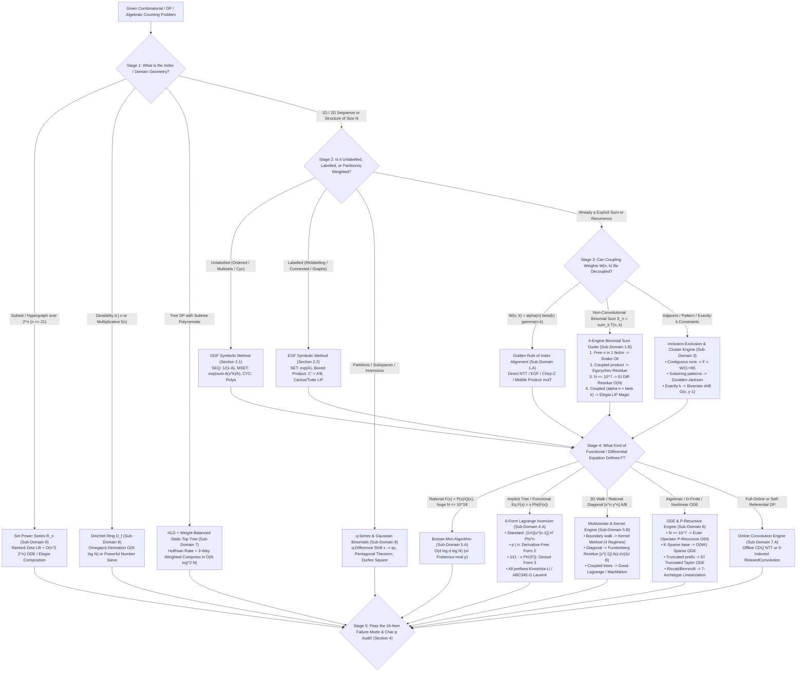

# Cohort 3 Master Technique Taxonomy & Manipulation Discovery Atlas (`TECHNIQUE_TAXONOMY.md`)

> **Phase 1 Cohort 3 (Iterations 105–115+) — Definitive Cross-Cohort Synthesis**
> **Scope**: All 52 Core Topic Iterations (Waves 1A–5B) reconciled across **Cohort 1** (Iterations 01–52), **Cohort 2** (Iterations 53–104), and **Pre-existing Research** (Iterations 11–25 & 41–52).
> **Pedagogical Mandate**: *Zero Magic Steps*. Every algebraic transformation, change of variables, differential linearization, residue extraction, and divide-and-conquer kernel is indexed by its **observable diagnostic signal** and derived step-by-step via an explicit **Reverse-Engineering Scratchpad**.

---

## Section 1: Cross-Cohort Redundancy Audit Summary (Waves 1A–5B)

The three-cohort redundancy architecture (Cohort 1 + Cohort 2 + Pre-existing files, reconciled by Cohort 3) was specifically designed to expose **single-cohort blind spots**: subtle algebraic preconditions, characteristic-$p$ breakdowns, valuation-shift precision losses, boundary anomalies, and unindexed `[ZH]` / `[JA]` / `[EN]` folklore techniques that any single research pass inevitably misses.

### 1.1 Master Wave-by-Wave Redundancy & Blind-Spot Audit Matrix

| Wave | Iterations Covered | Files Audited | Unique Blind Spots Caught by Cohort 1 | Unique Blind Spots Caught by Cohort 2 | Unique Blind Spots Caught by Pre-existing / Cohort 3 Gap-Hunt |
| :--- | :--- | :---: | :--- | :--- | :--- |
| **Wave 1A** Modelling Foundations | Iters 01–05 / 53–57 | 2 (`C1`, `C2`) | • Nilpotent zero-divisor polynomial inverses in $(\mathbb{Z}/8\mathbb{Z})[[x]]$. • **Valuation-Shift Precision Loss Rule**: $B(x)/A(x) \bmod x^N$ when $\operatorname{val}(A)=v \ge 1$ requires inputs truncated to $x^{N+v}$, not $x^N$. • Frobenius endomorphism $(F(x))^p = F(x^p)$ over $\mathbb{F}_p[[x]]$ & Hurwitz ring $\mathcal{H}(\mathbb{Z})$.  • Explicit Dihedral Bracelet operator $\operatorname{DIH}(\mathcal{A})$. | • Why doubly-infinite formal Laurent series $\sum_{n \in \mathbb{Z}} c_n x^n$ fail to form a ring. • **11-Row Index-Weight Diagnostic Table** & Golden Rule of Index-Multiplier Alignment. • **Inverse Euler Transform** ($M(x) \mapsto A(x)$) in $O(N \log N)$ via Möbius inversion on $\ln M(x)$. • General Pólya Cycle Index $Z_G(s_1, \dots, s_k)$ & Labelled **Boxed Product** $\mathcal{C} = \mathcal{A}^\square \star \mathcal{B} \implies \widehat{C}' = \widehat{A}' \widehat{B}$ (`有标号定根技巧`). | • **Cohort 3 Additions**: Directed Walk Transfer Matrix $(I - xA)^{-1}$ & Trace-Log Identity $\ln \det(I - xA)^{-1} = \sum_{n \ge 1} \operatorname{tr}(A^n) \frac{x^n}{n}$. • **Unified Pointing ($\Theta = xD$) vs. Unpointing Framework**: Linear integral $\int_0^x \frac{\widehat{\Theta A}(t)}{t}dt$ for labelled classes vs. **Otter's Dissimilarity Theorem** ($V^* - (E^* - E_{\text{sym}}) = 1$) and **Block-Cut Dissymmetry** ($V^* + B^* - V_{\text{inc}}^* = 1$) for unlabelled classes. |
| **Wave 1B** DP Decoupling & Binomial Sums | Iters 06–10 / 58–62 | 2 (`C1`, `C2`) | • **Prüfer-EGF Degree-Shift Protocol** $(N-2)![x^{N-2}]\prod \sum w_i(d)\frac{x^{d-1}}{(d-1)!}$ and the **$N=1$ isolated-vertex trap** ($d_1=0$ vs. $\ge 1$). • 2-regular simple graph EGF $\frac{\exp(-x/2 - x^2/4)}{\sqrt{1-x}}$. • **Diagonalizing Differential Basis Change** (`alpha1022` `CF1603F` / `P5333`) $\mathcal{L}_n = (1+(n-1)y) + y(1-y)\partial_y$ acting on $(1-y)^{n+1}y^m$. • **Negative Upper-Index Symmetry Trap** ($\binom{-1}{0}=1 \neq \binom{-1}{-1}=0$) in Catalan sums. | • Formal derivation $\partial_\Omega(n^{-s}) = \Omega(n)n^{-s}$ for Dirichlet $\ln/\exp$ over $\mathbb{F}_p$. • Division-free coordinate derivative $\partial_{x_d}$ for Set Power Series $\exp/\ln$. • **3-Rule Geometric Collapse Protocol** (Upper-index $n$ vs. Lower-index $n-k$ vs. Product of 2+ $k$-dependent binomials). • Chebyshev residue substitution $w = \frac{v}{1-v}$ (`maspypy`). • Base-$p$ Lucas/Frobenius extraction of $[x^m](1-x)^{\pm k} \bmod p$. | • **Discrepancy Resolved**: `AISing 2020 F` 10-variable vs. 20-variable OGF reconciled rigorously to $\frac{x^5(1+x)(1+x^2)^5}{(1-x^2)^{16}}$. • **Cohort 3 Additions**: Systematic **Heaviside Cover-Up Method** for distinct/repeated poles + **1D Boundary Perturbation Polynomial** $P(x) = (Q(x)F_{<d}(x)) \bmod x^d$. |
| **Wave 2A** Substitutions & Transforms | Iters 11–15 / 63–67 | 3 (`C1`, `C2`, `Pre`) | • **Bruhat Decomposition** of projective Möbius action $(\mathcal{M}_g F)(x) = (cx+d)^n F(\frac{ax+b}{cx+d})$ into at most 2 Taylor shifts (`AtCoder WTF19 C2`). • **Universal Quadratic Radical Substitution** $x = \frac{u}{1+au+cu^2}$ ($c = \frac{a^2-b}{4}$) where $\sqrt{1-2ax+bx^2} = \frac{1-cu^2}{1+au+cu^2}$ cancels the numerator of $dx$. • 5-Row Falling Factorial Polynomial (FFP) $\{x^{\underline{k}}\} \leftrightarrow \{x^k\} \leftrightarrow \{x^{\overline{k}}\}$ conversion table. • Characteristic-$p$ asymmetry of Newton–Girard ($e_k \to p_k$ is division-free; $p_k \to e_k$ fails for $p \le N$). | • **3-Regime Composition Validity Table** ($\operatorname{val}(G) \ge 1$ vs. $\deg F < \infty$ vs. analytic convergence). • **Formal Borel / Laplace Bridge** $\mathcal{L}\{e^{cz}\widehat{A}(z)\} = \frac{1}{1-cx}A(\frac{x}{1-cx})$ proving the Euler transform via Taylor shift in the Borel plane. • **Generalized $\alpha$-Euler Transform** $(1-cx)^{-\alpha}F(\frac{ax}{1-cx}) \bmod x^N$ in 1 NTT + **Negative-Integer $\alpha = -d$ Splitting Fix**. • **Model I** ($x=\frac{u}{(1+u)^2}$, $U_{k-1}/U_k$) vs. **Model II** ($x=\frac{u}{1+au+cu^2}$, $F_k/F_{k+1}$) Chebyshev bounded-height walks. • Cyclotomic ring $\mathbb{F}_p[\omega]/(\Phi_m(\omega))$ when $m \nmid (p-1)$. | • **Pre-existing Unique**: Krawtchouk transform $(1+x)^{N-k}(1-x)^k$ **1-Shift vs. 2-Shift Shortcuts** (`a_k \mapsto 2^k a_k` or reverse + 1 Taylor shift). • **Regime A** (Exponent-weighted $\prod (1 \pm x^{w_i})^{\pm c_i}$ in $O(M \log M)$ harmonic time) vs. **Regime B** (Scalar power sums $\prod (1 - a_i x)^{-1}$ via $P(x) = -xQ'(x)/Q(x)$). • Explicit 64-bit `double` + `long double` 3-Prime CRT Montgomery NTT for arbitrary mod $M \le 10^9+9$. |
| **Wave 2B** IE, Cluster Method & PGFs | Iters 16–20 / 68–72 | 3 (`C1`, `C2`, `Pre`) | • **Binomial Inversion as Bivariate Taylor Shift** $A(x,y) = B(x, y-1)$ (moving $y \mapsto y-1$ inside `SEQ`/`SET` before extracting $[x^n]$). • **Forbidden-Edge Path Cover IE** $P_{\text{undir}}(x) = x + \sum_{s \ge 2} 2(-1)^{s-1}\frac{x^s}{s!}$. • **Simple Permutations & `析合树`** (`CF997E`) Albert–Atkinson–Klazar inversion $S(y) = \frac{y(1-y)}{1+y} - F^{\langle -1 \rangle}(y)$. • **4 Regimes of Goulden–Jackson Cluster Method** (Single, Multi-pattern $m\times m$, Bivariate $(t-1)$, Cyclic Necklace $-xQ'(x)/Q(x)$). | • **Critical Order-of-Operations Trap in `连续段容斥`**: OGF transfer $F(x) = \frac{W(x)}{1+W(x)}$ MUST precede factorial division $n!^{-1}$ for labelled classes. • **`ez_lcw` Harmonic Sparsity Theorem**: $F_{\le k}(x) = \frac{x-x^{k+1}}{1-x^{k+1}}$ has $O(n/k)$ terms $\implies$ all $k=1 \dots n$ solved in $O(n \log^2 n)$ total. • **Non-Uniform Singing Kingdom Formula** $\sum_{\text{border } k} \prod_{t=1}^k p_{s_t}^{-1}$. • **`Elegia`'s Martingale / Poisson Drift Duality** for coupon collector & random walks. | • **Pre-existing Unique**: **PGF Formal Taylor Shift Substitution** $x = 1 + t \bmod t^3$: $[t^1]F(1+t) = \mathbb{E}[X]$ and $[t^2]F(1+t) = \frac{1}{2}\mathbb{E}[X(X-1)]$, avoiding quotient-rule singularity chasing when $F(x) = P(x)/Q(x)$ has $Q(1) = Q'(1) = 0$! • Renewal first-passage pole cancellation $F_{u\to v}(x) = \frac{H_{u\to v}(x)}{H_{v\to v}(x)}$ by multiplying numerator & denominator by $(1-x)$. |
| **Wave 3A** Lagrange Inversion, Trees & Graphs | Iters 21–25 / 73–77 | 3 (`C1`, `C2`, `Pre`) | • **Derivative-Free Lagrange Inversion** (`另类拉格朗日反演`) $[u^n]H(u)G'(u)(u/G(u))^{n+1}$, completely rescuing $p \mid n$ in $\mathbb{F}_p[[x]]$. • **Gessel's Diagonal / Jacobian-Denominator Form** $[x^n]\frac{H(F(x))}{1-x\Phi'(F(x))} = [u^n]H(u)\Phi(u)^n$. • **Wright's Decomposition** for $k$-excess connected graphs $C_k(x) = \frac{W_k(T(x))}{(1-T(x))^{3k}}$ ($k = \lvert E \rvert - \lvert V \rvert \ge 1$). | • **Lagrange's 1770 Implicit PDE Form**: $F(z) = A(z) + z\phi(F(z)) \implies \frac{\partial F}{\partial z} = \frac{\partial}{\partial A}[\phi(F) \frac{\partial F}{\partial A}]$. • **Bridge-Tree Inversion (`Luogu P5828`)**, **Graphic EGF for DAGs/SCCs (`Luogu P6295`)**, **Bipartite Sqrt EGF (`Luogu P7364`)**, and **Eulerian Graphs**. | • **Pre-existing Unique**: Raney's Cyclic Shift Lemma vs. Kemperman's Formula vs. Algebraic Proof of LIF. • Single-$n$ $O(n)$ D-finite recurrence for unrooted and rooted cacti via $(1-u)^2 U'(u) = n(1 - u + u^2/2)U(u)$. |
| **Wave 3B** Implicit FPS, Cacti & Char-$p$ LIF | Iters 26–30 / 78–82 | 2 (`C1`, `C2`) | • **Unrooted Block-Cut Dissimilarity** $C(x) = R(x) + B(R(x)) - R(x)B'(R(x))$ & Vertex-Cactus / Desert specialization (`Luogu P5434`). • **`[JA]` `ABC345-G` Laurent Geometric Series Trick**: computes prefix sums $\sum_{k=0}^{M-1}[x^k]F(x)^n$ for all $n=0\dots M-1$ in 1 compositional inverse $G = F^{\langle -1 \rangle} \bmod u^{M+1}$. | • **`Elegia`'s Coupled Binomial Sum Linearization (`炫酷反演魔术`)**: decouples $\sum_k f_k \binom{\alpha n + \beta k + \gamma}{n-k}$ via $w = u(1+u)^\beta$ (fixed-$n$ $O(n\log n)$ convolution) and $z = u(1+u)^{-\alpha}$ (all-$n$ $O(N\log^2 N)$ composition). • **Log-Free Biconnected Graph Formula**: $b_n = -(n-2)^{-(n-1)})$. • **Base-$p$ Frobenius Decimation** for $[x^n]\Phi(x)^k \bmod p$ ($n, k \le 10^{18}$) & **Parabolic / Artin–Schreier Analysis** of $G(G(x)) = F(x)$ over $\mathbb{F}_p$. | • **Cohort 3 Additions**: Exact resolution of parabolic $g_1=1$ functional square roots over $\mathbb{F}_p$ ($F^{\circ p}(x) \equiv x \pmod{x^{p+2}}$ unconditionally, with Artin–Schreier obstruction at degree $p+2$ for $N > p+2$). |
| **Wave 4A** Multivariate Rings & 2D Bostan–Mori | Iters 31–35 / 83–87 | 2 (`C1`, `C2`) | • **Five-Ring Bivariate Hierarchy** ($K[x,y] \subsetneq K[y][[x]] \cap K[x][[y]] \subsetneq K[y][[x]], K[x][[y]] \subsetneq K[[x,y]]$ and $K((z))[[t]]$) & associative failure $(1-x)^{-1} * (x - x^{-1}) * (1-x)^{-1}$. • **4 Regimes of 2D Bostan–Mori** including Kinoshita–Li $x$-halving/$y$-doubling (`deg_x * deg_y = N`) & Bostan–Christol–Dumas Frobenius $\bmod p$. • **Shifted Root-of-Unity Evaluation Fix** $y_r = c\omega^r$ when $Q(0, \omega^r) = 0$. | • **Primary-Variable Selection Rule (`主元法`)**: expand in the variable with smaller target degree or lower polynomial degree in $Q(x,y)$. • **`maspypy`'s Monic $y$-Reversal**: reverse $Q(x,y)$ in $y$ to make $[y^d]Q = 1$, changing 2D inversion from $O(N \log^2 N)$ to $O(N \log N)$. • **`Elegia`'s Twisted Kronecker Substitution**: carry-detector $\chi(I) = \sum_{r=1}^{d-1}\lfloor I/N_r \rfloor \bmod d$ + radial derivation $\mathfrak{D}$ for $d$-variate $\ln/\exp/\text{inv}$ in $O(d N \log N)$ (zero `log N` recursion overhead!). | • **Cohort 3 Additions**: Exact operation-by-operation runtime comparison proving Twisted Kronecker beats recursive multivariate Newton by $2.5\times$ for $d=2$ and $4\times$ for $d \ge 3$. |
| **Wave 4B** Furstenberg, Kernel Method & Good–Lagrange | Iters 36–40 / 88–92 | 2 (`C1`, `C2`) | • **Furstenberg Forward Rational Lift** $F(x,y) = \frac{y^2 P_y(xy,y)}{P(xy,y)}$ vs. **Reverse Residue Extraction** + **Hidden Pole at $z=0$** when $\deg_y A \ge \deg_y B$. • **Asymmetric $(p,q)$-Diagonal Global Residue / Large-Root Shortcut** when $p > q$ (`maspypy`). • **Multi-Branch Kernel Method**: $k$ small roots + **Vieta's Large-Root Trick** (avoiding fractional Puiseux series for $\{+1, -2\}$ walks!). | • **Dual-Boundary Strip Kernel ($2\times 2$ System)** on $[0, H]$ where $y_0(x)$ and $y_1(x) = y_0(x)^{-1}$ are both valid in $K[y]$. • **Quarter-Plane Orbit-Sum / Dih_2 & Dih_3 Kernel Method** (Bousquet-Mélou & Mishna). • **Multivariate Good–Lagrange Forms 1 & 2** (with and without $\det(I - J(\mathbf{u}))$) + **Bipartite Shortcut** + **MacMahon's Master Theorem** $[x^{\mathbf{m}}]\det(I-XA)^{-1}$ & Dixon's Identity. | • **Characteristic-$p$ vs. Characteristic-$0$ Diagonal Dichotomy**: for $d \ge 3$ variables, rational diagonals are transcendental D-finite over $\mathbb{Q}$ (Lipshitz 1988), but **always algebraic** over $\mathbb{F}_p$ (Furstenberg 1967)! |
| **Wave 5A** D-Finite ODEs, Sparse FPS & Relaxed Conv | Iters 41–45 / 93–97 | 3 (`C1`, `C2`, `Pre`) | • **$p$-Adic Lifting Contract ($\mathbb{Z}/p^{V+1}\mathbb{Z}$)** when indicial polynomial $I(n^*) \equiv 0 \pmod p$ for $n^* \le N$. • **7-Archetype ODE Substitution Table** + Integrating Factor shortcut $\mu^{-1} = \exp(-I)$ + Riccati regular singular point fix when $\operatorname{val}(C) \ge 1$. • **3-Way Modular Reduction Trap** for `sparse_pow` ($v \cdot \alpha$ in $\mathbb{Z}$, $c_1^{\alpha \bmod (p-1)}$, ODE multiplier $\alpha \bmod p$). • **Full-Online CDQ Self-Convolution Asymmetry Fix** at $l > 0$. | • **Abel–Cockle–Harley–Comtet Theorem** (Recipes A & B for rational powers & quadratics). • **Coupled $r$-State Sparse ODE System** for $H(x) = F(P(x))$ in $O(rNK)$ without dividing by $P'(x)$. • **`EI 科技` Truncated Taylor ODEs** ($F_{<N}' = \dots + C x^{N-1}$) & **Direct Differential-Residue Method (`载谭 Binomial Sums`)** $[x^{-1}]\frac{d}{dx}(\dots)=0$. • **0-Indexed `lowbit(q+1)` Binary Prefix Relaxed Convolution** (Nyaan). | • **Pre-existing Unique**: Complete by-hand **Zeilberger Creative Telescoping** certificate derivation on $\sum_k \binom{n}{k}\binom{n+k}{k}c^k$ + boundary failure warning when upper limit $m < n$ cuts natural support. • **1-Indexed L-Shaped Strip Partition** proof for Relaxed Convolution. |
| **Wave 5B** Tree FPS, Transposition, Compose & $q$-Series | Iters 46–52 / 98–104 | 3 (`C1`, `C2`, `Pre`) | • **Fourier-Domain $3c^2$ Matrix Multiplication** along heavy chains (transforming once, multiplying pointwise in $\hat{\mathbb{F}}_p$, inverse transforming once). • **Zero-Divisor Tracking Struct $a \cdot 0^c$** for Tree DP / Point-Value updates when dividing by $(1 \pm x^w)$ or $0 \bmod p$. • **Kinoshita–Li Route A (`noshi91` LIF + 1 Power Projection)** vs. **Route B (Newton + `compose`)** when $p \le N$. | • **Weight-Balanced Static Top Tree (`Compress` 3-Way Midpoint Split + `Rake` Min-Heap)** proving $O(N \log^2 N)$ worst-case vs. $O(N \log^3 N)$ for naive index-halving. • **Tellegen's Transposition Principle** & `mulT` ($2\times$ FFT length reduction $L \ge n+m-1$, DIF/DIT bit-reversal elimination, $1.5\mathcal{M}(N)$ Newton inv, division-free multipoint eval). • **Shift of Sampling Points** (Montgomery batch inversion + two-interval window overlap recovery) & $O(\sqrt{P}\log P)$ Factorial. • **$q$-Lucas Theorem** at roots of unity (`ARC145F`). • **SPS `[1<<n][n+1]` L1 Cache Layout** ($6.8\times$ speedup) + **Elegia's $O(n^2 2^n)$ General SPS Composition**. | • **Pre-existing Unique**: Explicit **Nachia 2D-FFT Half-Swap Trick** for Kinoshita–Li (`k_x ^ (L_x/2)` in $O(1)$ without a second forward NTT for $Q_t(-x, y)$). • **MSB Coordinate Derivative Splitting** $\frac{\partial}{\partial x_v}\exp(F) = \exp(F)\frac{\partial F}{\partial x_v}$ cutting SPS $\exp/\ln$ runtime in half. |

---

## Section 2: Complete Algebraic & Combinatorial Operator Taxonomy

Every combinatorial counting problem translates a structural specification of objects into an algebraic equation in a formal power series ring. Below is the complete, unified operator dictionary across unlabelled OGFs, labelled EGFs, pointed/dissymmetric structures, multivariate rings, Set Power Series, Dirichlet series, and $q$-series.

### 2.1 Unlabelled Combinatorial Classes & Ordinary Generating Functions (OGFs)

Let $\mathcal{A}, \mathcal{B}$ be unlabelled combinatorial classes with size function $|\cdot| : \mathcal{A} \to \mathbb{Z}_{\ge 0}$ and Ordinary Generating Functions $A(x) = \sum_{n \ge 0} a_n x^n$, $B(x) = \sum_{n \ge 0} b_n x^n \in K[[x]]$.

| Combinatorial Operator | Notation | Exact OGF Formula | Preconditions & Algorithmic Complexity ($\bmod x^N$) |
| :--- | :---: | :--- | :--- |
| **Neutral / Atomic Class** | $\mathcal{E}, \; \mathcal{Z}$ | $E(x) = 1, \quad Z(x) = x$ | $O(1)$ |
| **Disjoint Union** | $\mathcal{C} = \mathcal{A} + \mathcal{B}$ | $C(x) = A(x) + B(x)$ | $O(N)$ |
| **Cartesian Product** | $\mathcal{C} = \mathcal{A} \times \mathcal{B}$ | $C(x) = A(x) \cdot B(x)$ | $O(N \log N)$ via NTT |
| **Sequence (`SEQ`)** | $\mathcal{C} = \operatorname{SEQ}(\mathcal{A})$ | $C(x) = \frac{1}{1 - A(x)}$ | Requires $a_0 = [x^0]A(x) = 0$. $O(N \log N)$ via Newton Inv. |
| **Length-Restricted `SEQ`** | $\operatorname{SEQ}_k(\mathcal{A}), \; \operatorname{SEQ}_{\le k}(\mathcal{A})$ | $A(x)^k, \quad \frac{1 - A(x)^{k+1}}{1 - A(x)}$ | Requires $a_0 = 0$ (or $\exp(k \ln A)$). $O(N \log N)$. |
| **Multiset (`MSET` / Euler Transform)** | $\mathcal{C} = \operatorname{MSET}(\mathcal{A})$ | $C(x) = \prod_{n=1}^{\infty} \frac{1}{(1 - x^n)^{a_n}} = \exp\!\left(\sum_{k=1}^{\infty} \frac{A(x^k)}{k}\right)$ | Requires $a_0 = 0$. Construct $\ln C(x) = \sum_{n=1}^{N-1} a_n \sum_{k=1}^{\lfloor (N-1)/n \rfloor} \frac{x^{nk}}{k}$ in $O(N \log N)$ harmonic time, then $1$ `exp` in $O(N \log N)$. |
| **Powerset (`PSET` — Distinct Parts)** | $\mathcal{C} = \operatorname{PSET}(\mathcal{A})$ | $C(x) = \prod_{n=1}^{\infty} (1 + x^n)^{a_n} = \exp\!\left(\sum_{k=1}^{\infty} \frac{(-1)^{k-1}}{k} A(x^k)\right)$ | Requires $a_0 = 0$. $O(N \log N)$ harmonic sieve + $1$ `exp`. |
| **Inverse Euler Transform** ($M(x) \mapsto A(x)$) | $\mathcal{A} = \operatorname{MSET}^{-1}(\mathcal{M})$ | $L(x) = \ln M(x) = \sum_{m \ge 1} \ell_m x^m \implies a_n = \frac{1}{n} \sum_{d \mid n} \mu\!\left(\frac{n}{d}\right) d \cdot \ell_d$ | Requires $m_0 = 1$. Compute $L(x) = \ln M(x)$ in $O(N \log N)$, then divisor Möbius sieve in $O(N \log N)$. |
| **Directed Cycle / Necklace (`CYC`)** | $\mathcal{C} = \operatorname{CYC}(\mathcal{A})$ | $C(x) = \sum_{k=1}^{\infty} \frac{\varphi(k)}{k} \ln \frac{1}{1 - A(x^k)}$ | Requires $a_0 = 0$. $O(N \log N)$ via 1 `ln` on $\frac{1}{1-A(x)}$ + harmonic dilation. |
| **Dihedral Bracelet (`DIH`)** | $\mathcal{C} = \operatorname{DIH}(\mathcal{A})$ | $C(x) = \frac{1}{2}\operatorname{CYC}(\mathcal{A})(x) + \frac{2A(x) + A(x)^2 + A(x^2)}{4(1 - A(x^2))}$ | Averages cyclic rotations ($Z_{C_k}$) and reflections ($s_1 s_2^{(k-1)/2}$ for odd $k$, $\frac{1}{2}(s_1^2 s_2^{k/2-1} + s_2^{k/2})$ for even $k$). $O(N \log N)$. |
| **General Pólya Cycle Index** | $\mathcal{C} = \mathcal{A}^k / G$ ($G \le S_k$) | $C(x) = Z_G\!\left(A(x), A(x^2), \dots, A(x^k)\right)$, where $Z_G(s_1, \dots, s_k) = \frac{1}{\lvert G \rvert} \sum_{g \in G} \prod_{j=1}^k s_j^{c_j(g)}$ | $c_j(g)$ = number of $j$-cycles of $g$. Evaluates $k$-slots under permutation symmetry $G$. |

---

### 2.2 Labelled Combinatorial Classes, Exponential Generating Functions (EGFs), Boxed Products & Graph / Tree Operators

Let $\mathcal{A}, \mathcal{B}$ be labelled combinatorial classes with Exponential Generating Functions $\widehat{A}(x) = \sum_{n \ge 0} a_n \frac{x^n}{n!}$, $\widehat{B}(x) = \sum_{n \ge 0} b_n \frac{x^n}{n!} \in K[[x]]$.

| Combinatorial Operator | Notation | Exact EGF / Functional Formula | Combinatorial Meaning & Complexity ($\bmod x^N$) |
| :--- | :---: | :--- | :--- |
| **Labelled Product (Binomial Conv)** | $\mathcal{C} = \mathcal{A} \star \mathcal{B}$ | $\widehat{C}(x) = \widehat{A}(x) \cdot \widehat{B}(x) \iff c_n = \sum_{k=0}^n \binom{n}{k} a_k b_{n-k}$ | Partitions label set $\{1, \dots, n\}$ into $(S, \bar{S})$ with $\lvert S \rvert = k$. $O(N \log N)$. |
| **Labelled Set (`SET` / Exp Formula)** | $\mathcal{C} = \operatorname{SET}(\mathcal{A})$ | $\widehat{C}(x) = \exp\!\left(\widehat{A}(x)\right), \quad \operatorname{SET}_k(\mathcal{A}) \mapsto \frac{\widehat{A}(x)^k}{k!}$ | Unordered set of connected components ($\hat{a}_0 = 0$). Inverse is $\widehat{A}(x) = \ln \widehat{C}(x)$. $O(N \log N)$. |
| **Labelled Directed Cycle (`CYC`)** | $\mathcal{C} = \operatorname{CYC}(\mathcal{A})$ | $\widehat{C}(x) = \ln \frac{1}{1 - \widehat{A}(x)} = \sum_{k=1}^{\infty} \frac{\widehat{A}(x)^k}{k}$ | Directed cycles of components ($\hat{a}_0 = 0$). Undirected simple cycles ($\ge 3$): $\frac{1}{2}\left(\ln\frac{1}{1-\widehat{A}} - \widehat{A} - \frac{\widehat{A}^2}{2}\right)$. |
| **Boxed Product (`有标号定根技巧`)** | $\mathcal{C} = \mathcal{A}^\square \star \mathcal{B}$ | $\widehat{C}'(x) = \widehat{A}'(x) \cdot \widehat{B}(x) \iff \widehat{C}(x) = \int_0^x \widehat{A}'(t) \widehat{B}(t)\,dt$ | Minimum (or maximum) label of $\mathcal{A}\cup\mathcal{B}$ is forced to lie in the $\mathcal{A}$-component ($c_n = \sum_{k=1}^n \binom{n-1}{k-1} a_k b_{n-k}$). Essential when $\exp$ is unavailable or side conditions restrict component sizes! |
| **Pointing Operator** | $\mathcal{C} = \Theta \mathcal{A}$ | $\widehat{C}(x) = \vartheta_x \widehat{A}(x) = x \frac{d}{dx} \widehat{A}(x) \iff c_n = n a_n$ | Distinguishes one atom out of $n$ as a root ($n$ choices). Applies identically to OGFs and EGFs! |
| **Labelled Unpointing** | $\mathcal{A} = \Theta^{-1} \mathcal{C}$ | $\widehat{A}(x) = \int_0^x \frac{\widehat{C}(t)}{t}\,dt \iff a_n = \frac{c_n}{n} \quad (n \ge 1)$ | Works ONLY for labelled classes (where all $n$ atoms are distinguishable). |
| **Unlabelled Unpointing: Otter's Dissimilarity Theorem (Trees)** | $\mathcal{T}$ (unrooted), $\mathcal{T}^\bullet$ (vertex-rooted) | $T(x) = T^\bullet(x) - \frac{1}{2}\left(T^\bullet(x)^2 - T^\bullet(x^2)\right)$ | For unlabelled trees $\mathcal{T}$ where $T^\bullet(x) = x \operatorname{MSET}(\mathcal{T})(x)$: orbits of vertices ($V^*$) minus orbits of unoriented edges ($E^* - E_{\text{sym}}$) equals $1$ per tree! |
| **Unlabelled / Labelled Block-Cut Dissymmetry (Connected Graphs)** | $C(x)$ (unrooted), $R(x)$ (vertex-rooted) | $R(x) = x \exp\!\left(B'(R(x))\right)$ $C(x) = R(x) + B(R(x)) - R(x) B'(R(x))$ | $B(y)$ = EGF of 2-connected (biconnected) blocks. Rooted graph $R(x)$ satisfies $R = x e^{B'(R)}$, and $V^* + B^* - V_{\text{inc}}^* = 1$ yields unrooted $C(x)$ without integrating! |
| **Log-Free Biconnected Graph Extraction** | $B(y) \leftrightarrow C(x)$ | $b_n = -(n - 2)! [x^{n-1}] \left(C'(x)^{-(n-1)}\right) \quad (n \ge 2)$ | Derived via Lagrange Inversion on $x = R \exp(-B'(R))$ and $R(x) = x C'(x)$. Extracts $b_n$ for a single $n$ in $O(n \log n)$ without computing all $B(y)$! |
| **Vertex-Cactus & Desert Graphs** | $R(x)$ (rooted), $C_{\text{cactus}}(x)$ (unrooted), $\mathcal{D}_{\text{desert}}(x)$ | $B_{\text{cactus}}(y) = \frac{y^2}{2} + \frac{1}{2}\left(\ln\frac{1}{1-y} - y - \frac{y^2}{2}\right) \implies R(x) = x \exp\!\left(\frac{2R(x) - R(x)^2}{2(1 - R(x))}\right)$ $C_{\text{cactus}}(x) = R(x) + \frac{1}{2}\left(\ln\frac{1}{1-R(x)} - R(x) + \frac{R(x)^2}{2} - \frac{2R(x)^2 - R(x)^3}{1-R(x)}\right) = \frac{1}{2}\ln\frac{1}{1 - R(x)} + \frac{2R(x) - 5R(x)^2 + R(x)^3}{4(1 - R(x))}, \quad \mathcal{D}_{\text{desert}}(x) = \exp\!\big(C_{\text{cactus}}(x)\big)$ | Every edge belongs to $\le 1$ simple cycle. By Block-Cut Dissimilarity (`Luogu P5434`, OEIS A000314), $x C'_{\text{cactus}}(x) = R(x)$ ($c_n = r_n / n$). For a single fixed $n$, LIF extracts $c_n = \frac{(n-1)!}{n}[u^{n-1}]\exp\!\left(n\frac{2u - u^2}{2(1 - u)}\right)$ in $O(n)$ time via the D-finite ODE $(1-u)^2 U'(u) = n\big(1 - u + \frac{1}{2}u^2\big)U(u)$. |
| **Prüfer-Code Degree-Constrained Trees** | Trees on $N$ labelled vertices | $\text{Ans} = (N - 2)! [x^{N-2}] \prod_{i=1}^N \left( \sum_{d \ge 1} w_i(d) \frac{x^{d-1}}{(d-1)!} \right)$ | Bijects degree tuple $(d_1, \dots, d_N)$ ($\sum d_i = 2N-2$) to sequences of length $N-2$ where vertex $i$ appears $d_i - 1$ times. **Warning**: Handle $N=1$ ($d_1 = 0$) separately! |
| **Cayley's Rooted Tree EGF & Forest Power** | $T(x) = x e^{T(x)}$ | $[x^n] T(x)^k = \frac{k}{n} \binom{n}{k} n^{n-k} \frac{k!}{n!} \implies n! [x^n] \frac{T(x)^k}{k!} = \binom{n-1}{k-1} n^{n-k}$ | Counts rooted forests of $k$ labelled trees on $n$ vertices. Also satisfies $1 - T(x) = x T'(x) / T(x) \implies \frac{1}{1 - T(x)} = \sum_{n \ge 0} n^n \frac{x^n}{n!}$. |
| **Wright's $k$-Excess Connected Graphs** | $C_k(x)$ ($V$ vertices, $V+k$ edges; excess $k = \lvert E \rvert - \lvert V \rvert$) | $C_{-1}(x) = T(x) - \frac{1}{2}T(x)^2, \quad C_0(x) = \frac{1}{2}\ln\frac{1}{1-T(x)} - \frac{T(x)}{2} - \frac{T(x)^2}{4}$ $C_k(x) = \frac{W_k(T(x))}{(1 - T(x))^{3k}} \quad (k \ge 1)$ | Smooths degree-$1$ vertices (trees attached to the 2-core) and degree-$2$ chains by substituting $T(x)$ into the rational kernel $W_k(T)/(1-T)^{3k}$ ($k = \lvert E \rvert - \lvert V \rvert \ge 1$). |
| **2-Regular Simple Graphs & Permutations** | $\mathcal{G}_{\text{2-reg}}$ | $\widehat{G}_{\text{2-reg}}(x) = \frac{\exp\!\left(-\frac{x}{2} - \frac{x^2}{4}\right)}{\sqrt{1 - x}}$ | $\operatorname{SET}(\operatorname{CYC}_{\ge 3}^{\text{undir}}(\mathcal{Z}))$: deletes $1$-cycles ($-x/2$) and $2$-cycles ($-x^2/4$) from $\exp(\frac{1}{2}\ln\frac{1}{1-x}) = (1-x)^{-1/2}$. |
| **2-Edge-Connected Graphs & Bridge-Trees** | $\widehat{B}(u)$ (2-edge-conn.), $\widehat{R}(x)$ (rooted conn.) | $\widehat{R}(x) = \widehat{B}_\bullet\!\left(x e^{\widehat{R}(x)}\right)$ $n! [u^n] \widehat{B}(u) = (n - 1)! [x^n] \widehat{R}(x)\big(1 + x \widehat{R}'(x)\big) e^{-n \widehat{R}(x)}$ | Shrinking bridges in a rooted connected graph $\widehat{R}(x)$ yields a rooted 2-edge-connected core $\widehat{B}_\bullet(u)$ with $u = x e^{\widehat{R}(x)}$. Extracted via Derivative-Free LIF in $O(n \log n)$ (`Luogu P5828`). |
| **Labeled DAGs & Strongly Connected Digraphs** | $\hat{D}(x) = \sum_{n \ge 0} \frac{d_n}{n! 2^{\binom{n}{2}}} x^n$ (Graphic EGF) | $\hat{D}(x) = \left(\sum_{n \ge 0} \frac{(-1)^n}{n! \, 2^{\binom{n}{2}}} x^n\right)^{-1}$ $\widehat{S}(x) = -\ln\!\Big(2 - \exp^*\!\big(\hat{D}(x)\big)\Big)$ | Source-layer IE on $k$ independent sources divides by $2^{\binom{n}{2}} = 2^{\binom{k}{2} + \binom{n-k}{2} + k(n-k)}$ (**Graphic EGF**). Multiplying termwise by $2^{\binom{n}{2}}$ ($\exp^*$) and taking $-\ln(2 - \cdot)$ extracts strongly connected digraphs (`Luogu P6295`). |
| **Labeled Bipartite & 2-Colored Graphs** | $\widehat{G}_{\text{2-col}}(x), \; \widehat{B}_{\text{bip}}(x)$ | $\widehat{G}_{\text{2-col}}(x) = \sum_{n \ge 0} 2^{\binom{n}{2}} \frac{x^n}{n!} [t^n]\!\left(\sum_{k \ge 0} \frac{2^{-\binom{k}{2}}}{k!} t^k\right)^2$ $\widehat{B}_{\text{bip}}(x) = \exp\!\left(\frac{1}{2} \ln \widehat{G}_{\text{2-col}}(x)\right) = \sqrt{\widehat{G}_{\text{2-col}}(x)}$ | Chirp-Z identity $2^{k(n-k)} = 2^{\binom{n}{2}} 2^{-\binom{k}{2}} 2^{-\binom{n-k}{2}}$ decouples 2-colored graphs into 1 square; every connected bipartite component has $2$ colorings, so $\widehat{C}_{\text{bip}} = \frac{1}{2}\ln \widehat{G}_{\text{2-col}}$ (`Luogu P7364`). |
| **Labeled Connected Eulerian Graphs** | $\widehat{E}_{\text{conn}}(x)$ | $\widehat{E}_{\text{all}}(x) = \sum_{n \ge 1} 2^{\binom{n-1}{2}} \frac{x^n}{n!}, \quad \widehat{E}_{\text{conn}}(x) = \ln \widehat{E}_{\text{all}}(x)$ | Deleting vertex $n$ bijects even-degree graphs on $n$ vertices to arbitrary graphs on $n-1$ vertices ($\binom{n-1}{2}$ free edges). Connected via $\ln$ in $O(N \log N)$. |

---

### 2.3 Multivariate Rings, Set Power Series ($\mathcal{R}_n$), Dirichlet Ring ($\mathcal{D}_f$), $q$-Series & Symmetric Function Duality

| Ring / Transform | Underlying Algebraic Structure | Core Multiplication / Inversion / Transcendental Primitives | Complexity & Key Identity |
| :--- | :--- | :--- | :--- |
| **Five-Ring Bivariate Hierarchy** | $K[x,y] \subsetneq K[y][[x]] \cap K[x][[y]] \subsetneq \begin{cases} K[y][[x]] \\ K[x][[y]] \end{cases} \subsetneq K[[x,y]]$ and Iterated Laurent $K((z))[[t]]$ | • $F(x,y) \in K[[x,y]]$ is invertible $\iff [x^0 y^0]F \in K^\times$. • Warning: $\frac{1}{x - y}$ is valid in $K((x))[[y]]$ ($\sum_{k \ge 0} x^{-k-1} y^k$) and in $K((y))[[x]]$ ($-\sum_{k \ge 0} y^{-k-1} x^k$), which are **different** formal expansions! | Always declare the **Primary Ring** (`主元法`) before expanding rational functions with vanishing denominators at $(0,0)$. |
| **Twisted Kronecker Multivariate Ring** | $K[x_1, \dots, x_d] / (x_1^{n_1}, \dots, x_d^{n_d})$ packed into 1D array of size $N = \prod_{r=1}^d n_r$ | • **Carry-Detector Grading**: $\chi(I) = \sum_{r=1}^{d-1} \lfloor I / N_r \rfloor \bmod d \in \mathbb{Z}/d\mathbb{Z}$. • **Twisted Product**: $[z^I](A \otimes_{\text{tw}} B) = \sum_{J+K=I} [\chi(J) + \chi(K) \equiv \chi(I) \pmod d] a_J b_K$. • **Radial Derivation**: $\mathfrak{D}(\mathbf{x}^{\mathbf{i}}) = \left(\sum_{r=1}^d i_r w_r\right) \mathbf{x}^{\mathbf{i}}$ reduces $d$-variate $\text{inv}, \ln, \exp$ to 1D Newton! | **$O(d \cdot N \log N)$** time ($2.5\times$–$4\times$ faster than recursive $d$-dimensional Newton; zero $\log N$ recursion factor!). |
| **Set Power Series (SPS)** | $\mathcal{R}_n = K[x_1, \dots, x_n] / (x_1^2, \dots, x_n^2)$ | • **Ranked Zeta Lift**: $\widehat{F}_M(t) = \sum_{S \subseteq M} f_S t^{\lvert S \rvert} \in K[t]/(t^{n+1})$ for each mask $M \in [0, 2^n)$. • Pointwise $O(n^2)$ ODE recurrence in $K[t]/(t^{n+1})$ at each mask $M$ for $*_{\text{sub}}, \text{inv}, \ln, \exp, P^\alpha$. • **MSB Derivative Split**: $\frac{\partial}{\partial x_v}\exp(F) = \exp(F)\frac{\partial F}{\partial x_v}$ ($2\times$ speedup). • **Elegia's SPS Composition**: $G(F(\mathbf{x}))$ via chain rule from $k=0 \to n-1$. | **$O(n^2 2^n)$** time, **$O(n 2^n)$** space. Store as **`P[mask * (n + 1) + d]`** (`[1<<n][n+1]`) for L1 cache contiguity + AVX2! |
| **Dirichlet Generating Functions (DGF)** | $\mathcal{D}_f(s) = \sum_{n=1}^{\infty} \frac{f(n)}{n^s}$ $(f *_D g)(n) = \sum_{d \mid n} f(d) g(n/d)$ | • **$\Omega(n)$-Derivation**: $\vartheta f(n) = \Omega(n) f(n)$ where $\Omega(ab) = \Omega(a) + \Omega(b)$ is completely additive and $\Omega(n) \le \log_2 N < p$ is invertible for all $n \ge 2$! • $\ln_D(f) \iff \vartheta g = (\vartheta f) *_D f^{-1}$. • $\exp_D(f) \iff \vartheta g = (\vartheta f) *_D g$. • **Bell Series** for multiplicative $f$: $B_p(f; x) = \sum_{k \ge 0} f(p^k) x^k$. | **$O(N \log N)$** global Dirichlet $\text{inv}, \ln, \exp$ via forward divisor sieve. Powerful Number Sieve designs $g(p)=f(p)$ so $h = f *_D g^{-1}$ has $h(p)=0$ ($O(\sqrt{N})$ states). |
| **$q$-Series & Gaussian Binomials** | $\binom{n}{k}_q = \frac{(q;q)_n}{(q;q)_k (q;q)_{n-k}}$ $(a;q)_n = \prod_{i=0}^{n-1}(1 - aq^i)$ | • **Cauchy $q$-Binomial**: $\frac{(ax;q)_\infty}{(x;q)_\infty} = \sum_{k \ge 0} \frac{(a;q)_k}{(q;q)_k} x^k$. • **Gauss Positive**: $(-x;q)_n = \sum_{k=0}^n q^{\binom{k}{2}} \binom{n}{k}_q x^k$. • **Negative**: $\frac{1}{(x;q)_n} = \sum_{k \ge 0} \binom{n+k-1}{k}_q x^k$. • **Pentagonal Number Theorem**: $(q;q)_\infty = \sum_{m \in \mathbb{Z}} (-1)^m q^{m(3m-1)/2}$. • **$q$-Lucas Theorem** ($d = \operatorname{ord}_p(q)$): $\binom{n_1 d + n_0}{k_1 d + k_0}_q \equiv \binom{n_1}{k_1} \binom{n_0}{k_0}_q \pmod p$. | $\binom{n}{k}_q$ counts: (1) $k$-dim subspaces of $\mathbb{F}_q^n$, (2) binary words of length $n$ with $k$ zeros by inversions, (3) partitions in $k \times (n-k)$ box by area. |
| **Newton–Euler Symmetric Functions** | $E(t) = \prod_{i=1}^n (1 + x_i t)$ $H(t) = \prod_{i=1}^n \frac{1}{1 - x_i t} = \frac{1}{E(-t)}$ $P(t) = \sum_{k \ge 1} p_k t^k = \sum_{i=1}^n \frac{x_i t}{1 - x_i t}$ | • **Newton–Girard Bridge ($\ln \det = \operatorname{tr} \ln$)**: $$H(t) = \exp\!\left(\sum_{k \ge 1} \frac{p_k}{k} t^k\right), \quad E(t) = \exp\!\left(\sum_{k \ge 1} \frac{(-1)^{k-1} p_k}{k} t^k\right)$$ • **Log-Derivative Form (Division-Free for $e_k \to p_k$)**: $$P(t) = t \frac{H'(t)}{H(t)}, \quad \sum_{k \ge 1} (-1)^{k-1} p_k t^k = t \frac{E'(t)}{E(t)}$$ | **Regime A** (integer exponents $\prod(1 - x^{w_i})^{c_i}$): group by $w$, harmonic sieve in $O(N \log N)$. **Regime B** (scalar roots $\prod(1 - a_i x)$): divide-and-conquer product tree in $O(n \log^2 n) + 1$ `ln` in $O(N \log N)$. |

---

## Section 3: The "Zero Magic Steps" Manipulation Discovery Playbook (Diagnostic Signals & Reverse-Engineering Scratchpads)

Whenever an Olympiad or ICPC solution writes *"Consider the substitution $x = \frac{u}{1+au+cu^2}$"*, *"Apply the operator $\mathcal{L}_n = (1+(n-1)y) + y(1-y)\partial_y$"*, or *"Let $F(x) = -\frac{u'(x)}{C(x)u(x)}$"*, that step is **never** a lucky guess. It is the deterministic output of a **Diagnostic Signal** matched to a **Reverse-Engineering Scratchpad**. This section catalogues the complete decision atlas across all 8 sub-domains.

---

### 3.1 Sub-Domain 1: DP Decoupling, Index-Weight Alignment & Binomial Sum Collapse

#### A. The Golden Rule of Index-Multiplier Alignment (11-Row Diagnostic Table)

> **Golden Rule**: To turn $\sum_{k} W(n, k) a_k b_{n-k}$ into a Cauchy product $[x^n]\big(\widetilde{A}(x) \widetilde{B}(x)\big)$, factor every coupling weight $W(n, k)$ into three pure functions:
> $$W(n, k) = \alpha(n) \cdot \beta(k) \cdot \gamma(n - k).$$
> Anything depending on $k$ goes into $\widetilde{a}_k = \beta(k) a_k$; anything depending on $n-k$ goes into $\widetilde{b}_{n-k} = \gamma(n-k) b_{n-k}$; and $\alpha(n)$ is applied **outside** after extracting $[x^n]$.

| # | Observable Coupling Factor $W(n, k)$ | Diagnostic Signal | Exact Split $\alpha(n) \cdot \beta(k) \cdot \gamma(n-k)$ | Resulting FPS Operation |
| :---: | :--- | :--- | :--- | :--- |
| **1** | $\binom{n}{k}$ | Standard subset split | $n! \cdot \frac{1}{k!} \cdot \frac{1}{(n-k)!}$ | EGF multiplication $\widehat{A}(x)\widehat{B}(x)$ |
| **2** | $\binom{n-1}{k-1}$ | Root / minimum label fixed in $A$ | $(n-1)! \cdot \frac{1}{(k-1)!} \cdot \frac{1}{(n-k)!}$ | **Boxed Product**: $\widehat{C}'(x) = \widehat{A}'(x)\widehat{B}(x)$ |
| **3** | $\binom{n+c}{k+d}$ | Offset binomial index | $(n+c)! \cdot \frac{1}{(k+d)!} \cdot \frac{1}{(n-k+c-d)!}$ | Shift indices of $A$ by $d$ and $B$ by $c-d$ before EGF multiply |
| **4** | $\binom{k}{m}$ ($m$ fixed, summed over $n$) | Coefficient depends on $k$ only | $1 \cdot \binom{k}{m} \cdot 1$ | Absorb $\binom{k}{m}$ directly into $\widetilde{a}_k$, or use $\frac{x^m}{m!}A^{(m)}(x)$ |
| **5** | $n$ | Global size multiplier | $n \cdot 1 \cdot 1$ or $1 \cdot k + 1 \cdot (n-k)$ | Pointing $\vartheta_x(A B) = (\vartheta_x A)B + A(\vartheta_x B)$ |
| **6** | $k^2$ | Second moment of part size | $1 \cdot k^2 \cdot 1$ | Apply $\vartheta_x^2 A(x) = x^2 A''(x) + x A'(x)$ |
| **7** | $(n - 2k) = (n - k) - k$ | Asymmetric difference | $1 \cdot 1 \cdot (n-k) - 1 \cdot k \cdot 1$ | $A(x) (\vartheta_x B(x)) - (\vartheta_x A(x)) B(x)$ |
| **8** | $c^{\binom{n}{2}}$ or $c^{k(n-k)}$ | Complete bipartite edge weight | $\binom{n}{2} = \binom{k}{2} + \binom{n-k}{2} + k(n-k)$ | Rewrite $k(n-k) = \binom{n}{2} - \binom{k}{2} - \binom{n-k}{2}$ (**Chirp-Z Split**): $\alpha(n)=c^{\binom{n}{2}}, \beta(k)=c^{-\binom{k}{2}}, \gamma(j)=c^{-\binom{j}{2}}$ |
| **9** | $(i - j)^2$ in $\sum_{j < i} (i-j)^2 a_j$ | Polynomial distance kernel | $1 \cdot 1 \cdot d^2$ ($d = i - j$) | Semi-online CDQ NTT with $g_d = d^2$ |
| **10** | $\frac{1}{n - k}$ | Harmonic / tree-hook divisor | $1 \cdot 1 \cdot \frac{1}{n-k}$ | Multiply $A(x)$ by $\ln\frac{1}{1-x} = \sum_{d \ge 1} \frac{x^d}{d}$ |
| **11** | $\sum_{j - i = k} a_i b_j$ | Cross-correlation / difference index | Reverse $a_i$: let $u = N - 1 - i$, so $u + j = N - 1 + k$ | **Transposed Multiplication (Middle Product `mulT`)** |

---

#### B. The 4-Engine Binomial Sum Decision Guide (Snake Oil vs. Egorychev vs. Differential-Residue vs. Diagonal Basis Change)

| Diagnostic Signal in $S_n = \sum_k T(n, k)$ | Why Naive Algebraic Expansion Fails | Reverse-Engineering Scratchpad | Exact Algebraic Transformation & Complexity |
| :--- | :--- | :--- | :--- |
| **Signal 1: Free Index $n$ in ONLY ONE Factor** e.g. $S_n = \sum_k \binom{a+bk}{n-ck} f_k$ or $\sum_k \binom{n+k}{2k} f_k$ | Summing over $k$ first hits $f_k$; but summing over $n$ first collapses $\sum_n \binom{M}{n - ck} x^n = x^{ck}(1+x)^M$ into a geometric series in $k$! | **Wilf's Snake Oil Method**: 1. Identify the free external variable $n$ appearing in only one binomial coefficient. 2. Form $F(x) = \sum_{n \ge 0} S_n x^n$ and interchange $\sum_n$ and $\sum_k$. 3. Collapse the inner sum over $n$ into $x^{\alpha k + \beta} (1 \pm x)^{\gamma k + \delta}$, leaving $\sum_k f_k u(x)^k$. | Extract $[x^n] F(x)$ after substituting $u(x) = x^\alpha (1 \pm x)^\gamma$. • **Trap**: Check $n=0$ boundary if $\binom{-1}{0}=1 \neq \binom{-1}{-1}=0$ (**Catalan Negative Upper-Index Bug**)! |
| **Signal 2: Product of Two or More $k$-Dependent Binomials** e.g. $\sum_k \binom{n}{k}\binom{m}{f(k)}$ or $\sum_k (-1)^k \binom{n}{k}\binom{2n-2k}{n-1}$ | Snake Oil fails when $n$ is coupled inside multiple factors or fixed. | **Egorychev's Cauchy Residue Method**: 1. Replace the harder binomial coefficient by its residue: • **Lower-Index Kernel**: $\binom{A}{B} = [w^B](1+w)^A = [w^{-1}]\frac{(1+w)^A}{w^{B+1}}$. • **Upper-Index Kernel**: $\binom{A}{B} = [w^A]\frac{w^B}{(1-w)^{B+1}}$ (use when $k$ is in the **upper** index $A = a + bk$!). 2. Collapse the remaining $\sum_k \binom{n}{k} z(w)^k = (1 + z(w))^n$. | Extract $[w^B]$ or $[w^A]$ via algebraic substitution or Lagrange Inversion. • **Chebyshev Substitution (`maspypy`)**: When $1 - w + w^2$ or $(1-v)^n + v^n$ appears inside the residue, substitute $w = \frac{v}{1-v}$ ($1+w = \frac{1}{1-v}$, $dw = \frac{dv}{(1-v)^2}$) to make the kernel a pure monomial in $v$! |
| **Signal 3: Need $S_0, S_1, \dots, S_N$ for $N \le 10^7$ in $O(N)$ Time** e.g. $S_n = \sum_{k=0}^n \binom{n}{k}\binom{n+k}{k} c^k$ | NTT takes $O(N \log N)$ and cannot fit $N = 10^7$; need an $O(1)$-step P-recursive relation. | **EI's Differential-Residue Method (`载谭 Binomial Sums`)**: 1. Write $S_n = [x^{-1}] W_n(x)$ where $W_n(x) = x^{-n-1} A(x) B(x)^n$. 2. Use the identity $[x^{-1}] \frac{d}{dx}\!\left(x (1-x) \dots W_n(x)\right) = 0$. 3. Expand the derivative using $\frac{W_n'}{W_n} = -\frac{n+1}{x} + \frac{A'}{A} + n\frac{B'}{B}$ and express rational multiples of $W_n$ as linear combinations of $W_{n+1}, W_n, W_{n-1}$. | Produces the exact 3-term P-recursive recurrence in 3 lines of algebra without guessing a Zeilberger certificate: $(n+1)S_{n+1} - (2c+1)(2n+1)S_n + n S_{n-1} = 0 \implies O(N)$ time! |
| **Signal 4: Iterated Differential Operator $\prod_{i=1}^k \mathcal{L}_{c_i} F(y)$ in Graph/Component DP** (`alpha1022` `Luogu P5333` / `CF 1603F`) | Expanding $\mathcal{L}_n = (1 + (n-1)y) + y(1-y)\frac{d}{dy}$ in the standard basis $\{1, y, y^2, \dots\}$ couples $y^m$ to both $y^m$ and $y^{m+1}$! | **Diagonalizing Differential Basis Change**: Test how $\mathcal{L}_n$ acts on $B_{n, m}(y) = (1 - y)^{n+1} y^m$: $$\mathcal{L}_n\big((1-y)^{n+1} y^m\big) = (m+1)(1-y)^n y^m + (n - m)(1-y)^n y^{m+1}$$ Or even better, in the shifted basis $u = \frac{y}{1-y}$ ($y = \frac{u}{1+u}$, $(1-y)^{-n} = (1+u)^n$), $y(1-y)\frac{d}{dy} = u\frac{d}{du}$! | Changing basis to $u = \frac{y}{1-y}$ turns the differential operator $\mathcal{L}_n$ into $(1+u)^{-1}\big(1 + n u + u(1+u)\frac{d}{du}\big)$, diagonalizing or upper-triangularizing the operator so $k$ iterations become an $O(k \log k)$ convolution! |
| **Signal 5: 1D Linear Recurrence with Boundary Perturbations at $n < d$** $Q(x) F(x) \equiv P(x)$ | Computing $P(x)$ coefficient-by-coefficient by hand is error-prone when initial conditions $f_0, \dots, f_{d-1}$ do not match the recurrence. | **Exact Polynomial Truncation Identity**: Since $[x^n]\big(Q(x) F(x)\big) = 0$ for all $n \ge d$, the product $Q(x) F(x)$ is a polynomial of degree $< d$! Therefore, it is determined **exclusively** by the first $d$ terms $F_{<d}(x) = \sum_{n=0}^{d-1} f_n x^n$. | $$P(x) = \big(Q(x) \cdot F_{<d}(x)\big) \bmod x^d, \quad F(x) = \frac{P(x)}{Q(x)}.$$ And for partial fractions $F(x) = \sum_i \frac{c_i}{1 - \alpha_i x}$ with simple poles, **Heaviside Cover-Up** gives $c_i = \frac{-\alpha_i P(\alpha_i^{-1})}{Q'(\alpha_i^{-1})}$! |

---

### 3.2 Sub-Domain 2: Algebraic Substitutions, Möbius Actions, Euler Transforms & Radical Rationalization

| Diagnostic Signal | Underlying Obstacle | Reverse-Engineering Scratchpad | Exact Transformation & Complexity |
| :--- | :--- | :--- | :--- |
| **Signal 1: Projective Möbius Action** $(\mathcal{M}_g F)(x) = (cx+d)^n F\!\left(\frac{ax+b}{cx+d}\right)$ for $\deg F \le n$ (`AtCoder WTF19 C2`) | Naive expansion of $\sum_{k=0}^n f_k (ax+b)^k (cx+d)^{n-k}$ is $O(n^2)$. | **Bruhat Decomposition in $\operatorname{GL}_2(K)$**: Every $g = \begin{pmatrix} a & b \\ c & d \end{pmatrix}$ factors into elementary matrices: • **Shift** $T_\beta = \begin{pmatrix} 1 & \beta \\ 0 & 1 \end{pmatrix}$: $(T_\beta F)(x) = F(x + \beta)$ (**1 Taylor shift**). • **Scale** $D_{\alpha,\delta} = \begin{pmatrix} \alpha & 0 \\ 0 & \delta \end{pmatrix}$: $[x^k](D_{\alpha,\delta}F) = \alpha^k \delta^{n-k} f_k$ ($O(n)$ pointwise). • **Reversal** $J = \begin{pmatrix} 0 & 1 \\ 1 & 0 \end{pmatrix}$: $(J F)(x) = x^n F(1/x)$ ($O(n)$ array reverse). | • If $c = 0$: $g = D_{a,d} T_{b/a}$ (**1 Taylor shift**). • If $c \neq 0$: write $\frac{ax+b}{cx+d} = \frac{a}{c} + \frac{bc - ad}{c^2(x + d/c)}$, so: $$g = T_{d/c} \circ D_{bc-ad, c^2} \circ J \circ T_{a/c}$$ Requires **at most 2 Taylor shifts** ($2$ NTTs total) in $O(n \log n)$! |
| **Signal 2: Krawtchouk / Walsh Basis Transform** $G(x) = \sum_{k=0}^n a_k (1+x)^{n-k}(1-x)^k$ | Special case of Möbius action with $g = \begin{pmatrix} -1 & 1 \\ 1 & 1 \end{pmatrix}$. | Factor $(1+x)^n F\!\left(\frac{1-x}{1+x}\right)$ via $\frac{1-x}{1+x} = -1 + \frac{2}{1+x}$: 1. Let $B(u) = F(u - 1)$ (**Taylor shift #1**). 2. Scale $c_k = 2^k b_k$ and reverse $d_k = c_{n-k}$ ($x^n B(2/x)$). 3. Shift $G(x) = D(x + 1)$ (**Taylor shift #2**). | **2-Shift Method**: 2 Taylor shifts. **1-Shift Shortcut** (via $1-x = (1+x) - 2x$): expand in powers of $u = \frac{x}{1+x}$ via $1$ Taylor shift + $1$ ordinary convolution! |
| **Signal 3: Generalized $\alpha$-Euler Transform** $G(x) = (1 - cx)^{-\alpha} F\!\left(\frac{ax}{1 - cx}\right) \bmod x^N$ | Truncating $F$ at degree $N-1$ turns this into a projective Möbius action, UNLESS $\alpha$ is not tied to $\deg F$! | Expand $G(x) = \sum_{k=0}^{N-1} f_k a^k x^k (1 - cx)^{-(k + \alpha)}$: $$[x^n] G(x) = c^n \sum_{k=0}^{n} \binom{n + \alpha - 1}{n - k} \left(\frac{a}{c}\right)^k f_k.$$ Crucially, $\binom{n+\alpha-1}{n-k} = \frac{(n+\alpha-1)!}{(n-k)! (k+\alpha-1)!}$ factors directly into $\alpha(n)\beta(k)\gamma(n-k)$! | • **Generic $\alpha$** ($\alpha + k - 1 \not\equiv 0 \pmod p$ for $1 \le k < N$): **1 single NTT convolution** of $\frac{(a/c)^k f_k}{(k+\alpha-1)!}$ and $\frac{1}{j!}$! • **Negative-Integer Hazard ($\alpha = -d$ with $0 \le d < N-1$)**: $(k - d - 1)!$ has a pole at $k = d + 1$! **Exact Fix**: Split $F(y) = F_{\le d}(y) + y^{d+1} F_{>d}(y)$; the second part shifts $\alpha \mapsto \alpha + d + 1 = 1 > 0$ (no poles!), and $F_{\le d}$ has degree $\le d$! |
| **Signal 4: Quadratic Radical $\sqrt{\Delta(x)}$ in Denominator or ODE** $\Delta(x) = 1 - 2ax + bx^2$ | $\sqrt{1 - 2ax + bx^2}$ prevents rational partial fractions or direct binomial extraction. | **Universal Quadratic Radical Substitution (`Cohort 1`)**: We want $x = \frac{u}{1 + au + cu^2}$ so $1 - 2ax + bx^2$ becomes a perfect square: $$1 - 2ax + bx^2 = \frac{(1 + au + cu^2)^2 - 2au(1 + au + cu^2) + bu^2}{(1 + au + cu^2)^2} = \frac{1 + (b - a^2 + 2c)u^2 + c^2 u^4}{(1 + au + cu^2)^2}.$$ To make the numerator $(1 - cu^2)^2 = 1 - 2cu^2 + c^2 u^4$, set $b - a^2 + 2c = -2c \implies \boxed{c = \frac{a^2 - b}{4}!}$ Even better, differentiating $x = \frac{u}{1+au+cu^2}$ gives: $$dx = \frac{1 - cu^2}{(1 + au + cu^2)^2}\,du, \quad \sqrt{1 - 2ax + bx^2} = \frac{1 - cu^2}{1 + au + cu^2}!$$ | Notice that **$1 - cu^2$ cancels identically between $dx$ and $\sqrt{1 - 2ax + bx^2}$**: $$\frac{dx}{\sqrt{1 - 2ax + bx^2}} = \frac{du}{1 + au + cu^2}!$$ • **Special Case 1 (Catalan $b=0$)**: $c = a^2/4$, $x = \frac{u}{(1 + \frac{a}{2}u)^2}$ (or $x = u(1-u)$ for $\sqrt{1-4x}$). • **Special Case 2 (Central Binomial / Motzkin)**: Rationalizes any integral or generating function involving $\sqrt{1 - 2ax + bx^2}$ into a pure rational function of $u$! |
| **Signal 5: Bounded-Height Lattice Walks on $[0, H]$** Continued fraction $F_h(x) = \frac{1}{1 - ax - bx^2 F_{h-1}(x)}$ | Expanding nested continued fractions of depth $H$ takes $O(H N \log N)$ if done naively. | **Model I vs. Model II Chebyshev Rationalization (`Cohort 2`)**: • **Model I (Dyck / Motzkin $1 - ax - bx^2$)**: Substitute $x = \frac{u}{a + b(u + u^{-1})}$ (for Dyck $a=0, b=1$: $x = \frac{u}{1+u^2}$). Then the transfer recurrence has characteristic roots $u, u^{-1}$, collapsing $F_H(x)$ into $U_H / U_{H+1}$ where $U_k(u) = \frac{u^{k+1} - u^{-(k+1)}}{u - u^{-1}}$! • **Model II (General Quadratic)**: Substitute $x = \frac{u}{1 + au + cu^2}$ to express $[x^n]F_H(x)$ as a contour residue in $u$, then expand $\frac{1}{1 - u^{2H+2}}$ via geometric series (**Reflection Principle in the $u$-plane**)! | Reduces bounded-height walk enumeration on $[0, H]$ to a single harmonic/reflection sum in **$O(N)$** time (independent of $H$)! |
| **Signal 6: Falling Factorial Polynomial (FFP) Multiplication & Basis Conversion** $F(x) = \sum_{k=0}^n a_k x^{\underline{k}}$ | Need to multiply $F(x) \cdot G(x)$ in the falling factorial basis $\{x^{\underline{k}}\}$, or convert between $\{x^{\underline{k}}\}, \{x^k\}, \{x^{\overline{k}}\}$. | **5-Row FFP Basis & Point-Value Bridge (`Cohort 1`)**: 1. **FFP $\to$ Point Values on $x \in \{0, \dots, n\}$**: Since $m^{\underline{k}} = k! \binom{m}{k}$, we have: $$F(m) = \sum_{k=0}^m a_k k! \binom{m}{k} = m! [t^m]\!\left(e^t \sum_{k=0}^n a_k t^k\right)!$$ 2. **Point Values $\to$ FFP**: Multiply by $e^{-t}$: $$a_k = [t^k]\!\left(e^{-t} \sum_{m=0}^n \frac{F(m)}{m!} t^m\right)!$$ | • **FFP Multiplication ($\{x^{\underline{k}}\} \times \{x^{\underline{k}}\}$)**: Multiply by $e^t$ (**1 NTT**), multiply point values $F(m)G(m)$ pointwise in $O(n)$, multiply by $e^{-t}$ (**1 NTT**) $\implies$ **$O(n \log n)$** (3 NTTs total, vs. $O(n \log^2 n)$ for ordinary basis!). • **$\{x^{\underline{k}}\} \leftrightarrow \{x^k\}$**: Stirling number multipoint evaluation / divide-and-conquer in $O(n \log^2 n)$. • **$\{x^{\underline{k}}\} \leftrightarrow \{x^{\overline{k}}\}$**: Lah number transform $x^{\overline{n}} = \sum_k \binom{n-1}{k-1}\frac{n!}{k!} x^{\underline{k}}$ via **1 Taylor shift / NTT** in $O(n \log n)$! |
| **Signal 7: Modular Index Filter ($k \equiv r \pmod m$)** $\sum_{k \equiv r \pmod m} f_k x^k$ (`单位根反演`) | Extracting arithmetic progressions of exponents modulo $m$ from $F(x)$. | **Discrete Fourier Indicator (`单位根反演`)**: Use $\frac{1}{m} \sum_{j=0}^{m-1} \omega_m^{-jr} \omega_m^{jk} = [k \equiv r \pmod m]$ to write: $$\sum_{k \equiv r \pmod m} f_k x^k = \frac{1}{m} \sum_{j=0}^{m-1} \omega_m^{-jr} F(\omega_m^j x).$$ | • **When $m \mid (p-1)$**: $\omega_m = g^{(p-1)/m} \in \mathbb{F}_p^\times$; evaluate $F(\omega_m^j x)$ at $m$ scalars. • **When $m \nmid (p-1)$ (`LOJ #6247` / `Luogu P5591`)**: Do **not** search for a scalar $\omega_m \in \mathbb{F}_p$! Work in the **Cyclotomic Quotient Ring $\mathbb{F}_p[\omega]/(\Phi_m(\omega))$** (or $\mathbb{F}_p[\omega]/(\omega^m - 1)$) where $\omega$ is a formal indeterminate! |

---

### 3.3 Sub-Domain 3: Inclusion-Exclusion, Run-Length Transfer, Cluster Method & PGFs

| Technique / Archetype | Diagnostic Signal | Reverse-Engineering Scratchpad | Exact Master Formula & Complexity |
| :--- | :--- | :--- | :--- |
| **1. Binomial Inversion as Bivariate Taylor Shift** | Counting structures with **exactly $k$** vs. **at least $k$** features: $f_k = \sum_{j \ge k} \binom{j}{k} (-1)^{j-k} g_j$. | Package $F(x, y) = \sum_{n, k} f_{n, k} x^n y^k$ and $G(x, y) = \sum_{n, j} g_{n, j} x^n y^j$. Then: $$F(x, y) = \sum_{n, j} g_{n, j} x^n \sum_{k=0}^j \binom{j}{k} y^k (-1)^{j-k} = G(x, y - 1)!$$ | **Crucial Optimization**: Do **NOT** compute $G(x, y)$ first and shift $y \mapsto y-1$ at the end! Substitute $y \leftarrow y - 1$ **inside** the structural equation (e.g., $\operatorname{SEQ}(A(x, y-1))$ or $\exp(A(x, y-1))$) before solving! |
| **2. Universal Run-Length IE (`连续段容斥`)** | Adjacent elements cannot satisfy a forbidden relation (or blocks of identical/increasing elements have weight $w_s$ for size $s \ge 1$). | Suppose we glue atoms into maximal contiguous blocks, where a block of size $s$ has target weight $w_s$ ($W(x) = \sum_{s \ge 1} w_s x^s$). In IE, we replace each maximal block by a sequence of sub-blocks with signed weight $f_s$ ($F(x) = \sum_{s \ge 1} f_s x^s$) such that: $$\operatorname{SEQ}_{\ge 1}(F)(x) = \frac{F(x)}{1 - F(x)} = W(x) \iff \boxed{F(x) = \frac{W(x)}{1 + W(x)}!}$$ | • **Critical Order-of-Operations Rule**: When objects are **labelled** (blocks assemble via EGF product), you **MUST** compute the OGF transfer $F_{\text{OGF}}(x) = \frac{W_{\text{OGF}}(x)}{1 + W_{\text{OGF}}(x)}$ **FIRST**, and **ONLY THEN** divide $[x^s]F_{\text{OGF}}(x)$ by $s!$ (or $c_i!$) to form the EGF! • **Forbidden Adjacent Identical Elements ($w_1=1, w_{s \ge 2}=0$)**: $W(x) = x \implies F(x) = \frac{x}{1+x} = \sum_{s \ge 1} (-1)^{s-1} x^s$. • **Bounded Runs $\le k$ (`ez_lcw` Sparsity Theorem)**: $W_{\le k}(x) = \frac{x - x^{k+1}}{1 - x} \implies F_{\le k}(x) = \frac{x - x^{k+1}}{1 - x^{k+1}}$, which has **only $O(n/k)$ non-zero terms**! Thus solving for **all** $k = 1 \dots n$ costs $\sum_{k=1}^n O(\frac{n}{k} \log \frac{n}{k}) = O(n \log^2 n)$ total! |
| **3. Forbidden-Edge Path Cover IE** | Count Hamiltonian paths/cycles avoiding a sparse graph $G$ of forbidden edges ($\lvert E \rvert \le N$). | A subset $S \subseteq E$ of forbidden edges can occur in a permutation iff $S$ is a vertex-disjoint union of paths and isolated vertices. Each nontrivial path of $s \ge 2$ vertices ($s-1$ edges) can be traversed in **2 directions** and carries IE sign $(-1)^{s-1}$. | Component EGF of signed path pieces: $$P_{\text{undir}}(x) = x + \sum_{s \ge 2} 2 (-1)^{s-1} w(P_s) \frac{x^s}{s!}, \quad \text{Ans} = n! [x^n] \frac{1}{1 - P_{\text{undir}}(x)}$$ (or $[x^n]\exp(P_{\text{undir}})$ if combining via EGF sets). |
| **4. Simple Permutations & `析合树` (`CF 997E`)** | Count permutations with no nontrivial contiguous interval $[l, r]$ mapping to a contiguous value range ($1 < r-l+1 < n$). | By the **Decomposition Theorem of Permutations** (Albert–Atkinson–Klazar 2003), every permutation of length $n \ge 2$ inflates either a **linear (`合` — ascending/descending)** node $2 F(x)^2 / (1 - F(x))$ or a **simple (`析`)** permutation $\sigma \in \mathcal{S}_{\ge 4}$: $$F(x) = x + \frac{2 F(x)^2}{1 - F(x)} + S(F(x)), \quad F(x) = \sum_{n \ge 1} n! x^n.$$ | Setting $y = F(x) \iff x = F^{\langle -1 \rangle}(y)$ immediately isolates $S(y)$ via **1 Compositional Inverse**: $$\boxed{S(y) = \frac{y(1 - y)}{1 + y} - F^{\langle -1 \rangle}(y)!}$$ |
| **5. Goulden–Jackson Cluster Method (4 Regimes)** | Strings over alphabet $\Sigma$ ($\lvert \Sigma \rvert = \alpha$) avoiding (or weighting by $t$) occurrences of reduced pattern set $\mathcal{P} = \{w_1, \dots, w_m\}$. | Overlapping bad words form **clusters**. For $w_i, w_j \in \mathcal{P}$, define the **overlap polynomial** (correlation polynomial): $$C_{i, j}(x) = \sum_{\substack{1 \le k \le \lvert w_i \rvert \\ w_i[\lvert w_i \rvert-k+1 \dots \lvert w_i \rvert] = w_j[1 \dots k]}} x^{\lvert w_j \rvert - k}.$$ Note $C_{i, i}(x)$ always starts with $1 = x^0$ ($k = \lvert w_i \rvert$). Let $\mathbf{w}(x) = (x^{\lvert w_1 \rvert}, \dots, x^{\lvert w_m \rvert})^T$. | • **Regime 1 (Single Pattern Avoidance $w$)**: $F(x) = \frac{C(x)}{(1 - \alpha x)C(x) + x^{\lvert w \rvert}}$. • **Regime 2 (Multi-Pattern Avoidance, $m \times m$)**: Solve $C(x) \mathbf{r}(x) = -\mathbf{w}(x)$, then $F(x) = \frac{1}{1 - \alpha x - \mathbf{1}^T \mathbf{r}(x)} = \frac{1}{1 - \alpha x + \mathbf{1}^T C(x)^{-1} \mathbf{w}(x)}$. • **Regime 3 (Bivariate Marking by $t$)**: Solve $\big(I + \frac{1}{t-1} C(x)\big) \mathbf{r}(x) = \mathbf{w}(x)$, then $F(x, t) = \frac{1}{1 - \alpha x - (t-1)\mathbf{1}^T (t I - (t-1)C(x))^{-1} \mathbf{w}(x)}$ ($t=0$ recovers Regime 2). • **Regime 4 (Cyclic Strings / Necklaces)**: If bad words have length $\le L$, the cluster transfer matrix $T$ gives $\sum_{n \ge 1} \operatorname{tr}(T^n) x^n = \frac{-x Q'(x)}{Q(x)}$ where $Q(x) = \det(I - x T)$! |
| **6. PGF Formal Taylor Shift ($x = 1 + t \bmod t^3$) & Renewal First-Passage** | Given PGF $F(x) = \frac{P(x)}{Q(x)}$ of stopping time $T$, compute $\mathbb{E}[T]$ and $\operatorname{Var}(T)$ when $Q(1) = Q'(1) = 0$! | • **Why Differentiating $P(x)/Q(x)$ at $x=1$ Fails**: When $(1-x)^k$ divides both $P(x)$ and $Q(x)$, the quotient rule produces $0/0$! • **Formal Taylor Shift Fix**: Substitute $x = 1 + t$: since $F(1+t) = \sum_{k \ge 0} \frac{F^{(k)}(1)}{k!} t^k = 1 + \mathbb{E}[X] t + \frac{1}{2}\mathbb{E}[X(X-1)] t^2 + O(t^3)$, compute $P(1+t)$ and $Q(1+t)$, shift away their common valuation $t^v$, and invert in $K[t]/(t^3)$! • **Renewal First-Passage**: $H_{u \to v}(x) = F_{u \to v}(x) H_{v \to v}(x) \implies F_{u \to v}(x) = \frac{(1-x)H_{u \to v}(x)}{(1-x)H_{v \to v}(x)}$. | • **Variance from $F(1+t) = 1 + c_1 t + c_2 t^2 + O(t^3)$**: $$\mathbb{E}[X] = c_1, \qquad \operatorname{Var}(X) = 2 c_2 + c_1 - c_1^2.$$ • **Non-Uniform Singing Kingdom Formula** for hitting pattern $S[1\dots L]$ (letter probs $p_c$): $$\mathbb{E}[T] = \sum_{k \in \operatorname{Borders}(S)} \prod_{t=1}^k p_{S[t]}^{-1}, \qquad F_S(x) = \frac{x^L}{(1-x)\sum_{k \in \operatorname{Borders}(S)} x^{L-k} \prod_{t=1}^k p_{S[t]}^{-1}}.$$ |

---

### 3.4 Sub-Domain 4: Lagrange Inversion (6 Canonical Forms) & Implicit Functional Equations

Suppose $F(x) \in K[[x]]$ with $F(0) = 0$ is defined implicitly by the **Tree / Transfer Form** $F(x) = x \Phi(F(x))$ ($\Phi(0) \neq 0$) or equivalently the **Compositional Inverse Form** $G(F(x)) = x$ where $G(u) = \frac{u}{\Phi(u)}$ ($G(0) = 0, G'(0) \neq 0$).

#### A. The 6 Canonical Forms of Lagrange–Bürmann Inversion

| # | Form Name & Citation | Exact Extraction Identity for Target Quantity | When to Choose This Form (Diagnostic Signal) |
| :---: | :--- | :--- | :--- |
| **1** | **Standard Divided Form** (Lagrange 1770 / Bürmann 1799) | $$[x^n] H(F(x)) = \frac{1}{n} [u^{n-1}] H'(u) \Phi(u)^n = \frac{1}{n} [u^{n-1}] H'(u) \left(\frac{u}{G(u)}\right)^n$$ Special case $H(u) = u^k$: $[x^n] F(x)^k = \frac{k}{n} [u^{n-k}] \Phi(u)^n$. | Default form when $\operatorname{char}(K) = 0$ or $p \nmid n$, and $H'(u)$ is simpler than $H(u)$ (e.g. $H(u) = u^k$ or $H(u) = \ln(1+u)$). |
| **2** | **Derivative-Free / Residue Form (`另类拉格朗日反演`)** | $$\begin{aligned}[x^n] H(F(x)) &= [u^n] H(u) G'(u) \left(\frac{u}{G(u)}\right)^{n+1} \\ &= [u^n] H(u) \big(\Phi(u) - u \Phi'(u)\big) \Phi(u)^{n-1}\end{aligned}$$ | **1. Mandatory when $p \mid n$ in $\mathbb{F}_p[[x]]$!** Because it comes directly from the change of variables $\operatorname{Res} \frac{H(u) G'(u)}{G(u)^{n+1}} du$ without integrating by parts, it **never divides by $n$**! **2.** Prefer whenever $H(u)$ is a complicated series whose derivative $H'(u)$ is messy, while $\Phi(u)$ is simple! |
| **3** | **Gessel's Diagonal / Jacobian-Denominator Form** | $$[x^n] \frac{H(F(x))}{1 - x \Phi'(F(x))} = [x^n] \frac{x F'(x)}{F(x)} H(F(x)) = [u^n] H(u) \Phi(u)^n$$ | Whenever a binomial sum or tree-rooting problem produces the denominator $1 - x \Phi'(F(x))$ (e.g., $\frac{1}{\sqrt{1-4x}} = \frac{1}{1 - 2x C(x)}$ for Catalan or $\frac{1}{1 - T(x)}$ for Cayley trees): extracts $[u^n]H(u)\Phi(u)^n$ with **no $\frac{1}{n}$ and no derivatives**! |
| **4** | **Compound / Nested Inversion Form** | If $A(x)$ and $B(x)$ have $\operatorname{val}=1$, to find $[x^n] H(A^{\langle -1 \rangle}(B(x)))$: $$[x^n] H(F(x)) = \frac{1}{n} [u^{-1}] H'(u) B^{\langle -1 \rangle}(A(u))^{-n}$$ | When the equation is $A(F(x)) = B(x)$ where both $A$ and $B$ are non-trivial series. |
| **5** | **Lagrange's 1770 Implicit PDE Form** (`Cohort 2`) | If $F(z) = A + z \phi(F(z))$ depends on parameters $(A, z)$: $$\frac{\partial F}{\partial z} = \phi(F) \frac{\partial F}{\partial A} \implies \frac{\partial}{\partial z} H(F) = \phi(F) \frac{\partial}{\partial A} H(F),$$ $$H(F(z)) = H(A) + \sum_{n=1}^{\infty} \frac{z^n}{n!} \frac{\partial^{n-1}}{\partial A^{n-1}}\!\left[ \phi(A)^n H'(A) \right]$$ | When the constant term $F(0) = A(x)$ is itself a formal series in another variable, or when deriving differential identities between powers of $F$. |
| **6** | **`Elegia`'s Coupled Binomial Sum Linearization (`炫酷反演魔术`)** | To compute $S_n = \sum_{k=0}^n f_k \binom{\alpha n + \beta k + \gamma}{n - k}$, write $\binom{\alpha n + \beta k + \gamma}{n - k} = [u^n] \big(u(1+u)^\beta\big)^k (1+u)^{\alpha n + \gamma}$: • **Case A (Fixed-$n$ in $O(n \log n)$)**: Set $w = u(1+u)^\beta \iff u = g(w)$, so: $$S_n = [w^n] F(w) \frac{(1 + g(w))^{(\alpha+\beta)n + \gamma + 1}}{1 + (\beta+1)g(w)}.$$ • **Case B (All-$n \le N$ in $O(N \log^2 N)$)**: Set $z = u(1+u)^{-\alpha} \iff u = A(z)$, so: $$S_n = [z^n] F\!\left(A(z)(1 + A(z))^\beta\right) \frac{(1 + A(z))^{\gamma + 1}}{1 - (\alpha - 1)A(z)}.$$ | • **Choose Case A** when $n$ is a **single fixed integer** ($O(n \log n)$ via 1 algebraic series $g(w)$ and 1 NTT convolution, avoiding general composition!). • **Choose Case B** when you need $S_n$ for **all $n = 0, 1, \dots, N$ simultaneously**: decouples $n$ and $k$ completely into **1 FPS composition** $F(W(z))$ in $O(N \log^2 N)$ (or $O(N \log N)$ when $F$ is rational/algebraic)! |

---

#### B. Canonical Implicit Tree Families & Specialized Inversion Tricks

1. **The Three Fundamental Implicit Families**:
   - **Generalized Binomial Series $\mathcal{B}_t(x) = 1 + x \mathcal{B}_t(x)^t$** (setting $u = \mathcal{B}_t(x) - 1 \implies u = x(1+u)^t$):
     $$\mathcal{B}_t(x)^r = \sum_{n=0}^{\infty} \frac{r}{tn + r} \binom{tn + r}{n} x^n, \qquad \frac{\mathcal{B}_t(x)^r}{1 - t + t \mathcal{B}_t(x)^{-1}} = \sum_{n=0}^{\infty} \binom{tn + r}{n} x^n.$$
   - **Generalized Exponential Series $\mathcal{E}_t(x) = e^{x \mathcal{E}_t(x)^t}$** (setting $F(x) = x \mathcal{E}_t(x)^t \implies F(x) = x e^{t F(x)}$):
     $$\mathcal{E}_t(x)^r = \sum_{n=0}^{\infty} \frac{r (tn + r)^{n-1}}{n!} x^n, \qquad \frac{\mathcal{E}_t(x)^r}{1 - t x \mathcal{E}_t(x)^t} = \sum_{n=0}^{\infty} \frac{(tn + r)^n}{n!} x^n.$$
2. **`[JA]` `ABC345-G` Laurent Geometric Series Trick for All-Power Prefix Sums**:
   - **Problem**: Compute $S_n = \sum_{k=0}^{M-1} [x^k] F(x)^n = [x^{M-1}] \frac{1}{1 - x} F(x)^n$ for **every** $n = 1, 2, \dots, M-1$ in $O(M \log M)$ time, where $\operatorname{val}(F) = 1$.
   - **Reverse-Engineering Scratchpad**: Standard LIF extracts a fixed power $[x^{M-1}]F(x)^n$ for a single $n$, because $n$ is the exponent of $F(x)^n$ while $M - 1$ is fixed.
   - **Fix**: Swap the roles of $x$ and $u = F(x) \iff x = G(u)$ ($G = F^{\langle -1 \rangle}$) inside the Cauchy residue:
     $$S_n = [x^{M-1}] \frac{F(x)^n}{1 - x} = [u^{-1}] \frac{G'(u)}{1 - G(u)} \frac{u^n}{G(u)^M} = [u^{M - n - 1}] \left(\frac{u}{G(u)}\right)^M \frac{G'(u)}{1 - G(u)}.$$
     Since $G(u) = g_1 u + g_2 u^2 + \dots$ has valuation $1$, computing the unit series $\frac{G(u)}{u}$ to precision $\bmod u^M$ requires computing $G(u) = F^{\langle -1 \rangle}(u)$ to precision **$\bmod u^{M+1}$**! Define:
     $$R(u) = \left(\frac{u}{G(u)}\right)^M \frac{G'(u)}{1 - G(u)} \bmod u^M \implies \boxed{S_n = [u^{M - n - 1}] R(u)!}$$
     Thus a **single** compositional inverse $G = F^{\langle -1 \rangle} \bmod u^{M+1}$ and one `pow` + `mul` computes $S_n$ for **all** $n = 1 \dots M-1$ in one shot!
3. **Base-$p$ Frobenius Decimation for Huge Lagrange Inversion ($n, k \le 10^{18} \bmod p$)**:
   - When computing $[u^n] H(u) \Phi(u)^k \bmod p$ with $n, k \le 10^{18}$ and small prime $p$ ($\deg \Phi = d$):
   - Write $k = p q + r$ ($0 \le r < p$). By the **Frobenius Endomorphism** in $\mathbb{F}_p[[u]]$:
     $$\Phi(u)^k = \Phi(u)^r \cdot \left(\Phi(u)^p\right)^q \equiv \Phi(u)^r \cdot \Phi(u^p)^q \pmod p!$$
   - Let $A(u) = H(u) \Phi(u)^r$. Since $\Phi(u^p)^q$ only contains powers of $u^p$, only terms of $A(u)$ with exponent $\equiv n \pmod p$ can contribute to $[u^n]$! Defining the decimated polynomial $\widetilde{H}(v) = \sum_{j} [u^{jp + (n \bmod p)}] A(u) \, v^j$, we obtain the exact recursive reduction:
     $$\boxed{[u^n] H(u) \Phi(u)^k \equiv [v^{\lfloor n/p \rfloor}] \widetilde{H}(v) \Phi(v)^{\lfloor k/p \rfloor} \pmod p,}$$
     maintaining $\deg \widetilde{H} \le d$ at every digit of $n$ in base $p$ in **$O(d^2 \log_p n)$** time!
4. **Resonance & Characteristic-$p$ Behavior of Functional Square Roots $G(G(x)) = F(x) \bmod x^N$**:
   - Let $f_1 = [x^1]F(x)$ and $g_1 = [x^1]G(x)$, so $g_1^2 = f_1$. At degree $k \ge 2$, the linear coefficient of $g_k$ in $[x^k] G(G(x)) = f_k$ is:
     $$g_1 g_k + g_1^k g_k = g_1 (1 + g_1^{k-1}) g_k.$$
   - **Hazard 1 (Root-of-Unity Resonance $1 + g_1^{k-1} \equiv 0 \pmod p$)**: If $g_1^{k-1} \equiv -1 \pmod p$ (e.g., $g_1 = -1$ and $k$ is odd), the coefficient of $g_k$ vanishes, creating an immediate resonance obstruction at degree $k$!
   - **Hazard 2 (Tangent-to-Identity Case $g_1 = 1$, i.e. $F(x) = x + c x^2 + \dots$ over odd prime $p$)**: Since $g_1(1 + g_1^{k-1}) = 2 \in \mathbb{F}_p^\times$ is **invertible for every $k \ge 2$**, a unique formal square root $G(x) \in \mathbb{F}_p[[x]]$ **always exists**! Moreover, for $N \le p + 2$, since $F^{\circ p}(x) \equiv x \pmod{x^{p+2}}$ holds **unconditionally** for every tangent-to-identity series over $\mathbb{F}_p$, the $(p+1)/2$-th iterate $G(x) \equiv F^{\circ ((p+1)/2)}(x) \pmod{x^N}$ gives the exact functional square root directly (`CF 438E` / `QOJ #9535` regime)! However, for $N > p + 2$, the Abel conjugator $\Phi(F(x)) = \Phi(x) + 1$ hits an **Artin–Schreier obstruction at degree $p + 2$**, so one must solve $G(G(x)) = F(x) \bmod x^N$ directly via Newton iteration $G_{s+1} = G_s - \big(G_s'(G_s) \cdot I + \operatorname{diag}(G_s')\big)^{-1}(G_s(G_s) - F)$ rather than via fractional iteration or Abel's equation!

---

### 3.5 Sub-Domain 5: Multivariate FPS, 2D Bostan–Mori, Rational Diagonals (Furstenberg) & Kernel Method

#### A. The 4 Regimes of Bivariate Bostan–Mori $[x^N] \frac{P(x, y)}{Q(x, y)}$

Suppose $P(x, y), Q(x, y) \in K[x, y]$ with $Q(0, 0) \neq 0$, and at each halving step $N \to \lfloor N / 2 \rfloor$ we multiply by $Q(-x, y)$:
$$V(x^2, y) = Q(x, y) Q(-x, y), \qquad U(x, y) = P(x, y) Q(-x, y).$$

| Regime | Problem Profile | How $y$-Degree Is Handled at Step $t$ | Total Time Complexity |
| :--- | :--- | :--- | :--- |
| **Regime 1: Truncated Ring $K[y]/(y^{K+1})$** | Need $[x^N y^k]$ for a small fixed prefix $k = 0 \dots K$ ($K \le 5000$, $N \le 10^{18}$), $\deg_x Q = d$. | Truncate all bivariate products modulo $y^{K+1}$ at every step! Size remains $d \times (K+1)$ throughout all $\log_2 N$ steps. | **$O(d K \log(d K) \log N)$** via Kronecker-packed 1D NTT. |
| **Regime 2: Root-of-Unity Evaluation–Interpolation** | Need the **entire polynomial** $[x^N]\frac{P(x,y)}{Q(x,y)} \in K[y]$ of degree $D \le N d_y$, where $D$ is known and small. | Pick $L = 2^{\lceil \log_2(D+1) \rceil}$ shifted NTT roots $y_r = c \omega_L^r$ (choosing $c \in \mathbb{F}_p^\times$ so $Q(0, c \omega_L^r) \neq 0$ for all $r$!), run $L$ independent **1D Bostan–Mori** instances in $x$, then 1 inverse NTT in $y$. | **$O(L \cdot d_x \log d_x \log N + L \log L)$**. • **`maspypy` Monic $y$-Reversal**: If $Q(x, y)$ is monic in $y$ of degree $d_y$ (after reversing $y$), division $\bmod Q(x,y)$ avoids 2D inversion! |
| **Regime 3: Kinoshita–Li $x$-Halving / $y$-Doubling** | Need $[x^{N-1}] \frac{P(x, y)}{1 - y F(x)} \bmod y^N$ (**Power Projection** / **FPS Composition**) where $N \le 2 \times 10^5$. | At step $t \in [0, \log_2 N)$: $\deg_x$ halves ($N / 2^t$) while $\deg_y$ doubles ($2^t$). The product $\deg_x \cdot \deg_y = N$ is **invariant**! | **$\sum_{t=0}^{\log_2 N - 1} O(N \log N) = O(N \log^2 N)$**! • And $Q_t(0, y) = 1$ at every step $\implies$ **zero final division** at $t = \log_2 N$! |
| **Regime 4: Bostan–Christol–Dumas Frobenius ($\bmod p$)** | Huge $N \le 10^{18}$ over a **small prime** $p \in \{2, 3, 5, \dots, 97\}$. | Instead of $Q(x,y)Q(-x,y)$, multiply by $Q(x, y)^{p-1}$: by Frobenius, $Q(x, y)^p = Q(x^p, y^p)$, so extracting $[x^{N \bmod p}]$ reduces $N \to \lfloor N / p \rfloor$ in one step! | **$O(p^2 d_x d_y \log_p N)$** time! |

---

#### B. Furstenberg's Diagonal Method, Kernel Method & Multivariate Good–Lagrange Playbook

| Technique | Diagnostic Signal | Reverse-Engineering Scratchpad | Exact Extraction Recipe |
| :--- | :--- | :--- | :--- |
| **1. Furstenberg Forward Rational Lift** ($F(x) \mapsto \operatorname{Diag}(R)$) | Given an algebraic series $F(x) \in K[[x]]$ satisfying $P(x, F(x)) = 0$ with $F(0) = 0$ and $P_y(0, 0) \neq 0$. | Consider $\frac{y P_y(x, y)}{P(x, y)}$ around the unique small root $y = F(x)$: its residue at $y = F(x)$ is $F(x)$! Setting $x = z y$ turns $[z^n y^n]$ into the contour integral over $\lvert y \rvert = \varepsilon$: | $$\boxed{F(t) = \operatorname{Diag}\!\left( \frac{y^2 P_y(x y, y)}{P(x y, y)} \right) = [z^0] \frac{z^2 P_y(t, z)}{P(t, z)} = [z^{-1}] \frac{z P_y(t, z)}{P(t, z)}!}$$ |
| **2. Furstenberg Reverse Residue Extraction** ($\operatorname{Diag}(\frac{A(x,y)}{B(x,y)}) \mapsto$ Algebraic) | Need $D(t) = \sum_{n \ge 0} [x^n y^n] \frac{A(x, y)}{B(x, y)} t^n$. | Substitute $x = z$ and $y = t / z$: then $[x^n y^n] x^n y^n = [z^0] t^n$, so: $$D(t) = [z^0] \frac{A(z, t/z)}{B(z, t/z)} = [z^{-1}] \frac{A(z, t/z)}{z \, B(z, t/z)}.$$ Clear negative powers of $z$ in numerator and denominator by multiplying by $z^d$. | Sum the residues of $\frac{A(z, t/z)}{z B(z, t/z)}$ at **ONLY the small roots $z = z_i(t)$ that satisfy $\lim_{t \to 0} z_i(t) = 0$**! • **Hidden Pole Trap at $z = 0$**: If $\deg_y A \ge \deg_y B$, clearing $z^{-1}$ leaves a pole at $z = 0$ itself! Always check whether $z = 0$ is a pole after clearing denominators! • **Asymmetric $(p, q)$-Diagonal Shortcut (`maspypy`)**: For $[x^{pn} y^{qn}]$ when $p > q$ creates more small roots than large roots, use **Global Residue Theorem** $\sum_{\text{small}} \operatorname{Res} = -\sum_{\text{large} \cup \{\infty\}} \operatorname{Res}$! |
| **3. Kernel Method (4 Regimes)** | 1D / 2D lattice walk with boundary conditions yields: $K(x, y) F(x, y) = A(x, y) + B(x) F(x, 0) + \dots$ | The unknown series $F(x, y)$ converges on the polydisk where the **kernel** $K(x, y) = 0$ along any **small algebraic branch $y = y_i(x)$** with $y_i(0) = 0$. Therefore, substituting $y = y_i(x)$ **annihilates the LHS** ($0 = A(x, y_i(x)) + B(x) F(x, 0)$)! | • **Regime A (1 Small Root)**: $K(x, y_0(x)) = 0 \implies F(x, 0) = -A(x, y_0(x)) / B(x)$. • **Regime B (Strip $[0, H]$ — Dual Boundary)**: $K(x, y)$ is symmetric in $y \leftrightarrow y^{-1}$ (or $q y^{-1}$), and $F(x, y) \in K[y][[x]]$ is a **polynomial** in $y$! Thus **both** $y_0(x)$ and $y_1(x) = y_0(x)^{-1}$ are valid substitutions, giving a $2\times 2$ linear system for $F(x, 0)$ and $F(x, H)$! • **Regime C ($k$ Negative Steps $\{-k, \dots, +m\}$ & Vieta's Large-Root Trick)**: $k$ small roots $y_1, \dots, y_k$ determine the $k$ boundary series. If we only want the **total walks** $F(x, 1)$ (where $y=1$ is inside the disk), express the boundary polynomial via **Vieta's formulas in the $m$ LARGE roots** (especially when $m = 1$, e.g. $\{+1, -2\}$ walks, which has **only 1 large root** $y_{\text{large}}(x)$)! • **Regime D (2D Quarter-Plane Walks $i, j \ge 0$ & Obstinate Kernel Method)**: For $K(x, y; t) Q(x, y; t) = x y - F(x; t) - G(y; t) + x y Q(0, 0; t)$ where $K(x, y; t) = x y \big(1 - t S(x, y)\big)$ has step polynomial $S(x, y) = A(x)y + B(x) + C(x)y^{-1} = \tilde{A}(y)x + \tilde{B}(y) + \tilde{C}(y)x^{-1}$, generate the **biholomorphic involution group** $\mathcal{G} = \langle \Phi, \Psi \rangle$: $\Phi(x, y) = \big(\frac{\tilde{C}(y)}{\tilde{A}(y)} x^{-1}, y\big)$ and $\Psi(x, y) = \big(x, \frac{C(x)}{A(x)} y^{-1}\big)$ which leave $K(x, y; t) = 0$ invariant! When $\lvert \mathcal{G} \rvert = 2m < \infty$, taking the **alternating orbit sum** $\sum_{g \in \mathcal{G}} \operatorname{sgn}(g) g\big(x y K Q\big)$ cancels all boundary series $F(x; t)$ and $G(y; t)$ simultaneously, expressing $Q(0, 0; t) = [x^1 y^1] \sum_{g \in \mathcal{G}} \operatorname{sgn}(g) \frac{g(x y)}{1 - t S(x, y)}$ as a **positive-part / rational diagonal extraction**! |
| **4. Multivariate Good–Lagrange Inversion (Forms 1 & 2) & MacMahon's Master Theorem** | Coupled implicit system $u_i = x_i \Phi_i(u_1, \dots, u_d)$ for $i = 1 \dots d$. | Let $J(\mathbf{u})$ be the $d \times d$ matrix with entries $J_{i, j}(\mathbf{u}) = \frac{u_j}{\Phi_i(\mathbf{u})} \frac{\partial \Phi_i(\mathbf{u})}{\partial u_j} = x_i \frac{\partial \Phi_i}{\partial u_j}$. Changing variables $x_i = u_i / \Phi_i(\mathbf{u})$ in the $d$-fold Cauchy integral multiplies by the Jacobian determinant $\det(I - J(\mathbf{u})) \prod_{i=1}^d \frac{\Phi_i(\mathbf{u})^{n_i}}{u_i^{n_i+1}}$! | • **Form 1 (Direct Extraction)**: $$[x_1^{n_1} \cdots x_d^{n_d}] H(\mathbf{u}) = [u_1^{n_1} \cdots u_d^{n_d}] H(\mathbf{u}) \det\!\big(I - J(\mathbf{u})\big) \prod_{i=1}^d \Phi_i(\mathbf{u})^{n_i}.$$ • **Form 2 (Inverse-Jacobian / Cycle-Sum Form)**: $$[x_1^{n_1} \cdots x_d^{n_d}] \frac{H(\mathbf{u})}{\det(I - J(\mathbf{u}))} = [u_1^{n_1} \cdots u_d^{n_d}] H(\mathbf{u}) \prod_{i=1}^d \Phi_i(\mathbf{u})^{n_i}.$$ • **Bipartite Shortcut ($d=2$, $\Phi_1 = \Phi_1(u_2), \Phi_2 = \Phi_2(u_1)$)**: $\det(I - J) = 1 - \frac{u_1 \Phi_2'(u_1)}{\Phi_2(u_1)} \frac{u_2 \Phi_1'(u_2)}{\Phi_1(u_2)}$, which decouples into the product of two 1D extractions: $$[x_1^{n_1} x_2^{n_2}](u_1^a u_2^b) = \frac{a n_2 + b n_1 - a b}{n_1 n_2} \left([u_1^{n_1 - a}] \Phi_2(u_1)^{n_2}\right) \left([u_2^{n_2 - b}] \Phi_1(u_2)^{n_1}\right)!$$ • **MacMahon's Master Theorem** (setting $\Phi_i(\mathbf{u}) = 1 + \sum_{j=1}^d a_{i, j} u_j$ in Form 2): $$\boxed{[x_1^{m_1} \cdots x_d^{m_d}] \prod_{i=1}^d \left(\sum_{j=1}^d a_{i, j} x_j\right)^{m_i} = [x_1^{m_1} \cdots x_d^{m_d}] \frac{1}{\det(I - X A)}, \quad X = \operatorname{diag}(x_1, \dots, x_d)!}$$ |
| **5. Bivariate PDE Companion Matrix Product (`maspypy` & `Elegia`, `QOJ #6184`)** | Bivariate sequence $a_{n, k}$ satisfies a linear PDE in $\partial_x, \partial_y$ (e.g., $(n - k) a_{n, k} = \dots$), and we need a single row $[x^N y^k] F(x, y)$ for large $N$. | Express the bivariate recurrence in $n$ as a **1st-order matrix recurrence in $n$ with polynomial entries in $y$**: $\mathbf{v}_n(y) = M(n, y) \mathbf{v}_{n-1}(y) \bmod y^{K+1}$, where $M(n, y)$ is a $c \times c$ companion matrix of sparse polynomials in $y$. | Reduce $[x^N] F(x, y)$ to the **matrix product $\prod_{n=1}^{N} M(n, y) \bmod y^{K+1}$** via divide-and-conquer NTT (or Bostan–Mori when $M(y)$ is independent of $n$) in **$O(c^3 K \log K \log N)$** time! |

---

#### C. Multivariate Lagrange Inversion (Good–Lagrange & MacMahon Master Theorem) & Bivariate Decoupling Scratchpads (Wave 4B)

- **Diagnostic Signal**: You have a coupled multi-type tree/graph system $u_i = x_i \Phi_i(u_1, \dots, u_d)$ ($i = 1 \dots d$), or a product of linear forms $\prod_{i=1}^d (\sum_j a_{i, j} x_j)^{m_i}$ where variables are coupled across factors.
- **Reverse-Engineering Scratchpad**:
  1. **When to use Form 1 vs. Form 2 of Good–Lagrange**:
     - If you are counting **rooted** multi-type trees (where a specific root of type $r$ is distinguished, i.e., $H(\mathbf{u}) = u_r$), use **Form 1**: expand the $d \times d$ Jacobian determinant $\det(I - J(\mathbf{u}))$ into a sum over cycle covers of $\{1, \dots, d\}$ and extract $[u_1^{n_1} \cdots u_d^{n_d}]$ term-by-term.
     - If you see the **cycle-generating function $\frac{1}{\det(I - J(\mathbf{u}))}$** (or $\ln \det(I - J(\mathbf{u}))^{-1}$), use **Form 2**: the Jacobian cancels $\det(I - J(\mathbf{u}))$ in the denominator, leaving the pure product $[u_1^{n_1} \cdots u_d^{n_d}] H(\mathbf{u}) \prod_{i=1}^d \Phi_i(\mathbf{u})^{n_i}$!
  2. **How to Spot the Bipartite Rank-1 Collapse ($d = 2$, $\Phi_1 = \Phi_1(u_2), \Phi_2 = \Phi_2(u_1)$)**:
     - Whenever red nodes only have blue children ($\Phi_1(u_2)$) and blue nodes only have red children ($\Phi_2(u_1)$), the diagonal entries of $J(\mathbf{u})$ are **zero** ($J_{1,1} = J_{2,2} = 0$)! Thus $\det(I - J) = 1 - J_{1,2}(u_2) J_{2,1}(u_1)$ has only **2 terms**, completely decoupling the 2D extraction into two independent 1D extractions in $u_1$ and $u_2$!
  3. **How to Spot MacMahon's Master Theorem**:
     - Instead of expanding $\prod_{i=1}^d (\sum_{j=1}^d a_{i, j} x_j)^{m_i}$ by multinomial theorem in $O(m^{d^2})$, apply Form 2 of Good–Lagrange to $\Phi_i(\mathbf{u}) = 1 + \sum_{j=1}^d a_{i, j} u_j$ (so $x_i = \frac{u_i}{\Phi_i(\mathbf{u})}$ and $\frac{x_i \Phi_i(\mathbf{u}) - x_i}{x_i} = \sum_j a_{i, j} u_j$) to convert the product of linear forms into $[x_1^{m_1} \cdots x_d^{m_d}] \frac{1}{\det(I - X A)}$, where $\det(I - X A)$ is a small polynomial of degree $d$!

---

### 3.6 Sub-Domain 6: D-Finite ODEs, P-Recursive Unrolling, Sparse FPS & Truncated Taylor ODEs (`EI 科技`)

#### A. D-Finite $\leftrightarrow$ P-Recursive Equivalence & The Abel–Cockle–Harley–Comtet Theorem

1. **Euler Operator Dictionary ($\vartheta = x \frac{d}{dx}$)**:
   - **Diagnostic Signal**: You have a linear differential equation with polynomial coefficients $\sum_{j=0}^{r} q_j(x) F^{(j)}(x) = 0$ and need the exact coefficient recurrence for $f_n = [x^n] F(x)$ without index-shifting errors.
   - **Reverse-Engineering Scratchpad**: Convert every $x^j D^j$ into the **degree-preserving Euler operator $\vartheta = x \frac{d}{dx}$** via $x^j D^j = \vartheta(\vartheta - 1)\cdots(\vartheta - j + 1) = \vartheta^{\underline{j}}$, then group terms by powers of $x^i$:
     - Action on monomials: $\vartheta^k (x^n) = n^k x^n$, and $x^j D^j (x^n) = n^{\underline{j}} x^n$.
     - Shifting property: $\vartheta^k \big(x^s F(x)\big) = x^s (\vartheta + s)^k F(x)$.
     - Therefore, any linear ODE $\sum_{i=0}^{d} x^i P_i(\vartheta) F(x) = 0$ translates immediately (by extracting $[x^n]$) into the **$d$-step P-recursive recurrence**:
       $$\boxed{\sum_{i=0}^{d} P_i(n) \, f_{n - i} = 0, \qquad \text{with indicial polynomial } I(n) = P_0(n)!}$$
2. **Recipe A (Rational Power $F(x) = A(x) B(x)^\alpha$ & Exp of Rational $F(x) = A(x) \exp(R(x)/S(x))$, with $B(0), S(0) \neq 0$)**:
   - **Diagnostic Signal**: $F(x)$ is a rational power $A(x) B(x)^\alpha$ (such as $\frac{1}{\sqrt{1 - 2ax + bx^2}}$) or $A(x) \exp(R(x)/S(x))$, and $N \le 10^7$ requires an $O(N)$ linear recurrence instead of $O(N \log N)$ NTT.
   - **Reverse-Engineering Scratchpad**: Differentiate $\ln F(x)$ so the irrational exponent $\alpha$ or exponential $\exp(R/S)$ becomes a rational logarithmic derivative $\frac{F'(x)}{F(x)}$, then clear denominators:
     $$\frac{F'}{F} = \frac{A'}{A} + \alpha \frac{B'}{B} \implies \boxed{A(x) B(x) F'(x) - \big(A'(x) B(x) + \alpha A(x) B'(x)\big) F(x) = 0!}$$
   - **Canonical 3-Term $O(N)$ Recurrences Derived via Recipe A**:
     - **Central Delannoy / Legendre ($F(x) = (1 - 2ax + bx^2)^{-1/2}$)**: $(1 - 2ax + bx^2) F'(x) - (a - bx) F(x) = 0 \implies (n+1) f_{n+1} = (2n+1)a f_n - n b f_{n-1}$.
     - **Motzkin Numbers ($M(x) = \frac{1 - x - \sqrt{1 - 2x - 3x^2}}{2x^2}$)**: $(n+2) M_n = (2n+1) M_{n-1} + 3(n-1) M_{n-2}$.
     - **Large Schröder Numbers ($S(x) = \frac{1 - x - \sqrt{1 - 6x + x^2}}{2x}$)**: $(n+1) S_n = 3(2n-1) S_{n-1} - (n-2) S_{n-2}$.
3. **Recipe B (Quadratic Algebraic Equation $P_2(x) F(x)^2 + P_1(x) F(x) + P_0(x) = 0$)**:
   - **Diagnostic Signal**: $F(x)$ satisfies a quadratic algebraic equation (e.g., from a context-free grammar, tree decomposition, or 1-root Kernel Method) and you need $f_0, \dots, f_N$ in $O(N)$ time.
   - **Reverse-Engineering Scratchpad**:
     1. Complete the square: $2 P_2(x) F(x) + P_1(x) = \sqrt{\Delta(x)}$ where $\Delta(x) = P_1(x)^2 - 4 P_0(x) P_2(x)$.
     2. Apply Recipe A with $\alpha = 1/2$ to $Y(x) = \sqrt{\Delta(x)}$: $2 \Delta(x) Y'(x) - \Delta'(x) Y(x) = 0$.
     3. Substitute $Y(x) = 2 P_2(x) F(x) + P_1(x)$ to obtain an inhomogeneous 1st-order linear ODE for $F(x)$ (or differentiate once more to make it homogeneous), then apply the Euler Operator Dictionary!

---

#### B. The 7-Archetype Differential Equation Substitution Table

| # | ODE Archetype | Diagnostic Signal | Exact Linearizing / Integrating Substitution | Resulting Target & Complexity |
| :---: | :--- | :--- | :--- | :--- |
| **1** | **Inhomogeneous 1st-Order Linear** $F'(x) + P(x) F(x) = Q(x)$ | Linear in $F, F'$; non-zero forcing $Q(x)$. | Let $I(x) = \int_0^x P(t)\,dt$. Multiply by $\mu(x) = \exp(I(x))$ and use **$\mu(x)^{-1} = \exp(-I(x))$** (avoiding polynomial `inv`!): | $$F(x) = \exp(-I(x)) \left( F(0) + \int_0^x \exp(I(t)) Q(t)\,dt \right)$$ $O(N \log N)$ (or $O(N)$ if $\mu(x) = B(x)^\alpha$ is algebraic!). |
| **2** | **Bernoulli Nonlinear ODE** $F'(x) + P(x) F(x) = Q(x) F(x)^m$ | Single nonlinear power $F(x)^m$ ($m \neq 0, 1$). | Substitute $U(x) = F(x)^{1 - m}$, so $U'(x) = (1-m) F(x)^{-m} F'(x)$. | Reduces directly to Archetype 1: $$U'(x) + (1 - m) P(x) U(x) = (1 - m) Q(x)!$$ |
| **3** | **Riccati Quadratic ODE** $F'(x) = A(x) + B(x) F(x) + C(x) F(x)^2$ | Quadratic $F(x)^2$ from binary splitting at root/minimum. | Substitute **$F(x) = -\frac{u'(x)}{C(x) u(x)}$** with $u(0) = 1$: the $+\frac{(u')^2}{C u^2}$ from differentiating $-u'/(Cu)$ cancels $C F^2 = +\frac{(u')^2}{C u^2}$! | **2nd-Order Linear D-Finite ODE**: $$C(x) u'' - \big(C'(x) + B(x) C(x)\big) u' + A(x) C(x)^2 u = 0$$ Unrolls in **$O(N)$** time + 1 `inv` (or sparse div)! |
| **4** | **Autonomous 1st-Order ODE** $F'(x) = \Phi(F(x))$ (no explicit $x$) | Shift-invariant combinatorial rule (alternating perms, trees). | View $x = G(y) = F^{\langle -1 \rangle}(y)$ as a function of $y = F(x)$: | $$G'(y) = \frac{1}{\Phi(y)} \implies G(y) = \int_{F(0)}^{y} \frac{dt}{\Phi(t)}, \quad F = G^{\langle -1 \rangle}!$$ |
| **5** | **Autonomous 2nd-Order ODE** $F''(x) = \Psi(F(x))$ | 2nd derivative depends only on $F$. | **Energy Integral Trick**: Multiply both sides by $2 F'(x)$ so $2 F'(x) F''(x) = \frac{d}{dx}\big[(F'(x))^2\big]$! | Reduces to Archetype 4: $$F'(x) = \sqrt{F'(0)^2 + 2 \int_{F(0)}^{F(x)} \Psi(u)\,du}!$$ |
| **6** | **Variable Leading $F''$ Coefficient** $q_2(x) F'' + q_1(x) F' + q_0(x) F = 0$ | Leading $q_2(x)$ (e.g. $(1+x)^2$ or $1-4x$) obstructs constant-coeff reduction. | **Liouville Change of Variable**: $u = \int \frac{dx}{\sqrt{q_2(x)}}$, $F(x) = G(u)$. | Normalizes the $G_{uu}$ coefficient to $1$! |
| **7** | **2nd-Order with Unwanted $F'$ Drift** $D''(z) - 2 p(z) D'(z) + q(z) D(z) = 0$ | Middle drift $-2p(z)D'(z)$ obstructs Bessel / hypergeometric matching (`QOJ #60`). | **Gauge Transformation**: Factor out $D(z) = \exp\!\left(\int p(z)\,dz\right) B(z)$. | Eliminates the first derivative completely: $$B''(z) + \big(q(z) - p(z)^2 - p'(z)\big) B(z) = 0!$$ |

---

#### C. Sparse FPS Engine ($O(NK)$) & `EI 科技` Truncated Taylor ODEs ($F_{<N}' = \dots + C x^{N-1}$)

1. **Master $O(N \cdot K)$ Sparse FPS Recurrences** (for $P(x) = c_0 + \sum_{j=1}^K c_j x^{d_j}$ with $K \ll \log^2 N$ non-zero terms):
   - **Never** compute $P(x)^\alpha = \exp(\alpha \ln P(x))$ when $P$ is sparse ($\ln P$ becomes dense!). Always unroll the defining 1st-order ODE directly:
     - **`sparse_div` ($G = A / P$)**: $g_n = \frac{1}{c_0}\left(a_n - \sum_{j \ge 1} c_j g_{n - d_j}\right)$ (algebraic, **zero $n^{-1}$ needed**!).
     - **`sparse_ln` ($G = \ln P, c_0 = 1$)**: $g_n = \frac{1}{n}\left(n [x^n]P - \sum_{j \ge 1} (n - d_j) c_j g_{n - d_j}\right)$.
     - **`sparse_exp` ($G = \exp P, c_0 = 0$)**: $g_n = \frac{1}{n} \sum_{j \ge 1} d_j c_j g_{n - d_j}$.
     - **`sparse_pow` ($G = P^\alpha, c_0 \neq 0$)**: $g_n = \frac{1}{n c_0} \sum_{j \ge 1} \big((\alpha + 1) d_j - n\big) c_j g_{n - d_j}$.
   - **Coupled $r$-State Sparse Composition $H(x) = F(P(x))$ in $O(r N K)$**:
     When $F(y)$ satisfies an order-$r$ ODE $F^{(r)}(y) = \sum_{i=0}^{r-1} a_i(y) F^{(i)}(y)$ and $P(x)$ is $K$-sparse ($P(0)=0$), maintain the $r$ series $H_i(x) = F^{(i)}(P(x))$ ($0 \le i < r$) via $H_i'(x) = P'(x) H_{i+1}(x)$ and $H_{r-1}'(x) = P'(x) \sum_{i=0}^{r-1} a_i(P(x)) H_i(x)$ (**never dividing by $P'(x)$**!).
2. **`EI 科技` Truncated Taylor ODEs (Converting Infinite D-Finite Series to Finite Polynomials)**:
   - **Diagnostic Signal**: You need to evaluate a truncated prefix $F_{<N}(x) = \sum_{n=0}^{N-1} f_n x^n$ at a specific scalar $x = x_0$ (or compose $F_{<N}(P(x))$) in $O(N)$ or $O(N \log N)$ time, where $F(x)$ satisfies a known 1st-order ODE $A(x) F'(x) + B(x) F(x) = C(x)$.
   - **Reverse-Engineering Scratchpad**: Split $F(x) = F_{<N}(x) + F_{\ge N}(x)$ where $F_{\ge N}(x) = \sum_{n \ge N} f_n x^n = f_N x^N + f_{N+1} x^{N+1} + \dots$. Substitute into $A(x) F'(x) + B(x) F(x) = C(x)$ and move $F_{\ge N}$ to the right-hand side:
     $$A(x) F_{<N}'(x) + B(x) F_{<N}(x) = C(x) - \big(A(x) F_{\ge N}'(x) + B(x) F_{\ge N}(x)\big).$$
     Since the left-hand side has degree $\le N - 1 + \max(\deg A - 1, \deg B)$, the right-hand side **must vanish at all degrees $\ge N + \max(\deg A - 1, \deg B)$**! Thus only a **bounded number ($d = \max(\deg A, \deg B)$) of boundary coefficients $f_N, f_{N+1}, \dots, f_{N+d-1}$** survive on the right-hand side!
   - **Canonical Example ($F(x) = (1 + x)^\alpha$, $A(x) = 1+x, B(x) = -\alpha$)**:
     $$(1 + x) F_{<N}'(x) - \alpha F_{<N}(x) = -N \binom{\alpha}{N} x^{N-1} = -\alpha \binom{\alpha - 1}{N - 1} x^{N-1}!$$
     Integrating or evaluating at $x = x_0$ (or substituting $x \leftarrow P(x)$) allows us to compute $\sum_{n=0}^{N-1} \binom{\alpha}{n} P(x)^n$ via a **single sparse inhomogeneous ODE** without computing individual terms!

---

### 3.7 Sub-Domain 7: Tree DP + HLD (`全局平衡二叉树`), Transposition Principle, Relaxed Convolution & Kinoshita–Li

#### A. Offline CDQ NTT vs. van der Hoeven / Nyaan Relaxed Convolution

| Feature | Semi-Online Offline CDQ NTT (`cdq(l, r)`) | Full-Online Relaxed Convolution (`RelaxedConvolution`) |
| :--- | :--- | :--- |
| **Problem Signature** | $f_n = \phi_n\!\left(\sum_{i=0}^{n-1} f_i g_{n-i}\right)$ where multiplier $g_{1 \dots N}$ is **known in advance**. | $c_q = \sum_{i=0}^{q} a_i b_{q-i}$ where **both** $a_q$ and $b_q$ arrive online at step $q$ (or depend on $c_q$). |
| **Core Partition Invariant** | **LCA Partition**: Every pair $(i, n)$ ($0 \le i < n \le N$) is accumulated at the unique recursion node $[l, r] = \operatorname{LCA}(i, n)$ where $i \in [l, \text{mid}]$ and $n \in [\text{mid}+1, r]$. | **0-Indexed Binary Prefix (`lowbit(q+1)` — Nyaan)**: Let $m = q + 1$ and $d = m \mathbin{\&} (-m)$: • If $m = d$ (pure power of $2$): convolve **1 square block** $A[0..d-1] \times B[0..d-1]$ into $C[q..q+2d-2]$. • If $m > d$: convolve **2 symmetric wings** $A[q-d+1..q] \times B[0..d-1] + B[q-d+1..q] \times A[0..d-1]$ into $C[q..q+2d-2]$. |
| **Self-Convolution / Self-Referential Protocol** | **Critical Bug at $l > 0$**: For $f_n = \sum_{i=1}^{n-1} f_i f_{n-i}$, convolving $f[l..m]^2$ misses $j < l$! **Fix**: • If $l = 0$: convolve $f[0..m] \times f[0..m]$. • If $l > 0$: convolve **$2 \cdot f[l..m] \times f[0..r-l]$**! | **3-Step Self-Referential Protocol at Step $q$**: 1. Read `interior = rc.C[q]` ($= \sum_{i=1}^{q-1} a_i b_{q-i}$, already accumulated during steps $0 \dots q-1$!). 2. Solve for $a_q, b_q$ using `interior`. 3. Call `rc.next(a_q, b_q)` to add $a_0 b_q + a_q b_0$ and trigger block convolutions! |

---

#### B. Tree DP with Polynomials: HLD + Weight-Balanced Static Top Tree (`全局平衡二叉树`)

- **Diagnostic Signal**: A Tree DP on an arbitrary tree of size $N \le 2 \times 10^5$ associates to each vertex $u$ a polynomial state $F_u(x)$ (or $c$-tuple of polynomials) of degree proportional to subtree size $\text{sz}[u]$. Naive bottom-up merging $\prod_{v \in \text{children}(u)} F_v(x)$ degrades to $O(N^2)$ on caterpillars or heavy-path trees.
- **Reverse-Engineering Scratchpad**: Separate the two sources of quadratic blowup—(1) merging many light children at a single vertex $u$, and (2) repeatedly multiplying by a heavy child's polynomial along a long heavy chain $v_1, \dots, v_L$—into two orthogonal divide-and-conquer passes (`Rake` and `Compress`):
  1. **Step 1 (`Rake` — Merging Light Subtrees at Vertex $u$)**:
     - Collect the light children $v_1, \dots, v_k$ of $u$ (where $v_i \neq \text{heavy}[u]$) and merge their polynomials using a **Min-Heap (Huffman Priority Queue) ordered by polynomial degree**!
     - **Complexity**: Since $\sum_{u} \sum_{v \in \text{light}(u)} \text{sz}[v] \le N \log_2 N$ and each light subtree is merged in a Huffman tree, all `Rake` operations across the entire tree cost **$O(N \log^2 N)$**!
  2. **Step 2 (`Compress` — Merging the $c \times c$ Transfer Matrices Along a Heavy Chain $v_1, \dots, v_L$)**:
     - Let $w_i = 1 + \sum_{v \in \text{light}(v_i)} \text{sz}[v]$ be the **light weight** of node $v_i$, and let $W = \sum_{i=1}^L w_i$.
     - **Why Naive Index-Halving ($m = L/2$) Degrades to $O(N \log^3 N)$**: A path of $N$ vertices with a single light subtree of size $N/2$ at one end can copy the $N/2$-degree polynomial $\log_2 N$ times along the heavy chain!
     - **Exact Fix (3-Way Weighted-Midpoint Split)**: Choose the unique split index $m \in [1, L]$ where the prefix weight crosses $\ge W / 2$:
       $$\sum_{i=1}^{m-1} w_i < \frac{W}{2} \quad \text{and} \quad \sum_{i=1}^{m} w_i \ge \frac{W}{2}.$$
       Split $[1, L]$ into **three** pieces: Left $[1, m-1]$ (weight $< W/2$), Pivot $\{m\}$, and Right $[m+1, L]$ (weight $\le W/2$). Now every light subtree's polynomial is multiplied at most $O(\log N)$ times total across the **entire tree** (both light edges and heavy-chain splits), guaranteeing **$O(N \log^2 N)$ worst-case time**!
  3. **Step 3 (Fourier-Domain $3c^2$ Matrix Multiplication Optimization)**:
     - When multiplying two $c \times c$ polynomial matrices $A(x) \cdot B(x)$ of total degree $L$: do **NOT** call `poly_mul` $c^3$ times ($3c^3$ NTTs)! Transform the $2c^2$ entries forward once, multiply the $c \times c$ scalar matrices pointwise at each NTT frequency, and inverse-transform the $c^2$ outputs (**only $3c^2$ NTTs**!).

---

#### C. Tellegen's Transposition Principle (`转置原理`), Middle Product (`mulT`) & Kinoshita–Li Composition

> **Theorem (Tellegen's Transposition Principle)**: Any linear map $y = M x$ ($M \in K^{m \times n}$) computed by a straight-line circuit of $A$ additions and $S$ scalar multiplications can be inverted into a circuit for $z = M^T w$ by **reversing the topological order of all gates** and replacing every elementary linear gate by its transpose (fan-out $\leftrightarrow$ addition; cyclic convolution $\leftrightarrow$ cross-correlation / middle product), using the **exact same $S$ scalar multiplications**!

| Primal Linear Operation ($x \mapsto y$) | Transposed Dual Operation ($w \mapsto z = M^T w$) | Algorithmic Payoff & Speedup |
| :--- | :--- | :--- |
| **Polynomial Multiplication $\mathcal{M}_B(A) = A \cdot B$** ($\deg A < n, \deg B < m$, output length $n + m - 1$) | **Middle Product $\operatorname{mulT}(C, B) = \mathcal{M}_B^T(C)$**: $$\operatorname{mulT}(C, B)[i] = \sum_{j=0}^{m-1} B[j] \cdot C[i + j] \quad (0 \le i < n)$$ | **1. $2\times$ FFT Length Reduction**: To extract degrees $[m-1, m+n-2]$ of $B^{\text{rev}} \cdot C$, an FFT of length **$L \ge n + m - 1$** suffices (cyclic wrap-around only pollutes indices $< m - 1$, which are discarded!). **2. DIF/DIT Bit-Reversal Elimination**: `DIF_NTT` (normal $\to$ bit-reversed) + pointwise multiply + `DIT_INTT` (bit-reversed $\to$ normal) needs **zero bit-reversal permutations**! **3. $1.5\,\mathcal{M}(N)$ Newton Inversion**: Computing the residual $\text{ high}(A_d \cdot G_d)$ via `mulT` of length $d$ saves $25\%$ of total NTT work! |
| **Multipoint Evaluation (`eval`)**: $y_i = F(x_i) = F(x) \bmod (x - x_i)$ | **Subproduct Tree Sum**: $\sum_{i=0}^{n-1} \frac{w_i}{1 - x_i x} = \frac{P(x)}{Q_{\text{rev}}(x)} \bmod x^n$ | Transposing bottom-up rational sum into top-down **Multipoint Evaluation** replaces all $O(\log n)$ heavy polynomial divisions $F \bmod P_{u}$ by **middle products `mulT`**, making multipoint evaluation **100% division-free** inside the tree walk! |
| **Power Projection (`power_projection`)**: $p_k = \sum_{i=0}^{N-1} w_i [x^i] F(x)^k = [x^{N-1}] \frac{P_0(x)}{1 - y F(x)}$ | **FPS Composition (`compose`)**: $H(x) = \sum_{k=0}^{N-1} g_k F(x)^k \bmod x^N$ | Forward pass ($t = 0 \to \log_2 N - 1$): compute $Q_t(-x, y)$ via 2D Bostan–Mori. Backward pass ($t = \log_2 N - 1 \downarrow 0$): interleave zeros along $x$ ($\mathcal{S}_{b_t}^T$) and apply 2D Middle Product $\operatorname{mulT}_{x, y}(\hat{U}_t, Q_t(-x, y))$ in **$O(N \log^2 N)$**! |
| **Compositional Inverse (`revert`) Route A** ($\operatorname{char}(K) = 0$ or $p > N$) | **Compositional Inverse (`revert`) Route B** (Small characteristic $p \le N$!) | • **Route A (`noshi91`)**: $[x^{n-k}](G(x)/x)^{-n} = \frac{n}{k}[x^n]F(x)^k \implies$ **1 Power Projection** + 1 `pow(-1/n)` ($2\times$ faster than `compose`, **requires $p > N$**!). • **Route B (Newton + `compose`)**: $G_{s+1} = G_s - \frac{F(G_s) - y}{F'(G_s)} \bmod y^{2^{s+1}}$ **never divides by $k$** and works whenever $2, f_1 \in K^\times$, even when $p \le N$! |

---

#### D. Chirp Z-Transform (Bluestein's Algorithm), Shift of Sampling Points (`连续点值平移`) & $O(\sqrt{P}\log P)$ Factorial

| Primitive | Diagnostic Signal | Reverse-Engineering Scratchpad | Master Formula & Complexity |
| :--- | :--- | :--- | :--- |
| **1. Chirp Z-Transform (Bluestein's Algorithm)** | Evaluate $F(x) = \sum_{j=0}^{n-1} f_j x^j$ at $m$ geometric points $x_i = a \cdot c^i$ ($0 \le i < m$), or compute $q$-binomial transforms. | Rewrite the coupled product exponent $i \cdot j$ via **Bluestein's Binomial Identity** (which avoids $c^{1/2} \notin \mathbb{F}_p$): $$i j = \binom{i+j}{2} - \binom{i}{2} - \binom{j}{2}.$$ | $$F(a c^i) = c^{-\binom{i}{2}} \sum_{j=0}^{n-1} \left(f_j a^j c^{-\binom{j}{2}}\right) c^{\binom{i+j}{2}}$$ **1 single Middle Product / NTT** in **$O((n+m)\log(n+m))$**! • **Edge Case $c = 0$**: $F(a \cdot 0^0) = F(a)$, and $F(0) = f_0$ for $i \ge 1$. |
| **2. Shift of Sampling Points (`连续点值平移`)** | Given point values $F(0), F(1), \dots, F(d)$ of a degree-$d$ polynomial $F(x)$, compute $F(c), F(c+1), \dots, F(c+m-1)$ without recovering monomial coefficients. | By **Lagrange Interpolation on $\{0, 1, \dots, d\}$**, for any $x \notin \{0, \dots, d\}$: $$F(x) = x^{\underline{d+1}} \sum_{i=0}^{d} \frac{(-1)^{d-i} F(i)}{i!\,(d-i)!} \cdot \frac{1}{x - i}.$$ Setting $x = c + k$ turns $\frac{1}{c + k - i}$ into a **Cauchy convolution in $k - i$**! | Let $a_i = \frac{(-1)^{d-i} F(i)}{i!(d-i)!}$ and $b_j = \frac{1}{c + j - d}$. Then: $$F(c+k) = (c+k)^{\underline{d+1}} [t^{k+d}]\big(A(t) B(t)\big)$$ Runs in **$O((d+m)\log(d+m))$** via **1 single NTT** (used for $2\times$ degree doubling in `sqrt(P)` factorial)! |
| **3. $O(\sqrt{P}\log P)$ Factorial ($N! \bmod P$)** | Compute $N! \bmod P$ for $N < P \le 10^{12}$ (or $P = 998244353$ with $N \le 10^9$). | Let $v = \lfloor \sqrt{N} \rfloor$ and define the block polynomial $G_d(x) = \prod_{j=1}^{d} (x + j)$ of degree $d$. To double degree $d \to 2d$: $G_{2d}(x) = G_d(x) G_d(x + d)$. Maintain point values $G_d(0), G_d(v), G_d(2v), \dots, G_d(d v)$! | At each doubling step $d \to 2d$, use **Shift of Sampling Points** twice: (1) shift $G_d(i v) \mapsto G_d(i v + d)$ to get $G_{2d}(i v) = G_d(i v) G_d(i v + d)$ for $i \le d$, and (2) shift $G_{2d}(0 \dots d v) \mapsto G_{2d}((d+1)v \dots 2d v)$! Multiplies the $v$ blocks $\prod_{i=0}^{v-1} G_v(i v)$ in **$O(\sqrt{N} \log N)$** time! |

---

### 3.8 Sub-Domain 8: $q$-Analogues, Set Power Series ($\mathcal{R}_n$), Dirichlet Ring & Symmetric Function Duality

| Sub-Domain | Diagnostic Signal | Reverse-Engineering Scratchpad | Master Identity & Complexity |
| :--- | :--- | :--- | :--- |
| **1. $q$-Difference Equation Engine ($x \mapsto qx$)** | Need the $x^k$ coefficient of a $q$-Pochhammer product/ratio $F(x) = \prod_i \frac{(a_i x; q)_\infty}{(b_i x; q)_\infty}$. | Shift $x \mapsto qx$: every $(a x; q)_\infty = (1 - ax)(a q x; q)_\infty$ peels off its $i = 0$ factor! Thus $\frac{F(qx)}{F(x)} = \frac{R(x)}{S(x)}$ is a small rational function of $x$! | Cross-multiply $S(x) F(qx) = R(x) F(x)$ and extract $[x^k]$: since $[x^k]F(qx) = q^k c_k$, this yields an **$O(1)$-step recurrence for $c_k$ in $O(N)$ time**! |
| **2. Euler's Pentagonal Number Theorem & Durfee Squares** | Unbounded integer partition OGF $\frac{1}{(q; q)_\infty}$ or distinct-part OGF $(-x; q)_\infty \bmod q^N$. | • **Franklin's Involution**: cancels all distinct-part partitions in $(q; q)_\infty$ except $\lambda$ with $\lvert \lambda \rvert = \frac{m(3m-1)}{2}$ ($m \in \mathbb{Z}$), leaving only $O(\sqrt{N})$ non-zero terms! • **Durfee Square**: decompose Ferrers diagram by its maximal $d \times d$ top-left square ($d \le \sqrt{N}$). | • $(q; q)_\infty = \sum_{m \in \mathbb{Z}} (-1)^m q^{m(3m-1)/2} \implies \frac{1}{(q;q)_\infty} \bmod q^N$ in $O(N \log N)$ via `inv` or $O(N\sqrt{N})$ via sparse recurrence! • $\frac{1}{(q; q)_\infty} = \sum_{d=0}^{\lfloor\sqrt{N}\rfloor} \frac{q^{d^2}}{(q; q)_d^2}$ (computable in $O(N\sqrt{N})$ via $d$ sparse updates!). |
| **3. Set Power Series ($\mathcal{R}_n$) Operations & Composition** | Exact cover / DAG / connected hypergraph / Steiner subgraph counting over $2^n$ subsets ($n \le 21$). | Lift $F(\mathbf{x}) \in K[x_1, \dots, x_n]/(x_1^2, \dots, x_n^2)$ via **Ranked Fast Zeta Transform** to $\widehat{F}_M(t) = \sum_{S \subseteq M} f_S t^{\lvert S \rvert} \in K[t]/(t^{n+1})$ in **`[1<<n][n+1]` L1-contiguous layout**. | • **Standard $\text{inv}, \ln, \exp, P^\alpha$**: $O(n^2)$ ODE at each mask $M \implies O(n^2 2^n)$. • **MSB Split for $\exp/\ln$**: $\frac{\partial}{\partial x_v}\exp(F) = \exp(F)\frac{\partial F}{\partial x_v}$ halves work to $\frac{1}{2}n^2 2^n$. • **Elegia's General Composition $G(F(\mathbf{x}))$**: maintain $G^{(d)}(F_{\subseteq \{0..k-1\}})$ for $0 \le d \le n-k$ from $k = 0 \to n-1$ in $\sum_k (n-k)k^2 2^k = O(n^2 2^n)$! |
| **4. Dirichlet $\Omega(n)$-Derivation & Bell Series** | Need $\ln_D(f)$ or $\exp_D(f)$ under Dirichlet convolution $(f *_D g)(n) = \sum_{d \mid n} f(d) g(n/d) \bmod p$. | Analytic derivative $-d/ds$ multiplies by $\ln n \notin \mathbb{F}_p$. Replace $\ln n$ by the **completely additive prime-multiplicity function $\Omega(n) = \sum_{p^k \parallel n} k$**! Since $\Omega(ab) = \Omega(a) + \Omega(b)$, $\vartheta f(n) = \Omega(n) f(n)$ is a true derivation on $\mathcal{D}$ and $1 \le \Omega(n) \le \log_2 N < p$ is always invertible for $n \ge 2$! | $$\vartheta \ln_D(f) = (\vartheta f) *_D f^{-1}, \qquad \vartheta \exp_D(f) = (\vartheta f) *_D \exp_D(f)$$ Both run in **$O(N \log N)$** via a 10-line divisor sieve! |

---

## Section 4: Master Failure-Mode & Characteristic-$p$ Hazard Checklist

Before submitting any Formal Power Series implementation or mathematical proof, verify it against the **16 Canonical Failure Modes** discovered across the three cohorts:

| # | Hazard Category | Specific Failure Mode / Trap | Diagnostic Condition | Exact Algorithmic / Algebraic Remedy |
| :---: | :--- | :--- | :--- | :--- |
| **1** | **Valuation Shift** | **Precision Loss in Shifted Division $B(x) / A(x) \bmod x^N$** | $\operatorname{val}(A) = v \ge 1$ ($A(x) = x^v \widetilde{A}(x)$, $B(x) = x^v \widetilde{B}(x)$). | Dividing by $x^v$ shifts degree $N+v-1$ down to $N-1$! You **MUST** compute both $A(x)$ and $B(x)$ to precision **$\bmod x^{N+v}$** before shifting by $x^v$! |
| **2** | **Valuation Shift** | **3-Way Modular Reduction Trap in $P(x)^\alpha \bmod x^N$** | $\alpha \ge p$ (e.g. $\alpha \le 10^{18}$) and $P(x) = x^v c_1 \widetilde{P}(x)$ with $v \ge 0$. | Reduce $\alpha$ in **three distinct ways**: 1. **Shift $v \cdot \alpha$**: true integer in `__int128` (do **not** reduce $\bmod p$ or $p-1$! If $v > 0$ and $v \alpha \ge N$, return $0$). 2. **Scalar $c_1^\alpha$**: reduce $\alpha \bmod (p - 1)$ (Fermat). 3. **ODE / $\exp(\alpha \ln \widetilde{P})$**: reduce $\alpha \bmod p$! |
| **3** | **Valuation Shift** | **Rational Exponent $P(x)^{a/b}$ Existence Failure** | $\alpha = a/b \in \mathbb{Q}$ ($\gcd(a,b)=1$) and $\operatorname{val}(P) = v \ge 1$. | $P(x)^{a/b} \in \mathbb{F}_p[[x]]$ exists $\iff$ **$b \mid (v \cdot a)$ in $\mathbb{Z}$** AND the leading coefficient $c_v$ has a **$b$-th root in $\mathbb{F}_p$**! |
| **4** | **Char-$p$ Division** | **Transcendental Breakdown ($\ln, \exp, \int$) for $p \le N$** | Prime modulus $p \le N$: $x^p / p$ in $\int x^{p-1}dx$ divides by $0 \bmod p$! | Replace $\exp / \ln$ with **purely algebraic operations** (Newton inversion, Bostan–Mori, Frobenius $(F(x))^p = F(x^p)$, or combinatorial Boxed Products). |
| **5** | **Char-$p$ Division** | **Lagrange Inversion $1/n$ Breakdown when $p \mid n$** | Extracting $[x^n] H(F(x))$ when $n \equiv 0 \pmod p$. | Never use $\frac{1}{n}[u^{n-1}]H'(u)\Phi(u)^n$ when $p \mid n$! Use **Form 2 (Derivative-Free LIF)**: $[u^n] H(u)\big(\Phi(u) - u\Phi'(u)\big)\Phi(u)^{n-1}$! |
| **6** | **Char-$p$ Division** | **Compositional Inverse (`revert`) Breakdown when $p \le N$** | Computing $F^{\langle -1 \rangle}(y) \bmod y^N$ when $p \le N$. | **Route A (`noshi91` LIF + Power Projection)** divides by $k \in [1, N-1]$ and fails! Use **Route B (Newton Iteration + Kinoshita–Li `compose`)**, which only divides by $2$ and $f_1 = [x^1]F(x)$! |
| **7** | **Char-$p$ Division** | **Newton–Girard Asymmetry ($p_k \leftrightarrow e_k$)** | Converting between power sums $p_k$ and elementary symmetric $e_k$ for $p \le N$. | • **$e_k \to p_k$ ($P(t) = t E'(t)/E(t)$)**: uses only FPS inversion of $E(t)$ ($e_0 = 1$), so it is **100% division-free and valid for all $p$**! • **$p_k \to e_k$ ($E(t) = \exp(\sum (-1)^{k-1}\frac{p_k}{k}t^k)$)**: divides by $k$ and **fails for $p \le N$**! |
| **8** | **Char-$p$ Division** | **Vanishing Indicial Polynomial $I(n^*) \equiv 0 \pmod p$ in P-Recursive Unrolling** | Unrolling $I(n) a_n = \sum_{i=1}^d P_i(n) a_{n-i} \bmod p$ hits $I(n^*) \equiv 0 \pmod p$ at $n^* \le N$. | **1. Non-Modular Zero ($I(n^*) = 0$ in $\mathbb{Z}$)**: supply $a_{n^*}$ as an initial condition. **2. Modular Zero ($I(n^*) \neq 0$ in $\mathbb{Z}$ but $p \mid I(n^*)$)**: work over the **$p$-adic ring $\mathbb{Z}/p^{V+1}\mathbb{Z}$** where $V = \sum_{I(n)\equiv 0} v_p(I(n))$, storing each coefficient as $u \cdot p^e$ ($\gcd(u, p) = 1$)! |
| **9** | **Char-$p$ Division** | **$q$-Binomial $\binom{n}{k}_q \bmod p$ when $\operatorname{ord}_p(q) = d \le n$** | Evaluating $\binom{n}{k}_q = \frac{(q;q)_n}{(q;q)_k(q;q)_{n-k}}$ when $q^d \equiv 1 \pmod p$ ($1 - q^d \equiv 0$). | Direct factorial division divides by zero! Apply the **$q$-Lucas Theorem**: $\binom{n_1 d + n_0}{k_1 d + k_0}_q \equiv \binom{n_1}{k_1} \binom{n_0}{k_0}_q \pmod p$! |
| **10** | **Zero Divisors** | **Dynamic Division by Zero in Point-Value / Tree DP Products** | Maintaining $\prod_v F_v(\omega_r)$ when some factor $F_v(\omega_r) \equiv 0 \pmod p$ is later removed/updated. | Maintain each point value as a **Zero-Divisor Pair $(a, c) \equiv a \cdot 0^c$** ($a \in \mathbb{F}_p^\times, c \in \mathbb{Z}_{\ge 0}$): multiplying by $0$ increments $c \leftarrow c + 1$; dividing by $0$ decrements $c \leftarrow c - 1$; actual value is $(c == 0 \text{ ? } a : 0)$! |
| **11** | **Roots of Unity** | **Missing $m$-th Root of Unity in Root-of-Unity Filter (`单位根反演`)** | Need $\frac{1}{m}\sum_{j=0}^{m-1} F(\omega_m^j)$ when $m \nmid (p - 1)$ (while $\gcd(m, p) = 1$). | Do **not** search for a scalar $\omega_m \in \mathbb{F}_p$! Work in the **Cyclotomic Quotient Ring $\mathbb{F}_p[\omega] / (\Phi_m(\omega))$** (or $\mathbb{F}_p[\omega]/(\omega^m - 1)$) where $\omega$ is a formal indeterminate! |
| **12** | **Roots of Unity** | **Bluestein Chirp-Z Square-Root Failure ($c^{1/2} \notin \mathbb{F}_p$)** | Evaluating $F(a \cdot c^i)$ over $\mathbb{F}_p$ when $c$ is a quadratic non-residue. | Never use $ij = \frac{1}{2}((i+j)^2 - i^2 - j^2)$! Always use **Bluestein's Binomial Identity** $ij = \binom{i+j}{2} - \binom{i}{2} - \binom{j}{2}$, which uses **integer exponents $\binom{k}{2}$ only**! Also handle **$c = 0$** separately ($y_0 = F(a)$, $y_{i \ge 1} = f_0$). |
| **13** | **Online / CDQ** | **Full-Online Self-Convolution Asymmetry Bug at $l > 0$** | Solving $f_n = \sum_{i=1}^{n-1} f_i f_{n-i}$ via offline `cdq(l, r)`. | Convolving $f[l..m] \times f[l..m]$ at $l > 0$ misses $j < l$! At $l = 0$, convolve $f[0..m]^2$; at **$l > 0$, convolve $2 \cdot f[l..m] \times f[0..r-l]$** (or use 0-indexed `RelaxedConvolution`)! |
| **14** | **Substitutions & Poles** | **Negative-Integer $\alpha = -d$ Pole in Generalized $\alpha$-Euler Transform** | Computing $(1 - cx)^{-\alpha} F\!\left(\frac{ax}{1 - cx}\right) \bmod x^N$ when $\alpha = -d \in \{-(N-2), \dots, 0\}$. | The factorial weight $\frac{1}{(k + \alpha - 1)!}$ has a pole at $k = d + 1$! **Split** $F(y) = F_{\le d}(y) + y^{d+1} F_{>d}(y)$: the first part is a polynomial of degree $\le d$, and the second shifts $\alpha \mapsto 1 > 0$! |
| **15** | **Residues & Boundaries** | **Hidden Pole at $z = 0$ in Improper Rational Diagonals** | Extracting $\operatorname{Diag}\!\left(\frac{A(x,y)}{B(x,y)}\right) = [z^{-1}] \frac{A(z, t/z)}{z B(z, t/z)}$ when $\deg_y A \ge \deg_y B$. | Substitution $y = t/z$ introduces $z^{\deg_y B - \deg_y A - 1}$, creating an **extra pole at $z = 0$** in addition to the roots of $B(z, t/z) = 0$! Always include $\operatorname{Res}_{z=0}$ (or perform polynomial division in $y$ first)! |
| **16** | **Combinatorial Boundary** | **Catalan Negative Upper-Index Trap & Prüfer $N = 1$ Trap** | 1. Using $\binom{2k-1}{k} = \binom{2k-1}{k-1}$ at $k = 0$. 2. Using Prüfer degree EGF $(N-2)![x^{N-2}]\prod \dots$ at $N = 1$. | 1. At $k = 0$: $\binom{-1}{0} = 1 \neq \binom{-1}{-1} = 0$! Always isolate the $k = 0$ term before applying symmetry. 2. At $N = 1$: the unique tree has $1$ vertex of **degree $0$** (not $\ge 1$), and $N - 2 = -1 < 0$; always handle $N = 1$ explicitly! |

---

## Section 5: Master Algorithmic Complexity Lookup Table & Diagnostic Decision Tree

### 5.1 Master Complexity & Precondition Lookup Table (24 Core Primitives)

| # | Primitive / Operation | Mathematical Definition ($\bmod x^N$) | Best Asymptotic Complexity | NTT Count ($\mathcal{M}(N)$) | Algebraic Preconditions | Characteristic-$p$ Requirement |
| :---: | :--- | :--- | :--- | :---: | :--- | :--- |
| **1** | **Dense Convolution** | $C(x) = A(x) B(x) \bmod x^N$ | $O(N \log N)$ | $1.0\,\mathcal{M}(N)$ | None | $p = k \cdot 2^m + 1$ (or 3-prime CRT / MTT) |
| **2** | **Middle Product (`mulT`)** | $\operatorname{mulT}(C, B)[i] = \sum_{j=0}^{m-1} B[j] C[i+j]$ | $O((n+m)\log(n+m))$ | $1.0\,\mathcal{M}(n+m)$ | None | Same as Convolution ($2\times$ shorter FFT!) |
| **3** | **Polynomial Inverse (`inv`)** | $G(x) = A(x)^{-1} \bmod x^N$ | $O(N \log N)$ | $1.5\,\mathcal{M}(N)$ | $[x^0]A(x) \in K^\times$ | Works for **all** $p$ ($\gcd([x^0]A, p) = 1$) |
| **4** | **Square Root (`sqrt`)** | $G(x)^2 \equiv A(x) \bmod x^N$ | $O(N \log N)$ | $2.5\,\mathcal{M}(N)$ | $\operatorname{val}(A) = 2k$, $a_{2k} \in (K^\times)^2$ | $p \neq 2$ (Cipolla/Tonelli–Shanks for $a_{2k}^{1/2}$) |
| **5** | **Logarithm (`ln`)** | $G(x) = \int \frac{A'(x)}{A(x)}\,dx \bmod x^N$ | $O(N \log N)$ | $2.5\,\mathcal{M}(N)$ | $[x^0]A(x) = 1$ | **Requires $p > N$** (divides by $1 \dots N-1$) |
| **6** | **Exponential (`exp`)** | $G_{s+1} = G_s(1 - \ln G_s + A) \bmod x^{2^{s+1}}$ | $O(N \log N)$ | $\approx 5.5\,\mathcal{M}(N)$ | $[x^0]A(x) = 0$ | **Requires $p > N$** |
| **7** | **General Power (`pow`)** | $P(x)^\alpha = x^{v\alpha} c_v^\alpha \exp(\alpha \ln \widetilde{P}) \bmod x^N$ | $O(N \log N)$ | $\approx 8.0\,\mathcal{M}(N)$ | Shift $v = \operatorname{val}(P)$ first | **Requires $p > N$** (unless $P$ is $K$-sparse) |
| **8** | **Sparse `div`/`ln`/`exp`/`pow`** | $P(x)$ has $K \ll \log^2 N$ non-zero terms | **$O(N \cdot K)$** | $0$ (pure loop!) | $[x^0]P \in K^\times$ (`div`/`pow`) | `sparse_div`: all $p$; `ln`/`exp`/`pow`: $p > N$ |
| **9** | **P-Recursive / D-Finite Unrolling** | $\sum_{i=0}^d P_i(n) f_{n-i} = 0$ (order $r$, deg $d$) | **$O(d \cdot N)$** | $0$ (pure loop!) | $I(n) = P_0(n) \neq 0$ | $p \nmid I(n)$ for $n \le N$ (else $\mathbb{Z}/p^{V+1}\mathbb{Z}$ lift) |
| **10** | **1D Bostan–Mori** | $[x^N] \frac{P(x)}{Q(x)}$ ($\deg P < d, \deg Q = d$) | $O(d \log d \log N)$ | $\approx \frac{2}{3}\mathcal{M}(2d)\log_2 N$ | $Q(0) \in K^\times$ | Works for **all** $p \neq 2$ (Frobenius for small $p$) |
| **11** | **Taylor Shift (`shift`)** | $G(x) = F(x + c)$ ($\deg F = N-1$) | $O(N \log N)$ | $1.0\,\mathcal{M}(2N)$ | None | **Requires $p > N$** (uses $k!$ and $(k!)^{-1}$) |
| **12** | **Chirp Z-Transform (`czt`)** | $y_i = F(a \cdot c^i)$ for $0 \le i < M$ | $O((N+M)\log(N+M))$ | $1.0\,\mathcal{M}(N+M)$ | Handle $c = 0$ separately | Works for **all** $p$ (via $\binom{i+j}{2}$ identity) |
| **13** | **Shift of Sampling Points** | $F(0 \dots d) \mapsto F(c \dots c+m-1)$ | $O((d+m)\log(d+m))$ | $1.0\,\mathcal{M}(d+m)$ | Points $0 \dots d$ distinct $\bmod p$ | **Requires $p > d$** |
| **14** | **Multipoint Evaluation (`eval`)** | $y_i = F(x_i)$ for $0 \le i < M$ | $O((N+M)\log^2(N+M))$ | Tellegen `mulT` tree | Arbitrary $x_i \in K$ | Works for **all** $p$ (100% division-free walk!) |
| **15** | **Fast Interpolation (`interp`)** | $(x_i, y_i)_{i=0}^{N-1} \mapsto F(x)$ ($\deg F < N$) | $O(N \log^2 N)$ | Product tree + `eval` | $x_i \not\equiv x_j \pmod p$ | Works whenever $x_i$ are distinct $\bmod p$ |
| **16** | **Semi-Online CDQ NTT** | $f_n = \phi_n(\sum_{i=0}^{n-1} f_i g_{n-i})$ ($g$ known) | $O(N \log^2 N)$ | $\frac{1}{2}\mathcal{M}(N)\log_2 N$ | Causal recurrence | Works for **all** $p$ (or $O(N \log N)$ if linear!) |
| **17** | **Relaxed Convolution** | $c_q = \sum_{i=0}^q a_i b_{q-i}$ (online $a_q, b_q$) | $O(N \log^2 N)$ | $\mathcal{M}(N)\log_2 N$ | 0-indexed `lowbit(q+1)` | Works for **all** $p$ |
| **18** | **Power Projection** | $p_k = \sum_{i=0}^{N-1} w_i [x^i] F(x)^k$ ($0 \le k < N$) | $O(N \log^2 N)$ | Kinoshita–Li 2D BM | $[x^0]F(x) = 0$ | Works for **all** $p \neq 2$ |
| **19** | **FPS Composition (`compose`)** | $H(x) = G(F(x)) \bmod x^N$ | $O(N \log^2 N)$ | Transposed Power Proj | $[x^0]F(x) = 0$ | Works for **all** $p \neq 2$ (**zero divisions by $k$!**) |
| **20** | **Compositional Inverse (`revert`)** | $G(F(x)) \equiv x \bmod x^N$ | $O(N \log^2 N)$ | Route A vs. Route B | $[x^0]F = 0, [x^1]F \in K^\times$ | Route A: $p > N$; **Route B (Newton): all $p \neq 2$!** |
| **21** | **Tree DP + Static Top Tree** | Merge light (`Rake`) + heavy (`Compress`) | $O(c^2 N \log^2 N)$ | $3c^2$ NTTs per merge | 3-way weighted split | Works for **all** $p$ |
| **22** | **Twisted Kronecker $d$-D FPS** | $\text{mul}, \text{inv}, \ln, \exp$ in $K[\mathbf{x}]/(\mathbf{x}^{\mathbf{n}})$ | $O(d \cdot N \log N)$ | Carry grading $\bmod d$ | $N = \prod_{r=1}^d n_r$ | `mul`/`inv`: all $p$; `ln`/`exp`: $p > \sum n_r$ |
| **23** | **Set Power Series ($\mathcal{R}_n$)** | $*_{\text{sub}}, \text{inv}, \ln, \exp, G(F(\mathbf{x}))$ | $O(n^2 2^n)$ | Ranked FZT + $O(n^2)$ | $n \le 21$ | `*`/`inv`/`comp`: all $p$; `ln`/`exp` via MSB: all $p$! |
| **24** | **Dirichlet Ring ($\mathcal{D}_f$)** | $f *_D g, f^{-1}, \ln_D(f), \exp_D(f)$ | $O(N \log N)$ | Divisor sieve | $f(1) \in K^\times$ (`1` for $\ln$) | $\Omega(n) \le \log_2 N < p$ (**requires $p > \log_2 N$**) |

---

### 5.2 Master 7-Stage Diagnostic Flowchart (From Problem Statement to Optimal Engine)

