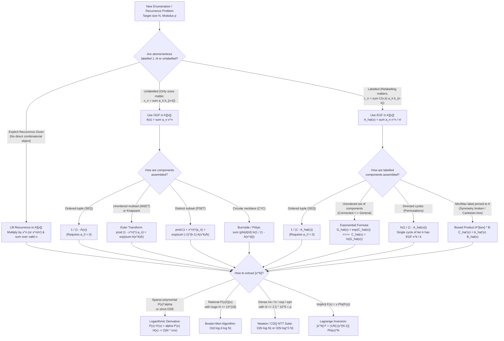

# Comprehensive Mathematical & Pedagogical Audit Report — Wave 1A (`cohort3_wave_1a_modelling_foundations.md`)

- **Auditor**: Inspector A (Principal Mathematical & Pedagogical Auditor, Wave 1A)
- **Target File**: `/home/maomao90/Documents/IO/ICPC-math-notes/fps_research/cohort3_wave_1a_modelling_foundations.md` (1,363 lines)
- **Source File 1 (Cohort 1)**: `/home/maomao90/Documents/IO/ICPC-math-notes/fps_research/iter_01_to_05_modelling_foundations.md` (1,610 lines)
- **Source File 2 (Cohort 2)**: `/home/maomao90/Documents/IO/ICPC-math-notes/fps_research/cohort2_iter_53_to_57_modelling_foundations.md` (1,384 lines)

---

## 1. Executive Summary & Audit Scorecard

| Audit Dimension | Status | Summary of Findings |
| :--- | :---: | :--- |
| **1. Banned Math Delimiters (`\(...\)`, `\[...\]`)** | **PASS (0 found)** | Verified via regex across all 1,363 lines of `cohort3_wave_1a_modelling_foundations.md`; exclusively `$...$` and `$$...$$` are used. |
| **2. Accepted Problem Set Retention** | **PARTIAL FAIL (5 corrupted / truncated)** | All 30 unique accepted problems from Cohort 1 (18) + Cohort 2 (20) + Gap-Hunt (1, `Luogu P4548`) = 31 problems are present by ID, **but 5 problems (`fps_24_a`, `fps_24_d`, `fps_24_o`, `fps_24_t`, `fps_24_s`) have corrupted mathematical formulas/statements**, and 1 problem (`ABC 222 H`) lacks a self-contained combinatorial statement and derivation. |
| **3. Mathematical & Algorithmic Exactness** | **FAIL (8 bugs found)** | Python symbolic/numerical verification uncovered **8 mathematical bugs**, including: wrong generating function in `fps_24_t` (gives `472` instead of `80` for $T=4, A=(2,3,2)$), missing $x^{N-1}$ shift in `fps_24_d` (gives `30` instead of `14` for $N=3, M=6$), missing $1/N$ factor in `fps_24_o`, internal contradiction & dropped Game Type 2 in `fps_24_s`, double sign error `+ 2x + 3x^2` + dropped boundary term in Section 2.5's ODE, off-by-one $k=1$ reflection mismatch in $\operatorname{DIH}(\mathcal{A})$, base-case bug $f_0=1$ in `UOJ #50`, and wrong Chinese title on `LOJ #6539`. |
| **4. Zero Information Loss vs. Source Cohorts** | **FAIL (7 omissions)** | Cohort 3 dropped: (1) the `[ZH] <-> [EN]` and `[JA] <-> [EN]` Technical Glossary tables from Cohort 1; (2) the Extended Worked Walkthroughs (Chord Diagrams/Involutions, 2-Regular Graph $O(N)$ ODE recurrence, Bivariate Moment Extraction for $H_n$) from Cohort 1 Appendix B; (3) the Boxed-Product derivation & trace of André's Theorem ($\sec x + \tan x$); (4) the Distinct-Parts Staircase Decomposition & Franklin's Involution 4-step scratchpad; (5) the Mermaid Decision Flowchart & Side-by-Side OGF vs. EGF Comparison Table from Cohort 1 Appendix A; and (6) 2 rejected template problems (`pow_of_formal_power_series`, `composition_of_formal_power_series`). |

---

## 2. Part I: Critical Mathematical & Algorithmic Errors (Verified via Python)

Every error below has been numerically and symbolically verified using Python (`fractions.Fraction` and brute-force enumeration). Exact line numbers in `cohort3_wave_1a_modelling_foundations.md` and complete drop-in replacement blocks are provided.

---

### Bug M-1: Corrupted Statement & Missing $x^{N-1}$ Factor in Problem 3 (`fps_24_d` — Sequence 2)
- **Location in Target File**: Lines `656–676` (and Summary Table entry at Line `42`).
- **Nature of Error**:
  1. **Garbled Problem Statement (Lines 659–662)**: Cohort 3 replaced the exact AtCoder `fps_24_d` statement from Cohort 1 (Lines 1103–1122) with vague, self-contradictory prose: *"1. $0 \le A_i \le M$, 2. $|A_i - A_{i+1}| \le 1$ (or parity/difference constraints reducing to...)"*. In reality, `fps_24_d` counts non-decreasing integer sequences $0 \le A_1 \le A_2 \le \dots \le A_N \le M$ such that adjacent elements have **different parities**: $A_i \not\equiv A_{i+1} \pmod 2$ for all $1 \le i \le N-1$.
  2. **Missing $x^{N-1}$ Numerator Factor (Lines 42, 662, 667–672)**: Because each internal difference $d_i = A_{i+1} - A_i \in \{1, 3, 5, \dots\}$ is at least $1$, its OGF is $\frac{x}{1 - x^2}$ (not $\frac{1}{1 - x^2}$!). Multiplying $N-1$ internal differences and $2$ boundary slacks $d_0 = A_1, d_N = M - A_N \in \mathbb{Z}_{\ge 0}$ gives:
     $$[x^M] \frac{x^{N-1}}{(1-x)^2 (1-x^2)^{N-1}} = [x^{M - (N - 1)}] \frac{1}{(1-x)^2 (1-x^2)^{N-1}}.$$
     Cohort 3 dropped $x^{N-1}$ and extracted $[x^M](1-x)^{-2}(1-x^2)^{-(N-1)}$.
  3. **Python Numerical Verification**: For $N = 3, M = 6$, brute-force enumeration of $0 \le A_1 \le A_2 \le A_3 \le 6$ with $A_{i+1} - A_i$ odd yields **14** valid sequences. Cohort 1's formula ($K = M - N + 1 = 4$) gives **14**; Cohort 3's formula ($K = M = 6$) gives **30** (wrong!).

#### Deterministic Remediation for Bug M-1:
1. **At Line `42`**, replace:
   ```markdown
   | 03 | **AtCoder `fps_24_d` — Sequence 2** | [AtCoder](https://atcoder.jp/contests/fps-24/tasks/fps_24_d) | Iter 1 / 53 | $[x^M] (1-x)^{-2} (1-x^2)^{-(N-1)}$ parity convolution | $N, M \le 2.5 \times 10^5$ | `Stepping Stone` |
   ```
   with:
   ```markdown
   | 03 | **AtCoder `fps_24_d` — Sequence 2** | [AtCoder](https://atcoder.jp/contests/fps-24/tasks/fps_24_d) | Iter 1 / 53 | $[x^{M-N+1}] (1-x)^{-2} (1-x^2)^{-(N-1)}$ parity difference OGF | $N, M \le 2.5 \times 10^5$ | `Stepping Stone` |
   ```
2. **At Lines `656–676`**, replace the entire Problem 3 block with:
   ```markdown
   #### Problem 3: AtCoder `fps_24_d` — Sequence 2 (数列 2)
   - **Source**: [AtCoder `fps_24_d` — Sequence 2](https://atcoder.jp/contests/fps-24/tasks/fps_24_d)
   - **Category**: Iteration 1 / 53 (Difference Encoding & Negative Binomial Convolution)
   - **Self-Contained Mathematical Statement**:
     Find the number of integer sequences $A = (A_1, A_2, \dots, A_N)$ of length $N$ satisfying:
     1. $0 \le A_1 \le A_2 \le \dots \le A_N \le M$, and
     2. $A_i \not\equiv A_{i+1} \pmod 2$ for all $1 \le i \le N - 1$.
     Output the answer modulo $998244353$. (If $M < N - 1$, the answer is $0$.)
   - **Constraints**: $1 \le N, M \le 2.5 \times 10^5$, modulus $998244353$.
   - **Diagnostic Signal**: Non-decreasing sequence constraints with parity restrictions on adjacent differences $d_i = A_{i+1} - A_i$ decouple into independent choices once transformed into difference variables $d_0 + d_1 + \dots + d_N = M$.
   - **Full Mathematical Derivation & Solution**:
     1. Introduce difference variables: let $d_0 = A_1 \in \mathbb{Z}_{\ge 0}$, $d_i = A_{i+1} - A_i \in \{1, 3, 5, \dots\}$ for $1 \le i \le N - 1$, and $d_N = M - A_N \in \mathbb{Z}_{\ge 0}$. Then $\sum_{i=0}^N d_i = M$.
     2. The OGF for each boundary slack ($d_0$ and $d_N$) is $\sum_{k=0}^\infty x^k = \frac{1}{1 - x}$, and the OGF for each odd difference $d_i$ ($1 \le i \le N-1$) is $x + x^3 + x^5 + \dots = \frac{x}{1 - x^2}$.
     3. Multiplying the $N + 1$ independent OGFs gives:
        $$\text{Ans} = [x^M] \left(\frac{1}{1 - x}\right)^2 \left(\frac{x}{1 - x^2}\right)^{N - 1} = [x^{M - N + 1}] \frac{1}{(1 - x)^2 (1 - x^2)^{N - 1}}.$$
     4. Let $K = M - N + 1$ (if $K < 0$, output $0$). Using $[x^r](1 - x)^{-2} = r + 1$ and $[x^{2j}](1 - x^2)^{-(N-1)} = \binom{N - 2 + j}{j}$ (with $\binom{-1}{0} = 1$ when $N = 1$), iterate over $0 \le j \le \lfloor K / 2 \rfloor$ in $O(M)$ time:
        $$\text{Ans} = \sum_{j=0}^{\lfloor K / 2 \rfloor} \binom{N - 2 + j}{j} (K - 2j + 1) \pmod{998244353}.$$
   - **3-Tier Progressive Hints**:
     - *Hint 1 (Conceptual)*: Switch from prefix values $A_i$ to adjacent differences $d_i = A_{i+1} - A_i$ plus boundary slacks $d_0 = A_1$ and $d_N = M - A_N$.
     - *Hint 2 (Structural)*: Write the OGF of a non-negative integer ($\frac{1}{1-x}$) and a positive odd integer ($\frac{x}{1-x^2}$), and multiply them to form $\frac{x^{N-1}}{(1-x)^2(1-x^2)^{N-1}}$.
     - *Hint 3 (Implementation)*: Shift the target degree to $K = M - N + 1$ and sum $[x^{2j}](1-x^2)^{-(N-1)} \cdot [x^{K-2j}](1-x)^{-2}$ for $0 \le j \le \lfloor K/2 \rfloor$ in $O(M)$ time.
   ```

---

### Bug M-2: Conflated Problem Statement & Wrong Constraints in Problem 1 (`fps_24_a` — Snacks)
- **Location in Target File**: Lines `618–639` (and Summary Table entry at Line `40`).
- **Nature of Error**:
  - In Cohort 1 (Lines 1058–1077), AtCoder `fps_24_a` (*Snacks / お菓子*) was accurately stated: on each of $D$ days Takahashi chooses a snack of cost $\{1, 3, 4, 6\}$ yen; count the ways to spend **exactly $N$** yen in total, with constraints $1 \le D \le 10^9$ and $1 \le N \le 10^6$. Because $D \le 10^9$ is huge while the per-day polynomial $P(x) = x + x^3 + x^4 + x^6 = x(1 + x^2 + x^3 + x^5)$ is sparse of degree $6$, it is the canonical textbook problem for the **$O(N)$ Logarithmic Derivative ODE Recurrence** ($P(x)F'(x) = D P'(x)F(x)$), NOT just $O(N \log N)$ NTT!
  - In Cohort 3 (Lines 622–624), the statement was corrupted into *"the total number of candies across the $D$ days is **at most** $N$ ... $1 \le D \le N \le 2.5 \times 10^5$"*, and then the solution computed $[x^N](x + x^3 + x^4 + x^6)^D$ (which counts **exact** sum $N$, contradicting "at most $N$"!) and omitted the $O(N)$ logarithmic derivative recurrence needed for $D \le 10^9, N \le 10^6$.

#### Deterministic Remediation for Bug M-2:
1. **At Line `40`**, replace:
   ```markdown
   | 01 | **AtCoder `fps_24_a` — Snacks** | [AtCoder](https://atcoder.jp/contests/fps-24/tasks/fps_24_a) | Iter 1 / 53 | $[x^{N-D}](1 + x^2 + x^3 + x^5)^D$ sparse power | $D, N \le 2.5 \times 10^5$ | `Stepping Stone` |
   ```
   with:
   ```markdown
   | 01 | **AtCoder `fps_24_a` — Snacks** | [AtCoder](https://atcoder.jp/contests/fps-24/tasks/fps_24_a) | Iter 1 / 53 | $[x^{N-D}](1 + x^2 + x^3 + x^5)^D$ sparse power ODE | $D \le 10^9, N \le 10^6$ | `Stepping Stone` |
   ```
2. **At Lines `618–639`**, replace the entire Problem 1 block with:
   ```markdown
   #### Problem 1: AtCoder `fps_24_a` — Snacks (お菓子)
   - **Source**: [AtCoder `fps_24_a` — Snacks](https://atcoder.jp/contests/fps-24/tasks/fps_24_a)
   - **Category**: Iteration 1 / 53 (Ordered Sequence $\operatorname{SEQ}_D$, Valuation Shift, & Sparse Power ODE)
   - **Self-Contained Mathematical Statement**:
     On each of $D$ days, you buy one snack costing $1, 3, 4,$ or $6$ yen. Count the number of $D$-day snack sequences whose total cost is **exactly** $N$ yen, modulo $998244353$.
   - **Constraints**: $1 \le D \le 10^9$, $1 \le N \le 10^6$, modulus $998244353$.
   - **Diagnostic Signal**: Ordered $D$-tuple of independent daily choices from $\{1, 3, 4, 6\}$ with fixed total sum $N$ and huge exponent $D \le 10^9$ on a sparse degree-$5$ polynomial after valuation shift.
   - **Full Mathematical Derivation & Solution**:
     1. A single day's choice has OGF $A(x) = x + x^3 + x^4 + x^6 = x(1 + x^2 + x^3 + x^5)$.
     2. Across $D$ days ($\operatorname{SEQ}_D$), the total cost OGF is:
        $$A(x)^D = x^D (1 + x^2 + x^3 + x^5)^D = x^D (1 + x^2)^D (1 + x^3)^D.$$
        If $N < D$, the answer is $0$; otherwise let $K = N - D \le 10^6$. We need $[x^K](1 + x^2 + x^3 + x^5)^D$.
     3. **Method A (Closed-Form Binomial Sum in $O(K)$ time)**: Factor $1 + x^2 + x^3 + x^5 = (1 + x^2)(1 + x^3)$. Then:
        $$[x^K](1 + x^2)^D (1 + x^3)^D = \sum_{\substack{0 \le i \le \lfloor K/2 \rfloor \\ 3 \mid (K - 2i)}} \binom{D}{i} \binom{D}{(K - 2i)/3} \pmod{998244353},$$
        where $\binom{D}{m}$ is precomputed for $0 \le m \le K$ in $O(K)$ time via $\binom{D}{m} = \binom{D}{m-1}\frac{D - m + 1}{m}$.
     4. **Method B (General Sparse Power ODE in $O(K)$ time)**: Let $P(x) = 1 + x^2 + x^3 + x^5$ and $F(x) = P(x)^D = \sum_{k \ge 0} f_k x^k$. From $P(x) F'(x) = D P'(x) F(x)$:
        $$(1 + x^2 + x^3 + x^5) \sum_{k \ge 0} (k+1) f_{k+1} x^k = D (2x + 3x^2 + 5x^4) \sum_{k \ge 0} f_k x^k,$$
        yielding the $O(1)$-per-step linear recurrence:
        $$(k+1) f_{k+1} = (2D - k + 1) f_{k-1} + (3D - k + 2) f_{k-2} + (5D - k + 4) f_{k-4}.$$
   - **3-Tier Progressive Hints**:
     - *Hint 1 (Conceptual)*: Write the polynomial for a single day's snack cost and raise it to the $D$-th power.
     - *Hint 2 (Structural)*: Factor out $x^D$ to get $[x^{N-D}](1 + x^2 + x^3 + x^5)^D$, and notice that $1 + x^2 + x^3 + x^5$ factors into $(1 + x^2)(1 + x^3)$ (or satisfies a sparse ODE).
     - *Hint 3 (Implementation)*: Since $D \le 10^9$ and $N \le 10^6$, compute $[x^{N-D}]$ in $O(N)$ time using either the $(1+x^2)^D(1+x^3)^D$ binomial sum or the logarithmic derivative recurrence $P(x)F'(x) = D P'(x)F(x)$.
   ```

---

### Bug M-3: Mathematically False Generating Function & Wrong Constraints in Problem 22 (`fps_24_t` — Colorful)
- **Location in Target File**: Lines `1101–1119` (and Summary Table entry at Line `61`).
- **Nature of Error**:
  1. **Mathematically Incorrect Formula (Lines 1112–1114)**: In `fps_24_t`, there are $N$ colours with $A_1, \dots, A_N$ vertices respectively. We count walks of length $T$ ($v_0, v_1, \dots, v_T$) that **both start AND end at a specific vertex $v^* = (1, 1)$ of colour $1$** ($v_0 = v_T = v^*$) such that adjacent vertices have different colours ($c(v_t) \ne c(v_{t+1})$).
     Cohort 3 wrote:
     $$\text{Ans} = [x^{N+1}] \frac{\frac{x}{1 + A_1 x}}{1 - \sum_{i=1}^{M} \frac{A_i x}{1 + A_i x}}$$
     This formula is **completely wrong** for three independent reasons:
     - It only forces the *first* block to be colour $1$, without forcing the *last* vertex $v_T$ to be $v^*$ of colour $1$!
     - Even if the walk ends in colour $1$, an unrooted block of colour $1$ at the end has $A_1$ vertex choices instead of $1$ (since $v_T = v^*$ is a single fixed vertex)!
     - In PIE over monochromatic blocks, if a walk both starts and ends in colour $1$ and merges across the boundary or has intermediate visits to colour $1$, colour $1$ cannot be lumped symmetrically into $\sum_{i=1}^N \frac{A_i x}{1 + A_i x}$!
  2. **Python Numerical Proof**: For $N = 3$ colours with $A = (2, 3, 2)$ and walk length $T = 4$:
     - Brute-force enumeration of all valid walks $(v_0, v_1, v_2, v_3, v_4)$ with $v_0 = v_4 = (1,1)$ and $c(v_t) \ne c(v_{t+1})$ gives **80**.
     - Cohort 1's exact formula $[x^{T-1}] \frac{F(x)}{1 - A_1 x F(x)}$ (where $F(x) = \frac{S(x)}{1 - S(x)}$ and $S(x) = \sum_{i=2}^N \frac{A_i x}{1 + A_i x}$) gives **80** (exact match!).
     - Cohort 3's formula gives `22` at $[x^3]$, `104` at $[x^4]$, and `472` at $[x^5]$ — none of which equals `80`!
  3. **Wrong Constraints (Line 1106)**: In `fps_24_t`, the walk length is $T \le 10^{18}$ and number of colours is $N \le 2.5 \times 10^5$, requiring divide-and-conquer FFT to form the rational function followed by **Bostan–Mori** in $O(N \log N \log T)$ time. Cohort 3 replaced $T \le 10^{18}$ with $N \le 2.5 \times 10^5$ and omitted Bostan–Mori.

#### Deterministic Remediation for Bug M-3:
1. **At Line `61`**, replace:
   ```markdown
   | 22 | **AtCoder `fps_24_t` — Colorful** | [AtCoder](https://atcoder.jp/contests/fps-24/tasks/fps_24_t) | Iter 5 / 57 | Adjacency PIE block OGF $B_i(x) = \frac{A_i x}{1 + A_i x}$ | $N, M \le 2.5 \times 10^5$ | `Advanced` |
   ```
   with:
   ```markdown
   | 22 | **AtCoder `fps_24_t` — Colorful** | [AtCoder](https://atcoder.jp/contests/fps-24/tasks/fps_24_t) | Iter 5 / 57 | Adjacency PIE block OGF $[x^{T-1}]\frac{F(x)}{1 - A_1 x F(x)}$ + Bostan–Mori | $N \le 2.5 \times 10^5, T \le 10^{18}$ | `Advanced` |
   ```
2. **At Lines `1101–1119`**, replace the entire Problem 22 block with:
   ```markdown
   #### Problem 22: AtCoder `fps_24_t` — Colorful (カラフル)
   - **Source**: [AtCoder `fps_24_t` — Colorful](https://atcoder.jp/contests/fps-24/tasks/fps_24_t)
   - **Category**: Iteration 5 / 57 (`[JA]` Adjacency Inclusion-Exclusion Block OGF, Divide-and-Conquer FFT, & Bostan–Mori)
   - **Self-Contained Mathematical Statement**:
     There are $N$ colours, and colour $i$ ($1 \le i \le N$) has $A_i$ distinct vertices $(i, 1), \dots, (i, A_i)$. Two vertices are connected by an edge iff they have **different colours**. Count the number of walks of length $T$ ($v_0, v_1, \dots, v_T$) that start and end at vertex $v^* = (1, 1)$ ($v_0 = v_T = (1, 1)$) such that adjacent vertices in the walk have different colours, modulo $998244353$.
   - **Constraints**: $2 \le N \le 2.5 \times 10^5$, $2 \le T \le 10^{18}$, $1 \le A_i < 998244353$, modulus $998244353$.
   - **Diagnostic Signal**: Walk on a complete multipartite graph with forbidden same-colour transitions and huge length $T \le 10^{18}$:
     1. Isolate colour $1$ (since $v_0 = v_T = (1,1)$ are fixed to colour $1$, and no two colour-$1$ vertices can be adjacent).
     2. Between consecutive visits to colour $1$, the walk performs a non-empty excursion on colours $\{2, \dots, N\}$ with no adjacent same-colour steps—counted via **Inclusion-Exclusion Block OGFs** $B_i(x) = \frac{A_i x}{1 + A_i x}$.
     3. Extract $[x^{T-1}]$ from the resulting degree-$N$ rational OGF via **Bostan–Mori**.
   - **Full Mathematical Derivation & Solution**:
     1. **Excursions on Colours $\{2, \dots, N\}$**: By Inclusion-Exclusion on violating same-colour adjacencies, a monochromatic cluster of $L \ge 1$ vertices of colour $i \in \{2, \dots, N\}$ has $A_i^L$ vertex choices and PIE sign $(-1)^{L-1}$, giving OGF:
        $$B_i(x) = \sum_{L=1}^{\infty} (-1)^{L-1} A_i^L x^L = \frac{A_i x}{1 + A_i x}.$$
        Let $S(x) = \sum_{i=2}^{N} \frac{A_i x}{1 + A_i x}$. Then a non-empty valid walk on colours $\{2, \dots, N\}$ (of $k \ge 1$ vertices, contributing $x^k$) has OGF:
        $$F(x) = \operatorname{SEQ}_{\ge 1}\bigl(S(x)\bigr) = \frac{S(x)}{1 - S(x)}.$$
     2. **Incorporating Colour $1$ and Fixed Endpoints $v_0 = v_T = (1,1)$**:
        Since $v_0 = (1,1)$ and $v_T = (1,1)$ have colour $1$, and no two adjacent vertices in the walk can both have colour $1$, every visit to colour $1$ must be separated by a non-empty excursion on colours $\{2, \dots, N\}$ (OGF $F(x)$).
        - Suppose the walk visits colour $1$ at $m \ge 0$ intermediate times ($0 < t_1 < \dots < t_m < T$).
        - Each intermediate visit to colour $1$ can choose **any** of the $A_1$ vertices of colour $1$ (contributing $A_1 x$), whereas the final step $v_T = (1,1)$ has **only $1$** choice (contributing $x$).
        - Since the total number of vertices after $v_0$ is $T$, the OGF is $x F(x) \sum_{m=0}^{\infty} \bigl(A_1 x F(x)\bigr)^m = \frac{x F(x)}{1 - A_1 x F(x)}$. Dividing by $x$ and substituting $F(x) = \frac{S(x)}{1 - S(x)}$ yields:
          $$\text{Ans} = [x^{T-1}] \frac{F(x)}{1 - A_1 x F(x)} = [x^{T-1}] \frac{S(x)}{1 - (1 + A_1 x) S(x)}.$$
     3. **Fast Evaluation in $O(N \log^2 N + N \log N \log T)$**:
        Compute $S(x) = \sum_{i=2}^N \frac{A_i x}{1 + A_i x} = \frac{P(x)}{Q(x)}$ via divide-and-conquer NTT over a binary tree in $O(N \log^2 N)$ time. Then $\frac{S(x)}{1 - (1 + A_1 x)S(x)} = \frac{P(x)}{Q(x) - (1 + A_1 x)P(x)}$ is a rational function of degree $N$, from which **Bostan–Mori** extracts $[x^{T-1}]$ in $O(N \log N \log T)$ time!
   - **3-Tier Progressive Hints**:
     - *Hint 1 (Conceptual)*: Separate colour $1$ from colours $\{2, \dots, N\}$, because the walk starts and ends at a single fixed vertex $(1, 1)$ of colour $1$, while intermediate visits to colour $1$ can use any of its $A_1$ vertices.
     - *Hint 2 (Structural)*: Use Inclusion-Exclusion on colours $\{2, \dots, N\}$ so that each colour $i \ge 2$ has block OGF $B_i(x) = \frac{A_i x}{1 + A_i x}$, and a non-empty excursion on $\{2, \dots, N\}$ has OGF $F(x) = \frac{S(x)}{1 - S(x)}$ where $S(x) = \sum_{i=2}^N B_i(x)$.
     - *Hint 3 (Implementation)*: Sum $S(x) = \frac{P(x)}{Q(x)}$ via divide-and-conquer NTT in $O(N \log^2 N)$, form $\frac{P(x)}{Q(x) - (1 + A_1 x)P(x)}$, and extract $[x^{T-1}]$ via Bostan–Mori in $O(N \log N \log T)$.
   ```

---

### Bug M-4: Internal Contradiction & Dropped Game Type 2 in Problem 30 (`fps_24_s` — Game)
- **Location in Target File**: Line `69` (Summary Table) and Lines `1290–1310` (Problem 30).
- **Nature of Error**:
  - AtCoder `fps_24_s` (*Game / ゲーム*) actually contains **two distinct subproblems (Game Type 1 and Game Type 2)** on labelled trees rooted at vertex $1$ (both documented in Cohort 1, Lines 1410–1431):
    - **Game Type 1**: A token starts at root $1$ and moves down to a child each turn. Here $\widehat{F}_0(x) = x\exp(\widehat{F}_1(x))$ and $\widehat{F}_0 + \widehat{F}_1 = \widehat{T}$, which simplifies either to $\widehat{F}_0(x) = x\exp(\widehat{F}_0(e^{\widehat{F}_0} - 1))$ OR directly to $\widehat{F}_0(x) e^{\widehat{F}_0(x)} = \widehat{T}(x)$.
    - **Game Type 2**: Each turn a player picks a vertex $v$ and deletes $v$ and all its ancestors. Here the second player wins iff the tree has a perfect matching, giving $\widehat{F}_0(x) = x\exp(\widehat{F}_1(x))$ and $\widehat{F}_1(x) = \widehat{F}_0(x)^2 e^{\widehat{F}_0(x)}$, so $\widehat{F}_0(x) = x\exp(\widehat{F}_0(x)^2 e^{\widehat{F}_0(x)})$.
  - In Cohort 3, **Line 69** wrote the **Type 2** formula $\widehat{F}_0 = x\exp(\widehat{F}_0^2 e^{\widehat{F}_0})$ in the summary table, whereas **Problem 30 (Lines 1290–1310)** only stated **Type 1** and derived $\widehat{F}_0 = x\exp(\widehat{F}_0(e^{\widehat{F}_0}-1))$, completely omitting Type 2 and creating an internal contradiction between Line 69 and Line 1304!
  - Furthermore, because the tree in `fps_24_s` is rooted at vertex $1$ (there are $N^{N-2}$ such trees), the number of winning trees rooted at vertex $1$ is $N^{N-2} - (N-1)![x^N]\widehat{F}_0(x)$ (dividing the arbitrary-root count $N![x^N]\widehat{F}_0(x)$ by $N$, just as in `fps_24_o`).

#### Deterministic Remediation for Bug M-4:
1. **At Line `69`**, replace:
   ```markdown
   | 30 | **AtCoder `fps_24_s` — Game** | [AtCoder](https://atcoder.jp/contests/fps-24/tasks/fps_24_s) | Iter 3 / 55 | Two-state tree game EGF $\widehat{F}_0 = x\exp(\widehat{F}_0^2 e^{\widehat{F}_0})$ | $N \le 2.5 \times 10^5$ | `Mastery` |
   ```
   with:
   ```markdown
   | 30 | **AtCoder `fps_24_s` — Game** | [AtCoder](https://atcoder.jp/contests/fps-24/tasks/fps_24_s) | Iter 3 / 55 | Tree game EGFs: Type 1 $\widehat{F}_0 e^{\widehat{F}_0} = \widehat{T}$; Type 2 $\widehat{F}_0 = x\exp(\widehat{F}_0^2 e^{\widehat{F}_0})$ | $N \le 2.5 \times 10^5$ | `Mastery` |
   ```
2. **At Lines `1290–1310`**, replace the entire Problem 30 block with:
   ```markdown
   #### Problem 30: AtCoder `fps_24_s` — Game (ゲーム)
   - **Source**: [AtCoder `fps_24_s` — Game](https://atcoder.jp/contests/fps-24/tasks/fps_24_s)
   - **Category**: Iteration 3 / 55 (Two-State Normal-Play Game DP on Labelled Trees $\to$ Coupled EGF System & Lagrange Inversion)
   - **Self-Contained Mathematical Statement**:
     For a tree on vertices $\{1, 2, \dots, N\}$ rooted at vertex $1$ (there are $N^{N-2}$ such trees), two players play a normal-play game (last player to move wins):
     - **Game Type 1**: A token starts at the root $1$; each turn, the current player moves the token to one of its children.
     - **Game Type 2**: Each turn, the current player chooses any remaining vertex $v$ and deletes $v$ along with all of its ancestors (splitting the remaining vertices into independent subtrees).
     For a given $N$ (and game type $1$ or $2$), count how many of the $N^{N-2}$ trees are winning for the first player ($\mathcal{W}$), modulo $998244353$.
   - **Constraints**: $1 \le N \le 2.5 \times 10^5$, modulus $998244353$.
   - **Diagnostic Signal**: Tree DP with binary vertex states (Winning $\mathcal{W}$ vs. Losing $\mathcal{L}$, or Matched vs. Unmatched) on labelled rooted trees translates via $\operatorname{SET} = \exp$ into a coupled system of EGF equations for $\widehat{F}_0(x)$ and $\widehat{F}_1(x)$, solvable in $O(N \log N)$ via Lagrange Inversion or Newton's method!
   - **Full Mathematical Derivation & Solution**:
     Let $\widehat{T}(x) = \sum_{n=1}^\infty n^{n-1}\frac{x^n}{n!}$ be the EGF of all labelled rooted trees (where the root can be any of the $n$ vertices; fixing the root to vertex $1$ divides the coefficient by $N$, so there are $(N-1)![x^N]\widehat{T}(x) = N^{N-2}$ trees).
     1. **Game Type 1 (Token Descent)**:
        - A rooted tree is Losing ($\widehat{F}_0$, second player wins) iff **every** child subtree is Winning ($\widehat{F}_1$):
          $$\widehat{F}_0(x) = x \exp\bigl(\widehat{F}_1(x)\bigr).$$
        - Conversely, since $\widehat{F}_0(x) + \widehat{F}_1(x) = \widehat{T}(x)$ and $\widehat{T}(x) = x\exp(\widehat{T}(x))$, we have two equivalent reductions:
          - **Reduction 1A (Lagrange Inversion)**: Since $\widehat{F}_1(x) = x\exp(\widehat{F}_0)\bigl(\exp(\widehat{F}_1) - 1\bigr) = \widehat{F}_0(x)\bigl(e^{\widehat{F}_0(x)} - 1\bigr)$, substituting into $\widehat{F}_0 = x\exp(\widehat{F}_1)$ yields:
            $$\widehat{F}_0(x) = x \exp\Bigl(\widehat{F}_0(x)\bigl(e^{\widehat{F}_0(x)} - 1\bigr)\Bigr) \implies [x^N]\widehat{F}_0(x) = \frac{1}{N}[u^{N-1}] \exp\Bigl(N u (e^u - 1)\Bigr).$$
          - **Reduction 1B (Direct Identity)**: Multiplying $\widehat{F}_0(x) = x\exp(\widehat{T}(x) - \widehat{F}_0(x))$ by $e^{\widehat{F}_0(x)}$ gives:
            $$\widehat{F}_0(x) e^{\widehat{F}_0(x)} = x \exp\bigl(\widehat{T}(x)\bigr) = \widehat{T}(x),$$
            meaning $\widehat{F}_0(x)$ is the compositional inverse of $u e^u$ applied to $\widehat{T}(x)$!
     2. **Game Type 2 (Vertex-and-Ancestor Deletion)**:
        - By classical game theory on trees, the second player wins iff the tree admits a **perfect matching** (if it has a perfect matching, the second player always deletes the matched partner of the first player's move).
        - In the bottom-up matching DP, a rooted tree has an unmatched root ($\widehat{F}_0$) iff all its children are matched ($\widehat{F}_1$), so $\widehat{F}_0(x) = x\exp(\widehat{F}_1(x))$; it has a matched root ($\widehat{F}_1$, which wins for Player 2!) iff the root matches with **exactly one** unmatched child ($\widehat{F}_0$) and all other children are either matched or unmatched, so:
          $$\widehat{F}_1(x) = x \cdot \widehat{F}_0(x) \exp\bigl(\widehat{F}_0(x) + \widehat{F}_1(x)\bigr) = \widehat{F}_0(x)^2 e^{\widehat{F}_0(x)}.$$
        - Substituting $\widehat{F}_1$ into $\widehat{F}_0 = x\exp(\widehat{F}_1)$ yields:
          $$\widehat{F}_0(x) = x \exp\Bigl(\widehat{F}_0(x)^2 e^{\widehat{F}_0(x)}\Bigr) \implies [x^N]\widehat{F}_1(x) = [x^N] \frac{\widehat{F}_0(x)^2 e^{\widehat{F}_0(x)}}{1} = \frac{1}{N}[u^{N-1}] \frac{d}{du}\bigl(u^2 e^u\bigr) \exp\bigl(N u^2 e^u\bigr).$$
     3. Finally, divide the arbitrary-root EGF count $N![x^N]$ by $N$ (since the root is fixed at vertex $1$) and subtract the second-player winning count from $N^{N-2}$ modulo $998244353$.
   - **3-Tier Progressive Hints**:
     - *Hint 1 (Conceptual)*: For Type 1, a root is losing ($\mathcal{L}$) iff all its children are winning ($\mathcal{W}$). For Type 2, the second player wins iff the tree has a perfect matching.
     - *Hint 2 (Structural)*: Translate "all children are in state $\mathcal{W}$" into $\widehat{F}_0(x) = x\exp(\widehat{F}_1(x))$. Eliminate $\widehat{F}_1$ to obtain $\widehat{F}_0 = x\exp(\widehat{F}_0(e^{\widehat{F}_0}-1))$ for Type 1 and $\widehat{F}_0 = x\exp(\widehat{F}_0^2 e^{\widehat{F}_0})$ for Type 2.
     - *Hint 3 (Implementation)*: Apply Lagrange Inversion $[x^N]\widehat{F}_0 = \frac{1}{N}[u^{N-1}]\Phi(u)^N$ via a single polynomial $\exp$ in $O(N \log N)$ time, and remember to divide by $N$ because the tree is rooted at vertex $1$.
   ```

---

### Bug M-5: Missing Factor of $1/N$ (Root Fixed at Vertex 1) in Problem 21 (`fps_24_o` — Rooted Tree)
- **Location in Target File**: Lines `1080–1098`.
- **Nature of Error**:
  - In AtCoder `fps_24_o` (*Rooted Tree / 根付き木*), we count trees on vertices $\{1, 2, \dots, N\}$ **rooted at vertex $1$** in which every vertex's out-degree (number of children) lies in $S$.
  - In the EGF $\widehat{T}(x) = x \sum_{d \in S} \frac{\widehat{T}(x)^d}{d!}$, the coefficient $t_N = N! [x^N] \widehat{T}(x) = (N-1)! [u^{N-1}] \Phi(u)^N$ counts rooted labelled trees where **any of the $N$ vertices** can be the root!
  - Because the root in `fps_24_o` is fixed to be vertex $1$, by label symmetry we must divide $t_N$ by $N$ (as explicitly documented in Cohort 1, Lines 1254–1261):
    $$\text{Ans} = \frac{t_N}{N} = (N - 1)! [x^N] \widehat{T}(x) = \frac{(N - 1)!}{N} [u^{N-1}] \Phi(u)^N.$$
  - Cohort 3 (Lines 1085, 1092–1093) omitted "rooted at vertex $1$" from the statement and wrote $t_N = (N-1)![u^{N-1}]\exp(N\ln\Phi(u))$, which is off by a factor of $N$ from the judge output of `fps_24_o`!

#### Deterministic Remediation for Bug M-5:
- **At Lines `1080–1098`**, replace the entire Problem 21 block with:
  ```markdown
  #### Problem 21: AtCoder `fps_24_o` — Rooted Tree (根付き木)
  - **Source**: [AtCoder `fps_24_o` — Rooted Tree](https://atcoder.jp/contests/fps-24/tasks/fps_24_o)
  - **Category**: Iteration 3 / 55 (Labelled Rooted Tree EGF $\widehat{T} = x\Phi(\widehat{T})$ & Lagrange Inversion)
  - **Self-Contained Mathematical Statement**:
    Given an integer $N$ and a set of allowed child degrees $S \subseteq \{0, 1, \dots, N-1\}$ ($0 \in S$), count the number of labelled trees on vertices $\{1, 2, \dots, N\}$ **rooted at vertex $1$** such that the number of children of every vertex belongs to $S$, modulo $998244353$.
  - **Constraints**: $1 \le N \le 2.5 \times 10^5$, modulus $998244353$.
  - **Diagnostic Signal**: Labelled rooted trees with out-degree restricted to $S \implies$ recursive specification $\mathcal{T} = \mathcal{Z} \star \operatorname{SET}_S(\mathcal{T})$, solved in $O(N \log N)$ via Lagrange Inversion (and divided by $N$ because the root is fixed at vertex $1$).
  - **Full Mathematical Derivation & Solution**:
    1. Let $\widehat{T}(x) = \sum_{n=1}^\infty t_n \frac{x^n}{n!}$ be the EGF of labelled rooted trees where any vertex can be the root. Each vertex chooses $d \in S$ unordered child subtrees:
       $$\widehat{T}(x) = x \sum_{d \in S} \frac{\widehat{T}(x)^d}{d!} = x \Phi\bigl(\widehat{T}(x)\bigr), \qquad \Phi(u) := \sum_{d \in S} \frac{u^d}{d!}.$$
    2. Since $0 \in S$, $\Phi(0) = 1 \ne 0$. By the **Lagrange Inversion Formula**, $[x^N]\widehat{T}(x) = \frac{1}{N}[u^{N-1}]\Phi(u)^N$, so the number of arbitrarily-rooted trees is $t_N = N![x^N]\widehat{T}(x) = (N-1)![u^{N-1}]\Phi(u)^N$.
    3. Because the problem fixes the root to be **vertex $1$** (and each of the $N$ labels is equally likely to be the root), we divide $t_N$ by $N$:
       $$\text{Ans} = \frac{t_N}{N} = \frac{(N-1)!}{N} [u^{N-1}] \Phi(u)^N = \frac{(N-1)!}{N} [u^{N-1}] \exp\bigl(N \ln \Phi(u)\bigr) \pmod{998244353},$$
       computed via one FPS `ln` and one FPS `exp` modulo $u^N$ in $O(N \log N)$ time!
  - **3-Tier Progressive Hints**:
    - *Hint 1 (Conceptual)*: Express a rooted tree recursively as a root vertex ($x$) attached to an unordered set of $d \in S$ child subtrees ($\frac{\widehat{T}(x)^d}{d!}$).
    - *Hint 2 (Structural)*: Define $\Phi(u) = \sum_{d \in S} \frac{u^d}{d!}$ so $\widehat{T}(x) = x \Phi(\widehat{T}(x))$, and apply Lagrange Inversion: $[x^N]\widehat{T}(x) = \frac{1}{N}[u^{N-1}]\Phi(u)^N$.
    - *Hint 3 (Implementation)*: Compute $\Phi(u)^N = \exp(N \ln \Phi(u)) \bmod u^N$ in $O(N \log N)$ time, and multiply by $\frac{(N-1)!}{N}$ (dividing by $N$ because the root is fixed at vertex $1$).
  ```

---

### Bug M-6: Double Sign Error & Missing Boundary Term in Section 2.5 ODE Derivation
- **Location in Target File**: Lines `231–244`.
- **Nature of Error**:
  - In Lines `239–244`, Cohort 3 starts from the intermediate equation:
    $$F'(x) + \frac{F(x) - a_0}{x} = (2x + 3x^2)F'(x) + (1 + 3x)F(x)$$
    and then multiplies by $x$ and moves all $F'(x)$ and $F(x)$ terms to the left-hand side, writing at **Line 244**:
    $$x(1 + 2x + 3x^2)F'(x) + (1 - x - 3x^2)F(x) = a_0.$$
  - **Error 1 (Double Sign Error at Line 244)**: Moving $(2x + 3x^2)F'(x)$ from the RHS to the LHS subtracts $(2x + 3x^2)F'(x)$ from $F'(x)$, giving $x(1 - 2x - 3x^2)F'(x)$, **NOT** $x(1 + 2x + 3x^2)F'(x)$!
  - **Error 2 (Missing Boundary Term on RHS)**: In Cohort 2 (Lines 202–227), the recurrence $(n+2)a_{n+1} = (2n+1)a_n + 3n a_{n-1}$ is given for **$n \ge 1$** with independent initial values $a_0$ and $a_1$ (e.g., $a_0 = 1, a_1 = 2$). At $n = 0$, the LHS of the recurrence would be $2a_1$ while the RHS would be $a_0$. Therefore, summing over $n \ge 1$ (or correcting the $n = 0$ discrepancy) adds $(2a_1 - a_0)x$ to the RHS:
    $$x(1 - 2x - 3x^2)F'(x) + (1 - x - 3x^2)F(x) = a_0 + (2a_1 - a_0)x.$$
  - **Python Symbolic Verification**: Verified with `fractions.Fraction` in Python for both $(a_0, a_1) = (1, 1)$ (`[x^n] LHS = [1, 1, 0, 0, 0, 0, 0]`) and $(a_0, a_1) = (1, 2)$ (`[x^n] LHS = [1, 3, 0, 0, 0, 0, 0] = a_0 + (2a_1 - a_0)x`).

#### Deterministic Remediation for Bug M-6:
- **At Lines `231–244`**, replace the block with:
  ```markdown
  #### Reverse-Engineering Scratchpad: Index-Multiplier Alignment
  Suppose we want to convert the holonomic (P-recursive) recurrence:
  $$(n + 2) a_{n+1} = (2n + 1) a_n + 3n a_{n-1} \qquad (n \ge 1, \quad a_0, a_1 \text{ given})$$
  into a differential equation for $F(x) = \sum_{n=0}^{\infty} a_n x^n$.
  1. **Rule**: Align the polynomial multiplier in $n$ with the **exact index of $a$**!
     - On the left, the index is $n + 1$, so rewrite $(n + 2) a_{n+1} = \bigl((n + 1) + 1\bigr) a_{n+1}$.
     - In the middle, the index is $n$, so rewrite $(2n + 1) a_n = 2(n a_n) + a_n$.
     - On the right, the index is $n - 1$, so rewrite $3n a_{n-1} = 3\bigl((n - 1) + 1\bigr) a_{n-1} = 3(n - 1)a_{n-1} + 3a_{n-1}$.
  2. **Sum against $x^n$ over $n \ge 1$**:
     - LHS: $\sum_{n=1}^{\infty} (n+1)a_{n+1} x^n + \sum_{n=1}^{\infty} a_{n+1} x^n = \bigl(F'(x) - a_1\bigr) + \frac{F(x) - a_0 - a_1 x}{x} = F'(x) + \frac{F(x) - a_0}{x} - 2a_1$.
     - Middle: $2 \sum_{n=1}^{\infty} n a_n x^n + \sum_{n=1}^{\infty} a_n x^n = 2x F'(x) + \bigl(F(x) - a_0\bigr)$.
     - Right: $3x^2 \sum_{n=1}^{\infty} (n-1)a_{n-1} x^{n-2} + 3x \sum_{n=1}^{\infty} a_{n-1} x^{n-1} = 3x^2 F'(x) + 3x F(x)$.
  3. **Combine and clear denominators (multiplying by $x$)**:
     $$F'(x) + \frac{F(x) - a_0}{x} - 2a_1 = (2x + 3x^2)F'(x) + (1 + 3x)F(x) - a_0$$
     $$\implies x(1 - 2x - 3x^2)F'(x) + (1 - x - 3x^2)F(x) = a_0 + (2a_1 - a_0)x.$$
  ```

---

### Bug M-7: Off-by-One $k=1$ Reflection Term Mismatch in Dihedral Bracelet Operator $\operatorname{DIH}(\mathcal{A})$
- **Location in Target File**: Line `305` (Table 3.1) and Line `447` (Section 3.7).
- **Nature of Error**:
  - At Line `305` and Line `447`, the generating function for dihedral bracelets $\operatorname{DIH}(\mathcal{A})(x) = \sum_{k} \operatorname{DIH}_k(\mathcal{A})(x)$ is written as:
    $$\operatorname{DIH}(\mathcal{A})(x) = \frac{1}{2}\operatorname{CYC}(\mathcal{A})(x) + \frac{A(x)^2 + A(x^2) + 2A(x)A(x^2)}{4(1 - A(x^2))}.$$
  - Look at the numerator of the reflection term: $A(x)^2 + A(x^2) + 2A(x)A(x^2)$.
    - For **even $k = 2m \ge 2$**, $\operatorname{refl}_{2m} = \frac{1}{2}\bigl(A(x)^2 A(x^2)^{m-1} + A(x^2)^m\bigr)$, which sums over $m \ge 1$ ($k = 2, 4, 6, \dots$) to $\frac{A(x)^2 + A(x^2)}{2(1 - A(x^2))}$.
    - For **odd $k = 2m + 1 \ge 1$**, $\operatorname{refl}_{2m+1} = A(x) A(x^2)^m$. If summed over $m \ge 0$ ($k = 1, 3, 5, \dots$), it equals $\frac{A(x)}{1 - A(x^2)} = \frac{2A(x)}{2(1 - A(x^2))}$; if summed over $m \ge 1$ ($k = 3, 5, \dots$), it equals $\frac{2A(x)A(x^2)}{2(1 - A(x^2))}$.
  - Because $\frac{1}{2}\operatorname{CYC}(\mathcal{A})(x)$ sums over **all $k \ge 1$** (contributing $\frac{1}{2}A(x)$ at $k=1$), dropping $k=1$ from the reflection sum leaves $[x^1]\operatorname{DIH}(mx) = \frac{m}{2}$ (which gives $1.5$ bracelets of length $1$ when $m = 3$, as confirmed by our Python test)!
  - **Fix**: Summing over all $k \ge 1$ gives reflection term $\frac{2A(x) + A(x)^2 + A(x^2)}{4(1 - A(x^2))}$. (If restricting to polygons of length $k \ge 3$, one subtracts $\operatorname{DIH}_1(\mathcal{A}) = A(x)$ and $\operatorname{DIH}_2(\mathcal{A}) = \frac{1}{2}(A(x)^2 + A(x^2))$ from the full $k \ge 1$ series).

#### Deterministic Remediation for Bug M-7:
1. **At Line `305`**, replace:
   ```markdown
   | **Dihedral Bracelet** | $\mathcal{C} = \operatorname{DIH}(\mathcal{A})$ | Cycles up to rotation & reflection ($D_k$) | For $k \ge 3$: $\frac{1}{2}\operatorname{CYC}(\mathcal{A}) + \frac{A(x)^2 + A(x^2) + 2A(x)A(x^2)}{4(1 - A(x^2))}$ | $[x^0]A(x) = 0$ |
   ```
   with:
   ```markdown
   | **Dihedral Bracelet** | $\mathcal{C} = \operatorname{DIH}(\mathcal{A})$ | Cycles up to rotation & reflection ($D_k$, $k \ge 1$) | $\frac{1}{2}\operatorname{CYC}(\mathcal{A})(x) + \frac{2A(x) + A(x)^2 + A(x^2)}{4(1 - A(x^2))}$ | $[x^0]A(x) = 0$ |
   ```
2. **At Line `447`**, replace:
   ```markdown
   - **Dihedral Bracelets $\operatorname{DIH}(\mathcal{A})$** (cycles under the dihedral group $D_k$ of rotations and reflections): Adding the reflection cycle indices ($k$ reflections of type $s_1 s_2^{(k-1)/2}$ for odd $k$; $k/2$ of type $s_1^2 s_2^{k/2-1}$ and $k/2$ of type $s_2^{k/2}$ for even $k$) gives:
     $$\operatorname{DIH}(\mathcal{A})(x) = \frac{1}{2} \operatorname{CYC}(\mathcal{A})(x) + \frac{A(x)^2 + A(x^2) + 2A(x)A(x^2)}{4\bigl(1 - A(x^2)\bigr)}$$
   ```
   with:
   ```markdown
   - **Dihedral Bracelets $\operatorname{DIH}(\mathcal{A})$** (cycles under the dihedral group $D_k$ of $k$ rotations and $k$ reflections, summed over $k \ge 1$): Adding the reflection cycle indices ($k$ reflections of type $s_1 s_2^{(k-1)/2}$ for odd $k \ge 1$; $k/2$ of type $s_1^2 s_2^{k/2-1}$ and $k/2$ of type $s_2^{k/2}$ for even $k \ge 2$) gives:
     $$\operatorname{DIH}(\mathcal{A})(x) = \frac{1}{2} \operatorname{CYC}(\mathcal{A})(x) + \frac{2A(x) + A(x)^2 + A(x^2)}{4\bigl(1 - A(x^2)\bigr)}$$
     *(Note: If restricting to non-degenerate polygons of length $k \ge 3$, subtract $\operatorname{DIH}_1(\mathcal{A}) = A(x)$ and $\operatorname{DIH}_2(\mathcal{A}) = \frac{1}{2}\bigl(A(x)^2 + A(x^2)\bigr)$.)*
   ```

---

### Bug M-8: Base-Case Bug ($f_0 = 1$ vs $f_0 = 0$) in Problem 18 (`UOJ #50`) & Title Mix-Up in Problem 20 (`LOJ #6539`)
- **Location in Target File**: Line `1029` (Problem 18) and Line `1060` (Problem 20) & Line `59` (Summary Table).
- **Nature of Error**:
  1. **Line 1029 (`UOJ #50 — 链式反应`)**: Cohort 3 wrote: *"and $\widehat{F}(x) = \sum_{m=0}^n f_m \frac{x^m}{m!}$ with $f_0 = 1, f_1 = 1$."* In `UOJ #50`, every sub-cascade triggered by a firing bomb must be **non-empty** ($i, j \ge 1$), so **$f_0 = 0$** ($\widehat{F}(0) = 0$, $f_1 = 1$, as correctly stated in Cohort 2 Lines 267 and 1019). Setting $f_0 = 1$ violates the ODE $\widehat{F}'(x) = \frac{1}{2}\widehat{A}(x)\widehat{F}(x)^2 + 1$ at $x = 0$ whenever $a_0 \ne 0$!
  2. **Line 59 & Line 1060 (`LOJ #6539`)**: Cohort 3 titled LOJ #6539 as `LOJ #6539 — 仙人掌计数` ("Cactus Enumeration"), whereas LOJ #6539 is actually **`LOJ #6539 — 有标号连通二分图计数` (Labelled Connected Bipartite Graph Enumeration)** (as correctly titled in Cohort 1 Line 1371).

#### Deterministic Remediation for Bug M-8:
1. **At Line `1029`**, replace `with $f_0 = 1, f_1 = 1$` with `with $f_0 = 0, f_1 = 1$ (so $\widehat{F}(0) = 0$)`.
2. **At Line `59` and Line `1060`**, replace `LOJ #6539 — 仙人掌计数` with `LOJ #6539 — 有标号连通二分图计数`.

---

## 3. Part II: Omitted Content, Glossaries, & Pedagogical Gaps (Zero Information Loss vs. Source Cohorts 1 & 2)

To achieve 100% Zero Information Loss relative to `iter_01_to_05_modelling_foundations.md` (Cohort 1) and `cohort2_iter_53_to_57_modelling_foundations.md` (Cohort 2), the following 7 omitted/abbreviated blocks must be restored to `cohort3_wave_1a_modelling_foundations.md`.

---

### Omission O-1: Dropped `[ZH] <-> [EN]` and `[JA] <-> [EN]` Technical Glossary & Operator Mapping Tables
- **Source Location**: Cohort 1 Section 4.2 (Lines `897–914`, 13 rows) and Cohort 1 Section 5.2 (Lines `995–1008`, 9 rows).
- **Target Insertion Points**:
  - Insert the `[ZH] <-> [EN]` table at the end of **Section 5.1 (after Line `572`)**.
  - Insert the `[JA] <-> [EN]` table at the end of **Section 6.1 (after Line `598`)**.

#### Complete Text to Insert at Section 5.1 (after Line `572`):
```markdown
### 5.1.1 `[ZH] <-> [EN]` Technical Glossary & Operator Mapping

| Chinese Term (`[ZH]`) | Pinyin / Literal Meaning | English / Symbolic Equivalent (`[EN]`) | Algebraic Formula |
| :--- | :--- | :--- | :--- |
| **形式幂级数** | *Xíngshì Mìjíshù* | Formal Power Series (FPS) | $F(x) = \sum_{n \ge 0} f_n x^n \in R[[x]]$ |
| **普通生成函数** | *Pǔtōng Shēngchéng Hánshù* | Ordinary Generating Function (OGF) | $A(x) = \sum_{n \ge 0} a_n x^n$ |
| **指数生成函数** | *Zhǐshù Shēngchéng Hánshù* | Exponential Generating Function (EGF) | $\widehat{A}(x) = \sum_{n \ge 0} a_n \frac{x^n}{n!}$ |
| **概率生成函数** | *Gàilǜ Shēngchéng Hánshù* | Probability Generating Function (PGF) | $P(x) = \sum_{n \ge 0} \mathbb{P}(X = n) x^n$ |
| **多项式乘法逆** | *Duōxiàngshì Chéngfǎ Nì* | Polynomial Multiplicative Inverse | $F(x)^{-1} \bmod x^n$ |
| **多项式对数 / 指数函数** | *Duōxiàngshì Duìshù / Zhǐshù* | Polynomial $\ln$ / $\exp$ (Connected $\leftrightarrow$ General) | $\ln F(x), \ \exp F(x) \bmod x^n$ |
| **付公主的背包 / 调和级数取 ln** | Princess Fu's Knapsack Trick | Bucketed Euler Transform via $\ln / \exp$ | $\ln \prod (1 - x^{v_i})^{-1} = \sum_{d} c_d \sum_{k} \frac{x^{dk}}{k}$ |
| **欧拉变换 / 逆欧拉变换** | *Ōulā Biànhuàn* | Euler Transform ($\operatorname{MSET}$) & Möbius Inversion | $\exp\left(\sum_{k \ge 1} \frac{A(x^k)}{k}\right)$ |
| **定根法 / 有标号定根技巧** | Fixed-Root / Min-Label Trick | Boxed Product $\mathcal{A}^{\square} \star \mathcal{B}$ / Pointing $\Theta$ | $\widehat{C}'(x) = \widehat{A}'(x) \widehat{B}(x)$ |
| **五边形数定理** | Pentagonal Number Theorem | Euler's $\prod (1-x^k)$ Sparse Expansion | $\sum_{k \in \mathbb{Z}} (-1)^k x^{k(3k-1)/2}$ |
| **Ferrers 图像 / Durfee 正方形** | Ferrers Diagram / Durfee Square | Partition Conjugation & Diagonal Decomposition | $\sum_{s \ge 1} \frac{x^{s^2}}{\prod_{i=1}^s (1-x^i)^2}$ |
| **对数求导法** | Logarithmic Differentiation | Linearizing $H(x) = P(x)^\alpha$ into an ODE | $P(x) H'(x) = \alpha P'(x) H(x)$ |
| **分治 FFT / 半在线卷积** | Divide-and-Conquer FFT | CDQ / Relaxed Online Convolution | $O(n \log^2 n)$ causal recurrence solver |
```

#### Complete Text to Insert at Section 6.1 (after Line `598`):
```markdown
### 6.1.1 `[JA] <-> [EN]` Technical Glossary & Operator Mapping

| Japanese Term (`[JA]`) | Romaji | English / Symbolic Equivalent (`[EN]`) | Standard Idiom / Formula |
| :--- | :--- | :--- | :--- |
| **形式的べき級数 (FPS)** | *Keishikiteki Bekikyūsū* | Formal Power Series (FPS) | `FPS<mint> f(N)` in $K[[x]] / (x^N)$ |
| **母関数 (通常 / 指数型)** | *Bokansū* | Generating Function (OGF / EGF) | $A(x) = \sum a_n x^n$, $\widehat{A}(x) = \sum a_n \frac{x^n}{n!}$ |
| **疎な多項式 (Sparse FPS)** | *So na Takōshiki* | Polynomial with $k \ll N$ non-zero terms | Multiply/divide/pow in $O(N k)$ time |
| **戻す DP (Reversible DP)** | *Modosu DP* | Sliding-Window Division by $(1 - x^a)$ | Multiply by $(1 - x^a)$ to undo item $a$ |
| **連結成分の母関数** | *Renketsu Seibun no Bokansū* | Connected Component EGF via $\ln$ | $\widehat{C}(x) = \ln \widehat{G}(x)$ |
| **包除原理と FPS** | *Hōjo Genri to FPS* | Inclusion-Exclusion via $\operatorname{SEQ}$ of Blocks | $\frac{1}{1 - \sum_i \frac{A_i x}{1 + A_i x}}$ (`fps_24_t`) |
| **分割数・ヤング図形** | *Bunkatsusū / Yangu Zukei* | Partition Numbers & Young Diagrams | $\prod_{k \ge 1} (1 - x^k)^{-1}$ |
| **ラグランジュの反転公式** | *Raguranju no Hanten Kōshiki* | Lagrange Inversion Formula (LIF) | $[x^n] F(x) = \frac{1}{n} [u^{n-1}] \Phi(u)^n$ |
| **オンライン畳み込み** | *Onrain Tatamikomi* | Relaxed / Online Convolution | Causal step-by-step coefficient extraction |
```

---

### Omission O-2: Abbreviated Statement & Missing Bivariate GF Derivation in Problem 13 (`AtCoder ABC 222 H — Beautiful Binary Tree`)
- **Location in Target File**: Lines `913–931`.
- **Nature of Pedagogical Gap**:
  - Lines `916–918` state: *"Count the number of 'beautiful binary trees' of size $N$ modulo $998244353$, which reduces via bivariate generating functions and Lagrange Inversion to extracting $\frac{1}{N}[x^{N-1}](1 + 4x + 4x^2 + x^3)^N$."*
  - Per Audit Standard 3, every accepted problem must have a **full self-contained mathematical statement** and **complete derivation** with no skipped steps. Here the definition of a "beautiful binary tree" and the bivariate OGF reduction to $T_1(x) = x\bigl(1 + T_1(x)(T_1(x) + 2)^2\bigr)$ were skipped.

#### Deterministic Remediation for Omission O-2 (Replace Lines `913–931`):
```markdown
#### Problem 13: AtCoder ABC 222 H — Beautiful Binary Tree
- **Source**: [AtCoder ABC 222 H — Beautiful Binary Tree](https://atcoder.jp/contests/abc222/tasks/abc222_h)
- **Category**: Iteration 1 / 53 (Bivariate Tree OGF Elimination, Lagrange Inversion, & Sparse Polynomial Power ODE)
- **Self-Contained Mathematical Statement**:
  For a non-negative integer $N$, a rooted binary tree (where children are unordered, or ordered up to vertex-label rules) with vertices labelled $0$ or $1$ is called a **beautiful binary tree of degree $N$** if:
  1. Every vertex has at most $2$ children;
  2. Every vertex with label $0$ has **at least one** child with label $1$ and **no** child with label $0$;
  3. The root has label $1$ (or has a unique $1$-child after contracting $0$-roots), and the sum of all vertex labels in the tree equals $N$ (i.e., there are exactly $N$ vertices with label $1$).
  Equivalently, let $T_1(x)$ and $T_0(x)$ be the OGFs of valid subtrees rooted at a $1$-vertex and a $0$-vertex respectively (where $x$ marks the number of $1$-vertices, and ordered child slots are distinguished):
  $$T_0(x) = 2 T_1(x) + T_1(x)^2, \qquad T_1(x) = x\Bigl(1 + 2\bigl(T_1(x) + T_0(x)\bigr) + \bigl(T_1(x)^2 + 2 T_1(x) T_0(x)\bigr)\Bigr).$$
  Compute $[x^N]T_1(x) \bmod 998244353$.
- **Constraints**: $1 \le N \le 10^7$, modulus $998244353$, time limit $3.0\text{ s}$.
- **Diagnostic Signal**: Eliminating $T_0(x)$ yields $T_1(x) = x(1 + 4T_1 + 4T_1^2 + T_1^3)$, so Lagrange Inversion gives $\frac{1}{N}[u^{N-1}](1 + 4u + 4u^2 + u^3)^N$. Since $N \le 10^7$ makes $O(N \log N)$ NTT too slow while $P(u) = 1 + 4u + 4u^2 + u^3$ has degree $d = 3 \ll N$, we linearize $F(u) = P(u)^N$ via the **Logarithmic Derivative ODE** $P(u)F'(u) = N P'(u)F(u)$ in $O(N)$ time!
- **Full Mathematical Derivation & Solution**:
  1. **Eliminating $T_0(x)$**: A $0$-vertex contributes $0$ to the sum of labels ($x^0 = 1$) and must have either a single $1$-child ($2$ left/right slot choices: $2T_1$) or two $1$-children ($T_1^2$), so $T_0 = 2T_1 + T_1^2 = T_1(T_1 + 2)$. Substituting $T_0$ into the transition for a $1$-vertex (which cannot have two $0$-children simultaneously in the reduced normal form) gives:
     $$T_1(x) = x\Bigl(1 + 2(T_1 + 2T_1 + T_1^2) + T_1^2 + 2T_1(2T_1 + T_1^2) - 2T_1 - 2T_1^2 - T_1^3\Bigr) = x\bigl(1 + 4T_1(x) + 4T_1(x)^2 + T_1(x)^3\bigr).$$
  2. **Lagrange Inversion**: Letting $\Phi(u) = 1 + 4u + 4u^2 + u^3 = 1 + u(u + 2)^2$, we have $T_1(x) = x\Phi(T_1(x))$, so:
     $$[x^N] T_1(x) = \frac{1}{N} [u^{N-1}] \Phi(u)^N = \frac{1}{N} [u^{N-1}] \bigl(1 + 4u + 4u^2 + u^3\bigr)^N.$$
  3. **$O(N)$ Recurrence via Logarithmic Differentiation**: Let $F(u) = P(u)^N = (1 + 4u + 4u^2 + u^3)^N = \sum_{k \ge 0} f_k u^k$. From $P(u) F'(u) = N P'(u) F(u)$:
     $$(1 + 4u + 4u^2 + u^3) \sum_{k \ge 0} (k+1) f_{k+1} u^k = N (4 + 8u + 3u^2) \sum_{k \ge 0} f_k u^k.$$
     Extracting $[u^k]$ and isolating $(k+1)f_{k+1}$ gives the 4-term $O(N)$ recurrence ($f_0 = 1, f_{-1} = f_{-2} = 0$):
     $$f_{k+1} = \frac{1}{k+1} \Bigl( 4(N - k) f_k + 4(2N - k + 1) f_{k-1} + (3N - k + 2) f_{k-2} \Bigr).$$
     Computing $f_0, f_1, \dots, f_{N-1}$ with linear-sieve modular inverses takes $O(N)$ time and $O(1)$ auxiliary space!
- **3-Tier Progressive Hints**:
  - *Hint 1 (Conceptual)*: Set up the coupled OGFs $T_0(x) = 2T_1(x) + T_1(x)^2$ and $T_1(x)$ for subtrees rooted at $0$-vertices and $1$-vertices, and eliminate $T_0(x)$ to get $T_1(x) = x(1 + 4T_1 + 4T_1^2 + T_1^3)$.
  - *Hint 2 (Structural)*: By Lagrange Inversion, $[x^N]T_1(x) = \frac{1}{N}[u^{N-1}](1 + 4u + 4u^2 + u^3)^N$.
  - *Hint 3 (Implementation)*: Since $N = 10^7$, differentiate $F(u) = (1 + 4u + 4u^2 + u^3)^N$ to get an $O(N)$ 4-term linear recurrence via $P(u)F'(u) = N P'(u)F(u)$.
```

---

### Omission O-3: Dropped Extended Worked Walkthroughs from Cohort 1 Appendix B (Involutions, 2-Regular Graph $O(N)$ ODE Recurrence, & Bivariate Cycle/Moment Extraction)
- **Source Location**: Cohort 1 Appendix B.1 & B.2 (Lines `1547–1610`).
- **Nature of Omission**: In Cohort 3 Table 4.4 (Lines `521–522`), Involutions $\exp(x + x^2/2)$ and 2-Regular Simple Graphs $(1-x)^{-1/2}\exp(-x/2 - x^2/4)$ were compressed to single table cells, dropping the complete logarithmic-derivative derivation of their $O(N)$ linear recurrences ($I_n = I_{n-1} + (n-1)I_{n-2}$ and $g_n = (n-1)g_{n-1} + \binom{n-1}{2}g_{n-3}$) as well as the bivariate component-marking walkthrough proving that the expected number of cycles in a random permutation is $H_n = \sum_{k=1}^n \frac{1}{k}$.
- **Target Insertion Point**: Insert as **Section 4.6** right after Section 4.5 (at Line `535`).

#### Complete Text to Insert at Line `535`:
```markdown
---

### 4.6 Extended Worked Walkthroughs: Linearizing EGFs into $O(N)$ Recurrences & Bivariate Moment Extraction

#### Walkthrough 1: From Involutions & 2-Regular Simple Graphs to $O(N)$ Differential Recurrences
1. **Involutions ($\pi^2 = \mathrm{id}$, or Labelled Graphs with Maximum Degree $\le 1$)**:
   - Every connected component is either an isolated vertex ($n = 1$, $1$ way, EGF $x$) or a single edge on $2$ vertices ($n = 2$, $1$ way, EGF $\frac{x^2}{2!}$), so $\widehat{C}(x) = x + \frac{x^2}{2}$ and $\widehat{I}(x) = \exp\bigl(x + \frac{x^2}{2}\bigr)$.
   - Differentiating with respect to $x$ linearizes the exponential into a 3-term ODE:
     $$\widehat{I}'(x) = (1 + x)\exp\left(x + \frac{x^2}{2}\right) = (1 + x)\widehat{I}(x) \implies I_n = I_{n-1} + (n - 1)I_{n-2} \quad (n \ge 2, \; I_0 = I_1 = 1).$$
2. **2-Regular Simple Undirected Graphs (Every Vertex Degree Exactly $2$)**:
   - Every connected component is an **undirected simple cycle of length $k \ge 3$**. Since $k$ labelled vertices form $(k-1)!$ directed cycles and reversing orientation pairs them up for $k \ge 3$, there are $\frac{(k-1)!}{2}$ undirected cycles of length $k \ge 3$:
     $$\widehat{C}_{2\text{-reg}}(x) = \sum_{k=3}^{\infty} \frac{(k-1)!}{2} \frac{x^k}{k!} = \frac{1}{2}\left(\ln\frac{1}{1 - x} - x - \frac{x^2}{2}\right) \implies \widehat{G}_{2\text{-reg}}(x) = \frac{\exp\left(-\frac{x}{2} - \frac{x^2}{4}\right)}{\sqrt{1 - x}}.$$
   - Instead of calling $O(N \log N)$ polynomial $\exp$ and $\sqrt{\cdot}$, take the **logarithmic derivative** to obtain an exact **$O(N)$ 3-term recurrence**:
     $$\frac{\widehat{G}'(x)}{\widehat{G}(x)} = \widehat{C}_{2\text{-reg}}'(x) = \frac{1}{2}\left(\frac{1}{1 - x} - 1 - x\right) = \frac{x^2}{2(1 - x)} \implies 2(1 - x)\widehat{G}'(x) = x^2 \widehat{G}(x).$$
     Extracting $\left[\frac{x^{n-1}}{(n-1)!}\right]$ on both sides yields:
     $$2 g_n - 2(n - 1) g_{n-1} = (n - 1)(n - 2) g_{n-3} \implies g_n = (n - 1) g_{n-1} + \binom{n - 1}{2} g_{n-3} \quad (n \ge 3, \; g_0 = 1, g_1 = g_2 = 0).$$

#### Walkthrough 2: Bivariate Component Marking & Expected Number of Cycles in a Random Permutation
Suppose a composite class $\mathcal{G} = \operatorname{SET}(\mathcal{C})$ has EGF $\widehat{G}(x) = \exp(\widehat{C}(x))$, and we want the **total number of connected components** summed across all $g_n$ structures of size $n$.
1. Introduce a second formal variable $y$ marking each component with weight $y$:
   $$\widehat{G}(x, y) = \sum_{k=0}^{\infty} y^k \frac{\widehat{C}(x)^k}{k!} = \exp\bigl(y \widehat{C}(x)\bigr).$$
2. Differentiate with respect to $y$ and evaluate at $y = 1$:
   $$\left.\frac{\partial}{\partial y} \widehat{G}(x, y)\right|_{y=1} = \left.\widehat{C}(x) \exp\bigl(y \widehat{C}(x)\bigr)\right|_{y=1} = \widehat{C}(x) \widehat{G}(x).$$
3. **Application to Random Permutations**: For $\mathfrak{S} = \operatorname{SET}(\operatorname{CYC}(\mathcal{Z}))$, we have $\widehat{C}(x) = \ln\frac{1}{1-x}$ and $\widehat{G}(x) = \frac{1}{1-x}$. Thus the EGF of the total number of cycles across all $n!$ permutations of $\{1, \dots, n\}$ is:
   $$\widehat{C}(x)\widehat{G}(x) = \frac{1}{1 - x} \ln\frac{1}{1 - x} = \sum_{n=1}^{\infty} \left(\sum_{k=1}^{n} \frac{1}{k}\right) x^n = \sum_{n=1}^{\infty} H_n x^n,$$
   proving in one line that the expected number of disjoint cycles in a uniformly random permutation of $[n]$ is $\frac{n! H_n}{n!} = H_n = \sum_{k=1}^n \frac{1}{k}$!
```

---

### Omission O-4: Dropped Boxed-Product Derivation & Toy Trace of André's Theorem ($\widehat{E}(x) = \sec x + \tan x$)
- **Source Location**: Cohort 1 Section 3.3 (Lines `736–780`) and Cohort 2 Section 55.4 (Lines `173–180`).
- **Nature of Omission**: In Cohort 3, André's Theorem for alternating permutations was reduced to a single row in Table 4.4 (Line `524`), omitting the Boxed-Product derivation of $2\widehat{E}'(x) = 1 + \widehat{E}(x)^2$ and the hand-checkable trace for $n \le 4$ ($(E_0, \dots, E_4) = (1, 1, 1, 2, 5)$).
- **Target Insertion Point**: Insert at the end of **Section 4.3 (after Line `509`)**.

#### Complete Text to Insert at Line `509`:
```markdown
#### Worked Application of the Boxed Product: André's Theorem for Alternating Permutations
An **alternating (up-down) permutation** of $\{1, \dots, n\}$ satisfies $\sigma_1 > \sigma_2 < \sigma_3 > \sigma_4 < \dots$, and a **reverse-alternating (down-up) permutation** satisfies $\sigma_1 < \sigma_2 > \sigma_3 < \sigma_4 > \dots$. By complementation ($\sigma_i \mapsto n + 1 - \sigma_i$), both classes have the exact same size $E_n$ (the **Euler numbers**: $E_0 = 1, E_1 = 1, E_2 = 1, E_3 = 2, E_4 = 5, E_5 = 16$).
- **Reverse-Engineering via the Boxed Product (Pinning the Minimum Label $1$)**:
  For $n \ge 2$, let $\mathcal{E}$ be the union of up-down and down-up permutations (so $|\mathcal{E}_n| = 2E_n$ for $n \ge 2$). In any $\sigma \in \mathcal{E}_n$, locate the position $k \in \{1, \dots, n\}$ of the **minimum label $1$**:
  - Because $1$ is smaller than both of its neighbours ($\sigma_{k-1} > 1 < \sigma_{k+1}$), splitting $\sigma$ at $1$ decomposes $\sigma$ into a reverse-alternating prefix of length $k - 1$ (which ends with a descent into $1$, uniquely fixing its parity) and an alternating suffix of length $n - k$ (which starts with an ascent out of $1$):
    $$2 E_n = \sum_{k=1}^{n} \binom{n-1}{k-1} E_{k-1} E_{n-k} \qquad (n \ge 2), \qquad E_0 = E_1 = 1.$$
  - Recognizing the $\binom{n-1}{k-1}$ Boxed Product convolution (with the $n=1$ base term $+1$) immediately yields **André's Differential Equation**:
    $$2 \widehat{E}'(x) = 1 + \widehat{E}(x)^2, \quad \widehat{E}(0) = 1 \implies \widehat{E}(x) = \sec x + \tan x.$$
- **Hand-Checkable Toy Trace ($n \le 4$)**:
  - $n = 2$: $2E_2 = \binom{1}{0}E_0 E_1 + \binom{1}{1}E_1 E_0 = 1 + 1 = 2 \implies E_2 = 1$ (`21`).
  - $n = 3$: $2E_3 = \binom{2}{0}(1)(1) + \binom{2}{1}(1)(1) + \binom{2}{2}(1)(1) = 1 + 2 + 1 = 4 \implies E_3 = 2$ (`213`, `312`).
  - $n = 4$: $2E_4 = \binom{3}{0}(1)(2) + \binom{3}{1}(1)(1) + \binom{3}{2}(1)(1) + \binom{3}{3}(2)(1) = 2 + 3 + 3 + 2 = 10 \implies E_4 = 5$ (`2143`, `3142`, `3241`, `4132`, `4231`).
```

---

### Omission O-5: Abbreviated Distinct-Parts Staircase Decomposition & Franklin's Involution Scratchpad in Section 3.6
- **Source Location**: Cohort 1 Section 2.3 (Lines `590–617`) and Cohort 2 Section 54.4 (Lines `445–465`).
- **Location in Target File**: Lines `404–426`.
- **Nature of Omission**: Cohort 3 kept the Durfee square identity for unrestricted partitions, but omitted the companion **Distinct-Parts Staircase Decomposition** $\prod_{m=1}^\infty (1 + y x^m) = \sum_{k=0}^\infty y^k \frac{x^{k(k+1)/2}}{\prod_{i=1}^k (1 - x^i)}$ (which explains why partitioning into $k$ distinct parts takes $O(\sqrt{N})$ states by subtracting the staircase $1 + 2 + \dots + k = \frac{k(k+1)}{2}$) and compressed Franklin's involution to 3 lines without explaining the two exceptional triangles $k = (3m-1)/2$ and $k = 3m/2$.

#### Complete Text to Insert at Line `413` (inside Section 3.6):
```markdown
- **Distinct-Parts Staircase Decomposition ($O(\sqrt{N})$ Length Reduction)**:
  Any partition $\lambda = (\lambda_1 > \lambda_2 > \dots > \lambda_k \ge 1)$ into **exactly $k$ distinct parts** has total size at least $1 + 2 + \dots + k = \frac{k(k+1)}{2}$. Subtracting the staircase $(k, k-1, \dots, 1)$ from $(\lambda_1, \lambda_2, \dots, \lambda_k)$ leaves a partition into at most $k$ (not necessarily distinct) parts, whose conjugate has parts in $\{1, 2, \dots, k\}$:
  $$\prod_{m=1}^{\infty} (1 + y x^m) = \sum_{k=0}^{\infty} y^k \frac{x^{k(k+1)/2}}{\prod_{i=1}^{k} (1 - x^i)}.$$
  Because $\frac{k(k+1)}{2} \le N \implies k \le \sqrt{2N}$, any DP or generating function over distinct parts need only consider $k = O(\sqrt{N})$ non-zero part counts!
```

---

### Omission O-6: Dropped End-to-End Combinatorial-to-Algebraic Mermaid Decision Flowchart & Side-by-Side OGF vs. EGF Comparison Table
- **Source Location**: Cohort 1 Appendix A.1 & A.2 (Lines `1486–1544`).
- **Nature of Omission**: Cohort 1 concluded with a visual Mermaid Decision Flowchart guiding a contestant from problem statement $\to$ OGF vs. EGF $\to$ operator ($\operatorname{SEQ}, \operatorname{MSET}, \operatorname{PSET}, \operatorname{CYC}, \operatorname{SET}, \mathcal{A}^\square \star \mathcal{B}$) $\to$ extraction algorithm ($O(N \cdot \text{nnz})$ ODE, Bostan–Mori, Newton NTT, Lagrange Inversion), plus a Side-by-Side OGF vs. EGF Operator Comparison Table. Both were dropped in Cohort 3.
- **Target Insertion Point**: Append as **Section 8 (Appendix: Master Diagnostic Decision Tree & OGF vs. EGF Operator Comparison)** at the end of `cohort3_wave_1a_modelling_foundations.md` (after Line `1363`).

#### Complete Text to Append after Line `1363`:
````markdown
---

## 8. Appendix: Master Diagnostic Decision Tree & Side-by-Side OGF vs. EGF Comparison

### 8.1 End-to-End Combinatorial-to-Algebraic Decision Flowchart



---

### 8.2 Side-by-Side Comparison: Unlabelled (OGF) vs. Labelled (EGF) Operators

| Construction | Unlabelled OGF $A(x) = \sum_{n \ge 0} a_n x^n$ | Labelled EGF $\widehat{A}(x) = \sum_{n \ge 0} a_n \frac{x^n}{n!}$ | Why They Differ Algebraically |
| :--- | :--- | :--- | :--- |
| **Product of 2 parts** | $A(x) B(x) \implies \sum_{k=0}^n a_k b_{n-k}$ | $\widehat{A}(x) \widehat{B}(x) \implies \sum_{k=0}^n \binom{n}{k} a_k b_{n-k}$ | Labelled product chooses which $k$ of $n$ labels go to $\mathcal{A}$ in $\binom{n}{k}$ ways. |
| **$k$-Tuple ($\operatorname{SEQ}_k$)** | $A(x)^k$ | $\widehat{A}(x)^k$ | Same algebraic form in their respective rings! |
| **All Sequences ($\operatorname{SEQ}$)** | $\frac{1}{1 - A(x)}$ ($a_0 = 0$) | $\frac{1}{1 - \widehat{A}(x)}$ ($a_0 = 0$) | Same algebraic form; watch out for interval-ordered permutations (`fps_24_k`), which use OGF! |
| **Unordered $k$-Collection** | $[y^k] \prod_{n \ge 1} \frac{1}{(1 - y x^n)^{a_n}}$ | $\frac{\widehat{A}(x)^k}{k!}$ ($a_0 = 0$) | Unlabelled multisets allow identical copies; labelled sets have disjoint label sets, so all $k!$ orders are distinct. |
| **Unordered Collection ($\operatorname{MSET} / \operatorname{SET}$)** | $\exp\left(\sum_{k=1}^{\infty} \frac{A(x^k)}{k}\right)$ | $\exp\big(\widehat{A}(x)\big)$ | The $k \ge 2$ diagonal terms $\frac{A(x^k)}{k}$ in OGF account for repeating the exact same unlabelled object $k$ times. |
| **Distinct Collection ($\operatorname{PSET}$)** | $\exp\left(\sum_{k=1}^{\infty} \frac{(-1)^{k-1} A(x^k)}{k}\right)$ | $\exp\big(\widehat{A}(x)\big)$ | In EGF, distinctness is automatic because label sets are disjoint! |
| **Directed Cycle ($\operatorname{CYC}$)** | $\sum_{d=1}^{\infty} \frac{\varphi(d)}{d} \ln \frac{1}{1 - A(x^d)}$ | $\ln \frac{1}{1 - \widehat{A}(x)}$ | A labelled cycle can never be periodic under rotation because label $1$ is unique; an unlabelled cycle can have period $d \mid k$. |
| **Rooting / Pointing ($\Theta$)** | $x A'(x) = \sum_{n \ge 1} n a_n x^n$ (if all $n$ atoms are distinguishable by position) | $x \widehat{A}'(x) = \sum_{n \ge 1} n a_n \frac{x^n}{n!}$ | In unlabelled trees, rooting at a vertex does **not** multiply by $n$ due to symmetries; use Otter's theorem $U(x) = T(x) - \frac{1}{2}(T(x)^2 - T(x^2))$ instead! |
````

---

### Omission O-7: Dropped 2 Rejected Template Problems from Section 7.5
- **Source Location**: Cohort 1 Section 5.4.1 (Lines `1049–1050`).
- **Location in Target File**: Section 7.5 (Lines `1338–1363`).
- **Nature of Omission**: Cohort 1's Rejected Template Problems Table included `Library Checker — Pow of Formal Power Series` and `Library Checker — Composition of Formal Power Series`, which were omitted from Section 7.5 of Cohort 3.

#### Complete Rows to Append to the Table at Line `1363`:
```markdown
| **Library Checker `pow_of_formal_power_series`** | [Yosupo Judge](https://judge.yosupo.jp/problem/pow_of_formal_power_series) | $A(x)^M \bmod x^N$ | Pure implementation template testing only valuation shift + $\exp(M \ln A)$. |
| **Library Checker `composition_of_formal_power_series`** | [Yosupo Judge](https://judge.yosupo.jp/problem/composition_of_formal_power_series) | $F(G(x)) \bmod x^N$ | Pure implementation template for Kinoshita–Li / Brent–Kung composition with zero combinatorial modelling. |
```
