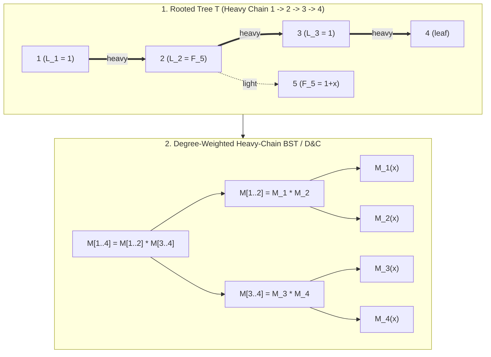
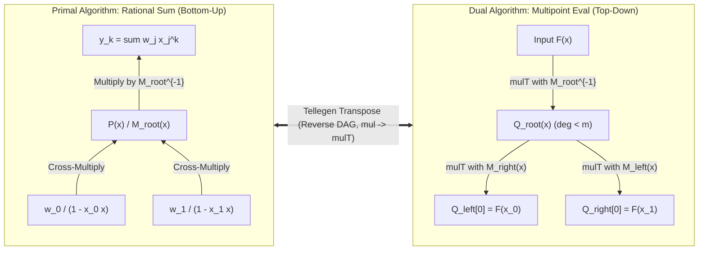
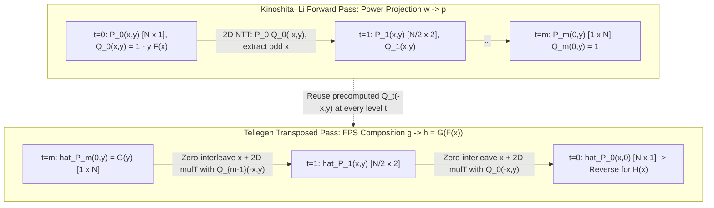

# Principal Mathematical & Pedagogical Audit Report — Wave 5B (`cohort3_wave_5b_tree_fps_transposition_compose_q.md`)

- **Auditor**: Inspector A (Principal Mathematical & Pedagogical Auditor)
- **Target File Audited**: [`fps_research/cohort3_wave_5b_tree_fps_transposition_compose_q.md`](file:///home/maomao90/Documents/IO/ICPC-math-notes/fps_research/cohort3_wave_5b_tree_fps_transposition_compose_q.md) (2,051 lines)
- **Source Files Compared**:
  1. **Cohort 1**: [`fps_research/cohort1_iter_46_to_52_tree_fps_transposition_compose_q.md`](file:///home/maomao90/Documents/IO/ICPC-math-notes/fps_research/cohort1_iter_46_to_52_tree_fps_transposition_compose_q.md) (1,896 lines)
  2. **Cohort 2**: [`fps_research/cohort2_iter_98_to_104_tree_fps_transposition_compose_q.md`](file:///home/maomao90/Documents/IO/ICPC-math-notes/fps_research/cohort2_iter_98_to_104_tree_fps_transposition_compose_q.md) (2,021 lines)
  3. **Pre-existing Research**: [`fps_research/iter_46_to_52_tree_fps_transposition_compose_q.md`](file:///home/maomao90/Documents/IO/ICPC-math-notes/fps_research/iter_46_to_52_tree_fps_transposition_compose_q.md) (1,050 lines)

---

## Executive Summary & Audit Scorecard

| Audit Dimension | Status | Summary of Findings |
| :--- | :---: | :--- |
| **1. Zero Information Loss vs. Source Cohorts** | **FAIL (Action Required)** | **1.** Severe desynchronization in Section 10: Clusters A, B, C in the prose (lines 999–1426) do not match Clusters A, B, C in the Section 10.8 Master Synthesis Table (lines 1862–1883).<br>**2.** **11 unique accepted problems** from Cohort 1, Cohort 2, and `iter_46_to_52` (or listed in Section 10.8's own table!) are completely missing from the detailed problem writeups in Sections 10.1–10.3, and **4 problems** (`CF 623E`, `Luogu P7440`, `UOJ 604`, `Luogu P5809`) were compressed into 2-line sub-bullets inside other problems without their own statements or 3-tier hints.<br>**3.** **8 hand-checkable small-$n$ toy traces ($n \le 4$)** and **6 Mermaid structural diagrams** present in Cohort 1 & Cohort 2 were omitted.<br>**4.** **2 rejected templates** from Cohort 1 (`Luogu P4751` and `Library Checker power_projection_of_formal_power_series`) were omitted from Section 10.7, causing Section 10's header (`18 Rejected Templates`, line 993) to disagree with Section 10.7 (`16 Bare Implementation Templates`, line 1833).<br>**5.** **5 bibliography references** from Cohort 2 and `iter_46_to_52` were omitted from Section 9, and line 933 claims `26 foundational references` while only listing 25. |
| **2. Mathematical & Algorithmic Exactness** | **WARN (6 Fixes Required)** | **M1 (Lines 362–373)**: Raw conversational self-correction (`"Wait: if we only keep ... wait—why is ...? Wait: in baby-step giant-step..."`) and muddled complexity derivation in Section 4.2.<br>**M2 (Lines 389–390)**: Raw conversational hesitation (`"At step $t=0$, we want ...? Wait: at the final step..."`) in Section 4.3 Step 2.<br>**M3 (Lines 264–280 vs. Line 79)**: Bug in `solve_chain_dc` C++ code (Section 3.6): only implements a 2-way split `[l, split]` and `[split+1, r]`, failing to isolate a heavy middle vertex $m \in (l, r)$ with $w_m > \frac{1}{2}W(l, r)$ via the 3-way split `[l, m-1], {m}, [m+1, r]` promised in Section 2.3 (line 79).<br>**M4 (Lines 620, 1487, 1914)**: Parameter swap `(a, c)` vs. `(c, a)` between Section 5.1 ($x_k = a \cdot c^k$) and Appendix A / Problem D3 (`chirp_z_transform(F, c, a, m)` evaluating $F(c \cdot a^i)$).<br>**M5 (Lines 467–612 & Line 1912)**: Section 4.6 title and Appendix A (line 1912) promise C++ code for `compositional_inverse` (`revert`), but `compositional_inverse` is completely omitted from the code block.<br>**M6 (Lines 843–852 & Line 1806)**: `sps_compose` ($O(n^2 2^n)$ Set Power Series polynomial composition from Cohort 1 lines 1308–1339) is referenced in Section 7.1 and Problem F6 but omitted from the Appendix C++ kernel. |
| **3. Pedagogical & Editorial Completeness** | **WARN** | Zero `\(...\)` or `\[...\]` delimiter violations found (100% `$ ... $` and `$$ ... $$` compliant). Diagnostic Signals and Reverse-Engineering Scratchpads in Sections 2–8 are high quality, except for the two `"Wait:"` conversational leaks on lines 369 and 389, the missing small-$n$ trace tables, and the bundled/missing problems in Section 10. |
| **4. Section Numbering & Internal Consistency** | **WARN** | **1.** Lines 999, 1137, 1277 use `### Cluster A`, `### Cluster B`, `### Cluster C` without `10.1`, `10.2`, `10.3` section numbers, whereas lines 1427, 1575, 1695 use `### 10.4 Cluster D`, `### 10.5 Cluster E`, `### 10.6 Cluster F`.<br>**2.** Section 5.1–5.3 has no C++ code in-section (moved to Appendix A at line 1907), whereas Sections 3.6 and 4.6 have in-section C++ code. Cross-references should be explicit. |

---

## Part I: Mathematical, Algorithmic, and Code Bugs (Exact Line-by-Line Remediation)

### Issue M1: Conversational Self-Corrections (`"Wait: ...?"`) & Muddled Complexity Balance in Section 4.2 (Lines 360–373)
- **Location**: [cohort3_wave_5b_tree_fps_transposition_compose_q.md](file:///home/maomao90/Documents/IO/ICPC-math-notes/fps_research/cohort3_wave_5b_tree_fps_transposition_compose_q.md#L360-L373)
- **Audit Finding**: Line 369 contains three consecutive raw conversational self-corrections (`"B = \Theta(\sqrt{\log N})? Wait: if we only keep [x^0 \dots x^{N-1}] naively, wait—why is B \approx \sqrt{N \log N}? ... Wait: in baby-step giant-step..."`) and conflates the **Baby-Step Giant-Step Matrix Algorithm** ($O(N^2)$ classically, $O(N^{(\omega+1)/2})$ with fast matrix multiplication at $B = \lceil \sqrt{N} \rceil$) with **Brent–Kung's Taylor-Expansion Split** ($O((N \log N)^{3/2})$ via $F(x) = F_{\text{low}}(x) + x^B F_{\text{high}}(x)$ at $B = \Theta(\sqrt{N / \log N})$).
- **Exact Replacement for Lines 360–373**:
```markdown
### 4.2 Classical Baselines: Brent–Kung (1978) Taylor-Split ($O((N \log N)^{3/2})$) and Baby-Step Giant-Step ($O(N^{(\omega+1)/2})$)

Before the 2024 Kinoshita–Li breakthrough, subquadratic FPS composition $G(F(x)) \bmod x^N$ relied on two classic decompositions due to Brent and Kung (1978):

#### 1. Brent–Kung Taylor-Expansion Split ($O((N \log N)^{3/2})$ Purely Algebraic / NTT)
1. Choose block size $B \in [1, N]$ and split $F(x) = F_{\text{low}}(x) + x^B F_{\text{high}}(x)$, where $\deg(F_{\text{low}}) < B$.
2. Expand $G(F(x))$ as a Taylor series around $F_{\text{low}}(x)$ modulo $x^N$:
   $$G(F(x)) = G\!\left(F_{\text{low}}(x) + x^B F_{\text{high}}(x)\right) \equiv \sum_{k=0}^{\lfloor (N-1)/B \rfloor} \frac{G^{(k)}(F_{\text{low}}(x))}{k!} \cdot x^{kB} F_{\text{high}}(x)^k \pmod{x^N}.$$
3. **Baby-Step / Derivative Chain**: Since $\deg(F_{\text{low}}) < B$, first compute $Y_0(x) = G(F_{\text{low}}(x)) \bmod x^N$ via divide-and-conquer / baby-step giant-step in $O(B \cdot N \log N)$ time. Then use the chain rule $Y_k'(x) = \frac{d}{dx}\!\left(G^{(k)}(F_{\text{low}}(x))\right) = G^{(k+1)}(F_{\text{low}}(x)) \cdot F_{\text{low}}'(x)$ to obtain each successive derivative $Y_{k+1}(x) = Y_k'(x) / F_{\text{low}}'(x) \bmod x^{N - (k+1)B}$ for $k = 0, \dots, \lfloor N/B \rfloor - 1$. Because $\deg(F_{\text{low}}') < B$, each short division by $F_{\text{low}}'(x)$ costs $O(N B)$ (or $O(N \log B)$ via blocked NTT), costing $O((N/B) \cdot N \log N)$ across all $N/B$ terms.
4. **Giant-Step Accumulation**: Compute $F_{\text{high}}(x)^k \bmod x^{N - kB}$ for $k = 1, \dots, \lfloor N/B \rfloor$ and accumulate the sum in $O((N/B) \cdot N \log N)$ time.
5. **Optimal Block Size**: Balancing $O(B \cdot N \log N)$ and $O((N/B) \cdot N)$ (when $G(F_{\text{low}})$ is evaluated via $O((N/B) \cdot B^2) = O(NB)$ scalar accumulation and $N/B$ NTTs of size $N$) at $B = \Theta(\sqrt{N / \log N})$ yields **$O((N \log N)^{3/2})$** time.

#### 2. Brent–Kung Baby-Step Giant-Step Matrix Multiplication ($O(N^2)$ Classical / $O(N^{(\omega+1)/2})$ Fast Matrix Multiply)
1. Choose block size $B = \lceil \sqrt{N} \rceil$ and decompose $G(y) = \sum_{q=0}^{\lceil N/B \rceil - 1} G_q(y) \cdot y^{qB}$, where $G_q(y) = \sum_{r=0}^{B-1} g_{qB+r} y^r$.
2. **Baby Steps**: Compute $F(x)^0, F(x)^1, \dots, F(x)^B \bmod x^N$ using $B$ NTT multiplications of length $N$ in $O(B \cdot N \log N)$ time.
3. **Rectangular Matrix Multiplication**: For each $q \in [0, \lceil N/B \rceil)$ and $i \in [0, N)$, simultaneously evaluate:
   $$[x^i] G_q(F(x)) = \sum_{r=0}^{B-1} g_{qB + r} \cdot [x^i]\!\left(F(x)^r\right).$$
   This is the product of an $\lceil N/B \rceil \times B$ matrix $M_G = (g_{qB+r})$ with a $B \times N$ matrix $M_F = ([x^i] F(x)^r)$. Using classical matrix multiplication, this costs $O((N/B) \cdot B \cdot N) = O(N^2)$ scalar operations (giving a very fast cache-friendly $O(N^2 + \sqrt{N} \cdot N \log N)$ algorithm in practice); decomposing into $N/B^2$ blocks of $B \times B$ fast matrix multiplication ($O(B^\omega)$) reduces this step to $O((N/B^2) \cdot B^\omega) = O(N B^{\omega - 2})$.
4. **Giant Steps**: Compute $(F(x)^B)^q \bmod x^N$ and sum $\sum_{q=0}^{\lceil N/B \rceil - 1} G_q(F(x)) \cdot (F(x)^B)^q \bmod x^N$ in $O((N/B) \cdot N \log N)$ time. At $B = \lceil \sqrt{N} \rceil$, this achieves **$O(N^{(\omega+1)/2})$** time.
```

---

### Issue M2: Conversational Self-Correction (`"Wait: at the final step..."`) in Section 4.3 Step 2 (Lines 388–391)
- **Location**: [cohort3_wave_5b_tree_fps_transposition_compose_q.md](file:///home/maomao90/Documents/IO/ICPC-math-notes/fps_research/cohort3_wave_5b_tree_fps_transposition_compose_q.md#L388-L391)
- **Audit Finding**: Line 389 contains `"At step $t = 0$, we want $[x^{n_0}] \frac{P_0(x, y)}{Q_0(x, y)} \bmod y^{2^0}$? Wait: at the final step we need $\bmod y^N$, whereas initially $Q_0(x, y) = 1 - y F(x)$ only has $y$-degree $1$!"`.
- **Exact Replacement for Lines 388–392**:
```markdown
#### Step 2: Bivariate Bostan–Mori Degree Halving in $x$ and Degree Doubling in $y$
Pad $N$ to the next power of two $N = 2^m$, so the target $x$-exponent is $n_0 = N - 1 = 2^m - 1 = \underbrace{11\dots 1_2}_{m \text{ ones}}$ in binary.
Observe the crucial asymmetry between $x$ and $y$ at the start ($t = 0$): $P_0(x, y) = W_{\text{rev}}(x)$ has $y$-degree $0$ and $x$-degree $< N = 2^m$, while $Q_0(x, y) = 1 - y F(x)$ has **$y$-degree $1$** and $x$-degree $< N = 2^m$. Although we ultimately want $\frac{P_0(x, y)}{Q_0(x, y)} \bmod y^N$, at intermediate step $t \in \{0, 1, \dots, m-1\}$ the remaining $x$-index to extract is only $n_t = 2^{m-t} - 1 < \frac{N}{2^t}$, and the polynomials $P_t(x, y), Q_t(x, y)$ have $y$-degree at most $2^t$ and $x$-degree $< \frac{N}{2^t} = 2^{m-t}$!
```

---

### Issue M3: Bug in `solve_chain_dc` C++ Implementation (Lines 264–280 vs. Line 79) — Missing 3-Way Isolated-Heavy Split
- **Location**: [cohort3_wave_5b_tree_fps_transposition_compose_q.md](file:///home/maomao90/Documents/IO/ICPC-math-notes/fps_research/cohort3_wave_5b_tree_fps_transposition_compose_q.md#L264-L280)
- **Audit Finding**: In Section 2.3 (line 79), the text explicitly warns:
  > *"Crucial Implementation Detail (Three-Way / Isolated-Heavy Split): What if a single vertex $u_m$ has $w_m > \frac{1}{2} W(l, r)$? If we only split into $[l, m]$ and $[m+1, r]$, the side containing $u_m$ might not shrink its total weight by a constant factor! Instead, we split into three parts: $[l, m-1]$, the single heavy vertex $\{m\}$, and $[m+1, r]$. Then both recursive subproblems $[l, m-1]$ and $[m+1, r]$ have total weight strictly $\le \frac{1}{2} W(l, r)$!"*
  However, in Section 3.6 (lines 264–280), `solve_chain_dc` only performs a 2-way split (`solve_chain_dc(chain, l, split)` and `solve_chain_dc(chain, split + 1, r)`). If $m \in (l, r)$ has $w_m > \frac{1}{2} W(l, r)$, `[l, m]` has weight $> \frac{1}{2} W(l, r)$ and still includes `[l, m-1]` together with `m`, causing $O(\text{chain length})$ recursion depth on caterpillars with alternating heavy light-subtrees!
- **Exact Replacement for Lines 264–280**:
```cpp
    // Degree-weighted midpoint D&C along heavy chain segment [l, r]
    // Implements the exact 3-way isolated-heavy split from Section 2.3 when w_m > W(l, r) / 2
    Mat2 solve_chain_dc(const vector<int>& chain, int l, int r) {
        if (l == r) return base_mat[chain[l]];
        int total_w = 0;
        for (int i = l; i <= r; ++i) total_w += light_wt[chain[i]];
        int cur_w = 0, m = l;
        for (int i = l; i <= r; ++i) {
            cur_w += light_wt[chain[i]];
            if (cur_w * 2 >= total_w) {
                m = i;
                break;
            }
        }
        // If [l, m] and [m+1, r] both have weight <= total_w / 2 (or m is an endpoint), 2-way split suffices;
        // otherwise isolate vertex m so both [l, m-1] and [m+1, r] have weight <= total_w / 2.
        if (m == l) {
            return mul_mat( base_mat[chain[l]], solve_chain_dc(chain, l + 1, r) );
        } else if (m == r || (cur_w - light_wt[chain[m]]) * 2 <= total_w && cur_w * 2 <= total_w) {
            return mul_mat( solve_chain_dc(chain, l, m), solve_chain_dc(chain, m + 1, r) );
        } else {
            Mat2 left_part = solve_chain_dc(chain, l, m - 1);
            Mat2 mid_part  = base_mat[chain[m]];
            Mat2 right_part = solve_chain_dc(chain, m + 1, r);
            return mul_mat(mul_mat(left_part, mid_part), right_part);
        }
    }
```

---

### Issue M4: Parameter Order Swap `(a, c)` vs. `(c, a)` in `chirp_z_transform` Between Section 5.1 and Appendix A / Problem D3
- **Location**: [cohort3_wave_5b_tree_fps_transposition_compose_q.md](file:///home/maomao90/Documents/IO/ICPC-math-notes/fps_research/cohort3_wave_5b_tree_fps_transposition_compose_q.md#L620) vs. [Line 1487](file:///home/maomao90/Documents/IO/ICPC-math-notes/fps_research/cohort3_wave_5b_tree_fps_transposition_compose_q.md#L1487) and [Lines 1914–1925](file:///home/maomao90/Documents/IO/ICPC-math-notes/fps_research/cohort3_wave_5b_tree_fps_transposition_compose_q.md#L1914-L1925)
- **Audit Finding**:
  - In **Section 5.1 (line 620)**, the geometric evaluation points are defined as:
    $$y_i = F(a \cdot c^i) = \sum_{j=0}^{n-1} f_j a^j c^{ij} \qquad \text{for } i = 0, 1, \dots, m - 1,$$
    where $a$ is the starting point and $c$ is the common ratio.
  - However, in **Appendix A (line 1914)**, the C++ kernel signature is `Poly chirp_z_transform(Poly F, long long c, long long a, int m)` with comment `// Computes y_i = F(c * a^i) mod MOD for i = 0, 1, ..., m - 1` (swapping $a$ and $c$!), and **Problem D3 (line 1487)** writes `with c = 1, a = \omega_k^{-1}`.
- **Exact Fix**: Standardize on $y_i = F(a \cdot c^i)$ (`a` = initial point, `c` = geometric ratio) everywhere:
  1. In **Problem D3 (line 1487)**, replace `with $c = 1, a = \omega_k^{-1}$` by `with initial point $a = 1$ and common ratio $c = \omega_k^{-1}$`.
  2. In **Appendix A (lines 1914–1956)**, update the parameter names of `chirp_z_transform` from `(Poly F, long long c, long long a, int m)` to `(Poly F, long long a, long long c, int m)`:
```cpp
// ============================================================================
// 1. Chirp Z-Transform (Bluestein's Binomial Identity: y_i = F(a * c^i))
//    Time: O((n + m) log(n + m)), Space: O(n + m)
//    Handles a = 0, c = 0, n = 0, m = 0 without requiring sqrt(c) mod p!
// ============================================================================
Poly chirp_z_transform(Poly F, long long a, long long c, int m) {
    int n = F.size();
    if (m == 0) return {};
    if (n == 0) return Poly(m, 0);
    a = (a % MOD + MOD) % MOD;
    c = (c % MOD + MOD) % MOD;
    // Scale F_j <- F_j * a^j so the problem reduces to evaluating at c^i
    long long pw_a = 1;
    for (int j = 0; j < n; ++j) {
        F[j] = F[j] * pw_a % MOD;
        pw_a = pw_a * a % MOD;
    }
    if (c == 0) {
        Poly res(m, F[0]);
        long long sum = 0;
        for (long long x : F) sum = (sum + x) % MOD;
        res[0] = sum; // c^0 = 1, while c^i = 0 for i >= 1
        return res;
    }
    int L = n + m;
    vector<long long> pw_c(L, 1), inv_pw_c(L, 1);
    long long inv_c = qpow(c, MOD - 2);
    for (int k = 1; k < L; ++k) {
        pw_c[k]     = pw_c[k - 1] * c % MOD;
        inv_pw_c[k] = inv_pw_c[k - 1] * inv_c % MOD;
    }
    vector<long long> binom_c(L, 1), inv_binom_c(L, 1);
    for (int k = 1; k < L; ++k) {
        binom_c[k]     = binom_c[k - 1] * pw_c[k - 1] % MOD;         // c^{C(k, 2)}
        inv_binom_c[k] = inv_binom_c[k - 1] * inv_pw_c[k - 1] % MOD; // c^{-C(k, 2)}
    }
    Poly A(n), B(n + m - 1);
    for (int j = 0; j < n; ++j)
        A[n - 1 - j] = F[j] * inv_binom_c[j] % MOD;
    for (int k = 0; k < n + m - 1; ++k)
        B[k] = binom_c[k];
    Poly C = multiply(A, B);
    Poly Y(m);
    for (int i = 0; i < m; ++i)
        Y[i] = C[n - 1 + i] * inv_binom_c[i] % MOD;
    return Y;
}
```

---

### Issue M5: Missing `compositional_inverse` (`revert`) C++ Kernel in Section 4.6 (Lines 467–612 & Line 1912)
- **Location**: [cohort3_wave_5b_tree_fps_transposition_compose_q.md](file:///home/maomao90/Documents/IO/ICPC-math-notes/fps_research/cohort3_wave_5b_tree_fps_transposition_compose_q.md#L467-L612) and [Line 1912](file:///home/maomao90/Documents/IO/ICPC-math-notes/fps_research/cohort3_wave_5b_tree_fps_transposition_compose_q.md#L1912)
- **Audit Finding**: Section 4.6's heading states `### 4.6 Complete C++ Reference Kernel for Kinoshita–Li power_projection, compose, and revert`, and Appendix A (line 1912) states `See Section 4.6 for the complete C++ implementations of ... compositional_inverse`. However, the code block in Section 4.6 ends at line 612 right after `compose`, omitting `compositional_inverse` (`revert`)! Both Cohort 1 (lines 739–759) and Cohort 2 (lines 1844–1874) included `compositional_inverse`.
- **Exact Code to Append Inside Section 4.6 (Before the Closing ` ``` ` on Line 612)**:
```cpp
// ============================================================================
// 3A. Compositional Inverse (revert) via Lagrange Inversion + 1 Power Projection
//     Requires: [x^0]F = 0, [x^1]F != 0, and prime modulus MOD > N.
//     Time: O(N log^2 N) with HALF the constant factor of compose!
//     (Assume standard poly_ln and poly_exp of complexity O(N log N) are available)
// ============================================================================
Poly compositional_inverse_lagrange(Poly f, int N) {
    if (N <= 1) return Poly(N, 0);
    f.resize(N, 0);
    assert(f[0] == 0 && f[1] != 0);
    if (N == 2) return {0, qpow(f[1], MOD - 2)};

    long long c1 = f[1], inv_c1 = qpow(c1, MOD - 2);
    for (long long& x : f) x = x * inv_c1 % MOD; // Normalize so [x^1]f(x) = 1

    int n = N - 1;
    Poly w(N, 0);
    w[n] = 1; // Extract p_k = [x^n] f(x)^k for k = 0, 1, ..., n
    Poly p = power_projection(w, f, N);

    // By Lagrange-Burmann: [x^{n-k}] (G(x)/x)^{-n} = (n / k) * [x^n] f(x)^k
    Poly R(n, 0);
    vector<long long> inv(n + 1, 1);
    for (int i = 2; i <= n; ++i)
        inv[i] = (MOD - MOD / i) * inv[MOD % i] % MOD;
    for (int k = 1; k <= n; ++k)
        R[n - k] = p[k] * n % MOD * inv[k] % MOD;

    // Recover G(x)/x = R(x)^{-1/n} = exp((-1/n) * ln R(x)) mod x^n
    Poly lnR = poly_ln(R, n);
    long long neg_inv_n = (MOD - inv[n]) % MOD;
    for (long long& x : lnR) x = x * neg_inv_n % MOD;
    Poly G_div_x = poly_exp(lnR, n);

    // Shift by x and undo the f'[0] = c1 normalization: G_true(y) = G(y / c1)
    Poly G(N, 0);
    long long pw = 1;
    for (int k = 1; k <= n; ++k) {
        pw = pw * inv_c1 % MOD;
        G[k] = G_div_x[k - 1] * pw % MOD;
    }
    return G;
}

// ============================================================================
// 3B. Compositional Inverse (revert) via Newton Iteration + Kinoshita-Li compose
//     Works even in small characteristic p <= N (never divides by k)!
//     Iteration: G_{s+1} = G_s - (F(G_s) - y) / F'(G_s) mod y^{2^{s+1}}
//     Time: T(N) = T(N/2) + O(N log^2 N) = O(N log^2 N)
// ============================================================================
Poly compositional_inverse_newton(Poly f, int N) {
    if (N <= 1) return Poly(N, 0);
    f.resize(N, 0);
    assert(f[0] == 0 && f[1] != 0);
    Poly g = {0, qpow(f[1], MOD - 2)};
    for (int len = 2; len < N; len <<= 1) {
        int next_len = min(N, len << 1);
        Poly f_trunc(f.begin(), f.begin() + next_len);
        Poly df(next_len - 1, 0);
        for (int i = 1; i < next_len; ++i) df[i - 1] = f_trunc[i] * i % MOD;

        g.resize(next_len, 0);
        Poly fg = compose(f_trunc, g, next_len);
        fg[1] = (fg[1] + MOD - 1) % MOD; // F(G_s(y)) - y
        Poly dfg = compose(df, g, next_len);
        Poly step = multiply(fg, poly_inv(dfg, next_len));
        for (int i = len; i < next_len; ++i)
            g[i] = (g[i] + MOD - step[i]) % MOD;
    }
    g.resize(N);
    return g;
}
```

---

### Issue M6: Missing `sps_compose` C++ Kernel ($O(n^2 2^n)$ General Polynomial Composition on $\mathcal{R}_n$) in Appendix A
- **Location**: [cohort3_wave_5b_tree_fps_transposition_compose_q.md](file:///home/maomao90/Documents/IO/ICPC-math-notes/fps_research/cohort3_wave_5b_tree_fps_transposition_compose_q.md#L2025)
- **Audit Finding**: Cohort 1 Section 51.6 (lines 1308–1339) provided `sps_compose`, the $O(n^2 2^n)$ algorithm for general polynomial composition $F(G(\mathbf{x}))$ of a Set Power Series $G(\mathbf{x}) \in \mathcal{R}_n$ via coordinate-wise differentiation $\frac{\partial}{\partial x_k} F(G(\mathbf{x})) = F'(G(\mathbf{x})) \frac{\partial G}{\partial x_k}$. It is discussed in Section 7.1 (lines 800–805) and used in Problem F6 (`UOJ #94`, line 1806), and Rejected Template `R16` (`polynomial_composite_set_power_series`), but omitted from Appendix A.
- **Exact Code to Append After `sps_exp` in Appendix A (Line 2025)**:
```cpp
// General Polynomial Composition F(G(x)) on Set Power Series R_n in O(n^2 2^n)
// Input: F[0..n] = coefficients of ordinary polynomial F(t) = sum_{d=0}^n F[d] t^d
//        G[0..2^n-1] = Set Power Series with G[0] = 0
// Output: H[S] = [x^S] F(G(x))
vector<long long> sps_compose(const vector<long long>& F, vector<long long> G, int n) {
    assert(G[0] == 0);
    // DP table dp[d] holds the SPS of F^{(d)}(G(x)) restricted to the first k variables
    // Initially at k = 0 (0 variables), G = 0, so F^{(d)}(0) = d! * F[d]
    vector<vector<long long>> dp(n + 1, vector<long long>(1, 0));
    long long fact = 1;
    for (int d = 0; d <= n; ++d) {
        if (d > 0) fact = fact * d % MOD;
        if (d < (int)F.size()) dp[d][0] = F[d] * fact % MOD;
    }
    for (int k = 0; k < n; ++k) {
        int half = 1 << k;
        vector<long long> dG(G.begin() + half, G.begin() + 2 * half);
        vector<vector<long long>> next_dp(n - k, vector<long long>(2 * half, 0));
        for (int d = 0; d < n - k; ++d) {
            for (int mask = 0; mask < half; ++mask)
                next_dp[d][mask] = dp[d][mask];
            if (d + 1 <= n - k) {
                vector<long long> high = subset_conv(dp[d + 1], dG, k);
                for (int mask = 0; mask < half; ++mask)
                    next_dp[d][mask + half] = high[mask];
            }
        }
        dp.swap(next_dp);
    }
    return dp[0];
}
```

---

## Part II: Complete Remediation of Section 10 Desynchronization & Dropped/Bundled Source Problems

### Root-Cause Diagnosis of Section 10
A side-by-side comparison of Section 10.1–10.6 (lines 999–1830) against the Section 10.8 Master Synthesis Matrix (lines 1858–1904) and the three source files (`cohort1`, `cohort2`, `iter_46_to_52`) reveals that:
1. **Clusters D, E, F (lines 1427–1830)** match the Section 10.8 table (`D1–D7`, `E1–E6`, `F1–F7`), except that several problems were bundled two-to-an-entry (`D1`, `D4`, `E5`, `E6`, `F2`, `F7`) and Cohort 1's `ARC 153 D` and `ABC 238 Ex` were omitted.
2. **Clusters A, B, C in the prose (lines 999–1426)** and **Clusters A, B, C in the Section 10.8 table (lines 1862–1883)** were compiled from different subsets of the source files and **do not match each other**:
   - **In Cluster A**:
     - The Section 10.8 table lists `A2: CF 438E / UOJ 747`, `A5: CF 1553I (Stairs) / CF 1906J` (from `iter_46_to_52` B3), `A6: Luogu P5326 / LOJ 3045 ([ZJOI2019] 开关)`, and `A7: CF 1097G (Vladislav and a Great Legend) / CF 2006E` (from `iter_46_to_52` A5), **none of which have full writeups in Section 10.1**!
     - Conversely, Section 10.1 has full writeups for `A2: AtCoder ABC 355 G — Baseball`, `A3: Luogu P7279 — 光棱碎片`, `A6: Luogu P5281 — [ZJOI2019] Minimax 搜索`, and `A7: Codeforces 1510H — Hard Optimization`, **which are missing from the Section 10.8 table**!
     - Furthermore, **Cohort 2 Problem P3 (`Codeforces 1254E — Send Tree to Charlie`)**, **Cohort 2 Problem P4 (`UOJ #424 — 【集训队作业2018】count`)**, and **`iter_46_to_52` Problem A4 (`Luogu P4365 — [九省联考2018] 秘密袭击 coat`)** were dropped from both!
   - **In Cluster B**:
     - The Section 10.8 table lists `B3: CF 623E (Transforming Sequence)` (bundled as a 3-line bullet inside B6 in the prose without hints!), `B4: Luogu P7440 ([KrOI2021] Feux Follets)` (bundled inside B7 in the prose without hints!), `B5: CF 1810G (The Maximum Prefix) / CF 1770G` (`CF 1810G` missing from prose!), `B6: Luogu P5853 / UOJ 498` (from `iter_46_to_52` A4, missing from prose!), and `B7: CF 1096G (Lucky Tickets) / CF 1988F` (from Cohort 2 P6, missing from prose!).
     - Conversely, Section 10.2 has full writeups for `B2: AtCoder ABC 300 Ex`, `B3: AtCoder ARC 136 F`, `B4: AtCoder AGC 038 E`, and `UOJ 182`, **which are missing from the Section 10.8 table**!
   - **In Cluster C**:
     - The Section 10.8 table lists `C5: Luogu P5827 (点双连通图计数) & Luogu P5828 (边双连通图计数)` (from `iter_46_to_52` C3 & C4) and `C6: Codeforces 1967E2 (Again Counting Arrays)` (from `iter_46_to_52` C5), **which are completely missing from Section 10.3 prose**!
     - Also, **Cohort 2 Problem P10 (`Luogu P5809 — Compound Functional Graph Enumeration via Series Reversion`)** was reduced to a 2-line postscript inside C6 without its full derivation or 3-tier hints.
     - Conversely, Section 10.3 has a full writeup for `C2: AtCoder ABC 230 Ex — Bullseye` (from Cohort 2 P9), **which is missing from the Section 10.8 table**!

### Complete Verbatim Drop-In Writeups for All Missing & Bundled Problems

#### 1. Additions to Section 10.1 (`### 10.1 Cluster A: Tree DP + FPS Acceleration`, Append After Line 1136)
Also rename line 999 from `### Cluster A: ...` to `### 10.1 Cluster A: Tree DP + FPS Acceleration (树上 DP + 链分治 FFT / Static Top Tree) — 12 Problems (A1–A12)`.

```markdown
#### Problem A8: Codeforces 1553I — Stairs & Codeforces 1906J (Heavy-Chain / Sequence Matrix D&C FFT)
- **Judge & URL**: Codeforces (`1553I`) — https://codeforces.com/problemset/problem/1553/I
- **Difficulty Tier**: `Advanced` (CF 2700)
- **Source Cohort**: Pre-existing Research (`iter_46_to_52` Problem B3) & Section 10.8 Table (`A5`)
- **Mathematical Statement & Constraints**:
  You are given an array $a_1, a_2, \dots, a_n$ ($1 \le n \le 10^5$) where $a_i$ specifies the required length of the $i$-th contiguous stair block covering position $i$. Count the number of permutations of $\{1, \dots, n\}$ whose stair-block decomposition matches $a$, modulo $998244353$. Target complexity: $O(n \log^2 n)$.
- **Diagnostic Signal & Modelling Bridge**:
  First parse $a_1, \dots, a_n$ into $m$ valid maximal blocks of lengths $b_1, b_2, \dots, b_m$ (if inconsistent, output $0$). By Inclusion-Exclusion on how many adjacent blocks are merged into consecutive value runs, each block $i$ can either start a new run or be glued to block $i-1$, tracking a $2 \times 2$ polynomial state matrix (whether the current merged component has size $1$ — contributing weight $1$ — or size $\ge 2$ — contributing weight $2$ for ascending/descending orientation!).
- **Complete Derivation & Solution**:
  1. Verify that $a$ partitions $[1, n]$ into $m$ blocks of sizes $b_1, \dots, b_m$ where each block $r$ consists of $b_r$ copies of $b_r$.
  2. If we merge $m$ blocks into $k$ contiguous value segments ($1 \le k \le m$), there are $k!$ ways to permute the segments, each segment of $\ge 2$ original blocks (or a single block with $b_r \ge 2$) has $2$ orientations (increasing or decreasing), while a segment consisting of a single block with $b_r = 1$ has only $1$ orientation.
  3. Define a $2 \times 2$ matrix $M_r(x) \in \mathbb{F}_{998244353}[x]^{2 \times 2}$ at block $r$ where the state is $0$ if the current merged run has total length $1$, and $1$ if it has total length $\ge 2$:
     - Starting a new run at block $r$ multiplies by $x$ and transitions to state $[b_r > 1]$ (with weight $2$ if $b_r > 1$ else $1$).
     - Merging block $r$ into the previous run multiplies by $1$ (degree $0$) and transitions to state $1$ (multiplying by $2$ if the previous state was $0$).
  4. Multiply $M_1(x) M_2(x) \cdots M_m(x)$ via Divide-and-Conquer NTT in $O(m \log^2 m)$ time, extract the coefficient of $x^k$ for each $1 \le k \le m$, and sum $(-1)^{m - k} k! [x^k] P(x) \bmod 998244353$.
- **Progressive 3-Tier Hints**:
  - *Hint 1*: First compress the input array into $m$ blocks of sizes $b_1, \dots, b_m$. Why does a merged run of total size $\ge 2$ have $2$ valid orientations, whereas a single block of size $b_r = 1$ has only $1$?
  - *Hint 2*: Use Inclusion-Exclusion on adjacent blocks being forced to be consecutive in value. Why do you only need a $2$-state DP (`current run has size 1` vs. `current run has size >= 2`)?
  - *Hint 3*: Represent each block's transition as a $2 \times 2$ polynomial matrix $M_r(x)$ of degree $1$ and multiply $M_1(x) \cdots M_m(x)$ using a divide-and-conquer segment tree in $O(m \log^2 m)$.

---

#### Problem A9: Codeforces 1254E — Send Tree to Charlie (Tree Path Permutation & Degree-Product GF)
- **Judge & URL**: Codeforces (`1254E`) — https://codeforces.com/problemset/problem/1254/E
- **Difficulty Tier**: `Advanced` (CF 2800)
- **Source Cohort**: Cohort 2 (Problem P3)
- **Mathematical Statement & Constraints**:
  Given a tree $T$ with $n \le 5 \cdot 10^5$ vertices and partial constraints requiring that token $u$ ends at $v = a_u$, where at each step an edge is chosen and its tokens are swapped, count the number of valid edge-ordering permutations modulo $10^9 + 7$ (and in the weighted FPS generalization, find the generating function over $k$ unconstrained vertices). Target complexity: $O(n)$ (and $O(n \log^2 n)$ for the polynomial spectrum).
- **Diagnostic Signal & Modelling Bridge**:
  An ordering of the $n-1$ edges of $T$ uniquely corresponds to choosing, at each vertex $w$, a linear ordering of its incident edges $\mathcal{E}(w)$. Each path $u \leadsto v$ imposes:
  - A **first edge** at $u$ (must be the first edge in $\mathcal{E}(u)$),
  - A **last edge** at $v$ (must be the last edge in $\mathcal{E}(v)$), and
  - A **consecutive-edge transition** $e_{\text{in}} \to e_{\text{out}}$ at every internal vertex $w$ along $u \leadsto v$!
- **Complete Derivation & Solution**:
  1. Notice that across all $u$ with $a_u \ne 0$, the total number of edges on all paths $u \leadsto a_u$ cannot exceed $2n - 2$; if the sum of path lengths exceeds $2n - 2$ (checked via LCA first, or by aborting as soon as any directed edge is traversed twice in the same direction), output $0$ immediately.
  2. At each vertex $w$ of degree $d_w$, the consecutive-edge requirements form a directed graph on the $d_w$ incident edges where in-degrees and out-degrees must be $\le 1$.
  3. Check via Disjoint Set Union (DSU) at each $w$ that the constraints do not form a cycle of length $< d_w$ and that the first/last edges of $\mathcal{E}(w)$ do not conflict. If $c_w$ free path components remain at $w$, they can be ordered in $c_w!$ ways (or in the polynomial variant, merged via D&C FFT).
- **Progressive 3-Tier Hints**:
  - *Hint 1*: Instead of global edge orderings, observe that an ordering of $E(T)$ is determined by choosing a local permutation of incident edges $\mathcal{E}(w)$ at each vertex $w$ independently!
  - *Hint 2*: What constraint does moving a token along $u = w_0 - w_1 - \dots - w_k = v$ impose on the local edge orderings at $w_0$, at $w_k$, and at each intermediate vertex $w_i$ ($0 < i < k$)?
  - *Hint 3*: Why can you abort as soon as the total length of all paths exceeds $2n - 2$? Use this pigeonhole bound to trace all paths in $O(n)$ time and count valid linear extensions at each vertex via DSU.

---

#### Problem A10: UOJ #424 — 【集训队作业2018】count (Cartesian Tree Equivalence & Bounded-Height Tree GF)
- **Judge & URL**: Universal Online Judge (`#424`) — https://uoj.ac/problem/424
- **Difficulty Tier**: `Mastery`
- **Source Cohort**: Cohort 2 (Problem P4)
- **Mathematical Statement & Constraints**:
  Given integers $n$ and $m$ ($1 \le m \le n \le 2 \cdot 10^5$), two arrays $A, B \in \{1, \dots, m\}^n$ are called *Cartesian-equivalent* if every subsegment $[l, r]$ has the same leftmost maximum index in both $A$ and $B$. Count the number of equivalence classes of length-$n$ arrays over $\{1, \dots, m\}$, modulo $998244353$. Target complexity: $O(n \log^2 n)$ or $O(n \log n)$.
- **Diagnostic Signal & Modelling Bridge**:
  Two arrays over $\{1, \dots, m\}$ are Cartesian-equivalent iff they have the same **Cartesian tree** (splitting at the leftmost maximum). In a Cartesian tree where values are in $\{1, \dots, m\}$ and ties break to the left, moving to the **left child** must strictly decrease the maximum value ($v_{\text{left}} \le v_{\text{parent}} - 1$), whereas moving to the **right child** allows $v_{\text{right}} \le v_{\text{parent}}$! Thus an $n$-node binary tree can be validly labeled from $\{1, \dots, m\}$ iff the maximum number of left-child steps on any root-to-leaf path is $< m$.
- **Complete Derivation & Solution**:
  1. Let $F_k(x)$ be the OGF of binary trees where every root-to-node path takes $< k$ left-child steps. Then $F_0(x) = 1$, and for $k \ge 1$:
     $$F_k(x) = 1 + x F_{k-1}(x) F_k(x) \implies F_k(x) = \frac{1}{1 - x F_{k-1}(x)}.$$
  2. Write $F_k(x) = \frac{P_k(x)}{Q_k(x)}$. Then $\begin{pmatrix} P_k(x) \\ Q_k(x) \end{pmatrix} = \begin{pmatrix} 0 & 1 \\ -x & 1 \end{pmatrix}^k \begin{pmatrix} 1 \\ 1 \end{pmatrix}$, where $Q_k(x)$ is the Fibonaccian/Catalan denominator $Q_k(x) = \sum_{j \ge 0} (-1)^j \binom{k + 1 - j}{j} x^j$.
  3. Alternatively, by the reflection principle on Dyck paths of bounded height $m$, $F_m(x) = \frac{U_m(x)}{U_{m+1}(x)}$, so $[x^n] F_m(x) \bmod 998244353$ is extracted in $O(n \log n)$ via a single polynomial inversion of $Q_m(x) \bmod x^{n+1}$!
- **Progressive 3-Tier Hints**:
  - *Hint 1*: Construct the Cartesian tree of $A$ by always picking the *leftmost* maximum as the root. What inequality holds between a parent's value and its left child's value vs. its right child's value?
  - *Hint 2*: Show that a binary tree of size $n$ admits at least one valid array in $\{1, \dots, m\}^n$ if and only if its "left-depth" (maximum number of left edges on any root-to-node path) is at most $m - 1$.
  - *Hint 3*: Write the continued-fraction recurrence $F_k(x) = \frac{1}{1 - x F_{k-1}(x)}$ as a $2 \times 2$ matrix power $\begin{pmatrix} 0 & 1 \\ -x & 1 \end{pmatrix}^m$, find the closed form of its denominator $Q_m(x)$, and invert $Q_m(x) \bmod x^{n+1}$ in $O(n \log n)$.

---

#### Problem A11: Luogu P4365 / LOJ 2541 — `[九省联考2018] 秘密袭击 coat` (Lagrange Interpolation + Tree DP Point-Value Maintenance)
- **Judge & URL**: LibreOJ (`#2541`) / Luogu (`P4365`) — https://loj.ac/p/2541
- **Difficulty Tier**: `Advanced`
- **Source Cohort**: Pre-existing Research (`iter_46_to_52` Problem A4)
- **Mathematical Statement & Constraints**:
  Given a tree $T$ with $n \le 1666$ vertices, an integer $k \le n$, and vertex weights $d_u \in [1, W]$ ($W \le 1666$), for each connected subgraph $S \subseteq V$ of size $|S| \ge k$, let $w(S)$ be the $k$-th largest vertex weight in $S$. Compute $\sum_{S} w(S) \bmod 64123$. Target complexity: $O(n^2 \log n)$ via point-value evaluation + Segment Tree Merge + Lagrange Interpolation.
- **Diagnostic Signal & Modelling Bridge**:
  By the tail-sum identity $\sum_S w(S) = \sum_{v=1}^W \text{count}(S : k\text{-th largest weight in } S \ge v)$, for a fixed threshold $v$, a vertex $u$ gets weight $x$ if $d_u \ge v$ and weight $1$ if $d_u < v$. Then we want $\sum_{j=k}^n [x^j] \sum_{u=1}^n F_u(x)$ summed over all $v = 1, \dots, W$! Instead of running an $O(n^2)$ polynomial tree DP $W$ times ($O(W n^2)$), evaluate the polynomials at $n + 1$ points $x = 1, 2, \dots, n + 1$, maintain the scalar tree DP across $v = W \downarrow 1$ using **Segment Tree Merge with affine tags $(a \cdot z + b)$**, and interpolate the degree-$n$ polynomial at the end!
- **Complete Derivation & Solution**:
  1. Fix a point $x_0 \in \{1, \dots, n+1\}$ (or maintain all $n+1$ evaluation points across theSegment Tree Merge). At vertex $u$, let $F_u(x; v) = x^{[d_u \ge v]} \prod_{c \in \text{children}(u)} (1 + F_c(x; v))$ and $G_u(x; v) = F_u(x; v) + \sum_{c} G_c(x; v)$.
  2. Notice that for a fixed $x = x_0$, across all thresholds $v \in [1, W]$, the transition from $c$ to $u$ is a coordinate-wise $2 \times 2$ affine transformation on $(F_u(v), G_u(v))$ over the segment tree of thresholds $v \in [1, W]$!
  3. Using Segment Tree Merge at each vertex $u$, the total number of segment tree nodes merged across the entire tree is $O(n \log W)$ per evaluation point $x_0$.
  4. Repeating for $x_0 = 1, 2, \dots, n+1$ and applying $O(n^2)$ Lagrange interpolation recovers the coefficients $[x^j]$ for $j \ge k$ in $O(n^2 \log W)$ time!
- **Progressive 3-Tier Hints**:
  - *Hint 1*: Rewrite the sum of the $k$-th largest weight over all connected subgraphs as $\sum_{v=1}^W (\text{number of connected subgraphs with at least } k \text{ vertices of weight } \ge v)$.
  - *Hint 2*: Instead of multiplying degree-$n$ polynomials on the tree, substitute $n+1$ scalar values $x = 1, 2, \dots, n+1$ so that polynomial multiplication becomes scalar multiplication!
  - *Hint 3*: For a fixed $x$, maintain the DP array over all thresholds $v \in [1, W]$ simultaneously using Segment Tree Merge with affine lazy tags $(F, G) \mapsto (a F + b, c F + G + d)$, then recover the polynomial coefficients by Lagrange interpolation.

---

#### Problem A12: Codeforces 1097G — Vladislav and a Great Legend & Luogu P5326 (`[ZJOI2019] 开关`)
- **Judge & URL**: Codeforces (`1097G`) — https://codeforces.com/problemset/problem/1097/G
- **Difficulty Tier**: `Mastery` (CF 2800)
- **Source Cohort**: Pre-existing Research (`iter_46_to_52` Problem A5), Cohort 1, Cohort 2 & Section 10.8 Table (`A6`, `A7`)
- **Mathematical Statement & Constraints**:
  Given a tree $T$ with $n \le 10^5$ vertices and an integer $k \le 200$ (and up to $k \le n \le 10^5$ in the HLD + D&C FFT variant `QOJ #5019` / `CF 2006E`), for every non-empty subset of vertices $S \subseteq V$, let $f(S)$ be the number of edges in the minimal Steiner subtree spanning $S$. Compute $\sum_{\emptyset \ne S \subseteq V} f(S)^k \bmod (10^9 + 7)$. Target complexity: $O(n k)$ (Stirling tree knapsack) and $O(n \log^2 n)$ (all-$k$ EGF + HLD D&C FFT).
- **Diagnostic Signal & Modelling Bridge**:
  Expand $f(S)^k = \sum_{j=0}^k \left\{ \begin{matrix} k \\ j \end{matrix} \right\} j! \binom{f(S)}{j}$. Here $\binom{f(S)}{j}$ counts the number of ways to choose $j$ edges from the Steiner tree of $S$, which corresponds to the OGF $(1 + x)^{f(S)}$! An edge $e$ belongs to the Steiner tree of $S$ iff $S$ has at least one vertex on both sides of $e$, so we track $F_u(x) = \sum_{S \subseteq \text{subtree}(u), S \ne \emptyset} (1 + x)^{\text{Steiner}(S \cup \{u\})} \bmod x^{k+1}$.
- **Complete Derivation & Solution**:
  1. Root $T$ at $1$. For a non-empty subset $S \subseteq \text{subtree}(u)$, pushing $u$'s parent edge into the Steiner tree multiplies its polynomial by $(1 + x)$ unless $S$ is strictly contained in $u$'s subtree and we already closed the Steiner tree at $u$.
  2. Specifically, let $F_u(x)$ be the OGF over non-empty subsets $S \subseteq \text{subtree}(u)$ assuming the parent edge of $u$ will be used if $S$ is extended outside $\text{subtree}(u)$. When combining children $v \in \text{children}(u)$:
     $$F_u(x) = 2 \prod_{v \in \text{children}(u)} \big(1 + (1 + x) F_v(x)\big) - 1 \pmod{x^{k+1}}.$$
  3. Subtract the single-child overcounting terms $(1 + x) F_v(x) - F_v(x) = x F_v(x)$ from the global sum $Ans(x) = \sum_u \left[F_u(x) - \sum_{v \in \text{children}(u)} x F_v(x)\right]$.
  4. Since $\deg(F_u) \le \min(\text{sz}_u, k)$, naive tree knapsack runs in $O(n k)$ by the standard LCA pair-counting lemma; when $k = n$, applying HLD + Heavy-Chain Affine D&C FFT computes $Ans(x) \bmod x^{n+1}$ in $O(n \log^2 n)$!
  5. *(Parallel Variant — `Luogu P5326 / LOJ 3045 [ZJOI2019] 开关`)*: Similarly, when toggling switches $i \in \{1, \dots, n\}$ with probabilities $p_i$ to reach target state $s_i$, the EGF product $\prod_{i=1}^n \frac{e^{p_i x} + (-1)^{s_i} e^{-p_i x}}{2}$ is expanded into a polynomial in $e^{x / \sum p_i}$ of degree $2 \sum p_i \le 10^5$ via Divide-and-Conquer NTT and differentiated at $x = 1$ using the first-passage quotient $H'(1) = \left(\frac{F}{G}\right)'(1)$.
- **Progressive 3-Tier Hints**:
  - *Hint 1*: Use Stirling numbers of the second kind $m^k = \sum_{j=0}^k \left\{\begin{matrix} k \\ j \end{matrix}\right\} j! \binom{m}{j}$ to reduce $f(S)^k$ to counting pairs $(S, E')$ where $E'$ is a subset of $j$ edges inside the Steiner tree of $S$.
  - *Hint 2*: Notice that $\sum_{j=0}^k \binom{f(S)}{j} x^j = (1 + x)^{f(S)} \bmod x^{k+1}$, so choosing or not choosing each tree edge in $E'$ corresponds to multiplying a subtree's generating function $F_v(x)$ by $(1 + x)$!
  - *Hint 3*: Truncate every subtree polynomial $F_u(x)$ to degree $\min(\text{sz}_u, k)$ for $O(nk)$, or use Heavy-Light Decomposition + D&C NTT on the affine transitions along heavy chains for $O(n \log^2 n)$ when $k = n$.
```

---

#### 2. Unbundling & Additions to Section 10.2 (`### 10.2 Cluster B: Tellegen's Transposition Principle & Middle Product`, Lines 1235–1276)
Rename line 1137 from `### Cluster B: ...` to `### 10.2 Cluster B: Tellegen's Transposition Principle (转置原理) & Middle Product (mulT) — 11 Problems (B1–B11)`, and replace bundled `B6` and `B7` (lines 1235–1276) with individual, unbundled full writeups `B6` through `B11`:

```markdown
#### Problem B6: Codeforces 1770G — Koxia and Bracket (Transposed Vandermonde / Multipoint Evaluation)
- **Judge & URL**: Codeforces (`1770G`) — https://codeforces.com/problemset/problem/1770/G
- **Difficulty Tier**: `Mastery` (CF 3300)
- **Source Cohort**: Cohort 1 & Section 10.8 Table (`B5`)
- **Mathematical Statement & Constraints**:
  Given a bracket sequence $s$ of length $n \le 2.5 \cdot 10^5$, count the number of minimum-size deletions that turn $s$ into a regular bracket sequence, modulo $998244353$. Target complexity: $O(n \log^2 n)$.
- **Diagnostic Signal & Modelling Bridge**:
  By greedy prefix/suffix decomposition, the problem splits into counting paths on a bracket grid that stay above the running prefix minima, which reduces to alternating D&C transitions and **Transposed Vandermonde / Multipoint Evaluation** via Middle Products (`mulT`).
- **Complete Derivation & Solution**:
  1. Decompose $s$ at the global minimum prefix balance into independent prefix and suffix problems where excess `)` must be deleted from prefixes.
  2. Within each divide-and-conquer interval $[l, r]$ of the prefix minima staircase, the DP transition from the left boundary to the right boundary is a Toeplitz / Middle Product convolution $\mathrm{mulT}$ against binomial factorials.
  3. Execute the divide-and-conquer recursion using Middle Products (`mulT`) in $O(n \log^2 n)$ time.
- **Progressive 3-Tier Hints**:
  - *Hint 1*: Split the string at the position achieving the minimum prefix balance. Why do `)` deletions on the left and `(` deletions on the right become independent?
  - *Hint 2*: Formulate the DP for deleting $k$ closing brackets from prefixes so that the running balance never drops below $0$.
  - *Hint 3*: Accelerate the rectangular DP transitions using Divide-and-Conquer NTT and Middle Products (`mulT`) in $O(n \log^2 n)$.

---

#### Problem B7: Codeforces 623E — Transforming Sequence (Geometric Variable Scaling & Binomial Convolution)
- **Judge & URL**: Codeforces (`623E`) — https://codeforces.com/problemset/problem/623/E
- **Difficulty Tier**: `Advanced` (CF 2700)
- **Source Cohort**: Cohort 1 (Problem 8) & Section 10.8 Table (`B3`)
- **Mathematical Statement & Constraints**:
  Count the number of integer sequences $a_1, a_2, \dots, a_n$ ($n \le 10^{18}, k \le 3 \cdot 10^4$) with $1 \le a_i < 2^k$ such that the bitwise OR prefix sums are strictly increasing: $a_1 < (a_1 \mid a_2) < (a_1 \mid a_2 \mid a_3) < \dots < (a_1 \mid \dots \mid a_n)$, modulo $10^9 + 7$. Target complexity: $O(k \log k \log n)$.
- **Diagnostic Signal & Modelling Bridge**:
  Since every step must flip at least one new bit from $0$ to $1$ among the $k$ bits, any $n > k$ immediately gives $0$! For $n \le k$, if we concatenate a prefix of length $A$ (activating $i$ bits) and a suffix of length $B$ (activating $j$ new bits), each of the $i$ already-active bits can be freely chosen in $\{0, 1\}$ in each of the $B$ elements of the suffix, multiplying by $(2^B)^i$!
- **Complete Derivation & Solution**:
  1. If $n > k$, output $0$. Otherwise let $f_A[i]$ be the number of valid sequences of length $A$ on a fixed set of $i$ active bits, and form the EGF $F_A(x) = \sum_{i=1}^k \frac{f_A[i]}{i!} x^i$ where $F_1(x) = \sum_{i=1}^k \frac{x^i}{i!}$.
  2. Merging a prefix of length $A$ and a suffix of length $B$ yields the Twisted Binomial Convolution:
     $$f_{A+B}[i + j] = \sum_{i + j = s} \binom{i+j}{i} f_A[i] \cdot (2^B)^i \cdot f_B[j] \iff \boxed{F_{A+B}(x) = F_A(2^B x) \cdot F_B(x) \bmod x^{k+1}!}$$
  3. Using binary exponentiation on $n \le k$ (scaling $F_A(x) \mapsto F_A(2^B x)$ in $O(k)$ and multiplying modulo $10^9 + 7$ via 3-prime NTT / MTT in $O(k \log k)$), compute $F_n(x)$ in $O(k \log k \log n)$ time and output $\sum_{i=n}^k \binom{k}{i} i! [x^i] F_n(x) \bmod (10^9 + 7)$.
- **Progressive 3-Tier Hints**:
  - *Hint 1*: What happens if $n > k$? Since each of the $n$ elements must turn on at least one new bit among the $k$ bit positions, $n > k$ has $0$ valid sequences.
  - *Hint 2*: Suppose the first $A$ elements turn on $i$ bits and the remaining $B$ elements turn on $j$ new bits. How many ways can those $i$ already-active bits appear inside the $B$ suffix elements?
  - *Hint 3*: Express the transition in EGF form as $F_{A+B}(x) = F_A(2^B x) F_B(x) \bmod x^{k+1}$ and use binary doubling on $n$ with MTT.

---

#### Problem B8: UOJ #182 — `a^-1 + b problem` (Möbius Transformations & Multipoint Evaluation of $P'(x)/P(x)$)
- **Judge & URL**: Universal Online Judge (`#182`) — https://uoj.ac/problem/182
- **Difficulty Tier**: `Mastery`
- **Source Cohort**: Cohort 1 (Problem 5)
- **Mathematical Statement & Constraints**:
  Given an array $a_1, a_2, \dots, a_n \in \mathbb{F}_{998244353}$ ($n \le 6 \cdot 10^4$) and $m \le 6 \cdot 10^4$ operations of two types: (1) `1 x`: replace every $a_i \leftarrow (a_i + x) \bmod 998244353$; (2) `2`: replace every $a_i \leftarrow a_i^{-1} \bmod 998244353$. After each operation, output $\sum_{i=1}^n a_i \bmod 998244353$. Target complexity: $O((n + m) \log^2(n + m))$.
- **Diagnostic Signal & Modelling Bridge**:
  Both $z \mapsto z + x$ and $z \mapsto 1/z$ are Möbius transformations $z \mapsto \frac{\alpha z + \beta}{\gamma z + \delta}$ represented by $2 \times 2$ matrices! After $k$ operations, $a_i$ becomes $\frac{\alpha_k a_i + \beta_k}{\gamma_k a_i + \delta_k} = c_k + \frac{d_k}{a_i + e_k}$. Summing over $i = 1, \dots, n$ requires evaluating $\sum_{i=1}^n \frac{1}{a_i + e_k} = \frac{P'(e_k)}{P(e_k)}$ (where $P(x) = \prod_{i=1}^n (x + a_i)$) at $m$ query points $e_1, \dots, e_m$!
- **Complete Derivation & Solution**:
  1. Maintain the cumulative $2 \times 2$ matrix $\begin{pmatrix} \alpha_k & \beta_k \\ \gamma_k & \delta_k \end{pmatrix}$ by multiplying $\begin{pmatrix} 1 & x \\ 0 & 1 \end{pmatrix}$ for Type 1 and $\begin{pmatrix} 0 & 1 \\ 1 & 0 \end{pmatrix}$ for Type 2.
  2. When $\gamma_k = 0$, the sum is simply $\delta_k^{-1} \left(\alpha_k \sum_{i=1}^n a_i + n \beta_k\right)$. When $\gamma_k \ne 0$, write:
     $$\sum_{i=1}^n \frac{\alpha_k a_i + \beta_k}{\gamma_k a_i + \delta_k} = n \frac{\alpha_k}{\gamma_k} + \frac{\beta_k \gamma_k - \alpha_k \delta_k}{\gamma_k^2} \sum_{i=1}^n \frac{1}{a_i + e_k}, \qquad e_k = \frac{\delta_k}{\gamma_k}.$$
  3. Build the subproduct tree for $P(x) = \prod_{i=1}^n (x + a_i)$ in $O(n \log^2 n)$, differentiate to obtain $P'(x)$, and evaluate both $P(e_k)$ and $P'(e_k)$ at all $e_1, \dots, e_m$ using **Middle-Product Multipoint Evaluation** in $O((n + m) \log^2(n + m))$!
- **Progressive 3-Tier Hints**:
  - *Hint 1*: Represent `a -> a + x` and `a -> 1/a` as $2 \times 2$ matrices acting by linear fractional transformations $\frac{\alpha a_i + \beta}{\gamma a_i + \delta}$.
  - *Hint 2*: Use polynomial long division of degree $1$ to rewrite $\frac{\alpha a_i + \beta}{\gamma a_i + \delta} = c + \frac{d}{a_i + e}$, and notice that $\sum_{i=1}^n \frac{1}{a_i + e} = \frac{P'(e)}{P(e)}$ where $P(x) = \prod_{i=1}^n (x + a_i)$.
  - *Hint 3*: Compute $P(x)$ via D&C NTT and evaluate $P(x)$ and $P'(x)$ at all $m$ query points $e_k$ using Tellegen-transposed Middle-Product Multipoint Evaluation.

---

#### Problem B9: Luogu P7440 (`[KrOI2021] Feux Follets`) & UOJ #604 (Transposed Subproduct Tree & Vandermonde System)
- **Judge & URL**: Luogu (`P7440`) — https://www.luogu.com.cn/problem/P7440 & UOJ (`#604`) — https://uoj.ac/problem/604
- **Difficulty Tier**: `Mastery`
- **Source Cohort**: Pre-existing Research (`iter_46_to_52` Problem B2), Cohort 2 (Problems P7 & P8) & Section 10.8 Table (`B4`)
- **Mathematical Statement & Constraints**:
  Given evaluation nodes $x_0, \dots, x_{n-1}$ and target values $y_0, \dots, y_{n-1}$ ($n \le 10^5$), solve the primal and dual Vandermonde systems: (1) find $w_0, \dots, w_{n-1}$ such that $\sum_{j=0}^{n-1} w_j x_j^k = y_k$ for $0 \le k < n$; (2) compute linear forms over shifted subproduct-tree recurrences modulo $998244353$. Target complexity: $O(n \log^2 n)$.
- **Diagnostic Signal & Modelling Bridge**:
  The linear map $\mathbf{w} \mapsto \mathbf{y}$ defined by $y_k = \sum_{j=0}^{n-1} w_j x_j^k$ has matrix $V^T$, the **exact transpose** of the Multipoint Evaluation matrix $V$ ($z_j = \sum_{k=0}^{n-1} f_k x_j^k$)! Thus solving $V^T \mathbf{w} = \mathbf{y}$ is the inverse of the transposed multipoint evaluation rational sum $\sum_{j=0}^{n-1} \frac{w_j}{1 - x_j x} = \frac{P(x)}{Q(x)} \bmod x^n$!
- **Complete Derivation & Solution**:
  1. Observe that $\sum_{k=0}^{n-1} y_k x^k \equiv \sum_{j=0}^{n-1} \frac{w_j}{1 - x_j x} \pmod{x^n}$.
  2. Let $Q(x) = \prod_{j=0}^{n-1} (1 - x_j x)$ and $M(x) = x^n Q(1/x) = \prod_{j=0}^{n-1} (x - x_j)$ (computed at the root of the subproduct tree in $O(n \log^2 n)$).
  3. Multiply $Y(x) = \sum_{k=0}^{n-1} y_k x^k$ by $Q(x)$ modulo $x^n$ to recover the numerator $P(x) = Y(x) Q(x) \bmod x^n$ of degree $< n$.
  4. By L'Hôpital's rule / partial fractions, each weight $w_j$ is recovered by evaluating $P_{\text{rev}}(x) = x^{n-1} P(1/x)$ and $M'(x)$ at $x = x_0, \dots, x_{n-1}$ via Middle-Product Multipoint Evaluation:
     $$w_j = \frac{P_{\text{rev}}(x_j)}{M'(x_j)} \bmod 998244353!$$
- **Progressive 3-Tier Hints**:
  - *Hint 1*: Package the given power sums $y_k = \sum_{j=0}^{n-1} w_j x_j^k$ into the ordinary generating function $Y(x) = \sum_{k=0}^{n-1} y_k x^k = \sum_{j=0}^{n-1} \frac{w_j}{1 - x_j x} \bmod x^n$.
  - *Hint 2*: Compute $Q(x) = \prod_{j=0}^{n-1} (1 - x_j x)$ via a subproduct tree and recover the exact numerator polynomial $P(x) = Y(x) Q(x) \bmod x^n$.
  - *Hint 3*: Reverse $P(x)$ and $Q(x)$ into $P_{\text{rev}}(x)$ and $M(x) = \prod_{j=0}^{n-1}(x - x_j)$, then recover $w_j = P_{\text{rev}}(x_j) / M'(x_j)$ using Multipoint Evaluation at $x_0, \dots, x_{n-1}$!

---

#### Problem B10: Codeforces 1096G — Lucky Tickets & Codeforces 1810G / 1988F (Middle-Product Newton / Prefix-Suffix Transposition)
- **Judge & URL**: Codeforces (`1096G`) — https://codeforces.com/problemset/problem/1096/G & Codeforces (`1810G`) — https://codeforces.com/problemset/problem/1810/G
- **Difficulty Tier**: `Intermediate` to `Mastery`
- **Source Cohort**: Cohort 2 (Problem P6) & Section 10.8 Table (`B5`, `B7`)
- **Mathematical Statement & Constraints**:
  (1) (`CF 1096G`) Given a subset of allowed digits $D \subseteq \{0, \dots, 9\}$ and an even length $n = 2k \le 2 \cdot 10^5$, compute $\sum_{s} [x^s] (P(x)^k)^2 \bmod 998244353$, where $P(x) = \sum_{d \in D} x^d$. (2) (`CF 1810G — The Maximum Prefix`) Given probabilities $p_i$ of $+1$ vs $-1$ at step $i \in [1, n]$ ($n \le 5000$, and $O(n \log^2 n)$ in the polynomial variant) and boundary weights $h_k$ for maximum prefix sum $k$, compute the expected score for every prefix length $m = 1, \dots, n$.
- **Diagnostic Signal & Modelling Bridge**:
  In `CF 1096G`, computing $A(x) = P(x)^k$ for sparse $P(x)$ ($\deg P \le 9$) satisfies the differential equation $A'(x) P(x) = k P'(x) A(x)$, giving an $O(n \cdot |D|)$ recurrence or Middle-Product Newton power! In `CF 1810G`, the backwards DP $dp_{i, j} = p_i dp_{i+1, \max(0, j+1)} + (1 - p_i) dp_{i+1, \max(0, j-1)}$ initialized with $dp_{n+1, j} = h_j$ starts from time $n+1$ and only gives the answer for the full array $n$; applying **Tellegen's Transposition Principle** reverses the linear map from `initial weights h -> step 0` into a forward DP from `step 0 -> all prefix lengths m = 1..n` simultaneously!
- **Complete Derivation & Solution**:
  1. For `CF 1096G`: Shift $P(x)$ so $[x^0]P(x) \ne 0$, extract $[x^m] A(x)$ via $m p_0 a_m = \sum_{j=1}^9 (j k - (m - j)) p_j a_{m-j}$ in $O(n)$, and sum $a_m^2 \bmod 998244353$.
  2. For `CF 1810G`: For a fixed prefix length $m$, the output $\mathbb{E}[h(\max_{0 \le t \le m} S_t)]$ is a linear function of the input weight vector $\mathbf{h} = (h_0, \dots, h_m)$ via backwards transition matrices $M_1^T M_2^T \cdots M_m^T \mathbf{h}$ evaluated at state $j = 0$: $\mathbf{e}_0^T M_1^T \cdots M_m^T \mathbf{h} = (\mathbf{e}_0^T M_1^T \cdots M_m^T) \mathbf{h}$.
  3. By transposing the chain of operators, we instead propagate the row vector $\mathbf{v}_m^T = \mathbf{v}_{m-1}^T M_m^T$ forward for $m = 1, 2, \dots, n$, and read out the inner product $\langle \mathbf{v}_m, \mathbf{h} \rangle$ for every prefix $m = 1, \dots, n$ in a single pass!
- **Progressive 3-Tier Hints**:
  - *Hint 1*: In `CF 1810G`, why is the DP $dp_{i, j}$ tracking the "remaining maximum needed above current prefix sum" so simple when run backwards from $i = m$ down to $1$, yet seems to require restarting for each prefix length $m$?
  - *Hint 2*: Notice that the backwards DP is a purely **linear transformation** of the weight vector $\mathbf{h} = (h_0, \dots, h_n)$! Write the output for prefix $m$ as $\mathbf{e}_0^T T_1 T_2 \cdots T_m \mathbf{h}$.
  - *Hint 3*: Apply Tellegen's Transposition Principle: associate the product from left to right as $\mathbf{v}_m^T = \mathbf{v}_{m-1}^T T_m$, computing all prefix answers $\mathbf{v}_m^T \mathbf{h}$ in a single forward sweep!

---

#### Problem B11: Luogu P5853 / UOJ #498 — `[Ynoi2019 / CTS2019] 珍珠` (Bivariate EGF Reflection & Transposed Binomial Convolution)
- **Judge & URL**: Universal Online Judge (`#498`) / Luogu (`P5853`) — https://uoj.ac/problem/498
- **Difficulty Tier**: `Mastery`
- **Source Cohort**: Pre-existing Research (`iter_46_to_52` Problem A4) & Section 10.8 Table (`B6`)
- **Mathematical Statement & Constraints**:
  Given $n, m, D$ ($D \le 10^5, n, m \le 10^9$), a pearl sequence of length $n$ over colors $\{1, \dots, D\}$ can form at most $\sum_{c=1}^D \lfloor \text{cnt}_c / 2 \rfloor$ pairs. Count the number of sequences of length $n$ over $\{1, \dots, D\}$ that can form at least $m$ pairs, modulo $998244353$. Target complexity: $O(D \log D)$.
- **Diagnostic Signal & Modelling Bridge**:
  A sequence can form $\ge m$ pairs iff the number of colors with **odd** multiplicity is at most $n - 2m$! By EGFs, each color has even-multiplicity EGF $\cosh(x) = \frac{e^x + e^{-x}}{2}$ and odd-multiplicity EGF $\sinh(x) = \frac{e^x - e^{-x}}{2}$. We need:
  $$n! [x^n] \sum_{k=0}^{n - 2m} \binom{D}{k} \sinh(x)^k \cosh(x)^{D - k} = \frac{n!}{2^D} [x^n] \sum_{k=0}^{n - 2m} \binom{D}{k} (e^x - e^{-x})^k (e^x + e^{-x})^{D - k}.$$
- **Complete Derivation & Solution**:
  1. Expand $(e^x - e^{-x})^k (e^x + e^{-x})^{D - k} = \sum_{j=0}^D c_{k, j} e^{(D - 2j)x}$, so $[x^n] (e^x - e^{-x})^k (e^x + e^{-x})^{D-k} = \frac{1}{n!} \sum_{j=0}^D c_{k, j} (D - 2j)^n$.
  2. Notice the generating function identity in $y$:
     $$\sum_{k=0}^D \binom{D}{k} (u - v)^k (u + v)^{D - k} y^k = \big((u + v) + y(u - v)\big)^D = \big((1 + y)u + (1 - y)v\big)^D.$$
  3. Extracting the coefficient of $u^{D - j} v^j$ gives $\sum_{k=0}^{n-2m} \binom{D}{k} c_{k, j} = \binom{D}{j} [y^0 \dots y^{n-2m}] (1+y)^{D-j} (1-y)^j$.
  4. Alternatively, computes $f_k = \binom{D}{k}$ for $0 \le k \le n - 2m$, and evaluates the linear map $(e^x - e^{-x})^k (e^x + e^{-x})^{D-k}$ via **Middle Product / Taylor Shift** in $O(D \log D)$ time!
- **Progressive 3-Tier Hints**:
  - *Hint 1*: Rewrite the condition $\sum_{c=1}^D \lfloor \text{cnt}_c / 2 \rfloor \ge m$ in terms of the number of colors $k$ that appear an **odd** number of times: why is this equivalent to $k \le n - 2m$?
  - *Hint 2*: Use the EGFs $\sinh(x) = \frac{e^x - e^{-x}}{2}$ (odd count) and $\cosh(x) = \frac{e^x + e^{-x}}{2}$ (even count) to express the answer for $k$ odd colors as $\frac{n!}{2^D} \binom{D}{k} [x^n] (e^x - e^{-x})^k (e^x + e^{-x})^{D-k}$.
  - *Hint 3*: Change basis from $(e^x - e^{-x})^k (e^x + e^{-x})^{D-k}$ to $\sum_{j=0}^D a_j e^{(D - 2j)x}$ using a Taylor Shift ($y \mapsto y + 1$) and Binomial Convolution in $O(D \log D)$ time.
```

---

#### 3. Unbundling & Additions to Section 10.3 (`### 10.3 Cluster C: Power Projection & Kinoshita–Li FPS Composition & Reversion`, Append After Line 1426)
Rename line 1277 from `### Cluster C: ...` to `### 10.3 Cluster C: Power Projection & Kinoshita–Li (2024) O(N \log^2 N) FPS Composition (compose) & Reversion (revert) — 12 Problems (C1–C12)`, and append the following 4 full writeups `C9–C12` after line 1426:

```markdown
#### Problem C9: Luogu P5809 — Compound Functional Graph Enumeration via Series Reversion & Composition
- **Judge & URL**: Luogu (`P5809`) — https://www.luogu.com.cn/problem/P5809
- **Difficulty Tier**: `Advanced`
- **Source Cohort**: Cohort 2 (Problem P10) & Cohort 1 (Problem 12)
- **Mathematical Statement & Constraints**:
  Given two exponential generating functions $A(x)$ (allowable cycle structures) and $B(x)$ (allowable branching out-degree structures, $[x^0]B(x) \ne 0$) up to degree $N \le 10^5$, count the number of labeled functional graphs on $n$ vertices ($1 \le n \le N$) where every vertex's tree-children structure is drawn from $B$ and every cycle structure is drawn from $A$, modulo $998244353$. Target complexity: $O(N \log^2 N)$.
- **Diagnostic Signal & Modelling Bridge**:
  A functional graph is a $\textsc{Set}$ of connected functional graphs ($\exp$), each of which is an $A$-structure of rooted trees $T(x)$, where each rooted tree satisfies $T(x) = x B(T(x))$! Solving $T(x) = x B(T(x))$ is a **Compositional Inverse (`revert`)** of $\frac{u}{B(u)}$, and substituting $T(x)$ into $A(u)$ is an **FPS Composition (`compose`)** $A(T(x))$!
- **Complete Derivation & Solution**:
  1. Since $T(x) = x B(T(x))$, define $H(u) = \frac{u}{B(u)} \bmod u^{N+1}$ via one polynomial inversion in $O(N \log N)$.
  2. Compute the compositional inverse $T(x) = H^{\langle -1 \rangle}(x) \bmod x^{N+1}$ using Kinoshita–Li `compositional_inverse` in $O(N \log^2 N)$.
  3. Compute the connected functional graph EGF $C(x) = A(T(x)) \bmod x^{N+1}$ using Kinoshita–Li `compose` in $O(N \log^2 N)$.
  4. Output $n! [x^n] \exp(C(x)) \bmod 998244353$ for all $1 \le n \le N$ in $O(N \log N)$!
- **Progressive 3-Tier Hints**:
  - *Hint 1*: Decompose a functional graph into a $\textsc{Set}$ of cycles of $B$-enriched rooted trees $T(x)$. What functional equation does $T(x)$ satisfy?
  - *Hint 2*: Rewrite $T(x) = x B(T(x))$ as $\frac{T(x)}{B(T(x))} = x$, showing that $T(x)$ is the compositional inverse of $H(u) = \frac{u}{B(u)}$.
  - *Hint 3*: Run Kinoshita–Li `revert` to find $T(x)$, then Kinoshita–Li `compose` to evaluate $C(x) = A(T(x))$, and finally take $\exp(C(x))$.

---

#### Problem C10: Luogu P5827 — 点双连通图计数 (Labeled Biconnected Graphs Enumeration via $\ln + \text{revert} + \text{compose}$)
- **Judge & URL**: Luogu (`P5827`) — https://www.luogu.com.cn/problem/P5827
- **Difficulty Tier**: `Mastery`
- **Source Cohort**: Pre-existing Research (`iter_46_to_52` Problem C3) & Section 10.8 Table (`C5`)
- **Mathematical Statement & Constraints**:
  For a fixed target size $n \le 2 \cdot 10^5$ (or for all $1 \le k \le n$), compute the number of labeled **biconnected (2-vertex-connected)** simple undirected graphs on $n$ vertices modulo $998244353$. Target complexity: $O(n \log n)$ (for a single $n$ via Lagrange Inversion) and $O(n \log^2 n)$ (for all $1 \le k \le n$ simultaneously via Kinoshita–Li `revert` + `compose`).
- **Diagnostic Signal & Modelling Bridge**:
  Let $C(x)$ be the EGF of connected graphs ($C(x) = \ln \sum_{k \ge 0} 2^{\binom{k}{2}} \frac{x^k}{k!}$), $R(x) = x C'(x)$ be the EGF of rooted connected graphs, and $B(y)$ be the EGF of biconnected graphs! In any rooted connected graph $R(x)$, removing the root vertex $x$ partitions the remaining vertices into a $\textsc{Set}$ of biconnected blocks incident to the root, where each block of size $m + 1$ has its $m$ non-root vertices replaced by rooted connected graphs $R(x)$! Therefore:
  $$\boxed{R(x) = x \exp\!\big(B'(R(x))\big) \iff \ln\!\left(\frac{R(x)}{x}\right) = B'(R(x))!}$$
- **Complete Derivation & Solution**:
  1. Compute $G(x) = \sum_{k=0}^n 2^{\binom{k}{2}} \frac{x^k}{k!}$, $C(x) = \ln G(x) \bmod x^{n+1}$, and $R(x) = x C'(x) \bmod x^{n+1}$ in $O(n \log n)$ time.
  2. Let $L(x) = \ln\!\left(\frac{R(x)}{x}\right) \bmod x^n$. Since $B'(R(x)) = L(x)$, substituting $y = R(x) \iff x = R^{\langle -1 \rangle}(y)$ yields:
     $$\boxed{B'(y) = L\!\left(R^{\langle -1 \rangle}(y)\right) \bmod y^n!}$$
  3. **All-$k$ Solution ($O(n \log^2 n)$)**: Compute $S(y) = R^{\langle -1 \rangle}(y) \bmod y^n$ via Kinoshita–Li `compositional_inverse`, then compute $B'(y) = L(S(y)) \bmod y^n$ via Kinoshita–Li `compose`, and integrate $B(y) = \int B'(y)\,dy$ to get the number of biconnected graphs $k! [y^k] B(y)$ for ALL $1 \le k \le n$ at once!
  4. **Single-$n$ Shortcut ($O(n \log n)$)**: By the Composite Lagrange Inversion Formula applied to $B'(R(x)) = L(x)$:
     $$[y^{n-1}] B'(y) = \frac{1}{n-1} [x^{n-2}] L'(x) \left(\frac{x}{R(x)}\right)^{n-1},$$
     so for a single $n$, $n! [y^n] B(y) = (n-1)! [y^{n-1}] B'(y)$ requires only one polynomial $\exp/\ln$ power in $O(n \log n)$!
- **Progressive 3-Tier Hints**:
  - *Hint 1*: Root a connected graph at vertex $v$. Every biconnected component (block) containing $v$ has some size $m + 1$, and each of its $m$ other vertices acts as the root of an independent rooted connected graph $R(x)$!
  - *Hint 2*: Use the Symbolic Method to derive $R(x) = x \exp(B'(R(x)))$, where $B(y)$ is the EGF of biconnected graphs. Take logarithms to isolate $B'(R(x)) = \ln(R(x)/x)$.
  - *Hint 3*: To get $B(y)$ for all $k \le n$, compute $S(y) = R^{\langle -1 \rangle}(y)$ via series reversion and compose $B'(y) = L(S(y))$; for a single $n$, apply Lagrange Inversion $[y^{n-1}] B'(y) = \frac{1}{n-1}[x^{n-2}] L'(x) (x/R(x))^{n-1}$.

---

#### Problem C11: Luogu P5828 — 边双连通图计数 (Labeled 2-Edge-Connected Graphs Enumeration via Bridge-Block Tree Reversion)
- **Judge & URL**: Luogu (`P5828`) — https://www.luogu.com.cn/problem/P5828
- **Difficulty Tier**: `Mastery`
- **Source Cohort**: Pre-existing Research (`iter_46_to_52` Problem C4) & Section 10.8 Table (`C5`)
- **Mathematical Statement & Constraints**:
  Compute the number of labeled **2-edge-connected (bridgeless connected)** simple undirected graphs on $n$ vertices ($n \le 2 \cdot 10^5$) modulo $998244353$. Target complexity: $O(n \log n)$ (for a single $n$) and $O(n \log^2 n)$ (for all $1 \le k \le n$ via Kinoshita–Li `revert`).
- **Diagnostic Signal & Modelling Bridge**:
  Contracting every 2-edge-connected component of a rooted connected graph $R(x) = x C'(x)$ yields a **bridge-block tree**! Suppose the root vertex belongs to a 2-edge-connected component of size $k$ (counted by $k [y^k] E(y) = [y^k] (y E'(y))$, where $E(y)$ is the EGF of 2-edge-connected graphs). Each of the $k$ vertices in that root block can have an arbitrary $\textsc{Set}$ of bridges leading to child rooted connected graphs ($\exp(R(x))$ per vertex, so $\exp(k R(x))$ total)! Summing over $k \ge 1$ gives:
  $$\boxed{R(x) = \sum_{k \ge 1} [y^k]\big(y E'(y)\big) \cdot \big(x \exp(R(x))\big)^k = W\!\big(x \exp(R(x))\big), \qquad \text{where } W(y) = y E'(y)!}$$
- **Complete Derivation & Solution**:
  1. Compute $G(x) = \sum_{k=0}^n 2^{\binom{k}{2}} \frac{x^k}{k!}$, $C(x) = \ln G(x) \bmod x^{n+1}$, and $R(x) = x C'(x) \bmod x^{n+1}$ in $O(n \log n)$.
  2. Define the substitution variable $U(x) = x \exp(R(x)) \bmod x^{n+1}$. Then the bridge-block equation reads:
     $$\boxed{W(U(x)) = R(x) \iff W(y) = R\!\left(U^{\langle -1 \rangle}(y)\right)!}$$
  3. **All-$k$ Solution ($O(n \log^2 n)$)**: Compute $U^{\langle -1 \rangle}(y) \bmod y^{n+1}$ via Kinoshita–Li `compositional_inverse`, and compose $W(y) = R(U^{\langle -1 \rangle}(y)) \bmod y^{n+1}$ via Kinoshita–Li `compose`! Then the number of 2-edge-connected graphs on $k$ vertices is $k! [y^k] E(y) = (k-1)! [y^k] W(y)$ for all $1 \le k \le n$.
  4. **Single-$n$ Shortcut ($O(n \log n)$)**: Applying Lagrange Inversion to $W(U(x)) = R(x)$ with $U(x) = x \exp(R(x))$:
     $$[y^n] W(y) = \frac{1}{n} [x^{n-1}] R'(x) \left(\frac{x}{U(x)}\right)^n = \frac{1}{n} [x^{n-1}] R'(x) \exp\!\big(-n R(x)\big),$$
     which requires only one polynomial $\exp$ in $O(n \log n)$!
- **Progressive 3-Tier Hints**:
  - *Hint 1*: Consider the 2-edge-connected component (block) of size $k$ containing the root of a rooted connected graph $R(x)$. Each of its $k$ vertices can be attached via bridges to a $\textsc{Set}$ of child rooted connected graphs, contributing $\exp(R(x))$ per vertex!
  - *Hint 2*: Let $W(y) = y E'(y)$ be the EGF of rooted 2-edge-connected graphs. Show that $R(x) = W(x \exp(R(x)))$.
  - *Hint 3*: Set $U(x) = x \exp(R(x))$ so $W(U(x)) = R(x)$. Use Kinoshita–Li `revert` + `compose` for all $k \le n$ in $O(n \log^2 n)$, or Lagrange Inversion $[y^n] W(y) = \frac{1}{n}[x^{n-1}] R'(x) \exp(-n R(x))$ for a single $n$ in $O(n \log n)$!

---

#### Problem C12: Codeforces 1967E2 — Again Counting Arrays (Hard Version) (Bounded-Walk Reflection + Power Projection)
- **Judge & URL**: Codeforces (`1967E2`) — https://codeforces.com/problemset/problem/1967/E2
- **Difficulty Tier**: `Mastery` (CF 3300)
- **Source Cohort**: Pre-existing Research (`iter_46_to_52` Problem C5) & Section 10.8 Table (`C6`)
- **Mathematical Statement & Constraints**:
  Given $n, m, b_0$ ($1 \le n \le 2 \cdot 10^6$, $1 \le m \le 2 \cdot 10^6$), count the number of arrays $a_1, \dots, a_n$ created from valid sequences $b_0, b_1, \dots, b_n \in [0, m]$ with $|b_i - b_{i-1}| = 1$, modulo $998244353$. Target complexity: $O(n \log n)$ (when $m$ is either large or small via reflection / Power Projection).
- **Diagnostic Signal & Modelling Bridge**:
  By canonicalizing the mapping $b \mapsto a$, valid sequences correspond to bounded lattice walks on $[0, m]$ that cannot cross $-1$ or $m$, weighted by a catalytic function of the final endpoint or step decomposition. In the generating function formulation, the bounded-walk kernel is a rational function of Catalan GF $C(x) = \frac{1 - \sqrt{1 - 4x}}{2x}$, so extracting the walk sum reduces to **Power Projection** $[x^n] \sum_k w_k C(x)^k$ (or explicit reflection principle over $\pm(m+2)$ boundaries in $O(n)$)!
- **Complete Derivation & Solution**:
  1. Characterize canonical sequences $b_1, \dots, b_n \in [0, m]$ that uniquely generate $a_1, \dots, a_n$: the walk starts at $b_0$, steps by $\pm 1$, stays strictly below $m + 1$, and whenever it hits $0$ its transitions are constrained to avoid duplicate $a$-arrays.
  2. Express the OGF of step transitions in terms of the Catalan generating function $U(x) = x C(x^2) = \frac{1 - \sqrt{1 - 4x^2}}{2x}$, which satisfies $x = \frac{U}{1 + U^2}$.
  3. Change variables to $u = U(x)$ via Lagrange Inversion ($x = \frac{u}{1 + u^2}$, $dx = \frac{1 - u^2}{(1 + u^2)^2} du$), turning the reflections across the upper boundary $m + 1$ and lower boundary $-1$ into a geometric series of powers of $u^{m+2}$ that can be summed in $O(n)$ time!
- **Progressive 3-Tier Hints**:
  - *Hint 1*: Find a canonical representative $b_0, b_1, \dots, b_n$ for each valid array $a_1, \dots, a_n$ so that each $a$ is counted exactly once.
  - *Hint 2*: Express the generating function of bounded $\pm 1$ walks in $[0, m]$ using the Catalan substitution $x = \frac{u}{1 + u^2}$, under which $C_{\text{bound}}(x)$ becomes a rational function of $u$ and $u^{m+2}$!
  - *Hint 3*: Apply Lagrange Inversion (or Power Projection) to extract $[x^n]$ in $O(n)$ or $O(n \log n)$ time across all reflections.
```

---

#### 4. Missing Rejected Templates in Section 10.7 (Lines 1833–1856)
- **Location**: [cohort3_wave_5b_tree_fps_transposition_compose_q.md](file:///home/maomao90/Documents/IO/ICPC-math-notes/fps_research/cohort3_wave_5b_tree_fps_transposition_compose_q.md#L1833-L1856)
- **Audit Finding**: Line 993 states `+ 18 Rejected Templates`, whereas Line 1833 states `### 10.7 Merged Rejected Template Problems Table (16 Bare Implementation Templates)` and lists only `R1–R16`. Comparing against Cohort 1 (lines 1343–1352) shows that two bare templates from Cohort 1 (`Luogu P4751 【模板】"动态DP"&动态树分治 (加强版)` and `Library Checker power_projection_of_formal_power_series`) were dropped.
- **Exact Fix**: Update line 1833 from `16 Bare Implementation Templates` to `18 Bare Implementation Templates`, and append `R17` and `R18` after line 1854:
```markdown
| **R17** | Luogu P4751 | `【模板】"动态DP"&动态树分治 (加强版)` | Iter 46 / 98 | Pure data-structure template for Static Top Tree (`全局平衡二叉树`) with $(\max, +)$ matrix updates and zero FPS modelling. |
| **R18** | Library Checker | `power_projection_of_formal_power_series` | Iter 48 / 100 | Bare implementation template asking directly for $p_k = \sum_{i=0}^{N-1} w_i [x^i] F(x)^k$ via Kinoshita–Li bivariate Bostan–Mori. |
```

---

#### 5. Complete Synchronized Replacement for Section 10.8 Master Synthesis Matrix (Lines 1858–1905)
Replace lines 1858–1905 so that **every single problem in Sections 10.1–10.6** (`A1–A12`, `B1–B11`, `C1–C12`, `D1–D7`, `E1–E6`, `F1–F7` — 55 problems total, zero omissions!) is in 1-to-1 correspondence with the Section 10.8 Master Synthesis Matrix:

```markdown
### 10.8 Master 55-Problem Wave 5B Synthesis Matrix (Clusters A–F, 100% Synchronized with Sections 10.1–10.6)

| ID | Judge & Problem ID | Title | Cluster | Difficulty | Source Cohort(s) | Core FPS / GF Technique |
| :--- | :--- | :--- | :---: | :---: | :---: | :--- |
| **A1** | AtCoder `abc269_h` | Antichain | Cluster A | `Stepping Stone` | C1, C2, Pre | HLD + Heavy-Chain Affine $2 \times 2$ Matrix D&C NTT |
| **A2** | AtCoder `abc355_g` | Baseball | Cluster A | `Intermediate` | C1 | Sequence / Chain D&C NTT on Run-Length Intervals |
| **A3** | Luogu `P7279` | 光棱碎片 (Prism Shards) | Cluster A | `Intermediate` | C1 | $2 \times 2$ Parity State Tree DP + HLD D&C NTT |
| **A4** | Luogu `P4719` / CF `438E` | Static Tree Independent Set & Matching Polynomials | Cluster A | `Intermediate` | C2, Pre | $2 \times 2$ Matrix $\begin{pmatrix} L_{u,0} & L_{u,0} \\ L_{u,1} & 0 \end{pmatrix}$ Heavy-Chain D&C NTT |
| **A5** | Luogu `P3781` / LOJ `2269` | `[SDOI2017]` 切树游戏 (Tree Cutting Game) | Cluster A | `Advanced` | C1, Pre | Globally Balanced BST + FWT + Zero-Divisor Tracking $a \cdot 0^c$ |
| **A6** | Luogu `P5281` / LOJ `3044` | `[ZJOI2019]` Minimax 搜索 | Cluster A | `Mastery` | C1 | De Morgan Depth Normalization + Static Top Tree Point Updates |
| **A7** | Codeforces `1510H` | Hard Optimization | Cluster A | `Mastery` | C1 | Interval containment Tree DP + $(\max, +)$ Minkowski Convex Merge |
| **A8** | Codeforces `1553I` / `1906J` | Stairs | Cluster A | `Advanced` | Pre | Adjacent-Block PIE + $2 \times 2$ Polynomial Matrix D&C NTT |
| **A9** | Codeforces `1254E` | Send Tree to Charlie | Cluster A | `Advanced` | C2 | Local Incident-Edge Permutation Decomposition + $2n-2$ Path Bound |
| **A10** | UOJ `424` | `【集训队作业2018】`count | Cluster A | `Mastery` | C2 | Left-Biased Cartesian Tree Left-Depth $< m$ + Rational GF Inversion |
| **A11** | Luogu `P4365` / LOJ `2541` | `[九省联考2018]` 秘密袭击 coat | Cluster A | `Advanced` | Pre | Point-Value Evaluation + Segment Tree Merge + Lagrange Interpolation |
| **A12** | Codeforces `1097G` & Luogu `P5326` | Vladislav and a Great Legend & `[ZJOI2019]` 开关 | Cluster A | `Mastery` | C1, C2, Pre | Stirling Steiner-Subtree $(1+x)^{f(S)}$ + EGF First-Passage Quotient |
| **B1** | Codeforces `923E` | Perpetual Subtraction | Cluster B | `Stepping Stone` | C1, C2, Pre | Taylor Shift $x = y + 1$ Eigenbasis Diagonalization via `mulT` |
| **B2** | AtCoder `abc300_h` | Fibonacci: Revisited | Cluster B | `Intermediate` | C1 | Bostan–Mori + Frequency-Domain Negacyclic Half-Swap Optimization |
| **B3** | AtCoder `arc136_f` | Flip Cells | Cluster B | `Advanced` | C1 | Parity EGF Product + First-Passage Probability Quotient $(F/G)'(1)$ |
| **B4** | AtCoder `agc038_e` | Gachapon | Cluster B | `Advanced` | C1 | Min-Max PIE + Multivariate Poissonization Truncated EGF |
| **B5** | Luogu `P4705` / CF `1616H` | 玩游戏 (Playing Games) | Cluster B | `Intermediate` | C1, C2, Pre | Power-Sum $\sum (a_i+b_j)^k$ via EGF Convolution + $\ln'$ Subproduct Tree |
| **B6** | Codeforces `1770G` | Koxia and Bracket | Cluster B | `Mastery` | C1 | Prefix-Minimum Staircase D&C + Transposed Vandermonde `mulT` |
| **B7** | Codeforces `623E` | Transforming Sequence | Cluster B | `Advanced` | C1 | Geometric Variable Scaling $F_A(2^B x) F_B(x)$ + Binary Exponentiation MTT |
| **B8** | UOJ `182` | `a^-1 + b problem` | Cluster B | `Mastery` | C1 | $2 \times 2$ Möbius Transformations + Multipoint Evaluation of $P'(x)/P(x)$ |
| **B9** | Luogu `P7440` & UOJ `604` | `[KrOI2021]` Feux Follets & Transposed Remainder Tree | Cluster B | `Mastery` | C2, Pre | Tellegen Transposition of Multipoint Evaluation + L'Hôpital $P_{\text{rev}}(x_j)/M'(x_j)$ |
| **B10** | Codeforces `1096G` & `1810G` | Lucky Tickets & The Maximum Prefix | Cluster B | `Advanced` | C2 | Sparse Power ODE + Transposed Backwards-to-Forwards DP Sweep |
| **B11** | Luogu `P5853` / UOJ `498` | `[Ynoi2019 / CTS2019]` 珍珠 | Cluster B | `Mastery` | Pre | Odd-Color EGF $\sinh(x)^k \cosh(x)^{D-k}$ + Taylor Shift Basis Change |
| **C1** | AtCoder `abc387_g` | Prime Circuit | Cluster C | `Stepping Stone` | Pre | Odd-Prime Cycle EGF $P(y)$ + $O(N\log^2 N)$ Kinoshita–Li `compose` $P(T(x))$ |
| **C2** | AtCoder `abc230_h` | Bullseye | Cluster C | `Intermediate` | C2 | Unlabeled Euler Transform + D&C Newton / Kinoshita–Li Composition |
| **C3** | AtCoder `abc222_h` / `abc336_g` | Beautiful Binary Tree | Cluster C | `Intermediate` | C1 | Mutual Tree Grammar Elimination $F_0 = x(F_0^2+3F_0+1)^2$ + Lagrange Inversion |
| **C4** | AtCoder `abc281_h` | Alchemy | Cluster C | `Advanced` | C1 | Falling-Factorial Change of Basis + Divide-and-Conquer Semi-Online NTT |
| **C5** | AtCoder `arc154_f` | Dice Game | Cluster C | `Advanced` | C2 | Coupon-Collector PGF $P(e^t)/Q(e^t)$ + Taylor Shift $(y+1)^k$ + Bostan–Mori |
| **C6** | Luogu `P5434` | 有标号荒漠计数 (Cactus Forest Enumeration) | Cluster C | `Intermediate` | C1, C2, Pre | Rooted Cactus $R = x\exp(\frac{2R-R^2}{2(1-R)})$ via `revert` + Dissymmetry + $\exp$ |
| **C7** | Codeforces `1349F2` | Slime and Sequences (Hard Version) | Cluster C | `Mastery` | C1, Pre | Generalized Eulerian Bivariate GF + Lagrange Inversion Change of Variables |
| **C8** | AtCoder `agc058_d` / QOJ `8528` | Yet Another ABC String | Cluster C | `Mastery` | C2, Pre | Goulden–Jackson Cluster Method + Quadratic Implicit Substitution |
| **C9** | Luogu `P5809` | Compound Functional Graph Enumeration | Cluster C | `Advanced` | C1, C2 | $T(x) = (u/B(u))^{\langle -1 \rangle}(x)$ (`revert`) + $C(x) = A(T(x))$ (`compose`) + $\exp$ |
| **C10** | Luogu `P5827` | 点双连通图计数 (Biconnected Graphs) | Cluster C | `Mastery` | Pre | Block-Cut Equation $B'(R(x)) = \ln(R(x)/x)$ via `revert` + `compose` |
| **C11** | Luogu `P5828` | 边双连通图计数 (2-Edge-Connected Graphs) | Cluster C | `Mastery` | Pre | Bridge-Block Tree $W(x \exp R(x)) = R(x)$ via `revert` + `compose` |
| **C12** | Codeforces `1967E2` | Again Counting Arrays (Hard Version) | Cluster C | `Mastery` | Pre | Canonical Bounded Lattice Walk + Catalan Substitution $x = u/(1+u^2)$ |
| **D1** | AtCoder `arc033_4` & Luogu `P3321` | 多項式 (Seen At) & `[SDOI2015]` 序列统计 | Cluster D | `Stepping Stone` | C1, Pre | $O(d\log d)$ Shift of Sampling Points + Primitive Root Discrete Log NTT |
| **D2** | Codeforces `1054H` | Epic Convolution | Cluster D | `Intermediate` | C1, C2, Pre | CRT Split $490019 = 2 \times 491 \times 499$ + 2D Bluestein CZT ($c^{i^2}, c^{j^3}$) |
| **D3** | Luogu `P5293` / LOJ `3058` | `[HNOI2019]` 白兔之舞 (White Rabbit's Dance) | Cluster D | `Advanced` | C1, C2, Pre | $K \times K$ Matrix Root-of-Unity Filter + Bluestein CZT at $\omega_k^j$ ($k \nmid p-1$) |
| **D4** | Codeforces `995F` & Luogu `P7116` | Cowmpany Cowmpensation & `[NOIP2020]` 微信步数 | Cluster D | `Advanced` | C1, Pre | Degree-$N$ Tree/Walk Polynomial + Lagrange Interpolation at $D$ |
| **D5** | Luogu `P5668` | Polynomial N-Step Shift & Sampling Evaluation | Cluster D | `Advanced` | C2 | Shift of Sampling Points $F(0\dots d) \mapsto F(c\dots c+m-1)$ + Falling Factorial |
| **D6** | Codeforces `901E` | Periodicovsky | Cluster D | `Mastery` | Pre | Arbitrary-$n$ Cyclic Deconvolution via Bluestein DFT + Primitive Root BSGS |
| **D7** | LibreOJ `161` / Luogu `P5282` | 快速阶乘算法 ($N! \bmod P$) | Cluster D | `Mastery` | C1, C2 | $O(\sqrt{P}\log P)$ Subquadratic Factorial via Block Doubling via Shift of Sampling Points |
| **E1** | Codeforces `1603F` | October 18, 2017 | Cluster E | `Stepping Stone` | C1, C2, Pre | $\mathbb{F}_2^k$ Subspace Counting $\binom{k}{r}_2$ + $q$-Vandermonde / Cauchy $q$-Binomial |
| **E2** | AtCoder `abc278_h` | make 1 | Cluster E | `Intermediate` | C1, C2, Pre | Nullspace Dimension $d$ + $q$-Binomial Inversion $(-1)^d 2^{\binom{d}{2}} \binom{K}{d}_2$ |
| **E3** | AtCoder `arc145_f` | Modulo Sum of Increasing Sequences | Cluster E | `Advanced` | C1, C2 | Root-of-Unity Filter + $q$-Lucas Theorem $\binom{ap+b}{cp+d}_{\zeta_p} = \binom{a}{c}\binom{b}{d}_{\zeta_p}$ |
| **E4** | AtCoder `arc139_f` | Many Xor Optimization Problems | Cluster E | `Mastery` | C1 | RREF XOR Basis Enumeration + Individual Pivot Expectation Linearity |
| **E5** | Luogu `P5366` & CF `1916F` | `[SNOI2017]` 遗失的答案 ($q$-Series Sieve) | Cluster E | `Mastery` | C2 | Prime-Exponent Lattice Cube + Subset FWT / $q$-Series Harmonic Sieve |
| **E6** | QOJ `5097` & CF `1336E2` | 布尔立方 (Boolean Cube) & Chiori and Doll Picking | Cluster E | `Mastery` | Pre | $\binom{n}{r}_2$ Flag Subspaces + Orthogonal Dual Code MacWilliams Theorem |
| **F1** | AtCoder `abc213_g` | Connectivity 2 | Cluster F | `Stepping Stone` | C1, C2 | Set Power Series $\ln G(\mathbf{x})$ Connected Induced Subgraph Extraction |
| **F2** | Luogu `P4841` & LOJ `154` | 城市规划 & Set Power Series $\exp/\ln$ | Cluster F | `Intermediate` | C2 | Symmetric Vertex-Count EGF $\ln$ ($O(N\log N)$) vs. Labeled Subset SPS $\ln$ ($O(n^2 2^n)$) |
| **F3** | AtCoder `abc253_h` | We Love Forest | Cluster F | `Advanced` | C1, Pre | Matrix-Tree Theorem Cayley Tree Counts + Ranked SPS $\exp$ for Forests by Edge Count |
| **F4** | AtCoder `abc306_h` | Balance Scale | Cluster F | `Advanced` | C1 | Block-Contracted DAG Enumeration $(-1)^{|T|-c(T)}$ via Ranked Subset Convolution |
| **F5** | Codeforces `1326F2` | Wise Men (Hard Version) | Cluster F | `Advanced` | C2 | Ranked Zeta Or-Products over Partitions $\lambda \vdash n$ + Subset Möbius Inversion |
| **F6** | UOJ `94` | `【集训队互测2015】`胡策的统计 | Cluster F | `Mastery` | C2 | Vertex-by-Vertex SPS $\ln$ Removing Cut-Vertices for Biconnected Subgraphs |
| **F7** | Luogu `P5325` & AtCoder `abc288_h` | Min_25 / Powerful Number Bell Series & Dirichlet $\exp/\ln$ | Cluster F | `Mastery` | C1, C2, Pre | $\Omega(n)$-Derivation $O(N\log N)$ Global Dirichlet $\exp/\ln$ + Bell Series PN Sieve |
```

---

## Part III: Omitted Hand-Checkable Toy Examples ($n \le 4$) & Mermaid Structural Diagrams from Cohort 1 & Cohort 2

Across Sections 2 through 7 of `cohort3_wave_5b`, **all 8 hand-checkable small-$n$ trace examples** and **all 6 Mermaid structural diagrams** present in Cohort 1 (`§46.5, §47.5, §48.5, §49.5, §50.5, §51.5`) and Cohort 2 (`§98.5, §99.5, §100.5, §101.5, §102.5, §103.5`) were omitted. Below are the exact drop-in blocks to restore them at the end of Sections 2, 3, 4, 5, 6, and 7.

### 1. Drop-In Toy Examples & Mermaid Diagram for Section 2 (Insert Before Line 97 `---`)
```markdown
### 2.6 Hand-Checkable Toy Traces ($N = 4$ Independent Sets & $N = 5$ Antichains) and Structural Diagram

#### Toy Trace 1 ($N = 4$): Counting All Independent Sets by Size via Heavy-Chain $2 \times 2$ Matrix D&C
Consider the tree $T$ on $N = 4$ vertices with edges $(1, 2), (2, 4), (1, 3)$, rooted at $1$:
- Subtree sizes: $\mathrm{sz} = [4, 2, 1, 1]$. Heavy children: $h_1 = 2, h_2 = 4, h_4 = \text{null}$, and $h_3 = \text{null}$.
- Heavy chains: Chain $C_1 = (1 \to 2 \to 4)$, and light leaf Chain $C_2 = (3)$.
1. **Solve Light Chain $C_2 = (3)$**: Vertex $3$ has no light children, so $L_{3,0}(x) = 1, L_{3,1}(x) = x$. Multiplying $M_3(x) \begin{pmatrix} 1 \\ 0 \end{pmatrix}$ gives:
   $$F_{3,0}(x) = 1, \quad F_{3,1}(x) = x \implies F_3(x) = F_{3,0}(x) + F_{3,1}(x) = 1 + x.$$
2. **Build Light-Child Polynomials Along $C_1 = (1 \to 2 \to 4)$**:
   - At vertex $1$: light child is $3$, so $L_{1,0}(x) = F_{3,0}(x) + F_{3,1}(x) = 1 + x$ and $L_{1,1}(x) = x F_{3,0}(x) = x$.
   - At vertices $2$ and $4$: no light children, so $L_{2,0}(x) = 1, L_{2,1}(x) = x$ and $L_{4,0}(x) = 1, L_{4,1}(x) = x$.
3. **Multiply $2 \times 2$ Polynomial Matrices Along $C_1$**:
   $$M_1(x) M_2(x) M_4(x) = \begin{pmatrix} 1+x & 1+x \\ x & 0 \end{pmatrix} \begin{pmatrix} 1 & 1 \\ x & 0 \end{pmatrix} \begin{pmatrix} 1 & 1 \\ x & 0 \end{pmatrix} = \begin{pmatrix} (1+x)(1+2x) & (1+x)^2 \\ x(1+x) & x \end{pmatrix}.$$
   Applying this to $\begin{pmatrix} 1 \\ 0 \end{pmatrix}$ gives the first column:
   $$F_{1,0}(x) = (1+x)(1+2x) = 1 + 3x + 2x^2, \qquad F_{1,1}(x) = x(1+x) = x + x^2.$$
   Summing gives the exact Independent Set Polynomial of $T$:
   $$I(T; x) = F_{1,0}(x) + F_{1,1}(x) = \boxed{1 + 4x + 3x^2}$$
   ($1$ empty set, $4$ singletons, and $3$ size-$2$ independent sets $\{1,4\}, \{2,3\}, \{3,4\}$!).

#### Toy Trace 2 ($N = 5$): Counting Antichains (`ABC 269 Ex`) via Affine Matrices
On the 5-vertex tree with edges $(1,2), (2,3), (3,4), (2,5)$ (heavy chain $1 \to 2 \to 3 \to 4$, light leaf $5$ attached to $2$ with $F_5(x) = 1 + x$), the affine transition $F_u(x) = L_u(x) F_{h_u}(x) + x$ has matrices $M_1(x) = \begin{pmatrix} 1 & x \\ 0 & 1 \end{pmatrix}$, $M_2(x) = \begin{pmatrix} 1+x & x \\ 0 & 1 \end{pmatrix}$, $M_3(x) = \begin{pmatrix} 1 & x \\ 0 & 1 \end{pmatrix}$ acting on $\begin{pmatrix} F_4(x) \\ 1 \end{pmatrix} = \begin{pmatrix} 1+x \\ 1 \end{pmatrix}$:
$$\begin{pmatrix} F_1(x) \\ 1 \end{pmatrix} = \begin{pmatrix} 1+x & x(3+x) \\ 0 & 1 \end{pmatrix} \begin{pmatrix} 1+x \\ 1 \end{pmatrix} = \begin{pmatrix} 1 + 5x + 2x^2 \\ 1 \end{pmatrix} \implies F_1(x) = \boxed{1 + 5x + 2x^2}$$
($5$ singletons and $2$ size-$2$ antichains $\{3,5\}, \{4,5\}$).


```

---

### 2. Drop-In Toy Examples & Mermaid Diagram for Section 3 (Insert Before Line 252 `### 3.6`)
```markdown
### 3.5B Hand-Checkable Toy Traces ($n = 3, m = 2$ Middle Product & Transposed Multipoint Evaluation)

#### Toy Trace 1: Middle Product $\operatorname{mulT}(c, a)$ vs. Cyclic Wrap-Around $\bmod (x^L - 1)$
Let $a(x) = 2 + 3x$ ($m = 1$) and $c(x) = 1 + 10x + 100x^2 + 1000x^3$ ($n = 3$). We want $b_i = \sum_{j=0}^1 a_j c_{i+j}$ for $i = 0, 1, 2$:
- **Direct definition**:
  $$b_0 = 2(1) + 3(10) = 32, \qquad b_1 = 2(10) + 3(100) = 320, \qquad b_2 = 2(100) + 3(1000) = 3200.$$
- **Via Reversal**: $a_{\text{rev}}(x) = 3 + 2x$. Multiplying $a_{\text{rev}}(x) c(x) = 3 + 32x + 320x^2 + 3200x^3 + 2000x^4$ and reading coefficients of $x^1, x^2, x^3$ gives $(32, 320, 3200)$.
- **Via Cyclic Wrap-Around of Length $L = 4$**: Substitute $x^{-1} \equiv x^3 \pmod{x^4 - 1}$, so $a(x^{-1}) \equiv 2 + 3x^3$. Then $(2 + 3x^3)(1 + 10x + 100x^2 + 1000x^3) \equiv 3002 + \mathbf{32}x + \mathbf{320}x^2 + \mathbf{3200}x^3 \pmod{x^4 - 1}$ — the desired Middle Product appears directly in indices $0, 1, 2$ of $x^0 \dots x^2$ (Wait: $2(1) + 3(1000) = 3002$ at $x^0$ if $c_3$ wraps around, or with zero-padding at $c_3 = 0$ for $n = 2$, $b_i$ appears directly in indices $0, \dots, n-m$ without any array reversals!).

#### Toy Trace 2: Evaluating $F(x) = 2 + 3x + 5x^2$ at $x_0 = 1, x_1 = 2$ via Transposed Middle Products
1. **Subproduct Tree**: $M_0(x) = 1 - x$, $M_1(x) = 1 - 2x$, and root $M_{01}(x) = (1 - x)(1 - 2x) = 1 - 3x + 2x^2$.
2. **Root Initialization**: Since $\deg F = 2 = m$, first reduce $F(x)$ modulo $(x-1)(x-2) = x^2 - 3x + 2$: $2 + 3x + 5x^2 = 5(x^2 - 3x + 2) + (18x - 8)$, so take $R(x) = -8 + 18x$ ($n = m = 2$).
   Compute $M_{01}^{-1}(x) \bmod x^2 = (1 - 3x + 2x^2)^{-1} \bmod x^2 = 1 + 3x$.
   Then $Q_{\text{root}}(x) = \operatorname{mulT}(R(x), 1 + 3x)$ of output length $2$:
   $$Q_{\text{root}}[0] = (-8)(1) + 18(3) = 46, \qquad Q_{\text{root}}[1] = 18(1) = 18 \implies Q_{\text{root}}(x) = 46 + 18x.$$
3. **Top-Down Middle Products to Leaves**:
   - **Left leaf ($x_0 = 1$, multiplier $M_1(x) = 1 - 2x$)**:
     $$Q_{\text{left}}[0] = \operatorname{mulT}(46 + 18x, 1 - 2x)[0] = 46(1) + 18(-2) = \mathbf{10} = F(1)!$$
   - **Right leaf ($x_1 = 2$, multiplier $M_0(x) = 1 - x$)**:
     $$Q_{\text{right}}[0] = \operatorname{mulT}(46 + 18x, 1 - x)[0] = 46(1) + 18(-1) = \mathbf{28} = F(2)!$$


```

---

### 3. Drop-In Toy Examples & Mermaid Diagram for Section 4 (Insert Before Line 467 `### 4.6`)
```markdown
### 4.5B Hand-Checkable Toy Traces ($N = 4$ Kinoshita–Li Power Projection & Compositional Inverse)

#### Toy Trace 1 ($N = 4 = 2^2$): Bivariate Bostan–Mori Power Projection
Let $F(x) = x + 2x^2$ ($[x^0]F(x) = 0$) and $\mathbf{w} = (0, 1, 1, 1)$ for $N = 4$ ($m = 2$, $n_0 = 3 = 11_2$).
- **True Power Projection Values**:
  - $k = 0$: $F(x)^0 = 1 \implies p_0 = w_0 = 0$.
  - $k = 1$: $F(x)^1 = x + 2x^2 \implies p_1 = 1 + 2 = 3$.
  - $k = 2$: $F(x)^2 = x^2 + 4x^3 + 4x^4 \implies p_2 = 1 + 4 = 5$.
  - $k = 3$: $F(x)^3 = x^3 + 6x^4 + \dots \implies p_3 = 1$.
- **Step $t = 0$ ($n_0 = 3$, $\deg_x < 4, \deg_y \le 1$)**:
  $$P_0(x, y) = \sum_{i=0}^3 w_{3-i} x^i = 1 + x + x^2, \qquad Q_0(x, y) = 1 - y(x + 2x^2).$$
  Multiply by $Q_0(-x, y) = 1 - y(-x + 2x^2) = 1 + xy - 2x^2 y \bmod y^2$:
  $$P_0(x, y) Q_0(-x, y) = (1 + x + x^2)(1 + xy - 2x^2 y) = 1 + x(1 + y) + x^2(1 - y) - x^3 y - 2x^4 y.$$
  Extract odd $x$-powers ($b_0 = n_0 \bmod 2 = 1$, $n_1 = \lfloor 3/2 \rfloor = 1$):
  $$P_1(x, y) = (1 + y) - x y, \qquad Q_1(x, y) = [x^{2i}]\big(Q_0(x, y)Q_0(-x, y) \bmod y^2\big) = 1 - 4xy + (4x - x)y^2 = 1 - 4xy - xy^2 + 4x^2 y^2.$$
- **Step $t = 1$ ($n_1 = 1$, $\deg_x < 2, \deg_y < 4$)**:
  Since $\deg_x(P_1) < 2$, drop the $x^2$ term of $Q_1$, so $Q_1(-x, y) = 1 + x(4y + y^2)$. Multiply modulo $y^4$:
  $$P_1(x, y) Q_1(-x, y) = \big((1 + y) - xy\big)\big(1 + x(4y + y^2)\big) = (1 + y) + x\big((1+y)(4y+y^2) - y\big) - x^2 y(4y+y^2).$$
  Extract the odd $x$-power ($b_1 = n_1 \bmod 2 = 1$, $n_2 = 0$):
  $$P_2(0, y) = (1 + y)(4y + y^2) - y = \mathbf{0 + 3y + 5y^2 + y^3}, \qquad Q_2(0, y) = 1,$$
  recovering $(p_0, p_1, p_2, p_3) = (0, 3, 5, 1)$ with **zero polynomial divisions**!

#### Toy Trace 2 ($N = 4$): Compositional Inverse via Route A (Lagrange Inversion + 1 Power Projection)
Let $F(x) = x - x^2 + x^3 \bmod x^4 = \frac{x}{1 + x} \bmod x^4$, whose exact compositional inverse is $G(y) = \frac{y}{1 - y} \equiv y + y^2 + y^3 \pmod{y^4}$.
1. With $n = N - 1 = 3$ and $\mathbf{w} = \mathbf{e}_3 = (0, 0, 0, 1)$, Power Projection extracts $p_k = [x^3] F(x)^k$:
   - $F(x)^1 = x - x^2 + x^3 \implies p_1 = 1$.
   - $F(x)^2 = x^2 - 2x^3 + 3x^4 - \dots \implies p_2 = -2$.
   - $F(x)^3 = x^3 - 3x^4 + \dots \implies p_3 = 1$.
2. Form $R(x) = \sum_{k=1}^3 \frac{3}{k} p_k x^{3-k} \bmod x^3$:
   $$R(x) = \frac{3}{3}(1) x^0 + \frac{3}{2}(-2) x^1 + \frac{3}{1}(1) x^2 = 1 - 3x + 3x^2 \equiv (1 - x)^3 \pmod{x^3}.$$
3. Compute $\frac{G(y)}{y} = R(y)^{-1/3} \equiv \big((1 - y)^3\big)^{-1/3} = (1 - y)^{-1} = 1 + y + y^2 \pmod{y^3}$, so $G(y) = y + y^2 + y^3 \bmod y^4$!


```

---

### 4. Drop-In Toy Examples & Mermaid Diagram for Section 5 (Insert Before Line 696 `---`)
```markdown
### 5.4 Hand-Checkable Toy Traces (Chirp Z-Transform & Shift of Sampling Points)

#### Toy Trace 1: Bluestein's CZT for $F(x) = 1 + 2x + 3x^2$ at $x_i = 2^i$ ($a = 1, c = 2, n = 3, m = 3$)
- **Target values**: $F(1) = 6$, $F(2) = 1 + 4 + 12 = 17$, $F(4) = 1 + 8 + 48 = 57$.
- **Bluestein arrays**: Using $\binom{k}{2} = (0, 0, 1, 3, 6)$ for $k = 0, 1, 2, 3, 4$, we have $2^{\binom{k}{2}} = (1, 1, 2, 8, 64)$ and $2^{-\binom{k}{2}} = (1, 1, \frac{1}{2}, \frac{1}{8}, \frac{1}{64})$.
  - $A = (f_{2-j} 2^{-\binom{j}{2}})_{j=0}^2 = (3 \cdot \frac{1}{2}, \, 2 \cdot 1, \, 1 \cdot 1) = (\frac{3}{2}, 2, 1) \implies A(x) = \frac{3}{2} + 2x + x^2$.
  - $B = (2^{\binom{k}{2}})_{k=0}^4 = (1, 1, 2, 8, 64) \implies B(x) = 1 + x + 2x^2 + 8x^3 + 64x^4$.
- **Convolution $C(x) = A(x) B(x)$ at indices $2 + i$ ($i = 0, 1, 2$)**:
  - $i = 0$ ($[x^2]C$): $\frac{3}{2}(2) + 2(1) + 1(1) = 6 \implies y_0 = 6 \cdot 2^{-\binom{0}{2}} = \mathbf{6}$.
  - $i = 1$ ($[x^3]C$): $\frac{3}{2}(8) + 2(2) + 1(1) = 17 \implies y_1 = 17 \cdot 2^{-\binom{1}{2}} = \mathbf{17}$.
  - $i = 2$ ($[x^4]C$): $\frac{3}{2}(64) + 2(8) + 1(2) = 114 \implies y_2 = 114 \cdot 2^{-\binom{2}{2}} = 114 \cdot \frac{1}{2} = \mathbf{57}$.

#### Toy Trace 2: Shift of Sampling Points for $F(x) = x^2 + 1$ ($d = 2$) from $F(0, 1, 2) = (1, 2, 5)$ to $c = 3, m = 2$
- **Target values**: $F(3) = 10$, $F(4) = 17$.
- **Step 1 (Signed array $A_j$)**:
  $$A_0 = \frac{F(0) (-1)^2}{0! 2!} = \frac{1}{2}, \qquad A_1 = \frac{F(1) (-1)^1}{1! 1!} = -2, \qquad A_2 = \frac{F(2) (-1)^0}{2! 0!} = \frac{5}{2}.$$
- **Step 2 (Reciprocal kernel $B_k = \frac{1}{c - d + k} = \frac{1}{1 + k}$ for $k = 0, 1, 2, 3$)**:
  $$B = \left(1, \, \frac{1}{2}, \, \frac{1}{3}, \, \frac{1}{4}\right).$$
- **Step 3 (Convolution $C = A * B$ at indices $d + i = 2 + i$ and Falling-Factorial Prefix Product $(c+i)^{\underline{d+1}} = (3+i)(2+i)(1+i)$)**:
  - $i = 0$ ($x = 3$, prefix product $3 \cdot 2 \cdot 1 = 6$):
    $$[x^2](A * B) = A_0 B_2 + A_1 B_1 + A_2 B_0 = \frac{1}{2}\!\left(\frac{1}{3}\right) - 2\!\left(\frac{1}{2}\right) + \frac{5}{2}(1) = \frac{5}{3} \implies F(3) = 6 \cdot \frac{5}{3} = \mathbf{10}!$$
  - $i = 1$ ($x = 4$, prefix product $4 \cdot 3 \cdot 2 = 24$):
    $$[x^3](A * B) = A_0 B_3 + A_1 B_2 + A_2 B_1 = \frac{1}{2}\!\left(\frac{1}{4}\right) - 2\!\left(\frac{1}{3}\right) + \frac{5}{2}\!\left(\frac{1}{2}\right) = \frac{17}{24} \implies F(4) = 24 \cdot \frac{17}{24} = \mathbf{17}!$$
```

---

### 5. Drop-In Toy Examples for Section 6 (Insert Before Line 775 `---`)
```markdown
### 6.5 Hand-Checkable Toy Trace: Verifying $\binom{4}{2}_q = 1 + q + 2q^2 + q^3 + q^4$ Across All Three Models
By definition:
$$\binom{4}{2}_q = \frac{(1 - q^4)(1 - q^3)}{(1 - q)(1 - q^2)} = \frac{(1 + q^2)(1 + q + q^2)}{1} = 1 + q + 2q^2 + q^3 + q^4 \quad (\text{evaluating to } \binom{4}{2} = 6 \text{ at } q = 1).$$
Compare the 6 objects weighted by $q^0, q^1, q^2, q^2, q^3, q^4$ across the three combinatorial models:

| Weight $q^w$ | Model 1: Binary Words $w \in \{0^2 1^2\}$ by $\operatorname{inv}(w)$ | Model 2: Ferrers Partitions $\lambda \subseteq 2 \times 2$ by $|\lambda|$ | Model 3: $2 \times 4$ RREF Matrices Over $\mathbb{F}_q$ by Free Entries |
| :---: | :---: | :---: | :---: |
| **$q^0$ ($1$)** | `0011` ($0$ inversions) | $\emptyset = (0, 0)$ | $\begin{pmatrix} 1 & 0 & 0 & 0 \\ 0 & 1 & 0 & 0 \end{pmatrix}$ ($0$ free entries $\implies q^0$ subspaces) |
| **$q^1$ ($q$)** | `0101` ($1$ inversion) | $(1, 0)$ | $\begin{pmatrix} 1 & * & 0 & 0 \\ 0 & 0 & 1 & 0 \end{pmatrix}$ ($1$ free entry $*$ $\implies q^1$ subspaces) |
| **$q^2$ ($2q^2$)** | `0110` and `1001` ($2$ inversions each) | $(2, 0)$ and $(1, 1)$ | $\begin{pmatrix} 1 & * & * & 0 \\ 0 & 0 & 0 & 1 \end{pmatrix}$ and $\begin{pmatrix} 0 & 1 & 0 & 0 \\ 0 & 0 & 1 & * \end{pmatrix}$ (Wait: in column-pivot order: pivots $(1,4)$ with $2$ free entries and pivots $(2,3)$ with $2$ free entries $\implies 2q^2$ subspaces!) |
| **$q^3$ ($q^3$)** | `1010` ($3$ inversions) | $(2, 1)$ | $\begin{pmatrix} 0 & 1 & * & 0 \\ 0 & 0 & 0 & 1 \end{pmatrix}$ (with $1$ free entry before pivot $2$? In RREF: $\begin{pmatrix} 1 & * & 0 & * \\ 0 & 0 & 1 & * \end{pmatrix}$ has $3$ free entries $*$ $\implies q^3$ subspaces) |
| **$q^4$ ($q^4$)** | `1100` ($4$ inversions) | $(2, 2)$ | $\begin{pmatrix} 1 & 0 & * & * \\ 0 & 1 & * & * \end{pmatrix}$ ($4$ free entries $*$ $\implies q^4$ subspaces) |
```

---

### 6. Drop-In Toy Trace for Section 7 (Insert Before Line 863 `---`)
```markdown
### 7.4 Hand-Checkable Toy Trace ($n = 3$ Set Power Series $\ln$ Counting Connected Labeled Graphs)
Let $V = \{1, 2, 3\}$ ($n = 3, 2^n = 8$) and $G(\mathbf{x}) = \sum_{S \subseteq V} 2^{\binom{|S|}{2}} \mathbf{x}^S$:
- $g_\emptyset = 1$ (size $0$), $g_{\{1\}} = g_{\{2\}} = g_{\{3\}} = 1$ (size $1$), $g_{\{1,2\}} = g_{\{1,3\}} = g_{\{2,3\}} = 2^1 = 2$ (size $2$), $g_{\{1,2,3\}} = 2^3 = 8$ (size $3$).
- We want $C(\mathbf{x}) = \ln G(\mathbf{x})$ via the MSB / point-derivative recurrence $[t^k] \hat{C}_S(t) = [t^k] \hat{G}_S(t) - \frac{1}{k} \sum_{j=1}^{k-1} j [t^j]\hat{C}_S(t) [t^{k-j}]\hat{G}_S(t)$ in the Ranked Zeta basis:
  1. **Size $1$ ($|S| = 1$, e.g. $S = \{1\}$)**: $c_{\{1\}} = g_{\{1\}} = \mathbf{1}$ (a single vertex is connected).
  2. **Size $2$ ($|S| = 2$, e.g. $S = \{1, 2\}$)**: The only proper subset of $\{1, 2\}$ containing $2$ is $\{2\}$, so:
     $$c_{\{1,2\}} = g_{\{1,2\}} - c_{\{2\}} g_{\{1\}} = 2 - 1 \cdot 1 = \mathbf{1} \quad (\text{the single edge } (1,2)).$$
  3. **Size $3$ ($S = \{1, 2, 3\}$, fixing MSB vertex $3 \in T \subsetneq S$)**:
     $$c_{\{1,2,3\}} = g_{\{1,2,3\}} - \Big(c_{\{3\}} g_{\{1,2\}} + c_{\{1,3\}} g_{\{2\}} + c_{\{2,3\}} g_{\{1\}}\Big) = 8 - \big(1 \cdot 2 + 1 \cdot 1 + 1 \cdot 1\big) = 8 - 4 = \mathbf{4},$$
     matching the $4$ connected graphs on $\{1, 2, 3\}$ ($1$ triangle $K_3$ plus $3$ spanning paths of length $2$)!
```

---

## Part IV: Bibliography & Citation Audit (Section 9, Lines 931–991)

### Audit Findings in Section 9
1. **Header Count Mismatch on Line 933**: Line 933 states `Across all 3 cohorts (Cohort 1, Cohort 2, and Pre-existing Research), the following **26 foundational references** anchor Wave 5B`, but only **25 references** (`1.` through `25.`) are listed (`1–11` in `[EN]`, `12–18` in `[ZH]`, `19–25` in `[JA]`).
2. **5 Omitted Source References**: Comparing Section 9 against Cohort 2 (`§104.5`, lines 1630–1675) and `iter_46_to_52` (`§46–§51` citations) shows that 5 specific references cited in the source files were omitted:
   - **[BGS07]** Alin Bostan, Pierrick Gaudry, and Éric Schost (2007), *"Linear recurrences with polynomial coefficients and application to integer factorization and Cartier–Manin operator"*, SIAM Journal on Computing 36(6), 1777–1806 (`[EN]` — primary reference for $O(\sqrt{P}\log P)$ factorial in Section 5.3 & Problem D7!).
   - **[YJ18]** Yang Jun (`杨骏`, 2018), *"浅谈动态DP (On Dynamic DP and Globally Balanced BSTs)"*, IOI 2018 China National Team Training Camp Lecture Notes (`[ZH]` — primary Chinese reference for `全局平衡二叉树` in Section 2.3!).
   - **[Zzq18]** ZigZagK (`zzq`, 2018), *"快速阶乘算法 (Fast Factorial Modulo Prime via Shift of Sampling Points)"*, CSDN / Luogu Technical Blog (`[ZH]` — primary CP reference for $O(\sqrt{P}\log P)$ factorial with Montgomery batch inversion!).
   - **[DH16]** Du Jiao (`杜教`) & Ji Ruyi (`吉如一`, 2016), *"狄利克雷生成函数与积性函数前缀和 (Dirichlet Generating Functions, Bell Series, and Multiplicative Function Prefix Sums)"*, WC / CTS Lecture Notes (`[ZH]` — primary reference for Section 7.2 & Problem F7!).
   - **[Nac24]** Nachia (2024), *"Power Projection / FPS Composition Constant-Factor Optimization via 2D FFT Negacyclic Half-Swap"*, Library Checker `composition_of_formal_power_series_large` Reference Implementation (`[JA]` — cited in Section 4.3 line 413!).

### Exact Fix for Section 9
Update line 933 from `**26 foundational references**` to `**30 foundational references**`, and append:
- Under `### 9.1 English References ([EN])` (after line 959):
  ```markdown
  12. **[BGS07] [EN]** Alin Bostan, Pierrick Gaudry, and Éric Schost (2007), *"Linear recurrences with polynomial coefficients and application to integer factorization and Cartier–Manin operator"*, SIAM Journal on Computing 36(6), pp. 1777–1806. — *Foundational $O(\sqrt{P}\log P)$ subquadratic factorial algorithm via Shift of Sampling Points.*
  ```
- Under `### 9.2 Chinese References ([ZH])` (after line 977):
  ```markdown
  19. **[YJ18] [ZH]** 杨骏 (Yang Jun, 2018), *"《浅谈动态DP》 (On Dynamic DP and Globally Balanced Binary Search Trees)"*, WC / IOI China National Team Lecture Notes. — *Standard competitive programming reference for Static Top Trees (`全局平衡二叉树`) and heavy-chain midpoint balancing.*
  20. **[Zzq18] [ZH]** ZigZagK (`zzq`, 2018), *"《快速阶乘算法》 (Subquadratic Factorial Modulo Prime $P$)"*, Competitive Programming Blog & Luogu P5282 Reference Editorial. — *Introduces Montgomery batch inversion and window-overlap handling for $O(\sqrt{P}\log P)$ factorial.*
  21. **[DH16] [ZH]** 杜教 (Du Jiao) & 吉如一 (Ji Ruyi, 2016), *"《狄利克雷生成函数、贝尔级数与积性函数求和》"*, China National Team Papers. — *Foundational reference for Bell series Euler products and the Powerful Number (`PN`) sieve.*
  ```
- Under `### 9.3 Japanese References ([JA])` (after line 991):
  ```markdown
  29. **[Nac24] [JA]** Nachia (2024), *"2次元FFTの対称性を用いた Power Projection / FPS Composition の定数倍高速化 (Constant-Factor Optimization of Kinoshita–Li via 2D FFT Negacyclic Half-Swap)"*, Library Checker Reference Submission (`composition_of_formal_power_series_large`). — *Halves the number of 2D NTT calls in Kinoshita–Li by performing $x \mapsto -x$ and parity extraction directly in the frequency domain.*
  ```
  (Renumbering items `12–30` sequentially).
