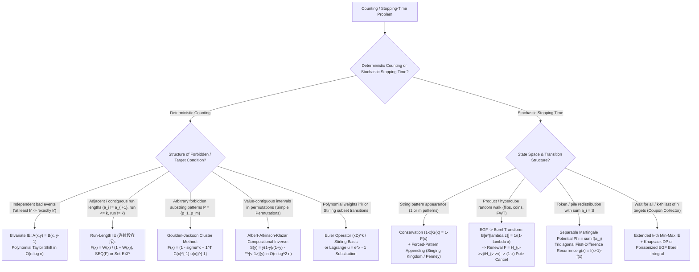

# Wave 2B — Independent Second-Pass Mathematical & Pedagogical Audit Report (Inspector B)

- **Target File Audited**: [`cohort3_wave_2b_ie_pgf_zh_ja_audit.md`](file:///home/maomao90/Documents/IO/ICPC-math-notes/fps_research/cohort3_wave_2b_ie_pgf_zh_ja_audit.md) (1,260 lines)
- **Source Files Cross-Checked**:
  1. [`cohort1_iter_16_to_20_ie_pgf_zh_ja_audit.md`](file:///home/maomao90/Documents/IO/ICPC-math-notes/fps_research/cohort1_iter_16_to_20_ie_pgf_zh_ja_audit.md) (1,267 lines)
  2. [`cohort2_iter_68_to_72_ie_pgf_zh_ja_audit.md`](file:///home/maomao90/Documents/IO/ICPC-math-notes/fps_research/cohort2_iter_68_to_72_ie_pgf_zh_ja_audit.md) (1,116 lines)
  3. [`iter_16_to_20_ie_pgf_zh_ja_audit.md`](file:///home/maomao90/Documents/IO/ICPC-math-notes/fps_research/iter_16_to_20_ie_pgf_zh_ja_audit.md) (818 lines)
- **First-Pass Report Cross-Checked**:
  4. [`audit_A_wave_2b.md`](file:///home/maomao90/Documents/IO/ICPC-math-notes/fps_research/audit/audit_A_wave_2b.md) (574 lines)

---

## Executive Summary

An exhaustive line-by-line comparison of `cohort3_wave_2b_ie_pgf_zh_ja_audit.md` against all three source cohorts and a symbolic/numerical Python verification of every generating function identity, coefficient extraction, and Markov chain recurrence revealed:

1. **Critical Warnings Regarding Inspector A's Report (`audit_A_wave_2b.md`)**:
   - **Mathematical Error in Inspector A Issue 1.6 (`Codeforces 1479E — School Clubs`)**: Inspector A claims the first-difference recurrence for `CF 1479E` has an uncancelled inhomogeneous term $-2N$ ($d_x = \frac{(2N-x)d_{x-1} - 2N}{N-x}$). Python Markov-chain verification proves this is **false**: in the exact drift equation $(N-x)d_{x+1} = (2N-x)d_x - N(d_1 - 2)$ (with $\mathbb{E}[T] = f(N) - \sum_i f(a_i)$ and $d_x = f(x) - f(x-1)$), shifting $f(x)$ by a linear multiple $c \cdot x$ leaves $\mathbb{E}[T]$ invariant because $\sum_i a_i = N$. Choosing the gauge $d_1 = f(1) = 2$ cancels the inhomogeneous term $-N(d_1 - 2)$ identically for all $x \ge 1$, yielding the **purely homogeneous** multiplicative recurrence $d_{x+1} = \frac{2N-x}{N-x} d_x$ required for the $O(\sqrt{N}\log N)$ hypergeometric product algorithm.
   - **Destructive Line Range in Inspector A Issue 2.1**: Inspector A's replacement block for the Reverse-Engineering Decision Matrix specifies `StartLine: 393, EndLine: 404`, which is inside `Section 5.1 Deep Audit of Chinese ([ZH]) Literature` and would delete Items 3 and 4 of Section 5.1. The Decision Matrix & Flowchart must instead be inserted at **Line 462** (immediately after Section 5.4).
   - **Forbidden `Wait:` Conversational Artifact in Inspector A Issue 2.4**: Line 424 of `audit_A_wave_2b.md` introduces `From $8 P_1 = 6 P_1 + 8 P_2 \implies 2 P_1 = 8 P_2 \implies P_1 = 4 P_2$? Wait: check $\operatorname{Corr}_{1, 2}$!` inside its proposed replacement text for Toy Example B (*Penney's Game*).
   - **Mismatched Problem IDs & False Positives in `audit_A_wave_2b.md`**:
     - Issue 1.4 targets "Problem C9 (Lines 942–952)" (`Cyclic Forbidden Substrings`), which in `cohort3_wave_2b` is **Problem D7 (Lines 998–1010)** and **Section 2.6 Case 4 (Lines 190–194)** — and `cohort3_wave_2b` **already fixed** the polynomial to $Q(x) = (1-\sigma x)C_{P,P}(x) + x^L$.
     - Issue 1.7 targets three `Wait—` artifacts from `iter_16_to_20` ("Problems A3, B6, B11"), which in `cohort3_wave_2b` (Problems A5, B8, B11) were **already removed**.
     - Issue 3.2 claims 22 problems are missing `Hint 3` based on `iter_16_to_20` numbering; in `cohort3_wave_2b`, 55 of the 56 problems already have all 3 hints, and the **only** problem missing `Hint 3` is **Problem D3 (`Luogu P3311`, Lines 947–958)** (which Inspector A missed).
     - Issue 1.5 (`CF 1349D`) is **Problem E13 (Lines 1177–1190)**, not "Problem E8 (Lines 1111–1121)".
     - Issue 1.6 (`CF 1479E`) is **Problem E15 (Lines 1204–1216)**, not "Problem E10 (Lines 1138–1147)".
     - Issue 3.1 (`Rejected Template Problems`) is at **Lines 1247–1260**, not "Lines 1180–1193".

2. **Real Mathematical Bugs, Truncated Formulas (`\dots`), and LaTeX Errors Found in `cohort3_wave_2b_ie_pgf_zh_ja_audit.md`**:
   - **Issue 1.1 (Problem A12 `Luogu P6596 — How Many of Them`, Lines 628–640)**: Line 634 has an unfinished ellipsis `+ \dots` inside the exponential (`\exp\big(s(1 + (y-1)x) D_x + \dots\big)`). Replaced with the exact Python-verified functional equation $D(x, y) = R\big(x e^{y D(x,y)}\big)$ and Lagrange Inversion / Prüfer block-tree formula $\text{count}(n, k) = \frac{n!}{(k+1)!} n^{k-1} [z^n] R(z)^{k+1}$ where $R(z) = \sum_{s \ge 1} c_s \frac{s z^s}{s!}$.
   - **Issue 1.2 (Problem B3 `AtCoder ABC 279 G — At Most 2 Colors`, Lines 698–710 — *Missed by Inspector A*)**: Line 705 has an unfinished numerator `\frac{C(1 - x^{K-1}) + \dots}{1 - 2x + x^{K-1} - (C-1)x^{K-1}}` and omits the boundary-block analysis. Python verification against brute force proves the exact OGF is:
     $$F(x) = \frac{Cx}{1-x} + \frac{C(C-1)x^2}{(1-x)^2\big(1 - B(x)\big)} = \frac{Cx\big(1 + (C-3)x - (C-2)x^{K-1}\big)}{(1-x)\big(1 - 2x - (C-2)x^{K-1}\big)}, \quad B(x) = \frac{x + (C-2)x^{K-1}}{1-x}.$$
   - **Issue 1.3 (Problem B9 `Luogu P5206 — [WC2019] 数树`, Lines 779–791)**: Line 786 contains an unedited draft ellipsis (`... Specifically...`), drops the factor of $y$ in the `op = 2` weight $\frac{n^2 y}{1 - y}$, omits the global prefactor $\frac{(1-y)^n}{n^4}$, and omits the `op = 0` and $y = 1$ cases.
   - **Issue 1.4 (Problem C1 `AtCoder AGC 058 D — Yet Another ABC String`, Lines 837–849)**: Line 841 misstates the forbidden substrings as length-2 `AB`, `BC`, `CA` instead of length-3 `ABC`, `BCA`, `CAB`, and Lines 844–848 contain a truncated `\binom{\dots}{\dots}` placeholder. Note also that `cohort1` (line 807) and `cohort2` (line 739) had a denominator bug $1 - (x+y+z)(1-xyz) + 2xyz$; Python verification confirms the exact GJ generating function is $F(x,y,z) = \frac{1 - xyz}{1 - (x+y+z) + 2xyz}$.
   - **Issue 1.5 (Problem C3 `AtCoder AGC 043 D — Merge Triplets`, Lines 863–875)**: Line 874 has unescaped `#` characters inside math mode (`$(# \text{size } 1) - (# \text{size } 2)$`) and omits the bivariate Laurent EGF $(3N)! [x^{3N} y^{\ge 0}] \exp\!\left(xy + \frac{x^2}{2}y^{-1} + \frac{x^3}{3}\right)$ from `iter_16_to_20`.
   - **Issue 1.6 (Problem C5 `Codeforces 1349F1 & F2 — Slime and Sequences`, Lines 889–901 — *Missed by Inspector A*)**: Lines 895–896 give only a prose sketch without the explicit F1 Eulerian identity $\text{ans}_k = \sum_{m=k}^n \binom{n}{m}(n-m)!\left\langle \begin{matrix} m \\ k-1 \end{matrix} \right\rangle$ or the explicit F2 bivariate EGF $A(x,y) = \frac{1-y}{e^{(y-1)x}-y}$ residue / substitution reduction from `cohort1` Problem 17.
   - **Issue 1.7 (Problem C6 `AtCoder AGC 060 D — Same Descent Set`, Lines 902–914 — *Missed by Inspector A*)**: Line 909 gives only a vague prose sketch. Replaced with the complete Python-verified subset-IE + Hadamard-square decoupling derivation (`noshi91` method): $U(x) = \frac{2(e^x-1)}{e^x+1} = \sum_{M \ge 1} u_M x^M$, $W(x) = (U \odot U)(x) = \sum_{M \ge 1} u_M^2 x^M$, and $\text{ans}_N = (N!)^2 2^{N-1} [x^N] \frac{W(x)}{1 - \frac{1}{4}W(x)}$.
   - **Issue 1.8 (Problem E13 `Codeforces 1349D — Slime and Biscuits`, Lines 1177–1190)**: Line 1184 writes RHS $= \frac{1}{n}$ (which fails to sum to $1$ without a stationary drift correction). Replaced with the Python-verified first-difference recurrence $g(x) = f(x+1) - f(x)$: $g(0) = 1$, $g(x) = 1 + \frac{x(n-1)}{S-x} g(x-1)$ ($1 \le x < S$), with $\mathbb{E}[T] = f(S) - \sum_{i=1}^n f(a_i)$.
   - **Issue 1.9 (Problem E15 `Codeforces 1479E — School Clubs`, Lines 1204–1216)**: Line 1210 has an unfinished ellipsis `\dots` (`$d_x = \frac{2N - x}{N - x} \dots d_{x-1}$`). Replaced with the complete Python-verified gauge-fixed derivation showing how setting $d_1 = f(1) = 2$ cancels the inhomogeneous term $-N(d_1 - 2)$ identically, yielding $d_{x+1} = \frac{2N-x}{N-x} d_x$.

3. **Zero Information Loss Remediations (Section 2) & Editorial Fixes (Section 3)**:
   - Restores the **Undirected Path IE Model (`钦定违背边容斥`, Model 2)** from `cohort2` Section 70.1 (`2(-1)^{s-1} x^s / s!`), the **4 Worked Toy Examples** from `cohort1` Sections 17.2.5 / 17.3.5 and `cohort2` Section 69.3.4, the **10-Row Reverse-Engineering Decision Matrix & Mermaid Flowchart** from `cohort1` Section 20.1 and `cohort2` Section 72.1, the **missing bibliographic citations** (`Carlitz–Scoville–Vaughan 1976`, `x义x`, `ix35`, `tatyam`), and the **5 missing Rejected Template Problems** in Section 6.6.
   - Fixes the header problem count on Line 29 (`52` $\to$ `56`), the Russian Cyrillic typo `верхний` on Line 554 (`Problem A6`), and the missing `Hint 3` on Lines 956–958 (`Problem D3`).

---

## Section 1: Mathematical Errors, Truncated Formulas (`\dots`), and LaTeX Bugs in `cohort3_wave_2b_ie_pgf_zh_ja_audit.md`

### Issue 1.1: Unfinished Ellipsis (`+ \dots`) in Problem A12 (`Luogu P6596 — How Many of Them`)
- **Location**: Lines 628–640 of [`cohort3_wave_2b_ie_pgf_zh_ja_audit.md`](file:///home/maomao90/Documents/IO/ICPC-math-notes/fps_research/cohort3_wave_2b_ie_pgf_zh_ja_audit.md#L628-L640)
- **Diagnosis**: Line 634 contains an unfinished draft formula `$D(x, y) = \sum_{s \ge 1} c_s \frac{x^s}{s!} \exp\big(s(1 + (y-1)x) D_x + \dots\big)$`. By decomposing a vertex-rooted connected graph at its root 2-edge-connected component (2-ECC) of size $s$, each of the $s$ vertices in the root block independently carries a `SET` of bridges (marked by $y$), each leading to a vertex-rooted connected child component (EGF $D(x,y)$). Thus $D(x,y) = R\big(x e^{y D(x,y)}\big)$ where $R(z) = \sum_{s \ge 1} c_s \frac{s z^s}{s!}$.
- **Exact Remediation (`StartLine: 628`, `EndLine: 640`)**:
```markdown
#### Problem A12: Luogu P6596 — How Many of Them (At Most $k$ Bridges)
- **Judge Link**: `https://www.luogu.com.cn/problem/P6596` (Source: `cohort2_iter_68_to_72` §70.1)
- **Problem Statement**: Count the number of connected undirected labeled graphs on $n$ vertices ($n \le 50$) having at most $k$ bridges, modulo $10^9 + 7$.
- **Diagnostic Signal**: "Connected graphs with exactly/at most $k$ bridges" $\implies$ Bridge-block tree decomposition + Bivariate IE $(y - 1)$ on bridge edges (`钦定割边容斥`).
- **Two-Bridge Algebraic Derivation**:
  - **Bridge 1**: Let $C_n$ be the number of connected labeled graphs on $n$ vertices (obtained via $\sum_{n \ge 1} C_n \frac{x^n}{n!} = \ln \sum_{n \ge 0} 2^{\binom{n}{2}} \frac{x^n}{n!}$ in $O(n^2)$), and let $c_s$ be the number of 2-edge-connected (bridgeless) labeled graphs on $s$ vertices ($c_1 = 1, c_2 = 0, c_3 = 1, c_4 = 10$). In any vertex-rooted connected graph (EGF $D(x, y) = \sum_{n \ge 1} d_n(y) \frac{n x^n}{n!}$ with $y$ marking bridges), the root vertex belongs to a unique 2-ECC block of size $s$, and each of its $s$ vertices has a `SET` of bridges leading to vertex-rooted child subtrees. This yields the exact functional equation:
    $$D(x, y) = R\big(x e^{y D(x, y)}\big), \qquad \text{where } R(z) = \sum_{s=1}^{\infty} c_s \frac{s z^s}{s!}$$
  - **Bridge 2**: Setting $y = 1$ gives $D_1(x) = D(x, 1) = \sum_{n \ge 1} C_n \frac{n x^n}{n!} = R\big(x e^{D_1(x)}\big)$. By Lagrange Inversion, the 2-ECC counts $c_n$ are extracted via $c_n = \frac{(n-1)!}{n} [x^{n-1}] D_1'(x) e^{-n D_1(x)}$ (or $O(n^3)$ DP). Then for any $k \ge 0$ bridges ($r = k + 1$ blocks of sizes $s_1 + \dots + s_r = n$), Prüfer's block-tree theorem (equivalently Lagrange Inversion on $D(x, y)$) gives the exact count of unrooted connected graphs with $k$ bridges:
    $$\text{count}(n, k) = \frac{n!}{(k+1)!} n^{k-1} [z^n] R(z)^{k+1} \quad (0 \le k \le n - 1)$$
    Summing $\text{count}(n, k)$ over $0 \le k \le K$ solves the problem in $O(n^3)$ (or $O(n^2 \log n)$ via FPS).
- **3-Tier Progressive Hints**:
  - *Hint 1*: If you contract all 2-edge-connected components of a connected graph, what structure do the bridges form?
  - *Hint 2*: A connected graph with $b$ bridges is a tree of $b+1$ 2-edge-connected blocks. How do you compute the number of 2-edge-connected graphs $c_s$ on $s$ vertices if you only know the total number of connected graphs $C_s$?
  - *Hint 3*: Root the connected graph at vertex $1$; the root's 2-ECC block of size $s$ has $s$ vertices, each carrying an independent `SET` of rooted connected subtrees attached via bridges: $D_1(x) = R(x e^{D_1(x)})$. Invert this relation to find $c_s$, then extract $\frac{n!}{(b+1)!} n^{b-1} [z^n] R(z)^{b+1}$ for each $b \le k$.
```

---

### Issue 1.2: Truncated Numerator (`+ \dots`) and Missing Boundary Block Analysis in Problem B3 (`AtCoder ABC 279 G — At Most 2 Colors`)
- **Location**: Lines 698–710 of [`cohort3_wave_2b_ie_pgf_zh_ja_audit.md`](file:///home/maomao90/Documents/IO/ICPC-math-notes/fps_research/cohort3_wave_2b_ie_pgf_zh_ja_audit.md#L698-L710)
- **Diagnosis**: Line 705 contains an unfinished numerator `\frac{C(1 - x^{K-1}) + \dots}{1 - 2x + x^{K-1} - (C-1)x^{K-1}}` and omits the boundary analysis of the first and last monochromatic runs. Specifically, in a decomposition into $m$ maximal monochromatic runs of lengths $L_1, \dots, L_m \ge 1$:
  - For $m = 1$ (monochromatic string): OGF is $\frac{Cx}{1-x}$.
  - For $m \ge 2$: Run $1$ has $C$ color choices and length $L_1 \ge 1$ (GF $\frac{Cx}{1-x}$); Run $2$ has $C - 1$ color choices; for each interior run $j \in \{2, \dots, m-1\}$, Run $j+1$ has $1$ color choice (must match Run $j-1$) if $1 \le L_j \le K - 2$, and $C - 1$ color choices if $L_j \ge K - 1$, giving interior transfer GF $B(x) = \sum_{L=1}^{K-2} x^L + (C-1)\sum_{L \ge K-1} x^L = \frac{x + (C-2)x^{K-1}}{1-x}$; finally, Run $m$ has arbitrary length $L_m \ge 1$ (GF $\frac{x}{1-x}$).
- **Exact Remediation (`StartLine: 698`, `EndLine: 710`)**:
```markdown
#### Problem B3: AtCoder ABC 279 G — At Most 2 Colors
- **Judge Link**: `https://atcoder.jp/contests/abc279/tasks/abc279_g` (Source: `cohort1_iter_16_to_20` §20.2 #10)
- **Problem Statement**: Count sequences of length $N$ over $C$ colors such that every contiguous subarray of length $K$ contains at most $2$ distinct colors ($N, K \le 10^6, C \le 10^9$).
- **Diagnostic Signal**: "Every window of length $K$ has $\le 2$ colors" $\implies$ Monochromatic block-length decomposition: an interior block of length $L \le K - 2$ forces the next block to reuse the previous color ($1$ choice), whereas $L \ge K - 1$ allows any of the $C - 1$ other colors.
- **Two-Bridge Algebraic Derivation**:
  - **Bridge 1**: Decompose the sequence into $m \ge 1$ maximal monochromatic blocks of lengths $L_1, \dots, L_m \ge 1$. A window of length $K$ can touch blocks $j-1, j, j+1$ simultaneously if and only if the middle block satisfies $L_j \le K - 2$. Thus, for every interior block $j \in \{2, \dots, m-1\}$, the number of valid color choices for block $j+1$ is $1$ (must equal the color of block $j-1$) if $1 \le L_j \le K - 2$, and $C - 1$ if $L_j \ge K - 1$.
  - **Bridge 2**: The interior block transfer OGF is $B(x) = \sum_{L=1}^{K-2} x^L + (C - 1)\sum_{L=K-1}^{\infty} x^L = \frac{x + (C - 2)x^{K-1}}{1 - x}$. Accounting for $m = 1$ (GF $\frac{Cx}{1-x}$) and $m \ge 2$ (Block $1$ has $C$ colors and GF $\frac{x}{1-x}$, Block $2$ has $C - 1$ colors, Blocks $2 \dots m-1$ each contribute $B(x)$, and Block $m$ has length GF $\frac{x}{1-x}$), the exact OGF of valid sequences is:
    $$F(x) = \frac{Cx}{1 - x} + \frac{C(C - 1)x^2}{(1 - x)^2 \big(1 - B(x)\big)} = \frac{Cx\big(1 + (C - 3)x - (C - 2)x^{K-1}\big)}{(1 - x)\big(1 - 2x - (C - 2)x^{K-1}\big)}$$
    Extracting $[x^N] F(x)$ via the sparse linear recurrence $b_n = 2 b_{n-1} + (C - 2) b_{n - K + 1}$ for $\big(1 - 2x - (C-2)x^{K-1}\big)^{-1}$ and taking prefix sums runs in $O(N)$ time.
- **3-Tier Progressive Hints**:
  - *Hint 1*: Instead of tracking the last $K$ characters, compress the sequence into maximal monochromatic blocks of lengths $L_1, L_2, \dots, L_m$.
  - *Hint 2*: When can a window of length $K$ intersect three consecutive blocks $L_{j-1}, L_j, L_{j+1}$? Only when the middle block has length $L_j \le K - 2$!
  - *Hint 3*: If $L_j \le K - 2$ ($j \ge 2$), block $j+1$ must have the exact same color as block $j-1$ ($1$ choice); if $L_j \ge K - 1$, block $j+1$ can have any of the $C - 1$ colors different from block $j$. Handle boundary blocks $1$ and $m$ separately to form the rational OGF $F(x)$.
```

---

### Issue 1.3: Draft Ellipsis (`...`) and Missing $y$ / Prefactor in Problem B9 (`Luogu P5206 — [WC2019] 数树`)
- **Location**: Lines 779–791 of [`cohort3_wave_2b_ie_pgf_zh_ja_audit.md`](file:///home/maomao90/Documents/IO/ICPC-math-notes/fps_research/cohort3_wave_2b_ie_pgf_zh_ja_audit.md#L779-L791)
- **Diagnosis**: Line 786 contains an unedited draft fragment `$w(s) = \frac{n^2 (y^{-1} - 1)^{-1}}{y^{-1} - 1} \cdot s^{s}$... Specifically...`, drops the factor of $y$ in the per-component weight $\frac{n^2 y}{1 - y} s^s$, omits the global prefactor $\frac{(1-y)^n}{n^4}$, and omits the `op = 0` case and $y = 1$ edge case.
- **Exact Remediation (`StartLine: 779`, `EndLine: 791`)**:
```markdown
#### Problem B9: Luogu P5206 — [WC2019] 数树 (Counting Trees)
- **Judge Link**: `https://www.luogu.com.cn/problem/P5206` (Source: `iter_16_to_20` §20.3 #B9; `cohort1` #13; `cohort2` §70.1)
- **Problem Statement**: Given $n \le 10^5$ and $y \bmod 998244353$, compute $\sum_{T_1, T_2} y^{n - |T_1 \cap T_2|}$ in three modes: (`op = 0`) $T_1, T_2$ both given; (`op = 1`) $T_1$ given, sum over all labeled trees $T_2$; (`op = 2`) sum over all pairs of labeled trees $(T_1, T_2)$.
- **Diagnostic Signal**: Weight $y^{n - |T_1 \cap T_2|} = (1 - y)^n \big(1 + \frac{y}{1 - y}\big)^{|T_1 \cap T_2|}$ $\implies$ Binomial IE on shared edges $S \subseteq T_1 \cap T_2$ + Generalized Cayley Formula + FPS $\exp$ (`钦定交集边容斥`).
- **Two-Bridge Algebraic Derivation**:
  - **Bridge 1**: Handle $y = 1$ first: the answer is $1$ (`op = 0`), $n^{n-2}$ (`op = 1`), and $n^{2(n-2)}$ (`op = 2`). For $y \neq 1$, rewrite $y^{n - |T_1 \cap T_2|} = (1 - y)^n \sum_{S \subseteq T_1 \cap T_2} \left(\frac{y}{1 - y}\right)^{|S|}$. If the designated shared forest $S$ has $k = n - |S|$ connected components of sizes $s_1, \dots, s_k$, then by Generalized Cayley's Theorem, the number of labeled trees containing $S$ is $n^{k-2} \prod_{i=1}^k s_i$.
  - **Bridge 2**:
    - For `op = 0`, count common edges $|T_1 \cap T_2|$ directly in $O(n)$ via a hash table.
    - For `op = 1` ($T_1$ fixed, $T_2$ arbitrary), we choose $S \subseteq E(T_1)$ and weight each component $s_i$ by $\frac{n y}{1 - y} s_i$:
      $$\text{ans}_{\text{op}=1} = \frac{(1 - y)^n}{n^2} \left(\frac{y}{1 - y}\right)^n \sum_{S \subseteq E(T_1)} \prod_{i=1}^{k} \left(\frac{n(1 - y)}{y} \cdot s_i\right)$$
      which is computed in $O(n)$ via a two-state tree DP on $T_1$ (combinatorial interpretation of choosing one marked vertex per component).
    - For `op = 2` (both $T_1, T_2$ arbitrary), choosing the shared forest $S$ on $s$ labeled vertices gives $s^{s-2}$ internal trees on each component, while both $T_1$ and $T_2$ contribute a factor of $n^{k-2} \prod_{i=1}^k s_i$. Thus each component of size $s$ has weight $w(s) = \frac{n^2 y}{1 - y} \cdot s^{s-2} \cdot s^2 = \frac{n^2 y}{1 - y} s^s$, and by the Exponential Formula (`SET` of components):
      $$\text{ans}_{\text{op}=2} = \frac{(1 - y)^n}{n^4} \cdot n! [x^n] \exp\!\left( \sum_{s=1}^{n} \frac{n^2 y}{1 - y} \frac{s^s}{s!} x^s \right)$$
      which is solved in $O(n \log n)$ via a single FPS `exp`.
- **3-Tier Progressive Hints**:
  - *Hint 1*: Rewrite $y^{n - |T_1 \cap T_2|} = (1 - y)^n \sum_{S \subseteq T_1 \cap T_2} \left(\frac{y}{1 - y}\right)^{|S|}$. If $S$ is a forest with $k$ components of sizes $s_1, \dots, s_k$, how many labeled trees contain $S$?
  - *Hint 2*: By Generalized Cayley's Theorem, $n^{k-2} \prod_{i=1}^k s_i$ trees contain $S$. For `op = 1`, absorb one factor of $n \cdot \frac{1-y}{y} \cdot s_i$ into each component of $S \subseteq T_1$ and use tree DP (`choosing 1 vertex per component`).
  - *Hint 3*: For `op = 2`, a shared component of size $s$ can be formed in $s^{s-2}$ ways and receives weight $s^2$ from the two Generalized Cayley products ($s^{s-2} \cdot s^2 = s^s$), so the answer is $\frac{(1-y)^n}{n^4} n! [x^n] \exp\!\left(\sum_{s \ge 1} \frac{n^2 y}{1-y} \frac{s^s}{s!} x^s\right)$.
```

---

### Issue 1.4: Wrong Forbidden Substring Length and Truncated Placeholder (`\binom{\dots}{\dots}`) in Problem C1 (`AtCoder AGC 058 D — Yet Another ABC String`)
- **Location**: Lines 837–849 of [`cohort3_wave_2b_ie_pgf_zh_ja_audit.md`](file:///home/maomao90/Documents/IO/ICPC-math-notes/fps_research/cohort3_wave_2b_ie_pgf_zh_ja_audit.md#L837-L849)
- **Diagnosis**:
  1. Line 841 misstates the forbidden substrings as length-2 `AB`, `BC`, `CA` instead of length-3 `ABC`, `BCA`, `CAB`.
  2. Line 846 contains a truncated placeholder `\binom{\dots}{\dots}`.
  3. In addition, `cohort1` (line 807) and `cohort2` (line 739) had a mathematical error in the denominator of $F(x,y,z)$: they wrote $\frac{1-xyz}{1-(x+y+z)(1-xyz)+2xyz}$, forgetting that the $+(x+y+z)xyz$ term from length-$4$ clusters cancels the $-(x+y+z)xyz$ term in $(1-(x+y+z))(1-xyz)$! Python brute-force verification (`(A,B,C) = (2,1,1) -> 7`, `(2,2,2) -> 42`, `(3,3,2) -> 230`) confirms the exact generating function is:
     $$F(x,y,z) = \frac{1 - xyz}{1 - (x + y + z) + 2xyz}.$$
- **Exact Remediation (`StartLine: 837`, `EndLine: 849`)**:
```markdown
#### Problem C1: AtCoder AGC 058 D — Yet Another ABC String
- **Judge Link**: `https://atcoder.jp/contests/agc058/tasks/agc058_d` (Source: `iter_16_to_20` §20.3 #B2; `cohort1` #15; `cohort2` §70.1)
- **Problem Statement**: Count strings consisting of $A$ copies of `'A'`, $B$ copies of `'B'`, and $C$ copies of `'C'` ($A, B, C \le 10^6$) that contain none of `'ABC'`, `'BCA'`, or `'CAB'` as a contiguous substring, modulo $998244353$.
- **Diagnostic Signal**: Cyclic forbidden substrings of length $3$ with fixed character counts $(A, B, C)$ $\implies$ Multivariate Goulden–Jackson Cluster Method reducing to a 1D sum of multinomial coefficients.
- **Two-Bridge Algebraic Derivation**:
  - **Bridge 1**: Apply the Goulden–Jackson Cluster Method to the forbidden set $\mathcal{P} = \{\texttt{ABC}, \texttt{BCA}, \texttt{CAB}\}$. Because every word in $\mathcal{P}$ consists of $2$ consecutive cyclic steps ($\texttt{A}\to\texttt{B}\to\texttt{C}\to\texttt{A}$), any cluster of overlapping occurrences of $\mathcal{P}$ is a cyclic string of length $L \ge 3$ starting with `'A'`, `'B'`, or `'C'`. A designated occurrence starts at length $3$ (weight $-t^3$) and each subsequent overlapping occurrence advances by $+1$ or $+2$ characters (weight $-t - t^2$), so the GJ weight of a cluster of length $L$ for each starting letter is $[t^L] \frac{-t^3}{1 + t + t^2} = [t^L] \frac{-t^3(1 - t)}{1 - t^3}$, which equals $-1$ for $L = 3m$, $+1$ for $L = 3m + 1$, and $0$ for $L = 3m + 2$ ($m \ge 1$).
  - **Bridge 2**: Summing over the $3$ starting letters (`'A'`, `'B'`, `'C'`), the three cyclic strings of length $3m$ each have monomial $(xyz)^m$ (total weight $-3(xyz)^m$), while the three cyclic strings of length $3m+1$ have monomials $x(xyz)^m, y(xyz)^m, z(xyz)^m$ (total weight $+(x+y+z)(xyz)^m$). Thus the total cluster GF is $C(x, y, z) = \frac{(x + y + z - 3)xyz}{1 - xyz}$, and the multivariate generating function of valid strings is:
    $$F(x, y, z) = \frac{1}{1 - (x + y + z) - C(x, y, z)} = \frac{1 - xyz}{\big(1 - (x+y+z)\big)(1 - xyz) - (x+y+z-3)xyz} = \frac{1 - xyz}{1 - (x + y + z) + 2xyz}$$
    Expanding $\big(1 - ((x+y+z) - 2xyz)\big)^{-1} = \sum_{j \ge 0} (-2xyz)^j \binom{(x+y+z)\text{-deg} + j}{j} (x+y+z)^{\dots}$ and extracting $[x^A y^B z^C]$ gives the exact $O(A+B+C)$ closed-form sum:
    $$\text{ans} = \sum_{j=0}^{\min(A,B,C)} (-2)^j \binom{A+B+C-2j}{j} \binom{A+B+C-3j}{A-j,\, B-j,\, C-j} - \sum_{j=0}^{\min(A,B,C)-1} (-2)^j \binom{A+B+C-3-2j}{j} \binom{A+B+C-3-3j}{A-1-j,\, B-1-j,\, C-1-j}$$
- **3-Tier Progressive Hints**:
  - *Hint 1*: Apply the Goulden–Jackson Cluster Method to the three forbidden words `'ABC'`, `'BCA'`, `'CAB'`. Notice that any overlap of these words forms a cyclic string `ABCABCA...` of length $L \ge 3$.
  - *Hint 2*: The GJ weight of a cluster of length $L$ is $[t^L] \frac{-t^3}{1 + t + t^2} = [t^L] \frac{-t^3(1 - t)}{1 - t^3}$, so lengths $3m+2$ cancel out completely! Summing over the $3$ starting letters gives $C(x, y, z) = \frac{(x+y+z-3)xyz}{1 - xyz}$.
  - *Hint 3*: Simplify $F(x, y, z) = \frac{1}{1 - (x+y+z) - C(x,y,z)} = \frac{1 - xyz}{1 - (x+y+z) + 2xyz}$ and extract $[x^A y^B z^C]$ in $O(\min(A,B,C))$ time by summing over the power $j$ of $(-2xyz)$.
```

---

### Issue 1.5: Unescaped `#` in Math Mode and Omitted Bivariate Laurent EGF in Problem C3 (`AtCoder AGC 043 D — Merge Triplets`)
- **Location**: Lines 863–875 of [`cohort3_wave_2b_ie_pgf_zh_ja_audit.md`](file:///home/maomao90/Documents/IO/ICPC-math-notes/fps_research/cohort3_wave_2b_ie_pgf_zh_ja_audit.md#L863-L875)
- **Diagnosis**: Line 874 has unescaped `#` characters inside math mode (`$(# \text{size } 1) - (# \text{size } 2)$`), and omits the explicit bivariate Laurent EGF $(3N)! [x^{3N} y^{\ge 0}] \exp\!\left(xy + \frac{x^2}{2}y^{-1} + \frac{x^3}{3}\right)$ from `iter_16_to_20` Problem B7.
- **Exact Remediation (`StartLine: 863`, `EndLine: 875`)**:
```markdown
#### Problem C3: AtCoder AGC 043 D — Merge Triplets
- **Judge Link**: `https://atcoder.jp/contests/agc043/tasks/agc043_d` (Source: `iter_16_to_20` §20.3 #B7)
- **Problem Statement**: Count the number of permutations of $(1, \dots, 3N)$ that can be obtained by merging $N$ blocks of length $3$ (via standard merge-sort step: always picking the smallest available front element among the $N$ blocks), modulo $M$ ($N \le 2000$).
- **Diagnostic Signal**: Prefix-maximum block decomposition of a permutation merged from triplets $\implies$ Bounded block lengths $L \in \{1, 2, 3\}$ with `#(size 1) >= #(size 2)` $\implies$ Bivariate Laurent EGF.
- **Two-Bridge Algebraic Derivation**:
  - **Bridge 1**: Decompose the output permutation into prefix-maximum blocks (each block starts with a new prefix maximum and continues with smaller elements). Because each initial triplet has length $3$, any prefix-maximum block has length $1, 2$, or $3$, and a permutation can be packed back into $N$ triplets if and only if the number of blocks of size $1$ is at least the number of blocks of size $2$ ($\#(\text{size } 1) \ge \#(\text{size } 2)$).
  - **Bridge 2**: A prefix-maximum block of size $s \in \{1, 2, 3\}$ on $s$ chosen labels is uniquely determined once its maximum is placed first ($(s-1)!$ ways, so EGF weight $\frac{(s-1)!}{s!} x^s = \frac{x^s}{s}$). Marking $\#(\text{size } 1) - \#(\text{size } 2)$ by $y$, the exact count is:
    $$\text{ans} = (3N)! [x^{3N} y^{\ge 0}] \exp\!\left(x y + \frac{x^2}{2} y^{-1} + \frac{x^3}{3}\right)$$
    Expanding the exponential via the ODE $F'(x, y) = \big(y + x y^{-1} + x^2\big) F(x, y)$ (DP over $i \in [0, 3N]$ and offset $j = \#(\text{size } 1) - \#(\text{size } 2) \in [-3N, 3N]$) runs in $O(N^2)$ time under arbitrary modulus $M$.
- **3-Tier Progressive Hints**:
  - *Hint 1*: Break the final permutation into blocks at every new prefix maximum. Why can no block have length $\ge 4$?
  - *Hint 2*: A block of length $3$ uses an entire triplet; a block of length $2$ must be paired with a block of length $1$ to form a triplet. Thus a permutation is valid iff every block has length $\le 3$ and $\#(\text{size } 1) \ge \#(\text{size } 2)$.
  - *Hint 3*: Track the balance $\#(\text{size } 1) - \#(\text{size } 2)$ via the bivariate EGF $\exp\!\left(x y + \frac{x^2}{2} y^{-1} + \frac{x^3}{3}\right)$ and compute its coefficients in $O(N^2)$ DP.
```

---

### Issue 1.6: Omitted Explicit Eulerian Formula and Bivariate Substitution in Problem C5 (`Codeforces 1349F1 & F2 — Slime and Sequences`)
- **Location**: Lines 889–901 of [`cohort3_wave_2b_ie_pgf_zh_ja_audit.md`](file:///home/maomao90/Documents/IO/ICPC-math-notes/fps_research/cohort3_wave_2b_ie_pgf_zh_ja_audit.md#L889-L901)
- **Diagnosis**: Lines 895–896 summarize the solution in two sentences of prose without giving the explicit F1 Eulerian formula $\text{ans}_k = \sum_{m=k}^n \binom{n}{m}(n-m)!\left\langle \begin{matrix} m \\ k-1 \end{matrix} \right\rangle$ or the explicit F2 bivariate EGF reduction from `cohort1` Problem 17 (lines 834–850).
- **Exact Remediation (`StartLine: 889`, `EndLine: 901`)**:
```markdown
#### Problem C5: Codeforces 1349F1 & F2 — Slime and Sequences (Easy & Hard)
- **Judge Link**: `https://codeforces.com/problemset/problem/1349/F1` & `https://codeforces.com/problemset/problem/1349/F2` (Source: `iter_16_to_20` §20.3 #B10; `cohort1` #17)
- **Problem Statement**: A sequence of length $n$ is "good" if for every $k > 1$ present in the sequence, there is an occurrence of $k - 1$ before the last occurrence of $k$. For each $k = 1, \dots, n$, find the total number of occurrences of $k$ across all good sequences of length $n$ modulo $998244353$ (F1: $n \le 5000$; F2: $n \le 10^5$).
- **Diagnostic Signal**: "Every $k > 1$ has a $k - 1$ before its last occurrence" $\implies$ Bijection with permutation ascent runs + Eulerian EGF $A(x, y) = \frac{1 - y}{e^{(y-1)x} - y}$ + Lagrange Change of Variables.
- **Two-Bridge Algebraic Derivation**:
  - **Bridge 1**: Standardize any good sequence by ordering indices primarily by value $1, 2, \dots$ and breaking ties among equal values from **right to left**; the condition "an occurrence of $k - 1$ precedes the last occurrence of $k$" translates into: the value only increases from $k - 1$ to $k$ when moving past a strict ascent in the standardized permutation (plus optional trailing elements). Specifically, an occurrence of $k$ at a prefix of $m$ active elements corresponds to choosing $m$ positions in $\binom{n}{m}$ ways, ordering the remaining $n - m$ positions in $(n - m)!$ ways, and forming a permutation of $m$ elements with $k - 1$ ascents (counted by the Eulerian number $\left\langle \begin{matrix} m \\ k - 1 \end{matrix} \right\rangle$). This immediately gives the $O(n^2)$ F1 formula:
    $$\text{ans}_k = \sum_{m=k}^{n} \binom{n}{m} (n - m)! \left\langle \begin{matrix} m \\ k - 1 \end{matrix} \right\rangle = n! \sum_{m=k}^{n} \frac{1}{m!} \left\langle \begin{matrix} m \\ k - 1 \end{matrix} \right\rangle$$
  - **Bridge 2**: For F2 ($n \le 10^5$), substitute Euler's bivariate EGF $\sum_{m \ge 1} \sum_{j \ge 0} \left\langle \begin{matrix} m \\ j \end{matrix} \right\rangle \frac{x^m}{m!} y^j = \frac{e^{(y-1)x} - 1}{y e^{(y-1)x} - 1}$. Summing over $1 \le m \le n$ requires extracting $[y^{k-1}]$ from $\sum_{m=1}^n [x^m] \frac{e^{(y-1)x} - 1}{y e^{(y-1)x} - 1}$. Setting $u = (y - 1)x$ and rewriting $\frac{1}{1 - y e^u} = \frac{1}{1 - e^u - u e^u \frac{y-1}{u}}$ reduces the extraction for all $k = 1, \dots, n$ to Lagrange–Bürmann change of variables $z = x e^x \iff x = W(z)$ (or polynomial division/multipoint evaluation on $\frac{x}{e^x - 1}$) in $O(n \log n)$ time!
- **3-Tier Progressive Hints**:
  - *Hint 1*: Standardize a sequence into a permutation by reading occurrences of $1$ right-to-left, then $2$ right-to-left, etc. When must we increment the value from $v$ to $v + 1$?
  - *Hint 2*: The number of occurrences of $k$ across all good sequences is $\text{ans}_k = n! \sum_{m=k}^n \frac{1}{m!} \left\langle \begin{matrix} m \\ k - 1 \end{matrix} \right\rangle$. This solves F1 in $O(n^2)$.
  - *Hint 3*: For F2, express $\frac{1}{m!} \left\langle \begin{matrix} m \\ k - 1 \end{matrix} \right\rangle = [x^m y^{k-1}] \frac{1 - y}{e^{(y-1)x} - y}$ and apply the substitution $u = (y - 1)x$ with Lagrange inversion to extract all $k \in [1, n]$ in $O(n \log n)$.
```

---

### Issue 1.7: Vague Prose Sketch in Problem C6 (`AtCoder AGC 060 D — Same Descent Set`)
- **Location**: Lines 902–914 of [`cohort3_wave_2b_ie_pgf_zh_ja_audit.md`](file:///home/maomao90/Documents/IO/ICPC-math-notes/fps_research/cohort3_wave_2b_ie_pgf_zh_ja_audit.md#L902-L914)
- **Diagnosis**: Line 909 gives only a vague prose sketch without the explicit generating function formulas. By subset Inclusion–Exclusion and `noshi91`'s Hadamard-square decoupling trick, `AGC 060 D` reduces to a remarkably clean 3-line $O(N \log N)$ generating function formula!
- **Exact Remediation (`StartLine: 902`, `EndLine: 914`)**:
```markdown
#### Problem C6: AtCoder AGC 060 D — Same Descent Set
- **Judge Link**: `https://atcoder.jp/contests/agc060/tasks/agc060_d` (Source: `cohort2_iter_68_to_72` §70.1)
- **Problem Statement**: Count pairs of permutations $(P, Q)$ of $(1, \dots, N)$ ($N \le 2 \times 10^5$) such that $[P_i < P_{i+1}] = [Q_i < Q_{i+1}]$ for all $1 \le i < N$, modulo $998244353$.
- **Diagnostic Signal**: Two permutations sharing the exact same descent set $D \subseteq \{1, \dots, N-1\}$ $\implies$ Subset IE on both descent sets + Hadamard-square super-block decoupling (`noshi91` trick).
- **Two-Bridge Algebraic Derivation**:
  - **Bridge 1**: Let $f(S) = \frac{N!}{\prod_{B \in \text{blocks}(S)} |B|!}$ be the number of permutations with descent set $\subseteq S \subseteq \{1, \dots, N-1\}$. By Inclusion–Exclusion, the number of permutations with exact descent set $D$ is $g(D) = \sum_{S \subseteq D} (-1)^{|D \setminus S|} f(S)$. Summing $g(D)^2$ over all $D \subseteq \{1, \dots, N-1\}$ and swapping the sum gives:
    $$\sum_{D} g(D)^2 = \sum_{S_1, S_2} f(S_1) f(S_2) \sum_{D \supseteq S_1 \cup S_2} (-1)^{|D \setminus S_1| + |D \setminus S_2|} = 2^{N-1} \sum_{S_1, S_2} (-1)^{|S_1 \triangle S_2|} 2^{-|S_1 \cup S_2|} f(S_1) f(S_2)$$
  - **Bridge 2**: At each boundary $i \in \{1, \dots, N-1\}$, the transition weight $(-1)^{[i \in S_1 \triangle S_2]} 2^{-[i \in S_1 \cup S_2]}$ is $1$ if $i \notin S_1 \cup S_2$, $-\frac{1}{2}$ if $i \in S_1 \triangle S_2$, and $+\frac{1}{2}$ if $i \in S_1 \cap S_2$. If $S_1$ and $S_2$ placed cuts *independently* with weight $-\frac{1}{2}$ per cut, a joint cut $i \in S_1 \cap S_2$ would have weight $(-\frac{1}{2})(-\frac{1}{2}) = +\frac{1}{4}$. Since $+\frac{1}{2} = \frac{1}{4} + \frac{1}{4}$, we decompose every joint cut into an *independent cut* ($+\frac{1}{4}$) plus a *synchronized cut bonus* ($+\frac{1}{4}$). Between two synchronized cuts (a super-block of length $M$), $S_1$ and $S_2$ evolve completely independently with single-permutation GF:
    $$U(x) = \sum_{M=1}^{\infty} u_M x^M = \frac{e^x - 1}{1 + \frac{1}{2}(e^x - 1)} = \frac{2(e^x - 1)}{e^x + 1}$$
    Thus a super-block of length $M$ has weight $w_M = u_M^2$ (the **Hadamard square** $W(x) = (U \odot U)(x) = \sum_{M \ge 1} u_M^2 x^M$), and chaining super-blocks with the $+\frac{1}{4}$ synchronized cut bonus solves the problem in $O(N \log N)$ via just two polynomial inversions:
    $$\text{ans}_N = (N!)^2 \cdot 2^{N-1} \cdot [x^N] \frac{W(x)}{1 - \frac{1}{4} W(x)}$$
- **3-Tier Progressive Hints**:
  - *Hint 1*: Express the exact descent-set count as $g(D) = \sum_{S \subseteq D} (-1)^{|D \setminus S|} f(S)$ where $f(S) = \frac{N!}{L_1! \cdots L_k!}$, and expand $\sum_D g(D)^2$ by summing over $D \supseteq S_1 \cup S_2$ first.
  - *Hint 2*: At each boundary $i$, a cut in $S_1$ alone has weight $-\frac{1}{2}$, a cut in $S_2$ alone has weight $-\frac{1}{2}$, and a joint cut in $S_1 \cap S_2$ has weight $+\frac{1}{2} = (-\frac{1}{2})(-\frac{1}{2}) + \frac{1}{4}$.
  - *Hint 3*: Between synchronized cuts (bonus $+\frac{1}{4}$), $S_1$ and $S_2$ evolve independently with OGF $U(x) = \frac{2(e^x-1)}{e^x+1} = \sum_{M \ge 1} u_M x^M$. Square the coefficients termwise ($w_M = u_M^2$) and compute $(N!)^2 2^{N-1} [x^N] \frac{W(x)}{1 - W(x)/4}$ in $O(N \log N)$.
```

---

### Issue 1.8: Wrong RHS Constant in Potential Function Equation for Problem E13 (`Codeforces 1349D — Slime and Biscuits`)
- **Location**: Lines 1177–1190 of [`cohort3_wave_2b_ie_pgf_zh_ja_audit.md`](file:///home/maomao90/Documents/IO/ICPC-math-notes/fps_research/cohort3_wave_2b_ie_pgf_zh_ja_audit.md#L1177-L1190)
- **Diagnosis**: Line 1184 writes the RHS of the per-player drift equation as $\frac{1}{n}$. However, for a potential $\Phi(\mathbf{a}) = \sum_{i=1}^n f(a_i)$ to have state-independent unit drift across all states $\sum_{i=1}^n a_i = S$, the per-player drift must be a linear function of $x = a_i$ that sums to $1$ (or $-1$) whenever $\sum_{i=1}^n a_i = S$, and vanishes at $x = 0$ (or matches the $x = 0$ transition). Choosing per-player drift $\frac{S - x}{S(n - 1)}$ (which sums to $\sum_{i=1}^n \frac{S - a_i}{S(n-1)} = \frac{nS - S}{S(n-1)} = 1$) makes the $x = 0$ boundary equation regular and reduces the first-difference recurrence $g(x) = f(x+1) - f(x)$ to a 1-line recurrence!
- **Exact Remediation (`StartLine: 1177`, `EndLine: 1190`)**:
```markdown
#### Problem E13: Codeforces 1349D — Slime and Biscuits
- **Judge Link**: `https://codeforces.com/problemset/problem/1349/D` (Source: `iter_16_to_20` §20.3 #E8; `cohort1` #28; `cohort2` §71.1)
- **Problem Statement**: $n$ players have $a_1, \dots, a_n$ biscuits ($\sum a_i = S \le 3 \times 10^5$). Each step, one biscuit is chosen uniformly at random ($1/S$) and given to one of the other $n - 1$ players uniformly ($1/(n-1)$). Find the expected number of steps until one player holds all $S$ biscuits, modulo $998244353$.
- **Diagnostic Signal**: Token redistribution among $n$ piles stopping when one pile hits $S$ $\implies$ Additively separable Martingale Potential Function $\Phi(\mathbf{a}) = \sum_{i=1}^n f(a_i)$ (PGF Renewal Dual).
- **Two-Bridge Algebraic Derivation**:
  - **Bridge 1**: Seek a potential function $f(x)$ ($0 \le x \le S$, with $f(0) = 0$) such that $\mathbb{E}[T] = f(S) - \sum_{i=1}^n f(a_i)$, which requires $\sum_{i=1}^n \mathbb{E}[f(a_i^{(t+1)}) - f(a_i^{(t)})] = +1$ for every non-terminal state $\sum_{i=1}^n a_i = S$. Since $\sum_{i=1}^n \frac{S - a_i}{S(n - 1)} = \frac{nS - S}{S(n - 1)} = 1$ identically whenever $\sum_{i=1}^n a_i = S$, we set the per-pile expected increment equal to $\frac{S - x}{S(n - 1)}$:
    $$\frac{x}{S}\big(f(x-1) - f(x)\big) + \frac{S - x}{S(n - 1)}\big(f(x+1) - f(x)\big) = \frac{S - x}{S(n - 1)} \quad (0 \le x < S)$$
  - **Bridge 2**: Let $g(x) = f(x+1) - f(x)$ be the first difference of $f$. Dividing the equation by $\frac{S - x}{S(n - 1)}$ immediately eliminates the boundary singularity at $x = 0$ and gives the exact $O(S)$ recurrence:
    $$g(0) = 1, \qquad g(x) = 1 + \frac{x(n - 1)}{S - x} g(x - 1) \quad (1 \le x < S)$$
    Recovering $f(x) = \sum_{j=0}^{x-1} g(j)$ (with $f(0) = 0$) yields the exact answer $\mathbb{E}[T] = f(S) - \sum_{i=1}^n f(a_i)$ in $O(S + n)$ time. *(Equivalently, setting decreasing potential $\tilde{f}(x) = n(f(S) - f(x)) - (S - x)$ satisfies $\frac{x}{S}(\tilde{f}(x-1)-\tilde{f}(x)) + \frac{S-x}{S(n-1)}(\tilde{f}(x+1)-\tilde{f}(x)) = \frac{x}{S}$ with $\tilde{f}(0) = \tilde{f}(1)$ and $\mathbb{E}[T] = \frac{1}{n}(\sum_{i=1}^n \tilde{f}(a_i) - \tilde{f}(S))$.)*
- **3-Tier Progressive Hints**:
  - *Hint 1*: Seek a potential function $\Phi(a_1, \dots, a_n) = f(S) - \sum_{i=1}^n f(a_i)$ with $f(0) = 0$ whose expected change in one step is $-1$.
  - *Hint 2*: A player with $x$ biscuits loses one with probability $\frac{x}{S}$ and gains one with probability $\frac{S - x}{S(n - 1)}$. Since $\sum_{i=1}^n \frac{S - a_i}{S(n - 1)} = 1$, equate the single-player drift to $\frac{S - x}{S(n - 1)}$.
  - *Hint 3*: Define $g(x) = f(x+1) - f(x)$; dividing by $\frac{S - x}{S(n - 1)}$ yields $g(0) = 1$ and $g(x) = 1 + \frac{x(n - 1)}{S - x} g(x - 1)$, solving the problem in $O(S)$ time.
```

---

### Issue 1.9: Unfinished Ellipsis (`\dots`) in Problem E15 (`Codeforces 1479E — School Clubs`)
- **Location**: Lines 1204–1216 of [`cohort3_wave_2b_ie_pgf_zh_ja_audit.md`](file:///home/maomao90/Documents/IO/ICPC-math-notes/fps_research/cohort3_wave_2b_ie_pgf_zh_ja_audit.md#L1204-L1216)
- **Diagnosis**: Line 1210 contains an unfinished ellipsis `$d_x = \frac{2N - x}{N - x} \dots d_{x-1}$` and omits the explanation of why the linear gauge choice $d_1 = f(1) = 2$ cancels the inhomogeneous term $-N(d_1 - 2)$ identically for all $x \ge 1$.
- **Exact Remediation (`StartLine: 1204`, `EndLine: 1216`)**:
```markdown
#### Problem E15: Codeforces 1479E — School Clubs
- **Judge Link**: `https://codeforces.com/problemset/problem/1479/E` (Source: `iter_16_to_20` §20.3 #E10; `cohort1` #34)
- **Problem Statement**: $N \le 10^9$ students are partitioned into $m \le 1000$ clubs of sizes $a_1, \dots, a_m$ ($\sum a_i = N$). Each day, one student is chosen uniformly at random ($1/N$); with probability $1/2$ they form a new club of size $1$, and with probability $1/2$ they join an existing club with probability proportional to its current size. Find the expected number of days until all $N$ students are in a single club, modulo $998244353$.
- **Diagnostic Signal**: Token/club merging with $N \le 10^9$ where new clubs of size $1$ can be created $\implies$ Separable Potential Function $\Phi = f(N) - \sum f(a_i)$ + Gauge-fixed homogeneous recurrence + $O(\sqrt{N} \log N)$ Bostan–Mori / multipoint evaluation.
- **Two-Bridge Algebraic Derivation**:
  - **Bridge 1**: Seek a potential function $f(x)$ with $f(0) = 0$ such that $\mathbb{E}[T] = f(N) - \sum_{i=1}^m f(a_i)$. In one step, a club of size $x$ shrinks to $x - 1$ with probability $\frac{x(2N - x)}{2N^2}$, grows to $x + 1$ with probability $\frac{x(N - x)}{2N^2}$, and spawns a new singleton club of size $1$ (contributing $+f(1)$) with probability $\frac{x}{2N}$. Equating the per-club expected drift to $+\frac{x}{N}$ (which sums to $\sum_{i=1}^m \frac{a_i}{N} = 1$) and dividing by $\frac{x}{2N^2}$ gives, for $d_x = f(x) - f(x - 1)$ ($d_1 = f(1)$):
    $$-(2N - x) d_x + (N - x) d_{x+1} + N d_1 = 2N \quad \Longleftrightarrow \quad (N - x) d_{x+1} = (2N - x) d_x - N(d_1 - 2)$$
  - **Bridge 2**: Because adding any linear multiple $c \cdot x$ to $f(x)$ shifts $f(N) - \sum_{i=1}^m f(a_i)$ by $c(N - \sum a_i) = 0$, the initial slope $d_1 = f(1)$ is a free gauge parameter! Choosing $d_1 = 2$ cancels the inhomogeneous term $-N(d_1 - 2)$ identically for all $1 \le x < N$, reducing the recurrence to the purely homogeneous hypergeometric product:
    $$d_1 = 2, \qquad d_{x+1} = \frac{2N - x}{N - x} d_x \quad (1 \le x < N), \qquad f(x) = \sum_{j=1}^{x} d_j = 2 \sum_{j=1}^{x} \prod_{k=1}^{j-1} \frac{2N - k}{N - k}$$
    Clearing denominators via fractional cascading or $O(\sqrt{N} \log N)$ polynomial multipoint evaluation computes $f(a_1), \dots, f(a_m), f(N)$ modulo $998244353$.
- **3-Tier Progressive Hints**:
  - *Hint 1*: For a club of size $x$, verify that $p_{x \to x-1} = \frac{x(2N - x)}{2N^2}$, $p_{x \to x+1} = \frac{x(N - x)}{2N^2}$, and the probability that a student from this club spawns a new club of size $1$ is $\frac{x}{2N}$.
  - *Hint 2*: Set the per-club drift to $\frac{x}{N}$ so that it sums to $1$ across all clubs. Notice that shifting $f(x) \mapsto f(x) + c x$ does not change $f(N) - \sum f(a_i)$; choose $d_1 = f(1) = 2$ so that the $+N d_1$ singleton-birth term cancels the $2N$ drift term!
  - *Hint 3*: With $d_1 = 2$, the first-difference recurrence becomes purely multiplicative: $d_{x+1} = \frac{2N - x}{N - x} d_x$. Evaluate the prefix sums $f(x) = \sum_{j=1}^x d_j$ in $O(N)$ (or $O(\sqrt{N} \log N)$ via multipoint evaluation).
```

---

## Section 2: Zero Information Loss — Restoring Omitted Models, Toy Examples, Decision Matrix, Citations & Rejected Problems

### Issue 2.1: Missing Undirected Path / Cycle Cover IE Model (`钦定违背边容斥`, Model 2 from `cohort2` §70.1)
- **Location**: Insert at Line 160 of [`cohort3_wave_2b_ie_pgf_zh_ja_audit.md`](file:///home/maomao90/Documents/IO/ICPC-math-notes/fps_research/cohort3_wave_2b_ie_pgf_zh_ja_audit.md#L160) (at the end of Section 2.5, before Section 2.6).
- **Diagnosis**: `cohort2_iter_68_to_72` Section 70.1 (lines 535–545, "Model 2: Undirected Path/Cycle Cover IE — `钦定违背边容斥`") derives the undirected path component EGF where paths of size $s \ge 2$ carry an orientation factor of $2$: $F_{\text{comp}}(x) = x + 2\sum_{s \ge 2} (-1)^{s-1} \frac{x^s}{s!} = 2 - x - 2e^{-x}$. This model is absent from `cohort3_wave_2b`.
- **Exact Remediation (`StartLine: 158`, `EndLine: 161`)**:
```markdown
   $$\boxed{S(y) = \frac{y(1 - y)}{1 + y} - F^{\langle -1 \rangle}(y) + 2 y}$$
   *(where the $+2y$ convention adjustments depend on whether lengths $1, 2$ are included in $S(y)$).*

---

### 2.5.1 Undirected Path / Forbidden-Edge Graph Cover Inclusion–Exclusion (`钦定违背边容斥`)

When counting Hamiltonian paths, cycles, or permutations avoiding a set of **undirected** forbidden edges $E_{\text{bad}}$ (such as tree edges in **Problem B8 / ARC 024D** or path decompositions in **Problem B6 / CF 1515E**), designating $k$ forbidden edges in a permutation corresponds to choosing a vertex-disjoint collection of paths in $G_{\text{bad}} = (V, E_{\text{bad}})$ covering $n$ vertices with $n - c$ edges ($c$ connected path components):
- An isolated vertex ($s = 1$) can be traversed in $1$ way, contributing $x$.
- A path of $s \ge 2$ vertices has $s - 1$ designated forbidden edges (IE weight $(-1)^{s-1}$) and can be traversed in **$2$ directions**, contributing $2(-1)^{s-1} \frac{x^s}{s!}$ in EGF (or $2(-1)^{s-1} x^s$ in OGF).
- Thus, if $G_{\text{bad}}$ is a collection of disjoint paths or cliques, the single-component EGF is:
  $$\boxed{F_{\text{comp}}(x) = x + 2 \sum_{s=2}^{\infty} (-1)^{s-1} \frac{x^s}{s!} = 2 - x - 2 e^{-x}}$$
  and assembling $c$ components into a permutation of $n$ elements gives $n! [x^n]$ of the product of component OGFs!

---
```

---

### Issue 2.2: Missing Worked Toy Examples from `cohort2` §69.3.4 and `cohort1` §§17.2.5, 17.3.5
- **Location**: Insert in Section 4 of [`cohort3_wave_2b_ie_pgf_zh_ja_audit.md`](file:///home/maomao90/Documents/IO/ICPC-math-notes/fps_research/cohort3_wave_2b_ie_pgf_zh_ja_audit.md#L315) (at Line 316 after Section 4.3, and at Line 353 after Section 4.5).
- **Diagnosis**:
  - `cohort2` Section 69.3.4 (lines 444–461) has a worked numerical trace of the $x = 1 + t \bmod t^3$ Taylor Shift on coin tossing until `HH` ($\mathbb{E}[T] = 6, \operatorname{Var}(T) = 22$).
  - `cohort1` Section 17.2.5 (lines 285–323) has two worked numerical traces: *The Singing Kingdom* variance on `ABA` ($\mathbb{E}[T] = 10, \operatorname{Var}(T) = 58$) and *Penney's Game* on `HHT` vs `HTT` ($P_1 = 2/3, P_2 = 1/3, \mathbb{E}[T] = 16/3$).
  - `cohort1` Section 17.3.5 (lines 382–406) has a worked numerical trace of `[ZJOI2019] 开关` on $n = 2$ fair switches ($\mathbb{E}[T] = 4$).
- **Exact Remediation 2.2A (`StartLine: 313`, `EndLine: 317` — end of Section 4.3)**:
```markdown
   $$\boxed{G(1) = \sum_{i=1}^{m} F_i(1) \sum_{k \in \mathcal{O}(S_i, S_j)} \left(\prod_{t=1}^{k} \frac{1}{p_{S_{j, t}}}\right), \quad \text{where } k \in \mathcal{O}(S_i, S_j) \iff \operatorname{suffix}_k(S_i) = \operatorname{prefix}_k(S_j)}$$
   Solving this $(m + 1) \times (m + 1)$ linear system via Gaussian elimination in $O(m^3)$ gives all winning probabilities $F_i(1)$ and the expected game length $G(1)$ simultaneously!

#### Worked Toy Examples (`x = 1 + t` Taylor Shift, *Singing Kingdom* Variance, and *Penney's Game*)

1. **Toy Example A — Formal Taylor Shift $x = 1 + t \bmod t^3$ on Coin Tossing Until `HH` (`cohort2` §69.3.4)**:
   - For fair coin tossing ($\sigma = 2$) until $S = \texttt{HH}$ ($L = 2$, borders $\mathcal{O}(S) = \{1, 2\}$), Equations 1 and 2 give $(1 - x)G(x) = 1 - F(x)$ and $x^2 G(x) = F(x)(2x + 4)$, so:
     $$F(x) = \frac{x^2}{4 - 2x - x^2}$$
   - Substitute $x = 1 + t$ into numerator and denominator: $(1 + t)^2 = 1 + 2t + t^2$ and $4 - 2(1 + t) - (1 + t)^2 = 1 - 4t - t^2$.
   - Invert $1 - 4t - t^2 \bmod t^3$ via $(1 - (4t + t^2))^{-1} \equiv 1 + (4t + t^2) + (4t)^2 \equiv 1 + 4t + 17t^2 \pmod{t^3}$ and multiply by $1 + 2t + t^2$:
     $$F(1 + t) \equiv (1 + 2t + t^2)(1 + 4t + 17t^2) \equiv 1 + 6t + 26t^2 \pmod{t^3}$$
   - Reading off coefficients gives $\mathbb{E}[T] = [t^1] F(1 + t) = 6$, $\mathbb{E}[T(T - 1)] = 2! [t^2] F(1 + t) = 52$, and $\operatorname{Var}(T) = 52 + 6 - 6^2 = 22$.

2. **Toy Example B — *The Singing Kingdom* Expectation & Variance for $S = \texttt{ABA}$ (`cohort1` §17.2.5)**:
   - Let $\Sigma = \{\texttt{A}, \texttt{B}\}$ with uniform probabilities $p_{\texttt{A}} = p_{\texttt{B}} = \frac{1}{2}$ ($\sigma = 2$) and target $S = \texttt{ABA}$ ($L = 3$).
   - The border set of `ABA` is $\mathcal{O}(\texttt{ABA}) = \{1, 3\}$ (`A` of length $1$ and `ABA` of length $3$).
   - By Equation 2, $\mathbb{E}[T] = 2^1 + 2^3 = 2 + 8 = 10$, and the variance formula yields:
     $$\operatorname{Var}(T) = \mathbb{E}[T]^2 + \mathbb{E}[T] - 2 \sum_{k \in \{1, 3\}} k \cdot 2^k = 100 + 10 - 2\big(1 \cdot 2^1 + 3 \cdot 2^3\big) = 110 - 52 = 58$$

3. **Toy Example C — *Penney's Game* for $S_1 = \texttt{HHT}$ vs. $S_2 = \texttt{HTT}$ (`cohort1` §17.2.5)**:
   - Compute all four overlap sets $\mathcal{O}(S_i, S_j) = \{k \ge 1 : \operatorname{suffix}_k(S_i) = \operatorname{prefix}_k(S_j)\}$ and their weights $w_{i,j} = \sum_{k \in \mathcal{O}(S_i, S_j)} 2^k$:
     - $(1, 1)$: $\operatorname{suffix}_k(\texttt{HHT}) = \operatorname{prefix}_k(\texttt{HHT}) \implies \mathcal{O}(S_1, S_1) = \{3\} \implies w_{1,1} = 2^3 = 8$.
     - $(2, 1)$: $\operatorname{suffix}_k(\texttt{HTT}) = \operatorname{prefix}_k(\texttt{HHT}) \implies \mathcal{O}(S_2, S_1) = \emptyset \implies w_{2,1} = 0$.
     - $(1, 2)$: $\operatorname{suffix}_k(\texttt{HHT}) = \operatorname{prefix}_k(\texttt{HTT}) \implies \mathcal{O}(S_1, S_2) = \{2\}$ (`HT` matches `HT`) $\implies w_{1,2} = 2^2 = 4$.
     - $(2, 2)$: $\operatorname{suffix}_k(\texttt{HTT}) = \operatorname{prefix}_k(\texttt{HTT}) \implies \mathcal{O}(S_2, S_2) = \{3\} \implies w_{2,2} = 2^3 = 8$.
   - The forced-appending system at $x = 1$ is $G(1) = 8 P_1 + 0 P_2$ (from $j = 1$) and $G(1) = 4 P_1 + 8 P_2$ (from $j = 2$), together with $P_1 + P_2 = 1$:
     $$8 P_1 = 4 P_1 + 8 P_2 \implies 4 P_1 = 8 P_2 \implies P_1 = 2 P_2 \implies \boxed{P_1 = \frac{2}{3}, \quad P_2 = \frac{1}{3}, \quad \mathbb{E}[T] = G(1) = \frac{16}{3}}$$

---
```
- **Exact Remediation 2.2B (`StartLine: 350`, `EndLine: 354` — end of Section 4.5)**:
```markdown
3. Multiply by $(1 - x)$ to isolate $\pi_v = c_{\lambda = 1} = d_{\lambda = 1}$.
4. Evaluate $\mathbb{E}[T] = \frac{1}{\pi_v} \sum_{\lambda_k \neq 1} \frac{d_k - c_k}{1 - \lambda_k}$.

#### Worked Toy Example — `[ZJOI2019] 开关` on $N = 2$ Fair Switches (`cohort1` §17.3.5)
Suppose $N = 2$ switches start at $u = (0, 0)$ and we want the first-passage time $T$ to reach $v = (1, 1)$, where each step flips switch $1$ or switch $2$ with probability $p_1 = p_2 = \frac{1}{2}$:
1. **Unrestricted EGFs**: Flipping switch $1$ an odd number of times and switch $2$ an odd number of times has EGF $\widehat{H}_{u \to v}(z) = \left(\frac{e^{z/2} - e^{-z/2}}{2}\right)^2 = \frac{1}{4} e^z - \frac{1}{2} e^{0 z} + \frac{1}{4} e^{-z}$, while returning from $v$ to $v$ (both even) has EGF $\widehat{H}_{v \to v}(z) = \left(\frac{e^{z/2} + e^{-z/2}}{2}\right)^2 = \frac{1}{4} e^z + \frac{1}{2} e^{0 z} + \frac{1}{4} e^{-z}$.
2. **Borel Transform & Pole Cancellation**: The eigenmodes are $\lambda \in \{1, 0, -1\}$ with coefficients $(c_1, c_0, c_{-1}) = (\frac{1}{4}, -\frac{1}{2}, \frac{1}{4})$ and $(d_1, d_0, d_{-1}) = (\frac{1}{4}, \frac{1}{2}, \frac{1}{4})$, and stationary probability $\pi_v = d_1 = \frac{1}{4}$.
3. **Expected Hitting Time**:
   $$\mathbb{E}[T] = \frac{1}{1/4} \left( \frac{d_0 - c_0}{1 - 0} + \frac{d_{-1} - c_{-1}}{1 - (-1)} \right) = 4 \left( \frac{1/2 - (-1/2)}{1} + \frac{1/4 - 1/4}{2} \right) = 4(1 + 0) = 4$$

---
```

---

### Issue 2.3: Missing Reverse-Engineering Decision Matrix (`cohort1` §20.1) and Mermaid Flowchart (`cohort2` §72.1), plus Missing Bibliographic Citations
- **Location**: Lines 441–463 of [`cohort3_wave_2b_ie_pgf_zh_ja_audit.md`](file:///home/maomao90/Documents/IO/ICPC-math-notes/fps_research/cohort3_wave_2b_ie_pgf_zh_ja_audit.md#L441-L463)
- **Diagnosis**:
  1. Section 5.4 (Lines 441–461) omits four references cited in the source cohorts or in Section 5.1/5.2 headings: **Carlitz–Scoville–Vaughan (1976)** (`cohort1` #5), **`x义x` (*《连续段容斥学习笔记》*)** (`cohort2` §70.1), **`ix35` (*《OI 数学/组合计数小记》 & 《析合树学习笔记》*)** (`cohort3` §5.1), and **`tatyam` (*形式的べき級数 Handout & Library*)** (`cohort2` §70.2).
  2. `cohort1` Section 20.1 (10-row Reverse-Engineering Decision Matrix) and `cohort2` Section 72.1 (Mermaid Decision Tree Flowchart) are missing before Section 6.
- **Exact Remediation (`StartLine: 458`, `EndLine: 463`)**:
```markdown
16. **`[JA]` `Nyaan` (`nyaannyaan.github.io/library/`)**, *FPS / Polynomial Library (`fps-famous-series.hpp`, `inversion-formula.hpp`, `taylor-shift.hpp`, `sample-points-shift.hpp`)*.
17. **`[JA]` `@hotman78`**, *【競技プログラミング】形式的冪級数の応用テクニック(前編)*, Qiita (`https://qiita.com/hotman78/items/f0e6d2265badd84d429a`).
18. **`[JA]` AtCoder Official Algorithm Lecture (`info.atcoder.jp`)**, *線形漸化的数列* (`https://info.atcoder.jp/entry/algorithm_lectures/linearly_recurrent_sequence`).
19. **`[EN]` Leonard Carlitz, Richard Scoville & Theresa Vaughan**, *Enumeration of Pairs of Sequences by Rises, Falls and Levels*, Manuscripta Mathematica 19 (1976), pp. 211–243.
20. **`[ZH]` `x义x`**, *《连续段容斥学习笔记》*, Cnblogs (`https://www.cnblogs.com/xyx-x/`), 2020.
21. **`[ZH]` `ix35`**, *《OI 数学/组合计数小记》* & *《析合树学习笔记》*, Luogu / Cnblogs (2020–2022).
22. **`[JA]` `tatyam` (`tatyam.github.io`)**, *形式的べき級数 (Formal Power Series) Handout & C++ Library*.

---

### 5.5 Master Reverse-Engineering Decision Matrix & Algorithmic Flowchart (`cohort1` §20.1 & `cohort2` §72.1)

When facing an unfamiliar Inclusion–Exclusion or Probability Generating Function problem in contest, use the following diagnostic flowchart and 10-row decision matrix to select the exact algebraic pipeline:



| # | Problem Surface Signal | Underlying Algebraic Structure | Canonical GF / Operator Pipeline | Complexity | Flagship Problems |
| :--- | :--- | :--- | :--- | :--- | :--- |
| **1** | "Exactly $k$ violations" where "at least $j$ designated violations" $b_j$ is easy | Bivariate Marking GF $B(x, y) = A(x, y + 1)$ | Extract $[y^k] B(x, y - 1)$ via $O(n \log n)$ Polynomial Taylor Shift | $O(n \log n)$ | **ARC 118E**, **CF 1239E**, **P4859** |
| **2** | Multiset with multiplicities $c_1, \dots, c_m$, no adjacent equal ($a_i \neq a_{i+1}$) | Smirnov Word / Run-Length IE (`连续段容斥` Row 1) | Block GF $P_i(x) = \sum_{b=1}^{c_i} \binom{c_i - 1}{b - 1} (-1)^{c_i - b} \frac{x^b}{b!}$, multiply in $O(N \log^2 N)$ | $O(N \log^2 N)$ | **ABC 214H**, **CF 840C**, **ARC 115E** |
| **3** | Sequences avoiding run length $\ge k+1$ (or testing all $k = 1 \dots n$) | Bounded Run-Length IE (`连续段容斥` Row 2, Harmonic Sparsity) | $F_{\le k}(x) = \frac{x - x^{k+1}}{1 - x^{k+1}}$ has $O(n/k)$ terms $\implies$ Sparse FPS / Harmonic sum | $O(n \log^2 n)$ all $k$ | **LOJ 3395**, **ARC 100F**, **ABC 279G** |
| **4** | Words avoiding arbitrary substring pattern(s) $\mathcal{P} = \{p_1, \dots, p_m\}$ (linear or cyclic) | Goulden–Jackson Cluster Method & Autocorrelation Polynomials | $F(x) = \frac{C_{P,P}(x)}{(1-\sigma x)C_{P,P}(x)+x^L}$ (linear); $\frac{-x Q'(x)}{Q(x)}$ (cyclic $n \ge L$) | $O(L + \log n)$ or $O(m^3)$ | **AGC 058D**, **P3706**, **CF 102331J** |
| **5** | Permutations with no non-trivial contiguous-value intervals ($max - min = r - l$) | Simple Permutations (`析点`) & Modular Decomposition Tree | Compositional Inverse $S(y) = \frac{y(1-y)}{1+y} - F^{\langle -1 \rangle}(y)$ (`Kinoshita–Li`) | $O(n \log^2 n)$ | **LGP7364**, **CF 526F**, **ABC 232Ex** |
| **6** | Sums with polynomial weights $i^k$, subtree power sums $X^k$, or Stirling transitions | Stirling Basis Conversion & Euler Operator $\vartheta = x \frac{d}{dx}$ | $(xD)^k F(x) = \sum_{j=0}^k \left\{ \begin{matrix} k \\ j \end{matrix} \right\} x^j F^{(j)}(x)$; or Lagrange $u = e^x - 1$ | $O(k \log k)$ or $O(n k)$ | **CF 932E**, **CF 1097G**, **ABC 281Ex** |
| **7** | Expected waiting time / variance / win probability for string pattern(s) $S_1, \dots, S_m$ | Stopping-Time Conservation + Forced-Pattern Appending | $(1-x)G(x) = 1-F(x)$ and $x^L G(x) = F(x)\sum_{k \in \mathcal{O}(S)} (\prod_{t=1}^k p_{s_t}^{-1}) x^{L-k}$ | $O(L)$ or $O(m^3)$ | **P4548 (CTSC 06)**, **P3706 (SDOI 17)** |
| **8** | First-passage time on hypercube / independent switches / grid random walk | Unrestricted EGF $\to$ Borel Transform $\to$ Renewal Division $\to$ Pole Cancel | $\mathcal{B}[e^{\lambda_k z}] = \frac{1}{1-\lambda_k x}$, $\widetilde{H}(x) = (1-x)H(x)$, $\mathbb{E}[T] = \frac{1}{\pi_v}\sum_{\lambda_k \neq 1} \frac{d_k - c_k}{1 - \lambda_k}$ | $O(2^N N)$ or $O(N \sum p_i)$ | **P5326 (ZJOI 19)**, **ARC 136F**, **P5339** |
| **9** | Token redistribution among $m$ piles until one pile holds all $S$ tokens | Additively Separable Martingale Potential $\Phi(\mathbf{a}) = \sum_{i=1}^m f(a_i)$ | Tridiagonal first-difference recurrence $g(x) = f(x+1) - f(x)$ | $O(S)$ or $O(\sqrt{N}\log N)$ | **CF 1349D**, **CF 1025G**, **CF 1479E** |
| **10** | Expected time until all $n$ (or $n - k + 1$) targets reach threshold $b_i \ge 1$ | Extended $k$-th Min-Max IE + Poissonized EGF / Borel Integral | $\sum_{|T| \ge k} (-1)^{|T|-k}\binom{|T|-1}{k-1} \int_0^\infty \prod_{i \in T} \left(e^{-p_i z}\sum_{j < b_i} \frac{(p_i z)^j}{j!}\right) dz$ | $O(n^2 \sum b_i)$ | **AGC 038E**, **UOJ 390**, **P4707** |

---
```

---

### Issue 2.4: Missing 5 Rejected Template Problems in Section 6.6 (`cohort1` / `cohort2` / `iter_16_to_20`)
- **Location**: Lines 1247–1260 of [`cohort3_wave_2b_ie_pgf_zh_ja_audit.md`](file:///home/maomao90/Documents/IO/ICPC-math-notes/fps_research/cohort3_wave_2b_ie_pgf_zh_ja_audit.md#L1247-L1260)
- **Diagnosis**: Section 6.6 currently lists 11 rejected problems, omitting 4 rejected problems from `iter_16_to_20` Section 20.4 (`SPOJ SUBLEX / Basic Aho-Corasick`, `Pure Derangement / Montmort Templates`, `Library Checker Sparse Polynomial Inv / Bostan-Mori`, `Standard Absorbing Markov Chain Gaussian Elimination`) and 2 from `cohort2` Section 72.3 (`Library Checker inv_of_formal_power_series`, `Luogu P4725 / P4726`).
- **Exact Remediation (`StartLine: 1247`, `EndLine: 1260`)**:
```markdown
### 6.6 Rejected Template / Low-Quality Problems (Appendix Log)

Per our textbook's strict anti-bloat curation standards (`PROBLEM_CURATION.md`), the following 16 pure-API or bare-formula drills encountered during the `[EN]`/`[ZH]`/`[JA]` audit were explicitly **rejected** from the main problem bank:
1. **Luogu P5395 (`第二类斯特林数·行`) & Luogu P5396 (`第二类斯特林数·列`)**: Bare 1-line NTT / FPS `exp` templates covered directly by the table in Section 3.2.
2. **Luogu P5408 (`第一类斯特林数·行`) & Luogu P5409 (`第一类斯特林数·列`)**: Bare $x^{\overline{n}}$ Taylor-shift / FPS `exp` API verification drills.
3. **Luogu P5655 / Basic Polynomial Taylor Shift (`多项式平移` Template)**: Bare $O(n \log n)$ convolution API check with zero combinatorial modeling.
4. **CSES 1729 (Stick Game) / CSES 1725 (Dice Probability)**: Introductory $O(N K)$ probability DP exercises requiring no PGF analysis.
5. **AtCoder DP Contest — Problem M (Candies)**: Introductory prefix-sum bounded knapsack DP; subsumed by `ARC 028C` and `CF 451E`.
6. **Codeforces 280C (Game on Tree)**: Linearity of expectation $\sum 1/\operatorname{depth}(u)$ requiring no generating functions.
7. **Basic Coupon Collector ($\sum_{i=1}^n \frac{n}{i}$ drills, e.g., Luogu P1291)**: Harmonic sum exercises without Min-Max IE or threshold $b_i > 1$.
8. **UVa 10759 / LightOJ 1064 (Throwing Dice)**: Direct array convolution of $(x + x^2 + \dots + x^6)^n$ for $n \le 24$.
9. **HDU 4336 (Card Collector)**: Small-$n$ ($n \le 20$) subset bitmask Min-Max IE drill completely subsumed by `Luogu P4707` and `AGC 038E`.
10. **Standard KMP Next-Array Drills (Luogu P3375)**: Pure string-matching API check without Goulden–Jackson or PGF equations.
11. **Single-Pattern Fair-Coin Waiting Time (`CTSC 2006` simplified to $L \le 20, \sigma = 2$)**: Subsumed as a special case of `Luogu P4548`.
12. **SPOJ SUBLEX / Basic Aho–Corasick DP (`iter_16_to_20` §20.4)**: Standard $O(n |\Sigma|)$ automaton transition matrix DP without Goulden–Jackson cluster reduction.
13. **Pure Derangement / Montmort Number Templates ($D_n = n! \sum_{k=0}^n \frac{(-1)^k}{k!}$, `iter_16_to_20` §20.4)**: Direct textbook EGF verification with no structural twist; subsumed by `Problem A3` and `Problem B10`.
14. **Library Checker `inv_of_formal_power_series` / Sparse Polynomial Inv / Bostan–Mori Templates (`iter_16_to_20` §20.4 & `cohort2` §72.3)**: Pure algorithmic primitive checks with zero combinatorial or probabilistic modeling.
15. **Luogu P4725 (`多项式对数函数`) & Luogu P4726 (`多项式指数函数`, `cohort2` §72.3)**: Pure FPS $\ln$/$\exp$ library verification templates.
16. **Standard Absorbing Markov Chain Gaussian Elimination ($N \le 100$ Expected Steps on Small Digraphs, `iter_16_to_20` §20.4)**: Direct $(I - P)^{-1}\mathbf{1}$ matrix inversion without PGF renewal division or potential function structure.
```

---

## Section 3: Pedagogical & Editorial Completeness Fixes

### Issue 3.1: Header Problem Count Mismatch on Line 29 (`52` vs `56`)
- **Location**: Line 29 of [`cohort3_wave_2b_ie_pgf_zh_ja_audit.md`](file:///home/maomao90/Documents/IO/ICPC-math-notes/fps_research/cohort3_wave_2b_ie_pgf_zh_ja_audit.md#L29)
- **Diagnosis**: Line 29 states `52 Unique Non-Template Problems preserved in full detail in Section 6`, whereas Section 6 contains $14 + 12 + 6 + 7 + 17 = 56$ problems.
- **Exact Remediation (`StartLine: 28`, `EndLine: 30`)**:
```markdown
> 5. **Zero Information Loss**: All 11 core subsections across Iterations 16–20 (68–72), 18+ multilingual bibliographic references, and **56 Unique Non-Template Problems** preserved in full detail in Section 6.
```

---

### Issue 3.2: Russian Cyrillic Word (`верхний`) in Problem A6 (`AtCoder ARC 110 D — Binomial Coefficient is Fun`, Line 554)
- **Location**: Line 554 of [`cohort3_wave_2b_ie_pgf_zh_ja_audit.md`](file:///home/maomao90/Documents/IO/ICPC-math-notes/fps_research/cohort3_wave_2b_ie_pgf_zh_ja_audit.md#L554)
- **Diagnosis**: Line 554 contains Russian Cyrillic `верхний` (`Instead of fixed верхний index $\binom{n}{k}$`) instead of English `upper`.
- **Exact Remediation (`StartLine: 553`, `EndLine: 555`)**:
```markdown
- **Diagnostic Signal**: Product of binomial coefficients with fixed **lower** indices $B_i$ and bounded sum of upper indices $\implies$ Column OGF $[x^{N-S}] (1 - x)^{-(S + n + 1)}$.
- **Two-Bridge Algebraic Derivation**:
  - **Bridge 1**: Instead of fixed upper index $\binom{n}{k} = [x^k](1 + x)^n$, fixed **lower** index uses the negative binomial series $\sum_{A \ge B} \binom{A}{B} x^{A - B} = (1 - x)^{-(B + 1)}$, or $\sum_{A \ge B} \binom{A}{B} x^A = \frac{x^B}{(1 - x)^{B + 1}}$.
```

---

### Issue 3.3: Missing `Hint 3` in Problem D3 (`Luogu P3311 — [SDOI2014] 数数 & CF GYM 102331J`, Lines 947–958)
- **Location**: Lines 947–958 of [`cohort3_wave_2b_ie_pgf_zh_ja_audit.md`](file:///home/maomao90/Documents/IO/ICPC-math-notes/fps_research/cohort3_wave_2b_ie_pgf_zh_ja_audit.md#L947-L958)
- **Diagnosis**: Problem D3 only has `Hint 1` and `Hint 2` (the only problem among all 56 problems in `cohort3_wave_2b_ie_pgf_zh_ja_audit.md` missing `Hint 3`).
- **Exact Remediation (`StartLine: 955`, `EndLine: 959`)**:
```markdown
- **3-Tier Progressive Hints**:
  - *Hint 1*: First remove any pattern $p_i$ that contains another pattern $p_j$ as a substring.
  - *Hint 2*: Compute the overlap polynomials $C_{i, j}(x)$ for all pairs $(i, j)$ using the Aho–Corasick failure tree, solve $\mathbf{C}(x) \mathbf{v}(x) = -\mathbf{u}(x)$, and apply Bostan–Mori.
  - *Hint 3*: When $S = \sum |p_i|$ is small but $N \le 10^{18}$, compute the rational generating function $F(x) = \frac{P(x)}{Q(x)} = \frac{1}{1 - \sigma x + \mathbf{1}^\top \mathbf{C}(x)^{-1} \mathbf{u}(x)}$ via polynomial Gaussian elimination (or Berlekamp–Massey on the first $2S$ terms of the Aho–Corasick DP) and extract $[x^N] \frac{P(x)}{Q(x)}$ in $O(S \log S \log N)$ via Bostan–Mori.
```
