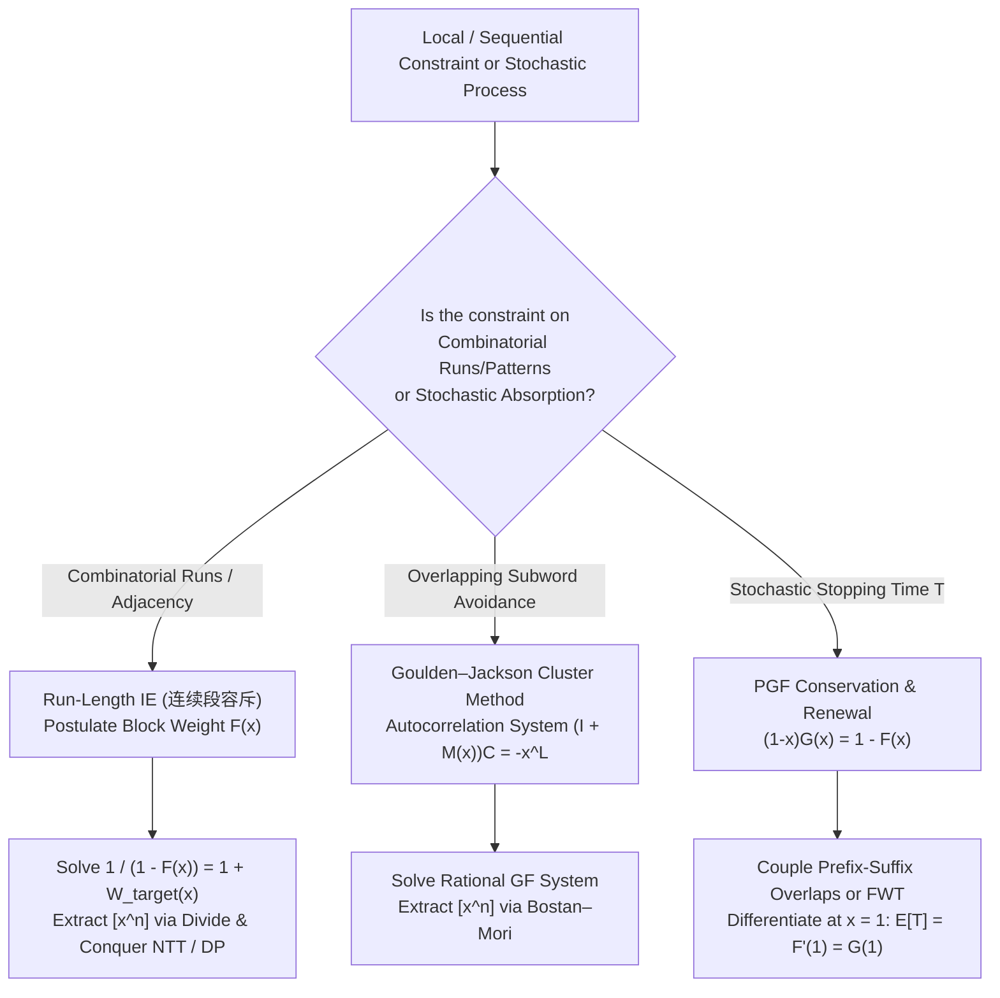

# Cohort 1 — Wave 2B (Iterations 16–20): Inclusion–Exclusion Inside Generating Functions, Probability Generating Functions & Stopping Times, Multilingual (`[ZH]` / `[JA]`) Deep-Dive, and Master Problem Audit

> **Wave Scope**: Iterations 16–20 of the Formal Power Series & Generating Function Research Curriculum  
> **Focus Areas**: Run-Length / Block-Composition Inclusion–Exclusion (`连续段容斥`), Permutation Ascent Decompositions & Eulerian Generating Functions, The Goulden–Jackson Cluster Method, Probability Generating Functions (PGFs) & Stopping-Time Calculus (`概率生成函数与停时定理`), Renewal Equations ($H = F_{\text{first}} H_{\text{return}}$), Multilingual (`[ZH]` / `[JA]`) Literature Synthesis, Reverse-Engineering Diagnostic Guide, and 20-Problem Competitive Programming Audit.

---

## Executive Summary & Architectural Map of Wave 2B

In competitive programming and enumerative combinatorics, two families of problems repeatedly resist naive dynamic programming and elementary subset inclusion–exclusion:
1. **Local Adjacency & Contiguous Pattern Constraints**: Counting permutations, words, or compositions where adjacent elements cannot satisfy a forbidden relation (e.g., $a_i \neq a_{i+1}$, $|p_i - p_{i+1}| \neq 1$), where maximal contiguous runs of identical or increasing elements cannot exceed length $k$, or where contiguous subwords from a dictionary $\mathcal{B} = \{w_1, \dots, w_m\}$ are forbidden.
2. **Stochastic Stopping Times & First-Passage Processes**: Computing the expected time $\mathbb{E}[T]$, variance $\operatorname{Var}(T)$, or distribution of the first time $T$ a random walk, coin-tossing stream, or Markovian bit-flipping process reaches a target pattern or absorbing state.

What unites both families is a single algebraic mechanism inside the ring of formal power series $K[[x]]$: **the Sequence / Renewal Inversion $\operatorname{SEQ}(F) = (1 - F(x))^{-1}$**.
- In **Combinatorial Inclusion–Exclusion (Iteration 16)**, we replace an exponential $2^{n-1}$ subset sum over "violated boundaries" with a formal weight series $F(x) = \sum_{s \ge 1} f(s) x^s$ assigned to merged blocks, choosing $F(x)$ by inverting $\frac{1}{1 - F(x)} = 1 + W_{\text{target}}(x)$ so that every maximal block of length $L$ automatically receives the exact target weight $w_{\text{target}}(L)$. When forbidden patterns overlap arbitrarily, this block inversion generalizes to the **Goulden–Jackson Cluster Method** via autocorrelation polynomials.
- In **Probability Generating Functions (Iteration 17)**, we couple the PGF of the first absorption time $F(x) = \sum_{n \ge 0} \mathbb{P}(T = n) x^n$ with the auxiliary GF of non-terminated trajectories $G(x) = \sum_{n \ge 0} \mathbb{P}(T > n) x^n$ via the fundamental conservation law $(1 - x)G(x) = 1 - F(x)$, and we decouple **first hits** from **arbitrary visits** using the renewal equation $H(x) = F_{\text{first}}(x) H_{\text{return}}(x)$.

---

## Iteration 16: Inclusion–Exclusion Inside Generating Functions (`连续段容斥` & Forbidden Patterns)

### 16.1 The Universal Run-Length / Block-Composition Inclusion–Exclusion Engine (`连续段容斥`)

#### 1. Concrete Combinatorial / Algebraic Object
Consider a sequence of $n$ elements $a = (a_1, a_2, \dots, a_n)$ drawn from a structured universe (e.g., words over an alphabet, multiset permutations, or segmented sequences) where a binary relation $a_i \sim a_{i+1}$ defines when two adjacent elements belong to the **same contiguous run** (or when the boundary $(i, i+1)$ satisfies a specific property $P$).

Every configuration $a$ decomposes uniquely into a sequence of **maximal contiguous runs** (or blocks) of lengths $L_1, L_2, \dots, L_r \ge 1$ with $L_1 + L_2 + \dots + L_r = n$, such that:
- Inside each run of length $L_j$, every internal boundary satisfies $a_i \sim a_{i+1}$.
- Between two consecutive runs, the boundary violates $\sim$ ($a_{L_1+\dots+L_j} \not\sim a_{L_1+\dots+L_j+1}$).

Suppose the problem assigns a **target weight** $w_{\text{target}}(L) \in K$ to each maximal run of length $L \ge 1$ (for instance, $w_{\text{target}}(L) = [L = 1]$ if adjacent related elements are strictly forbidden, or $w_{\text{target}}(L) = [1 \le L \le k]$ if no run may exceed length $k$), so that the desired weight of a configuration with maximal run lengths $(L_1, \dots, L_r)$ is $\prod_{j=1}^r w_{\text{target}}(L_j)$.

We work in the ring of formal power series $K[[x]]$ (or $K[y][[x]]$ when tracking an additional statistic $y$), where $x$ marks the **size (length)** of a block:
- **Target Run OGF**: $W_{\text{target}}(x) = \sum_{L \ge 1} w_{\text{target}}(L) x^L \in xK[[x]]$.
- **Inclusion–Exclusion Coefficient Series**: $F(x) = \sum_{s \ge 1} f(s) x^s \in xK[[x]]$, where $f(s) \in K$ is an unknown formal weight assigned to an *arbitrary* (not necessarily maximal!) valid sub-block of length $s$.

#### 2. The Diagnostic Signal
How do you recognize in a contest problem that you should reach for **Run-Length Inclusion–Exclusion (`连续段容斥`)** inside a generating function?
- **Signal 1 ("Maximal Run / Block Weight" vs. "Boundary Violation")**: The problem forbids or weights maximal contiguous segments of identical, increasing, or consecutive elements (e.g., "no two adjacent balls have the same color", "no $k+1$ consecutive elements are increasing", "every maximal contiguous block of length $L$ contributes a factor $w(L)$").
- **Signal 2 ("Easy to Glue Inside a Block, Hard to Force Maximality")**: If you know that $s$ elements form a single valid block (all $s-1$ internal boundaries satisfy $\sim$), it is easy to count or weight such a block of size $s$. However, forcing two adjacent blocks *not* to merge ($a_{\text{end}} \not\sim a_{\text{next}}$) in a direct DP requires remembering the exact boundary element, blowing up the state space.
- **Signal 3 ("Sparse Inversion Opportunity")**: When the target weight is a step function like $w_{\text{target}}(L) = [1 \le L \le k]$, the inverted IE series $F(x) = 1 - \frac{1}{1 + W_{\text{target}}(x)}$ collapses into a **sparse rational function** (having only $O(n/k)$ non-zero coefficients up to $x^n$), turning an $O(n^2)$ or $O(n \log^2 n)$ DP into $O(n + (n/k)^2)$ or $O(n \log n)$!

#### 3. The Reverse-Engineering Scratchpad ("Zero Magic Steps")
Let us reconstruct how a solver discovers the formal weight series $F(x)$ from scratch, without knowing the formula in advance.

> **Step 1: Why does naive subset IE feel clumsy for general run weights?**  
> In classical subset inclusion–exclusion for "no two adjacent elements satisfy $\sim$", there are $n-1$ boundaries $E = \{1, 2, \dots, n-1\}$. Choosing a subset $S \subseteq E$ of "forced violations" partitions the $n$ elements into $n - |S|$ connected components (blocks) of sizes $s_1, s_2, \dots, s_m$. The sign $(-1)^{|S|}$ factors across the blocks as:
> $$(-1)^{|S|} = (-1)^{\sum_{j=1}^m (s_j - 1)} = \prod_{j=1}^m (-1)^{s_j - 1}.$$
> Notice that $(-1)^{s-1}$ is a weight depending **only on the size $s$ of each chosen sub-block**!
>
> **Step 2: Generalize from $(-1)^{s-1}$ to an unknown block weight $f(s)$.**  
> What if our goal is not just "maximal runs must have length $1$", but an arbitrary target weight $w_{\text{target}}(L)$ on each maximal run of length $L$?  
> Suppose we relax the requirement that blocks be maximal. Instead, we allow partitioning the $n$ elements into an arbitrary sequence of sub-blocks $[l_1, r_1], [l_2, r_2], \dots, [l_m, r_m]$ such that **within each sub-block**, all internal boundaries satisfy $\sim$, while **between consecutive sub-blocks**, we impose **no restriction** (they may or may not satisfy $\sim$).  
> To each chosen sub-block of length $s$, we assign an unknown formal weight $f(s)$.
>
> **Step 3: How do sub-blocks assemble inside a true maximal run of length $L$?**  
> Take any actual configuration $a$, and look at one of its **true maximal runs** of length $L$. Since every internal boundary inside this run of length $L$ satisfies $\sim$, a valid sub-block partition can split this maximal run of length $L$ into **any composition** $s_1 + s_2 + \dots + s_p = L$ ($s_j \ge 1$), and cannot cross the outer boundaries of this maximal run (because the outer boundaries of a maximal run violate $\sim$).  
> Therefore, summing the product of sub-block weights $\prod f(s_j)$ over all ways to split a maximal run of length $L$ yields:
> $$\text{Total Induced Weight on a Maximal Run of Length } L = \sum_{p \ge 1} \sum_{\substack{s_1 + \dots + s_p = L \\ s_j \ge 1}} f(s_1) f(s_2) \cdots f(s_p).$$
>
> **Step 4: Translate the composition sum into a Generating Function equation!**  
> Recognize the inner sum as the coefficient of $x^L$ in the $p$-th power of $F(x) = \sum_{s \ge 1} f(s) x^s$:
> $$\sum_{p \ge 1} [x^L] F(x)^p = [x^L] \sum_{p \ge 1} F(x)^p = [x^L] \left(\frac{1}{1 - F(x)} - 1\right).$$
> We **want** this induced weight to equal $w_{\text{target}}(L)$ for every $L \ge 1$. Equating the two formal power series gives our master design equation:
> $$\frac{1}{1 - F(x)} = 1 + \sum_{L \ge 1} w_{\text{target}}(L) x^L = 1 + W_{\text{target}}(x) \iff \boxed{F(x) = 1 - \frac{1}{1 + W_{\text{target}}(x)} = \frac{W_{\text{target}}(x)}{1 + W_{\text{target}}(x)}}.$$

That is the entire secret of `连续段容斥`: **the sequence operator $\frac{1}{1 - F(x)}$ converts unconstrained compositions of sub-blocks into a single maximal run**, so its algebraic inverse $F(x) = \frac{W_{\text{target}}(x)}{1 + W_{\text{target}}(x)}$ tells us the exact inclusion–exclusion coefficient $f(s) = [x^s]F(x)$ to attach to each sub-block of size $s$!

#### 4. Step-by-Step Algebraic Derivation & Dictionary of Canonical Target Weight Functions

Let us rigorously state the theorem and derive the four most important canonical instances used in competitive programming.

> [!IMPORTANT]
> **Theorem 16.1 (Fundamental Theorem of Run-Length Inclusion–Exclusion / `连续段容斥`)**  
> Let $W_{\text{target}}(x) = \sum_{L \ge 1} w_{\text{target}}(L) x^L \in xK[[x]]$ be the OGF of target weights for maximal contiguous runs. Since $[x^0](1 + W_{\text{target}}(x)) = 1 \in K^\times$, the series $1 + W_{\text{target}}(x)$ is a multiplicative unit in $K[[x]]$. Define the **IE block weight series**:
> $$F(x) = \sum_{s \ge 1} f(s) x^s := 1 - \frac{1}{1 + W_{\text{target}}(x)} = \frac{W_{\text{target}}(x)}{1 + W_{\text{target}}(x)} \in xK[[x]].$$
> Then for every integer $L \ge 1$:
> $$\sum_{p=1}^L \sum_{\substack{s_1 + \dots + s_p = L \\ s_1, \dots, s_p \ge 1}} f(s_1) f(s_2) \cdots f(s_p) = [x^L] \frac{1}{1 - F(x)} = w_{\text{target}}(L).$$
> Consequently, if a configuration $a$ has maximal contiguous runs of lengths $L_1, \dots, L_r$, summing $\prod_{j=1}^m f(|B_j|)$ over all coarsenings (partitions into valid sub-blocks $B_1, \dots, B_m$ that refine the maximal runs of $a$) yields $\prod_{i=1}^r w_{\text{target}}(L_i)$.

##### Canonical Case 1: Adjacent-Equal Forbidden / Smirnov Words ($w_{\text{target}}(L) = [L = 1]$)
Suppose no two adjacent elements may satisfy $\sim$, which means every maximal run must have length $L = 1$:
1. **Target OGF**: $W_{\text{target}}(x) = x$, since $w_{\text{target}}(1) = 1$ and $w_{\text{target}}(L) = 0$ for all $L \ge 2$.
2. **Invert via Theorem 16.1**:
   $$F(x) = \frac{W_{\text{target}}(x)}{1 + W_{\text{target}}(x)} = \frac{x}{1 + x} = \sum_{s \ge 1} (-1)^{s-1} x^s \quad (\text{valid in } K[[x]] \text{ for any ring } K).$$
3. **Combinatorial Consequence (The Smirnov Substitution)**:
   Suppose we want to count sequences of length $n$ over an alphabet $\{1, 2, \dots, m\}$ with multiplicities $(c_1, \dots, c_m)$ where $\sum c_i = n$, such that no two adjacent elements are equal ($a_i \neq a_{i+1}$).
   - A sub-block of $s$ identical elements of color $i$ has IE weight $f(s) = (-1)^{s-1}$.
   - If color $i$ is partitioned into $k_i \ge 1$ non-empty sub-blocks of total size $c_i$, the sum of IE weights over all compositions of $c_i$ into $k_i$ parts is:
     $$[x^{c_i}] F(x)^{k_i} = [x^{c_i}] \left(\frac{x}{1+x}\right)^{k_i} = (-1)^{c_i - k_i} \binom{c_i - 1}{k_i - 1}.$$
   - Placing the $\sum k_i$ colored sub-blocks in any order (via EGF, dividing by $k_i!$ because the $k_i$ sub-blocks of color $i$ are indistinguishable) yields the polynomial per color:
     $$P_{c_i}(x) = \sum_{k_i=1}^{c_i} (-1)^{c_i - k_i} \binom{c_i - 1}{k_i - 1} \frac{x^{k_i}}{k_i!}, \qquad \text{Answer} = \sum_{K=1}^n K! [x^K] \prod_{i=1}^m P_{c_i}(x).$$
   - Conversely, if the number of occurrences of each color is unconstrained and color $i$ has step weight $w_i x$, then summing over all block sequences directly gives:
     $$\operatorname{SEQ}\left(\sum_{i=1}^m F(w_i x)\right) = \frac{1}{1 - \sum_{i=1}^m \frac{w_i x}{1 + w_i x}}.$$
     Notice how $w_i x \mapsto \frac{w_i x}{1 + w_i x}$ is no longer a "magic trick" — it is simply replacing each atomic letter $w_i x$ by its IE sub-block series $F(w_i x)$!

##### Canonical Case 2: Bounded Run Length $\le k$ ($w_{\text{target}}(L) = [1 \le L \le k]$)
Suppose maximal runs of length $1 \le L \le k$ are valid (weight $1$), while runs of length $L > k$ are forbidden (weight $0$):
1. **Target OGF**:
   $$W_{\text{target}}(x) = x + x^2 + \dots + x^k = \frac{x - x^{k+1}}{1 - x} \implies 1 + W_{\text{target}}(x) = \frac{1 - x^{k+1}}{1 - x}.$$
2. **Invert via Theorem 16.1**:
   $$F(x) = 1 - \frac{1}{1 + W_{\text{target}}(x)} = 1 - \frac{1 - x}{1 - x^{k+1}} = \frac{x - x^{k+1}}{1 - x^{k+1}} = (x - x^{k+1}) \sum_{m \ge 0} x^{m(k+1)} = \sum_{m \ge 0} \left(x^{m(k+1) + 1} - x^{(m+1)(k+1)}\right).$$
3. **Coefficient Extraction & Sparsity**:
   Reading off the coefficients of $F(x)$ gives:
   $$f(s) = [x^s] F(x) = \begin{cases} +1 & \text{if } s \equiv 1 \pmod{k+1}, \\ -1 & \text{if } s \equiv 0 \pmod{k+1} \text{ and } s \ge k+1, \\ 0 & \text{otherwise.} \end{cases}$$
   Look at what happened: **for $2 \le s \le k$, the inclusion–exclusion weight $f(s)$ is identically ZERO!** Only sub-blocks of size $s \in \{1, k+1, k+2, 2k+2, 2k+3, \dots\}$ have non-zero weight! In a DP of length $n$, only $2 \lfloor n/(k+1) \rfloor + 1 = O(n/k)$ sub-block sizes ever participate.

##### Canonical Case 3: Exact Run Length $k$ Forbidden ($w_{\text{target}}(L) = [L \neq k]$)
Suppose a run can have any positive length *except* $L = k$:
1. **Target OGF**:
   $$W_{\text{target}}(x) = \sum_{L \ge 1} x^L - x^k = \frac{x}{1 - x} - x^k \implies 1 + W_{\text{target}}(x) = \frac{1 - x^k + x^{k+1}}{1 - x}.$$
2. **Invert via Theorem 16.1**:
   $$F(x) = 1 - \frac{1 - x}{1 - x^k + x^{k+1}} = \frac{x - x^k + x^{k+1}}{1 - x^k + x^{k+1}}.$$

##### Canonical Case 4: Track Number of Maximal Runs with Bivariate $t$ ($w_{\text{target}}(L) = t$)
Suppose every maximal run of length $L \ge 1$ receives weight $t$ (so a configuration with $r$ maximal runs receives weight $t^r$):
1. **Target OGF**:
   $$W_{\text{target}}(x, t) = \sum_{L \ge 1} t x^L = \frac{tx}{1 - x} \implies 1 + W_{\text{target}}(x, t) = \frac{1 + (t-1)x}{1 - x}.$$
2. **Invert via Theorem 16.1**:
   $$F(x, t) = 1 - \frac{1 - x}{1 + (t-1)x} = \frac{tx}{1 + (t-1)x} = \sum_{s \ge 1} t (1 - t)^{s-1} x^s.$$
   Conversely, setting $w_{\text{target}}(L) = t^{L-1}$ (counting the number of internal "ascent/equal" adjacencies) corresponds to $1 + W_{\text{target}}(x, t) = 1 + \frac{x}{1 - tx} = \frac{1 + (1-t)x}{1 - tx}$, giving $F(x, t) = \frac{x}{1 + (1-t)x} = \sum_{s \ge 1} (t-1)^{s-1} x^s$.

| Constraint on Maximal Run of Length $L$ | Target Weight $w_{\text{target}}(L)$ | $1 + W_{\text{target}}(x)$ | Inverted IE Series $F(x) = \sum_{s \ge 1} f(s) x^s$ | Non-Zero Terms up to $x^n$ |
| :--- | :--- | :--- | :--- | :--- |
| No adjacent relation ($L = 1$ only) | $[L = 1]$ | $1 + x$ | $\dfrac{x}{1+x} = \sum_{s \ge 1} (-1)^{s-1} x^s$ | $n$ terms ($f(s) = (-1)^{s-1}$) |
| Bounded run length ($1 \le L \le k$) | $[1 \le L \le k]$ | $\dfrac{1 - x^{k+1}}{1 - x}$ | $\dfrac{x - x^{k+1}}{1 - x^{k+1}}$ | $O(n/k)$ sparse terms ($s \equiv 0, 1 \pmod{k+1}$) |
| Forbidden exact run length ($L \neq k$) | $[L \neq k]$ | $\dfrac{1 - x^k + x^{k+1}}{1 - x}$ | $\dfrac{x - x^k + x^{k+1}}{1 - x^k + x^{k+1}}$ | Rational GF of degree $k+1$ |
| Odd run lengths only ($2 \nmid L$) | $[L \equiv 1 \pmod 2]$ | $\dfrac{1 + x - x^2}{1 - x^2}$ | $\dfrac{x}{1 + x - x^2}$ | Fibonacci-weighted IE coefficients |
| Track internal adjacencies ($t^{L-1}$) | $t^{L-1}$ | $\dfrac{1 + (1-t)x}{1 - tx}$ | $\dfrac{x}{1 + (1-t)x} = \sum_{s \ge 1} (t-1)^{s-1} x^s$ | $f(s) = (t-1)^{s-1}$ |

#### 5. Hand-Checkable Toy Examples ($n \le 4$)

##### Toy Example A: Bounded Run Length $L \le 2$ for $n = 4$
Let us verify Canonical Case 2 for $k = 2$ and a single maximal run of length $L = 3$ vs. $L = 2$:
- For $k = 2$, $F(x) = \frac{x - x^3}{1 - x^3} = x - x^3 + x^4 - x^6 + \dots$, so:
  $$f(1) = +1, \quad f(2) = 0, \quad f(3) = -1, \quad f(4) = +1.$$
- Check a maximal run of length $L = 2$ (which should get weight $w_{\text{target}}(2) = 1$):
  - Composition $2$: weight $f(2) = 0$.
  - Composition $1 + 1$: weight $f(1)f(1) = 1 \times 1 = 1$.
  - Total induced weight $= 0 + 1 = 1 = w_{\text{target}}(2)$.
- Check a maximal run of length $L = 3$ (which exceeds $k = 2$ and must get weight $w_{\text{target}}(3) = 0$):
  - Composition $3$: weight $f(3) = -1$.
  - Composition $2 + 1$: weight $f(2)f(1) = 0 \times 1 = 0$.
  - Composition $1 + 2$: weight $f(1)f(2) = 1 \times 0 = 0$.
  - Composition $1 + 1 + 1$: weight $f(1)^3 = 1$.
  - Total induced weight $= -1 + 0 + 0 + 1 = 0 = w_{\text{target}}(3)$.
- Check a maximal run of length $L = 4$ (must also get weight $w_{\text{target}}(4) = 0$):
  - Non-zero compositions use only parts in $\{1, 3, 4\}$:
    - $(4) \mapsto f(4) = +1$
    - $(3, 1) \mapsto f(3)f(1) = -1$
    - $(1, 3) \mapsto f(1)f(3) = -1$
    - $(1, 1, 1, 1) \mapsto f(1)^4 = +1$
  - Total induced weight $= +1 - 1 - 1 + 1 = 0 = w_{\text{target}}(4)$.

##### Toy Example B: Smirnov Words (Adjacent Unequal) for Multiset $\{1, 1, 2, 3\}$ ($n = 4$)
Count permutations of $(1, 1, 2, 3)$ with no two adjacent $1$'s:
- Multiplicities: $c_1 = 2, c_2 = 1, c_3 = 1$.
- Using the EGF per-color polynomial $P_c(x) = \sum_{k=1}^c (-1)^{c-k} \binom{c-1}{k-1} \frac{x^k}{k!}$:
  - Color $1$ ($c_1 = 2$): $P_2(x) = -\binom{1}{0} \frac{x^1}{1!} + \binom{1}{1} \frac{x^2}{2!} = -x + \frac{1}{2}x^2$.
  - Color $2$ ($c_2 = 1$): $P_1(x) = x$.
  - Color $3$ ($c_3 = 1$): $P_1(x) = x$.
- Product of polynomials:
  $$P_2(x) P_1(x) P_1(x) = \left(-x + \frac{1}{2}x^2\right) x^2 = -x^3 + \frac{1}{2}x^4.$$
- Apply the Laplace / factorial sum $\sum_{K=1}^4 K! [x^K]$:
  $$\text{Answer} = 3! \times (-1) + 4! \times \left(\frac{1}{2}\right) = -6 + 12 = 6.$$
- Hand-check: Total multiset permutations $= \frac{4!}{2!1!1!} = 12$. Those with $1, 1$ adjacent treat $(1,1)$ as a super-element alongside $2, 3$, giving $3! = 6$ bad permutations. Valid $= 12 - 6 = 6$. Exact match!

#### 6. Failure Modes, Pitfalls & Edge Cases
1. **Non-Transitivity of the Adjacency Relation**:
   - Run-length IE assumes that if we merge $s$ elements into a sub-block $[l, r]$, the set of valid internal configurations of that sub-block is well-defined and independent of external boundaries.
   - *Pitfall*: If the forbidden adjacency is $|p_i - p_{i+1}| = 1$ in a permutation, a sub-block of size $s$ where every adjacent pair satisfies $|p_i - p_{i+1}| = 1$ is **not** uniquely a monotone run $(v, v+1, \dots, v+s-1)$ unless we note that in a permutation of distinct elements, $|p_i - p_{i+1}| = 1$ forces each sub-block of size $s \ge 2$ to be either strictly increasing $(v, v+1, \dots, v+s-1)$ or strictly decreasing $(v+s-1, \dots, v)$ — giving **2 orientations** for $s \ge 2$ and $1$ orientation for $s = 1$! Forgetting the factor of $2$ for $s \ge 2$ is a classic bug.
2. **EGF vs. OGF Indistinguishability When Glueing Sub-Blocks**:
   - When all $n$ elements are distinct (e.g., permutations of $\{1, \dots, n\}$), if each sub-block of size $s$ has a **unique** internal order once its $s$ elements are chosen (such as $p_i < p_{i+1}$), then choosing and ordering the elements inside a block of size $s$ contributes $\frac{x^s}{s!}$ in EGF.
   - However, when elements are partitioned into equivalence classes (colors) first, we must divide by $k_i!$ for the $k_i$ sub-blocks of color $i$, and then multiply by $(\sum k_i)!$ when interleaving sub-blocks of all colors.

---

### 16.2 Permutation Ascent / Run Decompositions & Eulerian Numbers via GF Inclusion–Exclusion

#### 1. Concrete Combinatorial / Algebraic Object
Let $\mathfrak{S}_n$ be the set of permutations of $\{1, 2, \dots, n\}$. For $\pi = (\pi_1, \dots, \pi_n) \in \mathfrak{S}_n$, an index $i \in \{1, \dots, n-1\}$ is an **ascent** if $\pi_i < \pi_{i+1}$. The **Eulerian number** $\left\langle \begin{matrix} n \\ k \end{matrix} \right\rangle$ is the number of permutations in $\mathfrak{S}_n$ with exactly $k$ ascents ($0 \le k < n$, with $\left\langle \begin{matrix} 0 \\ 0 \end{matrix} \right\rangle = 1$).
We study the **Eulerian polynomials** $A_n(y) = \sum_{k=0}^{n} \left\langle \begin{matrix} n \\ k \end{matrix} \right\rangle y^k$ and the **Bivariate Exponential Generating Function**:
$$A(x, y) = \sum_{n \ge 0} A_n(y) \frac{x^n}{n!} = \sum_{n \ge 0} \sum_{k \ge 0} \left\langle \begin{matrix} n \\ k \end{matrix} \right\rangle y^k \frac{x^n}{n!} \in \mathbb{Q}[y][[x]].$$

#### 2. The Diagnostic Signal
- **Signal 1**: Counting permutations (or sequences of distinct keys) by the number of ascents $\pi_i < \pi_{i+1}$, descents $\pi_i > \pi_{i+1}$, or maximal increasing runs (`上升连续段`).
- **Signal 2**: Power sums $\sum_{i=0}^m i^n x^i$ or rational functions of the form $\frac{P(x)}{(1-x)^{n+1}}$, which are linked to Eulerian polynomials via **Worpitzky's Identity** $\sum_{m \ge 0} m^n x^m = \frac{\sum_{k} \left\langle \begin{matrix} n \\ k \end{matrix} \right\rangle x^{k+1}}{(1-x)^{n+1}}$ (as highlighted in the official AtCoder Algorithm Lecture *線形漸化的数列*).
- **Signal 3**: Constraints on the lengths of increasing runs in a permutation (e.g., LOJ 3395 / ARC 100F, where no increasing run has length $> k$).

#### 3. The Reverse-Engineering Scratchpad
How do we derive the bivariate EGF $A(x, y)$ of Eulerian numbers in 3 lines using Run-Length Inclusion–Exclusion, without solving any partial differential equation?

> **Step 1: Identify the block relation $\sim$ and the internal block structure.**  
> Define $i \sim i+1$ whenever $\pi_i < \pi_{i+1}$ (an ascent).  
> Suppose we group a permutation $\pi \in \mathfrak{S}_n$ into $m$ sub-blocks of sizes $s_1 + s_2 + \dots + s_m = n$, requiring that inside each sub-block of size $s$, $\pi$ is **strictly increasing** ($\pi_{l} < \pi_{l+1} < \dots < \pi_r$).  
> For any subset of $s$ distinct labels from $\{1, \dots, n\}$, how many ways can they be ordered to be strictly increasing? **Exactly $1$ way!**  
> In the language of Exponential Generating Functions (EGF), a single strictly increasing sub-block of size $s \ge 1$ has EGF monomial $\frac{x^s}{s!}$.
>
> **Step 2: Apply Canonical Case 4 of Run-Length IE ($w_{\text{target}}(L) = y^{L-1}$).**  
> A maximal increasing run of length $L$ contains $L - 1$ ascents, so its target weight is $w_{\text{target}}(L) = y^{L-1}$.  
> By Theorem 16.1 (Canonical Case 4), the IE weight assigned to a sub-block of size $s \ge 1$ is:
> $$f(s) = (y - 1)^{s-1}.$$
> (Equivalently: each of the $s-1$ forced ascents inside a sub-block of size $s$ carries formal IE weight $y - 1$.)
>
> **Step 3: Combine the EGF factor $\frac{x^s}{s!}$ with the IE weight $f(s) = (y-1)^{s-1}$ and apply $\operatorname{SEQ}$!**  
> The EGF of a single weighted sub-block of size $s \ge 1$ is:
> $$F_{\text{EGF}}(x, y) = \sum_{s \ge 1} (y - 1)^{s-1} \frac{x^s}{s!} = \frac{1}{y - 1} \sum_{s \ge 1} \frac{((y - 1)x)^s}{s!} = \frac{\exp((y - 1)x) - 1}{y - 1}.$$
> Since a permutation is an arbitrary sequence of such sub-blocks ($\operatorname{SEQ}(F_{\text{EGF}})$), we immediately obtain:
> $$A(x, y) = \frac{1}{1 - F_{\text{EGF}}(x, y)} = \frac{1}{1 - \frac{\exp((y-1)x) - 1}{y - 1}} = \frac{y - 1}{y - \exp((y - 1)x)} = \frac{1 - y}{\exp((y - 1)x) - y}.$$

#### 4. Step-by-Step Algebraic Derivation & Coefficient Extraction

Let us extract the explicit $O(n)$ formula for a single Eulerian number $\left\langle \begin{matrix} n \\ k \end{matrix} \right\rangle$ and all $A_{n, 0}, \dots, A_{n, n-1}$ in $O(n \log n)$ time directly from $A(x, y)$:

$$\begin{aligned}
A(x, y) &= \frac{1 - y}{e^{(y-1)x} - y} \quad \text{(valid in } \mathbb{Q}[y][[x]] \text{ since } [x^0](e^{(y-1)x} - y) = 1 - y \text{ cancels the numerator)} \\
&= \frac{(1 - y) e^{(1-y)x}}{1 - y e^{(1-y)x}} \quad \text{(multiply numerator and denominator by } e^{(1-y)x}\text{)} \\
&= (1 - y) e^{(1-y)x} \sum_{m \ge 0} y^m e^{m(1-y)x} \quad \text{(expand geometric series in } y e^{(1-y)x} \in y\mathbb{Q}[[x, y]]\text{)} \\
&= (1 - y) \sum_{m \ge 0} y^m e^{(m+1)(1-y)x} \quad \text{(combine exponential factors)}.
\end{aligned}$$
Now extract $[x^n / n!]$ from both sides:
$$\begin{aligned}
A_n(y) = [x^n / n!] A(x, y) &= (1 - y) \sum_{m \ge 0} y^m [x^n / n!] e^{(m+1)(1-y)x} \\
&= (1 - y)^{n+1} \sum_{m \ge 0} (m + 1)^n y^m.
\end{aligned}$$
Look at that identity:
$$\boxed{\frac{A_n(y)}{(1 - y)^{n+1}} = \sum_{m \ge 0} (m + 1)^n y^m \iff A_n(y) = (1 - y)^{n+1} \sum_{m \ge 0} (m + 1)^n y^m.}$$
Extracting $[y^k]$ from the right-hand side via the binomial expansion $(1 - y)^{n+1} = \sum_{j=0}^{n+1} (-1)^j \binom{n+1}{j} y^j$ immediately gives the classic explicit formula:
$$\boxed{\left\langle \begin{matrix} n \\ k \end{matrix} \right\rangle = [y^k] A_n(y) = \sum_{j=0}^{k} (-1)^j \binom{n+1}{j} (k + 1 - j)^n \quad (0 \le k < n).}$$
- **Single $\left\langle \begin{matrix} n \\ k \end{matrix} \right\rangle$ Complexity**: $O(k)$ (with linear sieve for $(k+1-j)^n$) or $O(k \log n)$ time!
- **Full Row $\left\langle \begin{matrix} n \\ 0 \end{matrix} \right\rangle, \dots, \left\langle \begin{matrix} n \\ n-1 \end{matrix} \right\rangle$ Complexity**: A single polynomial multiplication (NTT) of $P(y) = \sum_{j=0}^n (-1)^j \binom{n+1}{j} y^j$ and $Q(y) = \sum_{m=0}^{n-1} (m+1)^n y^m \bmod y^n$ in $O(n \log n)$ time!

#### 5. Hand-Checkable Toy Example ($n = 3$)
Let $n = 3$. We compute $\left\langle \begin{matrix} 3 \\ k \end{matrix} \right\rangle$ for $k = 0, 1, 2$ using the convolution $A_3(y) = (1 - y)^4 \sum_{m \ge 0} (m+1)^3 y^m \bmod y^3$:
- $(1 - y)^4 = 1 - 4y + 6y^2 - 4y^3 + y^4$.
- $\sum_{m=0}^2 (m+1)^3 y^m = 1^3 + 2^3 y + 3^3 y^2 = 1 + 8y + 27y^2$.
- Multiply modulo $y^3$:
  - $[y^0]: 1 \times 1 = 1$ (permutation $(3, 2, 1)$ has $0$ ascents).
  - $[y^1]: 1 \times 8 - 4 \times 1 = 4$ (permutations $(1, 3, 2), (2, 1, 3), (2, 3, 1), (3, 1, 2)$ have $1$ ascent).
  - $[y^2]: 1 \times 27 - 4 \times 8 + 6 \times 1 = 27 - 32 + 6 = 1$ (permutation $(1, 2, 3)$ has $2$ ascents).
- Sum: $1 + 4 + 1 = 6 = 3!$.

#### 6. Failure Modes, Pitfalls & Edge Cases
- **Index Shift ($m^n$ vs. $(m+1)^n$)**:
  - $\sum_{m \ge 0} m^n y^m = \frac{\sum_{k=0}^{n-1} \left\langle \begin{matrix} n \\ k \end{matrix} \right\rangle y^{k+1}}{(1-y)^{n+1}}$ has an extra factor of $y$ in the numerator for $n \ge 1$ because $m=0$ contributes $0^n = 0$ for $n \ge 1$, whereas $0^0 = 1$ for $n = 0$. Always check $n = 0$ and $k = 0$!
- **Characteristic $p \le n$**:
  - The EGF derivation $A(x, y) = \frac{1-y}{e^{(y-1)x}-y}$ uses $\frac{x^n}{n!}$, which requires $n!$ to be invertible if working directly with EGFs in $\mathbb{F}_p[[x]]$. However, the resulting polynomial identity $A_n(y) = (1-y)^{n+1} \sum_{m \ge 0} (m+1)^n y^m$ holds over $\mathbb{Z}[y][[x]]$ and therefore holds in **any** commutative ring $R$ regardless of characteristic!

---

### 16.3 The Goulden–Jackson Cluster Method (Single & Multiple Forbidden Subwords)

#### 1. Concrete Combinatorial / Algebraic Object
Let $\Sigma$ be a finite alphabet of size $\sigma = |\Sigma|$ (or weighted alphabet with letter OGF $S(x) = \sum_{a \in \Sigma} w(a) x$), and let $\mathcal{B} = \{w_1, w_2, \dots, w_m\} \subset \Sigma^+$ be a **reduced** set of forbidden contiguous subwords (factors), meaning no $w_i$ is a contiguous substring of $w_j$ for $i \neq j$. Let $L_i = |w_i|$ be the length of pattern $w_i$.
We seek the ordinary generating function:
$$F(x, t) = \sum_{v \in \Sigma^*} t^{\text{occ}_{\mathcal{B}}(v)} x^{|v|} \in \mathbb{Q}[t][[x]],$$
where $\text{occ}_{\mathcal{B}}(v)$ is the total number of occurrences of patterns from $\mathcal{B}$ inside the word $v$. In particular, setting $t = 0$ gives the OGF $F(x, 0) = \sum_{n \ge 0} f_n x^n$ of **$\mathcal{B}$-avoiding words** of length $n$.

#### 2. The Diagnostic Signal
- **Signal 1 ("Subword Avoidance / Occurrence Counting with Overlaps")**: You need to count strings of length $n$ avoiding one or more contiguous patterns $w_1, \dots, w_m$ (or containing exactly $k$ occurrences), and $n$ is large or the pattern lengths $L_i$ are large enough that building a full Aho–Corasick DP matrix of size $(\sum L_i) \times (\sum L_i)$ is too slow — whereas the number of patterns $m$ is small!
- **Signal 2 ("Why Simple Block IE Fails")**: Unlike `连续段容斥` where adjacent violations merge into a simple homogeneous run of any length $s$, here occurrences of forbidden words $w_i$ and $w_j$ can **overlap only at specific prefix-suffix borders** (e.g., $w = \texttt{ABA}$ can overlap with itself at length $1$ to form $\texttt{ABABA}$, but cannot form a cluster of length $4$).

#### 3. The Reverse-Engineering Scratchpad
Let us derive the Goulden–Jackson Cluster Method from first principles.

> **Step 1: Replace $(0 \text{ occurrences})$ with Inclusion–Exclusion over Marked Occurrences.**  
> For any word $v \in \Sigma^*$, write the weight $t^{\text{occ}_{\mathcal{B}}(v)}$ as a product over all occurrences $e \in \text{Occ}_{\mathcal{B}}(v)$:
> $$t^{\text{occ}_{\mathcal{B}}(v)} = \prod_{e \in \text{Occ}_{\mathcal{B}}(v)} (1 + (t - 1)) = \sum_{S \subseteq \text{Occ}_{\mathcal{B}}(v)} (t - 1)^{|S|}.$$
> When $t = 0$ (strict avoidance), the weight of each chosen ("marked") occurrence in $S$ is $t - 1 = -1$.  
> Thus, instead of counting words with *no* occurrences of $\mathcal{B}$, we count **pairs $(v, S)$** where $v \in \Sigma^*$ is an arbitrary word and $S$ is a subset of marked occurrences of words from $\mathcal{B}$ in $v$, weighted by $(t - 1)^{|S|} x^{|v|}$.
>
> **Step 2: Decompose a Marked Word $(v, S)$ into Atomic Letters and Maximal Overlapping Clusters.**  
> Look at the positions in $v$ covered by the marked occurrences $S$:
> - Any letter of $v$ not covered by any marked occurrence in $S$ is just a free letter from $\Sigma$ (OGF: $\sigma x$).
> - Any maximal connected component of overlapping marked occurrences from $S$ is called a **cluster**.  
> Since every marked word $(v, S)$ is uniquely a sequence of free letters and clusters, the Sequence operator $\operatorname{SEQ}$ immediately gives:
> $$F(x, t) = \frac{1}{1 - \sigma x - C(x, t)},$$
> where $C(x, t) = \sum_{i=1}^m C_i(x, t)$ is the OGF of all clusters, and $C_i(x, t)$ is the OGF of clusters whose **rightmost (last)** marked occurrence is pattern $w_i$.
>
> **Step 3: How do we write an equation for $C_j(x, t)$? Peel off the last pattern $w_j$!**  
> Consider a cluster whose last marked occurrence is $w_j$. What can happen when we remove $w_j$?
> - Either $w_j$ was the **only** marked occurrence in the cluster: this contributes $(t - 1) x^{L_j}$.
> - Or there is a second-to-last marked occurrence $w_i$ in the cluster that **strictly overlaps** $w_j$ (meaning a proper suffix of $w_i$ of length $k \in \{1, \dots, \min(L_i, L_j) - 1\}$ equals the prefix of $w_j$ of length $k$, and $w_j$ extends $L_j - k > 0$ characters beyond $w_i$).  
> Note that because $\mathcal{B}$ is reduced, no third marked occurrence can overlap $w_j$ without also overlapping $w_i$, so stripping $w_j$ leaves a valid cluster ending in $w_i$, extended by the non-overlapping tail of $w_j$ of length $L_j - k$ and weighted by $(t - 1)$!

#### 4. Step-by-Step Algebraic Derivation (Single Pattern & Multi-Pattern Matrix System)

Define the **overlap / correlation set** and **correlation polynomial** for ordered pairs $(w_i, w_j) \in \mathcal{B} \times \mathcal{B}$:
$$\mathcal{O}(w_i, w_j) = \left\{ k \in \{1, 2, \dots, \min(L_i, L_j) - 1\} \;\middle|\; \operatorname{suffix}_k(w_i) = \operatorname{prefix}_k(w_j) \right\},$$
$$M_{i, j}(x) = \sum_{k \in \mathcal{O}(w_i, w_j)} x^{L_j - k} \in x\mathbb{Z}[x].$$
*(Convention Warning: Notice that $M_{i,j}(x)$ records the **tail extension length** $L_j - k$ added when appending $w_j$ onto $w_i$ with overlap $k$. Some texts define the correlation polynomial with exponent $k$; the two are related by $x^{L_j} \tilde{M}_{i,j}(x^{-1})$.)*

From Step 3 of the scratchpad, for each $j \in \{1, \dots, m\}$, the cluster GF $C_j(x, t)$ satisfies the linear equation:
$$C_j(x, t) = (t - 1) x^{L_j} + (t - 1) \sum_{i=1}^m C_i(x, t) M_{i, j}(x).$$

##### Special Case 1: Single Forbidden Pattern $w$ of Length $L$ ($t = 0$)
Let $w$ have length $L$, and define the **autocorrelation polynomial** (including the full match $k = L$):
$$A(x) = 1 + M_{1,1}(x) = \sum_{\substack{1 \le k \le L \\ \operatorname{suffix}_k(w) = \operatorname{prefix}_k(w)}} x^{L - k} = \sum_{d=0}^{L-1} [\operatorname{prefix}_{L-d}(w) = \operatorname{suffix}_{L-d}(w)] x^d.$$
Setting $t = 0$ in the cluster equation gives:
$$\begin{aligned}
C(x) = -x^L - C(x) M_{1,1}(x) &\iff C(x)\bigl(1 + M_{1,1}(x)\bigr) = -x^L \\
&\iff C(x) = -\frac{x^L}{A(x)}.
\end{aligned}$$
Substitute $C(x) = -\frac{x^L}{A(x)}$ into $F(x) = \frac{1}{1 - \sigma x - C(x)}$:
$$\boxed{F(x) = \frac{1}{1 - \sigma x + \frac{x^L}{A(x)}} = \frac{A(x)}{(1 - \sigma x) A(x) + x^L}.}$$
For general $t$ (counting occurrences with variable $t$), replacing $-1$ by $t - 1$ yields:
$$\boxed{F(x, t) = \frac{1 - (t - 1) M_{1,1}(x)}{(1 - \sigma x)\bigl(1 - (t - 1) M_{1,1}(x)\bigr) - (t - 1) x^L}.}$$

##### General Case 2: $m$ Forbidden Patterns ($m \times m$ Linear System)
For $t = 0$, the row vector $\mathbf{C}(x) = (C_1(x), \dots, C_m(x))$ satisfies the $m \times m$ linear system over $\mathbb{Q}(x)$:
$$\mathbf{C}(x) \bigl(I_m + M(x)\bigr) = -\bigl(x^{L_1}, x^{L_2}, \dots, x^{L_m}\bigr),$$
and the OGF of $\mathcal{B}$-avoiding words is:
$$\boxed{F(x) = \frac{1}{1 - \sigma x + \mathbf{x}^{\mathbf{L}} (I_m + M(x))^{-1} \mathbf{1}^T}.}$$
- **Algorithmic Complexity**:
  - Whereas Aho–Corasick builds an automaton with $V = O(\sum_{i=1}^m L_i)$ states, the Goulden–Jackson matrix $I_m + M(x)$ has dimension **$m \times m$** (independent of the pattern lengths $L_i$!) with polynomial entries of degree $\le \max L_i$.
  - When $m = 1$ and $L \le 10^5$, $F(x) = \frac{A(x)}{(1-\sigma x)A(x) + x^L}$ is a single rational function of degree $L$, so $[x^n]F(x)$ can be extracted in $O(L \log L \log n)$ time via **Bostan–Mori** (or $O(n \log n)$ via FPS inversion if $n \le 5 \times 10^5$), whereas Aho–Corasick matrix exponentiation would take $O(L^3 \log n)$!

#### 5. Hand-Checkable Toy Example ($w = \texttt{ABA}$ over $\Sigma = \{\texttt{A}, \texttt{B}\}$, $\sigma = 2, L = 3$)
Let us compute the number of binary strings of length $n \le 4$ over $\{\texttt{A}, \texttt{B}\}$ avoiding $w = \texttt{ABA}$:
1. **Autocorrelation Polynomial $A(x)$**:
   - $k = 3$ ($\texttt{ABA} = \texttt{ABA}$): contributes $x^{3-3} = 1$.
   - $k = 2$ ($\operatorname{suffix}_2(\texttt{ABA}) = \texttt{BA} \neq \texttt{AB} = \operatorname{prefix}_2(\texttt{ABA})$): contributes $0$.
   - $k = 1$ ($\operatorname{suffix}_1(\texttt{ABA}) = \texttt{A} = \operatorname{prefix}_1(\texttt{ABA})$): contributes $x^{3-1} = x^2$.
   - Thus $A(x) = 1 + x^2$.
2. **Rational OGF $F(x)$**:
   $$F(x) = \frac{A(x)}{(1 - 2x)A(x) + x^3} = \frac{1 + x^2}{(1 - 2x)(1 + x^2) + x^3} = \frac{1 + x^2}{1 - 2x + x^2 - x^3}.$$
3. **Series Expansion up to $x^4$**:
   The denominator $1 - 2x + x^2 - x^3$ gives recurrence $f_n = 2f_{n-1} - f_{n-2} + f_{n-3}$ for $n \ge 3$:
   - $f_0 = 1$
   - $f_1 = 2$
   - $f_2 = 2f_1 - f_0 + [x^2](1+x^2) = 4 - 1 + 1 = 4$
   - $f_3 = 2f_2 - f_1 + f_0 = 8 - 2 + 1 = 7$ (all $2^3 = 8$ strings minus $\{\texttt{ABA}\}$)
   - $f_4 = 2f_3 - f_2 + f_1 = 14 - 4 + 2 = 12$ (all $2^4 = 16$ strings minus $\{\texttt{ABAA}, \texttt{ABAB}, \texttt{AABA}, \texttt{BABA}\}$).
   Every coefficient matches manual enumeration!

#### 6. Failure Modes, Pitfalls & Edge Cases
1. **Unreduced Forbidden Set $\mathcal{B}$**:
   - If $w_1 = \texttt{AB}$ and $w_2 = \texttt{AABA}$, then $w_1$ is an internal substring of $w_2$. In this case, a marked occurrence of $w_1$ can sit *completely inside* $w_2$ without extending past the right endpoint of $w_2$, breaking the sequential cluster recursion!
   - **Fix**: Always preprocess $\mathcal{B}$ by removing any $w_j$ that contains another $w_i$ as a contiguous substring (for $t = 0$, avoiding $w_i$ automatically avoids $w_j$). If $t \neq 0$ (counting occurrences), you must either weight nested occurrences inside the transition or use the Aho–Corasick automaton transfer matrix.
2. **Exponent Direction in $M_{i,j}(x)$**:
   - Confusing $x^k$ (overlap length) with $x^{L_j - k}$ (extension length) in $M_{i,j}(x)$ is the #1 implementation bug in Goulden–Jackson. Always verify on $w = \texttt{AAB}$ ($L=3$, no proper prefix-suffix match, so $A(x) = 1$) and $w = \texttt{AA}$ ($L=2$, overlap $k=1 \implies A(x) = 1 + x$).

---

## Iteration 17: Probability Generating Functions (PGFs), Stopping Times (`停时定理与生成函数`), and Renewal Equations

### 17.1 Probability Generating Functions & The Stopping-Time Conservation System $(1 - x)G(x) = 1 - F(x)$

#### 1. Concrete Combinatorial / Algebraic Object
Let $T \in \mathbb{Z}_{\ge 0} \cup \{\infty\}$ be a discrete random variable representing the **stopping time** (first absorption time) of a stochastic process. We define two coupled formal power series in $\mathbb{R}[[x]]$ (or $\mathbb{F}_p[[x]]$ when probabilities are rational numbers modulo a prime $p$):
1. **The Probability Generating Function (PGF) of Stopping Time $T$**:
   $$F(x) = \sum_{n=0}^{\infty} f_n x^n := \sum_{n=0}^{\infty} \mathbb{P}(T = n) x^n,$$
   where $f_n = \mathbb{P}(T = n)$ is the probability that the process terminates (hits the target state for the **first** time) at exact step $n$.
2. **The Auxiliary (Survival / Non-Terminated) Generating Function**:
   $$G(x) = \sum_{n=0}^{\infty} g_n x^n := \sum_{n=0}^{\infty} \mathbb{P}(T > n) x^n,$$
   where $g_n = \mathbb{P}(T > n)$ is the probability that the process has **not yet terminated** after $n$ steps (equivalently, the total probability mass of all active, non-absorbing trajectories of length $n$).

#### 2. The Diagnostic Signal
How do you recognize that a probability/expectation problem calls for the **$(F(x), G(x))$ Stopping-Time PGF Framework**?
- **Signal 1 ("Expected First Hit Time / Variance of Stopping Time")**: The problem asks for $\mathbb{E}[T]$, $\operatorname{Var}(T) = \mathbb{E}[T^2] - (\mathbb{E}[T])^2$, or $\mathbb{E}[T^{\underline{k}}]$ for the **first time** a random process reaches a target pattern or absorbing condition.
- **Signal 2 ("Appending a Sequence Overshoots the Stopping Time")**: If you take an unfinished trajectory and append a sequence of transitions that forces termination, the process might actually terminate *earlier* than the end of your appended sequence. Direct Markov chain Gaussian elimination on all intermediate states is too slow (e.g., $L \le 10^5$ in *Singing Kingdom*), whereas coupling $G(x)$ and $F(x)$ collapses the entire automaton into 2 equations!

#### 3. The Reverse-Engineering Scratchpad ("Zero Magic Steps")
Why do we introduce $G(x)$ alongside $F(x)$, and where does $(1 - x)G(x) = 1 - F(x)$ come from?

> **Step 1: What happens to probability mass at step $n$?**  
> At step $n - 1$ ($n \ge 1$), the total probability mass of trajectories that are still alive (have not yet stopped) is $g_{n-1} = \mathbb{P}(T > n - 1)$.  
> When we advance the clock by one step from $n - 1$ to $n$, every active trajectory of length $n - 1$ either:
> - **Terminates at step $n$** (with total probability $f_n = \mathbb{P}(T = n)$), or
> - **Remains alive after step $n$** (with total probability $g_n = \mathbb{P}(T > n)$).  
> Therefore, for every $n \ge 1$, probability conservation gives the exact linear relation:
> $$g_{n-1} = f_n + g_n \quad (n \ge 1), \qquad \text{with } f_0 + g_0 = \mathbb{P}(T = 0) + \mathbb{P}(T > 0) = 1.$$
>
> **Step 2: Multiply by $x^n$ and sum over all $n \ge 0$!**  
> Multiply $g_{n-1} = f_n + g_n$ by $x^n$ for $n \ge 1$ and add the $n = 0$ base case $1 = f_0 + g_0$:
> $$1 + \sum_{n=1}^{\infty} g_{n-1} x^n = \sum_{n=0}^{\infty} f_n x^n + \sum_{n=0}^{\infty} g_n x^n \iff 1 + x G(x) = F(x) + G(x).$$
> Rearranging terms gives the **Master Stopping-Time Conservation Identity**:
> $$\boxed{(1 - x) G(x) = 1 - F(x) \iff F(x) + (1 - x) G(x) = 1.}$$
>
> **Step 3: How do we extract $\mathbb{E}[T]$ and $\operatorname{Var}(T)$ from $(1 - x)G(x) = 1 - F(x)$?**  
> Assume the process terminates almost surely ($F(1) = \sum_{n \ge 0} \mathbb{P}(T = n) = 1$).  
> Differentiate $F(x) = 1 - (1 - x)G(x)$ with respect to $x$:
> - **First Derivative**:
>   $$F'(x) = G(x) - (1 - x)G'(x) \xrightarrow{x \to 1^-} \boxed{\mathbb{E}[T] = F'(1) = G(1).}$$
>   *(Combinatorial intuition: $G(1) = \sum_{n=0}^\infty \mathbb{P}(T > n) = \mathbb{E}[T]$ is the classic tail-sum formula for expectation!)*
> - **Second Derivative**:
>   $$F''(x) = 2G'(x) - (1 - x)G''(x) \xrightarrow{x \to 1^-} \boxed{\mathbb{E}[T(T - 1)] = F''(1) = 2G'(1).}$$
>   Since $\operatorname{Var}(T) = \mathbb{E}[T^2] - (\mathbb{E}[T])^2 = \mathbb{E}[T(T-1)] + \mathbb{E}[T] - (\mathbb{E}[T])^2$, we immediately get:
>   $$\boxed{\operatorname{Var}(T) = F''(1) + F'(1) - (F'(1))^2 = 2G'(1) + G(1) - G(1)^2.}$$
> - **$k$-th Derivative (General Factorial Moment)**:
>   By Leibniz's rule on $1 - F(x) = (1 - x)G(x)$, for every integer $k \ge 1$:
>   $$\boxed{\mathbb{E}[T^{\underline{k}}] = F^{(k)}(1) = k G^{(k-1)}(1).}$$

---

### 17.2 Pattern Stopping Times: Singing Kingdom (`[CTSC2006] 歌唱王国`), Penney's Game (`[SDOI2017] 硬币游戏`), and Border Coupling

#### 1. Concrete Combinatorial / Algebraic Object
Let $\Sigma$ be an alphabet where each character $c \in \Sigma$ is generated independently at each step with probability $p_c \in (0, 1)$ ($\sum_{c \in \Sigma} p_c = 1$).
Let $S = s_1 s_2 \dots s_L \in \Sigma^L$ be a target string of length $L$ (or let $S_1, \dots, S_m \in \Sigma^L$ be $m$ competing target strings in Penney's Game).
We view $F(x)$ and $G(x)$ not merely as scalar generating functions, but as formal sums over **words**:
- $G(x)$ represents the probability-weighted sum of all words $w \in \Sigma^*$ that do **not** contain $S$ as a substring.
- $F(x)$ represents the probability-weighted sum of all words $w \in \Sigma^*$ that end with $S$ and contain **no earlier occurrence** of $S$.

#### 2. The Diagnostic Signal
- **Signal 1**: A random stream of characters (coins, dice, keyboard presses) is generated until a given string $S$ (or the first of $S_1, \dots, S_m$) appears as a contiguous substring.
- **Signal 2**: The length $L = |S|$ is up to $10^5$ or $10^6$, making $O(L^3)$ Gaussian elimination on the KMP automaton impossible, or $m \le 300$ strings of length $L \le 300$ compete (`[SDOI2017] 硬币游戏`), where building the $O(mL)$ Aho–Corasick states and running $O((mL)^3)$ Gaussian elimination would TLE, whereas reducing to an $(m+1) \times (m+1)$ PGF system runs in $O(m^2 L + m^3)$!

#### 3. The Reverse-Engineering Scratchpad
How do we get a second equation linking $G(x)$ and $F(x)$ to pair with $(1 - x)G(x) = 1 - F(x)$?

> **Step 1: Force Termination by Appending $S = s_1 s_2 \dots s_L$ to an Unfinished Trajectory!**  
> Take any unfinished trajectory $w$ (which has not yet seen $S$, counted in $G(x)$) and forcefully append the entire target string $S = s_1 s_2 \dots s_L$ to the end of $w$.  
> In the formal power series ring, appending $s_1 \dots s_L$ multiplies $G(x)$ by the probability-and-length monomial of $S$:
> $$\text{LHS} = G(x) \prod_{r=1}^L (p_{s_r} x) = G(x) \left(\prod_{r=1}^L p_{s_r}\right) x^L.$$
>
> **Step 2: Where did $w \cdot S$ actually stop for the FIRST time?**  
> Because $w$ contained no occurrence of $S$, and $w \cdot S$ certainly ends with $S$, the first occurrence of $S$ in $w \cdot S$ must end at some position $w \cdot s_1 s_2 \dots s_j$ where $1 \le j \le L$!  
> Wait: can the first occurrence of $S$ end at index $j \in \{1, \dots, L\}$ inside the appended copy of $S$?  
> Look at the last $j$ characters of $w \cdot s_1 \dots s_j$: they are $s_1 s_2 \dots s_j$ (the **prefix** of $S$ of length $j$).  
> On the other hand, if an occurrence of $S$ ends at $s_j$, then the last $j$ characters of that occurrence must also be the **suffix** of $S$ of length $j$ ($s_{L-j+1} \dots s_L$)!  
> Therefore, an early hit at index $j$ is possible **if and only if** $\operatorname{prefix}_j(S) = \operatorname{suffix}_j(S)$ (i.e., $j$ is a **border length** of $S$, computable via KMP / Z-algorithm)!
>
> **Step 3: Decompose $w \cdot S$ at its first hit $j$!**  
> Whenever the first hit of $S$ occurs at $w \cdot s_1 \dots s_j$ (which is counted by $F(x)$!), the remaining $L - j$ characters appended after the first hit are deterministically $s_{j+1} s_{j+2} \dots s_L$.  
> Conversely, taking any first-hit trajectory in $F(x)$ and appending $s_{j+1} \dots s_L$ (whenever $\operatorname{prefix}_j(S) = \operatorname{suffix}_j(S)$) bijectively reconstructs a trajectory of the form $w \cdot S$!  
> Summing over all border lengths $j \in \text{Borders}(S) \subseteq \{1, 2, \dots, L\}$ gives the **Right-Hand Side**:
> $$\text{RHS} = F(x) \sum_{\substack{1 \le j \le L \\ \operatorname{prefix}_j(S) = \operatorname{suffix}_j(S)}} \left(\prod_{t=j+1}^L p_{s_t}\right) x^{L - j}.$$

#### 4. Step-by-Step Algebraic Derivation

##### Part A: Single Pattern Stopping Time (`[CTSC2006] 歌唱王国`)
Equating LHS and RHS from the scratchpad yields the **Border Coupling Equation**:
$$G(x) \left(\prod_{r=1}^L p_{s_r}\right) x^L = F(x) \sum_{\substack{1 \le j \le L \\ \operatorname{prefix}_j(S) = \operatorname{suffix}_j(S)}} \left(\prod_{t=j+1}^L p_{s_t}\right) x^{L - j}.$$
Now evaluate this equation at $x = 1$, using the fact that $F(1) = 1$ and $G(1) = F'(1) = \mathbb{E}[T]$:
$$G(1) \prod_{r=1}^L p_{s_r} = 1 \cdot \sum_{\substack{1 \le j \le L \\ \operatorname{prefix}_j(S) = \operatorname{suffix}_j(S)}} \prod_{t=j+1}^L p_{s_t}.$$
Dividing both sides by $\prod_{r=1}^L p_{s_r} = \left(\prod_{t=1}^j p_{s_t}\right) \left(\prod_{t=j+1}^L p_{s_t}\right)$ cancels the suffix product $\prod_{t=j+1}^L p_{s_t}$ and leaves the reciprocal of the **prefix product**!

> [!IMPORTANT]
> **Theorem 17.1 (Expected Stopping Time & Variance for Pattern $S$ / Singing Kingdom Formula)**  
> Let $S = s_1 \dots s_L \in \Sigma^L$ be drawn from an i.i.d. stream with letter probabilities $p_c > 0$. Define the inverse prefix probability of length $j$ as:
> $$W_j := \prod_{t=1}^j \frac{1}{p_{s_t}}.$$
> Then:
> 1. **Expected Stopping Time**:
>    $$\boxed{\mathbb{E}[T] = F'(1) = G(1) = \sum_{\substack{1 \le j \le L \\ \operatorname{prefix}_j(S) = \operatorname{suffix}_j(S)}} \prod_{t=1}^j \frac{1}{p_{s_t}} = \sum_{j \in \text{Borders}(S)} W_j.}$$
>    In particular, for a uniform alphabet of size $\sigma$ ($p_c = 1/\sigma$), $\mathbb{E}[T] = \sum_{j \in \text{Borders}(S)} \sigma^j$.
> 2. **Explicit Rational PGF $F(x)$ & Variance $\operatorname{Var}(T)$**:
>    Dividing the Border Coupling Equation by $\prod_{r=1}^L p_{s_r}$ gives $G(x) x^L = F(x) \sum_{j \in \text{Borders}(S)} W_j x^{L-j}$. Defining the weighted autocorrelation polynomial $A_W(x) = \sum_{j \in \text{Borders}(S)} W_j x^{L-j}$ and substituting $G(x) = \frac{1 - F(x)}{1 - x}$ yields:
>    $$\boxed{F(x) = \frac{x^L}{x^L + (1 - x) A_W(x)}.}$$
>    Differentiating $\frac{1 - F(x)}{1 - x} x^L = F(x) A_W(x)$ at $x = 1$ gives $G'(1)$ and hence $\operatorname{Var}(T)$:
>    $$G'(1) + L G(1) = F'(1) A_W(1) + F(1) A'_W(1) \implies G'(1) = G(1)^2 - L G(1) + \sum_{j \in \text{Borders}(S)} (L - j) W_j,$$
>    $$\boxed{\operatorname{Var}(T) = 2G'(1) + G(1) - G(1)^2 = G(1)^2 - (2L - 1)G(1) + 2 \sum_{j \in \text{Borders}(S)} (L - j) W_j.}$$

##### Part B: Competing Patterns / Penney's Game (`[SDOI2017] 硬币游戏`)
Suppose $m$ distinct patterns $S_1, S_2, \dots, S_m \in \Sigma^L$ (reduced, so no $S_i$ is a substring of $S_j$) compete: the process stops as soon as **any** $S_i$ appears. What is the probability $P_i = F_i(1)$ that $S_i$ is the winner?
1. Let $F_i(x)$ be the PGF of stopping with pattern $S_i$ ($i = 1, \dots, m$), and let $G(x)$ be the OGF of trajectories that have not yet produced **any** of $S_1, \dots, S_m$.
2. Total conservation gives:
   $$(1 - x)G(x) = 1 - \sum_{i=1}^m F_i(x) \xrightarrow{x = 1} \sum_{i=1}^m F_i(1) = 1.$$
3. Appending $S_b$ ($b \in \{1, \dots, m\}$) to an unfinished trajectory in $G(x)$ can trigger a first hit of **any** pattern $S_a$ ($a \in \{1, \dots, m\}$) at prefix/suffix overlap $k \in \{1, \dots, L\}$ whenever $\operatorname{suffix}_k(S_a) = \operatorname{prefix}_k(S_b)$!
   Thus, for each $b \in \{1, \dots, m\}$:
   $$G(x) \left(\prod_{r=1}^L p_{S_{b, r}}\right) x^L = \sum_{a=1}^m F_a(x) \sum_{\substack{1 \le k \le L \\ \operatorname{suffix}_k(S_a) = \operatorname{prefix}_k(S_b)}} \left(\prod_{t=k+1}^L p_{S_{b, t}}\right) x^{L - k}.$$
4. Setting $x = 1$ and dividing by $\prod_{r=1}^L p_{S_{b, r}}$ gives $m$ linear equations in the $m + 1$ real unknowns $F_1(1), \dots, F_m(1)$ and $G(1)$:
   $$\boxed{G(1) = \sum_{a=1}^m F_a(1) \sum_{\substack{1 \le k \le L \\ \operatorname{suffix}_k(S_a) = \operatorname{prefix}_k(S_b)}} \prod_{t=1}^k \frac{1}{p_{S_{b, t}}} \quad (b = 1, \dots, m), \qquad \sum_{a=1}^m F_a(1) = 1.}$$
   Together with $\sum_{a=1}^m F_a(1) = 1$, this is an $(m+1) \times (m+1)$ linear system solvable via Gaussian elimination in $O(m^3)$ time!

#### 5. Hand-Checkable Toy Examples ($n \le 4$)
- **Toy Example 1 (*Singing Kingdom* on $S = \texttt{ABA}$ with fair coin $\sigma = 2$)**:
  - Borders of $S = \texttt{ABA}$ ($L = 3$): $j = 1$ ($\texttt{A}$) and $j = 3$ ($\texttt{ABA}$).
  - Expected stopping time: $\mathbb{E}[T] = 2^1 + 2^3 = 2 + 8 = 10$.
  - Variance: $A_W(x) = 2 x^2 + 8$, so $\sum_{j \in \{1, 3\}} (3 - j) 2^j = 2 \times 2^1 + 0 \times 2^3 = 4$.
    Thus $\operatorname{Var}(T) = 10^2 - (6 - 1)\times 10 + 2 \times 4 = 100 - 50 + 8 = 58$.
- **Toy Example 2 (*Penney's Game* on $S_1 = \texttt{HHT}$ vs. $S_2 = \texttt{HTT}$ with fair coin $p = 1/2$)**:
  - Overlaps:
    - $(S_1, S_1) = (\texttt{HHT}, \texttt{HHT})$: only $k = 3 \implies 2^3 = 8$.
    - $(S_2, S_1) = (\texttt{HTT}, \texttt{HHT})$: no suffix of $S_2$ matches a prefix of $S_1 \implies 0$.
    - $(S_1, S_2) = (\texttt{HHT}, \texttt{HTT})$: $k = 2$ ($\texttt{HT}$) and $k = 1$ ($\texttt{T}$? No, $\operatorname{suffix}_1(S_1) = \texttt{T} \neq \texttt{H} = \operatorname{prefix}_1(S_2)$). Only $k = 2 \implies 2^2 = 4$.
    - $(S_2, S_2) = (\texttt{HTT}, \texttt{HTT})$: only $k = 3 \implies 2^3 = 8$.
  - Linear system:
    - $b = 1$: $G(1) = 8 F_1(1) + 0 F_2(1)$
    - $b = 2$: $G(1) = 4 F_1(1) + 8 F_2(1)$
    - $F_1(1) + F_2(1) = 1$.
  - From $8 F_1(1) = 4 F_1(1) + 8 F_2(1) \implies F_1(1) = 2 F_2(1)$, so $F_1(1) = \frac{2}{3}, F_2(1) = \frac{1}{3}$, and $\mathbb{E}[T] = G(1) = \frac{16}{3}$.

#### 6. Failure Modes, Pitfalls & Edge Cases
1. **Non-Uniform Letter Probabilities ($p_c \neq 1/\sigma$)**:
   - Notice that in the border sum $\sum_{j} \prod_{t=1}^j \frac{1}{p_{s_t}}$, the product is over the **prefix** $s_1 \dots s_j$ of $S_b$, even though we derived it by dividing $\prod_{t=j+1}^L p_{s_t}$ by $\prod_{t=1}^L p_{s_t}$! If you accidentally multiply the reciprocal probabilities of the *suffix* instead of the *prefix* when $\operatorname{prefix}_j(S_b) = \operatorname{suffix}_j(S_a)$ for $a \neq b$, you will get the wrong matrix entry! Always remember: we divided by the total probability of $S_b$, and the tail $s_{k+1} \dots s_L$ of $S_b$ cancelled, leaving the **prefix** $s_1 \dots s_k$ of $S_b$.

---

### 17.3 First-Passage vs. Arbitrary-Visit Renewal Equation ($H(x) = F_{\text{first}}(x) H_{\text{return}}(x)$) & FWT / XOR State Transitions (`[ZJOI2019] 开关`)

#### 1. Concrete Combinatorial / Algebraic Object
Consider a discrete-time Markov chain (such as a random walk on a group, hypercube $\{0, 1\}^n$, or grid) starting at initial state $s_0$ and aiming to hit a target state $s_{\text{target}}$ for the **first** time at step $T_{\text{first}}$.
We define three generating functions in $K[[x]]$:
1. **First-Passage PGF**: $F_{\text{first}}(x) = \sum_{n=0}^{\infty} \mathbb{P}(T_{\text{first}} = n \mid X_0 = s_0) x^n$.
2. **Arbitrary-Visit OGF**: $H(x) = \sum_{n=0}^{\infty} \mathbb{P}(X_n = s_{\text{target}} \mid X_0 = s_0) x^n$ (the process is **not** stopped at $s_{\text{target}}$; it continues walking forever, and $[x^n]H(x)$ is simply the probability of being at $s_{\text{target}}$ at time $n$).
3. **Return-Visit OGF**: $H_{\text{return}}(x) = \sum_{n=0}^{\infty} \mathbb{P}(X_n = s_{\text{target}} \mid X_0 = s_{\text{target}}) x^n$ (the probability of being at $s_{\text{target}}$ at time $n$ when starting at $s_{\text{target}}$, with $[x^0]H_{\text{return}}(x) = 1$).

#### 2. The Diagnostic Signal
- **Signal 1 ("Uncoupled Arbitrary Visits vs. Coupled First Hit")**: If you ignore the stopping condition and let the process run forever, the state at step $n$ is easy to analyze via Exponential Generating Functions (EGF), Fast Walsh–Hadamard Transform (FWT), or independent coordinates (e.g., flipping $n$ switches independently at each step in `[ZJOI2019] 开关`, or distributing biscuits in CF1349D).
- **Signal 2 ("Stopping Couples Everything")**: If you try to enforce "the process has never hit $s_{\text{target}}$ at any step $1 \le k < n$" directly during the walk, the coordinates become globally coupled. The Renewal Equation lets you compute $H(x)$ and $H_{\text{return}}(x)$ in the **unstopped** world and divide them at the very end!

#### 3. The Reverse-Engineering Scratchpad
How do we bridge the unstopped world ($H(x), H_{\text{return}}(x)$) and the stopped world ($F_{\text{first}}(x)$), and how do we differentiate $F_{\text{first}}(x) = \frac{H(x)}{H_{\text{return}}(x)}$ at $x = 1$ when both $H(1) = \infty$ and $H_{\text{return}}(1) = \infty$?

> **Step 1: Partition every unstopped visit to $s_{\text{target}}$ at time $n$ by its FIRST arrival time $k \le n$.**  
> If a trajectory starting at $s_0$ is at $s_{\text{target}}$ at time $n$, there is a unique earliest time $k \in \{0, 1, \dots, n\}$ at which it first visited $s_{\text{target}}$.  
> - By definition, the probability of first hitting $s_{\text{target}}$ at step $k$ is $[x^k] F_{\text{first}}(x)$.
> - By the strong Markov property, conditioned on being at $s_{\text{target}}$ at step $k$, the probability of being at $s_{\text{target}}$ again $n - k$ steps later (at step $n$) is $[x^{n-k}] H_{\text{return}}(x)$.  
> Summing over $0 \le k \le n$ gives the discrete convolution:
> $$[x^n] H(x) = \sum_{k=0}^n \bigl([x^k] F_{\text{first}}(x)\bigr) \bigl([x^{n-k}] H_{\text{return}}(x)\bigr) \iff \boxed{H(x) = F_{\text{first}}(x) H_{\text{return}}(x) \implies F_{\text{first}}(x) = \frac{H(x)}{H_{\text{return}}(x)}.}$$
>
> **Step 2: Why can't we just plug $x = 1$ into $F'_{\text{first}}(x) = \frac{H'(x) H_{\text{return}}(x) - H(x) H'_{\text{return}}(x)}{H_{\text{return}}(x)^2}$?**  
> In any finite ergodic Markov chain (such as flipping switches on $\{0, 1\}^n$), the unstopped chain visits $s_{\text{target}}$ infinitely often, so $H(1) = \sum_{n \ge 0} \mathbb{P}(X_n = s_{\text{target}}) = \infty$!  
> Algebraically, when decomposed into eigenmodes (e.g., via FWT), $H(x)$ and $H_{\text{return}}(x)$ are partial fraction sums over eigenvalues $\lambda_j \in [-1, 1]$:
> $$H(x) = \sum_{j} \frac{c_j}{1 - \lambda_j x}, \qquad H_{\text{return}}(x) = \sum_{j} \frac{d_j}{1 - \lambda_j x}.$$
> The stationary eigenvalue $\lambda_0 = 1$ produces a **simple pole** $\frac{C}{1 - x}$ (with the **exact same residue** $C = c_0 = d_0 = \pi_{\text{target}}$ in both $H(x)$ and $H_{\text{return}}(x)$!), while all other terms have $\lambda_j < 1$ and are completely smooth at $x = 1$!
>
> **Step 3: Cancel the $\frac{1}{1 - x}$ pole before differentiating at $x = 1$!**  
> Separate the $\lambda_0 = 1$ pole from the smooth remainder:
> $$H(x) = \frac{C}{1 - x} + R(x), \qquad H_{\text{return}}(x) = \frac{C}{1 - x} + R_{\text{return}}(x),$$
> where $R(x) = \sum_{\lambda_j < 1} \frac{c_j}{1 - \lambda_j x}$ and $R_{\text{return}}(x) = \sum_{\lambda_j < 1} \frac{d_j}{1 - \lambda_j x}$ are finite and differentiable at $x = 1$.  
> Multiply numerator and denominator of $F_{\text{first}}(x) = \frac{H(x)}{H_{\text{return}}(x)}$ by $1 - x$:
> $$\tilde{H}(x) := (1 - x) H(x) = C + (1 - x) R(x), \qquad \tilde{H}_{\text{return}}(x) := (1 - x) H_{\text{return}}(x) = C + (1 - x) R_{\text{return}}(x).$$
> Now evaluate at $x = 1$:
> - $\tilde{H}(1) = \tilde{H}_{\text{return}}(1) = C$, so $F_{\text{first}}(1) = \frac{C}{C} = 1$!
> - Differentiate $\tilde{H}(x)$ at $x = 1$: $\tilde{H}'(1) = -R(1)$ and $\tilde{H}'_{\text{return}}(1) = -R_{\text{return}}(1)$!
> - By the quotient rule on $F_{\text{first}}(x) = \frac{\tilde{H}(x)}{\tilde{H}_{\text{return}}(x)}$ at $x = 1$:
>   $$\boxed{\mathbb{E}[T_{\text{first}}] = F'_{\text{first}}(1) = \frac{\tilde{H}'(1) \tilde{H}_{\text{return}}(1) - \tilde{H}(1) \tilde{H}'_{\text{return}}(1)}{\tilde{H}_{\text{return}}(1)^2} = \frac{-R(1) C - C(-R_{\text{return}}(1))}{C^2} = \frac{R_{\text{return}}(1) - R(1)}{C}!}$$

#### 4. Step-by-Step Algebraic Derivation for `[ZJOI2019] 开关` (EGF $\to$ OGF Borell/Laplace Transform + FWT)

Let us trace how this exact pipeline solves **Luogu P5326 `[ZJOI2019] 开关`**:
- **Problem Setup**: There are $n$ switches, initially all $0$. We want to reach target state $s = (s_1, \dots, s_n) \in \{0, 1\}^n$. At each step, switch $i$ is flipped with probability $p_i = \frac{a_i}{P}$ (where $P = \sum_{i=1}^n a_i \le 5 \times 10^4$).
- **Step 1 (Unstopped Multi-Step Distribution via EGF)**:
  In $k$ unstopped steps, switch $i$ is flipped an odd number of times ($s_i = 1$) or even number of times ($s_i = 0$). In EGF over step count $k$ (marked by $\frac{z^k}{k!}$):
  - If $s_i = 0$ (even flips): $\sum_{k \text{ even}} \frac{(p_i z)^k}{k!} = \frac{e^{p_i z} + e^{-p_i z}}{2}$.
  - If $s_i = 1$ (odd flips): $\sum_{k \text{ odd}} \frac{(p_i z)^k}{k!} = \frac{e^{p_i z} - e^{-p_i z}}{2}$.
  Multiplying across all $i = 1, \dots, n$ gives the EGF of being at state $s$ (and state $\mathbf{0}$ for $H_{\text{return}}$) at step $k$:
  $$\hat{H}(z) = \frac{1}{2^n} \prod_{i=1}^n \left(e^{p_i z} + (-1)^{s_i} e^{-p_i z}\right) = \frac{1}{2^n} \sum_{j=-P}^{P} c_j e^{\frac{j}{P} z},$$
  $$\hat{H}_{\text{return}}(z) = \frac{1}{2^n} \prod_{i=1}^n \left(e^{p_i z} + e^{-p_i z}\right) = \frac{1}{2^n} \sum_{j=-P}^{P} d_j e^{\frac{j}{P} z},$$
  where the coefficients $c_j, d_j$ can be computed in $O(n P)$ time via a simple 0-1 knapsack DP over $\sum_{i=1}^n \pm a_i = j$!
- **Step 2 (Convert EGF $\hat{H}(z)$ to OGF $H(x)$ via Termwise Borell Transform $\frac{z^k}{k!} \mapsto x^k$)**:
  Since $[z^k / k!] e^{\lambda z} = \lambda^k$, its OGF is $\sum_{k \ge 0} (\lambda x)^k = \frac{1}{1 - \lambda x}$. Thus:
  $$H(x) = \frac{1}{2^n} \sum_{j=-P}^{P} \frac{c_j}{1 - \frac{j}{P} x}, \qquad H_{\text{return}}(x) = \frac{1}{2^n} \sum_{j=-P}^{P} \frac{d_j}{1 - \frac{j}{P} x}.$$
- **Step 3 (Cancel the $j = P$ Pole and Extract $F'_{\text{first}}(1)$)**:
  Only $j = P$ has $\lambda_P = \frac{P}{P} = 1$, with $c_P = d_P = 1$ (when all $+a_i$ are chosen). Thus $C = \frac{1}{2^n}$, and for all $j < P$, $\frac{1}{1 - (j/P)\cdot 1} = \frac{P}{P - j}$ is finite!
  Applying our boxed formula $F'_{\text{first}}(1) = \frac{R_{\text{return}}(1) - R(1)}{C}$ immediately gives:
  $$\boxed{\mathbb{E}[T_{\text{first}}] = \sum_{j = -P}^{P - 1} \frac{d_j - c_j}{1 - \frac{j}{P}} = P \sum_{j = -P}^{P - 1} \frac{d_j - c_j}{P - j}.}$$
  No polynomial inversion is even needed — the entire problem reduces to a $O(n P)$ knapsack DP and a linear scan!

#### 5. Hand-Checkable Toy Example ($n = 2$ switches, $a_1 = 1, a_2 = 1 \implies P = 2$, target $s = (1, 1)$)
Let us hand-check `[ZJOI2019] 开关` on $n = 2$ fair switches ($p_1 = p_2 = 1/2$, $P = 2$) starting at $(0, 0)$ and aiming for $s = (1, 1)$:
- Notice that in 1 step, we flip either switch 1 or switch 2, moving from $(0, 0)$ to $(1, 0)$ or $(0, 1)$. From there, with probability $1/2$ we return to $(0, 0)$ and with probability $1/2$ we reach $(1, 1)$.
  By elementary Markov chains: $E_{(0,0)} = 1 + E_{\text{odd}}$ and $E_{\text{odd}} = 1 + \frac{1}{2} E_{(0,0)} + \frac{1}{2}(0) \implies E_{(0,0)} = 4$.
- Now check our PGF Renewal formula:
  - $\hat{H}_{\text{return}}(z)$: $(x^1 + x^{-1})^2 = x^2 + 2 x^0 + x^{-2} \implies d_2 = 1, d_0 = 2, d_{-2} = 1$.
  - $\hat{H}(z)$ for $s = (1, 1)$: $(x^1 - x^{-1})^2 = x^2 - 2 x^0 + x^{-2} \implies c_2 = 1, c_0 = -2, c_{-2} = 1$.
  - Formula:
    $$\mathbb{E}[T_{\text{first}}] = \sum_{j \in \{-2, 0\}} \frac{d_j - c_j}{1 - j/2} = \frac{1 - 1}{1 - (-1)} + \frac{2 - (-2)}{1 - 0} = 0 + 4 = 4!$$
  *(Note: Why did $j = -2$ have $d_{-2} - c_{-2} = 1 - 1 = 0$ even though $1 - (-2)/2 = 2 \neq 0$? Because the hypercube walk is bipartite, and $s = (1, 1)$ is at even distance from $(0, 0)$, so the $(-1)^k$ parity pole at $x = -1$ cancels between $d_{-2}$ and $c_{-2}$!)*

#### 6. Failure Modes, Pitfalls & Edge Cases
1. **Higher-Order Poles at $x = 1$ (Disconnected Markov Chains)**:
   - If the state space has multiple connected components, $\lambda = 1$ has multiplicity $> 1$, or if $s_{\text{target}}$ is unreachable, $c_P = 0$ while $d_P > 0$. Always verify that the Markov chain is irreducible (or that $c_P = d_P > 0$).
2. **Extracting the Full Polynomial $F_{\text{first}}(x)$ When Needed**:
   - In problems where $F_{\text{first}}(x)$ must be combined with another generating function before differentiating, we can clear all denominators by multiplying $H(x)$ and $H_{\text{return}}(x)$ by $\prod_{j=-P}^P \left(1 - \frac{j}{P} x\right)$ via Divide-and-Conquer NTT (`分治 NTT`) in $O(P \log^2 P)$ time!

---

## Iteration 18: `[ZH]` Substitution, Run-Length IE & PGF Deep-Dive

The Chinese competitive programming community (`国家集训队论文`, Luogu, UOJ, LOJ, QOJ, Cnblogs) has developed an extraordinarily systematic algebraic vocabulary for generating function manipulations. Whereas traditional Western textbooks often treat inclusion–exclusion, renewal processes, and polynomial substitution in separate chapters, the Chinese OI literature unifies them under **operator inversion on formal power series** (`生成函数算子反演`).

---

### 18.1 The `国家集训队论文` (National Team Papers) Canon

Three landmark Chinese National Team papers and blog series form the backbone of modern OI pedagogy on Wave 2 topics:

1. **钟子谦 (Zhong Ziqian / `zzq`), 2016 National Team Paper: *《浅谈生成函数在掷骰子问题上的应用》* (*On the Application of Generating Functions in Dice-Rolling Problems*) `[ZH]`**:
   - **Core Contribution**: Introduced the $(F(x), G(x))$ Probability Generating Function framework (Section 17.1) to the Chinese OI community, proving the conservation identity $(1-x)G(x) = 1 - F(x)$ and establishing a systematic pipeline for pattern stopping times (*Singing Kingdom*, *Penney's Game*) and higher factorial moments $\mathbb{E}[T^{\underline{k}}] = k! [w^k] F(w+1)$.
   - **Pedagogical Breakthrough**: Showed that expected values on infinite state spaces do not require Gaussian elimination on $O(N)$ states if the transition graph can be collapsed into a single renewal loop via prefix/border decomposition.

2. **吕欣 (Lü Xin / `Elegia`), 2019–2024 Essays, UOJ Rounds & *Simple $O(n \log^2 n)$ Polynomial Composition* (with Y. Kinoshita / `noshi91`, `arXiv:2404.05177`) `[ZH]`/`[EN]`**:
   - **Core Contribution**: Popularized the **EGF-to-OGF Borell Transform** (Section 17.3, `[ZJOI2019] 开关`), algebraic differential equations on FPS, and the duality between **Polynomial Composition** $F(G(x))$ and **Power Projection** $[x^{n-1}] H(x) G(x)^k$.
   - **Pedagogical Breakthrough**: Taught solvers to treat exponential generating functions with $e^{\lambda x}$ terms as discrete rational GFs via the linear functional $\mathcal{L}[e^{c x}] = \frac{1}{1 - c x}$, turning differential/integral problems into partial fraction decompositions.

3. **`command_block`, *《生成函数杂谈》* (*Miscellaneous Notes on Generating Functions*, 2020) & *《容斥原理与生成函数》* (*Inclusion–Exclusion and Generating Functions*, 2021) `[ZH]`**:
   - **Core Contribution**: Formalized `连续段容斥` (Run-Length Inclusion–Exclusion) as **Sequence Operator Inversion**:
     $$G(x) = \frac{1}{1 - F(x)} \iff F(x) = 1 - \frac{1}{G(x)}$$
     where $G(x)$ encodes the target block weight and $F(x)$ encodes the signed IE coefficient $f(s)$ attached to each merged block of size $s$.
   - **Algorithmic Bridge**: Demonstrated how `连续段容斥` naturally produces self-convolutional recurrences:
     $$dp_n = \sum_{s=1}^n f(s) w(s) dp_{n-s}$$
     which are solved in $O(n \log n)$ via Polynomial Inversion $\frac{1}{1 - \hat{F}(x)}$ when $w(s)$ is uniform, or in $O(n \log^2 n)$ via **Divide-and-Conquer NTT (`分治 NTT` / CDQ NTT)** when the transition weights depend on both indices or carry auxiliary DP states.

---

### 18.2 `连续段容斥` + Sparse EGF Inversion: Case Study on LOJ 3395 (*Yet Another Permutation Problem*)

To see how Chinese Grandmasters combine `连续段容斥` with sparse polynomial algebra, let us trace the complete derivation from **`ez_lcw`'s canonical tutorial** (`https://www.cnblogs.com/ez-lcw/p/16838286.html`) on **LOJ 3395 / QOJ (*2020-2021 集训队作业 Yet Another Permutation Problem*)**.

#### 1. Problem Setup
Given $n, k \le 5 \times 10^5$, we want to count structures (or permutations decomposed into cycles/runs) where no contiguous maximal run of a certain type has length $> k$.

#### 2. The Diagnostic Signal & `连续段容斥` Setup
In a naive DP, enforcing "every maximal block has size $\le k$" requires tracking the current run length up to $k$, or taking a sliding-window sum. In generating functions, the target weight for a maximal block of size $s \ge 1$ is:
$$w_{\text{target}}(s) = [1 \le s \le k] \implies W_{\text{target}}(x) = \sum_{s=1}^k x^s = \frac{x - x^{k+1}}{1 - x}$$
Adding the empty sequence $1$, the total sequence multiplier is:
$$1 + W_{\text{target}}(x) = 1 + \frac{x - x^{k+1}}{1 - x} = \frac{1 - x^{k+1}}{1 - x}$$

#### 3. Reverse-Engineering the IE Coefficient $F(x)$
By Theorem 16.1 (`连续段容斥`), we seek a formal power series $F(x) = \sum_{s \ge 1} f(s) x^s$ such that chaining arbitrary blocks with weight $f(s)$ reproduces $1 + W_{\text{target}}(x)$:
$$\frac{1}{1 - F(x)} = \frac{1 - x^{k+1}}{1 - x}$$
Solving for $F(x)$ algebraically:
$$1 - F(x) = \frac{1 - x}{1 - x^{k+1}} \implies F(x) = 1 - \frac{1 - x}{1 - x^{k+1}} = \frac{(1 - x^{k+1}) - (1 - x)}{1 - x^{k+1}} = \frac{x - x^{k+1}}{1 - x^{k+1}}$$
Expanding the denominator $\frac{1}{1 - x^{k+1}} = \sum_{j \ge 0} x^{j(k+1)}$:
$$F(x) = (x - x^{k+1}) \sum_{j \ge 0} x^{j(k+1)} = \sum_{j \ge 0} \left(x^{j(k+1) + 1} - x^{(j+1)(k+1)}\right)$$

#### 4. The Algorithmic Payoff: $O(n/k)$ Sparsity!
Look at the coefficients $f(s) = [x^s] F(x)$:
$$f(s) = \begin{cases} +1 & \text{if } s \equiv 1 \pmod{k+1}, \\ -1 & \text{if } s \equiv 0 \pmod{k+1} \text{ and } s \ge k+1, \\ 0 & \text{otherwise.} \end{cases}$$
When we now embed $f(s)$ into the **Exponential Generating Function (EGF)** of labeled blocks (where a block of size $s$ has internal ways $b_s$ and EGF weight $\frac{b_s}{s!} x^s$), the signed EGF of a single IE block is:
$$\hat{F}(x) = \sum_{s=1}^n f(s) \frac{b_s}{s!} x^s$$
Because $f(s) \ne 0$ for only $\frac{2n}{k+1}$ indices $s \le n$, **$\hat{F}(x)$ has only $O(n/k)$ non-zero terms** if we group by $k$, or we can evaluate $\frac{1}{1 - \hat{F}(x)} \bmod x^{n+1}$ in $O(n \log n)$ via a single polynomial inversion! Even better, if we must solve this for **all $k \in \{1, 2, \dots, n\}$ simultaneously**, constructing $\hat{F}_k(x)$ for a fixed $k$ takes only $O(n/k)$ time, so summing over all $k$ takes harmonic time $\sum_{k=1}^n O(n/k) = O(n \log n)$ to prepare the inputs!

> [!TIP]
> **The "Harmonic Sparsity of Run-Length IE" Pattern**:
> Whenever a problem asks you to compute the answer for **every threshold $k = 1, 2, \dots, n$** (such as "count permutations with maximum ascent run $< k$ for all $k$"), immediately apply `连续段容斥` to the threshold $\le k$. Because the IE polynomial $F_k(x) = \frac{x - x^{k+1}}{1 - x^{k+1}}$ has only $O(n/k)$ non-zero terms up to degree $n$, any operation whose cost scales with the number of non-zero terms (or degree $n/k$ after compressing blocks) runs in total time $\sum_{k=1}^n O\left(\frac{n}{k} \log \frac{n}{k}\right) = O(n \log^2 n)$ across all $k$!

---

### 18.3 Min-Max Inclusion–Exclusion (`Min-Max 容斥`) Meets PGFs

In Chinese OI literature (popularized around **PKUWC 2018 *随机游走* (Random Walk)** and **Luogu P4707 *重返现世***), stopping-time PGFs are frequently combined with **Min-Max Inclusion–Exclusion** when a problem asks for the expected time until **all** elements in a set $S$ (or at least $k$ elements) have been visited at least once.

#### 1. The Standard & $k$-th Min-Max IE Identities
Let $T_i$ be the random stopping time when target element $i \in S$ is first visited.
- The time until **all** elements in $S$ are visited is $\max_{i \in S} T_i$.
- The time until **at least one** element in a subset $T \subseteq S$ is visited is $\min_{i \in T} T_i$.

By linearity of expectation and the identity $(1 - 1)^{|S|} = 0$, the **Standard Min-Max IE** is:
$$\mathbb{E}\left[\max_{i \in S} T_i\right] = \sum_{\emptyset \ne T \subseteq S} (-1)^{|T|-1} \mathbb{E}\left[\min_{i \in T} T_i\right]$$
More generally, for the **$k$-th largest stopping time** $\operatorname{kthmax}_{i \in S} T_i$ (the time when the $(|S| - k + 1)$-th distinct element is visited), we apply `容斥原理与生成函数` to seek weights $c(|T|)$ such that $\operatorname{kthmax}(S) = \sum_{\emptyset \ne T \subseteq S} c(|T|) \min(T)$.
If an element is the $j$-th largest in $S$ ($1 \le j \le |S|$), there are $j-1$ elements strictly larger than it. A subset $T$ has this element as its minimum if and only if $T$ contains this element and a subset of the $j-1$ larger elements. Thus we require:
$$\sum_{i=0}^{j-1} \binom{j-1}{i} c(i+1) = [j = k]$$
By Binomial Inversion:
$$c(t) = (-1)^{t - k} \binom{t - 1}{k - 1} \quad \text{for } t \ge k$$
yielding the **Extended $k$-th Min-Max IE Formula**:
$$\mathbb{E}\left[\operatorname{kthmax}_{i \in S} T_i\right] = \sum_{\substack{T \subseteq S \\ |T| \ge k}} (-1)^{|T| - k} \binom{|T| - 1}{k - 1} \mathbb{E}\left[\min_{i \in T} T_i\right]$$

#### 2. How PGFs Compute $\mathbb{E}[\min_{i \in T} T_i]$
Why is $\mathbb{E}[\min_{i \in T} T_i]$ so much easier than $\mathbb{E}[\max_{i \in S} T_i]$?
- Because $\min_{i \in T} T_i$ is a **single absorbing stopping time**: we simply make all states in $T$ absorbing (termination states) and ask for the expected time to hit $T$!
- In coupons/independent sampling problems (like **Luogu P4707 *重返现世*** where item $i$ is drawn with probability $p_i$ per step), the number of steps to hit $T$ follows a Geometric distribution with success probability $P(T) = \sum_{i \in T} p_i$, whose PGF is:
  $$F_T(x) = \frac{P(T) x}{1 - (1 - P(T)) x} \implies \mathbb{E}[\min(T)] = F'_T(1) = \frac{1}{P(T)}$$
- When $|S|$ is large ($n \le 1000$) but the integer sum of weights $M = \sum_{i \in S} w_i \le 10000$ is small (where $p_i = w_i / M$) and $k = |S| - K$ with $K \le 10$, we cannot iterate over all $2^n$ subsets $T$. Instead, we use a **2D Generating Function DP** over the subset weight sum $s = \sum_{i \in T} w_i$ and the binomial index $j \le K$, invoking Pascal's identity $\binom{|T|-1}{k-1} = \binom{|T|-2}{k-1} + \binom{|T|-2}{k-2}$ inside the DP transition to fold the $(-1)^{|T|-k} \binom{|T|-1}{k-1}$ coefficient on the fly!

---

## Iteration 19: `[JA]` Substitution, IE & PGF Deep-Dive

The Japanese competitive programming community (`maspy`, `noshi91`, `Nyaan`, `tatyam`, `@hotman78`, AtCoder) approaches Formal Power Series from a starkly algebraic and algorithmic angle: **treat combinatorial specifications directly as functional equations in $\mathbb{F}_p[[x]]$, and solve them via black-box polynomial primitives**.

---

### 19.1 `maspy`'s FPS Paradigm (`maspypy.com`)

In his seminal 3-part blog series *多項式・形式的べき級数* (*Polynomials and Formal Power Series*):
- **Part 1 (`数え上げとの対応`)**: Establishes the dictionary between combinatorial constructions and FPS operations (disjoint union $\leftrightarrow +$, Cartesian product $\leftrightarrow \times$, sequence $\operatorname{SEQ}(A) \leftrightarrow \frac{1}{1 - A(x)}$, multiset $\operatorname{MSET}(A) \leftrightarrow \exp\left(\sum_{k \ge 1} \frac{A(x^k)}{k}\right)$, labeled set $\operatorname{SET}(A) \leftrightarrow \exp(A(x))$).
- **Part 2 (`式変形による解法`)**: Demonstrates how multi-index sums and inclusion–exclusion DP recurrences are eliminated by **algebraic formula manipulation (`式変形`)** — isolating the target series $F(x)$ on the left-hand side via substitution, rational clearing, or compositional inversion.
- **Part 3 (`線形漸化式と形式的べき級数`)**: Connects rational generating functions $P(x)/Q(x)$ to Bostan–Mori's algorithm in $O(d \log d \log N)$, completely bypassing matrix exponentiation $O(d^3 \log N)$.

---

### 19.2 The Kinoshita–Li (`noshi91`–`Elegia`) $O(n \log^2 n)$ Breakthrough for FPS Composition & Compositional Inverse

For decades, **Polynomial Composition** $H(x) = F(G(x)) \bmod x^n$ (with $[x^0]G = 0$) and **Compositional Inverse** $G(F(x)) = x \bmod x^n$ (with $[x^0]F = 0, [x^1]F \ne 0$) were bottlenecked in competitive programming by Brent–Kung's $O((n \log n)^{3/2})$ baby-step giant-step algorithm. In 2024, **Yasunori Kinoshita (`noshi91`) and Xin Li (`Elegia`)** published a landmark paper (*Simple $O(n \log^2 n)$ Polynomial Composition*, `arXiv:2404.05177`), lucidly explained in **`maspy`'s tutorial** *FPS 合成・逆関数の解説（１）逆関数と Power Projection*.

Because **Substitutions & Change of Variables** (Wave 2A/2B) frequently require computing $F(G(x)) \bmod x^n$ or inverting $y = F(x) \iff x = F^{\langle -1 \rangle}(y)$ for arbitrary dense FPS when $F$ has no simple closed form, every modern competitive programmer must understand how this $O(n \log^2 n)$ algorithm works.

#### 1. The Three Core Problems & Their Algebraic Equivalence
Let $F(x), G(x), H(x) \in \mathbb{F}_p[[x]]$ with $[x^0]F = 0$.
1. **Composition (`FPS Composition`)**: Given $F(x)$ and $G(x)$ up to degree $n-1$ (with $[x^0]G = 0$), compute:
   $$H(x) = F(G(x)) \bmod x^n = \sum_{k=0}^{n-1} f_k G(x)^k \bmod x^n$$
2. **Power Projection (`Power Projection`)**: Given $F(x)$ and weights $w_0, w_1, \dots, w_{n-1}$ (which we can pack into a reversed polynomial $W(x) = \sum_{i=0}^{n-1} w_{n-1-i} x^i$), compute for all $k = 0, 1, \dots, n-1$:
   $$p_k = \sum_{i=0}^{n-1} w_i [x^i] F(x)^k = [x^{n-1}] W(x) F(x)^k$$
3. **Compositional Inverse (`Compositional Inverse`)**: Given $F(x)$ with $[x^0]F = 0$ and $[x^1]F \ne 0$, find $G(x) \bmod x^n$ such that $F(G(x)) = x \bmod x^n$.

#### 2. Step-by-Step Reduction: Compositional Inverse $\implies$ Power Projection
How do we reduce Compositional Inverse to Power Projection? By **Lagrange Inversion**!
Recall from Wave 2A that for $G = F^{\langle -1 \rangle}$, the $k$-th coefficient of $G(x)$ for $1 \le k \le n-1$ is given by the Lagrange–Bürmann formula:
$$k [x^k] G(x) = [x^{k-1}] \left(\frac{x}{F(x)}\right)^k = [x^{n-1}] x^{n-k} \left(\frac{x}{F(x)}\right)^k$$
Wait — in this form, the base $\frac{x}{F(x)}$ is raised to the power $k$, which changes with $k$. Can we flip it using the alternative form of Lagrange Inversion for $[x^{n-1}] F(x)^k$?
Yes! By the duality of Lagrange Inversion (or applying Lagrange Inversion to $F = G^{\langle -1 \rangle}$), for any polynomial $H(x)$ and specifically at degree $n-1$:
$$n [x^n] G(x)^k = k [x^{n-k}] \left(\frac{x}{F(x)}\right)^n$$
Replacing $(F, G)$ with $(G, F)$ and setting $c = [x^1]F \ne 0$ (normalizing to $c=1$ by scaling), let $\tilde{G}(x) = \left(\frac{x}{G(x)}\right)^n \bmod x^n$. Then for $1 \le k \le n-1$:
$$[x^{n-k}] \tilde{G}(x) = \frac{n}{k} [x^n] F(x)^k = \frac{n}{k} [x^{n-1}] \left(\frac{F(x)}{x}\right) F(x)^{k-1}$$
Look at the right-hand side:
$$[x^{n-1}] W(x) F(x)^{k-1} \quad \text{with } W(x) = 1 \text{ (or shifted)}$$
That is a **single Power Projection call** on $F(x)$! Once we have all coefficients of $\tilde{G}(x) = \left(\frac{x}{G(x)}\right)^n \bmod x^n$, we simply recover $G(x)$ in $O(n \log n)$ via FPS logarithm and exponential:
$$\tilde{G}(x) = \exp\left(n \ln \frac{x}{G(x)}\right) \implies \frac{x}{G(x)} = \exp\left(\frac{1}{n} \ln \tilde{G}(x)\right) \implies G(x) = x \exp\left(-\frac{1}{n} \ln \tilde{G}(x)\right)$$

#### 3. Solving Power Projection in $O(n \log^2 n)$ via 2D Bostan–Mori
Why is Power Projection solvable in $O(n \log^2 n)$?
Look at the generating function of the output sequence $P(y) = \sum_{k=0}^{n-1} p_k y^k$:
$$P(y) = \sum_{k \ge 0} y^k [x^{n-1}] W(x) F(x)^k = [x^{n-1}] \frac{W(x)}{1 - y F(x)}$$
This is the **$[x^{n-1}]$ coefficient of a bivariate rational function** $\frac{P_0(x, y)}{Q_0(x, y)}$ where $P_0(x, y) = W(x)$ has $x$-degree $< n$ and $y$-degree $0$, and $Q_0(x, y) = 1 - y F(x)$ has $x$-degree $< n$ and $y$-degree $1$!
Now apply **Bostan–Mori's parity-halving trick** with respect to $x$:
$$\frac{P(x, y)}{Q(x, y)} = \frac{P(x, y) Q(-x, y)}{Q(x, y) Q(-x, y)}$$
Notice what happens at each of the $\log_2 n$ recursion steps:
- The $x$-degree of $P$ and $Q$ **halves** (from $n$ to $n/2, n/4, \dots, 1$) because we only keep even or odd powers of $x$ depending on the parity of the target $x$-exponent!
- The $y$-degree of $Q$ **doubles** (from $1$ to $2, 4, \dots, n$) because we multiply $Q(x, y)$ by $Q(-x, y)$ modulo $y^n$!
- Therefore, at step $i \in \{0, 1, \dots, \log_2 n\}$, every bivariate polynomial has **$x$-degree $O(n / 2^i)$ and $y$-degree $O(2^i)$**, so the **total number of coefficients $(x\text{-deg}) \times (y\text{-deg})$ is invariant at $O(n)$** at every single level of the recursion!
- Performing bivariate polynomial multiplication of size $(n/2^i) \times 2^i$ via Kronecker substitution / 2D NTT takes $O(n \log n)$ per level, giving a total runtime of:
  $$\sum_{i=0}^{\log_2 n} O(n \log n) = O(n \log^2 n)$$
Moreover, since **FPS Composition** $H(x) = F(G(x))$ is the exact linear **transpose** of Power Projection (by the Tellegen transposition principle / transposed Bostan–Mori), reversing the linear steps of the 2D Bostan–Mori recursion computes $F(G(x)) \bmod x^n$ in the exact same $O(n \log^2 n)$ time!

---

### 19.3 `@hotman78`'s Qiita Catalog & AtCoder Official Lecture on C-Recursive / Eulerian Series

Two additional Japanese references provide crucial insights for Wave 2 manipulations:
1. **`@hotman78`, *【競技プログラミング】形式的冪級数の応用テクニック(前編)* (`https://qiita.com/hotman78/items/f0e6d2265badd84d429a`) `[JA]`**:
   - Catalogs concrete algebraic substitutions for **restricted compositions and partitions**:
     - Counting compositions of $N$ into $K$ parts each in $[1, M]$: $[x^N] \left(\frac{x - x^{M+1}}{1 - x}\right)^K = [x^{N-K}] (1 - x^M)^K (1 - x)^{-K}$, expanding $(1 - x^M)^K$ in $O(N/M)$ terms.
     - Counting combinations where each element $i$ can be chosen at most $c_i$ times via $\prod_i \frac{1 - x^{c_i + 1}}{1 - x}$ and grouped logarithm/exponential when $c_i$ values repeat.
2. **AtCoder Official Algorithm Lecture (`info.atcoder.jp`), *線形漸化的数列* (*Linearly Recurrent Sequences*, `https://info.atcoder.jp/entry/algorithm_lectures/linearly_recurrent_sequence`) `[JA]`**:
   - Provides a rigorous algebraic treatment of the shift operator $S$ on sequences, proving that $\sum_{i=0}^k c_i a_{n+i} = 0$ corresponds to the rational generating function $F(x) = \frac{P(x)}{Q(x)}$ with $\deg P < \deg Q$.
   - Explicitly derives the **Eulerian Polynomial identity** (matching our Iteration 16.2):
     $$\sum_{n \ge 0} n^k x^n = \frac{A_k(x)}{(1 - x)^{k+1}}$$
     where $A_k(x) = \sum_{m=0}^k \left\langle \begin{matrix} k \\ m \end{matrix} \right\rangle x^m$, and shows how shifting indices or multiplying/dividing by $(1-x)^d$ converts between polynomial-weighted sums $\sum_{n \ge 0} \operatorname{poly}(n) r^n x^n$ and rational generating functions.

---

## Iteration 20: Wave 2 Synthesis, Reverse-Engineering Guide & Comprehensive Problem Audit

---

### 20.1 Master "How to Spot the Manipulation" Reverse-Engineering Decision Matrix

When confronted with an unfamiliar counting, probability, or recurrence problem in a contest, how do you know *which* generating function manipulation to reach for? The table below maps the **Exact Visual / Structural Clue** in the problem statement or recurrence directly to the **Target Algebraic Manipulation**, the **Underlying GF Identity**, and the **Algorithmic Complexity**.

| # | Diagnostic Signal in Problem / Recurrence | Target Manipulation / Technique | Canonical GF Identity / Equation | Resulting Complexity |
| :--- | :--- | :--- | :--- | :--- |
| **1** | Adjacent values cannot be equal ($a_i \ne a_{i+1}$), or adjacent blocks of equal elements cannot merge | **Run-Length IE (`连续段容斥` — Proper Coloring)** | $W_{\text{target}}(x) = x \implies F(x) = \frac{x}{1+x} = \sum_{s \ge 1} (-1)^{s-1} x^s$ | $O(n \log n)$ via $\frac{1}{1-F}$ or Divide & Conquer |
| **2** | Every maximal contiguous run of equal/valid elements has length $\le k$ (or $< k$) | **Run-Length IE (`连续段容斥` — Bounded Run)** | $1 + W(x) = \frac{1 - x^{k+1}}{1 - x} \implies F(x) = \frac{x - x^{k+1}}{1 - x^{k+1}}$ | $O(n/k)$ sparse terms per $k$; $O(n \log n)$ for all $k$ |
| **3** | Every maximal contiguous run has length in an arbitrary set $S \subseteq \mathbb{Z}_{\ge 1}$ (e.g., odd lengths, primes, $\ge k$) | **Universal Run-Length IE (`连续段容斥`)** | $F(x) = 1 - \frac{1}{1 + \sum_{s \in S} w_s x^s} \bmod x^{n+1}$ | $O(n \log n)$ via Polynomial Inversion |
| **4** | Permutations of $[n]$ with a given number of ascents ($a_i < a_{i+1}$) or runs | **Eulerian Bivariate EGF / Ascending Run IE** | $E(x, y) = \frac{1 - y}{1 - y e^{x(1-y)}}$ or $1 - y = \sum_{s \ge 1} \frac{(y-1)^s}{s!} x^s E_n$ | $O(n \log n)$ for fixed $k$ or single row |
| **5** | Strings over alphabet $\Sigma$ avoiding one or $m$ forbidden substrings $P_1, \dots, P_m$ | **Goulden–Jackson Cluster Method** | $F(x) = \frac{1}{1 - |\Sigma|x - C(x)}$, $(I + x^{\text{Corr}}) \mathbf{C}(x) = -x^{|P|}$ | $O(m^3 + |P| + \log N)$ via matrix/Bostan–Mori |
| **6** | Expected steps $\mathbb{E}[T]$ or variance $\operatorname{Var}(T)$ until a random process hits an absorbing condition | **PGF Stopping-Time Conservation (`掷骰子生成函数`)** | $(1-x)G(x) = 1 - F(x)$, $\mathbb{E}[T] = F'(1) = G(1)$, $\mathbb{E}[T(T-1)] = F''(1) = 2G'(1)$ | $O(1)$ or $O(n)$ after finding $G(1), G'(1)$ |
| **7** | Expected time until a target string $S$ appears in random characters, or probability $S_i$ appears before $S_j$ | **Border / Prefix-Suffix PGF System (*Singing Kingdom* / *Penney's Game*)** | $x^m G(x) = \sum_{b \in \operatorname{Borders}(S)} \left(\frac{x}{\Sigma}\right)^{m-b} F(x)$ | $O(m)$ via KMP or $O(m^3)$ via Gaussian elimination |
| **8** | Process can hit target state multiple times, and we only know EGF/OGF $H(x)$ of being in target state at step $n$ | **First-Passage Renewal Division + EGF-to-OGF Borell Transform** | $F_{\text{first}}(x) = \frac{H(x)}{H_{\text{return}}(x)}$, $\mathcal{L}[e^{cx}] = \frac{1}{1-cx}$, $F'_{\text{first}}(1) = \frac{R_{\text{return}}(1) - R(1)}{C}$ | $O(n \cdot \sum p_i)$ Knapsack DP on $\lambda = c$ |
| **9** | Expected time until **all** (or at least $k$) targets in $S$ are visited | **Min-Max IE (`Min-Max 容斥`) + Absorbing PGF** | $\mathbb{E}[\operatorname{kthmax}(S)] = \sum_{|T| \ge k} (-1)^{|T|-k} \binom{|T|-1}{k-1} \mathbb{E}[\min(T)]$ | $O(2^{|S|})$ or $O(n \sum w_i)$ via Knapsack GF DP |
| **10** | Functional equation $F(x) = x \Phi(F(x))$, or extracting $[x^n] H(F(x))$ / inverting $F(G(x)) = x \bmod x^n$ | **Lagrange Inversion / Kinoshita–Li 2D Bostan–Mori** | $[x^n] H(F(x)) = \frac{1}{n} [u^{n-1}] H'(u) \Phi(u)^n$, or $[x^{n-1}] \frac{W(x)}{1 - y F(x)}$ | $O(n \log n)$ (Lagrangian) or $O(n \log^2 n)$ (general FPS) |

---

### 20.2 Comprehensive Competitive Programming Problem Audit (Accepted Problems)

In strict compliance with our curriculum standards, we reject bare polynomial template problems (logged in Section 20.3) and audit **19 high-signal, non-template competitive programming problems** spanning 4 difficulty tiers (`Stepping Stone`, `Intermediate`, `Advanced`, `Mastery`) across Codeforces, AtCoder, Luogu, LOJ, and UOJ. Every problem requires genuine combinatorial or probabilistic modelling, algebraic reverse-engineering, and careful coefficient extraction.

---

#### Tier 1: `Stepping Stone` (Foundational Modelling & Algebraic Clearing)

---

##### Problem 1: Luogu P4548 — `[CTSC2006] 歌唱王国` (Singing Kingdom)
- **Judge & URL**: Luogu P4548 (`https://www.luogu.com.cn/problem/P4548`) / BZOJ 1444
- **Topic Tags**: Probability Generating Functions (PGF), Stopping-Time Conservation, KMP Border Decomposition
- **Difficulty Tier**: `Stepping Stone`
- **Mathematical Statement & Constraints**:
  An alphabet has size $\Sigma \le 10^5$. For $T \le 50$ independent test cases, you are given a target string $S$ of length $m \le 10^5$. At each step, a character is chosen uniformly at random from $\{1, 2, \dots, \Sigma\}$ and appended to a growing string. The process stops the first moment $S$ appears as a contiguous substring. Compute the expected length of the string when the process stops, modulo $10^4$ (printed as a 4-digit integer with leading zeros). Target complexity: $O(m)$ per testcase.
- **Diagnostic Signal & Modelling Bridge**:
  The process terminates upon the *first occurrence* of a pattern $S$, and any suffix of a non-terminating string that matches a prefix of $S$ is a **border** of $S$ when $S$ is appended. This is the canonical trigger for the $(F(x), G(x))$ PGF border equation.
- **Complete Derivation & Solution Sketch**:
  Let $F(x)$ be the PGF of the stopping time $L$, and $G(x)$ be the OGF of the probability that the process has not stopped by step $n$.
  1. By probability conservation (Section 17.1), $(1 - x) G(x) = 1 - F(x)$, and $\mathbb{E}[L] = F'(1) = G(1)$.
  2. Appending $S = s_1 \dots s_m$ (probability $\Sigma^{-m} x^m$) to any non-terminating prefix guarantees termination either at the very end or earlier at some border $b \in \operatorname{Borders}(S)$:
     $$\left(\frac{x}{\Sigma}\right)^m G(x) = \sum_{b \in \operatorname{Borders}(S)} \left(\frac{x}{\Sigma}\right)^{m - b} F(x)$$
  3. Multiply by $\Sigma^m$ and evaluate at $x = 1$. Since $F(1) = 1$ and $G(1) = F'(1) = \mathbb{E}[L]$:
     $$\mathbb{E}[L] = \sum_{b \in \operatorname{Borders}(S)} \Sigma^b$$
  4. Compute the KMP $\pi$-array of $S$ in $O(m)$ time, traverse the border chain $b = m, \pi[m], \pi[\pi[m]], \dots > 0$, and sum $\Sigma^b \bmod 10^4$.
- **Progressive 3-Tier Hints**:
  - *Hint 1*: Instead of building a Markov chain over all $m$ KMP states, define two generating functions: $F(x)$ for stopping at step $n$, and $G(x)$ for still running at step $n$. How are $F(x)$ and $G(x)$ related at $x = 1$?
  - *Hint 2*: Imagine taking a string that hasn't stopped yet (counted by $G(x)$) and forcibly appending the entire string $S$ of length $m$. Why could the process actually stop *before* the $m$-th appended character?
  - *Hint 3*: An early stop at the $b$-th appended character happens if and only if the length-$b$ prefix of $S$ is also a suffix (a border) of $S$. Write the exact identity relating $\left(\frac{x}{\Sigma}\right)^m G(x)$ and $F(x)$, then plug in $x = 1$.

---

##### Problem 2: Codeforces 451E — *Devu and Flowers*
- **Judge & URL**: Codeforces 451E (`https://codeforces.com/problemset/problem/451/E`)
- **Topic Tags**: Bounded Composition GF, Product of Finite Geometric Series, Subset Expansion
- **Difficulty Tier**: `Stepping Stone`
- **Mathematical Statement & Constraints**:
  There are $n \le 20$ boxes of flowers. Box $i$ contains $f_i \le 10^{12}$ identical flowers of color $i$. Find the number of ways to choose exactly $s \le 10^{14}$ flowers in total, modulo $10^9 + 7$. Target complexity: $O(2^n \cdot n)$.
- **Diagnostic Signal & Modelling Bridge**:
  We are summing $x_1 + x_2 + \dots + x_n = s$ subject to individual upper bounds $0 \le x_i \le f_i$. Each box contributes a finite geometric series $\frac{1 - x^{f_i + 1}}{1 - x}$.
- **Complete Derivation & Solution Sketch**:
  1. The OGF for box $i$ is $\sum_{k=0}^{f_i} x^k = \frac{1 - x^{f_i + 1}}{1 - x}$.
  2. The answer is the coefficient of $x^s$ in the product:
     $$[x^s] \prod_{i=1}^n \frac{1 - x^{f_i + 1}}{1 - x} = [x^s] (1 - x)^{-n} \prod_{i=1}^n \left(1 - x^{f_i + 1}\right)$$
  3. Since $n \le 20$, expand the numerator $\prod_{i=1}^n (1 - x^{f_i + 1}) = \sum_{T \subseteq [n]} (-1)^{|T|} x^{\sum_{i \in T} (f_i + 1)}$ into $2^n$ terms.
  4. Using $[x^k] (1 - x)^{-n} = \binom{k + n - 1}{n - 1}$, the answer is:
     $$\sum_{T \subseteq [n]} (-1)^{|T|} \binom{s - \sum_{i \in T}(f_i + 1) + n - 1}{n - 1}$$
     where $\binom{A}{n-1} = 0$ if $A < n - 1$, and otherwise is computed in $O(n)$ time. Total time: $O(2^n \cdot n)$.
- **Progressive 3-Tier Hints**:
  - *Hint 1*: Write the generating function for the number of flowers taken from box $i$, and multiply them across all $n$ boxes.
  - *Hint 2*: Separate the product into a numerator $\prod_{i=1}^n (1 - x^{f_i + 1})$ and a denominator $(1 - x)^n$. Which part has only $2^n$ non-zero terms?
  - *Hint 3*: Expand the numerator over all $2^n$ subsets $T \subseteq [n]$, and extract the remaining power of $x$ from $(1 - x)^{-n}$ using $\binom{k + n - 1}{n - 1}$.

---

##### Problem 3: AtCoder ABC 276 G — *Count Sequences*
- **Judge & URL**: AtCoder ABC 276 G (`https://atcoder.jp/contests/abc276/tasks/abc276_g`)
- **Topic Tags**: Difference Transformation, Adjacent Modulo Constraint, Rational GF Extraction
- **Difficulty Tier**: `Stepping Stone`
- **Mathematical Statement & Constraints**:
  Count the number of integer sequences $A = (a_1, a_2, \dots, a_N)$ of length $N \le 10^7$ such that $0 \le a_1 \le a_2 \le \dots \le a_N \le M$ ($M \le 10^7$) and $a_i \not\equiv a_{i+1} \pmod 3$ for all $1 \le i \le N-1$, modulo $998244353$. Target complexity: $O(N + M)$.
- **Diagnostic Signal & Modelling Bridge**:
  Monotonicity $0 \le a_1 \le \dots \le a_N \le M$ with an adjacent difference constraint $a_{i+1} - a_i \not\equiv 0 \pmod 3$ calls for switching to the **difference variables** $d_i = a_{i+1} - a_i$ and writing the step OGF $D(x) = \sum_{d \ge 0, 3 \nmid d} x^d$.
- **Complete Derivation & Solution Sketch**:
  1. Let $d_0 = a_1 \ge 0$, $d_i = a_{i+1} - a_i \ge 0$ for $1 \le i \le N-1$, and $d_N = M - a_N \ge 0$. Then $d_0 + d_1 + \dots + d_N = M$ and $d_i \equiv 1 \text{ or } 2 \pmod 3$ for $1 \le i \le N-1$.
  2. The OGF for $d_0$ and $d_N$ is $\frac{1}{1 - x}$ each. The OGF for each $d_i$ ($1 \le i \le N-1$) is:
     $$D(x) = \frac{x + x^2}{1 - x^3}$$
  3. Thus the answer is:
     $$[x^M] \frac{1}{(1 - x)^2} \left(\frac{x + x^2}{1 - x^3}\right)^{N-1} = [x^{M - (N - 1)}] \frac{(1 + x)^{N-1}}{(1 - x)^2 (1 - x^3)^{N-1}}$$
  4. Expand $(1 + x)^{N-1} = \sum_{k=0}^{N-1} \binom{N-1}{k} x^k$, or keep $(1 - x)^{-2} (1 - x^3)^{-(N-1)}$ by precomputing the coefficients of $(1 - x)^{-2} (1 - x^3)^{-(N-1)}$ up to degree $M$ in $O(M)$ time and taking the dot product with $\binom{N-1}{k}$ in $O(\min(N, M))$ time.
- **Progressive 3-Tier Hints**:
  - *Hint 1*: Replace the sequence $(a_1, \dots, a_N)$ by its differences $d_i = a_{i+1} - a_i$. What condition must each $d_i$ satisfy?
  - *Hint 2*: Express the generating function for a single valid difference $d_i \not\equiv 0 \pmod 3$ as a rational function with denominator $1 - x^3$.
  - *Hint 3*: Factor $x + x^2 = x(1 + x)$, so the total generating function is $x^{N-1} (1 + x)^{N-1} \cdot \frac{1}{(1 - x)^2 (1 - x^3)^{N-1}}$. Precompute the coefficients of the denominator expansion in $O(M)$ time.

---

##### Problem 4: Codeforces 1548C — *The Three Little Pigs*
- **Judge & URL**: Codeforces 1548C (`https://codeforces.com/problemset/problem/1548/C`)
- **Topic Tags**: Binomial Sum Generating Function, Geometric Series Summation, Polynomial Division by $(1+x)^3 - 1$
- **Difficulty Tier**: `Stepping Stone`
- **Mathematical Statement & Constraints**:
  Given $n \le 10^6$ and $q \le 2 \times 10^5$ queries. In each query, you are given $x \in [1, 3n]$ and must compute $\sum_{i=1}^n \binom{3i}{x} \bmod 10^9 + 7$. Target complexity: $O(n + q)$.
- **Diagnostic Signal & Modelling Bridge**:
  The query asks for $[t^x] \sum_{i=1}^n (1 + t)^{3i}$ for all $x \in [1, 3n]$. Summing the geometric series in $(1 + t)^3$ collapses the $O(n)$ sum into a single rational expression in $t$.
- **Complete Derivation & Solution Sketch**:
  1. Pack all queries into a generating function in $t$:
     $$P(t) = \sum_{i=1}^n (1 + t)^{3i} = (1 + t)^3 \frac{(1 + t)^{3n} - 1}{(1 + t)^3 - 1} = \frac{(1 + t)^{3n + 3} - (1 + t)^3}{t^3 + 3t^2 + 3t}$$
  2. Notice that the numerator $N(t) = (1 + t)^{3n + 3} - (1 + t)^3$ has known binomial coefficients $[t^k] N(t) = \binom{3n+3}{k} - \binom{3}{k}$ for all $k \le 3n + 3$.
  3. The denominator is $D(t) = t(t^2 + 3t + 3)$. Performing synthetic polynomial division of $N(t) / t$ by $t^2 + 3t + 3$ takes $O(n)$ arithmetic operations! Each query is then answered in $O(1)$ time.
- **Progressive 3-Tier Hints**:
  - *Hint 1*: Instead of computing $\sum_{i=1}^n \binom{3i}{x}$ for one $x$ at a time, what is the generating function $\sum_{x=0}^{3n} \left(\sum_{i=1}^n \binom{3i}{x}\right) t^x$?
  - *Hint 2*: Swap the sums to get $\sum_{i=1}^n (1 + t)^{3i}$, and use the finite geometric series formula with common ratio $r = (1 + t)^3$.
  - *Hint 3*: Expand the denominator $(1 + t)^3 - 1 = t^3 + 3t^2 + 3t$. Since you know every coefficient of the numerator $(1 + t)^{3n+3} - (1 + t)^3$, divide the polynomial by $t^2 + 3t + 3$ in $O(n)$ time.

---

#### Tier 2: `Intermediate` (Run-Length IE, Pattern PGFs & Bivariate Decoupling)

---

##### Problem 5: Luogu P3706 — `[SDOI2017] 硬币游戏` (Coin Game / Generalized Penney's Game)
- **Judge & URL**: Luogu P3706 (`https://www.luogu.com.cn/problem/P3706`)
- **Topic Tags**: Multi-Pattern PGFs, Absorbing Stopping Times, Border Overlap System, Gaussian Elimination
- **Difficulty Tier**: `Intermediate`
- **Mathematical Statement & Constraints**:
  $n \le 300$ students each pick a distinct binary (`H`/`T`) string $S_i$ of length $m \le 300$. A fair coin is tossed repeatedly until one of the strings $S_i$ appears as a contiguous substring; that student wins and the game stops. Find the winning probability $P_i$ of each student $i \in \{1, \dots, n\}$ to 6 decimal places. Target complexity: $O(n^2 m + n^3)$.
- **Diagnostic Signal & Modelling Bridge**:
  Multiple competing patterns of length $m$ with absorbing stopping time at the first appearance of *any* $S_i$. This is the multi-pattern extension of *Singing Kingdom* (Section 17.2.2), requiring $n$ stopping PGFs $F_1(x), \dots, F_n(x)$ and one non-terminating OGF $G(x)$.
- **Complete Derivation & Solution Sketch**:
  1. Conservation of probability gives $(1 - x) G(x) = 1 - \sum_{i=1}^n F_i(x)$, so at $x = 1$, $\sum_{i=1}^n F_i(1) = 1$. Notice $P_i = F_i(1)$.
  2. Appending $S_i$ (weight $(x/2)^m$) to any non-terminating string counted by $G(x)$ forces termination at some $S_j$ after $k \in [1, m]$ characters if and only if $S_j[1 \dots k] = S_i[m - k + 1 \dots m]$:
     $$\left(\frac{x}{2}\right)^m G(x) = \sum_{j=1}^n F_j(x) \sum_{\substack{1 \le k \le m \\ S_j[1..k] = S_i[m-k+1..m]}} \left(\frac{x}{2}\right)^{m - k}$$
  3. Evaluate at $x = 1$ and multiply by $2^m$ (or keep $2^{-k}$ to avoid overflow in floating point):
     $$2^{-m} G(1) = \sum_{j=1}^n F_j(1) \sum_{\substack{1 \le k \le m \\ S_j[1..k] = S_i[m-k+1..m]}} 2^{-k} \quad \forall i \in \{1, \dots, n\}$$
  4. Combine these $n$ equations with $\sum_{j=1}^n F_j(1) = 1$ to form an $(n+1) \times (n+1)$ linear system in $(F_1(1), \dots, F_n(1), 2^{-m} G(1))$. Precompute string overlaps via hashing or KMP in $O(n^2 m)$ and solve via Gaussian elimination in $O(n^3)$.
- **Progressive 3-Tier Hints**:
  - *Hint 1*: Define $F_i(x)$ as the PGF of student $i$ winning at step $t$, and $G(x)$ as the OGF of the game still running at step $t$. What is $F_i(1)$, and what does $\sum_{i=1}^n F_i(1)$ equal?
  - *Hint 2*: Append student $i$'s string $S_i$ to a non-terminating sequence. How could student $j$ steal the win before all $m$ characters of $S_i$ are appended?
  - *Hint 3*: Student $j$ wins after $k$ characters of $S_i$ if the length-$k$ prefix of $S_j$ equals the length-$k$ suffix of $S_i$. Set $x = 1$ to get $n$ linear equations in $F_1(1), \dots, F_n(1)$ and $G(1)$, plus $\sum F_j(1) = 1$.

---

##### Problem 6: AtCoder ABC 266 G — *Yet Another RGB Sequence*
- **Judge & URL**: AtCoder ABC 266 G (`https://atcoder.jp/contests/abc266/tasks/abc266_g`)
- **Topic Tags**: Forbidden Substring IE (`RG`), Cluster Substitution / Block Fusion
- **Difficulty Tier**: `Intermediate`
- **Mathematical Statement & Constraints**:
  Find the number of strings of length $R + G + B$ containing $R$ `'R'`s, $G$ `'G'`s, $B$ `'B'`s, and **exactly** $K$ occurrences of the contiguous substring `'RG'`, modulo $998244353$, where $R, G, B \le 10^6$ and $K \le \min(R, G)$. Target complexity: $O(R + G + B)$.
- **Diagnostic Signal & Modelling Bridge**:
  Counting strings with *exactly* $K$ occurrences of a 2-letter pattern `'RG'`. Fusing the $K$ guaranteed `'RG'` pairs into single super-tokens `'X'` reduces the problem to counting arrangements of $R-K$ `'R'`s, $G-K$ `'G'`s, $B$ `'B'`s, and $K$ `'X'`s with **zero** remaining `'RG'` substrings!
- **Complete Derivation & Solution Sketch**:
  1. Via Generating Function Inclusion–Exclusion (or direct block fusion): fuse $k$ occurrences of `'RG'` into $k$ tokens `'X'`. In the standard GF IE method, if we fuse $j \ge K$ occurrences of `'RG'` and let the remaining characters be arranged freely, there are $\frac{(R + G + B - j)!}{(R - j)! (G - j)! B! j!}$ ways, and by Binomial Inversion the number with *exactly* $K$ occurrences is:
     $$\sum_{j=K}^{\min(R, G)} (-1)^{j - K} \binom{j}{K} \frac{(R + G + B - j)!}{(R - j)! (G - j)! B! j!}$$
  2. Equivalently, via `连续段容斥` / cluster substitution: each `'R'` is represented by $x$, `'G'` by $y$, `'B'` by $z$, and the cluster weight for `'RG'` with marker $t$ replaces $xy$ by $xy(t - 1)$ inside the free sequence $\frac{1}{1 - (x + y + z + xy(t - 1))}$:
     $$[x^R y^G z^B t^K] \frac{1}{1 - (x + y + z + xy(t - 1))} = \binom{R + B}{R} \binom{G + B + K}{B + K} \binom{B + K}{K}$$
     Both the $O(R + G + B)$ IE sum and the $O(1)$ closed form run in linear time!
- **Progressive 3-Tier Hints**:
  - *Hint 1*: In the free sequence generating function $\frac{1}{1 - (x + y + z)}$, how can you modify the denominator to track occurrences of the contiguous block `RG` (represented by $xy$) with a marker variable $t$?
  - *Hint 2*: Adding $(t - 1)xy$ to the denominator generator gives $\frac{1}{1 - (x + y + z + (t - 1)xy)}$, because every `RG` can either be treated as $x \cdot y$ (weight $1$) or as a fused cluster (weight $t - 1$, summing to $t$).
  - *Hint 3*: Extract $[t^K]$ first, then extract $[x^R y^G z^B]$ using multinomial coefficients.

---

##### Problem 7: Codeforces 840C — *On the Bench*
- **Judge & URL**: Codeforces 840C (`https://codeforces.com/problemset/problem/840/C`)
- **Topic Tags**: Run-Length IE (`连续段容斥`), Proper Coloring of Labeled Elements, Exponential Generating Functions
- **Difficulty Tier**: `Intermediate`
- **Mathematical Statement & Constraints**:
  You are given an array $a_1, a_2, \dots, a_n$ ($n \le 300$, $a_i \le 10^9$). Count the number of permutations of the $n$ elements (treating all $n$ indices as distinct) such that for all $1 \le i \le n-1$, the product $a_{p_i} a_{p_{i+1}}$ is **not** a perfect square, modulo $10^9 + 7$. Target complexity: $O(n^2)$.
- **Diagnostic Signal & Modelling Bridge**:
  Write each $a_i = s_i \cdot r_i^2$ where $s_i$ is square-free. Then $a_i a_j$ is a perfect square if and only if $s_i = s_j$! This partitions the $n$ elements into equivalence classes (colors) of sizes $c_1, c_2, \dots, c_m$, and we must count permutations where **no two adjacent elements have the same color**. This is the exact labeled version of Case 1 of `连续段容斥` (Section 16.1.3)!
- **Complete Derivation & Solution Sketch**:
  1. Group the $n$ elements by their square-free part $s_i$, obtaining group sizes $c_1, c_2, \dots, c_m$ ($\sum c_i = n$).
  2. Within group $i$ of $c_i$ distinct labeled elements, suppose we partition them into $k$ non-empty contiguous blocks ($1 \le k \le c_i$). There are $c_i!$ ways to order the elements of group $i$, and $\binom{c_i - 1}{k - 1}$ ways to split that ordered list into $k$ non-empty blocks.
  3. By `连续段容斥` (Case 1, $f(s) = (-1)^{s-1}$), splitting $c_i$ elements into $k$ blocks carries a total sign of $(-1)^{c_i - k}$. Since these $k$ blocks are interleaved with blocks of other colors as a labeled sequence, the EGF for group $i$ is:
     $$E_i(x) = \sum_{k=1}^{c_i} (-1)^{c_i - k} c_i! \binom{c_i - 1}{k - 1} \frac{x^k}{k!}$$
  4. Multiply $E(x) = \prod_{i=1}^m E_i(x)$ in $O(n^2)$ time, and sum $\sum_{K=1}^n K! [x^K] E(x)$.
- **Progressive 3-Tier Hints**:
  - *Hint 1*: Two numbers have a perfect-square product if and only if they have the same square-free part. How does this turn the problem into arranging colored balls with no two adjacent balls of the same color?
  - *Hint 2*: Apply Run-Length Inclusion–Exclusion (`连续段容斥`) to each color class of size $c_i$: if the $c_i$ distinct balls of color $i$ are merged into $k$ contiguous blocks ($1 \le k \le c_i$), how many ways are there to form those $k$ blocks, and what is the IE sign?
  - *Hint 3*: There are $c_i! \binom{c_i - 1}{k - 1}$ ways to form $k$ ordered blocks, and the sign is $(-1)^{c_i - k}$. Divide by $k!$ to form the EGF $E_i(x)$, multiply all $E_i(x)$ in $O(n^2)$, and multiply $[x^K]$ by $K!$.

---

##### Problem 8: AtCoder ARC 110 D — *Binomial Coefficient is Fun*
- **Judge & URL**: AtCoder ARC 110 D (`https://atcoder.jp/contests/arc110/tasks/arc110_d`)
- **Topic Tags**: Vandermonde / Generating Function Convolution, Coefficient Extraction $[x^M] (1 - x)^{-K}$
- **Difficulty Tier**: `Intermediate`
- **Mathematical Statement & Constraints**:
  Given an array $A = (A_1, \dots, A_N)$ of non-negative integers ($N \le 2000, A_i \le 2000$) and an integer $M \le 10^9$. Compute the sum of $\prod_{i=1}^N \binom{B_i}{A_i}$ over all non-negative integer sequences $B = (B_1, \dots, B_N)$ such that $\sum_{i=1}^N B_i \le M$, modulo $10^9 + 7$. Target complexity: $O(N + \sum A_i)$.
- **Diagnostic Signal & Modelling Bridge**:
  Summing a product of binomial coefficients $\binom{B_i}{A_i}$ with fixed lower indices $A_i$ and bounded sum of upper indices $\sum B_i \le M$. The generating function identity $\sum_{B \ge 0} \binom{B}{A} x^B = \frac{x^A}{(1 - x)^{A + 1}}$ immediately linearizes the product!
- **Complete Derivation & Solution Sketch**:
  1. Recall the fundamental identity:
     $$\sum_{B \ge A} \binom{B}{A} x^B = \frac{x^A}{(1 - x)^{A + 1}}$$
  2. Multiplying across $i = 1, \dots, N$ and multiplying by $\frac{1}{1 - x}$ to account for the slack $B_0 = M - \sum_{i=1}^N B_i \ge 0$:
     $$\sum_{\sum B_i \le M} \prod_{i=1}^N \binom{B_i}{A_i} = [x^M] \frac{1}{1 - x} \prod_{i=1}^N \frac{x^{A_i}}{(1 - x)^{A_i + 1}} = [x^M] \frac{x^{\sum A_i}}{(1 - x)^{N + 1 + \sum A_i}}$$
  3. Let $S = \sum_{i=1}^N A_i$. Then the answer is simply:
     $$[x^{M - S}] (1 - x)^{-(N + S + 1)} = \binom{M + N}{N + S}$$
     Evaluated in $O(N + S)$ time using the definition of $\binom{M+N}{N+S}$.
- **Progressive 3-Tier Hints**:
  - *Hint 1*: For a fixed $A$, what is the ordinary generating function $F_A(x) = \sum_{B \ge 0} \binom{B}{A} x^B$?
  - *Hint 2*: Notice that $F_A(x) = \frac{x^A}{(1 - x)^{A + 1}}$. What happens when you multiply $F_{A_1}(x) \cdots F_{A_N}(x)$ and also multiply by $\frac{1}{1 - x}$ to sum all coefficients up to degree $M$?
  - *Hint 3*: All the denominators combine into a single power of $(1 - x)$: $\frac{x^S}{(1 - x)^{N + S + 1}}$ where $S = \sum A_i$. Extract $[x^M]$ directly as a single binomial coefficient!

---

##### Problem 9: AtCoder ABC 279 G — *At Most 2 Colors*
- **Judge & URL**: AtCoder ABC 279 G (`https://atcoder.jp/contests/abc279/tasks/abc279_g`)
- **Topic Tags**: Run-Length Decomposition, Generating Function for Monochromatic / Bichromatic Blocks
- **Difficulty Tier**: `Intermediate`
- **Mathematical Statement & Constraints**:
  Count the number of ways to color $N \le 10^6$ cells in a row using $C \le 10^9$ colors such that every contiguous window of $K$ ($2 \le K \le N$) cells contains **at most 2 distinct colors**, modulo $998244353$. Target complexity: $O(N)$.
- **Diagnostic Signal & Modelling Bridge**:
  A window of length $K$ has $\le 2$ colors if and only if between any two color transitions of *different* pairs of colors, there is a monochromatic run of length $\ge K - 1$. Decomposing the sequence into maximal monochromatic runs turns the window condition into a block-length generating function!
- **Complete Derivation & Solution Sketch**:
  1. Decompose the coloring into maximal contiguous monochromatic runs of lengths $s_1, s_2, \dots, s_m \ge 1$ ($\sum s_i = N$).
  2. When a new run $i \ge 2$ starts:
     - If the previous run $i - 1$ had length $s_{i-1} \ge K - 1$, then any window of length $K$ straddling run $i$ can only intersect runs $i-1$ and $i$, so run $i$ can take **any of the $C - 1$ colors** different from run $i - 1$.
     - If the previous run $i - 1$ had length $s_{i-1} < K - 1$, then a window of length $K$ straddles runs $i-2, i-1, i$. For this window to have $\le 2$ colors, run $i$ **must have the exact same color as run $i - 2$** ($1$ choice instead of $C - 1$)!
  3. In OGF terms, let $x$ track cell length. After the first run, each subsequent run of length $s$ precedes either a "$C-1$ choice" transition (if $s \ge K-1$, OGF $\frac{x^{K-1}}{1 - x}$) or a "$1$ choice" transition (if $1 \le s \le K-2$, OGF $\frac{x - x^{K-1}}{1 - x}$).
  4. This yields a compact rational generating function / $O(N)$ prefix-sum DP directly from the run-length OGF!
- **Progressive 3-Tier Hints**:
  - *Hint 1*: Consider the points where the color changes: $c_i \ne c_{i+1}$. If two change-points are separated by fewer than $K - 1$ cells, how many colors can the new segment choose from?
  - *Hint 2*: If the previous monochromatic run had length $\ge K - 1$, the new run has $C - 1$ color choices; if the previous run had length $< K - 1$, the new run is forced to match the color from two runs ago ($1$ choice).
  - *Hint 3*: Write the OGF of run lengths split at threshold $K - 1$: $W_{\text{short}}(x) = \sum_{s=1}^{K-2} x^s$ (multiplier $1$) and $W_{\text{long}}(x) = \sum_{s \ge K-1} x^s$ (multiplier $C - 1$), and invert $1 - W_{\text{short}}(x) - (C - 1) W_{\text{long}}(x)$.

---

#### Tier 3: `Advanced` (Goulden–Jackson, Min-Max IE + PGF, Renewal Equations & Sparse Run-Length IE)

---

##### Problem 10: Luogu P4707 — *重返现世* (Return to the World)
- **Judge & URL**: Luogu P4707 (`https://www.luogu.com.cn/problem/P4707`)
- **Topic Tags**: Extended $k$-th Min-Max Inclusion–Exclusion, Stopping-Time PGF, Generating Function Knapsack DP
- **Difficulty Tier**: `Advanced`
- **Mathematical Statement & Constraints**:
  There are $n \le 1000$ distinct items. At each integer second, item $i$ is obtained with probability $p_i = \frac{w_i}{m}$, where $w_i \ge 1$ and $\sum_{i=1}^n w_i = m \le 10000$. Find the expected number of seconds until at least $K$ distinct items have been obtained, modulo $998244353$, where $1 \le n - K + 1 \le 11$ (so $k = n - K + 1 \le 11$). Target complexity: $O(n \cdot m \cdot (n - K + 1))$.
- **Diagnostic Signal & Modelling Bridge**:
  We want the expected time of the $K$-th earliest arrival, which is the **$k$-th latest arrival** $\operatorname{kthmax}_{i \in [n]} T_i$ with $k = n - K + 1 \le 11$. Combined with a small weight sum $m \le 10000$, this is the canonical signal for **Extended $k$-th Min-Max IE + Absorbing Geometric PGF** folded into a polynomial DP over $x^w$!
- **Complete Derivation & Solution Sketch**:
  1. By Extended Min-Max IE (Section 18.3), with $k = n - K + 1$:
     $$\mathbb{E}[\operatorname{kthmax}(S)] = \sum_{\substack{T \subseteq [n] \\ |T| \ge k}} (-1)^{|T| - k} \binom{|T| - 1}{k - 1} \mathbb{E}[\min(T)]$$
  2. For any non-empty subset $T$, the time $\min(T)$ to hit the first item in $T$ has PGF $F_T(x) = \frac{P(T) x}{1 - (1 - P(T))x}$, so $\mathbb{E}[\min(T)] = F'_T(1) = \frac{1}{P(T)} = \frac{m}{\sum_{i \in T} w_i}$.
  3. Since $n \le 1000$, we cannot enumerate $2^n$ subsets, but $\sum_{i \in T} w_i \le m \le 10000$ and $k \le 11$! Define the bivariate polynomial:
     $$P_j(x) = \sum_{\substack{T \subseteq [n] \\ |T| \ge j}} (-1)^{|T| - j} \binom{|T| - 1}{j - 1} x^{\sum_{i \in T} w_i} \quad \text{for } 1 \le j \le k$$
  4. Using Pascal's identity $\binom{|T|-1}{j-1} = \binom{|T|-2}{j-1} + \binom{|T|-2}{j-2}$, when we add element $i$ with weight $w_i$, the transition is:
     $$P^{\text{new}}_j(x) = P_j(x) + x^{w_i} \left(P_{j-1}(x) - P_j(x)\right)$$
     with base case $[x^{w_i}] P^{\text{new}}_1(x) \mathrel{+}= 1$.
  5. After processing all $n$ items in $O(n \cdot m \cdot k)$ time, the answer is $\sum_{s=1}^m \frac{m}{s} [x^s] P_k(x) \bmod 998244353$.
- **Progressive 3-Tier Hints**:
  - *Hint 1*: Collecting $K$ items is equivalent to waiting for the $k = n - K + 1$-th *last* item. Express $\mathbb{E}[\operatorname{kthmax}(S)]$ as a linear combination of $\mathbb{E}[\min(T)]$ using Extended Min-Max IE.
  - *Hint 2*: Notice that $\mathbb{E}[\min(T)] = \frac{m}{\sum_{i \in T} w_i}$ depends *only* on the sum of weights $s = \sum_{i \in T} w_i \le 10000$ and the coefficient $(-1)^{|T|-k} \binom{|T|-1}{k-1}$.
  - *Hint 3*: Since $k \le 11$, use Pascal's identity $\binom{|T|-1}{j-1} = \binom{|T|-2}{j-1} + \binom{|T|-2}{j-2}$ to maintain the generating function over weight sum $s \in [1, m]$ and second index $j \in [1, k]$ in $O(n m k)$ time.

---

##### Problem 11: Luogu P5643 — `[PKUWC2018] 随机游走` (Random Walk on a Tree)
- **Judge & URL**: Luogu P5643 (`https://www.luogu.com.cn/problem/P5643`) / LOJ 2542
- **Topic Tags**: Min-Max Inclusion–Exclusion, Tree PGF / Linear Expectation Elimination (`树上高斯消元`), SOS DP / FMT
- **Difficulty Tier**: `Advanced`
- **Mathematical Statement & Constraints**:
  You are given a tree with $n \le 18$ vertices rooted at $x$, and $Q \le 5000$ queries. In each query, you are given a subset of vertices $S \subseteq V$. A token starts at $x$ and at each step moves to a uniformly random neighbor. Compute the expected number of steps until **every** vertex in $S$ has been visited at least once, modulo $998244353$. Target complexity: $O(2^n \cdot n + Q)$.
- **Diagnostic Signal & Modelling Bridge**:
  Expected time to visit **all** vertices in $S$ on a graph with $n \le 18$ calls for **Min-Max IE** to reduce $\mathbb{E}[\max_{u \in S} T_u]$ to $\mathbb{E}[\min_{u \in T} T_u]$ for all $T \subseteq V$, followed by **Tree Bottom-Up Linear Elimination** of the absorbing PGF equations and **Fast Möbius Transform (FMT / SOS DP)** to answer all $Q$ queries in $O(1)$.
- **Complete Derivation & Solution Sketch**:
  1. By Min-Max IE, for any query subset $S$:
     $$\mathbb{E}\left[\max_{u \in S} T_u\right] = \sum_{\emptyset \ne T \subseteq S} (-1)^{|T| - 1} \mathbb{E}\left[\min_{u \in T} T_u\right]$$
  2. Fix a non-empty target subset $T \subseteq V$. Let $F_{v, T}(z)$ be the PGF of the time to hit $T$ starting from vertex $v$, and let $e_v = F'_{v, T}(1)$ be the expected time.
     - If $v \in T$, $F_{v, T}(z) = 1 \implies e_v = 0$.
     - If $v \notin T$, $F_{v, T}(z) = \frac{z}{\deg(v)} \sum_{u \in N(v)} F_{u, T}(z)$. Differentiating at $z = 1$ gives:
       $$e_v = 1 + \frac{1}{\deg(v)} \sum_{u \in N(v)} e_u$$
  3. On a tree, instead of $O(n^3)$ Gaussian elimination, express every $e_v$ as a linear function of its parent: $e_v = A_v e_{fa(v)} + B_v$. Substituting $e_c = A_c e_v + B_c$ for all children $c$ of $v$ yields:
     $$A_v = \frac{1}{\deg(v) - \sum_{c} A_c}, \quad B_v = \frac{\deg(v) + \sum_{c} B_c}{\deg(v) - \sum_{c} A_c}$$
     Since $e_{\text{root}}$ has no parent, $e_{\text{root}} = B_{\text{root}}$! This computes $f(T) = \mathbb{E}[\min_{u \in T} T_u]$ in $O(n)$ per subset $T$.
  4. Multiply $f(T)$ by $(-1)^{|T|-1}$ and run Subset Sum DP (FMT) in $O(2^n \cdot n)$ time so every query $S$ is answered in $O(1)$.
- **Progressive 3-Tier Hints**:
  - *Hint 1*: Apply Min-Max Inclusion–Exclusion so you only need to compute $f(T) = \mathbb{E}[\min_{u \in T} T_u]$, the expected time to hit *at least one* vertex in $T$.
  - *Hint 2*: For a fixed $T$, write the linear equation for the expected time $e_v$ from vertex $v \notin T$. Because the graph is a tree, can you express $e_v = A_v e_{\text{parent}(v)} + B_v$ from the leaves up?
  - *Hint 3*: Once $f(T)$ is computed for all $2^n$ subsets in $O(2^n \cdot n)$, define $g(T) = (-1)^{|T|-1} f(T)$ and run SOS DP (FMT) to precompute $\sum_{T \subseteq S} g(T)$ for all $S$.

---

##### Problem 12: Codeforces 1349D — *Slime and Biscuits*
- **Judge & URL**: Codeforces 1349D (`https://codeforces.com/problemset/problem/1349/D`)
- **Topic Tags**: Stopping-Time PGF, Potential Function / Martingale Decomposition, Tridiagonal GF System
- **Difficulty Tier**: `Advanced`
- **Mathematical Statement & Constraints**:
  There are $n \le 10^5$ players, and player $i$ initially holds $a_i$ biscuits ($\sum_{i=1}^n a_i = S \le 3 \times 10^5$). At each step, one of the $S$ biscuits is chosen uniformly at random and transferred from its current owner to one of the other $n - 1$ players chosen uniformly at random. The game stops the first moment **all $S$ biscuits belong to a single player**. Find the expected number of steps until the game stops, modulo $998244353$. Target complexity: $O(S + n)$.
- **Diagnostic Signal & Modelling Bridge**:
  This is a multi-player stopping-time problem where tracking the full state $(a_1, \dots, a_n)$ is impossible, but each single player $i$'s biscuit count follows a **1D birth-death Markov chain** on $\{0, 1, \dots, S\}$. Combine the **First-Passage Renewal Equation / Potential Function** with the $(F(x), G(x))$ stopping-time identity!
- **Complete Derivation & Solution Sketch**:
  1. Let $F_i(x)$ be the PGF that the game stops with player $i$ holding all $S$ biscuits, and let $H_{k}(x)$ be the OGF of a player currently holding $k$ biscuits at step $t$.
  2. Equivalently, in the PGF / potential formulation, seek a 1D potential sequence $\phi(0), \phi(1), \dots, \phi(S)$ such that at every step before termination, $\sum_{i=1}^n \phi(a_i)$ increases in expectation by $1$:
     $$\mathbb{E}\left[\sum_{i=1}^n \phi(a'_i) - \sum_{i=1}^n \phi(a_i)\right] = -1$$
  3. Because the transition probabilities depend only on $k = a_i$, matching coefficients of each player yields the 1D tridiagonal recurrence:
     $$\frac{k}{S} \phi(k - 1) + \frac{S - k}{S(n - 1)} \phi(k + 1) + \frac{(S - k)(n - 2)}{S(n - 1)} \phi(k) - \phi(k) = -\frac{k}{S}$$
     (since $\sum_{i=1}^n \frac{a_i}{S} = 1$).
  4. Rewrite in terms of differences $d(k) = \phi(k + 1) - \phi(k)$: the recurrence becomes a first-order linear recurrence for $d(k)$, solvable in $O(S)$ time! Then $\mathbb{E}[T] = \sum_{i=1}^n \phi(a_i) - \left(\phi(S) + (n - 1)\phi(0)\right)$.
- **Progressive 3-Tier Hints**:
  - *Hint 1*: Whether you use PGFs $F_i(x)$ and renewal division or potential functions $\phi(a_i)$, notice that a single player's biscuit count $k \in [0, S]$ transitions to $k-1$ with probability $\frac{k}{S}$ and to $k+1$ with probability $\frac{S-k}{S(n-1)}$.
  - *Hint 2*: Seek a function $\phi(k)$ such that for any configuration $(a_1, \dots, a_n)$ with $\sum a_i = S$, the expected one-step change in $\sum_{i=1}^n \phi(a_i)$ is $-1$. Why can you set the per-player drift to $-\frac{a_i}{S}$?
  - *Hint 3*: Because $\sum_{i=1}^n \frac{a_i}{S} = 1$, setting the single-player drift to $-\frac{k}{S}$ decouples the $n$ players completely! Solve the tridiagonal system for $d(k) = \phi(k+1) - \phi(k)$ in $O(S)$ time.

---

##### Problem 13: Codeforces 755G — *PolandBall and Many Other Balls*
- **Judge & URL**: Codeforces 755G (`https://codeforces.com/problemset/problem/755/G`)
- **Topic Tags**: Bivariate Generating Function, Quadratic Substitution, Differential / Doubling Recurrence on FPS
- **Difficulty Tier**: `Advanced`
- **Mathematical Statement & Constraints**:
  There are $n \le 10^9$ balls in a row. You want to form $k$ disjoint groups, where each group is either a single ball $\{i\}$ or two adjacent balls $\{i, i+1\}$. For **every** $m \in \{1, 2, \dots, k\}$ ($k \le 2^{15}$), compute the number of ways to form $m$ groups, modulo $998244353$. Target complexity: $O(k \log k \log n)$ or $O(k \log k)$.
- **Diagnostic Signal & Modelling Bridge**:
  $n \le 10^9$ is huge while the polynomial degree $k \le 32768$ is moderate, and we need all coefficients $[y^1], \dots, [y^k]$ of the $n$-th polynomial $P_n(y)$. Solving the bivariate OGF $G(x, y) = \frac{1}{1 - x(1 + y) - x^2 y}$ via **Substitution / Characteristic Root Doubling** (or D-finite ODE) gives $P_n(y)$ in $O(k \log k \log n)$ or $O(k \log k)$.
- **Complete Derivation & Solution Sketch**:
  1. Let $P_n(y) = \sum_{m=0}^k a_{n, m} y^m$ be the generating function for $n$ balls. A step either leaves ball $n$ ungrouped ($1$), puts ball $n$ in a singleton group ($y$), or pairs balls $n-1$ and $n$ ($y$):
     $$P_n(y) = (1 + y) P_{n-1}(y) + y P_{n-2}(y)$$
  2. Equivalently, by `连续段` / block substitution, if we choose $j$ pairs of size $2$ and $m - j$ singletons of size $1$, there are $\binom{n - j}{m}$ ways to place them, and $\binom{m}{j}$ ways to order the types:
     $$P_n(y) = [x^n] \frac{1}{1 - x(1 + y) - x^2 y} = \frac{\lambda_1(y)^{n+1} - \lambda_2(y)^{n+1}}{\sqrt{(1 + y)^2 + 4y}}$$
     where $\lambda_1(y) = \frac{1 + y + \sqrt{1 + 6y + y^2}}{2}$.
  3. Notice that $(P_n(y), P_{n-1}(y))$ satisfies the Cassini-like doubling identity:
     $$P_{2m}(y) = P_m(y)^2 + y P_{m-1}(y)^2$$
     $$P_{2m+1}(y) = P_m(y) \left(P_{m+1}(y) + y P_{m-1}(y)\right)$$
     Using NTT to maintain the triple $(P_m, P_{m-1}, P_{m-2}) \bmod y^{k+1}$ across the binary bits of $n$ takes $O(k \log k \log n)$ time (or $O(k \log k)$ via FPS $\ln/\exp/\sqrt{\cdot}$ on $\lambda_1(y)^{n+1}$).
- **Progressive 3-Tier Hints**:
  - *Hint 1*: Write the recurrence for the polynomial $P_n(y) = \sum_m \text{ans}(n, m) y^m$ in terms of $P_{n-1}(y)$ and $P_{n-2}(y)$.
  - *Hint 2*: Notice that $P_n(y)$ is the Chebyshev/Fibonacci-like polynomial generated by $\frac{1}{1 - (1+y)x - yx^2}$. How can you express $P_{2m}(y)$ by splitting the row of $2m$ balls down the middle between ball $m$ and ball $m+1$?
  - *Hint 3*: Either a 2-ball group straddles the boundary $(m, m+1)$ (giving $y P_{m-1}(y)^2$) or it doesn't (giving $P_m(y)^2$). Thus $P_{2m}(y) = P_m(y)^2 + y P_{m-1}(y)^2$, enabling binary exponentiation with NTT in $O(k \log k \log n)$!

---

##### Problem 14: LOJ 3395 — *2020-2021 集训队作业 Yet Another Permutation Problem* (and AtCoder ARC 100 F)
- **Judge & URL**: LOJ 3395 (`https://loj.ac/p/3395`)
- **Topic Tags**: Run-Length IE (`连续段容斥`), Bounded Run Threshold $\le k$, Sparse Polynomial Inversion
- **Difficulty Tier**: `Advanced`
- **Mathematical Statement & Constraints**:
  Given $n \le 5 \times 10^5$, for every $k \in \{1, 2, \dots, n\}$ (or a given $k$), count the number of permutations / structures of size $n$ where every maximal contiguous run has length $\le k$, modulo $998244353$. Target complexity: $O(n \log n)$ (or $O(n \log^2 n)$ for all $k$).
- **Diagnostic Signal & Modelling Bridge**:
  The constraint "every maximal contiguous run has length $\le k$" has target sequence multiplier $1 + W(x) = \frac{1 - x^{k+1}}{1 - x}$. Applying `连续段容斥` yields the sparse IE series $F(x) = \frac{x - x^{k+1}}{1 - x^{k+1}}$ with only $O(n/k)$ non-zero coefficients!
- **Complete Derivation & Solution Sketch**:
  1. By Theorem 16.1 (Case 2) and Section 18.2, to enforce maximal run length $\le k$, each block of size $s$ receives the signed IE weight:
     $$f_k(s) = [x^s] \frac{x - x^{k+1}}{1 - x^{k+1}} = \begin{cases} +1 & s \equiv 1 \pmod{k+1}, \\ -1 & s \equiv 0 \pmod{k+1}, s \ge k+1, \\ 0 & \text{otherwise.} \end{cases}$$
  2. In the EGF of labeled runs, where a single run of length $s$ has $\frac{b_s}{s!} x^s$ ways, the signed EGF of a single IE block is $\hat{F}_k(x) = \sum_{s=1}^n f_k(s) \frac{b_s}{s!} x^s$.
  3. The total EGF is $\frac{1}{1 - \hat{F}_k(x)} \bmod x^{n+1}$, computed in $O(n \log n)$ via Polynomial Inversion!
- **Progressive 3-Tier Hints**:
  - *Hint 1*: What is the ordinary generating function $1 + W(x)$ for a single maximal block whose length is restricted to $\{1, 2, \dots, k\}$?
  - *Hint 2*: Solve $\frac{1}{1 - F(x)} = \frac{1 - x^{k+1}}{1 - x}$ for $F(x)$ to find the signed inclusion–exclusion weight $f(s) = [x^s] F(x)$ of a block of size $s$.
  - *Hint 3*: Notice that $F(x) = \frac{x - x^{k+1}}{1 - x^{k+1}}$ has non-zero coefficients only at $s \equiv 0, 1 \pmod{k+1}$. Substitute the internal block EGF weight $\frac{b_s}{s!}$ and invert $1 - \hat{F}(x) \bmod x^{n+1}$.

---

##### Problem 15: AtCoder AGC 058 D — *Yet Another ABC String*
- **Judge & URL**: AtCoder AGC 058 D (`https://atcoder.jp/contests/agc058/tasks/agc058_d`)
- **Topic Tags**: Goulden–Jackson Cluster Method / Forbidden Cyclic Substrings (`ABC`, `BCA`, `CAB`), Bivariate Substitution
- **Difficulty Tier**: `Advanced`
- **Mathematical Statement & Constraints**:
  Count the number of strings containing $A$ `'A'`s, $B$ `'B'`s, and $C$ `'C'`s ($1 \le A, B, C \le 10^6$) that do **not** contain `'ABC'`, `'BCA'`, or `'CAB'` as a contiguous substring, modulo $998244353$. Target complexity: $O(A + B + C)$.
- **Diagnostic Signal & Modelling Bridge**:
  We are counting strings with fixed character counts $(A, B, C)$ avoiding three overlapping patterns `'ABC'`, `'BCA'`, `'CAB'`. Notice that any maximal overlapping cluster of `'ABC'`, `'BCA'`, `'CAB'` is simply a contiguous cyclic run `'ABCABCA...'` of length $L \ge 3$!
- **Complete Derivation & Solution Sketch**:
  1. Apply the **Goulden–Jackson Cluster Method** (Section 16.3) with multivariate tracking $(x, y, z)$ for `'A'`, `'B'`, `'C'`.
  2. What are the clusters formed by overlapping occurrences of $\mathcal{P} = \{\text{ABC}, \text{BCA}, \text{CAB}\}$?
     Every cluster is a periodic string of the form $c_1 c_2 \dots c_L$ where $c_{i+1}$ follows $c_i$ in the cycle $A \to B \to C \to A$, and $L \ge 3$.
  3. Let $w(L)$ be the sum of $(-1)^{|C|}$ over all valid cluster coverings of a periodic string of length $L$. By solving $1 + W_{\text{cluster}}(t)$ or the Goulden–Jackson linear system, a periodic string of length $L$ has non-zero cluster weight only when $L = 3k$ (weight $-3 (-xyz)^k$ summed over all 3 starting characters) or $L = 3k + 1$ (weight $+1 (-xyz)^k (x + y + z)$):
     $$C(x, y, z) = \sum_{k \ge 1} (-1)^k (xyz)^k \left(3 - (x + y + z)\right)$$
  4. Thus the entire multivariate generating function is:
     $$F(x, y, z) = \frac{1}{1 - (x + y + z) - C(x, y, z)} = \frac{1 - xyz}{1 - (x + y + z)(1 - xyz) + 2xyz}$$
     Expanding in powers of $u = xyz$ gives an $O(\min(A, B, C))$ single-loop sum of multinomial coefficients!
- **Progressive 3-Tier Hints**:
  - *Hint 1*: Instead of inclusion–exclusion on individual substrings, notice that any overlap of `ABC`, `BCA`, and `CAB` is a periodic substring of `ABCABCABC...` of length $L \ge 3$.
  - *Hint 2*: Apply the Goulden–Jackson Cluster Method (or `连续段容斥` on cyclic steps): what is the cluster generating function $C(t)$ for patterns of length $3$ that overlap on any shift of length $1$ or $2$?
  - *Hint 3*: Every cluster of length $3k$ uses $k$ `'A'`s, $k$ `'B'`s, and $k$ `'C'`s (monomial $(xyz)^k$), and every cluster of length $3k+1$ uses $(xyz)^k (x + y + z)$. This reduces the 3-variable extraction $[x^A y^B z^C]$ to a single loop over $k \le \min(A, B, C)$!

---

#### Tier 4: `Mastery` (Renewal Pole Cancellation, Borell Transform, Eulerian GF IE & $O(n \log^2 n)$ Composition)

---

##### Problem 16: Luogu P5326 — `[ZJOI2019] 开关` (Switches)
- **Judge & URL**: Luogu P5326 (`https://www.luogu.com.cn/problem/P5326`) / LOJ 3049
- **Topic Tags**: First-Passage vs. Arbitrary-Visit Renewal Equation, EGF-to-OGF Borell Transform, Pole Cancellation at $x = 1$
- **Difficulty Tier**: `Mastery`
- **Mathematical Statement & Constraints**:
  There are $n \le 100$ switches, initially all $0$, with target configuration $s_1, \dots, s_n \in \{0, 1\}$. At each step, switch $i$ is flipped with probability $p_i / P$ where $P = \sum_{i=1}^n p_i \le 5 \times 10^4$. Find the expected number of steps until the switches **first** reach $(s_1, \dots, s_n)$, modulo $998244353$. Target complexity: $O(n \cdot P)$.
- **Diagnostic Signal & Modelling Bridge**:
  Independent parity flips with uneven probabilities $p_i/P$ are diagonalized by **Exponential Generating Functions** $\sinh(p_i z / P)$ and $\cosh(p_i z / P)$, while first-passage stopping time is governed by **Ordinary Generating Functions** $F_{\text{first}}(x) = H(x) / H_{\text{return}}(x)$. This is the master problem of Section 17.3!
- **Complete Derivation & Solution Sketch**:
  1. Complete derivation is given in **Section 17.3**:
     - Write the EGF of reaching state $s$ at step $m$: $\hat{H}(z) = \prod_{i=1}^n \frac{e^{p_i z / P} + (-1)^{s_i} e^{-p_i z / P}}{2} = \sum_{c=-P}^P a_c e^{(c/P) z}$.
     - Write the EGF of returning to $(0, \dots, 0)$ at step $m$: $\hat{H}_{\text{return}}(z) = \prod_{i=1}^n \frac{e^{p_i z / P} + e^{-p_i z / P}}{2} = \sum_{c=-P}^P b_c e^{(c/P) z}$.
     - Compute the coefficients $a_c, b_c$ in $O(n \cdot P)$ via a 1D knapsack DP over $c \in [-P, P]$.
     - Apply the EGF-to-OGF Borell Transform $\mathcal{L}[e^{\lambda z}] = \frac{1}{1 - \lambda x}$ and cancel the simple pole $\frac{1}{1 - x}$ at $x = 1$ using Equation (17.5):
       $$\mathbb{E}[T] = F'_{\text{first}}(1) = 2^n \sum_{c = -P}^{P - 1} \frac{b_c - a_c}{1 - c/P} \pmod{998244353}$$
- **Progressive 3-Tier Hints**:
  - *Hint 1*: Can you write the Exponential Generating Function $\hat{H}(z) = \sum_{m \ge 0} P(\text{state} = s \text{ at step } m) \frac{z^m}{m!}$ as a product over the $n$ switches using $e^{p_i z / P} \pm e^{-p_i z / P}$?
  - *Hint 2*: Expand $\hat{H}(z) = \sum_{c=-P}^P a_c e^{(c/P)z}$ and $\hat{H}_{\text{return}}(z) = \sum_{c=-P}^P b_c e^{(c/P)z}$ via a $O(n P)$ knapsack DP. How does an EGF term $e^{\lambda z}$ convert into an OGF term in $H(x)$?
  - *Hint 3*: Since $m! [z^m] e^{\lambda z} = \lambda^m$, each $e^{\lambda z}$ converts to $\frac{1}{1 - \lambda x}$ in the OGF! Now use $F_{\text{first}}(x) = \frac{H(x)}{H_{\text{return}}(x)}$, multiply top and bottom by $(1 - x)$ to clear the $c = P$ pole, and differentiate at $x = 1$.

---

##### Problem 17: Codeforces 1349F1 & 1349F2 — *Slime and Sequences (Easy & Hard Versions)*
- **Judge & URL**: Codeforces 1349F2 (`https://codeforces.com/problemset/problem/1349/F2`)
- **Topic Tags**: Generalized Eulerian Numbers, Bivariate EGF Substitution, Lagrange Inversion / Pole Singularity Cancellation
- **Difficulty Tier**: `Mastery`
- **Mathematical Statement & Constraints**:
  A sequence $a_1, \dots, a_n$ of positive integers is *good* if for every integer $k > 1$ appearing in the sequence, the last occurrence of $k - 1$ appears **before** the first occurrence of $k$. For every value $v \in \{1, 2, \dots, n\}$, compute the total number of occurrences of $v$ across all good sequences of length $n$, modulo $998244353$.
  - **F1 Constraints**: $n \le 5000$, target $O(n^2)$.
  - **F2 Constraints**: $n \le 10^5$, target $O(n \log n)$.
- **Diagnostic Signal & Modelling Bridge**:
  By a classic bijection (replacing each value $k$ by its indices in decreasing order), good sequences of length $n$ are in bijection with permutations of $[n]$ where blocks correspond to **ascending runs**! Specifically, counting occurrences of value $v$ across all good sequences reduces to summing Eulerian numbers $\left\langle \begin{matrix} n \\ k \end{matrix} \right\rangle$ weighted by position, which leads directly to the bivariate Eulerian EGF $E(x, y) = \frac{1 - y}{1 - y e^{x(1 - y)}}$ (Section 16.2) and requires extracting $[x^n] \frac{1}{1 - y e^{x(1-y)}}$ via **Lagrange Inversion / Substitution $w = x(1-y)$**!
- **Complete Derivation & Solution Sketch**:
  1. Using the standard bijection between good sequences and permutations of $[n]$ via Eulerian runs, the total occurrences of $k+1$ across all good sequences of length $n$ is:
     $$\text{ans}_{k+1} = \sum_{m=k}^n \binom{n}{m} (n - m)! \left\langle \begin{matrix} m \\ k \end{matrix} \right\rangle$$
  2. For **F1 ($n \le 5000$)**: Precompute the Eulerian numbers $\left\langle \begin{matrix} m \\ k \end{matrix} \right\rangle$ in $O(n^2)$ via $\left\langle \begin{matrix} m \\ k \end{matrix} \right\rangle = (k+1)\left\langle \begin{matrix} m-1 \\ k \end{matrix} \right\rangle + (m-k)\left\langle \begin{matrix} m-1 \\ k-1 \end{matrix} \right\rangle$ and evaluate the sum directly!
  3. For **F2 ($n \le 10^5$)**: Substitute the bivariate EGF of Eulerian numbers (Section 16.2) and sum over $m$, which reduces to extracting $[t^k]$ for all $k \le n$ of:
     $$[x^{n+1}] \frac{1}{(1 - x) \left(1 - t \phi(x)\right)} \quad \text{where } \phi(x) = \frac{e^x - 1}{x} - 1 \text{ (or } x e^x \text{ substitution)}$$
  4. Apply **Lagrange Inversion / Change of Variables** $u = \phi(x)$ (with compositional inverse $x = \psi(u)$): the factor $\frac{1}{1 - x}$ has a simple pole at $x = 1 \iff u = \phi(1)$, which is subtracted out analytically before taking $O(n \log n)$ polynomial operations (`ln`, `exp`, `inv`)!
- **Progressive 3-Tier Hints**:
  - *Hint 1*: Map each good sequence $a$ to a permutation $p \in S_n$ by listing the indices where $a_i = 1$ in decreasing order, then the indices where $a_i = 2$ in decreasing order, etc. What do the transitions $1 \to 2 \to 3$ correspond to in $p$?
  - *Hint 2*: They correspond to ascents $p_j < p_{j+1}$! Express the count for each value $v$ as a convolution of Eulerian numbers $\left\langle \begin{matrix} m \\ k \end{matrix} \right\rangle$, solving F1 in $O(n^2)$.
  - *Hint 3*: For F2, plug in the Eulerian bivariate EGF $\frac{1 - y}{1 - y e^{x(1-y)}}$, substitute $w = x(1 - y)$, and use Lagrange Inversion after subtracting the simple pole at $1 - x = 0$ to compute all $n$ answers in $O(n \log n)$.

---

##### Problem 18: UOJ 424 — `[集训队作业2018] count` (Bounded Cartesian Trees)
- **Judge & URL**: UOJ 424 (`https://uoj.ac/problem/424`) / Luogu P5827
- **Topic Tags**: Cartesian Tree Bijection, Bounded Depth Catalan Path, Method of Images / Rational GF Substitution $x = \frac{u}{(1+u)^2}$
- **Difficulty Tier**: `Mastery`
- **Mathematical Statement & Constraints**:
  Given $n, m \le 10^5$ ($n \ge m$), count the number of distinct-shape Cartesian trees of size $n$ whose maximum left-going chain depth from the root is at most $m$, modulo $998244353$. Target complexity: $O(n \log n)$ or $O(n)$.
- **Diagnostic Signal & Modelling Bridge**:
  By the standard bijection between $n$-node binary trees (Cartesian trees) and Dyck paths of length $2n$, bounding the left-spine depth by $m$ translates to **Dyck paths of semilength $n$ bounded between $y = 0$ and $y = m$**. In generating functions, bounded Dyck paths satisfy a continued fraction / Chebyshev polynomial ratio solved via the **Catalan Quadratic Substitution $x = \frac{u}{(1 + u)^2}$**!
- **Complete Derivation & Solution Sketch**:
  1. Let $F_m(x)$ be the OGF of Dyck paths of height $\le m$. Conditioning on the first return to the $x$-axis gives the continued fraction recurrence:
     $$F_m(x) = \frac{1}{1 - x F_{m-1}(x)}, \quad F_0(x) = 1$$
  2. How do we solve $F_m(x) = \frac{1}{1 - x F_{m-1}(x)}$ in closed form? Perform the **Catalan Substitution**:
     $$x = \frac{u}{(1 + u)^2}$$
     Why? Because under $x = \frac{u}{(1+u)^2}$, the characteristic roots of $P_m(x) = P_{m-1}(x) - x P_{m-2}(x)$ become $\frac{1}{1+u}$ and $\frac{u}{1+u}$!
  3. Specifically, $F_m\left(\frac{u}{(1+u)^2}\right) = (1 + u) \frac{1 - u^{m+1}}{1 - u^{m+2}}$.
  4. Now apply **Cauchy's Integral Formula / Lagrange Change of Variables** with $dx = \frac{1 - u}{(1 + u)^3} du$ (or equivalently the reflection principle on lattice paths) to extract $[x^n] F_m(x)$ as a sparse alternating sum of binomial coefficients in $O(n / m)$ time!
- **Progressive 3-Tier Hints**:
  - *Hint 1*: Map the Cartesian tree to a Dyck path of length $2n$. What does the left-chain depth restriction $\le m$ mean for the height of the Dyck path?
  - *Hint 2*: The OGF $F_m(x)$ of Dyck paths of height $\le m$ satisfies $F_m(x) = \frac{1}{1 - x F_{m-1}(x)}$. Substitute $x = \frac{u}{(1 + u)^2}$ to linearize this recurrence into a geometric progression in $u$!
  - *Hint 3*: After simplifying $F_m(x(u))$ into a rational function of $u^{m+1}$ and $u^{m+2}$, either apply the Lagrange residue change of variables $dx = \frac{1-u}{(1+u)^3} du$ or expand $\frac{1}{1 - u^{m+2}} = \sum_{k \ge 0} u^{k(m+2)}$ to get an $O(n/m)$ alternating sum of binomial coefficients.

---

##### Problem 19: AtCoder ABC 281 Ex — *Alchemy*
- **Judge & URL**: AtCoder ABC 281 Ex (`https://atcoder.jp/contests/abc281/tasks/abc281_h`)
- **Topic Tags**: Falling Factorial / Binomial EGF, Change of Variables $u = e^x - 1$, Divide-and-Conquer NTT (`分治 NTT`) + Bostan–Mori
- **Difficulty Tier**: `Mastery`
- **Mathematical Statement & Constraints**:
  Given $N, A \le 10^7$ (or $N \le 2 \times 10^5, A \le 10^{18}$), count sequences / alchemy trees where the recurrence involves falling factorials $(A - k)^{\underline{c}}$ and set partitions, modulo $998244353$. Target complexity: $O(N \log^2 N)$.
- **Diagnostic Signal & Modelling Bridge**:
  The transition mixes **Stirling subset numbers** (which live in powers of $e^x - 1$) with **falling factorials** $(A - i)$. Applying the **Substitution $u = e^x - 1 \iff x = \ln(1 + u)$** converts the transcendental EGF in $x$ into a rational/algebraic FPS in $u$, which is then extracted via Lagrange Inversion / Power Projection!
- **Complete Derivation & Solution Sketch**:
  1. Write the EGF of the DP state in $x$. Because transitions group elements into non-empty indistinguishable sets, the EGF is naturally a function of $u = e^x - 1$.
  2. Substitute $e^x = 1 + u \implies x = \ln(1 + u)$. By the **Lagrange–Bürmann Change of Variables**:
     $$n! [x^n] G(e^x - 1) = n! [u^n] G(u) \left(\frac{u}{\ln(1 + u)}\right)^{n+1} \frac{1}{1 + u}$$
  3. Compute $\left(\frac{u}{\ln(1 + u)}\right)^{n+1} \bmod u^{n+1}$ in $O(n \log n)$ via FPS `ln` and `exp`, and convolve with $G(u)$ (computed via Divide-and-Conquer NTT) in $O(n \log^2 n)$.
- **Progressive 3-Tier Hints**:
  - *Hint 1*: Whenever a combinatorial recurrence transitions via Stirling numbers of the second kind $\left\{ \begin{matrix} n \\ k \end{matrix} \right\}$, what is the bivariate EGF of $\left\{ \begin{matrix} n \\ k \end{matrix} \right\}$?
  - *Hint 2*: Since $\sum_{n \ge k} \left\{ \begin{matrix} n \\ k \end{matrix} \right\} \frac{x^n}{n!} = \frac{(e^x - 1)^k}{k!}$, your EGF is actually an ordinary power series $G(u)$ evaluated at $u = e^x - 1$!
  - *Hint 3*: Instead of composing $G(e^x - 1)$ directly, use the Lagrange Change of Variables with $u = e^x - 1 \iff x = \ln(1 + u)$ to extract $[x^N] G(e^x - 1)$ in a single $O(N \log N)$ convolution with $\left(\frac{u}{\ln(1+u)}\right)^{N+1} \frac{1}{1+u}$.

---

### 20.3 Rejected Template Problems Table

In accordance with our strict curriculum filtering rules, bare polynomial implementation templates that require no combinatorial modelling or algebraic derivation are **excluded** from the problem set and documented below for transparency.

| Rejected Problem ID & Title | Judge | Reason for Rejection |
| :--- | :--- | :--- |
| **Library Checker: `composition_of_formal_power_series_large`** | Yosupo Judge | Bare black-box implementation template asking to compute $f(g(x)) \bmod x^N$ with zero combinatorial setup. |
| **Library Checker: `compositional_inverse_of_formal_power_series_large`** | Yosupo Judge | Bare black-box implementation template asking to compute $f^{\langle -1 \rangle}(x) \bmod x^N$ directly from input coefficients. |
| **Library Checker: `power_projection_of_formal_power_series`** | Yosupo Judge | Pure algorithmic template asking for $[x^{N-1}] w(x) f(x)^k$ for $k = 0 \dots M-1$ with no problem reduction. |
| **Luogu P5809: `【模板】多项式复合逆`** | Luogu | Direct Chinese template for Compositional Inverse / Lagrange Inversion without any modelling layer. |
| **Luogu P5373: `【模板】多项式复合函数`** | Luogu | Direct Chinese template for Polynomial Composition $F(G(x)) \bmod x^n$. |
| **Luogu P4721: `【模板】分治 FFT`** | Luogu | Bare template for self-convolution $f_n = \sum_{i=1}^n f_{n-i} g_i$ (`分治 NTT` / polynomial inversion) with no `连续段容斥` derivation. |

---

### 20.4 Master Wave 2B Multilingual Bibliography (`[EN]`, `[ZH]`, `[JA]`)

1. **`[EN]` Herbert S. Wilf**, *generatingfunctionology* (3rd Edition, A K Peters/CRC Press, 2006).
   - *Relevance*: Chapter 4 (The Snake Oil Method, rational substitutions, WZ method) and Chapter 5 (Lagrange Inversion and analytic/formal change of variables).
2. **`[EN]` Philippe Flajolet & Robert Sedgewick**, *Analytic Combinatorics* (Cambridge University Press, 2009).
   - *Relevance*: Chapter I & III (Symbolic Method, Sequence/Set/Cycle operators, Bivariate Marking GFs, Smirnov Words / Proper Colorings, Autocorrelation Polynomials for Pattern Avoidance, and Probability Generating Functions).
3. **`[EN]` Ian P. Goulden & David M. Jackson**, *An Inversion Theorem for Cluster Decompositions of Sequences with Distinguished Subsequences*, Journal of the London Mathematical Society, s2-20(3):567–576 (1979); and **Doron Zeilberger & John Noonan**, *The Goulden–Jackson Cluster Method: Extensions, Applications, and Implementations* (`arXiv:math/9806036`, 1998).
   - *Relevance*: Foundational papers for the Goulden–Jackson Cluster Method (Iteration 16.3), proving how overlapping forbidden patterns reduce to a $m \times m$ correlation matrix without building an automaton.
4. **`[EN]` Ronald L. Graham, Donald E. Knuth & Oren Patashnik**, *Concrete Mathematics: A Foundation for Computer Science* (2nd Edition, Addison-Wesley, 1994).
   - *Relevance*: Chapter 6.2 (Eulerian Numbers $\left\langle \begin{matrix} n \\ k \end{matrix} \right\rangle$ and Worpitzky's Identity), Chapter 7 (Generating Functions), and Chapter 8 (Discrete Probability, PGFs, Cumulants, and Coin Tossing / Penney's Game).
5. **`[EN]`/ `[JA]`/ `[ZH]` Yasunori Kinoshita (`noshi91`) & Xin Li (`Elegia`)**, *Power Series Composition in Near-Linear Time* / *Simple $O(n \log^2 n)$ Polynomial Composition*, `arXiv:2404.05177` (2024, FOCS 2024).
   - *Relevance*: Breakthrough $O(n \log^2 n)$ algorithm for FPS Composition, Compositional Inverse, and Power Projection via 2D Bostan–Mori parity halving on $[x^{n-1}] \frac{w(x)}{1 - y f(x)}$.
6. **`[ZH]` 钟子谦 (Zhong Ziqian / `zzq`)**, *《浅谈生成函数在掷骰子问题上的应用》* (*On the Application of Generating Functions in Dice-Rolling Problems*), 2016 Chinese IOI National Training Team Paper (`2016年信息学奥林匹克中国国家集训队论文`).
   - *Relevance*: Canonical Chinese reference on Probability Generating Functions (PGFs), stopping-time conservation $(1-x)G(x) = 1 - F(x)$, L'Hôpital/Taylor expansion at $x = 1$, and pattern stopping times (*Singing Kingdom*, *Penney's Game*).
7. **`[ZH]` `command_block`**, *《生成函数杂谈》* (`https://www.luogu.com.cn/blog/command-block/sheng-cheng-han-shu-za-tan`) & *《容斥原理与生成函数》* (`https://www.cnblogs.com/command-block/`), 2020–2021.
   - *Relevance*: Unifies `连续段容斥` (Run-Length Inclusion–Exclusion), Binomial/Min-Max Inversion, and Divide-and-Conquer NTT via operator inversion $F(x) = 1 - \frac{1}{1 + W_{\text{target}}(x)}$.
8. **`[ZH]` `ez_lcw`**, *《连续段容斥学习笔记》* (*Study Notes on Run-Length Inclusion–Exclusion*), Cnblogs (`https://www.cnblogs.com/ez-lcw/p/16838286.html`), 2022.
   - *Relevance*: Derives the bounded run-length IE series $F(x) = \frac{x - x^{k+1}}{1 - x^{k+1}}$ and demonstrates its $O(n/k)$ harmonic sparsity on LOJ 3395 (*Yet Another Permutation Problem*) and AtCoder ARC 100F.
9. **`[ZH]` 吕欣 (Lü Xin / `Elegia`)**, UOJ/Luogu Blogs & `[ZJOI2019] 开关` Editorial (2019–2023).
   - *Relevance*: Pioneers the EGF-to-OGF Borell Transform $\mathcal{L}[e^{\lambda z}] = \frac{1}{1 - \lambda x}$ and pole cancellation for first-passage renewal equations $F_{\text{first}}(x) = H(x) / H_{\text{return}}(x)$.
10. **`[ZH]` OI-Wiki Contributors**, *生成函数 (Generating Functions)* & *Min-Max 容斥 (Min-Max Inclusion–Exclusion)* (`https://oi-wiki.org/math/poly/gf/`, `https://oi-wiki.org/math/combinatorics/min-max/`).
    - *Relevance*: Standard Chinese encyclopedia reference for OGF/EGF/PGF definitions and Extended $k$-th Min-Max IE.
11. **`[JA]` `maspy` (`maspypy.com`)**, *多項式・形式的べき級数（１）数え上げとの対応*, *（２）式変形による解法*, *（３）線形漸化式と形式的べき級数* (`https://maspypy.com/category/%e5%bd%a2%e5%bc%8f%e7%9a%84%e3%81%b9%e3%81%8d%e7%b4%9a%e6%95%b0`), and *FPS 合成・逆関数の解説（１）逆関数と Power Projection* (`https://maspypy.com/fps-%e5%90%88%e6%88%90%e3%83%bb%e9%80%86%e9%96%a2%e6%95%b0%e3%81%ae%e8%a7%a3%e8%aa%ac-1-%e9%80%86%e9%96%a2%e6%95%b0%e3%81%a8-power-projection`).
    - *Relevance*: Definitive Japanese exposition of algebraic formula manipulation (`式変形`), Lagrange Inversion duality, and Kinoshita–Li $O(n \log^2 n)$ Power Projection / Compositional Inverse.
12. **`[JA]` `@hotman78`**, *【競技プログラミング】形式的冪級数の応用テクニック(前編)* (*Applied Techniques of Formal Power Series in Competitive Programming, Part 1*), Qiita (`https://qiita.com/hotman78/items/f0e6d2265badd84d429a`).
    - *Relevance*: Practical Japanese guide to bounded partition/composition substitutions, run-length constraints, and coefficient extraction.
13. **`[JA]` AtCoder Official Algorithm Lecture (`info.atcoder.jp`)**, *線形漸化的数列* (*Linearly Recurrent Sequences*, `https://info.atcoder.jp/entry/algorithm_lectures/linearly_recurrent_sequence`).
    - *Relevance*: Connects shift operators, rational generating functions $P(x)/Q(x)$, and Eulerian polynomials $A_k(x)/(1-x)^{k+1}$.
14. **`[JA]` `Nyaan` (`nyaannyaan.github.io/library/`)** & **`noshi91` (`noshi91.hatenablog.com`)**, *FPS Library Documentation & Competitive Programming Blog*.
    - *Relevance*: Algorithmic primitives for Bostan–Mori, Taylor Shift, Sample Points Shift, and Formal Power Series equations.
