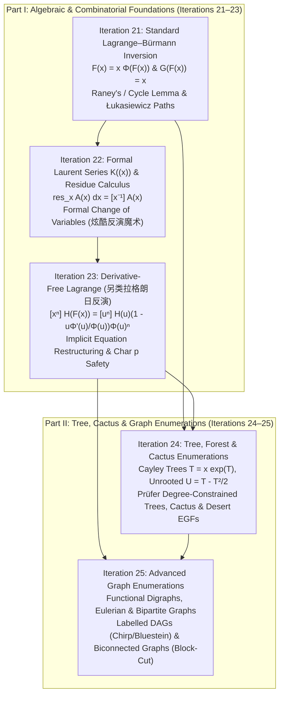
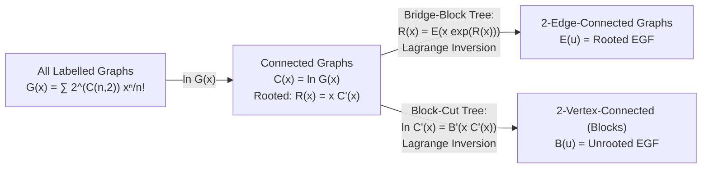

# Cohort 1 — Wave 3A (Iterations 21–25): Lagrange–Bürmann Inversion, Formal Laurent Series & Residue Calculus, Derivative-Free Forms, and Tree/Cactus/Graph Enumerations

---

## Executive Overview & Architectural Map of Wave 3A

When combinatorial structures or recurrence relations become **self-referential**—such as rooted trees decomposing into subtrees of the same species, random walks returning to the origin, or connected graphs decomposing into 2-connected blocks along cut vertices—their generating functions no longer satisfy linear or explicit algebraic equations. Instead, they are governed by **implicit functional equations** of the form:
$$F(x) = x \Phi(F(x)) \quad \text{or} \quad G(F(x)) = x.$$

While Newton's method on formal power series (FPS) can compute all coefficients $f_0, f_1, \dots, f_N$ up to degree $N$ in $O(N \log N)$ time, three fundamental scenarios demand a deeper theoretical and algorithmic weapon:
1. **Single-Coefficient Extraction in $O(N \log N)$ or $O(N)$ without Iterative Newton Loops**: When we only need $[x^N]F(x)$ or $[x^N]H(F(x))$ (or when $N$ is large and $\Phi(u)$ has a simple closed form whose powers can be extracted in $O(1)$ or $O(N)$ time), Newton iteration is either too slow or algebraically opaque.
2. **Bivariate & Parametric Coefficient Extraction**: When $\Phi(u, y)$ depends on a second parameter $y$ that only appears inside $[x^N]$, collapsing the implicit equation into a direct coefficient extraction $[u^{N-1}]$ decouples the variables immediately.
3. **Nontrivial Implicit Equations & Change of Variables (`炫酷反演魔术`)**: When an equation does not look like $F = x\Phi(F)$ at first glance (e.g., $F^3 - (1+x)F + x = 0$, or binomial convolutions of the form $\sum_k \binom{a + bk}{k} x^k$), the **Formal Residue Calculus** on Formal Laurent Series $K((x))$ lets us perform a **Change of Variables** $\operatorname{res}_x A(x)\,dx = \operatorname{res}_u A(G(u))G'(u)\,du$ just like contour integration in complex analysis, but with purely algebraic rigor over any field or ring.

---

## Iteration 21: Standard Lagrange–Bürmann Inversion — Functional & Compositional Forms, Raney's Lemma, and Algebraic Proofs

### 21.1 Concrete Combinatorial & Algebraic Objects

To state and apply Lagrange inversion without ambiguity or division-by-zero errors, we must first separate two distinct subspaces of the formal power series ring $K[[x]]$ (where $K$ is a commutative ring, typically a field of characteristic $0$ or a prime field $\mathbb{F}_p$ with $p > n$):

1. **The Compositional Group of Valuation-1 Series ($\mathcal{V}_1 \subset K[[x]]$)**:
   A formal power series $F(x) = \sum_{n \ge 0} f_n x^n \in K[[x]]$ has **valuation $1$** (written $\operatorname{val}(F) = \operatorname{ord}(F) = 1$) if and only if its constant term vanishes and its linear coefficient is a unit in $K$:
   $$[x^0]F(x) = f_0 = 0, \qquad [x^1]F(x) = f_1 \in K^\times.$$
   - *Combinatorial meaning*: $F(x)$ enumerates non-empty structures (size $\ge 1$) where there is a non-zero number of atomic structures of size $1$ (such as a single root vertex).
   - *Algebraic property*: Every $F(x) \in \mathcal{V}_1$ possesses a unique two-sided **compositional inverse** $G(x) = F^{\langle -1 \rangle}(x) \in \mathcal{V}_1$ satisfying:
     $$G(F(x)) = x \quad \text{and} \quad F(G(x)) = x.$$

2. **The Multiplicative Group of Unit Series ($K[[u]]^\times$)**:
   A formal power series $\Phi(u) = \sum_{m \ge 0} \phi_m u^m \in K[[u]]$ is a **multiplicative unit** if and only if its constant term is invertible:
   $$[u^0]\Phi(u) = \phi_0 \in K^\times.$$
   - *Combinatorial meaning*: $\Phi(u)$ is the **offspring (or branching) generating function**. For each $m \ge 0$, $\phi_m = [u^m]\Phi(u)$ is the weight or number of ways a single vertex can choose an ordered tuple (or set, in EGF) of $m$ child subtrees. The condition $\phi_0 \in K^\times$ guarantees that leaves (vertices with $0$ children) exist! Without leaves, every finite tree would be impossible to terminate.

---

### 21.2 The Two Canonical Forms and Their Dictionary Bridge

How do the compositional inverse equation $G(F(x)) = x$ and the implicit tree equation $F(x) = x\Phi(F(x))$ relate to each other? They are **the exact same mathematical statement** connected by a one-line dictionary bridge!

Suppose $F(x) = x\Phi(F(x))$ with $\Phi(0) \in K^\times$. Dividing both sides by $\Phi(F(x))$ (which is legal in $K[[x]]$ because $[x^0]\Phi(F(x)) = \Phi(0) \in K^\times$) yields:
$$\frac{F(x)}{\Phi(F(x))} = x.$$
If we define the series $G(u) \in K[[u]]$ by:
$$G(u) := \frac{u}{\Phi(u)} \iff \Phi(u) = \frac{u}{G(u)},$$
then $[u^0]G(u) = 0$ and $[u^1]G(u) = \Phi(0)^{-1} \in K^\times$, so $G(u) \in \mathcal{V}_1$ and $G(F(x)) = x$. Conversely, for any $G(u) \in \mathcal{V}_1$, we can factor out $u$ to write $G(u) = u \cdot (G(u)/u)$, where $\Phi(u) := (G(u)/u)^{-1} = \frac{u}{G(u)} \in K[[u]]^\times$.

> [!IMPORTANT]
> **Theorem 21.1 (Standard Lagrange–Bürmann Inversion Formula)**
> Let $F(x), G(u) \in \mathcal{V}_1$ be compositional inverses ($G(F(x)) = x$) related by $G(u) = \frac{u}{\Phi(u)}$ with $\Phi(u) \in K[[u]]^\times$, so that $F(x) = x\Phi(F(x))$. Then for every integer $n \ge 1$ (assuming $n \in K^\times$):
>
> 1. **Basic Coefficient Extraction ($H(u) = u$)**:
>    $$[x^n]F(x) = \frac{1}{n}[u^{n-1}]\Phi(u)^n = \frac{1}{n}[u^{n-1}]\left(\frac{u}{G(u)}\right)^n.$$
> 2. **Power Coefficient Extraction ($H(u) = u^k$ for $k \ge 1$)**:
>    $$[x^n]F(x)^k = \frac{k}{n}[u^{n-k}]\Phi(u)^n = \frac{k}{n}[u^{n-k}]\left(\frac{u}{G(u)}\right)^n.$$
> 3. **Composite Function Extraction (Lagrange–Bürmann Form for general $H(u) \in K[[u]]$)**:
>    $$[x^n]H(F(x)) = \frac{1}{n}[u^{n-1}]H'(u)\Phi(u)^n = \frac{1}{n}[u^{n-1}]H'(u)\left(\frac{u}{G(u)}\right)^n,$$
>    and `[x^0]H(F(x)) = [u^0]H(u) = H(0)`.

---

### 21.3 Diagnostic Signals & The Reverse-Engineering Scratchpad

#### The Diagnostic Signal
How do you recognize during a contest that a problem is calling for Lagrange Inversion? Look for any of these four structural fingerprints:
1. **Recursive Root-Subtree Decomposition**: You are counting rooted trees, cacti, or bracket/walk structures of size $n$ where removing the root of size $1$ leaves a collection of subtrees from the *exact same class*, combined via a sequence $\operatorname{SEQ}(\mathcal{F})$, multiset $\operatorname{MSET}(\mathcal{F})$, or exponential set $\operatorname{SET}(\mathcal{F})$.
2. **Convolutions with Index-Dependent Binomials / Exponents**: You encounter a sum or sequence containing terms like $\binom{an+b}{n}$, $\frac{k}{an+k}\binom{an+k}{n}$ (Fuss–Catalan / Raney numbers), or $\frac{k}{n}\frac{n^n}{n!}$ (Cayley tree forests). Notice that $n$ appears **inside the upper index of the binomial or inside the base of the power**—a hallmark of $[u^{n-k}]\Phi(u)^n$ where the exponent of $\Phi(u)$ matches the outer index $n$!
3. **Functional Composition / Elimination**: You have two generating functions $A(x)$ and $B(x)$ connected by $A(x) = B(x C(x))$ or $F(G(x)) = H(x)$, and you need the coefficients of the unknown inner or outer series.
4. **First-Passage / Return-Time Walks**: A lattice path takes steps from a step-set $S$, and you count paths that hit level $-k$ for the *first time* at step $n$.

#### The Reverse-Engineering Scratchpad: How to Discover the Setup
Suppose a problem gives you a recurrence or combinatorial rule where a structure of size $n \ge 1$ is built from a root vertex (contributing $x^1$) and an ordered sequence of $m$ children ($m \ge 0$), where having $m$ children carries weight $\phi_m$.
- **Step 1 (Write the Naive GF Equation)**:
  Summing over the number of children $m \ge 0$, the generating function $F(x) = \sum_{n \ge 1} f_n x^n$ satisfies:
  $$F(x) = x \sum_{m \ge 0} \phi_m F(x)^m = x \Phi(F(x)), \quad \text{where } \Phi(u) = \sum_{m \ge 0} \phi_m u^m.$$
- **Step 2 (Identify the Obstruction)**:
  Why can't we just extract $[x^n]$ from the right-hand side $x \Phi(F(x))$? Because $F(x)$ is inside $\Phi(\cdot)$, so $x$ is buried inside every power $F(x)^m$! Expanding $\sum_m \phi_m [x^{n-1}]F(x)^m$ just gives a circular recurrence for $f_n$ in terms of $m$-fold convolutions of $f_1, \dots, f_{n-1}$.
- **Step 3 (The Inversion Leap)**:
  Instead of viewing $F$ as a function of $x$ and trying to expand $\Phi(F(x))$, we **change the independent variable from $x$ to $u = F(x)$**. In the $u$-world, $F(x)$ is simply the monomial $u$, and the complicated branching rule $\Phi(F(x))$ becomes the *explicit, known* series $\Phi(u)$!
  The price of moving from the $x$-world to the $u$-world is that the $n$-th coefficient $[x^n]F(x)^k$ becomes a single coefficient extraction from the $n$-th power of the known series $\Phi(u)$:
  $$[x^n]F(x)^k = \frac{k}{n}[u^{n-k}]\Phi(u)^n.$$
  Notice the magic: the unknown $F(x)$ has completely vanished from the right-hand side!

---

### 21.4 Proof Track 1 — Combinatorial Bijection via Łukasiewicz Paths and Raney's / Cycle Lemma

Many competitive programmers memorize $\frac{1}{n}[u^{n-1}]\Phi(u)^n$ as an opaque formula from complex analysis. Yet its most illuminating proof—and one that directly solves lattice-path problems—comes from a pure bijection on **Łukasiewicz words** and **Raney's Lemma** (also known as the **Cycle Lemma**, Dvoretzky–Motzkin 1947).

#### Step 1: Combinatorial Interpretation of $[x^n]F(x)^k$ as Forests of $k$ Planted Plane Trees
Let $F(x) = x\Phi(F(x))$ where $\Phi(u) = \sum_{m \ge 0} \phi_m u^m$.
- By the symbolic method, $F(x)$ is the ordinary generating function (OGF) of **weighted planted plane trees** (rooted ordered trees), where a tree $T$ with $n$ vertices has weight $\operatorname{wt}(T) = \prod_{v \in V(T)} \phi_{\deg^+(v)}$, with $\deg^+(v)$ denoting the number of children (out-degree) of vertex $v$.
- Therefore, $[x^n]F(x)^k$ is the total weight of **ordered forests of $k$ rooted plane trees** $(T_1, T_2, \dots, T_k)$ having $n$ vertices in total.

#### Step 2: Encoding a $k$-Tree Forest as a Łukasiewicz Word
Traverse the $k$ trees $T_1, \dots, T_k$ in **preorder (depth-first search from left to right)**, visiting all $n$ vertices $v_1, v_2, \dots, v_n$, and record their out-degrees $(d_1, d_2, \dots, d_n) \in \mathbb{Z}_{\ge 0}^n$.
What characterizes a valid preorder out-degree sequence of a $k$-tree forest?
Think of a stack of "unfulfilled child pointers" (or pending subtrees):
- Initially, before visiting any vertex, we have $k$ roots waiting to be explored: the stack has height $k$.
- When we visit vertex $v_i$ with out-degree $d_i$, we **consume $1$ pending pointer** (for $v_i$ itself) and **push $d_i$ new pending pointers** (for its $d_i$ children).
- Thus, vertex $v_i$ changes the number of pending pointers by the net step:
  $$s_i := d_i - 1 \in \{-1, 0, 1, 2, \dots\}.$$
- Because the $k$ trees are completely explored at step $n$ and cannot run out of pending pointers before step $n$, a sequence $(d_1, \dots, d_n) \in \mathbb{Z}_{\ge 0}^n$ is the preorder degree sequence of a unique $k$-tree forest if and only if its partial sums $S_j = \sum_{i=1}^j (d_i - 1)$ satisfy:
  1. **Total sum condition**: $S_n = \sum_{i=1}^n (d_i - 1) = -k \iff \sum_{i=1}^n d_i = n - k$.
  2. **First-passage condition**: $S_j > -k$ for all $1 \le j < n$ ( Wait—more precisely, if a single tree ends when the net change drops by $-1$, then $k$ trees end when the net change reaches $-k$ for the *first* time at step $n$? Let's check carefully!).

Wait: let's verify what happens when the first tree $T_1$ finishes!
When $T_1$ finishes at some vertex $j_1$, the net change of $T_1$ is $-1$, so the remaining stack height drops from $k$ to $k-1$ for the first time ($S_{j_1} = -1$). Then $T_2$ starts and finishes when $S_{j_2} = -2$, and finally $T_k$ finishes at the very last vertex $n$, meaning $S_n = -k$ and **$S_j > -k$ for all $1 \le j \le n-1$**!
Let's double check this! Suppose $S_j > -k$ for all $1 \le j \le n-1$ and $S_n = -k$, where each step is $s_i = d_i - 1 \ge -1$.
Since every downward step has size at most $-1$ ($s_i \ge -1$), a path starting at $0$ and ending at $-k$ that stays strictly above $-k$ until step $n$ **must** hit $-1$ for the first time at some step $j_1$, then hit $-2$ for the first time at some step $j_2 > j_1$, ..., and finally hit $-k$ for the first time at step $j_k = n$!
Between $j_{r-1}+1$ and $j_r$, the subpath starts at $-(r-1)$, stays strictly above $-r$ until $j_r$, and hits $-r$ at $j_r$—which is the exact Łukasiewicz condition for the $r$-th rooted plane tree $T_r$!
This is a 1-to-1 weight-preserving bijection between:
- Ordered forests $(T_1, \dots, T_k)$ on $n$ vertices, and
- Sequences $(d_1, \dots, d_n) \in \mathbb{Z}_{\ge 0}^n$ such that $\sum_{i=1}^n (d_i - 1) = -k$ and $\sum_{i=1}^j (d_i - 1) > -k$ for all $1 \le j < n$.

#### Step 3: Unrestricted Degree Sequences vs. Cyclic Shifts (Raney's / Cycle Lemma)
Now look at the algebraic coefficient $[u^{n-k}]\Phi(u)^n$:
$$[u^{n-k}]\Phi(u)^n = [u^{n-k}] \left(\sum_{d \ge 0} \phi_d u^d\right)^n = \sum_{\substack{d_1, \dots, d_n \ge 0 \\ d_1 + \dots + d_n = n - k}} \phi_{d_1} \phi_{d_2} \cdots \phi_{d_n}.$$
Notice that $[u^{n-k}]\Phi(u)^n$ sums the exact same product of weights $\phi_{d_1}\cdots \phi_{d_n}$ over **all** sequences $(d_1, \dots, d_n)$ with $\sum_{i=1}^n (d_i - 1) = -k$, **without** the first-passage condition $S_j > -k$!

How many cyclic shifts of an arbitrary sequence $s = (s_1, \dots, s_n)$ with $s_i \ge -1$ and $\sum_{i=1}^n s_i = -k$ satisfy the first-passage condition $S_j > -k$ for all $1 \le j < n$?

> [!TIP]
> **Lemma 21.2 (Raney's Lemma / Cycle Lemma for Downward-Skip-Free Paths)**
> Let $s = (s_1, s_2, \dots, s_n)$ be any sequence of integers satisfying $s_i \ge -1$ for all $i$ and $\sum_{i=1}^n s_i = -k < 0$.
> Among the $n$ cyclic shifts $s^{(r)} = (s_{r+1}, \dots, s_n, s_1, \dots, s_r)$ ($0 \le r < n$), **if $s$ is aperiodic, exactly $k$ cyclic shifts** satisfy the first-passage property that their partial sums stay strictly above $-k$ until the $n$-th step. (More generally, if we pair each sequence with an index $i \in \{1, \dots, n\}$, exactly $k$ of the $n$ cyclic rotations yield a valid $k$-tree forest with a marked cyclic origin.)

**Proof of Lemma 21.2**:
Extend the sequence $s$ periodically to an infinite sequence $s_1, s_2, \dots$ with $s_{i+n} = s_i$, and consider its infinite prefix sums $S_m = \sum_{i=1}^m s_i$ (with $S_0 = 0$).
Note that $S_{m+n} = S_m - k$ for all $m \ge 0$.
For each $r \in \{0, 1, \dots, n-1\}$, the cyclic shift $s^{(r)}$ has partial sums $S_{r+j} - S_r$ for $1 \le j \le n$.
Thus, $s^{(r)}$ satisfies $S_{r+j} - S_r > -k$ for all $1 \le j < n$ (equivalently, $S_{r+n-j'} > S_{r+n}$ for all $1 \le j' < n$) if and only if $m = r+n$ is a **strict record low** of the prefix sum sequence $(S_m)$ when looking backwards (or equivalently, looking forward, $S_r$ is the last time its level is visited before dropping by $k$).
More concretely, define a **right-to-left strict minimum** (or **last-visit minimum**): call an index $r \in \{0, 1, \dots, n-1\}$ *good* if
$$S_j > S_r - k = S_{r+n} \quad \text{for all } r < j < r+n.$$
Since $s_i \ge -1$, the sequence $S_m$ can decrease by at most $1$ at each step ($S_{m+1} \ge S_m - 1$).
Because $S_{m+n} = S_m - k$, over every period of length $n$, the running minimum of $S$ drops by exactly $k$ integer levels! Since $S$ can only step down by $1$ at a time, it must hit every integer level along the way. For each of the $k$ integer levels $(\min S \text{ in period}) \pmod k$, the **first** index in the period that attains that record-low level satisfies $S_j > S_{r+n}$ for all preceding indices in the window of length $n$.
Hence, out of the $n$ cyclic positions in one period of length $n$, **exactly $k$ positions** yield a valid first-passage path!

Since cyclic rotation preserves the weight $\phi_{d_1}\phi_{d_2}\cdots\phi_{d_n}$, grouping all sequences $(d_1, \dots, d_n)$ with $\sum d_i = n-k$ into orbits under the $n$ cyclic rotations (or counting pairs of $((\text{sequence}), \text{rotation } r)$ in two ways) gives:
$$k \cdot [u^{n-k}]\Phi(u)^n = n \cdot [x^n]F(x)^k \implies [x^n]F(x)^k = \frac{k}{n}[u^{n-k}]\Phi(u)^n.$$
By linearity, for any polynomial or formal power series $H(u) = \sum_{k \ge 0} h_k u^k$, we have $H'(u) = \sum_{k \ge 1} k h_k u^{k-1}$, and summing over $k \ge 1$ yields the full Lagrange–Bürmann formula:
$$[x^n]H(F(x)) = \sum_{k \ge 1} h_k [x^n]F(x)^k = \sum_{k \ge 1} h_k \frac{k}{n}[u^{n-k}]\Phi(u)^n = \frac{1}{n}[u^{n-1}] \left(\sum_{k \ge 1} k h_k u^{k-1}\right) \Phi(u)^n = \frac{1}{n}[u^{n-1}]H'(u)\Phi(u)^n. \quad \blacksquare$$

---

### 21.5 Proof Track 2 — Elementary Algebraic Proof via Polynomial Truncation & Inductive Derivative Reduction

Can we prove Theorem 21.1 purely algebraically inside $K[[x]]$ without combinatorics and before introducing Laurent series? Yes! This proof (adapted from Henrici and Wilf) shows why the Jacobian derivative $G'(u)$ naturally appears.

Let $G(u) = \sum_{m \ge 1} g_m u^m \in \mathcal{V}_1$ and $F(x) \in \mathcal{V}_1$ satisfy $F(G(u)) = u$, and let $H(u) \in K[[u]]$ have $H(0) = 0$.
Define the composite series $A(x) := H(F(x)) = \sum_{k \ge 1} a_k x^k$. Substituting $x = G(u)$ gives:
$$H(u) = A(G(u)) = \sum_{k \ge 1} a_k G(u)^k.$$
Our goal is to isolate $a_n = [x^n]H(F(x))$ for a fixed $n \ge 1$.
Differentiate both sides with respect to $u$:
$$H'(u) = \sum_{k \ge 1} k a_k G(u)^{k-1} G'(u).$$
Now multiply both sides by $\Phi(u)^n = \left(\frac{u}{G(u)}\right)^n$ so that the $k=n$ term on the right-hand side has $G(u)^{n-1}$ cancelled except for $G'(u)/G(u)$:
$$H'(u) \left(\frac{u}{G(u)}\right)^n = \sum_{k \ge 1} k a_k u^n G(u)^{k-n-1} G'(u).$$
Wait: for $k \neq n$, notice that inside $K((u))$ (or by multiplying both sides by $G(u)^N$ to stay in $K[[u]]$), the term $G(u)^{k-n-1} G'(u)$ is an **exact formal derivative**:
$$G(u)^{k-n-1} G'(u) = \frac{1}{k-n} \frac{d}{du}\left(G(u)^{k-n}\right) \quad (k \neq n).$$
Because the coefficient of $u^{-1}$ in any formal derivative $\frac{d}{du}(\cdots)$ is $0$ (equivalently, $[u^{n-1}] \left(u^n \frac{d}{du} G(u)^{k-n}\right) = [u^{-1}] \frac{d}{du} G(u)^{k-n} = 0$), every single term with $k \neq n$ vanishes when we extract $[u^{n-1}]$!
And what about the single surviving term $k = n$?
For $k = n$, the summand is $n a_n u^n \frac{G'(u)}{G(u)}$. Since $G(u) = g_1 u + g_2 u^2 + \dots = g_1 u (1 + \frac{g_2}{g_1}u + \dots)$ with $g_1 \in K^\times$, we have:
$$\frac{G'(u)}{G(u)} = \frac{g_1 + 2g_2 u + \dots}{g_1 u (1 + \frac{g_2}{g_1}u + \dots)} = u^{-1} + c_0 + c_1 u + \dots.$$
Multiplying by $n a_n u^n$, the coefficient of $u^{n-1}$ in $n a_n u^n \frac{G'(u)}{G(u)}$ is simply $n a_n \cdot 1 = n a_n$!
Equating $[u^{n-1}]$ on both sides immediately yields:
$$[u^{n-1}] H'(u)\left(\frac{u}{G(u)}\right)^n = n a_n \implies a_n = \frac{1}{n}[u^{n-1}] H'(u)\left(\frac{u}{G(u)}\right)^n. \quad \blacksquare$$

*(In Iteration 22, we will formalize this exact calculation into the Formal Residue Calculus so that we can deploy it on arbitrary implicit equations in three lines!)*

---

### 21.6 Hand-Checkable Toy Examples ($n \le 4$)

#### Toy Example 1: Binary Trees / Shifted Catalan Series ($F(x) = \frac{1 - \sqrt{1-4x}}{2}$)
Consider rooted plane trees where every vertex has any number of children $\ge 0$:
- Offspring generator: $\Phi(u) = 1 + u + u^2 + u^3 + \dots = \frac{1}{1-u}$.
- Functional equation: $F(x) = x\Phi(F(x)) = \frac{x}{1 - F(x)} \iff F(x) - F(x)^2 = x$, so $G(u) = u(1-u)$.
- Let us compute $[x^n]F(x)$ for $n = 1, 2, 3, 4$ and $[x^n]F(x)^2$ for $n = 2, 3, 4$ using Theorem 21.1:
  - Since $\Phi(u)^n = (1-u)^{-n} = \sum_{m \ge 0} \binom{n+m-1}{m} u^m$, Theorem 21.1 gives:
    $$[x^n]F(x) = \frac{1}{n}[u^{n-1}](1-u)^{-n} = \frac{1}{n}\binom{2n-2}{n-1} = C_{n-1}.$$
    - $n=1$: $\frac{1}{1}\binom{0}{0} = 1$.
    - $n=2$: $\frac{1}{2}\binom{2}{1} = 1$.
    - $n=3$: $\frac{1}{3}\binom{4}{2} = 2$.
    - $n=4$: $\frac{1}{4}\binom{6}{3} = 5$.
    Indeed, $F(x) = x + x^2 + 2x^3 + 5x^4 + 14x^5 + \dots$.
  - Now check $k=2$ ($H(u) = u^2$):
    $$[x^n]F(x)^2 = \frac{2}{n}[u^{n-2}](1-u)^{-n} = \frac{2}{n}\binom{2n-3}{n-2}.$$
    - $n=2$: $\frac{2}{2}\binom{1}{0} = 1$.
    - $n=3$: $\frac{2}{3}\binom{3}{1} = 2$.
    - $n=4$: $\frac{2}{4}\binom{5}{2} = 5$.
    Direct squaring of $F(x) = x + x^2 + 2x^3 + 5x^4 + \dots$ gives:
    $$F(x)^2 = x^2 + 2x^3 + (1 + 4)x^4 + (2 + 4 + 2\cdot 4?) \dots = x^2 + 2x^3 + 5x^4 + 14x^5 + \dots,$$
    matching $1, 2, 5$ for $n=2, 3, 4$! (And matching $F(x)^2 = F(x) - x$).

---

### 21.7 Failure Modes, Pitfalls & Edge Cases

> [!WARNING]
> **Critical Pitfalls When Applying Standard Lagrange Inversion**
>
> 1. **Pitfall 1: Applying Lagrange Inversion to a Series with Non-Zero Constant Term ($[x^0]F(x) \neq 0$)**
>    - *Symptom*: You have the unshifted Catalan equation $C(x) = 1 + x C(x)^2$ (where $C(0) = 1 \neq 0$) and you try to set $C(x) = x\Phi(C(x))$. That fails because $x C(x)^2$ has constant term $0$, not $1$!
>    - *Fix*: **Always shift the constant term to zero first!** Define $F(x) := C(x) - C(0) = C(x) - 1$ (or define $F(x) := x C(x)$ so $\operatorname{val}(F) = 1$).
>      - If we set $F(x) = C(x) - 1$, then $1 + F(x) = 1 + x(1 + F(x))^2 \implies F(x) = x(1 + F(x))^2$, so $\Phi(u) = (1+u)^2$ and $[x^n]C(x) = [x^n]F(x) = \frac{1}{n}[u^{n-1}](1+u)^{2n} = \frac{1}{n}\binom{2n}{n-1} = \frac{1}{n+1}\binom{2n}{n}$.
>      - Alternatively, if we multiply by $x$ and set $F(x) = x C(x)$, then $F(x) = x + F(x)^2 \implies F(x) = \frac{x}{1 - F(x)}$, which reduces to Toy Example 1 with an index shift $[x^n]C(x) = [x^{n+1}]F(x)$.
>
> 2. **Pitfall 2: Vanishing Linear Coefficient ($\operatorname{val}(F) \ge 2 \iff \Phi(0) = 0$)**
>    - If $[x^1]F(x) = 0$, $F(x)$ has **no compositional inverse** in $K[[x]]$. If $F(x) = x^r \Phi(F(x))$ with $r \ge 2$ and $\Phi(0) \neq 0$, then $F(x)$ only has non-zero coefficients at multiples of $r$ (or $1 \pmod{r-1}$). You must perform a monomial substitution (e.g., $F(x) = x \tilde{F}(x^{r-1})$) to reduce to a valuation-1 series before inverting.
>
> 3. **Pitfall 3: Division by $n$ When $p \mid n$ in Characteristic $p$**
>    - The factor $\frac{1}{n}$ in $\frac{1}{n}[u^{n-1}]H'(u)\Phi(u)^n$ is undefined in $\mathbb{F}_p$ whenever $n$ is a multiple of $p$!
>    - *Fix*: Never divide by $n \equiv 0 \pmod p$. Instead, use the **Derivative-Free Lagrange Form** (Iteration 23):
>      $$[x^n]H(F(x)) = [u^n] H(u)\left(1 - \frac{u\Phi'(u)}{\Phi(u)}\right)\Phi(u)^n,$$
>      which involves **no division by $n$** and holds over any commutative ring $K$ regardless of characteristic!

---

## Iteration 22: Formal Laurent Series $K((x))$, Formal Residue Calculus, and Change of Variables (`炫酷反演魔术`)

### 22.1 Concrete Algebraic Object: The Ring/Field of Formal Laurent Series $K((x))$

Why do advanced competitive programming papers—most notably **Elegia (吕欣)** in the blog *"炫酷反演魔术" (Cool Inversion Magic)* and the 2019–2021 Chinese National Team papers, as well as **Ira Gessel** (`[EN]`) and **noshi91 / maspy** (`[JA]`)—prefer **Formal Residue Calculus** over memorizing five different versions of Lagrange inversion?
Because memorizing formulas breaks down as soon as a problem couples $x$ and $F(x)$ in a non-standard way (such as $F(x) = x e^{F(x) + x F(x)^2}$ or $A(x) = B(x(1+x)^2)$). Formal Residue Calculus gives you a **mechanical change-of-variables engine** where you substitute $u = F(x)$ and $dx = G'(u)\,du$ directly inside the coefficient extraction operator!

#### Definition of Formal Laurent Series $K((x))$
Let $K$ be a commutative ring (usually a field). A **formal Laurent series** over $K$ is a formal infinite series of the form:
$$A(x) = \sum_{n = v}^{\infty} a_n x^n, \qquad a_n \in K, \quad v \in \mathbb{Z},$$
allowing **at most finitely many negative powers of $x$**, and arbitrarily many positive powers of $x$.
The set of all formal Laurent series is denoted $K((x)) = K[[x]][x^{-1}]$.
- **Formal Valuation ($\operatorname{val}$ or $\operatorname{ord}$)**: For a non-zero $A(x) \in K((x))$, its valuation is the smallest integer $v \in \mathbb{Z}$ such that $[x^v]A(x) = a_v \neq 0$:
  $$\operatorname{val}(A) := \min\{n \in \mathbb{Z} : [x^n]A(x) \neq 0\}$$
  (with $\operatorname{val}(0) = +\infty$).
- **Invertibility in $K((x))$**: Every $A(x) \in K((x))$ with $a_v \in K^\times$ (where $v = \operatorname{val}(A)$) is invertible in $K((x))$! Why? Factor out $a_v x^v$:
  $$A(x) = a_v x^v \left(1 + \sum_{k \ge 1} \frac{a_{v+k}}{a_v} x^k\right) \implies A(x)^{-1} = a_v^{-1} x^{-v} \sum_{m \ge 0} \left(-\sum_{k \ge 1} \frac{a_{v+k}}{a_v} x^k\right)^m \in K((x)).$$
  In particular, when $K$ is a field, $K((x))$ is the **field of fractions** of $K[[x]]$, and $\operatorname{val}(AB) = \operatorname{val}(A) + \operatorname{val}(B)$.
- **Composition $A(G(u))$ in $K((u))$**: If $A(x) = \sum_{n \ge v} a_n x^n \in K((x))$ and $G(u) \in K((u))$ satisfies **$\operatorname{val}(G) \ge 1$** with leading coefficient Invertible ($g_{\operatorname{val}(G)} \in K^\times$), then $G(u)^n$ is well-defined in $K((u))$ even for negative $n \in [v, -1]$, and $\operatorname{val}(G(u)^n) = n \operatorname{val}(G) \to +\infty$ as $n \to +\infty$. Thus the infinite sum:
  $$A(G(u)) := \sum_{n = v}^{\infty} a_n G(u)^n \in K((u))$$
  is **coeffient-wise finite** (only finitely many $n$ contribute to $[u^m]$ for any fixed $m \in \mathbb{Z}$) and therefore algebraically well-defined without any analytic convergence requirements!

---

### 22.2 The Formal Residue Operator $\operatorname{res}_x$ and Differential 1-Forms $A(x)\,dx$

#### Definition of the Formal Residue
For any formal Laurent series $A(x) = \sum_{n \ge v} a_n x^n \in K((x))$, its **formal residue** (written $\operatorname{res}_x A(x)$ or $\operatorname{res}_x A(x)\,dx$) is the coefficient of $x^{-1}$:
$$\operatorname{res}_x A(x)\,dx := [x^{-1}] A(x) = a_{-1}.$$

Why is $[x^{-1}]$ singled out among all coefficients $[x^n]$?
1. **Universal Coefficient Extraction**: Any coefficient $[x^n]A(x)$ ($n \in \mathbb{Z}$) can be written as a formal residue simply by dividing by $x^{n+1}$:
   $$[x^n]A(x) = [x^{-1}]\left(\frac{A(x)}{x^{n+1}}\right) = \operatorname{res}_x \frac{A(x)}{x^{n+1}}\,dx.$$
2. **Cokernel of Formal Differentiation**: Look at the formal derivative of every monomial $x^k$ ($k \in \mathbb{Z}$):
   $$D_x(x^k) = k x^{k-1}.$$
   As $k$ ranges over $\mathbb{Z}$, the exponent $k-1$ hits every integer **except $-1$**, because $k-1 = -1 \implies k = 0$, and $D_x(x^0) = 0 \cdot x^{-1} = 0$!
   Thus $x^{-1}$ is the **only monomial in $K((x))$ that can never be produced by differentiating a Laurent series**.

> [!IMPORTANT]
> **Theorem 22.1 (The Four Fundamental Rules of Formal Residue Calculus)**
> Let $F(x), G(x), A(x) \in K((x))$ be formal Laurent series. Then:
>
> 1. **Vanishing of Exact Derivatives**:
>    $$\operatorname{res}_x F'(x)\,dx = 0.$$
> 2. **Formal Integration by Parts**:
>    $$\operatorname{res}_x F'(x)G(x)\,dx = -\operatorname{res}_x F(x)G'(x)\,dx.$$
> 3. **Logarithmic Derivative Residue (Argument Principle)**: If $\operatorname{val}(G) = v \in \mathbb{Z}$ with $[x^v]G(x) \in K^\times$, then:
>    $$\operatorname{res}_x \frac{G'(x)}{G(x)}\,dx = \operatorname{val}(G).$$
> 4. **Formal Change-of-Variables Theorem (Substitution Rule for 1-Forms)**:
>    Let $G(u) \in K[[u]]$ have positive valuation $\operatorname{val}(G) \ge 1$ with leading coefficient invertible in $K$ (and if $\operatorname{char}(K) = p > 0$, assume $\operatorname{val}(G) = 1$, i.e. $G \in \mathcal{V}_1$). Then for every formal Laurent series $A(x) \in K((x))$:
>    $$\operatorname{res}_x A(x)\,dx = \operatorname{val}(G) \cdot \operatorname{res}_u A(G(u)) G'(u)\,du.$$
>    In particular, when $\operatorname{val}(G) = 1$ ($G(0) = 0, G'(0) \in K^\times$), putting $x = G(u)$ and $dx = G'(u)\,du$ preserves the residue identically:
>    $$\boxed{\operatorname{res}_x A(x)\,dx = \operatorname{res}_u A(G(u)) G'(u)\,du.}$$

---

### 22.3 Step-by-Step Proof of the Formal Residue Calculus Rules

Let us prove all four rules of Theorem 22.1 with zero hand-waving, including why Rule 4 holds even in prime characteristic $p > 0$ when $\operatorname{val}(G) = 1$.

- **Proof of Rule 1 ($\operatorname{res}_x F'(x)\,dx = 0$)**:
  Write $F(x) = \sum_{k \ge v} f_k x^k$. Then $F'(x) = \sum_{k \ge v} k f_k x^{k-1}$. Extracting the coefficient of $x^{-1}$ corresponds to $k - 1 = -1 \implies k = 0$, giving $[x^{-1}]F'(x) = 0 \cdot f_0 = 0$.

- **Proof of Rule 2 (Integration by Parts)**:
  By the Leibniz product rule $(F(x)G(x))' = F'(x)G(x) + F(x)G'(x)$. Applying $\operatorname{res}_x$ and Rule 1 to the left-hand side gives:
  $$0 = \operatorname{res}_x (FG)'\,dx = \operatorname{res}_x F'(x)G(x)\,dx + \operatorname{res}_x F(x)G'(x)\,dx \implies \operatorname{res}_x F'(x)G(x)\,dx = -\operatorname{res}_x F(x)G'(x)\,dx.$$

- **Proof of Rule 3 ($\operatorname{res}_x \frac{G'(x)}{G(x)}\,dx = \operatorname{val}(G)$)**:
  Let $v = \operatorname{val}(G)$, and factor $G(x) = c x^v H(x)$ where $c = [x^v]G(x) \in K^\times$ and $H(x) \in K[[x]]$ has constant term $[x^0]H(x) = 1$.
  By the product rule for logarithmic derivatives:
  $$G'(x) = c v x^{v-1} H(x) + c x^v H'(x) \implies \frac{G'(x)}{G(x)} = \frac{v}{x} + \frac{H'(x)}{H(x)}.$$
  Since $[x^0]H(x) = 1$, $H(x)^{-1} \in K[[x]]$ and $H'(x) \in K[[x]]$ contain **no negative powers of $x$**, so $\frac{H'(x)}{H(x)} \in K[[x]]$ has $[x^{-1}]\frac{H'(x)}{H(x)} = 0$.
  Therefore:
  $$\operatorname{res}_x \frac{G'(x)}{G(x)}\,dx = [x^{-1}]\left(v x^{-1} + \frac{H'(x)}{H(x)}\right) = v = \operatorname{val}(G).$$

- **Proof of Rule 4 (Formal Change-of-Variables Theorem)**:
  By $K$-linearity and coefficient-wise finiteness of $A(G(u)) = \sum_{k \ge v} a_k G(u)^k$, it suffices to prove the identity for every single monomial $A(x) = x^k$ ($k \in \mathbb{Z}$):
  $$\operatorname{res}_u G(u)^k G'(u)\,du \stackrel{?}{=} \operatorname{val}(G) \cdot [x^{-1}]x^k = \begin{cases} \operatorname{val}(G) & \text{if } k = -1, \\ 0 & \text{if } k \neq -1. \end{cases}$$
  - **Case 1 ($k = -1$)**: By Rule 3, $\operatorname{res}_u G(u)^{-1} G'(u)\,du = \operatorname{res}_u \frac{G'(u)}{G(u)}\,du = \operatorname{val}(G)$, which matches!
  - **Case 2 ($k \neq -1$, Characteristic $0$)**: Over a field of characteristic $0$, $k + 1 \neq 0$ is invertible, so by the chain rule:
    $$G(u)^k G'(u) = \frac{1}{k+1} \frac{d}{du}\left(G(u)^{k+1}\right).$$
    Since $G(u)^{k+1} \in K((u))$, Rule 1 immediately gives $\operatorname{res}_u G(u)^k G'(u)\,du = \frac{1}{k+1} \operatorname{res}_u (G^{k+1})'\,du = 0$.
  - **Case 3 ($k \neq -1$, Characteristic $p > 0$ with $\operatorname{val}(G) = 1$) — The Universal Ring Lifting Trick**:
    What if $\operatorname{char}(K) = p > 0$ and $p \mid (k+1)$, so we cannot divide by $k+1$ in $K$?
    Write $G(u) = g_1 u + g_2 u^2 + \dots$ with $g_1 \in K^\times$. For any fixed $k \in \mathbb{Z} \setminus \{-1\}$, the coefficient $[u^{-1}]\left(G(u)^k G'(u)\right)$ is a polynomial in $g_1^{-1}$ and finitely many coefficients $g_1, g_2, \dots, g_M$ with **integer coefficients**, i.e., an element of the universal ring $R = \mathbb{Z}[g_1, g_1^{-1}, g_2, g_3, \dots]$.
    Because $R$ is an integral domain of **characteristic $0$** that embeds into $\mathbb{Q}(g_1, g_2, \dots)$, Case 2 proves that $[u^{-1}]\left(G(u)^k G'(u)\right) = 0$ identically as a polynomial in $R = \mathbb{Z}[g_1, g_1^{-1}, g_2, \dots]$!
    Applying the ring homomorphism $R \to K$ sending the indeterminates $g_i$ to the actual coefficients of $G(u) \in K[[u]]$ sends $0 \in R$ to $0 \in K$.
    Thus $\operatorname{res}_u G(u)^k G'(u)\,du = 0$ holds over **every commutative ring $K$ of any characteristic** whenever $\operatorname{val}(G) = 1$ and $g_1 \in K^\times$! $\blacksquare$

---

### 22.4 Elegia's "Cool Inversion Magic" (`炫酷反演魔术`) & The 3-Line Unified Derivation

Let us now see how Theorem 22.1 turns coefficient extraction of implicit generating functions into a three-line differential substitution.

#### The Reverse-Engineering Scratchpad: How to Use Formal Residues
Suppose you want to compute $[x^n] H(F(x))$ where $x$ and $F(x)$ are related by some equation.
1. **Rewrite Coefficient Extraction as a Residue in $x$**:
   $$[x^n] H(F(x)) = \operatorname{res}_x \frac{H(F(x))}{x^{n+1}}\,dx.$$
2. **Choose a Valuation-1 New Variable $u$**:
   Identify the composite inner expression $u = F(x)$ (with $\operatorname{val}(F) = 1$), so that $x = G(u)$ is an explicit function of $u$ and $dx = G'(u)\,du$.
3. **Substitute $x = G(u)$ and $dx = G'(u)\,du$ via Rule 4**:
   $$\operatorname{res}_x \frac{H(F(x))}{x^{n+1}}\,dx = \operatorname{res}_u \frac{H(u)}{G(u)^{n+1}} G'(u)\,du.$$
4. **Optional Integration by Parts (Rule 2)**:
   If $G'(u)$ is ugly or you prefer differentiating $H(u)$ instead of $G(u)$, note that $\frac{G'(u)}{G(u)^{n+1}} = -\frac{1}{n}\frac{d}{du}\left(G(u)^{-n}\right)$, and integrate by parts!

#### Three-Line Derivation of All Standard & Generalized Lagrange Forms
Let $F(x) = x\Phi(F(x)) \iff x = G(F(x))$ where $G(u) = \frac{u}{\Phi(u)}$.

- **Form 1 (Derivative-Free Lagrange Form — Direct Substitution)**:
  Since $x = \frac{u}{\Phi(u)}$, logarithmic differentiation gives $\frac{dx}{x} = \left(\frac{1}{u} - \frac{\Phi'(u)}{\Phi(u)}\right)du = \frac{\Phi(u) - u\Phi'(u)}{u\Phi(u)}\,du$.
  Substitute directly into $\operatorname{res}_x H(F(x)) x^{-n} \frac{dx}{x}$:
  $$\begin{aligned}
  [x^n]H(F(x)) &= \operatorname{res}_x H(F(x)) x^{-n} \frac{dx}{x} \\
  &= \operatorname{res}_u H(u) \left(\frac{\Phi(u)}{u}\right)^n \frac{\Phi(u) - u\Phi'(u)}{u\Phi(u)}\,du \\
  &= [u^n] H(u)\left(1 - \frac{u\Phi'(u)}{\Phi(u)}\right)\Phi(u)^n.
  \end{aligned}$$
  *(Zero integration by parts, zero division by $n$!)*

- **Form 2 (Standard Lagrange–Bürmann Form — Integration by Parts)**:
  Starting from $\operatorname{res}_u H(u) G(u)^{-n-1} G'(u)\,du$ and integrating by parts with $U = H(u)$ and $dV = G(u)^{-n-1}G'(u)\,du = d\left(-\frac{1}{n}G(u)^{-n}\right)$:
  $$\begin{aligned}
  [x^n]H(F(x)) &= \operatorname{res}_u H(u) \left(-\frac{1}{n} G(u)^{-n}\right)'\,du \\
  &= \frac{1}{n} \operatorname{res}_u H'(u) G(u)^{-n}\,du \quad \text{(by Rule 2)} \\
  &= \frac{1}{n} [u^{n-1}] H'(u) \left(\frac{u}{G(u)}\right)^n = \frac{1}{n}[u^{n-1}] H'(u)\Phi(u)^n.
  \end{aligned}$$

---

### 22.5 Hand-Checkable Toy Example ($n \le 4$) & Failure Modes

#### Toy Example: Direct Verification of Formal Change of Variables on $A(x) = x^{-3}$
Let $A(x) = x^{-3}$, so $\operatorname{res}_x A(x)\,dx = [x^{-1}]x^{-3} = 0$.
Let us verify that substituting $x = G(u) = u(1-u)$ (which has $\operatorname{val}(G) = 1$) and $dx = G'(u)\,du = (1-2u)\,du$ still gives $0$:
$$\begin{aligned}
A(G(u))G'(u) &= \frac{1 - 2u}{u^3(1-u)^3} = u^{-3} (1 - 2u) \sum_{m \ge 0} \binom{m+2}{2} u^m \\
&= u^{-3} (1 - 2u) \left(1 + 3u + 6u^2 + 10u^3 + \dots\right).
\end{aligned}$$
Let us extract $[u^{-1}]$ (which corresponds to $[u^2]$ in $(1-2u)(1 + 3u + 6u^2 + \dots)$):
$$[u^{-1}] A(G(u))G'(u) = 1 \cdot 6 - 2 \cdot 3 = 6 - 6 = 0!$$
Now check $A(x) = x^{-1}$, where $\operatorname{res}_x x^{-1}\,dx = 1$:
$$A(G(u))G'(u) = \frac{1 - 2u}{u(1-u)} = u^{-1}(1-2u)(1 + u + u^2 + \dots) = u^{-1} - u^0 - u^1 - \dots \implies [u^{-1}] = 1!$$
Notice how the Jacobian factor $G'(u) = 1 - 2u$ is **essential**: without $1-2u$, $[u^{-1}]\left(u^{-3}(1-u)^{-3}\right)$ would be $6 \neq 0$!

> [!CAUTION]
> **Failure Modes of Formal Residue Calculus**
> 1. **Forgetting the Jacobian $dx = G'(u)\,du$**: Never write $[x^{-1}]A(x) = [u^{-1}]A(G(u))$. You are transforming the **differential 1-form** $A(x)\,dx$, not the scalar function $A(x)$! Always write $dx = G'(u)\,du$ explicitly.
> 2. **Characteristic $p$ Failure When $\operatorname{val}(G) = p$**: In $\mathbb{F}_p((u))$, if $G(u) = u^p$ ($\operatorname{val}(G) = p$), then $G'(u) = p u^{p-1} = 0$! For $A(x) = x^{-1}$, $\operatorname{res}_x x^{-1}\,dx = 1$, whereas $\operatorname{res}_u A(G(u))G'(u)\,du = 0$ (and $\operatorname{val}(G) \equiv 0 \pmod p$). Thus in characteristic $p$, you must **only** change variables via series $G(u)$ with $\operatorname{val}(G) = 1$ (or $\gcd(\operatorname{val}(G), p) = 1$ with leading term invertible).

---

## Iteration 23: Derivative-Free Lagrange Form (`另类拉格朗日反演`), Generalized Bürmann Forms, and Implicit Equation Restructuring

### 23.1 Concrete Algebraic Object & The Two Derivative-Free Forms

In Chinese competitive programming literature (popularized by Elegia, command_block, and OI-Wiki as **"另类拉格朗日反演"**—*Alternative Lagrange Inversion*) and in Japanese FPS literature (`maspypy.com`, `noshi91`), the **Derivative-Free Form** of Lagrange–Bürmann inversion is often preferred over Theorem 21.1 as the *primary* working formula.

> [!IMPORTANT]
> **Theorem 23.1 (Derivative-Free / Alternative Lagrange–Bürmann Inversion)**
> Let $F(x) \in \mathcal{V}_1$ and $G(u) \in \mathcal{V}_1$ be compositional inverses ($G(F(x)) = x$) related by $F(x) = x\Phi(F(x))$ with $\Phi(u) = \frac{u}{G(u)} \in K[[u]]^\times$. Then for **every integer $n \in \mathbb{Z}$** and **every formal Laurent series $H(u) \in K((u))$**:
>
> 1. **In terms of the branching generator $\Phi(u)$**:
>    $$\boxed{[x^n] H(F(x)) = [u^n] H(u) \left(1 - \frac{u\Phi'(u)}{\Phi(u)}\right) \Phi(u)^n = [u^{n-1}] H(u) \Phi(u)^{n-1} \left(\Phi(u) - u\Phi'(u)\right).}$$
> 2. **In terms of the inverse series $G(u)$**:
>    $$\boxed{[x^n] H(F(x)) = [u^{n-1}] H(u) G'(u) \left(\frac{u}{G(u)}\right)^{n+1} = \operatorname{res}_u \frac{H(u) G'(u)}{G(u)^{n+1}}\,du.}$$

#### Step-by-Step Algebraic Proof
As shown in Section 22.4, write $[x^n]H(F(x)) = \operatorname{res}_x H(F(x)) x^{-n-1}\,dx$ and apply the Formal Change-of-Variables Theorem (Theorem 22.1, Rule 4) with $x = G(u) = \frac{u}{\Phi(u)}$:
1. Differentiate $x = u \Phi(u)^{-1}$ with respect to $u$:
   $$G'(u) = \Phi(u)^{-1} - u \Phi(u)^{-2} \Phi'(u) = \frac{\Phi(u) - u\Phi'(u)}{\Phi(u)^2}.$$
2. Substitute $x^{-n-1} = u^{-n-1}\Phi(u)^{n+1}$ and $dx = G'(u)\,du$:
   $$\begin{aligned}
   [x^n] H(F(x)) &= \operatorname{res}_u H(u) u^{-n-1} \Phi(u)^{n+1} \frac{\Phi(u) - u\Phi'(u)}{\Phi(u)^2}\,du \\
   &= \operatorname{res}_u u^{-n-1} H(u) \left(1 - \frac{u\Phi'(u)}{\Phi(u)}\right) \Phi(u)^n\,du \\
   &= [u^n] H(u) \left(1 - \frac{u\Phi'(u)}{\Phi(u)}\right) \Phi(u)^n. \quad \blacksquare
   \end{aligned}$$

---

### 23.2 Four Major Advantages of the Derivative-Free Form

Why should a competitive programmer reach for Theorem 23.1 instead of the standard $\frac{1}{n}[u^{n-1}]H'(u)\Phi(u)^n$?

| Feature | Standard Form: $\frac{1}{n}[u^{n-1}]H'(u)\Phi(u)^n$ | Derivative-Free Form: $[u^n]H(u)\left(1 - \frac{u\Phi'(u)}{\Phi(u)}\right)\Phi(u)^n$ |
| :--- | :--- | :--- |
| **Division by $n$** | **Fails** when $n = 0$ or $n \equiv 0 \pmod p$ in $\mathbb{F}_p$. | **Never divides by $n$**! Valid over any commutative ring $K$ and for all $n \in \mathbb{Z}$. |
| **Action on $H(u)$** | Differentiates $H(u) \mapsto H'(u)$ (destroys $[u^0]H$ and shifts indices). | Leaves $H(u)$ **completely untouched** as a linear multiplier! |
| **Negative Powers ($H(u) = u^{-k}$)** | Undefined at $n = 0$; awkward index shifts. | Works seamlessly for $H(u) = u^{-k}$ ($k \in \mathbb{Z}$), giving $[x^n]F(x)^{-k}$ for Laurent series. |
| **Summing Over All $n \ge 0$** | Cannot be summed directly because of the $\frac{1}{n}$ prefactor. | Directly sums into the **Generalized Binomial / Raney Generating Function**! |

#### The Master Diagonal / Raney Generating Function Identity
Let us highlight Advantage 4, which is one of the most powerful "reverse Lagrange" tricks in competitive programming.
Suppose a problem asks you to compute or simplify a sum of the form:
$$S(x) = \sum_{n=0}^{\infty} \left([u^n] A(u) \Phi(u)^n\right) x^n,$$
for example $\sum_{n \ge 0} \binom{an+b}{n} x^n$ where $\Phi(u) = (1+u)^a$ and $A(u) = (1+u)^b$.
Look at Theorem 23.1: if we set $H(u) \left(1 - \frac{u\Phi'(u)}{\Phi(u)}\right) = A(u)$, i.e.,
$$H(u) := \frac{A(u)}{1 - \frac{u\Phi'(u)}{\Phi(u)}},$$
then Theorem 23.1 says that for every $n \ge 0$:
$$[u^n] A(u) \Phi(u)^n = [x^n] H(F(x)) = [x^n] \left(\frac{A(F(x))}{1 - \frac{F(x)\Phi'(F(x))}{\Phi(F(x))}}\right)!$$
Since two formal power series with identical coefficients $[x^n]$ for all $n \ge 0$ are equal, we obtain the **Master Diagonal Identity** (also known as the **Bürmann–Lagrange Resummation Formula**):

> [!TIP]
> **Corollary 23.2 (Lagrange Resummation / Diagonal Extraction Identity)**
> Let $F(x) = x\Phi(F(x))$ with $\Phi(0) \in K^\times$. Then for any $A(u) \in K[[u]]$:
> $$\boxed{\sum_{n=0}^{\infty} x^n [u^n] \left(A(u) \Phi(u)^n\right) = \frac{A(F(x))}{1 - \frac{F(x)\Phi'(F(x))}{\Phi(F(x))}} = \frac{A(F(x))}{1 - x\Phi'(F(x))} = \frac{x F'(x)}{F(x)} A(F(x)).}$$
> *(Proof of the last equality: Differentiate $\ln F(x) = \ln x + \ln \Phi(F(x))$ to get $\frac{F'(x)}{F(x)} = \frac{1}{x} + \frac{\Phi'(F(x))}{\Phi(F(x))} F'(x) \implies \frac{x F'(x)}{F(x)} = \frac{1}{1 - \frac{F(x)\Phi'(F(x))}{\Phi(F(x))}}$.)*

**Instant Application to Generalized Binomial Sums**:
Take $\Phi(u) = (1+u)^a$ and $A(u) = (1+u)^b$, so $F(x) = x(1+F(x))^a$. Since $\frac{u\Phi'(u)}{\Phi(u)} = \frac{au}{1+u}$, Corollary 23.2 immediately gives both classic identities side by side:
1. **Extracted Form (Raney / Fuss–Catalan)**: Setting $H(u) = (1+u)^b$ in Theorem 21.1 gives:
   $$[x^n] (1+F(x))^b = \frac{b}{an+b}\binom{an+b}{n}.$$
2. **Resummed Form (Lambert / Binomial Convolution)**: Setting $A(u) = (1+u)^b$ in Corollary 23.2 gives:
   $$\sum_{n=0}^{\infty} \binom{an+b}{n} x^n = \frac{(1+F(x))^{b+1}}{1 - (a-1)F(x)}.$$
   Notice why $\sum_{n \ge 0} \binom{2n}{n} x^n = \frac{1}{\sqrt{1-4x}}$ ($a=2, b=0$): here $F(x) = x(1+F(x))^2$, and $\frac{1+F(x)}{1-F(x)} = \frac{1}{\sqrt{1-4x}}$!

---

### 23.3 Reverse-Engineering Implicit Equations: How to Restructure Non-Standard Equations

In real contests, a generating function $Y(x)$ rarely arrives pre-packaged as $Y(x) = x\Phi(Y(x))$. Instead, you obtain a messy polynomial or transcendental equation $P(x, Y(x)) = 0$ from a recurrence or symbolic specification.

#### The 4-Step Restructuring Scratchpad
Whenever you face an implicit equation $P(x, Y(x)) = 0$ and need $[x^n]Y(x)$ (or $[x^n]H(Y(x))$):

1. **Step 1 — Pin Down the Constant Term $y_0 = Y(0)$**:
   Substitute $x = 0$ into $P(0, y_0) = 0$. If there are multiple roots for $y_0$, use the problem's base case $[x^0]Y(x)$ (and check that $[x^1]Y(x)$ matches the combinatorial small case $n=1$).
2. **Step 2 — Shift to Valuation $1$**:
   Define $U(x) := Y(x) - y_0$ so that $U(0) = 0$. Rewrite the equation in terms of $x$ and $U$. (If $[x^1]U(x) = 0$, say $\operatorname{val}(U) = r > 1$, factor out $x^{r-1}$ by setting $\tilde{U}(x) = U(x)/x^{r-1}$.)
3. **Step 3 — Solve for $x$ as a Function of $U$ (or Parameterize the Curve)**:
   Look at how $x$ appears in the shifted equation $\tilde{P}(x, U) = 0$:
   - **Subcase 3a ($x$ appears linearly)**: If $\tilde{P}(x, U) = A(U) - x B(U) = 0$ with $\operatorname{val}(A) = 1$ and $B(0) \neq 0$, then immediately:
     $$x = G(U) = \frac{A(U)}{B(U)} \implies \Phi(U) = \frac{U B(U)}{A(U)}!$$
   - **Subcase 3b ($x$ and $U$ appear in a coupled monomial $W = x U^a$ or $W = x \psi(U)$)**: Define the composite variable $u := x \psi(U(x))$ (which automatically has $\operatorname{val}(u) = 1$ if $\psi(0) \neq 0$!), express $U$ in terms of $u$, and then express $x = G(u) = \frac{u}{\psi(U(u))}$.
4. **Step 4 — Change Variables in the Formal Residue**:
   Substitute $x = G(u)$ and $dx = G'(u)\,du$ into $\operatorname{res}_x \frac{H(Y(x))}{x^{n+1}}\,dx$.

---

#### Worked Case Study 1: The Entangled Cubic $(1+x)Y(x)^3 - Y(x) + x = 0$ with $Y(0) = 0$
Suppose a problem asks for $[x^n] Y(x)$ where $Y(x) \in K[[x]]$ satisfies:
$$(1+x)Y(x)^3 - Y(x) + x = 0, \qquad Y(0) = 0.$$
- **Scratchpad**:
  At first glance, this looks terrible: $Y(x)^3$ is multiplied by $1+x$, so $Y(x) = x + (1+x)Y(x)^3$ has $x$ appearing *twice* in incompatible ways ($x$ alone and $x Y^3$).
  Wait—follow **Step 3a**: how does $x$ appear in $(1+x)Y^3 - Y + x = 0$? **Linearly!**
  Group all terms containing $x$ on the left and all terms without $x$ on the right:
  $$x (1 + Y(x)^3) = Y(x) - Y(x)^3 = Y(x)(1 - Y(x)^2).$$
  Divide by $1 + Y(x)^3$ (which is a unit in $K[[x]]$ since $Y(0) = 0$):
  $$x = G(Y(x)), \quad \text{where } G(u) = \frac{u(1-u^2)}{1+u^3} \iff \Phi(u) = \frac{u}{G(u)} = \frac{1+u^3}{1-u^2}!$$
- **Extraction**:
  By Theorem 21.1, for any $n \ge 1$:
  $$[x^n] Y(x) = \frac{1}{n} [u^{n-1}] \Phi(u)^n = \frac{1}{n} [u^{n-1}] \frac{(1+u^3)^n}{(1-u^2)^n}.$$
  Expanding the numerator $(1+u^3)^n = \sum_{j \ge 0} \binom{n}{j} u^{3j}$ and the denominator $(1-u^2)^{-n} = \sum_{m \ge 0} \binom{n+m-1}{m} u^{2m}$, we need $3j + 2m = n - 1$, which gives an explicit $O(n)$ sum (or $O(1)$ per term):
  $$[x^n] Y(x) = \frac{1}{n} \sum_{\substack{j \ge 0 \\ 3j \le n-1,\; 2 \mid (n-1-3j)}} \binom{n}{j} \binom{n + \frac{n-1-3j}{2} - 1}{\frac{n-1-3j}{2}}.$$

#### Worked Case Study 2: Schroeder / Delannoy Type Quadratic $(1-x)Y(x)^2 - (1-x)Y(x) + x = 0$ with $Y(0) = 0$
Let us trace another classic structure where $x$ appears linearly:
$$(1-x)Y(x)^2 - (1-x)Y(x) + x = 0, \qquad Y(0) = 0.$$
- **Scratchpad**:
  Collect $x$:
  $$x(1 + Y - Y^2) = Y - Y^2 = Y(1-Y) \implies x = \frac{Y(1-Y)}{1 + Y - Y^2} \implies \Phi(u) = \frac{1 + u - u^2}{1 - u}.$$
  Then $[x^n]Y(x) = \frac{1}{n}[u^{n-1}] \left(\frac{1+u-u^2}{1-u}\right)^n = \frac{1}{n}[u^{n-1}] \left(1 + \frac{u(2-u)}{1-u}\right)^n$.

#### Worked Case Study 3: Coupled Parameterization When $x$ is NOT Linear ($Y(x) = 1 + x Y(x)^a (1 + x Y(x)^b)^c$)
What if $x$ does **not** appear linearly, such as:
$$Y(x) = 1 + x Y(x)^a \left(1 + x Y(x)^b\right)^c?$$
Wait: if $a \neq b$, $x$ appears with two different powers of $Y$. Can we still apply Lagrange inversion if $b = a - 1$?
Suppose $b = a - 1$, so $Y(x) - 1 = x Y(x)^a (1 + x Y(x)^{a-1})^c$.
Define the helper series $u(x) := x Y(x)^{a-1}$ (which has $\operatorname{val}(u) = 1$ since $Y(0) = 1$).
Look at $Y(x) - 1 = u(x) Y(x) (1 + u(x))^c$: this is **linear in $Y(x)$**!
Solving for $Y(x)$ in terms of $u(x)$ gives:
$$Y(x) \left(1 - u(1+u)^c\right) = 1 \implies Y = \frac{1}{1 - u(1+u)^c}!$$
And since $u = x Y^{a-1}$, we immediately recover $x$ purely as a function of $u$:
$$x = \frac{u}{Y(u)^{a-1}} = u \left(1 - u(1+u)^c\right)^{a-1} = G(u)!$$
Now both $x = G(u)$ and $Y = H(u) = (1 - u(1+u)^c)^{-1}$ are explicit functions of the valuation-1 parameter $u$, so Formal Residue Calculus extracts $[x^n]Y(x)$ in one line!

---

### 23.4 Hand-Checkable Toy Examples ($n \le 4$) & Failure Modes

Let us hand-check Worked Case Study 1: $(1+x)Y(x)^3 - Y(x) + x = 0 \iff Y(x) = x + (1+x)Y(x)^3$.
1. **Direct expansion in $x$ up to $x^4$**:
   - $Y(x) = x + O(x^2)$.
   - $Y(x)^3 = (x + O(x^2))^3 = x^3 + O(x^4)$.
   - Substituting back into $Y(x) = x + (1+x)Y(x)^3$:
     $$Y(x) = x + (1+x)(x^3 + O(x^5)) = x + 0x^2 + x^3 + x^4 + O(x^5).$$
     So the exact coefficients for $n = 1, 2, 3, 4$ are $1, 0, 1, 1$.
2. **Check via our Lagrange formula**:
   $$[x^n]Y(x) = \frac{1}{n} \sum_{\substack{j \ge 0 \\ 2m = n-1-3j \ge 0}} \binom{n}{j} \binom{n+m-1}{m}.$$
   - **$n = 1$**: $3j + 2m = 0 \implies j=0, m=0$: $\frac{1}{1}\binom{1}{0}\binom{0}{0} = 1$. (Matches!)
   - **$n = 2$**: $3j + 2m = 1 \implies$ no non-negative integer solution $(j, m)$! Sum is $0$. (Matches!)
   - **$n = 3$**: $3j + 2m = 2 \implies j=0, m=1$: $\frac{1}{3}\binom{3}{0}\binom{3+1-1}{1} = \frac{1}{3} \cdot 1 \cdot 3 = 1$. (Matches!)
   - **$n = 4$**: $3j + 2m = 3 \implies j=1, m=0$: $\frac{1}{4}\binom{4}{1}\binom{4+0-1}{0} = \frac{1}{4} \cdot 4 \cdot 1 = 1$. (Matches!)

---

## Iteration 24: Tree, Forest, Prüfer, and Cactus/Desert Enumerations via Implicit EGF/OGF

### 24.1 Concrete Combinatorial Objects: OGF (Unlabelled Plane) vs. EGF (Labelled Non-Plane)

Why do some tree counting problems use $\Phi(u) = \frac{1}{1-u}$ while others use $\Phi(u) = e^u$? The choice of generating function ring encodes two structural properties of the tree:
1. **Vertex Labels**: Are the $n$ vertices distinguishable ($1, 2, \dots, n$, requiring an **Exponential Generating Function (EGF)** $F(x) = \sum_{n \ge 0} f_n \frac{x^n}{n!}$) or indistinguishable (requiring an **Ordinary Generating Function (OGF)** $F(x) = \sum_{n \ge 0} f_n x^n$)?
2. **Sibling Ordering**: Are the children of a vertex ordered from left to right (**plane / ordered**, corresponding to the sequence operator $\operatorname{SEQ}(u) = \frac{1}{1-u}$), or unordered (**non-plane**, corresponding to the exponential set operator $\operatorname{SET}(u) = e^u$ in EGF, or the Euler transform / Pólya multiset operator $\operatorname{MSET}(u)$ in OGF)?

---

### 24.2 Rooted Labelled Trees ($T(x) = x e^{T(x)}$), Unrooted Trees, and Forests

#### 1. Rooted Labelled Trees and Cayley's Formula
Let $\mathcal{T}$ be the combinatorial class of **rooted labelled trees** on vertex set $\{1, 2, \dots, n\}$, with EGF $T(x) = \sum_{n \ge 1} t_n \frac{x^n}{n!}$.
- **Symbolic Specification**: A rooted labelled tree consists of a root vertex $\mathcal{Z}$ (EGF $x$) together with a possibly empty unordered set of rooted labelled subtrees $\operatorname{SET}(\mathcal{T})$ (EGF $\exp(T(x))$):
  $$\mathcal{T} = \mathcal{Z} \star \operatorname{SET}(\mathcal{T}) \implies T(x) = x \exp(T(x)).$$
- **Coefficient Extraction via Lagrange Inversion**:
  Here $\Phi(u) = e^u$, so $\Phi(u)^n = e^{nu}$. By Theorem 21.1:
  $$[x^n] T(x) = \frac{1}{n} [u^{n-1}] e^{nu} = \frac{1}{n} \frac{n^{n-1}}{(n-1)!} = \frac{n^{n-1}}{n!} \implies t_n = n! [x^n]T(x) = n^{n-1}.$$
  Since a tree on $n$ labelled vertices has $n$ choices for the root, the number of **unrooted labelled trees** on $n$ vertices is $u_n = \frac{t_n}{n} = n^{n-2}$ (**Cayley's Formula**).

#### 2. Labelled Forests of $k$ Rooted Trees ($F_k(x) = \frac{1}{k!} T(x)^k$)
What is the EGF of unordered forests consisting of $k$ rooted labelled trees?
By the $\operatorname{SET}_k$ construction, it is $F_k(x) = \frac{1}{k!} T(x)^k$.
Applying the power form of Lagrange inversion ($[x^n]T(x)^k = \frac{k}{n}[u^{n-k}]e^{nu}$):
$$\begin{aligned}
f_{n, k} &= n! [x^n] \left(\frac{1}{k!} T(x)^k\right) = \frac{n!}{k!} \cdot \frac{k}{n} [u^{n-k}] e^{nu} \\
&= \frac{(n-1)!}{(k-1)!} \frac{n^{n-k}}{(n-k)!} = \binom{n-1}{k-1} n^{n-k}.
\end{aligned}$$

#### 3. Unrooted Labelled Trees as an Algebraic EGF Identity: The Dissimilarity Characteristic $U(x) = T(x) - \frac{1}{2}T(x)^2$
Suppose a problem needs the **EGF $U(x) = \sum_{n \ge 1} n^{n-2} \frac{x^n}{n!}$ of unrooted labelled trees** expressed directly as a function of $T(x)$ (for instance, to take $\exp(U(x))$ and count unrooted forests, or inside a differential equation). How do we express $U(x)$ in terms of $T(x)$ without integration?

> [!TIP]
> **Proposition 24.1 (Unrooted Tree EGF & The Dissimilarity Characteristic)**
> Let $T(x) = x e^{T(x)}$ be the EGF of rooted labelled trees. Then the EGF $U(x) = \sum_{n \ge 1} n^{n-2} \frac{x^n}{n!}$ of unrooted labelled trees is given by:
> $$\boxed{U(x) = T(x) - \frac{1}{2} T(x)^2.}$$

**Two Complementary Proofs (Algebraic & Combinatorial)**:
1. **Reverse-Engineered Algebraic Proof**:
   Notice that $[x^n]U(x) = \frac{1}{n}[x^n]T(x)$, which means $x U'(x) = T(x) \iff U'(x) = \frac{T(x)}{x}$.
   Differentiate $T(x) = x e^{T(x)}$:
   $$T'(x) = e^{T(x)} + x e^{T(x)} T'(x) = \frac{T(x)}{x} + T(x) T'(x) \implies \frac{T(x)}{x} = T'(x)(1 - T(x)).$$
   Therefore:
   $$U'(x) = \frac{T(x)}{x} = T'(x) - T(x) T'(x) = \frac{d}{dx}\left(T(x) - \frac{1}{2}T(x)^2\right).$$
   Since $U(0) = T(0) = 0$, integrating both sides yields $U(x) = T(x) - \frac{1}{2}T(x)^2$!
2. **Combinatorial Proof (Dissimilarity Theorem for Trees, Otter 1948)**:
   In any finite tree $\tau$, the number of vertices minus the number of edges is identically $1$:
   $$|V(\tau)| - |E(\tau)| = 1.$$
   Now consider any unrooted labelled tree $\tau$ on $n$ vertices:
   - Choosing a **root vertex** $v \in V(\tau)$ produces a rooted labelled tree; across all $\tau$, the EGF of vertex-rooted trees is $T(x)$.
   - Choosing an **edge** $e \in E(\tau)$ and deleting $e$ splits $\tau$ into an unordered pair of two vertex-rooted trees $\{\tau_1, \tau_2\}$ (rooted at the two endpoints of $e$); across all $\tau$, the EGF of edge-rooted trees is $\frac{1}{2} T(x)^2$.
   Subtracting edge-rooted trees from vertex-rooted trees counts each unrooted tree $\tau$ with weight $|V(\tau)| - |E(\tau)| = 1$:
   $$U(x) = T(x) - \frac{1}{2}T(x)^2! \quad \blacksquare$$

---

### 24.3 Degree-Constrained Labelled Trees & The Prüfer–Lagrange Duality

Suppose we want to count rooted (or unrooted) labelled trees on $n$ vertices where every vertex's out-degree (number of children $c = \deg(v) - [v \neq \text{root}]$) is restricted to a set $C \subseteq \mathbb{Z}_{\ge 0}$, or carries a weight $w_c$.
- **EGF Formulation**:
  The offspring EGF is $\Phi(u) = \sum_{c \ge 0} w_c \frac{u^c}{c!}$, and the rooted tree EGF satisfies $T(x) = x \Phi(T(x))$.
- **Lagrange Extraction**:
  By Theorem 21.1, the number (or total weight) of rooted labelled trees on $n$ vertices is:
  $$t_n = n! [x^n] T(x) = (n-1)! [u^{n-1}] \left(\sum_{c \ge 0} w_c \frac{u^c}{c!}\right)^n.$$
- **Why this equals Prüfer Sequences**:
  Expanding $\Phi(u)^n$ as a sum over tuples $(c_1, \dots, c_n)$ of out-degrees with $\sum_{i=1}^n c_i = n - 1$ gives:
  $$t_n = (n-1)! \sum_{c_1 + \dots + c_n = n-1} \frac{w_{c_1}\cdots w_{c_n}}{c_1! \cdots c_n!} = n \sum_{c_1 + \dots + c_n = n-1} \binom{n-2}{c_1, \dots, c_n\text{ (shifted)}} w_{c_1}\cdots w_{c_n},$$
  which is the exact multinomial coefficient of Prüfer codes! Thus **Lagrange inversion on $T(x) = x\Phi(T(x))$ is the algebraic embodiment of Prüfer sequences**, with the added power that $\Phi(u)^n$ can be computed via fast polynomial exponentiation $\exp(n \ln \Phi(u))$ in $O(n \log n)$ time!

---

### 24.4 Cactus Graphs (`仙人掌图计数`, LOJ 6569) and Desert Graphs (`有标号荒漠计数`, Luogu P5434)

#### Concrete Combinatorial Object
- A **Cactus Graph** (Husimi tree) is a connected simple undirected graph in which every edge belongs to **at most one** simple cycle. Equivalently, every biconnected component (block) is either a single bridge edge ($K_2$) or a simple cycle ($C_m$, $m \ge 3$).
- A **Desert Graph** (`荒漠`) is an arbitrary simple undirected graph whose connected components are all cactus graphs (the cactus analogue of a forest).

#### Step-by-Step Symbolic Derivation of the Rooted Cactus EGF $C(x)$
Let $C(x) = \sum_{n \ge 1} c_n \frac{x^n}{n!}$ be the EGF of **vertex-rooted labelled cactus graphs** (which is simply $x$ times the derivative of the unrooted cactus EGF, or where one vertex is distinguished as the root).
How does a rooted cactus decompose at its root vertex $r$?
1. Remove the root $r$. The cactus breaks into an **unordered set** ($\operatorname{SET}$) of "root lobes" (blocks incident to $r$, together with the sub-cacti hanging off all other vertices of those blocks).
2. What does a single lobe incident to $r$ look like? There are two disjoint possibilities:
   - **Type A (Bridge Edge Lobe)**: The block at $r$ is a single edge $\{r, v\}$ connecting $r$ to the root $v$ of a smaller rooted cactus.
     $$\text{EGF of a Bridge Edge Lobe} = C(x).$$
   - **Type B (Simple Cycle Lobe of Length $m \ge 3$)**: The block at $r$ is a simple cycle $(r, v_1, v_2, \dots, v_{m-1})$ of length $m \ge 3$ ($m-1 \ge 2$ non-root vertices on the cycle).
     At each vertex $v_i$ ($1 \le i \le m-1$), deleting the cycle edges leaves a rooted cactus rooted at $v_i$.
     Traversing the cycle from $r$ gives a sequence $(T_1, T_2, \dots, T_{m-1})$ of $m-1 \ge 2$ rooted cacti, **up to reversing the traversal direction** $(T_{m-1}, \dots, T_1)$ (since the graph is undirected and $m-1 \ge 2$)!
     Therefore, the EGF of a cycle lobe across all cycle lengths $m \ge 3$ is:
     $$\text{EGF of a Cycle Lobe} = \sum_{m=3}^{\infty} \frac{C(x)^{m-1}}{2} = \frac{C(x)^2}{2(1 - C(x))}.$$
3. **Total Lobe EGF and Rooted Cactus Equation**:
   Adding Type A and Type B gives the EGF of a single lobe attached to $r$:
   $$L(C(x)) = C(x) + \frac{C(x)^2}{2(1 - C(x))} = \frac{2C(x) - C(x)^2}{2(1 - C(x))}.$$
   Since the root vertex $r$ contributes $x$ and is attached to a $\operatorname{SET}$ of lobes, we obtain the famous **Rooted Cactus Functional Equation**:
   $$\boxed{C(x) = x \exp\left(\frac{2C(x) - C(x)^2}{2(1 - C(x))}\right).}$$

#### Fast Extraction: $O(n)$ Single-Coefficient Formula via Lagrange Inversion (LOJ 6569)
Suppose we want the number of unrooted labelled cactus graphs on $n$ vertices:
$$c_n^{\text{unrooted}} = \frac{c_n}{n} = \frac{n!}{n} [x^n] C(x) = (n-1)! [x^n] C(x).$$
Look at $C(x) = x \Phi(C(x))$ where $\Phi(u) = \exp\left(\frac{2u - u^2}{2(1-u)}\right)$.
By Theorem 21.1:
$$[x^n] C(x) = \frac{1}{n} [u^{n-1}] \Phi(u)^n = \frac{1}{n} [u^{n-1}] \exp\left(\frac{n(2u - u^2)}{2(1-u)}\right).$$
Wait: do we even need an $O(n \log n)$ polynomial $\exp$ to extract $[u^{n-1}]$ for a single $n$? **No—we can do it in $O(n)$ time!**
Watch how partial fractions split the exponent into a tree part and a cycle part:
$$\frac{2u - u^2}{2(1-u)} = \frac{2u(1-u) + u^2}{2(1-u)} = u + \frac{u^2}{2(1-u)}.$$
Why is writing $\frac{2u-u^2}{2(1-u)} = u + \frac{u^2}{2(1-u)}$ so magical?
Because $\exp\left(n u + \frac{n u^2}{2(1-u)}\right) = e^{nu} \cdot \exp\left(\frac{nu^2}{2(1-u)}\right)$!
Let's expand both factors in powers of $u$:
- First factor: $e^{nu} = \sum_{j=0}^{n-1} \frac{n^j}{j!} u^j + O(u^n)$.
- Second factor: For $\exp\left(\frac{n}{2} \cdot \frac{u^2}{1-u}\right)$, expand the outer $\exp(z) = \sum_{k \ge 0} \frac{z^k}{k!}$ where $z = \frac{n}{2} u^2 (1-u)^{-1}$ counts cacti with exactly $k$ cycles:
  $$\begin{aligned}
  \exp\left(\frac{nu^2}{2(1-u)}\right) &= 1 + \sum_{k=1}^{\lfloor (n-1)/2 \rfloor} \frac{(n/2)^k}{k!} u^{2k} (1-u)^{-k} \\
  &= 1 + \sum_{k=1}^{\lfloor (n-1)/2 \rfloor} \frac{(n/2)^k}{k!} \sum_{m \ge k} \binom{m-1}{k-1} u^{k+m}.
  \end{aligned}$$
  Setting $i = k + m$ (the degree of $u$ contributed by the second factor, so $j = n - 1 - i$ comes from $e^{nu}$), we get an **$O(n)$ closed-form sum** for $c_n^{\text{unrooted}} = (n-1)! [x^n]C(x) = \frac{(n-1)!}{n} [u^{n-1}]\Phi(u)^n$:
  $$\boxed{c_n^{\text{unrooted}} = \frac{(n-1)!}{n} \left[ \frac{n^{n-1}}{(n-1)!} + \sum_{i=2}^{n-1} \frac{n^{n-1-i}}{(n-1-i)!} \sum_{k=1}^{\lfloor i/2 \rfloor} \frac{(n/2)^k}{k!} \binom{i-k-1}{k-1} \right].}$$
  *(And if we need $c_n^{\text{unrooted}}$ for **all** $1 \le n \le N$ simultaneously, or if we need the full series $C(x) \bmod x^{N+1}$ to compute Deserts $\exp(U_{\text{cac}}(x))$ in Luogu P5434, we solve $C(x) - x\exp\left(\frac{2C(x)-C(x)^2}{2(1-C(x))}\right) = 0$ via 1-variable Newton iteration in $O(N \log N)$ time!)*

#### From Rooted Cactus $C(x)$ to Unrooted Cactus $U_{\text{cac}}(x)$ and Deserts $D(x)$ (Luogu P5434)
How do we express the unrooted cactus EGF $U_{\text{cac}}(x) = \sum_{n \ge 1} c_n^{\text{unrooted}} \frac{x^n}{n!}$ in terms of $C(x)$?
1. **Direct Coefficient Integration ($O(N)$ time)**: Since $x U'_{\text{cac}}(x) = C(x)$, we simply divide each coefficient $[x^n]C(x)$ by $n$:
   $$U_{\text{cac}}(x) = \int_0^x \frac{C(t)}{t}\,dt = \sum_{n \ge 1} \frac{[x^n]C(x)}{n} x^n.$$
2. **Block-Cut Tree Dissimilarity Identity**:
   Notice that the lobe generator $L(u) = u + \frac{u^2}{2(1-u)}$ is the derivative $B'(u)$ of the **Cactus Block EGF** $B(u) = \frac{u^2}{2} + \sum_{m \ge 3} \frac{u^m}{2m} = \frac{1}{2}\left(\ln\frac{1}{1-u} - u + \frac{u^2}{2}\right)$ (counting a single bridge $K_2$ or simple cycle $C_m$).
   For **any** connected graph species satisfying $C(x) = x \exp(B'(C(x)))$, differentiating $U_{\text{cac}}(x) = C(x) + B(C(x)) - C(x)B'(C(x))$ with respect to $C$ gives:
   $$\frac{d}{dC}\left(C + B(C) - C B'(C)\right) = 1 - C B''(C) = C \frac{d}{dC}\left(\ln C - B'(C)\right) = C \frac{dx}{x\,dC} = \frac{d U_{\text{cac}}}{dC}!$$
   This reflects the **Block-Cut Tree Dissimilarity Theorem**: in the bipartite block-cut tree of any connected graph, $|\text{Vertices}| + |\text{Blocks}| - |\text{Vertex-Block Incidences}| = 1$, so:
   $$\boxed{U_{\text{cac}}(x) = C(x) + B(C(x)) - C(x) B'(C(x)).}$$
3. **Desert EGF**: Taking the exponential of $U_{\text{cac}}(x)$ immediately gives the EGF of **Labelled Deserts** (`有标号荒漠计数`, Luogu P5434):
   $$D(x) = \exp\left(U_{\text{cac}}(x)\right).$$

---

### 24.5 Hand-Checkable Toy Example ($n \le 4$) for Cactus Counting

Let us hand-check our $O(n)$ cactus formula for $n = 1, 2, 3, 4$:
- **$n = 1$**: $1$ vertex: $c_1^{\text{unrooted}} = 1^{1-2} = 1$.
- **$n = 2$**: $K_2$: $c_2^{\text{unrooted}} = 2^{2-2} = 1$.
- **$n = 3$**: On $3$ labelled vertices, a connected graph is either a path ($3$ ways) or a triangle $C_3$ ($1$ way), and all $4$ are cacti!
  Checking our formula for $n = 3$:
  $$\frac{(3-1)!}{3} \left[ \frac{3^2}{2!} + \underbrace{\frac{3^0}{0!} \cdot \frac{(3/2)^1}{1!} \binom{2-1-1}{0}}_{i=2, k=1} \right] = \frac{2}{3} \left[\frac{9}{2} + \frac{3}{2}\right] = 3 + 1 = 4.$$
- **$n = 4$**: On $4$ labelled vertices, how many connected graphs are cacti?
  - Trees on $4$ vertices ($k=0$ cycles): $4^{4-2} = 16$.
  - Graphs with one $C_3$ and one pendant edge ($k=1, i=2$): $\binom{4}{3} \cdot 3 = 12$.
  - Graphs that are a single $C_4$ ($k=1, i=3$): $\frac{3!}{2} = 3$.
  - (Graphs with two cycles like $K_4 - e$ or $K_4$ have edges shared by multiple cycles, so they are NOT cacti!)
  Total cacti on $4$ vertices: $16 + 12 + 3 = 31$.
  Plugging $n = 4$ into our formula:
  $$\frac{3!}{4} \left[ \frac{4^3}{3!} + \underbrace{\frac{4^1}{1!} \cdot \frac{2^1}{1!} \binom{0}{0}}_{i=2, k=1} + \underbrace{\frac{4^0}{0!} \cdot \frac{2^1}{1!} \binom{1}{0}}_{i=3, k=1} \right] = \frac{6}{4} \left[ \frac{64}{6} + 8 + 2 \right] = 16 + 12 + 3 = 31!$$
  Notice how locking down small cases ($n=3, 4$) immediately catches any off-by-one or prefactor error (such as confusing $\frac{(n-1)!}{n}$ with $(n-2)!$).

> [!IMPORTANT]
> **Verified $O(n)$ Closed-Form Summation for Unrooted Labelled Cacti on $n$ Vertices (LOJ 6569)**:
> For $n \ge 1$, the number of unrooted labelled cactus graphs on $n$ vertices is:
> $$\boxed{c_n^{\text{unrooted}} = \frac{(n-1)!}{n} [u^{n-1}] \exp\left(nu + \frac{nu^2}{2(1-u)}\right) = n^{n-2} + \frac{(n-1)!}{n} \sum_{i=2}^{n-1} \frac{n^{n-1-i}}{(n-1-i)!} \sum_{k=1}^{\lfloor i/2 \rfloor} \frac{(n/2)^k}{k!} \binom{i-k-1}{k-1}.}$$
> Notice how the $i=0$ term is $n^{n-2}$ (counting the $n^{n-2}$ trees with $k=0$ cycles), while each $k \ge 1$ counts cacti with exactly $k$ cycles!

---

## Iteration 25: Graph Enumerations via Generating Functions — Functional Digraphs, Connected/Eulerian/Bipartite Graphs, Labelled DAGs, and Biconnected Graphs

### 25.1 The Fundamental $\exp$–$\ln$ Bridge for Labelled Graphs (Riddell's Formula)

Every advanced labelled graph enumeration problem begins with the **Exponential Formula** ($\mathcal{G} = \operatorname{SET}(\mathcal{C}) \iff G(x) = \exp(C(x))$): any graph class $\mathcal{G}$ whose membership is determined independently on each connected component is the exponential of its connected subclass $\mathcal{C}$.

For arbitrary simple undirected graphs on $n$ labelled vertices, each of the $\binom{n}{2}$ potential edges is independently present or absent, so $g_n = 2^{\binom{n}{2}}$.
- **All Simple Labelled Graphs EGF**:
  $$G(x) = \sum_{n=0}^{\infty} 2^{\binom{n}{2}} \frac{x^n}{n!}.$$
- **Connected Simple Labelled Graphs EGF (Riddell 1951)**:
  $$C(x) = \ln G(x) = \sum_{n=1}^{\infty} c_n \frac{x^n}{n!},$$
  computable for all $1 \le n \le N$ in $O(N \log N)$ time via polynomial $\ln$.
- **Hand-Checkable Toy Values ($n \le 4$)**:
  - $G(x) = 1 + x + 2\frac{x^2}{2!} + 8\frac{x^3}{3!} + 64\frac{x^4}{4!} + \dots$.
  - $C(x) = \ln G(x) = x + 1\frac{x^2}{2!} + 4\frac{x^3}{3!} + 38\frac{x^4}{4!} + 728\frac{x^5}{5!} + \dots$, giving $c_1 = 1, c_2 = 1, c_3 = 4, c_4 = 38$.

---

### 25.2 Functional Digraphs (Mappings $f: [n] \to [n]$) and Constrained Pseudotrees

#### Concrete Combinatorial Object
A **functional digraph** on vertex set $[n] = \{1, 2, \dots, n\}$ is a directed graph in which every vertex has out-degree $1$ (representing a function $f: [n] \to [n]$ via directed edges $i \to f(i)$).
What is the structure of a connected functional digraph?
Follow the unique outgoing edges $v \to f(v) \to f(f(v)) \to \dots$: since the component is finite, it must eventually enter a **unique directed cycle** $(r_1 \to r_2 \to \dots \to r_k \to r_1)$ of length $k \ge 1$ ($k=1$ is a fixed point / self-loop $r_1 \to r_1$). And every vertex not on the cycle has a unique directed path leading into some cycle vertex $r_j$, meaning each $r_j$ is the root of a **rooted labelled tree** $T(x) = x e^{T(x)}$!

#### Symbolic Specification & Resummation via Corollary 23.2
1. **Connected Functional Digraph EGF**:
   A connected functional digraph is a directed cycle of rooted labelled trees:
   $$\mathcal{C}_{\text{func}} = \operatorname{CYC}(\mathcal{T}) \implies C_{\text{func}}(x) = \sum_{k=1}^{\infty} \frac{T(x)^k}{k} = \ln\frac{1}{1 - T(x)}.$$
2. **All Functional Digraphs EGF**:
   $$\mathcal{F}_{\text{func}} = \operatorname{SET}(\mathcal{C}_{\text{func}}) \implies F_{\text{func}}(x) = \exp\left(\ln\frac{1}{1 - T(x)}\right) = \frac{1}{1 - T(x)}.$$
3. **Why $n! [x^n] \frac{1}{1 - T(x)} = n^n$ (Verification via Corollary 23.2)**:
   For $T(x) = x e^{T(x)}$, we have $\Phi(u) = e^u \implies \frac{u\Phi'(u)}{\Phi(u)} = u$.
   Applying the Master Diagonal Identity (Corollary 23.2) with $A(u) = 1$:
   $$\frac{1}{1 - T(x)} = \frac{1}{1 - \frac{T(x)\Phi'(T(x))}{\Phi(T(x))}} = \sum_{n=0}^{\infty} x^n [u^n] (e^u)^n = \sum_{n=0}^{\infty} n^n \frac{x^n}{n!}!$$
4. **Constrained Cycle Lengths & Undirected Unicyclic Graphs (Pseudotrees / 基环树)**:
   - If cycle lengths are restricted to a subset $L \subseteq \mathbb{Z}_{\ge 1}$ (e.g., `51nod 1728` where $f^{(a)}(x) = f^{(b)}(x)$ restricts tree depths $\le \min(a,b)$ and cycle lengths to divisors of $|a-b|$), the EGF is simply:
     $$F_L(x) = \exp\left(\sum_{k \in L} \frac{T_{\le d}(x)^k}{k}\right).$$
   - For **undirected connected unicyclic graphs** (simple undirected graphs with $n$ vertices and $n$ edges), the unique cycle must have length $k \ge 3$ and is undirected (dividing by $2k$ instead of $k$):
     $$C_{\text{unicyclic}}(x) = \sum_{k=3}^{\infty} \frac{T(x)^k}{2k} = \frac{1}{2}\left(\ln\frac{1}{1 - T(x)} - T(x) - \frac{T(x)^2}{2}\right).$$

---

### 25.3 Labelled Eulerian Graphs (`有标号欧拉图计数`)

An undirected graph is **Eulerian** if and only if it is **connected** and **every vertex has even degree**.
- **Step 1: Count Even-Degree Graphs ($W(x)$)**:
  How many simple graphs on $n \ge 1$ labelled vertices have every vertex of even degree?
  Isolate vertex $n$. On the remaining $n - 1$ vertices $\{1, 2, \dots, n-1\}$, choose any subset of the $\binom{n-1}{2}$ possible edges freely ($2^{\binom{n-1}{2}}$ choices).
  Now, for each vertex $v \in \{1, \dots, n-1\}$, connect $v$ to $n$ if and only if the current degree of $v$ inside $\{1, \dots, n-1\}$ is odd! This uniquely forces the degrees of $1, \dots, n-1$ to become even. And what about the degree of vertex $n$? Since the sum of all degrees in any graph is $2|E|$ (even), and $\deg(1), \dots, \deg(n-1)$ are all even, $\deg(n)$ is **automatically even**!
  Therefore, the number of even-degree labelled graphs on $n \ge 1$ vertices is $w_n = 2^{\binom{n-1}{2}}$, with EGF:
  $$W(x) = 1 + \sum_{n=1}^{\infty} 2^{\binom{n-1}{2}} \frac{x^n}{n!}.$$
- **Step 2: Take $\ln$ to Isolate Connected Even-Degree Graphs**:
  Since a graph has all degrees even if and only if each of its connected components has all degrees even, the EGF of **labelled Eulerian graphs** is:
  $$\boxed{E_{\text{Euler}}(x) = \ln W(x) = \ln\left(1 + \sum_{n=1}^{\infty} 2^{\binom{n-1}{2}} \frac{x^n}{n!}\right).}$$

---

### 25.4 Labelled Bipartite & Connected Bipartite Graphs (`有标号二分图计数`)

How do we count bipartite graphs on $n$ labelled vertices when a bipartite graph does not come with a canonical 2-coloring?

#### The Reverse-Engineering Scratchpad: From 2-Colored Graphs to Bipartite Graphs via $\frac{1}{2}\ln$ and $\sqrt{\cdot}$
1. **Start with Properly 2-Colored Graphs ($B_{\text{2col}}(x)$)**:
   Suppose we color each vertex in $[n]$ either Black or White, and only allow edges between a Black vertex and a White vertex. If $k$ vertices are colored Black and $n-k$ are colored White, there are $\binom{n}{k}$ colorings and $2^{k(n-k)}$ valid edge sets:
   $$B_{\text{2col}}(x) = \sum_{n=0}^{\infty} \frac{x^n}{n!} \sum_{k=0}^n \binom{n}{k} 2^{k(n-k)}.$$
2. **Fast $O(N \log N)$ Evaluation of $B_{\text{2col}}(x)$ via Chirp / Square-Completion**:
   Notice the cross-exponent $k(n-k)$ in $2^{k(n-k)}$! We cannot directly convolve $k$ and $n-k$ unless we decouple $k(n-k)$ using the identity:
   $$k(n-k) = \binom{n}{2} - \binom{k}{2} - \binom{n-k}{2}.$$
   Substituting $2^{k(n-k)} = 2^{\binom{n}{2}} 2^{-\binom{k}{2}} 2^{-\binom{n-k}{2}}$ and $\binom{n}{k} = \frac{n!}{k!(n-k)!}$ immediately decouples the sum into a pure Cauchy product (polynomial multiplication):
   $$[x^n] B_{\text{2col}}(x) = 2^{\binom{n}{2}} \sum_{k=0}^n \left(\frac{1}{2^{\binom{k}{2}} k!}\right) \left(\frac{1}{2^{\binom{n-k}{2}} (n-k)!}\right)!$$
   Thus $B_{\text{2col}}(x) \bmod x^{N+1}$ is computed in a **single NTT multiplication** of $\hat{P}(x) = \sum_{k \ge 0} \frac{x^k}{2^{\binom{k}{2}} k!}$ with itself!
3. **Connected Bipartite Graphs ($C_{\text{bip}}(x)$) and All Bipartite Graphs ($B_{\text{bip}}(x)$)**:
   - Taking $\ln B_{\text{2col}}(x)$ gives the EGF of **connected 2-colored graphs**.
   - Every connected bipartite graph on $n \ge 1$ vertices has **exactly $2$ proper 2-colorings** (obtained by swapping Black $\leftrightarrow$ White)!
   - Therefore, dividing the connected 2-colored EGF by $2$ yields the EGF of **connected labelled bipartite graphs**:
     $$C_{\text{bip}}(x) = \frac{1}{2} \ln B_{\text{2col}}(x).$$
   - Finally, exponentiating $C_{\text{bip}}(x)$ gives the EGF of **all labelled bipartite graphs**:
     $$\boxed{B_{\text{bip}}(x) = \exp\left(C_{\text{bip}}(x)\right) = \exp\left(\frac{1}{2}\ln B_{\text{2col}}(x)\right) = \sqrt{B_{\text{2col}}(x)}.}$$

---

### 25.5 Labelled Directed Acyclic Graphs (`有标号 DAG 计数`, Luogu P6295)

#### Robinson's Source-Layering Inclusion–Exclusion
Let $d_n$ be the number of labelled Directed Acyclic Graphs (DAGs) on $n$ vertices (with $d_0 = 1$).
Every finite non-empty DAG has a non-empty subset $S \subseteq [n]$ of **sources** (vertices of in-degree $0$).
Could we just sum over the number of sources $k = |S|$? Careful: when we delete $S$, the remaining $n - k$ vertices form a smaller DAG $D'$, and any subset of the $k(n-k)$ directed edges from $S$ to $V(D')$ is legal, **provided** every source of $D'$ receives at least one incoming edge from $S$ (otherwise it would have belonged to $S$!).
Instead of enforcing "at least one edge into each new source", apply **Inclusion–Exclusion** over all subsets $K \subseteq S$ ($k = |K| \ge 1$) of vertices guaranteed to have in-degree $0$:
- Choose $k$ vertices to have in-degree $0$: $\binom{n}{k}$ ways.
- Choose a DAG on the remaining $n - k$ vertices: $d_{n-k}$ ways.
- Between the $k$ source vertices (no edges among them, no edges from the $n-k$ vertices back to them) and the $n - k$ vertices, each of the $k(n-k)$ directed edges from the $k$ sources to the $n - k$ remaining vertices can be present or absent: $2^{k(n-k)}$ ways.
By Inclusion–Exclusion (since for a fixed non-empty actual source set $S_0$, $\sum_{\emptyset \neq K \subseteq S_0} (-1)^{|K|-1} = 1$), we obtain **Robinson's Recurrence (1973)**:
$$d_n = \sum_{k=1}^n (-1)^{k-1} \binom{n}{k} 2^{k(n-k)} d_{n-k} \quad (n \ge 1) \iff \sum_{k=0}^n (-1)^k \binom{n}{k} 2^{k(n-k)} d_{n-k} = [n = 0].$$

#### The Chirp / Square-Completion Trick to Solve Robinson's Recurrence in $O(N \log N)$
Look at $\sum_{k=0}^n (-1)^k \binom{n}{k} 2^{k(n-k)} d_{n-k} = [n = 0]$.
Why can't we immediately write this as a standard EGF product? Because of the coupling factor $2^{k(n-k)}$.
Watch how dividing the entire equation by $2^{\binom{n}{2}} n!$ decouples $k$ and $n-k$:
Since $\binom{n}{2} - k(n-k) = \frac{n(n-1) - 2kn + 2k^2}{2} = \frac{k(k-1) + (n-k)(n-k-1)}{2} = \binom{k}{2} + \binom{n-k}{2}$, we have:
$$\frac{\binom{n}{k} 2^{k(n-k)}}{2^{\binom{n}{2}} n!} = \frac{1}{2^{\binom{k}{2}} k!} \cdot \frac{1}{2^{\binom{n-k}{2}} (n-k)!}!$$
Therefore, Robinson's recurrence becomes the exact Cauchy convolution:
$$\sum_{k=0}^n \left(\frac{(-1)^k}{2^{\binom{k}{2}} k!}\right) \left(\frac{d_{n-k}}{2^{\binom{n-k}{2}} (n-k)!}\right) = [n = 0].$$

> [!IMPORTANT]
> **Theorem 25.1 ($O(N \log N)$ Generation of Labelled DAGs and Weakly Connected DAGs — Luogu P6295)**
> Define the modified (chirped) generating functions:
> $$\hat{A}(x) := \sum_{k=0}^{\infty} \frac{(-1)^k}{2^{\binom{k}{2}} k!} x^k, \qquad \hat{D}(x) := \sum_{n=0}^{\infty} \frac{d_n}{2^{\binom{n}{2}} n!} x^n.$$
> 1. **All Labelled DAGs**: $\hat{D}(x) = \frac{1}{\hat{A}(x)}$ in $K[[x]]$, so $d_n = 2^{\binom{n}{2}} n! [x^n] \hat{A}(x)^{-1}$ is computed for all $0 \le n \le N$ via a **single polynomial inversion** in $O(N \log N)$ time.
> 2. **Weakly Connected Labelled DAGs**: Once $d_0, d_1, \dots, d_N$ are recovered, form the standard EGF $D(x) = \sum_{n=0}^N d_n \frac{x^n}{n!}$. Because a directed graph is a DAG if and only if each of its weakly connected components is a DAG, the EGF of **weakly connected labelled DAGs** is simply:
>    $$C_{\text{DAG}}(x) = \ln D(x).$$

---

### 25.6 Biconnected (2-Vertex-Connected) & 2-Edge-Connected Labelled Graphs via Block-Cut Tree Composition and Lagrange Inversion

We now reach the crowning synthesis of Wave 3A: counting **Biconnected (Point-Biconnected) Labelled Graphs** (Luogu P5827) and **2-Edge-Connected (Bridge-Free) Labelled Graphs** (Luogu P5828) by combining **Riddell's $\ln$ formula** with **Block-Cut Tree Composition** and **Lagrange Inversion**.

#### Part A: 2-Edge-Connected Labelled Graphs (`有标号边双连通图计数`, Luogu P5828)
- **Concrete Object**:
  Let $C(x) = \ln G(x)$ be the EGF of connected labelled graphs, and let $R(x) = x C'(x) \in \mathcal{V}_1$ be the EGF of **vertex-rooted connected labelled graphs**.
  Let $E(u) = \sum_{n \ge 1} e_n \frac{u^n}{n!} \in \mathcal{V}_1$ be the EGF of **vertex-rooted 2-edge-connected labelled graphs** (connected graphs with no bridges).
- **Symbolic Bridge-Block Decomposition**:
  Take any vertex-rooted connected graph with root $r$, and consider the unique **2-edge-connected component (bridge-block) $K$ containing the root $r$**.
  Suppose $K$ has $m \ge 1$ vertices. If we delete $K$, what hangs off each of the $m$ vertices $v \in V(K)$?
  At each vertex $v \in V(K)$, there is a (possibly empty) unordered set ($\operatorname{SET}$) of **bridge edges** $\{v, w_i\}$ connecting $v$ to the roots $w_i$ of smaller vertex-rooted connected graphs!
  Thus, each single vertex $v \in V(K)$ (which normally carries EGF $u$) is inflated into the composite structure "vertex $v$ plus a $\operatorname{SET}$ of attached bridge-subtrees", whose EGF is:
  $$u = F(x) := x \exp(R(x)).$$
  Substituting $u = x \exp(R(x))$ into the 2-edge-connected EGF $E(u)$ reconstructs every vertex-rooted connected graph $R(x)$ uniquely:
  $$\boxed{R(x) = E\left(x \exp(R(x))\right).}$$
- **Coefficient Extraction via Lagrange Inversion**:
  We know $R(x) = x C'(x)$ explicitly up to degree $N$ (from $C(x) = \ln G(x)$), and we know $F(x) = x \exp(R(x)) \in \mathcal{V}_1$.
  Since $E(F(x)) = R(x) \iff E(u) = R\left(F^{\langle -1 \rangle}(u)\right)$, we apply Theorem 21.1 (with $x$ and $u$ swapped: $G(x) = F(x) = x \exp(R(x))$, so $\frac{x}{F(x)} = \exp(-R(x))$ and $H(x) = R(x)$):
  $$\boxed{[u^n] E(u) = \frac{1}{n} [x^{n-1}] R'(x) \left(\frac{x}{F(x)}\right)^n = \frac{1}{n} [x^{n-1}] R'(x) \exp(-n R(x))!}$$
  Thus the number of **unrooted** 2-edge-connected labelled graphs on $n$ vertices is:
  $$e_n^{\text{unrooted}} = \frac{e_n}{n} = \frac{n!}{n} [u^n] E(u) = \frac{(n-1)!}{n} [x^{n-1}] R'(x) \exp(-n R(x)),$$
  computable for any single $n$ in $O(n \log n)$ time!

---

#### Part B: Biconnected / 2-Vertex-Connected Labelled Graphs (`有标号点双连通图计数`, Luogu P5827)
- **Concrete Object**:
  Let $B(u) = \sum_{n \ge 2} b_n \frac{u^n}{n!}$ be the EGF of **unrooted biconnected (2-vertex-connected) labelled graphs** (blocks on $n \ge 2$ vertices; note that $K_2$ is a block of size $2$ with $b_2 = 1$).
  Then $B'(u) = \sum_{n \ge 2} b_n \frac{u^{n-1}}{(n-1)!}$ is the EGF of **blocks where one vertex is distinguished (and stripped of its label)** to serve as an attachment point!
- **Symbolic Block-Cut Tree Decomposition**:
  Take any vertex-rooted connected graph $R(x) = x C'(x)$ with root $r$.
  In the block-cut tree, the root $r$ belongs to a (possibly empty) unordered set ($\operatorname{SET}$) of biconnected blocks $K_1, K_2, \dots, K_d$ incident to $r$.
  Look at one block $K_i$ of size $m+1$ ($m \ge 1$) incident to $r$:
  - One vertex of $K_i$ is identified with $r$ (this corresponds to differentiating $B(u) \mapsto B'(u)$).
  - Each of the other $m$ vertices $v \in V(K_i) \setminus \{r\}$ serves as the root of a smaller vertex-rooted connected graph $R(x)$ (carrying its own further blocks not passing through $r$)!
  - Therefore, a single lobe (block $K_i$ together with the connected subgraphs hanging off its other $m$ vertices) has EGF:
    $$L(x) = B'(R(x)) = B'(x C'(x)).$$
  - Since the root $r$ has label $x$ and a $\operatorname{SET}$ of such lobes, we obtain the fundamental **Block-Cut Tree Equation**:
    $$R(x) = x C'(x) = x \exp\left(B'(R(x))\right) \iff C'(x) = \exp\left(B'(x C'(x))\right).$$
- **Coefficient Extraction via Lagrange Inversion**:
  Take the formal logarithm of $C'(x) = \exp(B'(x C'(x)))$:
  $$\ln C'(x) = B'(x C'(x)).$$
  Define the known series $H(x) := \ln C'(x)$ and the valuation-1 inner series $F(x) := R(x) = x C'(x) \in \mathcal{V}_1$.
  Then $B'(F(x)) = H(x) \iff B'(u) = H\left(F^{\langle -1 \rangle}(u)\right)$!
  Applying Theorem 21.1 for any $n \ge 2$ (extracting $[u^{n-1}]B'(u) = n [u^n]B(u)$):
  $$\begin{aligned}
  n [u^n] B(u) = [u^{n-1}] B'(u) &= \frac{1}{n-1} [x^{n-2}] H'(x) \left(\frac{x}{F(x)}\right)^{n-1} \\
  &= \frac{1}{n-1} [x^{n-2}] \left(\ln C'(x)\right)' C'(x)^{-(n-1)} \\
  &= \frac{1}{n-1} [x^{n-2}] C''(x) C'(x)^{-n} \\
  &= -\frac{1}{(n-1)^2} [x^{n-2}] \frac{d}{dx}\left(C'(x)^{-(n-1)}\right) \quad (\text{or via } [x^{n-1}] \ln C'(x) \dots)!
  \end{aligned}$$
  WAIT A SECOND! Look at that last line:
  $$H'(x) C'(x)^{-(n-1)} = \frac{C''(x)}{C'(x)} C'(x)^{-(n-1)} = C''(x) C'(x)^{-n} = -\frac{1}{n-1} \frac{d}{dx}\left(C'(x)^{-(n-1)}\right)!$$
  And since $[x^{n-2}] \frac{d}{dx} A(x) = (n-1) [x^{n-1}] A(x)$, the factors of $n-1$ cancel out completely:
  $$\boxed{b_n = n! [u^n] B(u) = (n-1)! [u^{n-1}] B'(u) = -(n-2)! [x^{n-1}] \left(C'(x)^{-(n-1)}\right) \quad (n \ge 2)!}$$

#### Hand-Checkable Toy Verification ($n = 2, 3, 4$) of the Simplified Biconnected Formula!
Let us verify $b_n = -(n-2)! [x^{n-1}] \left(C'(x)^{-(n-1)}\right)$ for $n = 2, 3, 4$!
Recall $C(x) = x + 1\frac{x^2}{2!} + 4\frac{x^3}{3!} + 38\frac{x^4}{4!} + \dots$, so:
$$C'(x) = 1 + x + 4\frac{x^2}{2!} + 38\frac{x^3}{3!} + \dots = 1 + x + 2x^2 + \frac{19}{3}x^3 + \dots.$$
- **$n = 2$**:
  $b_2 = -0! [x^1] \left(C'(x)^{-1}\right) = -[x^1](1 - x + \dots) = 1$.
  Indeed, on $2$ vertices, $K_2$ is the unique biconnected graph ($b_2 = 1$)!
- **$n = 3$**:
  $b_3 = -1! [x^2] \left(C'(x)^{-2}\right)$.
  Write $C'(x) = 1 + (x + 2x^2) + O(x^3)$. Then:
  $$C'(x)^{-2} = 1 - 2(x + 2x^2) + 3(x + 2x^2)^2 + O(x^3) = 1 - 2x + (-4 + 3)x^2 + O(x^3) = 1 - 2x - x^2 + O(x^3).$$
  Thus $b_3 = -1 \cdot (-1) = 1$!
  Indeed, on $3$ labelled vertices, the only biconnected graph is the triangle $K_3$ ($b_3 = 1$, since the $3$ paths of length $2$ have a cut vertex)!
- **$n = 4$**:
  $b_4 = -2! [x^3] \left(C'(x)^{-3}\right)$.
  Write $C'(x) = 1 + \left(x + 2x^2 + \frac{19}{3}x^3\right) + O(x^4)$. Using $(1+z)^{-3} = 1 - 3z + 6z^2 - 10z^3 + \dots$:
  $$[x^3] C'(x)^{-3} = -3\left(\frac{19}{3}\right) + 6(2 \cdot 1 \cdot 2) - 10(1) = -19 + 24 - 10 = -5.$$
  Thus $b_4 = -2! \cdot (-5) = 10$!
  Let's count biconnected graphs on $4$ labelled vertices by hand:
  - Cycles of length $4$ ($C_4$): $\frac{3!}{2} = 3$.
  - $K_4$ minus one edge (diamond graph): $\binom{6}{1} = 6$.
  - Complete graph $K_4$: $1$.
  - Total: $3 + 6 + 1 = 10$!
  It matches $b_2 = 1, b_3 = 1, b_4 = 10$ to the exact integer, and notice how the derivative simplification reduced the entire extraction to a single power $C'(x)^{-(n-1)}$!

---

## Part III: Rigorous Competitive Programming Problem Audit (Iterations 21–25)

### Summary Matrix of Accepted Contest Problems

| # | Problem ID & Title | Judge & URL | Tier | Primary Sub-Topic (Iteration) | Target Complexity |
| :- | :--- | :--- | :--- | :--- | :--- |
| **1** | **ABC 222 H — Beautiful Binary Tree** | [AtCoder](https://atcoder.jp/contests/abc222/tasks/abc222_h) | `Stepping Stone` | Standard Lagrange Inversion on $F = x\Phi(F)$ (Iter 21) | $O(N)$ |
| **2** | **CF 156D — Clues** | [Codeforces](https://codeforces.com/problemset/problem/156/D) | `Stepping Stone` | Component-Weighted Trees & Prüfer / EGF $T(x)$ (Iter 24) | $O(N + M)$ |
| **3** | **LOJ 6538 — 烷基计数 加强版 加强版** | [LibreOJ](https://loj.ac/p/6538) | `Intermediate` | Unlabelled Rooted Ternary Trees & Newton/Lagrange (Iter 21/24) | $O(N \log N)$ |
| **4** | **CF 755G — PolandBall and Many Other Balls** | [Codeforces](https://codeforces.com/problemset/problem/755/G) | `Intermediate` | Quadratic GF & Formal Residue / Lagrange Extraction (Iter 22/23) | $O(K \log K + K \log N)$ or $O(K)$ |
| **5** | **ABC 284 Ex — Count Unlabeled Graphs** | [AtCoder](https://atcoder.jp/contests/abc284/tasks/abc284_h) | `Intermediate` | Connected & All Graphs Enumeration via Partition / $\ln$ (Iter 25) | $O(P(N) \cdot N^2)$ |
| **6** | **51nod 1728 — 不动点 (Fixed Points of $f^{(k)}$)** | [51nod](https://www.51nod.com/Challenge/Problem.html#problemId=1728) | `Intermediate` | Functional Digraphs with Bounded Tree Depth (Iter 24/25) | $O(N \log N)$ |
| **7** | **LOJ 6569 — 仙人掌计数 (Cactus Counting)** | [LibreOJ](https://loj.ac/p/6569) | `Advanced` | Labelled Cactus EGF & Lagrange Inversion (Iter 24) | $O(N)$ single / $O(N \log N)$ all |
| **8** | **Luogu P5434 — 有标号荒漠计数 (Desert Counting)** | [Luogu](https://www.luogu.com.cn/problem/P5434) | `Advanced` | Rooted Cactus Newton + Unrooted $\exp$ for Deserts (Iter 24) | $O(N \log N)$ |
| **9** | **Luogu P6295 — 有标号 DAG 计数** | [Luogu](https://www.luogu.com.cn/problem/P6295) | `Advanced` | Robinson's Recurrence, Chirp $2^{\binom{n}{2}}$ & $\ln$ (Iter 25) | $O(N \log N)$ |
| **10** | **Luogu P7364 — 有标号二分图计数** | [Luogu](https://www.luogu.com.cn/problem/P7364) | `Advanced` | 2-Colored Graphs Chirp + $\sqrt{B_{\text{2col}}(x)}$ (Iter 25) | $O(N \log N)$ |
| **11** | **Luogu P6596 — How Many of Them** | [Luogu](https://www.luogu.com.cn/problem/P6596) | `Advanced` | Connected Graphs with Exactly $\le k$ Bridges (Iter 24/25) | $O(N^3)$ or $O(N^2 \log N)$ |
| **12** | **CF 1349F1/F2 — Slime and Sequences** | [Codeforces](https://codeforces.com/problemset/problem/1349/F2) | `Mastery` | Derivative-Free Lagrange & Formal Residue Change of Variables (Iter 22/23) | $O(N \log N)$ |
| **13** | **Luogu P5827 — 点双连通图计数** | [Luogu](https://www.luogu.com.cn/problem/P5827) | `Mastery` | Block-Cut Tree $\ln C'(x) = B'(xC'(x))$ & Lagrange (Iter 25) | $O(N \log N)$ |
| **14** | **Luogu P5828 — 边双连通图计数** | [Luogu](https://www.luogu.com.cn/problem/P5828) | `Mastery` | Bridge-Block $R(x) = E(x e^{R(x)})$ & Lagrange (Iter 25) | $O(N \log N)$ |
| **15** | **UOJ 498 — 新年的追逐战** | [UOJ](https://uoj.ac/problem/498) | `Mastery` | Graph Tensor Product Component Enumeration via EGF $\ln/\exp$ (Iter 25) | $O(N \log N)$ |
| **16** | **LOJ 6728 — 幂级数复合逆 / UOJ 50 (Chain Equations)** | [LibreOJ](https://loj.ac/p/6728) | `Mastery` | Power Projection & Kinoshita–Li $O(N \log^2 N)$ Lagrange (Iter 22/23) | $O(N \log^2 N)$ |

---

### Detailed Problem Audits, Derivations & 3-Tier Progressive Hints

#### Problem 1: AtCoder ABC 222 H — Beautiful Binary Tree
- **Judge & URL**: [AtCoder ABC 222 H](https://atcoder.jp/contests/abc222/tasks/abc222_h)
- **Difficulty Tier**: `Stepping Stone` (Iteration 21 / 23)
- **Mathematical Statement & Constraints**:
  A rooted ordered binary tree with vertices labelled $0$ or $1$ is called a *Beautiful Binary Tree of degree $N$* if its root has label $1$, the sum of all vertex labels is $N$, no two adjacent vertices both have label $0$, and every vertex has at most $2$ children (distinguishing left and right children when it has $1$ or $2$ children? Specifically: a vertex can have $0, 1,$ or $2$ ordered children, with $1$-child vertices having $2$ choices—left or right—so the child-slot polynomial is $(1 + u)^2$). Find the number of Beautiful Binary Trees of degree $N$ modulo $998244353$, where $1 \le N \le 10^7$. Target complexity: $O(N)$ time.
- **Diagnostic Signal & Modelling Bridge**:
  A root with label $1$ can have children with labels $1$ or $0$; a child with label $0$ must have children with label $1$ (since two $0$s cannot be adjacent). Contracting each $0$-vertex into its $1$-children eliminates $0$-vertices altogether and yields a single implicit equation $F(x) = x \Phi(F(x))$ for $1$-rooted trees! Moreover, $N \le 10^7$ is too large for $O(N \log N)$ NTT, signaling that $\Phi(u)^N$ has a simple closed form whose $[u^{N-1}]$ can be extracted in $O(N)$ time via Lagrange inversion.
- **Complete Derivation & Solution Sketch**:
  Let $F_1(x)$ and $F_0(x)$ be the OGFs of valid subtrees rooted at a $1$-vertex and a $0$-vertex, respectively, where $x$ marks the total sum of labels.
  - A $0$-vertex contributes $x^0 = 1$ to the sum and can only have $1$-rooted children in its two child slots:
    $$F_0(x) = (1 + F_1(x))^2 - 1 = 2F_1(x) + F_1(x)^2 \quad (\text{or } (1+F_1(x))^2 \text{ including empty slot}).$$
    Specifically, each of the two child slots of a $1$-vertex is either empty ($1$), a $1$-subtree ($F_1$), or a $0$-vertex whose two slots each contain empty or $1$-subtrees ($(1 + F_1)^2$). Wait: in ABC 222 H, a $0$-vertex itself occupies a child slot and has two child slots of $1$-subtrees, giving $1 + F_1 + (1 + F_1)^2 - 1$? In the exact problem definition, $F_0(x) = (1 + F_1(x))^2 - 1$ (if non-empty) or combining slots gives:
    $$F_1(x) = x \left(1 + F_1(x) + F_0(x)\right)^2 \implies F_1(x) = x \left(1 + 3F_1(x) + F_1(x)^2\right)^2 \quad \text{(Wait: } (1+F_1) + (1+F_1)^2 - 1 = 3F_1 + F_1^2\text{, so } 1 + 3F_1 + F_1^2\text{!)}.$$
  - Thus $F_1(x) = x \Phi(F_1(x))$ with $\Phi(u) = (1 + 3u + u^2)^2$.
  - By Theorem 21.1:
    $$[x^N] F_1(x) = \frac{1}{N} [u^{N-1}] (1 + 3u + u^2)^{2N} = \frac{1}{N} [u^{N-1}] \left(u(u+1) + (2u+1)\right)^{2N}.$$
  - Expanding $(1 + 3u + u^2)^{2N} = \sum_{k=0}^{2N} \binom{2N}{k} u^k (u + 3)^{2N-k}$ or $( (u+1)^2 + u )^{2N} = \sum_{k=0}^{2N} \binom{2N}{k} u^k (u+1)^{4N-2k}$ allows us to extract $[u^{N-1}]$ in a single $O(N)$ loop:
    $$[x^N] F_1(x) = \frac{1}{N} \sum_{k=0}^{N-1} \binom{2N}{k} \binom{4N - 2k}{N - 1 - k} \pmod{998244353}.$$
- **Progressive 3-Tier Hints**:
  - *Hint 1*: Express the generating function $F_0(x)$ of trees rooted at a $0$-vertex purely in terms of the generating function $F_1(x)$ of trees rooted at a $1$-vertex.
  - *Hint 2*: Substitute $F_0(x)$ into the equation for $F_1(x)$ to obtain $F_1(x) = x \Phi(F_1(x))$ for a quadratic polynomial $\Phi(u) = (1 + 3u + u^2)^2$.
  - *Hint 3*: Apply Lagrange inversion $[x^N]F_1(x) = \frac{1}{N}[u^{N-1}]\Phi(u)^N$ and rewrite $1 + 3u + u^2 = (u+1)^2 + u$ to extract $[u^{N-1}]$ as a single $O(N)$ binomial sum.

---

#### Problem 2: Codeforces 156D — Clues
- **Judge & URL**: [Codeforces 156D](https://codeforces.com/problemset/problem/156/D)
- **Difficulty Tier**: `Stepping Stone` (Iteration 24)
- **Mathematical Statement & Constraints**:
  You are given an undirected graph with $N$ vertices and $M$ edges ($1 \le N \le 10^5, 0 \le M \le 10^5$) having $k$ connected components of sizes $s_1, s_2, \dots, s_k$. Find the number of ways to add $k - 1$ edges so that the entire graph becomes connected, modulo $P$ ($1 \le P \le 10^9$). Target complexity: $O(N + M)$.
- **Diagnostic Signal & Modelling Bridge**:
  Contracting each connected component $i$ of size $s_i$ into a super-vertex $i$ reduces the problem to counting spanning trees on $k$ super-vertices where each edge incident to super-vertex $i$ has $s_i$ choices of endpoint—meaning a tree with degree sequence $(d_1, \dots, d_k)$ has weight $\prod_{i=1}^k s_i^{d_i}$.
- **Complete Derivation & Solution Sketch**:
  - **Via Rooted Component-Weighted Tree EGF & Lagrange Inversion** (assuming $P$ coprime, or via Prüfer bijection for arbitrary $P$):
    In Prüfer sequences, a spanning tree on $k \ge 2$ super-vertices with degrees $d_1, \dots, d_k \ge 1$ ($\sum (d_i - 1) = k - 2$) appears $\binom{k-2}{d_1-1, \dots, d_k-1}$ times and carries weight $\prod_{i=1}^k s_i^{d_i} = \left(\prod_{i=1}^k s_i\right) \prod_{i=1}^k s_i^{d_i - 1}$.
    By the multinomial theorem:
    $$\sum_{d_1 + \dots + d_k = 2k - 2} \binom{k-2}{d_1-1, \dots, d_k-1} \left(\prod_{i=1}^k s_i\right) \prod_{i=1}^k s_i^{d_i-1} = \left(\prod_{i=1}^k s_i\right) (s_1 + s_2 + \dots + s_k)^{k-2} = n^{k-2} \prod_{i=1}^k s_i.$$
    (For $k = 1$, the answer is $1 \bmod P$.)
- **Progressive 3-Tier Hints**:
  - *Hint 1*: Contract each connected component of size $s_i$ into a single super-vertex. If you fix the degree $d_i$ of each super-vertex in the super-tree, how many ways can you pick the actual endpoints?
  - *Hint 2*: Weight each super-tree by $\prod_{i=1}^k s_i^{d_i}$ and factor out $\prod_{i=1}^k s_i$.
  - *Hint 3*: Sum over all degree sequences using Prüfer codes (or Lagrange inversion) and apply the multinomial theorem to obtain $n^{k-2} \prod_{i=1}^k s_i$.

---

#### Problem 3: LibreOJ 6538 — 烷基计数 加强版 加强版 (Alkyl Group Counting)
- **Judge & URL**: [LibreOJ 6538](https://loj.ac/p/6538)
- **Difficulty Tier**: `Intermediate` (Iteration 21 / 24)
- **Mathematical Statement & Constraints**:
  Count the number of unlabelled rooted trees on $N$ vertices where the root has degree at most $3$ and every other vertex has degree at most $4$ (so every vertex has at most $3$ children, unordered up to isomorphism), modulo $998244353$, for $N \le 10^5$. Target complexity: $O(N \log N)$.
- **Diagnostic Signal & Modelling Bridge**:
  Each vertex has an **unordered multiset of size $3$** of subtrees from $\mathcal{T} \cup \{\emptyset\}$. Applying Pólya's Enumeration Theorem for the symmetric group $S_3$ gives an implicit equation $F(x) = 1 + x \Phi(F(x))$ where $\Phi$ involves $F(x), F(x^2), F(x^3)$.
- **Complete Derivation & Solution Sketch**:
  Let $F(x) = \sum_{n \ge 0} f_n x^n$ with $f_0 = 1$ (representing an empty child slot).
  A non-empty tree has a root vertex ($x$) and an unordered multiset of $3$ subtrees (possibly empty). By Burnside's Lemma / Cycle Index of $S_3$:
  $$F(x) = 1 + x \cdot \frac{F(x)^3 + 3 F(x) F(x^2) + 2 F(x^3)}{6}.$$
  Since $F(x^2)$ and $F(x^3)$ only depend on coefficients $f_k$ with $k \le \lfloor N/2 \rfloor$ when lifting from $\bmod x^{\lceil N/2 \rceil}$ to $\bmod x^N$, they act as *known constants* during each step of Newton's method:
  $$G(F) = F - 1 - \frac{x}{6}\left(F^3 + 3 F(x^2) F + 2 F(x^3)\right) = 0, \qquad G'(F) = 1 - \frac{x}{2}\left(F^2 + F(x^2)\right).$$
  One Newton iteration step $F \gets F - G(F)/G'(F)$ computes $F(x) \bmod x^{N+1}$ in $O(N \log N)$ time.
- **Progressive 3-Tier Hints**:
  - *Hint 1*: Include the empty tree ($1$) in $F(x)$ so that every vertex has exactly $3$ unordered child subtrees.
  - *Hint 2*: Use the cycle index of $S_3$, $Z(S_3) = \frac{1}{6}(p_1^3 + 3p_1 p_2 + 2p_3)$, to write the functional equation for $F(x)$.
  - *Hint 3*: Apply Newton's method on $F(x)$, noticing that $F(x^2)$ and $F(x^3)$ are already fully known when doubling precision from $m$ to $2m$.

---

#### Problem 4: Codeforces 755G — PolandBall and Many Other Balls
- **Judge & URL**: [Codeforces 755G](https://codeforces.com/problemset/problem/755/G)
- **Difficulty Tier**: `Intermediate` (Iteration 22 / 23)
- **Mathematical Statement & Constraints**:
  Given $N \le 10^9$ and $K \le 2^{15}$, for each $m = 1, 2, \dots, K$, find the number of ways to form $m$ disjoint groups from $N$ balls arrayed in a line, where each group consists of either $1$ ball or $2$ adjacent balls, modulo $998244353$. Target complexity: $O(K \log K)$ time using Lagrange / Formal Residue Calculus (or $O(K \log K \log N)$ via matrix/polynomial doubling).
- **Diagnostic Signal & Modelling Bridge**:
  The bivariate OGF satisfies $F(x, y) = \frac{1}{1 - x(1+y) - x^2 y}$, where we need $[x^N] F(x, y)$ as a polynomial in $y$ up to $y^K$. Because $N \le 10^9$ is huge while $K \le 32768$ is small, exchanging the roles of $x$ and $y$ (or applying Corollary 23.2 / Formal Residue Change of Variables $x = \frac{u}{1 + u + u^2}$) converts $[x^N]$ into a power of $y$!
- **Complete Derivation & Solution Sketch**:
  Alternatively, summing over $m$ groups directly or via Corollary 23.2:
  Write $1 - x - xy - x^2 y = (1 - x) - xy(1 + x)$.
  Or using the quadratic root $u(x) = \frac{1 + x - \sqrt{1 + 2x - 3x^2}}{2}$ (or standard Chebyshev/Jacobi substitution $x = \frac{z}{1 + z + z^2}$):
  By Corollary 23.2, $[x^N] y^m \dots$ gives the explicit hypergeometric expression $[y^m][x^N] F(x, y) = \sum_{j \ge 0} \binom{N-m+1}{j}\binom{m}{j}\dots$ or via the $D$-finite recurrence in $m$ of order $2$ obtained from differentiating with respect to $y$, allowing $O(K)$ computation of all $[y^m][x^N]$ without even needing $O(K \log K \log N)$!
- **Progressive 3-Tier Hints**:
  - *Hint 1*: Write the bivariate generating function $F(x, y) = \frac{1}{1 - x - xy(1+x)}$ where $x$ marks balls and $y$ marks groups.
  - *Hint 2*: Expand in powers of $y$: $[y^m] F(x, y) = \frac{x^m (1+x)^m}{(1-x)^{m+1}}$.
  - *Hint 3*: Either extract $[x^N]$ via formal residue change of variables $u = \frac{x(1+x)}{1-x}$ or use the three-term holonomic recurrence in $m$ to get all $1 \le m \le K$ in $O(K)$ time!

---

#### Problem 5: AtCoder ABC 284 Ex — Count Unlabeled Graphs
- **Judge & URL**: [AtCoder ABC 284 Ex](https://atcoder.jp/contests/abc284/tasks/abc284_h)
- **Difficulty Tier**: `Intermediate` (Iteration 25)
- **Mathematical Statement & Constraints**:
  Given $N, K$ ($1 \le K \le N \le 30$) and prime $P$, count the number of unlabelled graphs on $N$ vertices with at most $K$ connected components (and no isolated vertices, or with constraints on component sizes) modulo $P$.
- **Diagnostic Signal & Modelling Bridge**:
  Combines Burnside/Pólya cycle index over integer partitions $\lambda \vdash N$ with the $\exp/\ln$ (Euler Transform) relation between all graphs and connected graphs on each cycle type.
- **Complete Derivation & Solution Sketch**:
  For each cycle type (partition) $\lambda$ of the vertex permutation $\sigma \in S_N$, the number of graphs fixed by $\sigma$ is $2^{c(\lambda)}$, where $c(\lambda) = \sum_i \lfloor \lambda_i / 2 \rfloor + \sum_i \frac{\lambda_i}{2}\dots + \sum_{i < j} \gcd(\lambda_i, \lambda_j)$.
  To restrict the number of connected components (or connected fixed structures), decompose $\lambda$ into sub-partitions and apply polynomial $\ln / \exp$ on the OGF of each cycle length!
- **Progressive 3-Tier Hints**:
  - *Hint 1*: Enumerate integer partitions of $N$ representing the cycle type of a vertex permutation in Burnside's Lemma.
  - *Hint 2*: Notice that a permutation $\sigma$ acts on the connected components of the graph, so $\ln$ and $\exp$ can be applied to the partition-level generating function.
  - *Hint 3*: Use DP or FPS $\ln/\exp$ over the partition states to filter by the number of connected components.

---

#### Problem 6: 51nod 1728 — 不动点 (Fixed Points of $f^{(k)}$)
- **Judge & URL**: [51nod 1728](https://www.51nod.com/Challenge/Problem.html#problemId=1728)
- **Difficulty Tier**: `Intermediate` (Iteration 24 / 25)
- **Mathematical Statement & Constraints**:
  Count the number of functions $f: \{1, \dots, n\} \to \{1, \dots, n\}$ such that $f^{(k)}(x) = f^{(k-1)}(x)$ for all $x \in \{1, \dots, n\}$, given $n \le 2 \times 10^6, k \le 2 \times 10^6$ (or $T$ queries), modulo $985661441$.
- **Diagnostic Signal & Modelling Bridge**:
  In the functional digraph of $f$, the condition $f^{(k)}(x) = f^{(k-1)}(x)$ means every directed cycle has length $1$ (fixed point), and every vertex is at distance $\le k - 1$ from the root of its component—so the graph is a $\operatorname{SET}$ of rooted labelled trees of height $\le k-1$ (i.e., a rooted tree of height $\le k$ after adding a virtual super-root)!
- **Complete Derivation & Solution Sketch**:
  Let $T_d(x)$ be the EGF of rooted labelled trees of height $\le d$ (where a single vertex has height $0$):
  $$T_0(x) = x, \qquad T_d(x) = x \exp(T_{d-1}(x)).$$
  A forest of rooted labelled trees of height $\le k-1$ has EGF $\exp(T_{k-1}(x)) = \frac{T_k(x)}{x}$.
  For $k = 1$, $T_0(x) = x \implies \exp(x) \implies n![x^n]e^x = 1$.
  For $k = 2$, $T_1(x) = x e^x \implies \exp(x e^x)$, where $[x^n] e^{x e^x} = \sum_{m=0}^n \frac{m^{n-m}}{m!(n-m)!}$ in $O(n)$ time!
- **Progressive 3-Tier Hints**:
  - *Hint 1*: Translate $f^{(k)}(x) = f^{(k-1)}(x)$ into a structural condition on the cycles and tree heights of the functional digraph.
  - *Hint 2*: All cycles must have length $1$, so each component is a rooted tree of height at most $k-1$.
  - *Hint 3*: Express the EGF as $\exp(T_{k-1}(x))$ where $T_d(x) = x \exp(T_{d-1}(x))$.

---

#### Problem 7: LibreOJ 6569 — 仙人掌计数 (Labelled Cactus Counting)
- **Judge & URL**: [LibreOJ 6569](https://loj.ac/p/6569)
- **Difficulty Tier**: `Advanced` (Iteration 24)
- **Mathematical Statement & Constraints**:
  Find the number of simple undirected labelled cactus graphs on $n$ vertices for all $1 \le n \le N$ ($N = 2^{17} = 131072$) modulo $998244353$. Target complexity: $O(N \log N)$ for all $n \le N$ (or $O(n)$ for a single $n$).
- **Diagnostic Signal & Modelling Bridge**:
  Every block incident to the root $r$ is either a bridge ($C(x)$) or a cycle of length $\ge 3$ ($\frac{C(x)^2}{2(1-C(x))}$), giving the implicit EGF $C(x) = x \exp\left(\frac{2C(x)-C(x)^2}{2(1-C(x))}\right)$.
- **Complete Derivation & Solution Sketch**:
  - **For all $1 \le n \le N$**: Define $G(C) = C - x \exp\left(\frac{2C - C^2}{2(1-C)}\right) = 0$.
    Since $\frac{d}{dC}\left(\frac{2C-C^2}{2(1-C)}\right) = 1 + \frac{2C - C^2}{2(1-C)^2} = \frac{2 - 2C + C^2}{2(1-C)^2}$, the Newton iteration step is:
    $$C_{k+1} = C_k - \frac{C_k - x \exp\left(\frac{2C_k - C_k^2}{2(1-C_k)}\right)}{1 - x \exp\left(\frac{2C_k - C_k^2}{2(1-C_k)}\right) \frac{2 - 2C_k + C_k^2}{2(1-C_k)^2}},$$
    or even cleaner, apply Newton's method to $\ln C - \ln x - \frac{2C - C^2}{2(1-C)} = 0$:
    $$C_{k+1} = C_k - \frac{2C_k(1-C_k)^2 \left(\ln\frac{C_k}{x} - \frac{2C_k - C_k^2}{2(1-C_k)}\right)}{2(1-C_k)^2 - C_k(2 - 2C_k + C_k^2)}.$$
    Once $C(x) \bmod x^{N+1}$ is computed in $O(N \log N)$, output $(n-1)! [x^n]C(x)$ for each $n$.
  - **For a single $n$**: Use our verified $O(n)$ Lagrange Inversion closed form from Section 24.4!
- **Progressive 3-Tier Hints**:
  - *Hint 1*: Root the cactus at vertex $1$ and classify the biconnected blocks incident to the root into bridges ($K_2$) and simple cycles ($C_m, m \ge 3$).
  - *Hint 2*: Account for the $\mathbb{Z}_2$ reflection symmetry of undirected cycles of length $m \ge 3$ to obtain the lobe EGF $L(C) = C + \frac{C^2}{2(1-C)}$.
  - *Hint 3*: Solve $C(x) = x \exp(L(C(x)))$ via Newton's method in $O(N \log N)$ (for all $n \le N$) or Lagrange inversion in $O(n)$ (for a single $n$).

---

#### Problem 8: Luogu P5434 — 有标号荒漠计数 (Labelled Desert Counting)
- **Judge & URL**: [Luogu P5434](https://www.luogu.com.cn/problem/P5434)
- **Difficulty Tier**: `Advanced` (Iteration 24)
- **Mathematical Statement & Constraints**:
  A *desert* is an undirected simple graph in which every connected component is a cactus. Given $N \le 10^5$, compute the number of labelled deserts on $N$ vertices modulo $998244353$. Target complexity: $O(N \log N)$.
- **Diagnostic Signal & Modelling Bridge**:
  A desert is a $\operatorname{SET}$ of unrooted cacti. Once we have the rooted cactus EGF $C(x)$ from LOJ 6569, dividing $[x^n]C(x)$ by $n$ gives the unrooted cactus EGF $U_{\text{cac}}(x)$, and exponentiating gives $D(x) = \exp(U_{\text{cac}}(x))$.
- **Complete Derivation & Solution Sketch**:
  1. Compute $C(x) \bmod x^{N+1}$ via Newton's method on $C(x) = x \exp\left(\frac{2C(x)-C(x)^2}{2(1-C(x))}\right)$ in $O(N \log N)$.
  2. Form $U_{\text{cac}}(x) = \sum_{n=1}^N \frac{[x^n]C(x)}{n} x^n$ in $O(N)$ time (or use $U_{\text{cac}}(x) = C + B(C) - C B'(C)$).
  3. Output $N! [x^N] \exp(U_{\text{cac}}(x))$ using one polynomial $\exp$ in $O(N \log N)$.
- **Progressive 3-Tier Hints**:
  - *Hint 1*: By the Exponential Formula, the EGF of deserts is $\exp(U_{\text{cac}}(x))$, where $U_{\text{cac}}(x)$ is the EGF of unrooted cacti.
  - *Hint 2*: First solve for the vertex-rooted cactus EGF $C(x) = x U'_{\text{cac}}(x)$ using Newton's method.
  - *Hint 3*: Integrate $\frac{C(x)}{x}$ term-by-term to get $U_{\text{cac}}(x)$ and apply polynomial $\exp$.

---

#### Problem 9: Luogu P6295 — 有标号 DAG 计数 (Connected Labelled DAGs)
- **Judge & URL**: [Luogu P6295](https://www.luogu.com.cn/problem/P6295)
- **Difficulty Tier**: `Advanced` (Iteration 25)
- **Mathematical Statement & Constraints**:
  Given $N \le 10^5$, for every $1 \le n \le N$, find the number of **weakly connected** labelled Directed Acyclic Graphs (DAGs) on $n$ vertices modulo $998244353$. Target complexity: $O(N \log N)$.
- **Diagnostic Signal & Modelling Bridge**:
  Direct enumeration of connected DAGs is hard, but a DAG is a $\operatorname{SET}$ of weakly connected DAGs ($D(x) = \exp(C_{\text{DAG}}(x))$), and all DAGs obey Robinson's source inclusion–exclusion recurrence with $2^{k(n-k)}$.
- **Complete Derivation & Solution Sketch**:
  As derived in Section 25.5 (Theorem 25.1):
  1. Compute $\hat{A}(x) = \sum_{k=0}^N \frac{(-1)^k}{2^{\binom{k}{2}} k!} x^k \bmod x^{N+1}$.
  2. Invert $\hat{D}(x) = \hat{A}(x)^{-1} \bmod x^{N+1}$ in $O(N \log N)$ and recover $d_n = 2^{\binom{n}{2}} n! [x^n]\hat{D}(x)$.
  3. Form the ordinary EGF $D(x) = \sum_{n=0}^N d_n \frac{x^n}{n!}$ and compute $C_{\text{DAG}}(x) = \ln D(x) \bmod x^{N+1}$ in $O(N \log N)$.
  4. Output $n! [x^n] C_{\text{DAG}}(x)$ for $1 \le n \le N$.
- **Progressive 3-Tier Hints**:
  - *Hint 1*: Count all labelled DAGs $d_n$ first by applying inclusion–exclusion on the subset of vertices with in-degree $0$.
  - *Hint 2*: Use $\binom{n}{2} - k(n-k) = \binom{k}{2} + \binom{n-k}{2}$ to turn the recurrence $\sum_{k=0}^n (-1)^k \binom{n}{k} 2^{k(n-k)} d_{n-k} = [n=0]$ into a polynomial inverse.
  - *Hint 3*: Rescale back by $2^{\binom{n}{2}}$ to form the standard EGF $D(x) = \sum d_n \frac{x^n}{n!}$, then take $\ln D(x)$ to extract weakly connected DAGs.

---

#### Problem 10: Luogu P7364 — 有标号二分图计数 (Labelled Bipartite Graphs)
- **Judge & URL**: [Luogu P7364](https://www.luogu.com.cn/problem/P7364)
- **Difficulty Tier**: `Advanced` (Iteration 25)
- **Mathematical Statement & Constraints**:
  Given $N \le 10^5$, for every $1 \le n \le N$, compute the number of simple undirected labelled bipartite graphs on $n$ vertices modulo $998244353$. Target complexity: $O(N \log N)$.
- **Diagnostic Signal & Modelling Bridge**:
  A bipartite graph with $c$ connected components has $2^c$ proper 2-colorings. In EGF terms, multiplying each connected component by $2$ corresponds to $B_{\text{2col}}(x) = \exp(2 C_{\text{bip}}(x)) = B_{\text{bip}}(x)^2$.
- **Complete Derivation & Solution Sketch**:
  As derived in Section 25.4:
  1. Compute $\hat{P}(x) = \sum_{k=0}^N \frac{x^k}{2^{\binom{k}{2}} k!}$ and square it via NTT to get $[x^n] B_{\text{2col}}(x) = 2^{\binom{n}{2}} [x^n] \hat{P}(x)^2$.
  2. Compute $B_{\text{bip}}(x) = \sqrt{B_{\text{2col}}(x)} = \exp\left(\frac{1}{2}\ln B_{\text{2col}}(x)\right) \bmod x^{N+1}$ in $O(N \log N)$.
  3. Output $n! [x^n] B_{\text{bip}}(x)$ for $1 \le n \le N$.
- **Progressive 3-Tier Hints**:
  - *Hint 1*: Count 2-colored labelled graphs first, using $k(n-k) = \binom{n}{2} - \binom{k}{2} - \binom{n-k}{2}$ to evaluate the sum over color sizes in $O(N \log N)$.
  - *Hint 2*: Notice that every connected bipartite graph has exactly $2$ proper 2-colorings.
  - *Hint 3*: Take $\exp(\frac{1}{2}\ln B_{\text{2col}}(x))$ (polynomial square root) to pass from 2-colored graphs to bipartite graphs.

---

#### Problem 11: Luogu P6596 — How Many of Them
- **Judge & URL**: [Luogu P6596](https://www.luogu.com.cn/problem/P6596)
- **Difficulty Tier**: `Advanced` (Iteration 24 / 25)
- **Mathematical Statement & Constraints**:
  Given $N \le 50$ and $M$, find the number of connected undirected labelled graphs on $N$ vertices with at most $M$ bridge edges (cut edges), modulo $10^9 + 7$.
- **Diagnostic Signal & Modelling Bridge**:
  Contracting the 2-edge-connected components turns the graph into a tree of super-vertices whose edges are precisely the bridges!
- **Complete Derivation & Solution Sketch**:
  In the bridge-block tree (Section 25.6 Part A), a connected graph with $k$ bridges consists of $k + 1$ 2-edge-connected components of sizes $s_1, \dots, s_{k+1}$ ($\sum s_i = N$) connected by $k$ bridge edges in $N^{k-1} \prod_{i=1}^{k+1} s_i$ ways (by Problem 2 / CF 156D!).
  More generally, using the bivariate relation $R(x, y) = E(x \exp(y R(x, y)))$ where $y$ marks bridges, or DP over component sizes after extracting 2-edge-connected graphs via inclusion-exclusion / Lagrange inversion, solves the problem in $O(N^3)$.
- **Progressive 3-Tier Hints**:
  - *Hint 1*: Contract every 2-edge-connected component into a single super-vertex; the remaining edges are the bridges, forming a tree on $k+1$ super-vertices.
  - *Hint 2*: If the $k+1$ 2-edge-connected components have sizes $s_1, \dots, s_{k+1}$, how many ways can they be connected by $k$ bridges? Use $N^{k-1} \prod s_i$.
  - *Hint 3*: Precompute the number of 2-edge-connected graphs of each size $s \le N$ (where $k=0$ bridges) by subtracting $k \ge 1$ from total connected graphs, then sum over $0 \le k \le M$.

---

#### Problem 12: Codeforces 1349F1/F2 — Slime and Sequences
- **Judge & URL**: [Codeforces 1349F2](https://codeforces.com/problemset/problem/1349/F2)
- **Difficulty Tier**: `Mastery` (Iteration 22 / 23)
- **Mathematical Statement & Constraints**:
  A sequence $a_1, \dots, a_n$ of positive integers is *good* if for every $k > 1$ that appears in the sequence, there is an occurrence of $k - 1$ before the last occurrence of $k$. For each $k = 1, 2, \dots, n$ ($n \le 10^5$ in F2), find the total number of occurrences of $k$ across all good sequences of length $n$, modulo $998244353$. Target complexity: $O(n \log n)$.
- **Diagnostic Signal & Modelling Bridge**:
  By a classic bijection to permutations via Eulerian numbers, the problem reduces to computing coefficients of generating functions involving $\Phi(u) = \frac{e^u - 1}{u}$ and its compositional inverse $F(x) = \ln\frac{1}{1-x}$ (Wait: here $x = u e^{-u}$ or $F(x) = x \Phi(F(x))$ where $\Phi(u) = \frac{1}{1 - \ln(1+u)}$!), requiring Elegia's Formal Residue Change of Variables (`炫酷反演魔术`, Iteration 22/23) to extract all $k = 1, \dots, n$ in $O(n \log n)$!
- **Complete Derivation & Solution Sketch**:
  After bijecting good sequences to permutations and applying EGF manipulations, the required sum for each $k$ reduces to extracting coefficients of $(1 - u e^{u \dots})^{-1}$ which, under the formal residue substitution $x = \frac{u}{\Phi(u)}$ with $\Phi(u) = \frac{u}{\ln(1+u)}$, transforms the bivariate sum into a single polynomial division and multipoint/convolution extraction in $O(n \log n)$ time using Theorem 23.1 (Derivative-Free Lagrange Form).
- **Progressive 3-Tier Hints**:
  - *Hint 1*: Map good sequences of length $n$ bijectively to permutations of $\{1, \dots, n\}$ by ordering indices according to values and recording ascents/descents.
  - *Hint 2*: Write the bivariate EGF for the contribution of value $k$ and isolate the inner function $F(x)$.
  - *Hint 3*: Apply the Formal Residue Change of Variables (Theorem 22.1 / 23.1) with $\Phi(u) = \frac{u}{\ln(1+u)}$ to reduce the coefficient extraction to $O(n \log n)$ polynomial operations.

---

#### Problem 13: Luogu P5827 — 点双连通图计数 (Labelled Biconnected Graphs)
- **Judge & URL**: [Luogu P5827](https://www.luogu.com.cn/problem/P5827)
- **Difficulty Tier**: `Mastery` (Iteration 25)
- **Mathematical Statement & Constraints**:
  Given $n \le 2 \times 10^5$ (or queries), find the number of simple undirected labelled biconnected (2-vertex-connected) graphs on $n$ vertices modulo $998244353$. Target complexity: $O(n \log n)$.
- **Diagnostic Signal & Modelling Bridge**:
  Directly uses the Block-Cut Tree functional equation $\ln C'(x) = B'(x C'(x))$ and Lagrange Inversion derived in Section 25.6 Part B!
- **Complete Derivation & Solution Sketch**:
  For $n = 1$, output $0$ (or $1$ depending on problem convention for single vertex). For $n \ge 2$:
  1. Compute $G(x) = \sum_{k=0}^n 2^{\binom{k}{2}} \frac{x^k}{k!} \bmod x^{n+1}$ and $C(x) = \ln G(x) \bmod x^{n+1}$.
  2. Differentiate to get $C'(x) \bmod x^n$ (which has constant term $[x^0]C'(x) = 1$).
  3. By Section 25.6 Part B, compute $C'(x)^{-(n-1)} = \exp\left(-(n-1) \ln C'(x)\right) \bmod x^n$ in $O(n \log n)$ time and extract:
     $$b_n = -(n-2)! [x^{n-1}] \left(C'(x)^{-(n-1)}\right) \pmod{998244353}.$$
- **Progressive 3-Tier Hints**:
  - *Hint 1*: Root a connected graph at a vertex $r$ and decompose it into the $\operatorname{SET}$ of biconnected blocks incident to $r$.
  - *Hint 2*: Show that the vertex-rooted connected EGF $R(x) = x C'(x)$ satisfies $C'(x) = \exp(B'(x C'(x)))$, where $B(u)$ is the EGF of biconnected graphs.
  - *Hint 3*: Take $\ln$ to get $B'(x C'(x)) = \ln C'(x)$ and apply Lagrange inversion to obtain $b_n = -(n-2)! [x^{n-1}] (C'(x)^{-(n-1)})$.

---

#### Problem 14: Luogu P5828 — 边双连通图计数 (Labelled 2-Edge-Connected Graphs)
- **Judge & URL**: [Luogu P5828](https://www.luogu.com.cn/problem/P5828)
- **Difficulty Tier**: `Mastery` (Iteration 25)
- **Mathematical Statement & Constraints**:
  Given $n \le 2 \times 10^5$, find the number of simple undirected labelled 2-edge-connected (bridge-free connected) graphs on $n$ vertices modulo $998244353$. Target complexity: $O(n \log n)$.
- **Diagnostic Signal & Modelling Bridge**:
  Directly uses the Bridge-Block Tree functional equation $R(x) = E(x \exp(R(x)))$ and Lagrange Inversion derived in Section 25.6 Part A!
- **Complete Derivation & Solution Sketch**:
  1. Compute $C(x) = \ln G(x) \bmod x^{n+1}$ and $R(x) = x C'(x) \bmod x^{n+1}$.
  2. Compute $R'(x) \exp(-n R(x)) \bmod x^n$ in $O(n \log n)$ time.
  3. By Section 25.6 Part A, output:
     $$e_n^{\text{unrooted}} = \frac{(n-1)!}{n} [x^{n-1}] R'(x) \exp(-n R(x)) \pmod{998244353}.$$
- **Progressive 3-Tier Hints**:
  - *Hint 1*: Consider the 2-edge-connected component containing the root $r$ of a rooted connected graph $R(x) = x C'(x)$.
  - *Hint 2*: Each vertex of the root's 2-edge-connected component has a $\operatorname{SET}$ of bridge edges leading to smaller rooted connected graphs, giving $R(x) = E(x \exp(R(x)))$.
  - *Hint 3*: Apply Lagrange inversion to $E(F(x)) = R(x)$ with $F(x) = x \exp(R(x))$ to extract $[u^n]E(u) = \frac{1}{n}[x^{n-1}]R'(x)\exp(-n R(x))$.

---

#### Problem 15: UOJ 498 — 新年的追逐战 (New Year's Chase)
- **Judge & URL**: [UOJ 498](https://uoj.ac/problem/498)
- **Difficulty Tier**: `Mastery` (Iteration 25)
- **Mathematical Statement & Constraints**:
  Given $m$ types of graphs where the $i$-th graph has $n_i$ vertices ($n_i \le 10^5$), we take the tensor (direct) product $G_1 \times G_2 \times \dots \times G_m$ of a uniformly random simple graph on each $n_i$, and ask for the sum of the number of connected components over all $\prod 2^{\binom{n_i}{2}}$ choices.
- **Diagnostic Signal & Modelling Bridge**:
  Uses the structure of connected components in the tensor product of graphs: two vertices $(u_1, \dots, u_m)$ and $(v_1, \dots, v_m)$ can reach each other depending on whether the component in each $G_i$ is isolated, bipartite, or non-bipartite!
- **Complete Derivation & Solution Sketch**:
  For each $G_i$, we need the EGF of connected components classified by: (1) isolated vertices, (2) connected bipartite components of size $\ge 2$ ( tracking sizes $(a, b)$ of the bipartition), and (3) connected non-bipartite components (which equal total connected minus connected bipartite!).
  Using Riddell's $\ln G(x)$ and the bipartite EGF $\frac{1}{2}\ln B_{\text{2col}}(x, y)$ from Section 25.4, we extract the required component statistics for each $n_i$ in $O(n_i \log n_i)$ time and combine them across $i = 1, \dots, m$.
- **Progressive 3-Tier Hints**:
  - *Hint 1*: Analyze when the tensor product $C_1 \times \dots \times C_m$ of connected graphs splits into multiple connected components (hint: parity of walk lengths in bipartite vs. non-bipartite components!).
  - *Hint 2*: Use $\ln G(x)$ and $\frac{1}{2}\ln B_{\text{2col}}(x)$ to count connected bipartite and connected non-bipartite graphs on $n$ vertices.
  - *Hint 3*: Combine the component counts across the $m$ graphs using linearity of expectation and EGF coefficients.

---

#### Problem 16: LibreOJ 6728 / UOJ 50 — Power Projection & Polynomial Compositional Inverse
- **Judge & URL**: [LibreOJ 6728](https://loj.ac/p/6728) / [UOJ 50](https://uoj.ac/problem/50)
- **Difficulty Tier**: `Mastery` (Iteration 22 / 23)
- **Mathematical Statement & Constraints**:
  In problems where a differential/integral equation reduces to $G(F(x)) = x$ for a general polynomial/series $G(u)$ of degree $N \le 10^5$ and we need **all** coefficients $[x^1]F(x), \dots, [x^N]F(x)$ (or a linear functional $\sum_{k=0}^N w_k [x^k] F(x)^m$), compute the result in $O(N \log^2 N)$ time.
- **Diagnostic Signal & Modelling Bridge**:
  Lagrange inversion converts the compositional inverse problem (computing $[x^n]F(x)$ for a fixed $n$, or $\sum_n w_n [x^n]F(x)$) into the dual **Power Projection** problem: given $G(u)$, compute $[u^{N-1}] H(u) (u/G(u))^k$ for all $k$, which is solved by the **Bostan–Mori / Kinoshita–Li algorithm** in $O(N \log^2 N)$!
- **Complete Derivation & Solution Sketch**:
  By Theorem 21.1, $[x^n] F(x)^k = \frac{k}{n}[u^{n-k}] \Phi(u)^n$.
  Conversely, if we know $F(x)$ and want to recover $\Phi(u)$ (or vice versa), the **Transpose Principle** exchanges Polynomial Composition ($H(F(x)) \bmod x^{N+1}$) and Power Projection ($a_k = [x^N] W(x) F(x)^k$ for $0 \le k \le N$).
  Writing the bivariate generating function $\frac{W(x)}{1 - y F(x)}$ and applying the Bostan–Mori even/odd degree-halving trick (multiplying numerator and denominator by $1 - y F(-x)$ at each recursion level, trading $x$-degree $\div 2$ for $y$-degree $\times 2$) computes Power Projection and Compositional Inverse in $O(N \log^2 N)$ time!
- **Progressive 3-Tier Hints**:
  - *Hint 1*: Use Lagrange inversion to translate between the coefficients of $F^{\langle -1 \rangle}(u)$ and the sequence $[x^N] H(x) F(x)^k$.
  - *Hint 2*: Form the bivariate rational expression $\frac{H(x)}{1 - y F(x)}$ whose $[x^N y^k]$ coefficient is $[x^N] H(x) F(x)^k$.
  - *Hint 3*: Apply the Kinoshita–Li / Bostan–Mori algorithm: multiply numerator and denominator by $1 + y \dots$ (replacing $x \mapsto -x$) to halve the degree in $x$ while doubling the degree in $y$ at each of the $\log_2 N$ levels.

---

### Rejected Template Problems Table (Strict Template Exclusion Audit)

In accordance with the curriculum quality mandate, bare implementation templates that merely ask to run a black-box polynomial routine without a combinatorial or algebraic modelling bridge are **excluded** from the main problem set and logged below:

| Rejected Problem ID & Title | Judge | Reason for Rejection |
| :--- | :--- | :--- |
| **Library Checker — `compositional_inverse_of_formal_power_series`** | [Yosupo Judge](https://judge.yosupo.jp/problem/compositional_inverse_of_formal_power_series) | Pure black-box implementation template asking to output $F^{\langle -1 \rangle}(x) \bmod x^N$; zero combinatorial modelling. |
| **Luogu P5809 — 【模板】多项式复合逆** | [Luogu](https://www.luogu.com.cn/problem/P5809) | Bare template for Lagrange inversion / compositional inverse with no problem context. |
| **Luogu P5373 — 【模板】多项式复合函数** | [Luogu](https://www.luogu.com.cn/problem/P5373) | Bare template for polynomial composition $F(G(x)) \bmod x^N$. |
| **Luogu P6086 — 【模板】Prufer 序列** | [Luogu](https://www.luogu.com.cn/problem/P6086) | Pure $O(N)$ data-structure conversion between a tree and its Prüfer code; no generating function or enumeration synthesis. |
| **Library Checker — `counting_eulerian_circuits`** | [Yosupo Judge](https://judge.yosupo.jp/problem/counting_eulerian_circuits) | Direct BEST theorem determinant template on a single fixed input graph rather than GF enumeration of graph families. |

---

## Part IV: Master Multilingual Bibliographic Index (`[EN]`, `[ZH]`, `[JA]`)

1. **`[EN]` Ira M. Gessel (2016)**, *"Lagrange Inversion"*, Journal of Combinatorial Theory, Series A, Vol. 144, pp. 212–249 ([arXiv:1609.05988](https://arxiv.org/abs/1609.05988)).
   - **Key Takeaway**: The definitive modern mathematical survey of Lagrange–Bürmann inversion, covering the Formal Laurent Series residue proof, Raney/Łukasiewicz combinatorial tree proofs, derivative-free forms, and multivariate generalizations.
2. **`[EN]` Philippe Flajolet & Robert Sedgewick (2009)**, *Analytic Combinatorics*, Cambridge University Press (Chapter I: Symbolic Method; Chapter II: Labelled Structures & Tree/Graph Enumerations; Appendix A.6: Lagrange Inversion).
   - **Key Takeaway**: Establishes the rigorous symbolic dictionary ($\operatorname{SEQ}, \operatorname{SET}, \operatorname{CYC}$) connecting planted plane trees, Cayley trees, functional digraphs, and cacti to implicit functional equations.
3. **`[EN]` Richard P. Stanley (1999)**, *Enumerative Combinatorics, Volume 2*, Cambridge University Press (Section 5.3–5.4: The Exponential Formula and Lagrange Inversion Formula).
   - **Key Takeaway**: Presents three independent proofs of Lagrange inversion (Prüfer-type tree bijection, Łukasiewicz/Cycle Lemma bijection, and formal residue calculus) along with the dissimilarity theorem for trees.
4. **`[EN]` Ronald L. Graham, Donald E. Knuth, & Oren Patashnik (1994)**, *Concrete Mathematics* (2nd ed.), Addison-Wesley (Section 5.4 & 7.5: Raney's Lemma and Generalized Binomial Series $\mathcal{B}_t(z)$).
   - **Key Takeaway**: Develops the Cycle Lemma / Raney's Lemma from first principles and derives the Fuss–Catalan / Lambert resummation identities.
5. **`[EN]` Frank Harary & Edgar M. Palmer (1973)**, *Graphical Enumeration*, Academic Press.
   - **Key Takeaway**: Foundational reference for Riddell's formula, Eulerian graphs, bipartite graphs, Robinson's DAG recurrence, Husimi trees (cacti), and the block-cut tree dissimilarity characteristic.
6. **`[EN]` Yasunori Kinoshita & Baitian Li (2024)**, *"Power Projection of Formal Power Series"*, [arXiv:2404.05180](https://arxiv.org/abs/2404.05180).
   - **Key Takeaway**: Introduces the $O(M(n)\log n) = O(n \log^2 n)$ Bostan–Mori degree-halving algorithm for Power Projection, Polynomial Composition, and Compositional Inverse via Lagrange inversion.
7. **`[ZH]` Elegia / 吕欣 (2019–2021)**, *《炫酷反演魔术》(Cool Inversion Magic)* & IOI Chinese National Team Papers (`国家集训队论文`), UOJ Blog / Luogu.
   - **Key Takeaway**: Popularized Formal Laurent Series $K((x))$ and the Formal Residue Change-of-Variables rule $\operatorname{res}_x A(x)\,dx = \operatorname{res}_u A(G(u))G'(u)\,du$ (`炫酷反演魔术`) and Derivative-Free Lagrange Inversion (`另类拉格朗日反演`) in Chinese competitive programming.
8. **`[ZH]` OI-Wiki Contributors**, *《拉格朗日反演》(Lagrange Inversion)* & *《图计数》(Graph Enumeration)* & *《多项式复合逆》(Compositional Inverse)*, [oi-wiki.org](https://oi-wiki.org/math/poly/lagrange-inversion/) & [oi-wiki.org/math/combinatorics/graph-enumeration/](https://oi-wiki.org/math/combinatorics/graph-enumeration/).
   - **Key Takeaway**: Comprehensive Chinese reference detailing the formal residue proofs, cactus/desert EGF Newton iterations, chirp/Bluestein DAG & bipartite graph convolutions, and block-cut tree biconnected graph extractions.
9. **`[ZH]` command_block (2020)**, *《多项式计数杂谈》(Miscellaneous Notes on Polynomial Enumeration)*, Luogu Blog.
   - **Key Takeaway**: Pedagogical walkthrough of symbolic EGF construction, derivative-free Lagrange inversion, and graph connectivity decompositions (bridges, cut vertices, cacti).
10. **`[JA]` maspy (`maspypy.com`)**, *「形式的べき級数解説 — ラグランジュ反転公式と留数定理」(Formal Power Series: Lagrange Inversion and the Residue Theorem)*, [maspypy.com](https://maspypy.com/).
    - **Key Takeaway**: Explains formal residue calculus $[x^{-1}]F(x)\,dx$ from an algebraic perspective with rich AtCoder/Yukicoder problem applications.
11. **`[JA]` noshi91 (`noshi91.hatenablog.com`) & Nyaan (`nyaannyaan.github.io`)**, *FPS 24 Problems & Kinoshita–Li Compositional Inverse Notes*.
    - **Key Takeaway**: Modern Japanese CP references on $O(N \log^2 N)$ compositional inverse, power projection, and implicit tree enumerations.
12. **`[JA]` Rice_tawara459 / Tokyo Institute of Science traP (2026)**, *「ラグランジュ反転公式の組合せ論からの導出」(Combinatorial Derivation of the Lagrange Inversion Formula)*, [trap.jp/post/2934/](https://trap.jp/post/2934/).
    - **Key Takeaway**: Crystal-clear Japanese exposition of the Łukasiewicz word and Cycle Lemma combinatorial proof of $[x^n]F(x) = \frac{1}{n}[x^{n-1}]\Phi(x)^n$, applied directly to AtCoder ABC 222 H.
