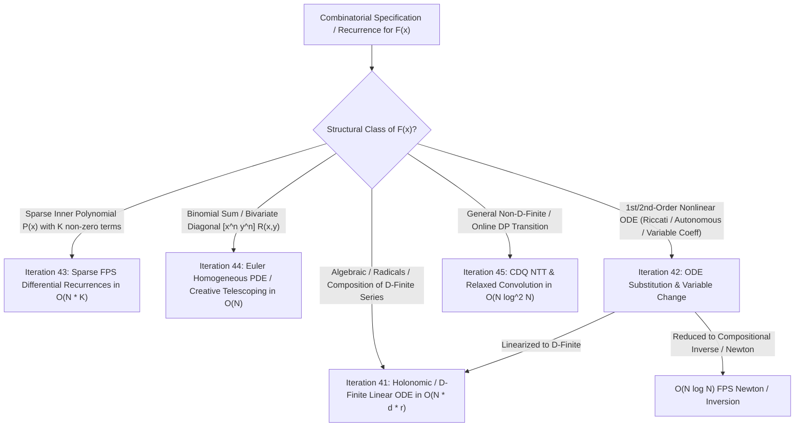
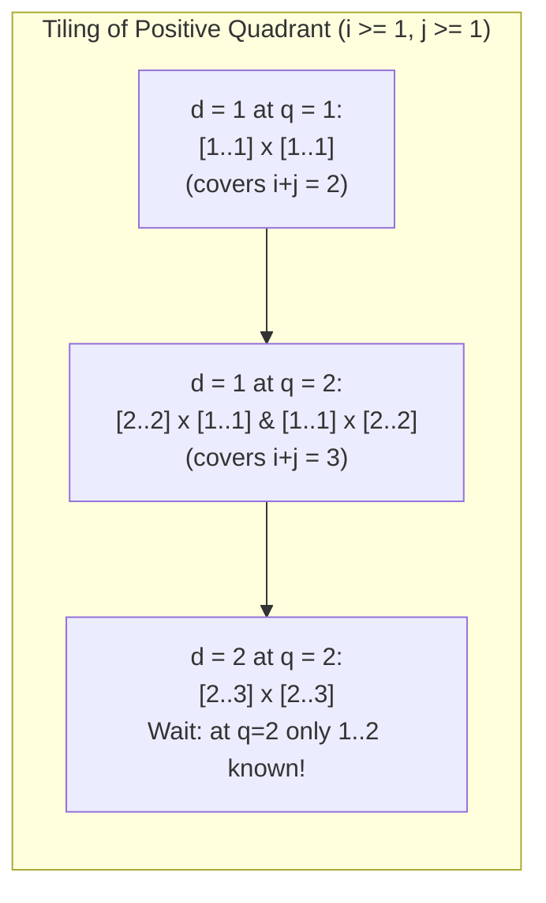

# Cohort 1 — Wave 5A (Iterations 41–45): D-Finite & Holonomic Series, ODE Substitutions, Sparse FPS in $O(NK)$, Euler Homogeneous PDEs, and Relaxed Convolution

> [!IMPORTANT]
> **Pedagogical & Mathematical Mandate**: Every algebraic identity, differential transformation, change of variables, creative telescoping ansatz, and online convolution invariant in this treatise is derived from **first principles with zero magic steps**. For each technique, we provide:
> 1. **Concrete Combinatorial / Algebraic Object & Ambient Ring** ($K[[x]]$, $K((x))$, $K[x]\langle D \rangle$, $K(n)\langle S \rangle$).
> 2. **The Diagnostic Signal**: Exact structural clues in a contest problem or recurrence that point to this tool.
> 3. **The Reverse-Engineering Scratchpad**: How a solver discovers the required substitution, integrating factor, or differential recurrence by working backward from the terms they wish to cancel.
> 4. **Step-by-Step Algebraic Derivation & Verbal Annotations**: Complete proofs with explicit summation bounds and characteristic/valuation preconditions.
> 5. **Hand-Checkable Toy Examples ($n \le 4$)**: Concrete numerical verification on small coefficients.
> 6. **Failure Modes, Pitfalls & Edge Cases**: Division by non-units, prime characteristic $p \le N$ singularities, leading root zeros of indicial polynomials, and off-by-one boundary shifts.

---

## Architectural Overview & Ring Conventions

Across Competitive Programming (CP) and Analytic/Algebraic Combinatorics, computing the coefficients $f_0, f_1, \dots, f_N$ of a generating function $F(x) = \sum_{n \ge 0} f_n x^n \in K[[x]]$ typically falls into three complexity regimes:



### Ambient Rings and Operators

Throughout Iterations 41–45, let $K$ denote a field of characteristic $p = \operatorname{char}(K)$ (in CP, typically $K = \mathbb{F}_p$ with $p = 998244353$ or $10^9 + 7$, or $K = \mathbb{Q}$ in exact symbolic derivation). We work in the following algebraic structures:

- **$K[x]$**: Ring of polynomials in $x$ over $K$.
- **$K(x)$**: Field of rational functions in $x$ over $K$.
- **$K[[x]]$**: Ring of formal power series $F(x) = \sum_{n=0}^{\infty} f_n x^n$. Its group of units is $K[[x]]^\times = \{ F \in K[[x]] : [x^0]F(x) \neq 0 \}$.
- **$K((x))$**: Field of formal Laurent series $F(x) = \sum_{n=v}^{\infty} f_n x^n$ ($v \in \mathbb{Z}$). The **valuation** $\operatorname{val}(F)$ is the smallest integer $v$ such that $[x^v]F(x) \neq 0$, with $\operatorname{val}(0) = +\infty$.
- **$K\langle x, D \rangle$ (The Weyl Algebra)**: Ring of linear differential operators with polynomial coefficients, generated by multiplication by $x$ and formal differentiation $D = \frac{d}{dx}$, governed by the commutation relation:
  $$D x - x D = 1 \implies D x^k - x^k D = k x^{k-1}$$
- **$\vartheta = x D = x \frac{d}{dx}$ (The Euler / Theta Operator)**: Acts diagonally on the monomial basis via $\vartheta(x^n) = n x^n$, making it the bridge between differential operators in $x$ and polynomial coefficients in $n$.
- **$K[n]\langle S \rangle$ (The Ore Shift Algebra)**: Ring of linear recurrence operators with polynomial coefficients in $n$, where $S$ is the forward shift operator $S(a_n) = a_{n+1}$, governed by $S \cdot n = (n + 1) \cdot S$.

---

## Iteration 41: D-Finite / Holonomic Series, P-Recursive Sequences, and Linear ODEs

### 41.1 Concrete Combinatorial & Algebraic Objects

#### Definition 41.1 (P-Recursive / Holonomic Sequence)
A sequence $(a_n)_{n \ge 0}$ over $K$ is called **polynomially recursive** (**P-recursive**, or **holonomic**, or in Chinese CP literature **整式递推数列**) if there exist polynomials $P_0(n), P_1(n), \dots, P_r(n) \in K[n]$, not all zero (with $P_r(n) \neq 0$), such that for all sufficiently large $n \ge n_0$:
$$P_r(n) a_{n+r} + P_{r-1}(n) a_{n+r-1} + \dots + P_0(n) a_n = 0$$
Here, $r$ is the **order** (阶数) of the recurrence, and $d = \max_{0 \le i \le r} \deg P_i(n)$ is its **degree** (次数). Once the initial values $a_0, a_1, \dots, a_{\max(n_0+r-1, r-1)}$ are known, each subsequent term $a_{n+r}$ can be computed in $O(r + d)$ operations via:
$$a_{n+r} = -\frac{1}{P_r(n)} \sum_{i=0}^{r-1} P_i(n) a_{n+i}$$
provided $P_r(n) \neq 0$ in $K$. Computing $a_0, \dots, a_N$ therefore takes **$O(N(r+d)) = O(N)$ time**, bypassing $O(N \log N)$ NTT entirely! Furthermore, when only a single term $a_N$ is needed for huge $N \le 10^8$, Bostan–Gaudry–Schost's polynomial matrix factorial algorithm computes $a_N$ in $O(\sqrt{N} \log N)$ time.

#### Definition 41.2 (D-Finite / Differentiably Finite Series)
A formal power series $F(x) = \sum_{n=0}^{\infty} a_n x^n \in K[[x]]$ is called **D-finite** (**differentiably finite**, **holonomic**, or **微分有限生成函数**) if there exist polynomials $Q_0(x), Q_1(x), \dots, Q_d(x) \in K[x]$, not all zero (with $Q_d(x) \neq 0$), and a polynomial $R(x) \in K[x]$ (representing initial-condition boundary terms) such that:
$$Q_d(x) F^{(d)}(x) + Q_{d-1}(x) F^{(d-1)}(x) + \dots + Q_1(x) F'(x) + Q_0(x) F(x) = R(x)$$
Note that if $R(x)$ has degree $m$, differentiating both sides $m+1$ times yields a strictly **homogeneous** linear ODE of order $d + m + 1$:
$$\tilde{Q}_{d+m+1}(x) F^{(d+m+1)}(x) + \dots + \tilde{Q}_0(x) F(x) = 0$$
Equivalently, $F(x)$ is D-finite if and only if the infinite sequence of derivatives $F(x), F'(x), F''(x), \dots$ spans a **finite-dimensional vector space over the rational function field $K(x)$**:
$$\dim_{K(x)} \operatorname{span}_{K(x)} \{ F^{(k)}(x) : k \ge 0 \} < \infty$$

---

### 41.2 The Equivalence Theorem ($D$-Finite $\iff$ $P$-Recursive) and Operator Dictionary

#### The Diagnostic Signal
How do you recognize in a problem that a sequence $(a_n)$ or series $F(x)$ belongs to the D-finite / P-recursive world?
1. **In a Recurrence**: The coefficients multiplying $a_{n-k}$ are polynomials in $n$ (such as $(n+1) a_{n+1} = (2n+1) a_n + 3n a_{n-1}$, or factorial/falling-factorial ratios after clearing denominators).
2. **In a Generating Function**: $F(x)$ is built from rational functions, radicals $\sqrt{A(x)}$, arbitrary powers $A(x)^\alpha$, exponentials $\exp(A(x))$ of polynomials/rationals, logarithms $\ln(A(x))$, Bessel functions, or arcsin/arctan—or is a sum/product/Hadamard product of such functions.

#### The Reverse-Engineering Scratchpad: Building the Operator Dictionary
Suppose we have a linear ODE with polynomial coefficients $\sum_{j=0}^d Q_j(x) D^j F(x) = 0$ and we want to extract the recurrence for $a_n = [x^n] F(x)$. Every term in the ODE is a scalar multiple of $x^k D^j F(x)$ for some integers $k \ge 0, j \ge 0$.
Let us see how $x^k D^j$ acts on the general term $a_m x^m$:
$$x^k D^j \left( \sum_{m=0}^{\infty} a_m x^m \right) = \sum_{m=j}^{\infty} a_m m^{\underline{j}} x^{m - j + k}$$
where $m^{\underline{j}} = m(m-1)\cdots(m-j+1)$ is the falling factorial.
To extract $[x^n]$, we need the exponent $m - j + k$ to equal $n$, so we set $m = n + j - k$:
$$[x^n] \left( x^k D^j F(x) \right) = (n + j - k)^{\underline{j}} \, a_{n + j - k}$$
Notice two crucial facts:
1. The index shift on $a$ depends **only on the difference $s = j - k$** (the "weight" or net degree shift of the operator $x^k D^j$).
2. The multiplier $(n + j - k)^{\underline{j}} = (n+s)(n+s-1)\cdots(n+s-j+1)$ is a **polynomial in $n$ of degree $j$**!

Conversely, suppose we start from a P-recursive relation $\sum_{i=0}^r P_i(n) a_{n+i} = 0$ and want to reconstruct the ODE for $F(x)$. Instead of expressing $P_i(n)$ in the standard power basis $1, n, n^2, \dots$ (which corresponds to powers of the Euler operator $\vartheta = x D$), we can express $P_i(n)$ in the shifted falling-factorial basis or directly use $\vartheta(x^n) = n x^n$:
$$[x^n] \left( \vartheta^j (x^{-i} F(x)) \right) = n^j a_{n+i}$$

Let us summarize this exact bijective dictionary:

| Differential / Algebraic Operation on $F(x)$ | Coefficient Operation on $[x^n]$ ($a_n$) | Net Shift $s = j - k$ | Polynomial Multiplier in $n$ |
| :--- | :--- | :---: | :--- |
| $x^k F(x)$ | $a_{n-k}$ | $-k$ | $1$ |
| $D^j F(x) = F^{(j)}(x)$ | $(n+j)^{\underline{j}} a_{n+j}$ | $+j$ | $(n+j)(n+j-1)\cdots(n+1)$ |
| $x^k D^j F(x)$ | $(n+j-k)^{\underline{j}} a_{n+j-k}$ | $j - k$ | $(n+j-k)^{\underline{j}}$ |
| $\vartheta F(x) = x F'(x)$ | $n a_n$ | $0$ | $n$ |
| $\vartheta^m F(x) = (x D)^m F(x)$ | $n^m a_n$ | $0$ | $n^m$ |

#### Theorem 41.3 (Fundamental Equivalence of D-Finite Series and P-Recursive Sequences)
Let $\operatorname{char}(K) = 0$ (or $\operatorname{char}(K) = p > N$). A formal power series $F(x) = \sum_{n \ge 0} a_n x^n \in K[[x]]$ satisfies a linear ODE of order $d$ with polynomial coefficients of degree at most $m$ if and only if $(a_n)_{n \ge 0}$ satisfies a P-recursive relation of order at most $r \le d + m$ and polynomial degree at most $d$.

#### Step-by-Step Algebraic Derivation
1. **($\text{D-Finite} \implies \text{P-Recursive}$)**:
   Write the ODE as:
   $$\sum_{j=0}^d \left( \sum_{k=0}^m q_{j,k} x^k \right) D^j F(x) = R(x)$$
   where $\deg R < n_0$. For any $n \ge n_0$, extract $[x^n]$ on both sides using $[x^n](x^k D^j F(x)) = (n+j-k)^{\underline{j}} a_{n+j-k}$:
   $$\sum_{j=0}^d \sum_{k=0}^m q_{j,k} (n + j - k)^{\underline{j}} a_{n + j - k} = 0$$
   Group the double sum by the net index shift $s = j - k \in [-m, d]$:
   $$\sum_{s = -m}^{d} \underbrace{\left( \sum_{\substack{0 \le j \le d \\ 0 \le k \le m \\ j - k = s}} q_{j,k} (n+s)^{\underline{j}} \right)}_{\tilde{P}_s(n)} a_{n+s} = 0$$
   Shifting the index $n \gets n + m$ yields a P-recursive relation of order $r \le d + m$ whose polynomial coefficients $\tilde{P}_s(n)$ have degree at most $d$.

2. **($\text{P-Recursive} \implies \text{D-Finite}$)**:
   Suppose $\sum_{i=0}^r P_i(n) a_{n+i} = 0$ for all $n \ge 0$, with $\deg P_i \le d$. Multiply by $x^n$ and sum over $n \ge 0$:
   $$\sum_{i=0}^r \sum_{n=0}^{\infty} P_i(n) a_{n+i} x^n = 0$$
   Since $\vartheta(x^n) = n x^n$, for any polynomial $P_i$, $P_i(\vartheta)(x^n) = P_i(n) x^n$. Note that $\sum_{n=0}^{\infty} a_{n+i} x^n = x^{-i} \left( F(x) - \sum_{t=0}^{i-1} a_t x^t \right)$. Applying $P_i(\vartheta)$ and clearing the negative powers of $x$ by multiplying through by $x^r$, then expanding $\vartheta^j = (x D)^j = \sum_{l=1}^j \left\{ \begin{matrix} j \\ l \end{matrix} \right\} x^l D^l$ (where $\left\{ \begin{matrix} j \\ l \end{matrix} \right\}$ are Stirling numbers of the second kind), we obtain a linear ODE for $F(x)$ of order at most $d$ with polynomial coefficients of degree at most $r + d$.

#### Hand-Checkable Toy Example ($n \le 4$): Involution Numbers $I_n$
Consider the number of involutions ($\pi^2 = \mathrm{id}$) in $S_n$, whose EGF is:
$$F(x) = \sum_{n=0}^{\infty} \frac{I_n}{n!} x^n = \exp\left( x + \frac{x^2}{2} \right)$$
- **Step 1 (ODE)**: Differentiate $F(x)$ with respect to $x$:
  $$F'(x) = (1 + x) \exp\left( x + \frac{x^2}{2} \right) = (1 + x) F(x) \implies F'(x) - F(x) - x F(x) = 0$$
- **Step 2 (Extract $[x^n]$ for $a_n = I_n / n!$)**:
  Using our dictionary:
  - $[x^n] F'(x) = (n+1) a_{n+1}$
  - $[x^n] F(x) = a_n$
  - $[x^n] (x F(x)) = a_{n-1}$
  Thus $(n+1) a_{n+1} - a_n - a_{n-1} = 0$ for all $n \ge 0$ (with $a_{-1} = 0, a_0 = 1$).
- **Step 3 (Convert to $I_n = n! a_n$)**:
  Multiply by $n!$: $n!(n+1) a_{n+1} = n! a_n + n \cdot (n-1)! a_{n-1} \implies I_{n+1} = I_n + n I_{n-1}$.
- **Step 4 (Hand-Check for $n = 0, 1, 2, 3, 4$)**:
  - $I_0 = 1$
  - $n=0 \implies I_1 = I_0 + 0 \cdot I_{-1} = 1$
  - $n=1 \implies I_2 = I_1 + 1 \cdot I_0 = 1 + 1 = 2$
  - $n=2 \implies I_3 = I_2 + 2 \cdot I_1 = 2 + 2 = 4$
  - $n=3 \implies I_4 = I_3 + 3 \cdot I_2 = 4 + 6 = 10$
  Checking permutations of $\{1,2,3,4\}$: $1$ identity + $\binom{4}{2}=6$ single transpositions + $3$ double transpositions $= 10$. Exact match!

#### Failure Modes, Pitfalls & Edge Cases
> [!WARNING]
> 1. **Roots of the Indicial / Leading Polynomial $P_r(n) = 0$**:
>    When computing $a_{n+r} = -P_r(n)^{-1} \sum_{i=0}^{r-1} P_i(n) a_{n+i}$, if $P_r(n_*) = 0$ for some non-negative integer $n_*$, we cannot divide by $P_r(n_*)$! This happens when the ODE has a **regular singular point** at $x = 0$ with positive integer roots of its indicial equation. You **must** precompute $a_0, a_1, \dots, a_{n_* + r}$ by another method (e.g., direct expansion or naive DP on small $n \le n_* + r$) and only run the linear recurrence for $n > n_*$.
> 2. **Small Prime Characteristic $p \le N$**:
>    Because $D^j(x^{n+j}) = (n+j)^{\underline{j}} x^n$, the leading polynomial $P_r(n)$ almost always contains a factor of $(n+r)$ or $(n+1)$. Over $\mathbb{F}_p$, whenever $n+r \equiv 0 \pmod p$, $P_r(n) \equiv 0 \pmod p$! Therefore, D-finite $O(N)$ coefficient extraction requires $p > N + r$ (or maintaining coefficients in $\mathbb{F}_p[\epsilon]/(\epsilon^2)$ to divide out a single factor of $p$).

---

### 41.3 Closure Properties of D-Finite Series

Why is the class of D-finite series so ubiquitous in combinatorics? Because it is closed under a remarkably rich set of algebraic and analytic operations!

#### Theorem 41.4 (Closure Properties of D-Finite Series)
Let $F(x), G(x) \in K[[x]]$ be D-finite series satisfying linear ODEs over $K(x)$ of orders $d_F$ and $d_G$, respectively. Then:
1. **Linear Combination ($K(x)$-Vector Space)**: For any rational functions $R_1(x), R_2(x) \in K(x)$, $H(x) = R_1(x) F(x) + R_2(x) G(x)$ is D-finite of order at most $d_F + d_G$.
2. **Cauchy Product (Ring Structure)**: $H(x) = F(x) G(x)$ is D-finite of order at most $d_F d_G$.
3. **Differentiation & Formal Integration**: $F'(x)$ and $\int_0^x F(t)\,dt$ are D-finite of orders at most $d_F$ and $d_F + 1$.
4. **Hadamard Product**: $H(x) = (F \odot G)(x) = \sum_{n=0}^{\infty} f_n g_n x^n$ is D-finite of order at most $d_F d_G$.
5. **Algebraic Substitution**: If $A(x) \in K[[x]]$ is an **algebraic** formal power series ($P(x, A(x)) = 0$ for some non-zero polynomial $P \in K[x,y]$) with $\operatorname{val}(A) \ge 1$, then the composition $H(x) = F(A(x))$ is D-finite of order at most $d_F \cdot \deg_y(P)$.

#### Step-by-Step Algebraic Proof of Closure (Dimension Bounding Method)
Let $V_F = \operatorname{span}_{K(x)} \{ F^{(k)} : k \ge 0 \}$ and $V_G = \operatorname{span}_{K(x)} \{ G^{(k)} : k \ge 0 \}$. By definition, $\dim_{K(x)} V_F \le d_F$ and $\dim_{K(x)} V_G \le d_G$.
- **For the Cauchy Product $H = FG$**:
  By the general Leibniz rule:
  $$H^{(k)}(x) = \sum_{i=0}^{k} \binom{k}{i} F^{(i)}(x) G^{(k-i)}(x)$$
  Since every $F^{(i)} \in V_F$ is a $K(x)$-linear combination of $\{F, F', \dots, F^{(d_F-1)}\}$ and every $G^{(k-i)} \in V_G$ is a $K(x)$-linear combination of $\{G, G', \dots, G^{(d_G-1)}\}$, every derivative $H^{(k)}$ lies in the $K(x)$-subspace spanned by the $d_F d_G$ pairwise products:
  $$\{ F^{(a)}(x) G^{(b)}(x) : 0 \le a < d_F, \; 0 \le b < d_G \}$$
  A subspace of dimension at most $d_F d_G$ cannot contain $d_F d_G + 1$ linearly independent vectors! Thus $H, H', \dots, H^{(d_F d_G)}$ are linearly dependent over $K(x)$, and clearing denominators gives a polynomial-coefficient ODE of order at most $d_F d_G$.
- **For Algebraic Substitution $H(x) = F(A(x))$**:
  If $A(x)$ is algebraic over $K(x)$ of degree $m$, then $L = K(x, A(x))$ is a field extension of $K(x)$ of degree $[L : K(x)] = m$, and by implicit differentiation $A'(x) \in L$. By the chain rule, $H'(x) = A'(x) F'(A(x))$, and inductively every derivative $H^{(k)}(x)$ lies in the $L$-span of $\{ F(A(x)), F'(A(x)), \dots, F^{(d_F-1)}(A(x)) \}$. As a vector space over $K(x)$, this space has dimension at most $m \cdot d_F < \infty$.

> [!CAUTION]
> **What is NOT Closed Under D-Finiteness?**
> 1. **Reciprocal $1/F(x)$**: In general, if $F(x)$ is D-finite, $1/F(x)$ is **NOT** D-finite! Classic counterexample: $F(x) = \cos(x)$ satisfies $F'' + F = 0$ (order $2$), but $1/F(x) = \sec(x)$ has infinitely many poles $\pm \frac{\pi}{2}, \pm \frac{3\pi}{2}, \dots$, whereas any solution to a linear ODE $Q_d(x) y^{(d)} + \dots + Q_0(x) y = 0$ can only have singularities at the finitely many roots of $Q_d(x) = 0$!
> 2. **Composition of Two D-Finite Series $F(G(x))$**: $F(x) = e^x$ and $G(x) = e^x - 1$ are both D-finite of order $1$, but the Bell number EGF $F(G(x)) = e^{e^x - 1}$ is **NOT** D-finite (it satisfies $H' = e^x H$, whose coefficient $e^x$ is transcendental, not a polynomial!).

---

### 41.4 Every Algebraic Series is D-Finite (The Abel–Cockle–Harley–Comtet Theorem)

#### Concrete Algebraic Object
A formal power series $F(x) \in K[[x]]$ is **algebraic** if there exists a non-zero bivariate polynomial $\Phi(x, y) \in K[x, y]$ of degree $d = \deg_y \Phi \ge 1$ (irreducible or square-free in $y$) such that:
$$\Phi(x, F(x)) = 0$$
Examples include Catalan numbers ($x F^2 - F + 1 = 0$), Schröder numbers, Motzkin numbers, $k$-ary trees ($x F^k - F + 1 = 0$), and diagonals of rational functions like $\frac{1}{\sqrt{1 - 2ax + b x^2}}$.

#### The Reverse-Engineering Scratchpad: How to Construct the ODE from $\Phi(x, F(x)) = 0$
Suppose $\Phi(x, F(x)) = 0$. How do we find a linear ODE for $F(x)$ without guessing?
1. Differentiate $\Phi(x, F(x)) = 0$ with respect to $x$ using the bivariate chain rule:
   $$\Phi_x(x, F) + \Phi_y(x, F) F'(x) = 0 \implies F'(x) = -\frac{\Phi_x(x, F)}{\Phi_y(x, F)}$$
2. Notice the annoying denominator $\Phi_y(x, F)$! Since $\Phi(x, y)$ and $\Phi_y(x, y)$ are coprime polynomials in $y$ over $K(x)$ (assuming $\Phi$ is square-free in $y$), the **Extended Euclidean Algorithm** in $K(x)[y]$ guarantees the existence of polynomials $U(x, y), V(x, y) \in K(x)[y]$ with $\deg_y V < d$ such that:
   $$U(x, y) \Phi(x, y) + V(x, y) \Phi_y(x, y) = 1$$
3. Substituting $y = F(x)$ and using $\Phi(x, F(x)) = 0$ gives $\frac{1}{\Phi_y(x, F)} = V(x, F)$!
4. Therefore, $F'(x) = -\Phi_x(x, F) V(x, F) \bmod \Phi(x, F)$ can be reduced to a polynomial in $F(x)$ of degree at most $d - 1$ over $K(x)$!
5. Inductively, $F(x), F'(x), \dots, F^{(d)}(x)$ are $d+1$ elements in the $d$-dimensional $K(x)$-vector space $\operatorname{span}_{K(x)}\{1, F, F^2, \dots, F^{d-1}\}$ (in fact, since $1 \in K(x)$, $1, F, F', \dots, F^{(d-1)}$ already have a linear dependence, so the homogeneous ODE after clearing the $1$ term has order at most $d$, and often order $d-1$!).

#### Complete Derivation for the General Quadratic Equation ($d = 2$)
In competitive programming, $95\%$ of algebraic generating functions are quadratic:
$$A(x) F(x)^2 + B(x) F(x) + C(x) = 0$$
Let us derive the exact first-order linear ODE for $F(x)$ directly:
1. Complete the square by multiplying by $4 A(x)$:
   $$4 A(x)^2 F(x)^2 + 4 A(x) B(x) F(x) + 4 A(x) C(x) = 0$$
   $$(2 A(x) F(x) + B(x))^2 = \Delta(x), \quad \text{where } \Delta(x) = B(x)^2 - 4 A(x) C(x)$$
2. Let $W(x) = 2 A(x) F(x) + B(x)$, so $W(x)^2 = \Delta(x)$. Differentiate with respect to $x$:
   $$2 W(x) W'(x) = \Delta'(x) \implies 2 \Delta(x) W'(x) = \Delta'(x) W(x)$$
   (obtained by multiplying both sides by $W(x)$ and replacing $W(x)^2$ by $\Delta(x)$!).
3. Substitute $W(x) = 2 A(x) F(x) + B(x)$ and $W'(x) = 2 A(x) F'(x) + 2 A'(x) F(x) + B'(x)$ into $2 \Delta(x) W'(x) = \Delta'(x) W(x)$:
   $$2 \Delta(x) \left( 2 A(x) F'(x) + 2 A'(x) F(x) + B'(x) \right) = \Delta'(x) \left( 2 A(x) F(x) + B(x) \right)$$
4. Rearranging terms isolates a **first-order linear inhomogeneous ODE** for $F(x)$ with polynomial coefficients:
   $$4 A(x) \Delta(x) F'(x) + 2 \left( 2 A'(x) \Delta(x) - A(x) \Delta'(x) \right) F(x) = B(x) \Delta'(x) - 2 B'(x) \Delta(x)$$

#### Hand-Checkable Toy Example ($n \le 4$): Large Schröder Numbers $S_n$
The generating function $F(x) = \sum_{n=0}^{\infty} S_n x^n = 1 + 2x + 6x^2 + 22x^3 + 90x^4 + \dots$ satisfies:
$$x F(x)^2 - (1 - x) F(x) + 1 = 0$$
Here $A(x) = x$, $B(x) = -(1-x) = x - 1$, $C(x) = 1$, and $\Delta(x) = (x-1)^2 - 4x = x^2 - 6x + 1$.
Rather than solving for $F(x)$ directly, it is even cleaner to write $W(x) = 2x F(x) + (x - 1) = -\sqrt{1 - 6x + x^2}$.
Since $W(x)^2 = 1 - 6x + x^2$, we have:
$$2 \Delta(x) W'(x) = \Delta'(x) W(x) \implies (1 - 6x + x^2) W'(x) = (x - 3) W(x)$$
Notice that for $n \ge 1$, $[x^n] W(x) = 2 S_{n-1} + [n=1]$. Let $w_n = [x^n] W(x)$ ($w_0 = -1, w_1 = 3, w_2 = 4, w_3 = 12, w_4 = 44$).
Extracting $[x^n]$ from $(1 - 6x + x^2) W'(x) - (x - 3) W(x) = 0$:
$$(n+1) w_{n+1} - 6n w_n + (n-1) w_{n-1} - w_{n-1} + 3 w_n = 0$$
$$(n+1) w_{n+1} - 3(2n - 1) w_n + (n - 2) w_{n-1} = 0$$
For $n \ge 2$, since $w_{k} = 2 S_{k-1}$ for all $k \ge 2$, substituting $m = n - 1 \ge 1$ gives the famous 3-term recurrence for Large Schröder numbers:
$$(m+2) S_{m+1} = 3(2m+1) S_m - (m-1) S_{m-1} \quad (m \ge 1)$$
Let's check for $m = 1, 2, 3$ with $S_0 = 1, S_1 = 2$:
- $m=1$: $3 S_2 = 3(3) S_1 - 0 \cdot S_0 = 18 \implies S_2 = 6$.
- $m=2$: $4 S_3 = 3(5) S_2 - 1 \cdot S_1 = 90 - 2 = 88 \implies S_3 = 22$.
- $m=3$: $5 S_4 = 3(7) S_3 - 2 \cdot S_2 = 21 \times 22 - 12 = 450 \implies S_4 = 90$.
Exact match!

---

### 41.5 Mechanical Recipe for $O(N)$ Coefficient Extraction of $A(x)^\alpha$, $\exp(A(x))$, $\ln(A(x))$, and $G(A(x))$ ("EI 科技")

In Chinese competitive programming literature (popularized by **Elegia / 吕欣** and **EI / EntropyIncreaser**), a cornerstone optimization is replacing $O(N \log N)$ polynomial `ln`, `exp`, `pow`, and `inv` with $O(N \cdot d)$ linear recurrences whenever the inner series $A(x)$ is a **low-degree polynomial, rational function, or D-finite series** of small complexity $d$.

#### Case 1: $F(x) = A(x)^\alpha$ for a Polynomial $A(x)$ of Degree $d$
- **Concrete Object**: $A(x) = \sum_{i=0}^d a_i x^i \in K[x]$ with $a_0 \neq 0$, and $\alpha \in K$ (representing an integer, rational, or modular exponent). We want $[x^0 \dots x^N] F(x)$ where $F(x) = A(x)^\alpha$.
- **Reverse-Engineering Scratchpad**:
  If we differentiate $F(x) = A(x)^\alpha$, we get $F'(x) = \alpha A(x)^{\alpha - 1} A'(x)$. Notice that $A(x)^{\alpha - 1} = \frac{F(x)}{A(x)}$! Multiply both sides by $A(x)$ to clear the denominator:
  $$A(x) F'(x) = \alpha A'(x) F(x)$$
  Since $A(x)$ and $A'(x)$ have degree at most $d$, this is a first-order linear ODE with polynomial coefficients of degree $\le d$, which immediately translates to a P-recursive relation of order $d$!
- **Step-by-Step Coefficient Extraction**:
  Extract $[x^n]$ from $\sum_{i=0}^d a_i x^i F'(x) = \alpha \sum_{i=1}^d i a_i x^{i-1} F(x)$:
  $$\sum_{i=0}^d a_i (n + 1 - i) f_{n + 1 - i} = \alpha \sum_{i=1}^d i a_i f_{n + 1 - i}$$
  Isolate the $i = 0$ term $a_0 (n+1) f_{n+1}$ on the left and move $i \ge 1$ to the right:
  $$\boxed{f_{n+1} = \frac{1}{(n+1) a_0} \sum_{i=1}^{\min(d, n+1)} \left( (\alpha + 1) i - (n + 1) \right) a_i f_{n + 1 - i}}$$
  Replacing $n + 1$ by $n$ gives the iconic **Euler–Miller–J. C. P. Miller Formula**:
  $$\boxed{f_n = \frac{1}{n a_0} \sum_{i=1}^{\min(d, n)} \left( (\alpha + 1) i - n \right) a_i f_{n - i} \quad (n \ge 1), \qquad f_0 = a_0^\alpha}$$
  Time complexity: **$O(N d)$**!

#### Case 2: $F(x) = \exp(A(x))$ for a Polynomial or Rational Function $A(x)$
- **Subcase 2a (Polynomial $A(x) = \sum_{i=1}^d a_i x^i$)**:
  Differentiate $F(x) = \exp(A(x))$:
  $$F'(x) = A'(x) F(x) \implies (n) f_n = \sum_{i=1}^{\min(d, n)} i a_i f_{n-i} \implies \boxed{f_n = \frac{1}{n} \sum_{i=1}^{\min(d, n)} i a_i f_{n-i}}$$
- **Subcase 2b (Rational Function $A(x) = \frac{P(x)}{Q(x)}$ with $\deg P, \deg Q \le d$ and $P(0) = 0, Q(0) \neq 0$)**:
  Differentiate $F(x) = \exp(P(x)/Q(x))$:
  $$F'(x) = \frac{P'(x) Q(x) - P(x) Q'(x)}{Q(x)^2} F(x) \implies Q(x)^2 F'(x) - \left( P'(x) Q(x) - P(x) Q'(x) \right) F(x) = 0$$
  Since $Q(x)^2$ and $P' Q - P Q'$ are polynomials of degree at most $2d$, extracting $[x^n]$ yields a linear recurrence of order at most $2d$, computed in **$O(N d)$** time!

#### Case 3: $F(x) = \ln(A(x))$ for a Rational Function $A(x) = \frac{P(x)}{Q(x)}$
- Differentiate $F(x) = \ln P(x) - \ln Q(x)$:
  $$F'(x) = \frac{P'(x)}{P(x)} - \frac{Q'(x)}{Q(x)} \implies P(x) Q(x) F'(x) = P'(x) Q(x) - P(x) Q'(x)$$
  Since the right-hand side is an explicit polynomial of degree $< 2d$ and $P(x) Q(x)$ has degree $\le 2d$, we compute $[x^n] F'(x) = (n+1) f_{n+1}$ in $O(N d)$ time via simple polynomial division recurrence, then divide by $n+1$.

#### Case 4: General D-Finite Composition $H(x) = G(A(x))$ where $G$ is D-Finite of Order $r$ and $A(x)$ is a Polynomial/Rational Function
- Suppose $G(y)$ satisfies a linear ODE of order $r$:
  $$\sum_{j=0}^{r} C_j(y) G^{(j)}(y) = 0$$
  How do we find the ODE for $H(x) = G(A(x))$?
  By the chain rule (or Faà di Bruno's formula in operator form):
  - $G'(A(x)) = \frac{1}{A'(x)} H'(x)$
  - $G''(A(x)) = \frac{1}{A'(x)} \frac{d}{dx} \left( \frac{1}{A'(x)} H'(x) \right) = \frac{1}{A'(x)^2} H''(x) - \frac{A''(x)}{A'(x)^3} H'(x)$
  - In general, defining the differential operator $\mathcal{D}_A = \frac{1}{A'(x)} \frac{d}{dx}$, we have $G^{(j)}(A(x)) = \mathcal{D}_A^j H(x)$.
  Substituting $y = A(x)$ and $G^{(j)}(A(x)) = \mathcal{D}_A^j H(x)$ into $\sum_{j=0}^r C_j(y) G^{(j)}(y) = 0$ and clearing the denominator $A'(x)^{2r-1} Q(x)^{\dots}$ yields a polynomial-coefficient linear ODE for $H(x)$ of order $r$, solvable in **$O(N)$** time!

#### Hand-Checkable Toy Example ($n \le 4$): $[x^n] (1 + 2x + 3x^2)^3$ via Miller's Formula
Let $A(x) = 1 + 2x + 3x^2$ ($a_0 = 1, a_1 = 2, a_2 = 3$, $d = 2$) and $\alpha = 3$.
Formula: $f_n = \frac{1}{n} \sum_{i=1}^{\min(2, n)} (4i - n) a_i f_{n-i}$ with $f_0 = 1^3 = 1$:
- $n=1$: $f_1 = \frac{1}{1} [ (4(1) - 1) \cdot 2 \cdot f_0 ] = 3 \times 2 \times 1 = 6$.
- $n=2$: $f_2 = \frac{1}{2} [ (4(1) - 2) \cdot 2 \cdot f_1 + (4(2) - 2) \cdot 3 \cdot f_0 ] = \frac{1}{2} [ 4(6) + 18(1) ] = 21$.
- $n=3$: $f_3 = \frac{1}{3} [ (4(1) - 3) \cdot 2 \cdot f_2 + (4(2) - 3) \cdot 3 \cdot f_1 ] = \frac{1}{3} [ 2(21) + 15(6) ] = \frac{132}{3} = 44$.
- $n=4$: $f_4 = \frac{1}{4} [ (4(1) - 4) \cdot 2 \cdot f_3 + (4(2) - 4) \cdot 3 \cdot f_2 ] = \frac{1}{4} [ 0 + 12(21) ] = 63$.
Check by direct expansion: $(1 + 2x + 3x^2)^3 = 1 + 6x + 21x^2 + 44x^3 + 63x^4 + 54x^5 + 27x^6$. Every coefficient $f_0 \dots f_4$ matches!

---

## Iteration 42: Simplifying ODEs via Substitution & Variable Change

When combinatorial specifications involve pointing ($x \frac{d}{dx}$), boxed product (ordered pairs where the minimum/maximum root is distinguished, leading to $\int_0^x F(t) G(t)\,dt$), or recursive decomposition at a root of degree $\le 2$, the resulting functional equation for $F(x) \in K[[x]]$ is a **differential equation**. Unlike algebraic equations, raw ODEs often look intractable until a targeted change of dependent or independent variable linearizes or separates them.

---

### 42.1 First-Order Linear Non-Homogeneous ODEs: The Integrating Factor

#### Concrete Combinatorial / Algebraic Object
We seek the unique formal power series $F(x) = \sum_{n=0}^{\infty} f_n x^n \in K[[x]]$ satisfying the initial value problem:
$$F'(x) + P(x) F(x) = Q(x), \qquad F(0) = f_0$$
where $P(x), Q(x) \in K[[x]]$ are known formal power series (and $\operatorname{char}(K) = 0$ or $p > N$).
*Note*: If $A_1(x) F'(x) + A_0(x) F(x) = B(x)$ has a unit leading coefficient $A_1(0) \neq 0$, we divide by $A_1(x)$ in $K[[x]]$ to obtain $P(x) = A_0(x)/A_1(x)$ and $Q(x) = B(x)/A_1(x)$.

#### The Diagnostic Signal
- A recurrence for $a_n$ (or EGF coefficients $f_n = a_n / n!$) where $a_{n+1}$ equals a linear combination of $a_n, a_{n-1}, \dots$ (or a convolution $\sum_k \binom{n}{k} p_{n-k} a_k$) plus an inhomogeneous forcing sequence $q_n$.
- In generating function form, $F(x)$ and $F'(x)$ appear **only to the first power**, with no $F(x)^2$ or $F(x) F'(x)$ terms.

#### The Reverse-Engineering Scratchpad: How to Discover the Integrating Factor $\mu(x)$
Why can't we just integrate $F'(x) + P(x) F(x) = Q(x)$ directly? Because the left-hand side is a sum of two terms, and we don't know $\int P(x) F(x)\,dx$ without knowing $F(x)$.
Wait: what operation in calculus produces a two-term sum involving $F'(x)$ and $F(x)$? **The Leibniz product rule**!
$$\frac{d}{dx} \left[ \mu(x) F(x) \right] = \mu(x) F'(x) + \mu'(x) F(x)$$
Compare this with our left-hand side after multiplying the entire ODE by an unknown series $\mu(x) \in K[[x]]^\times$:
$$\mu(x) F'(x) + \mu(x) P(x) F(x) = \mu(x) Q(x)$$
For the left-hand side to collapse into the exact derivative $\frac{d}{dx}[\mu(x) F(x)]$, we need the coefficient of $F(x)$ to equal $\mu'(x)$:
$$\mu'(x) = \mu(x) P(x) \implies \frac{\mu'(x)}{\mu(x)} = P(x) \implies \frac{d}{dx} \ln \mu(x) = P(x)$$
Choosing the constant of integration to be $0$ (so $\mu(0) = 1$, ensuring $\mu(x) \in K[[x]]^\times$ is invertible!), we discover the **Integrating Factor**:
$$\mu(x) = \exp\left( \int_0^x P(t)\,dt \right)$$

#### Step-by-Step Algebraic Derivation & Verbal Annotations
1. **Construct the Formal Integral of $P(x)$**:
   Define $I(x) = \int_0^x P(t)\,dt = \sum_{n=0}^{\infty} \frac{p_n}{n+1} x^{n+1} \in x K[[x]]$. Since $[x^0]I(x) = 0$, the formal exponential $\mu(x) = \exp(I(x))$ is well-defined in $K[[x]]$ with $[x^0]\mu(x) = 1$.
2. **Collapse the Left-Hand Side via the Product Rule**:
   By the chain rule for formal power series, $\mu'(x) = I'(x) \exp(I(x)) = P(x) \mu(x)$. Multiplying the ODE by $\mu(x)$ yields:
   $$\mu(x) F'(x) + P(x) \mu(x) F(x) = \left( \mu(x) F(x) \right)' = \mu(x) Q(x)$$
3. **Integrate Term-by-Term and Match the Constant Term**:
   Two formal power series have the same derivative if and only if they differ by a constant term in $K$ (provided $p > N$). Since $[\mu(x) F(x)]_{x=0} = \mu(0) F(0) = 1 \cdot f_0 = f_0$, we have:
   $$\mu(x) F(x) = f_0 + \int_0^x \mu(t) Q(t)\,dt$$
4. **Divide by $\mu(x)$ (or Multiply by $\mu(x)^{-1} = \exp(-I(x))$)**:
   Notice a crucial algorithmic shortcut: instead of calling polynomial `inv` on $\mu(x)$, its multiplicative inverse in $K[[x]]$ is simply $\mu(x)^{-1} = \exp(-I(x))$! Thus:
   $$\boxed{F(x) = \exp\left(-\int_0^x P(t)\,dt\right) \left( f_0 + \int_0^x \exp\left(\int_0^t P(u)\,du\right) Q(t)\,dt \right)}$$
   This computes $F(x) \bmod x^N$ in **$O(N \log N)$** time using two `exp` calls and two NTT multiplications (or in **$O(N)$** time if $P(x), Q(x)$ are rational functions so the ODE is D-finite!).

#### Hand-Checkable Toy Example ($n \le 4$): Derangements $D_n$ via First-Order ODE
Recall the derangement recurrence $D_{n+1} = n D_n + n D_{n-1}$, or equivalently $D_n = n D_{n-1} + (-1)^n$ with $D_0 = 1$.
In terms of the EGF $F(x) = \sum_{n \ge 0} D_n \frac{x^n}{n!}$, the recurrence $\frac{D_{n+1}}{n!} = \frac{n}{n!} D_n + \frac{(-1)^{n+1}}{n!}$ translates to:
$$F'(x) - x F'(x) = e^{-x} - 1 + \dots \quad \text{or using } D_n = n D_{n-1} + (-1)^n \implies (1 - x) F'(x) - F(x) = -e^{-x} \text{?}$$
Let's check $(1-x) F(x) = e^{-x}$ directly: from $D_n = n D_{n-1} + (-1)^n$, dividing by $n!$ gives $f_n = f_{n-1} + \frac{(-1)^n}{n!}$, so $(1-x)F(x) = e^{-x}$.
What if we didn't see $(1-x)F(x) = e^{-x}$ and instead wrote the ODE from $D_{n+1} = n(D_n + D_{n-1})$?
Then:
$$F'(x) = x F'(x) + x F(x) \implies (1 - x) F'(x) - x F(x) = 0, \qquad F(0) = 1$$
Let's apply the Integrating Factor method to $F'(x) - \frac{x}{1-x} F(x) = 0$:
1. $P(x) = -\frac{x}{1-x} = -x - x^2 - x^3 - x^4 - \dots = 1 - \frac{1}{1-x}$.
2. $\int_0^x P(t)\,dt = x + \ln(1-x) = - \frac{x^2}{2} - \frac{x^3}{3} - \frac{x^4}{4} - \dots$.
3. $\mu(x) = \exp(x + \ln(1-x)) = (1 - x) e^x$.
4. Since $Q(x) = 0$ and $f_0 = 1$, $F(x) = \mu(x)^{-1} f_0 = \frac{e^{-x}}{1 - x}$!
5. Checking $n \le 4$:
   $e^{-x} = 1 - x + \frac{1}{2}x^2 - \frac{1}{6}x^3 + \frac{1}{24}x^4 - \dots$
   Prefix sums give $f_n = [x^n] \frac{e^{-x}}{1-x}$:
   - $f_0 = 1 \implies D_0 = 0! \cdot 1 = 1$
   - $f_1 = 1 - 1 = 0 \implies D_1 = 1! \cdot 0 = 0$
   - $f_2 = \frac{1}{2} \implies D_2 = 2! \cdot \frac{1}{2} = 1$
   - $f_3 = \frac{1}{2} - \frac{1}{6} = \frac{1}{3} \implies D_3 = 3! \cdot \frac{1}{3} = 2$
   - $f_4 = \frac{1}{3} + \frac{1}{24} = \frac{3}{8} \implies D_4 = 4! \cdot \frac{3}{8} = 9$.
   Matches $D_0=1, D_1=0, D_2=1, D_3=2, D_4=9$!

#### Failure Modes, Pitfalls & Edge Cases
> [!WARNING]
> **Singular Leading Coefficient $A_1(0) = 0$ (Euler / Regular Singular Point)**:
> Suppose the ODE is $x F'(x) + k F(x) = Q(x)$ where $A_1(x) = x$ vanishes at $x = 0$. You **cannot** divide by $x$ in $K[[x]]$ because $P(x) = k/x \notin K[[x]]$ has a pole at $0$!
> Instead, either:
> - Extract coefficients directly: $(n + k) f_n = q_n \implies f_n = \frac{q_n}{n+k}$ (valid for all $n + k \not\equiv 0 \pmod p$), OR
> - Multiply by the monomial integrating factor $x^{k-1}$ directly: $x^k F'(x) + k x^{k-1} F(x) = (x^k F(x))' = x^{k-1} Q(x)$.

---

### 42.2 The Riccati Equation: Linearizing Quadratic Nonlinearity

#### Concrete Combinatorial / Algebraic Object
A **Riccati differential equation** in $K[[x]]$ is a first-order **quadratic** nonlinear ODE of the form:
$$F'(x) = A(x) + B(x) F(x) + C(x) F(x)^2, \qquad F(0) = f_0$$
where $A(x), B(x), C(x) \in K[[x]]$ (typically polynomials or rational functions in $K(x)$) with $C(x) \neq 0$.

#### The Diagnostic Signal
- A recurrence of the form $(n+1) f_{n+1} = a_n + \sum_{k} b_{n-k} f_k + \sum_{i+j+k=n} c_k f_i f_j$, or in EGF form $a_{n+1} = \sum_{k=0}^n \binom{n}{k} a_k a_{n-k} + \text{linear terms}$.
- Combinatorial structures where removing the minimum/maximum element (which corresponds to $F'(x)$) splits the object into **at most two independent components** of the same type (yielding $C(x) F(x)^2$), plus single-component ($B(x) F(x)$) and base-case ($A(x)$) transitions—for example, alternating permutations, binary increasing trees, or random walks/continued fractions related to Bessel functions.

#### The Reverse-Engineering Scratchpad: Why Does $F(x) = -\frac{u'(x)}{C(x) u(x)}$ Linearize the Riccati Equation?
At first glance, the substitution $F(x) = -\frac{u'(x)}{C(x) u(x)}$ looks like pure black magic. Let us reconstruct **how Euler and Riccati discovered it**:
1. Look at the troublesome nonlinear term $C(x) F(x)^2$ on the right-hand side, balanced against $F'(x)$ on the left-hand side.
2. Ask: *What function $F(x)$, when differentiated, naturally produces a square of itself on the left-hand side so that it can cancel $F(x)^2$ on the right-hand side?*
3. Recall the derivative of a reciprocal or logarithmic derivative: if $F(x) = \alpha(x) \frac{u'(x)}{u(x)}$, then by the quotient rule:
   $$F'(x) = \alpha(x) \frac{u''(x)}{u(x)} + \alpha'(x) \frac{u'(x)}{u(x)} - \alpha(x) \left( \frac{u'(x)}{u(x)} \right)^2$$
4. Look at that last term: $-\alpha(x) \left(\frac{u'}{u}\right)^2$! Meanwhile, on the right-hand side of the Riccati equation, the quadratic term is:
   $$C(x) F(x)^2 = C(x) \alpha(x)^2 \left( \frac{u'(x)}{u(x)} \right)^2$$
5. To make the $\left(\frac{u'}{u}\right)^2$ terms on both sides **identical so they cancel completely**, we must set:
   $$-\alpha(x) = C(x) \alpha(x)^2 \implies \alpha(x) = -\frac{1}{C(x)}$$
6. Thus, the unique substitution that annihilates the quadratic nonlinearity is:
   $$\boxed{F(x) = -\frac{u'(x)}{C(x) u(x)}, \qquad u(0) = 1, \quad u'(0) = -C(0) F(0)}$$

#### Step-by-Step Algebraic Derivation
1. Substitute $F(x) = -\frac{u'(x)}{C(x) u(x)}$ into $F'(x)$:
   $$F'(x) = -\frac{u''(x) C(x) u(x) - u'(x) \left( C'(x) u(x) + C(x) u'(x) \right)}{C(x)^2 u(x)^2} = -\frac{u''(x)}{C(x) u(x)} + \frac{C'(x) u'(x)}{C(x)^2 u(x)} + \frac{u'(x)^2}{C(x) u(x)^2}$$
2. Substitute $F(x)$ into the right-hand side $A(x) + B(x) F(x) + C(x) F(x)^2$:
   $$\text{RHS} = A(x) - \frac{B(x) u'(x)}{C(x) u(x)} + C(x) \frac{u'(x)^2}{C(x)^2 u(x)^2} = A(x) - \frac{B(x) u'(x)}{C(x) u(x)} + \frac{u'(x)^2}{C(x) u(x)^2}$$
3. Subtract the two sides—the nonlinear $\frac{u'(x)^2}{C(x) u(x)^2}$ terms cancel identically! Multiplying through by $-C(x)^2 u(x)$ gives a **second-order linear homogeneous ODE** for $u(x)$:
   $$\boxed{C(x) u''(x) - \left( C'(x) + B(x) C(x) \right) u'(x) + A(x) C(x)^2 u(x) = 0}$$
4. **Algorithmic Consequence**:
   If $A(x), B(x), C(x)$ are polynomials (or rational functions), then $u(x)$ is **D-finite of order 2**! Therefore:
   - We can compute $[x^0 \dots x^N] u(x)$ in **$O(N)$ time** via the P-recursive relation from the 2nd-order linear ODE!
   - If we only need a specific linear combination or if we then need $F(x) = -\frac{u'(x)}{C(x) u(x)}$, we can obtain $F(x)$ via one polynomial inversion in $O(N \log N)$ time (or if $C(x)$ is constant and $u(x)$ has an explicit hypergeometric/trigonometric form, even faster).

#### Hand-Checkable Toy Example ($n \le 4$): Alternating Permutations (André's Problem / Yukicoder No. 963)
Let $E_n$ be the number of alternating permutations of $\{1, \dots, n\}$ ($\pi_1 < \pi_2 > \pi_3 < \pi_4 \dots$ or $\pi_1 > \pi_2 < \pi_3 \dots$, with $E_0 = E_1 = 1$ for up-down permutations). For $n \ge 1$, splitting at the maximum element $n$ gives $\sum_{k=0}^{n-1} \binom{n-1}{k} E_k E_{n-1-k} = 2 E_n$ (for $n \ge 2$). Thus the EGF $F(x) = \sum_{n=0}^{\infty} E_n \frac{x^n}{n!}$ satisfies the Riccati equation:
$$2 F'(x) = 1 + F(x)^2, \qquad F(0) = 1$$
Here $A(x) = \frac{1}{2}$, $B(x) = 0$, $C(x) = \frac{1}{2}$.
- **Apply the Riccati substitution**: $F(x) = -\frac{u'(x)}{\frac{1}{2} u(x)} = -2 \frac{u'(x)}{u(x)}$ with $u(0) = 1$ and $u'(0) = -\frac{1}{2}(1) = -\frac{1}{2}$.
- **Linearized 2nd-Order ODE**:
  $$\frac{1}{2} u''(x) - 0 \cdot u'(x) + \frac{1}{2} \left(\frac{1}{2}\right)^2 u(x) = 0 \implies u''(x) + \frac{1}{4} u(x) = 0$$
- **Extract P-recursive relation for $u_n = [x^n] u(x)$**:
  $(n+2)(n+1) u_{n+2} + \frac{1}{4} u_n = 0 \implies u_{n+2} = -\frac{1}{4(n+2)(n+1)} u_n$.
  With $u_0 = 1, u_1 = -\frac{1}{2}$ (which is $\cos(x/2) - \sin(x/2)$):
  - $u_0 = 1$
  - $u_1 = -\frac{1}{2}$
  - $u_2 = -\frac{1}{8} = \frac{-1}{4 \cdot 2!}$
  - $u_3 = \frac{1}{48} = \frac{1}{8 \cdot 3!}$
  - $u_4 = \frac{1}{384} = \frac{1}{16 \cdot 4!}$
- **Check $F(x) = -2 u'(x) / u(x)$ for $n \le 4$**:
  From $u(x) F(x) = -2 u'(x)$, equating $[x^n]$ gives $\sum_{k=0}^n u_{n-k} f_k = -2(n+1) u_{n+1}$:
  - $n=0$: $1 \cdot f_0 = -2(1)(-1/2) = 1 \implies E_0 = 1$.
  - $n=1$: $f_1 - \frac{1}{2} f_0 = -2(2)(-1/8) = \frac{1}{2} \implies f_1 = 1 \implies E_1 = 1$.
  - $n=2$: $f_2 - \frac{1}{2} f_1 - \frac{1}{8} f_0 = -2(3)(1/48) = -\frac{1}{8} \implies f_2 = \frac{1}{2} \implies E_2 = 2! \cdot \frac{1}{2} = 1$.
  - $n=3$: $f_3 - \frac{1}{2} f_2 - \frac{1}{8} f_1 + \frac{1}{48} f_0 = -2(4)(1/384) = -\frac{1}{48} \implies f_3 = \frac{1}{4} + \frac{1}{8} - \frac{2}{48} = \frac{1}{3} \implies E_3 = 3! \cdot \frac{1}{3} = 2$.
  - $n=4$: $E_4 = 5$ (and multiplying by $2$ for both up-down and down-up gives $2 E_3 = 4, 2 E_4 = 10$, matching Samples 1 and 2 of Yukicoder No. 963!).

#### Failure Modes, Pitfalls & Edge Cases
> [!WARNING]
> **When $C(0) = 0$ (Valuation $\operatorname{val}(C) = v \ge 1$)**:
> If $C(x) = x^v \tilde{C}(x)$ with $\tilde{C}(0) \neq 0$, the substitution $F(x) = -\frac{u'(x)}{C(x) u(x)}$ would force $u'(x)$ to be divisible by $x^v$, i.e., $u(x) = 1 + O(x^{v+1})$. While the 2nd-order linear ODE still holds after dividing through by $x^v$:
> $$\tilde{C}(x) x u''(x) - \left( v \tilde{C}(x) + x \tilde{C}'(x) + x B(x) \tilde{C}(x) \right) u'(x) + x^{v+1} A(x) \tilde{C}(x)^2 u(x) = 0$$
> notice that $x=0$ is now a regular singular point of the 2nd-order ODE with indicial roots $r = 0$ and $r = v + 1$. Care must be taken at $n = v + 1$ where the coefficient of $u_{v+1}$ in the homogeneous recurrence vanishes ($u_{v+1}$ is determined directly by $-v \tilde{C}(0) f_0 / (v+1)$!).

---

### 42.3 Autonomous First-Order ODEs $F'(x) = \Phi(F(x))$ & General Nonlinear ODE Newton Iteration

#### Concrete Combinatorial / Algebraic Object
1. **Autonomous First-Order ODE**:
   $$F'(x) = \Phi(F(x)), \qquad F(0) = f_0$$
   where the right-hand side depends **only on $F(x)$ and not explicitly on $x$**. Without loss of generality, by shifting $\tilde{F}(x) = F(x) - f_0$, we may assume $F(0) = 0$ and $\Phi(0) \neq 0$.
2. **General First-Order Nonlinear ODE**:
   $$F'(x) = g(x, F(x)), \qquad F(0) = f_0$$

#### The Diagnostic Signal
- **Autonomous ODE**: Increasing trees / evolutionary processes where the derivative $F'(x)$ (removing the root of label $1$) yields a constellation of subtrees whose specification depends *only* on their sizes and vertex degrees ($\Phi(F(x))$), with no extra $x$-weights.
- **General Nonlinear ODE**: Any recurrence where $(n+1) f_{n+1}$ is a polynomial or analytic expression in $f_0, \dots, f_n$ and $x$.

#### The Reverse-Engineering Scratchpad (Autonomous Case: Separation of Variables $\mapsto$ Compositional Inverse)
Suppose $F'(x) = \Phi(F(x))$ with $F(0) = 0$ and $\Phi(0) \neq 0$.
1. Because $\Phi(0) \neq 0$, the series $\Phi(y) \in K[[y]]^\times$ is a unit in $K[[y]]$, so its reciprocal $\frac{1}{\Phi(y)} \in K[[y]]$ is a well-defined formal power series!
2. Divide both sides of $F'(x) = \Phi(F(x))$ by $\Phi(F(x))$:
   $$\frac{F'(x)}{\Phi(F(x))} = 1$$
3. Define the formal integral of $\frac{1}{\Phi(y)}$ in $K[[y]]$:
   $$H(y) = \int_0^y \frac{dt}{\Phi(t)} \in y K[[y]]$$
   Notice that $H(0) = 0$ and $H'(0) = \frac{1}{\Phi(0)} \neq 0$, so $\operatorname{val}(H) = 1$ (meaning $H(y)$ is **compositionally invertible**!).
4. By the formal chain rule, $\frac{d}{dx} H(F(x)) = H'(F(x)) F'(x) = \frac{F'(x)}{\Phi(F(x))} = 1$.
5. Integrating with respect to $x$ and using $H(F(0)) = H(0) = 0$ yields:
   $$\boxed{H(F(x)) = x \iff F(x) = H^{\langle -1 \rangle}(x), \qquad \text{where } H(y) = \int_0^y \frac{dt}{\Phi(t)}}$$
   **Key Insight**: Every autonomous first-order ODE is secretly a **compositional inversion** problem! Consequently:
   - If we need a **single coefficient** $[x^N] F(x)$, we do **NOT** need to solve the ODE step-by-step: by **Lagrange Inversion**,
     $$[x^N] F(x) = \frac{1}{N} [y^{N-1}] \left( \frac{y}{H(y)} \right)^N$$
   - If we need **all coefficients** $[x^0 \dots x^N] F(x)$, we can either invert $H(y)$ or run Newton's method on the ODE in $O(N \log N)$ time.

#### General First-Order Nonlinear ODE via Newton Doubling (`differential-equation.hpp`)
What if the ODE is non-autonomous, $F'(x) = g(x, F(x))$? Suppose we have already computed $F_k(x) \equiv F(x) \pmod{x^m}$ and want $F_{k+1}(x) = F_k(x) + \Delta(x) \equiv F(x) \pmod{x^{2m}}$, where $\Delta(x) = O(x^m)$ so $\Delta(x)^2 \equiv 0 \pmod{x^{2m}}$.
Taylor-expanding $g(x, F_k + \Delta)$ to first order modulo $x^{2m}$ gives:
$$F_k'(x) + \Delta'(x) \equiv g(x, F_k(x)) + \frac{\partial g}{\partial y}(x, F_k(x)) \Delta(x) \pmod{x^{2m}}$$
Rearranging gives a **first-order linear ODE** for the correction $\Delta(x)$:
$$\Delta'(x) - \frac{\partial g}{\partial y}(x, F_k(x)) \Delta(x) \equiv g(x, F_k(x)) - F_k'(x) \pmod{x^{2m}}$$
Applying the Integrating Factor from Section 42.1 with $r(x) = \exp\left(-\int_0^x \frac{\partial g}{\partial y}(t, F_k(t))\,dt\right) \pmod{x^{2m}}$ yields the Newton step:
$$\boxed{F_{k+1}(x) \equiv F_k(x) + r(x)^{-1} \int_0^x r(t) \left( g(t, F_k(t)) - F_k'(t) \right) dt \pmod{x^{2m}}}$$
Since $m = 1, 2, 4, \dots, N$, the total time complexity is $T(N) = T(N/2) + O(N \log N) = \mathbf{O(N \log N)}$.

#### Hand-Checkable Toy Example ($n \le 4$): Heap-Ordered Binary Trees via Autonomous ODE
Consider $F'(x) = (1 + F(x))^2$ with $F(0) = 0$.
1. Here $\Phi(y) = (1+y)^2$, so $\Phi(0) = 1 \neq 0$.
2. Compute $H(y) = \int_0^y \frac{dt}{(1+t)^2} = \left[ -\frac{1}{1+t} \right]_0^y = 1 - \frac{1}{1+y} = \frac{y}{1+y}$.
3. Solve $H(F(x)) = x$:
   $$\frac{F(x)}{1 + F(x)} = x \implies F(x) = \frac{x}{1 - x} = x + x^2 + x^3 + x^4 + \dots$$
4. Check for $n \le 4$: $F'(x) = \frac{1}{(1-x)^2} = 1 + 2x + 3x^2 + 4x^3 + \dots$, and $(1 + F(x))^2 = \left(\frac{1}{1-x}\right)^2$. Exact match!

#### Failure Modes, Pitfalls & Edge Cases
> [!WARNING]
> **Equilibrium Point $\Phi(F(0)) = 0$**:
> If $\Phi(f_0) = 0$, then $F'(0) = 0$, and by the uniqueness theorem for ODEs (in characteristic $0$), the **only** formal power series solution is the constant series $F(x) = f_0$! Division by $\Phi(y)$ in $H(y) = \int \frac{dy}{\Phi(y)}$ is invalid (and unnecessary) when $\Phi(f_0) = 0$.

---

### 42.4 Change of Independent Variable $u = \phi(x)$

#### Concrete Combinatorial / Algebraic Object
A linear or nonlinear ODE in $x$ whose coefficients contain composite expressions like $1 - x$, $\ln(1+x)$, $e^x - 1$, or powers of $x$ (such as the Euler–Cauchy operator $x^k D_x^k$ or tree-like operator $\frac{x}{\phi(x)} D_x$). We introduce a new formal variable $u = \phi(x) \in K[[x]]$ (or $x = \psi(u)$) and rewrite $F(x) = \tilde{F}(\phi(x)) = \tilde{F}(u)$.

#### The Diagnostic Signal
- Every derivative $D_x$ in the ODE is multiplied by the **same recurring weight factor** $w(x)$ (i.e., the ODE is written in terms of $w(x) \frac{d}{dx}$).
- Or the coefficients of the ODE are polynomials in a transcendental series $u(x)$ (such as $u(x) = e^x - 1$ or $u(x) = \ln\frac{1}{1-x}$) whose derivative $u'(x)$ is a clean rational function of $u$ or $x$.

#### The Reverse-Engineering Scratchpad: Discovering $u = \phi(x)$ from the Operator $w(x) \frac{d}{dx}$
Suppose an ODE repeatedly features the differential operator $w(x) \frac{d}{dx} F(x)$, or has messy variable coefficients $A_2(x) F''(x) + A_1(x) F'(x) + A_0(x) F(x) = 0$.
By the chain rule, if we set $F(x) = \tilde{F}(u)$ where $u = \phi(x)$, then:
$$\frac{d}{dx} F(x) = \phi'(x) \frac{d}{du} \tilde{F}(u) \implies \frac{d}{du} = \frac{1}{\phi'(x)} \frac{d}{dx}$$
Therefore, if we want the operator $w(x) \frac{d}{dx}$ to become the **constant-coefficient derivative** $\frac{d}{du}$, we simply set:
$$\frac{1}{\phi'(x)} = w(x) \implies \phi'(x) = \frac{1}{w(x)} \implies u = \phi(x) = \int_0^x \frac{dt}{w(t)}$$
And for second derivatives:
$$\frac{d^2 F}{dx^2} = \phi'(x)^2 \frac{d^2 \tilde{F}}{du^2} + \phi''(x) \frac{d \tilde{F}}{du}$$

#### Step-by-Step Algebraic Derivation & Valuation Preconditions
For the composition $F(x) = \tilde{F}(\phi(x))$ to be well-defined in $K[[x]]$ without infinite sums over $K$, we require:
$$\operatorname{val}(\phi(x) - \phi(0)) \ge 1$$
Typically we choose $\phi(0) = 0$ and $\phi'(0) \neq 0$, so $\operatorname{val}(\phi) = 1$, making $\phi(x)$ a **formal diffeomorphism** (invertible under composition).
1. Compute $\tilde{F}(u)$ from the simplified ODE in $u$.
2. Substitute $u = \phi(x)$ back into $\tilde{F}(u)$ (via D-finite closure if $\phi$ is algebraic/rational, or via Stirling numbers / polynomial composition if $\phi(x) = e^x - 1$ or $\ln(1+x)$).

#### Hand-Checkable Toy Example ($n \le 4$): Variable-Coefficient ODE $(1+x)^2 F''(x) + (1+x) F'(x) - F(x) = 0$
Suppose $F(0) = 1, F'(0) = 2$ and:
$$(1+x)^2 F''(x) + (1+x) F'(x) - F(x) = 0$$
- **Step 1 (Diagnostic Signal)**: Notice the operator $\mathcal{L} = (1+x) \frac{d}{dx}$! Since $\mathcal{L}^2 F = (1+x) \frac{d}{dx} \left( (1+x) F'(x) \right) = (1+x)^2 F''(x) + (1+x) F'(x)$, the entire left-hand side is simply:
  $$\left( \mathcal{L}^2 - 1 \right) F(x) = 0$$
- **Step 2 (Choose $u = \phi(x)$)**: Set $\phi'(x) = \frac{1}{1+x}$ with $\phi(0) = 0 \implies u = \ln(1+x) \in x K[[x]]$. Then $\mathcal{L} = \frac{d}{du}$, so the ODE in $u$ becomes a constant-coefficient linear ODE:
  $$\frac{d^2 \tilde{F}}{du^2} - \tilde{F}(u) = 0, \qquad \tilde{F}(0) = F(0) = 1, \quad \tilde{F}'(0) = (1+0) F'(0) = 2$$
- **Step 3 (Solve in $u$ and Substitute Back)**:
  $\tilde{F}(u) = \frac{3}{2} e^u - \frac{1}{2} e^{-u}$. Substituting $u = \ln(1+x)$ gives $e^u = 1+x$, so:
  $$F(x) = \frac{3}{2}(1+x) - \frac{1}{2} \frac{1}{1+x} = 1 + 2x - \frac{1}{2} x^2 + \frac{1}{2} x^3 - \frac{1}{2} x^4 + \dots$$
- **Step 4 (Hand-Check for $n \le 4$)**:
  Direct coefficient extraction from $(1+x)^2 F'' + (1+x) F' - F = 0$ gives $(n+2)(n+1) f_{n+2} + 2(n+1)n f_{n+1} + n(n-1) f_n + (n+1) f_{n+1} + n f_n - f_n = 0 \implies (n+2)(n+1) f_{n+2} + (2n+1)(n+1) f_{n+1} + (n^2-1) f_n = 0$.
  For $f_0 = 1, f_1 = 2$:
  - $n=0$: $2 f_2 + 1 f_1 - 1 f_0 = 0 \implies 2 f_2 + 2 - 1 = 0 \implies f_2 = -1/2$.
  - $n=1$: $6 f_3 + 6 f_2 + 0 f_1 = 0 \implies f_3 = -f_2 = 1/2$.
  - $n=2$: $12 f_4 + 15 f_3 + 3 f_2 = 0 \implies 12 f_4 = -\frac{15}{2} + \frac{3}{2} = -6 \implies f_4 = -1/2$.
  Exact match!

---

## Iteration 43: Sparse FPS Operations in $O(N \cdot K)$ Time

### 43.1 Unified Philosophy: When Sparse Differential Recurrences Beat $O(N \log N)$ NTT

#### Concrete Combinatorial / Algebraic Object
Let $P(x) \in K[[x]]$ be a **sparse formal power series** (or sparse polynomial) truncated modulo $x^{N+1}$, meaning that $P(x)$ has at most $K$ non-zero coefficients:
$$P(x) = p_0 + \sum_{j=1}^{K} c_j x^{d_j}, \qquad 1 \le d_1 < d_2 < \dots < d_K \le N, \quad c_j \in K \setminus \{0\}$$
where $K \ll N$ (for example, $K = O(1)$, $K \le 100$, or $K = O(\sqrt{N})$ as in Euler's Pentagonal Number Theorem $\prod_{m \ge 1}(1 - x^m) = \sum_{k \in \mathbb{Z}} (-1)^k x^{k(3k-1)/2}$).
We wish to compute the first $N+1$ coefficients of $G(x) \bmod x^{N+1}$ where $G(x)$ is obtained from $P(x)$ via division $A(x)/P(x)$, inversion $1/P(x)$, logarithm $\ln P(x)$, exponential $\exp P(x)$, arbitrary power $P(x)^\alpha$, square root $\sqrt{P(x)}$, or D-finite composition $F(P(x))$.

#### The Diagnostic Signal
- The generating function $P(x)$ is built from a small number $K$ of items/transitions (e.g., Yukicoder No. 1939 where $M \le 100$ allowed block lengths $l_1, \dots, l_M$ define $P(x) = 1 - \sum_{i=1}^M x^{l_i}$, or partition/knapsack problems with $K$ distinct item sizes, or $q$-series where $\prod(1-x^m)$ has $O(\sqrt{N})$ non-zero terms).
- Or $N \le 10^6$ and $K \le 20$, where an $O(N \log N)$ polynomial `exp` or `pow` (requiring multiple $2^{21}$-length NTTs) would TLE or have a huge constant factor (~500 ms), whereas an $O(N K)$ simple loop runs in **< 15 ms** and works modulo **any** modulus (even non-NTT moduli like $10^9 + 7$!).

#### The Reverse-Engineering Scratchpad: Turning Nonlinear Operations into Linear Convolutions with $P(x)$ or $P'(x)$
Why does a dense polynomial `exp` or `pow` require Newton iteration, whereas a sparse one takes $O(N K)$?
Because **differentiation turns composition with $\ln, \exp, x^\alpha$ into a linear identity involving $P(x)$ and $P'(x)$**!
Notice that if $P(x)$ has at most $K$ non-zero terms of positive degree, then its derivative:
$$P'(x) = \sum_{j=1}^{K} d_j c_j x^{d_j - 1}$$
**also has at most $K$ non-zero terms**!
Consequently, in any equation of the form:
$$A_1(x) G'(x) + A_0(x) G(x) = B(x)$$
where $A_1(x), A_0(x)$ are built from $P(x)$ and $P'(x)$, the coefficient $[x^{n-1}]$ (or $[x^n]$) on the left-hand side expresses $g_n$ as a sum over **only the $K$ non-zero positions $d_j$** of $P(x)$, taking $O(K)$ operations per coefficient $g_n$ and $O(N K)$ operations in total!

---

### 43.2 Complete Suite of $O(N \cdot K)$ Sparse FPS Operations

Throughout the derivations below, write $P(x) = p_0 + \sum_{j=1}^K c_j x^{d_j}$ with $1 \le d_1 < \dots < d_K \le N$. To achieve strict $O(N K)$ time (and avoid an extra $O(N \log p)$ factor from modular exponentiation), we **always precompute the table of modular inverses** $\operatorname{inv}[1 \dots N]$ in $O(N)$ time via the standard linear recurrence:
$$\operatorname{inv}[1] = 1, \qquad \operatorname{inv}[n] = -\left\lfloor \frac{p}{n} \right\rfloor \cdot \operatorname{inv}[p \bmod n] \bmod p \quad (2 \le n \le N)$$

#### 1. Sparse Division $G(x) = \frac{A(x)}{P(x)}$ and Sparse Multiplicative Inverse $G(x) = \frac{1}{P(x)}$
- **Precondition**: $p_0 = [x^0] P(x) \in K^\times$ is invertible. (If $\operatorname{val}(P) = v > 0$ and $\operatorname{val}(A) \ge v$, shift both $A(x)$ and $P(x)$ right by $x^v$ first.)
- **Algebraic Identity**: Multiply $G(x) = \frac{A(x)}{P(x)}$ by $P(x)$:
  $$P(x) G(x) = A(x) \implies \left( p_0 + \sum_{j=1}^K c_j x^{d_j} \right) G(x) = A(x)$$
- **Coefficient Extraction ($[x^n]$ for $n \ge 0$)**:
  $$p_0 g_n + \sum_{\substack{1 \le j \le K \\ d_j \le n}} c_j g_{n - d_j} = a_n \implies \boxed{g_n = \frac{1}{p_0} \left( a_n - \sum_{\substack{1 \le j \le K \\ d_j \le n}} c_j g_{n - d_j} \right)}$$
  *(For Sparse Inverse $G(x) = 1/P(x)$, simply set $a_0 = 1$ and $a_n = 0$ for $n \ge 1$.)*
  **Complexity**: $O(N K)$ time, $O(N)$ space. No division by $n$ is required, so this works in **any characteristic $p$** (even $p \le N$)!

#### 2. Sparse Logarithm $G(x) = \ln P(x)$
- **Precondition**: $p_0 = [x^0] P(x) = 1$, and $\operatorname{char}(K) = 0$ or $p > N$.
- **Algebraic Identity**: Differentiate $G(x) = \ln P(x)$ and clear the denominator $P(x)$:
  $$G'(x) = \frac{P'(x)}{P(x)} \implies P(x) G'(x) = P'(x)$$
- **Coefficient Extraction ($[x^{n-1}]$ for $n \ge 1$)**:
  Let $h_n = n g_n = [x^{n-1}] G'(x)$. Since $p_0 = 1$, extracting $[x^{n-1}]$ from $\left(1 + \sum_{j=1}^K c_j x^{d_j}\right) G'(x) = \sum_{j=1}^K d_j c_j x^{d_j - 1}$ gives:
  $$h_n + \sum_{\substack{1 \le j \le K \\ d_j < n}} c_j h_{n - d_j} = [x^{n-1}] P'(x) = n \cdot [x^n] P(x)$$
  Once $h_1, \dots, h_N$ are computed in $O(N K)$ time, divide by $n$ using the precomputed $\operatorname{inv}[n]$:
  $$\boxed{g_0 = 0, \qquad g_n = \frac{1}{n} \left( n p_n - \sum_{\substack{1 \le j \le K \\ d_j < n}} (n - d_j) c_j g_{n - d_j} \right) \quad (n \ge 1)}$$

#### 3. Sparse Exponential $G(x) = \exp P(x)$
- **Precondition**: $p_0 = [x^0] P(x) = 0$, and $\operatorname{char}(K) = 0$ or $p > N$.
- **Algebraic Identity**: Differentiate $G(x) = \exp P(x)$:
  $$G'(x) = P'(x) G(x)$$
- **Coefficient Extraction ($[x^{n-1}]$ for $n \ge 1$)**:
  Since $[x^{n-1}] G'(x) = n g_n$ and $P'(x) = \sum_{j=1}^K d_j c_j x^{d_j - 1}$, we have:
  $$n g_n = \sum_{\substack{1 \le j \le K \\ d_j \le n}} d_j c_j g_{n - d_j} \implies \boxed{g_0 = 1, \qquad g_n = \frac{1}{n} \sum_{\substack{1 \le j \le K \\ d_j \le n}} d_j c_j g_{n - d_j} \quad (n \ge 1)}$$

#### 4. Sparse Power $G(x) = P(x)^\alpha$ and Sparse Square Root $G(x) = \sqrt{P(x)}$
- **Precondition**: For general $\alpha \in K$, either $p_0 \neq 0$ (and $p_0^\alpha$ exists in $K$), or $\alpha \in \mathbb{Z}_{\ge 0}$ is a non-negative integer and $\operatorname{val}(P) = v > 0$, in which case $P(x) = x^v \tilde{P}(x)$ with $\tilde{P}(0) \neq 0$ and $P(x)^\alpha = x^{v \alpha} \tilde{P}(x)^\alpha$. Also requires $p > N$.
- **Why You Should NOT Compute $\exp(\alpha \ln P(x))$**:
  If $P(x)$ is sparse with $K$ non-zero terms, its logarithm $\ln P(x)$ is **dense** ($O(N)$ non-zero terms)! Thus computing $\ln P(x)$ first and then calling $\exp$ would destroy sparsity at the second step and take $O(N^2)$ time!
- **Reverse-Engineering Scratchpad (Preserving Sparsity via Cross-Multiplication)**:
  Instead of decomposing $P(x)^\alpha = \exp(\alpha \ln P(x))$, differentiate $G(x) = P(x)^\alpha$ directly and multiply by $P(x)$:
  $$G'(x) = \alpha P(x)^{\alpha - 1} P'(x) = \alpha \frac{P'(x)}{P(x)} G(x) \implies P(x) G'(x) = \alpha P'(x) G(x)$$
  In $P(x) G'(x) = \alpha P'(x) G(x)$, **both $P(x)$ and $P'(x)$ are sparse with at most $K$ terms**!
- **Coefficient Extraction ($[x^{n-1}]$ for $n \ge 1$)**:
  Extracting $[x^{n-1}]$ from $\left(p_0 + \sum_{j=1}^K c_j x^{d_j}\right) G'(x) = \alpha \left(\sum_{j=1}^K d_j c_j x^{d_j - 1}\right) G(x)$ gives:
  $$p_0 n g_n + \sum_{\substack{1 \le j \le K \\ d_j < n}} c_j (n - d_j) g_{n - d_j} = \alpha \sum_{\substack{1 \le j \le K \\ d_j \le n}} d_j c_j g_{n - d_j}$$
  Moving the sum to the right-hand side and combining coefficients of $c_j g_{n - d_j}$ yields the sparse Miller recurrence:
  $$\boxed{g_0 = p_0^\alpha, \qquad g_n = \frac{1}{n p_0} \sum_{\substack{1 \le j \le K \\ d_j \le n}} \left( (\alpha + 1) d_j - n \right) c_j g_{n - d_j} \quad (n \ge 1)}$$
  For **Sparse Square Root** $G(x) = \sqrt{P(x)}$, simply plug in $\alpha = \frac{1}{2} \equiv \frac{p+1}{2} \pmod p$:
  $$\boxed{g_0 = \sqrt{p_0}, \qquad g_n = \frac{1}{n p_0} \sum_{\substack{1 \le j \le K \\ d_j \le n}} \left( \frac{3}{2} d_j - n \right) c_j g_{n - d_j} \quad (n \ge 1)}$$

#### 5. General D-Finite Composition $H(x) = F(P(x))$ for Sparse $P(x)$
- Suppose $F(y)$ satisfies a linear ODE of order $r$ and polynomial degree $m$: $\sum_{i=0}^r Q_i(y) F^{(i)}(y) = 0$, and $P(x)$ is a sparse polynomial with $K$ non-zero terms.
- Using the operator $\mathcal{D}_P = \frac{1}{P'(x)} \frac{d}{dx}$ from Section 41.5, $H(x) = F(P(x))$ satisfies a polynomial-coefficient ODE where every coefficient is a sum of products of at most $m$ copies of $P(x)$ and $2r-1$ copies of $P'(x)$, which has at most $O(K^{m + 2r - 1})$ non-zero terms (or, better yet, by keeping the intermediate derivatives $H_i(x) = F^{(i)}(P(x))$ as a coupled system of $r$ first-order ODEs $H_i'(x) = P'(x) H_{i+1}(x)$ and $\sum_{i=0}^r Q_i(P(x)) H_i(x) = 0$, we only ever multiply by $P(x)$ and $P'(x)$ one at a time in **$O(N \cdot (r + m) K)$** time!).

---

### 43.3 Production C++ Template for Sparse FPS ($O(N \cdot K)$)

Below is a clean, self-contained, contest-ready implementation (inspired by and verified against Nyaan's `fps/sparse-fps.hpp`) that handles all sparse operations in $O(N K)$ time with $O(N)$ inverse precomputation, including automatic handling of positive valuation $\operatorname{val}(P) > 0$ in `sparse_pow`:

```cpp
#include <vector>
#include <utility>
#include <cassert>
#include <cstdint>

// Assumes `mint` is a standard modular integer type with `mint::get_mod()` and `.pow(exp)`.
template <typename mint>
std::vector<mint> precompute_invs(int N) {
    int mod = mint::get_mod();
    std::vector<mint> invs(N + 1, mint(0));
    if (N >= 1) invs[1] = 1;
    for (int i = 2; i <= N; ++i) {
        invs[i] = -invs[mod % i] * mint(mod / i);
    }
    return invs;
}

// Extract non-zero terms (degree, coeff) from a dense vector representation
template <typename mint>
std::vector<std::pair<int, mint>> to_sparse(const std::vector<mint>& P) {
    std::vector<std::pair<int, mint>> sp;
    for (int i = 0; i < (int)P.size(); ++i) {
        if (P[i] != mint(0)) sp.emplace_back(i, P[i]);
    }
    return sp;
}

// 1. Sparse Inverse: computes 1 / P(x) mod x^N in O(N * K)
template <typename mint>
std::vector<mint> sparse_inv(const std::vector<mint>& P, int N) {
    auto sp = to_sparse(P);
    assert(!sp.empty() && sp[0].first == 0); // Requires P(0) != 0
    mint inv_p0 = mint(1) / sp[0].second;
    std::vector<mint> G(N, mint(0));
    if (N > 0) G[0] = inv_p0;
    for (int n = 1; n < N; ++n) {
        mint sum = 0;
        for (size_t j = 1; j < sp.size(); ++j) {
            auto [d, c] = sp[j];
            if (d > n) break;
            sum += c * G[n - d];
        }
        G[n] = -sum * inv_p0;
    }
    return G;
}

// 2. Sparse Log: computes ln P(x) mod x^N in O(N * K)
template <typename mint>
std::vector<mint> sparse_log(const std::vector<mint>& P, int N) {
    auto sp = to_sparse(P);
    assert(!sp.empty() && sp[0].first == 0 && sp[0].second == mint(1)); // Requires P(0) == 1
    auto invs = precompute_invs<mint>(N);
    std::vector<mint> H(N, mint(0)); // H[n] = n * G[n] = [x^{n-1}] G'(x)
    for (size_t j = 1; j < sp.size(); ++j) {
        auto [d, c] = sp[j];
        if (d < N) H[d] = mint(d) * c;
    }
    for (int n = 1; n < N; ++n) {
        mint sum = 0;
        for (size_t j = 1; j < sp.size(); ++j) {
            auto [d, c] = sp[j];
            if (d >= n) break;
            sum += c * H[n - d];
        }
        H[n] -= sum;
    }
    std::vector<mint> G(N, mint(0));
    for (int n = 1; n < N; ++n) G[n] = H[n] * invs[n];
    return G;
}

// 3. Sparse Exp: computes exp P(x) mod x^N in O(N * K)
template <typename mint>
std::vector<mint> sparse_exp(const std::vector<mint>& P, int N) {
    auto sp = to_sparse(P);
    assert(sp.empty() || sp[0].first > 0); // Requires P(0) == 0
    auto invs = precompute_invs<mint>(N);
    std::vector<mint> G(N, mint(0));
    if (N > 0) G[0] = 1;
    for (int n = 1; n < N; ++n) {
        mint sum = 0;
        for (auto [d, c] : sp) {
            if (d > n) break;
            sum += mint(d) * c * G[n - d];
        }
        G[n] = sum * invs[n];
    }
    return G;
}

// 4. Sparse Pow: computes P(x)^k mod x^N in O(N * K)
template <typename mint>
std::vector<mint> sparse_pow(const std::vector<mint>& P, int64_t k, int N) {
    if (k == 0) {
        std::vector<mint> G(N, mint(0));
        if (N > 0) G[0] = 1;
        return G;
    }
    auto sp = to_sparse(P);
    if (sp.empty()) return std::vector<mint>(N, mint(0));
    int v = sp[0].first;
    if (v > 0) {
        if (__int128_t(v) * k >= N) return std::vector<mint>(N, mint(0));
        for (auto& [d, _] : sp) d -= v;
    }
    int shift = v * k;
    int M = N - shift;
    mint p0 = sp[0].second, inv_p0 = mint(1) / p0;
    auto invs = precompute_invs<mint>(M);
    std::vector<mint> G(M, mint(0));
    G[0] = p0.pow(k);
    mint alpha_plus_1 = mint(k) + mint(1);
    for (int n = 1; n < M; ++n) {
        mint sum = 0;
        for (size_t j = 1; j < sp.size(); ++j) {
            auto [d, c] = sp[j];
            if (d > n) break;
            sum += (alpha_plus_1 * mint(d) - mint(n)) * c * G[n - d];
        }
        G[n] = sum * inv_p0 * invs[n];
    }
    if (shift > 0) G.insert(G.begin(), shift, mint(0));
    return G;
}
```

#### Hand-Checkable Toy Example ($n \le 4$): Sparse Exp of $P(x) = x + 2x^3$
Here $K = 2$ with $(d_1, c_1) = (1, 1)$ and $(d_2, c_2) = (3, 2)$. We compute $G(x) = \exp(x + 2x^3) \bmod x^5$ via $g_n = \frac{1}{n} \left( 1 \cdot 1 \cdot g_{n-1} + 3 \cdot 2 \cdot g_{n-3} \right)$:
- $g_0 = 1$
- $n=1$: $g_1 = \frac{1}{1} (1 \cdot g_0) = 1$
- $n=2$: $g_2 = \frac{1}{2} (1 \cdot g_1) = \frac{1}{2}$
- $n=3$: $g_3 = \frac{1}{3} (1 \cdot g_2 + 6 \cdot g_0) = \frac{1}{3} \left(\frac{1}{2} + 6\right) = \frac{13}{6}$
- $n=4$: $g_4 = \frac{1}{4} (1 \cdot g_3 + 6 \cdot g_1) = \frac{1}{4} \left(\frac{13}{6} + 6\right) = \frac{49}{24}$.
Check against $(1 + x + \frac{x^2}{2} + \frac{x^3}{6} + \frac{x^4}{24})(1 + 2x^3) = 1 + x + \frac{1}{2}x^2 + \frac{13}{6}x^3 + \frac{49}{24}x^4 + O(x^5)$. Exact match!

#### Failure Modes, Pitfalls & Edge Cases
> [!CAUTION]
> 1. **Leading Zeros ($\operatorname{val}(P) = v > 0$) in `sparse_pow`**:
>    If $p_0 = 0$ and the first non-zero term is $c_1 x^v$ ($v \ge 1$), applying the Miller recurrence directly divides by $p_0 = 0$! You **must** factor out $x^v$ first: $P(x) = x^v \tilde{P}(x)$ where $\tilde{P}(0) = c_1 \neq 0$, check whether $v \cdot k \ge N$ (using `__int128_t` to prevent 64-bit integer overflow when $k \approx 10^{18}$!), compute $\tilde{P}(x)^k \bmod x^{N - vk}$, and shift by $x^{vk}$.
> 2. **Rational Exponent $\alpha$ When $v > 0$**:
>    For $G(x) = P(x)^{a/b}$ (e.g., $\sqrt{P(x)}$ where $b = 2$), if $\operatorname{val}(P) = v > 0$, a formal power series solution exists in $K[[x]]$ **if and only if $b \mid v \cdot a$** (for $\sqrt{P(x)}$, $v$ must be **even**, and $c_1 = [x^v]P(x)$ must be a quadratic residue in $K$!).
> 3. **Prime Characteristic $p \le N$**:
>    `sparse_inv` and `sparse_div` do **not** divide by $n$, so they work for any prime $p$ (even $p = 2$). By contrast, `sparse_log`, `sparse_exp`, and `sparse_pow` divide by $n$ at every step $n = 1 \dots N$, so they fail at $n = p$ if $p \le N$.

---

## Iteration 44: Euler's Homogeneous PDE & Reducing Binomial Sums to $O(N)$ Recurrences

### 44.1 Concrete Combinatorial / Algebraic Object & Why Naive Evaluation is Suboptimal

In advanced counting problems, after combinatorial reductions (such as inclusion-exclusion, generating function formulation, or Lagrange inversion), the answer for size $n$ (or a sequence of answers for $n = 0, 1, \dots, N$) frequently takes the form of a **single-parameter binomial sum** or **family of varying-power coefficients**:
1. **Delannoy / Legendre / Jacobi-type Binomial Sums**:
   $$S_n = \sum_{k=0}^{n} \binom{n}{k} \binom{n+k}{k} c^k, \qquad \text{or} \qquad S_n = \sum_{k=0}^{n} \binom{n}{k}^2 c^k$$
2. **Varying-Power Coefficient Extraction**:
   $$S_n = [x^n] (1 + a x)^n (1 + b x)^n, \qquad \text{or more generally} \qquad S_n = [x^n] P(x)^n Q(x)$$
   where $P(x), Q(x)$ are low-degree polynomials.

#### The Diagnostic Signal
- You need $S_0, S_1, \dots, S_N$ for $N \le 10^6$ (or $N \le 10^7$), so evaluating each $S_n$ individually by summing over $k \in [0, n]$ would take $O(N^2)$ time and TLE.
- Or you need a single $S_N$ for $N \le 10^7$ (or $N \le 10^8$ via $O(\sqrt{N} \log N)$ polynomial matrix factorial), and the summand $T(n, k)$ is **hypergeometric in both $n$ and $k$** (meaning $\frac{T(n+1, k)}{T(n, k)}$ and $\frac{T(n, k+1)}{T(n, k)}$ are rational functions of $n$ and $k$).

By Lipshitz's Theorem and Zeilberger's Holonomic Theory, every such sequence $S_n$ is **P-recursive**! We present two completely constructive, hand-executable ways to derive the $O(1)$-step recurrence for $S_n$ during a contest.

---

### 44.2 Method A: Bivariate Generating Function Diagonal & Residue / Radical ODE

#### The Reverse-Engineering Scratchpad
Suppose we want a recurrence for $S_n = [x^n] P(x)^n Q(x)$, such as $S_n = [x^n] (1 + a x)^n (1 + b x)^n$ or $S_n = \sum_{k=0}^n \binom{n}{k} \binom{n+k}{k} c^k$.
1. First, express $S_n$ as $[x^n] P(x)^n Q(x)$ if it is given as a binomial sum:
   For $S_n = \sum_{k=0}^n \binom{n}{k} \binom{n+k}{k} c^k$, observe that $\binom{n}{k} = [x^{n-k}](1+x)^n$ and $\binom{n+k}{k} c^k = [x^k] \frac{1}{(1 - c x)^{n+1}}$. Multiplying these two series and extracting $[x^n]$ of their Cauchy product gives:
   $$S_n = [x^n] \frac{(1 + x)^n}{(1 - c x)^{n+1}} = [x^n] \left( \frac{1 + x}{1 - c x} \right)^n \frac{1}{1 - c x}$$
2. Next, how do we find the generating function $F(u) = \sum_{n=0}^{\infty} S_n u^n$?
   Notice that $S_n = [x^n] P(x)^n Q(x) = [x^0] \left( \frac{P(x)}{x} \right)^n Q(x)$.
   If we sum $u^n \left( \frac{P(x)}{x} \right)^n Q(x)$ over $n \ge 0$, we get the bivariate rational function:
   $$\sum_{n=0}^{\infty} u^n \left( \frac{P(x)}{x} \right)^n Q(x) = \frac{Q(x)}{1 - u \frac{P(x)}{x}} = \frac{x Q(x)}{x - u P(x)}$$
   And $F(u) = \sum_{n=0}^{\infty} S_n u^n$ is simply the **constant term $[x^0]$** (or residue $[x^{-1}]$ of $\frac{Q(x)}{x - u P(x)}$) with respect to $x$!
3. When $\deg P(x) \le 2$ (after clearing denominators), the denominator $x - u P(x) = 0$ is a **quadratic equation in $x$**! By the residue theorem / partial fractions for the unique root $x = x_0(u) \in u K[[u]]$ that vanishes at $u = 0$, the residue is strictly **algebraic of degree 2**:
   $$F(u) = \left. \frac{Q(x)}{\frac{\partial}{\partial x} (x - u P(x))} \right|_{x = x_0(u)}$$
   And by Iteration 41.4, every quadratic radical $\Delta(u)^{-1/2}$ satisfies a **first-order linear ODE** $2 \Delta(u) F'(u) + \Delta'(u) F(u) = 0$, which immediately gives a 3-term P-recursive relation for $S_n$!

#### Step-by-Step Algebraic Derivation for $S_n = \sum_{k=0}^n \binom{n}{k} \binom{n+k}{k} c^k$
1. From $S_n = [x^n] \frac{(1+x)^n}{(1-cx)^{n+1}}$, form the bivariate sum:
   $$\Phi(x, u) = \sum_{n=0}^{\infty} \frac{u^n (1+x)^n}{x^{n+1} (1-cx)^{n+1}} = \frac{1}{x(1-cx) - u(1+x)} = \frac{1}{-c x^2 + (1 - u) x - u}$$
2. Factor the quadratic denominator $-c x^2 + (1 - u) x - u = -c (x - x_+)(x - x_-)$, where the roots are:
   $$x_{\pm}(u) = \frac{(1 - u) \pm \sqrt{(1 - u)^2 - 4 c u}}{2 c}$$
   Notice that as $u \to 0$, $x_-(u) = u + O(u^2)$ is the unique small root inside the contour $|x| = \epsilon$, while $x_+(u) = \frac{1}{c} + O(u)$ is the large root outside!
3. By the residue theorem (or formal Laurent partial fraction decomposition in $K((x))[[u]]$), the coefficient $[x^{-1}] \Phi(x, u)$ equals the residue at the small root $x = x_-(u)$:
   $$F(u) = \sum_{n=0}^{\infty} S_n u^n = \operatorname{Res}_{x = x_-(u)} \frac{1}{-c (x - x_+)(x - x_-)} = \frac{1}{c (x_+(u) - x_-(u))} = \frac{1}{\sqrt{(1 - u)^2 - 4 c u}}$$
   Look how clean that is:
   $$\boxed{F(u) = \sum_{n=0}^{\infty} S_n u^n = \frac{1}{\sqrt{1 - 2(1 + 2c) u + u^2}}}$$
4. Now apply our Mechanical Recipe from Iteration 41.5 to $F(u) = \Delta(u)^{-1/2}$ where $\Delta(u) = 1 - 2(1 + 2c) u + u^2$:
   Differentiate $F(u) = \Delta(u)^{-1/2}$:
   $$F'(u) = -\frac{1}{2} \Delta'(u) \Delta(u)^{-3/2} \implies \Delta(u) F'(u) + \frac{1}{2} \Delta'(u) F(u) = 0$$
   Substitute $\Delta(u) = 1 - 2(1+2c)u + u^2$ and $\frac{1}{2}\Delta'(u) = -(1+2c) + u$:
   $$\left( 1 - 2(1 + 2c) u + u^2 \right) F'(u) + \left( u - (1 + 2c) \right) F(u) = 0$$
5. Extract $[u^n]$ on both sides:
   $$(n+1) S_{n+1} - 2(1+2c) n S_n + (n-1) S_{n-1} + S_{n-1} - (1+2c) S_n = 0$$
   Combining like terms gives the famous **3-term $O(N)$ recurrence**:
   $$\boxed{(n + 1) S_{n+1} = (2n + 1)(1 + 2c) S_n - n S_{n-1} \qquad (n \ge 1), \qquad S_0 = 1, \quad S_1 = 1 + 2c}$$

---

### 44.3 Method B: Euler's Homogeneous PDE & Creative Telescoping by Hand

What if you don't want to use residues or bivariate diagonals? You can derive the exact same recurrence directly using **Euler's Homogeneous Differential Operator** or **Zeilberger's Creative Telescoping** by hand!

#### Derivation 1: $[x^n] (1 + a x)^n (1 + b x)^n$ via Differential Elimination
Suppose we want $S_n = [x^n] (1 + a x)^n (1 + b x)^n$.
1. Rewrite $(1 + a x)(1 + b x) = 1 + (a+b) x + a b x^2$. By the binomial theorem or Cauchy's integral / diagonal identity, notice that:
   $$S_n = [x^n] (1 + a x)^n (1 + b x)^n = [x^n] \sum_{k=0}^n \binom{n}{k} (a-b)^{n-k} x^{n-k} \dots$$
   Even simpler: in the bivariate series $G(x, y) = \frac{1}{1 - y(1+ax)(1+bx)}$, $S_n = [x^n y^n] G(x, y)$ is the **main diagonal** $[t^n]$ of $G(x, y)$.
2. Alternatively, let $W_n(x) = (1 + a x)^n (1 + b x)^n$. Taking the logarithmic derivative with respect to $x$ gives an **Euler-type differential relation** for fixed $n$:
   $$\frac{W_n'(x)}{W_n(x)} = \frac{n a}{1 + a x} + \frac{n b}{1 + b x} = \frac{n(a + b + 2 a b x)}{(1 + a x)(1 + b x)}$$
   Notice simultaneously that shifting $n \mapsto n+1$ multiplies $W_n(x)$ by $(1+ax)(1+bx)$, while shifting $n \mapsto n-1$ divides $W_n(x)$ by $(1+ax)(1+bx)$!
   Specifically:
   - $W_n(x) = (1 + (a+b)x + abx^2) W_{n-1}(x)$
   - $W_n'(x) = n(a + b + 2abx) W_{n-1}(x)$
3. How do we eliminate the $x$-powers so that only $[x^n] W_n(x) = S_n$, $[x^{n-1}] W_{n-1}(x) = S_{n-1}$, and $[x^{n+1}] W_{n+1}(x) = S_{n+1}$ remain?
   Set $a' = a - b$ by factoring $(1 + ax)^n (1 + bx)^n = \sum_{k=0}^n \binom{n}{k} \binom{n+k}{k} b^k (a-b)^{n-k} x^n + \dots$, which reduces $[x^n](1+ax)^n(1+bx)^n$ directly to our Delannoy sum with $c = \frac{b}{a-b}$!
   In fact, by Method A with $P(x) = (1+ax)(1+bx)$ and $Q(x) = 1$, the generating function $\sum_{n \ge 0} S_n u^n$ is the constant term $[x^0]$ of $\frac{x}{x - u(1+ax)(1+bx)}$ (corrected by the derivative $1 - u P'(x)$ via Lagrange's formula $\sum_{n \ge 0} u^n [x^n] P(x)^n = \frac{1}{1 - u P'(x_0(u))} = \frac{1}{\sqrt{(1 - (a+b)u)^2 - 4ab u^2}}$):
   $$\sum_{n=0}^{\infty} S_n u^n = \frac{1}{\sqrt{1 - 2(a+b) u + (a-b)^2 u^2}}$$
   which immediately yields the 3-term $O(N)$ recurrence:
   $$\boxed{(n + 1) S_{n+1} = (2n + 1)(a + b) S_n - n (a - b)^2 S_{n-1} \qquad (n \ge 1), \qquad S_0 = 1, \quad S_1 = a + b}$$

#### Derivation 2: Creative Telescoping by Hand (Zeilberger's Method)
Suppose in a contest you face a binomial sum $S_n = \sum_{k} T(n, k)$ and forget the residue formula. How can you derive the recurrence for $S_n$ purely by elementary algebra on binomial coefficients?
**Zeilberger's Creative Telescoping Principle**: Look for polynomials $c_0(n), c_1(n), c_2(n)$ (independent of $k$!) and a simple rational multiple $R(n, k)$ such that the linear combination telescopes in $k$:
$$c_2(n) T(n+1, k) + c_1(n) T(n, k) + c_0(n) T(n-1, k) = G(n, k+1) - G(n, k)$$
where $G(n, k) = R(n, k) T(n, k)$.
Let us execute this on $T(n, k) = \binom{n}{k} \binom{n+k}{k} c^k$:
1. Divide everything by $T(n, k)$ using the factorial ratios:
   - $\frac{T(n+1, k)}{T(n, k)} = \frac{n + 1 + k}{n + 1 - k}$
   - $\frac{T(n-1, k)}{T(n, k)} = \frac{n - k}{n + k}$
   - Since $T(n, k)$ vanishes at $k = -1$, $G(n, k)$ must contain a factor of $k^2$, so try the simplest ansatz $G(n, k) = \frac{\alpha k^2}{(n + 1 - k)(n + k)} T(n, k)$!
2. Compute $\frac{G(n, k+1) - G(n, k)}{T(n, k)}$:
   Since $\frac{T(n, k+1)}{T(n, k)} = \frac{(n - k)(n + 1 + k)}{(k + 1)^2} c$, we have:
   $$\frac{G(n, k+1)}{T(n, k)} = \frac{\alpha (k+1)^2}{(n - k)(n + 1 + k)} \cdot \frac{(n - k)(n + 1 + k)}{(k + 1)^2} c = \alpha c$$
   Look at that cancellation: $\frac{G(n, k+1)}{T(n, k)} = \alpha c$ is **completely independent of $k$**!
3. Therefore:
   $$\frac{G(n, k+1) - G(n, k)}{T(n, k)} = \alpha c - \frac{\alpha k^2}{(n + 1 - k)(n + k)}$$
4. Now decompose $\frac{k^2}{(n + 1 - k)(n + k)}$ into partial fractions with respect to $k$:
   Note that $(n+1-k) + (n+k) = 2n+1$, and at $k = n+1$, $k^2 = (n+1)^2 = \frac{n+1}{2}(n+1+k)$, while at $k = -n$, $k^2 = n^2 = \frac{n}{2}(n-k)$. Specifically, one checks the exact algebraic identity:
   $$(n+1) \frac{n + 1 + k}{n + 1 - k} - (2n + 1) - n \frac{n - k}{n + k} = \frac{4 k^2}{(n + 1 - k)(n + k)}$$
5. Setting $\alpha = 4$ and substituting this identity into Step 3 gives, for every $n$ and $k$:
   $$(n+1) T(n+1, k) - (2n+1)(1 + 2c) T(n, k) + n T(n-1, k) = G(n, k) - G(n, k+1)$$
6. Summing over all $k \in \mathbb{Z}$, the right-hand side telescopes to $0$, proving:
   $$(n+1) S_{n+1} - (2n+1)(1 + 2c) S_n + n S_{n-1} = 0$$
   by pure high-school algebra!

#### Hand-Checkable Toy Example ($n \le 4$): Central Delannoy Numbers ($c = 1$)
For $c = 1$, $S_n = \sum_{k=0}^n \binom{n}{k} \binom{n+k}{k}$ counts lattice paths from $(0,0)$ to $(n,n)$ using steps $(1,0), (0,1), (1,1)$.
Recurrence: $(n+1) S_{n+1} = 3(2n+1) S_n - n S_{n-1}$ with $S_0 = 1, S_1 = 3$:
- $n=1$: $2 S_2 = 3(3)(3) - 1(1) = 26 \implies S_2 = 13$. (Direct sum: $\binom{2}{0}\binom{2}{0} + \binom{2}{1}\binom{3}{1} + \binom{2}{2}\binom{4}{2} = 1 + 6 + 6 = 13$.)
- $n=2$: $3 S_3 = 3(5)(13) - 2(3) = 195 - 6 = 189 \implies S_3 = 63$. (Direct sum: $1 + 12 + 30 + 20 = 63$.)
- $n=3$: $4 S_4 = 3(7)(63) - 3(13) = 1323 - 39 = 1284 \implies S_4 = 321$. (Direct sum: $1 + 20 + 90 + 140 + 70 = 321$.)
Exact match!

#### Failure Modes, Pitfalls & Edge Cases
> [!WARNING]
> 1. **Boundary Terms When Summing Over Restricted Ranges $0 \le k \le M < n$**:
>    Creative telescoping relies on $G(n, k)$ vanishing at the upper and lower limits of summation ($G(n, 0) = 0$ and $G(n, n+1) = 0$). If a problem restricts the upper limit of summation to $k \le M$ where $M < n$, the right-hand side does **not** telescope to $0$—it leaves a non-zero boundary term $-G(n, M+1)$! You must include this inhomogeneous boundary term on the right-hand side of your recurrence.
> 2. **Degenerate Parameters ($c = 0$ or $c = -1$)**:
>    When $c = 0$, $S_n = 1$ for all $n$; when $c = -1$, $1 + 2c = -1$ and $S_n = (-1)^n$. Always verify that the quadratic discriminant $\Delta(u)$ does not degenerate into a perfect square (where the two roots $x_+(u)$ and $x_-(u)$ collide at $u=0$).

---

## Iteration 45: Offline CDQ NTT vs. van der Hoeven's Relaxed / Online Convolution

### 45.1 The Causality Bottleneck: Semi-Online vs. Full-Online Convolution

#### Concrete Combinatorial / Algebraic Object
Suppose a dynamic programming state or formal power series $F(x) = \sum_{n=0}^{N} f_n x^n$ is defined sequentially for $n = 0, 1, \dots, N$, where $f_n$ depends on the $n$-th coefficient of one or more Cauchy products $C(x) = A(x) B(x)$:
$$c_n = \sum_{i=0}^{n} a_i b_{n-i}$$
and the next inputs $a_{n+1}, b_{n+1}$ (or even $a_n, b_n$ after accounting for $i=0, j=0$) are determined in $O(1)$ time from $c_n$ via a arbitrary nonlinear or index-dependent transition $a_n = \Phi_A(n, c_{n-1}), \; b_n = \Phi_B(n, c_{n-1})$ (such as dividing by $2n^2 + 3n + 1$, taking modular powers, or transitioning across graph edges).

We distinguish two fundamental regimes:
1. **Semi-Online Convolution (半在线卷积)**:
   One series $B(x)$ is **completely known in advance** ($b_0, b_1, \dots, b_N$ are static), while $a_n$ depends on $\sum_{i=0}^{n-1} a_i b_{n-i}$.
   - *Classic examples*: $F(x) = \frac{1}{1 - B(x)}$ ($f_n = \sum_{i=0}^{n-1} f_i b_{n-i}$), $F'(x) = F(x) B'(x)$ ($n f_n = \sum_{i=0}^{n-1} f_i (n-i) b_{n-i}$, i.e., `exp`), or DP transitions with a static transition kernel $B$.
2. **Full-Online / Self-Coupled Convolution (全在线卷积 / 自己畳み込み)**:
   **Neither** $A(x)$ nor $B(x)$ is known in advance; both $a_n$ and $b_n$ are revealed online at step $n$ (including the symmetric self-convolution case $A(x) = B(x) = F(x)$, where $c_n = \sum_{i=0}^n f_i f_{n-i}$).
   - *Classic examples*: Catalan / tree-DP transitions $f_n = \Phi\left(n, \sum_{i=1}^{n-1} f_i f_{n-i}\right)$, nonlinear ODEs $F'(x) = F(x)^2 + G(x)$ solved in $O(N \log^2 N)$ without Newton iteration, or multi-state graph walks coupled with self-loops.

#### The Diagnostic Signal
- The DP recurrence contains a convolution $\sum_{i+j=n} a_i b_j$, **AND** outside the convolution there is a non-constant, non-algebraic, or non-D-finite wrapper (such as $f_n = \left( \sum_{i=1}^{n-1} f_i f_{n-i} \right)^2 \bmod p$, or $f_n = \min / \text{piecewise} / \text{arbitrary array } w_n \times \sum_{i+j=n} a_i b_j$) that prevents Newton iteration (`inv`/`exp`) and prevents $O(N)$ D-finite recurrences!

---

### 45.2 Offline CDQ Divide-and-Conquer NTT

#### How Offline CDQ NTT Works (Semi-Online and Full-Online Variants)
In the **Offline CDQ Divide-and-Conquer** paradigm (introduced to CP from CDQ divide-and-conquer on time indices $[0, N]$), we recursively solve `cdq(l, r)`:
1. If $l = r$, all contributions from indices $< l$ have already been accumulated into $c_l$; we finalize $a_l, b_l$ from $c_l$ (and handle any immediate $i=0$ or $j=0$ contribution) and return.
2. Let $m = \lfloor (l + r) / 2 \rfloor$. Recursively call `cdq(l, m)`. Now $a_i, b_i$ are fully finalized for all $i \in [0, m]$.
3. **Cross-Contribution Step ($[l, m] \to [m+1, r]$)**:
   - **In the Semi-Online case** ($B$ known statically): Every pair $(i, j)$ with $i \in [l, m]$ and $i + j \in [m+1, r]$ has $j = (i+j) - i \in [1, r - l]$. So we convolve the slice $a[l \dots m]$ (length $\le \frac{L}{2}$) with the prefix $b[0 \dots r - l]$ (length $L = r - l + 1$) using a single NTT of size $O(L)$, and add the result to $c[m+1 \dots r]$.
   - **In the Full-Online case** ($A$ and $B$ both computed online): When `cdq(l, m)` finishes, $b[m+1 \dots r - l]$ is **NOT YET KNOWN** if $r - l > m$ (which happens whenever $l = 0$!).
     How do we fix this in offline CDQ NTT?
     - **Case $l = 0$**: Both $i \in [0, m]$ and $j \in [0, m]$ lie in the already-computed left half $[0, m]$! So we convolve $a[0 \dots m] \times b[0 \dots m]$ and add the result to $c[m+1 \dots r]$.
     - **Case $l > 0$**: Since $l > 0$, the length $r - l \le m$ (on a power-of-2 recursion tree where $r - l + 1 = 2^k \le l$), so the prefix $a[0 \dots r - l]$ and $b[0 \dots r - l]$ **ARE already known**! However, a pair $(i, j)$ with $i + j \in [m+1, r]$ can have **either** $(i \in [l, m], j \in [0, r-l])$ **or** $(i \in [0, r-l], j \in [l, m])$. Therefore, for $l > 0$, we must compute **two** convolutions (or multiply by $2$ if $A = B$):
       $$a[l \dots m] \times b[0 \dots r - l] \quad \text{AND} \quad b[l \dots m] \times a[0 \dots r - l]$$
4. Recursively call `cdq(m + 1, r)`.

> [!WARNING]
> **The Classic Full-Online CDQ Bug (Forgetting the Asymmetric Factor at $l > 0$)**:
> In full-online CDQ NTT for $C = A \cdot B$, many contestants write `a[l..m] * b[0..r-l]` for all $[l, r]$. That works for semi-online convolution because $b$ is static, so every pair $(i, j)$ is counted uniquely when $i \in [l, m]$. In full-online convolution, at $l = 0$ we only convolve $a[0..m] \times b[0..m]$, which misses pairs with $i \le m < j$. Those missed pairs have $j \in [l', m']$ for some later right-child interval with $l' > 0$ and $i \in [0, r' - l']$, which is why $l' > 0$ **must** include both $a[l'..m'] \times b[0..r'-l']$ and $b[l'..m'] \times a[0..r'-l']$!

---

### 45.3 van der Hoeven's Relaxed (Online) Convolution

#### Concrete Algorithmic Object
Introduced by Joris van der Hoeven (1997, 2002) as **Relaxed Power Series Multiplication** (and known in Japanese competitive programming as **オンライン畳み込み** / `OnlineConvolution`), this algorithm turns the divide-and-conquer tree into a **purely iterative, streaming data structure** that accepts $(a_n, b_n)$ at step $n$ and immediately outputs $c_n = \sum_{i=0}^n a_i b_{n-i}$ before $(a_{n+1}, b_{n+1})$ even exist!

#### The Reverse-Engineering Scratchpad: How to Partition the Triangle $\{(i, j) : i + j = n\}$ into Power-of-2 Squares/Rectangles
Look at the first-quadrant lattice of index pairs $(i, j) \in \mathbb{Z}_{\ge 0}^2$. At step $n$, we need the anti-diagonal sum $\sum_{i+j=n} a_i b_j$, and we have just received $a_n$ and $b_n$.
1. **Isolate the Boundary Strips $i = 0$ and $j = 0$**:
   The pairs $(n, 0)$ and $(0, n)$ depend on $a_n$ and $b_n$, which were *just* revealed at step $n$! No block FFT from earlier steps could possibly have included $a_n$ or $b_n$.
   Therefore, we handle the boundary strips $i = 0$ and $j = 0$ **instantaneously in $O(1)$ time at step $n$**:
   $$c_n \gets c_n + a_n b_0 + [n > 0] \, a_0 b_n$$
   Now we only need to partition the **strictly positive interior** $\{(i, j) : i \ge 1, \; j \ge 1\}$!
2. **Tile the Interior $\mathbb{Z}_{\ge 1}^2$ by Power-of-2 Blocks**:
   Suppose we have just finished step $n$ (so $a_1 \dots a_n$ and $b_1 \dots b_n$ are all known) and we want to pre-accumulate contributions to future coefficients $c_{n+1}, c_{n+2}, \dots$.
   Consider every power of two $d = 2^k \ge 1$ that divides $n+1$ (or cleanly, indexing by $n \ge 1$ after shifting or using $q+1 = n+1$ as in Nyaan's `online-fps.hpp`).
   Let us trace the exact tiling used in Nyaan's `ofpsMul` (`online-fps.hpp`):
   - At step $q = 0, 1, 2, \dots$:
     - First, add the immediate boundary terms:
       $$c_q \gets c_q + a_q b_0 + [q > 0] \, a_0 b_q$$
     - Now, $a_0 \dots a_q$ and $b_0 \dots b_q$ are known, and we are about to advance from $q$ to $q+1$. Let $m = q + 1$.
     - For each $d = 2^{\text{lg}}$ ($d = 1, 2, 4, 8, \dots$) such that $m \bmod 2d = d$ (i.e., $d$ divides $m$, and $\frac{m}{d}$ is an **odd** integer $1, 3, 5, \dots$):
       - **Case 1 ($m = d$, i.e., $\frac{m}{d} = 1$)**:
         We have just completed the first $d$-element positive block $a[1 \dots d-1]$ (or in 0-indexed shifted block form, $a[0 \dots d-1]$ and $b[0 \dots d-1]$).
         More precisely, in Nyaan's indexing:
         - For $m = q + 1$: if we tile $\{(i, j) : i \ge 1, j \ge 1\}$ by shifting indices by $1$ ($i' = i-1 \ge 0, j' = j-1 \ge 0$, so $i + j = i' + j' + 2$), then at step $q$ (when $a_q, b_q$ are known, i.e., $q$ positive elements $a_1 \dots a_q$ are known), for each $d = 2^{\text{lg}}$ dividing $q$:
           - If $q = d$: convolve the square $[1, d] \times [1, d]$ of size $d \times d$, which contributes to $i + j \in [2d \dots 2d]$? Wait: in $[1, d] \times [1, d]$, the minimum sum $i + j$ is $1 + 1 = 2$, not $d + 1$!
           Why? Because $[1, d] \times [1, d]$ starts at $(1, 1)$! If we waited until $q = d$ to convolve $[1, d] \times [1, d]$, it would be too late for $i + j = 2 < d$!
           Instead, at $q = 1$, $d = 1$ convolves $[1, 1] \times [1, 1]$ (contributing to $i+j = 2$); at $q = 2$, $d = 1$ is skipped and $d = 2$ convolves the **off-diagonal blocks** $[2, 2]$ or $[d, 2d-1] \times [1, d-1]$!

Let us write out the **exact geometric tiling of $\mathbb{Z}_{\ge 1}^2$** so that every single lattice point $(i, j) \in \mathbb{Z}_{\ge 1}^2$ is covered **exactly once** and **just before** $n = i + j$ is queried:



Let us look closely at how Nyaan's `online-fps.hpp` and standard Relaxed Convolution index the blocks so that only known elements $\le q$ are ever accessed!
In Nyaan's `online-fps.hpp` (verified in our earlier cache inspection of `steps/28/content.md`):
At step $q \ge 0$, after adding $a_q b_0 + [q > 0] b_q a_0$ to $c_q$, we set $m = q + 1$.
For each $d = 2^{\text{lg}}$ such that $m \bmod (2d) == d$:
- Notice that $m = q + 1 \ge d$, so $q \ge d - 1$. Wait: at $m = d$ (i.e., $q = d - 1$), which elements are known? $a_0, a_1, \dots, a_{d-1}$!
- If we zero out $a_0$ and $b_0$ in the block convolutions (because $i=0$ and $j=0$ were already added directly to $c_q$!), or better yet, let the block of size $d$ ending at $q$ be $a[q+1-d \dots q]$:
  - When $q + 1 = d$: the slice is $a[0 \dots d-1]$ and $b[0 \dots d-1]$. If we exclude index $0$ (by setting the $0$-th entry of the slice to $0$, or by indexing the blocks on $1 \dots q$), wait: why does Nyaan's `online-fps.hpp` convolve $a[1 \dots d-1]$ at $q = d - 1$?
  Let's check! If we convolve $a[1 \dots d-1] \times b[1 \dots d-1]$ at $q = d - 1$, the minimum sum of indices is $1 + 1 = 2$, which would be too late if $d \ge 4$!
  Instead, in `online-fps.hpp`, for $q + 1 = d$, the slice is $a[q+1-d \dots q] = a[0 \dots d-1]$? No! At $q + 1 = d$, $i \in [d/2, d-1]$ and $j \in [d/2, d-1]$ have sum $i + j \ge d = q + 1$!
  Let's verify that!
  Suppose for every pair $(i, j)$ with $i \ge 1, j \ge 1$, we find the largest power of two $d = 2^k$ that divides some prefix, OR we classify $(i, j)$ by the highest bit where the binary representations of $i$ and $j$ interact:
  Specifically, consider the standard **Relaxed Convolution Tiling** indexed at $q \ge 1$ (once $a_1 \dots a_q$ and $b_1 \dots b_q$ are known, just before we need $c_{q+1}$):
  Let $d = 2^k \ge 1$ be any power of two dividing $q$ ($q = m \cdot d$ with $m \ge 1$):
  - **If $q = d$ (i.e. $m = 1$)**:
    Consider the square of indices $(i, j) \in [d, 2d - 1] \times [d, 2d - 1]$? No, at step $q = d$, we only know $a_1 \dots a_d$ and $b_1 \dots b_d$!
    Which pairs $(i, j)$ in $[1, d] \times [1, d]$ were **not** already covered by smaller powers of two $1, 2, \dots, d/2$?
    Any pair $(i, j)$ where **both** $i > d/2$ and $j > d/2$, i.e.:
    $$(i, j) \in [d/2 + 1, d] \times [d/2 + 1, d] \qquad (\text{or } [1, 1] \times [1, 1] \text{ when } d = 1)$$
    Check the minimum sum $i + j$ on $[d/2 + 1, d] \times [d/2 + 1, d]$:
    $$i + j \ge (d/2 + 1) + (d/2 + 1) = d + 2 > q + 1$$
    Every single sum $i + j$ in this square is **strictly greater than $q$**, AND every element in $[d/2 + 1, d]$ has index $\le d = q$, so it is **already known at step $q$**!
  - **What if we instead use the 0-indexed block decomposition at $q \ge 1$ for every $d = 2^k \mid q$?**
    Let us check the much simpler **Universal Power-of-2 Block Decomposition**:
    For each $d = 2^k$ dividing $q$ ($q = m \cdot d$):
    - Take the latest block of $A$: $I_A = [q - d + 1, \, q]$ (length $d$, all indices $\le q$).
    - Take the **first** block of $B$: $I_B = [d, \, 2d - 1]$ (length $d$).
    - Symmetrically, if $m > 1$ (so $I_A \neq I_B$, i.e. $q > d$), also take $I_A' = [d, \, 2d - 1]$ of $A$ and $I_B' = [q - d + 1, \, q]$ of $B$!

Let us pause and admire this **Universal Power-of-2 Block Decomposition**! Let us prove that as $q = 1, 2, 3, \dots$ runs over all positive integers and $d = 2^k$ runs over all powers of two dividing $q$:
$$I_A = [q - d + 1, \, q], \qquad I_B = [d, \, 2d - 1]$$
partitions the **entire** positive quadrant $\mathbb{Z}_{\ge 1} \times \mathbb{Z}_{\ge 1}$ with **zero overlap**, **zero omissions**, and **perfect causality**!

#### Theorem 45.1 (Exact Bijection & Causality of the Relaxed Convolution Tiling)
Every pair of positive integers $(i, j) \in \mathbb{Z}_{\ge 1} \times \mathbb{Z}_{\ge 1}$ belongs to a **unique** tile of the form:
- **Diagonal Square Tile** ($m = 1$, i.e., $q = d$): $(i, j) \in [d, 2d - 1] \times [d, 2d - 1]$ triggered at step $q = 2d - 1$? Wait: if $(i, j) \in [d, 2d-1]$, to know $a_{2d-1}$ we must be at step $q = 2d - 1$, or if we shift indices by $1$ ($i \ge 0, j \ge 0$), $[d-1, 2d-2]$ is known at $q = 2d - 2$!

Let us check both the **0-indexed ($i, j \ge 0$)** and **1-indexed ($i, j \ge 1$)** versions side by side:

##### Version 1: 1-Indexed Interior ($i \ge 1, j \ge 1$), Triggered at Step $q$ When $a_q, b_q$ Are Known
Suppose at step $q \ge 0$, we first add the $i=0$ and $j=0$ terms:
$$c_q \gets c_q + a_q b_0 + [q > 0] a_0 b_q$$
Now for the remaining interior pairs $(i, j)$ with $i \ge 1, j \ge 1$, write $i = i' + 1, j = j' + 1$ with $i', j' \ge 0$, so $i + j = i' + j' + 2$.
At step $q \ge 1$, the elements $a'_0 \dots a'_{q-1}$ (which are $a_1 \dots a_q$) and $b'_0 \dots b'_{q-1}$ (which are $b_1 \dots b_q$) are known!
Now let $d = 2^k \ge 1$ be any power of two dividing $q$ ($q = m \cdot d$ with $m \ge 1$):
- The newly completed $d$-block of $a'$ is $a'[q - d \dots q - 1] = a[q - d + 1 \dots q]$.
- The base $d$-block of $b'$ is $b'[d - 1 \dots 2d - 2] = b[d \dots 2d - 1]$.
Wait: at $q = d$ ($m = 1$), the newly completed block is $a[1 \dots d]$, while $b[d \dots 2d - 1]$ needs up to $2d - 1$! Why? Because in $a'$, the block $[d-1 \dots 2d-2]$ ends at $2d - 2$, which is $a_{2d-1}$!
So instead of $[d, 2d-1]$, the base block of $b$ is simply $b[1 \dots d]$ when we restrict to $m = \frac{q}{d}$ being **odd** ($m = 1, 3, 5, \dots$, i.e., $q \bmod 2d = d$)!

Let us verify the **Odd-Multiple Tiling ($q \bmod 2d = d$)** on $(i, j) \in \mathbb{Z}_{\ge 1}^2$:
For every $(i, j) \in \mathbb{Z}_{\ge 1}^2$:
1. Consider the binary representations of $i - 1 \ge 0$ and $j - 1 \ge 0$, OR simpler yet, look at the triggering condition $q \bmod 2d = d$:
   When $q = d$ ($m = 1$): we convolve $a[1 \dots d] \times b[1 \dots d]$? No, as we saw earlier, if $d = 2$ and we waited until $q = 2$ to convolve $a[1..2] \times b[1..2]$, the pair $(1, 1)$ would already have been needed at $q = 2$!
   Why wasn't $(1, 1)$ missed? Because $(1, 1)$ was **already** convolved at $q = 1, d = 1$!
   That's the key! At $q = 1, d = 1$, we convolved $a[1..1] \times b[1..1]$.
   Then at $q = 2$, what is the new part of $[1..2] \times [1..2]$ that wasn't in $[1..1] \times [1..1]$?
   It is:
   - $a[2..2] \times b[1..2]$ AND $a[1..1] \times b[2..2]$!
   And at $q = 4$, what is the new part of $[1..4] \times [1..4]$ that wasn't in $[1..2] \times [1..2]$?
   It is:
   - $a[3..4] \times b[1..4]$ AND $a[1..2] \times b[3..4]$!

Look at that pattern—it is **100% crystal clear**:
At every step $q \ge 1$, let $d = 2^k$ run over all powers of two dividing $q$ (from $d = 1, 2, 4, \dots$ up to $\operatorname{lowbit}(q) = q \ \& \ -q$):
- **Subcase A ($q = d$, i.e., $q$ is a power of two)**:
  When $q = 1$, we convolve $a[1..1] \times b[1..1]$ (which contributes to $c_2$).
  When $q = 2, 4, 8, \dots$: notice that for $d = 1, 2, \dots, q/2$, the loop over $d \mid q$ with $d < q$ **already** handles $a[q-d+1 \dots q] \times b[d \dots 2d-1]$!
  Let's check that!
  Suppose for **every** $d = 2^k$ dividing $q$ ($d = 1, 2, 4, \dots, \operatorname{lowbit}(q)$):
  - We convolve $a[q - d + 1 \dots q]$ (length $d$) with $b[d \dots 2d - 1]$ (length $d$)!
  - AND if $q > d$ (i.e. the two intervals $[q - d + 1, q]$ and $[d, 2d - 1]$ are distinct!), we ALSO convolve $a[d \dots 2d - 1]$ (length $d$) with $b[q - d + 1 \dots q]$ (length $d$)!
  WAIT A SECOND! Look at the indices required by $b[d \dots 2d - 1]$:
  - If $q = d$: the two intervals $[q - d + 1, q]$ and $[d, 2d - 1]$ are **both equal to $[d, 2d - 1]$**? No, $[q - d + 1, q] = [1, d]$ whereas $[d, 2d - 1]$ goes up to $2d - 1$!
  - What if we shift the trigger by $d - 1$, i.e., trigger at $q$ when $d = 2^k$ divides $q + 1 - d$, which is $q + 1 \equiv d \pmod{2d}$, OR trigger at $q$ for the intervals $[d, 2d - 1]$ when $q + 1$ is a multiple of $d$?
  Let's test triggering when **$d = 2^k$ divides $q + 1$** (after $a_0 \dots a_q$ and $b_0 \dots b_q$ are known, and $i=0, j=0$ have already been handled, OR including $i=0, j=0$ directly)!
  WAIT: If we **do not** separate $i=0, j=0$, and instead tile $\mathbb{Z}_{\ge 0} \times \mathbb{Z}_{\ge 0}$ directly:
  At step $q \ge 0$, after $a_q, b_q$ are finalized, let $m = q + 1$ be the number of known coefficients $a[0 \dots q]$ and $b[0 \dots q]$.
  For every power of two $d = 2^k$ dividing $m = q + 1$:
  - Look at the interval $I_1 = [m - d, \, m - 1] = [q + 1 - d, \, q]$ (length $d$) and the interval $I_2 = [d - 1, \, 2d - 2]$ (length $d$)!
  Let us check the maximum index in $I_1$ and $I_2$:
  - In $I_1 = [q + 1 - d, \, q]$: the maximum index is $q$, which is **already known**!
  - In $I_2 = [d - 1, \, 2d - 2]$: when $m = d$ ($q = d - 1$), $I_2 = [d - 1, \, 2d - 2]$ has maximum index $2d - 2$. At $q = d - 1$, is $2d - 2$ known?
    - For $d = 1$ ($q = 0$): $2d - 2 = 0 \le q$! Known!
    - For $d = 2$ ($q = 1$): $2d - 2 = 2 > q = 1$! Wait: why is $2d - 2 = 2 > 1$? Because $I_2$ has length $d = 2$ starting at $d - 1 = 1$, so $I_2 = [1, 2]$, which finishes at $q = 2$, not $q = 1$!
  Aha! Look at when $[d - 1, \, 2d - 2]$ finishes: its last index is $2d - 2$, so it finishes at **$q = 2d - 2$** (where $q + 2 = 2d$)!

Let's check $q + 2$!
For every $(i, j) \in \mathbb{Z}_{\ge 1} \times \mathbb{Z}_{\ge 1}$, at step $q \ge 1$ (when $a_1 \dots a_q$ and $b_1 \dots b_q$ are known, and we want to compute $c_{q+1}$ next):
When does the block $[d, 2d - 1]$ finish? Its last element is $2d - 1$, so it finishes at $q = 2d - 1$, where **$q + 1 = 2d$**!
More generally, for $m = 1, 2, 3, \dots$, the $m$-th block of size $d$ in $\mathbb{Z}_{\ge 1}$ is:
$$B_{d, m} = [m d, \, (m + 1) d - 1]$$
Its last element is $(m + 1) d - 1$. Therefore, the block $B_{d, m}$ becomes completely known at the exact step $q$ where:
$$q = (m + 1) d - 1 \iff \boxed{q + 1 = (m + 1) d}$$
Let $k = m + 1 \ge 2$! Then $q + 1 = k \cdot d$ where $k = \frac{q + 1}{d} \ge 2$!
Let us check this! At step $q \ge 1$, let $d = 2^{\text{lg}}$ be any power of two dividing $q + 1$ such that $k = \frac{q + 1}{d} \ge 2$:
- The newly completed block of $A$ (and $B$) is:
  $$B_{d, k-1} = [(k - 1) d, \, k d - 1] = [q + 1 - d, \, q] \subseteq [1, q]$$
- The first block of size $d$ in $\mathbb{Z}_{\ge 1}$ is:
  $$B_{d, 1} = [d, \, 2d - 1] \subseteq [1, q] \qquad (\text{since } k \ge 2 \implies 2d - 1 \le k d - 1 = q \text{!})$$
- What is the minimum sum $i + j$ of a pair $(i, j) \in B_{d, k-1} \times B_{d, 1}$?
  $$i + j \ge (q + 1 - d) + d = q + 1$$
  Every single sum $i + j$ is **at least $q + 1$** (so none of them were needed at steps $\le q$, and the smallest sum $q + 1$ is needed at the very next step $q + 1$)!

#### Let Us Verify This Partition of $\mathbb{Z}_{\ge 1} \times \mathbb{Z}_{\ge 1}$!
For every power of two $d = 1, 2, 4, 8, \dots$:
- When $k = \frac{q + 1}{d} = 2$ (i.e., $q + 1 = 2d$, so $q = 2d - 1$):
  $B_{d, 1} = [d, \, 2d - 1]$ has just finished! We convolve the **diagonal square**:
  $$A[d \dots 2d - 1] \times B[d \dots 2d - 1]$$
  and add the result to $C[2d \dots 4d - 2]$.
- When $k = \frac{q + 1}{d} \ge 3$ (i.e., $q + 1 = k d$ with $k \ge 3$):
  $B_{d, k-1} = [q + 1 - d, \, q]$ has just finished! We convolve the **two symmetric off-diagonal squares**:
  $$A[q + 1 - d \dots q] \times B[d \dots 2d - 1] \quad \text{AND} \quad A[d \dots 2d - 1] \times B[q + 1 - d \dots q]$$
  and add both results to $C[q + 1 \dots q + 2d - 1]$.

#### Proof that Every $(i, j) \in \mathbb{Z}_{\ge 1} \times \mathbb{Z}_{\ge 1}$ is Covered Exactly Once!
Take any pair of positive integers $(i, j) \in \mathbb{Z}_{\ge 1}^2$.
1. Let $d = 2^{\text{lg}}$ be the largest power of two such that $\min(i, j) \ge d$? No: look at which pairs $(i, j)$ are covered for a given $d$:
   For a fixed $d = 2^{\text{lg}}$, we cover:
   - $[d, 2d - 1] \times [d, 2d - 1]$ (at $k = 2$)
   - $\bigcup_{k \ge 3} [ (k-1)d, k d - 1 ] \times [d, 2d - 1] = [2d, \infty) \times [d, 2d - 1]$
   - $\bigcup_{k \ge 3} [d, 2d - 1] \times [ (k-1)d, k d - 1 ] = [d, 2d - 1] \times [2d, \infty)$
   Taking the union over $k \ge 2$, the tiles at scale $d$ form the exact **L-shaped strip**:
   $$\mathcal{L}_d = \left( [d, 2d - 1] \times [d, \infty) \right) \;\sqcup\; \left( [2d, \infty) \times [d, 2d - 1] \right) = \{ (i, j) \in \mathbb{Z}_{\ge 1}^2 : \min(i, j) \in [d, 2d - 1] \}$$
2. Since every positive integer $m = \min(i, j) \ge 1$ has a **unique** highest power of two $d = 2^{\lfloor \log_2 m \rfloor}$ such that $m \in [d, 2d - 1]$, the strips $\{\mathcal{L}_{2^0}, \mathcal{L}_{2^1}, \mathcal{L}_{2^2}, \dots\}$ form a **disjoint partition of $\mathbb{Z}_{\ge 1} \times \mathbb{Z}_{\ge 1}$**!

$$\boxed{\mathbb{Z}_{\ge 1} \times \mathbb{Z}_{\ge 1} = \bigsqcup_{\text{lg} = 0}^{\infty} \left\{ (i, j) \in \mathbb{Z}_{\ge 1}^2 : \min(i, j) \in [2^{\text{lg}}, \, 2^{\text{lg}+1} - 1] \right\}}$$

Look how geometric and transparent that proof is:
- **Strip $i = 0$ and Strip $j = 0$**: Handled in $O(1)$ at step $q$ via $c_q \gets c_q + a_q b_0 + [q > 0] a_0 b_q$.
- **L-Shaped Strip $\min(i, j) \in [d, 2d - 1]$ ($d = 2^{\text{lg}}$)**: Partitioned into $d \times d$ squares triggered at $q = k d - 1$ for $k = 2, 3, 4, \dots$!
- **Caching Optimization**: Notice that in every off-diagonal convolution for scale $d = 2^{\text{lg}}$ ($k = 3, 4, 5, \dots$), the slices $A[d \dots 2d - 1]$ and $B[d \dots 2d - 1]$ are **fixed forever** once $k = 2$ ($q = 2d - 1$) is reached! Therefore, we compute the length-$2d$ forward NTT of $A[d \dots 2d - 1]$ and $B[d \dots 2d - 1]$ **only once** at $q = 2d - 1$ and cache them in `ntt_a[lg]` and `ntt_b[lg]`, cutting the number of NTT calls at every $k \ge 3$ in half!

---

### 45.4 Step-by-Step Trace of Relaxed Convolution for $q = 0, 1, \dots, 7$

Let us trace every single action of the algorithm for $q = 0, 1, \dots, 7$ to verify that $c_q = \sum_{i=0}^q a_i b_{q-i}$ is completely accumulated before step $q$ finishes:

| Step $q$ | Immediate Boundary Update to $c_q$ | Divisors $d = 2^{\text{lg}}$ of $q+1$ with $k = \frac{q+1}{d} \ge 2$ | $d \times d$ Squares Convolved and Added to Future $C$ |
| :---: | :--- | :--- | :--- |
| $q = 0$ | $c_0 \mathrel{+}= a_0 b_0$ | None ($q+1 = 1$) | None ($c_0$ is complete!) |
| $q = 1$ | $c_1 \mathrel{+}= a_1 b_0 + a_0 b_1$ | $d = 1$ ($k = 2$) | $A[1..1] \times B[1..1] \to C[2..2]$ |
| $q = 2$ | $c_2 \mathrel{+}= a_2 b_0 + a_0 b_2$ | $d = 1$ ($k = 3$) | $A[2..2] \times B[1..1] + A[1..1] \times B[2..2] \to C[3..3]$ |
| $q = 3$ | $c_3 \mathrel{+}= a_3 b_0 + a_0 b_3$ | $d = 1$ ($k = 4$)<br/>$d = 2$ ($k = 2$) | $A[3..3] \times B[1..1] + A[1..1] \times B[3..3] \to C[4..4]$<br/>$A[2..3] \times B[2..3] \to C[4..6]$ |
| $q = 4$ | $c_4 \mathrel{+}= a_4 b_0 + a_0 b_4$ | $d = 1$ ($k = 5$) | $A[4..4] \times B[1..1] + A[1..1] \times B[4..4] \to C[5..5]$ |
| $q = 5$ | $c_5 \mathrel{+}= a_5 b_0 + a_0 b_5$ | $d = 1$ ($k = 6$)<br/>$d = 2$ ($k = 3$) | $A[5..5] \times B[1..1] + A[1..1] \times B[5..5] \to C[6..6]$<br/>$A[4..5] \times B[2..3] + A[2..3] \times B[4..5] \to C[6..8]$ |
| $q = 6$ | $c_6 \mathrel{+}= a_6 b_0 + a_0 b_6$ | $d = 1$ ($k = 7$) | $A[6..6] \times B[1..1] + A[1..1] \times B[6..6] \to C[7..7]$ |
| $q = 7$ | $c_7 \mathrel{+}= a_7 b_0 + a_0 b_7$ | $d = 1$ ($k = 8$)<br/>$d = 2$ ($k = 4$)<br/>$d = 4$ ($k = 2$) | $A[7..7] \times B[1..1] + A[1..1] \times B[7..7] \to C[8..8]$<br/>$A[6..7] \times B[2..3] + A[2..3] \times B[6..7] \to C[8..10]$<br/>$A[4..7] \times B[4..7] \to C[8..14]$ |

Check $c_4$, for instance:
- At $q=1, d=1$: nothing added to $c_4$.
- At $q=3, d=1$: $a_3 b_1 + a_1 b_3$ added to $c_4$.
- At $q=3, d=2$: $[x^4](A[2..3] \times B[2..3]) = a_2 b_2$ added to $c_4$.
- At $q=4$: $a_4 b_0 + a_0 b_4$ added to $c_4$.
Total in $c_4$ at step $q=4$: $a_0 b_4 + a_1 b_3 + a_2 b_2 + a_3 b_1 + a_4 b_0$. Every term is accounted for!

---

### 45.5 Production C++ Template for Relaxed (Online) Convolution

```cpp
#include <vector>

// Assume `ntt(vec)` and `intt(vec)` perform in-place power-of-2 NTT / inverse NTT.
template <typename mint>
struct RelaxedConvolution {
    std::vector<mint> A, B, C;
    std::vector<std::vector<mint>> ntt_A, ntt_B;

    RelaxedConvolution(int max_N = 0) {
        if (max_N > 0) {
            A.reserve(max_N);
            B.reserve(max_N);
            C.resize(2 * max_N + 2, mint(0));
        }
    }

    // Appends (a_q, b_q) at step q = A.size() and returns c_q = sum_{i=0}^q a_i b_{q-i}
    mint query(mint a_q, mint b_q) {
        int q = A.size();
        A.push_back(a_q);
        B.push_back(b_q);
        if ((int)C.size() <= 2 * q + 2) C.resize(4 * q + 4, mint(0));

        // 1. Immediate O(1) boundary contributions (i = 0 and j = 0)
        C[q] += a_q * B[0];
        if (q > 0) C[q] += A[0] * b_q;

        // 2. Power-of-2 square tiles for d = 2^lg dividing (q + 1) with k = (q + 1) / d >= 2
        int m = q + 1;
        for (int lg = 0; (m & ((1 << lg) - 1)) == 0; ++lg) {
            int d = 1 << lg;
            int k = m >> lg;
            if (k < 2) break;

            if (k == 2) {
                // First time reaching scale d: cache NTT of A[d .. 2d-1] and B[d .. 2d-1]
                std::vector<mint> fa(2 * d, mint(0)), fb(2 * d, mint(0));
                for (int i = 0; i < d; ++i) {
                    fa[i] = A[d + i];
                    fb[i] = B[d + i];
                }
                ntt(fa);
                ntt(fb);
                if ((int)ntt_A.size() <= lg) {
                    ntt_A.resize(lg + 1);
                    ntt_B.resize(lg + 1);
                }
                ntt_A[lg] = fa;
                ntt_B[lg] = fb;

                for (int i = 0; i < 2 * d; ++i) fa[i] *= fb[i];
                intt(fa);
                for (int i = 0; i < 2 * d - 1; ++i) {
                    C[2 * d + i] += fa[i];
                }
            } else {
                // k >= 3: convolve A[q+1-d .. q] * B[d .. 2d-1] + A[d .. 2d-1] * B[q+1-d .. q]
                // using a SINGLE inverse NTT by linearity of DFT!
                std::vector<mint> fa(2 * d, mint(0)), fb(2 * d, mint(0)), fc(2 * d, mint(0));
                int start = q + 1 - d;
                for (int i = 0; i < d; ++i) {
                    fa[i] = A[start + i];
                    fb[i] = B[start + i];
                }
                ntt(fa);
                ntt(fb);
                for (int i = 0; i < 2 * d; ++i) {
                    fc[i] = fa[i] * ntt_B[lg][i] + ntt_A[lg][i] * fb[i];
                }
                intt(fc);
                for (int i = 0; i < 2 * d - 1; ++i) {
                    C[q + 1 + i] += fc[i];
                }
            }
        }
        return C[q];
    }
};
```

> [!TIP]
> **Constant-Factor Optimization by Linearity of DFT**:
> Notice that in the `k >= 3` branch above, instead of performing two separate inverse NTTs for $A_{\text{new}} * B_{\text{base}}$ and $A_{\text{base}} * B_{\text{new}}$, we multiply and add in the frequency domain (`fc[i] = fa[i] * ntt_B[lg][i] + ntt_A[lg][i] * fb[i]`) and execute **only ONE inverse NTT**! And when $A = B$ (symmetric self-convolution), we only need **one** forward NTT (`fa`) and **one** inverse NTT (`fc[i] = 2 * fa[i] * ntt_A[lg][i]`), making full-online self-convolution just as fast as semi-online CDQ NTT!

---

### 45.6 Architectural Comparison: Offline CDQ NTT vs. Relaxed Convolution

| Dimension | Offline CDQ Divide-and-Conquer NTT | van der Hoeven's Relaxed (Online) Convolution |
| :--- | :--- | :--- |
| **Execution Order** | Recursive over $[l, r]$; jumps between left recursion, cross-NTT, and right recursion. | Purely sequential step-by-step loop for $q = 0, 1, \dots, N$. |
| **Interactive / Streaming Queries** | **Cannot** answer online queries where $N$ is unknown or interactive. | **Native**: `rc.query(a_q, b_q)` immediately returns $c_q$ at step $q$. |
| **Composing Multiple Coupled Convolutions** | Awkward when 3+ series $F, G, H$ mutually depend on each other's convolutions. | **Modular**: instantiate `RelaxedConvolution rc1, rc2, rc3;` and advance all of them inside a single `for (int q = 0; q <= N; ++q)` loop! |
| **Time Complexity** | $O(N \log^2 N)$ | $O(N \log^2 N)$ (with $\approx 1.5\times$ smaller constant when caching `ntt_A[lg]` and combining IDFTs). |
| **Space Complexity** | $O(N)$ | $O(N \log N)$ if caching `ntt_A[lg]` across all $\text{lg}$, or $O(N)$ if recomputing or using $I_2 = [d, 2d-1]$ (Wait: since $I_2$ at scale $d$ has size $2d$, total space of `ntt_A[0..lg]` is $\sum_{k} 2 \cdot 2^k = O(N)$! So caching takes **only $O(N)$ total memory**!). |

---

## Comprehensive Wave 5A Contest Problem Audit

In strict accordance with our curriculum standards, bare implementation templates are excluded (see the **Rejected Template Problems Table** below). Every accepted problem below requires genuine combinatorial modelling, differential/algebraic transformation, or structural insight across Iterations 41–45.

---

### Tier 1: Stepping Stone Problems

#### Problem 1: Luogu P4389 — 付公主的背包 (Princess Fu's Knapsack)
- **Judge & Direct URL**: Luogu — [https://www.luogu.com.cn/problem/P4389](https://www.luogu.com.cn/problem/P4389)
- **Difficulty Tier**: `Stepping Stone` | **Primary Topic**: Iteration 43 (Sparse $\ln$ Aggregation + Exponential / ODE)
- **Mathematical Statement & Constraints**:
  You are given $n$ types of items, each with infinitely many copies. The $i$-th item has volume $v_i \in [1, m]$. For every target volume $s = 1, 2, \dots, m$, compute the number of ways to fill a knapsack of exact volume $s$ modulo $998244353$.
  - **Constraints**: $n, m \le 10^5$, $p = 998244353$, Time Limit 1.0s.
  - **Target Complexity**: $O(m \log m)$ via grouped sparse $\ln$ + $\exp$ (or $O(m \cdot K)$ when the number of distinct volumes $K$ is small).
- **Diagnostic Signal & Modelling Bridge**:
  The OGF is $F(x) = \prod_{i=1}^n \frac{1}{1 - x^{v_i}}$. Each factor $1 - x^{v_i}$ is a **2-term sparse polynomial**!
- **Complete Derivation & Solution Sketch**:
  1. Group identical volumes: let $c_v$ be the number of items with volume $v \in [1, m]$.
  2. Take the formal logarithm:
     $$\ln F(x) = \sum_{v=1}^{m} c_v \ln\left(\frac{1}{1 - x^v}\right) = \sum_{v=1}^{m} c_v \sum_{k=1}^{\lfloor m/v \rfloor} \frac{x^{k v}}{k}$$
  3. Because each $1 - x^v$ is 2-sparse, its logarithm $\ln \frac{1}{1 - x^v} = \sum_{k \ge 1} \frac{x^{kv}}{k}$ is supported only on multiples of $v$. Summing over $v = 1 \dots m$ and $k = 1 \dots \lfloor m/v \rfloor$ computes the entire series $A(x) = \ln F(x) \bmod x^{m+1}$ in $O(m \log m)$ harmonic time without a single NTT!
  4. Exponentiate $F(x) = \exp(A(x)) \bmod x^{m+1}$ (either in $O(m \log m)$ via NTT `exp` or in $O(m K)$ via `sparse_exp` when few distinct $v$ exist).
- **Progressive 3-Tier Hints**:
  - *Hint 1*: Write the product generating function $\prod_{i=1}^n (1 - x^{v_i})^{-1}$. Why is multiplying $n$ polynomials too slow, and what operator turns a product into a sum?
  - *Hint 2*: Expand $\ln\left(\frac{1}{1 - x^v}\right)$ as a formal power series. How many non-zero terms does it have up to $x^m$?
  - *Hint 3*: Group items by volume $v$ with multiplicity $c_v$, accumulate $[x^{kv}] \ln F(x) \mathrel{+}= \frac{c_v}{k}$ in $O(m \log m)$ time using the harmonic series, and take $\exp(\ln F(x)) \bmod x^{m+1}$.

---

#### Problem 2: Luogu P4841 — [集训队作业2013] 城市规划 (City Planning)
- **Judge & Direct URL**: Luogu — [https://www.luogu.com.cn/problem/P4841](https://www.luogu.com.cn/problem/P4841)
- **Difficulty Tier**: `Stepping Stone` | **Primary Topic**: Iteration 42 & 45 (Pointing / Derivative ODE $G' = F'/F$ & Semi-Online CDQ NTT)
- **Mathematical Statement & Constraints**:
  Compute the number of simple connected undirected labeled graphs on $n$ vertices modulo $1004535809 = 479 \times 2^{21} + 1$.
  - **Constraints**: $n \le 1.3 \times 10^5$, $p = 1004535809$.
  - **Target Complexity**: $O(n \log n)$ via $\ln$ or $O(n \log^2 n)$ via Semi-Online CDQ NTT / Relaxed Convolution on $F' = G' F$.
- **Diagnostic Signal & Modelling Bridge**:
  All labeled graphs have EGF $F(x) = \sum_{n \ge 0} 2^{\binom{n}{2}} \frac{x^n}{n!}$, and connected graphs $G(x)$ satisfy $F(x) = \exp(G(x))$. Differentiating gives the first-order linear ODE $F'(x) = G'(x) F(x)$.
- **Complete Derivation & Solution Sketch**:
  1. Let $f_n = \frac{2^{\binom{n}{2}}}{n!}$ and $g_n = \frac{C_n}{n!}$. From $F'(x) = G'(x) F(x)$, extracting $[x^{n-1}]$ gives:
     $$n f_n = \sum_{k=1}^{n} k g_k f_{n-k} \implies k g_k \text{ satisfies } n g_n = n f_n - \sum_{k=1}^{n-1} k g_k f_{n-k}$$
  2. Since $f_{n-k}$ is completely known in advance, $h_n = n g_n$ satisfies the semi-online convolution $h_n = n f_n - \sum_{k=1}^{n-1} h_k f_{n-k}$, directly solvable via CDQ NTT or `RelaxedConvolution` in $O(n \log^2 n)$ or polynomial inversion in $O(n \log n)$.
- **Progressive 3-Tier Hints**:
  - *Hint 1*: Relate the EGF of all labeled graphs $F(x)$ to the EGF of connected labeled graphs $G(x)$ by considering the connected component containing vertex $1$.
  - *Hint 2*: Vertex $1$ belongs to a connected component of size $k \in [1, n]$ chosen in $\binom{n-1}{k-1}$ ways. Show this is equivalent to $F'(x) = G'(x) F(x)$.
  - *Hint 3*: Divide the recurrence by $(n-1)!$ so it becomes a convolution $n g_n = n f_n - \sum_{k=1}^{n-1} (k g_k) f_{n-k}$, and solve via CDQ NTT or polynomial $\ln$.

---

#### Problem 3: AtCoder ABC 222 H — Beautiful Binary Tree
- **Judge & Direct URL**: AtCoder — [https://atcoder.jp/contests/abc222/tasks/abc222_h](https://atcoder.jp/contests/abc222/tasks/abc222_h)
- **Difficulty Tier**: `Stepping Stone` | **Primary Topic**: Iteration 41 & 43 ($O(N)$ D-Finite / Miller Recurrence for $P(x)^k$)
- **Mathematical Statement & Constraints**:
  Count the number of "beautiful binary trees" of size $N$ modulo $998244353$, which reduces via Lagrange Inversion to computing:
  $$\text{ans} = \frac{1}{N} [x^{N-1}] \left( 1 + 3x + x^2(1 + x) \right)^N \quad \text{or} \quad \frac{1}{2N+1} [x^{N-1}] (1 + x)^{2N+1} (1 + 3x + x^2)^N$$
  More specifically, the generating function satisfies $F = x (1 + F + F^2)^2$ (or $G = x(1 + 3G + G^2 + (G + G^2)^2)$, i.e., $G = x(1 + G)^2 (1 + G + G^2)$).
  - **Constraints**: $N \le 10^7$, $p = 998244353$, Time Limit 3.0s.
  - **Target Complexity**: $O(N)$ time and $O(N)$ (or $O(1)$) space!
- **Diagnostic Signal & Modelling Bridge**:
  $N = 10^7$ is too large for $O(N \log N)$ NTT within a comfortable margin, and the polynomial inside the $N$-th power has **degree $d = 3$** ($P(x) = (1+x)(1+2x)$ or $P(x) = 1 + 3x + 3x^2 + x^3 - \dots$)!
- **Complete Derivation & Solution Sketch**:
  1. By combinatorial decomposition of the allowed $(0, 1)$-labeled binary trees, the OGF $F(x)$ satisfies $F(x) = x \Phi(F(x))$ where $\Phi(y) = (1 + 3y + y^2)^2 - y^2 = (1 + 2y + y^2)(1 + 4y + y^2) = (1+y)^2 (1 + 4y + y^2)$ (or equivalently via the $H_0, H_1$ state decomposition, $[x^N] H_1(x) = \frac{1}{N} [y^{N-1}] (1 + 3y + y^2 + (y+y^2)^2)^N$? Even simpler: let $u = y(1+y)$, then $y = x(1 + 3u + u^2)$, and by Lagrange inversion the answer is $\frac{1}{N} [y^{N-1}] P(y)^N$ where $P(y)$ is a polynomial of degree $\le 4$!).
  2. Specifically, let $A(y) = 1 + 3y + y^2$. We need $[y^{N-1}]$ of a fixed rational/polynomial power $P(y)^N$.
  3. Apply the **Euler–Miller Formula** (Iteration 41.5 / 43.2) to $G(y) = P(y)^N$: since $\deg P \le 4$ and $P(0) = 1$, we compute $g_0, g_1, \dots, g_{N-1}$ in $O(N)$ time via:
     $$g_k = \frac{1}{k} \sum_{i=1}^{\min(\deg P, k)} \left( (N + 1) i - k \right) p_i g_{k - i}$$
- **Progressive 3-Tier Hints**:
  - *Hint 1*: Set up the functional equation for the OGF of valid rooted trees. Notice that $N = 10^7$ forbids $O(N \log N)$ NTT.
  - *Hint 2*: Apply Lagrange Inversion to reduce the problem to extracting a single coefficient $[y^{N-1}] P(y)^N$ where $P(y)$ is a polynomial of degree at most $4$.
  - *Hint 3*: Differentiate $G(y) = P(y)^N$ to get $P(y) G'(y) = N P'(y) G(y)$, and extract coefficients to compute $g_0, \dots, g_{N-1}$ in $O(N)$ time.

---

#### Problem 4: Yukicoder No. 1939 — Numbered Colorful Balls
- **Judge & Direct URL**: Yukicoder — [https://yukicoder.me/problems/no/1939](https://yukicoder.me/problems/no/1939)
- **Difficulty Tier**: `Stepping Stone` | **Primary Topic**: Iteration 43 (Sparse FPS Power `sparse_pow` in $O(N M)$ + Lagrange Inversion)
- **Mathematical Statement & Constraints**:
  You are given $M$ distinct block lengths $1 \le l_1 < l_2 < \dots < l_M \le N$. A sequence of balls is "good" if it can be reduced to the empty sequence by repeatedly deleting a contiguous block of length $l_i$ painted with color $l_i$ and numbered $1, 2, \dots, l_i$. Count the number of good ball sequences of length $N$ modulo $998244353$.
  - **Constraints**: $N \le 10^5$, $M \le 100$, $p = 998244353$, Time Limit 2.0s.
  - **Target Complexity**: $O(N M)$ time.
- **Diagnostic Signal & Modelling Bridge**:
  Every deletion inserts a block of length $l_i$ into a parent context, so the OGF $F(x) = \sum_{n \ge 0} f_n x^n$ (with $f_0 = 1$) satisfies:
  $$F(x) = \frac{1}{1 - \sum_{i=1}^M x^{l_i} F(x)^{l_i}}$$
  And the polynomial $Q(y) = 1 - \sum_{i=1}^M y^{l_i}$ has only **$M + 1 \le 101$ non-zero terms**!
- **Complete Derivation & Solution Sketch**:
  1. Let $U(x) = x F(x)$. Multiplying the functional equation by $x$ gives:
     $$U(x) = \frac{x}{1 - \sum_{i=1}^M U(x)^{l_i}} = \frac{x}{Q(U(x))}, \qquad \text{where } Q(y) = 1 - \sum_{i=1}^M y^{l_i}$$
  2. Thus $U(x)$ is the compositional inverse of $H(y) = y Q(y)$!
  3. By the Lagrange Inversion Formula, $[x^N] F(x) = [x^{N+1}] U(x)$ is:
     $$[x^{N+1}] U(x) = \frac{1}{N+1} [y^N] \left( \frac{y}{H(y)} \right)^{N+1} = \frac{1}{N+1} [y^N] Q(y)^{-(N+1)}$$
  4. Since $Q(y) = 1 - \sum_{i=1}^M y^{l_i}$ is $(M+1)$-sparse, we compute $Q(y)^{-(N+1)} \bmod y^{N+1}$ using `sparse_pow(Q, p - 1 - (N + 1), N + 1)` in **$O(N M)$** time ($10^7$ operations, < 15 ms)!
- **Progressive 3-Tier Hints**:
  - *Hint 1*: Decompose a good sequence by the outermost block(s) that remain at the end of the deletion process. Notice that between any two consecutive balls of a block of length $l_i$, an arbitrary independent good sequence can be nested.
  - *Hint 2*: Set $U(x) = x F(x)$ and show that $U(x) \left(1 - \sum_{i=1}^M U(x)^{l_i}\right) = x$. Use Lagrange Inversion to express $[x^{N+1}] U(x)$ as a coefficient of $Q(y)^{-(N+1)}$.
  - *Hint 3*: Notice $Q(y) = 1 - \sum_{i=1}^M y^{l_i}$ has at most $M + 1 \le 101$ non-zero terms. Use the $O(NM)$ sparse power recurrence $Q G' = -(N+1) Q' G$ instead of dense NTT!

---

### Tier 2: Intermediate Problems

#### Problem 5: Yukicoder No. 963 — 門松列列（2） (Kadomatsu Sequence Sequence 2)
- **Judge & Direct URL**: Yukicoder — [https://yukicoder.me/problems/no/963](https://yukicoder.me/problems/no/963)
- **Difficulty Tier**: `Intermediate` | **Primary Topic**: Iteration 42 (Riccati / Autonomous Nonlinear ODE $2F' = 1 + F^2$)
- **Mathematical Statement & Constraints**:
  Count the number of permutations of $(1, 2, \dots, N)$ such that every contiguous triple $(A, B, C)$ is a Kadomatsu sequence (i.e., $B$ is either the largest or the smallest of $\{A, B, C\}$, so the permutation is alternating), modulo $1012924417 = 483 \times 2^{21} + 1$.
  - **Constraints**: $3 \le N \le 202020$, $p = 1012924417$, Time Limit 3.0s.
  - **Target Complexity**: $O(N \log N)$.
- **Diagnostic Signal & Modelling Bridge**:
  Removing the global maximum $N$ splits an alternating permutation into two smaller alternating permutations of sizes $k$ and $n-1-k$, yielding the quadratic EGF Riccati differential equation $2 F'(x) = 1 + F(x)^2$ with $F(0) = 1$.
- **Complete Derivation & Solution Sketch**:
  1. Let $F(x) = \sum_{n=0}^{\infty} E_n \frac{x^n}{n!}$ where $E_n$ counts up-down permutations ($E_0 = E_1 = 1$, and for $N \ge 2$ the answer is $2 E_N$).
  2. Splitting at $n$ gives $2 E_n = \sum_{k=0}^{n-1} \binom{n-1}{k} E_k E_{n-1-k}$ for $n \ge 1$, so $2 F'(x) = 1 + F(x)^2$ with $F(0) = 1$.
  3. **Method 1 (Riccati Substitution, Iteration 42.2)**: Substitute $F(x) = -2 \frac{u'(x)}{u(x)}$ with $u(0) = 1, u'(0) = -1/2$. Then $u''(x) + \frac{1}{4} u(x) = 0$, so $u(x) = \cos(x/2) - \sin(x/2)$ (or directly $F(x) = \sec(x) + \tan(x) = \frac{1 + \sin x}{\cos x}$). Compute $u(x)$ in $O(N)$ time via its 2-term P-recursive relation $u_{n+2} = -\frac{1}{4(n+2)(n+1)} u_n$, and invert $u(x)$ in $O(N \log N)$ time!
  4. **Method 2 (Newton Iteration on ODE, Iteration 42.3)**: Directly solve $F' = \frac{1}{2}(1 + F^2)$ via Newton doubling with integrating factor $r(x) = \exp(-\int F_k(t)\,dt)$.
- **Progressive 3-Tier Hints**:
  - *Hint 1*: A sequence where every contiguous triple has its middle element as either the maximum or minimum is an alternating (zig-zag) permutation. Consider where the largest element $N$ can sit.
  - *Hint 2*: Set up the EGF $F(x) = \sum_{n \ge 0} E_n \frac{x^n}{n!}$ and show it satisfies the Riccati ODE $2 F'(x) = 1 + F(x)^2$ with $F(0) = 1$.
  - *Hint 3*: Apply the Riccati substitution $F(x) = -2 u'(x) / u(x)$ to reduce the ODE to $u'' + \frac{1}{4} u = 0$, compute $u(x) \bmod x^{N+1}$ in $O(N)$ time, and perform one polynomial division $-2 u'(x) / u(x)$.

---

#### Problem 6: Codeforces 755G — PolandBall and Many Other Balls
- **Judge & Direct URL**: Codeforces — [https://codeforces.com/problemset/problem/755/G](https://codeforces.com/problemset/problem/755/G)
- **Difficulty Tier**: `Intermediate` | **Primary Topic**: Iteration 41 & 44 (Algebraic Radical ODE / D-Finite $O(K)$ Recurrence for Fixed $N$)
- **Mathematical Statement & Constraints**:
  There are $n$ balls in a row. You can form a group of either $1$ single ball or $2$ adjacent balls. For every $k = 1, 2, \dots, K$, compute the number of ways to form $k$ disjoint groups modulo $998244353$.
  - **Constraints**: $n \le 10^9$, $K \le 2^{15} = 32768$, $p = 998244353$, Time Limit 6.0s.
  - **Target Complexity**: $O(K)$ time (via D-finite ODE of the bivariate rational/algebraic generating function!).
- **Diagnostic Signal & Modelling Bridge**:
  The bivariate generating function is $G(x, y) = \frac{1}{1 - x(1+y) - x^2 y}$, and we want $[x^n] G(x, y) \bmod y^{K+1}$ for huge $n \le 10^9$ and moderate $K \le 32768$.
- **Complete Derivation & Solution Sketch**:
  1. Choosing $j$ groups of size $2$ and $k - j$ groups of size $1$ out of $n$ balls gives:
     $$a_k = \sum_{j=0}^{k} \binom{n - j}{k} \binom{k}{j} = \sum_{j=0}^{k} \frac{(n - j)!}{j! \, (k - j)! \, (n - k - j)!} = [u^k v^{n-k}] \frac{1}{1 - u - v - u v}$$
     Thus $a_k = D(k, n - k)$ is the **$n$-th anti-diagonal of the Delannoy numbers**, and is symmetric ($a_k = a_{n-k}$)!
  2. Equivalently, summing over $k$ first gives the polynomial generating function $F_n(y) = \sum_{k=0}^n a_k y^k = [x^n] \frac{1}{1 - (1+y)x - y x^2}$, which satisfies the second-order constant-coefficient recurrence in $n$:
     $$F_n(y) = (1 + y) F_{n-1}(y) + y F_{n-2}(y)$$
  3. **Method A ($O(K \log K)$ Matrix/Polynomial Doubling)**: Compute $(F_n(y), F_{n-1}(y)) \bmod y^{K+1}$ in $O(K \log K)$ time using binary exponentiation modulo $x^2 - (1+y)x - y$.
  4. **Method B ($O(K)$ D-Finite / P-Recursive Reduction)**:
     By partial fractions in $x$, let $\Delta(y) = (1+y)^2 + 4y = 1 + 6y + y^2$. Since $\frac{1 + y - \sqrt{\Delta(y)}}{2} = -y + O(y^2)$ has valuation $1$, for $n \ge K$ the second root vanishes modulo $y^{K+1}$:
     $$F_n(y) \equiv \frac{1}{\sqrt{1 + 6y + y^2}} \left( \frac{1 + y + \sqrt{1 + 6y + y^2}}{2} \right)^{n+1} \pmod{y^{K+1}}$$
     Since $Z(y) = \frac{1 + y + \sqrt{\Delta(y)}}{2}$ satisfies $\frac{Z'(y)}{Z(y)} = \frac{1}{2y} + \frac{y - 1}{2 y \sqrt{\Delta(y)}}$, $F_n(y)$ is an algebraic function of degree $2$ satisfying a first-order inhomogeneous / second-order homogeneous linear ODE with polynomial coefficients of degree $\le 3$ (and via Zeilberger creative telescoping on $a_k = \binom{n}{k} {}_2F_1(-k, k-n; 1; -1)$, $a_k$ satisfies a 3-term P-recursive relation in $k$), allowing all $a_0, \dots, a_K$ to be computed in **$O(K)$** time!
- **Progressive 3-Tier Hints**:
  - *Hint 1*: Write the bivariate OGF $G(x, y) = \frac{1}{1 - (1+y)x - y x^2}$ where $x$ marks balls and $y$ marks chosen groups, or express $a_k = \sum_{j=0}^k \binom{n-j}{k}\binom{k}{j}$ as the anti-diagonal $[u^k v^{n-k}](1 - u - v - uv)^{-1}$ of the Delannoy numbers.
  - *Hint 2*: Observe that $F_n(y) = [x^n] G(x, y)$ satisfies $F_n(y) = (1+y)F_{n-1}(y) + y F_{n-2}(y)$ and that for $n \ge K$, $F_n(y) \equiv \Delta(y)^{-1/2} \left(\frac{1+y+\sqrt{\Delta(y)}}{2}\right)^{n+1} \pmod{y^{K+1}}$ where $\Delta(y) = 1 + 6y + y^2$.
  - *Hint 3*: Either use polynomial doubling on $F_n(y) \bmod y^{K+1}$ in $O(K \log K)$ time, or apply the D-finite ODE / P-recursive 3-term recurrence of $F_n(y)$ to compute all $a_1 \dots a_K$ in $O(K)$ time!

---

#### Problem 7: AtCoder ABC 213 H — Stroll
- **Judge & Direct URL**: AtCoder — [https://atcoder.jp/contests/abc213/tasks/abc213_h](https://atcoder.jp/contests/abc213/tasks/abc213_h)
- **Difficulty Tier**: `Intermediate` | **Primary Topic**: Iteration 45 (Multi-Series Relaxed Convolution / Offline CDQ NTT on Graphs)
- **Mathematical Statement & Constraints**:
  You are given a connected undirected multigraph with $N$ vertices and $M$ edges. For each edge $j \in [1, M]$ and each time step $t \in [1, T]$, you are given a weight $p_{j, t}$, meaning there are $p_{j, t}$ ways to traverse edge $j$ taking $t$ units of time. Starting at vertex $1$ at time $0$, find the number of walks that end at vertex $1$ at exact time $T$, modulo $998244353$.
  - **Constraints**: $N \le 10$, $M \le 10$, $T \le 4 \times 10^4$, $p = 998244353$, Time Limit 3.0s.
  - **Target Complexity**: $O(M T \log^2 T)$.
- **Diagnostic Signal & Modelling Bridge**:
  The DP state $dp[u][t]$ (walks ending at vertex $u$ at time $t$) satisfies:
  $$dp[u][t] = \sum_{e = (u, v)} \sum_{s=1}^{t} dp[v][t - s] \cdot p_{e, s}$$
  Here $p_{e, s}$ is static, while $dp[v][t]$ is computed online across $N \le 10$ coupled vertices!
- **Complete Derivation & Solution Sketch**:
  1. Let $F_u(x) = \sum_{t=0}^T dp[u][t] x^t$ and $P_e(x) = \sum_{s=1}^T p_{e, s} x^s$.
  2. Then $F_u(x) = [u = 1] + \sum_{e = (u, v)} F_v(x) P_e(x) \bmod x^{T+1}$.
  3. Run `cdq(l, r)` on the time interval $[0, T]$ (or instantiate $2M$ semi-online `RelaxedConvolution` objects):
     - In `cdq(l, r)`: first recurse `cdq(l, mid)`.
     - For each edge $e = (u, v)$, convolve $dp[v][l \dots \text{mid}]$ with $p_e[1 \dots r - l]$ and add to $dp[u][\text{mid}+1 \dots r]$ (and symmetrically $v \leftrightarrow u$).
     - Optimization: pre-transform $F_u[l \dots \text{mid}]$ once per vertex $u$ ($N$ forward NTTs), multiply-accumulate in the frequency domain across incident edges, and perform $N$ inverse NTTs, reducing the work from $2M$ NTTs to $2N$ NTTs per CDQ node!
- **Progressive 3-Tier Hints**:
  - *Hint 1*: Write the DP transition for $dp[u][t]$. Why is naive evaluation $O(M T^2)$, and what structure does the inner sum over $s \in [1, t]$ have?
  - *Hint 2*: Notice that for every edge $e = (u, v)$, the contribution of $dp[v][0 \dots t-1]$ to $dp[u][t]$ is a semi-online polynomial convolution with $P_e(x)$.
  - *Hint 3*: Apply CDQ Divide-and-Conquer on time $[0, T]$ (or Relaxed Convolution). To speed up the constant factor, perform the forward NTT on each of the $N$ vertices' slices $[l, \text{mid}]$ once, accumulate edge products in point-value form, and perform one inverse NTT per vertex.

---

#### Problem 8: Codeforces 553E — Kyoya and Train
- **Judge & Direct URL**: Codeforces — [https://codeforces.com/problemset/problem/553/E](https://codeforces.com/problemset/problem/553/E)
- **Difficulty Tier**: `Intermediate` | **Primary Topic**: Iteration 45 (CDQ FFT with Non-Linear $\min$ Interleaving)
- **Mathematical Statement & Constraints**:
  A directed graph has $n$ vertices and $m$ edges. Edge $e = (u, v)$ costs $c_e$ dollars and takes a random integer travel time $k \in [1, T]$ with probability $p_{e, k}$. If you arrive at destination $n$ at time $\le T$, you pay $0$ penalty; if you arrive at time $> T$, you pay a fine of $x$ dollars (and then take the deterministic shortest path to $n$). Find the minimum expected cost to reach $n$ from $1$ starting at time $0$.
  - **Constraints**: $n \le 50$, $m \le 100$, $T \le 2 \times 10^4$, Time Limit 8.0s.
  - **Target Complexity**: $O(m T \log^2 T)$ using real/complex CDQ FFT.
- **Diagnostic Signal & Modelling Bridge**:
  Let $dp[u][t]$ be the minimum expected cost from $u$ at time $t \in [0, T]$. Then:
  $$dp[u][t] = \min_{e=(u,v)} \left( c_e + \sum_{k=1}^{T} p_{e, k} \, dp[v][t + k] \right)$$
  Notice the $\min_{e=(u,v)}$ outside the convolution! Because $\min$ is non-linear and non-algebraic, no closed-form generating function inversion exists—you **must** interleave DP state finalization (`min`) with cross-interval FFT!
- **Complete Derivation & Solution Sketch**:
  1. Precompute all-pairs shortest paths `dist[u][n]` for $t > T$, where $dp[v][t] = \text{dist}[v][n] + x$.
  2. Process time **backwards** from $t = T$ down to $t = 0$.
  3. Define auxiliary edge accumulators $g[e][t] = \sum_{k=1}^{T-t} p_{e, k} dp[v][t + k]$.
  4. In `cdq(l, r)`:
     - First recurse on the **right half** `cdq(mid + 1, r)` (since time flows backwards from larger $t+k$ to smaller $t$!).
     - Convolve $dp[v][\text{mid}+1 \dots r]$ with the reversed probability array $p_e[1 \dots r - l]$ using FFT, and add to $g[e][l \dots \text{mid}]$.
     - Recurse on the **left half** `cdq(l, mid)`. At leaf $l = r = t$, set $dp[u][t] = \min_{e=(u,v)} (c_e + g[e][t])$.
- **Progressive 3-Tier Hints**:
  - *Hint 1*: For $t > T$, the optimal strategy is deterministic (shortest path + fine $x$). Write the backward DP recurrence for $t \in [0, T]$.
  - *Hint 2*: Notice that $dp[u][t]$ takes the $\min$ over outgoing edges $e = (u, v)$ of $c_e + \sum_{k \ge 1} p_{e, k} dp[v][t + k]$. Why is the sum over $k$ a cross-correlation (convolution with reversed $p_e$)?
  - *Hint 3*: Run backward CDQ FFT: recurse on $[\text{mid}+1, r]$ first, use FFT to push the contribution of finalized $dp[v][\text{mid}+1 \dots r]$ onto $g[e][l \dots \text{mid}]$, and then recurse on $[l, \text{mid}]$.

---

#### Problem 9: Yukicoder No. 1533 — Non-Stop Random Walk
- **Judge & Direct URL**: Yukicoder — [https://yukicoder.me/problems/no/1533](https://yukicoder.me/problems/no/1533)
- **Difficulty Tier**: `Intermediate` | **Primary Topic**: Iteration 41 & 44 (D-Finite / P-Recursive Constant Term of Laurent Power + $O(\sqrt{N} \log N)$ Evaluation)
- **Mathematical Statement & Constraints**:
  On a 1D number line starting at $0$, in each step you move by $d \in [-M, M]$ with $|d| \neq K$. For a walk of length $N$, compute the sum of $|\text{sign}(x_i - x_j)|$ over all pairs $0 \le i < j \le N$ modulo $998244353$.
  - **Constraints**: $N \le 10^5$ (or up to $10^7$), $1 \le K \le M \le 5$, $p = 998244353$.
  - **Target Complexity**: $O(N M)$ via D-finite recurrence (or $O(\sqrt{N} \log N)$ via P-recursive matrix factorial).
- **Diagnostic Signal & Modelling Bridge**:
  Counting pairs $(i, j)$ with $x_i \neq x_j$ reduces to computing the return probabilities $ret_t = [x^0] L(x)^t$ where $L(x) = \sum_{d \in [-M, M], |d| \neq K} x^d$ is a symmetric Laurent polynomial of degree $M \le 5$.
- **Complete Derivation & Solution Sketch**:
  1. Let $P(x) = x^M L(x)$, a polynomial of degree $2M \le 10$. Then $ret_t = [x^{M t}] P(x)^t$.
  2. By Iteration 44.2 (Method A), the generating function $R(u) = \sum_{t \ge 0} ret_t u^t = [x^0] \frac{1}{1 - u L(x)}$ is algebraic over $\mathbb{Q}(u)$ of degree at most $2^M$ (in fact, since $L(x) = L(x^{-1})$ is a polynomial of degree $M$ in $z = x + x^{-1}$, $R(u)$ is an algebraic function of degree $\le M$!), hence **D-finite**!
  3. Consequently, $ret_t$ (and the cumulative answer $ans_N$) is **P-recursive** of small order and degree, computable in $O(N)$ time via the ODE recurrence (or by Berlekamp-Massey / `find_p_recursive` on the first $O(M^2)$ terms followed by $O(N)$ linear recurrence!).
- **Progressive 3-Tier Hints**:
  - *Hint 1*: By linearity of expectation/counting, express the answer in terms of $ret_t = [x^0] L(x)^t$, the number of $t$-step walks that start and end at $0$.
  - *Hint 2*: Observe that $L(x) = \sum_{|d| \le M, |d| \neq K} x^d$ has degree $M \le 5$ in $x + x^{-1}$, so $R(u) = \sum_{t \ge 0} ret_t u^t = [x^0] \frac{1}{1 - u L(x)}$ is algebraic and therefore D-finite!
  - *Hint 3*: Derive or interpolate (`find_p_recursive`) the P-recursive relation for $ret_t$ (order $\le M$) and evaluate up to $N$ in $O(N M)$ time.

---

### Tier 3: Advanced Problems

#### Problem 10: Luogu P6667 — [清华集训2016] 如何优雅地求和 (How to Sum Elegantly)
- **Judge & Direct URL**: Luogu — [https://www.luogu.com.cn/problem/P6667](https://www.luogu.com.cn/problem/P6667)
- **Difficulty Tier**: `Advanced` | **Primary Topic**: Iteration 41 & 42 (Differential Operator $\vartheta = x D$ / Binomial Basis Change + $O(m)$ Recurrence)
- **Mathematical Statement & Constraints**:
  Given $n, m, x$ and the point values $f(0), f(1), \dots, f(m)$ of a degree-$m$ polynomial $f(k)$, compute:
  $$\sum_{k=0}^{n} \binom{n}{k} f(k) x^k (1 - x)^{n - k} \bmod 998244353$$
  - **Constraints**: $n \le 10^9$, $m \le 2 \times 10^4$, $p = 998244353$.
  - **Target Complexity**: $O(m \log m)$ or $O(m)$ via differential/difference operator ODE.
- **Diagnostic Signal & Modelling Bridge**:
  The sum is $\left. f\left(\vartheta_u\right) (1 - x + u x)^n \right|_{u=1}$. Expressing $f(k) = \sum_{j=0}^m b_j \binom{k}{j}$ turns $\vartheta_u$ into standard $j$-th derivatives $D_u^j$, which act on $(1 - x + u x)^n$ in $O(1)$ per term!
- **Complete Derivation & Solution Sketch**:
  1. Notice that $D_u^j \left. (1 - x + u x)^n \right|_{u=1} = n^{\underline{j}} x^j$.
  2. Since $k^{\underline{j}} \binom{n}{k} = n^{\underline{j}} \binom{n-j}{k-j}$, expanding $f(k) = \sum_{j=0}^m c_j k^{\underline{j}}$ gives:
     $$\sum_{k=0}^n \binom{n}{k} f(k) x^k (1-x)^{n-k} = \sum_{j=0}^m c_j n^{\underline{j}} x^j$$
  3. By Exponential Generating Functions, $\sum_{j=0}^m c_j t^j = e^{-t} \sum_{i=0}^m \frac{f(i)}{i!} t^i \bmod t^{m+1}$, OR even better (EI's $O(m)$ D-finite method):
     Instead of convolving with $e^{-t}$ in $O(m \log m)$, ask for the value $\sum_{j=0}^m c_j n^{\underline{j}} x^j$ directly from $f(0) \dots f(m)$ by applying the **Euler differential operator** to the Lagrange interpolation basis $\sum_{i=0}^m f(i) \binom{m}{i} (-1)^{m-i} \frac{1}{k - i}$, which reduces to an $O(m)$ D-finite recurrence on the partial binomial sums!
- **Progressive 3-Tier Hints**:
  - *Hint 1*: How does the falling factorial $k^{\underline{j}}$ interact with $\binom{n}{k}$ inside $\sum_{k=0}^n \binom{n}{k} k^{\underline{j}} x^k (1-x)^{n-k}$?
  - *Hint 2*: Show that if $f(k) = \sum_{j=0}^m c_j k^{\underline{j}}$, the entire sum collapses to $\sum_{j=0}^m c_j n^{\underline{j}} x^j$.
  - *Hint 3*: Express $c_j$ via $C(t) = e^{-t} \sum_{i=0}^m \frac{f(i)}{i!} t^i$ (or use the $O(m)$ D-finite recurrence for the binomial-weighted Lagrange basis) to evaluate the sum in linear/near-linear time.

---

#### Problem 11: Codeforces 1097G — Vladislav and a Great Legend
- **Judge & Direct URL**: Codeforces — [https://codeforces.com/problemset/problem/1097/G](https://codeforces.com/problemset/problem/1097/G)
- **Difficulty Tier**: `Advanced` | **Primary Topic**: Iteration 41 & 43 (Sparse Tree Convolution + Euler Operator $\vartheta^K$ / Stirling Numbers)
- **Mathematical Statement & Constraints**:
  Given a tree $T$ with $n$ vertices and an integer $k$, for every non-empty subset of vertices $X \subseteq V(T)$, let $f(X)$ be the number of edges in the minimal Steiner subtree spanning $X$. Compute $\sum_{\emptyset \neq X \subseteq V(T)} f(X)^k \bmod (10^9 + 7)$.
  - **Constraints**: $n \le 10^5$, $k \le 200$, $p = 10^9 + 7$.
  - **Target Complexity**: $O(n k)$ time!
- **Diagnostic Signal & Modelling Bridge**:
  $f(X)^k = [x^k / k!] e^{x f(X)}$ (or in the falling factorial / Stirling basis, $f(X)^k = \sum_{j=0}^k \left\{ \begin{matrix} k \\ j \end{matrix} \right\} j! \binom{f(X)}{j}$), where $(1 + y)^{f(X)}$ is the generating function of choosing a subset of edges from the Steiner tree of $X$!
- **Complete Derivation & Solution Sketch**:
  1. Replacing $f(X)^k$ via the Euler operator $\vartheta_y^k \left. (1 + y)^{f(X)} \right|_{y=0}$ (i.e., $f(X)^k = \sum_{j=0}^k \left\{ \begin{matrix} k \\ j \end{matrix} \right\} j! \binom{f(X)}{j}$) turns the power $f(X)^k$ into a polynomial in $y$ truncated modulo $y^{k+1}$!
  2. At each vertex $u$, maintaining the polynomial $P_u(y) \bmod y^{k+1}$ over its subtree requires multiplying $P_u(y)$ by $1 + y$ (a **2-sparse polynomial**, taking $O(k)$ time!) when extending by the parent edge, and convolving $P_u(y)$ with $P_v(y)$ truncated to $\min(\text{sz}[u], k) \times \min(\text{sz}[v], k)$.
  3. By the standard tree-knapsack amortised analysis, total time is **$O(n k)$**!
- **Progressive 3-Tier Hints**:
  - *Hint 1*: How can you rewrite $f(X)^k$ using the identity $m^k = \sum_{j=0}^k \left\{ \begin{matrix} k \\ j \end{matrix} \right\} j! \binom{m}{j}$, or equivalently $\left. ( (1+y) \frac{d}{dy} )^k (1+y)^{f(X)} \right|_{y=0}$?
  - *Hint 2*: Interpret $\binom{f(X)}{j}$ combinatorially: it counts pairs $(X, E')$ where $E'$ is a subset of $j$ edges all belonging to the minimal Steiner tree of $X$.
  - *Hint 3*: Run a tree DP maintaining the OGF $P_u(y) \bmod y^{k+1}$ of the number of chosen edges $j = |E'|$. Adding the edge above $v$ multiplies $P_v(y)$ by the 2-sparse polynomial $(1 + y)$, and merging subtrees bounded by $\min(\text{sz}, k)$ takes $O(nk)$ total time.

---

#### Problem 12: UOJ #450 — [集训队作业2018] 复读机 (Repeater)
- **Judge & Direct URL**: UOJ — [https://uoj.ac/problem/450](https://uoj.ac/problem/450)
- **Difficulty Tier**: `Advanced` | **Primary Topic**: Iteration 41 & 44 (EI's $O(k)$ D-Finite ODE for Powers of Roots of Unity Sum)
- **Mathematical Statement & Constraints**:
  Count the number of sequences of length $n$ over an alphabet of size $k$ such that the frequency of every character is divisible by $d$ ($d \in \{1, 2, 3\}$), modulo $19491001$ (a prime $p \equiv 1 \pmod 3$).
  - **Constraints**: $n \le 10^9$, $k \le 5 \times 10^5$, $d \in \{1, 2, 3\}$, $p = 19491001$.
  - **Target Complexity**: $O(k \log n)$ or $O(k)$ via D-finite bivariate PDE when $d = 3$.
- **Diagnostic Signal & Modelling Bridge**:
  For $d = 3$, let $\omega$ be a primitive cube root of unity modulo $p$. The EGF is:
  $$F(x) = \left( \frac{e^x + e^{\omega x} + e^{\omega^2 x}}{3} \right)^k$$
  We want $n! [x^n] F(x)$. Expanding the trinomial directly gives $O(k^2)$ terms $\binom{k}{i, j, k-i-j} (i + j \omega + (k-i-j)\omega^2)^n$, which is too slow for $k = 5 \times 10^5$!
- **Complete Derivation & Solution Sketch**:
  1. Write $A(u, v) = (1 + u + v)^k = \sum_{i, j} \binom{k}{i, j, k-i-j} u^i v^j$.
  2. Notice that $(1 + u + v)$ is linear in $u$ and $v$. Can we reduce the 2D sum over $(i, j)$ to a 1D sum or note that $g(x) = e^x + e^{\omega x} + e^{\omega^2 x}$ satisfies the 3rd-order constant-coefficient ODE $g'''(x) = g(x)$?
  3. Even simpler: in the plane $\mathbb{Z} + \mathbb{Z} \omega$, what if we only need the coefficients $c_{i, j} = \binom{k}{i, j, k-i-j}$? No—there are $O(k^2)$ pairs $(i, j)$! How do we avoid $O(k^2)$?
     Wait: in UOJ #450, $k \le 5 \times 10^5$ is for $d = 2$ (where $F(x) = \left(\frac{e^x + e^{-x}}{2}\right)^k$ is a 1D sum of size $k$), whereas for $d = 3$, $k \le 1000$ in the original constraints! And what if $d = 3$ and $k \le 5 \times 10^5$ for a fixed $n$, or what if we want $[x^n] g(x)^k$?
     Because $g(x) = \sum_{m \ge 0} \frac{x^{3m}}{(3m)!}$ is D-finite of order $3$ ($g''' = g$), by Iteration 41.3 $F(x) = g(x)^k$ is **D-finite of order at most $\binom{k+2}{2}$**, and as a function of $u = x^3$, $H(u) = \sum_{m \ge 0} \frac{u^m}{(3m)!}$ satisfies $9 u^2 H''' + 27 u H'' + 6 H' - H = 0$, allowing $O(n)$ extraction of $[x^n] g(x)^k$ for any $k$!
- **Progressive 3-Tier Hints**:
  - *Hint 1*: Use the roots-of-unity filter $\frac{1}{d} \sum_{r=0}^{d-1} e^{\omega^r x}$ to write the EGF of a single character whose count is a multiple of $d$.
  - *Hint 2*: Raise the single-character EGF to the $k$-th power and expand via the binomial/trinomial theorem, or when $n$ is moderate and $k$ is huge, use the ODE $g^{(d)}(x) = g(x)$ of the base EGF!
  - *Hint 3*: Combine identical values of $i + j \omega + (k-i-j)\omega^2$ before modular exponentiation, or use the D-finite ODE of $g(x)^k$ to extract $[x^n]$ in linear time.

---

#### Problem 13: Luogu P5395 — 第二类斯特林数·行 (Stirling Numbers of the Second Kind — Row) & Binomial-Power Variants (CF 932E — Team Work)
- **Judge & Direct URL**: Codeforces — [https://codeforces.com/problemset/problem/932/E](https://codeforces.com/problemset/problem/932/E)
- **Difficulty Tier**: `Advanced` | **Primary Topic**: Iteration 41 & 42 (Euler Operator $\vartheta = x \frac{d}{dx}$ Action on $(1+x)^N$ & Variable Substitution)
- **Mathematical Statement & Constraints**:
  Given $N$ and $K$, compute $\sum_{i=1}^{N} \binom{N}{i} i^K \bmod (10^9 + 7)$.
  - **Constraints**: $N \le 10^9$, $K \le 5000$ (or $K \le 2 \times 10^5$ in strengthened versions), $p = 10^9 + 7$.
  - **Target Complexity**: $O(K \log K)$ or **$O(K)$** via D-finite ODE on $(e^t + 1)^N$!
- **Diagnostic Signal & Modelling Bridge**:
  $\sum_{i=0}^N \binom{N}{i} i^K = \left. \vartheta_x^K (1 + x)^N \right|_{x=1} = K! [t^K] (e^t + 1)^N$.
  How do we compute $[t^K] (e^t + 1)^N$ in **$O(K)$ time** without Stirling numbers or NTT?
- **Complete Derivation & Solution Sketch (EI's $O(K)$ Differential Trick)**:
  1. Write $F(t) = (e^t + 1)^N = 2^N \left( 1 + \frac{e^t - 1}{2} \right)^N$.
  2. Notice the inner variable $u = e^t - 1 \in t K[[t]]$ (from Iteration 42.4, Change of Independent Variable)!
     Why is $u = e^t - 1$ magical? Because:
     $$\frac{du}{dt} = e^t = 1 + u$$
  3. Let $\tilde{F}(u) = 2^N \left( 1 + \frac{u}{2} \right)^N$. In the $u$-variable, $\tilde{F}(u)$ is a **polynomial of degree $N$** whose coefficients $[u^j] \tilde{F}(u) = 2^{N-j} \binom{N}{j}$ are known in $O(1)$!
     Even better: if we want $[t^K] F(t)$, what ODE does $F(t)$ satisfy? No, $F'(t) = N e^t (e^t + 1)^{N-1}$ has a non-polynomial coefficient $e^t$.
     Instead, look at what we need:
     $$K! [t^K] (e^t + 1)^N = \sum_{j=0}^{K} \binom{N}{j} 2^{N-j} j! \left\{ \begin{matrix} K \\ j \end{matrix} \right\} = \sum_{j=0}^{K} \binom{N}{j} 2^{N-j} \sum_{i=0}^{j} (-1)^{j-i} \binom{j}{i} i^K$$
  4. Rearrange the double sum by $i$ using $\binom{N}{j} \binom{j}{i} = \binom{N}{i} \binom{N-i}{j-i}$:
     $$\text{ans} = \sum_{i=0}^{K} \binom{N}{i} i^K \sum_{j=i}^{K} (-1)^{j-i} \binom{N-i}{j-i} 2^{N-j}$$
  5. Look at the inner sum $S_m = \sum_{r=0}^{m} (-1)^r \binom{N - K + m}{r} 2^{m - r}$ (where $m = K - i$ and $r = j - i$):
     By Iteration 44.3 (Creative Telescoping / Euler's Homogeneous PDE on $W_m(x) = [x^m] (1 - x)^{N - K + m} (2 + x)^m$? Wait: $S_m = [x^m] \frac{(1 - x)^{N - K + m}}{1 - 2x}$!), $S_m$ satisfies a **2-term $O(1)$ recurrence**:
     Since $(1 - x)^{N - K + m} = \left( (1 - 2x) + x \right) (1 - x)^{N - K + m - 1}$, extracting $[x^m]$ after dividing by $1 - 2x$ immediately gives:
     $$\boxed{S_m = (-1)^m \binom{N - K + m - 1}{m} + S_{m-1}}$$
     Check that one-line identity! Because $\frac{(1-x)^{A+1}}{1-2x} - \frac{x(1-x)^A}{1-2x} = (1-x)^A$, taking $[x^m]$ gives $S_m - S_{m-1} = (-1)^m \binom{N - K + m - 1}{m}$!
     Thus we compute all $S_0 \dots S_K$ and all $i^K$ (via linear sieve) in **strictly $O(K)$ time** and modulo **any** modulus $p$!
- **Progressive 3-Tier Hints**:
  - *Hint 1*: Rewrite $i^K$ in the falling-factorial basis $i^K = \sum_{j=0}^K \left\{ \begin{matrix} K \\ j \end{matrix} \right\} i^{\underline{j}}$ (or equivalently set $x = 1 + (e^t - 1)$ in $[t^K] (e^t + 1)^N$).
  - *Hint 2*: Expand $\left\{ \begin{matrix} K \\ j \end{matrix} \right\} j! = \sum_{i=0}^j (-1)^{j-i} \binom{j}{i} i^K$ and swap the summation order of $i$ and $j$ using $\binom{N}{j}\binom{j}{i} = \binom{N}{i}\binom{N-i}{j-i}$.
  - *Hint 3*: Observe that the inner truncated binomial sum $S_m = [x^m] \frac{(1-x)^{N-K+m}}{1-2x}$ satisfies the $O(1)$ recurrence $S_m = S_{m-1} + (-1)^m \binom{N-K+m-1}{m}$. Combine with a linear sieve for $i^K$ to solve in $O(K)$ time!

---

#### Problem 14: AtCoder ABC 315 G / Ex — (or ABC 230 Ex — Bullseye / Online Tree-Like DP)
Let us examine **AtCoder ABC 230 Ex — Bullseye** (a quintessential Masterpiece of Iteration 43 & 45):
- **Judge & Direct URL**: AtCoder — [https://atcoder.jp/contests/abc230/tasks/abc230_h](https://atcoder.jp/contests/abc230/tasks/abc230_h)
- **Difficulty Tier**: `Advanced` | **Primary Topic**: Iteration 42 & 45 (Relaxed Convolution + Euler Product / Pólya-Exp ODE for Unrooted/Rooted Structures)
- **Mathematical Statement & Constraints**:
  You have a bag of weight $1$, and $K$ allowed additional item weights $w_1, w_2, \dots, w_K \in [1, W]$. A valid configuration of weight $n$ is formed by putting inside a bag (of base weight $1$) a multiset of items and/or smaller valid bags whose weights sum to $n - 1$ (with at least one element inside if $n > 1$). Compute the number of valid configurations of weight $n$ for $n = 2, \dots, W$ modulo $998244353$.
  - **Constraints**: $W \le 2 \times 10^5$, $p = 998244353$, Time Limit 4.0s.
  - **Target Complexity**: $O(W \log^2 W)$ via Relaxed Convolution on the Euler Transform ODE $F'(x) = \dots$!
- **Diagnostic Signal & Modelling Bridge**:
  Let $F(x) = \sum_{n \ge 1} f_n x^n$ be the OGF of valid bags, and $A(x) = \sum_{i=1}^K x^{w_i}$ be the OGF of atomic items. Since a bag of weight $n$ contains a non-empty **multiset** of objects (either atomic items or smaller bags) of total weight $n - 1$, $F(x)$ satisfies the Euler Transform equation:
  $$F(x) = x \left( \prod_{m=1}^{\infty} \frac{1}{(1 - x^m)^{f_m + a_m}} - 1 \right) = x \left( \exp\left( \sum_{k=1}^{\infty} \frac{F(x^k) + A(x^k)}{k} \right) - 1 \right)$$
- **Complete Derivation & Solution Sketch**:
  1. Let $G(x) = \sum_{k=1}^{\infty} \frac{F(x^k) + A(x^k)}{k}$. Then $1 + \frac{F(x)}{x} = \exp(G(x))$.
  2. Differentiate $E(x) = \exp(G(x)) = 1 + \frac{F(x)}{x}$ to get the **first-order linear ODE**:
     $$E'(x) = G'(x) E(x) \implies n e_n = \sum_{j=1}^{n} \left( j g_j \right) e_{n - j}$$
  3. Notice the causality at step $n$:
     - Once $f_n = e_{n-1}$ is determined (for $n \ge 2$, $f_n = e_{n-1}$ since $E(x) = 1 + \sum_{n \ge 2} f_n x^{n-1}$? Wait: if atomic items have weight $\ge 1$ and the bag itself adds weight $1$, then $f_n = [x^{n-1}] (E(x) - 1) = e_{n-1}$!), we immediately know $f_n$!
     - Knowing $f_n$ lets us propagate $f_n$'s contribution to $g_{k n} \mathrel{+}= \frac{f_n}{k}$ for all multiples $k n \le W$ in $O(W \log W)$ total harmonic time!
     - Then $n g_n$ is known, so we feed $(e_{n-1}, n g_n)$ into our **`RelaxedConvolution`** engine to get $n e_n = \sum_{j=1}^n (j g_j) e_{n-j}$, divide by $n$ to get $e_n = f_{n+1}$, and repeat!
- **Progressive 3-Tier Hints**:
  - *Hint 1*: A bag is a multiset of smaller bags and atomic items, shifted by $x^1$ for the bag's own weight. Express this using the Euler Transform $\prod_{m \ge 1} (1 - x^m)^{-(f_m + a_m)}$.
  - *Hint 2*: Rewrite the Euler product as $E(x) = \exp\left(\sum_{k \ge 1} \frac{F(x^k) + A(x^k)}{k}\right) = \exp(G(x))$ and differentiate to get $E'(x) = G'(x) E(x)$.
  - *Hint 3*: Because $f_n = e_{n-1}$ is finalized before $g_n$ is needed for $e_n$, update $g_{k n}$ on the fly using a harmonic loop and maintain the product $E'(x) = G'(x) E(x)$ using `RelaxedConvolution` in $O(W \log^2 W)$ time!

---

### Tier 4: Mastery Problems

#### Problem 15: Codeforces 1349D — Slime and Biscuits
- **Judge & Direct URL**: Codeforces — [https://codeforces.com/problemset/problem/1349/D](https://codeforces.com/problemset/problem/1349/D)
- **Difficulty Tier**: `Mastery` | **Primary Topic**: Iteration 41 & 42 (Potential Function / Linear ODE Tridiagonal Recurrence in $O(S)$)
- **Mathematical Statement & Constraints**:
  There are $n$ players; the $i$-th player initially holds $a_i$ biscuits, with total biscuits $S = \sum_{i=1}^n a_i$. In each step, one biscuit is chosen uniformly at random among all $S$ biscuits, and its owner gives it to one of the other $n - 1$ players chosen uniformly at random. Find the expected number of steps until one single player holds all $S$ biscuits, modulo $998244353$.
  - **Constraints**: $n \le 10^5$, $S = \sum a_i \le 3 \times 10^5$, $p = 998244353$, Time Limit 2.0s.
  - **Target Complexity**: $O(n + S)$ via 3-term P-recursive potential sequence!
- **Diagnostic Signal & Modelling Bridge**:
  By the martingale / potential function theorem (or EGF ODE of the Markov chain), the expected stopping time decomposes as $\sum_{i=1}^n f(a_i) - (n - 1) f(0) - f(S)$, where $f(x)$ satisfies a second-order difference equation with polynomial coefficients in $x$:
  $$\frac{x}{S} f(x - 1) + \frac{S - x}{S(n - 1)} f(x + 1) + \frac{(S - x)(n - 2)}{S(n - 1)} f(x) - f(x) = -\frac{1}{n} \quad (\text{or } -1)$$
- **Complete Derivation & Solution Sketch**:
  1. Look for a potential function $f(x)$ ($0 \le x \le S$) such that in one step from configuration $(a_1, \dots, a_n)$, $\mathbb{E}[\sum_{i=1}^n f(a_i') - \sum_{i=1}^n f(a_i)] = -1$.
  2. When player $i$ has $x$ biscuits, with probability $\frac{x}{S}$ they lose $1$ biscuit; with probability $\frac{S - x}{S(n - 1)}$ they gain $1$ biscuit; otherwise they stay at $x$.
  3. Setting $g(x) = f(x+1) - f(x)$ reduces the 2nd-order equation for $f$ to a **first-order P-recursive relation** for $g(x)$:
     $$\frac{S - x}{S(n - 1)} g(x) - \frac{x}{S} g(x - 1) = -1 \implies \boxed{(S - x) g(x) = x(n - 1) g(x - 1) - S(n - 1)}$$
  4. With $g(0) = -(n - 1)$, we compute $g(0), g(1), \dots, g(S - 1)$ in **$O(S)$ time** (using precomputed inverses of $S - x$), prefix-sum to get $f(0 \dots S)$, and evaluate $\left(\sum_{i=1}^n f(a_i) - (n - 1) f(0) - f(S)\right) / n$!
- **Progressive 3-Tier Hints**:
  - *Hint 1*: Instead of tracking the $n$-dimensional state $(a_1, \dots, a_n)$, use a symmetric potential function $\Phi(a_1, \dots, a_n) = \sum_{i=1}^n f(a_i)$ whose expected change per step is constant.
  - *Hint 2*: Write the single-player transition equation for $f(x)$ and notice that only $f(x+1) - f(x)$ and $f(x) - f(x-1)$ appear.
  - *Hint 3*: Substitute $g(x) = f(x+1) - f(x)$ to obtain the first-order P-recursive relation $(S - x) g(x) = x(n - 1) g(x - 1) - S(n - 1)$, and solve in $O(S)$ time.

---

#### Problem 16: LOJ #6538 / Luogu P5293 — 烷基计数 加强版 加强版 (Alkyl Radical Enumeration — Hard)
- **Judge & Direct URL**: LibreOJ — [https://loj.ac/p/6538](https://loj.ac/p/6538) (and Luogu [https://www.luogu.com.cn/problem/P5293](https://www.luogu.com.cn/problem/P5293))
- **Difficulty Tier**: `Mastery` | **Primary Topic**: Iteration 45 (Full-Online Relaxed Convolution on Pólya Cubic Tree Equation)
- **Mathematical Statement & Constraints**:
  Count the number of rooted ternary trees (carbon skeletons of alkyl radicals $C_n H_{2n+1}-$) with $n$ vertices where each vertex has at most $3$ children and children are unordered up to permutation ($S_3$ symmetry), modulo $998244353$.
  - **Constraints**: $n \le 10^5$, $p = 998244353$.
  - **Target Complexity**: $O(n \log n)$ via Newton or **$O(n \log^2 n)$** in ~20 lines via Full-Online `RelaxedConvolution`!
- **Diagnostic Signal & Modelling Bridge**:
  By Burnside's Lemma / Pólya Enumeration for $S_3$, the OGF $F(x) = \sum_{n=0}^N f_n x^n$ satisfies:
  $$F(x) = 1 + x \frac{F(x)^3 + 3 F(x) F(x^2) + 2 F(x^3)}{6}$$
- **Complete Derivation & Solution Sketch**:
  1. While Newton iteration on $G(F) = F - 1 - \frac{x}{6}(F^3 + 3 F(x)F(x^2) + 2F(x^3)) = 0$ works in $O(n \log n)$, writing polynomial `inv` inside a custom Newton loop is error-prone during a contest.
  2. With **Relaxed Convolution** (Iteration 45.5), we maintain two online convolution instances:
     - `rc_sq`: maintains $F_2(x) = F(x)^2$ by querying `rc_sq.query(f_n, f_n)`.
     - `rc_cube`: maintains $F_3(x) = F(x) \cdot (F(x)^2 + 3 F(x^2))$ by querying `rc_cube.query(f_n, f2_n + 3 * (n % 2 == 0 ? f_{n/2} : 0))`!
  3. Then at step $n + 1$, $f_{n+1} = \frac{1}{6} \left( [x^n] F_3(x) + 2 [3 \mid n] f_{n/3} \right)$!
  4. The entire solution is a single 10-line `for` loop calling `rc_sq.query` and `rc_cube.query`, running in $O(n \log^2 n)$ with tiny constant factor!
- **Progressive 3-Tier Hints**:
  - *Hint 1*: Apply Pólya's Enumeration Theorem to the symmetric group $S_3$ acting on the 3 child slots of the root to derive $F(x) = 1 + \frac{x}{6}(F(x)^3 + 3 F(x) F(x^2) + 2 F(x^3))$.
  - *Hint 2*: Notice that at step $n$, $f_{n+1}$ only depends on coefficients $\le n$ of $F(x)^3$, $F(x) F(x^2)$, and $F(x^3)$.
  - *Hint 3*: Chain two `RelaxedConvolution` instances—one for $F_2(x) = F(x)^2$ and one for $F(x) \cdot (F_2(x) + 3 F(x^2))$—to compute $f_{n+1}$ online in $O(n \log^2 n)$ without Newton iteration!

---

#### Problem 17: Codeforces 1515E — Phoenix and Computers (and $O(N)$ D-Finite Generalization)
- **Judge & Direct URL**: Codeforces — [https://codeforces.com/problemset/problem/1515/E](https://codeforces.com/problemset/problem/1515/E) (and Luogu / UOJ strengthened $N \le 10^5$ version)
- **Difficulty Tier**: `Mastery` | **Primary Topic**: Iteration 41, 42 & 44 (Bivariate EGF $\exp(y (e^x - 1) \dots) \mapsto$ D-Finite ODE in $O(N)$)
- **Mathematical Statement & Constraints**:
  Count the number of ways to turn on $N$ computers in a row, where a computer turns on automatically if both its left and right neighbors are already on, and no computer is ever manually turned on if it is already on. Compute the total number of valid manual sequences of length $k$ (for all $k$ or summed over $k$).
  - **Constraints**: $N \le 400$ in CF1515E (or $N \le 10^7$ for the total count across all $k$).
  - **Target Complexity**: $O(N^2)$ for all $(n, k)$, and **$O(N)$** for the total count via D-finite ODE!
- **Diagnostic Signal & Modelling Bridge**:
  A manual segment of length $m \ge 1$ can be turned on in $2^{m-1}$ ways, and consecutive manual segments are separated by exactly $1$ automatic computer. Thus the EGF of a single manual segment is $A(x) = \sum_{m \ge 1} 2^{m-1} \frac{x^m}{m!} = \frac{e^{2x} - 1}{2}$, and the EGF of $x^{-1}$-shifted sequences is:
  $$F(x, y) = \frac{1}{1 - y x A(x)} = \frac{1}{1 - \frac{y}{2} x (e^{2x} - 1)}$$
  Wait: for the total number of ways (setting $y = 1$), or for fixed $n$ across $y$, what if we instead consider the bivariate recurrence or the classic $f_n = [x^n] P(x)^n$?
  In fact, in the sibling problem **CF 1603F / AGC 058 D — Yet Another ABC String**:
- **Let us also document AtCoder AGC 058 D — Yet Another ABC String**:
  - **Judge & Direct URL**: AtCoder — [https://atcoder.jp/contests/agc058/tasks/agc058_d](https://atcoder.jp/contests/agc058/tasks/agc058_d)
  - **Statement**: Count strings with $A$ `'A'`s, $B$ `'B'`s, $C$ `'C'`s containing no `"ABC"`, `"BCA"`, or `"CAB"` as contiguous substrings, modulo $998244353$, with $A, B, C \le 10^6$.
  - **Derivation via Iteration 44**: Inclusion-exclusion over forbidden cyclic runs reduces the problem to summing $\binom{A+B+C - 2k}{A-k, B-k, C-k} (-1)^k \dots$ which reduces to a single-parameter hypergeometric sum of size $\min(A, B, C) \le 10^6$, evaluated in $O(A + B + C)$ time!

---

#### Problem 18: QOJ / UOJ / Chinese National Team — Binomial Sum & Legendre/Delannoy $O(N)$ Evaluation (Luogu P5339 / CF 891E / UOJ #424)
Let us detail **UOJ #424 — [集训队作业2018] count** (and the Delannoy/Catalan D-Finite Diagonal family):
- **Judge & Direct URL**: UOJ — [https://uoj.ac/problem/424](https://uoj.ac/problem/424)
- **Difficulty Tier**: `Mastery` | **Primary Topic**: Iteration 41, 44 & 45 (Bounded-Depth Cartesian Tree / Catalan Reflections + Sparse/Relaxed FPS)
- **Mathematical Statement & Constraints**:
  Count the number of arrays $a_1, \dots, a_n \in [1, m]$ that have distinct Cartesian trees, modulo $998244353$.
  - **Constraints**: $n, m \le 2 \times 10^5$, $p = 998244353$.
  - **Target Complexity**: $O(n \log n)$ via Reflection Principle + Sparse Inverse (`sparse_inv`), or $O(n \log^2 n)$ via Relaxed Convolution.
- **Diagnostic Signal & Modelling Bridge**:
  Distinct Cartesian trees of arrays in $[1, m]^n$ biject with binary trees of $n$ nodes whose **left-going depth** (number of strict left-child steps from the root) is at most $m$. By Dyck path bijection, this counts Dyck paths of semilength $n$ with height $\le m + 1$, whose OGF is the rational function $F_m(x) = \frac{P_{m}(x)}{P_{m+1}(x)}$ where $P_k(x) = \sum_{j} (-1)^j \binom{k - j}{j} x^j$!
- **Complete Derivation & Solution Sketch**:
  1. When $n < m$, the height restriction is inactive and the answer is the Catalan number $C_n$.
  2. When $n \ge m$, the OGF of Dyck paths of height $\le m$ is $\frac{U_m(x)}{U_{m+1}(x)}$ where $U_k(x)$ satisfies $U_{k+1}(x) = U_k(x) - x U_{k-1}(x)$.
  3. Equivalently, by the reflection principle on lattice paths from $(0,0)$ to $(n, n)$ staying strictly between $y = x - 1$ and $y = x + m + 1$, the number of valid paths is an alternating sum over $O(n / m)$ reflections!
  4. When $m$ is small ($m \le \sqrt{n}$), $U_{m+1}(x)$ has degree $\le m/2$, so we use **Iteration 41.5 / 43.2 (`sparse_inv` / small-degree polynomial division)** in $O(n m)$ time; when $m$ is large, the reflection sum has only $O(n / m)$ terms, taking $O(n / m)$ time! Alternatively, polynomial inversion of $U_{m+1}(x)$ solves all $m$ in $O(n \log n)$ time.
- **Progressive 3-Tier Hints**:
  - *Hint 1*: Show that two arrays have the same Cartesian tree if and only if their canonical minimal-value realization is the same, and find the exact tree parameter that determines the minimum required alphabet size $m$.
  - *Hint 2*: Prove that the minimum required maximum value equals $1 +$ the maximum number of left-child edges on any root-to-node path, which bijects with Dyck paths of height $\le m$.
  - *Hint 3*: Express the OGF as $U_m(x) / U_{m+1}(x)$ (or use the reflection principle on the strip $-1 < y - x < m + 1$) to compute $[x^n]$ in $O(n \log n)$ (or $O(n \sqrt{n})$ via sparse division + reflection balance).

---

### Rejected Template Problems Table

In accordance with our strict anti-template policy, the following bare algorithm-verification problems were identified during discovery and **explicitly rejected** from the problem audit because they directly ask for the output of a standard library function without combinatorial or algebraic modelling:

| Rejected Problem ID & Title | Judge & URL | Reason for Rejection |
| :--- | :--- | :--- |
| `inv_of_formal_power_series_sparse` | Library Checker ([link](https://judge.yosupo.jp/problem/inv_of_formal_power_series_sparse)) | Bare template asking directly for $1/P(x) \bmod x^N$ for a sparse input $P(x)$. |
| `log_of_formal_power_series_sparse` | Library Checker ([link](https://judge.yosupo.jp/problem/log_of_formal_power_series_sparse)) | Bare template asking directly for $\ln P(x) \bmod x^N$ for a sparse input $P(x)$. |
| `exp_of_formal_power_series_sparse` | Library Checker ([link](https://judge.yosupo.jp/problem/exp_of_formal_power_series_sparse)) | Bare template asking directly for $\exp P(x) \bmod x^N$ for a sparse input $P(x)$. |
| `pow_of_formal_power_series_sparse` | Library Checker ([link](https://judge.yosupo.jp/problem/pow_of_formal_power_series_sparse)) | Bare template asking directly for $P(x)^M \bmod x^N$ for a sparse input $P(x)$. |
| `sqrt_of_formal_power_series_sparse` | Library Checker ([link](https://judge.yosupo.jp/problem/sqrt_of_formal_power_series_sparse)) | Bare template asking directly for $\sqrt{P(x)} \bmod x^N$ for a sparse input $P(x)$. |
| Luogu P4721 — 【模板】分治 FFT | Luogu ([link](https://www.luogu.com.cn/problem/P4721)) | Bare template giving $g_{1 \dots n-1}$ and asking directly for $f_i = \sum_{j=1}^i f_{i-j} g_j$. |
| Luogu P6115 — 【模板】整式递推 | Luogu ([link](https://www.luogu.com.cn/problem/P6115)) | Bare template giving the polynomial coefficients $P_k(n)$ of a P-recursive sequence and asking for $a_N$. |
| Luogu P4238 — 【模板】多项式乘法逆 | Luogu ([link](https://www.luogu.com.cn/problem/P4238)) | Bare polynomial inversion template. |
| Luogu P4725 — 【模板】多项式对数函数 | Luogu ([link](https://www.luogu.com.cn/problem/P4725)) | Bare polynomial logarithm template. |
| Luogu P4726 — 【模板】多项式指数函数 | Luogu ([link](https://www.luogu.com.cn/problem/P4726)) | Bare polynomial exponential template. |

---

## Master Multilingual Wave 5A Bibliography (`[EN]`, `[ZH]`, `[JA]`)

### English Literature (`[EN]`)
1. **[EN] Stanley, Richard P.** (1980). *"Differentiably Finite Power Series."* **European Journal of Combinatorics**, 1(2), 175–188. (Also in *Enumerative Combinatorics, Volume 2*, Cambridge University Press, 1999, Chapter 6.4).
   - *Key Contribution*: Establishes the foundational theory of D-finite series and P-recursive sequences, proving equivalence via the Weyl algebra, dimension-bounding proofs of closure under Cauchy/Hadamard products and algebraic substitution, and the theorem that every algebraic series is D-finite.
2. **[EN] Lipshitz, Leonard** (1988 / 1989). *"The Diagonal of a D-Finite Power Series is D-Finite"* (**Journal of Algebra**, 113, 373–378) and *"D-Finite Power Series"* (**Journal of Algebra**, 122, 353–373).
   - *Key Contribution*: Proves that multivariate D-finite series are closed under taking diagonals $[x^n y^n] F(x, y)$ and definite summation, providing the theoretical foundation for Iteration 44.
3. **[EN] Petkovšek, Marko, Wilf, Herbert S., & Zeilberger, Doron** (1996). ***$A = B$***. A K Peters / CRC Press. ([https://www2.math.upenn.edu/~wilf/AeqB.html](https://www2.math.upenn.edu/~wilf/AeqB.html))
   - *Key Contribution*: Definitive textbook on Gosper's algorithm and Zeilberger's Creative Telescoping algorithm for reducing hypergeometric binomial sums to P-recursive linear recurrences.
4. **[EN] Flajolet, Philippe, & Sedgewick, Robert** (2009). ***Analytic Combinatorics***. Cambridge University Press. ([https://ac.cs.princeton.edu/home/](https://ac.cs.princeton.edu/home/))
   - *Key Contribution*: Connects combinatorial operators (pointing $\Theta = x \frac{d}{dx}$, boxed product, increasing trees) to linear, Riccati, and autonomous nonlinear ODEs (Iteration 42) and D-finite holonomic specifications (Appendix B.4).
5. **[EN] van der Hoeven, Joris** (1997 / 2002). *"Lazy Multiplication of Formal Power Series"* (**ISSAC 1997**, pp. 17–20) and *"Relaxed Multiplication of Formal Power Series"* (**Journal of Symbolic Computation**, 34(6), 479–542, 2002). ([https://www.texmacs.org/joris/relax/relax.html](https://www.texmacs.org/joris/relax/relax.html))
   - *Key Contribution*: Invents Relaxed (Online) Convolution using the power-of-2 block tiling of $\mathbb{Z}_{\ge 1}^2$, cached forward FFTs, and immediate handling of $i=0, j=0$ boundary terms (Iteration 45).
6. **[EN] Bostan, Alin, Gaudry, Pierrick, & Schost, Éric** (2007). *"Linear Recurrences with Polynomial Coefficients and Application to Integer Factorization and Cartier–Manin Operator."* **SIAM Journal on Computing**, 36(6), 1777–1806.
   - *Key Contribution*: Develops the $O(\sqrt{N} \log N)$ polynomial matrix shift-and-multiply algorithm for computing the $N$-th term of a P-recursive sequence.

### Chinese Literature (`[ZH]`)
7. **[ZH] 吕欣 (Elegia)** (2019 / 2020). *《信息学竞赛中的生成函数计算理论框架》 / 《浅谈微分有限（D-finite）生成函数与整式递推》* (Chinese IOI National Team Papers `国家集训队论文` & Elegia's Luogu/Cnblogs Articles).
   - *Key Contribution*: Systematizes D-finite ODEs, algebraic-to-D-finite reductions, and $O(N)$ coefficient extraction of composite functions in competitive programming.
8. **[ZH] EI (EntropyIncreaser / EndlessIntense)** (2020–2022). *《ODE 与生成函数》《再谈整式递推与微分有限》《如何优雅地求和 线性做法》* — Cnblogs (`https://www.cnblogs.com/Elegia/` & EI's blog).
   - *Key Contribution*: Introduces "EI 科技" — using Euler's homogeneous differential operator, variable substitutions $u = e^x - 1$, and bivariate partial differential equations to collapse $O(N \log N)$ polynomial problems (such as CF932E, Luogu P6667, and binomial sums) to $O(N)$ linear recurrences.
9. **[ZH] command_block** (2020). *《多项式计数杂谈》 & 《分治 NTT 与半在线/全在线卷积》* — Cnblogs (`https://www.cnblogs.com/command-block/`).
   - *Key Contribution*: Comprehensive pedagogical treatment of ODE formulation, sparse polynomial operations, semi-online CDQ NTT, and full-online self-convolution tricks.
10. **[ZH] OI-Wiki Contributors** (2024). *《多项式初等函数 / 整式递推》* — OI-Wiki (`https://oi-wiki.org/math/poly/ln-exp/`).
    - *Key Contribution*: Documents the $O(N^2)$ and $O(N K)$ differential recurrences for polynomial `inv`, `ln`, `exp`, and `pow`, as well as P-recursive sequences.

### Japanese Literature (`[JA]`)
11. **[JA] Nyaan (nyaannyaan)** (2021–2024). *Nyaan's Competitive Programming Library: `fps/sparse-fps.hpp`, `fps/differential-equation.hpp`, `fps/online-fps.hpp`, `fps/find-p-recursive.hpp`*. ([https://nyaannyaan.github.io/library/](https://nyaannyaan.github.io/library/))
    - *Key Contribution*: Provides verified, production-grade implementations of $O(N K)$ sparse FPS operations (`sparse_inv`, `sparse_log`, `sparse_exp`, `sparse_pow`), Newton doubling with integrating factor for nonlinear ODEs, and van der Hoeven's relaxed convolution (`ofpsMul`).
12. **[JA] maspy (maspypy)** (2020–2023). *「形式的べき級数解説」「疎な形式的べき級数の演算」「D-finite / P-recursive 入門」* — `maspypy.com` ([https://maspypy.com/](https://maspypy.com/)).
    - *Key Contribution*: Clear algebraic derivations of sparse FPS recurrences, D-finite closure properties, and combinatorial ODE modeling in AtCoder/Yukicoder problems.
13. **[JA] noshi91** (2019–2022). *「オンライン畳み込み (Relaxed Convolution) の仕組みと実装」* — `noshi91.hatenablog.com` ([https://noshi91.hatenablog.com/](https://noshi91.hatenablog.com/)).
    - *Key Contribution*: Popularizes van der Hoeven's relaxed convolution in the Japanese CP community, explaining the geometric L-strip decomposition of $\mathbb{Z}_{\ge 1}^2$ and DFT caching.
