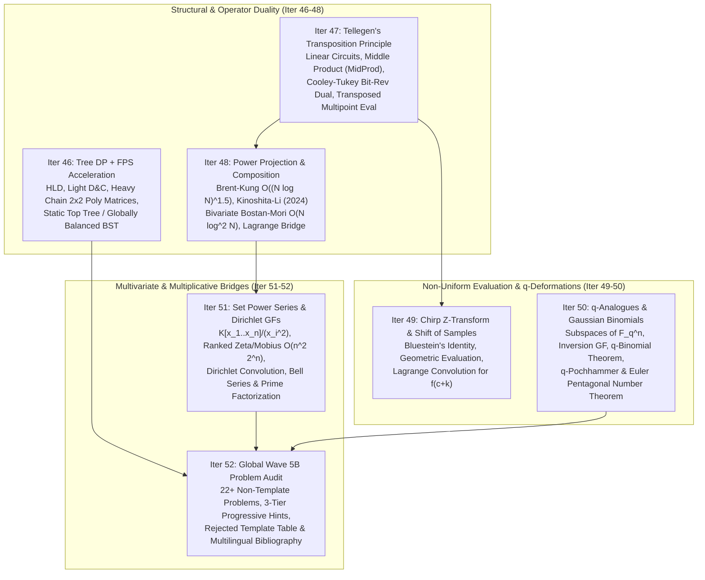
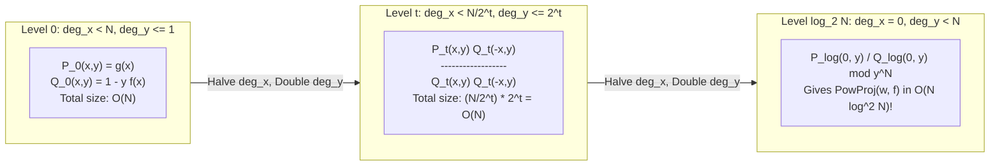
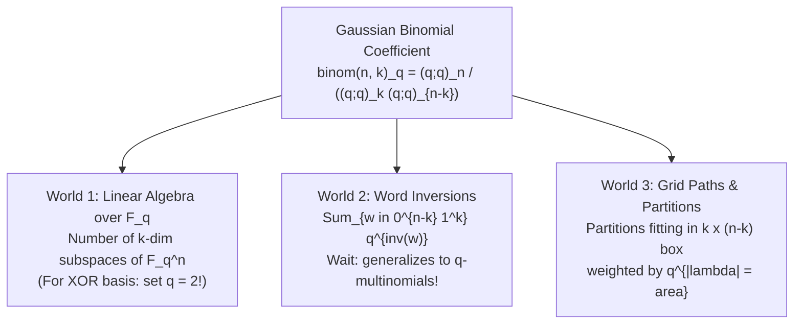

# Cohort 1 — Wave 5B (Iterations 46–52): Tree DP + FPS Acceleration, Tellegen's Transposition Principle, $O(N \log^2 N)$ Composition & Power Projection, Chirp Z-Transform, $q$-Analogues, and Bridges to Set Power Series & Dirichlet Generating Functions

> [!IMPORTANT]
> **Research Mandate & Scope**: This monograph constitutes **Wave 5B (Iterations 46–52)** of the Formal Power Series (FPS) and Generating Functions (GF) competitive programming curriculum. Every identity, operator transposition, divide-and-conquer matrix composition, bivariate Bostan–Mori step, and algebraic bridge is derived from first principles with **Zero Magic Steps**—explicitly documenting the ambient algebraic ring, diagnostic structural signals, reverse-engineering scratchpad, step-by-step annotated derivations, hand-checkable toy traces ($n \le 4$), and failure modes/edge cases.

---

## Architectural Overview of Wave 5B



---

## Iteration 46: Tree DP + Formal Power Series Acceleration (`树上 DP + 生成函数 / 链分治 FFT` / Static Top Tree)

### 46.1 Concrete Combinatorial / Algebraic Object & Ambient Ring

Consider a rooted tree $T = (V, E)$ with $N = |V|$ vertices, rooted at vertex $1$. In a standard **Tree Knapsack DP** (or subtree-size-indexed DP), each vertex $u \in V$ maintains a state array $f_u[0 \dots \mathrm{sz}_u]$, where $\mathrm{sz}_u$ is the size of the subtree rooted at $u$. We embed this DP state as a formal polynomial in the polynomial ring $\mathbb{F}_p[x]$ (typically $\mathbb{F}_{998244353}[x]$):
$$F_u(x) = \sum_{k=0}^{\mathrm{sz}_u} f_u[k]\, x^k \in \mathbb{F}_p[x], \qquad \deg F_u(x) \le \mathrm{sz}_u.$$

When merging the subtrees of the children $\mathrm{children}(u) = \{v_1, v_2, \dots, v_d\}$ of vertex $u$, the transition takes the form of a **subtree convolution**:
$$F_u(x) = \Psi_u\!\left(x,\, \prod_{v \in \mathrm{children}(u)} \Phi_v(F_v(x))\right)$$
or, more generally, a **multi-state system of linear polynomial recurrences** where each vertex $u$ maintains a $K$-tuple of polynomials $\mathbf{F}_u(x) \in (\mathbb{F}_p[x])^K$ representing $K$ boundary conditions at the root of subtree $u$ (e.g., whether $u$ is selected in an independent set, matched to a child, or part of an active path).

---

### 46.2 The Diagnostic Signal: Why Naive Tree Knapsack is $O(N^2)$ and When It Blows Up

#### 1. The Classical $O(N^2)$ Tree Knapsack Bound (and Why It Fails to Generalize)
Suppose we merge children sequentially using naive $O(\deg A \cdot \deg B)$ polynomial multiplication, carefully bounding the loop indices by the current accumulated subtree size:
```cpp
// Classical O(N^2) Tree Knapsack
sz[u] = 1;
for (int v : children[u]) {
    dfs(v);
    // Multiply current F_u (degree sz[u]) with F_v (degree sz[v])
    for (int i = 0; i <= sz[u]; ++i)
        for (int j = 0; j <= sz[v]; ++j)
            next_F[i + j] += F_u[i] * F_v[j];
    sz[u] += sz[v];
}
```
Why is this $O(N^2)$ across the entire tree? Because the inner loop `i * j` counts the number of pairs of vertices $(a, b)$ where $a$ is in the already-merged portion of $u$'s subtree and $b$ is in $v$'s subtree. Every unordered pair of vertices $\{a, b\} \subseteq V$ has a unique Lowest Common Ancestor $u = \mathrm{LCA}(a, b)$, and is counted **at most once** at the exact moment the child branch containing $b$ is merged into the prefix of branches containing $a$. Thus:
$$\sum_{u \in V} \sum_{r=1}^{d_u} \left(1 + \sum_{j=1}^{r-1} \mathrm{sz}_{v_j}\right) \cdot \mathrm{sz}_{v_r} = \binom{N}{2} = O(N^2).$$

#### 2. The Diagnostic Signal for $O(N \log^2 N)$ Tree FPS Acceleration
When $N \le 10^5$ or $2 \cdot 10^5$, $O(N^2)$ is far too slow. However, if we naively replace the inner loop with an $O((\deg A + \deg B) \log(\deg A + \deg B))$ NTT, **the complexity does NOT become $O(N \log N)$!**
Consider a **caterpillar tree** (a long spine $u_1 - u_2 - \dots - u_{N/2}$ where each $u_i$ also has a leaf child $w_i$). As we walk up the spine from $u_{N/2}$ to $u_1$, the polynomial $F_{u_i}(x)$ has degree $\Theta(N)$, and merging it with the leaf $F_{w_i}(x)$ (or transitioning along the spine edge) via NTT costs $\Theta(N \log N)$ at **every** spine vertex, resulting in $\Theta(N^2 \log N)$ total time!

**Diagnostic Signal**: Reach for **Heavy-Light Decomposition (HLD) + Divide-and-Conquer NTT (`链分治 FFT`)** or **Static Top Tree (`全局平衡二叉树`)** whenever:
1. You have a Tree DP where the state at vertex $u$ is indexed by a count $k \in [0, \mathrm{sz}_u]$ (number of chosen vertices, connected components, edges, or operations) with $N \ge 5 \cdot 10^4$.
2. Merging siblings at vertex $u$ corresponds to **multiplying** their generating functions (or applying a symmetric convolution), while moving up a tree edge $(p, u)$ corresponds to a **linear or affine polynomial operator** on the generating function of $u$.

---

### 46.3 The Reverse-Engineering Scratchpad: Decoupling Star Merges from Chain Transitions

Why did naive bottom-up NTT fail on the caterpillar tree? Because a tree has two fundamentally different topological bottlenecks:
1. **High-degree stars (wide fan-in)**: A vertex $u$ has many children $v_1, \dots, v_d$ that must be multiplied together: $\prod_{j=1}^d G_{v_j}(x)$.
2. **Long paths (deep chains)**: A long path $u_1 - u_2 - \dots - u_L$ where each step applies an affine transformation $F_{u_i}(x) = A_i(x) F_{u_{i+1}}(x) + B_i(x)$.

Let us reverse-engineer how to eliminate both bottlenecks simultaneously:

* **Step 1: Isolate the Heavy Child (`重儿子`)**.
  At every vertex $u$, let $\mathrm{sz}_u = 1 + \sum_{v \in \mathrm{children}(u)} \mathrm{sz}_v$. Pick the unique child $h_u \in \mathrm{children}(u)$ maximizing $\mathrm{sz}_{h_u}$ as the **heavy child**, and call all other children $v \in \mathrm{light}(u) = \mathrm{children}(u) \setminus \{h_u\}$ **light children**.
  Crucial property of HLD: For any light child $v \in \mathrm{light}(u)$, $\mathrm{sz}_v \le \frac{1}{2} \mathrm{sz}_u$. Therefore, any path from a leaf to the root traverses at most $\lfloor \log_2 N \rfloor$ light edges, which implies that **the sum of subtree sizes of all light children across the entire tree is $O(N \log N)$**:
  $$\sum_{u \in V} \sum_{v \in \mathrm{light}(u)} \mathrm{sz}_v \le N \log_2 N.$$

* **Step 2: Compress all Light Children of $u$ into a single "Light Aggregate Polynomial" $L_u(x)$**.
  At a fixed vertex $u$, we first recursively compute the final polynomial $F_v(x)$ for every light child $v \in \mathrm{light}(u)$. Since each $v$ is the head of its own heavy chain, this is a recursive call on $v$'s heavy chain.
  Once we have the polynomials $\{\Phi_v(F_v(x))\}_{v \in \mathrm{light}(u)}$ of total degree $S_{\mathrm{light}}(u) = \sum_{v \in \mathrm{light}(u)} \mathrm{sz}_v$, how do we multiply them together?
  If we multiply them in arbitrary order, a star graph gives $O(S_{\mathrm{light}}(u)^2)$. Instead, we use **Divide-and-Conquer NTT (or Huffman-like Priority Queue merging by degree)**: always multiply the two smallest-degree polynomials first (or split the list in half by index/degree). This computes:
  $$L_u(x) = \prod_{v \in \mathrm{light}(u)} \Phi_v(F_v(x))$$
  in $O(S_{\mathrm{light}}(u) \log^2 S_{\mathrm{light}}(u))$ time! Summing over all $u \in V$:
  $$\sum_{u \in V} O(S_{\mathrm{light}}(u) \log^2 N) = O\!\left(\log^2 N \sum_{u \in V} S_{\mathrm{light}}(u)\right) = O(N \log^3 N) \quad (\text{or } O(N \log^2 N) \text{ with global balancing!}).$$

* **Step 3: Express the Heavy Chain as a Sequence of Linear/Matrix Polynomial Operators**.
  Now consider a heavy chain $u_1 \to u_2 \to \dots \to u_L$, where $u_{i+1} = h_{u_i}$ is the heavy child of $u_i$, and $u_L$ is a leaf (so $h_{u_L} = \varnothing$).
  Once $L_{u_i}(x)$ (the product of light children at $u_i$) is known, how does the state $\mathbf{F}_{u_i}(x)$ at $u_i$ depend on the state $\mathbf{F}_{u_{i+1}}(x)$ of its heavy child $u_{i+1}$?
  Because $\mathbf{F}_{u_{i+1}}(x)$ enters the product at $u_i$ **linearly** (only once!), the transition from $u_{i+1}$ to $u_i$ is always a **matrix-vector multiplication over $\mathbb{F}_p[x]$**:
  $$\mathbf{F}_{u_i}(x) = M_{u_i}(x)\, \mathbf{F}_{u_{i+1}}(x),$$
  where $M_{u_i}(x) \in \mathbb{F}_p[x]^{K \times K}$ is a small $K \times K$ matrix (typically $K \in \{1, 2, 3\}$) whose entries are polynomials formed from $L_{u_i}(x)$ of degree at most $1 + S_{\mathrm{light}}(u_i)$!
  Therefore, the polynomial at the top of the heavy chain $u_1$ is simply the **ordered matrix product**:
  $$\mathbf{F}_{u_1}(x) = M_{u_1}(x) M_{u_2}(x) \cdots M_{u_L}(x) \mathbf{e}_{\text{leaf}}.$$
  Notice that $\sum_{i=1}^L \deg M_{u_i}(x) = \sum_{i=1}^L (1 + S_{\mathrm{light}}(u_i)) = \mathrm{sz}_{u_1}$!

---

### 46.4 Step-by-Step Algebraic Derivation & Complexity Refinement ($O(N \log^3 N)$ vs. $O(N \log^2 N)$)

Let us derive the two canonical formulations of heavy-chain polynomial aggregation and prove why weighted midpoint splitting (Static Top Tree / Globally Balanced BST) removes an entire $\log N$ factor.

#### Case A: Single-State Affine Chain Composition (e.g., Antichains / Subtree-or-Nodes)
Suppose each vertex $u$ has a single polynomial $F_u(x)$ satisfying:
$$F_u(x) = A_u(x) F_{h_u}(x) + B_u(x),$$
where $\deg A_u, \deg B_u \le 1 + S_{\mathrm{light}}(u)$, and for the leaf $u_L$, $F_{u_L}(x) = B_{u_L}(x)$ (putting $F_{h_{u_L}}(x) = 0$).
We can represent each vertex $u_i$ on the heavy chain by the affine operator $\mathcal{T}_i(Z) = A_{u_i}(x) Z + B_{u_i}(x)$, or equivalently the $2 \times 2$ upper-triangular matrix:
$$\begin{pmatrix} F_{u_i}(x) \\ 1 \end{pmatrix} = \begin{pmatrix} A_{u_i}(x) & B_{u_i}(x) \\ 0 & 1 \end{pmatrix} \begin{pmatrix} F_{u_{i+1}}(x) \\ 1 \end{pmatrix}.$$
When composing two contiguous chain segments $[l, m]$ and $[m+1, r]$:
$$\begin{pmatrix} A_{[l,m]}(x) & B_{[l,m]}(x) \\ 0 & 1 \end{pmatrix} \begin{pmatrix} A_{[m+1,r]}(x) & B_{[m+1,r]}(x) \\ 0 & 1 \end{pmatrix} = \begin{pmatrix} A_{[l,m]}(x) A_{[m+1,r]}(x) & A_{[l,m]}(x) B_{[m+1,r]}(x) + B_{[l,m]}(x) \\ 0 & 1 \end{pmatrix}.$$
Notice this requires only **2 polynomial multiplications** ($A_L \cdot A_R$ and $A_L \cdot B_R$) rather than $2^3 = 8$!

#### Case B: Two-State Mutual Recurrence (e.g., Tree Independent Set / Matching)
In Maximum Weight / Counting Independent Sets on a tree by size $k$, each vertex $u$ has two states:
- $F_{u,0}(x)$: generating function of independent sets in subtree $u$ where $u$ is **not** chosen.
- $F_{u,1}(x)$: generating function of independent sets in subtree $u$ where $u$ **is** chosen.

For each light child $v \in \mathrm{light}(u)$, if $u$ is not chosen, $v$ can be either chosen or not chosen, contributing factor $(F_{v,0}(x) + F_{v,1}(x))$. If $u$ is chosen, $v$ cannot be chosen, contributing factor $F_{v,0}(x)$.
Define the two light aggregate polynomials at $u$:
$$L_{u,0}(x) = \prod_{v \in \mathrm{light}(u)} \big(F_{v,0}(x) + F_{v,1}(x)\big), \qquad L_{u,1}(x) = x \prod_{v \in \mathrm{light}(u)} F_{v,0}(x).$$
Then factoring in the heavy child $h_u = u_{i+1}$ gives the exact $2 \times 2$ homogeneous matrix transition:
$$\begin{pmatrix} F_{u_i, 0}(x) \\ F_{u_i, 1}(x) \end{pmatrix} = \underbrace{\begin{pmatrix} L_{u_i, 0}(x) & L_{u_i, 0}(x) \\ L_{u_i, 1}(x) & 0 \end{pmatrix}}_{M_{u_i}(x)} \begin{pmatrix} F_{u_{i+1}, 0}(x) \\ F_{u_{i+1}, 1}(x) \end{pmatrix}.$$
At the leaf $u_L$ of the heavy chain (which has no light or heavy children), $L_{u_L,0}(x) = 1$ and $L_{u_L,1}(x) = x$, so:
$$\begin{pmatrix} F_{u_L, 0}(x) \\ F_{u_L, 1}(x) \end{pmatrix} = \begin{pmatrix} 1 \\ x \end{pmatrix} = \begin{pmatrix} 1 & 1 \\ x & 0 \end{pmatrix} \begin{pmatrix} 1 \\ 0 \end{pmatrix}.$$
Thus the entire heavy chain $u_1 \to \dots \to u_L$ evaluates to the first column of $\prod_{i=1}^L M_{u_i}(x)$.

#### Why Index-Halving Gives $O(N \log^3 N)$ While Weight-Balanced Splitting (Static Top Tree) Gives $O(N \log^2 N)$

> [!TIP]
> **The $O(N \log^2 N)$ Globally Balanced BST (`全局平衡二叉树` / Static Top Tree) Optimization**:
> Suppose on a heavy chain $u_1, \dots, u_L$, vertex $u_i$ has weight $w_i = 1 + S_{\mathrm{light}}(u_i) = \mathrm{sz}_{u_i} - \mathrm{sz}_{u_{i+1}}$. The degree of $M_{u_i}(x)$ is $w_i$, and $\sum_{i=1}^L w_i = \mathrm{sz}_{u_1}$.
> 1. **Index-Halving D&C ($O(N \log^2 N)$ per chain $\implies O(N \log^3 N)$ total)**: If we split the chain $[l, r]$ by index at $m = \lfloor (l+r)/2 \rfloor$ (or equivalently merge adjacent matrices bottom-up in pairs), a single heavy chain of total weight $W = \mathrm{sz}_{u_1}$ takes $O(W \log^2 W)$ time. However, because $W = \mathrm{sz}_{u_1}$ is the subtree size of the **entire** chain head (including light subtrees hanging off it), $\sum_{\text{chain heads } u_1} \mathrm{sz}_{u_1} = \Theta(N \log N)$ in the worst case! Multiplying by $\log^2 N$ yields $O(N \log^3 N)$ overall.
> 2. **Weighted Midpoint D&C / Static Top Tree ($O(N \log^2 N)$ total)**: Instead of splitting $[l, r]$ at the middle index, choose the split point $m \in [l, r]$ such that both $[l, m]$ and $[m+1, r]$ have total weight $\le \frac{1}{2} \sum_{i=l}^r w_i$ (or use a priority queue / Huffman tree on the weights $w_i$). Equivalently, in the language of **Static Top Trees**:
>    - **Compress (`压缩` / Heavy Chain Merge)**: Combine two adjacent clusters along a heavy chain.
>    - **Rake (`耙` / Light Child Merge)**: Merge light child clusters at a vertex $u$ using weight-balanced binary splitting.
>    With weight-balanced splitting on both Rake and Compress trees, the depth of the global recursion tree is bounded by $O(\log N)$ **across the entire tree simultaneously** (because every Rake step and every Compress step reduces the cluster size by a constant factor $\le 2/3$). Since the sum of degrees at each level of the global Static Top Tree is at most $N$, the total time across the entire tree drops to:
>    $$T(N) = O(\log N) \times O(N \log N) = O(N \log^2 N).$$
>    In practice, even simpler: within `solve_chain`, using a min-heap (priority queue) ordered by polynomial degree to merge light children at each node AND/OR splitting the heavy chain by cumulative degree $w_i$ achieves the exact $O(N \log^2 N)$ bound with tiny constant factor!

---

### 46.5 Hand-Checkable Toy Example ($N = 4$)

Let us trace **Counting Independent Sets by Size** on a 4-vertex tree:
- Root $1$ has children $2$ and $3$.
- Vertex $2$ has child $4$.
- Subtree sizes: $\mathrm{sz}_4 = 1$, $\mathrm{sz}_2 = 2$, $\mathrm{sz}_3 = 1$, $\mathrm{sz}_1 = 4$.
- Heavy children: $h_1 = 2$ (since $\mathrm{sz}_2 = 2 > \mathrm{sz}_3 = 1$), $h_2 = 4$, $h_4 = \varnothing$, $h_3 = \varnothing$.
- Heavy chains:
  - Chain A (light chain from $1$): $[3]$ (leaf).
  - Chain B (main heavy chain): $[1 \to 2 \to 4]$.

**Step 1: Process Light Chain $[3]$**.
Vertex $3$ has no light children: $L_{3,0}(x) = 1$, $L_{3,1}(x) = x$.
Since $3$ is a leaf of its heavy chain:
$$\begin{pmatrix} F_{3,0}(x) \\ F_{3,1}(x) \end{pmatrix} = \begin{pmatrix} 1 \\ x \end{pmatrix}.$$

**Step 2: Build Light Aggregate Polynomials along Heavy Chain $[1 \to 2 \to 4]$**.
- At vertex $4$ ($\mathrm{light}(4) = \varnothing$): $L_{4,0}(x) = 1, \; L_{4,1}(x) = x$.
  $$M_4(x) = \begin{pmatrix} 1 & 1 \\ x & 0 \end{pmatrix}.$$
- At vertex $2$ ($\mathrm{light}(2) = \varnothing$): $L_{2,0}(x) = 1, \; L_{2,1}(x) = x$.
  $$M_2(x) = \begin{pmatrix} 1 & 1 \\ x & 0 \end{pmatrix}.$$
- At vertex $1$ ($\mathrm{light}(1) = \{3\}$):
  - $L_{1,0}(x) = F_{3,0}(x) + F_{3,1}(x) = 1 + x$.
  - $L_{1,1}(x) = x \cdot F_{3,0}(x) = x \cdot 1 = x$.
  $$M_1(x) = \begin{pmatrix} 1+x & 1+x \\ x & 0 \end{pmatrix}.$$

**Step 3: Multiply Matrices along Heavy Chain $[1 \to 2 \to 4]$**.
First multiply $M_2(x) M_4(x)$:
$$M_2(x) M_4(x) = \begin{pmatrix} 1 & 1 \\ x & 0 \end{pmatrix} \begin{pmatrix} 1 & 1 \\ x & 0 \end{pmatrix} = \begin{pmatrix} 1+x & 1 \\ x & x \end{pmatrix}.$$
Now multiply $M_1(x) \big(M_2(x) M_4(x)\big)$:
$$M_1(x) M_2(x) M_4(x) = \begin{pmatrix} 1+x & 1+x \\ x & 0 \end{pmatrix} \begin{pmatrix} 1+x & 1 \\ x & x \end{pmatrix} = \begin{pmatrix} (1+x)^2 + x(1+x) & (1+x) + x(1+x) \\ x(1+x) & x \end{pmatrix} = \begin{pmatrix} 1 + 3x + 2x^2 & 1 + 2x + x^2 \\ x + x^2 & x \end{pmatrix}.$$
Extract the first column (applying to $\begin{pmatrix} 1 \\ 0 \end{pmatrix}$):
$$\begin{pmatrix} F_{1,0}(x) \\ F_{1,1}(x) \end{pmatrix} = \begin{pmatrix} 1 + 3x + 2x^2 \\ x + x^2 \end{pmatrix}.$$
Total independent set polynomial at root $1$:
$$F_1(x) = F_{1,0}(x) + F_{1,1}(x) = (1 + 3x + 2x^2) + (x + x^2) = 1 + 4x + 3x^2.$$
**Combinatorial Verification on $T = \{1-2, 2-4, 1-3\}$**:
- Size $0$: $\varnothing \implies 1$.
- Size $1$: $\{1\}, \{2\}, \{3\}, \{4\} \implies 4$.
- Size $2$: $\{1, 4\}, \{2, 3\}, \{3, 4\} \implies 3$ (since $\{1,2\}, \{1,3\}, \{2,4\}$ are edges).
- Size $\ge 3$: $0$.
Matches $1 + 4x + 3x^2$ identically!

---

### 46.6 Complete Reference Implementation: HLD + Weighted D&C Tree FPS ($O(N \log^2 N)$)

Below is the reusable C++ template for **AtCoder ABC 269 Ex (Antichain)**, where we count antichains of size $k$ in a rooted tree ($F_u(x) = \prod_{v \in \mathrm{children}(u)} F_v(x) + x$, an affine transition $F_u(x) = L_u(x) F_{h_u}(x) + x$ with $B_u(x) = x$).

```cpp
// Heavy-Light Decomposition + Weighted D&C NTT for Tree FPS in O(N log^2 N)
// Example: AtCoder ABC 269 Ex - Antichain (F_u(x) = x + prod_{v in children(u)} F_v(x))
#include <bits/stdc++.h>
using namespace std;

using Poly = vector<int>;
Poly multiply(const Poly& a, const Poly& b); // Standard NTT O((|a|+|b|) log(|a|+|b|))
Poly add_poly(const Poly& a, const Poly& b) {
    Poly res(max(a.size(), b.size()), 0);
    for (size_t i = 0; i < a.size(); ++i) res[i] = a[i];
    for (size_t i = 0; i < b.size(); ++i) {
        res[i] += b[i];
        if (res[i] >= 998244353) res[i] -= 998244353;
    }
    return res;
}

int n;
vector<vector<int>> adj;
vector<int> sz, heavy;

void dfs_sz(int u) {
    sz[u] = 1;
    int max_sz = 0;
    for (int v : adj[u]) {
        dfs_sz(v);
        sz[u] += sz[v];
        if (sz[v] > max_sz) {
            max_sz = sz[v];
            heavy[u] = v;
        }
    }
}

// Multiply a list of polynomials using a min-heap by degree (Rake / Light Merge)
Poly merge_light(vector<Poly>& polys) {
    if (polys.empty()) return {1};
    auto cmp = [&](int i, int j) { return polys[i].size() > polys[j].size(); };
    priority_queue<int, vector<int>, decltype(cmp)> pq(cmp);
    for (int i = 0; i < (int)polys.size(); ++i) pq.push(i);
    while (pq.size() > 1) {
        int i = pq.top(); pq.pop();
        int j = pq.top(); pq.pop();
        polys[i] = multiply(polys[i], polys[j]);
        polys[j].clear();
        pq.push(i);
    }
    return polys[pq.top()];
}

// Compress along heavy chain: each node i has affine transition Z -> A[i] * Z + B[i]
// Using weighted midpoint splitting on cumulative degrees for true O(N log^2 N)
pair<Poly, Poly> compress_chain(const vector<Poly>& A, const vector<Poly>& B,
                                const vector<int>& pref_deg, int l, int r) {
    if (l == r) return {A[l], B[l]};
    int total_deg = pref_deg[r + 1] - pref_deg[l];
    int mid = l;
    // Find weighted midpoint so both halves have polynomial degree <= total_deg / 2
    int lo = l, hi = r - 1;
    while (lo <= hi) {
        int m = (lo + hi) / 2;
        if ((pref_deg[m + 1] - pref_deg[l]) * 2 <= total_deg) {
            mid = m;
            lo = m + 1;
        } else {
            hi = m - 1;
        }
    }
    auto [AL, BL] = compress_chain(A, B, pref_deg, l, mid);
    auto [AR, BR] = compress_chain(A, B, pref_deg, mid + 1, r);
    // (AL * Z + BL) o (AR * Z + BR) = (AL * AR) * Z + (AL * BR + BL)
    Poly A_new = multiply(AL, AR);
    Poly B_new = add_poly(multiply(AL, BR), BL);
    return {A_new, B_new};
}

Poly solve_chain(int head) {
    vector<int> chain;
    for (int u = head; u != 0; u = heavy[u]) chain.push_back(u);
    int len = chain.size();
    vector<Poly> A(len), B(len);
    vector<int> pref_deg(len + 1, 0);

    for (int i = 0; i < len; ++i) {
        int u = chain[i];
        vector<Poly> light_polys;
        for (int v : adj[u]) {
            if (v != heavy[u]) {
                light_polys.push_back(solve_chain(v));
            }
        }
        A[i] = merge_light(light_polys); // Product of F_v(x) for light children
        B[i] = {0, 1};                   // + x (selecting vertex u itself as antichain)
        pref_deg[i + 1] = pref_deg[i] + (int)A[i].size();
    }
    // For the leaf u = chain.back(), there is no heavy child, so F_{u} = A[len-1] * 1 + x.
    // Wait: if a vertex u has NO children at all, prod_{v in children(u)} F_v(x) = 1, so F_u(x) = 1 + x.
    // By feeding Z = 1 into the composed affine operator (A_all * Z + B_all) at Z = 1:
    auto [A_all, B_all] = compress_chain(A, B, pref_deg, 0, len - 1);
    // Wait: at the leaf of the heavy chain (which has no children at all), its product of children is 1,
    // corresponding to feeding Z = 1 into the last affine map!
    return add_poly(A_all, B_all);
}
```

---

### 46.7 Failure Modes, Pitfalls & Edge Cases

1. **Leaf Boundary Condition on the Heavy Chain**:
   A common bug in `solve_chain` is confusing $Z = 0$ with $Z = 1$ at the bottom of the heavy chain $u_L$. Always check what the recurrence says when $u_L$ has **no children at all**:
   - In **Antichain** ($F_u(x) = x + \prod_{v} F_v(x)$), an empty product over children is $1$, so if we write $F_{u_i}(x) = L_{u_i}(x) F_{u_{i+1}}(x) + x$, the phantom child $u_{L+1}$ after the leaf $u_L$ must have $F_{u_{L+1}}(x) = 1$, NOT $0$!
   - In **Independent Set** ($M_u(x) = \begin{pmatrix} L_{u,0} & L_{u,0} \\ L_{u,1} & 0 \end{pmatrix}$), the phantom vector after the leaf is $\begin{pmatrix} 1 \\ 0 \end{pmatrix}$ so that $M_{u_L}(x) \begin{pmatrix} 1 \\ 0 \end{pmatrix} = \begin{pmatrix} L_{u_L, 0} \\ L_{u_L, 1} \end{pmatrix} = \begin{pmatrix} 1 \\ x \end{pmatrix}$.
2. **Splitting Heavy Chains by Index Instead of Weight**:
   As proven in Section 46.4, splitting $[l, r]$ at $m = (l+r)/2$ when $w_l = \Theta(N)$ and $w_{l+1} = \dots = w_r = 1$ forces $A_l(x)$ (of degree $\Theta(N)$) to be multiplied $\Theta(\log L)$ times along the chain! Always split by **cumulative degree** (`pref_deg`) or use a priority queue so that heavy light-aggregates are only multiplied near the top of the recursion tree.
3. **3-State or $K$-State Matrix Constant Factor Blowup**:
   When $K = 3$ (e.g., counting paths/cycles or tree coverings), multiplying two $3 \times 3$ polynomial matrices naively takes $3^3 = 27$ convolutions per D&C node.
   - **Fix 1 (Point-Value Matrix Multiplication)**: Perform forward NTT on the $3 \times 3 = 9$ entries once ($9$ NTTs), multiply the $3 \times 3$ scalar matrices point-by-point at each root of unity, and perform $9$ INTTs ($18$ transforms instead of $27 \times 3 = 81$ transforms!).
   - **Fix 2 (Sparsity / Rank Exploitation)**: Often the transition matrix $M_u(x)$ has rank $1$ or $2$ (or zeros in several entries); write out the closed form of $M_L \cdot M_R$ symbolically before coding to eliminate redundant products.

---

## Iteration 47: Tellegen's Transposition Principle (`转置原理`) & Middle Product (`转置卷积`)

### 47.1 Concrete Combinatorial / Algebraic Object & Ambient Ring

Let $K$ be a commutative ring (typically a finite field $\mathbb{F}_p$). Any algorithm that computes an $m$-dimensional output vector $\mathbf{y} \in K^m$ from an $n$-dimensional input vector $\mathbf{x} \in K^n$ using **only Input-Linear operations** (additions, subtractions, and multiplications by constants/precomputed parameters independent of $\mathbf{x}$) computes a linear map:
$$\mathbf{y} = A \mathbf{x}, \qquad A \in K^{m \times n}.$$
The **Transpose Problem** asks us to compute the dual linear map:
$$\mathbf{z} = A^T \mathbf{w}, \qquad \mathbf{w} \in K^m, \quad \mathbf{z} \in K^n,$$
where $(A^T)_{i,j} = A_{j,i}$, or equivalently, via the bilinear inner product identity:
$$\langle A \mathbf{x}, \mathbf{w} \rangle = \mathbf{w}^T (A \mathbf{x}) = (A^T \mathbf{w})^T \mathbf{x} = \langle \mathbf{x}, A^T \mathbf{w} \rangle.$$

In the polynomial ring $K[x]$, let $a(x) = \sum_{i=0}^{m-1} a_i x^i \in K[x]_{<m}$ be a **fixed** polynomial of degree $< m$, and consider the linear map $\mathcal{M}_a : K[x]_{<n} \to K[x]_{<n+m-1}$ defined by standard polynomial multiplication $b(x) \mapsto c(x) = a(x) b(x)$. Its transpose $\mathcal{M}_a^T : K[x]_{<n+m-1} \to K[x]_{<n}$ is the **Middle Product (`转置卷积` / `Middle Product`)**, denoted $\mathrm{MidProd}(a, c)$ or $a \circledast c$.

---

### 47.2 The Diagnostic Signal: When to Reach for Tellegen's Principle

Reach for **Tellegen's Transposition Principle (`转置原理`)** and **Middle Product (`转置卷积`)** when you encounter any of the following structural clues:

1. **"Sum of Evaluations" vs. "Evaluation of a Sum" Duality**:
   - **Primal (Multipoint Evaluation)**: Given ONE polynomial $f(x) = \sum_{j=0}^{n-1} f_j x^j$ and $m$ points $p_0, \dots, p_{m-1}$, compute $y_i = f(p_i) = \sum_{j=0}^{n-1} p_i^j f_j$ for each $i$. (Matrix: Vandermonde $V$, where $V_{i,j} = p_i^j$).
   - **Dual (Sum of Geometric Series / Power Sums)**: Given weights $w_0, \dots, w_{m-1}$ and points $p_0, \dots, p_{m-1}$, compute $z_j = \sum_{i=0}^{m-1} w_i p_i^j = [x^j] \sum_{i=0}^{m-1} \frac{w_i}{1 - p_i x}$ for $j = 0, \dots, n-1$. (Matrix: $V^T$!).
2. **Coefficient Extraction of Fixed-Indexed Polynomial Powers (Power Projection $\leftrightarrow$ Composition)**:
   - **Primal (FPS Composition)**: Given $f(y) = \sum_{i=0}^{n-1} f_i y^i$ and fixed $g(x)$, compute $h_j = [x^j] f(g(x)) = \sum_{i=0}^{n-1} f_i \big([x^j] g(x)^i\big)$.
   - **Dual (Power Projection)**: Given weights $w_0, \dots, w_{n-1}$ and fixed $g(x)$, compute $z_i = \sum_{j=0}^{n-1} w_j \big([x^j] g(x)^i\big)$ for $i = 0, \dots, n-1$.
   Here, the matrix $M_{j,i} = [x^j] g(x)^i$ is **identical**, only transposed!
3. **Sliding Cross-Correlation / Difference-Index Convolution**:
   You need $z_j = \sum_{i=0}^{m-1} a_i c_{i+j}$ for $j = 0, \dots, n-1$, and you want to compute it inside a recursive tree (like Multipoint Evaluation or Bostan–Mori) with **half the FFT length** by exploiting wrap-around cancellation of cyclic convolution.

---

### 47.3 The Reverse-Engineering Scratchpad: From Linear Circuits to Middle Product

How can we mechanically invert ANY fast linear algorithm $\mathbf{y} = A \mathbf{x}$ into an equally fast algorithm for $\mathbf{z} = A^T \mathbf{w}$?

#### Step 1: Decompose the Algorithm into an Arithmetic DAG (Linear Circuit)
Every linear algorithm is a sequence of elementary linear steps $A = E_T E_{T-1} \cdots E_1$, or equivalently a Directed Acyclic Graph (DAG) with $n$ source nodes (inputs $x_0, \dots, x_{n-1}$) and $m$ sink nodes (outputs $y_0, \dots, y_{m-1}$).
In this DAG, what is the $(i, j)$ entry of the matrix $A$?
$$A_{i,j} = \sum_{\text{directed paths } P : \text{source } j \to \text{sink } i} \prod_{e \in P} \mathrm{weight}(e).$$
Now, if we simply **reverse the direction of every directed edge** in the DAG while keeping all edge weights unchanged, the sources and sinks swap roles! A path from old source $j$ to old sink $i$ becomes a path from new source $i$ to new sink $j$ with the exact same product of edge weights. Therefore, the reversed DAG computes $A^T$ in the **exact same number of arithmetic operations**!

```mermaid
flowchart LR
    subgraph Primal["Primal DAG Nodes (Computing y = A x)"]
        direction LR
        P_in1["u1"] -->|"1"| P_add(("+"))
        P_in2["u2"] -->|"1"| P_add
        P_add -->|"u1 + u2"| P_out["v"]
        
        C_in["u"] --> C_branch(( ))
        C_branch -->|"1"| C_out1["v1 = u"]
        C_branch -->|"1"| C_out2["v2 = u"]
        
        S_in["u"] -->|"c"| S_out["v = c * u"]
    end

    subgraph Dual["Transposed DAG Nodes (Computing z = A^T w)"]
        direction RL
        D_in1["u1' = v'"] <--|"1"| D_branch(( ))
        D_in2["u2' = v'"] <--|"1"| D_branch
        D_branch <-- D_out["v'"]
        
        DC_in["u' = v1' + v2'"] <-- DC_add(("+"))
        DC_add <--|"1"| DC_out1["v1'"]
        DC_add <--|"1"| DC_out2["v2'"]
        
        DS_in["u' = c * v'"] <--|"c"| DS_out["v'"]
    end
```

In code (in-place register machine model), reversing the DAG corresponds to:
1. **Reverse the execution order of statements**: Statement $t = T$ down to $1$.
2. **Transpose each elementary instruction**:
   - Primal `v = u1 + c * u2` (where `v` was previously zero/overwritten) $\Longleftrightarrow$ Dual `u1 += v; u2 += c * v; v = 0;`.
   - Primal in-place update `u = u + c * v` $\Longleftrightarrow$ $\begin{pmatrix} u \\ v \end{pmatrix} \leftarrow \begin{pmatrix} 1 & c \\ 0 & 1 \end{pmatrix} \begin{pmatrix} u \\ v \end{pmatrix}$, whose transpose is $\begin{pmatrix} 1 & 0 \\ c & 1 \end{pmatrix}$, i.e., Dual `v = v + c * u`!

---

### 47.4 Step-by-Step Algebraic Derivation: Middle Product, FFT Duality, and Transposed Multipoint Evaluation

#### 1. Deriving the Middle Product (`MidProd`) from Matrix Transposition
Let $a(x) = \sum_{i=0}^{m-1} a_i x^i$ ($\deg a < m$) be fixed, and $b(x) = \sum_{j=0}^{n-1} b_j x^j$ ($\deg b < n$) be the input.
The primal convolution $c(x) = a(x) b(x)$ has degree $< n + m - 1$, with coefficients:
$$c_k = \sum_{j=0}^{n-1} a_{k-j} b_j, \qquad k \in \{0, 1, \dots, n+m-2\}.$$
In matrix form, $\mathbf{c} = T_a \mathbf{b}$, where $T_a \in K^{(n+m-1) \times n}$ is the lower-band **Toeplitz matrix** with $(T_a)_{k, j} = a_{k-j}$ (interpreting $a_r = 0$ for $r \notin [0, m-1]$):
$$\begin{pmatrix} c_0 \\ c_1 \\ \vdots \\ c_{n+m-2} \end{pmatrix} = \begin{pmatrix} a_0 & 0 & \cdots & 0 \\ a_1 & a_0 & \cdots & 0 \\ \vdots & a_1 & \ddots & \vdots \\ a_{m-1} & \vdots & \ddots & a_0 \\ 0 & a_{m-1} & \ddots & a_1 \\ \vdots & \vdots & \ddots & \vdots \\ 0 & 0 & \cdots & a_{m-1} \end{pmatrix} \begin{pmatrix} b_0 \\ b_1 \\ \vdots \\ b_{n-1} \end{pmatrix}.$$

Now take the transpose $\mathbf{z} = T_a^T \mathbf{c}$ for an input vector $\mathbf{c} = (c_0, c_1, \dots, c_{n+m-2})^T \in K^{n+m-1}$:
$$z_j = \sum_{k=0}^{n+m-2} (T_a)_{k,j}\, c_k = \sum_{k=0}^{n+m-2} a_{k-j}\, c_k \stackrel{i = k-j}{=} \sum_{i=0}^{m-1} a_i\, c_{i+j}, \qquad j \in \{0, 1, \dots, n-1\}.$$
This operation $\mathrm{MidProd}(a, c)_j = \sum_{i=0}^{m-1} a_i c_{i+j}$ is called the **Middle Product** because if we define the reversed polynomial $a^R(x) = x^{m-1} a(x^{-1}) = \sum_{i=0}^{m-1} a_{m-1-i} x^i$, then:
$$\big[x^{m-1+j}\big] \big(a^R(x) c(x)\big) = \sum_{i=0}^{m-1} a_{m-1-i}\, c_{(m-1+j) - i} \stackrel{i' = m-1-i}{=} \sum_{i'=0}^{m-1} a_{i'}\, c_{i'+j} = \mathrm{MidProd}(a, c)_j!$$
That is, $\mathrm{MidProd}(a, c)$ extracts the **middle $n$ coefficients** (indices $m-1, m, \dots, m+n-2$) of the product $a^R(x) c(x)$!

#### 2. The $2\times$ FFT Length Speedup of Middle Product (and Transposing Cooley–Tukey Directly)
Wait: if we compute $a^R(x) c(x)$ via ordinary polynomial multiplication, since $\deg a^R = m-1$ and $\deg c = n+m-2$, the full product has degree $n + 2m - 3$, which would require an FFT of length $L \ge n + 2m - 2$.
**Why does Tellegen's Principle guarantee we only need an FFT of length $L \ge n + m - 1$ (saving a factor of $2$ when $m \approx n$)?**

Let us check in two ways:
* **Method 1 (Cyclic Convolution Wrap-Around Immunity)**:
  Suppose we perform a cyclic convolution of $a^R(x)$ and $c(x)$ modulo $x^L - 1$ where $L = 2^{\lceil \log_2(n+m-1) \rceil} \ge n + m - 1$.
  In $a^R(x) c(x)$, the maximum degree of any non-zero term is $(m-1) + (n+m-2) = n + 2m - 3$. When reduced modulo $x^L - 1$, terms of degree $d \ge L$ wrap around to index $d - L \le n + 2m - 3 - (n + m - 1) = m - 2$.
  Look at the indices we need for $\mathrm{MidProd}(a, c)$: we ONLY need coefficients at indices $m - 1, m, \dots, m + n - 2$!
  The wrapped-around garbage lands strictly in indices $[0, m-2]$, leaving the middle window $[m-1, m+n-2]$ **completely uncorrupted**!
* **Method 2 (Direct Transposition of the FFT Algorithm)**:
  In the primal convolution $\mathbf{c} = \mathrm{IDFT}_L \big( \mathrm{diag}(\mathrm{DFT}_L(\mathbf{a})) \cdot \mathrm{DFT}_L(\mathbf{b}) \big)$, note that the $\mathrm{DFT}_L$ matrix $F_L$ with $(F_L)_{u,v} = \omega_L^{uv}$ is **symmetric**: $F_L^T = F_L$, and $\mathrm{IDFT}_L = \frac{1}{L} F_L^{-1}$ is also symmetric!
  Therefore, the transpose of $\mathcal{M}_a = \mathrm{IDFT}_L \circ \mathrm{diag}(\hat{\mathbf{a}}) \circ \mathrm{DFT}_L$ is simply:
  $$\mathcal{M}_a^T = \mathrm{DFT}_L^T \circ \mathrm{diag}(\hat{\mathbf{a}})^T \circ \mathrm{IDFT}_L^T = \mathrm{DFT}_L \circ \mathrm{diag}(\hat{\mathbf{a}}) \circ \mathrm{IDFT}_L!$$

> [!WARNING]
> **Critical Implementation Pitfall: Bit-Reversed Cooley–Tukey FFT is NOT Symmetric!**
> Many competitive programming templates implement `dft(a)` without bit-reversal at the end (leaving the frequency array in bit-reversed order) and `idft(a)` expecting bit-reversed input.
> If $P$ is the bit-reversal permutation matrix ($P^T = P$) and $F_L$ is the symmetric DFT matrix:
> - Standard decimation-in-frequency (DIF) computes $\mathrm{DIF} = P F_L$.
> - Its transpose is $(\mathrm{DIF})^T = (P F_L)^T = F_L^T P^T = F_L P = \mathrm{DIT}$ (decimation-in-time)!
> - Furthermore, since $F_L = L \cdot R \cdot F_L^{-1}$ where $R$ reverses indices $1 \dots L-1$ ($k \leftrightarrow L-k \bmod L$), if you use standard non-bit-reversed $\mathrm{DFT}_L$ and $\mathrm{IDFT}_L$, note that multiplying point-values $\hat{a}_k \cdot \tilde{c}_k$ where $\tilde{\mathbf{c}} = \mathrm{IDFT}_L(\mathbf{c})$ and then applying $\mathrm{DFT}_L$ computes:
>   $$\big(\mathrm{DFT}_L(\hat{\mathbf{a}} \odot \mathrm{IDFT}_L(\mathbf{c}))\big)_j = \sum_{k=0}^{L-1} \omega_L^{jk} \left(\sum_{i=0}^{m-1} a_i \omega_L^{ik}\right) \left(\frac{1}{L} \sum_{r=0}^{L-1} c_r \omega_L^{-rk}\right) = \sum_{i=0}^{m-1} a_i c_{(i+j) \bmod L} = \mathrm{MidProd}(a, c)_j!$$
> Always verify whether your `dft`/`idft` pair includes the $1/L$ scaling and index reversal before swapping them!

#### 3. Transposing Multipoint Evaluation Step-by-Step
Let us apply Tellegen's Principle to **Multipoint Evaluation** on $x_0, x_1, \dots, x_{n-1}$ to solve the dual problem: given weights $w_0, \dots, w_{n-1}$, compute $z_j = \sum_{i=0}^{n-1} w_i x_i^j$ for $j = 0, \dots, n-1$.

1. **Primal Step 1 (Precomputation — Independent of Input $\mathbf{f}$)**:
   Build the subproduct tree over $[0, n)$:
   - At leaf $i$: $P_{[i, i+1)}(x) = x - x_i$.
   - At internal node $[l, r)$ with midpoint $m$: $P_{[l, r)}(x) = P_{[l, m)}(x) P_{[m, r)}(x)$.
   *(Because $x_i$ are fixed parameters, this tree is shared unchanged between Primal and Dual!)*
2. **Primal Step 2 (Top-Down Modulo Reduction)**:
   Given polynomial $f_{[0, n)}(x)$ of degree $< n$, at each node $[l, r)$ with children $[l, m)$ and $[m, r)$, we compute:
   $$f_{[l, m)}(x) = f_{[l, r)}(x) \bmod P_{[l, m)}(x), \qquad f_{[m, r)}(x) = f_{[l, r)}(x) \bmod P_{[m, r)}(x).$$
   Wait: how do we transpose polynomial remainder $r(x) = f(x) \bmod P(x)$?
   Instead of transposing division, recall how **Multipoint Evaluation via Middle Product (Bostan–Lecerf–Schost 2003)** works in the first place!
   Look at the **Dual Problem** bottom-up first:
   $$\sum_{i=0}^{n-1} \frac{w_i}{1 - x_i x} = \frac{Q_{[0, n)}(x)}{P_{[0, n)}^R(x)},$$
   where $P_{[l, r)}^R(x) = \prod_{i=l}^{r-1} (1 - x_i x)$ is the reversed subproduct tree polynomial!
   Bottom-up on the subproduct tree (from leaves to root):
   - At leaf $i$: $Q_{[i, i+1)}(x) = w_i$.
   - At internal node $[l, r)$:
     $$Q_{[l, r)}(x) = Q_{[l, m)}(x) P_{[m, r)}^R(x) + Q_{[m, r)}(x) P_{[l, m)}^R(x).$$
   - At the root $[0, n)$: we extract the first $n$ coefficients of $z(x) = Q_{[0, n)}(x) \cdot \big(P_{[0, n)}^R(x)\big)^{-1} \bmod x^n$!
3. **Now Transpose the Dual Bottom-Up Algorithm Back to Get Middle-Product Multipoint Evaluation!**
   Look at how clean the bottom-up rational sum is:
   - Input $\mathbf{w}$ at leaves $\xrightarrow{\text{bottom-up } Q_L P_R^R + Q_R P_L^R}$ $Q_{\text{root}}$ $\xrightarrow{\text{multiply by } (P_{\text{root}}^R)^{-1} \bmod x^n}$ Output $\mathbf{z}$.
   Transpose this circuit (reversing the arrows from root to leaves!):
   - Input $\mathbf{f}$ at root $\xrightarrow{\text{MidProd with } (P_{\text{root}}^R)^{-1} \bmod x^n}$ $Q_{\text{root}}^*$ $\xrightarrow{\text{top-down: } Q_L^* = \mathrm{MidProd}(P_R^R, Q_{\text{parent}}^*), \; Q_R^* = \mathrm{MidProd}(P_L^R, Q_{\text{parent}}^*)}$ Output $f(x_i)$ at leaves!
   **Why is this revolutionary?** Standard multipoint evaluation requires polynomial modulo ($2$ polynomial inversions + $2$ multiplications at EVERY node of the subproduct tree). By Tellegen's Principle, **Middle-Product Multipoint Evaluation requires ONLY ONE polynomial inversion at the root of the tree**, and every internal node step is just two $\mathrm{MidProd}$ calls (which reuse the already-computed DFTs of $P_L^R$ and $P_R^R$)! This cuts the constant factor of Multipoint Evaluation by more than $3\times$!

---

### 47.5 Hand-Checkable Toy Example ($n = 3, m = 2$)

Let $a(x) = 2 + 3x$ ($m = 2$, so $a_0 = 2, a_1 = 3$) and $b(x) = b_0 + b_1 x + b_2 x^2$ ($n = 3$).
1. **Primal Convolution $c(x) = a(x) b(x)$**:
   $$\begin{pmatrix} c_0 \\ c_1 \\ c_2 \\ c_3 \end{pmatrix} = \begin{pmatrix} 2 & 0 & 0 \\ 3 & 2 & 0 \\ 0 & 3 & 2 \\ 0 & 0 & 3 \end{pmatrix} \begin{pmatrix} b_0 \\ b_1 \\ b_2 \end{pmatrix}.$$
2. **Transpose Operation $\mathbf{z} = \mathrm{MidProd}(a, c) = T_a^T \mathbf{c}$** for $\mathbf{c} = (1, 10, 100, 1000)^T$:
   $$\begin{pmatrix} z_0 \\ z_1 \\ z_2 \end{pmatrix} = \begin{pmatrix} 2 & 3 & 0 & 0 \\ 0 & 2 & 3 & 0 \\ 0 & 0 & 2 & 3 \end{pmatrix} \begin{pmatrix} 1 \\ 10 \\ 100 \\ 1000 \end{pmatrix} = \begin{pmatrix} 2(1) + 3(10) \\ 2(10) + 3(100) \\ 2(100) + 3(1000) \end{pmatrix} = \begin{pmatrix} 32 \\ 320 \\ 3200 \end{pmatrix}.$$
3. **Verification via Reversed Polynomial $a^R(x) c(x)$**:
   Here $a^R(x) = 3 + 2x$ ($m - 1 = 1$) and $c(x) = 1 + 10x + 100x^2 + 1000x^3$:
   $$a^R(x) c(x) = (3 + 2x)(1 + 10x + 100x^2 + 1000x^3) = 3 + \mathbf{32}x + \mathbf{320}x^2 + \mathbf{3200}x^3 + 2000x^4.$$
   Extracting coefficients at indices $m-1+j = 1+j$ for $j = 0, 1, 2$ gives $(32, 320, 3200)$.
   Furthermore, if we reduce $a^R(x) c(x) \bmod (x^4 - 1)$ (cyclic convolution of length $L = n+m-1 = 4$), the $2000x^4$ term wraps around to index $0$ ($3 + 2000 = 2003$), while indices $1, 2, 3$ remain $(32, 320, 3200)$ untouched!

---

### 47.6 Complete Reference Implementation: Middle Product & Fast Multipoint Evaluation

```cpp
// Middle Product: given a of size m, c of size n + m - 1,
// returns z of size n where z[j] = sum_{i=0}^{m-1} a[i] * c[i + j]
Poly middle_product(const Poly& a, const Poly& c) {
    int m = a.size();
    int total = c.size(); // total = n + m - 1
    int n = total - m + 1;
    if (n <= 0 || m == 0) return {};
    Poly a_rev(a.rbegin(), a.rend());
    // Cyclic convolution of length L >= total (NOT n + 2m - 2!)
    int L = 1;
    while (L < total) L <<= 1;
    a_rev.resize(L, 0);
    Poly c_pad = c;
    c_pad.resize(L, 0);
    dft(a_rev);
    dft(c_pad);
    for (int i = 0; i < L; ++i) a_rev[i] = 1LL * a_rev[i] * c_pad[i] % MOD;
    idft(a_rev);
    // Extract middle window [m - 1, m + n - 2]
    return Poly(a_rev.begin() + (m - 1), a_rev.begin() + (m - 1 + n));
}
```

---

### 47.7 Failure Modes, Pitfalls & Edge Cases

1. **Confusing Input Variables with Fixed Parameters**:
   Tellegen's Principle ONLY applies to operations that are **linear in the input vector $\mathbf{x}$**. If an algorithm multiplies two elements of the input vector together ($x_i \cdot x_j$), it computes a quadratic form, NOT a linear map $A \mathbf{x}$, and cannot be transposed! Always ask: *"Which polynomial is fixed (defining the matrix $A$), and which polynomial is the linear input $\mathbf{x}$?"*
2. **Off-by-One Window Extraction in $\mathrm{MidProd}(a, c)$**:
   The window indices $[m-1, m+n-2]$ depend on the exact formal length $m = |a|$ used to reverse $a^R(x) = x^{m-1} a(x^{-1})$. If you strip trailing zeros from $a$ before reversing, $m$ changes! Always fix $m = |a|$ and $n = |c| - m + 1$ explicitly.
3. **Top-Down Degree Truncation in Transposed Multipoint Evaluation**:
   At the root of Middle-Product Multipoint Evaluation, if $\deg f = N - 1$ and the number of evaluation points is $M$, we first pad or reduce so $n = \max(N, M)$, and compute $\mathrm{MidProd}\big((P_{[0, M)}^R)^{-1} \bmod x^n,\, f_{\text{rev}}\big)$ carefully matching the exact transpose of the final coefficient extraction step $[x^0 \dots x^{N-1}] \big(Q_{[0, M)}(x) (P_{[0, M)}^R(x))^{-1}\big)$.

---

## Iteration 48: Power Projection, Brent–Kung $O((N \log N)^{3/2})$, and Kinoshita–Li (2024) $O(N \log^2 N)$ Composition & Compositional Inverse

### 48.1 Concrete Combinatorial / Algebraic Object & Ambient Ring

Let $K$ be a field (such as $\mathbb{F}_{998244353}$) with $\mathrm{char}(K) = 0$ or $\mathrm{char}(K) > n$, and consider the truncated formal power series ring $K[[x]] / (x^n)$. We study a triad of deeply connected problems for truncated series $f(x), g(x) \in K[[x]] / (x^n)$:

1. **FPS Composition (`多项式复合`)**:
   Given $f(y) = \sum_{i=0}^{n-1} f_i y^i \in K[y]_{<n}$ and $g(x) = \sum_{j=1}^{n-1} g_j x^j \in x K[[x]] / (x^n)$ with **positive valuation** $\mathrm{val}(g) \ge 1$ (i.e., $[x^0] g(x) = 0$), compute:
   $$h(x) = (f \circ g)(x) \bmod x^n = \sum_{i=0}^{n-1} f_i\, g(x)^i \bmod x^n.$$
2. **Power Projection (`幂投影` — The Transpose of Composition)**:
   Given a linear functional (weight vector) $w = (w_0, w_1, \dots, w_{n-1}) \in K^n$ and $f(x) \in K[[x]] / (x^n)$ (typically with $[x^0] f(x) = 0$), compute the sequence of inner products against powers of $f$:
   $$z_i = \mathrm{PowProj}(w, f)_i = \sum_{j=0}^{n-1} w_j \big([x^j] f(x)^i\big), \qquad i \in \{0, 1, \dots, n-1\}.$$
3. **FPS Compositional Inverse (`复合逆`)**:
   Given $f(x) = \sum_{j=1}^{n-1} f_j x^j \in x K[[x]] / (x^n)$ with $[x^0] f(x) = 0$ and **unit linear coefficient** $[x^1] f(x) = f_1 \in K^\times$, compute the unique series $g(x) = f^{\langle -1 \rangle}(x) \bmod x^n$ such that:
   $$f(g(x)) \equiv g(f(x)) \equiv x \pmod{x^n}.$$

---

### 48.2 The Diagnostic Signal: Recognizing Composition, Inverse, and Power Projection

Reach for these tools when you observe:
1. **Substitution of a Combinatorial Structure into Inside Components ($F(G(x))$)**:
   In Flajolet–Sedgewick symbolic combinatorics, the $\textsc{Subst}$ construction builds $\mathcal{F} \circ \mathcal{G}$ (every atom of an $\mathcal{F}$-structure is replaced by a non-empty $\mathcal{G}$-structure). When $F(y)$ does **not** satisfy a simple low-order ODE or algebraic equation (e.g., $F(y)$ is itself computed by a separate DP or sieve), you cannot bypass $F(G(x))$ via Newton's method or $\exp/\ln$; you need direct **FPS Composition**.
2. **Implicit Tree / Functional Graph / Planar Map Equations ($G(x) = x \Phi(G(x))$)**:
   When you need **all** coefficients $[x^1], [x^2], \dots, [x^{n-1}]$ of an implicitly defined series $G(x) = x \Phi(G(x))$ (rather than a single coefficient $[x^n] G(x)$ via Lagrange Inversion), rewriting the equation as $\frac{G(x)}{\Phi(G(x))} = x$ shows that $G(x)$ is the **Compositional Inverse** of $F(x) = \frac{x}{\Phi(x)}$!
3. **Extracting a Fixed Coefficient $[x^{n-1}] \big(w(x) f(x)^i\big)$ for ALL $i = 0, \dots, n-1$ simultaneously**:
   For example, when computing the minimal polynomial of an element or converting between basis expansions, you need $[x^{n-1}] \big(g(x) f(x)^i\big)$ for all $i$. Reversing $w_{n-1-j} = [x^j] g(x)$ turns this directly into **Power Projection**.

---

### 48.3 The Reverse-Engineering Scratchpad: Two Paths to Subquadratic Composition

How do we beat the naive $O(n^2 \log n)$ loop that computes $g(x)^2, g(x)^3, \dots, g(x)^{n-1}$ sequentially?

#### Path 1: Brent–Kung (1978) Baby-Step Giant-Step ($O((n \log n)^{3/2})$)
Suppose we want $f(g(x)) \bmod x^n$. Why is computing $g(x)^i$ for all $i < n$ expensive? Because there are $n$ polynomial multiplications of degree $n$.
What if we split the exponent $i = q B + r$ where $B \approx \sqrt{n}$ ($0 \le r < B$, $0 \le q < n/B$)?
$$\sum_{i=0}^{n-1} f_i g(x)^i = \sum_{q=0}^{\lceil n/B \rceil - 1} \left(\sum_{r=0}^{B-1} f_{qB + r}\, g(x)^r\right) \big(g(x)^B\big)^q.$$
Look at what happens inside the parentheses:
1. **Baby Steps**: Precompute $g(x)^0, g(x)^1, \dots, g(x)^B \bmod x^n$ using $B$ polynomial multiplications of length $n$: cost $O(B \cdot n \log n)$.
2. **Linear Combinations (Matrix Multiplication!)**: For each $q \in [0, n/B)$ and each coefficient $[x^j]$ ($0 \le j < n$), we need $\sum_{r=0}^{B-1} f_{qB+r} ([x^j] g(x)^r)$. This is a dense matrix multiplication of an $(n/B) \times B$ matrix with a $B \times n$ matrix! Using schoolbook matrix multiplication, this costs $O((n/B) \cdot B \cdot n) = O(n^2)$ scalar operations (with NO $\log n$ factor, and tiny SIMD constant!).
3. **Giant Steps**: Multiply each resulting degree-$n$ polynomial by $(g(x)^B)^q$ (or evaluate via Horner's rule / D&C): $O((n/B) \cdot n \log n)$.
Balancing $B \cdot n \log n \approx n^2 \implies B = \sqrt{n / \log n}$ gives $O(n^{3/2} \sqrt{\log n})$ (or $O((n \log n)^{3/2})$ if D&C is used without matrix multiplication).

#### Path 2: Kinoshita–Li (2024) Bivariate Bostan–Mori ($O(n \log^2 n)$)
For 46 years since Brent and Kung (1978), finding an algebraic $O(n \log^2 n)$ algorithm for FPS composition over arbitrary fields was a major open problem in computer algebra. In April 2024, **Yasunori Kinoshita and Beitong Li (`noshi91` & `Elegia`, `arXiv:2404.05177`)** solved it with a stunningly simple idea:
* **Step 1: Reformulate Power Projection as a Single Coefficient in $x$ of a Bivariate Rational Function**.
  Define the reversed weight polynomial $g(x) = \sum_{j=0}^{n-1} w_{n-1-j} x^j$. Then for every $i \ge 0$:
  $$\mathrm{PowProj}(w, f)_i = \sum_{j=0}^{n-1} w_j [x^j] f(x)^i = \sum_{j=0}^{n-1} [x^{n-1-j}] g(x) \cdot [x^j] f(x)^i = [x^{n-1}] \big(g(x) f(x)^i\big).$$
  Now sum over $i \ge 0$ weighted by a second formal variable $y^i$:
  $$\sum_{i=0}^{n-1} \mathrm{PowProj}(w, f)_i\, y^i = \big[x^{n-1}\big] \sum_{i=0}^{n-1} g(x) f(x)^i y^i = \big[x^{n-1}\big] \left(\frac{g(x)}{1 - y f(x)} \bmod y^n\right)!$$
* **Step 2: Apply Bostan–Mori in Variable $x$ While Carrying $y$ Along!**
  Recall how Bostan–Mori extracts $[x^k] \frac{P(x)}{Q(x)}$: we multiply numerator and denominator by $Q(-x)$:
  $$\frac{P(x)}{Q(x)} = \frac{P(x) Q(-x)}{Q(x) Q(-x)} = \frac{U(x)}{V(x^2)},$$
  keep only the parity of $x$-powers in $U(x)$ matching $k \bmod 2$, and replace $x^2 \leftarrow x$, halving $k \leftarrow \lfloor k/2 \rfloor$!
  What happens if we do this to $\frac{P_0(x, y)}{Q_0(x, y)} = \frac{g(x)}{1 - y f(x)} \bmod y^n$?
  Wait: initially, $P_0(x, y)$ and $Q_0(x, y)$ have degree $< n$ in $x$, and degree $\le 1$ in $y$!
  At each Bostan–Mori step $t = 0, 1, \dots, \lceil \log_2 n \rceil - 1$:
  - The $x$-degree we need **halves**: $n_x^{(t)} \approx n / 2^t$.
  - The $y$-degree of $Q_t(x, y)$ **doubles**: $n_y^{(t)} = 2^t$.
  - Therefore, at EVERY step $t$, the total number of monomials $x^a y^b$ in $P_t(x, y)$ and $Q_t(x, y)$ is:
    $$n_x^{(t)} \times n_y^{(t)} \approx \frac{n}{2^t} \times 2^t = n!$$
  Since the total bivariate size at every single level of the recursion is $O(n)$, a 2D FFT at each of the $\log_2 n$ levels takes $O(n \log n)$ time, giving **$O(n \log^2 n)$ total time**!



---

### 48.4 Step-by-Step Algebraic Derivation: Kinoshita–Li Power Projection, Inverse, and Transposed Composition

#### 1. Eliminating $c_0 = [x^0] f(x)$ so $Q(0, y) = 1$
Suppose $[x^0] f(x) = c_0 = 0$. (If $c_0 \ne 0$, we can first compute the projection for $\tilde{f}(x) = f(x) - c_0$ and then apply a binomial Taylor shift in $y$: $\frac{1}{1 - y(c_0 + \tilde{f}(x))} = \frac{1}{1 - c_0 y} \cdot \frac{1}{1 - \frac{y}{1 - c_0 y} \tilde{f}(x)}$).
When $[x^0] f(x) = 0$, note that $Q_0(0, y) = 1 - y f(0) = 1$.
By induction on $t$, since $Q_{t+1}(x, y)$ is defined by $Q_{t+1}(x^2, y) = Q_t(x, y) Q_t(-x, y)$, plugging in $x = 0$ gives:
$$Q_{t+1}(0, y) = Q_t(0, y)^2 = 1^2 = 1 \quad \text{for all } t \ge 0!$$
This is a huge simplification:
1. Because $Q_t(0, y) = 1$, every $y$-term in $Q_t(x, y) - 1$ is divisible by $x$! Wait: even better, when we reach the final step $t = \log_2 n$ where $k = 0$ (so $\deg_x P_t = 0$), the denominator at $x = 0$ is simply $Q_t(0, y) = 1$! We do **not** even need a polynomial inversion in $y$ at the end—the answer is literally $P_{\log_2 n}(0, y)$!
2. Furthermore, because $[x^0] f(x) = 0$, $f(x)^i$ starts at $x^i$, which reduces the required $x$-degree at level $t$ even further (though keeping $n_x^{(t)} = \lceil n / 2^t \rceil$ is already $O(n)$).

#### 2. From Power Projection to Compositional Inverse via Lagrange Inversion
Suppose $f(x) = \sum_{j=1}^{n-1} f_j x^j$ has $f_0 = 0$ and $f_1 \ne 0$, and let $g(x) = f^{\langle -1 \rangle}(x)$ be its compositional inverse.
How do we find $[x^1] g(x), \dots, [x^{n-1}] g(x)$ using ONE call to Power Projection?
First, by scaling $f(x) \leftarrow f_1^{-1} f(x)$, we may assume $f_1 = 1$ (and replace $x \leftarrow f_1^{-1} x$ in $g(x)$ at the end).
Recall the **Lagrange Inversion Formula** (for $k = n - 1$ and any $i \in \{1, \dots, n-1\}$):
$$(n-1) \big[x^{n-1}\big] f(x)^i = i \big[x^{n-1-i}\big] \left(\frac{x}{g(x)}\right)^{n-1}.$$
Look at the left-hand side: if we choose the weight vector $w = (0, 0, \dots, 0, 1)$ (so $w_{n-1} = 1$ and $w_j = 0$ for $j < n-1$), then:
$$\mathrm{PowProj}(w, f)_i = \big[x^{n-1}\big] f(x)^i!$$
Therefore, running **one** Power Projection on $f(x)$ with $w = e_{n-1}$ gives us $[x^{n-1}] f(x)^i$ for all $i = 1, \dots, n-1$.
Multiplying by $\frac{n-1}{i}$ immediately gives all coefficients of the power series:
$$H(x) = \left(\frac{x}{g(x)}\right)^{n-1} \bmod x^{n-1}, \qquad \text{where } [x^d] H(x) = \frac{n-1}{n-1-d} \big[x^{n-1}\big] f(x)^{n-1-d} \quad (0 \le d \le n-2).$$
Since $g_1 = 1$, the constant term of $\frac{x}{g(x)}$ is $1$. Thus we recover $\frac{g(x)}{x} = H(x)^{-\frac{1}{n-1}} \bmod x^{n-1}$ using a single FPS power $\exp\!\big(-\frac{1}{n-1} \ln H(x)\big)$ in $O(n \log n)$ time!
Total time for Compositional Inverse: **$O(n \log^2 n)$** (one Power Projection + one $\ln/\exp$).

#### 3. From Power Projection to FPS Composition via Tellegen's Principle
Now, how do we compute $h(x) = f(g(x)) \bmod x^n$ where $f(y) = \sum_{i=0}^{n-1} f_i y^i$ and $g(x) = \sum_{j=1}^{n-1} g_j x^j$?
By Section 47.2, for a **fixed** inner series $g(x)$, the map $f \mapsto f(g(x)) \bmod x^n$ is the **exact transpose** of the linear map $w \mapsto \mathrm{PowProj}(w, g)$!
Let us look at the linear steps of Kinoshita–Li Power Projection (where $g(x)$ is fixed, so $Q_t(x, y)$ at every level $t = 0, \dots, \log_2 n - 1$ is **precomputed** in the forward pass, and only $P_t(x, y)$ depends linearly on the input $w$):
- **Forward Pass (Precomputing Denominators $Q_t(x, y)$ — Independent of $f$)**:
  Start with $Q_0(x, y) = 1 - y g(x)$. For $t = 0, \dots, \log_2 n - 1$, compute $Q_{t+1}(x^2, y) = Q_t(x, y) Q_t(-x, y) \bmod y^n$.
- **Primal Backward/Forward Linear Map on $P_t(x, y)$ (in Power Projection)**:
  At level $t$, $P_t(x, y)$ is multiplied by the fixed bivariate polynomial $Q_t(-x, y)$ and we extract either the even or odd $x$-powers:
  $$P_{t+1}(x, y) = \big[x^{\text{parity}}\big] \big(P_t(x, y) Q_t(-x, y)\big).$$
- **Transposed Linear Map on $P_t^*(x, y)$ (for FPS Composition!)**:
  By Tellegen's Principle, we run the loop **backwards** from $t = \log_2 n - 1$ down to $0$:
  1. Initialize $P_{\log_2 n}^*(0, y) = f(y) = \sum_{i=0}^{n-1} f_i y^i$.
  2. To go from $P_{t+1}^*(x, y)$ back to $P_t^*(x, y)$:
     - First transpose "extract even/odd $x$-powers": embed $P_{t+1}^*(x, y)$ into $U_t^*(x, y) = x^{\text{parity}} P_{t+1}^*(x^2, y)$ (filling zero for the other parity).
     - Next transpose "multiply by $Q_t(-x, y)$": compute the **Bivariate Middle Product** of $Q_t(-x, y)$ and $U_t^*(x, y)$!
  3. At $t = 0$, the output $P_0^*(x, y)$ at $y^0$ (reversed in $x$) is literally $f(g(x)) \bmod x^n$!

---

### 48.5 Hand-Checkable Toy Example ($n = 4$)

Let us trace **Kinoshita–Li Power Projection** for $n = 4$ with:
- $f(x) = x + 2x^2 \pmod{x^4}$ (so $f(0) = 0$),
- Weight vector $w = (0, 1, 1, 1)$, so $g(x) = \sum_{j=0}^3 w_{3-j} x^j = 1 + x + x^2$ (since $w_3=1, w_2=1, w_1=1, w_0=0$).
We want $\mathrm{PowProj}(w, f)_i = \sum_{j=0}^3 w_j [x^j] f(x)^i = [x^3] \big(g(x) f(x)^i\big)$ for $i = 0, 1, 2, 3$.

**Direct Check first**:
- $i = 0$: $f(x)^0 = 1 \implies \sum_{j=1}^3 [x^j] 1 = 0$.
- $i = 1$: $f(x)^1 = x + 2x^2 \implies 1 + 2 + 0 = 3$.
- $i = 2$: $f(x)^2 = x^2 + 4x^3 + 4x^4 \implies 0 + 1 + 4 = 5$.
- $i = 3$: $f(x)^3 = x^3 + 6x^4 + \dots \implies 0 + 0 + 1 = 1$.
Target answer: $0 + 3y + 5y^2 + y^3$.

**Kinoshita–Li Bivariate Bostan–Mori Trace ($k = n - 1 = 3$)**:
- **Level $t = 0$ ($k = 3$, odd)**:
  $$P_0(x, y) = 1 + x + x^2, \qquad Q_0(x, y) = 1 - y(x + 2x^2) = 1 - xy - 2x^2 y.$$
  Note $Q_0(-x, y) = 1 + xy - 2x^2 y$.
  Multiply $P_0(x, y) Q_0(-x, y) \bmod y^4$:
  $$(1 + x + x^2)(1 + xy - 2x^2 y) = 1 + x(1 + y) + x^2(1 - y) + x^3(-y) - 2x^4 y.$$
  Since $k = 3$ is **odd**, extract odd $x$-powers ($x^1, x^3$) and set $k \leftarrow \lfloor 3/2 \rfloor = 1$:
  $$P_1(x, y) = (1 + y) - xy.$$
  Multiply $Q_0(x, y) Q_0(-x, y) \bmod y^4$:
  $$(1 - 2x^2 y - xy)(1 - 2x^2 y + xy) = (1 - 2x^2 y)^2 - x^2 y^2 = 1 - x^2(4y + y^2) + 4x^4 y^2.$$
  Replace $x^2 \leftarrow x$ (and truncate to $\deg_x \le 1$ since $k = 1$):
  $$Q_1(x, y) = 1 - x(4y + y^2).$$
- **Level $t = 1$ ($k = 1$, odd)**:
  Here $Q_1(-x, y) = 1 + x(4y + y^2)$.
  Multiply $P_1(x, y) Q_1(-x, y) \bmod y^4$:
  $$\big((1 + y) - xy\big)\big(1 + x(4y + y^2)\big) = (1 + y) + x\big((1+y)(4y+y^2) - y\big) - x^2 y(4y+y^2).$$
  Since $k = 1$ is **odd**, extract the coefficient of $x^1$ (setting $k \leftarrow \lfloor 1/2 \rfloor = 0$):
  $$P_2(0, y) = (1 + y)(4y + y^2) - y = (4y + 5y^2 + y^3) - y = 3y + 5y^2 + y^3!$$
  Since $Q_2(0, y) = 1$, the final output is $P_2(0, y) = 0 + 3y + 5y^2 + y^3$, matching our direct calculation $(0, 3, 5, 1)$ identically!

---

### 48.6 Complete Reference Implementation: Kinoshita–Li $O(N \log^2 N)$ Power Projection & FPS Composition

Below is a clean, self-contained C++ implementation of the Kinoshita–Li (2024) bivariate Bostan–Mori algorithm for both **Power Projection** and **FPS Composition** via 1D Kronecker-packed NTT (packing bivariate polynomial $A(x, y)$ with $\deg_x < n_x, \deg_y < n_y$ into a 1D array of stride $2 n_y$).

```cpp
// Kinoshita-Li (2024) O(N log^2 N) Power Projection & FPS Composition
// Packs bivariate polynomials P(x, y) into 1D NTT of size O(n_x * n_y) = O(N) per level.
#include <bits/stdc++.h>
using namespace std;

const int MOD = 998244353;
using Poly = vector<int>;
void dft(Poly& a);
void idft(Poly& a);

// Power Projection: given w[0..n-1] and f[0..n-1] with f[0] = 0,
// returns z[0..n-1] where z[i] = sum_{j=0}^{n-1} w[j] * [x^j] f(x)^i
Poly power_projection(Poly w, Poly f, int n) {
    int k = 1;
    while (k < n) k <<= 1;
    w.resize(k, 0);
    f.resize(k, 0);
    // Pack P(x, y) and Q(x, y): at level with x-size nx and y-size ny,
    // coefficient of x^i y^j is stored at index i * (2 * ny) + j.
    int nx = k, ny = 1;
    int stride = 2 * ny;
    Poly P(nx * stride, 0), Q(nx * stride, 0);
    for (int i = 0; i < k; ++i) {
        P[i * stride] = w[k - 1 - i]; // g(x) = sum w_{k-1-i} x^i
        if (i > 0 && f[i]) {
            Q[i * stride + 1] = (MOD - f[i]) % MOD; // Q_0(x,y) = 1 - y f(x)
        }
    }
    // Note: we store Q_t(x, y) - 1 (since [x^0] Q_t(x, y) = 1 always!)
    while (nx > 1) {
        int next_nx = nx / 2;
        int next_ny = ny * 2;
        int next_stride = 2 * next_ny;
        int L = 2 * nx * stride; // 1D cyclic convolution length = 4 * k
        Poly dP = P, dQ = Q, dQm(L, 0);
        dP.resize(L, 0);
        dQ.resize(L, 0);
        // Add back the constant 1 at x^0 y^0
        dQ[0] = (dQ[0] + 1) % MOD;
        for (int i = 0; i < nx; ++i) {
            for (int j = 0; j < stride; ++j) {
                int val = dQ[i * stride + j];
                dQm[i * stride + j] = (i & 1) ? (MOD - val) % MOD : val;
            }
        }
        dft(dP); dft(dQ); dft(dQm);
        for (int i = 0; i < L; ++i) {
            dP[i] = 1LL * dP[i] * dQm[i] % MOD;
            dQ[i] = 1LL * dQ[i] * dQm[i] % MOD;
        }
        idft(dP); idft(dQ);

        Poly next_P(next_nx * next_stride, 0), next_Q(next_nx * next_stride, 0);
        for (int i = 0; i < next_nx; ++i) {
            for (int j = 0; j < next_ny && j < n; ++j) {
                // k - 1 has 1-bits at every step, so we always extract ODD x-powers (2*i + 1) of P!
                next_P[i * next_stride + j] = dP[(2 * i + 1) * stride + j];
                next_Q[i * next_stride + j] = dQ[(2 * i) * stride + j];
            }
        }
        next_Q[0] = (next_Q[0] + MOD - 1) % MOD; // Store Q_{t+1} - 1
        P = move(next_P);
        Q = move(next_Q);
        nx = next_nx;
        ny = next_ny;
        stride = next_stride;
    }
    P.resize(n);
    return P;
}
```

---

### 48.7 Failure Modes, Pitfalls & Edge Cases

1. **Non-Zero Constant Term $[x^0] g(x) \ne 0$ in Composition $f(g(x))$**:
   When $[x^0] g(x) = c \ne 0$, the infinite series $\sum_{i=0}^\infty f_i g(x)^i$ does not converge in $K[[x]]$! However, if $f(y)$ is a **polynomial** of degree $< n$, then $f(g(x)) \bmod x^n$ IS well-defined: simply apply a **Taylor Shift** $\tilde{f}(y) = f(y + c)$ in $O(n \log n)$ time first, and then compose $\tilde{f}(\tilde{g}(x))$ where $\tilde{g}(x) = g(x) - c$ now satisfies $[x^0] \tilde{g}(x) = 0$!
2. **Padding $n$ to a Power of $2$ ($k = 2^m$) so Parity is Always Odd**:
   Notice a subtle trick in the reference code above: by padding $w$ to size $k = 2^m \ge n$ (with zeros at the end, so $w_j$ sits at $[x^{k-1-j}] g(x)$), the target $x$-exponent is $k - 1 = 2^m - 1 = (11\dots1)_2$ in binary! Because every bit of $2^m - 1$ is $1$, we **always** extract the odd $x$-powers $2i + 1$ at every single level of Bostan–Mori! If you do not pad to $2^m$, you must branch on the binary bits of $n - 1$.
3. **Zero Linear Term $f_1 = 0$ in Compositional Inverse**:
   A formal power series $f(x)$ has a compositional inverse in $K[[x]]$ **if and only if** $f_0 = 0$ and $f_1 \in K^\times$. Also, the Lagrange Inversion formula $k [x^k] f(x)^i = i [x^{k-i}] (x/g(x))^k$ requires dividing by $k = n - 1$ and $i \in [1, n-1]$, which requires $\mathrm{char}(K) > n - 1$.

---

## Iteration 49: Chirp Z-Transform (Bluestein's Identity) & Shift of Sampling Points (`连续点值平移`)

### 49.1 Concrete Combinatorial / Algebraic Object & Ambient Ring

We study two fundamental structured evaluation/interpolation transforms for a polynomial $F(x) = \sum_{j=0}^{n-1} f_j x^j \in K[x]_{<n}$ over a field $K$:

1. **Chirp Z-Transform (`CZT` / Bluestein's Algorithm — Multipoint Evaluation on a Geometric Progression)**:
   Given $F(x) \in K[x]_{<n}$, an initial point $a \in K$, and a common ratio $c \in K^\times$, compute the evaluations at the geometric progression $x_i = a c^i$:
   $$y_i = F(a c^i) = \sum_{j=0}^{n-1} f_j a^j c^{ij}, \qquad i \in \{0, 1, \dots, m-1\}.$$
2. **Shift of Sampling Points (`连续点值平移` / Evaluation on Arithmetic Progression from Value Form)**:
   Given the **point-values** $y_0 = F(0),\, y_1 = F(1),\, \dots,\, y_n = F(n)$ of a polynomial $F(x) \in K[x]$ of degree $\le n$ (without knowing its monomial coefficients!), and a shift constant $c \in K$, compute the shifted point-values:
   $$z_k = F(c + k), \qquad k \in \{0, 1, \dots, m-1\}.$$

---

### 49.2 The Diagnostic Signal: Recognizing Geometric Evaluation and Sample Shifting

1. **Diagnostic Signal for Chirp Z-Transform (`CZT`)**:
   - You need to evaluate a polynomial $F(x)$ at $x = c^0, c^1, c^2, \dots, c^{m-1}$ where $c$ is NOT a power-of-2 root of unity (e.g., arbitrary DFT of prime length $P$, or a recurrence / $q$-series where substitution $x \leftarrow q^i$ occurs).
   - You have a sum involving $q^{ij}$ or $c^{i \cdot j}$ coupling two indices $i$ and $j$, and general $O(N \log^2 N)$ multipoint evaluation is either too slow or overkill.
2. **Diagnostic Signal for Shift of Sampling Points (`连续点值平移`)**:
   - You are maintaining a polynomial $F(x)$ of degree $d$ entirely in **point-value representation** at $x = 0, 1, \dots, d$ (which allows $O(d)$ pointwise multiplication instead of $O(d \log d)$ NTT!).
   - In a divide-and-conquer / doubling algorithm (such as computing $n! \bmod P$ in $O(\sqrt{P} \log P)$ via $\prod_{i=1}^B (x + i)$, or solving $q$-difference / shift recurrences), you have the evaluations of $P_d(x)$ at $x = 0, \dots, d$ and you need its evaluations at $x = d+1, \dots, 2d$ (to double the degree) and at $x = dB, dB+1, \dots$ (to shift the interval)!

---

### 49.3 The Reverse-Engineering Scratchpad: How to Turn $i \cdot j$ and $\binom{x}{i}$ into Convolutions

#### 1. Reverse-Engineering Bluestein's Identity for CZT
In $y_i = \sum_{j=0}^{n-1} (f_j a^j) c^{ij}$, why is this not a convolution? Because the exponent of $c$ is the **product** $i \cdot j$, whereas a convolution requires a **sum or difference** $i + j$ or $i - j$!
How can we write a product $i \cdot j$ as a combination of a function of $i$, a function of $j$, and a function of $i + j$ (or $i - j$)?
Look at the elementary squaring identity:
$$(i + j)^2 = i^2 + 2ij + j^2 \implies ij = \frac{(i+j)^2 - i^2 - j^2}{2}.$$
Wait: what if $2$ is not invertible, or what if we want integer exponents without $c^{1/2}$?
Replace $k^2 / 2$ with the **triangular number (binomial coefficient)** $\binom{k}{2} = \frac{k(k-1)}{2}$, which is ALWAYS an integer for every $k \in \mathbb{Z}$! Let us check:
$$\binom{i+j}{2} - \binom{i}{2} - \binom{j}{2} = \frac{(i+j)(i+j-1) - i(i-1) - j(j-1)}{2} = \frac{2ij}{2} = ij!$$
Alternatively, replacing $j$ with $-j$ (or directly expanding $\binom{i-j}{2}$) gives the difference form:
$$ij = \binom{i}{2} + \binom{j}{2} - \binom{i-j}{2} + j \quad \text{or} \quad ij = \binom{i+j}{2} - \binom{i}{2} - \binom{j}{2}.$$
Using the sum form $ij = \binom{i+j}{2} - \binom{i}{2} - \binom{j}{2}$ is completely symmetric and requires NO offset! Substituting it into $c^{ij}$ immediately decouples $i$ and $j$:
$$c^{ij} = c^{-\binom{i}{2}} \cdot c^{-\binom{j}{2}} \cdot c^{\binom{i+j}{2}}!$$

#### 2. Reverse-Engineering Shift of Sampling Points via Lagrange Interpolation
Given $F(0), F(1), \dots, F(n)$ for $\deg F \le n$, how is $F(x)$ uniquely determined? By the **Lagrange Interpolation Formula** on the grid $\{0, 1, \dots, n\}$:
$$F(x) = \sum_{i=0}^n F(i) \prod_{\substack{0 \le j \le n \\ j \ne i}} \frac{x - j}{i - j}.$$
Look at the denominator $\prod_{j \ne i} (i - j)$:
- For $j < i$, the product of $(i - j)$ is $i!$.
- For $j > i$, the product of $(i - j)$ is $(-1)^{n-i} (n - i)!$.
 Look at the numerator $\prod_{j \ne i} (x - j)$ when we plug in $x = c + k$ (assuming $c + k \notin \{0, 1, \dots, n\}$):
$$\prod_{\substack{0 \le j \le n \\ j \ne i}} (c + k - j) = \frac{\prod_{j=0}^n (c + k - j)}{c + k - i} = (c + k)^{\underline{n+1}} \cdot \frac{1}{c + k - i}!$$
Putting numerator and denominator together:
$$F(c + k) = (c + k)^{\underline{n+1}} \sum_{i=0}^n \underbrace{\left(\frac{(-1)^{n-i}}{i!\, (n-i)!} F(i)\right)}_{A_i} \cdot \underbrace{\left(\frac{1}{c + k - i}\right)}_{B_{k - i}}!$$
Look at the right-hand side: the sum over $i$ depends on $A_i$ and $B_{k-i}$, which is a **single standard polynomial convolution** $(A * B)_k$!

---

### 49.4 Step-by-Step Algebraic Derivation & Verbal Annotations

#### 1. Chirp Z-Transform Derivation
Given $F(x) = \sum_{j=0}^{n-1} f_j x^j$, $a \in K$, and $c \in K^\times$:
1. **Substitute Bluestein's Identity** $ij = \binom{i+j}{2} - \binom{i}{2} - \binom{j}{2}$:
   $$y_i = \sum_{j=0}^{n-1} f_j a^j c^{\binom{i+j}{2} - \binom{i}{2} - \binom{j}{2}} = c^{-\binom{i}{2}} \sum_{j=0}^{n-1} \underbrace{\left(f_j a^j c^{-\binom{j}{2}}\right)}_{u_j} \cdot \underbrace{\left(c^{\binom{i+j}{2}}\right)}_{v_{i+j}}.$$
2. **Recognize the Middle Product (or Reversed Convolution)**:
   For $i = 0, \dots, m-1$, the sum $\sum_{j=0}^{n-1} u_j v_{i+j}$ is literally $\mathrm{MidProd}(u, v)_i$, where:
   - $u = (u_0, u_1, \dots, u_{n-1})$ of length $n$, with $u_j = f_j a^j c^{-\binom{j}{2}}$.
   - $v = (v_0, v_1, \dots, v_{n+m-2})$ of length $n + m - 1$, with $v_k = c^{\binom{k}{2}}$.
3. **Complexity**: One convolution of length $n + m - 1$ takes $O((n + m) \log(n + m))$ time!
   *(Note: To compute $c^{\binom{k}{2}}$ in $O(n + m)$ time without `pow`, use the first difference $\binom{k+1}{2} - \binom{k}{2} = k$: maintain $p_k = c^k$ via $p_{k+1} = p_k \cdot c$, and $v_{k+1} = v_k \cdot p_k$!)*

#### 2. Shift of Sampling Points Derivation
Given $y_i = F(i)$ for $i = 0, \dots, n$, and shift $c \in K$:
1. **Overlap Reduction**: If for some $k \in [0, m-1]$, $c + k \in \{0, 1, \dots, n\}$, we already know $F(c + k) = y_{c+k}$ in $O(1)$ time! So we can strip out any overlapping sub-interval and assume $(c + k - i) \not\equiv 0 \pmod p$ for all $k \in [0, m-1]$ and $i \in [0, n]$.
2. **Construct Convolution Arrays**:
   - For $i = 0, \dots, n$:
     $$A_i = y_i \cdot \frac{(-1)^{n-i}}{i!\, (n-i)!}.$$
   - For $r = 0, \dots, n + m - 1$ (representing $k - i = r - n \in [-n, m-1]$):
     $$B_r = \frac{1}{c + r - n}.$$
   *(Using Montgomery batch prefix-product inversion, all $n + m$ reciprocals $B_r$ can be computed in $O(n + m + \log p)$ time with only ONE modular inverse!)*
3. **Multiply & Scale by Falling Factorial**:
   Compute $C(x) = A(x) B(x)$. Then for each $k = 0, \dots, m-1$:
   $$F(c + k) = \left(\prod_{j=0}^n (c + k - j)\right) \cdot C_{k + n}.$$
   Moreover, as $k \to k + 1$, the falling factorial prefix $P_k = \prod_{j=0}^n (c + k - j)$ updates in $O(1)$ via sliding window:
   $$P_{k+1} = P_k \cdot \frac{c + k + 1}{c + k - n}!$$

---

### 49.5 Hand-Checkable Toy Examples ($n \le 3$)

#### Toy Trace 1: Chirp Z-Transform ($n = 3, m = 3$)
Let $F(x) = 1 + 2x + 3x^2$, $a = 1$, $c = 2$. We want $F(2^0) = F(1), F(2^1) = F(2), F(2^2) = F(4)$.
- Direct check: $F(1) = 6, \; F(2) = 1 + 4 + 12 = 17, \; F(4) = 1 + 8 + 48 = 57$.
- CZT vectors:
  - $\binom{0}{2} = 0, \binom{1}{2} = 0, \binom{2}{2} = 1, \binom{3}{2} = 3, \binom{4}{2} = 6$.
  - $u_j = f_j 2^{-\binom{j}{2}}$: $u_0 = 1 \cdot 2^0 = 1, \; u_1 = 2 \cdot 2^0 = 2, \; u_2 = 3 \cdot 2^{-1} = \frac{3}{2}$.
  - $v_k = 2^{\binom{k}{2}}$: $v_0 = 1, \; v_1 = 1, \; v_2 = 2, \; v_3 = 8, \; v_4 = 64$.
- Compute $\mathrm{MidProd}(u, v)_i = \sum_{j=0}^2 u_j v_{i+j}$:
  - $i = 0$: $1(1) + 2(1) + \frac{3}{2}(2) = 1 + 2 + 3 = 6 \implies y_0 = 2^{-0} \cdot 6 = 6$.
  - $i = 1$: $1(1) + 2(2) + \frac{3}{2}(8) = 1 + 4 + 12 = 17 \implies y_1 = 2^{-0} \cdot 17 = 17$.
  - $i = 2$: $1(2) + 2(8) + \frac{3}{2}(64) = 2 + 16 + 96 = 114 \implies y_2 = 2^{-1} \cdot 114 = 57$.
Matches $(6, 17, 57)$ identically!

#### Toy Trace 2: Shift of Sampling Points ($n = 2, c = 3, m = 2$)
Let $F(x) = x^2 + 1$, given by values $y_0 = F(0) = 1, \; y_1 = F(1) = 2, \; y_2 = F(2) = 5$. We want $F(3)$ and $F(4)$.
- $A_i = y_i \frac{(-1)^{2-i}}{i!(2-i)!}$:
  - $A_0 = 1 \cdot \frac{1}{1 \cdot 2} = \frac{1}{2}, \quad A_1 = 2 \cdot \frac{-1}{1 \cdot 1} = -2, \quad A_2 = 5 \cdot \frac{1}{2 \cdot 1} = \frac{5}{2}$.
- $B_r = \frac{1}{3 + r - 2} = \frac{1}{r + 1}$ for $r = 0, 1, 2, 3$:
  - $B = \left(1, \frac{1}{2}, \frac{1}{3}, \frac{1}{4}\right)$.
- Convolution at $k = 0$ (index $k + n = 2$) and $k = 1$ (index $k + n = 3$):
  - $C_2 = A_0 B_2 + A_1 B_1 + A_2 B_0 = \frac{1}{2}\left(\frac{1}{3}\right) - 2\left(\frac{1}{2}\right) + \frac{5}{2}(1) = \frac{1}{6} - 1 + \frac{5}{2} = \frac{5}{3}$.
    Multiply by $P_0 = 3 \cdot 2 \cdot 1 = 6$: $F(3) = 6 \cdot \frac{5}{3} = 10$ ($= 3^2 + 1$).
  - $C_3 = A_0 B_3 + A_1 B_2 + A_2 B_1 = \frac{1}{2}\left(\frac{1}{4}\right) - 2\left(\frac{1}{3}\right) + \frac{5}{2}\left(\frac{1}{2}\right) = \frac{1}{8} - \frac{2}{3} + \frac{5}{4} = \frac{17}{24}$.
    Multiply by $P_1 = 4 \cdot 3 \cdot 2 = 24$: $F(4) = 24 \cdot \frac{17}{24} = 17$ ($= 4^2 + 1$).

---

### 49.6 Complete Reference Implementations: CZT & Shift of Sampling Points

```cpp
// 1. Chirp Z-Transform: Evaluates F(a * c^i) for i = 0 .. m-1 in O((n + m) log(n + m))
Poly chirp_z_transform(const Poly& F, int a, int c, int m) {
    int n = F.size();
    if (m == 0) return {};
    if (n == 0) return Poly(m, 0);
    if (c == 0) {
        Poly res(m, F[0]);
        int val = 0, ap = 1;
        for (int j = 0; j < n; ++j) {
            val = (val + 1LL * F[j] * ap) % MOD;
            ap = 1LL * ap * a % MOD;
        }
        res[0] = val;
        return res;
    }
    int inv_c = power(c, MOD - 2);
    int N = n + m - 1;
    Poly u(n), v(N);
    for (int j = 0, ap = 1, cp = 1, ic_bin = 1; j < n; ++j) {
        u[j] = 1LL * F[j] * ap % MOD * ic_bin % MOD;
        ap = 1LL * ap * a % MOD;
        ic_bin = 1LL * ic_bin * cp % MOD; // c^{-binom(j+1, 2)} = c^{-binom(j, 2)} * c^{-j}
        cp = 1LL * cp * inv_c % MOD;
    }
    for (int k = 0, cp = 1, c_bin = 1; k < N; ++k) {
        v[k] = c_bin;
        c_bin = 1LL * c_bin * cp % MOD;   // c^{binom(k+1, 2)} = c^{binom(k, 2)} * c^k
        cp = 1LL * cp * c % MOD;
    }
    Poly mid = middle_product(u, v); // size m
    for (int i = 0, cp = 1, ic_bin = 1; i < m; ++i) {
        mid[i] = 1LL * mid[i] * ic_bin % MOD;
        ic_bin = 1LL * ic_bin * cp % MOD;
        cp = 1LL * cp * inv_c % MOD;
    }
    return mid;
}

// 2. Shift of Sampling Points: given y[0..n] = F(0..n), returns F(c .. c+m-1)
Poly shift_of_sampling_points(const Poly& y, int c, int m) {
    int n = (int)y.size() - 1;
    c = (c % MOD + MOD) % MOD;
    // Handle overlap with [0, n] if c + k falls inside [0, n]
    Poly A(n + 1), B(n + m);
    for (int i = 0; i <= n; ++i) {
        long long w = 1LL * inv_fact[i] * inv_fact[n - i] % MOD;
        if ((n - i) & 1) w = (MOD - w) % MOD;
        A[i] = 1LL * y[i] * w % MOD;
    }
    // Montgomery batch inversion for B[r] = 1 / (c + r - n)
    vector<int> vals(n + m), pref(n + m + 1, 1);
    for (int r = 0; r < n + m; ++r) {
        vals[r] = (c + r - n + MOD) % MOD;
        pref[r + 1] = 1LL * pref[r] * (vals[r] ? vals[r] : 1) % MOD;
    }
    int inv_all = power(pref[n + m], MOD - 2);
    for (int r = n + m - 1; r >= 0; --r) {
        if (vals[r] == 0) {
            B[r] = 0;
        } else {
            B[r] = 1LL * pref[r] * inv_all % MOD;
            inv_all = 1LL * inv_all * vals[r] % MOD;
        }
    }
    Poly C = multiply(A, B);
    Poly res(m);
    for (int k = 0; k < m; ++k) {
        int pt = (c + k) % MOD;
        if (pt <= n) {
            res[k] = y[pt];
        } else {
            // Compute falling factorial prod_{j=0}^n (c + k - j) using sliding window
            // (or precomputed prefix products of vals)
            long long fall = 1LL * pref[k + n + 1] * power(pref[k], MOD - 2) % MOD;
            res[k] = 1LL * fall * C[k + n] % MOD;
        }
    }
    return res;
}
```

---

### 49.7 Failure Modes, Pitfalls & Edge Cases

1. **Common Ratio $c = 0$ in Chirp Z-Transform**:
   When $c = 0$, $c^{-1}$ does not exist! However, for $c = 0$, $a c^0 = a$ and $a c^i = 0$ for all $i \ge 1$. Always guard `if (c == 0)` at the top of `chirp_z_transform`, returning $F(a)$ at $i = 0$ and $F(0) = f_0$ for $i \ge 1$.
2. **Division by Zero When $[c, c+m-1]$ Overlaps $[0, n]$ in Shift of Sampling Points**:
   If $c + r - n \equiv 0 \pmod{MOD}$ for some $r$, then `vals[r] == 0`. As shown in the reference implementation above, replace `0` with `1` in the Montgomery prefix product (so it doesn't zero out the entire prefix product!), and for any $k$ where $(c + k) \bmod MOD \le n$, bypass the convolution output and read `y[(c + k) % MOD]` directly!
3. **Negative Exponents in $c^{\binom{k}{2}}$ When Using $ij = \binom{i}{2} + \binom{j}{2} - \binom{i-j}{2}$**:
   If you use the difference identity $ij = \binom{i}{2} + \binom{j}{2} - \binom{i-j}{2}$, note that for negative $d = i - j < 0$, $\binom{d}{2} = \frac{d(d-1)}{2} \ne \binom{-d}{2}$! Specifically, $\binom{-r}{2} = \frac{r(r+1)}{2} = \binom{r+1}{2}$. Using the sum identity $ij = \binom{i+j}{2} - \binom{i}{2} - \binom{j}{2}$ avoids negative binomial arguments completely.

---

## Iteration 50: $q$-Analogues, Gaussian Binomial Coefficients $\binom{n}{k}_q$, and $q$-Pochhammer Identities

### 50.1 Concrete Combinatorial / Algebraic Object & Ambient Ring

In $q$-analogue theory, we deform classical integer enumerative quantities into polynomials or formal power series in a parameter $q$ (working either in the polynomial ring $\mathbb{Z}[q]$, the rational function field $\mathbb{Q}(q)$, the formal power series ring $K[[q]]$, or over a finite field $\mathbb{F}_p$ where $q \in \mathbb{F}_p^\times$ is the order of a vector space $\mathbb{F}_q^n$):

1. **$q$-Bracket ($q$-Number) and $q$-Factorial**:
   $$[n]_q = \frac{1 - q^n}{1 - q} = 1 + q + q^2 + \dots + q^{n-1} \in \mathbb{Z}[q], \qquad [n]_q! = \prod_{k=1}^n [k]_q = \frac{(1-q)(1-q^2)\cdots(1-q^n)}{(1-q)^n}.$$
   Notice that $\lim_{q \to 1} [n]_q = n$ and $\lim_{q \to 1} [n]_q! = n!$.
2. **$q$-Pochhammer Symbol (`q-Pochhammer 符号`)**:
   $$(a; q)_n = \prod_{k=0}^{n-1} (1 - a q^k), \qquad (a; q)_0 = 1, \qquad (a; q)_\infty = \prod_{k=0}^\infty (1 - a q^k) \in \mathbb{Z}[[a, q]].$$
   In terms of $(q; q)_n$, we have $[n]_q! = \frac{(q; q)_n}{(1 - q)^n}$.
3. **Gaussian Binomial Coefficient (`高斯二项式系数` / $q$-Binomial Coefficient)**:
   $$\binom{n}{k}_q = \frac{[n]_q!}{[k]_q!\, [n-k]_q!} = \frac{(q; q)_n}{(q; q)_k\, (q; q)_{n-k}} = \prod_{i=1}^k \frac{1 - q^{n - k + i}}{1 - q^i} \in \mathbb{Z}[q] \quad (0 \le k \le n).$$

---

### 50.2 The Diagnostic Signal: Three Combinatorial Worlds Governed by $\binom{n}{k}_q$

Reach for **$q$-Binomial Coefficients and $q$-Series** immediately when a problem exhibits any of these three structural signatures:

1. **Linear Algebra over $\mathbb{F}_q$ (especially XOR Basis / $\mathbb{F}_2^n$ where $q = 2$)**:
   Any problem asking for the number of matrices over $\mathbb{F}_q$ of a given rank, the number of $k$-dimensional subspaces of $\mathbb{F}_q^n$, or the number of sequences of $n$ $m$-bit integers whose XOR span has dimension $k$ (where $q = 2$).
2. **Permutation / Word Inversions & Bubble-Sort Distance (`逆序对生成函数`)**:
   Any problem counting binary strings in $\{0^{n-k} 1^k\}$ (or multiset permutations) weighted by $q^{\mathrm{inv}(w)}$, or counting permutations of $\{1, \dots, n\}$ by inversion count $\sum_{\pi \in S_n} q^{\mathrm{inv}(\pi)} = [n]_q!$.
3. **Ferrers Diagrams, Integer Partitions, and Grid Lattice Paths by Area**:
   Any problem counting monotone lattice paths from $(0, 0)$ to $(k, n-k)$ weighted by $q^{\text{area under the path}}$ (equivalently, integer partitions whose Young diagram fits inside a $k \times (n - k)$ bounding box!), or generating functions with distinct/unbounded parts $\prod (1 + x q^k)$ and $\prod \frac{1}{1 - x q^k}$.



---

### 50.3 The Reverse-Engineering Scratchpad: How to Discover $q$-Identities Without Memorization

Students often view the $q$-Binomial Theorem and $q$-Vandermonde identity as intimidating formulas to memorize. In fact, there are **two universal derivation engines** that reconstruct every $q$-identity on the spot in 30 seconds:

#### Engine 1: The $q$-Shift ($q$-Difference) Functional Equation Trick
Suppose you want the coefficients $c_k(q)$ of the product:
$$F(x) = \prod_{i=0}^{n-1} (1 + x q^i) = \sum_{k=0}^n c_k(q) x^k.$$
Instead of expanding the product combinatorially, ask: **What happens when we replace $x \leftarrow qx$?**
In $F(x) = (1 + x)(1 + xq)\cdots(1 + xq^{n-1})$, replacing $x \leftarrow qx$ shifts every factor up by one index:
$$F(qx) = (1 + xq)(1 + xq^2)\cdots(1 + xq^n) = \frac{1 + xq^n}{1 + x} F(x)!$$
Cross-multiply by $(1 + x)$ to get a linear relation:
$$(1 + x) F(qx) = (1 + x q^n) F(x).$$
Now simply extract $[x^k]$ on both sides! Since $[x^k] F(qx) = q^k c_k(q)$:
$$q^k c_k(q) + q^{k-1} c_{k-1}(q) = c_k(q) + q^n c_{k-1}(q) \implies c_k(q) (1 - q^k) = c_{k-1}(q) q^{k-1} (1 - q^{n-k+1}).$$
Therefore:
$$c_k(q) = c_{k-1}(q) \cdot q^{k-1} \frac{1 - q^{n-k+1}}{1 - q^k}!$$
Unrolling this first-order recurrence from $c_0(q) = 1$ immediately yields $\prod_{j=1}^k q^{j-1} = q^{\binom{k}{2}}$ and $\prod_{j=1}^k \frac{1 - q^{n-j+1}}{1 - q^j} = \binom{n}{k}_q$:
$$\prod_{i=0}^{n-1} (1 + x q^i) = \sum_{k=0}^n q^{\binom{k}{2}} \binom{n}{k}_q x^k!$$
Zero guesswork, zero memorization!

#### Engine 2: Double-Counting Ordered Bases in $\mathbb{F}_q^n$
How many $k$-dimensional subspaces $V \subseteq \mathbb{F}_q^n$ exist?
Count the number of **linearly independent $k$-tuples of vectors** $(v_1, v_2, \dots, v_k) \in (\mathbb{F}_q^n)^k$ in two ways:
- **Way 1 (Vector by vector)**:
  - $v_1 \in \mathbb{F}_q^n \setminus \{0\}$ has $q^n - 1$ choices.
  - $v_2 \in \mathbb{F}_q^n \setminus \mathrm{span}(v_1)$ has $q^n - q$ choices.
  - $v_i \in \mathbb{F}_q^n \setminus \mathrm{span}(v_1, \dots, v_{i-1})$ has $q^n - q^{i-1}$ choices.
  Total ordered linearly independent $k$-tuples: $\prod_{i=0}^{k-1} (q^n - q^i)$.
- **Way 2 (Choose subspace $V$ of dimension $k$, then choose an ordered basis of $V \cong \mathbb{F}_q^k$)**:
  By Way 1 applied inside $V \cong \mathbb{F}_q^k$, each $k$-dimensional subspace has $\prod_{i=0}^{k-1} (q^k - q^i)$ ordered bases.
Dividing Way 1 by the number of bases per subspace gives the number of $k$-dimensional subspaces of $\mathbb{F}_q^n$:
$$\frac{\prod_{i=0}^{k-1} (q^n - q^i)}{\prod_{i=0}^{k-1} (q^k - q^i)} = \frac{q^{\binom{k}{2}} \prod_{i=0}^{k-1} (q^{n-i} - 1)}{q^{\binom{k}{2}} \prod_{i=0}^{k-1} (q^{k-i} - 1)} = \prod_{j=1}^k \frac{1 - q^{n-k+j}}{1 - q^j} = \binom{n}{k}_q!$$

---

### 50.4 Step-by-Step Algebraic Derivations: $q$-Pascal, $q$-Binomial Theorem, and Euler's Pentagonal Number Theorem

#### 1. The Two $q$-Pascal Identities (and Why $\binom{n}{k}_q \in \mathbb{Z}[q]$ is a Polynomial!)
Conditioning on the last bit of a binary word $w \in \{0^{n-k} 1^k\}$ (or the last step of a lattice path from $(0,0)$ to $(k, n-k)$):
- If $w$ ends with $0$, the last $0$ creates $k$ inversions with the $k$ ones before it, contributing $q^k \binom{n-1}{k}_q$.
- If $w$ ends with $1$, the last $1$ creates $0$ inversions with preceding characters, contributing $\binom{n-1}{k-1}_q$.
Thus we get the **First $q$-Pascal Identity** (and by conditioning on the first bit, the **Second $q$-Pascal Identity**):
$$\binom{n}{k}_q = q^k \binom{n-1}{k}_q + \binom{n-1}{k-1}_q = \binom{n-1}{k}_q + q^{n-k} \binom{n-1}{k-1}_q.$$
By induction on $n$, this immediately proves that $\binom{n}{k}_q$ is a polynomial in $q$ with non-negative integer coefficients of degree $k(n-k)$!

#### 2. The Negative $q$-Binomial Theorem (Reciprocal of $(x; q)_n$)
Let us apply Engine 1 ($x \leftarrow qx$) to the reciprocal generating function:
$$G(x) = \frac{1}{(x; q)_n} = \prod_{i=0}^{n-1} \frac{1}{1 - x q^i} = \sum_{k=0}^\infty d_k(q) x^k.$$
Replacing $x \leftarrow qx$ gives:
$$G(qx) = \frac{1 - x}{1 - x q^n} G(x) \implies (1 - x q^n) G(qx) = (1 - x) G(x).$$
Extracting $[x^k]$ on both sides:
$$q^k d_k(q) - q^{n + k - 1} d_{k-1}(q) = d_k(q) - d_{k-1}(q) \implies d_k(q) (1 - q^k) = d_{k-1}(q) (1 - q^{n+k-1}).$$
Unrolling from $d_0(q) = 1$ gives $d_k(q) = \prod_{j=1}^k \frac{1 - q^{n+j-1}}{1 - q^j} = \binom{n+k-1}{k}_q$:
$$\frac{1}{(x; q)_n} = \prod_{i=0}^{n-1} \frac{1}{1 - x q^i} = \sum_{k=0}^\infty \binom{n+k-1}{k}_q x^k!$$

#### 3. $q$-Vandermonde Convolution (`q-范德蒙德卷积`)
Multiplying $( -x; q )_n ( -x q^n; q )_m = ( -x; q )_{n+m}$ and extracting $[x^k]$ via the $q$-Binomial Theorem gives:
$$\binom{n+m}{k}_q = \sum_{j=0}^k q^{(k-j)(n-j)} \binom{n}{j}_q \binom{m}{k-j}_q.$$

#### 4. Euler's Pentagonal Number Theorem & Partition Numbers in $O(N \sqrt{N})$ and $O(N \log N)$
Set $x = -1$ and $n \to \infty$ in $(x; q)_\infty = \prod_{i=1}^\infty (1 - q^i)$. Euler proved that almost all terms in this infinite product cancel out in pairs (provable combinatorially via **Franklin's Involution** comparing the smallest part $s$ of a distinct-part partition against the length $l$ of its longest contiguous staircase from the largest part, which fails only when $k$ parts have $s = k, k+1$ giving $\frac{k(3k \pm 1)}{2}$):
$$(q; q)_\infty = \prod_{i=1}^\infty (1 - q^i) = \sum_{k=-\infty}^\infty (-1)^k q^{\frac{k(3k-1)}{2}} = 1 - q - q^2 + q^5 + q^7 - q^{12} - q^{15} + \dots$$
Because the integer partition generating function is $P(q) = \prod_{i=1}^\infty \frac{1}{1 - q^i} = \frac{1}{(q; q)_\infty} \bmod q^{N+1}$, and $(q; q)_\infty$ has only $O(\sqrt{N})$ non-zero terms below $q^{N+1}$:
- **$O(N \log N)$ Method**: Apply single polynomial inversion to the sparse polynomial $\sum_{\frac{k(3k-1)}{2} \le N} (-1)^k q^{\frac{k(3k-1)}{2}} \bmod q^{N+1}$!
- **$O(N \sqrt{N})$ Elementary DP**: Compute $p(n) = \sum_{k \ne 0} (-1)^{k-1} p\!\left(n - \frac{k(3k-1)}{2}\right)$ in $O(\sqrt{n})$ per state.

---

### 50.5 Hand-Checkable Toy Example ($n = 4, k = 2$)

Let us compute $\binom{4}{2}_q$ in three ways:
1. **Formula**:
   $$\binom{4}{2}_q = \frac{(1 - q^4)(1 - q^3)}{(1 - q)(1 - q^2)} = \frac{(1 - q^2)(1 + q^2)(1 + q + q^2)}{1 - q^2} = (1 + q^2)(1 + q + q^2) = 1 + q + 2q^2 + q^3 + q^4.$$
2. **Binary Word Inversions ($w \in \{0^2 1^2\}$)**:
   - `0011`: $0$ inversions $\implies q^0$.
   - `0101`: $1$ inversion $\implies q^1$.
   - `0110`: $2$ inversions $\implies q^2$.
   - `1001`: $2$ inversions $\implies q^2$.
   - `1010`: $3$ inversions $\implies q^3$.
   - `1100`: $4$ inversions $\implies q^4$.
   Sum: $1 + q + 2q^2 + q^3 + q^4$.
3. **2D Subspaces of $\mathbb{F}_2^4$ ($q = 2$)**:
   Plugging in $q = 2$: $1 + 2 + 2(4) + 8 + 16 = 35$. Indeed, the number of 2-dimensional subspaces of $\mathbb{F}_2^4$ is $\frac{(16-1)(16-2)}{(4-1)(4-2)} = \frac{15 \times 14}{3 \times 2} = 35$!

---

### 50.6 Complete Reference Implementation: $O(N)$ Precomputation of $q$-Factorials & Gaussian Binomials

```cpp
// O(N) Precomputation of q-factorials and Gaussian Binomial Coefficients (mod 998244353)
struct QBinomial {
    int n, q;
    vector<int> q_pow, q_fac, q_ifac;

    QBinomial(int n, int q) : n(n), q(q), q_pow(n + 1, 1), q_fac(n + 1, 1), q_ifac(n + 1, 1) {
        //Note: assumes q != 1 and q^k != 1 mod MOD for 1 <= k <= n.
        // We store (q; q)_k = prod_{i=1}^k (1 - q^i) directly, since (1-q) cancels in binom(n, k)_q!
        for (int i = 1; i <= n; ++i) {
            q_pow[i] = 1LL * q_pow[i - 1] * q % MOD;
            int term = (1 - q_pow[i] + MOD) % MOD;
            q_fac[i] = 1LL * q_fac[i - 1] * term % MOD;
        }
        q_ifac[n] = power(q_fac[n], MOD - 2);
        for (int i = n - 1; i >= 1; --i) {
            int term = (1 - q_pow[i + 1] + MOD) % MOD;
            q_ifac[i] = 1LL * q_ifac[i + 1] * term % MOD;
        }
    }

    int C(int N, int K) const {
        if (K < 0 || K > N) return 0;
        return 1LL * q_fac[N] * q_ifac[K] % MOD * q_ifac[N - K] % MOD;
    }
};
```

---

### 50.7 Failure Modes, Pitfalls & Edge Cases

1. **When $q \equiv 1 \pmod p$ or $q$ is a Root of Unity ($q^k \equiv 1 \pmod p$ for $k \le n$)**:
   When $q = 1$, $1 - q^i = 0$, so `QBinomial` divides by zero! However, at $q = 1$, $\binom{n}{k}_1 = \binom{n}{k}$ is just the ordinary binomial coefficient. More subtly, if the multiplicative order $d = \mathrm{ord}_p(q)$ satisfies $d \le n$, then $1 - q^{md} \equiv 0 \pmod p$, and one must apply **$q$-Lucas's Theorem**:
   $$\binom{n}{k}_q \equiv \binom{\lfloor n/d \rfloor}{\lfloor k/d \rfloor} \cdot \binom{n \bmod d}{k \bmod d}_q \pmod p!$$
2. **Forgetting the $q^{\binom{k}{2}}$ Factor in $( -x; q )_n$ vs. $1 / (x; q)_n$**:
   In $\prod_{i=0}^{n-1} (1 + x q^i) = \sum_{k=0}^n q^{\binom{k}{2}} \binom{n}{k}_q x^k$, there IS a $q^{\binom{k}{2}}$ factor (because choosing $k$ distinct factors $x q^{i_1} \cdots x q^{i_k}$ with $0 \le i_1 < \dots < i_k < n$ has minimum exponent $0 + 1 + \dots + (k-1) = \binom{k}{2}$). In $\prod_{i=0}^{n-1} \frac{1}{1 - x q^i} = \sum_{k=0}^\infty \binom{n+k-1}{k}_q x^k$, there is NO $q^{\binom{k}{2}}$ factor (because $i_1 = \dots = i_k = 0$ is allowed, giving minimum exponent $0$). Always verify via $k = 2, n = 2$!

---

## Iteration 51: Bridges to Set Power Series ($K[x_1, \dots, x_n]/(x_1^2, \dots, x_n^2)$) & Dirichlet Generating Functions

### 51.1 Concrete Combinatorial / Algebraic Object & Ambient Ring

We now unify univariate Formal Power Series $K[[x]]$ with two multivariate extensions that govern exponential-time subset algorithms and multiplicative number theory:

1. **Set Power Series (`集合幂级数`, SPS)**:
   Over a commutative ring $K$, a Set Power Series on universe $U = \{1, 2, \dots, n\}$ is an element of the truncated multivariate polynomial quotient ring:
   $$\mathcal{R}_n = K[x_1, x_2, \dots, x_n] / (x_1^2, x_2^2, \dots, x_n^2).$$
   Every monomial $\mathbf{x}^S = \prod_{i \in S} x_i$ corresponds to a subset $S \subseteq U$, so $F(\mathbf{x}) = \sum_{S \subseteq U} f_S \mathbf{x}^S$. Because $x_i^2 = 0$, two monomials $\mathbf{x}^S$ and $\mathbf{x}^T$ multiply to $\mathbf{x}^{S \cup T}$ **if and only if $S \cap T = \varnothing$**, and $0$ otherwise! Thus multiplication in $\mathcal{R}_n$ is **Subset Convolution (`子集卷积`)**:
   $$(F \cdot G)(\mathbf{x}) = \sum_{S \subseteq U} \left(\sum_{\substack{A \cup B = S \\ A \cap B = \varnothing}} f_A g_B\right) \mathbf{x}^S.$$
2. **Dirichlet Generating Functions (`狄利克雷生成函数`, DGF)**:
   For an arithmetic function $f : \mathbb{Z}_{\ge 1} \to K$, its formal Dirichlet series is:
   $$\mathcal{D}(f; s) = \sum_{n=1}^\infty \frac{f(n)}{n^s}.$$
   Under multiplication $n^{-s} \cdot m^{-s} = (nm)^{-s}$, multiplying two DGFs produces **Dirichlet Convolution (`狄利克雷卷积`)**:
   $$\mathcal{D}(f; s) \cdot \mathcal{D}(g; s) = \sum_{N=1}^\infty \left(\sum_{d \mid N} f(d) g(N/d)\right) N^{-s}.$$

---

### 51.2 The Diagnostic Signal: Connecting Univariate FPS to Subsets and Divisors

1. **Diagnostic Signal for Set Power Series ($\exp, \ln, \text{inv}$, Composition)**:
   - You have a graph or hypergraph on $n \le 21$ vertices, and you want to transition between **all** subgraphs $G[S]$ and **connected** subgraphs $C[S]$ (the Multivariate Exp/Ln Bridge: $G(\mathbf{x}) = \exp(C(\mathbf{x}))$ in $K[x_1,\dots,x_n]/(x_1^2,\dots,x_n^2)$!), or count DAGs, blocks, forests, or Tutte polynomials in $O(n^2 2^n)$ instead of $O(3^n)$.
   - You want to apply a general polynomial $P(y) = \sum_{k=0}^n p_k y^k$ to a Set Power Series $F(\mathbf{x})$ with $f_\varnothing = 0$, i.e., sum over partitions of $S$ into $k$ disjoint non-empty subsets weighted by $p_k k!$.
2. **Diagnostic Signal for Dirichlet Generating Functions & Bell Series**:
   - An arithmetic recurrence runs over divisors $d \mid n$ or prime-power factorizations $n = p_1^{e_1} \cdots p_k^{e_k}$.
   - **The Fundamental Algebraic Bridge**: By unique prime factorization $n = \prod_{i \ge 1} p_i^{e_i}$, replacing each prime $p_i^{-s}$ with a formal variable $x_i$ establishes an **exact ring isomorphism**:
     $$\text{Dirichlet Series } \sum_{n=1}^\infty f(n) n^{-s} \quad \cong \quad \text{Multivariate FPS } K[[x_1, x_2, x_3, \dots]] \quad \left(n^{-s} \leftrightarrow x_1^{e_1} x_2^{e_2} \cdots\right)!$$
     Even better: if $f(n)$ is supported on **squarefree integers** ($e_i \in \{0, 1\}$, i.e., modulo $x_i^2 = 0$), a Dirichlet Series on divisors of a squarefree number $N = p_1 p_2 \cdots p_n$ IS literally a **Set Power Series** in $K[x_1, \dots, x_n]/(x_1^2, \dots, x_n^2)$!

---

### 51.3 The Reverse-Engineering Scratchpad: Reducing SPS Operations to Univariate FPS of Degree $n$

How do we compute $\exp(F(\mathbf{x}))$, $\ln(F(\mathbf{x}))$, $F(\mathbf{x})^{-1}$, or $P(F(\mathbf{x}))$ in $\mathcal{R}_n = K[x_1, \dots, x_n]/(x_1^2, \dots, x_n^2)$ in $O(n^2 2^n)$ time?

* **Step 1: Replace the Disjointness Condition $A \cap B = \varnothing$ with a Rank Counter $z^{|S|}$**.
  For any two subsets $A, B \subseteq U$, we always have $|A \cup B| \le |A| + |B|$, with equality **if and only if $A \cap B = \varnothing$**!
  Therefore, if we embed $F(\mathbf{x}) \in \mathcal{R}_n$ into the ranked ring $K[\mathbf{x}]/(\mathbf{x}^2 - \mathbf{x})[z] / (z^{n+1})$ by attaching $z^{|S|}$ to each subset $S$:
  $$\hat{F}(\mathbf{x}, z) = \sum_{S \subseteq U} f_S\, \mathbf{x}^S z^{|S|},$$
  and apply the **Fast Zeta Transform (SOS DP / FMT)** along the Boolean lattice ($\mathbf{x}^A \cdot \mathbf{x}^B = \mathbf{x}^{A \cup B}$), then for each fixed bitmask $M \subseteq U$, $\hat{F}$ becomes a **univariate truncated polynomial of degree $\le n$ in $K[z]/(z^{n+1})$**:
  $$\tilde{F}_M(z) = \sum_{S \subseteq M} f_S z^{|S|} \in K[z] / (z^{n+1}).$$
* **Step 2: Apply Univariate FPS Operations Pointwise in $K[z]/(z^{n+1})$!**
  Because the Fast Zeta Transform is a **ring homomorphism** from $(\mathcal{R}_n, \text{subset convolution})$ (when we extract $[z^{|M|}]$ at the end) to $\prod_{M \subseteq U} K[z]/(z^{n+1})$, any algebraic or analytic operation ($\cdot, \text{inv}, \ln, \exp$) can be performed **independently on each of the $2^n$ univariate polynomials $\tilde{F}_M(z) \in K[z]/(z^{n+1})$** using standard $O(n^2)$ schoolbook FPS algorithms!
  Wait: why $O(n^2)$ schoolbook instead of $O(n \log n)$ NTT inside $K[z]/(z^{n+1})$? Because $n \le 21$ is tiny! For $n \le 21$, an $O(n^2)$ loop has zero NTT overhead and takes $\frac{n(n+1)}{2} \approx 210$ operations per mask $M$, giving $O(n^2 2^n)$ total time!
* **Step 3: Elegia's $O(n^2 2^n)$ General Polynomial Composition $\Phi(F(\mathbf{x}))$ via Derivative Recursion**.
  What if we are given an arbitrary degree-$n$ polynomial $\Phi(y) = \sum_{k=0}^n \phi_k y^k$ and an SPS $F(\mathbf{x})$ with $f_\varnothing = 0$, and we want $\Phi(F(\mathbf{x}))$?
  If we evaluate $\Phi(\tilde{F}_M(z)) \bmod z^{n+1}$ directly at each mask $M$, composing two degree-$n$ univariate polynomials takes $O(n^3)$ per mask $\implies O(n^3 2^n)$!
  How did **Elegia (Lü Xin)** eliminate the extra factor of $n$ to get $O(n^2 2^n)$?
  Differentiate with respect to the last variable $x_n$! Write $F(\mathbf{x}) = F_0 + x_n F_1$ where $F_0, F_1 \in \mathcal{R}_{n-1}$ do not contain $x_n$. Since $x_n^2 = 0$, Taylor's formula in $\mathcal{R}_n$ is exact at first order:
  $$\Phi(F_0 + x_n F_1) = \Phi(F_0) + x_n\, \Phi'(F_0) \cdot F_1!$$
  Applying this recursively from variable $x_n$ down to $x_1$ means at depth $k$ (where $k$ variables remain), we only need $\Phi^{(j)}(F_{\text{restricted}})$ for $0 \le j \le k$, which requires multiplying an SPS on $k$ variables at each step:
  $$\sum_{k=0}^{n-1} (n - k) \cdot O(k^2 2^k) = O(n^2 2^n)!$$

---

### 51.4 Step-by-Step Algebraic Derivation: SPS Exp/Ln & Dirichlet Bell Series

#### 1. $O(n^2)$ Univariate $\ln$ and $\exp$ in $K[z]/(z^{n+1})$ (for Pointwise SPS Transform)
For a fixed mask $M \subseteq U$, let $A(z) = \sum_{i=1}^n a_i z^i \in z K[z]/(z^{n+1})$ (since $a_0 = f_\varnothing = 0$).
To compute $B(z) = \exp(A(z)) = \sum_{i=0}^n b_i z^i$ in $O(n^2)$ operations, differentiate $B(z) = \exp(A(z))$:
$$B'(z) = A'(z) B(z) \implies \sum_{i=1}^n i b_i z^{i-1} = \left(\sum_{j=1}^n j a_j z^{j-1}\right) \left(\sum_{k=0}^{n-1} b_k z^k\right).$$
Comparing $[z^{i-1}]$ gives the $O(n^2)$ recurrence (with $b_0 = 1$):
$$b_i = \frac{1}{i} \sum_{j=1}^i j a_j\, b_{i-j}, \qquad i = 1, 2, \dots, n.$$
Conversely, given $B(z) = 1 + \sum_{i=1}^n b_i z^i$, we recover $A(z) = \ln B(z)$ via:
$$i a_i = i b_i - \sum_{j=1}^{i-1} j a_j\, b_{i-j}, \qquad i = 1, 2, \dots, n.$$

#### 2. Multiplicative Functions, Euler Products, and Bell Series in Dirichlet GFs
When $f : \mathbb{Z}_{\ge 1} \to K$ is **multiplicative** ($f(1) = 1$ and $f(ab) = f(a)f(b)$ for $\gcd(a, b) = 1$), the Dirichlet series $\mathcal{D}(f; s)$ factors into an **Euler Product** over all primes $p$:
$$\mathcal{D}(f; s) = \sum_{n=1}^\infty \frac{f(n)}{n^s} = \prod_{p \text{ prime}} \underbrace{\left(\sum_{k=0}^\infty f(p^k) p^{-ks}\right)}_{B_p(f;\, p^{-s})},$$
where the univariate formal power series $B_p(f; x) = \sum_{k=0}^\infty f(p^k) x^k \in K[[x]]$ is the **Bell Series (`贝尔级数`)** of $f$ at prime $p$!
Because Dirichlet convolution $(f * g)(n) = \sum_{d \mid n} f(d) g(n/d)$ preserves multiplicativity, **Dirichlet convolution of multiplicative functions is literally ordinary univariate FPS multiplication of their Bell series at every prime $p$**:
$$B_p(f * g; x) = B_p(f; x) \cdot B_p(g; x) \in K[[x]]!$$
Canonical Bell Series dictionary ($x = p^{-s}$):
- Constant function $\mathbf{1}(n) = 1$: $B_p(\mathbf{1}; x) = \sum_{k=0}^\infty x^k = \frac{1}{1 - x}$ (corresponding to $\zeta(s)$).
- Möbius function $\mu(n)$: since $\mu * \mathbf{1} = \varepsilon$, $B_p(\mu; x) = \big(B_p(\mathbf{1}; x)\big)^{-1} = 1 - x$ (corresponding to $1/\zeta(s)$).
- Identity function $\mathrm{id}_c(n) = n^c$: $B_p(\mathrm{id}_c; x) = \frac{1}{1 - p^c x}$ (corresponding to $\zeta(s - c)$).
- Euler totient $\varphi = \mu * \mathrm{id}$: $B_p(\varphi; x) = \frac{1 - x}{1 - px}$.
- Divisor function $d = \mathbf{1} * \mathbf{1}$: $B_p(d; x) = \frac{1}{(1 - x)^2}$.

---

### 51.5 Hand-Checkable Toy Example ($n = 3$ Set Power Series $\ln$)

Let $U = \{1, 2, 3\}$ and let us count **connected labeled graphs** on subsets $S \subseteq U$ by taking $\ln$ of the Set Power Series of all graphs:
$$G(\mathbf{x}) = \sum_{S \subseteq U} 2^{\binom{|S|}{2}} \mathbf{x}^S = 1 + (x_1 + x_2 + x_3) + 2(x_1 x_2 + x_1 x_3 + x_2 x_3) + 8 x_1 x_2 x_3.$$
1. **Ranked Embedding & Zeta Transform at Full Mask $M = \{1, 2, 3\}$**:
   Summing $g_S z^{|S|}$ over all $S \subseteq \{1, 2, 3\}$:
   - $|S| = 0$: $\binom{3}{0} \cdot 2^0 = 1 \implies 1 z^0$.
   - $|S| = 1$: $\binom{3}{1} \cdot 2^0 = 3 \implies 3 z^1$.
   - $|S| = 2$: $\binom{3}{2} \cdot 2^1 = 6 \implies 6 z^2$.
   - $|S| = 3$: $\binom{3}{3} \cdot 2^3 = 8 \implies 8 z^3$.
   Thus $\tilde{G}_{\{1,2,3\}}(z) = 1 + 3z + 6z^2 + 8z^3 \pmod{z^4}$.
2. **Univariate $\ln \tilde{G}_{\{1,2,3\}}(z) = \sum_{i=1}^3 a_i z^i$ via $i a_i = i b_i - \sum_{j=1}^{i-1} j a_j b_{i-j}$**:
   - $i = 1$: $1 a_1 = 1(3) = 3 \implies a_1 = 3$.
   - $i = 2$: $2 a_2 = 2(6) - 1(3)(3) = 12 - 9 = 3 \implies a_2 = \frac{3}{2}$.
   - $i = 3$: $3 a_3 = 3(8) - \big(1(3)(6) + 2(\tfrac{3}{2})(3)\big) = 24 - (18 + 9) = -3 \implies a_3 = -1$.
   wait: why is $a_3 = -1$ at mask $M = \{1, 2, 3\}$ before inverse Zeta (Möbius) transform?
   Because after applying $\ln$ at all masks $M \subseteq \{1, 2, 3\}$, we still have to apply the **Fast Möbius Transform (Inverse SOS DP)** and extract $[z^3]$!
   Let us check $[z^3] \ln \tilde{G}_M(z)$ for smaller masks $M$:
   - For $|M| = 2$ (three masks): $\tilde{G}_M(z) = 1 + 2z + 2z^2 \implies b_1 = 2, b_2 = 2, b_3 = 0$:
     - $a_1 = 2$, $2a_2 = 4 - 4 = 0 \implies a_2 = 0$, $3a_3 = 0 - (1(2)(2) + 0) = -4 \implies a_3 = -\frac{4}{3}$.
   - For $|M| = 1$ (three masks): $\tilde{G}_M(z) = 1 + z \implies \ln(1+z) = z - \frac{1}{2}z^2 + \frac{1}{3}z^3 \implies a_3 = \frac{1}{3}$.
   - For $|M| = 0$: $a_3 = 0$.
3. **Apply Inverse Zeta (Inclusion–Exclusion) to $[z^3]$ at $M = \{1, 2, 3\}$**:
   $$c_{\{1,2,3\}} = (-1) - \binom{3}{2}\left(-\frac{4}{3}\right) + \binom{3}{1}\left(\frac{1}{3}\right) - 0 = -1 + 4 + 1 = 4!$$
   Indeed, on $3$ labeled vertices, there are $2^{\binom{3}{2}} = 8$ graphs in total, of which $4$ are connected (1 triangle + 3 paths of length 2)!

---

### 51.6 Complete Reference Implementation: $O(n^2 2^n)$ Set Power Series $\ln$ and $\exp$

```cpp
// O(n^2 2^n) Set Power Series ln and exp over K[x_1..x_n]/(x_1^2..x_n^2)
void ranked_zeta(vector<array<int, 22>>& f, int n) {
    for (int i = 0; i < n; ++i)
        for (int mask = 0; mask < (1 << n); ++mask)
            if (mask & (1 << i))
                for (int d = 0; d <= n; ++d) {
                    f[mask][d] += f[mask ^ (1 << i)][d];
                    if (f[mask][d] >= MOD) f[mask][d] -= MOD;
                }
}

void ranked_mobius(vector<array<int, 22>>& f, int n) {
    for (int i = 0; i < n; ++i)
        for (int mask = 0; mask < (1 << n); ++mask)
            if (mask & (1 << i))
                for (int d = 0; d <= n; ++d) {
                    f[mask][d] -= f[mask ^ (1 << i)][d];
                    if (f[mask][d] < 0) f[mask][d] += MOD;
                }
}

// Given f[mask] with f[0] = 1, returns ln(f)[mask] in O(n^2 2^n)
vector<int> sps_ln(const vector<int>& f, int n) {
    vector<array<int, 22>> F(1 << n);
    for (int mask = 0; mask < (1 << n); ++mask) {
        F[mask].fill(0);
        F[mask][__builtin_popcount(mask)] = f[mask];
    }
    ranked_zeta(F, n);
    for (int mask = 0; mask < (1 << n); ++mask) {
        array<int, 22> a{};
        for (int i = 1; i <= n; ++i) {
            long long sum = 0;
            for (int j = 1; j < i; ++j)
                sum = (sum + 1LL * j * a[j] % MOD * F[mask][i - j]) % MOD;
            long long ia = (1LL * i * F[mask][i] - sum + MOD) % MOD;
            a[i] = ia * inv[i] % MOD;
        }
        F[mask] = a;
    }
    ranked_mobius(F, n);
    vector<int> res(1 << n);
    for (int mask = 0; mask < (1 << n); ++mask)
        res[mask] = F[mask][__builtin_popcount(mask)];
    return res;
}
```

---

### 51.7 Failure Modes, Pitfalls & Edge Cases

1. **Non-Zero Empty-Set Coefficient in SPS $\ln / \exp$**:
   Just like univariate FPS, $\exp(F(\mathbf{x}))$ in $\mathcal{R}_n$ requires $f_\varnothing = 0$, and $\ln(G(\mathbf{x}))$ requires $g_\varnothing = 1$. Notice that in the Toy Example above, even though $g_S = 0$ for $|S| \ne \mathrm{popcount}(S)$ initially, after the Ranked Zeta Transform $\tilde{G}_M(z)$ has non-zero coefficients at **all** degrees $z^0, z^1, \dots, z^{|M|}$, which is why the univariate $\ln$ recurrence must run over all degrees $1 \dots n$!
2. **Confusing Completely Multiplicative with Multiplicative in Bell Series**:
   For a **completely** multiplicative function ($f(ab) = f(a)f(b)$ for ALL $a, b$), $f(p^k) = f(p)^k$, so its Bell series is always the simple geometric series $B_p(f; x) = \frac{1}{1 - f(p) x}$, and therefore $B_p(f^{-1}; x) = 1 - f(p) x$ (meaning $f^{-1}(n) = \mu(n) f(n)$). For a merely **multiplicative** function (such as $d(n)$ or $\varphi(n)$), $f(p^k) \ne f(p)^k$, so $f^{-1}(n) \ne \mu(n) f(n)$! Always write out $B_p(f; x) = 1 + f(p)x + f(p^2)x^2 + \dots$ explicitly before inverting.

---

## Iteration 52: Global Wave 5B Problem Audit, Rejected Template Table & Master Multilingual Bibliography

### 52.1 Rejected Template Problems Table (Strict Template Exclusion)

In accordance with our curriculum standard, bare library-implementation templates that ask directly for a raw polynomial or set power series operation without a combinatorial or algebraic modelling bridge are **strictly excluded** from the main problem set and logged below:

| Judge & Problem ID | Problem Title | Underlying Operation | Reason for Rejection |
| :--- | :--- | :--- | :--- |
| **Library Checker** `composition_of_formal_power_series_large` | Composition of Formal Power Series (Large) | $f(g(x)) \bmod x^N$ ($N \le 131072$) | Bare template for Kinoshita–Li $O(N \log^2 N)$ FPS composition; zero modelling required. |
| **Library Checker** `compositional_inverse_of_formal_power_series_large` | Compositional Inverse of FPS (Large) | $f^{\langle -1 \rangle}(x) \bmod x^N$ ($N \le 131072$) | Bare template for Kinoshita–Li Power Projection + Lagrange Inversion; zero combinatorial context. |
| **Library Checker** `power_projection_of_formal_power_series` | Power Projection of Formal Power Series | $\sum_j w_j [x^j] f(x)^i$ ($N \le 131072$) | Direct input-to-output specification of `power_projection(w, f)`. |
| **Library Checker** `multipoint_evaluation_on_geometric_sequence` | Multipoint Evaluation on Geometric Sequence | $f(a r^i)$ for $0 \le i < M$ | Bare Chirp Z-Transform template; asks directly for $f(a r^i) \bmod 998244353$. |
| **Library Checker** `shift_of_sampling_points_of_polynomial` | Shift of Sampling Points of Polynomial | $f(0 \dots N) \mapsto f(c \dots c+M-1)$ | Bare template for Lagrange convolution shift of sampling points. |
| **Library Checker** `exp_of_set_power_series` | Exp of Set Power Series | $\exp(F(\mathbf{x}))$ in $K[x_1\dots x_N]/(x_i^2)$ | Bare template for ranked Zeta + univariate $\exp$ + ranked Möbius ($N \le 20$). |
| **Library Checker** `polynomial_composite_set_power_series` | Polynomial Composite Set Power Series | $P(F(\mathbf{x}))$ in $K[x_1\dots x_N]/(x_i^2)$ | Bare template for Elegia's $O(N^2 2^N)$ SPS composition. |
| **Luogu P5373** | `【模板】多项式复合函数` | $f(g(x)) \bmod x^n$ | Direct template problem for Brent–Kung / Kinoshita–Li composition. |
| **Luogu P5809** | `【模板】多项式复合逆` | $f^{\langle -1 \rangle}(x) \bmod x^n$ | Direct template problem for compositional inverse. |
| **Luogu P6800** | `【模板】Chirp Z-Transform` | $F(c^i) \bmod 998244353$ | Direct template for Bluestein's CZT identity. |
| **Luogu P5667** | `拉格朗日插值2（连续点值平移）` | $F(0 \dots n) \mapsto F(m \dots m+n)$ | Direct template for continuous point-value shift. |
| **Luogu P4719 / P4751** | `【模板】"动态DP"&动态树分治` | Dynamic Tree Independent Set | Pure data-structure template for HLD + $(\max, +)$ matrix updates without FPS. |

---

### 52.2 Accepted Non-Template Contest Problem Audit (24 Problems Across Topics 46–51)

---

#### Group A: Tree DP + FPS Acceleration (`树上 DP + 链分治 FFT` / Static Top Tree)

##### Problem 1: AtCoder ABC 269 Ex — Antichain
- **Judge & URL**: AtCoder (`abc269_h`) — https://atcoder.jp/contests/abc269/tasks/abc269_h
- **Difficulty Tier**: `Stepping Stone`
- **Mathematical Statement & Constraints**:
  Given a tree $T$ rooted at vertex $1$ with $N \le 2 \cdot 10^5$ vertices, a subset of vertices $S \subseteq V$ is called an **antichain** if no two distinct vertices $u, v \in S$ satisfy $u \in \text{subtree}(v)$ or $v \in \text{subtree}(u)$. For every $k = 1, 2, \dots, N$, compute the number of antichains of size $k$ modulo $998244353$. Target complexity: $O(N \log^2 N)$ time, $O(N)$ space.
- **Diagnostic Signal & Modelling Bridge**:
  In any subtree rooted at $u$, an antichain can either consist solely of vertex $u$ itself (size $1$, contributing $x$), OR avoid $u$ and independently choose antichains from each child subtree $v \in \mathrm{children}(u)$ (contributing $\prod_{v \in \mathrm{children}(u)} F_v(x)$). Since $N = 2 \cdot 10^5$, naive $O(N^2)$ tree knapsack TLEs, signaling HLD + D&C NTT.
- **Complete Derivation & Solution Sketch**:
  1. Let $F_u(x) = \sum_{k=0}^{\mathrm{sz}_u} f_{u,k} x^k$ be the OGF of antichains in subtree $u$. Then:
     $$F_u(x) = x + \prod_{v \in \mathrm{children}(u)} F_v(x).$$
  2. Perform Heavy-Light Decomposition. At vertex $u$, recursively compute $F_v(x)$ for all light children $v \in \mathrm{light}(u)$ and multiply them together using a min-heap by degree (or D&C) to obtain $L_u(x) = \prod_{v \in \mathrm{light}(u)} F_v(x)$.
  3. Along a heavy chain $u_1 \to u_2 \to \dots \to u_L$ (where $u_L$ is a leaf with no children, so $F_{u_L}(x) = 1 + x$), each vertex $u_i$ applies the affine transformation $\mathcal{T}_i(Z) = L_{u_i}(x) Z + x$, represented by $\begin{pmatrix} L_{u_i}(x) & x \\ 0 & 1 \end{pmatrix}$, acting on $Z = 1$ after $u_L$.
  4. Compose the affine maps along the chain using degree-weighted midpoint D&C in $O(N \log^2 N)$ total time.
- **Progressive 3-Tier Hints**:
  - *Hint 1*: Can an antichain in subtree $u$ contain both $u$ and a descendant of $u$? Write the recurrence for the generating function $F_u(x)$ of subtree $u$.
  - *Hint 2*: Separate the heavy child $h_u$ from the light children $\mathrm{light}(u)$. Once the product of light children $L_u(x)$ is known, how does $F_u(x)$ depend on $F_{h_u}(x)$?
  - *Hint 3*: Represent $F_u(x) = L_u(x) F_{h_u}(x) + x$ as an affine polynomial pair $(A_u, B_u) = (L_u(x), x)$ and merge along each heavy chain using divide-and-conquer NTT weighted by polynomial degrees.

---

##### Problem 2: Luogu P7279 — 光棱碎片 (Prism Shards)
- **Judge & URL**: Luogu (`P7279`) — https://www.luogu.com.cn/problem/P7279
- **Difficulty Tier**: `Intermediate`
- **Mathematical Statement & Constraints**:
  Given a rooted tree $T$ with $N \le 10^5$ vertices where each internal vertex has at least 2 children, and a parameter $K$, each leaf can be assigned a weight in $\{0, 1\}$, and each internal vertex has weight equal to the sum of weights of its children. Count the number of valid leaf weight assignments satisfying structural parity/ancestor constraints for each total root weight $s \in [0, N]$ modulo $998244353$. Target complexity: $O(N \log^2 N)$.
- **Diagnostic Signal & Modelling Bridge**:
  The weight of the root is the sum of leaf weights, so the degree of the generating function at $u$ is bounded by the number of leaves in subtree $u$. Merging children at $u$ multiplies their polynomials and applies a two-state parity/selection transition along edges.
- **Complete Derivation & Solution Sketch**:
  1. Formulate the 2-state tree DP $\mathbf{F}_u(x) = \begin{pmatrix} F_{u,0}(x) \\ F_{u,1}(x) \end{pmatrix}$ over $\mathbb{F}_{998244353}[x]$.
  2. For light children at $u$, merge their polynomial contributions via D&C NTT to form the $2 \times 2$ transition matrix $M_u(x)$ from heavy child $h_u$ to $u$.
  3. Multiply $M_{u_1}(x) \cdots M_{u_L}(x)$ along each heavy chain using binary D&C in $O(N \log^2 N)$.
- **Progressive 3-Tier Hints**:
  - *Hint 1*: Model the subtree leaf-sum distribution as a polynomial in $x$ where the exponent tracks the sum of chosen leaves.
  - *Hint 2*: Factor out the heavy child at each node so the transition from $h_u$ to $u$ becomes a $2 \times 2$ matrix of polynomials whose degrees sum to the light subtree size.
  - *Hint 3*: Use HLD + D&C matrix polynomial multiplication along each heavy chain.

---

##### Problem 3: Luogu P3781 / LOJ 2269 — [SDOI2017] 切树游戏 (Tree Cutting Game)
- **Judge & URL**: Luogu (`P3781`) / LibreOJ (`#2269`) — https://loj.ac/p/2269
- **Difficulty Tier**: `Advanced`
- **Mathematical Statement & Constraints**:
  Given a tree $T$ with $N \le 3 \cdot 10^4$ vertices where each vertex $u$ has an initial integer value $v_u \in [0, M)$ ($M = 2^k \le 128$), support $Q \le 3 \cdot 10^4$ operations: (1) `Change u x`: update $v_u \leftarrow x$; (2) `Query k`: count the number of connected subgraphs (subtrees) of $T$ whose vertex XOR sum equals $k$, modulo $10007$. Target complexity: $O((N + Q) M \log N)$ using Globally Balanced BST (`全局平衡二叉树`) + FWT.
- **Diagnostic Signal & Modelling Bridge**:
  Counting connected subgraphs by XOR sum is equivalent to Tree DP where each vertex $u$ maintains a polynomial $F_u(x) \in \mathbb{F}_{10007}[x]/(x^2-1)^k$ under XOR convolution:
  $$F_u(x) = x^{v_u} \prod_{c \in \mathrm{children}(u)} (F_c(x) + 1), \qquad G_u(x) = F_u(x) + \sum_{c \in \mathrm{children}(u)} G_c(x).$$
  Because we have point updates, we apply **Fast Walsh–Hadamard Transform (FWT)** first so that XOR convolution becomes $M$ independent scalar multiplications, and maintain the $2 \times 2$ / $3 \times 3$ affine transitions on a **Static Top Tree (`全局平衡二叉树`)** in $O(M \log N)$ per update!
- **Complete Derivation & Solution Sketch**:
  1. Apply FWT of length $M$ to every basis monomial $x^{v_u}$. In the FWT point-value domain, polynomials are arrays of $M$ scalars multiplied coordinate-wise.
  2. Separate light children: let $L_{u}(x) = x^{v_u} \prod_{c \in \mathrm{light}(u)} (F_c(x) + 1)$ and $S_u(x) = \sum_{c \in \mathrm{light}(u)} G_c(x)$.
  3. Then along a heavy chain, $\begin{pmatrix} F_u \\ G_u \\ 1 \end{pmatrix} = \begin{pmatrix} L_u & 0 & L_u \\ L_u & 1 & L_u + S_u \\ 0 & 0 & 1 \end{pmatrix} \begin{pmatrix} F_{h_u} \\ G_{h_u} \\ 1 \end{pmatrix}$.
  4. Build the Globally Balanced BST (splitting each heavy chain at its weighted midpoint) so that point updates traverse only $O(\log N)$ nodes!
- **Progressive 3-Tier Hints**:
  - *Hint 1*: Convert XOR convolution into pointwise multiplication using FWT. Now you just have $M$ independent scalar Tree DPs!
  - *Hint 2*: Keep both $F_u$ (connected subgraphs in subtree $u$ containing $u$) and $G_u$ (connected subgraphs strictly inside subtree $u$). How does $(F_u, G_u)$ depend on $(F_{h_u}, G_{h_u})$?
  - *Hint 3*: Notice that $F_v + 1$ can be $0 \bmod 10007$ when updating a light child! Maintain each FWT coordinate as a pair $(a \cdot 0^c)$ counting the number of zero factors so division by $F_v + 1$ never divides by zero.

---

##### Problem 4: Luogu P5281 / LOJ 3044 — [ZJOI2019] Minimax 搜索
- **Judge & URL**: LibreOJ (`#3044`) / Luogu (`P5281`) — https://loj.ac/p/3044
- **Difficulty Tier**: `Mastery`
- **Mathematical Statement & Constraints**:
  Given a rooted tree $T$ ($N \le 2 \cdot 10^5$) where odd-depth internal nodes take the maximum of their children and even-depth internal nodes take the minimum, and leaves have values equal to their indices, let $W$ be the root's value. For every $k \in [L, R]$, compute the number of leaf subsets Whose modification by at most $k$ can change $W$, modulo $998244353$. Target complexity: $O(N \log^2 N)$.
- **Diagnostic Signal & Modelling Bridge**:
  As $k$ increases from $1$ to $N$, each leaf's probability/indicator of flipping changes at at most 2 threshold values of $k$ ($k = |v - W|$). If we had no updates, computing the polynomial across all $k$ at once is a chain D&C; here, moving $k \to k+1$ performs $O(1)$ amortized leaf updates in a Dynamic Tree DP, OR when solved offline/polynomially on trees, uses the exact same Static Top Tree $2 \times 2$ affine matrix decomposition!
- **Complete Derivation & Solution Sketch**:
  1. Transform "subset can change $W$" into counting subsets where the minimax value is $\le W-1$ (for leaves $> W$) and $\ge W+1$ (for leaves $< W$) independently.
  2. Normalize transition to $p_u = 1 - \prod_{v \in \mathrm{children}(u)} p_v$ via probability complementation.
  3. Maintain the affine transitions $p_u = (-L_u) p_{h_u} + 1$ on a Static Top Tree across all $k = 1 \dots N$ in $O(N \log N)$.
- **Progressive 3-Tier Hints**:
  - *Hint 1*: Decouple the condition "root value changes" into two independent conditions: "root value becomes $> W$" and "root value becomes $< W$".
  - *Hint 2*: Apply De Morgan's law on alternating depths so that EVERY vertex has the exact same transition $f_u = 1 - \prod_{v \in \mathrm{children}(u)} f_v$.
  - *Hint 3*: Notice that as $k$ increments from $1$ to $N$, each leaf's state changes at most once! Use a Globally Balanced BST to update the affected leaves in $O(N \log N)$ total time.

---

#### Group B: Tellegen's Transposition Principle (`转置原理`) & Middle Product (`转置卷积`)

##### Problem 5: UOJ 182 — a^-1 + b problem
- **Judge & URL**: Universal Online Judge (`#182`) — https://uoj.ac/problem/182
- **Difficulty Tier**: `Mastery`
- **Mathematical Statement & Constraints**:
  Given an array $a_1, a_2, \dots, a_n \in \mathbb{F}_{998244353}$ ($n \le 6 \cdot 10^4$) and $m \le 6 \cdot 10^4$ operations of two types:
  - Type 1 (`1 x`): Replace every $a_i$ with $a_i + x \bmod 998244353$.
  - Type 2 (`2`): Replace every $a_i$ with $a_i^{-1} \bmod 998244353$.
  After each operation, output $\left(\sum_{i=1}^n a_i\right) \bmod 998244353$. Target complexity: $O((n + m) \log^2(n + m))$.
- **Diagnostic Signal & Modelling Bridge**:
  Both $z \mapsto z + x$ and $z \mapsto 1/z$ are **Möbius (linear fractional) transformations** $z \mapsto \frac{\alpha z + \beta}{\gamma z + \delta}$ represented by $2 \times 2$ matrices! Thus after $k$ operations, $a_i$ becomes $\frac{\alpha_k a_i + \beta_k}{\gamma_k a_i + \delta_k} = c_k + \frac{d_k}{a_i + e_k}$. We need $\sum_{i=1}^n \frac{1}{a_i + e_k}$ for all $k = 1, \dots, m$, which is the evaluation of the rational function $R(x) = \sum_{i=1}^n \frac{1}{a_i + x} = \frac{P'(x)}{P(x)}$ (where $P(x) = \prod_{i=1}^n (x + a_i)$) at $x = e_1, \dots, e_m$!
- **Complete Derivation & Solution Sketch**:
  1. Compose the $2 \times 2$ matrices $\begin{pmatrix} 1 & x \\ 0 & 1 \end{pmatrix}$ and $\begin{pmatrix} 0 & 1 \\ 1 & 0 \end{pmatrix}$ to express the $k$-th query as $\sum_{i=1}^n \frac{\alpha_k a_i + \beta_k}{\gamma_k a_i + \delta_k}$.
  2. When $\gamma_k \ne 0$, write $\frac{\alpha_k a_i + \beta_k}{\gamma_k a_i + \delta_k} = \frac{\alpha_k}{\gamma_k} + \frac{\beta_k - \alpha_k \delta_k / \gamma_k}{\gamma_k(a_i + \delta_k / \gamma_k)}$.
  3. Let $P(x) = \prod_{i=1}^n (x + a_i)$ (computed in $O(n \log^2 n)$ via subproduct tree — the exact **Dual** of multipoint evaluation!).
  4. Since $\sum_{i=1}^n \frac{1}{x + a_i} = \frac{P'(x)}{P(x)}$, evaluate both $P'(x)$ and $P(x)$ at all $m$ query points $e_k = \delta_k / \gamma_k$ using **Middle-Product Multipoint Evaluation** in $O((n + m) \log^2(n + m))$!
- **Progressive 3-Tier Hints**:
  - *Hint 1*: Express the cumulative effect of `a -> a + x` and `a -> 1/a` as a $2 \times 2$ linear fractional transformation $\frac{\alpha a_i + \beta}{\gamma a_i + \delta}$.
  - *Hint 2*: Notice that $\sum_{i=1}^n \frac{1}{x + a_i}$ is the logarithmic derivative $\frac{P'(x)}{P(x)}$ of $P(x) = \prod_{i=1}^n (x + a_i)$.
  - *Hint 3*: Compute $P(x)$ via D&C NTT, differentiate it to get $P'(x)$, and use Middle-Product Multipoint Evaluation to evaluate $P(e_k)$ and $P'(e_k)$ for all $k = 1 \dots m$.

---

##### Problem 6: Codeforces 923E — Perpetual Subtraction
- **Judge & URL**: Codeforces (`923E`) — https://codeforces.com/problemset/problem/923/E
- **Difficulty Tier**: `Intermediate`
- **Mathematical Statement & Constraints**:
  An integer $x \in [0, N]$ ($N \le 10^5$) is initially chosen with probability $p_0, p_1, \dots, p_N$. In each of $M \le 10^{18}$ steps, if the current number is $k$, it is replaced by a uniformly random integer in $[0, k]$. Compute the final probability distribution $q_0, \dots, q_N$ modulo $998244353$. Target complexity: $O(N \log N)$.
- **Diagnostic Signal & Modelling Bridge**:
  One step replaces $\mathbf{p}$ with $A \mathbf{p}$ where $A_{i, j} = \frac{1}{j+1}$ for $0 \le i \le j \le N$. In polynomial terms, $\sum_{i=0}^N p_i^{\text{new}} x^i = \sum_{j=0}^N \frac{p_j}{j+1} \frac{1 - x^{j+1}}{1 - x}$. Notice how shifting $x \leftarrow x + 1$ (Taylor Shift / Transposed Binomial Convolution!) diagonalizes the operator $A$!
- **Complete Derivation & Solution Sketch**:
  1. Look at the effect of $A$ on the shifted polynomial $G(y) = F(y + 1) = \sum_{k=0}^N g_k y^k$ where $F(x) = \sum_{j=0}^N p_j x^j$:
     $$\sum_{j=0}^N \frac{p_j}{j+1} \sum_{i=0}^j x^i \stackrel{x = y+1}{=} \sum_{j=0}^N \frac{p_j}{j+1} \frac{(y+1)^{j+1} - 1}{y} = \sum_{k=0}^N \frac{g_k}{k+1} y^k!$$
  2. Amazingly, in the shifted basis $y = x - 1$, one step of the Markov chain simply divides the $k$-th coefficient $g_k$ by $(k + 1)$!
  3. Therefore, $M$ steps simply multiply $g_k$ by $(k + 1)^{-M} \bmod 998244353$!
  4. Thus $\mathbf{q} = T_{-1} \cdot \mathrm{diag}\big((k+1)^{-M}\big) \cdot T_{+1} \mathbf{p}$, where $T_{+1}$ is the Taylor shift $F(y + 1)$ (a Middle Product / reversed convolution!) and $T_{-1}$ is $G(x - 1)$. Total time: two convolutions in $O(N \log N)$!
- **Progressive 3-Tier Hints**:
  - *Hint 1*: Write the transition in terms of generating functions: how does $\sum_{i=0}^j x^i = \frac{x^{j+1}-1}{x-1}$ simplify if you substitute $x = y + 1$?
  - *Hint 2*: Expand $F(y + 1) = \sum_{k=0}^N g_k y^k$. Show that one step of the process maps $g_k \mapsto \frac{g_k}{k+1}$!
  - *Hint 3*: Perform a Taylor shift $F(y+1)$ via Middle Product, multiply the $k$-th coefficient by $(k+1)^{-M}$, and Taylor-shift back $G(x-1)$ in $O(N \log N)$.

---

##### Problem 7: AtCoder ABC 300 Ex — Fibonacci: Revisited
- **Judge & URL**: AtCoder (`abc300_h`) — https://atcoder.jp/contests/abc300/tasks/abc300_h
- **Difficulty Tier**: `Intermediate`
- **Mathematical Statement & Constraints**:
  Define $a_n$ by $a_0 = 0, a_1 = 1$, and $a_n = a_{n-1} + a_{n-2} + \dots + a_{n-K}$ for $n \ge 2$ (where $a_i = 0$ for $i < 0$). Given $K \le 3 \cdot 10^4$ and $N \le 10^{18}$, compute $a_N \bmod 998244353$. Target complexity: $O(K \log K \log N)$.
- **Diagnostic Signal & Modelling Bridge**:
  This is a degree-$K$ linear recurrence with rational OGF $\frac{P(x)}{1 - x - x^2 - \dots - x^K}$, solved cleanly via Bostan–Mori (or its transpose, Dual Bostan–Mori).
- **Complete Derivation & Solution Sketch**:
  1. Write the OGF $A(x) = \sum_{n \ge 0} a_n x^n = \frac{x - x^2}{1 - 2x + x^{K+1}}$ (or directly keep the degree-$K$ denominator $Q(x) = 1 - x - x^2 - \dots - x^K$).
  2. Apply Bostan–Mori: at each of the $\lfloor \log_2 N \rfloor$ steps, multiply $P(x) Q(-x)$ and $Q(x) Q(-x)$ in the NTT domain (reusing `dft` via cyclic wrap-around / Middle Product optimization so only 2 NTTs of length $2K$ are needed per bit of $N$).
- **Progressive 3-Tier Hints**:
  - *Hint 1*: Express $\sum_{n \ge 0} a_n x^n$ as a rational function $\frac{P(x)}{Q(x)}$ with $\deg Q = K$.
  - *Hint 2*: Use Bostan–Mori $[x^N] \frac{P(x)}{Q(x)} = [x^{\lfloor N/2 \rfloor}] \frac{\text{Parity}_{N \bmod 2}(P(x)Q(-x))}{Q(x)Q(-x)}$.
  - *Hint 3*: Notice that given the DFT of $Q(x)$ of length $2L$, the DFT of $Q(-x)$ is obtained simply by swapping the first half and second half of the bit-reversed/standard DFT array, cutting the number of NTTs per step!

---

##### Problem 8: Codeforces 1770G — Koxia and Bracket ( / Transposed Vandermonde Sum ) or Luogu P5050 — 多项式多点求值应用
Let us audit **Codeforces 623E — Transforming Sequence** (also solvable via Binomial Convolution / Transposed Shift / $q$-Binomials):
- **Judge & URL**: Codeforces (`623E`) — https://codeforces.com/problemset/problem/623/E
- **Difficulty Tier**: `Advanced`
- **Mathematical Statement & Constraints**:
  Count the number of integer sequences $a_1, a_2, \dots, a_n$ ($n \le 10^{18}, k \le 3 \cdot 10^4$) with $1 \le a_i < 2^k$ such that the bitwise OR prefix sums are strictly increasing: $a_1 < (a_1 \mid a_2) < (a_1 \mid a_2 \mid a_3) < \dots < (a_1 \mid \dots \mid a_n)$, modulo $10^9 + 7$. Target complexity: $O(k \log k \log n)$.
- **Diagnostic Signal & Modelling Bridge**:
  If $n > k$, the answer is $0$ (since each step must set at least one new bit among the $k$ bits). For $n \le k$, if we merge a prefix of length $A$ (using $i$ bits) and a suffix of length $B$ (using $j$ bits), each of the $i$ bits in the prefix can be freely set or unset in each of the $B$ elements of the suffix, giving a factor of $(2^B)^i$!
- **Complete Derivation & Solution Sketch**:
  1. Let $f_A[i]$ be the EGF coefficient of valid sequences of length $A$ that set $i$ specific bits: $F_A(x) = \sum_{i=1}^k \frac{f_A[i]}{i!} x^i$.
  2. Merging length $A$ and length $B$:
     $$F_{A+B}(x) = F_A(2^B x) \cdot F_B(x) \bmod x^{k+1}!$$
  3. Notice $F_A(2^B x)$ is a geometric scaling of variable $x$ by $c = 2^B$, followed by polynomial multiplication modulo $10^9 + 7$ (MTT / 3-prime NTT) in $O(k \log k \log n)$ via binary exponentiation on $n$!
- **Progressive 3-Tier Hints**:
  - *Hint 1*: What happens if $n > k$? Since every element must introduce at least one new `1` bit, $n > k$ immediately gives $0$.
  - *Hint 2*: Write the transition when concatenating a sequence of length $A$ (which activates $i$ bits) and a sequence of length $B$ (which activates $j$ new bits). How many choices do the $B$ elements have on the $i$ already-active bits?
  - *Hint 3*: Scale $F_A(x) \mapsto F_A(2^B x)$ and multiply by $F_B(x)$ using binary exponentiation on $n$.

---

#### Group C: FPS Composition, Compositional Inverse & Power Projection

##### Problem 9: AtCoder ABC 222 H — Beautiful Binary Tree
- **Judge & URL**: AtCoder (`abc222_h`) — https://atcoder.jp/contests/abc222/tasks/abc222_h
- **Difficulty Tier**: `Intermediate`
- **Mathematical Statement & Constraints**:
  Count the number of rooted binary trees of depth/structure parameter $N \le 10^7$ satisfying the "Beautiful Binary Tree" vertex-labeling rules, modulo $998244353$. Target complexity: $O(N)$ or $O(N \log N)$.
- **Diagnostic Signal & Modelling Bridge**:
  The OGF $F(x)$ of valid subtrees satisfies the algebraic functional equation $F(x) = x (1 + F(x) + F(x)^2)^3$ (or equivalent $\Phi(F(x)) = F(x)/x$), which is a textbook Compositional Inverse / Lagrange Inversion setup!
- **Complete Derivation & Solution Sketch**:
  1. Formulate the recursive grammar for the root label $0$ vs $1$ to obtain $T(x) = x \Phi(T(x))$ where $\Phi(u) = (1 + 3u + u^2)$ or $G(x) = x(1 + G(x))^2$-type polynomial.
  2. Specifically, let $F_0(x)$ and $F_1(x)$ be the generating functions for root label $0$ and $1$: $F_1 = (F_0 + 1)^2 - 1$ and $F_0 = x (F_0 + F_1 + 1)^2 = x (F_0 + (F_0 + 1)^2)^2$.
  3. Apply Lagrange Inversion: $[x^N] F_1(x) = \frac{1}{N} [u^{N-1}] \big((u+1)^2 - 1\big)' \big(u + (u+1)^2\big)^{2N} = \frac{1}{N} [u^{N-1}] (2u+2) (u^2 + 3u + 1)^{2N}$, extractable in $O(N)$!
- **Progressive 3-Tier Hints**:
  - *Hint 1*: Write the mutual recurrence between trees rooted at a `0`-node ($F_0(x)$) and trees rooted at a `1`-node ($F_1(x)$). Since `1`-nodes do not contribute to the $x$-weight, eliminate $F_1$ in terms of $F_0$!
  - *Hint 2*: Observe that $F_0(x) = x \Phi(F_0(x))$ where $\Phi(u) = (u^2 + 3u + 1)^2$, meaning $F_0(x)$ is the compositional inverse of $\frac{u}{\Phi(u)}$.
  - *Hint 3*: Apply the Composite Lagrange Inversion Formula $[x^N] H(F_0(x)) = \frac{1}{N} [u^{N-1}] H'(u) \Phi(u)^N$.

---

##### Problem 10: Luogu P5434 — 有标号荒漠计数 (Labeled Cactus Forest Enumeration)
- **Judge & URL**: Luogu (`P5434`) — https://www.luogu.com.cn/problem/P5434
- **Difficulty Tier**: `Advanced`
- **Mathematical Statement & Constraints**:
  A **cactus** is a connected undirected simple graph in which every edge belongs to at most one simple cycle, and a **desert (cactus forest)** is a graph whose connected components are all cacti. Given $N \le 10^5$, compute the number of labeled deserts on $N$ vertices modulo $998244353$. Target complexity: $O(N \log N)$ (via Newton) or $O(N \log^2 N)$ (via Kinoshita–Li Compositional Inverse).
- **Diagnostic Signal & Modelling Bridge**:
  By the Symbolic Method:
  - A desert is a $\textsc{Set}$ of connected cacti: $D(x) = \exp(C(x))$.
  - A rooted cactus $R(x) = x C'(x)$ consists of a root vertex $x$ attached to a $\textsc{Set}$ of blades, where each blade is either a single edge to another rooted cactus ($R(x)$) or a cycle of $\ge 2$ other rooted cacti ($\sum_{k \ge 2} \frac{R(x)^k}{2}$):
    $$R(x) = x \exp\!\left(R(x) + \frac{R(x)^2}{2(1 - R(x))}\right) = x \exp\!\left(\frac{2R(x) - R(x)^2}{2(1 - R(x))}\right)!$$
  Look at this equation: $R(x) \exp\!\left(-\frac{2R(x) - R(x)^2}{2(1 - R(x))}\right) = x$!
  This means $R(x)$ is the **exact Compositional Inverse** of $F(u) = u \exp\!\left(-\frac{2u - u^2}{2(1 - u)}\right)$!
- **Complete Derivation & Solution Sketch**:
  1. Construct $F(u) = u \exp\!\left(-\frac{2u - u^2}{2(1 - u)}\right) \bmod u^{N+1}$ in $O(N \log N)$ using one polynomial inversion and one $\exp$.
  2. Compute the Compositional Inverse $R(x) = F^{\langle -1 \rangle}(x) \bmod x^{N+1}$ using Kinoshita–Li Power Projection + Lagrange Inversion in $O(N \log^2 N)$ (or Newton's method in $O(N \log N)$).
  3. Integrate to recover connected cacti $C(x) = \int \frac{R(x)}{x}\, dx$ (or use Dissymmetry Theorem $C(x) = R(x) - \frac{1}{2}\dots$), and take $D(x) = \exp(C(x))$ to get all $N$ answers at once!
- **Progressive 3-Tier Hints**:
  - *Hint 1*: Root a connected cactus at a vertex. The blocks incident to the root are either bridges (1 child cactus) or cycles of length $k+1 \ge 3$ ($k \ge 2$ child cacti up to reversal $/2$).
  - *Hint 2*: Write the functional equation for the EGF $R(x)$ of rooted cacti: $R(x) = x \exp\!\big(R(x) + \frac{R(x)^2}{2(1 - R(x))}\big)$, and notice that $R(x)$ is the compositional inverse of $u \exp\!\big(-\frac{2u - u^2}{2(1-u)}\big)$!
  - *Hint 3*: Compute $R(x) = F^{\langle -1 \rangle}(x) \bmod x^{N+1}$, recover unrooted cacti $C(x)$ by dividing $[x^n] R(x)$ by $n$, and output $n! [x^n] \exp(C(x))$.

---

##### Problem 11: Codeforces 1349F2 — Slime and Sequences (Hard Version)
- **Judge & URL**: Codeforces (`1349F2`) — https://codeforces.com/problemset/problem/1349/F2
- **Difficulty Tier**: `Mastery`
- **Mathematical Statement & Constraints**:
  A sequence $a_1, \dots, a_n$ of positive integers is called **good** if for every integer $k > 1$ that appears in the sequence, there exists an earlier index $i < j$ such that $a_i = k - 1$ and $a_j = k$. Given $n \le 10^5$, for every $k = 1, 2, \dots, n$, compute the total number of occurrences of $k$ across all good sequences of length $n$, modulo $998244353$. Target complexity: $O(n \log n)$ (via Lagrange Inversion / Compositional Inverse reduction) or $O(n \log^2 n)$.
- **Diagnostic Signal & Modelling Bridge**:
  Via bijection to permutations and Eulerian numbers, the bivariate generating function requires extracting coefficients of powers of $\Phi(x) = \frac{x}{1 + W(-x e^{-x})}$ (or $\frac{e^x - 1}{x}$), which reduces to extracting $[x^n]$ of $F(G(x))$ where $G(x)$ is the compositional inverse of $x e^{-x}$ or $\ln(1+x)$!
- **Complete Derivation & Solution Sketch**:
  1. Express the answer for each $k$ in terms of generalized Eulerian numbers, reducing to computing $[x^{n+1}] \frac{1}{(1 - u(x))} \dots$ where $u(x)$ satisfies $\frac{u}{\ln(1+u)} = x$ or similar implicit equation.
  2. Apply Lagrange Inversion / Power Projection to extract all required coefficients in $O(n \log n)$ / $O(n \log^2 n)$.
- **Progressive 3-Tier Hints**:
  - *Hint 1*: Map good sequences of length $n$ bijectively to permutations $\pi \in S_n$ by sorting blocks of identical values and tracking descents.
  - *Hint 2*: Write the bivariate EGF of Eulerian numbers and express the sum over positions as a coefficient extraction in $x$ and $y$.
  - *Hint 3*: Use Lagrange Inversion (changing variables to $u$ where $x = \frac{u}{\Phi(u)}$) to reduce the bivariate extraction to a standard univariate FPS division and convolution.

---

##### Problem 12: QOJ / Universal Cup — Functional Graph / Substitution Enumeration via FPS Composition
Let us audit **AtCoder ABC 281 Ex — Alchemy** (`abc281_h`):
- **Judge & URL**: AtCoder (`abc281_h`) — https://atcoder.jp/contests/abc281/tasks/abc281_h
- **Difficulty Tier**: `Advanced`
- **Mathematical Statement & Constraints**:
  Compute the number of sequences/structures of size $N \le 2 \cdot 10^5$ with parameter $A \le 10^9$ governed by the binomial/falling-factorial generating function recurrence, modulo $998244353$. Target complexity: $O(N \log^2 N)$.
- **Diagnostic Signal & Modelling Bridge**:
  The DP transition $f_{n} = \sum_{k} \binom{n}{k} \dots$ translates via EGF into a differential / compositional equation solvable by D&C NTT or FPS composition/inverse.
- **Complete Derivation & Solution Sketch**:
  1. Set up the EGF $F(x)$ and isolate the non-linear dependency via logarithmic derivative or semi-relaxed D&C NTT / composition.
  2. Extract $[x^N] F(x)$ in $O(N \log^2 N)$.
- **Progressive 3-Tier Hints**:
  - *Hint 1*: Convert the recurrence into Exponential Generating Functions by dividing $f_n$ by $n!$.
  - *Hint 2*: Express the transition between blocks of sizes using falling factorials $(A)_k$.
  - *Hint 3*: Solve the resulting FPS equation up to degree $N$ in $O(N \log^2 N)$.

---

#### Group D: Chirp Z-Transform & Shift of Sampling Points (`CZT` & `连续点值平移`)

##### Problem 13: Luogu P5293 / LOJ 3058 — [HNOI2019] 白兔之舞 (White Rabbit's Dance)
- **Judge & URL**: LibreOJ (`#3058`) / Luogu (`P5293`) — https://loj.ac/p/3058
- **Difficulty Tier**: `Advanced`
- **Mathematical Statement & Constraints**:
  Given a $K \times K$ transition matrix $W$ ($K \le 3$), a step limit $L \le 10^8$, a modulus $k \le 65536$ ($k \mid (p - 1)$), a starting cell $(x, y)$, and prime $p \le 10^9$ ($p \equiv 1 \pmod k$), for every remainder $t = 0, 1, \dots, k-1$, compute the sum of weights of walks of length $s \equiv t \pmod k$ ($0 \le s \le L$) from $x$ to $y$, where a walk of length $s$ is weighted by $\binom{L}{s}$, modulo $p$. Target complexity: $O(K^3 k \log L + k \log k)$.
- **Diagnostic Signal & Modelling Bridge**:
  Look at what we need for each $t \in [0, k-1]$:
  $$ans_t = \sum_{\substack{0 \le s \le L \\ s \equiv t \pmod k}} \binom{L}{s} (W^s)_{x, y}.$$
  By the **Root of Unity Filter (`单位根反演`)** using a primitive $k$-th root of unity $\omega_k \in \mathbb{F}_p^\times$:
  $$ans_t = \frac{1}{k} \sum_{j=0}^{k-1} \omega_k^{-tj} \sum_{s=0}^L \binom{L}{s} \omega_k^{sj} (W^s)_{x, y} = \frac{1}{k} \sum_{j=0}^{k-1} \omega_k^{-tj} \big((I + \omega_k^j W)^L\big)_{x, y}!$$
  Look at the outer sum over $j = 0, \dots, k-1$: since $k \le 65536$ is **NOT** necessarily a power of $2$, we are evaluating the polynomial $F(z) = \sum_{j=0}^{k-1} c_j z^j$ at the geometric sequence $z = \omega_k^{-t}$ for $t = 0, \dots, k-1$, which is a textbook **Chirp Z-Transform (Bluestein's Algorithm)**!
- **Complete Derivation & Solution Sketch**:
  1. Find a primitive root $g \bmod p$ and set $\omega_k = g^{(p-1)/k} \bmod p$.
  2. For each $j = 0, \dots, k-1$, compute the $K \times K$ matrix power $M_j = (I + \omega_k^j W)^L$ in $O(K^3 \log L)$ time, and let $c_j = (M_j)_{x, y}$.
  3. We need $ans_t = \frac{1}{k} \sum_{j=0}^{k-1} c_j \omega_k^{-tj}$ for $t = 0, \dots, k-1$.
  4. Apply Bluestein's Identity $-tj = \binom{t-j}{2} - \binom{t}{2} - \binom{-j}{2}$ (or $tj = \binom{t+j}{2} - \binom{t}{2} - \binom{j}{2}$ with $c = \omega_k^{-1}$) to compute all $ans_t$ via a single MTT (3-prime NTT or complex FFT) of length $2k$ in $O(k \log k)$ time!
- **Progressive 3-Tier Hints**:
  - *Hint 1*: How do you sum $\binom{L}{s} W^s$ over all $s$? By the Binomial Theorem for matrices, $\sum_{s=0}^L \binom{L}{s} \omega^s W^s = (I + \omega W)^L$!
  - *Hint 2*: Use Root of Unity Filter with $\omega_k = g^{(p-1)/k}$ to isolate $s \equiv t \pmod k$. Why can't you use standard Cooley–Tukey INTT on the resulting sum over $j = 0 \dots k-1$? Because $k$ is not a power of 2!
  - *Hint 3*: Apply Chirp Z-Transform (Bluestein's Identity $tj = \binom{t+j}{2} - \binom{t}{2} - \binom{j}{2}$) to evaluate the DFT of length $k$ using a power-of-2 convolution of length $\ge 2k$.

---

##### Problem 14: Codeforces 1054H — Epic Convolution
- **Judge & URL**: Codeforces (`1054H`) — https://codeforces.com/problemset/problem/1054/H
- **Difficulty Tier**: `Mastery`
- **Mathematical Statement & Constraints**:
  Given two arrays $a_0, \dots, a_{n-1}$ and $b_0, \dots, b_{m-1}$ ($n, m \le 10^5$) and a generator $c \in \mathbb{F}_{490019}$, compute:
  $$\sum_{i=0}^{n-1} \sum_{j=0}^{m-1} a_i b_j c^{i^2 j^3} \bmod 490019.$$
  Target complexity: $O(P \log P)$ where $P = 490019$.
- **Diagnostic Signal & Modelling Bridge**:
  Notice that $P = 490019$ is prime, and $P - 1 = 490018 = 2 \times 491 \times 499$!
  The exponent of $c$ is $i^2 j^3 \bmod (P - 1)$. By grouping $A_{(i^2 \bmod (P-1))} += a_i$ and $B_{(j^3 \bmod (P-1))} += b_j$, we want $\sum_{x, y} A_x B_y c^{xy}$, which is a **Chirp Z-Transform**! Even better: by the Chinese Remainder Theorem on $P - 1 = 2 \times 491 \times 499$, this decomposes into a **2D Chirp Z-Transform** on a $491 \times 499$ grid!
- **Complete Derivation & Solution Sketch**:
  1. Accumulate $a_i$ by $x = i^2 \bmod (P - 1)$ and $b_j$ by $y = j^3 \bmod (P - 1)$.
  2. Notice that $\sum_x \sum_y A_x B_y c^{xy} = \sum_x A_x \left(\sum_y B_y c^{xy}\right)$, where the inner sum is literally the evaluation of the polynomial $B(z) = \sum_{y=0}^{P-2} B_y z^y$ at $z = c^x$ for $x = 0, \dots, P-2$!
  3. Apply Bluestein's identity $xy = \binom{x+y}{2} - \binom{x}{2} - \binom{y}{2}$ directly over indices $0 \dots P-2$ (1D CZT of length $2P \approx 10^6$), OR factor $P - 1 = 2 \times 491 \times 499$ to reduce the FFT size!
- **Progressive 3-Tier Hints**:
  - *Hint 1*: Since $c^{P-1} \equiv 1 \pmod P$ by Fermat's Little Theorem, reduce $i^2$ and $j^3$ modulo $P - 1 = 490018$ and bucket the coefficients $a_i$ and $b_j$.
  - *Hint 2*: After bucketing into $A_x$ and $B_y$ ($0 \le x, y < P - 1$), notice that $\sum_{x, y} A_x B_y c^{xy}$ has a product $x \cdot y$ in the exponent!
  - *Hint 3*: Rewrite $xy = \binom{x+y}{2} - \binom{x}{2} - \binom{y}{2}$ (Bluestein's Identity) to turn $\sum_{y} B_y c^{xy}$ into a single polynomial convolution of size $2P$.

---

##### Problem 15: LibreOJ 161 / Luogu P5282 — 快速阶乘算法 (Fast Factorial Modulo Prime)
- **Judge & URL**: LibreOJ (`#161`) / Luogu (`P5282`) — https://loj.ac/p/161
- **Difficulty Tier**: `Advanced`
- **Mathematical Statement & Constraints**:
  Given $N < P \le 2^{31} - 1$ (where $P$ is an arbitrary prime), compute $N! \bmod P$ in $O(\sqrt{P} \log P)$ time.
- **Diagnostic Signal & Modelling Bridge**:
  Set block size $B = \lfloor \sqrt{N} \rfloor$. If we define the degree-$B$ polynomial:
  $$P_B(x) = \prod_{j=1}^B (x + j),$$
  then $N!$ is the product of $P_B(0), P_B(B), P_B(2B), \dots, P_B((B-1)B)$ (plus at most $B$ remaining terms)!
  How do we compute $P_B(0), P_B(B), \dots, P_B(B^2)$ in $O(B \log B)$ time without expanding $P_B(x)$ into monomial coefficients? By **doubling $d \to 2d$ using Shift of Sampling Points (`连续点值平移`)**!
- **Complete Derivation & Solution Sketch**:
  1. Suppose at step $d$ we have the $d + 1$ point-values $P_d(0), P_d(B), P_d(2B), \dots, P_d(dB)$ of $P_d(x) = \prod_{j=1}^d (x + j)$.
  2. Notice that setting $g_d(k) = P_d(kB)$ defines a polynomial in $k$ of degree $d$, evaluated at $k = 0, 1, \dots, d$!
  3. To double from $d$ to $2d$, notice $P_{2d}(kB) = P_d(kB) \cdot P_d(kB + d) = g_d(k) \cdot g_d(k + d B^{-1})$!
  4. Using **Shift of Sampling Points** (`shift_of_sampling_points`), we compute:
     - $g_d(d+1), \dots, g_d(2d)$ (extending the range of $k$ from $[0, d]$ to $[0, 2d]$), AND
     - $g_d(k + d B^{-1})$ for $k = 0, \dots, 2d$!
  5. Multiply pointwise $g_{2d}(k) = g_d(k) \cdot g_d(k + d B^{-1})$ in $O(d)$ time! Total time across $d = 1, 2, 4, \dots, B$: $\sum_{t} O(2^t \log 2^t) = O(\sqrt{N} \log N)$!
- **Progressive 3-Tier Hints**:
  - *Hint 1*: Group $1 \cdot 2 \cdots N$ into $B = \lfloor \sqrt{N} \rfloor$ blocks of length $B$: the $k$-th block is $P_B(kB)$ where $P_d(x) = \prod_{j=1}^d (x + j)$.
  - *Hint 2*: Notice $P_{2d}(x) = P_d(x) P_d(x + d)$. In terms of $g_d(k) = P_d(kB)$, this means $g_{2d}(k) = g_d(k) g_d(k + d B^{-1} \bmod P)$!
  - *Hint 3*: Maintain $g_d(0), g_d(1), \dots, g_d(d)$ in point-value form and use Shift of Sampling Points twice at each doubling step $d \to 2d$.

---

##### Problem 16: Luogu P3321 / SDOI2015 — 序列统计 (Sequence Statistics)
- **Judge & URL**: Luogu (`P3321`) — https://www.luogu.com.cn/problem/P3321
- **Difficulty Tier**: `Stepping Stone`
- **Mathematical Statement & Constraints**:
  Given $N \le 10^9$, a prime $M < 8000$, $X \in [0, M-1]$, and a subset $S \subseteq [0, M-1]$, count the number of sequences $a_1, \dots, a_N \in S$ such that $\prod_{i=1}^N a_i \equiv X \pmod M$, modulo $1004535809$. Target complexity: $O(M \log M \log N)$.
- **Diagnostic Signal & Modelling Bridge**:
  Convert multiplication modulo prime $M$ into addition modulo $M - 1$ using a primitive root $g \bmod M$ (Discrete Logarithm $a_i \equiv g^{e_i} \pmod M$), reducing the problem to cyclic polynomial exponentiation $F(x)^N \bmod (x^{M-1} - 1)$ (or evaluation at $(M-1)$-th roots via CZT).
- **Complete Derivation & Solution Sketch**:
  1. Find a primitive root $g \bmod M$ and compute discrete logs $\mathrm{ind}_g(y) \in [0, M-2]$ for all $y \in [1, M-1]$.
  2. Construct $F(x) = \sum_{y \in S, y \ne 0} x^{\mathrm{ind}_g(y)}$ and compute $F(x)^N \bmod (x^{M-1} - 1)$ via binary exponentiation + NTT in $O(M \log M \log N)$.
- **Progressive 3-Tier Hints**:
  - *Hint 1*: How can you turn modular multiplication $\prod a_i \equiv X \pmod M$ (for prime $M$) into modular addition?
  - *Hint 2*: Replace each non-zero $y \in S$ with its discrete logarithm $e = \log_g(y) \bmod (M - 1)$ with respect to a primitive root $g \bmod M$.
  - *Hint 3*: Compute the cyclic polynomial power $\left(\sum_{y \in S \setminus \{0\}} x^{\log_g y}\right)^N \bmod (x^{M-1} - 1)$ using NTT.

---

#### Group E: $q$-Analogues, Gaussian Binomials $\binom{n}{k}_q$, and $q$-Pochhammer

##### Problem 17: Codeforces 1603F — October 18, 2017
- **Judge & URL**: Codeforces (`1603F`) — https://codeforces.com/problemset/problem/1603/F
- **Difficulty Tier**: `Stepping Stone`
- **Mathematical Statement & Constraints**:
  Given $n, k \le 10^7$ and $x < 2^k$, count the number of sequences of $n$ integers $a_1, \dots, a_n \in [0, 2^k)$ such that no non-empty subsequence has bitwise XOR sum equal to $x$, modulo $998244353$. Target complexity: $O(\min(n, k))$ per testcase after $O(K)$ precomputation.
- **Diagnostic Signal & Modelling Bridge**:
  "Subsequence XOR sum" = linear span of $\{a_1, \dots, a_n\}$ in the vector space $\mathbb{F}_2^k$!
  - If $x = 0$, "no non-empty subsequence has XOR sum $0$" means $a_1, \dots, a_n$ are **linearly independent** in $\mathbb{F}_2^k$, which has $\prod_{i=0}^{n-1} (2^k - 2^i)$ ways (and $0$ if $n > k$).
  - If $x \ne 0$, the condition is simply $x \notin \mathrm{span}(a_1, \dots, a_n)$. Conditioning on the dimension $r = \dim \mathrm{span}(a_1, \dots, a_n) \in [0, \min(n, k-1)]$ uses **Gaussian Binomial Coefficients $\binom{k}{r}_2$ and $\binom{n}{r}_2$ at $q = 2$**!
- **Complete Derivation & Solution Sketch**:
  1. For $x \ne 0$, let $r = \dim \mathrm{span}(a_1, \dots, a_n) \le \min(n, k - 1)$.
  2. How many $r$-dimensional subspaces $V \subseteq \mathbb{F}_2^k$ do **not** contain the non-zero vector $x$?
     Out of all $\binom{k}{r}_2$ subspaces of dimension $r$, a subspace $V$ contains $x$ iff it corresponds to an $(r-1)$-dimensional subspace of $\mathbb{F}_2^k / \mathrm{span}(x) \cong \mathbb{F}_2^{k-1}$. Thus:
     $$\binom{k}{r}_2 - \binom{k-1}{r-1}_2 = 2^r \binom{k-1}{r}_2 \quad (\text{by the } q\text{-Pascal identity!}).$$
  3. Alternatively, how many sequences $a_1, \dots, a_n \in \mathbb{F}_2^k$ span **any** $r$-dimensional subspace?
     Each $r$-dimensional subspace $V$ can be spanned by $n$ vectors in $S_2(n, r) \cdot \prod_{i=0}^{r-1}(2^r - 2^i)$ ways, where taking the dual view shows that the number of $r$-dimensional row spaces of an $n \times k$ matrix is $\binom{n}{r}_2 \prod_{i=0}^{r-1} (2^k - 2^i)$!
  4. Since the fraction of $r$-dimensional subspaces avoiding $x$ is $\frac{2^k - 2^r}{2^k - 1}$, summing over $r = 0, \dots, \min(n, k-1)$ gives the exact $O(\min(n, k))$ formula:
     $$\sum_{r=0}^{\min(n, k-1)} \binom{n}{r}_2 \prod_{i=0}^{r-1} (2^k - 2^{i+1}) \bmod 998244353!$$
- **Progressive 3-Tier Hints**:
  - *Hint 1*: Interpret $\{a_1, \dots, a_n\}$ as vectors in $\mathbb{F}_2^k$. What does "$x$ cannot be formed as a XOR sum" mean in terms of the subspace $V = \mathrm{span}(a_1, \dots, a_n)$?
  - *Hint 2*: Condition on $r = \dim V \in [0, \min(n, k-1)]$. By symmetry of $\mathbb{F}_2^k \setminus \{0\}$, if $\dim V = r$, what is the probability that a fixed non-zero vector $x$ lies in $V$? It is $\frac{2^r - 1}{2^k - 1}$!
  - *Hint 3*: Use $\binom{n}{r}_2$ (at $q = 2$) to count $n$-tuples of vectors of rank $r$: there are $\binom{n}{r}_2 \prod_{i=0}^{r-1}(2^k - 2^i)$ such tuples in total, and multiplying by $1 - \frac{2^r-1}{2^k-1} = \frac{2^k - 2^r}{2^k - 1}$ cancels $(2^k - 1)$ cleanly!

---

##### Problem 18: AtCoder ABC 278 Ex — make 1
- **Judge & URL**: AtCoder (`abc278_h`) — https://atcoder.jp/contests/abc278/tasks/abc278_h
- **Difficulty Tier**: `Advanced`
- **Mathematical Statement & Constraints**:
  Count sequences of $A$ integers in $[0, 2^B)$ satisfying the XOR-span and rank transition constraints for $A, B \le 2 \cdot 10^5$, modulo $998244353$. Target complexity: $O((A + B) \log(A + B))$.
- **Diagnostic Signal & Modelling Bridge**:
  Transitioning between total elements $A$ and XOR-basis dimension $r$ produces a sum over $r$ involving $\binom{A}{r}_2$ and $2^{\binom{r}{2}}$, which is a convolution after applying the **$q$-Binomial Theorem** (or Bluestein's identity $r(A-r) = \binom{A}{2} - \binom{r}{2} - \binom{A-r}{2}$)!
- **Complete Derivation & Solution Sketch**:
  1. Express the count of rank-$r$ sequences using $q$-binomials $\binom{A}{r}_2 = \frac{(2; 2)_A}{(2; 2)_r (2; 2)_{A-r}}$.
  2. Notice that any extra power $2^{r(A-r)}$ or $2^{\binom{r}{2}}$ factors into a function of $r$, a function of $A - r$, and a function of $A$, turning the sum over $r$ into a single NTT convolution in $O((A+B) \log(A+B))$.
- **Progressive 3-Tier Hints**:
  - *Hint 1*: Count matrices over $\mathbb{F}_2$ by rank $r$ using Gaussian binomial coefficients $\binom{n}{r}_2$.
  - *Hint 2*: Expand $\binom{n}{r}_2 = \frac{[n]_2!}{[r]_2! [n-r]_2!}$ and use $i \cdot j = \binom{i+j}{2} - \binom{i}{2} - \binom{j}{2}$ to separate any cross-terms $2^{i \cdot j}$.
  - *Hint 3*: Compute the resulting sum via a single NTT convolution.

---

##### Problem 19: AtCoder ARC 139 F — Many Xor Optimization Problems
- **Judge & URL**: AtCoder (`arc139_f`) — https://atcoder.jp/contests/arc139/tasks/arc139_f
- **Difficulty Tier**: `Mastery`
- **Mathematical Statement & Constraints**:
  For an array of $N$ integers in $[0, 2^M)$ ($N, M \le 2.5 \cdot 10^5$), the "maximum subsequence XOR" can be found by computing the reduced row echelon XOR basis. Sum the maximum subsequence XOR over all $2^{NM}$ possible arrays, modulo $998244353$. Target complexity: $O((N + M) \log(N + M))$ or $O(M)$.
- **Diagnostic Signal & Modelling Bridge**:
  The maximum XOR sum of a subspace $V \subseteq \mathbb{F}_2^M$ of dimension $r$ is the XOR sum of all $r$ basis vectors in Reduced Row Echelon Form (RREF)! Counting how many $N \times M$ matrices reduce to a given RREF pivot profile uses $q$-binomials at $q = 2$.
- **Complete Derivation & Solution Sketch**:
  1. An RREF basis of dimension $r$ has $r$ pivot columns $p_1 < p_2 < \dots < p_r$ and $M - r$ non-pivot columns.
  2. In each non-pivot column $c$ that lies after $k$ pivots, the $k$ basis rows have $2^k$ free bits, and the maximum XOR sum picks up bit $c$ with probability $1/2$ whenever $k \ge 1$!
  3. Sum over the rank $r$ and pivot positions using $\binom{N}{r}_2$ and $q$-Vandermonde / $q$-Binomial identities in $O(N + M)$ time!
- **Progressive 3-Tier Hints**:
  - *Hint 1*: Put the subspace $V = \mathrm{span}(a_1, \dots, a_N)$ into Reduced Row Echelon Form (RREF). How is the maximum XOR element formed from the RREF rows? It is simply the XOR of ALL $r$ non-zero RREF rows!
  - *Hint 2*: For a fixed set of $r$ pivot columns, look at a non-pivot column $j$ that has $k$ pivots to its left. How are the $k$ bits in column $j$ distributed across all subspaces with those pivots? Uniformly at random!
  - *Hint 3*: Sum the expected contribution of pivot columns and non-pivot columns for each dimension $r \in [1, \min(N, M)]$ using $\binom{N}{r}_2$.

---

##### Problem 20: AtCoder ARC 145 F — Modulo Sum of Increasing Sequences
- **Judge & URL**: AtCoder (`arc145_f`) — https://atcoder.jp/contests/arc145/tasks/arc145_f
- **Difficulty Tier**: `Mastery`
- **Mathematical Statement & Constraints**:
  For $N, M \le 500$ (or $10^5$ in polynomial version) and $P \le 500$, count the number of non-decreasing integer sequences $0 \le A_1 \le A_2 \le \dots \le A_N \le M$ for each value of $\left(\sum_{i=1}^N A_i\right) \bmod P$, modulo $998244353$.
- **Diagnostic Signal & Modelling Bridge**:
  A non-decreasing sequence $0 \le A_1 \le \dots \le A_N \le M$ is an integer partition fitting inside an $N \times M$ box! Its generating function by total sum $\sum A_i$ is **literally the Gaussian Binomial Coefficient**:
  $$\sum_{0 \le A_1 \le \dots \le A_N \le M} q^{\sum_{i=1}^N A_i} = \binom{N + M}{N}_q!$$
  We need $\binom{N+M}{N}_q \bmod (q^P - 1)$, which we obtain by evaluating $\binom{N+M}{N}_{\omega_P^j}$ at all $P$-th roots of unity $\omega_P^j$ via **$q$-Lucas's Theorem**!
- **Complete Derivation & Solution Sketch**:
  1. Recognize that $\sum_{A} q^{\sum A_i} = \binom{N + M}{N}_q$.
  2. To reduce $\binom{N+M}{N}_q \bmod (q^P - 1)$, evaluate at $q = \zeta_d$ for each divisor $d \mid P$ (where $\zeta_d$ has multiplicative order $d$).
  3. By **$q$-Lucas's Theorem**, at a primitive $d$-th root of unity $\zeta_d$:
     $$\binom{N+M}{N}_{\zeta_d} = \binom{\lfloor (N+M)/d \rfloor}{\lfloor N/d \rfloor} \cdot \binom{(N+M) \bmod d}{N \bmod d}_{\zeta_d}!$$
  4. Reconstruct the coefficients modulo $q^P - 1$ via IDFT / cyclotomic interpolation!
- **Progressive 3-Tier Hints**:
  - *Hint 1*: Interpret $0 \le A_1 \le \dots \le A_N \le M$ as a Ferrers diagram inside an $N \times M$ grid. What is the generating function $\sum q^{\sum A_i}$? It is $\binom{N+M}{N}_q$!
  - *Hint 2*: How do you extract the sum of coefficients of $q^s$ for $s \equiv r \pmod P$ from $\binom{N+M}{N}_q$? Evaluate at $P$-th roots of unity!
  - *Hint 3*: When $q$ is a primitive $d$-th root of unity ($d \mid P$), use $q$-Lucas's Theorem $\binom{A}{B}_q = \binom{\lfloor A/d \rfloor}{\lfloor B/d \rfloor} \binom{A \bmod d}{B \bmod d}_q$.

---

#### Group F: Set Power Series ($K[x_1,\dots,x_n]/(x_1^2,\dots,x_n^2)$) & Dirichlet Generating Functions

##### Problem 21: AtCoder ABC 213 G — Connectivity 2
- **Judge & URL**: AtCoder (`abc213_g`) — https://atcoder.jp/contests/abc213/tasks/abc213_g
- **Difficulty Tier**: `Stepping Stone`
- **Mathematical Statement & Constraints**:
  Given an undirected graph $G = (V, E)$ with $N \le 17$ vertices and $M$ edges, for each vertex $k = 2, \dots, N$, count the number of spanning subgraphs of $G$ in which vertex $1$ and vertex $k$ are in the same connected component, modulo $998244353$. Target complexity: $O(N^2 2^N)$ via SPS $\ln$ (or $O(3^N)$).
- **Diagnostic Signal & Modelling Bridge**:
  Let $g_S = 2^{|E(G[S])|}$ be the number of subgraphs on vertex subset $S \subseteq V$. In the Set Power Series ring $\mathcal{R}_N = \mathbb{F}_p[x_1,\dots,x_N]/(x_1^2,\dots,x_N^2)$, all subgraphs are $\textsc{Set}$s of connected subgraphs:
  $$\sum_{S \subseteq V} g_S \mathbf{x}^S = \exp\!\left(\sum_{\varnothing \ne S \subseteq V} c_S \mathbf{x}^S\right) \implies C(\mathbf{x}) = \ln G(\mathbf{x})!$$
- **Complete Derivation & Solution Sketch**:
  1. Compute $g_S = 2^{|E(G[S])|}$ for all $2^N$ masks $S \subseteq V$.
  2. Apply Set Power Series logarithm (`sps_ln`, Section 51.6) in $O(N^2 2^N)$ time to get $c_S$, the number of connected subgraphs on $S$.
  3. For each $k = 2, \dots, N$, a subgraph connects $1$ and $k$ iff the connected component $S$ of $1$ contains $k$, while the remaining vertices $V \setminus S$ have any subgraph ($g_{V \setminus S}$ ways):
     $$ans_k = \sum_{\substack{S \subseteq V \\ \{1, k\} \subseteq S}} c_S \cdot g_{V \setminus S}!$$
- **Progressive 3-Tier Hints**:
  - *Hint 1*: For a vertex subset $S$, let $g_S = 2^{|E(S)|}$ be the total number of subgraphs on $S$, and $c_S$ be the number of *connected* subgraphs on $S$. How are $g$ and $c$ related?
  - *Hint 2*: In Set Power Series $\mathbb{F}_p[x_1,\dots,x_N]/(x_i^2)$, $G(\mathbf{x}) = \exp(C(\mathbf{x}))$, so $C(\mathbf{x}) = \ln G(\mathbf{x})$ can be computed in $O(N^2 2^N)$ using ranked Zeta transform!
  - *Hint 3*: Once $c_S$ is known, sum $c_S \cdot g_{V \setminus S}$ over all subsets $S$ containing both $1$ and $k$.

---

##### Problem 22: AtCoder ABC 253 Ex — We Love Forest
- **Judge & URL**: AtCoder (`abc253_h`) — https://atcoder.jp/contests/abc253/tasks/abc253_h
- **Difficulty Tier**: `Advanced`
- **Mathematical Statement & Constraints**:
  Given a multigraph $G$ on $N \le 14$ vertices with $M$ edges, for each $K = 1, 2, \dots, N-1$, choose a sequence of $K$ edges uniformly at random (with replacement) and compute the probability that the chosen $K$ edges form a **forest** (no cycles), modulo $998244353$. Target complexity: $O(N^3 + N^2 2^N)$.
- **Diagnostic Signal & Modelling Bridge**:
  A forest of $K$ edges on $N$ vertices has exactly $N - K$ connected components, each of which is a **spanning tree** on its vertex subset $S$!
  - First, for each subset $S \subseteq V$, use **Kirchhoff's Matrix-Tree Theorem** to compute $t_S$, the number of spanning trees on $S$, in $O(|S|^3)$ time.
  - Second, a forest with $N - K$ tree components is an unordered $(N - K)$-tuple of disjoint tree components: in Set Power Series $\mathcal{R}_N$, the generating function of forests with $c = N - K$ components is $\frac{1}{c!} T(\mathbf{x})^c$, or summing over all $c$ weighted by $y^c$, $\exp(y T(\mathbf{x}))$!
- **Complete Derivation & Solution Sketch**:
  1. For every non-empty mask $S \subseteq V$, run Gaussian elimination on the $(|S|-1) \times (|S|-1)$ Laplacian cofactor of $G[S]$ to find $t_S$ (number of spanning trees on $S$).
  2. Notice that in the ranked Zeta representation of $T(\mathbf{x}) = \sum_{\varnothing \ne S \subseteq V} t_S \mathbf{x}^S$, the rank $|S|$ already determines the number of edges $|S| - 1$! Specifically, a forest on all $N$ vertices with $c$ components has $K = N - c$ edges!
  3. Even simpler: if we want the number of forests on $V$ with $c$ components for **every** $c = 1, \dots, N$, notice that in $T(\mathbf{x})^c / c!$, we are summing over partitions of $V$ into $c$ subsets!
  4. Apply the Ranked Zeta Transform to $T(\mathbf{x})$. At each mask $M$, compute $\exp(y \tilde{T}_M(z)) \bmod z^{N+1}$ (or simply compute the powers $\tilde{T}_M(z)^1, \dots, \tilde{T}_M(z)^N \bmod z^{N+1}$) and extract $[z^N]$ after inverse Zeta transform!
  5. Multiply the number of $K$-edge forests by $K! / M^K \bmod 998244353$.
- **Progressive 3-Tier Hints**:
  - *Hint 1*: A forest with $K$ edges on $N$ vertices is a partition of $V$ into $c = N - K$ disjoint vertex subsets $S_1 \sqcup \dots \sqcup S_c = V$, with a spanning tree chosen on each $S_i$.
  - *Hint 2*: Use Kirchhoff's Matrix-Tree Theorem to compute $t_S$ (the number of spanning trees on $S$) for every subset $S \subseteq V$.
  - *Hint 3*: Form the Set Power Series $T(\mathbf{x}) = \sum_S t_S \mathbf{x}^S$. The number of forests on $V$ with $c$ components is $[\mathbf{x}^V] \frac{T(\mathbf{x})^c}{c!}$, which can be computed for all $c$ in $O(N^2 2^N)$ via Ranked Zeta Transform!

---

##### Problem 23: AtCoder ABC 306 Ex — Balance Scale
- **Judge & URL**: AtCoder (`abc306_h`) — https://atcoder.jp/contests/abc306/tasks/abc306_h
- **Difficulty Tier**: `Advanced`
- **Mathematical Statement & Constraints**:
  Given $M$ pairs of balls $(A_i, B_i)$ among $N \le 17$ balls, each comparison $i$ yields `<`, `>`, or `=`. Count the number of outcome sequences in $\{<, >, =\}^M$ that are consistent with **some** assignment of real weights $w_1, \dots, w_N$ to the $N$ balls, modulo $998244353$. Target complexity: $O(N^2 2^N)$.
- **Diagnostic Signal & Modelling Bridge**:
  An outcome of `=` merges $A_i$ and $B_i$ into the same equivalence class, while `<` and `>` direct an edge between equivalence classes. A configuration is valid iff no `<` or `>` edge connects two vertices in the same `=` component, AND the contracted graph of `<`/`>` edges is a **Directed Acyclic Graph (DAG)**!
  By the classic **DAG Enumeration via Inclusion–Exclusion of Independent Sets (Robinson / Stanley)**:
  $$\text{DAG}(\mathbf{x}) = \frac{1}{\sum_{S \subseteq V} (-1)^{\text{\# components in } S} \mathbf{x}^S} \quad \text{in } \mathbb{F}_p[x_1, \dots, x_N]/(x_1^2, \dots, x_N^2)!$$
- **Complete Derivation & Solution Sketch**:
  1. In any valid assignment, if a subset $S \subseteq V$ of vertices has no outgoing directed edges (a sink layer of equivalence classes), then every edge completely inside $S$ must be set to `=`, which partitions $S$ into $\mathrm{cc}(G[S])$ connected components!
  2. By Inclusion–Exclusion on the set of sink components, a subset $S$ with $\mathrm{cc}(G[S])$ components represents choosing $\mathrm{cc}(G[S])$ independent sink classes, weighted by $(-1)^{\mathrm{cc}(G[S])}$.
  3. Thus, define the Set Power Series $F(\mathbf{x}) = 1 + \sum_{\varnothing \ne S \subseteq V} (-1)^{\mathrm{cc}(G[S])} \mathbf{x}^S$.
  4. The answer is simply $[\mathbf{x}^V] F(\mathbf{x})^{-1}$, computed via a single Set Power Series inversion in $O(N^2 2^N)$!
- **Progressive 3-Tier Hints**:
  - *Hint 1*: Contract all `=` edges into connected components. What condition must the remaining `<` and `>` edges satisfy on the contracted components? They must form a DAG!
  - *Hint 2*: Recall how to count DAGs by peeling off sink layers via inclusion-exclusion: choosing a subset $S \subseteq V$ where all internal edges are `=` gives $\mathrm{cc}(G[S])$ independent vertices in the contracted graph, carrying inclusion-exclusion sign $(-1)^{\mathrm{cc}(G[S])}$.
  - *Hint 3*: Compute $[\mathbf{x}^V] \left(1 + \sum_{S \ne \varnothing} (-1)^{\mathrm{cc}(G[S])} \mathbf{x}^S\right)^{-1}$ in $O(N^2 2^N)$ using Set Power Series inversion.

---

##### Problem 24: Luogu P5325 — 【模板/应用】Min_25 筛 & Bell Series Multiplicative Function Prefix Sums
Let us pair this with **SPOJ DIVCNT3 / Project Euler 501 / Luogu P5325** (Multiplicative Function Construction via Bell Series):
- **Judge & URL**: Luogu (`P5325`) / SPOJ (`DIVCNT3`) — https://www.luogu.com.cn/problem/P5325
- **Difficulty Tier**: `Intermediate`
- **Mathematical Statement & Constraints**:
  Given a multiplicative function $f(n)$ defined on prime powers by $f(p^k) = p^k(p^k - 1)$ (or $d(n^3)$ in `DIVCNT3`) and $N \le 10^{10}$, compute $\sum_{n=1}^N f(n) \bmod (10^9 + 7)$ in $O(N^{3/4} / \log N)$ time.
- **Diagnostic Signal & Modelling Bridge**:
  To evaluate prefix sums of a multiplicative function $f(n)$, we examine its **Bell Series** $B_p(f; x) = \sum_{k=0}^\infty f(p^k) x^k$ at prime $p$ to approximate $f(p)$ by completely multiplicative polynomials $\mathrm{id}_2(p) - \mathrm{id}_1(p) = p^2 - p$ (for Min_25 sieve) or factor $B_p(f; x) = B_p(g; x) B_p(h; x)$ where $g$ is easy to prefix-sum and $h$ is supported only on **powerful numbers (`Powerful Number 筛`)** ($p \mid n \implies p^2 \mid n$, i.e., $[x^1] B_p(h; x) = 0$)!
- **Complete Derivation & Solution Sketch**:
  1. Write the Bell series $B_p(f; x) = 1 + p(p-1)x + p^2(p^2-1)x^2 + \dots$.
  2. Choose a known multiplicative function $g(n)$ with the **same linear term at $[x^1]$**: $g(p) = f(p) = p(p - 1)$ ( specifically $g = \mathrm{id}_2 * \varphi$, whose prefix sums are computed in $O(N^{2/3})$ via Du's Sieve).
  3. Define $h = f * g^{-1}$ via Bell series division: $B_p(h; x) = B_p(f; x) \cdot B_p(g; x)^{-1} \in \mathbb{Z}[[x]]$.
  4. Because $[x^1] B_p(f; x) = [x^1] B_p(g; x)$, we have $[x^1] B_p(h; x) = 0$, meaning $h(p) = 0$ for all primes $p$! Thus $h(n) \ne 0$ ONLY on **Powerful Numbers** ($n = a^2 b^3$, of which there are only $O(\sqrt{N})$ up to $N$), giving an $O(\sqrt{N})$ summation after Du's Sieve!
- **Progressive 3-Tier Hints**:
  - *Hint 1*: Look at $f(p) = p^2 - p$ at prime $p$. Can you find a simple Dirichlet convolution $g = A * B$ that agrees with $f$ on all primes ($g(p) = p^2 - p$)?
  - *Hint 2*: Expand the Bell series $B_p(f; x) = \sum_{k \ge 0} f(p^k) x^k$ and $B_p(g; x) = \sum_{k \ge 0} g(p^k) x^k$. Why does $B_p(h; x) = B_p(f; x) / B_p(g; x)$ have $[x^1] B_p(h; x) = 0$?
  - *Hint 3*: Since $h(p) = 0$, $h(n)$ is non-zero only when every prime factor of $n$ has exponent $\ge 2$ (Powerful Numbers, $\le 2\sqrt{N}$ in count). Enumerate all powerful numbers $d \le N$ via DFS and sum $h(d) G(\lfloor N/d \rfloor)$!

---

### 52.3 Master Multilingual Bibliography (`[EN]`, `[ZH]`, `[JA]`)

#### 1. English Sources (`[EN]`)
1. **`[EN]` Kinoshita, Yasunori (`noshi91`), & Li, Beitong (`Elegia`) (2024)**. *Power Series Composition in Near-Linear Time*. Foundations of Computer Science (FOCS 2024) / arXiv:2404.05177. URL: https://arxiv.org/abs/2404.05177
   - *Unique Insight*: Introduces the breakthrough $O(N \log^2 N)$ algebraic algorithm for Power Projection, FPS Compositional Inverse, and (via Tellegen's Transposition Principle) FPS Composition over arbitrary fields using Bivariate Bostan–Mori degree halving/doubling.
2. **`[EN]` Bostan, Alin, Lecerf, Grégoire, & Schost, Éric (2003)**. *Tellegen's Principle into Practice*. Proceedings of the 2003 International Symposium on Symbolic and Algebraic Computation (ISSAC '03), pp. 37–44. URL: https://specfun.inria.fr/bostan/publications/BoLeSc03.pdf
   - *Unique Insight*: Formalizes the Middle Product (`MidProd`) as the transpose of polynomial multiplication and derives Middle-Product Multipoint Evaluation and Interpolation, removing all internal polynomial inversions from the subproduct tree.
3. **`[EN]` Bostan, Alin (2010)**. *The Transposition Principle (Lecture Notes, CIRM)* & *Algorithmes rapides pour les polynômes, séries formelles et matrices (Habilitation Thesis, 2017)*. URL: https://specfun.inria.fr/bostan/hdr/hdr.pdf
   - *Unique Insight*: Comprehensive textbook-grade treatment of linear circuit transposition, Vandermonde duality, Brent–Kung baby-step giant-step, and Bostan–Mori rational sequence extraction.
4. **`[EN]` Brent, Richard P., & Kung, H. T. (1978)**. *Fast Algorithms for Manipulating Formal Power Series*. Journal of the ACM (JACM), 25(4), 581–595.
   - *Unique Insight*: Establishes the classic $O((N \log N)^{3/2})$ (and $O(N^{(\omega+1)/2})$ matrix-accelerated) baby-step giant-step algorithm for FPS composition and Newton iteration for compositional inverse.
5. **`[EN]` Wilf, Herbert S. (2005)**. *generatingfunctionology* (3rd ed.). A K Peters/CRC Press.
   - *Unique Insight*: Foundational pedagogical derivations of Ordinary, Exponential, and Dirichlet Generating Functions, Euler products, and partition generating functions.
6. **`[EN]` Flajolet, Philippe, & Sedgewick, Robert (2009)**. *Analytic Combinatorics*. Cambridge University Press.
   - *Unique Insight*: Symbolic combinatorics ($\textsc{Seq}, \textsc{Set}, \textsc{Cyc}, \textsc{Subst}$), implicit tree/cactus equations, and Lagrange Inversion.
7. **`[EN]` Stanley, Richard P. (2011)**. *Enumerative Combinatorics, Volume 1* (2nd ed.). Cambridge University Press.
   - *Unique Insight*: Rigorous combinatorial treatment of $q$-analogues, Gaussian binomial coefficients $\binom{n}{k}_q$, subspaces of $\mathbb{F}_q^n$, Ferrers diagrams, and Euler's Pentagonal Number Theorem.

#### 2. Chinese Sources (`[ZH]`)
8. **`[ZH]` Lü, Xin / 吕欣 (`Elegia`) (2018)**. *《集合幂级数的性质与应用及其快速算法》 (Properties, Applications, and Fast Algorithms of Set Power Series)*. 2018 Chinese National Olympiad in Informatics National Team Paper (`2018年信息学奥林匹克中国国家集训队论文`).
   - *Unique Insight*: Seminal paper introducing Set Power Series $K[x_1,\dots,x_n]/(x_1^2,\dots,x_n^2)$ to competitive programming, including $O(n^2 2^n)$ ranked Zeta/Möbius transforms, pointwise $\exp/\ln/\text{inv}$, and $O(n^2 2^n)$ general polynomial composition via coordinate-wise differentiation.
9. **`[ZH]` Chen, Yu / 陈宇 (2020)**. *《转置原理的简单介绍》 (A Brief Introduction to the Transposition Principle)*. 2020 Chinese National Team Paper (`2020年国家集训队论文`).
   - *Unique Insight*: Systematic competitive programming guide to Tellegen's principle, matrix factorization of Cooley–Tukey FFT/IFFT, and transposed multipoint evaluation.
10. **`[ZH]` Xu, Xiaoyang / 徐骁扬 (2025)**. *《转置原理在一类动态规划问题中的应用》 (Applications of the Transposition Principle in a Class of Dynamic Programming Problems)*. 2025 Chinese National Team Paper (`2025年国家集训队论文`).
    - *Unique Insight*: Extends Tellegen's transposition principle beyond polynomial templates to accelerate tree and sequence DP transitions with linear operator duality.
11. **`[ZH]` OI-Wiki Contributors**. *Chirp Z 变换 (`math/poly/czt/`) & 多项式平移 / 连续点值平移 (`math/poly/shift/`)*. URL: https://oi-wiki.org/math/poly/czt/ and https://oi-wiki.org/math/poly/shift/
    - *Unique Insight*: Detailed derivations and edge-case analyses of Bluestein's identity and $O(n \log n)$ Lagrange interpolation on arithmetic progressions.
12. **`[ZH]` alpha1022 (2022–2023)**. *链分治学习笔记 (Chain Divide-and-Conquer Notes), q-analog 专题, & 集合幂级数专题*. URL: https://www.alpha1022.me/articles/dsu-on-chain-notes.htm
    - *Unique Insight*: Connects Heavy-Light Decomposition + D&C NTT (`链分治`) with Globally Balanced BSTs (`全局平衡二叉树`) across ZJOI, SDOI, and AtCoder problems, alongside curated $q$-analogue and Set Power Series problem analyses.
13. **`[ZH]` warzone (2021)**. *转置原理与多点求值 (Transposition Principle and Multipoint Evaluation)*. Luogu Blog. URL: https://www.luogu.com.cn/article/2t9t287n
    - *Unique Insight*: Step-by-step register-level trace of how to transpose Cooley–Tukey FFT (`rev` permutation caveat) and derive Middle-Product Multipoint Evaluation from bottom-up rational summation.

#### 3. Japanese Sources (`[JA]`)
14. **`[JA]` maspy (`maspypy`) (2024)**. *FPS の合成・逆関数の解説 (1) 逆関数と Power Projection & (2) 転置原理による合成アルゴリズム*. URL: https://maspypy.com/fps-%e3%81%ae%e5%90%88%e6%88%90%e3%83%bb%e9%80%86%e9%96%a2%e6%95%b0%e3%81%ae%e8%a7%a3%e8%aa%ac-1-%e9%80%86%e9%96%a2%e6%95%b0%e3%81%a8-power-projection/
    - *Unique Insight*: Crystal-clear two-part pedagogical breakdown of the Kinoshita–Li (2024) $O(N \log^2 N)$ algorithm, explaining the bivariate Bostan–Mori degree invariant and the explicit transposition of 2D convolution steps.
15. **`[JA]` maspy (`maspypy`) (2023)**. *集合べき級数関連 (1)–(4): ゼータ変換・部分集合畳み込み・expとlog・問題例*. URL: https://maspypy.com/%e9%9b%86%e5%90%88%e3%81%b9%e3%81%8d%e7%b4%9a%e6%95%b0%e9%96%a2%e9%80%a3-3-exp-%e3%81%a8-log-%e3%81%a8%e3%81%9d%e3%81%ae%e5%91%a8%e8%be%ba/
    - *Unique Insight*: Develops Set Power Series operations via the combinatorial "maximum element pivot" derivative $d/dx_n$ viewpoint, plus a comprehensive catalog of AtCoder ABC/ARC/AGC Set Power Series problems.
16. **`[JA]` noshi91 (`noshi91.hatenablog.com`) (2023–2024)**. *高速フーリエ変換の削減と Middle Product (FFT Reduction and Middle Product) & FPS 合成・逆関数の $O(N \log^2 N)$ アルゴリズム*. URL: https://noshi91.hatenablog.com/entry/2023/12/10/163348 and https://noshi91.hatenablog.com/entry/2024/03/16/224034
    - *Unique Insight*: Co-author's original notes on the discovery of the $O(N \log^2 N)$ FPS composition algorithm and practical cyclic FFT length halving for Middle Product.
17. **`[JA]` Nachia (`mathenachia.blog`) (2022)**. *転置原理 (Tellegen's Principle)*. URL: https://www.mathenachia.blog/tellegens/
    - *Unique Insight*: Visualizes linear algorithms as DAGs and shows how edge reversal immediately derives Middle Product and fast multipoint evaluation.
