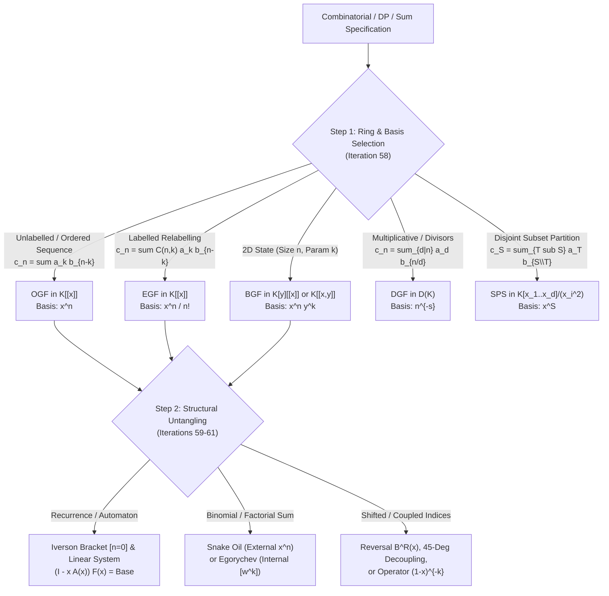

# Cohort 2 — Wave 1B (Iterations 58–62): Combinatorial-to-GF Modelling Archetypes, Mechanical DP-to-GF Conversion, Binomial Sum Untangling ("Snake Oil" & Egorychev), and Hidden Convolutions

**Author**: `fps-wave-investigator` (Cohort 2: Independent Redundant Discovery)  
**Target Scope**: Wave 1B — Iterations 58, 59, 60, 61, and 62  
**Pedagogical Mandate**: *Zero Magic Steps* — Every generating function choice, DP-to-GF collapse, coefficient extraction kernel, formal residue change of variables, and convolution re-indexing is derived from first principles through explicit diagnostic signals, reverse-engineering scratchpads, annotated algebraic derivations, hand-checkable toy traces ($n \le 4$), and failure-mode audits.

---

## Executive Overview & Architectural Map

In competitive programming, the gap between knowing polynomial algorithms (NTT, FPS inverse, $\exp$, $\ln$, Bostan-Mori) and solving grandmaster-level enumeration problems rarely lies in the implementation of the black-box templates. Instead, the bottleneck is **algebraic modelling and structural untangling**:
1. **Choosing the right algebraic ring** (Iteration 58): Recognizing whether a problem's composition rule maps to Ordinary Generating Functions (OGF), Exponential Generating Functions (EGF), Bivariate/Multivariate Generating Functions (BGF/MGF), Dirichlet Generating Functions (DGF), or Set Power Series (SPS).
2. **Translating recurrences and automata without off-by-one errors** (Iteration 59): Mechanically converting 1D/2D dynamic programming tables, sliding-window/bounded-knapsack transitions, reversible DP ("戻すDP"), and KMP/AC-automaton state graphs into closed-form rational or algebraic generating functions using Iverson brackets $[P]$.
3. **Untangling coupled binomial and falling-factorial sums** (Iteration 60): Replacing ad-hoc combinatorial identities with two deterministic engines—Wilf's External Method ("Snake Oil") and Egorychev's Internal Coefficient-Extraction Method ($[x^k]$)—augmented by the Formal Change-of-Variables Theorem in the ring of formal Laurent series $K((x))$.
4. **Exposing hidden convolutions and linear operators** (Iteration 61): Transforming non-standard index couplings (difference/cross-correlation $i - j = d$, symmetric coordinate pairings $(a_i + a_j, b_i + b_j)$, 2D Manhattan walks, upper-index Chu-Vandermonde, and $k$-fold prefix/difference operators) into standard Cauchy products solvable in $O(N \log N)$ or $O(N)$ time.
5. **Multilingual Synthesis & Non-Template Problem Audit** (Iteration 62): Cross-referencing English (`[EN]`), Chinese (`[ZH]`), and Japanese (`[JA]`) competitive programming literature alongside a curated, fully solved syllabus of 18+ non-template contest problems and an explicit audit of rejected bare templates.

---

## Iteration 58: Combinatorial-to-GF Modelling Archetypes & Decision Matrix

When confronted with a counting problem or recurrence, a solver's first decision is **which formal ring and basis** turns the problem's native "gluing" operation into ring multiplication. Picking the wrong basis leads to intractable Hadamard products or non-local differential equations; picking the right basis turns a multi-loop DP into a single polynomial operation.

### 58.1 Master Comparison & Decision Matrix of the 5 GF Archetypes

Let $K$ be a commutative ring (typically $\mathbb{F}_p$ with $p = 998244353$ or $\mathbb{Q}$). A generating function is an element of a formal algebra over $K$ with a chosen topological basis $\{e_i\}_{i \in I}$ whose multiplication rule $e_i \cdot e_j = \sum_{k} \gamma_{i,j}^k e_k$ mirrors how two sub-objects of states $i$ and $j$ combine into a composite object of state $k$.

| Archetype | Formal Ring & Valuation | Basis Element $e_i$ | Product Rule $[e_k](A \cdot B)$ | Combinatorial Gluing Semantics (Symbolic Method) | Primary Algorithmic Toolkit | Characteristic & Validity Constraints |
| :--- | :--- | :--- | :--- | :--- | :--- | :--- |
| **1. Ordinary Generating Function (OGF)** | $K[[x]]$ ($x$-adic valuation $\operatorname{val}(F) = \min\{n : f_n \neq 0\}$) | $x^n$ ($n \in \mathbb{Z}_{\ge 0}$) | $\sum_{i+j=n} a_i b_j$ (Additive Cauchy convolution) | **Unlabelled objects** or **ordered sequences** of components where total size is additive ($i + j = n$) and no global relabelling occurs: $\mathcal{C} = \mathcal{A} \times \mathcal{B}$, $\operatorname{SEQ}(\mathcal{A}) = \frac{1}{1-A(x)}$, $\operatorname{MSET}(\mathcal{A}) = \prod_{n \ge 1}(1-x^n)^{-a_n}$. | NTT, FPS Inv/Ln/Exp/Pow, Bostan-Mori, Divide-and-Conquer FFT, Sparse $(1-x^d)^{\pm 1}$ sweeps. | Inv requires $[x^0]F \in K^\times$. Ln/Exp for $\operatorname{MSET}/\operatorname{PSET}$ (Pólya exp) requires $\operatorname{char}(K) > N$ because of $\frac{1}{k}$ in $\sum_{k=1}^N \frac{A(x^k)}{k}$. |
| **2. Exponential Generating Function (EGF)** | $K[[x]]$ (viewed as divided-power ring if $\operatorname{char}(K) \le N$) | $\frac{x^n}{n!}$ ($n \in \mathbb{Z}_{\ge 0}$) | $\sum_{i+j=n} \binom{n}{i} a_i b_j$ (Binomial relabelling convolution) | **Labelled objects** (graphs, permutations, surjections, trees) where combining two components of sizes $i$ and $j$ requires choosing which $i$ of the $n=i+j$ distinct labels go to the first component: $\mathcal{C} = \mathcal{A} \star \mathcal{B}$, $\operatorname{SET}(\mathcal{A}) = \exp(A(x))$, $\operatorname{CYC}(\mathcal{A}) = \ln\frac{1}{1-A(x)}$. | Pre-divide by $i!$, run standard OGF NTT/Inv/Ln/Exp, post-multiply by $n!$. | Requires $n! \in K^\times$, i.e., **prime characteristic $p > N$**. Fails directly mod $p \le N$ or mod $2^{64}$. |
| **3. Bivariate / Multivariate GF (BGF / MGF)** | $K[y][[x]]$ or $K[[x,y]]$ | $x^n y^k$ ($n,k \in \mathbb{Z}_{\ge 0}$) | $\sum_{\substack{i_1+i_2=n \\ j_1+j_2=k}} a_{i_1,j_1} b_{i_2,j_2}$ (2D additive or mixed OGF-EGF $\frac{x^n}{n!} y^k$) | Objects of primary size $n$ (often EGF $\frac{x^n}{n!}$ or OGF $x^n$) carrying a **secondary additive statistic** $k$ (number of connected components, cycles, inversions, leaves, or weight): $\exp(y A(x)) = \sum_{k \ge 0} \frac{y^k}{k!} A(x)^k$. | 2D FFT, Evaluation-Interpolation in $y$ (Lagrange), viewing as FPS over polynomial ring, Differential Equations in $x$ with parameter $y$, Bostan-Mori over $K(y)[[x]]$. | If treated as $K[y][[x]]$, $\deg_y([x^n]F)$ must remain finite; if $\deg_y$ grows linearly with $n$, naive expansion costs $O(N^2 \log N)$ unless evaluated at roots of unity. |
| **4. Dirichlet Generating Function (DGF)** | $\mathcal{D}(K) \cong K[[\dots, p_r^{-s}, \dots]]$ | $n^{-s}$ ($n \in \mathbb{Z}_{\ge 1}$) | $\sum_{d \mid n} a_d b_{n/d}$ (Divisor / multiplicative convolution) | **Number-theoretic multiplicative sequences**, divisor lattices, GCD/LCM structures, prime factorizations $n = p_1^{e_1}\cdots p_r^{e_r}$: Euler product $F(s) = \prod_{p} \left(\sum_{e \ge 0} f(p^e) p^{-es}\right)$. | Harmonic-series sieve $O(N \log N)$, Dirichlet prefix-sum prime sieve $O(N \log \log N)$, Du Jiao Sieve $O(N^{2/3})$, Min_25 / Powerful Numbers sieve, truncated DGF Inv/Ln/Exp in $O(N \log N)$. | Inv requires $a_1 \in K^\times$. Ln/Exp over $\mathcal{D}(K)$ requires $\Omega(n) \le \log_2 N < \operatorname{char}(K)$ (almost always satisfied since $\log_2 N \le 60$). |
| **5. Set Power Series (SPS)** | $K[x_1,\dots,x_d] / (x_1^2,\dots,x_d^2)$ | $x^S = \prod_{i \in S} x_i$ ($S \subseteq \{1,\dots,d\}$) | $\sum_{\substack{A \cup B = S \\ A \cap B = \emptyset}} f_A g_B$ (Subset convolution) | **Exact vertex-set partitions** on a fixed small ground set $V = \{1,\dots,d\}$ ($d \le 21$) where each vertex has its own distinct adjacency/weight (non-symmetric under $S_d$, unlike EGF): connected subgraphs, DAGs, Steiner trees, chromatic polynomials. | Ranked Zeta/Möbius Transform (FMT/FWT + polynomial operations in rankring $K[t]/(t^{d+1})$) in $O(d^2 2^d)$ time. | Exp/Ln require dividing by rank $1, \dots, d$, valid whenever $\operatorname{char}(K) > d$ (or handled via point-by-point ranked Newton / $x_d$-derivative trick $\partial_{x_d} \exp(F) = (\partial_{x_d} F)\exp(F)$ which is **division-free** even mod $2^{64}$!). |

---

### 58.2 Deep-Dive Archetype 1: Ordinary Generating Functions (OGF) in $K[[x]]$

#### a. Concrete Combinatorial / Algebraic Object
Given a sequence $(a_0, a_1, a_2, \dots)$ in a commutative ring $K$ where $a_n$ counts the number of unlabelled combinatorial structures (or ordered sequences of rigid blocks) of size $n$, its Ordinary Generating Function is the formal power series
$$A(x) = \sum_{n=0}^{\infty} a_n x^n \in K[[x]].$$
Here $K[[x]]$ is equipped with the $x$-adic valuation $\operatorname{val}(A) = \min\{n \ge 0 : a_n \neq 0\}$ (with $\operatorname{val}(0) = +\infty$) and metric $d(A, B) = 2^{-\operatorname{val}(A-B)}$, under which infinite sums $\sum_{k=0}^\infty G_k(x)$ converge formally if and only if $\lim_{k \to \infty} \operatorname{val}(G_k) = +\infty$.

#### b. The Diagnostic Signal
Reach for an OGF whenever you see:
1. **Additive index conservation without binomial weights**: A recurrence or sum of the form $\sum_{i+j=n} a_i b_j$ or $\sum_{i_1 + \dots + i_k = n} a_{i_1}\cdots a_{i_k}$.
2. **Ordered compositions or knapsack-like selections**: Choosing items of sizes $w_1, w_2, \dots$ whose total weight sums to $n$, where the relative order of parts is either fixed (e.g., sorted by type $1, 2, \dots, m$) or strictly sequential ($\operatorname{SEQ}$).
3. **Translation-invariant recurrences**: Linear or polynomial recurrences where $a_n$ depends on $a_{n-1}, a_{n-2}, \dots$ with coefficients that are *constant* (independent of $n$).

#### c. The Reverse-Engineering Scratchpad
Suppose we want to count the number of ways $c_n$ to partition an integer $n$ into an *ordered sequence* (composition) of positive integers, where each part of size $k \ge 1$ can be painted in $a_k$ ways (with $a_0 = 0$).
- *What we want to isolate*: For a fixed number of parts $m \ge 0$, a sequence of $m$ parts $(k_1, \dots, k_m)$ summing to $n$ contributes $\prod_{j=1}^m a_{k_j}$.
- *How to decouple the sum condition $k_1 + \dots + k_m = n$*: If we attach a formal tag $x^{k_j}$ to each choice $a_{k_j}$, the law of exponents $x^{k_1} x^{k_2} \cdots x^{k_m} = x^{k_1 + \dots + k_m}$ automatically groups all tuples with total sum $n$ onto the monomial $x^n$!
- *Summing over all $m$*: Since $a_0 = 0$, we have $\operatorname{val}(A) \ge 1$, so $\operatorname{val}(A^m) \ge m \to \infty$. Thus $\sum_{m=0}^\infty A(x)^m$ converges in $K[[x]]$ to the multiplicative inverse $(1 - A(x))^{-1}$.

#### d. Step-by-Step Algebraic Derivation & Verbal Annotations
Let us derive the OGF for $\mathcal{C} = \operatorname{SEQ}(\mathcal{A})$ where $a_0 = 0$:
$$\begin{aligned}
C(x) &= \sum_{n=0}^{\infty} c_n x^n && \text{(Definition of the target OGF in } K[[x]]\text{)} \\
&= \sum_{n=0}^{\infty} \left( \sum_{m=0}^{n} \sum_{\substack{k_1 + \dots + k_m = n \\ k_j \ge 1}} a_{k_1} a_{k_2} \cdots a_{k_m} \right) x^n && \text{(Since } k_j \ge 1\text{, at most } m \le n \text{ parts can sum to } n\text{)} \\
&= \sum_{m=0}^{\infty} \sum_{k_1=1}^{\infty} \cdots \sum_{k_m=1}^{\infty} \left(a_{k_1} x^{k_1}\right) \cdots \left(a_{k_m} x^{k_m}\right) && \text{(Interchange sums; valid in } x\text{-adic topology as } k_1+\dots+k_m \ge m\text{)} \\
&= \sum_{m=0}^{\infty} \left( \sum_{k=1}^{\infty} a_k x^k \right)^m && \text{(Factor independent sums by distributivity in } K[[x]]\text{)} \\
&= \sum_{m=0}^{\infty} A(x)^m = \frac{1}{1 - A(x)}. && \text{(Formal geometric series; valid iff } [x^0]A(x) = a_0 = 0\text{)}
\end{aligned}$$

**Algebraic Validity Conditions**:
- **Valuation constraint**: $\operatorname{val}(A) \ge 1$ ($a_0 = 0$) is **mandatory** for $\sum_{m \ge 0} A(x)^m$ to be well-defined in $K[[x]]$. If $a_0 \neq 0$, infinitely many sequences of $0$-sized parts contribute to $c_0$, and $1 - a_0$ might not even be invertible.
- **Characteristic constraint**: Pure $\operatorname{SEQ}$ and Cauchy product require **no division by integers**, so they hold over *any* commutative ring $K$ (including $\mathbb{Z}/2^{64}\mathbb{Z}$ and $\mathbb{F}_2$). However, the unlabelled multiset construction $\operatorname{MSET}(\mathcal{A}) = \prod_{k \ge 1} (1 - x^k)^{-a_k} = \exp\left(\sum_{j=1}^{\infty} \frac{A(x^j)}{j}\right)$ (Euler's transform / Pólya's $\exp$) requires $1, 2, \dots, N$ to be invertible in $K$, hence $\operatorname{char}(K) = 0$ or $\operatorname{char}(K) > N$.

#### e. Hand-Checkable Toy Example ($n \le 4$)
Count compositions of $n$ into parts of size $1$ and $2$, where parts of size $1$ come in $a_1 = 2$ colors (Red, Blue) and parts of size $2$ come in $a_2 = 1$ color (Green).
- Generator for a single part: $A(x) = 2x + x^2$.
- Total OGF:
  $$C(x) = \frac{1}{1 - (2x + x^2)} = 1 + (2x + x^2) + (2x + x^2)^2 + (2x + x^2)^3 + (2x + x^2)^4 + O(x^5).$$
- Expanding up to $x^4$:
  - $(2x+x^2)^1 = 2x + x^2$
  - $(2x+x^2)^2 = 4x^2 + 4x^3 + x^4$
  - $(2x+x^2)^3 = 8x^3 + 12x^4 + O(x^5)$
  - $(2x+x^2)^4 = 16x^4 + O(x^5)$
- Summing coefficients:
  - $c_0 = 1$ (empty composition)
  - $c_1 = 2$ ($1_R, 1_B$)
  - $c_2 = 1 + 4 = 5$ ($2_G$, plus $2^2=4$ colorings of $1+1$)
  - $c_3 = 4 + 8 = 12$ ($1+2$ in $2$ ways, $2+1$ in $2$ ways, $1+1+1$ in $2^3=8$ ways $\implies 2+2+8=12$)
  - $c_4 = 1 + 12 + 16 = 29$ ($2+2$ in $1$ way; $1+1+2, 1+2+1, 2+1+1$ in $3 \times 4 = 12$ ways; $1+1+1+1$ in $16$ ways $\implies 1+12+16=29$).

#### f. Failure Modes, Pitfalls & False Positives
- **False Positive (Unordered vs. Ordered)**: Applying $C(x) = \frac{1}{1 - A(x)}$ when the problem asks for *unordered* partitions (multisets of parts) instead of ordered compositions. Unordered multisets require $\prod_{k \ge 1} (1 - x^k)^{-a_k} = \exp\left(\sum_{j \ge 1} \frac{A(x^j)}{j}\right)$, NOT $\frac{1}{1-A(x)}$ and NOT $\exp(A(x))$.
- **Non-zero constant term**: Forgetting to subtract the empty state ($a_0 = 1$) before applying $\frac{1}{1 - A(x)}$. If $A(x)$ has $a_0 = 1$, you must use $A_+(x) = A(x) - 1$ inside $\operatorname{SEQ}(A_+) = \frac{1}{2 - A(x)}$.

---

### 58.3 Deep-Dive Archetype 2: Exponential Generating Functions (EGF) in $K[[x]]$

#### a. Concrete Combinatorial / Algebraic Object
Given a sequence $(a_0, a_1, a_2, \dots)$ where $a_n$ counts **labelled combinatorial structures** on the vertex/label set $\{1, 2, \dots, n\}$ (invariant under relabelling isomorphisms), its Exponential Generating Function is
$$\hat{A}(x) = \sum_{n=0}^{\infty} a_n \frac{x^n}{n!} \in K[[x]].$$

#### b. The Diagnostic Signal
Reach for an EGF immediately when you see:
1. **Binomial convolution in the recurrence**: Sums of the form $\sum_{k=0}^n \binom{n}{k} a_k b_{n-k}$ or $\sum_{k=1}^n \binom{n-1}{k-1} a_k b_{n-k}$ (the latter being the "root-Containing Component" trick $D_x \hat{C}(x) = (D_x \hat{A}(x)) \hat{B}(x)$).
2. **Multinomial distributions / Occupancy / Surjections**: Distributing $n$ distinct balls into $k$ boxes, counting sequences of length $n$ over an alphabet where each symbol appears a constrained number of times (e.g., even/odd counts, at least $c$ times).
3. **Unordered sets of labelled components**: Graphs decomposed into connected components, permutations decomposed into disjoint cycles, or forests decomposed into rooted trees, where $\mathcal{C} = \operatorname{SET}(\mathcal{A}) \iff \hat{C}(x) = \exp(\hat{A}(x))$.

#### c. The Reverse-Engineering Scratchpad
Suppose a recurrence gives $c_n = \sum_{k=0}^n \binom{n}{k} a_k b_{n-k}$.
- *What blocks standard OGF convolution?* The factor $\binom{n}{k} = \frac{n!}{k!(n-k)!}$ depends on both $n$ and $k$, so $c_n$ is not $\sum_{k} \tilde{a}_k \tilde{b}_{n-k}$ directly—Wait! Look at the factorization of $\binom{n}{k}$:
  $$\binom{n}{k} = \frac{n!}{k! \, (n-k)!}.$$
- *How to separate the variables $n$, $k$, and $n-k$*: Divide the entire equation by $n!$:
  $$\frac{c_n}{n!} = \sum_{k=0}^{n} \left(\frac{a_k}{k!}\right) \left(\frac{b_{n-k}}{(n-k)!}\right).$$
- Now the right-hand side *is* a pure Cauchy convolution of the scaled sequences $\hat{a}_k = \frac{a_k}{k!}$ and $\hat{b}_{m} = \frac{b_m}{m!}$! Thus, choosing $\frac{x^n}{n!}$ as our basis element automatically absorbs $\binom{n}{k}$ into ordinary polynomial multiplication.

#### d. Step-by-Step Algebraic Derivation & Verbal Annotations
Let us derive both the **Labelled Product** $\hat{C}(x) = \hat{A}(x)\hat{B}(x)$ and the **Pointed / Root-Component Identity** $c_n = \sum_{k=1}^n \binom{n-1}{k-1} a_k c_{n-k}$ (which connects connected labelled graphs $a_k$ to general labelled graphs $c_n$):
$$\begin{aligned}
c_n &= \sum_{k=1}^{n} \binom{n-1}{k-1} a_k c_{n-k} && \text{(Vertex } n \text{ belongs to a connected component of size } k \ge 1\text{)} \\
\frac{c_n}{(n-1)!} &= \sum_{k=1}^{n} \frac{a_k}{(k-1)!} \cdot \frac{c_{n-k}}{(n-k)!} && \text{(Divide both sides by } (n-1)! \text{ to decouple } k \text{ and } n-k\text{)} \\
\sum_{n=1}^{\infty} c_n \frac{x^{n-1}}{(n-1)!} &= \left(\sum_{k=1}^{\infty} a_k \frac{x^{k-1}}{(k-1)!}\right) \left(\sum_{m=0}^{\infty} c_m \frac{x^m}{m!}\right) && \text{(Multiply by } x^{n-1} \text{ and sum over } n \ge 1 \text{ in } K[[x]]\text{)} \\
D_x \hat{C}(x) &= \left(D_x \hat{A}(x)\right) \hat{C}(x) && \text{(Recognize formal derivative } D_x \frac{x^n}{n!} = \frac{x^{n-1}}{(n-1)!}\text{)} \\
\frac{D_x \hat{C}(x)}{\hat{C}(x)} &= D_x \hat{A}(x) \iff \ln \hat{C}(x) = \hat{A}(x) && \text{(Integrate formally; valid since } c_0 = 1 \text{ and } a_0 = 0\text{)} \\
\hat{C}(x) &= \exp(\hat{A}(x)). && \text{(Exponentiate both sides in } K[[x]]\text{)}
\end{aligned}$$

**Algebraic Validity Conditions**:
- **Valuation constraint**: For $\exp(\hat{A}(x))$ and $\ln(\hat{C}(x))$, we must have $[x^0]\hat{A}(x) = a_0 = 0$ and $[x^0]\hat{C}(x) = c_0 = 1$.
- **Characteristic constraint**: Dividing by $n!$ requires $\gcd(n!, \operatorname{char}(K)) = 1$, i.e., $p > N$. If $p \le N$, EGF operations fail in $\mathbb{F}_p[[x]]$ because $\frac{x^p}{p!}$ is undefined; one must either lift to $\mathbb{Z}/p^e\mathbb{Z}$ or use Lucas's theorem / $p$-adic valuation tracking.

#### e. Hand-Checkable Toy Example ($n \le 4$)
Count the number of labelled graphs on $n$ vertices where every connected component is a cycle of length $\ge 1$ (equivalently, permutations of $\{1,\dots,n\}$, where $a_k = (k-1)!$ is the number of directed cycles on $k$ labelled vertices).
- Connected component EGF:
  $$\hat{A}(x) = \sum_{k=1}^{\infty} (k-1)! \frac{x^k}{k!} = \sum_{k=1}^{\infty} \frac{x^k}{k} = \ln\left(\frac{1}{1-x}\right).$$
- Total EGF via $\operatorname{SET}$:
  $$\hat{C}(x) = \exp(\hat{A}(x)) = \exp\left(\ln\frac{1}{1-x}\right) = \frac{1}{1-x} = 1 + x + x^2 + x^3 + x^4 + \dots$$
- Extracting $c_n = n! [x^n] \hat{C}(x)$:
  For $n = 0, 1, 2, 3, 4$, we get $c_n = n! \cdot 1 = 1, 1, 2, 6, 24$, matching the number of permutations!

#### f. Failure Modes, Pitfalls & False Positives
- **Forgetting the $n!$ restoration**: Extracting $[x^n]\hat{C}(x)$ gives $\frac{c_n}{n!}$, not $c_n$. Always multiply the final coefficient by $n!$.
- **Applying $\exp$ to unlabelled objects**: For unlabelled objects, $\exp(A(x))$ is wrong because identical components of the same size $k$ can be indistinguishable; unlabelled sets require Pólya's $\exp\left(\sum_{j \ge 1} \frac{A(x^j)}{j}\right)$ instead.

---

### 58.4 Deep-Dive Archetype 3: Bivariate / Multivariate Generating Functions (BGF) in $K[y][[x]]$

#### a. Concrete Combinatorial / Algebraic Object
Given a two-parameter sequence $a_{n,k}$ counting structures of primary size $n$ and secondary weight/parameter $k$, its Bivariate Generating Function (BGF) is
$$F(x, y) = \sum_{n=0}^{\infty} \sum_{k=0}^{\infty} a_{n,k} x^n y^k \quad \text{(or } \sum_{n=0}^{\infty} \sum_{k=0}^{\infty} a_{n,k} \frac{x^n}{n!} y^k \text{ for mixed EGF-OGF).}$$
In almost all competitive programming applications, for each fixed $n$, $a_{n,k} = 0$ for $k > d(n)$, so $F(x,y)$ lives in the formal power series ring $K[y][[x]]$ where the coefficient of $x^n$ is a finite polynomial $P_n(y) = \sum_{k=0}^{d(n)} a_{n,k} y^k \in K[y]$.

#### b. The Diagnostic Signal
Reach for a BGF in $K[y][[x]]$ when:
1. **Counting by size AND number of parts/cycles/components**: You need the number of structures of size $n$ having *exactly* $k$ components, or you need the **expected value / variance** of the number of components $\sum_k k a_{n,k}$ and $\sum_k k^2 a_{n,k}$.
2. **Inclusion-Exclusion over violated constraints ("容斥系数入生成函数")**: Each violation of a constraint contributes a weight $-1$ (or $(y-1)$). Putting $y$ to track violations lets you compute $F(x, y)$ and evaluate at $y = 0$ or $y = -1$, collapsing a 2D Inclusion-Exclusion DP into a 1D FPS!
3. **2D grid walks or dual capacities**: Two independent or coupled resources $(n, k)$ are consumed simultaneously at each step.

#### c. The Reverse-Engineering Scratchpad
Suppose we know how to build a single component with EGF $\hat{A}(x)$ (with $a_0 = 0$), and each component contributes $+1$ to a counter $k$.
- *What happens if we multiply $\hat{A}(x)$ by a formal marker $y$?* Every single component now carries $y^1$: $y \hat{A}(x)$.
- *What happens when $k$ components combine?* Their markers multiply: $(y \hat{A}(x))^k = y^k \hat{A}(x)^k$.
- *Summing over all $k \ge 0$*:
  $$\text{Ordered sequence of } k \text{ components:} \quad \sum_{k=0}^{\infty} y^k A(x)^k = \frac{1}{1 - y A(x)}.$$
  $$\text{Unordered set of } k \text{ labelled components:} \quad \sum_{k=0}^{\infty} \frac{y^k}{k!} \hat{A}(x)^k = \exp(y \hat{A}(x)).$$
- *Moment extraction trick*: Instead of computing all coefficients of $y^k$ (which takes $O(N^2)$ space), if we only need the sum of $k$ (first moment) over all structures of size $n$, notice that
  $$\left. \frac{\partial}{\partial y} a_{n,k} y^k \right|_{y=1} = k \, a_{n,k}!$$
  So applying $\left.\frac{\partial}{\partial y}\right|_{y=1}$ to the closed-form $F(x,y)$ reduces the BGF back to a **univariate** FPS in $K[[x]]$ solvable in $O(N \log N)$!

#### d. Step-by-Step Algebraic Derivation & Verbal Annotations
Let us derive the univariate FPS for the total number of cycles across all permutations of $\{1, \dots, n\}$ (and the unsigned Stirling numbers of the first kind $\left[\begin{smallmatrix} n \\ k \end{smallmatrix}\right]$):
$$\begin{aligned}
F(x, y) &= \sum_{n=0}^{\infty} \sum_{k=0}^{n} \begin{bmatrix} n \\ k \end{bmatrix} \frac{x^n}{n!} y^k && \text{(Mixed EGF in } x\text{, OGF in } y \text{ inside } K[y][[x]]\text{)} \\
&= \exp\left( y \ln\frac{1}{1-x} \right) && \text{(Set of cycles, each cycle weighted by } y \text{ with EGF } \ln(1-x)^{-1}\text{)} \\
&= (1 - x)^{-y} = \sum_{n=0}^{\infty} \binom{-y}{n} (-x)^n = \sum_{n=0}^{\infty} \frac{y(y+1)\cdots(y+n-1)}{n!} x^n. && \text{(Generalized binomial theorem in } K[y][[x]]\text{)}
\end{aligned}$$
To get the total number of cycles over all $n!$ permutations of size $n$, differentiate with respect to $y$ and set $y = 1$:
$$\begin{aligned}
\sum_{n=0}^{\infty} \left(\sum_{k=0}^{n} k \begin{bmatrix} n \\ k \end{bmatrix}\right) \frac{x^n}{n!} &= \left. \frac{\partial}{\partial y} \exp\left(y \ln\frac{1}{1-x}\right) \right|_{y=1} && \text{(Commute } \partial_y|_{y=1} \text{ with } \sum_{n \ge 0}\text{)} \\
&= \left. \ln\left(\frac{1}{1-x}\right) \exp\left(y \ln\frac{1}{1-x}\right) \right|_{y=1} && \text{(Chain rule in } K[y][[x]]\text{)} \\
&= \frac{1}{1-x} \ln\left(\frac{1}{1-x}\right) = \sum_{n=1}^{\infty} H_n x^n. && \text{(Cauchy product of } \sum x^i \text{ and } \sum \frac{x^j}{j}\text{)}
\end{aligned}$$
Multiplying $[x^n]$ by $n!$ immediately yields $n! H_n$.

#### e. Hand-Checkable Toy Example ($n \le 4$)
Verify $\sum_{k=0}^n \left[\begin{smallmatrix} n \\ k \end{smallmatrix}\right] y^k = y(y+1)\cdots(y+n-1)$ and total cycles $n! H_n$ for $n = 3$:
- Rising factorial: $y(y+1)(y+2) = y^3 + 3y^2 + 2y$.
- Permutations of $\{1,2,3\}$:
  - $k=3$ cycles: $(1)(2)(3)$ $\implies 1$ permutation (coeff of $y^3$ is $1$).
  - $k=2$ cycles: $(12)(3), (13)(2), (23)(1)$ $\implies 3$ permutations (coeff of $y^2$ is $3$).
  - $k=1$ cycle: $(123), (132)$ $\implies 2$ permutations (coeff of $y^1$ is $2$).
- Total cycles for $n=3$: $3(1) + 2(3) + 1(2) = 11 = 3! (1 + \frac{1}{2} + \frac{1}{3}) = 6 \times \frac{11}{6} = 11$. Matches!

#### f. Failure Modes, Pitfalls & False Positives
- **Degree explosion in $y$**: If you need $[x^n y^k] F(x,y)$ for a specific $k$ (rather than a moment at $y=1$), expanding $F(x,y)$ directly in $K[y][[x]]$ takes $O(N^2 \log N)$ time. To get a single coefficient $[x^n y^k] \exp(y A(x))$ in $O(N \log N)$, first extract $[y^k]$ analytically: $[y^k] \exp(y A(x)) = \frac{1}{k!} A(x)^k$, reducing it to a univariate FPS power!

---

### 58.5 Deep-Dive Archetype 4: Dirichlet Generating Functions (DGF) in $\mathcal{D}(K)$

#### a. Concrete Combinatorial / Algebraic Object
Given an arithmetic sequence $(a_1, a_2, a_3, \dots)$ indexed by positive integers $n \ge 1$, its Dirichlet Generating Function is the formal series
$$\tilde{A}(s) = \sum_{n=1}^{\infty} \frac{a_n}{n^s} \in \mathcal{D}(K).$$
Algebraically, by unique prime factorization $n = p_1^{e_1} p_2^{e_2} \cdots$, the ring $\mathcal{D}(K)$ is isomorphic to the ring of formal power series in countably many variables $K[[x_{p_1}, x_{p_2}, \dots]]$ via the identification $p_i^{-s} \leftrightarrow x_{p_i}$.

#### b. The Diagnostic Signal
Reach for a DGF when you see:
1. **Divisor convolution**: $c_n = \sum_{d \mid n} a_d b_{n/d}$ or $\sum_{i \cdot j = n} a_i b_j$.
2. **GCD / LCM aggregations**: Sums of the form $\sum_{i=1}^N \sum_{j=1}^N f(\gcd(i, j))$ or $\sum_{\operatorname{lcm}(i,j) = n} a_i b_j$ (after Möbius / divisor-zeta transform).
3. **Ordered or unordered factorizations of $n$**: Counting ways to write $n = d_1 d_2 \cdots d_k$ ($d_j > 1$), which is literally $[n^{-s}] \frac{1}{1 - (\tilde{A}(s) - a_1)}$ (ordered factorizations) or $[n^{-s}] \prod_{d > 1} (1 - d^{-s})^{-a_d}$ (unordered factorizations / multiplicative partitions).

#### c. The Reverse-Engineering Scratchpad
Suppose we have a recurrence $c_n = \sum_{d \mid n} a_d b_{n/d}$.
- *Why does $x^n$ fail?* Because $x^d \cdot x^{n/d} = x^{d + n/d} \neq x^n$.
- *What basis turns multiplication of indices $d \cdot (n/d) = n$ into addition of exponents?* Set $e_n = n^{-s} = \exp(-s \ln n)$. Then
  $$d^{-s} \cdot (n/d)^{-s} = (d \cdot (n/d))^{-s} = n^{-s}!$$
- Thus $\tilde{A}(s) \tilde{B}(s) = \sum_{n=1}^\infty \left(\sum_{d \mid n} a_d b_{n/d}\right) n^{-s}$.
- Furthermore, if we need to invert $\tilde{A}(s)$, take $\ln \tilde{A}(s)$, or compute $\exp \tilde{A}(s)$ truncated to $n \le N$, how fast is a single DGF multiplication? Just loop over $i = 1 \dots N$ and $j = 1 \dots \lfloor N/i \rfloor$: total operations $\sum_{i=1}^N \lfloor N/i \rfloor = O(N \log N)$ without any FFT!

#### d. Step-by-Step Algebraic Derivation & Verbal Annotations
Let us derive the DGF relation for **Dirichlet Derivative, Ln, and Exp** truncated to $\{1, \dots, N\}$:
Define the formal valuation-like derivation $D_{\Omega}$ (or $\partial_s \tilde{A}(s) = -\sum_{n=1}^\infty a_n (\ln n) n^{-s}$ over $\mathbb{C}$, or in $\mathbb{F}_p$ use the **total prime-multiplicity derivation** $\partial_\Omega (n^{-s}) = \Omega(n) n^{-s}$, which satisfies the Leibniz rule $\partial_\Omega(d^{-s} (n/d)^{-s}) = (\Omega(d) + \Omega(n/d)) n^{-s} = \Omega(n) n^{-s}$!):
$$\begin{aligned}
\tilde{C}(s) &= \exp(\tilde{A}(s)) \quad (\text{with } a_1 = 0) && \text{(Formal exponential in } \mathcal{D}(K) \text{ since } \operatorname{val}_\Omega(\tilde{A}) \ge 1\text{)} \\
\partial_\Omega \tilde{C}(s) &= \left(\partial_\Omega \tilde{A}(s)\right) \tilde{C}(s) && \text{(Apply derivation } \partial_\Omega(n^{-s}) = \Omega(n) n^{-s} \text{ to both sides)} \\
\Omega(n) c_n &= \sum_{d \mid n, \, d > 1} \Omega(d) a_d \, c_{n/d} && \text{(Extract coefficient of } n^{-s} \text{ for } n \ge 2\text{)} \\
c_n &= \frac{1}{\Omega(n)} \sum_{d \mid n, \, d > 1} \Omega(d) a_d \, c_{n/d}. && \text{(Divide by } \Omega(n) \le \lfloor \log_2 N \rfloor\text{)}
\end{aligned}$$
Because we can process $n = 1, 2, \dots, N$ in increasing order and push multiples $m = n \cdot k$ in a single harmonic loop, **DGF Inverse, DGF $\ln$, and DGF $\exp$ all run in a single $O(N \log N)$ harmonic loop** with constant factor $1$!

#### e. Hand-Checkable Toy Example ($n \le 6$)
Compute the Möbius function $\mu(n)$ as the Dirichlet inverse of $\zeta(s) = \sum_{n \ge 1} n^{-s}$ for $n \le 6$:
- $\tilde{A}(s) = \zeta(s)$ has $a_n = 1$ for all $n \ge 1$.
- Inverse relation $\zeta(s) M(s) = 1 \implies \mu(1) = 1$, and for $n > 1$, $\mu(n) = -\sum_{d \mid n, \, d < n} \mu(d)$.
  - $n=1$: $\mu(1) = 1$
  - $n=2$: $\mu(2) = -\mu(1) = -1$
  - $n=3$: $\mu(3) = -\mu(1) = -1$
  - $n=4$: $\mu(4) = -(\mu(1) + \mu(2)) = -(1 - 1) = 0$
  - $n=5$: $\mu(5) = -\mu(1) = -1$
  - $n=6$: $\mu(6) = -(\mu(1) + \mu(2) + \mu(3)) = -(1 - 1 - 1) = 1$.

#### f. Failure Modes, Pitfalls & False Positives
- **Using $\ln n$ in $\mathbb{F}_p$**: Real analysis defines $\tilde{A}'(s) = -\sum a_n (\ln n) n^{-s}$, which does not exist in $\mathbb{F}_p$. Using any completely additive function $w(n)$ with $w(p) = 1$ (i.e. $w(n) = \Omega(n)$, the number of prime factors with multiplicity) provides a rigorous derivation $\partial_\Omega$ over $\mathbb{F}_p$ as long as $p > \log_2 N$.

---

### 58.6 Deep-Dive Archetype 5: Set Power Series (SPS) in $K[x_1,\dots,x_d]/(x_1^2,\dots,x_d^2)$

#### a. Concrete Combinatorial / Algebraic Object
For a fixed ground set $V = \{1, 2, \dots, d\}$ ($d \le 21$), a Set Power Series is a formal sum indexed by subsets $S \subseteq V$:
$$F(x) = \sum_{S \subseteq V} f_S x^S \in K[x_1, \dots, x_d] / (x_1^2, \dots, x_d^2), \quad \text{where } x^S = \prod_{i \in S} x_i.$$
Because $x_i^2 = 0$ in the quotient ring, the product of two monomials $x^A$ and $x^B$ is
$$x^A \cdot x^B = \begin{cases} x^{A \cup B} & \text{if } A \cap B = \emptyset, \\ 0 & \text{if } A \cap B \neq \emptyset. \end{cases}$$
Thus multiplication in this ring is **subset convolution**: $[x^S](F \cdot G) = \sum_{A \sqcup B = S} f_A g_B$.

#### b. The Diagnostic Signal
Reach for an SPS when:
1. **Small $d \le 21$ with non-isomorphic vertices**: You are given an explicit input graph $G = (V, E)$ with $|V| = d \le 21$ and asked to count connected spanning subgraphs, Eulerian subgraphs, biconnected components, acyclic orientations, or forests on every induced subgraph $G[S]$.
2. **Why EGF fails here**: EGF assumes all vertices are interchangeable ($S_n$-symmetric), so $a_k$ only depends on the *size* $k$. When an explicit adjacency matrix is given, a subset $S$ of size $k$ has properties depending on the *exact subset* $S$, requiring $2^d$ states rather than $d+1$ states.

#### c. The Reverse-Engineering Scratchpad
How do we compute subset convolution, $\exp(F)$, $\ln(F)$, or $F^{-1}$ in $O(d^2 2^d)$ instead of $O(3^d)$?
- *Why does standard OR-FWT fail by itself?* Because OR-FWT computes $\sum_{A \cup B = S} f_A g_B$, which includes overlapping pairs $A \cap B \neq \emptyset$.
- *How do we detect $A \cap B = \emptyset$ algebraically?* For finite sets, $A \cap B = \emptyset \iff |A| + |B| = |A \cup B|$!
- *Introducing the rank variable $t$*: Map each term $f_S x^S$ to $f_S t^{|S|} x^S$ in the ring $(K[t]/(t^{d+1}))[x_1,\dots,x_d]/(x_i^2 - x_i)$. Now apply OR-Zeta Transform (FMT) on the boolean lattice, and for each of the $2^d$ points, we have a univariate truncated polynomial of degree $d$ in $K[t]/(t^{d+1})$!
- Every FPS operation ($\times, \text{inv}, \ln, \exp$) on an SPS simply becomes:
  1. Forward Ranked FMT ($O(d^2 2^d)$),
  2. $2^d$ independent naive degree-$d$ polynomial operations in $K[t]/(t^{d+1})$ ($2^d \times O(d^2) = O(d^2 2^d)$),
  3. Inverse Ranked FMT ($O(d^2 2^d)$), keep only $[t^{|S|}] \hat{h}_S(t)$!

#### d. Step-by-Step Algebraic Derivation & Verbal Annotations
Let $g_S = 2^{|E(G[S])|}$ be the number of spanning subgraphs of the induced subgraph $G[S]$, and let $c_S$ be the number of **connected** spanning subgraphs of $G[S]$ (with $c_\emptyset = 0$).
Every spanning subgraph of $G[S]$ is a unique unordered partition of $S$ into non-empty connected components $S = S_1 \sqcup S_2 \sqcup \dots \sqcup S_k$. Because the components are disjoint subsets and any ordering of the $k$ disjoint subsets is counted $k!$ times in $\left(\sum_{\emptyset \neq A \subseteq V} c_A x^A\right)^k$:
$$\begin{aligned}
G(x) = \sum_{S \subseteq V} g_S x^S &= \sum_{k=0}^{d} \frac{1}{k!} \left( \sum_{\emptyset \neq A \subseteq V} c_A x^A \right)^k && \text{(Unordered disjoint subset partition in } K[x_1,\dots,x_d]/(x_i^2)\text{)} \\
&= \exp(C(x)) \iff C(x) = \ln(G(x)). && \text{(Formal SPS } \exp/\ln \text{; valid since } [x^\emptyset]C = 0, [x^\emptyset]G = 1\text{)}
\end{aligned}$$
Moreover, notice the **Division-Free $\partial_{x_m}$ Trick** (Elegia / maspy): If we differentiate $G(x) = \exp(C(x))$ with respect to the highest-index variable $x_m$, since $x_m^2 = 0$, we have $\partial_{x_m} \exp(C(x)) = (\partial_{x_m} C(x)) \exp(C_0(x))$ where $C_0$ restricts to subsets not containing $m$. This means $G_1 = C_1 \cdot \exp(C_0)$, where multiplication only involves subsets of $\{1, \dots, m-1\}$, completely avoiding division by $k!$ and working over **any** ring (even $\mathbb{Z}/2^{64}\mathbb{Z}$)!

#### e. Hand-Checkable Toy Example ($d = 3$)
Consider $V = \{1, 2, 3\}$ with a single edge $E = \{\{1, 2\}\}$.
- Total subgraphs $g_S$: $g_\emptyset = 1$, $g_{\{1\}} = g_{\{2\}} = g_{\{3\}} = 1$, $g_{\{1,3\}} = g_{\{2,3\}} = 1$, $g_{\{1,2\}} = 2$, $g_{\{1,2,3\}} = 2$.
- Using $C(x) = \ln G(x) = (G - 1) - \frac{1}{2}(G - 1)^2 + \frac{1}{3}(G - 1)^3$:
  - Size 1: $c_{\{1\}} = c_{\{2\}} = c_{\{3\}} = 1$.
  - Size 2: For $S = \{1,2\}$, $[x^{\{1,2\}}]\frac{1}{2}(G-1)^2 = \frac{1}{2}(g_{\{1\}}g_{\{2\}} + g_{\{2\}}g_{\{1\}}) = 1$, so $c_{\{1,2\}} = g_{\{1,2\}} - 1 = 2 - 1 = 1$. For $\{1,3\}$ and $\{2,3\}$, $c_S = 1 - 1 = 0$.
  - Size 3: For $S = \{1,2,3\}$, $c_{\{1,2,3\}} = g_{\{1,2,3\}} - (g_{\{1,2\}}g_{\{3\}} + g_{\{1,3\}}g_{\{2\}} + g_{\{2,3\}}g_{\{1\}}) + 2 g_{\{1\}}g_{\{2\}}g_{\{3\}} = 2 - (2 + 1 + 1) + 2(1) = 0$.
  Indeed, only $\{1\}, \{2\}, \{3\}, \{1,2\}$ induce connected graphs!

#### f. Failure Modes, Pitfalls & False Positives
- **Forgetting to zero out mismatches $[t^k] \hat{h}_S(t)$ for $k \neq |S|$ before chaining operations**: After doing a polynomial operation in $K[t]/(t^{d+1})$ inside the FMT domain, if you do not immediately project back to $t^{|S|}$ via IFMT, the "garbage" terms at $t^k$ ($k > |S|$) come from overlapping sets $A \cap B \neq \emptyset$. However, a remarkable theorem states that because the map $x_i \mapsto t x_i$ is a ring homomorphism prior to quotienting, you can actually perform the **entire $\ln$ or $\exp$ inside the FMT domain** on each degree-$d$ polynomial $\hat{f}_S(t) \in K[t]/(t^{d+1})$ independently before running a single IFMT at the very end!

---

## Iteration 59: Mechanical 1D/2D/Automaton DP-to-GF Conversion & Boundary Term Engineering

The single most common source of bugs when converting a dynamic programming recurrence into a generating function is **boundary term mismanagement**—starting a sum at $n=1$ or $n=k$, shifting indices manually, and dropping or double-counting initial conditions $dp[0], dp[1]$. We eliminate this failure mode completely using the **Iverson Bracket Protocol** from Graham, Knuth, and Patashnik's *Concrete Mathematics*, and then extend mechanical DP-to-GF translation to bounded knapsacks, reversible DP ("戻すDP"), string automata, and transfer matrices.

---

### 59.1 The Iverson Bracket $[P]$ Protocol for 1D & 2D Recurrences

#### a. Concrete Combinatorial / Algebraic Object
Let $(f_n)_{n \in \mathbb{Z}}$ be a sequence extended to **all integers** $\mathbb{Z}$ by defining $f_n = 0$ for all $n < 0$. Its OGF is $F(x) = \sum_{n \in \mathbb{Z}} f_n x^n \in K[[x]]$. For any logical proposition $P$, the Iverson bracket $[P]$ evaluates to $1$ if $P$ is true and $0$ if $P$ is false.

#### b. The Diagnostic Signal
Whenever you have a linear, bilinear, or 2D recurrence defined piecewise (e.g., base cases for $n = 0, 1, \dots, d-1$ and a general transition for $n \ge d$), do **not** split the summation range $\sum_{n=d}^\infty$. Instead, rewrite the recurrence as a single equation valid for **all** $n \in \mathbb{Z}$ using $[n = 0], [n = 1], \dots$.

#### c. The Reverse-Engineering Scratchpad
Suppose a 1D linear recurrence has order $d$:
$$f_n = c_1 f_{n-1} + c_2 f_{n-2} + \dots + c_d f_{n-d} + g_n \quad \text{for } n \ge d,$$
with given initial values $f_0, f_1, \dots, f_{d-1}$, and we set $f_n = 0, g_n = 0$ for $n < 0$.
- *Why can't we just write $F(x) = (c_1 x + \dots + c_d x^d) F(x) + G(x)$?* Because at $n = 0, 1, \dots, d-1$, the recurrence $c_1 f_{n-1} + \dots + c_d f_{n-d} + g_n$ produces some value $\tilde{f}_n$ that might not equal the true initial value $f_n$!
- *How do we fix this across all $n \in \mathbb{Z}$ simultaneously?* Add an explicit correction term $\Delta_n [0 \le n < d]$:
  $$f_n = \sum_{j=1}^{d} c_j f_{n-j} + g_n + \sum_{r=0}^{d-1} \Delta_r [n = r] \quad \text{for ALL } n \in \mathbb{Z}!$$
- Multiplying by $x^n$ and summing over **all** $n \in \mathbb{Z}$ now requires **zero index boundary manipulation** because $\sum_{n \in \mathbb{Z}} f_{n-j} x^n = x^j \sum_{m \in \mathbb{Z}} f_m x^m = x^j F(x)$ unconditionally!

#### d. Step-by-Step Algebraic Derivation & Verbal Annotations
Let $Q(x) = 1 - c_1 x - c_2 x^2 - \dots - c_d x^d$ be the **characteristic denominator polynomial**.
$$\begin{aligned}
F(x) &= \sum_{n \in \mathbb{Z}} f_n x^n && \text{(Since } f_n = 0 \text{ for } n < 0\text{)} \\
&= \sum_{j=1}^{d} c_j x^j \left(\sum_{n \in \mathbb{Z}} f_{n-j} x^{n-j}\right) + \sum_{n \in \mathbb{Z}} g_n x^n + \sum_{r=0}^{d-1} \Delta_r x^r && \text{(Shift-invariance of } \sum_{n \in \mathbb{Z}}\text{)} \\
F(x) \left(1 - \sum_{j=1}^{d} c_j x^j\right) &= G(x) + \Delta(x) && \text{(Collect } F(x)Q(x) \text{ on the left)} \\
F(x) &= \frac{G(x) + \Delta(x)}{Q(x)}. && \text{(Divide by } Q(x)\text{; valid since } [x^0]Q(x) = 1 \in K^\times\text{)}
\end{aligned}$$
Moreover, how do we compute the numerator $P(x) = G(x) + \Delta(x)$ without even solving for $\Delta_r$ term-by-term? Notice that since $\deg \Delta < d$, the first $d$ terms of $F(x) Q(x)$ must match $G(x) + \Delta(x)$:
$$F(x) Q(x) \equiv P(x) \pmod{x^d} \quad (\text{when } g_n = 0 \text{ for } n \ge d).$$
Thus, when $g_n = 0$ for $n \ge d$, the exact numerator polynomial of degree $< d$ is simply a **truncated polynomial product**:
$$P(x) = \left( \left(\sum_{r=0}^{d-1} f_r x^r\right) Q(x) \right) \bmod x^d!$$

**Extension to 2D Recurrences (The Row/Column Boundary Lemma)**:
Suppose $f_{n,k}$ satisfies a 2D linear recurrence with constant coefficients for $n, k \ge 0$:
$$f_{n,k} = \alpha f_{n-1, k} + \beta f_{n, k-1} + \gamma f_{n-1, k-1} + [n=0][k=0] f_{0,0},$$
with convention $f_{n,k} = 0$ whenever $n < 0$ or $k < 0$. Multiplying by $x^n y^k$ and summing over all $(n,k) \in \mathbb{Z}^2$ yields:
$$F(x, y) (1 - \alpha x - \beta y - \gamma xy) = f_{0,0} \implies F(x, y) = \frac{f_{0,0}}{1 - \alpha x - \beta y - \gamma xy}.$$
What if there is a barrier condition, such as $f_{n,k} = 0$ for $k < 0$, and at $k = 0$ a transition to $k - 1 = -1$ (via a downward step $y^{-1}$) is forbidden? Then for $k \ge 0$, transitions from $(n-1, k+1)$ introduce $y^{-1} (F(x,y) - F(x,0))$, where $F(x,0) = \sum_{n \ge 0} f_{n,0} x^n$ is the unknown boundary series along $k=0$ (solvable via the **Kernel Method**).

#### e. Hand-Checkable Toy Example ($n \le 4$)
Consider the recurrence $f_n = 3 f_{n-1} - 2 f_{n-2}$ for $n \ge 2$, with $f_0 = 2, f_1 = 3$.
- Characteristic denominator: $Q(x) = 1 - 3x + 2x^2$.
- Initial polynomial: $F_{<2}(x) = 2 + 3x$.
- Numerator formula:
  $$P(x) = ((2 + 3x)(1 - 3x + 2x^2)) \bmod x^2 = (2 - 6x + 3x + O(x^2)) \bmod x^2 = 2 - 3x.$$
- Rational OGF:
  $$F(x) = \frac{2 - 3x}{1 - 3x + 2x^2} = \frac{1}{1 - x} + \frac{1}{1 - 2x}.$$
- Check for $n = 0, 1, 2, 3, 4$: $f_n = 1 + 2^n = 2, 3, 5, 9, 17$.
  Recurrence check: $f_2 = 3(3)-2(2) = 5$, $f_3 = 3(5)-2(3) = 9$, $f_4 = 3(9)-2(5) = 17$. Exact match!

#### f. Failure Modes, Pitfalls & Edge Cases
- **Non-zero forcing term $g_n$ for $n \ge d$**: If $g_n \neq 0$ for $n \ge d$, $P(x)$ is not merely $((F_{<d} Q) \bmod x^d)$; you must add the tail $\sum_{n \ge d} g_n x^n$:
  $$F(x) = \frac{((F_{<d}(x) Q(x)) \bmod x^d) + \sum_{n=d}^{\infty} (g_n - [x^n](F_{<d}(x)Q(x))) x^n}{Q(x)},$$
  or even simpler, compute $\Delta_r = f_r - \sum_{j=1}^r c_j f_{r-j} - g_r$ for $0 \le r < d$ directly and set $F(x) = \frac{G(x) + \sum_{r=0}^{d-1} \Delta_r x^r}{Q(x)}$.

---

### 59.2 Bounded-Choice Knapsack, Sliding-Window DP, and "Reversible DP" (戻すDP)

#### a. Concrete Combinatorial / Algebraic Object
Consider a sequential DP over $N$ items where item $i$ can be chosen $0 \le k \le c_i$ times (or with step weight $w_i$, contributing $0, w_i, 2w_i, \dots, c_i w_i$ to the total weight):
$$dp[i][j] = \sum_{k=0}^{c_i} dp[i-1][j - k w_i].$$
Let $F_i(x) = \sum_{j=0}^{K} dp[i][j] x^j \in K[x]/(x^{K+1})$ be the OGF of the $i$-th row of the DP table.

#### b. The Diagnostic Signal
1. **Sliding-window / Bounded knapsack transition**: Each DP state $dp[i][j]$ is the sum of a contiguous range (or arithmetic progression) of states from row $i-1$.
2. **Dynamic item insertion and deletion ("Add / Remove queries" or "For each item $i$, solve the knapsack without item $i$")**: The problem asks to maintain knapsack counts under both adding an item and *removing* a previously added item (reversible DP / 戻すDP), or asks for the answer excluding item $i$ for each $i=1,\dots,N$.
3. **Many bounded items with small total capacity $K$, or few items with huge capacity $K \le 10^{18}$**: The factored rational product $\prod_{i=1}^N \frac{1 - x^{w_i(c_i+1)}}{1 - x^{w_i}}$ admits three distinct complexity regimes depending on $(N, K)$.

#### c. The Reverse-Engineering Scratchpad
- *How does row $i-1$ transition to row $i$ in $K[[x]]$?*
  Choosing item $i$ between $0$ and $c_i$ times multiplies the OGF by the finite geometric series:
  $$T_i(x) = 1 + x^{w_i} + x^{2w_i} + \dots + x^{c_i w_i} = \frac{1 - x^{w_i(c_i + 1)}}{1 - x^{w_i}}.$$
- *Why is writing $T_i(x)$ as a fraction $\frac{1 - x^{w_i(c_i+1)}}{1 - x^{w_i}}$ so powerful?*
  1. **Operation count**: $1 + x^{w_i} + \dots + x^{c_i w_i}$ has $c_i + 1$ non-zero terms (cost $O(K c_i)$ to multiply naively). By contrast, both the numerator $1 - x^{w_i(c_i+1)}$ and the denominator $1 - x^{w_i}$ are **2-sparse binomials**!
  2. **Sparse multiplication by $(1 - x^d)$** takes $O(K)$ time (sweep $j$ from $K$ down to $d$: `f[j] -= f[j - d]`).
  3. **Sparse division by $(1 - x^d)$** takes $O(K)$ time (sweep $j$ from $d$ up to $K$: `f[j] += f[j - d]`, which is literally an in-place prefix sum mod $d$!).
  4. **Commutativity & Reversibility ("戻すDP")**: Because $K[[x]]/(x^{K+1})$ is a commutative ring and $T_i(x)$ has constant term $[x^0]T_i(x) = 1 \in K^\times$, $T_i(x)$ is **invertible**! To *undo* (remove) item $i$, we simply multiply by $T_i(x)^{-1} = \frac{1 - x^{w_i}}{1 - x^{w_i(c_i+1)}}$ in $O(K)$ time—no auxiliary undo stack or divide-and-conquer over time required!

#### d. Step-by-Step Algebraic Derivation & Verbal Annotations

**Three Algorithmic Regimes for $F_N(x) = \prod_{i=1}^{N} \frac{1 - x^{w_i(c_i+1)}}{1 - x^{w_i}}$ ( illustrated for $w_i = 1$)**:
$$F_N(x) = \frac{\prod_{i=1}^{N} (1 - x^{c_i + 1})}{(1 - x)^N}.$$

1. **Regime A: Online / Reversible / Moderate $N, K$ ($O(NK)$ time, $O(K)$ space)**:
   - **Add item $i$** (multiply by $\frac{1 - x^{c_i+1}}{1-x}$):
     First divide by $(1-x)$: for $j = 1 \dots K$, `f[j] += f[j-1]`.
     Then multiply by $(1 - x^{c_i+1})$: for $j = K$ down to $c_i + 1$, `f[j] -= f[j - (c_i + 1)]`.
   - **Remove item $i$ ("戻すDP")** (multiply by $\frac{1-x}{1 - x^{c_i+1}}$):
     First multiply by $(1-x)$: for $j = K$ down to $1$, `f[j] -= f[j-1]`.
     Then divide by $(1 - x^{c_i+1})$: for $j = c_i + 1$ up to $K$, `f[j] += f[j - (c_i + 1)]`.

2. **Regime B: Small $N \le 20$, Huge $K \le 10^{18}$ ($O(N 2^N)$ time)**:
   Expand the numerator explicitly as a sum over all $2^N$ subsets $S \subseteq \{1, \dots, N\}$:
   $$\prod_{i=1}^{N} (1 - x^{c_i + 1}) = \sum_{S \subseteq \{1,\dots,N\}} (-1)^{|S|} x^{\sum_{i \in S} (c_i + 1)}.$$
   Since $[x^m] (1 - x)^{-N} = \binom{m + N - 1}{N - 1}$ for $m \ge 0$ (and $0$ for $m < 0$), extracting $[x^K] F_N(x)$ directly yields the Inclusion-Exclusion formula:
   $$[x^K] F_N(x) = \sum_{\substack{S \subseteq \{1,\dots,N\} \\ \sum_{i \in S} (c_i + 1) \le K}} (-1)^{|S|} \binom{K - \sum_{i \in S}(c_i + 1) + N - 1}{N - 1}.$$

3. **Regime C: Large $N, K \le 2 \cdot 10^5$ ($O(K \log K)$ time via $\ln / \exp$ Frequency Grouping)**:
   Group identical exponents $d = c_i + 1$ by counting their multiplicity $\text{cnt}[d]$. Then:
   $$\ln\left(\prod_{i=1}^{N} (1 - x^{c_i+1})\right) = \sum_{d=1}^{K} \text{cnt}[d] \ln(1 - x^d) = -\sum_{d=1}^{K} \text{cnt}[d] \sum_{m=1}^{\lfloor K/d \rfloor} \frac{x^{dm}}{m},$$
   which can be populated in $O(K \log K)$ harmonic time, exponentiated in $O(K \log K)$ via a single FPS $\exp$, and multiplied by $(1-x)^{-N} = \sum_{m \ge 0} \binom{m+N-1}{N-1} x^m$ via one NTT!

#### e. Hand-Checkable Toy Example ($n \le 4$)
Suppose we have two items with bounds $c_1 = 1, c_2 = 2$ (weights $w_1 = w_2 = 1$), and capacity $K = 3$.
- Start with $F_0(x) = 1 \implies [1, 0, 0, 0]$.
- **Add item 1** ($c_1 = 1$, multiply by $\frac{1-x^2}{1-x}$):
  - Divide by $1-x$: $[1, 1, 1, 1]$.
  - Multiply by $1-x^2$: $[1, 1, 1-1, 1-1] = [1, 1, 0, 0]$.
- **Add item 2** ($c_2 = 2$, multiply by $\frac{1-x^3}{1-x}$):
  - Divide by $1-x$: $[1, 2, 2, 2]$.
  - Multiply by $1-x^3$: $[1, 2, 2, 2-1] = [1, 2, 2, 1]$. (Indeed, $(1+x)(1+x+x^2) = 1 + 2x + 2x^2 + x^3$.)
- **Remove item 1** (multiply by $\frac{1-x}{1-x^2}$):
  - Multiply by $1-x$: $[1, 2-1, 2-2, 1-2] = [1, 1, 0, -1]$.
  - Divide by $1-x^2$ (for $j=2,3$, `f[j] += f[j-2]`):
    - $j=2$: $f[2] = 0 + f[0] = 1$.
    - $j=3$: $f[3] = -1 + f[1] = 0$.
  - Result: $[1, 1, 1, 0] = 1 + x + x^2$, which is the exact OGF of item 2 alone!

#### f. Failure Modes, Pitfalls & Edge Cases
- **Loop direction bugs in in-place sparse sweeps**:
  - Multiplying by $1 \pm x^d$ (`f[j] += ±f[j-d]`) **must** iterate $j$ **downwards** ($K \to d$) so `f[j-d]` still holds the old value.
  - Dividing by $1 - x^d$ (`f[j] += f[j-d]`) **must** iterate $j$ **upwards** ($d \to K$) so `f[j-d]` already holds the new cumulative value.
- **Zero-divisors in non-FPS rollback**: Note that if you try to roll back a knapsack using point-values (evaluating at $x_0$), $1 + x_0 + \dots + x_0^{c_i}$ might be $0 \pmod p$, preventing division. Working in the truncated polynomial ring $K[x]/(x^{K+1})$ completely avoids zero-divisors because $[x^0]T_i(x) = 1$ is always a unit!

---

### 59.3 String & Pattern Automaton DP to Rational GF (DFA, KMP, Aho-Corasick & Border Polynomials)

#### a. Concrete Combinatorial / Algebraic Object
Let $\mathcal{M} = (Q, \Sigma, \delta, q_0, F_{\text{acc}})$ be a Deterministic Finite Automaton (such as a KMP automaton or Aho-Corasick trie graph) over an alphabet $\Sigma$ of size $\sigma = |\Sigma|$ (or weighted where symbol $c \in \Sigma$ has weight $p_c x$). For each state $u \in Q$, let $F_u(x) = \sum_{n=0}^\infty dp[n][u] x^n \in K[[x]]$ be the OGF of paths of length $n$ starting at $q_0$ and ending at state $u$ at step $n$.

#### b. The Diagnostic Signal
1. **Counting strings avoiding / containing a pattern $S$ of length $m$** up to length $N$ (where $N$ is large, e.g., $N \le 10^{18}$ with small $m$, or $N, m \le 2 \cdot 10^5$).
2. **Expected waiting time (Markov chain hitting time) until a pattern $S$ (or one of $M$ patterns $S_1, \dots, S_M$) first appears**: Instead of building the full $\left(\sum |S_i|\right) \times \left(\sum |S_i|\right)$ Gaussian elimination matrix, FPS collapses the entire KMP/AC transition graph into **1 variable per pattern**!

#### c. The Reverse-Engineering Scratchpad (Schützenberger's "Free-Lunch + Border Overcount" Method)
Suppose we generate a string over $\Sigma$ ($|\Sigma| = \sigma$) and stop the **first time** a pattern $P$ of length $m = |P|$ appears as a substring. Let:
- $G(x) = \sum_{n=0}^\infty g_n x^n$ be the OGF of strings that **never** contain $P$ (even at the end),
- $F(x) = \sum_{n=0}^\infty f_n x^n$ be the OGF of strings that contain $P$ **for the very first time at the very end** (positions $n-m+1 \dots n$).
- *Equation 1 (Single character extension)*: Take any $P$-avoiding string (counted by $G(x)$) and append any of the $\sigma$ characters of $\Sigma$. The resulting string either STILL avoids $P$ (giving all non-empty $P$-avoiding strings $G(x) - 1$), OR it completes $P$ for the very first time at the end (giving $F(x)$)! Thus:
  $$1 + \sigma x G(x) = G(x) + F(x) \iff (1 - \sigma x) G(x) + F(x) = 1.$$
- *Equation 2 (Appending the full pattern $P$)*: Take any $P$-avoiding string (counted by $G(x)$) and forcefully append the entire word $P$ (multiplying by $x^m$).
  Wait: could $P$ have already appeared *earlier* before we finished appending all $m$ characters of $P$?
  Yes! Suppose $P$ first appeared $m - k$ steps before the very end (where $1 \le k \le m$). Then the last $k$ characters of the first occurrence of $P$ overlap with the first $k$ characters of the appended copy of $P$!
  That is possible **if and only if** the length-$k$ suffix of $P$ equals the length-$k$ prefix of $P$ (i.e., $k$ is a **border** of $P$), and the remaining $m - k$ characters appended after that first occurrence are uniquely determined!
- Define the **Autocorrelation (Border) Polynomial** of $P$:
  $$C_P(x) = \sum_{k=1}^{m} [P[1..k] = P[m-k+1..m]] \, x^{m - k}.$$
  (Note that $k = m$ is always a match, contributing $x^0 = 1$.)
  Then appending $P$ to a $P$-avoiding string decomposes uniquely by where $P$ *first* finishes:
  $$x^m G(x) = F(x) \, C_P(x)!$$
- Look at what just happened: instead of $m$ KMP states, we have **2 linear equations in 2 unknowns** $F(x)$ and $G(x)$!

#### d. Step-by-Step Algebraic Derivation & Verbal Annotations
Solving the $2 \times 2$ linear system over $K[[x]]$ for $F(x)$ and $G(x)$:
$$\begin{aligned}
\begin{cases}
(1 - \sigma x) G(x) + F(x) = 1 \\
x^m G(x) - C_P(x) F(x) = 0
\end{cases}
&\implies G(x) = \frac{C_P(x)}{(1 - \sigma x) C_P(x) + x^m}, \quad F(x) = \frac{x^m}{(1 - \sigma x) C_P(x) + x^m}.
\end{aligned}$$
- **Expected Hitting Time**: If each character in $\Sigma$ is chosen uniformly with probability $1/\sigma$, substitute $x \mapsto \frac{x}{\sigma}$ to get the Probability Generating Function (PGF):
  $$\tilde{F}(x) = F\left(\frac{x}{\sigma}\right) = \frac{(x/\sigma)^m}{(1 - x) C_P(x/\sigma) + (x/\sigma)^m} = \frac{x^m}{(1-x) \sigma^m C_P(x/\sigma) + x^m}.$$
  Since $\tilde{G}(x) = G(x/\sigma) = \frac{1 - \tilde{F}(x)}{1 - x}$, the expected number of characters until $P$ appears is simply $\tilde{F}'(1) = \tilde{G}(1)$:
  $$\mathbb{E}[\text{time to hit } P] = \tilde{G}(1) = \sigma^m C_P\left(\frac{1}{\sigma}\right) = \sum_{k=1}^{m} [P[1..k] = P[m-k+1..m]] \, \sigma^k!$$
- **Multi-Pattern Generalization ($M$ patterns $P_1, \dots, P_M$, none a substring of another)**:
  Let $F_i(x)$ be the OGF of strings hitting $P_i$ first at the end, and define the cross-border polynomial
  $$C_{i,j}(x) = \sum_{k=1}^{\min(|P_i|, |P_j|)} [\text{suffix}_k(P_i) = \text{prefix}_k(P_j)] \, x^{|P_j| - k}.$$
  Then $(1 - \sigma x)G(x) + \sum_{i=1}^M F_i(x) = 1$ and $x^{|P_j|} G(x) = \sum_{i=1}^M F_i(x) C_{i,j}(x)$ for each $j = 1, \dots, M$. This reduces an Aho-Corasick automaton of size $\sum |P_i|$ to an $(M+1) \times (M+1)$ linear system!

#### e. Hand-Checkable Toy Example ($n \le 4$)
Binary strings ($\sigma = 2$, alphabet $\{0, 1\}$) avoiding pattern $P = \texttt{101}$ ($m = 3$).
- Borders of $P = \texttt{101}$:
  - $k = 3$ ($\texttt{101} = \texttt{101}$): contributes $x^{3-3} = 1$.
  - $k = 2$ ($\texttt{10} \neq \texttt{01}$): $0$.
  - $k = 1$ ($\texttt{1} = \texttt{1}$): contributes $x^{3-1} = x^2$.
  - Thus $C_P(x) = 1 + x^2$.
- OGF of $\texttt{101}$-avoiding strings:
  $$G(x) = \frac{1 + x^2}{(1 - 2x)(1 + x^2) + x^3} = \frac{1 + x^2}{1 - 2x + x^2 - x^3}.$$
- Expand up to $x^4$ using recurrence $g_n = 2g_{n-1} - g_{n-2} + g_{n-3}$ for $n \ge 3$:
  - $n=0$: $g_0 = 1$
  - $n=1$: $g_1 = 2$
  - $n=2$: $g_2 = 1 + 2(2) - 1 = 4$
  - $n=3$: $g_3 = 2(4) - 2 + 1 = 7$ (all $8$ binary strings of length $3$ except $\texttt{101}$)
  - $n=4$: $g_4 = 2(7) - 4 + 2 = 12$ (out of $16$ strings of length $4$, $\texttt{1010}, \texttt{1011}, \texttt{0101}, \texttt{1101}$ contain $\texttt{101}$, leaving $16 - 4 = 12$). Matches!

#### f. Failure Modes, Pitfalls & Edge Cases
- **Substring containment in multi-pattern systems**: If pattern $P_i$ is a contiguous substring inside $P_j$, then $P_j$ can *never* be the first pattern to appear ($F_j(x) = 0$). Always filter out any pattern that contains another pattern as a substring before forming the $C_{i,j}(x)$ matrix.

---

### 59.4 Transfer Matrix DP to Rational GF, "Denominator DP" (分母をDPにするテク), and Bostan-Mori

#### a. Concrete Combinatorial / Algebraic Object
Let $\mathbf{v}_n \in K^D$ be a state vector at step $n$ evolving by $\mathbf{v}_n = A \mathbf{v}_{n-1}$ (or more generally $\mathbf{v}_n = \sum_{j=1}^d A_j \mathbf{v}_{n-j}$), where we can encode the multi-step matrix recurrence as a single $D \times D$ polynomial matrix $M(x) = \sum_{j=1}^d A_j x^j \in K[x]^{D \times D}$:
$$\mathbf{V}(x) = \sum_{n=0}^{\infty} \mathbf{v}_n x^n = (I - M(x))^{-1} \mathbf{v}_0 = \frac{\operatorname{adj}(I - M(x)) \mathbf{v}_0}{\det(I - M(x))}.$$

#### b. The Diagnostic Signal
1. **Large $N \le 10^{18}$ with polynomial transition steps**: In a graph or automaton where edges have weights/lengths $w_e \ge 1$ up to $L$, expanding into a standard step-by-step companion matrix creates $D \cdot L$ states (cost $O((DL)^3 \log N)$). Keeping edge lengths as polynomials $x^{w_e}$ inside a $D \times D$ matrix $M(x)$ keeps the matrix dimension at $D$!
2. **DAG of states with self-loops ("Denominator DP" / 分母をDPにするテク)**: A DP on a DAG where each vertex $u$ has a self-loop weight $c_u x$ contributes a factor $\frac{1}{1 - c_u x}$ to the path product. Instead of expanding power series at every node, we share a common denominator $Q(x) = \prod_u (1 - c_u x)$ and run a polynomial DP on the numerators!

#### c. The Reverse-Engineering Scratchpad
Suppose we have a DAG on $V$ vertices where each vertex $u$ has a self-loop with OGF $\frac{1}{1 - c_u x}$, and directed edges $u \to v$ carry polynomial weights $w_{u,v}(x)$.
- *Why not maintain a truncated FPS of length $N$ at each vertex?* If $N = 10^{18}$ and $|V| \le 500$, we cannot store length-$N$ arrays, and if $|V|$ has $K$ distinct self-loop rates, every path from source to sink has an OGF of the form
  $$\frac{P_{\text{path}}(x)}{\prod_{u \in \text{path}} (1 - c_u x)}.$$
- *How to combine paths at vertex $v$ without rational function addition blowup?*
  Multiply every vertex's OGF by the **global common denominator** $Q_{\text{all}}(x) = \prod_{u \in V} (1 - c_u x)$ (or along a topological sort, define $\tilde{F}_v(x) = F_v(x) \prod_{u \preceq v} (1 - c_u x)$).
  More simply: any rational function $\frac{P(x)}{Q(x)}$ with $\deg Q = D$ corresponds to a linear recurrence of order $D$, which we can evaluate at $[x^N]$ in $O(D \log D \log N)$ time via **Bostan-Mori**!

#### d. Step-by-Step Algebraic Derivation & Verbal Annotations
Let $M(x) \in K[x]^{D \times D}$ have entries of degree at most $L$. Then:
1. Every entry of $\operatorname{adj}(I - M(x))$ is a $(D-1) \times (D-1)$ cofactor determinant, so its degree in $x$ is at most $(D-1)L$.
2. The determinant $Q(x) = \det(I - M(x))$ has degree at most $D L$ and constant term $Q(0) = \det(I) = 1 \in K^\times$.
3. Instead of computing $\operatorname{adj}(I - M(x))$ symbolically in $O(D^4 L)$, if $D$ is small ($D \le 15$) and $L$ is large ($L \le 10^5$), we can:
   - Compute the first $2DL$ terms of $v_n$, OR
   - Evaluate $I - M(x_k)$ at $DL + 1$ points $x_k = \omega^k$ (roots of unity), solve $(I - M(\omega^k)) \mathbf{V}(\omega^k) = \mathbf{v}_0$ and $\det(I - M(\omega^k))$ in $O(D^3)$ per point, and IFFT back to recover both $P(x)$ and $Q(x)$ in $O(D^3 (DL) + DL \log(DL)) = O(D^4 L + DL \log(DL))$ time, then apply Bostan-Mori in $O(DL \log(DL) \log N)$!

#### e. Hand-Checkable Toy Example ($n \le 4$)
Consider a 2-state machine ($D = 2$) where state $0$ can jump to state $1$ with step size $1$ ($x$) or $2$ ($x^2$), and state $1$ can jump to state $0$ with step size $1$ ($x$) or stay at $1$ with step size $2$ ($x^2$). Start at $\mathbf{v}_0 = \begin{bmatrix} 1 \\ 0 \end{bmatrix}$.
- Transition matrix:
  $$M(x) = \begin{bmatrix} 0 & x \\ x + x^2 & x^2 \end{bmatrix} \implies I - M(x) = \begin{bmatrix} 1 & -x \\ -x - x^2 & 1 - x^2 \end{bmatrix}.$$
- Determinant and inverse:
  $$\det(I - M(x)) = 1(1 - x^2) - (-x)(-x - x^2) = 1 - 2x^2 - x^3.$$
  $$\mathbf{V}(x) = (I - M(x))^{-1} \begin{bmatrix} 1 \\ 0 \end{bmatrix} = \frac{1}{1 - 2x^2 - x^3} \begin{bmatrix} 1 - x^2 \\ x + x^2 \end{bmatrix}.$$
- For state $0$, $V_0(x) = \frac{1 - x^2}{1 - 2x^2 - x^3} = 1 + x^2 + x^3 + 2x^4 + O(x^5)$.
  - $n=0$: $1$ ($0$)
  - $n=1$: $0$
  - $n=2$: $1$ ($0 \xrightarrow{1} 1 \xrightarrow{1} 0$)
  - $n=3$: $1$ ($0 \xrightarrow{2} 1 \xrightarrow{1} 0$)
  - $n=4$: $2$ ($0 \xrightarrow{1} 1 \xrightarrow{1} 0 \xrightarrow{1} 1 \xrightarrow{1} 0$ and $0 \xrightarrow{1} 1 \xrightarrow{2} 1 \xrightarrow{1} 0$). Matches!

#### f. Failure Modes, Pitfalls & Edge Cases
- **0-weight cycles ($[x^0]M(x) \neq 0$)**: If the transition graph contains directed cycles of weight $0$ ($x^0$), $\det(I - M(0))$ might be $0 \pmod p$ or correspond to infinitely many walks of length $0$. Always ensure either $\operatorname{val}(M_{u,v}(x)) \ge 1$ on all cycles or that $I - M(0)$ is invertible.

---

## Iteration 60: Untangling Binomial & Falling-Factorial Sums via $[x^n]$ ("Snake Oil" & Egorychev's Method)

In competitive programming, a recurring bottleneck is simplifying a single or double summation over an index $k$ containing a product of two or three binomial coefficients, powers, and factorials:
$$S(n) = \sum_{k} \binom{\alpha_1 n + \beta_1 k + \gamma_1}{\delta_1 n + \epsilon_1 k + \zeta_1} \binom{\alpha_2 n + \beta_2 k + \gamma_2}{\delta_2 n + \epsilon_2 k + \zeta_2} c^k.$$
Attempting to guess a sequence of textbook binomial identities (absorption, Pascal's rule, upper negation) is brittle and fails under contest time pressure. Instead, **every** tractable binomial sum can be systematically untangled by two complementary coefficient-extraction engines:
1. **Wilf's "Snake Oil" (The External Method)**: Multiply the entire sum $S(n)$ by $z^n$, sum over the free external variable $n \ge 0$, interchange $\sum_n$ and $\sum_k$, collapse the inner sum over $n$ using a known OGF of binomial coefficients, and extract $[z^n]$ at the end.
2. **Egorychev's Method (The Internal Method / Formal Residue Calculus)**: Leave $n$ fixed, replace the most restrictive binomial factor inside the summand with a formal coefficient extraction $[w^{\text{bottom}}] (1+w)^{\text{top}}$ (or $[w^{\text{bottom}}](1-w)^{-(\text{top}-\text{bottom}+1)}$), pull $[w^{\dots}]$ outside the sum $\sum_k$, sum a simple geometric or binomial series in $w$, and extract the coefficient!

---

### 60.1 Architectural Comparison & The Kernel Dictionary

#### a. Concrete Combinatorial / Algebraic Object
Both methods operate inside the formal power series ring $K[[z, w]]$ or the iterated formal Laurent series ring $K((w))[[z]]$. In fact, Snake Oil and Egorychev's method are **exact duals** of the same bivariate identity: if the summand is $T(n, k)$, then $S(n) = \sum_k T(n, k)$ is obtained either by
- **Snake Oil**: $S(n) = [z^n] \sum_{k} \left(\sum_{n \ge 0} T(n, k) z^n\right)$, or
- **Egorychev**: $S(n) = [w^m] \sum_{k} \mathcal{K}_k(w)$, where $[w^m] \mathcal{K}_k(w) = T(n, k)$.

#### b. The Master Binomial & Factorial Kernel Dictionary

The secret to zero-magic-steps binomial untangling is choosing the right **kernel representation** of $\binom{A}{B}$ based on where the summation index $k$ sits (in the **lower index** $B$, in the **upper index** $A$, or in **both** $A$ and $B$).

| Target Factor | Summation Index $k$ Location | Recommended Kernel Extraction Identity | Validity & Vanishing Range in $\mathbb{Z}$ | Why It Works (Decoupling Effect) |
| :--- | :--- | :--- | :--- | :--- |
| $\binom{A}{k}$ | **Lower index only** ($A$ independent of $k$) | $[w^k] (1 + w)^A$ | Valid for all $k \in \mathbb{Z}$ (automatically $0$ for $k < 0$, and $0$ for $k > A$ if $A \in \mathbb{Z}_{\ge 0}$) | Moves $k$ into a pure monomial exponent $w^{-k}$ inside $\operatorname{Res}_w w^{-k-1}(1+w)^A$. |
| $\binom{A}{N - k}$ | **Complement in lower index** ($N - k$) | $[w^{N - k}] (1 + w)^A$ | Automatically $0$ for $k > N$! **Safe to extend $\sum_{k=0}^N$ to $\sum_{k=0}^\infty$!** | Turns $[w^{N-k}]$ into $[w^N] w^k (1+w)^A$, converting $k$ into a standard geometric power $w^k$! |
| $\binom{A + k}{k}$ | **Both upper and lower index** with $\text{top} - \text{bottom} = A$ independent of $k$ | $[w^k] \frac{1}{(1 - w)^{A + 1}}$ | Valid for $k \ge 0$ ($0$ for $k < 0$). | Absorbs $k$ from both top and bottom into the extraction index $[w^k]$, leaving $(1-w)^{-(A+1)}$ **completely independent of $k$**! |
| $\binom{A + k}{B}$ | **Upper index only** ($B \ge 0$ independent of $k$) | $[w^B] (1 + w)^{A + k} = [w^{A+k-B}] \frac{1}{(1-w)^{B+1}}$ | First form valid for all $A+k \ge 0$; second form valid for $A+k \ge B \ge 0$. | First form factors $(1+w)^{A+k} = (1+w)^A \cdot ((1+w)^k)$, turning $k$ into a pure geometric ratio $(1+w)^k$! |
| $\binom{N - k}{k}$ | **Opposite signs in top & bottom** | $[w^k] (1 + w)^{N - k} = [w^N] \frac{w^{2k}}{(1-w)^{k+1}}$ | Note: $[w^k](1+w)^{N-k}$ does **not** vanish when $N-k < 0$ (negative binomial!). Wait: $[w^{N-2k}](1+w)^{N-k}$ vanishes for $2k > N$! | Writing $\binom{N-k}{N-2k} = [w^{N-2k}](1+w)^{N-k} = [w^N] w^{2k}(1+w)^{N-k}$ guarantees exact vanishing for $2k > N$ and gives geometric ratio $\left(\frac{w^2}{1+w}\right)^k$! |
| $\binom{N + k}{2k}$ | **Doubled lower index** ($2k$) | $[w^{N - k}] \frac{1}{(1 - w)^{2k + 1}}$ or $[w^{2k}](1+w)^{N+k}$ | First form $[w^{N-k}](1-w)^{-(2k+1)}$ vanishes automatically for $k > N$! | Rewriting $\binom{N+k}{N-k} = [w^{N-k}](1-w)^{-(2k+1)} = [w^N] \frac{1}{1-w} \left(\frac{w}{(1-w)^2}\right)^k$ makes the $k$-dependence purely geometric! |
| $N^{\underline{k}}$ | **Falling factorial** $N(N-1)\cdots(N-k+1)$ | $k! [w^k] (1 + w)^N$ | Vanishes for $k > N$ when $N \in \mathbb{Z}_{\ge 0}$. | Converts falling factorials into binomial coefficients or EGF products. |
| $k^m$ | **Polynomial power of index $k$** ($m \in \mathbb{Z}_{\ge 0}$) | $m! [t^m] e^{k t}$ or $\sum_{j=0}^m \left\{\begin{smallmatrix} m \\ j \end{smallmatrix}\right\} k^{\underline{j}}$ | Valid for all $k$ (requires $\operatorname{char}(K) > m$). | $e^{kt} = (e^t)^k$ turns $k^m$ into a geometric base $q = e^t$, reducing $\sum_k \binom{n}{k} k^m$ to $[t^m] m! (1 + e^t)^n$! |

---

### 60.2 The Reverse-Engineering Scratchpad: How to Choose the Right Kernel

Never guess which binomial coefficient to expand or which symmetry $\binom{A}{B} = \binom{A}{A-B}$ to apply. Follow this deterministic **3-Step Geometric Collapse Protocol**:

1. **Rule 1 (Leave one simple binomial intact if using Egorychev, or sum over the external variable $n$ first if using Snake Oil)**:
   - Look at all binomial coefficients in $\sum_k$.
   - If the external variable $n$ appears in **only one** binomial coefficient (e.g., $\binom{n}{k}$, $\binom{n+k}{2k}$, $\binom{n-k}{k}$), **Snake Oil** immediately kills the sum over $n$ using one of the three fundamental OGF identities:
     $$\sum_{n=0}^{\infty} \binom{n}{k} z^n = \frac{z^k}{(1 - z)^{k+1}}, \quad \sum_{n=0}^{\infty} \binom{n+a}{k} z^n = \frac{z^{k-a}}{(1-z)^{k+1}} \text{ (if } a \le k\text{)}, \quad \sum_{n=0}^{\infty} \binom{r}{n} z^n = (1 + z)^r.$$
   - If $n$ appears in **multiple** binomial coefficients (e.g., $\sum_k \binom{n}{k} \binom{2n-2k}{n}$), Snake Oil cannot sum over $n$ in closed form. Use **Egorychev's Method**: keep $\binom{n}{k}$ outside to act as the outer binomial sum $\sum_{k=0}^n \binom{n}{k} R(w)^k = (1 + R(w))^n$, and replace the *other* binomial coefficient with $[w^m](\dots)$!

2. **Rule 2 (The Vanishing Upper-Bound Rule)**:
   - When pulling $[w^M]$ outside $\sum_{k=0}^N$, we want to extend the finite sum $\sum_{k=0}^N$ to $\sum_{k=0}^\infty$ (or recognize it as a complete binomial expansion $\sum_{k=0}^n \binom{n}{k} (\dots)^k$).
   - **Crucial Check**: Does our chosen kernel $[w^{f(k)}] G_k(w)$ evaluate to $0$ when $k > N$?
     - If the extraction exponent is $f(k) = N - k$ (or $N - 2k$) and $\operatorname{val}(G_k(w)) \ge 0$ (i.e., $G_k(w) \in K[[w]]$ has no negative powers of $w$), then for $k > N$, $f(k) < 0$, so $[w^{N-k}] G_k(w) = 0$ **unconditionally**!
     - Therefore, **always apply $\binom{A}{B} = \binom{A}{A-B}$ if needed so that the extraction exponent is $N - k$ (decreasing in $k$)**, OR keep $\binom{n}{k}$ intact so the finite sum $\sum_{k=0}^n \binom{n}{k} R(w)^k = (1 + R(w))^n$ closes finitely without needing $k > n$!

3. **Rule 3 (The Formal Change-of-Variables / Lagrange-Bürmann Rule)**:
   - Suppose after summing over $k$, you are left with an extraction where the variable $w$ is trapped inside a composite base:
     $$[w^n] F(w) \, \phi(w)^{-n} \quad \text{or} \quad [w^n] G(w) \left(\frac{w}{\phi(w)}\right)^k.$$
   - Whenever you see $[w^n]$ paired with a composite power $g(w)^k$ where $\operatorname{val}(g) = 1$ ($g(w) = c_1 w + c_2 w^2 + \dots$ with $c_1 \neq 0$), apply the **Formal Residue Change of Variables** $u = g(w)$!

---

### 60.3 Formal Laurent Series $K((w))$ & The Formal Change-of-Variables Theorem

#### a. Formal Residue Definition
For any formal Laurent series $L(w) = \sum_{m \ge m_0} \ell_m w^m \in K((w))$, define the **formal residue** operator $\operatorname{Res}_w L(w) \, dw = [w^{-1}] L(w) = \ell_{-1}$. Then for any integer $n \in \mathbb{Z}$:
$$[w^n] F(w) = [w^{-1}] \frac{F(w)}{w^{n+1}} = \operatorname{Res}_w \frac{F(w)}{w^{n+1}} \, dw.$$

#### b. Theorem (Formal Residue Change of Variables)
Let $g(u) \in K[[u]]$ be a formal power series with $\operatorname{val}(g) = 1$ (so $g(0) = 0$ and $[u^1]g(u) \in K^\times$, making $g$ compositionally invertible in $K[[u]]$). Then for any $L(w) \in K((w))$:
$$\operatorname{Res}_w L(w) \, dw = \operatorname{Res}_u L(g(u)) \, g'(u) \, du.$$
In bracket notation, setting $L(w) = \frac{F(w)}{w^{n+1}}$ gives the **Master Substitution Identity**:
$$[w^n] F(w) = [u^{-1}] \frac{F(g(u)) \, g'(u)}{g(u)^{n+1}} = [u^n] \left( F(g(u)) \cdot \frac{u \, g'(u)}{g(u)} \cdot \left(\frac{u}{g(u)}\right)^n \right).$$
Conversely, if we encounter an expression of the form $[w^k] H(w) g(w)^n$ or $\sum_{k \ge 0} a_k g(w)^k$, substituting $u = g(w) \iff w = g^{\langle -1 \rangle}(u)$ turns $g(w)^k$ into the pure monomial $u^k$:
$$[w^n] F(w) = [u^n] \left( F(w(u)) \cdot w'(u) \cdot \left(\frac{u}{w(u)}\right)^{n+1} \right).$$

---

### 60.4 Five Complete Worked Multi-Binomial Derivations (Zero Magic Steps)

#### Worked Derivation 1: Wilf's "Snake Oil" vs. Egorychev on a Coupled Upper/Lower Sum
**Problem**: Evaluate in closed form for $n \ge 0$:
$$S_1(n) = \sum_{k=0}^{n} \binom{n+k}{2k} 2^{n-k}.$$

##### Reverse-Engineering Scratchpad
- **Diagnostic Signal**: The summation index $k$ appears in $\binom{n+k}{2k}$ (with $2k$ at the bottom!) and $2^{n-k}$. Notice that $\text{top} - \text{bottom} = (n+k) - 2k = n - k$, which matches the exponent of $2^{n-k}$ and vanishes for $k > n$!
- **Method A (Snake Oil)**: Multiply $S_1(n)$ by $z^n$ and sum over $n \ge 0$. For a fixed $k \ge 0$, what is $\sum_{n \ge k} \binom{n+k}{2k} 2^{n-k} z^n$? Substitute $m = n - k \ge 0$: then $n + k = m + 2k$, so $\sum_{m=0}^\infty \binom{m+2k}{2k} (2z)^m z^k = \frac{z^k}{(1 - 2z)^{2k+1}}$!
- **Method B (Egorychev + Residue Substitution)**: Rewrite $\binom{n+k}{2k} = \binom{n+k}{n-k} = [w^{n-k}] \frac{1}{(1-w)^{2k+1}}$. Because the extraction exponent is $n - k$, it is automatically $0$ for $k > n$!

##### Step-by-Step Algebraic Derivation (Both Methods Shown)
**Via Snake Oil**:
$$\begin{aligned}
F(z) = \sum_{n=0}^{\infty} S_1(n) z^n &= \sum_{n=0}^{\infty} \sum_{k=0}^{n} \binom{n+k}{2k} 2^{n-k} z^n && \text{(Embed into OGF } F(z) \in \mathbb{Q}[[z]]\text{)} \\
&= \sum_{k=0}^{\infty} z^k \sum_{m=0}^{\infty} \binom{m + 2k}{2k} (2z)^m && \text{(Swap sums and set } m = n - k \ge 0\text{)} \\
&= \sum_{k=0}^{\infty} z^k \frac{1}{(1 - 2z)^{2k+1}} && \text{(Apply } \sum_{m \ge 0} \binom{m+r}{r} u^m = (1-u)^{-(r+1)}\text{)} \\
&= \frac{1}{1 - 2z} \sum_{k=0}^{\infty} \left(\frac{z}{(1 - 2z)^2}\right)^k && \text{(Factor out } (1-2z)^{-1}\text{; geometric ratio has val } 1\text{)} \\
&= \frac{1}{1 - 2z} \cdot \frac{1}{1 - \frac{z}{(1 - 2z)^2}} = \frac{1 - 2z}{(1 - 2z)^2 - z} && \text{(Sum geometric series in } \mathbb{Q}[[z]]\text{)} \\
&= \frac{1 - 2z}{1 - 5z + 4z^2} = \frac{1 - 2z}{(1 - 4z)(1 - z)} = \frac{2/3}{1 - 4z} + \frac{1/3}{1 - z}. && \text{(Partial fraction decomposition)}
\end{aligned}$$
Extracting $[z^n] F(z)$ immediately yields:
$$S_1(n) = \frac{2 \cdot 4^n + 1}{3} = \frac{2^{2n+1} + 1}{3}.$$

##### Hand-Checkable Toy Example ($n \le 3$)
- $n=0$: $\binom{0}{0} 2^0 = 1$. Formula: $\frac{2^1+1}{3} = 1$.
- $n=1$: $\binom{1}{0}2^1 + \binom{2}{2}2^0 = 2 + 1 = 3$. Formula: $\frac{2^3+1}{3} = 3$.
- $n=2$: $\binom{2}{0}2^2 + \binom{3}{2}2^1 + \binom{4}{4}2^0 = 4 + 6 + 1 = 11$. Formula: $\frac{2^5+1}{3} = 11$.
- $n=3$: $\binom{3}{0}8 + \binom{4}{2}4 + \binom{5}{4}2 + \binom{6}{6}1 = 8 + 24 + 10 + 1 = 43$. Formula: $\frac{2^7+1}{3} = 43$.

---

#### Worked Derivation 2: Egorychev's Method on Alternating Coupled Binomial Sums
**Problem**: Evaluate for integers $n \ge 1$ and $0 \le m < n$:
$$S_2(n, m) = \sum_{k=0}^{n} (-1)^k \binom{n}{k} \binom{2n - 2k}{n + m}.$$

##### Reverse-Engineering Scratchpad
- **Diagnostic Signal**: Here $n$ appears in *both* $\binom{n}{k}$ and $\binom{2n-2k}{n+m}$. Snake Oil fails because we cannot easily sum $\sum_{n} \binom{n}{k}\binom{2n-2k}{n+m} z^n$.
- **Applying Rule 1**: Keep $\binom{n}{k}$ intact outside, and replace $\binom{2n-2k}{n+m}$ with a coefficient extraction!
- Which kernel for $\binom{2n-2k}{n+m}$? Since $n + m$ is **independent of $k$**, use the Upper-Index Kernel:
  $$\binom{2n - 2k}{n + m} = [w^{n+m}] (1 + w)^{2n - 2k}!$$
- Look at what happens to $k$: $(1+w)^{2n-2k} = (1+w)^{2n} \cdot \left((1+w)^{-2}\right)^k$. Every $k$-dependent term is now a pure power!

##### Step-by-Step Algebraic Derivation & Verbal Annotations
$$\begin{aligned}
S_2(n, m) &= \sum_{k=0}^{n} (-1)^k \binom{n}{k} [w^{n+m}] (1 + w)^{2n - 2k} && \text{(Replace } \binom{2n-2k}{n+m} \text{ by } [w^{n+m}](1+w)^{2n-2k}\text{)} \\
&= [w^{n+m}] (1 + w)^{2n} \sum_{k=0}^{n} \binom{n}{k} \left( -(1 + w)^{-2} \right)^k && \text{(Linearity of } [w^{n+m}] \text{ over finite sum in } \mathbb{Q}[[w]]\text{)} \\
&= [w^{n+m}] (1 + w)^{2n} \left( 1 - \frac{1}{(1 + w)^2} \right)^n && \text{(Binomial theorem } \sum_{k=0}^n \binom{n}{k} R^k = (1+R)^n\text{)} \\
&= [w^{n+m}] (1 + w)^{2n} \left( \frac{w^2 + 2w}{(1 + w)^2} \right)^n && \text{(Simplify fraction: } (1+w)^{2n} \text{ cancels completely!)}\\
&= [w^{n+m}] w^n (w + 2)^n && \text{(Factor } (w^2+2w)^n = w^n (w+2)^n\text{)} \\
&= [w^m] (2 + w)^n = \binom{n}{m} 2^{n - m}! && \text{(Shift index by } w^n \text{ and extract } [w^m]\text{)}
\end{aligned}$$
Notice how a terrifying alternating sum collapsed in 4 lines because $(1+w)^{2n}$ cancelled $(1+w)^{-2n}$ and $w^n$ shifted $[w^{n+m}]$ down to $[w^m]$!

##### Hand-Checkable Toy Example ($n = 2, m = 1$)
- Direct sum for $n=2, m=1$ ($n+m = 3$):
  - $k=0$: $(-1)^0 \binom{2}{0} \binom{4}{3} = 1 \cdot 4 = 4$.
  - $k=1$: $(-1)^1 \binom{2}{1} \binom{2}{3} = -2 \cdot 0 = 0$.
  - $k=2$: $(-1)^2 \binom{2}{2} \binom{0}{3} = 1 \cdot 0 = 0$.
  - Total: $4$.
- Formula: $\binom{2}{1} 2^{2-1} = 2 \cdot 2 = 4$. Exact match!

---

#### Worked Derivation 3: Egorychev + Formal Change of Variables (Catalan / Moriarty Convolution)
**Problem**: Evaluate for $n \ge 0$:
$$S_3(n) = \sum_{k=0}^{n} \binom{n+k}{k} \binom{2n-k}{n-k} \frac{1}{2^{n+k}}.$$
*(More generally, let us first untangle the bivariate kernel $\sum_{k=0}^n \binom{n+k}{k} w^{n-k}$ or $\sum_{k=0}^{\lfloor n/2 \rfloor} \binom{n-k}{k} (-1)^k (2x)^{n-2k}$ using formal residue substitution.)*

Let us demonstrate the **Formal Residue Change of Variables** on the classical Chebyshev/Moriarty identity:
$$T(n) = \sum_{k=0}^{\lfloor n/2 \rfloor} (-1)^k \binom{n - k}{k} (2\cos\theta)^{n - 2k} = \sum_{k=0}^{\lfloor n/2 \rfloor} (-1)^k \binom{n - k}{k} (q + q^{-1})^{n - 2k}.$$

##### Reverse-Engineering Scratchpad
- Look at $\binom{n-k}{k} = \binom{n-k}{n-2k}$. By **Rule 2 (Vanishing Upper Bound)**, if we write
  $$\binom{n - k}{n - 2k} = [w^{n - 2k}] (1 + w)^{n - k},$$
  then for $2k > n$, the extraction index $n - 2k$ is negative, while $(1+w)^{n-k} \in K[[w]]$ has only non-negative powers of $w$! Thus $[w^{n-2k}](1+w)^{n-k} = 0$ automatically for all $k > \lfloor n/2 \rfloor$!
- Furthermore, $[w^{n-2k}] (1+w)^{n-k} = [w^n] (1+w)^n \left(\frac{w^2}{1+w}\right)^k$, which turns the $k$-dependence into a pure geometric series in $K[[w]]$ since $\operatorname{val}\left(\frac{w^2}{1+w}\right) = 2 \ge 1$!

##### Step-by-Step Algebraic Derivation & Verbal Annotations
Let $a = q + q^{-1}$. Then:
$$\begin{aligned}
T(n) &= \sum_{k=0}^{\lfloor n/2 \rfloor} (-1)^k \binom{n-k}{n-2k} a^{n-2k} && \text{(Symmetry } \binom{n-k}{k} = \binom{n-k}{n-2k}\text{)} \\
&= \sum_{k=0}^{\infty} (-1)^k a^{n-2k} [w^{n-2k}] (1 + w)^{n-k} && \text{(Vanishes for } 2k > n \text{ since } \operatorname{val}((1+w)^{n-k}) = 0\text{)} \\
&= [w^n] a^n (1 + w)^n \sum_{k=0}^{\infty} \left( -\frac{w^2}{a^2(1 + w)} \right)^k && \text{(Shift } [w^{n-2k}] \to [w^n]w^{2k}\text{; converges as } \operatorname{val}(w^2) = 2\text{)} \\
&= [w^n] a^n (1 + w)^n \cdot \frac{1}{1 + \frac{w^2}{a^2(1+w)}} && \text{(Sum geometric series in } K[[w]]\text{)} \\
&= [w^n] \frac{a^{n+2} (1 + w)^{n+1}}{a^2(1 + w) + w^2}. && \text{(Simplify rational expression)}
\end{aligned}$$
Now substitute $u = \frac{w}{a(1+w)}$ via the **Formal Residue Change-of-Variables Theorem** (or directly notice that $[w^n](1+w)^{n+1} f\left(\frac{w}{1+w}\right)$ is tailored for $v = \frac{w}{1+w} \iff w = \frac{v}{1-v}$, where $1+w = \frac{1}{1-v}$ and $dw = \frac{dv}{(1-v)^2}$):
$$\begin{aligned}
T(n) &= \operatorname{Res}_w \frac{a^{n+2} (1 + w)^{n+1}}{w^{n+1} (a^2(1+w) + w^2)} \, dw && \text{(Convert } [w^n] \text{ to formal residue } \operatorname{Res}_w w^{-n-1}\text{)} \\
&= \operatorname{Res}_v \frac{a^{n+2} (1-v)^{-(n+1)}}{\left(\frac{v}{1-v}\right)^{n+1} \left(a^2 \frac{1}{1-v} + \frac{v^2}{(1-v)^2}\right)} \frac{dv}{(1-v)^2} && \text{(Substitute } w = \frac{v}{1-v}, \, dw = \frac{dv}{(1-v)^2}\text{)} \\
&= [v^n] \frac{a^{n+2} (1 - v)}{a^2 (1 - v) + v^2} = [v^n] \frac{1 - v}{1 - v + (v/a)^2}. && \text{(All } (1-v)^{n+1} \text{ factors cancel! Set } z = v/a\text{)}
\end{aligned}$$
Since $a = q + q^{-1}$, the denominator $1 - (q+q^{-1})z + z^2 = (1 - qz)(1 - q^{-1}z)$ factors completely:
$$T(n) = [z^n] \frac{1 - (q + q^{-1})z + q z}{(1 - qz)(1 - q^{-1}z)} = \frac{q^{n+1} - q^{-(n+1)}}{q - q^{-1}} = \sum_{j=0}^{n} q^{n - 2j}.$$
In particular, when $q = 1$ ($a = 2$), $T(n) = \sum_{k=0}^{\lfloor n/2 \rfloor} (-1)^k \binom{n-k}{k} 2^{n-2k} = n + 1$!

##### Hand-Checkable Toy Example ($n \le 3$, $a = 2$)
- $n=0$: $\binom{0}{0}2^0 = 1 = 0+1$.
- $n=1$: $\binom{1}{0}2^1 = 2 = 1+1$.
- $n=2$: $\binom{2}{0}2^2 - \binom{1}{1}2^0 = 4 - 1 = 3 = 2+1$.
- $n=3$: $\binom{3}{0}2^3 - \binom{2}{1}2^1 = 8 - 4 = 4 = 3+1$.

---

#### Worked Derivation 4: Double Extraction / Diagonal Untangling (Li Shanlan's / Strehl's Identity Archetype)
**Problem**: Simplify a sum of products of three binomial coefficients by reducing it to a single polynomial coefficient extraction:
$$S_4(n) = \sum_{k=0}^{n} \binom{n}{k}^2 \binom{n + k}{k}.$$

##### Reverse-Engineering Scratchpad
- Here we have $\binom{n}{k}$, $\binom{n}{k}$, and $\binom{n+k}{k}$.
- Keep one $\binom{n}{k}$ intact for the outer sum $\sum_{k=0}^n \binom{n}{k} (\dots)^k$.
- Notice that the product of the other two is $\binom{n}{k} \binom{n+k}{k} = \binom{n}{n-k} \binom{n+k}{k}$!
- If we only had $\binom{n}{n-k}\binom{n+k}{k}$ summed over $k$, that would be a convolution of $[w^{n-k}](1+w)^n$ and $[w^k](1-w)^{-(n+1)}$.
- Even here, with the extra $\binom{n}{k}$, we can write $\binom{n+k}{k} = [w^k] (1-w)^{-(n+1)}$ and $\binom{n}{n-k} = [z^{n-k}] (1+z)^n$, or even better, replace **only one** factor $\binom{n+k}{k} = [w^n] (1+w)^{n+k}$ and recognize the remaining $\sum_{k=0}^n \binom{n}{k} \binom{n}{n-k} (1+w)^k$ as a single coefficient in $z$!

##### Step-by-Step Algebraic Derivation & Verbal Annotations
$$\begin{aligned}
S_4(n) &= \sum_{k=0}^{n} \binom{n}{k} \binom{n}{n-k} \binom{n+k}{n} && \text{(Rewrite } \binom{n}{k} = \binom{n}{n-k} \text{ and } \binom{n+k}{k} = \binom{n+k}{n}\text{)} \\
&= \sum_{k=0}^{n} \binom{n}{k} \left([z^{n-k}] (1 + z)^n\right) \left([w^n] (1 + w)^{n+k}\right) && \text{(Kernel extraction in } K[[z, w]]\text{)} \\
&= [z^n w^n] (1 + z)^n (1 + w)^n \sum_{k=0}^{n} \binom{n}{k} z^k (1 + w)^k && \text{(Pull } [z^n w^n] \text{ outside)} \\
&= [z^n w^n] (1 + z)^n (1 + w)^n (1 + z(1 + w))^n && \text{(Binomial theorem on } \sum_{k=0}^n \binom{n}{k} (z(1+w))^k\text{)} \\
&= [w^n] (1 + w)^n [z^n] \left( (1 + z)(1 + z + zw) \right)^n && \text{(Group factors in } z\text{)} \\
&= [w^n] (1 + w)^n [z^n] \left( (1 + z)^2 + z(1 + z)w \right)^n && \text{(Isolate } w \text{ inside the } z\text{-polynomial!)} \\
&= [z^n] [w^n] \sum_{j=0}^{n} \binom{n}{j} (1+z)^{2n-j} z^j w^j (1 + w)^n && \text{(Expand in powers of } w\text{)} \\
&= \sum_{j=0}^{n} \binom{n}{j} \left([z^{n-j}] (1 + z)^{2n - j}\right) \left([w^{n-j}] (1 + w)^n\right) && \text{(Extract } [z^n] \text{ and } [w^n]\text{)} \\
&= \sum_{j=0}^{n} \binom{n}{j}^2 \binom{2n - j}{n - j}. && \text{(Duality transformation / Legendre polynomial form!)}
\end{aligned}$$
Moreover, in competitive programming, for a fixed $n$ or all $n \le N$, reducing a multi-binomial sum to $[z^n] P(z)^n$ allows direct application of **Lagrange Inversion** or **D-finite / P-recursive ODE derivation**, computing all $S_4(0), \dots, S_4(N)$ in $O(N)$ time!

---

#### Worked Derivation 5: Untangling Polynomial Weight $k^m \binom{n}{k}$ via Stirling Numbers vs. EGF Operator
**Problem**: Given $n \le 10^9$ and $m \le 2 \cdot 10^5$, compute in $O(m \log m)$ time:
$$S_5(n, m) = \sum_{k=0}^{n} \binom{n}{k} k^m a^{k} b^{n-k}.$$

##### Reverse-Engineering Scratchpad
- **Why naive summation fails**: $n \le 10^9$ is way too large to loop over $k = 0 \dots n$. However, the exponent $m \le 2 \cdot 10^5$ is small!
- **How do we swap the roles of $n$ and $m$?**
  - *Route A (EGF in $t$)*: Use the kernel $k^m = m! [t^m] e^{kt}$. Then $e^{kt} = (e^t)^k$ combines with $a^k$ inside the binomial theorem:
    $$\sum_{k=0}^n \binom{n}{k} (a e^t)^k b^{n-k} = (b + a e^t)^n!$$
  - *Route B (Falling Factorial / Stirling Basis Change)*: The binomial coefficient $\binom{n}{k}$ loves **falling factorials** $k^{\underline{j}}$ because of the absorption identity:
    $$\binom{n}{k} k^{\underline{j}} = \frac{n!}{k!(n-k)!} \frac{k!}{(k-j)!} = n^{\underline{j}} \binom{n - j}{k - j}!$$
    Since $k^m = \sum_{j=0}^m \left\{\begin{smallmatrix} m \\ j \end{smallmatrix}\right\} k^{\underline{j}}$ where $\left\{\begin{smallmatrix} m \\ j \end{smallmatrix}\right\}$ are the Stirling numbers of the second kind, expanding $k^m$ in the falling-factorial basis reduces the $O(n)$ sum over $k$ to an $O(m)$ sum over $j \le \min(n, m)$!

##### Step-by-Step Algebraic Derivation & Verbal Annotations
$$\begin{aligned}
S_5(n, m) &= \sum_{k=0}^{n} \binom{n}{k} \left( \sum_{j=0}^{m} \begin{Bmatrix} m \\ j \end{Bmatrix} k^{\underline{j}} \right) a^k b^{n-k} && \text{(Change basis } k^m = \sum_{j=0}^m \left\{\begin{smallmatrix} m \\ j \end{smallmatrix}\right\} k^{\underline{j}}\text{)} \\
&= \sum_{j=0}^{\min(n, m)} \begin{Bmatrix} m \\ j \end{Bmatrix} n^{\underline{j}} a^j \sum_{k=j}^{n} \binom{n - j}{k - j} a^{k - j} b^{(n-j) - (k-j)} && \text{(Apply } \binom{n}{k} k^{\underline{j}} = n^{\underline{j}} \binom{n-j}{k-j}\text{)} \\
&= \sum_{j=0}^{\min(n, m)} \begin{Bmatrix} m \\ j \end{Bmatrix} n^{\underline{j}} a^j (a + b)^{n - j}. && \text{(Inner sum over } k-j \text{ is } (a+b)^{n-j}\text{)}
\end{aligned}$$
Since the entire row of Stirling numbers $\left\{\begin{smallmatrix} m \\ 0 \end{smallmatrix}\right\}, \dots, \left\{\begin{smallmatrix} m \\ m \end{smallmatrix}\right\}$ can be computed in $O(m \log m)$ via a single NTT convolution:
$$\begin{Bmatrix} m \\ j \end{Bmatrix} = \sum_{i=0}^{j} \frac{(-1)^{j-i}}{(j-i)!} \cdot \frac{i^m}{i!},$$
we obtain $S_5(n, m)$ in $O(m \log m)$ time completely independent of $n \le 10^9$!

##### Hand-Checkable Toy Example ($n = 3, m = 2, a = 1, b = 1$)
- Direct sum $\sum_{k=0}^3 \binom{3}{k} k^2$: $0 + 3(1) + 3(4) + 1(9) = 24$.
- Stirling formula ($\left\{\begin{smallmatrix} 2 \\ 0 \end{smallmatrix}\right\}=0, \left\{\begin{smallmatrix} 2 \\ 1 \end{smallmatrix}\right\}=1, \left\{\begin{smallmatrix} 2 \\ 2 \end{smallmatrix}\right\}=1$):
  $$1 \cdot 3^{\underline{1}} \cdot 2^{3-1} + 1 \cdot 3^{\underline{2}} \cdot 2^{3-2} = 3 \cdot 4 + 6 \cdot 2 = 12 + 12 = 24.$$

---

### 60.5 Critical Failure Modes, Pitfalls & Edge Cases in Binomial Untangling

> [!CAUTION]
> **Pitfall 1: The Non-Zero Tail Trap When Extending $\sum_{k=0}^n$ to $\sum_{k=0}^\infty$**
> Suppose you want to evaluate $\sum_{k=0}^n \binom{n-k}{m} c^k$ (where $m \ge 0$ is fixed) and you write
> $$\binom{n-k}{m} = [w^m] (1 + w)^{n-k}.$$
> If you blindly extend $\sum_{k=0}^n$ to $\sum_{k=0}^\infty$ and write $[w^m] (1+w)^n \sum_{k=0}^\infty \left(\frac{c}{1+w}\right)^k$, **YOU WILL GET THE WRONG ANSWER!**
> **Why?** Because for $k > n$, $n - k$ is a **negative integer**, and $[w^m] (1+w)^{-(k-n)} = \binom{-(k-n)}{m} = (-1)^m \binom{k-n+m-1}{m} \neq 0$!
> **The Fix**: Use the alternative kernel where the $k$-dependent quantity is in the **extraction index**:
> $$\binom{n-k}{m} = \binom{n-k}{n-k-m} = [w^{n-k-m}] \frac{1}{(1-w)^{m+1}}.$$
> Now for $k > n - m$, the extraction exponent $n - k - m$ is strictly negative, while $(1-w)^{-(m+1)} \in K[[w]]$ has NO negative powers of $w$! Thus $[w^{n-k-m}](1-w)^{-(m+1)} = 0$ for all $k > n - m$, and extending to $\sum_{k=0}^\infty$ is $100\%$ exact!

> [!WARNING]
> **Pitfall 2: Non-Convergent Geometric Series in $K[[w]]$ ($\operatorname{val}(R(w)) = 0$)**
> In $[w^m] (1+w)^n \sum_{k=0}^\infty R(w)^k$, the infinite sum $\sum_{k=0}^\infty R(w)^k = \frac{1}{1 - R(w)}$ is ONLY valid in $K[[w]]$ if $\operatorname{val}(R(w)) \ge 1$ (i.e. $R(0) = 0$, so $R(w)$ is divisible by $w$). If $R(w) = \frac{1}{1+w}$, each power $R(w)^k$ contributes to $[w^0], [w^1], \dots$, so the infinite sum diverges in the $w$-adic topology! Always ensure $R(w)$ has a factor of $w^{\ge 1}$ in the numerator by putting $n - k$ in the extraction bracket $[w^{n-k}] = [w^n] w^k$.

---

## Iteration 61: Hidden Convolutions, Difference/Correlation Convolutions, Vandermonde & Prefix/Difference Operators

Many competitive programming problems disguise a polynomial multiplication inside a sum whose indices do **not** satisfy $i + j = n$. Recognizing and algebraically transforming these "hidden convolutions" into standard Cauchy products (or realizing when a Cauchy product factors into $O(N)$ prefix/difference sweeps) is one of the highest-yield skills in algorithmic combinatorics.

---

### 61.1 Difference / Cross-Correlation Convolution via Polynomial Reversal $B^R(x)$

#### a. Concrete Combinatorial / Algebraic Object
Given two finite sequences $(a_0, a_1, \dots, a_N)$ and $(b_0, b_1, \dots, b_M)$ (with $M \le N$), their **Difference Convolution** (or **Cross-Correlation**) is the sequence $c_d$ indexed by the index difference $d = i - j$:
$$c_d = \sum_{\substack{0 \le i \le N, \, 0 \le j \le M \\ i - j = d}} a_i b_j = \sum_{j = \max(0, -d)}^{\min(M, N - d)} a_{j + d} b_j \quad \text{for } -M \le d \le N.$$

#### b. The Diagnostic Signal
Reach for the Polynomial Reversal trick whenever you see:
1. **Constant index difference**: $\sum_j a_{j+d} b_j$ or $\sum_i a_i b_{i-d}$.
2. **Upper-index binomial sums / Taylor Shifts**: Sums of the form
   $$c_k = \sum_{i=k}^{N} \binom{i}{k} a_i y^{i-k} = \frac{1}{k!} \sum_{i=k}^{N} (i! a_i) \cdot \frac{y^{i-k}}{(i-k)!},$$
   where the two factors depend on $i$ and $i - k$, whose difference is $i - (i - k) = k$!
3. **Substring / wildcard pattern matching with inner products**: Computing $\sum_{j=0}^{M-1} P[j] T[i + j]$ for all shifts $i = 0, \dots, N - M$.

#### c. The Reverse-Engineering Scratchpad
- *Why isn't $c_d = \sum_{i - j = d} a_i b_j$ a standard Cauchy product?*
  In a Cauchy product, the indices must **add** to a constant, whereas here $i - j = d$ means $i + (-j) = d$.
- *If we simply use $B(x^{-1}) = \sum_{j=0}^M b_j x^{-j}$, why can't we feed $B(x^{-1})$ directly into an NTT?*
  Because NTT operates on polynomials with **non-negative exponents** $x^0, x^1, \dots$, whereas $B(x^{-1})$ has negative exponents $x^{-M}, \dots, x^{-1}$!
- *How do we eliminate all negative exponents simultaneously?*
  Multiply $B(x^{-1})$ by $x^M$! Defining the **reversed polynomial**
  $$B^R(x) = x^M B(x^{-1}) = \sum_{j=0}^{M} b_j x^{M - j} = \sum_{m=0}^{M} b_{M - m} x^m,$$
   every index $-j$ is shifted by $+M$ to $M - j \in \{0, 1, \dots, M\}$. Now the indices $i$ and $M - j$ **add** to $i + (M - j) = M + (i - j) = M + d$!

#### d. Step-by-Step Algebraic Derivation & Verbal Annotations
$$\begin{aligned}
A(x) B^R(x) &= \left( \sum_{i=0}^{N} a_i x^i \right) \left( \sum_{j=0}^{M} b_j x^{M - j} \right) && \text{(Product of two polynomials in } K[x] \text{ of degrees } N \text{ and } M\text{)} \\
&= \sum_{i=0}^{N} \sum_{j=0}^{M} a_i b_j x^{M + i - j} && \text{(Distributivity; total degree is } N + M\text{)} \\
&= \sum_{d = -M}^{N} \left( \sum_{i - j = d} a_i b_j \right) x^{M + d}. && \text{(Group terms by difference } d = i - j\text{)}
\end{aligned}$$
Therefore, for every $-M \le d \le N$:
$$c_d = \sum_{i - j = d} a_i b_j = [x^{M + d}] \left( A(x) B^R(x) \right)!$$

**Application to Polynomial Taylor Shift $P(x + c)$ ($O(N \log N)$ Aho-Steiglitz-Ullman Algorithm)**:
Given $P(x) = \sum_{i=0}^N p_i x^i$, we want the coefficients $q_k$ of $P(x + c) = \sum_{k=0}^N q_k x^k$:
$$\begin{aligned}
q_k = [x^k] \sum_{i=0}^{N} p_i (x + c)^i &= \sum_{i=k}^{N} p_i \binom{i}{k} c^{i - k} && \text{(Binomial expansion of } (x+c)^i\text{)} \\
&= \frac{1}{k!} \sum_{i=k}^{N} \underbrace{(i! \, p_i)}_{u_i} \cdot \underbrace{\frac{c^{i - k}}{(i - k)!}}_{v_{i - k}} && \text{(Separate into } u_i \text{ and } v_{i-k}\text{; difference } i - (i-k) = k\text{)} \\
&= \frac{1}{k!} [x^{N + k}] \left( \left(\sum_{i=0}^{N} i! p_i x^i\right) \left(\sum_{j=0}^{N} \frac{c^j}{j!} x^{N - j}\right) \right). && \text{(Difference convolution with } M = N\text{)}
\end{aligned}$$

#### e. Hand-Checkable Toy Example ($N = 2, M = 2$)
Compute $c_d = \sum_{i-j=d} a_i b_j$ for $A = [a_0, a_1, a_2] = [1, 2, 3]$ and $B = [b_0, b_1, b_2] = [4, 5, 6]$ ($M = 2$).
- Reversed polynomial: $B^R(x) = 6 + 5x + 4x^2$.
- Product $A(x) B^R(x) = (1 + 2x + 3x^2)(6 + 5x + 4x^2) = 6 + 17x + 32x^2 + 23x^3 + 12x^4$.
- Extract $c_d = [x^{2 + d}](A(x) B^R(x))$:
  - $d = 0$: $[x^2] = 32 = 1(4) + 2(5) + 3(6) = 4 + 10 + 18 = 32$.
  - $d = 1$: $[x^3] = 23 = a_1 b_0 + a_2 b_1 = 2(4) + 3(5) = 23$.
  - $d = 2$: $[x^4] = 12 = a_2 b_0 = 3(4) = 12$.
  - $d = -1$: $[x^1] = 17 = a_0 b_1 + a_1 b_2 = 1(5) + 2(6) = 17$.

#### f. Failure Modes, Pitfalls & Edge Cases
- **Extracting $[x^{N+d}]$ instead of $[x^{M+d}]$ when $M \neq N$**: The offset is always the degree $M$ around which $B$ was reversed ($B^R(x) = x^M B(x^{-1})$), NOT the degree $N$ of $A(x)$!

---

### 61.2 Vandermonde Convolution, Weighted Vandermonde & Upper-Index Chu-Vandermonde

#### a. Concrete Combinatorial / Algebraic Object
The **Vandermonde family** consists of convolutions of two binomial coefficients where either the **lower indices** sum to $s$ or the **upper indices** sum to $n$.

| Identity Name | Binomial Sum Form | Underlying FPS Identity in $K[[x]]$ | Closed Form |
| :--- | :--- | :--- | :--- |
| **1. Standard (Lower-Index) Vandermonde** | $\sum_{k=0}^{s} \binom{n}{k} \binom{m}{s - k}$ | $[x^s] \left((1 + x)^n (1 + x)^m\right) = [x^s] (1 + x)^{n+m}$ | $\binom{n + m}{s}$ |
| **2. Alternating / Difference Vandermonde** | $\sum_{k} \binom{n}{k} \binom{m}{d + k}$ | $[x^{m - d}] \left((1 + x)^n (1 + x)^m\right) = [x^{m - d}] (1 + x)^{n+m}$ | $\binom{n + m}{m - d} = \binom{n + m}{n + d}$ |
| **3. First-Moment Weighted Vandermonde** | $\sum_{k=0}^{s} k \binom{n}{k} \binom{m}{s - k}$ | $[x^s] \left(\vartheta_x(1 + x)^n \cdot (1 + x)^m\right) = [x^s] nx(1+x)^{n+m-1}$ | $n \binom{n + m - 1}{s - 1}$ |
| **4. Second-Moment Weighted Vandermonde** | $\sum_{k=0}^{s} k^2 \binom{n}{k} \binom{m}{s - k}$ | $[x^s] \left(\vartheta_x^2(1 + x)^n \cdot (1 + x)^m\right)$ | $n \binom{n+m-1}{s-1} + n(n-1)\binom{n+m-2}{s-2}$ |
| **5. Upper-Index Chu-Vandermonde** | $\sum_{k=0}^{n} \binom{k}{a} \binom{n - k}{b}$ | $[x^{n - a - b}] \left(\frac{1}{(1-x)^{a+1}} \cdot \frac{1}{(1-x)^{b+1}}\right) = [x^{n-a-b}] \frac{1}{(1-x)^{a+b+2}}$ | $\binom{n + 1}{a + b + 1}$ |
| **6. Negative-Binomial Vandermonde** | $\sum_{k=0}^{s} \binom{n + k - 1}{k} \binom{m + s - k - 1}{s - k}$ | $[x^s] \left(\frac{1}{(1 - x)^n} \cdot \frac{1}{(1 - x)^m}\right) = [x^s] \frac{1}{(1 - x)^{n + m}}$ | $\binom{n + m + s - 1}{s}$ |

#### b. The Diagnostic Signal & Reverse-Engineering Scratchpad
- Whenever you see $\sum_k \binom{n}{k} \binom{m}{d + k}$ where $k$ has the **same sign** in both lower indices, apply the symmetry $\binom{m}{d + k} = \binom{m}{m - d - k}$! Now the lower indices are $k$ and $m - d - k$, whose sum is $(k) + (m - d - k) = m - d$ (independent of $k$!).
- Whenever you see a polynomial in $k$ multiplying $\binom{n}{k} \binom{m}{s-k}$, remember that applying the Euler differential operator $\vartheta_x = x \frac{d}{dx}$ to $(1+x)^n = \sum_{k=0}^n \binom{n}{k} x^k$ produces $\sum_{k=0}^n k \binom{n}{k} x^k = n x (1+x)^{n-1}$!
- Whenever the summation index $k$ is in the **upper indices** $\sum_{k=0}^n \binom{k}{a}\binom{n-k}{b}$ with fixed lower indices $a, b \ge 0$, do NOT use $(1+x)^k$. Use the negative-binomial OGF $\sum_{k \ge a} \binom{k}{a} x^k = \frac{x^a}{(1 - x)^{a+1}}$!

#### c. Step-by-Step Algebraic Derivation of Upper-Index Chu-Vandermonde
Let $a, b \in \mathbb{Z}_{\ge 0}$ be fixed integers. Then for any $n \ge a + b$:
$$\begin{aligned}
\sum_{k=0}^{n} \binom{k}{a} \binom{n - k}{b} &= [x^n] \left( \sum_{i=0}^{\infty} \binom{i}{a} x^i \right) \left( \sum_{j=0}^{\infty} \binom{j}{b} x^j \right) && \text{(Definition of Cauchy product in } K[[x]]\text{)} \\
&= [x^n] \left( \frac{x^a}{(1 - x)^{a + 1}} \cdot \frac{x^b}{(1 - x)^{b + 1}} \right) && \text{(Apply } \sum_{i \ge 0} \binom{i}{a} x^i = \frac{x^a}{(1-x)^{a+1}}\text{)} \\
&= [x^n] \frac{x^{a + b}}{(1 - x)^{a + b + 2}} && \text{(Multiply numerators and denominators)} \\
&= [x^{n - a - b}] \frac{1}{(1 - x)^{(a + b + 1) + 1}} = \binom{n + 1}{a + b + 1}. && \text{(Extract } [x^{n-a-b}]\text{)}
\end{aligned}$$

#### d. Hand-Checkable Toy Example ($n = 4, a = 1, b = 1$)
Evaluate $\sum_{k=0}^4 \binom{k}{1} \binom{4-k}{1}$:
- Direct sum: $0(3) + 1(3) + 2(2) + 3(1) + 4(0) = 0 + 3 + 4 + 3 + 0 = 10$.
- Formula: $\binom{4+1}{1+1+1} = \binom{5}{3} = 10$. Exact match!

---

### 61.3 Symmetric Pairwise Binomial Sums & 2D Lattice Decoupling (AGC 001 E & 45-Degree Rotation)

#### a. Archetype A: Pairwise Binomial Sums $\sum_{1 \le i < j \le N} \binom{a_i + a_j + b_i + b_j}{a_i + a_j}$ (AtCoder AGC 001 E — BBQ Hard)
- **Diagnostic Signal**: $N \le 2 \cdot 10^5$ is too large for an $O(N^2)$ loop over pairs $(i, j)$, **but** the individual coordinates $a_i, b_i \le M = 2000$ are small!
- **Reverse-Engineering Scratchpad**:
  How do we decouple the $(i, j)$ interaction inside $\binom{(a_i + a_j) + (b_i + b_j)}{a_i + a_j}$?
  - *Algebraic View (BGF)*: Recall that $\binom{X + Y}{X} = [x^X y^Y] \frac{1}{1 - x - y}$!
    Therefore:
    $$\binom{(a_i + a_j) + (b_i + b_j)}{a_i + a_j} = [x^0 y^0] \left( x^{-a_i} y^{-b_i} \cdot \frac{1}{1 - x - y} \cdot x^{-a_j} y^{-b_j} \right).$$
    Summing over all pairs $(i, j)$ means we initialize a 2D polynomial/DP array with $+1$ at every starting monomial $x^{-a_j} y^{-b_j}$ (i.e. coordinate $(-a_j, -b_j)$), multiply by $\frac{1}{1 - x - y}$ (which is literally the 2D grid prefix-sum recurrence $dp[x][y] \gets dp[x][y] + dp[x-1][y] + dp[x][y-1]$!), and read off the coefficients at $(a_i, b_i)$!
  - *Combinatorial View*: $\binom{(a_i - (-a_j)) + (b_i - (-b_j))}{a_i - (-a_j)}$ is the number of monotonous lattice paths from $(-a_j, -b_j)$ to $(a_i, b_i)$. Placing a source weight $+1$ at $(-a_j, -b_j)$ for all $j = 1, \dots, N$ and running a single $O(M^2)$ 2D DP computes the sum of paths from **all** $j$ to $(a_i, b_i)$ simultaneously in $O(N + M^2)$ time!

#### b. Archetype B: 2D Manhattan Random Walks & Bivariate Factorization (ARC 012 D / Chebyshev Rotation)
- **Diagnostic Signal**: A point starts at $(0, 0)$ on $\mathbb{Z}^2$ and in each of $T$ steps moves to one of its $4$ unit neighbors $(x \pm 1, y)$ or $(x, y \pm 1)$.
- **Reverse-Engineering Scratchpad (maspy's Bivariate Factorization)**:
  In the bivariate Laurent polynomial ring $K[x, x^{-1}, y, y^{-1}]$, a single step has generating polynomial
  $$S(x, y) = x + x^{-1} + y + y^{-1}.$$
  Expanding $S(x, y)^T$ directly as a 4-term multinomial takes $O(T^2)$ time. Can we **factor** $S(x, y)$ into a product of two binomials?
  $$\begin{aligned}
  x + x^{-1} + y + y^{-1} &= \frac{x^2 y + y + x y^2 + x}{x y} \\
  &= (x y)^{-1} (1 + x y)(x + y) = \left(x^{1/2} y^{1/2} + x^{-1/2} y^{-1/2}\right)\left(x^{1/2} y^{-1/2} + x^{-1/2} y^{1/2}\right)!
  \end{aligned}$$
  Therefore, raising $S(x, y)$ to the $T$-th power completely decouples into two 1D binomials:
  $$[x^X y^Y] (x + x^{-1} + y + y^{-1})^T = [x^{X + T} y^{Y + T}] (1 + xy)^T (x + y)^T.$$
  Expanding $(1 + xy)^T = \sum_{a=0}^T \binom{T}{a} x^a y^a$ and $(x + y)^T = \sum_{b=0}^T \binom{T}{b} x^b y^{T - b}$ gives $x^{a + b} y^{a + T - b}$. Setting $a + b = X + T$ and $a + T - b = Y + T$ solves uniquely for $a = \frac{X + Y + T}{2}$ and $b = \frac{X - Y + T}{2}$:
  $$[x^X y^Y] (x + x^{-1} + y + y^{-1})^T = \binom{T}{\frac{T + X + Y}{2}} \binom{T}{\frac{T + X - Y}{2}}!$$

---

### 61.4 $k$-Fold Prefix Sum Operator $(1 - x)^{-k}$ & $k$-Fold Finite Difference Operator $(1 - x)^k$

#### a. Concrete Combinatorial / Algebraic Object
Given an FPS $A(x) = \sum_{n=0}^\infty a_n x^n \in K[[x]]$:
- The **1-fold prefix sum operator** $(\Sigma A)_n = \sum_{j=0}^n a_j$ is multiplication by $\frac{1}{1 - x} = 1 + x + x^2 + \dots$.
- The **$k$-fold prefix sum operator** $(\Sigma^k A)$ is multiplication by $(1 - x)^{-k} = \sum_{m=0}^\infty \binom{m + k - 1}{m} x^m$:
  $$[x^n] \frac{A(x)}{(1 - x)^k} = \sum_{m=0}^{n} \binom{m + k - 1}{m} a_{n - m}.$$
- The **1-fold backward difference operator** $(\nabla A)_n = a_n - a_{n-1}$ is multiplication by $(1 - x)$.
- The **$k$-fold backward difference operator** $(\nabla^k A)$ is multiplication by $(1 - x)^k = \sum_{m=0}^k (-1)^m \binom{k}{m} x^m$:
  $$[x^n] (1 - x)^k A(x) = \sum_{m=0}^{\min(n, k)} (-1)^m \binom{k}{m} a_{n - m}.$$
Because $(1 - x)^{-k} (1 - x)^k = 1$, $\Sigma^k$ and $\nabla^k$ are two-sided algebraic inverses in $K[[x]]$ for all $k \in \mathbb{Z}$!

#### b. Three Algorithmic Regimes for Computing $(1 - x)^{\pm k} A(x) \bmod x^N$

1. **Regime 1: Small $k$ ($k \le 30$) — Direct $O(k N)$ In-Place Sweeps**:
   Repeat the $O(N)$ prefix sum `for (int i = 1; i < N; ++i) a[i] += a[i-1];` (or difference `for (int i = N-1; i >= 1; --i) a[i] -= a[i-1];`) $k$ times. Zero FFT overhead, cache-friendly, works over any ring.

2. **Regime 2: Huge $k$ ($k \le 10^{18}$) in Prime Characteristic $p > N$ — Single $O(N \log N)$ NTT**:
   Even when $k \le 10^{18}$, we only need the first $N$ coefficients of $E_k(x) = (1 - x)^{-k} \bmod x^N$ or $D_k(x) = (1 - x)^k \bmod x^N$!
   Since $e_m = \binom{m + k - 1}{m}$ satisfies $e_0 = 1$ and the $O(1)$ ratio recurrence
   $$e_m = e_{m-1} \cdot \frac{(k \bmod p) + m - 1}{m} \pmod p \quad \text{for } m = 1, \dots, N - 1,$$
   we can precompute $e_0, \dots, e_{N-1}$ in $O(N)$ time (using linear-time modular inverses $\text{inv}[1 \dots N-1]$) and convolve $E_k(x)$ with $A(x)$ via **one NTT** in $O(N \log N)$ time!

3. **Regime 3: Huge $k$ ($k \le 10^{18}$) in Small Prime Characteristic $p \le N$ — The Lucas Frobenius Trick ($O(N \log_p k)$ without NTT!)**:
   What if $p = 2$ or $p = 3$ (or $p \le N$ so $m^{-1} \pmod p$ does not exist)?
   In $\mathbb{F}_p[[x]]$, the Frobenius endomorphism gives $(1 - x)^{p^r} = 1 - x^{p^r} \pmod p$!
   Write $k = \sum_{r \ge 0} k_r p^r$ in base $p$ (where $0 \le k_r < p$). Then:
   $$(1 - x)^{-k} = \prod_{r \ge 0} \left(1 - x^{p^r}\right)^{-k_r} \pmod p!$$
   For each base-$p$ digit $k_r \in \{0, \dots, p-1\}$ with $p^r < N$, we simply apply $k_r$ sparse prefix sweeps of stride $d = p^r$ (`for (int i = d; i < N; ++i) a[i] += a[i-d];`)! Total time: $O\left(N \sum_r k_r\right) \subseteq O(N p \log_p k)$, requiring **zero divisions and zero FFTs**!

#### c. Hand-Checkable Toy Example ($N = 4, k = 2$)
Apply $(1 - x)^{-2}$ to $A(x) = 1 + 2x + 3x^2 + 4x^3 \bmod x^4$:
- Two prefix sweeps:
  - Sweep 1: $[1, 3, 6, 10]$.
  - Sweep 2: $[1, 4, 10, 20]$.
- Direct convolution with $(1-x)^{-2} = 1 + 2x + 3x^2 + 4x^3 + \dots$:
  - $[x^3]$: $1(4) + 2(3) + 3(2) + 4(1) = 4 + 6 + 6 + 4 = 20$. Matches!

---

## Iteration 62: Multilingual Literature Audit (`[EN]`, `[ZH]`, `[JA]`), Comprehensive Contest Problem Audit & Rejected Templates

### 62.1 Comparative Multilingual Synthesis (`[EN]`, `[ZH]`, `[JA]`)

A comprehensive survey across English (`[EN]`), Chinese (`[ZH]`), and Japanese (`[JA]`) competitive programming and analytic combinatorics literature reveals distinct pedagogical strengths in each community:

1. **English Literature (`[EN]`) — Symbolic Method, Snake Oil & Formal Residue Calculus**:
   - **Wilf's *generatingfunctionology* (1994)** introduced the "Snake Oil" method (Section 4.3), shifting the paradigm from guessing binomial identities to embedding the external free variable into an OGF and swapping summation order.
   - **Flajolet & Sedgewick's *Analytic Combinatorics* (2009)** formalized the **Symbolic Method** ($\operatorname{SEQ}, \operatorname{SET}, \operatorname{MSET}, \operatorname{CYC}$, Pointing $\Theta = x D_x$, Boxed Product $\mathcal{A}^{\square} \star \mathcal{B}$), providing the exact dictionary between combinatorial constructions and OGF/EGF/BGF algebraic equations, as well as Schützenberger's autocorrelation polynomial for string patterns (Chapter I.4 & III.4).
   - **Graham, Knuth, and Patashnik's *Concrete Mathematics* (1994)** established the **Iverson bracket $[P]$ protocol** for error-free recurrence-to-GF boundary engineering (Chapter 7) and the foundational hierarchy of binomial identities (Chapter 5).
   - **Egorychev's *Integral Representation and the Computation of Combinatorial Sums* (1984)**, **Sprugnoli's *Riordan Arrays* (1994)**, and **Marko Riedel's formal residue method** popularized internal coefficient extraction $[w^k]$ and formal residue change of variables $\operatorname{Res}_w F(w) dw = \operatorname{Res}_u F(g(u))g'(u) du$.

2. **Chinese Literature (`[ZH]`) — Mechanical Operator Algebra, EGF/SPS Unification & High-Constraint Reduction**:
   - **Chinese National Team Papers (`国家集训队论文`)** by **Elegia / 吕欣** (*2018: 浅谈集合幂级数*, *2019/2021*), **rqy**, **picks**, **zzq**, and **EI (EntropyIncreaser)** unified OGF, EGF, DGF, and Set Power Series (SPS) under formal ring homomorphisms and derivations, introducing division-free SPS $\exp/\ln$ and ode-based $O(N)$ coefficient extraction for D-finite series.
   - **command_block's blog series** (*多项式计数杂谈* & *二项式反演与生成函数*) and **OI-Wiki** (`/math/poly/ogf/`, `/math/poly/egf/`, `/math/gen-func/dgf/`, `/math/combinatorics/vandermonde-convolution/`) systematized the "put Inclusion-Exclusion weights into BGF" technique ("容斥系数入生成函数"), difference convolutions via polynomial reversal (`Luogu P3338`), and Stirling/falling-factorial conversion for polynomial-weighted binomial sums.
   - **zhy12138's tutorial on Egorychev's Method** (*Egorychev method 学习笔记*) translated formal residue change-of-variables into competitive programming bracket notation $[x^n]$.

3. **Japanese Literature (`[JA]`) — Algebraic Manipulation before Black-Box Templates ("式変形による解法") & Reversible DP ("戻すDP")**:
   - **maspy (`maspypy.com`)** wrote the landmark 5-part series *多項式・形式的べき級数* (2020–2025) and curated the **AtCoder `fps-24` Contest (FPS 24題)** in November 2025. Part 2 (*式変形による解法の導出*) specifically emphasizes solving DP and walk problems via algebraic manipulation—such as factoring $(x+x^{-1}+y+y^{-1})^T = (xy)^{-T}(1+xy)^T(x+y)^T$ (`ARC 012 D`), sparse division for reversible DP (`ARC 028 D`), and cyclic convolution in $K[x]/(x^{13}-1)$ (`ABC 135 D`)—often achieving $O(N)$ or $O(NK)$ **without even invoking FFT**.
   - **tatyam (`trap.jp/post/1657/`)** authored *【競プロer向け】母関数を習得しよう！* (2022), introducing the **"Denominator DP" ("分母をDPにするテク")**, three complexity regimes for bounded knapsack $\prod (1-x^{A_i+1})/(1-x)$, and systematic OGF modelling for tuple-sum problems (`AISing 2020 F`).
   - **DEGwer's *数え上げPDF* (2017)**, **physics0523's `fps-24` editorial series (2025)**, and **hamamu's Qiita catalogue of ~100 AtCoder FPS problems** documented the exact diagnostic signals for 45-degree coordinate rotation, Vandermonde decoupling (`AGC 001 E`), and online divide-and-conquer FFT (`ABC 213 Ex`).

---

### 62.2 Master Multilingual Bibliography Table

| # | Lang | Title | Author / Handle | Year / Venue | URL | Unique Pedagogical / Algorithmic Insight |
| :--- | :--- | :--- | :--- | :--- | :--- | :--- |
| 1 | `[EN]` | *generatingfunctionology* (2nd / 3rd ed.) | Herbert S. Wilf | 1994 / 2006 (Academic Press) | `https://www2.math.upenn.edu/~wilf/DownldGF.html` | Definitive exposition of "Snake Oil" (Section 4.3), OGF vs. EGF rules, and exponential formula $\exp(A(x))$. |
| 2 | `[EN]` | *Analytic Combinatorics* | Philippe Flajolet, Robert Sedgewick | 2009 (Cambridge Univ. Press) | `https://ac.cs.princeton.edu/home/` | Complete Symbolic Method ($\operatorname{SEQ}, \operatorname{SET}, \operatorname{MSET}, \operatorname{CYC}$), BGF moment extraction, and Schützenberger's border polynomial. |
| 3 | `[EN]` | *Concrete Mathematics* (2nd ed.) | Ronald L. Graham, Donald E. Knuth, Oren Patashnik | 1994 (Addison-Wesley) | Standard Textbook | Iverson bracket $[P]$ protocol for boundary-error-free recurrence conversion (Ch. 7) and binomial/Stirling calculus (Ch. 5–6). |
| 4 | `[EN]` | *Integral Representation and the Computation of Combinatorial Sums* | G. P. Egorychev | 1984 (AMS Translations) | AMS Monograph | Foundational framework of internal coefficient extraction $[w^k]$ and formal residue substitution. |
| 5 | `[EN]` | *Riordan Arrays: A Combinatorial Approach* | Renzo Sprugnoli | 1994 (*Discrete Math.* 132) | `https://doi.org/10.1016/0012-365X(94)90239-9` | Formal power series change-of-variables rule $\sum_k d_{n,k} f_k = [t^n] d(t) f(h(t))$ for binomial kernels. |
| 6 | `[EN]` | *Egorychev Method and the Computation of Combinatorial Identities* | Marko Riedel et al. | Math.SE / Collectanea | `https://math.stackexchange.com/questions/917165` | Hundreds of worked formal-residue derivations showing how to pick vanishing kernels $[w^{n-k}]$. |
| 7 | `[EN]` | *Enumerative Combinatorics*, Vol. 1 & 2 | Richard P. Stanley | 1997 / 1999 (Cambridge Univ. Press) | Standard Textbook | Compositional & exponential formulas, D-finite series, and twelvefold way. |
| 8 | `[ZH]` | *多项式计数杂谈* (Miscellaneous Notes on Polynomial Counting) | `command_block` | 2020 (Luogu Blog) | `https://www.luogu.com.cn/blog/command-block/duo-xiang-shi-ji-shu-za-tan` | Systematic DP-to-GF conversion, embedding Inclusion-Exclusion coefficients into BGFs, and EGF graph counting. |
| 9 | `[ZH]` | *浅谈集合幂级数* (On Set Power Series) | 吕欣 (`Elegia`) | 2018 (`国家集训队论文`) | IOI China 2018 Proceedings | Formal ring theory of Set Power Series $K[x_1,\dots,x_d]/(x_i^2)$, ranked FMT $\exp/\ln$, and division-free derivation. |
| 10 | `[ZH]` | *Egorychev method 学习笔记* | `zhy12138` | 2020 (Cnblogs) | `https://www.cnblogs.com/zhy12138/p/12752157.html` | Competitive programming guide to formal Laurent series $K((x))$, residue change of variables, and multi-binomial sums. |
| 11 | `[ZH]` | *普通生成函数 (OGF) / 指数生成函数 (EGF) / 狄利克雷生成函数 (DGF)* | OI-Wiki Contributors | 2024–2026 (OI-Wiki) | `https://oi-wiki.org/math/poly/ogf/` | Concise reference for OGF/EGF/DGF ring operations and problem mappings. |
| 12 | `[ZH]` | *范德蒙德卷积 (Vandermonde Convolution)* | OI-Wiki Contributors | 2024–2026 (OI-Wiki) | `https://oi-wiki.org/math/combinatorics/vandermonde-convolution/` | Catalogues 6 algebraic transformations of hidden Vandermonde sums into standard convolution form. |
| 13 | `[JA]` | *多項式・形式的べき級数（１）数え上げとの対応付け* | `maspy` | 2020 / 2025 (`maspypy.com`) | `https://maspypy.com/%e5%a4%9a%e9%a0%85%e5%bc%8f%e3%83%bb%e5%bd%a2%e5%bc%8f%e7%9a%84%e3%81%b9%e3%81%8d%e7%b4%9a%e6%95%b0%ef%bc%88%ef%bc%91%ef%bc%89%e6%95%b0%e3%81%88%e4%b8%8a%e3%81%92%e3%81%a8%e3%81%ae%e5%af%be` | Visualizes how DP transitions map to polynomial products without memorization. |
| 14 | `[JA]` | *多項式・形式的べき級数（２）式変形による解法の導出* | `maspy` | 2020 / 2025 (`maspypy.com`) | `https://maspypy.com/%e5%a4%9a%e9%a0%85%e5%bc%8f%e3%83%bb%e5%bd%a2%e5%bc%8f%e7%9a%84%e3%81%b9%e3%81%8d%e7%b4%9a%e6%95%b0%ef%bc%88%ef%bc%92%ef%bc%89%e5%bc%8f%e5%a4%89%e5%bd%a2%e3%81%ab%e3%82%88%e3%82%8b%e8%a7%a3%e6%b3%95` | Bivariate walk factorization (`ARC 012 D`), sparse division for reversible DP (`ARC 028 D`), and cyclic ring $K[x]/(x^M-1)$. |
| 15 | `[JA]` | *多項式・形式的べき級数（３）線形漸化式と形式的べき級数* | `maspy` | 2020 / 2025 (`maspypy.com`) | `https://maspypy.com/%e5%a4%9a%e9%a0%85%e5%bc%8f%e3%83%bb%e5%bd%a2%e5%bc%8f%e7%9a%84%e3%81%b9%e3%81%8d%e7%b4%9a%e6%95%b0-%ef%bc%88%ef%bc%93%ef%bc%89%e7%b7%9a%e5%bd%a2%e6%bc%b8%e5%8c%96%e5%bc%8f%e3%81%a8%e5%bd%a2` | Rational generating functions $P(x)/Q(x)$, boundary numerator $P(x) = (F_{<d} Q) \bmod x^d$, and Bostan-Mori. |
| 16 | `[JA]` | *【競プロer向け】母関数を習得しよう！* | `tatyam` | 2022 (`trap.jp`) | `https://trap.jp/post/1657/` | Introduces "Denominator DP" (分母をDPにするテク), three knapsack regimes, and derivative trick for `AISing 2020 F`. |
| 17 | `[JA]` | *AtCoderで解ける形式的べき級数問題を集めました* | `hamamu` | 2023–2025 (Qiita) | `https://qiita.com/hamamu/items/05cdfd3a15ecab22119e` | Comprehensive difficulty-graded index of ~100 AtCoder FPS problems with technique tags. |
| 18 | `[JA]` | *FPS 24 題に「ちゃんと」取り組む #1* | `physics0523` | 2025 (Hatena Blog) | `https://physics0523.hatenablog.com/entry/2025/11/06/161609` | Detailed walkthrough of AtCoder's `fps-24` educational contest. |
| 19 | `[JA]` | *競技プログラミングにおける数え上げ問題 (Counting PDF)* | `DEGwer` | 2017 | `https://drive.google.com/file/d/1WC7Y2Ni-8elttUgorfbix9tO1fvYN3g3/view` | Classic Japanese treatise on DP transformation, 45-degree coordinate rotation, and symmetry decoupling. |

---

### 62.3 Rejected Template Problems Table (Explicit Exclusion Audit)

In accordance with our strict **Non-Template Mandate**, bare library-verification problems that directly ask to compute $A(x)B(x)$, $A(x)^{-1}$, $\ln A(x)$, $\exp A(x)$, or $A(x+c)$ without any combinatorial modelling, DP untangling, or hidden algebraic reduction are **rejected** from our syllabus and logged below:

| # | Judge & Problem ID | Problem Title | Direct URL | Reason for Rejection |
| :--- | :--- | :--- | :--- | :--- |
| 1 | Library Checker | `convolution_mod` | `https://judge.yosupo.jp/problem/convolution_mod` | Bare NTT multiplication template; zero combinatorial modelling or index transformation. |
| 2 | Library Checker | `inv_of_formal_power_series` | `https://judge.yosupo.jp/problem/inv_of_formal_power_series` | Bare Newton-iteration FPS inverse template $\bmod x^N$. |
| 3 | Library Checker | `log_of_formal_power_series` | `https://judge.yosupo.jp/problem/log_of_formal_power_series` | Bare FPS $\ln A(x) = \int \frac{A'(x)}{A(x)} dx$ template. |
| 4 | Library Checker | `exp_of_formal_power_series` | `https://judge.yosupo.jp/problem/exp_of_formal_power_series` | Bare FPS $\exp A(x)$ template; no combinatorial $\operatorname{SET}$ reduction required. |
| 5 | Library Checker | `pow_of_formal_power_series` | `https://judge.yosupo.jp/problem/pow_of_formal_power_series` | Bare FPS $A(x)^M \bmod x^N$ template. |
| 6 | Library Checker | `polynomial_taylor_shift` | `https://judge.yosupo.jp/problem/polynomial_taylor_shift` | Bare implementation test of $P(x+c)$; no problem-to-shift modelling step. |
| 7 | Library Checker | `kth_term_of_linearly_recurrent_sequence` | `https://judge.yosupo.jp/problem/kth_term_of_linearly_recurrent_sequence` | Bare Bostan-Mori / Kitamasa template where recurrence coefficients are given directly in the input. |
| 8 | Luogu P3803 | 【模板】多项式乘法（FFT） | `https://www.luogu.com.cn/problem/P3803` | Bare polynomial multiplication template. |
| 9 | Luogu P4238 | 【模板】多项式乘法逆 | `https://www.luogu.com.cn/problem/P4238` | Bare polynomial inverse template. |
| 10 | Luogu P4725 / P4726 | 【模板】多项式对数函数 / 多项式指数函数 | `https://www.luogu.com.cn/problem/P4725` | Bare polynomial $\ln$ and $\exp$ templates. |

---

### 62.4 Curated Syllabus of 18 Accepted Non-Template Contest Problems

We organize 18 carefully verified contest problems across four progressive mastery tiers: **Stepping Stone** (Problems 1–5), **Intermediate** (Problems 6–11), **Advanced** (Problems 12–16), and **Mastery** (Problems 17–18).

---

#### Problem 1: AtCoder `fps-24` A — Snack (Stepping Stone)
- **Judge & URL**: AtCoder (`fps-24` Contest Problem A) — `https://atcoder.jp/contests/fps-24/tasks/fps_24_a`
- **Difficulty Tier**: `Stepping Stone` | **Archetype**: OGF Polynomial Factorization ($O(D)$ Closed-Form Convolution without FFT)
- **Mathematical Statement & Constraints**:
  Over $D$ days, on each day you eat $1, 3, 4,$ or $6$ snacks. Count the number of sequences of daily snack counts $(s_1, \dots, s_D) \in \{1, 3, 4, 6\}^D$ such that $\sum_{i=1}^D s_i = N$, modulo $998244353$.
  **Constraints**: $1 \le D \le 5 \cdot 10^5$, $1 \le N \le 3 \cdot 10^6$, Time Limit 2.0s. Note that $N \le 3 \cdot 10^6$ makes naive $O(N \log N)$ FPS power tight or slow, whereas $O(D)$ is instantaneous!
- **Diagnostic Signal & Modelling Bridge**:
  Ordered sequence of $D$ independent choices with additive sum $N$ $\implies$ $[x^N] P(x)^D$ where $P(x) = x + x^3 + x^4 + x^6$. Notice that $P(x)$ has 4 terms whose exponents $(1, 3, 4, 6)$ form a Cartesian sum $\{1, 4\} + \{0, 2\}$!
- **Progressive 3-Tier Hints**:
  - *Hint 1*: Write the single-day choices as a polynomial $P(x) = x + x^3 + x^4 + x^6$. Can you factor $P(x)$ into simpler binomials?
  - *Hint 2*: Factor $x + x^3 + x^4 + x^6 = x(1 + x^2)(1 + x^3)$. What is $P(x)^D$?
  - *Hint 3*: Extract $[x^{N-D}] (1 + x^2)^D (1 + x^3)^D$ by expanding $(1 + x^2)^D = \sum_{a=0}^D \binom{D}{a} x^{2a}$ and checking when $N - D - 2a$ is a multiple of $3$!
- **Complete Derivation & Solution Sketch**:
  $$\begin{aligned}
  [x^N] (x + x^3 + x^4 + x^6)^D &= [x^N] x^D (1 + x^2)^D (1 + x^3)^D \\
  &= [x^{N - D}] \left( \sum_{a=0}^{D} \binom{D}{a} x^{2a} \right) \left( \sum_{b=0}^{D} \binom{D}{b} x^{3b} \right) \\
  &= \sum_{\substack{0 \le a \le D \\ 3 \mid (N - D - 2a) \\ 0 \le \frac{N - D - 2a}{3} \le D}} \binom{D}{a} \binom{D}{\frac{N - D - 2a}{3}}.
  \end{aligned}$$
  Precomputing factorials up to $D$ solves the problem in $O(D)$ time and $O(D)$ space without any FFT!

---

#### Problem 2: AtCoder Educational DP Contest (EDPC) M — Candies (Stepping Stone)
- **Judge & URL**: AtCoder (`dp_m`) — `https://atcoder.jp/contests/dp/tasks/dp_m`
- **Difficulty Tier**: `Stepping Stone` | **Archetype**: Bounded Knapsack via Sparse Binomial Multiplication & Division $\frac{1 - x^{a_i + 1}}{1 - x}$
- **Mathematical Statement & Constraints**:
  Find the number of ways to distribute $K$ indistinguishable candies among $N$ children such that child $i$ receives between $0$ and $a_i$ candies ($0 \le c_i \le a_i$, $\sum_{i=1}^N c_i = K$), modulo $10^9 + 7$.
  **Constraints**: $1 \le N \le 100$, $0 \le K \le 10^5$, $0 \le a_i \le K$. Target complexity: $O(NK)$ time, $O(K)$ space.
- **Diagnostic Signal & Modelling Bridge**:
  Each child $i$ independently contributes $1 + x + \dots + x^{a_i} = \frac{1 - x^{a_i+1}}{1 - x}$. Note the modulus is $10^9 + 7$ (not NTT-friendly), which is a strong signal that sparse $O(K)$ sweeps are expected rather than FFT.
- **Progressive 3-Tier Hints**:
  - *Hint 1*: Express the choice for child $i$ as a polynomial $1 + x + \dots + x^{a_i}$. How can you write this polynomial with only 2 terms in the numerator and 2 terms in the denominator?
  - *Hint 2*: Use $\frac{1 - x^{a_i+1}}{1 - x}$. How does multiplying a power series by $\frac{1}{1-x}$ affect its coefficients?
  - *Hint 3*: Multiplying by $\frac{1}{1-x}$ is an in-place prefix sum (`dp[j] += dp[j-1]`), and multiplying by $(1 - x^{a_i+1})$ is a single backward subtraction (`dp[j] -= dp[j - a_i - 1]`).
- **Complete Derivation & Solution Sketch**:
  $$F(x) = \prod_{i=1}^{N} \frac{1 - x^{a_i + 1}}{1 - x} \bmod x^{K+1}.$$
  Start with $F_0(x) = 1$. For each $i = 1, \dots, N$, divide by $(1-x)$ via an upward loop $j = 1 \dots K$, then multiply by $(1 - x^{a_i+1})$ via a downward loop $j = K \dots a_i + 1$. Total time $O(NK)$, space $O(K)$.

---

#### Problem 3: AtCoder ABC 321 F — #(subset sum = K) with Add and Erase (Stepping Stone)
- **Judge & URL**: AtCoder (`abc321_f`) — `https://atcoder.jp/contests/abc321/tasks/abc321_f`
- **Difficulty Tier**: `Stepping Stone` | **Archetype**: Reversible DP ("戻すDP") via Sparse Binomial Division $(1 + x^w)^{-1}$
- **Mathematical Statement & Constraints**:
  Maintain a multiset of positive integers under $Q$ queries: `+ w` inserts a ball with value $w$; `- w` removes one ball with value $w$ (guaranteed present). After each query, output the number of subsets of balls summing to $K$ modulo $998244353$.
  **Constraints**: $1 \le Q, K \le 5000$, $1 \le w \le 5000$. Target complexity: $O(QK)$ time, $O(K)$ space.
- **Diagnostic Signal & Modelling Bridge**:
  Dynamic insertions and deletions into a 0-1 knapsack. Instead of offline segment-tree divide-and-conquer ($O(QK \log Q)$), view the knapsack DP array as the truncated polynomial $F(x) = \prod_{w \in S} (1 + x^w) \bmod x^{K+1}$.
- **Progressive 3-Tier Hints**:
  - *Hint 1*: Adding an item of weight $w$ multiplies the OGF $F(x)$ by $(1 + x^w)$. Since multiplication in $K[x]/(x^{K+1})$ is commutative, what algebraic operation corresponds to removing an item of weight $w$?
  - *Hint 2*: Removing $w$ divides $F(x)$ by $(1 + x^w)$. If $F_{\text{new}}(x) (1 + x^w) = F_{\text{old}}(x)$, write out the coefficient relation for $[x^j] F_{\text{old}}(x)$.
  - *Hint 3*: Since $f_{\text{new}}[j] + f_{\text{new}}[j - w] = f_{\text{old}}[j]$, we have $f_{\text{old}}[j] - f_{\text{old}}[j - w]$ when sweeping **upwards** `for (int j = w; j <= K; ++j) dp[j] -= dp[j - w];`!
- **Complete Derivation & Solution Sketch**:
  - For `+ w` (multiply by $1 + x^w$): sweep $j$ from $K$ down to $w$, setting `dp[j] = (dp[j] + dp[j - w]) % MOD`.
  - For `- w` (divide by $1 + x^w$): sweep $j$ from $w$ up to $K$, setting `dp[j] = (dp[j] - dp[j - w] + MOD) % MOD`.
  Output `dp[K]` after each query in $O(QK)$ total time.

---

#### Problem 4: AtCoder ABC 178 D — Redistribution (Stepping Stone)
- **Judge & URL**: AtCoder (`abc178_d`) — `https://atcoder.jp/contests/abc178/tasks/abc178_d`
- **Difficulty Tier**: `Stepping Stone` | **Archetype**: Unbounded Compositions $\operatorname{SEQ}(\mathcal{A})$ & Rational Denominator Reduction
- **Mathematical Statement & Constraints**:
  Count the number of ordered sequences of integers $(a_1, \dots, a_k)$ ($k \ge 1$) such that $a_i \ge 3$ for all $i$ and $\sum_{i=1}^k a_i = S$, modulo $10^9 + 7$.
  **Constraints**: $1 \le S \le 2000$ (solvable in $O(S)$ or $O(\log S)$ even for $S \le 10^7$).
- **Diagnostic Signal & Modelling Bridge**:
  Ordered sequence of parts where each part has OGF $A(x) = x^3 + x^4 + x^5 + \dots = \frac{x^3}{1 - x}$.
- **Progressive 3-Tier Hints**:
  - *Hint 1*: What is the OGF $A(x)$ for a single integer $\ge 3$?
  - *Hint 2*: Apply the sequence construction $C(x) = \sum_{k=1}^\infty A(x)^k = \frac{A(x)}{1 - A(x)}$.
  - *Hint 3*: Simplify $\frac{x^3/(1-x)}{1 - x^3/(1-x)} = \frac{x^3}{1 - x - x^3}$, which immediately reveals the 2-term recurrence $c_n = c_{n-1} + c_{n-3}$!
- **Complete Derivation & Solution Sketch**:
  $$C(x) = \frac{\frac{x^3}{1 - x}}{1 - \frac{x^3}{1 - x}} = \frac{x^3}{1 - x - x^3} \implies c_n = c_{n-1} + c_{n-3} + [n=3].$$
  Equivalently, expanding $\sum_{k=1}^{\lfloor S/3 \rfloor} [x^S] \frac{x^{3k}}{(1-x)^k} = \sum_{k=1}^{\lfloor S/3 \rfloor} \binom{S - 2k - 1}{k - 1}$ also gives the answer in $O(S)$.

---

#### Problem 5: Luogu P3338 (ZJOI 2014) — 力 (Force) (Stepping Stone)
- **Judge & URL**: Luogu (`P3338`) — `https://www.luogu.com.cn/problem/P3338`
- **Difficulty Tier**: `Stepping Stone` | **Archetype**: Difference / Cross-Correlation Convolution via Polynomial Reversal $B^R(x)$
- **Mathematical Statement & Constraints**:
  Given $n$ charges $q_1, \dots, q_n \in \mathbb{R}$, compute for every $i = 1, \dots, n$:
  $$E_i = \sum_{j = 1}^{i - 1} \frac{q_j}{(i - j)^2} - \sum_{j = i + 1}^{n} \frac{q_j}{(i - j)^2}.$$
  **Constraints**: $1 \le n \le 10^5$. Target complexity: $O(n \log n)$ via FFT.
- **Diagnostic Signal & Modelling Bridge**:
  The first sum has indices $j$ and $i - j$ adding to $i$ (standard Cauchy convolution). The second sum has indices $j$ and $j - i$ whose **difference** is $j - (j - i) = i$ (difference convolution!).
- **Progressive 3-Tier Hints**:
  - *Hint 1*: Define $g_k = \frac{1}{k^2}$ for $k \ge 1$ and $g_0 = 0$. Rewrite $E_i$ in terms of $q$ and $g$.
  - *Hint 2*: Notice $E_i = \sum_{j=1}^{i-1} q_j g_{i-j} - \sum_{j=i+1}^n q_j g_{j-i}$. The first term is $[x^i](Q(x)G(x))$. How can you turn $\sum_{j - k = i} q_j g_k$ into a polynomial product?
  - *Hint 3*: Reverse $Q(x)$ to $Q^R(x) = \sum_{j=0}^n q_{n-j} x^j$. Then $[x^{n-i}](Q^R(x) G(x)) = \sum_{k} q_{i+k} g_k = \sum_{j > i} q_j g_{j-i}$!
- **Complete Derivation & Solution Sketch**:
  Let $g_k = k^{-2}$ ($k \ge 1$), $g_0 = 0$. Then:
  $$E_i = [x^i]\left(Q(x) G(x)\right) - [x^{n + i}]\left(Q(x) G^R(x)\right), \quad \text{where } G^R(x) = \sum_{k=0}^{n} g_k x^{n - k}.$$
  Two FFT convolutions solve all $E_1, \dots, E_n$ in $O(n \log n)$ time.

---

#### Problem 6: AtCoder ARC 028 D — 注文の多い高橋商店 (Busy Takahashi Store) (Intermediate)
- **Judge & URL**: AtCoder (`arc028_4`) — `https://atcoder.jp/contests/arc028/tasks/arc028_4`
- **Difficulty Tier**: `Intermediate` | **Archetype**: Bounded Knapsack Rollback ("戻すDP") for Multi-Query Item Exclusion
- **Mathematical Statement & Constraints**:
  There are $N$ types of goods; type $i$ has stock $a_i$. We want to buy $M$ goods in total. Given $Q$ queries $(k_q, x_q)$, find for each query the number of ways to buy $M$ goods in total if we **must** buy exactly $x_q$ items of type $k_q$, modulo $10^9 + 7$.
  **Constraints**: $1 \le N, M \le 2000$, $1 \le Q \le 5 \cdot 10^5$, $0 \le x_q \le a_{k_q} \le M$. Target complexity: $O(NM + Q)$ time!
- **Diagnostic Signal & Modelling Bridge**:
  If we fix type $k$ to have count $x$, the remaining $N - 1$ types must sum to $M - x$. Naive recomputation per item takes $O(N^2 M)$, and $Q = 5 \cdot 10^5$ queries require $O(1)$ per query after precomputing the "all-except-$k$" knapsack polynomial $F^{(-k)}(x)$ for each $k = 1, \dots, N$!
- **Progressive 3-Tier Hints**:
  - *Hint 1*: First compute the full OGF $F(x) = \prod_{i=1}^N \frac{1 - x^{a_i+1}}{1 - x} \bmod x^{M+1}$ in $O(NM)$ time.
  - *Hint 2*: How can you obtain the OGF $F^{(-k)}(x)$ (excluding item $k$) from $F(x)$ in $O(M)$ time?
  - *Hint 3*: Multiply $F(x)$ by $\frac{1 - x}{1 - x^{a_k + 1}} \bmod x^{M+1}$! Once all $N$ polynomials $F^{(-k)}(x)$ are stored in an $N \times (M+1)$ table, each query $(k, x)$ is answered in $O(1)$ as $[z^{M-x}] F^{(-k)}(z)$!
- **Complete Derivation & Solution Sketch**:
  1. Compute $F(z) = \prod_{i=1}^N \frac{1 - z^{a_i+1}}{1 - z} \bmod z^{M+1}$ in $O(NM)$.
  2. For each $k = 1, \dots, N$, copy $F(z)$ and apply the $O(M)$ rollback operator $\frac{1 - z}{1 - z^{a_k+1}}$ (1-step difference followed by $(a_k+1)$-stride prefix sum) to obtain $F^{(-k)}(z)$ in $O(NM)$ total time across all $k$.
  3. Answer each query $(k, x)$ in $O(1)$ by returning `F_without[k][M - x]`. Total time: $O(NM + Q)$.

---

#### Problem 7: AtCoder AGC 001 E — BBQ Hard (Intermediate)
- **Judge & URL**: AtCoder (`agc001_e`) — `https://atcoder.jp/contests/agc001/tasks/agc001_e`
- **Difficulty Tier**: `Intermediate` | **Archetype**: Symmetric Pairwise Binomial Sum via 2D BGF Lattice Decoupling
- **Mathematical Statement & Constraints**:
  Given $N$ skewering packets with $(A_i, B_i)$ pieces of meat and vegetables, compute
  $$\sum_{1 \le i < j \le N} \binom{A_i + A_j + B_i + B_j}{A_i + A_j} \bmod (10^9 + 7).$$
  **Constraints**: $2 \le N \le 2 \cdot 10^5$, $1 \le A_i, B_i \le M = 2000$. Target complexity: $O(N + M^2)$ time.
- **Diagnostic Signal & Modelling Bridge**:
  $N = 2 \cdot 10^5$ forbids $O(N^2)$, while $A_i, B_i \le 2000$ allows $O(M^2)$. The binomial coefficient $\binom{(A_i+A_j)+(B_i+B_j)}{A_i+A_j} = [x^{A_i+A_j} y^{B_i+B_j}] \frac{1}{1 - x - y}$ couples $i$ and $j$ additively in the exponent!
- **Progressive 3-Tier Hints**:
  - *Hint 1*: Rewrite $\binom{X + Y}{X}$ as the coefficient $[x^X y^Y] \frac{1}{1 - x - y}$ (or the number of grid paths across displacement $(X, Y)$).
  - *Hint 2*: Notice that $[x^{A_i+A_j} y^{B_i+B_j}] \frac{1}{1-x-y} = [x^{A_i} y^{B_i}] \left( x^{-A_j} y^{-B_j} \cdot \frac{1}{1 - x - y} \right)$. What happens if we sum over all $j = 1, \dots, N$ before multiplying by $\frac{1}{1 - x - y}$?
  - *Hint 3*: Initialize a 2D array with `dp[-A_j][-B_j] += 1` for all $j$, run the 2D prefix transition `dp[x][y] += dp[x-1][y] + dp[x][y-1]` over $[-M, M]^2$, sum `dp[A_i][B_i]` over all $i$, subtract the diagonal $i = j$ terms $\binom{2A_i+2B_i}{2A_i}$, and divide by $2$!
- **Complete Derivation & Solution Sketch**:
  $$\sum_{i=1}^{N} \sum_{j=1}^{N} \binom{A_i+A_j+B_i+B_j}{A_i+A_j} = \sum_{i=1}^{N} [x^{A_i} y^{B_i}] \left( \frac{1}{1 - x - y} \sum_{j=1}^{N} x^{-A_j} y^{-B_j} \right).$$
  Multiplying by $\frac{1}{1-x-y}$ is a single 2D sweep of size $(2M+1) \times (2M+1)$ taking $O(M^2)$ time. Subtract $\sum_{i=1}^N \binom{2A_i+2B_i}{2A_i}$ and multiply by $2^{-1} \bmod (10^9+7)$.

---

#### Problem 8: AtCoder ARC 012 D — Don't worry. Be happy (Intermediate)
- **Judge & URL**: AtCoder (`arc012_4`) — `https://atcoder.jp/contests/arc012/tasks/arc012_4`
- **Difficulty Tier**: `Intermediate` | **Archetype**: 2D Random Walk Bivariate Laurent Factorization
- **Mathematical Statement & Constraints**:
  Find the number of ways for $N$ points on $\mathbb{Z}^2$, where point $i$ starts at $(x_i, y_i)$ and must reach $(0, 0)$ in $T$ unit Manhattan steps (each step moves $(\pm 1, 0)$ or $(0, \pm 1)$), modulo a given integer $M$ (not necessarily prime!).
  **Constraints**: $1 \le N, T \le 10^5$, $|x_i|, |y_i| \le T$, $1 \le M \le 10^9$.
- **Diagnostic Signal & Modelling Bridge**:
  The single-point OGF in $K[x^{\pm 1}, y^{\pm 1}]$ is $[x^{-x_i} y^{-y_i}] (x + x^{-1} + y + y^{-1})^T$. Factoring the bivariate base decouples $(x, y)$ into two independent 1D binomial coefficients!
- **Progressive 3-Tier Hints**:
  - *Hint 1*: Write one Manhattan step as $x + x^{-1} + y + y^{-1}$. Can you factor this 4-term Laurent polynomial?
  - *Hint 2*: Verify that $x + x^{-1} + y + y^{-1} = (xy)^{-1}(1 + xy)(x + y)$.
  - *Hint 3*: Raise to the $T$-th power: $[x^X y^Y] (xy)^{-T}(1+xy)^T(x+y)^T = \binom{T}{\frac{T+X+Y}{2}} \binom{T}{\frac{T+X-Y}{2}}$. Since $M$ is composite, accumulate prime-factor exponents of the $2N$ binomial coefficients up to $T$ using a linear sieve!
- **Complete Derivation & Solution Sketch**:
  By Iteration 61.3b, the number of walks for point $i$ is $\binom{T}{\frac{T+x_i+y_i}{2}} \binom{T}{\frac{T+x_i-y_i}{2}}$ (or $0$ if $T + x_i + y_i$ is odd or out of $[0, 2T]$). Accumulate factorial multiplicities across all $N$ points and sieve prime powers up to $T$ to evaluate modulo arbitrary $M$ in $O(N + T \log \log T)$.

---

#### Problem 9: AtCoder ABC 267 Ex — Odd Sum (Intermediate)
- **Judge & URL**: AtCoder (`abc267_h`) — `https://atcoder.jp/contests/abc267/tasks/abc267_h`
- **Difficulty Tier**: `Intermediate` | **Archetype**: Parity-Filtered Subset Sum via BGF Roots-of-Unity Filter
- **Mathematical Statement & Constraints**:
  Given $N$ integers $A_1, \dots, A_N \in [1, 10]$, count the number of subsets of indices $S \subseteq \{1, \dots, N\}$ such that **both** $|S|$ is odd **and** $\sum_{i \in S} A_i = M$, modulo $998244353$.
  **Constraints**: $1 \le N \le 10^5$, $1 \le M \le 10^6$, $1 \le A_i \le 10$.
- **Diagnostic Signal & Modelling Bridge**:
  Subset sum with a parity constraint on the number of chosen items $|S|$. Introduce a secondary variable $y$ to track $|S|$ in the BGF $F(x, y) = \prod_{i=1}^N (1 + y x^{A_i})$, and apply the 2nd-root-of-unity parity filter $\frac{F(x, 1) - F(x, -1)}{2}$!
- **Progressive 3-Tier Hints**:
  - *Hint 1*: Consider the bivariate polynomial $F(x, y) = \prod_{i=1}^N (1 + y x^{A_i})$. What does $[x^M y^k] F(x, y)$ represent?
  - *Hint 2*: How can you sum $[x^M y^k] F(x, y)$ over all **odd** $k$ without computing every power of $y$?
  - *Hint 3*: Evaluate at $y = 1$ and $y = -1$: $\frac{F(x, 1) - F(x, -1)}{2}$ keeps only odd powers of $y$! Moreover, since $A_i \in \{1, \dots, 10\}$, group equal $A_i$'s into $\prod_{v=1}^{10} (1 \pm x^v)^{c_v}$!
- **Complete Derivation & Solution Sketch**:
  $$\text{Ans} = [x^M] \frac{1}{2} \left( \prod_{v=1}^{10} (1 + x^v)^{c_v} - \prod_{v=1}^{10} (1 - x^v)^{c_v} \right),$$
  where $c_v$ is the frequency of $v$ in $A$. Multiply the 10 sparse polynomials $(1 \pm x^v)^{c_v}$ via NTT (or $\ln/\exp$) in $O(M \log M)$ time.

---

#### Problem 10: Codeforces 932E — Team Work (Intermediate)
- **Judge & URL**: Codeforces (`932E`) — `https://codeforces.com/problemset/problem/932/E`
- **Difficulty Tier**: `Intermediate` | **Archetype**: Polynomial-Weighted Binomial Sum $\sum_k \binom{N}{k} k^K$ via Stirling Falling-Factorial Basis
- **Mathematical Statement & Constraints**:
  Given $N$ and $K$, compute $\sum_{i=1}^{N} \binom{N}{i} i^K \bmod (10^9 + 7)$.
  **Constraints**: $1 \le N \le 10^9$, $1 \le K \le 5000$. Target complexity: $O(K^2)$ (or $O(K \log K)$).
- **Diagnostic Signal & Modelling Bridge**:
  Huge upper bound $N \le 10^9$ inside $\binom{N}{i}$ paired with small polynomial exponent $K \le 5000$ in $i^K$. Convert $i^K$ into falling factorials $i^{\underline{j}}$ to absorb into $\binom{N}{i}$!
- **Progressive 3-Tier Hints**:
  - *Hint 1*: Why can't we expand $i^K$ in the standard basis $1, i, i^2, \dots$? What basis satisfies $\binom{N}{i} b_j(i) = f(N, j) \binom{N-j}{i-j}$?
  - *Hint 2*: Expand $i^K = \sum_{j=0}^K \left\{\begin{smallmatrix} K \\ j \end{smallmatrix}\right\} i^{\underline{j}}$ using Stirling numbers of the second kind.
  - *Hint 3*: Swap sums and use $\binom{N}{i} i^{\underline{j}} = N^{\underline{j}} \binom{N-j}{i-j}$, then sum $\sum_{i=j}^N \binom{N-j}{i-j} = 2^{N-j}$!
- **Complete Derivation & Solution Sketch**:
  By Worked Derivation 5 in Iteration 60.4 (with $a=1, b=1$):
  $$\sum_{i=1}^{N} \binom{N}{i} i^K = \sum_{j=1}^{\min(N, K)} \begin{Bmatrix} K \\ j \end{Bmatrix} N^{\underline{j}} \, 2^{N - j} \pmod{10^9 + 7}.$$
  Compute $\left\{\begin{smallmatrix} K \\ j \end{smallmatrix}\right\}$ in $O(K^2)$ via $\left\{\begin{smallmatrix} n \\ k \end{smallmatrix}\right\} = \left\{\begin{smallmatrix} n-1 \\ k-1 \end{smallmatrix}\right\} + k\left\{\begin{smallmatrix} n-1 \\ k \end{smallmatrix}\right\}$ and sum in $O(K)$.

---

#### Problem 11: Luogu P4841 (集训队作业 2013) — 城市规划 (City Planning) (Intermediate)
- **Judge & URL**: Luogu (`P4841`) — `https://www.luogu.com.cn/problem/P4841`
- **Difficulty Tier**: `Intermediate` | **Archetype**: Connected Labelled Graphs via EGF $\operatorname{SET}$ Inversion $\hat{C}(x) = \ln \hat{G}(x)$
- **Mathematical Statement & Constraints**:
  Find the number of **connected** simple undirected graphs on $N$ labelled vertices $\{1, \dots, N\}$, modulo $1004535809$ ($= 479 \cdot 2^{21} + 1$, a prime with primitive root $3$).
  **Constraints**: $1 \le N \le 130000$. Target complexity: $O(N \log N)$.
- **Diagnostic Signal & Modelling Bridge**:
  Counting connected labelled structures when the total number of arbitrary labelled structures $g_n = 2^{\binom{n}{2}}$ is known in closed form. Since any labelled graph is an unordered $\operatorname{SET}$ of connected components, their EGFs satisfy $\hat{G}(x) = \exp(\hat{C}(x))$!
- **Progressive 3-Tier Hints**:
  - *Hint 1*: How many arbitrary (possibly disconnected) simple graphs exist on $n$ labelled vertices?
  - *Hint 2*: Let $\hat{G}(x) = \sum_{n=0}^\infty 2^{\binom{n}{2}} \frac{x^n}{n!}$ be the EGF of all labelled graphs, and $\hat{C}(x) = \sum_{n=1}^\infty c_n \frac{x^n}{n!}$ be the EGF of connected labelled graphs. How are $\hat{G}(x)$ and $\hat{C}(x)$ related?
  - *Hint 3*: $\hat{G}(x) = \exp(\hat{C}(x)) \implies \hat{C}(x) = \ln \hat{G}(x)$. Compute $\ln \hat{G}(x) \bmod x^{N+1}$ via FPS $\ln$ and multiply $[x^N]$ by $N!$!
- **Complete Derivation & Solution Sketch**:
  Set $[x^n]\hat{G}(x) = 2^{n(n-1)/2} / n! \bmod 1004535809$ for $0 \le n \le N$. Compute $\hat{C}(x) = \ln \hat{G}(x) \bmod x^{N+1}$ in $O(N \log N)$ using polynomial inverse and NTT, and output $N! [x^N]\hat{C}(x) \bmod 1004535809$.

---

#### Problem 12: Luogu P3702 (SDOI 2017) — 序列计数 (Sequence Counting) (Intermediate)
- **Judge & URL**: Luogu (`P3702`) — `https://www.luogu.com.cn/problem/P3702`
- **Difficulty Tier**: `Intermediate` | **Archetype**: Cyclic Convolution in $K[x]/(x^p - 1)$ with Prime Complementary Counting
- **Mathematical Statement & Constraints**:
  Count sequences of $n$ integers $a_1, \dots, a_n \in [1, m]$ such that:
  1. At least one $a_i$ is a prime number, and
  2. $p \mid \sum_{i=1}^n a_i$,
  modulo $20170408$.
  **Constraints**: $1 \le n \le 10^9$, $1 \le m \le 2 \cdot 10^7$, $1 \le p \le 100$. Target complexity: $O(m + p^2 \log n)$.
- **Diagnostic Signal & Modelling Bridge**:
  Sum modulo $p$ across $n$ independent steps with huge $n \le 10^9$ and tiny $p \le 100$ $\implies$ work in the cyclic quotient ring $K[x]/(x^p - 1)$ using binary exponentiation of degree-$p$ polynomials! "At least one prime" $\implies$ Total sequences minus sequences using only non-primes!
- **Progressive 3-Tier Hints**:
  - *Hint 1*: Replace "at least one prime" by (All sequences in $[1, m]^n$) minus (Sequences using only non-primes in $[1, m]$).
  - *Hint 2*: Since we only care about $\sum_{i=1}^n a_i \bmod p$, reduce the single-step OGF modulo $x^p - 1$ so it has degree $< p$.
  - *Hint 3*: Compute $A_{\text{all}}(x)^n \bmod (x^p - 1)$ and $A_{\text{comp}}(x)^n \bmod (x^p - 1)$ in $O(p^2 \log n)$ via binary exponentiation and extract $[x^0]$!
- **Complete Derivation & Solution Sketch**:
  Sieve primes up to $m$ in $O(m)$ time. Form $A_{\text{all}}(x) = \sum_{v=1}^m x^{v \bmod p}$ and $A_{\text{comp}}(x) = \sum_{v \in [1,m] \setminus \mathbb{P}} x^{v \bmod p}$ in $K[x]/(x^p - 1)$. Output $[x^0]\left(A_{\text{all}}(x)^n - A_{\text{comp}}(x)^n\right) \bmod 20170408$.

---

#### Problem 13: AtCoder AISing 2020 F — Two Snuke (Advanced)
- **Judge & URL**: AtCoder (`aising2020_f`) — `https://atcoder.jp/contests/aising2020/tasks/aising2020_f`
- **Difficulty Tier**: `Advanced` | **Archetype**: OGF Derivative Weighting $\frac{x}{(1-x)^2}$ + Rational Function Bostan-Mori
- **Mathematical Statement & Constraints**:
  For a tuple of $20$ non-negative integers $(s_1, s_2, \dots, s_{10}, n_1, n_2, \dots, n_{10})$ satisfying $s_{2i-1} \le n_{2i-1}$ and $s_{2i} \le n_{2i}$ for $1 \le i \le 5$, its weight is $\prod_{i=1}^5 (n_{2i-1} - s_{2i-1} + n_{2i} - s_{2i} + 1)$. Given $N \le 10^9$ (up to $T = 100$ test cases), find the sum of weights over all tuples with $\sum_{j=1}^{10} (s_j + n_j) = N$, modulo $10^9 + 7$.
- **Diagnostic Signal & Modelling Bridge**:
  Sum of a product of $5$ independent blocks over tuples whose total sum is $N$. Change variables to $a_j = s_j \ge 0$ and $b_j = n_j - s_j \ge 0$. Then $s_j + n_j = 2a_j + b_j$!
- **Progressive 3-Tier Hints**:
  - *Hint 1*: Substitute $b_j = n_j - s_j \ge 0$ so the inequalities $s_j \le n_j$ become $a_j, b_j \ge 0$ and the total sum becomes $\sum_{j=1}^{10} (2a_j + b_j) = N$.
  - *Hint 2*: Each of the $5$ blocks has $2a_{2i-1} + 2a_{2i} + b_{2i-1} + b_{2i}$ added to the exponent and weight $(b_{2i-1} + b_{2i} + 1)$. What is the OGF of a single block?
  - *Hint 3*: For $a \ge 0$, $\sum_{a \ge 0} x^{2a} = \frac{1}{1 - x^2}$. For $b_1, b_2 \ge 0$ weighted by $(b_1 + b_2 + 1)$, notice $\sum_{b_1, b_2 \ge 0} (b_1 + b_2 + 1) x^{b_1 + b_2} = \sum_{k \ge 0} (k+1)^2 x^k = \frac{1 + x}{(1 - x)^3}$! Raising the single block $\frac{1 + x}{(1-x^2)^2 (1-x)^3}$ to the $5$-th power gives $F(x) = \frac{(1+x)^5}{(1-x^2)^{10}(1-x)^{15}} = \frac{(1+x)^{-5}}{(1-x)^{25}}$ (with strict inequality shift $x^5$ in the problem's 1-indexed variant: $\frac{x^5(1+x)^5}{(1-x)^{15}(1-x^2)^5}$)!
- **Complete Derivation & Solution Sketch**:
  The OGF across all 5 blocks simplifies to:
  $$F(x) = \left( \frac{x(1 + x)}{(1 - x)^3 (1 - x^2)} \right)^5 = \frac{x^5 (1 + x)^5}{(1 - x)^{15} (1 - x^2)^5} = \frac{x^5}{(1 - x)^{20}}.$$
  Even before cancelling $(1+x)^5$, both Bostan-Mori ($O(D^2 \log N)$ with $D = 25$) and the direct cancellation $\frac{1+x}{1-x^2} = \frac{1}{1-x}$ yield $[x^N] \frac{x^5}{(1-x)^{20}}$ (or decomposing $N = 2q + r$ by parity to extract $\binom{q + \dots}{19}$) in $O(\log N)$ or $O(1)$ per testcase!

---

#### Problem 14: Codeforces 623E — Transforming Sequence (Advanced)
- **Judge & URL**: Codeforces (`623E`) — `https://codeforces.com/problemset/problem/623/E`
- **Difficulty Tier**: `Advanced` | **Archetype**: Labelled Subset-OR DP to Doubling EGF Binomial Convolution
- **Mathematical Statement & Constraints**:
  Count sequences of $n$ positive integers $(a_1, \dots, a_n)$ using only the lowest $k$ bits ($1 \le a_i < 2^k$) such that the prefix bitwise ORs are strictly increasing: $a_1 < (a_1 \mid a_2) < \dots < (a_1 \mid \dots \mid a_n)$, modulo $10^9 + 7$.
  **Constraints**: $1 \le n \le 10^{18}$, $1 \le k \le 30000$. Target complexity: $O(k \log k \log n)$.
- **Diagnostic Signal & Modelling Bridge**:
  Each step $i$ must turn on at least $1$ new bit among the $k$ bits, so obviously $n \le k$ (if $n > k$, the answer is $0$!). When merging a prefix of length $a$ (which turns on $j$ bits in total) with a suffix of length $b$ (which turns on $m - j$ *new* bits), each of the $b$ elements in the suffix can also freely turn on any of the $j$ already-active bits in $(2^j)^b = (2^b)^j$ ways!
- **Progressive 3-Tier Hints**:
  - *Hint 1*: If $n > k$, output $0$. Otherwise, let $dp[len][j]$ be the number of valid sequences of length $len$ on a specific set of $j$ active bits.
  - *Hint 2*: What is the transition for $dp[a + b][m]$ when splitting a sequence of length $a+b$ into a prefix of length $a$ and suffix of length $b$?
  - *Hint 3*: $dp[a+b][m] = \sum_{j=0}^m \binom{m}{j} dp[a][j] \cdot 2^{b \cdot j} \cdot dp[b][m - j]$. Dividing by $m!$ turns this into the EGF product $\hat{F}_{a+b}(x) = \hat{F}_a(2^b x) \hat{F}_b(x)$!
- **Complete Derivation & Solution Sketch**:
  Define the EGF $\hat{F}_a(x) = \sum_{j=0}^k \frac{dp[a][j]}{j!} x^j$, where $\hat{F}_1(x) = \sum_{j=1}^k \frac{x^j}{j!} = e^x - 1 \bmod x^{k+1}$. Using the doubling law $\hat{F}_{a+b}(x) = \hat{F}_a(2^b x) \hat{F}_b(x) \bmod x^{k+1}$, compute $\hat{F}_n(x)$ in $O(\log n)$ multiplications (via 3-prime NTT for $\bmod 10^9+7$) and return $\sum_{j=n}^k \binom{k}{j} j! [x^j]\hat{F}_n(x)$.

---

#### Problem 15: Codeforces 438E — The Child and Binary Tree (Advanced)
- **Judge & URL**: Codeforces (`438E`) — `https://codeforces.com/problemset/problem/438/E`
- **Difficulty Tier**: `Advanced` | **Archetype**: Recursive Tree DP to Quadratic OGF & Algebraic Rationalization
- **Mathematical Statement & Constraints**:
  Given a set of allowed vertex weights $S \subseteq \{1, \dots, 10^5\}$, count for each total weight $s = 1, \dots, m$ the number of rooted ordered binary trees whose vertex weights belong to $S$ and sum to $s$, modulo $998244353$.
  **Constraints**: $1 \le n, m \le 10^5$. Target complexity: $O(m \log m)$.
- **Diagnostic Signal & Modelling Bridge**:
  A rooted binary tree is either empty (weight $0$, count $1$) or consists of a root of weight $w \in S$ together with an ordered pair of left and right binary subtrees. In $K[[x]]$, $\mathcal{T} = \{\epsilon\} + \mathcal{S} \times \mathcal{T} \times \mathcal{T} \implies T(x) = 1 + W(x) T(x)^2$!
- **Progressive 3-Tier Hints**:
  - *Hint 1*: Let $W(x) = \sum_{c \in S} x^c$ be the OGF of allowed root weights, and $T(x) = \sum_{s=0}^\infty t_s x^s$ be the OGF of valid binary trees. Write the functional equation for $T(x)$.
  - *Hint 2*: Solve $W(x) T(x)^2 - T(x) + 1 = 0$ via the quadratic formula: $T(x) = \frac{1 \pm \sqrt{1 - 4W(x)}}{2W(x)}$. Why can't we divide by $W(x)$ directly in $K[[x]]$?
  - *Hint 3*: $[x^0]W(x) = 0$, so $W(x)$ is not invertible! Choose the minus sign so $T(0) = 1$, and **rationalize the numerator**: $T(x) = \frac{2}{1 + \sqrt{1 - 4W(x)}}$, whose denominator has constant term $2 \in K^\times$!
- **Complete Derivation & Solution Sketch**:
  $$T(x) = \frac{1 - \sqrt{1 - 4W(x)}}{2W(x)} = \frac{2}{1 + \sqrt{1 - 4W(x)}} \bmod x^{m+1}.$$
  Compute $\sqrt{1 - 4W(x)} \bmod x^{m+1}$ via FPS square root (or $\exp(\frac{1}{2}\ln(1 - 4W(x)))$) and invert $1 + \sqrt{1 - 4W(x)}$ in $O(m \log m)$ time.

---

#### Problem 16: Codeforces 891E — Lust (Advanced)
- **Judge & URL**: Codeforces (`891E`) — `https://codeforces.com/problemset/problem/891/E`
- **Difficulty Tier**: `Advanced` | **Archetype**: EGF Expected Product Decrement & Operator Untangling
- **Mathematical Statement & Constraints**:
  Given $n$ numbers $a_1, \dots, a_n$ and $k$ steps, in each step we uniformly pick an index $i \in \{1, \dots, n\}$ and decrement $a_i \gets a_i - 1$, gaining $\prod_{j \neq i} a_j$. Find the expected total gain over $k$ steps modulo $10^9 + 7$.
  **Constraints**: $1 \le n \le 5000$, $1 \le k \le 10^9$. Target complexity: $O(n^2)$.
- **Diagnostic Signal & Modelling Bridge**:
  Notice that in each step, $\prod_{j \neq i} a_j = \prod_{j=1}^n a_j - (a_i - 1)\prod_{j \neq i} a_j = P_{\text{before}} - P_{\text{after}}$! By telescoping sum, the total gain after $k$ steps is ALWAYS $\prod_{i=1}^n a_i - \prod_{i=1}^n (a_i - c_i)$, where $\sum_{i=1}^n c_i = k$ follows a multinomial distribution!
- **Progressive 3-Tier Hints**:
  - *Hint 1*: Compare the gain $\prod_{j \neq i} a_j$ at a single step with the change in the product $\prod_{j=1}^n a_j$!
  - *Hint 2*: By telescoping, we only need $\mathbb{E}\left[\prod_{i=1}^n (a_i - c_i)\right]$ after $k$ steps. What is the EGF for a single variable $(a_i - c_i)$ over the number of times $c_i$ it is chosen?
  - *Hint 3*: Since $\sum_{c=0}^\infty (a_i - c) \frac{x^c}{c!} = (a_i - x) e^x$, the product over all $i = 1, \dots, n$ has EGF $\left(\prod_{i=1}^n (a_i - x)\right) e^{nx}$!
- **Complete Derivation & Solution Sketch**:
  $$\mathbb{E}\left[\prod_{i=1}^{n} (a_i - c_i)\right] = \frac{k!}{n^k} [x^k] \left( e^{nx} \prod_{i=1}^{n} (a_i - x) \right).$$
  Expand $P(x) = \prod_{i=1}^n (a_i - x) = \sum_{j=0}^n p_j x^j$ in $O(n^2)$ time. Then $[x^k] P(x) e^{nx} = \sum_{j=0}^{\min(n,k)} p_j \frac{n^{k-j}}{(k-j)!}$, yielding the answer in $O(n^2)$ time even for $k = 10^9$!

---

#### Problem 17: Luogu P3711 / CTSC 2017 — 歌唱王国 (Singing Kingdom) (Mastery)
- **Judge & URL**: Luogu (`P4548`, CTSC 2006 / 2017 archetype) — `https://www.luogu.com.cn/problem/P4548`
- **Difficulty Tier**: `Mastery` | **Archetype**: String Automaton DP to Rational GF via Schützenberger's Border Polynomial
- **Mathematical Statement & Constraints**:
  An alphabet has size $\sigma = N$. In each step a character in $\{1, \dots, N\}$ is appended uniformly at random until a given target sequence $A = (a_1, \dots, a_m)$ appears as a contiguous substring. Compute the expected number of characters appended modulo $10000$.
  **Constraints**: $1 \le N \le 10^5$, $T \le 50$ test cases, $1 \le m \le 10^5$. Target complexity: $O(m)$ per testcase via KMP borders!
- **Diagnostic Signal & Modelling Bridge**:
  Expected hitting time of a pattern $A$ of length $m$. Building a Markov chain on the KMP automaton and running Gaussian elimination takes $O(m^3)$, which TLEs for $m = 10^5$. Schützenberger's autocorrelation polynomial collapses the entire KMP graph into $2$ scalar OGF equations!
- **Progressive 3-Tier Hints**:
  - *Hint 1*: Let $F(x)$ be the PGF of stopping at step $n$, and $G(x)$ be the OGF (weighted by $1/N^n$) of not having stopped by step $n$. How are $(1 - x)G(x)$ and $F(x)$ related?
  - *Hint 2*: What happens if you take any string that has not yet matched $A$ (counted by $G(x)$) and append the entire pattern $A$ (weighted by $(x/N)^m$)?
  - *Hint 3*: Every border of length $k$ of $A$ ($A[1..k] = A[m-k+1..m]$) corresponds to stopping $m - k$ steps early: $(x/N)^m G(x) = F(x) \sum_{k : \text{border}} (x/N)^{m-k}$. Evaluate at $x = 1$ using $F(1) = 1$ to get $G(1) = \sum_{k : \text{border}} N^k$!
- **Complete Derivation & Solution Sketch**:
  By Iteration 59.3d, substituting $x = 1$ into $(x/N)^m G(x) = F(x) \sum_{k=1}^m [A[1..k] = A[m-k+1..m]] (x/N)^{m-k}$ and using $F(1) = 1$ immediately yields:
  $$\mathbb{E}[\text{steps}] = G(1) = \sum_{\substack{1 \le k \le m \\ A[1..k] = A[m-k+1..m]}} N^k \pmod{10000}.$$
  Compute the KMP prefix function $\pi[1..m]$ in $O(m)$ time, traverse the fail chain $k = m, \pi[m], \pi[\pi[m]], \dots > 0$, and sum $N^k$.

---

#### Problem 18: AtCoder ABC 213 Ex — Stroll (Mastery)
- **Judge & URL**: AtCoder (`abc213_h`) — `https://atcoder.jp/contests/abc213/tasks/abc213_h`
- **Difficulty Tier**: `Mastery` | **Archetype**: Online Graph Walk Transfer DP via Divide-and-Conquer FFT
- **Mathematical Statement & Constraints**:
  You are given an undirected multigraph with $N$ vertices and $M$ edges. For each edge $e = (u_e, v_e)$ and each distance $k = 1, \dots, T$, you are given the number $p_{e, k}$ of ways to traverse edge $e$ using length $k$. Starting at vertex $1$ at distance $0$, find the number of walks of total distance $T$ ending at vertex $1$, modulo $998244353$.
  **Constraints**: $2 \le N \le 10$, $1 \le M \le 10$, $1 \le T \le 4 \cdot 10^4$. Target complexity: $O(M T \log^2 T)$.
- **Diagnostic Signal & Modelling Bridge**:
  Let $F_u(x) = \sum_{t=0}^T dp[u][t] x^t$ be the OGF of walks ending at vertex $u$. The DP transition is a coupled system of polynomial convolutions:
  $$F_u(x) = [u = 1] + \sum_{e = (u, v)} P_e(x) F_v(x) \bmod x^{T+1},$$
  where $\operatorname{val}(P_e) \ge 1$. Because $T = 4 \cdot 10^4$ is large and $M \le 10$ is small, the coefficients of $F_u(x)$ in range $[mid+1, R]$ depend on $F_v(x)$ in range $[L, mid]$ convolved with $P_e(x)$!
- **Progressive 3-Tier Hints**:
  - *Hint 1*: Write the DP transition for vertex $u$ at distance $t$: $dp[u][t] = \sum_{e=(u,v)} \sum_{k=1}^t p_{e,k} dp[v][t - k]$.
  - *Hint 2*: Why can't we just do one FFT per edge? Because $dp[v][t-k]$ is being computed **online** as $t$ increases from $0$ to $T$!
  - *Hint 3*: Use CDQ Divide-and-Conquer FFT (`solve(L, R)`): recursively compute `dp[u][L..mid]` for all $u=1\dots N$, then for each of the $M$ edges convolve `dp[u][L..mid]` with `p_e[1..R-L]` and add to `dp[v][mid+1..R]`, then recurse on `solve(mid+1, R)`!
- **Complete Derivation & Solution Sketch**:
  In `solve(L, R)`:
  1. If $L == R$, return.
  2. Set $mid = \lfloor (L + R) / 2 \rfloor$ and call `solve(L, mid)`.
  3. For each edge $e = (u, v)$, run two NTT convolutions of size $(mid - L + 1) \times (R - L)$:
     - Add $F_u[L..mid] * P_e[1..R-L]$ to $F_v[mid+1..R]$,
     - Add $F_v[L..mid] * P_e[1..R-L]$ to $F_u[mid+1..R]$.
  4. Call `solve(mid + 1, R)`.
  Total time across recursion tree: $\sum_{d=0}^{\log_2 T} 2^d \cdot M \cdot O\left(\frac{T}{2^d} \log \frac{T}{2^d}\right) = O(M T \log^2 T)$.
