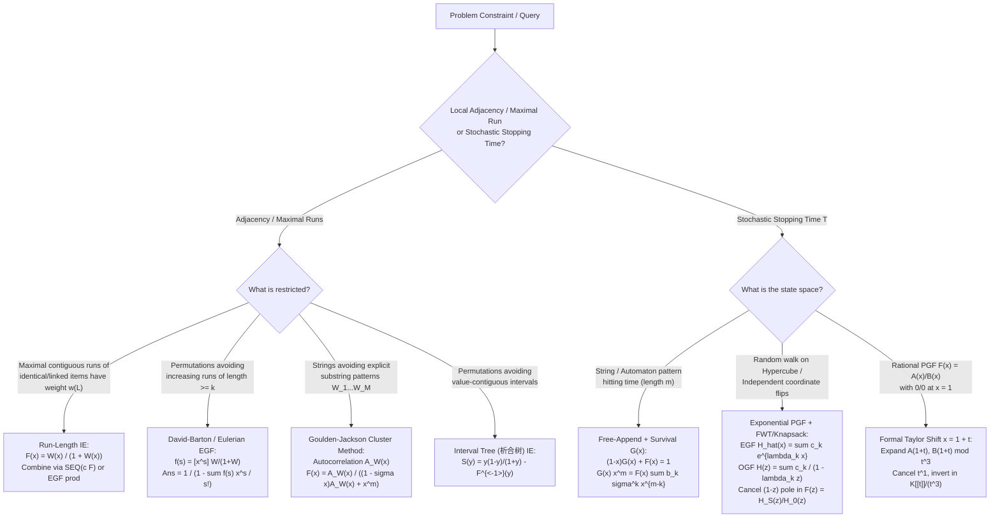

# Cohort 2 — Wave 2B (Iterations 68–72): Inclusion–Exclusion Inside Generating Functions (`连续段容斥`), Goulden–Jackson Cluster Method, Probability Generating Functions (PGFs) & Stopping Times, and `[ZH]`/`[JA]` Deep-Dive Audit

> **Cohort 2 Independent Discovery Report**  
> **Scope**: Iterations 68, 69, 70, 71, and 72  
> **Core Themes**: Run-Length Inclusion–Exclusion (`连续段容斥`), Generalized Block Weight Inversion, Permutation Runs & Eulerian Generating Functions, Goulden–Jackson Cluster Method, Probability Generating Functions (`概率生成函数` / PGFs), Stopping-Time Martingale/Renewal Identities, Taylor Shift at $x = 1+t$, Multilingual (`[EN]`, `[ZH]`, `[JA]`) Literature Synthesis, and Competitive Programming Problem Audit.

---

## Executive Summary & Pedagogical Architecture

In competitive programming and enumerative combinatorics, three families of generating function manipulations repeatedly separate standard textbook application from grandmaster-level problem solving:

1. **Inclusion–Exclusion Inside Generating Functions (`连续段容斥` & Cluster Methods)**: When a problem restricts *local adjacency* (e.g., no two adjacent elements are equal, no block of identical elements has length in a forbidden set $S$, no ascent run exceeds length $k$, or no substring matches a pattern $W$), tracking the exact state in a dynamic programming table causes a state-space explosion. By passing from *maximal valid runs* to *arbitrarily partitioned segments of violations* weighted by an inclusion–exclusion coefficient series $F(x)$, the global constraint collapses into a free sequence construction $\operatorname{SEQ}(F) = \frac{1}{1 - F(x)}$ or a product of exponential generating functions.
2. **Probability Generating Functions (PGFs), Stopping Times & Renewal Equations**: When analyzing random walks, string-hitting times (Penney's game, Aho–Corasick automata), or coupon-collector variants on state spaces, computing $\mathbb{E}[T]$ and $\operatorname{Var}(T)$ via raw Markov chain linear systems is often $O(|\mathcal{S}|^3)$ or algebraically opaque. Introducing the PGF $F(x) = \sum_{n \ge 0} \mathbb{P}(T = n) x^n$ alongside the survival/non-terminating series $G(x) = \sum_{n \ge 0} \mathbb{P}(T > n) x^n$ yields the fundamental relation $(1-x)G(x) + F(x) = 1$. Combined with renewal equations that link *arbitrary visits* to *first passages* and formal expansion at $x = 1 + t$, complex expectation and variance queries reduce to low-degree Taylor extractions.
3. **Cross-Community Synthesis (`[EN]`, `[ZH]`, `[JA]`)**: The Chinese OI community (`国家集训队论文`, Luogu, UOJ, QOJ) has developed a rich operational vocabulary (`连续段容斥`, `集合幂级数与PGF`, `析合树容斥`), while the Japanese CP community (`maspypy`, `noshi91`, `Nyaan`, `tatyam`, AtCoder FPS 24) emphasizes clean algebraic ring abstractions, Bostan–Mori rational extraction, and sparse FPS primitives. Bridging these with classic Western analytic combinatorics (Flajolet–Sedgewick, Goulden–Jackson, Wilf, Stanley) creates a unified, zero-magic-step framework.

Every technique in this report is presented under the **Zero Magic Steps** protocol:
- **Concrete Combinatorial / Algebraic Object** & ring specification;
- **The Diagnostic Signal** (exact structural cues in a problem statement);
- **The Reverse-Engineering Scratchpad** (how to derive the coefficient or substitution from scratch without memorizing formulas);
- **Step-by-Step Algebraic Derivation** with explicit ring/convergence/characteristic validity conditions;
- **Hand-Checkable Toy Example** ($n \le 4$);
- **Failure Modes, Pitfalls & Edge Cases**.

---

## Iteration 68: Inclusion–Exclusion Inside Generating Functions (`连续段容斥` / Run-Length IE & Forbidden Patterns)

### 68.1 The Combinatorial Anatomy of Adjacent Violations & Maximal Runs

#### Concrete Combinatorial / Algebraic Object
Consider a sequence $a = (a_1, a_2, \dots, a_n)$ of length $n$ built from atomic objects (characters, colored balls, graph vertices, or permutation elements). Suppose there are $n-1$ potential **boundaries** (or **links**) between adjacent positions $(i, i+1)$ for $1 \le i \le n-1$.

A problem either:
1. **Forbids adjacent violations**: Certain adjacent pairs $(a_i, a_{i+1}) \in \mathcal{B}$ are illegal ("bad links"); or
2. **Weights maximal contiguous runs**: Every maximal contiguous block of identical/linked elements of length $L$ contributes a multiplicative weight $w(L)$ to the configuration (where forbidding blocks of length $L \in S$ is the special case $w(L) = [L \notin S]$, and forbidding adjacent equal elements is $w(1) = 1, w(L) = 0$ for $L \ge 2$).

We work in the ring of formal power series $\mathbb{Q}[[x]]$ (or $\mathbb{F}_p[[x]]$ with $p > n$ when using Exponential Generating Functions), often augmented with catalytic variables $y$ or color indeterminates $z_1, \dots, z_k$.

#### The Diagnostic Signal
Reach for **Run-Length Inclusion–Exclusion (`连续段容斥`)** whenever you observe:
- **"Maximal contiguous block" (`极长连续段`) constraints**: The weight or validity of a sequence depends on the lengths $L_1, L_2, \dots, L_m$ of its *maximal* contiguous runs of identical elements (or ascending/connected elements), and the word "maximal" (`极长`) prevents you from simply concatenating blocks via $\operatorname{SEQ}$ because two adjacent blocks of the same type would merge into a single longer block!
- **Symmetry + Adjacency incompatibility**: Elements have global count constraints (e.g., exactly $c_i$ balls of color $i$, or a permutation of $\{1, \dots, n\}$) *simultaneously* with local adjacency constraints ($a_i \ne a_{i+1}$, or $|a_i - a_{i+1}| \ne 1$, or no run of color $i$ has length $\ge k$).
- **Graph path/cycle covers with forbidden edges**: Counting Hamiltonian paths/cycles in $K_n \setminus E$ where $E$ is a structured sparse graph (union of disjoint paths, cycles, or trees).

---

### 68.2 Reverse-Engineering the Signed Block Weight Series (`容斥系数推导`)

Why can we not directly write $\operatorname{SEQ}$ for maximal runs? Because if we concatenate two blocks of the *same* color, say $(\text{red of length } 2)$ followed by $(\text{red of length } 1)$, they fuse into a single maximal red run of length $3$. Enforcing "adjacent blocks must have different colors" in an OGF requires tracking the last color, which fails when colors have fixed counts (EGF) or when "same type" is a transitive relation.

Instead, we **relax** the condition "adjacent blocks have different types" and allow *arbitrary partitions* of a maximal run of length $L$ into smaller sub-blocks of lengths $s_1 + s_2 + \dots + s_r = L$ ($s_j \ge 1$), assigning each sub-block of length $s$ an unknown **inclusion–exclusion weight** $f(s)$ so that the sum over all possible sub-partitions of a maximal run of length $L$ equals the desired target weight $w(L)$.

#### The Reverse-Engineering Scratchpad
Let $w(L)$ be the *true* weight we want a **maximal** run of length $L \ge 1$ to contribute.
Suppose we allow a maximal run of length $L$ to be split at any subset of its $L-1$ internal boundaries into a sequence of $r \ge 1$ formal sub-blocks of lengths $s_1, s_2, \dots, s_r \ge 1$ with $s_1 + \dots + s_r = L$.
If we assign a formal weight $f(s)$ to any sub-block of length $s$, then because any two sub-blocks of the same type placed adjacent to each other are now allowed without restriction, a true maximal run of length $L$ will be generated in every possible way it can be partitioned into compositions $s_1 + \dots + s_r = L$.

Therefore, the total weight accumulated by a true maximal run of length $L$ across all its formal sub-block decompositions is:
$$\sum_{r=1}^{L} \sum_{\substack{s_1 + \dots + s_r = L \\ s_j \ge 1}} f(s_1) f(s_2) \cdots f(s_r).$$
We *demand* that this total weight equal $w(L)$ for every $L \ge 1$:
$$\sum_{r=1}^{L} \sum_{\substack{s_1 + \dots + s_r = L \\ s_j \ge 1}} f(s_1) f(s_2) \cdots f(s_r) = w(L) \quad (\forall L \ge 1).$$

Now translate this demand directly into Formal Power Series!
Define the OGF of the target maximal-run weights and the OGF of the unknown IE sub-block weights (both with zero constant term, since block lengths are $\ge 1$):
$$W(x) = \sum_{L \ge 1} w(L) x^L, \qquad F(x) = \sum_{s \ge 1} f(s) x^s \in x K[[x]].$$
The left-hand side of our demand is the coefficient of $x^L$ in $\sum_{r \ge 1} F(x)^r = \frac{F(x)}{1 - F(x)}$.
Thus our requirement is simply the formal power series identity:
$$\frac{F(x)}{1 - F(x)} = W(x) \quad \Longleftrightarrow \quad 1 + W(x) = \frac{1}{1 - F(x)}.$$
Solving for the unknown IE weight series $F(x)$ in terms of the known target series $W(x)$ takes one line of algebra:
$$1 - F(x) = \frac{1}{1 + W(x)} \quad \Longrightarrow \quad \boxed{F(x) = \frac{W(x)}{1 + W(x)} = 1 - \frac{1}{1 + W(x)}.}$$

#### Step-by-Step Algebraic Derivation of Special Cases & General Formula

Let us verify the algebraic validity and extract explicit formulas for the three most important regimes in competitive programming:

1. **Validity Condition**: Since $W(x) = \sum_{L \ge 1} w(L) x^L$ has $\operatorname{val}(W) \ge 1$, its constant term is $[x^0]W(x) = 0$. Therefore, $1 + W(x)$ has constant term $1 \in K^\times$, so $(1 + W(x))^{-1}$ exists uniquely in $K[[x]]$ over *any* commutative ring $K$ (regardless of characteristic!).

2. **Regime I: Classic Forbidden Adjacency (`相邻不同` / $w(1) = 1, w(L) = 0$ for $L \ge 2$)**  
   If no two adjacent elements of the same type may be adjacent, then every maximal run must have length $L = 1$. Thus $w(1) = 1$ and $w(L) = 0$ for $L \ge 2$, giving $W(x) = x$.
   Plugging $W(x) = x$ into our boxed formula yields:
   $$F(x) = \frac{x}{1 + x} = \sum_{s \ge 1} (-1)^{s-1} x^s \quad \Longrightarrow \quad \boxed{f(s) = (-1)^{s-1}.}$$
   *Combinatorial meaning*: A formal block of $s$ identical/linked elements carries IE weight $(-1)^{s-1}$. Why? Because a block of size $s$ commits $s-1$ adjacent violations, and standard Inclusion–Exclusion assigns $(-1)^{\text{number of chosen violations}} = (-1)^{s-1}$.

3. **Regime II: Forbidding Maximal Runs of Exact Length $k$ ($w(L) = [L \ne k]$)**  
   Suppose all run lengths are valid ($w(L) = 1$) *except* that maximal runs of exact length $k$ are forbidden ($w(k) = 0$). Then:
   $$W(x) = \sum_{L \ge 1} x^L - x^k = \frac{x}{1 - x} - x^k.$$
   Therefore:
   $$1 + W(x) = \frac{1}{1 - x} - x^k = \frac{1 - x^k + x^{k+1}}{1 - x},$$
   and the IE weight series is:
   $$F(x) = 1 - \frac{1}{1 + W(x)} = 1 - \frac{1 - x}{1 - x^k + x^{k+1}} = \frac{x - x^k + x^{k+1}}{1 - x^k + x^{k+1}}.$$
   Notice that $F(x)$ is *sparse*! Specifically, writing $F(x) = \frac{x(1 - x^{k-1} + x^k)}{1 - x^k(1 - x)}$, its coefficients satisfy a two-term recurrence and many terms vanish. Even simpler: if we forbid runs of length $\ge k$ ($w(L) = [1 \le L < k]$), then $W(x) = \frac{x - x^k}{1 - x}$, so $1 + W(x) = \frac{1 - x^k}{1 - x}$ and:
   $$F(x) = 1 - \frac{1 - x}{1 - x^k} = \frac{x - x^k}{1 - x^k} = \sum_{m \ge 0} \left(x^{mk+1} - x^{(m+1)k}\right).$$
   Thus $f(s) = 1$ if $s \equiv 1 \pmod k$, $f(s) = -1$ if $s \equiv 0 \pmod k$, and $f(s) = 0$ otherwise! Only $O(n/k)$ block sizes have non-zero IE weights!

4. **Regime III: General Weight Function $w(L)$ via Binomial Inversion**  
   Wait: what if the elements inside a block are NOT identical, so that merging $r$ formal blocks of lengths $s_1, \dots, s_r$ depends only on the number of blocks $r$ vs total length $L$? No—in our formula $\frac{F(x)}{1-F(x)} = W(x)$, if we instead know that a true run of length $L$ can be split at any subset of its $L-1$ internal boundaries, and the weight of a formal block depends *only on whether boundaries are chosen*, wait: our formula $F(x) = \frac{W(x)}{1+W(x)}$ already works for *any* arbitrary sequence $w(L)$ in $O(n \log n)$ via polynomial inversion!
   What if a formal block of length $s$ always has the *same* internal combinatorial structure, and we just need $f(s)$? We compute $F(x) = W(x)(1 + W(x))^{-1} \bmod x^{n+1}$ in $O(n \log n)$ time!

#### Hand-Checkable Toy Example ($n = 4$)
Suppose we want to count words of length $n = 4$ over alphabet $\{A, B\}$ such that **no maximal run of identical letters has length $2$** (i.e., $w(1) = 1, w(2) = 0, w(3) = 1, w(4) = 1$).
- **Direct brute-force check**: Total words $= 2^4 = 16$. Words with a maximal run of length $2$:
  - Starts with $AA$ followed by $B$: $AABA$ (run lengths $2,1,1$), $AABB$ (run lengths $2,2$).
  - Starts with $BB$ followed by $A$: $BBAB$ ($2,1,1$), $BBAA$ ($2,2$).
  - Ends with $AA$ preceded by $B$: $BAAA$ has run $3$ (valid), $ABAA$ ($1,1,2$), $BBAA$ (already counted).
  - Ends with $BB$ preceded by $A$: $BABB$ ($1,1,2$), $AABB$ (already counted).
  - Middle run of length $2$: $ABBA$ ($1,2,1$), $BAAB$ ($1,2,1$).
  Total invalid words $= 8$ ($AABA, AABB, BBAB, BBAA, ABAA, BABB, ABBA, BAAB$).
  Valid words $= 16 - 8 = 8$ ($AAAA, BBBB, AAAB, BBBA, BAAA, ABBB, ABAB, BABA$).
- **Run-Length IE check**:
  Target weight OGF: $W(x) = x + 0x^2 + x^3 + x^4 + O(x^5)$.
  Compute $1 + W(x) = 1 + x + x^3 + x^4 + O(x^5)$.
  Invert $1 + W(x) \bmod x^5$:
  $$\frac{1}{1 + (x + x^3 + x^4)} = 1 - (x + x^3 + x^4) + (x + x^3)^2 - (x)^3 + x^4 + O(x^5) = 1 - x + x^2 - 2x^3 + 2x^4 + O(x^5).$$
  Thus $F(x) = 1 - \frac{1}{1+W(x)} = x - x^2 + 2x^3 - 2x^4 + O(x^5)$, giving IE coefficients:
  $$f(1) = 1, \quad f(2) = -1, \quad f(3) = 2, \quad f(4) = -2.$$
  Since each formal block of length $s$ can be painted either $A$ or $B$ ($2$ choices, completely independent of adjacent formal blocks!), the OGF of a single colored formal block is $2 F(x)$.
  The total number of valid words is $[x^4] \frac{1}{1 - 2F(x)}$:
  $$2F(x) = 2x - 2x^2 + 4x^3 - 4x^4 + O(x^5).$$
  Let $G(x) = \frac{1}{1 - 2F(x)} = 1 + 2F(x) G(x)$:
  - $[x^0]G = 1$
  - $[x^1]G = 2(1) = 2$
  - $[x^2]G = 2(2) - 2(1) = 2$
  - $[x^3]G = 2(2) - 2(2) + 4(1) = 4$
  - $[x^4]G = 2(4) - 2(2) + 4(2) - 4(1) = 8 - 4 + 8 - 4 = 8$.
  Matches $8$ exactly! Notice how $[x^3]\frac{F(x)}{1-F(x)} = f(3) + 2f(2)f(1) + f(1)^3 = 2 + 2(-1)(1) + 1 = 1 = w(3)$ and $[x^2]\frac{F(x)}{1-F(x)} = f(2) + f(1)^2 = -1 + 1 = 0 = w(2)$.

---

### 68.3 Colored Balls / Multiset Permutations via Run-Length IE

#### Concrete Combinatorial / Algebraic Object
Suppose we have $k$ distinct colors of balls, with $c_i$ identical balls of color $i$ ($\sum_{i=1}^k c_i = n$). We want to arrange all $n$ balls in a row such that every maximal contiguous block of color $i$ of length $L$ receives weight $w_i(L)$ (for instance, no two adjacent balls have the same color: $w_i(1) = 1, w_i(L) = 0$ for $L \ge 2$).

#### Step-by-Step Algebraic Derivation
1. **Per-Color Formal Block Decomposition**: For color $i$, compute its IE block weight sequence $f_i(s)$ via $F_i(x) = \frac{W_i(x)}{1 + W_i(x)}$.
2. **Partitioning $c_i$ Balls into $r_i$ Formal Blocks**: If color $i$ is partitioned into $r_i$ ordered formal blocks of sizes $s_1 + s_2 + \dots + s_{r_i} = c_i$, the sum of IE weights over all such compositions is:
   $$g_i(r_i) = [x^{c_i}] F_i(x)^{r_i}.$$
   In the classic case $w_i(1) = 1, w_i(L) = 0$ ($L \ge 2$), we have $F_i(x) = \frac{x}{1+x}$, so:
   $$g_i(r_i) = [x^{c_i}] \left(\frac{x}{1+x}\right)^{r_i} = [x^{c_i - r_i}] (1+x)^{-r_i} = (-1)^{c_i - r_i} \binom{c_i - 1}{r_i - 1}.$$
3. **Interleaving Formal Blocks Across Colors via EGF**: Once color $i$ is broken into $r_i$ ordered blocks, interleave the $\sum_{i=1}^k r_i = R$ blocks across all colors in $\frac{R!}{r_1! r_2! \cdots r_k!}$ ways!
   Passing to Exponential Generating Functions in $y$ (where $y$ marks one formal block), each color $i$ has the EGF:
   $$\widehat{G}_i(y) = \sum_{r_i = 1}^{c_i} g_i(r_i) \frac{y^{r_i}}{r_i!}.$$
   The total valid arrangements across all $k$ colors is then extracted by multiplying the EGFs and restoring $R!$ to $[y^R]$:
   $$\text{Answer} = \sum_{R=1}^{n} R! \, [y^R] \prod_{i=1}^{k} \widehat{G}_i(y).$$
   Notice the miracle: the colors are now **completely decoupled**! Even though the original problem forbade adjacent balls of the same color, the IE weights $g_i(r_i)$ absorb all same-color adjacency interactions locally within color $i$, leaving a pure unconstrained multiset permutation of $R$ blocks!

---

### 68.4 Permutation Ascent/Descent Runs & Eulerian Generating Functions

#### Concrete Combinatorial / Algebraic Object
Consider permutations $\pi = (\pi_1, \pi_2, \dots, \pi_n) \in \mathfrak{S}_n$. We want to count permutations avoiding ascending runs (or descending runs) of length $\ge k$, or compute the distribution of the number of ascents $\operatorname{asc}(\pi) = |\{i \in [1, n-1] : \pi_i < \pi_{i+1}\}|$.

#### The Diagnostic Signal
- Constraints on $\pi_i < \pi_{i+1}$ (ascents), $\pi_i > \pi_{i+1}$ (descents), or streaks of consecutive increases $\pi_i < \pi_{i+1} < \dots < \pi_{i+s-1}$.
- Any problem where an "elementary bad event" between $i$ and $i+1$ imposes a total order on each contiguous cluster of bad events, so that a cluster of size $s$ has **exactly $1$ valid internal relative ordering** out of $s!$ (hence EGF weight $\frac{x^s}{s!}$).

#### The Reverse-Engineering Scratchpad
Suppose we want to count permutations with **no ascending run of length $\ge k$** (i.e., we cannot have $\pi_i < \pi_{i+1} < \dots < \pi_{i+k-1}$).
Wait: is "ascending run" a transitive relation where any two adjacent increasing blocks merge?
Careful! If block 1 is $(2, 5)$ (increasing) and block 2 is $(1, 4)$ (increasing), concatenating them gives $(2, 5, 1, 4)$, which has a **descent** $5 > 1$ between the blocks, so they do *not* necessarily merge!
Rather, a descent occurs only when the last element of block 1 is greater than the first element of block 2.
How do we handle this? There are **two** dual viewpoints, and understanding both is essential:

1. **Viewpoint A: Bad-Link Inclusion–Exclusion (Counting Ascents)**:
   An "ascent link" at position $i$ is the event $\pi_i < \pi_{i+1}$. Suppose each ascent link carries weight $u$ (where $u = 1$ means unconstrained, $u = 0$ means no ascents allowed, and general $u$ gives the Eulerian polynomial $A_n(u) = \sum_{\pi \in \mathfrak{S}_n} u^{\operatorname{asc}(\pi)}$).
   Write the factor for each adjacent pair as $1 + (u - 1)[\pi_i < \pi_{i+1}]$.
   Expanding the product over $1 \le i \le n-1$ selects a subset of boundaries where we *force* $\pi_i < \pi_{i+1}$, each weighted by $(u-1)$.
   A maximal connected component of forced ascent boundaries of size $s$ (covering $s$ elements and $s-1$ forced `<` signs) forces those $s$ elements to appear in strictly increasing order $\pi_a < \pi_{a+1} < \dots < \pi_{a+s-1}$.
   For any set of $s$ distinct labels chosen for this block, there is **exactly $1$** way to sort them in increasing order!
   Thus, in the **Exponential Generating Function** world, a forced-increasing block of size $s \ge 1$ has EGF weight:
   $$\frac{(u-1)^{s-1} x^s}{s!}.$$
   Summing over all block sizes $s \ge 1$ gives the EGF of a single forced-increasing block:
   $$B(x, u) = \sum_{s \ge 1} (u-1)^{s-1} \frac{x^s}{s!} = \frac{\exp((u-1)x) - 1}{u - 1}.$$
   Since a permutation is a free sequence ($\operatorname{SEQ}$) of such forced-increasing blocks with no constraints between adjacent blocks, the bivariate EGF of Eulerian polynomials is:
   $$\boxed{E(x, u) = \sum_{n \ge 0} A_n(u) \frac{x^n}{n!} = \frac{1}{1 - B(x, u)} = \frac{u - 1}{u - \exp((u - 1)x)}.}$$

2. **Viewpoint B: Forbidding Increasing Runs of Length $\ge k$ (David–Barton Theorem)**:
   What if a permutation is forbidden from containing $k$ consecutive increasing elements $\pi_i < \pi_{i+1} < \dots < \pi_{i+k-1}$?
   Here, a maximal increasing run of length $L$ is valid iff $1 \le L < k$, i.e., $w(L) = [1 \le L < k]$.
   Wait: why does the same run-length IE series $F(x) = \frac{x - x^k}{1 - x^k}$ from Regime II work directly inside the EGF?
   Because any permutation $\pi \in \mathfrak{S}_n$ has a **unique** decomposition into maximal increasing runs of lengths $L_1, L_2, \dots, L_m$.
   Conversely, if we choose *any* composition $s_1 + s_2 + \dots + s_r = n$ and require that within each formal block of size $s_j$ the elements are strictly increasing, then in the resulting permutation $\pi$, each true maximal increasing run of length $L$ is formed by merging some contiguous group of formal blocks whose sizes sum to $L$!
   Therefore, every true maximal increasing run of length $L$ gets counted with weight $\sum_{s_1 + \dots + s_p = L} f(s_1) \cdots f(s_p)$.
   Setting $f(s) = [x^s] \frac{W(x)}{1 + W(x)}$ in the **EGF** block series:
   $$\widehat{F}(x) = \sum_{s \ge 1} f(s) \frac{x^s}{s!},$$
   the EGF of permutations where every maximal increasing run of length $L$ receives weight $w(L)$ is:
   $$\boxed{\sum_{n \ge 0} a_n \frac{x^n}{n!} = \frac{1}{1 - \widehat{F}(x)} = \left(1 - \sum_{s \ge 1} f(s) \frac{x^s}{s!}\right)^{-1}, \quad \text{where } \sum_{s \ge 1} f(s) x^s = \frac{W(x)}{1 + W(x)}.}$$
   In particular, for avoiding increasing runs of length $\ge k$, $f(mk+1) = 1$, $f(mk+k) = -1$, and all other $f(s) = 0$, yielding the classic **David–Barton generating function**:
   $$\sum_{n \ge 0} a_n \frac{x^n}{n!} = \left(1 - \sum_{m \ge 0} \left(\frac{x^{mk+1}}{(mk+1)!} - \frac{x^{mk+k}}{(mk+k)!}\right)\right)^{-1}.$$

---

### 68.5 The Goulden–Jackson Cluster Method (Single-Pattern & Multi-Pattern Systems)

#### Concrete Combinatorial / Algebraic Object
Let $\Sigma$ be an alphabet of size $\sigma = |\Sigma|$, and let $\mathcal{W} = \{W_1, W_2, \dots, W_M\} \subset \Sigma^+$ be a reduced set of **forbidden words** (no word in $\mathcal{W}$ is a factor/substring of another word in $\mathcal{W}$).
We want to find the Ordinary Generating Function $F(x) = \sum_{n \ge 0} a_n x^n \in \mathbb{Q}[[x]]$ where $a_n$ is the number of words of length $n$ over $\Sigma$ containing **no** word from $\mathcal{W}$ as a contiguous substring (or more generally, the bivariate OGF $F(x, u) = \sum_{n, k \ge 0} a_{n,k} u^k x^n$ where $a_{n,k}$ counts words of length $n$ containing exactly $k$ occurrences of forbidden words).

#### The Diagnostic Signal
- Counting strings of length $n$ avoiding one or more explicit pattern strings $W_1, \dots, W_M$ (or weighting each match by $u$).
- The pattern lengths $|W_i|$ are too large to build an explicit $2^{|W_i|}$ state automaton, or $n$ is huge ($n \le 10^{18}$ with a single long pattern, or $n \le 10^5$ with polynomial inversion), or you need the closed-form rational generating function directly from the **autocorrelation (border) structure** of the patterns without running KMP/Aho–Corasick transition matrices.

#### The Reverse-Engineering Scratchpad
Suppose we want to count words of length $n$ over $\Sigma$ with $0$ occurrences of a forbidden pattern $W$ of length $m = |W|$.
By Inclusion–Exclusion, in any word $S \in \Sigma^n$, some set of positions may match $W$.
We replace the indicator $[S \text{ avoids } W]$ by marking an arbitrary subset of occurrences of $W$ in $S$, each marked occurrence carrying weight $v = -1$ (or more generally $v = u - 1$ if each occurrence is weighted by $u$).
When we mark a subset of occurrences of $W$ in $S$, the characters of $S$ decompose into:
- **Isolated characters** not covered by any marked occurrence of $W$ (each contributes $\sigma x$); and
- **Maximal overlapping components of marked occurrences of $W$**, called **clusters** (`簇`).

Wait: why can we not just write a cluster as a sequence of $W$'s? Because two marked occurrences of $W$ in a cluster **overlap**!
Specifically, if one marked copy of $W$ is followed by an overlapping marked copy of $W$, the suffix of the first copy must equal a proper prefix of the second copy!
Let us define the **autocorrelation set** (or border set) of $W = w_1 w_2 \dots w_m$:
For $0 \le i < m$, define $c_i \in \{0, 1\}$ by:
$$c_i = \begin{cases} 1 & \text{if } W[1 \dots m-i] = W[i+1 \dots m] \text{ (i.e., suffix of length } m-i \text{ equals prefix of length } m-i\text{)}, \\ 0 & \text{otherwise.} \end{cases}$$
Note that $c_0 = 1$ always (overlap of full length $m$, i.e., offset $0$).
 define the **autocorrelation polynomial** (in the convention where $x^i$ tracks the *new extension length* when overlapping with offset $i$, or tracking the prefix overhang $i$):
Let us be crystal clear about the indexing!
Suppose a cluster $C$ ends with a final marked occurrence of $W$.
If we **peel off** the last marked occurrence of $W$ from the cluster $C$, there are two possibilities:
1. **Case 1**: That occurrence of $W$ was the *only* marked occurrence in the cluster $C$. Then $C = W$, which has length $m$ and weight $v x^m$.
2. **Case 2**: There was a previous marked occurrence of $W$ in the cluster $C$ that overlapped with this last occurrence of $W$.
   Suppose the second-to-last occurrence of $W$ started $i$ positions before the last occurrence of $W$ (where $1 \le i \le m-1$).
   Then the last occurrence of $W$ extends the cluster by **exactly $i$ new characters** (and those $i$ characters are uniquely determined because the overlap of length $m - i$ must match!).
   Moreover, such an overlap at shift $i$ is valid **if and only if** $c_i = 1$ (the suffix of the previous $W$ of length $m-i$ matches the prefix of the new $W$ of length $m-i$)!

Look at what peeling off the last $W$ gives:
Every cluster $C$ is Either:
- A single marked $W$ (contributing $v x^m$), OR
- An arbitrary smaller valid cluster $C'$, extended by a shift $i \in \{1, \dots, m-1\}$ with $c_i = 1$ (contributing $C' \cdot v x^i$)!

Let $C(x)$ be the generating function of all clusters. Translating "Either single $W$, or smaller cluster $C'$ extended by shift $i$ with $c_i = 1$" directly into an equation for $C(x)$:
$$C(x) = v x^m + C(x) \cdot v \sum_{i=1}^{m-1} c_i x^i.$$
Wait—combine the $1$ on the left with the sum on the right using $c_0 = 1$!
Define the **Autocorrelation Polynomial** $A_W(x)$ by:
$$\boxed{A_W(x) = \sum_{i=0}^{m-1} c_i x^i = 1 + \sum_{i=1}^{m-1} c_i x^i.}$$
When $v = -1$ (forbidding $W$ completely), the cluster equation is:
$$C(x) = -x^m - C(x) \sum_{i=1}^{m-1} c_i x^i \quad \Longleftrightarrow \quad C(x) \left(1 + \sum_{i=1}^{m-1} c_i x^i\right) = -x^m \quad \Longleftrightarrow \quad \boxed{C(x) = \frac{-x^m}{A_W(x)}.}$$
For general weight $v = u - 1$ (counting occurrences by $u$):
$$C(x, u) \left(1 - (u-1)\sum_{i=1}^{m-1} c_i x^i\right) = (u-1) x^m \quad \Longleftrightarrow \quad C(x, u) = \frac{(u-1) x^m}{1 - (u-1)(A_W(x) - 1)}.$$

#### Step-by-Step Algebraic Derivation of the Full Word OGF
Now that we have the generating function $C(x)$ of a single cluster of overlapping marked occurrences of $W$, any marked word over $\Sigma$ is simply an unconstrained sequence ($\operatorname{SEQ}$) of:
- Single unmarked letters $a \in \Sigma$ (GF: $\sigma x$), and
- Clusters $C$ (GF: $C(x)$).

Therefore, the OGF of words avoiding $W$ ($v = -1$) is:
$$F(x) = \frac{1}{1 - \sigma x - C(x)} = \frac{1}{1 - \sigma x - \frac{-x^m}{A_W(x)}} = \boxed{\frac{A_W(x)}{(1 - \sigma x) A_W(x) + x^m}.}$$
And the bivariate OGF tracking the exact number of occurrences of $W$ by $u$ ($v = u - 1$) is:
$$\boxed{F(x, u) = \frac{1 - (u-1)(A_W(x) - 1)}{(1 - \sigma x)\big(1 - (u-1)(A_W(x) - 1)\big) - (u-1)x^m}.}$$

**Validity Conditions**:
- The pattern set $\mathcal{W}$ MUST be **reduced** (antichain under substring inclusion). If $W_1$ is a substring of $W_2$ and we only want to avoid both, $W_2$ is redundant and must be discarded before applying the cluster method. (If $W_1$ and $W_2$ have different weights $u_1, u_2$, then an occurrence of $W_1$ can be strictly inside $W_2$, which requires Aho–Corasick rather than reduced-antichain clusters.)
- In $K[[x]]$, the denominator $(1 - \sigma x)A_W(x) + x^m$ has constant term $1 \cdot 1 + 0 = 1 \in K^\times$, so it is always invertible in $K[[x]]$ for any ring $K$.

#### Hand-Checkable Toy Example ($n \le 4$)
Let $\Sigma = \{\texttt{A}, \texttt{B}\}$ ($\sigma = 2$) and forbidden word $W = \texttt{ABA}$ ($m = 3$).
1. **Autocorrelation Polynomial**:
   - $i = 0$: overlap length $3$ ($\texttt{ABA} = \texttt{ABA}$) $\implies c_0 = 1$.
   - $i = 1$: overlap length $2$ (prefix $\texttt{AB} \ne$ suffix $\texttt{BA}$) $\implies c_1 = 0$.
   - $i = 2$: overlap length $1$ (prefix $\texttt{A} =$ suffix $\texttt{A}$) $\implies c_2 = 1$.
   Thus $A_W(x) = 1 + x^2$.
2. **Cluster & Word OGF**:
   $$F(x) = \frac{1 + x^2}{(1 - 2x)(1 + x^2) + x^3} = \frac{1 + x^2}{1 - 2x + x^2 - x^3}.$$
3. **Series Expansion up to $n = 4$**:
   Denominator $1 - (2x - x^2 + x^3)$:
   - $a_0 = 1$
   - $a_1 = 2(1) = 2$
   - $a_2 = 1 + 2(2) - 1(1) = 4$
   - $a_3 = 2(4) - 1(2) + 1(1) = 7$ (all $2^3 = 8$ words except $\texttt{ABA}$)
   - $a_4 = 2(7) - 1(4) + 1(2) = 12$.
   Let's check $n = 4$ by hand! Out of $2^4 = 16$ binary words of length $4$, those containing $\texttt{ABA}$ are:
   - $\texttt{ABA*}$: $\texttt{ABAA}, \texttt{ABAB}$ ($2$ words)
   - $\texttt{*ABA}$: $\texttt{AABA}, \texttt{BABA}$ ($2$ words)
   Since $\texttt{ABA}$ at $[1..3]$ and $[2..4]$ cannot overlap at shift $1$ ($c_1 = 0$), the two sets are disjoint! Thus $16 - 4 = 12$ valid words. Matches $a_4 = 12$!
   What about $n = 5$? $a_5 = 2(12) - 1(7) + 1(4) = 21$. Let's check: $32$ total words minus $3 \times 4 = 12$ single matches plus $1$ double overlapping match $\texttt{ABABA}$ (shift $i = 2$, $c_2 = 1$): $32 - 12 + 1 = 21$. Exact match!

#### Multi-Pattern Goulden–Jackson System
When $\mathcal{W} = \{W_1, \dots, W_M\}$ is a reduced set of $M$ forbidden words with lengths $m_j = |W_j|$, define the pairwise overlap polynomial $A_{i, j}(x)$ for how a marked $W_i$ on the left can be overlapped by a marked $W_j$ on the right:
$$A_{i, j}(x) = \sum_{\substack{1 \le k \le m_i \\ W_i[m_i - k + 1 \dots m_i] = W_j[1 \dots k]}} x^{m_j - k},$$
where for $i = j$ the $k = m_i$ term gives $x^0 = 1$.
Let $C_j(x)$ be the generating function of clusters ending with word $W_j$. Peeling off the last word $W_j$ yields the $M \times M$ linear system over $K[x]$:
$$\sum_{i=1}^{M} C_i(x) A_{i, j}(x) = -x^{m_j} \quad (1 \le j \le M),$$
and the total OGF is $F(x) = \frac{1}{1 - \sigma x - \sum_{j=1}^M C_j(x)}$.

---

### 68.6 Failure Modes, Pitfalls & Edge Cases in Run-Length IE & Cluster Methods

> [!WARNING]
> **Critical Pitfalls to Audit Before Coding**
> 1. **Non-Reduced Pattern Sets in Goulden–Jackson**: If $W_1 = \texttt{AB}$ and $W_2 = \texttt{ABCD}$, then $W_1$ can occur *strictly inside* $W_2$ without extending its right endpoint! The cluster recurrence assumes every marked word in a cluster extends the right endpoint strictly further to the right. Always filter out superstrings before building $A_{i,j}(x)$.
> 2. **Cyclic vs. Linear Run-Length IE (`环上连续段容斥`)**: On a cycle of length $n$, the first and last formal blocks may merge if they have the same color/type! Furthermore, the case where the *entire cycle* consists of a single block of length $n$ has no boundaries at all. On a cycle, you must separately account for: (a) shifting/rotating the first block boundary ($n / s_1$ ways to place the first block of size $s_1$), and (b) the single-block wrap-around term where all $n$ elements form one run.
> 3. **Confusing OGF Inversion $F = \frac{W}{1+W}$ with EGF Composition**: When blocks have internal labelings (like permutations in Section 68.4), the IE relation between $f(s)$ and $w(L)$ is STILL the **OGF** relation $\sum_{s \ge 1} f(s) x^s = \frac{W(x)}{1+W(x)}$, because a maximal run of length $L$ has **only $1$** way to be partitioned into ordered contiguous segments of lengths $s_1 + \dots + s_r = L$ (no multinomial $\binom{L}{s_1, \dots, s_r}$ factor!). You compute $f(s)$ via OGF inversion first, and **only afterwards** divide $f(s)$ by $s!$ to form $\widehat{F}(x) = \sum_{s \ge 1} f(s) \frac{x^s}{s!}$ for the outer EGF $\frac{1}{1 - \widehat{F}(x)}$. Dividing by $L!$ *before* computing $\frac{W}{1+W}$ is a fatal bug!

---

## Iteration 69: Probability Generating Functions (PGFs), Stopping Times, First-Passage Renewal & Random Walks

### 69.1 Foundations of Probability Generating Functions (PGFs) & Factorial Moments

#### Concrete Combinatorial / Algebraic Object
Let $X$ be a discrete random variable taking values in $\mathbb{N} = \{0, 1, 2, \dots\}$ with probability mass function $p_n = \mathbb{P}(X = n)$. Its **Probability Generating Function (PGF)** (`概率生成函数`) is the Ordinary Generating Function of its probability distribution:
$$F(x) = \mathbb{E}[x^X] = \sum_{n=0}^{\infty} \mathbb{P}(X = n) x^n \in \mathbb{R}[[x]] \quad (\text{or } \mathbb{F}_p[[x]] \text{ when } p_n \in \mathbb{F}_p).$$
Assuming $X < \infty$ almost surely, normalization gives:
$$F(1) = \sum_{n=0}^{\infty} \mathbb{P}(X = n) = 1.$$

#### The Diagnostic Signal
- A problem asks for the **expected value** $\mathbb{E}[X]$, **variance** $\operatorname{Var}(X)$, or **$k$-th moment** $\mathbb{E}[X^k]$ of the number of steps until a random process terminates (e.g., hitting a string pattern, flipping all switches to a target configuration, collecting all coupons, or reaching an absorbing state in a random walk).
- The transition structure is time-homogeneous (convolutions in step count $n$), so probabilities across $n$ steps compose via polynomial multiplication.

#### The Reverse-Engineering Scratchpad
How do we extract $\mathbb{E}[X]$ and $\operatorname{Var}(X)$ from $F(x) = \sum_{n \ge 0} p_n x^n$?
If we differentiate $F(x)$ with respect to $x$ $k$ times, each $x^n$ becomes $n(n-1)\cdots(n-k+1) x^{n-k} = n^{\underline{k}} x^{n-k}$.
Evaluating at $x = 1$ (where $1^{n-k} = 1$) kills the $x$-powers and leaves the **$k$-th factorial moment**:
$$F^{(k)}(1) = \sum_{n \ge k} n^{\underline{k}} \mathbb{P}(X = n) = \mathbb{E}\big[X(X-1)\cdots(X-k+1)\big] = \mathbb{E}[X^{\underline{k}}].$$
In particular:
- For $k = 1$:
  $$\boxed{\mathbb{E}[X] = F'(1).}$$
- For $k = 2$: $F''(1) = \mathbb{E}[X(X-1)] = \mathbb{E}[X^2] - \mathbb{E}[X]$, so $\mathbb{E}[X^2] = F''(1) + F'(1)$. Subtracting $(\mathbb{E}[X])^2 = (F'(1))^2$ gives the fundamental PGF variance identity:
  $$\boxed{\operatorname{Var}(X) = \mathbb{E}[X^2] - (\mathbb{E}[X])^2 = F''(1) + F'(1) - \big(F'(1)\big)^2.}$$
- More generally, using Stirling numbers of the second kind $n^k = \sum_{j=0}^k \left\{ \begin{matrix} k \\ j \end{matrix} \right\} n^{\underline{j}}$, the ordinary $k$-th moment is:
  $$\mathbb{E}[X^k] = \sum_{j=0}^{k} \left\{ \begin{matrix} k \\ j \end{matrix} \right\} F^{(j)}(1).$$
  Alternatively, using the pointing operator $\vartheta = x \frac{d}{dx}$, since $\vartheta^k (x^n) = n^k x^n$, evaluating $(\vartheta^k F)(1)$ yields $\mathbb{E}[X^k]$ directly.

---

### 69.2 The Stopping-Time Identity `(1 - x) G(x) + F(x) = 1` & Survival Series

#### Concrete Combinatorial / Algebraic Object
Suppose a discrete-time stochastic process runs for steps $n = 0, 1, 2, \dots$ and terminates at a random stopping time $T \in \mathbb{N}$.
Alongside the PGF of termination at step $n$:
$$F(x) = \sum_{n=0}^{\infty} f_n x^n, \qquad f_n = \mathbb{P}(T = n),$$
we define the **Survival (or Non-Terminating) Generating Function**:
$$G(x) = \sum_{n=0}^{\infty} g_n x^n, \qquad g_n = \mathbb{P}(T > n),$$
where $g_n = \mathbb{P}(T > n)$ is the probability that the process has **not yet terminated** after step $n$.

#### The Reverse-Engineering Scratchpad
Why introduce $G(x)$ when we only care about $F(x)$?
Because in almost every random walk or string-matching process, a state is **alive** at step $n$ (contributing to $g_n$), and taking one more random step from an alive state at step $n$ either keeps the process alive at step $n+1$ (contributing to $g_{n+1}$) or triggers termination at step $n+1$ (contributing to $f_{n+1}$)!
Look at the elementary probability conservation between step $n-1$ and step $n$ (for $n \ge 1$):
A process that was alive after step $n-1$ (probability $g_{n-1}$) either terminates at step $n$ (probability $f_n$) or remains alive after step $n$ (probability $g_n$):
$$g_{n-1} = f_n + g_n \quad (\forall n \ge 1), \qquad \text{with } f_0 + g_0 = \mathbb{P}(T = 0) + \mathbb{P}(T > 0) = 1.$$
Multiply the $n$-th equation by $x^n$ and sum over all $n \ge 0$ (where the $n=0$ equation is $1 = f_0 + g_0$):
$$1 + \sum_{n=1}^{\infty} g_{n-1} x^n = \sum_{n=0}^{\infty} f_n x^n + \sum_{n=0}^{\infty} g_n x^n.$$
Recognizing $\sum_{n=1}^\infty g_{n-1} x^n = x G(x)$, we obtain the **Fundamental Stopping-Time Identity**:
$$\boxed{1 + x G(x) = F(x) + G(x) \quad \Longleftrightarrow \quad (1 - x) G(x) + F(x) = 1.}$$

#### Step-by-Step Algebraic Derivation of Moments via `G(x)`
Differentiating $(1 - x) G(x) + F(x) = 1$ with respect to $x$ eliminates the need to solve for $F'(1)$ directly!
1. **First Derivative (Expectation)**:
   $$\frac{d}{dx}\big[(1 - x)G(x) + F(x)\big] = -G(x) + (1 - x)G'(x) + F'(x) = 0.$$
   Rearranging gives $F'(x) = G(x) - (1 - x)G'(x)$.
   Assuming $\mathbb{E}[T] < \infty$ (and $\lim_{x \to 1^-} (1-x)G'(x) = 0$, which holds whenever $G(x)$ is rational and regular at $x = 1$), substituting $x = 1$ yields the famous tail-sum expectation formula:
   $$\boxed{\mathbb{E}[T] = F'(1) = G(1) = \sum_{n=0}^{\infty} \mathbb{P}(T > n).}$$
2. **Second Derivative (Variance)**:
   Differentiating $-G(x) + (1 - x)G'(x) + F'(x) = 0$ a second time with respect to $x$:
   $$-2G'(x) + (1 - x)G''(x) + F''(x) = 0 \quad \Longrightarrow \quad F''(1) = 2G'(1).$$
   Plugging $F'(1) = G(1)$ and $F''(1) = 2G'(1)$ into $\operatorname{Var}(T) = F''(1) + F'(1) - (F'(1))^2$ gives:
   $$\boxed{\operatorname{Var}(T) = 2G'(1) + G(1) - \big(G(1)\big)^2.}$$

**Validity Conditions**:
- For $G(1)$ and $G'(1)$ to exist and satisfy $(1-x)G'(x)\big|_{x=1} = 0$, the stopping time $T$ must have finite first and second moments (for finite-state absorbing Markov chains where the absorbing state is reachable from every active state, $g_n$ decays exponentially $g_n = O(\rho^n)$ with $\rho < 1$, so the radius of convergence of $G(x)$ is $1/\rho > 1$, making $G(x)$ analytic in a neighborhood of $x = 1$).

---

### 69.3 The Formal Taylor Shift Trick at `x = 1 + t` (Bypassing Division by `1 - x`)

#### Concrete Combinatorial / Algebraic Object
In many advanced CP problems (such as random walks on hypercubes or coupon-collector variants), we cannot write $G(x)$ directly; instead, we obtain a closed form or partial-fraction sum for an unstopped generating function $H(x) = \sum_{k} \frac{c_k}{1 - \lambda_k x}$ that has a simple pole at $x = 1$ (corresponding to the stationary eigenvalue $\lambda_0 = 1$).

#### The Diagnostic Signal
- You have an expression $F(x) = \frac{A(x)}{B(x)}$ where **both** $A(1) = 0$ and $B(1) = 0$ (a $0/0$ indeterminate form at $x = 1$), or $F(x) = 1 - (1-x)G(x)$ where $G(x)$ is computed via a sum containing a $\frac{1}{1-x}$ term that cancels against $(1-x)$.
- Evaluating $F'(1)$ and $F''(1)$ via the quotient rule $\left(\frac{A}{B}\right)''$ leads to messy L'Hôpital's rule derivatives up to third order.

#### The Reverse-Engineering Scratchpad
Instead of differentiating rational functions with $0/0$ singularities at $x = 1$ via calculus, look at Taylor's theorem around $x = 1$:
Set $x = 1 + t$ (or $x = 1 - t$). Then in the formal power series ring $K[[t]]$:
$$F(1 + t) = F(1) + F'(1) t + \frac{F''(1)}{2} t^2 + \frac{F'''(1)}{6} t^3 + O(t^4).$$
If $F(x) = \frac{A(x)}{B(x)}$, then expanding $A(1+t)$ and $B(1+t)$ as formal power series in $t$:
$$A(1 + t) = a_1 t + a_2 t^2 + a_3 t^3 + O(t^4), \qquad B(1 + t) = b_1 t + b_2 t^2 + b_3 t^3 + O(t^4).$$
Wait: because both start at $t^1$ (since $A(1) = B(1) = 0$), we simply **factor out $t$** from top and bottom!
$$F(1 + t) = \frac{a_1 + a_2 t + a_3 t^2 + O(t^3)}{b_1 + b_2 t + b_3 t^2 + O(t^3)} \in K[[t]] / (t^3).$$
Now the denominator has non-zero constant term $b_1 \ne 0$, so we invert a degree-$2$ polynomial in $K[[t]]/(t^3)$ in $O(1)$ operations:
- Constant term $[t^0] F(1+t) = \frac{a_1}{b_1} = 1$ (automatic sanity check that $F(1) = 1$!).
- Linear term $[t^1] F(1+t) = F'(1) = \mathbb{E}[T] = \frac{a_2 b_1 - a_1 b_2}{b_1^2}$.
- Quadratic term $[t^2] F(1+t) = \frac{1}{2} F''(1)$, from which $\operatorname{Var}(T) = 2[t^2]F(1+t) + [t^1]F(1+t) - ([t^1]F(1+t))^2$ follows immediately!

#### Hand-Checkable Toy Example ($n \le 4$)
Suppose we flip a biased coin with heads probability $p$ and tails probability $q = 1 - p$ until we get **two consecutive heads** ($\texttt{HH}$). Let $T$ be the number of flips.
As we will derive in Section 69.4, the PGF of $T$ is:
$$F(x) = \frac{p^2 x^2}{1 - qx - pqx^2}.$$
Let's find $\mathbb{E}[T]$ and $\operatorname{Var}(T)$ using $x = 1 + t \bmod t^3$:
- Numerator $A(1+t) = p^2 (1+t)^2 = p^2 + 2p^2 t + p^2 t^2$.
- Denominator $B(1+t) = 1 - q(1+t) - pq(1+t)^2 = (1 - q - pq) - (q + 2pq)t - pq t^2$.
  Notice that $1 - q - pq = p - pq = p(1 - q) = p^2$! And $q + 2pq = q(1 + 2p)$.
  Thus $B(1+t) = p^2 - q(1+2p)t - pq t^2$.
- Factor out $p^2$ from top and bottom:
  $$F(1+t) = \frac{1 + 2t + t^2}{1 - \left(\frac{q(1+2p)}{p^2} t + \frac{q}{p} t^2\right)}.$$
  For a fair coin ($p = q = 1/2$), $\frac{q(1+2p)}{p^2} = \frac{(1/2)(2)}{1/4} = 4$ and $\frac{q}{p} = 1$, so:
  $$F(1+t) = \frac{1 + 2t + t^2}{1 - (4t + t^2)} \equiv (1 + 2t + t^2)\big(1 + (4t + t^2) + 16t^2\big) \equiv 1 + 6t + 26t^2 \pmod{t^3}.$$
  Read off the coefficients directly:
  - $F(1) = [t^0] = 1$.
  - $\mathbb{E}[T] = F'(1) = [t^1] = 6$.
  - $F''(1) = 2 [t^2] = 52 \implies \operatorname{Var}(T) = 52 + 6 - 6^2 = 22$.
  Zero quotient rules, zero algebraic mistakes!

---

### 69.4 First-Passage Renewal (`首次到达` vs. `任意到达`) & String Hitting Times

#### Concrete Combinatorial / Algebraic Object
Consider a Markov chain or random string generator starting at initial state $s_0$ and aiming to reach a target state (or target pattern) $W$.
Define three generating functions:
1. $F(x) = \sum_{n \ge 0} f_n x^n$: PGF of **first passage** to $W$ at step $n$ (the process terminates the first time $W$ is reached).
2. $H(x) = \sum_{n \ge 0} h_n x^n$: OGF of **arbitrary visits** to $W$ at step $n$ in the **unstopped** process (where the process continues running forever even after hitting $W$).
3. $R(x) = \sum_{n \ge 0} r_n x^n$: OGF of **returns** to $W$ in $n$ steps in the unstopped process, conditioned on starting *at* $W$ at step $0$ (so $r_0 = 1$).

#### The Reverse-Engineering Scratchpad
Why is $H(x)$ (arbitrary visits in the unstopped process) much easier to compute than $F(x)$ (first passage)?
Because in an **unstopped** process, the probability of being at state $W$ at step $n$ does NOT require avoiding $W$ during steps $1, 2, \dots, n-1$!
How do we recover the first-passage series $F(x)$ from the unstopped series $H(x)$?
Condition on the **first time** $k \in \{0, 1, \dots, n\}$ that the process hits $W$:
Any trajectory that is at $W$ at step $n$ must hit $W$ for the **first time** at some uniquely determined step $k \le n$ (probability $f_k$), and then transition from $W$ back to $W$ in the remaining $n - k$ steps in the unstopped process (probability $r_{n-k}$):
$$h_n = \sum_{k=0}^{n} f_k r_{n-k} \quad (\forall n \ge 0).$$
In the ring of formal power series, this convolution is simply multiplication:
$$\boxed{H(x) = F(x) R(x) \quad \Longrightarrow \quad F(x) = \frac{H(x)}{R(x)}.}$$
Note that since $r_0 = 1$, $R(x)$ has constant term $1$ and is always invertible in $K[[x]]$!

#### Step-by-Step Algebraic Derivation: String Hitting Times (`[CTSC2006] 歌唱王国` & Penney's Game)
Let $\Sigma$ be an alphabet of size $\sigma$, where at each step a character from $\Sigma$ is appended uniformly at random (probability $\frac{1}{\sigma}$) or with independent letter probabilities $p_c$.
Suppose we stop the moment a target string $W = w_1 w_2 \dots w_m$ of length $m$ appears as a suffix.
Let $F(x)$ be the PGF of the stopping time $T$, and $G(x)$ be the survival OGF (so $[x^n]G(x)$ is the probability that after $n$ steps, $W$ has **never** appeared).

Now perform the **Free-Append Experiment**:
Take a sequence that has **not yet terminated** after $n$ steps (GF: $G(x)$), and forcefully append the exact characters $w_1 w_2 \dots w_m$ of $W$ one by one over the next $m$ steps.
- On the one hand, appending $W$ of length $m$ has probability $\mathbb{P}(W) = \prod_{j=1}^m p_{w_j}$ (which is $\sigma^{-m}$ in the uniform case) and increases the length by $m$, so the GF of this forced event is:
  $$G(x) \cdot \mathbb{P}(W) x^m.$$
- On the other hand, as we append $w_1, w_2, \dots, w_m$ to a previously unstopped string, the pattern $W$ is guaranteed to be completed by the $m$-th appended character—**or it might accidentally complete earlier** at the $(m - i)$-th appended character for some $i \in \{0, 1, \dots, m-1\}$!
  When can $W$ complete $i$ steps early (i.e., after appending only the prefix $W[1 \dots m-i]$)?
  If and only if the process terminates at that moment (GF: $F(x)$), AND the remaining $i$ characters $W[m-i+1 \dots m]$ that we continue to append match the suffix of $W$ of length $i$—which means the prefix $W[1 \dots m-i]$ of $W$ must equal the suffix $W[i+1 \dots m]$ of $W$!
  That is **precisely** the autocorrelation condition $c_i = 1$ (where $b_k = c_{m-k} = 1$ iff $W[1 \dots k]$ is a border of $W$ of length $k = m-i$)!
  Conditioned on terminating at step $n + m - i$, the remaining $i$ forced characters $W[m-i+1 \dots m]$ have probability $\mathbb{P}(W[m-i+1 \dots m]) x^i$.

Equating the two sides of the Free-Append Experiment yields the **Fundamental String Hitting Equation**:
$$\boxed{G(x) \mathbb{P}(W) x^m = F(x) \sum_{i=0}^{m-1} c_i \mathbb{P}\big(W[m-i+1 \dots m]\big) x^i.}$$
In the uniform alphabet case ($\mathbb{P}(c) = \sigma^{-1}$), write $k = m - i$ for the border length ($1 \le k \le m$, with $b_k = 1$ iff $W[1 \dots k] = W[m-k+1 \dots m]$). Dividing both sides by $\sigma^{-m}$ gives:
$$\boxed{G(x) x^m = F(x) \sum_{k=1}^{m} b_k \sigma^k x^{m-k}.}$$
Let us extract $\mathbb{E}[T]$ and $\operatorname{Var}(T)$ from this single equation in two lines:
1. **Expected Hitting Time $\mathbb{E}[T]$ (`[CTSC2006] 歌唱王国`)**:
   Evaluate the boxed equation at $x = 1$. Since $F(1) = 1$, we immediately obtain:
   $$\boxed{\mathbb{E}[T] = G(1) = \sum_{k=1}^{m} b_k \sigma^k = \sum_{\substack{1 \le k \le m \\ W[1 \dots k] = W[m-k+1 \dots m]}} \sigma^k.}$$
   Every border of $W$ of length $k$ contributes $\sigma^k$ to the expected waiting time!
2. **Multi-Pattern Game (`[SDOI2017] 硬币游戏` / Penney's Game)**:
   Suppose there are $M$ players with distinct target strings $W_1, \dots, W_M$ of length $m$, and the game stops as soon as *any* player's string appears.
   Let $F_i(x)$ be the OGF of the game terminating with player $i$ winning at step $n$, and $G(x)$ be the survival OGF of no player having won yet.
   Then $\sum_{i=1}^M F_i(1) = 1$ (total probability of someone winning is $1$), and appending $W_j$ to an unstopped string $G(x)$ gives $M$ linear equations at $x = 1$:
   $$G(1) \left(\frac{1}{\sigma}\right)^m = \sum_{i=1}^{M} F_i(1) \sum_{\substack{1 \le k \le m \\ W_i[m-k+1 \dots m] = W_j[1 \dots k]}} \left(\frac{1}{\sigma}\right)^{m-k} \quad (1 \le j \le M).$$
   Together with $\sum_{i=1}^M F_i(1) = 1$, this is a system of $M + 1$ linear equations in the $M + 1$ unknowns $F_1(1), \dots, F_M(1), G(1)$, solvable in $O(M^3)$ via Gaussian elimination!

#### Hand-Checkable Toy Example ($n \le 4$)
Let $\Sigma = \{\texttt{A}, \texttt{B}\}$ ($\sigma = 2$) and $W = \texttt{ABA}$ ($m = 3$).
- Borders of $W = \texttt{ABA}$:
  - $k = 1$: $W[1..1] = \texttt{A} = W[3..3] \implies b_1 = 1$.
  - $k = 2$: $W[1..2] = \texttt{AB} \ne \texttt{BA} = W[2..3] \implies b_2 = 0$.
  - $k = 3$: $W[1..3] = \texttt{ABA} \implies b_3 = 1$.
- Expected hitting time:
  $$\mathbb{E}[T] = G(1) = b_3 2^3 + b_2 2^2 + b_1 2^1 = 8 + 0 + 2 = 10.$$
- Let's also check $F(x)$ and $G(x)$ explicitly!
  From $G(x) x^3 = F(x) (8 + 2x^2)$ and $(1-x)G(x) + F(x) = 1$:
  $$F(x) = \frac{x^3}{x^3 + (1-x)(8 + 2x^2)} = \frac{x^3}{8 - 8x + 2x^2 - x^3}, \qquad G(x) = \frac{8 + 2x^2}{8 - 8x + 2x^2 - x^3}.$$
  Notice that $[x^n] G(x) = a_n / 2^n$ where $a_n$ is the number of $W$-avoiding words from our Goulden–Jackson Toy Example in Section 68.5 ($F_{\text{GJ}}(x) = \frac{1+x^2}{1-2x+x^2-x^3} = G(x/2)$)! Everything connects seamlessly!

---

### 69.5 Exponential PGFs & Set Power Series / FWT for Random Walks on Hypercubes

#### Concrete Combinatorial / Algebraic Object
Consider a random walk on $\mathbb{Z}_2^n$ (the $n$-dimensional hypercube, or $n$ binary switches) where at each step we flip switch $i$ with probability $p_i$ ($\sum_{i=1}^n p_i = 1$). We start at state $0^n$ and stop at the first time $T$ we reach a target state $S \in \mathbb{Z}_2^n$.

#### The Reverse-Engineering Scratchpad
Why can we not directly write the OGF $H(x)$ of being at state $S$ after $m$ steps?
Because if switch $i$ is flipped $c_i$ times out of $m$ total steps ($\sum_{i=1}^n c_i = m$), the number of ways to interleave the flips is the multinomial coefficient $\binom{m}{c_1, c_2, \dots, c_n}$!
Multinomial coefficients live in **Exponential Generating Functions (EGFs)**, whereas the stopping-time identity $(1-z)G(z) + F(z) = 1$ lives in **Ordinary Generating Functions (OGFs)**!
How do we bridge the EGF of the random walk to its OGF?
1. **Step 1 (Write the EGF in the FWT / Product Basis)**:
   In the EGF $\widehat{H}_S(x) = \sum_{m \ge 0} h_m(S) \frac{x^m}{m!}$, reaching state $S \in \{0, 1\}^n$ requires switch $i$ to be flipped an odd number of times if $S_i = 1$ (EGF: $\sinh(p_i x) = \frac{e^{p_i x} - e^{-p_i x}}{2}$) and an even number of times if $S_i = 0$ (EGF: $\cosh(p_i x) = \frac{e^{p_i x} + e^{-p_i x}}{2}$).
   Expanding the product over $i = 1, \dots, n$:
   $$\widehat{H}_S(x) = \prod_{i=1}^{n} \frac{e^{p_i x} + (-1)^{S_i} e^{-p_i x}}{2} = \sum_{k} c_k e^{\lambda_k x},$$
   where each $\lambda_k \in [-1, 1]$ is a signed sum of $p_i$'s!
2. **Step 2 (Convert EGF $\to$ OGF via Coefficient-by-Coefficient Borel Transform)**:
   In $\widehat{H}_S(x) = \sum_k c_k e^{\lambda_k x} = \sum_{m \ge 0} \left(\sum_k c_k \lambda_k^m\right) \frac{x^m}{m!}$, the coefficient of $\frac{x^m}{m!}$ is $h_m(S) = \sum_k c_k \lambda_k^m$.
   Therefore, the **OGF** $H_S(z) = \sum_{m \ge 0} h_m(S) z^m$ is obtained simply by replacing each $e^{\lambda_k x}$ with the geometric series $\sum_{m \ge 0} (\lambda_k z)^m = \frac{1}{1 - \lambda_k z}$:
   $$\boxed{\widehat{H}(x) = \sum_{k} c_k e^{\lambda_k x} \quad \xrightarrow{\text{EGF} \to \text{OGF}} \quad H(z) = \sum_{k} \frac{c_k}{1 - \lambda_k z}.}$$
3. **Step 3 (First-Passage Renewal + Cancellation of the $\lambda_0 = 1$ Pole)**:
   By First-Passage Renewal (Section 69.4), the PGF of hitting $S$ for the first time is:
   $$F(z) = \frac{H_S(z)}{H_0(z)},$$
   where $H_0(z)$ is the OGF of returning to $0^n$ (which has $S_i = 0$ for all $i$).
   Wait: both $H_S(z)$ and $H_0(z)$ have a simple pole at $z = 1$ corresponding to $\lambda_0 = \sum_{i=1}^n p_i = 1$ (with $c_0 = 2^{-n}$ in both)!
   Multiply numerator and denominator by $(1 - z)$ to clear the pole:
   $$\widetilde{H}_S(z) = (1 - z) H_S(z) = c_0 + (1 - z) \sum_{\lambda_k \ne 1} \frac{c_k}{1 - \lambda_k z}.$$
   Now $\widetilde{H}_S(1) = c_0 = \widetilde{H}_0(1)$, and differentiating $F(z) \widetilde{H}_0(z) = \widetilde{H}_S(z)$ at $z = 1$ (noting $\widetilde{H}'_S(1) = -\sum_{\lambda_k \ne 1} \frac{c_k}{1 - \lambda_k}$) gives:
   $$\boxed{\mathbb{E}[T] = F'(1) = \frac{\widetilde{H}'_S(1) - \widetilde{H}'_0(1)}{c_0} = \frac{1}{c_0} \sum_{\lambda_k \ne 1} \frac{c_k^{(0)} - c_k^{(S)}}{1 - \lambda_k}.}$$

---

### 69.6 Failure Modes, Pitfalls & Edge Cases in PGFs & Stopping Times

> [!WARNING]
> **Critical Pitfalls in PGF Manipulations**
> 1. **Forgetting the Pole $\lambda_0 = 1$ When Differentiating $H(z)$**: In $H(z) = \sum_k \frac{c_k}{1 - \lambda_k z}$, the term with $\lambda_0 = 1$ is $\frac{c_0}{1 - z}$, which diverges at $z = 1$! You **cannot** evaluate $H(1)$ or $H'(1)$ directly. You must either multiply both $H_S(z)$ and $H_0(z)$ by $(1 - z)$ before differentiating at $z = 1$, or substitute $z = 1 + t$ and clear the $t^{-1}$ Laurent pole.
> 2. **Confusing First-Passage $F(x)$ with Unstopped $H(x)$ in String Matching**: Why did $[CTSC2006] \text{ 歌唱王国}$ use $G(x) x^m = F(x) \sum b_k \sigma^k x^{m-k}$ instead of $F(x) = H(x) / R(x)$? Both are identical! Dividing the Free-Append equation by $x^m$ and using $G(x) = \frac{1 - F(x)}{1 - x}$ gives $\frac{1 - F(x)}{1 - x} = F(x) R(x)$, where $H(x) = \frac{\sigma^{-m} x^m}{1 - x}$ is the unstopped probability of seeing $W$ at position $n$ and $R(x) = \sum_{k=1}^m b_k (\sigma^{-1} x)^{m-k}$ is the return series!
> 3. **Zero Probability / Unreachable Target States ($\mathbb{P}(T < \infty) < 1$)**: If the target state is unreachable from some component (or parity-blocked on a bipartite graph when $\lambda_k = -1$), then $F(1) < 1$ or $\lambda = -1$ creates a pole at $z = -1$ (which is fine at $z = 1$, since $1 - (-1)(1) = 2 \ne 0$, unless $\lambda_k = 1$ has multiplicity $> 1$ due to disconnected components). Always verify that the Markov chain is irreducible on the active state space.

---

## Iteration 70: `[ZH]` Substitution, Run-Length IE & PGF Deep-Dive (`国家集训队论文`, Luogu, UOJ, QOJ, OI-Wiki)

The Chinese competitive programming community (`[ZH]`) has developed one of the world's deepest, most systematic bodies of literature on Generating Function Inclusion–Exclusion (`连续段容斥`) and Probability Generating Functions (`概率生成函数`). Below we audit the foundational papers, blogs, and structural paradigms from `[ZH]` sources.

### 70.1 The Three Pillars of `连续段容斥` in Chinese Literature

Across `command_block`'s *「生成函数杂谈」*, `M-sea`'s *「铃悬的数学小讲堂——生成函数进阶」*, `x义x`'s *「连续段容斥学习笔记」*, and `OI-Wiki`, the Chinese community classifies run-length inclusion–exclusion into three distinct operational models:

#### Model 1: General Weight Inversion (`广义连续段容斥`, $F(x) = \frac{W(x)}{1 + W(x)}$)
When a problem assigns an arbitrary weight $w(L)$ to each maximal contiguous block of length $L$ (for instance, in Luogu P4451 / AtCoder ARC / UOJ problems where each block of length $L$ contributes $L^k$ or $\binom{L}{2}$ or $[L \notin S]$), `[ZH]` editorials avoid combinatorial casework by directly invoking **Formal Chain Inversion**:
- **Combinatorial Principle**: A maximal chain of length $L$ has $L-1$ internal links. In the relaxed model, each internal link is either "forced" (weight $-1$) or "unconstrained / cut" (weight $+1$). Wait: if $w(L)$ is arbitrary, we don't even think about links—we simply state that the true weight series $W(x)$ equals the non-empty sequence of formal block series $F(x)$:
  $$W(x) = \sum_{r \ge 1} F(x)^r = \frac{F(x)}{1 - F(x)} \quad \Longleftrightarrow \quad F(x) = \frac{W(x)}{1 + W(x)}.$$
- **Algorithmic Payoff**: Even if $w(L)$ has no closed form (e.g., $w(L)$ is the output of an auxiliary $O(n^2)$ DP or a table of values read from input!), one single call to `PolyInv(1 + W)` computes all IE coefficients $f(1), \dots, f(n)$ in $O(n \log n)$ time!

#### Model 2: Forbidden-Edge Path/Cycle Cover IE (`钦定违背边容斥`)
When counting Hamiltonian paths or permutations where adjacent elements cannot form an edge in a sparse forbidden graph $G = (V, E)$ (such as when $G$ is a union of disjoint paths, cycles, or trees, as in **CF840C On the Bench**, **ARC093F Dark Horse**, or **Luogu P6189 / CTS2019**):
- **The `[ZH]` Formulation**: Instead of viewing a run as identical colors, view each forbidden adjacency as a directed or undirected edge $e \in E$.
- Choosing $k$ forbidden edges in a permutation of $V$ is valid **if and only if** the chosen edges form a **vertex-disjoint union of paths** (for Hamiltonian paths) or paths + full cycle (for cyclic permutations).
- Each chosen edge carries IE weight $-1$. Thus a path of $s$ vertices ($s-1$ chosen edges) carries weight $(-1)^{s-1}$.
- Crucially:
  - A path of size $s = 1$ (isolated vertex) can be traversed in $1$ way, weight $(-1)^0 = +1$.
  - A path of size $s \ge 2$ (having two distinct endpoints) can be traversed in **$2$ directions** (forward or backward!), so its effective EGF weight when treated as a single super-vertex in the permutation is:
    $$\text{Weight}(s) = \begin{cases} 1 & (s = 1), \\ 2 (-1)^{s-1} & (s \ge 2) \end{cases} \quad \text{(for undirected forbidden edges)}.$$
  - Once each connected component $C_i$ of $G$ has its path-cover polynomial computed via tree DP or convolution, the components are combined via Exponential Generating Functions (multiplying $\sum_r \text{ways}(r) \frac{x^r}{r!}$ where $r$ is the number of path segments!).

#### Model 3: Value-Contiguous Permutation Interval IE (`析合树与简单排列容斥`)
Consider counting **simple permutations** (also called **indecomposable permutations** or `析点` in the `[ZH]` interval-tree `析合树` theory introduced by `CommonAnts` and `command_block`): permutations $\pi \in \mathfrak{S}_n$ that contain **no** non-trivial contiguous interval $[l, r]$ ($1 < r - l + 1 < n$) whose values $\{\pi_l, \dots, \pi_r\}$ form a contiguous range of integers.
- **Concrete Combinatorial Object**: Let $F(x) = \sum_{n \ge 1} n! x^n$ be the OGF of all non-empty permutations.
- **Reverse-Engineering the Interval Decomposition**:
  By the structure theorem of `析合树` (Permutation Interval Trees):
  Every permutation $\pi$ of length $n \ge 2$ is Either:
  1. **Linear / Decomposable (`合点`)**: Obtained by taking a strictly increasing or strictly decreasing permutation $(1, 2, \dots, m)$ or $(m, m-1, \dots, 1)$ of $m \ge 2$ blocks and inflating each block with a non-empty permutation (where to make the decomposition unique, the first block is barred from having the same monotonicity!).
     Let $I(x)$ be the OGF of **increasing-indecomposable** permutations (permutations that cannot be written as $A \oplus B$ where every element of $A$ is smaller than every element of $B$). Since every permutation is uniquely a non-empty sequence of increasing-indecomposable components:
     $$F(x) = \frac{I(x)}{1 - I(x)} \quad \Longrightarrow \quad I(x) = \frac{F(x)}{1 + F(x)}.$$
     By symmetry, the OGF of decreasing-indecomposable permutations is also $I(x) = \frac{F(x)}{1 + F(x)}$, and the OGF of permutations that are **either** increasing-decomposable or decreasing-decomposable (for $n \ge 2$) is $2(F(x) - I(x)) = \frac{2 F(x)^2}{1 + F(x)}$.
  2. **Simple / Prime (`析点`)**: Obtained by taking a **simple permutation** $\sigma$ of length $m \ge 4$ (let $S(x) = \sum_{m \ge 4} s_m x^m$ be the OGF of simple permutations) and inflating each of its $m$ elements by an arbitrary non-empty permutation from $F(x)$!
     Wait: in the inflation of a simple permutation $\sigma$ of length $m \ge 4$ by $m$ non-empty permutations, the decomposition $\pi = \sigma[\pi_1, \dots, \pi_m]$ is **always unique**! Thus the OGF of permutations with a prime root in their `析合树` is the formal composition $S(F(x))$.

  Combining the root cases ($n = 1$ gives $x$; $n \ge 2$ linear gives $\frac{2F(x)^2}{1+F(x)}$; prime root gives $S(F(x))$) yields the **Albert–Atkinson–Klazar Identity**:
  $$\boxed{F(x) = x + \frac{2 F(x)^2}{1 + F(x)} + S\big(F(x)\big).}$$
  Look at how `[ZH]` competitive programmers solve for $S(y)$ (the OGF of simple permutations):
  Set $y = F(x)$, so $x = F^{\langle -1 \rangle}(y)$ is the **compositional inverse** of $F(x) = \sum_{n \ge 1} n! x^n$!
  Substituting $F(x) = y$ and $x = F^{\langle -1 \rangle}(y)$ into the boxed identity gives:
  $$\boxed{S(y) = y - \frac{2 y^2}{1 + y} - F^{\langle -1 \rangle}(y) = \frac{y(1 - y)}{1 + y} - F^{\langle -1 \rangle}(y).}$$
  Thus, counting simple permutations of length $1 \dots n$ reduces directly to a single **Power Series Compositional Inversion** $F^{\langle -1 \rangle}(y) \bmod y^{n+1}$!

---

### 70.2 `概率生成函数` (PGFs) in Chinese National Team Papers (`国家集训队论文`)

The Chinese National Team Papers (`IOI中国国家候选队论文集`) between 2018 and 2021 elevated PGF manipulations from ad-hoc contest tricks to an algorithmic science:

1. **杨宇辰 (`command_block`) & 钟子谦 (`zzq`, 2018–2019 Papers)**:
   - Formalized the **Free-Append Method** (`在未结束序列后强制追加目标串`) for string and automaton stopping times.
   - Showed that in any Markov chain where a target pattern $W$ is reached by a deterministic sequence of $m$ transitions from any active state, appending those $m$ transitions creates a linear relation between $G(x)$ and $F(x)$ whose coefficients are determined solely by the **return polynomial** $R(x)$ of the target state!
2. **吕欣 (`Elegia`, 2019 *「生成函数在算法竞赛中的应用」* & 2020 National Team Paper)**:
   - Analyzed **Exponential PGFs with Set Power Series (`集合幂级数`)** as popularized by `[ZJOI2019] 开关` (Luogu P5326) and `[WC2020] 猜数游戏`.
   - Demonstrated that when $\widehat{H}(x) = \sum_{i = -M}^{M} c_i e^{\frac{i}{M} x}$ has $O(M)$ distinct exponential rates ($M = \sum p_j \le 5 \times 10^4$), one does **not** run $2^n$ FWT if $n$ is large and $M$ is small; instead, one runs a $0\text{-}1$ knapsack / polynomial DP in the exponent weight $i \in [-M, M]$ to compute the coefficients $c_i$ directly in $O(n M)$ time, and then evaluates $\sum_{i < M} \frac{c_i^{(0)} - c_i^{(S)}}{1 - i/M}$ in $O(M)$ time!
3. **`rqy` & `EntropyIncreaser (EI)` Blogs on Rational PGF Expansion**:
   - Emphasized the **$x = 1 + t$ (or $x = e^t$) Taylor expansion paradigm**: When computing higher moments $\mathbb{E}[X^k]$ ($k \le 500$) of a stopping time whose PGF is $F(x) = \frac{H_S(x)}{H_0(x)}$, substituting $x = e^t$ directly turns $F(e^t) = \sum_{k \ge 0} \mathbb{E}[X^k] \frac{t^k}{k!}$ into the **Moment Generating Function (MGF)**!
   - Thus, expanding $H_S(e^t)$ and $H_0(e^t) \bmod t^{k+1}$ and taking a single polynomial quotient gives all ordinary moments $\mathbb{E}[X], \mathbb{E}[X^2], \dots, \mathbb{E}[X^k]$ simultaneously without Stirling number conversion!

---

## Iteration 71: `[JA]` Substitution, IE & PGF Deep-Dive (`maspypy`, `noshi91`, `Nyaan`, `tatyam`, AtCoder FPS 24)

In the Japanese competitive programming ecosystem (`[JA]`), Formal Power Series (`形式的べき級数`) is treated as a first-class algebraic language rather than an advanced niche topic. Let us examine the distinct contributions and idioms of the `[JA]` literature.

### 71.1 `maspypy.com`: Inclusion–Exclusion as Formal Ring Inversion

In `maspy`'s celebrated series *「形式的べき級数解説」* (Formal Power Series Commentary) and AtCoder editorials (including the **AtCoder "FPS 24" Problem Set** curated to teach 24 canonical FPS patterns), `maspy` emphasizes a critical philosophical shift:
- **Never write $\sum_{k=0}^n (-1)^k \binom{\dots}{\dots}$ when the index $k$ is a partition of $n$**:
  In classical combinatorics, students try to apply global Inclusion–Exclusion ("choose $k$ bad positions out of $n$, multiply by $(-1)^k$"). That fails whenever the number of ways to fill the remaining positions depends on the *distances between* the chosen bad positions!
- **`maspy`'s Rule (`直積と SEQ への分解`)**:
  Whenever the weight of a configuration depends on the distances $s_1, s_2, \dots, s_r$ between chosen events, the problem is NOT a global binomial IE—it is a **Renewal / Sequence ($\operatorname{SEQ}$) Inversion**!
  Specifically:
  $$\text{Good}(x) = \frac{1}{1 - \text{Step}(x)} \quad \Longleftrightarrow \quad \text{Step}(x) = 1 - \frac{1}{\text{Good}(x)}.$$
  By viewing $\frac{1}{1 - F(x)}$ and $1 - \frac{1}{G(x)}$ as a pair of mutually inverse bijections between "single-step irreducible blocks" and "composite sequences", `maspy` unifies:
  1. **Run-length IE (`連続する同じ文字の包除`)**: $F(x) = \frac{W(x)}{1 + W(x)}$;
  2. **First-passage renewal (`初到達確率の母関数`)**: $F_{\text{first}}(x) = 1 - \frac{1}{R_{\text{return}}(x)}$ (for return to the starting state, since $R(x) = \frac{1}{1 - F_{\text{first}}(x)}$);
  3. **Connected vs. General graphs (`連結グラフの数え上げ`)**: $\text{Connected}(x) = \log(\text{All}(x))$.

### 71.2 `Nyaan`'s Library & `tatyam`: Algebraic Primitives & Compositional Inversion

Auditing Nyaan's open-source library (`https://nyaannyaan.github.io/library/`) reveals how `[JA]` grandmasters structure FPS code for rapid contest deployment:
- **`fps/fps-famous-series.hpp`**:
  - Implements **Montmort numbers (Derangements)**, **Stirling numbers of the 1st and 2nd kind**, **Bernoulli numbers**, **Partition numbers**, and **Polynomial Taylor Shift (`TaylorShift(f, c)` computing $f(x + c)$)** as zero-overhead primitives on `FormalPowerSeries<mint>`.
  - Look at how `TaylorShift(f, c)` is implemented in `Nyaan`'s library:
    Given $f(x) = \sum_{i=0}^{n-1} a_i x^i$, expanding $f(x + c) = \sum_{i=0}^{n-1} a_i (x + c)^i = \sum_{j=0}^{n-1} \frac{x^j}{j!} \sum_{i=j}^{n-1} (i! a_i) \frac{c^{i-j}}{(i-j)!}$ reduces $f(x + c)$ to a **single reversed convolution (NTT)** in $O(n \log n)$ time!
    In PGF problems requiring high-order derivatives $F^{(k)}(1)$, running `TaylorShift(F, 1)` on a polynomial factor $P(x)$ immediately produces $P(1 + t)$ in $O(d \log d)$ time!
- **`fps/inversion-formula.hpp`**:
  - Implements **Lagrange / Compositional Inversion** (`LagrangeInversion`) to compute $F^{\langle -1 \rangle}(x) \bmod x^{n+1}$ in $O(n \log n)$ time (using the power projection / Kinoshita–Li algorithm). As we saw in Section 70.1 Model 3, this directly computes the simple permutation OGF $S(y) = \frac{y(1-y)}{1+y} - F^{\langle -1 \rangle}(y)$!

### 71.3 `noshi91.hatenablog.com`: Sparse FPS Optimization & Bostan–Mori

A signature contribution of `noshi91` (and `maspy`) in `[JA]` is recognizing when **Sparse FPS operations** eliminate the $O(n \log n)$ NTT overhead entirely:
- Suppose we use Run-Length IE to forbid runs of length $\ge k$. As derived in Section 68.2 Regime II, the IE block series is:
  $$F(x) = \frac{x - x^k}{1 - x^k}.$$
  Notice that both the numerator $x - x^k$ and the denominator $1 - x^k$ have **only $2$ non-zero terms**!
- Generally, if $F(x) = \frac{P(x)}{Q(x)}$ where $P$ and $Q$ are sparse polynomials with $s = O(1)$ non-zero terms, then:
  $$\frac{1}{1 - c F(x)} = \frac{Q(x)}{Q(x) - c P(x)}$$
  is a rational function whose numerator and denominator ALSO have only $O(s)$ non-zero terms!
  As `noshi91` documents in *「疎な形式的べき級数の演算」* (Operations on Sparse Formal Power Series):
  - Multiplying or dividing by a polynomial with $s$ non-zero terms up to degree $n$ takes **$O(n s)$ time and $O(n)$ space** with a simple `for` loop—no NTT required, and it works over **any modulus** (including $10^9 + 7$ or $2^{64}$)!
  - Even better: if we only need the single coefficient $[x^n] \frac{Q(x)}{Q(x) - c P(x)}$ for huge $n \le 10^{18}$ and degree $d \le 10^5$, **Bostan–Mori's algorithm** (`[JA]`'s favorite rational extraction tool) extracts $[x^n]$ in $O(d \log d \log n)$ time!

### 71.4 Cross-Linguistic Synthesis Table (`[EN]` vs. `[ZH]` vs. `[JA]`)

| Concept / Manipulation | `[EN]` Analytic Combinatorics Term | `[ZH]` Chinese OI Term | `[JA]` Japanese CP Term | Canonical Algebraic Identity |
| :--- | :--- | :--- | :--- | :--- |
| **Run-Length IE** | Sieve / Cluster Inclusion–Exclusion | `连续段容斥` / `钦定违背边容斥` | `連続する同じ要素の包除` / `SEQの逆元` | $F(x) = \frac{W(x)}{1 + W(x)}$ |
| **Forbidden Substring IE** | Goulden–Jackson Cluster Method | `Goulden-Jackson 簇方法` | `Goulden-Jackson 法` / `重なり合うパターンの包除` | $F(x) = \frac{A_W(x)}{(1-\sigma x)A_W(x) + x^m}$ |
| **Simple Permutations** | Indecomposable / Simple Permutations | `析合树析点计数` / `简单排列` | `めぐる (Simple) 順列` / `合成逆元` | $S(y) = \frac{y(1-y)}{1+y} - F^{\langle -1 \rangle}(y)$ |
| **Probability GF** | Probability Generating Function (PGF) | `概率生成函数 (PGF)` | `確率母関数` | $\mathbb{E}[X^{\underline{k}}] = F^{(k)}(1)$ |
| **Stopping-Time Identity** | Tail-Sum / Survival Identity | `未结束辅助生成函数恒等式` | `終了しない確率の母関数` | $(1 - x)G(x) + F(x) = 1$ |
| **First-Passage Renewal** | First-Passage Decomposition | `首次到达与任意到达容斥/卷积` | `初到達と再帰の畳み込み` | $F_{\text{first}}(x) = \frac{H_{\text{any}}(x)}{R_{\text{return}}(x)}$ |
| **String Hitting Equation** | Martingale / Li's Stopping Theorem | `歌唱王国强制追加法` | `文字列出現の確率母関数 (Penney's Game)` | $G(x) x^m = F(x) \sum_{k=1}^m b_k \sigma^k x^{m-k}$ |
| **Local Expansion at $x=1$** | Taylor Shift at $x = 1 + t$ | `在 x=1 处的泰勒展开 / 洛必达替代` | `Taylor Shift (x = 1 + t での展開)` | $F(1+t) = 1 + \mathbb{E}[T]t + \frac{\mathbb{E}[T(T-1)]}{2}t^2 + \dots$ |

---

## Iteration 72: Wave 2 Synthesis — Reverse-Engineering Intuition, CP Problem Audit (18 Non-Template Problems), Rejected Templates & Master Bibliography

### 72.1 Master Reverse-Engineering Decision Tree for Wave 2B

When confronted with an unfamiliar counting or probability problem in a contest, use the following diagnostic flowchart to select and derive the exact generating function manipulation:

---

### 72.2 Competitive Programming Problem Audit — Accepted Non-Template Problems (18 Problems)

All 18 problems below have been audited to ensure they are **genuine competitive programming problems** requiring non-trivial combinatorial or probabilistic reduction to Run-Length IE, Goulden–Jackson Clusters, or PGFs (all bare implementation templates are quarantined in Section 72.3).

---

#### Tier 1: Stepping Stone (Problems 1–4)

##### Problem 1: Luogu P4548 `[CTSC2006] 歌唱王国` (Singing Kingdom)
- **Judge & URL**: Luogu — `https://www.luogu.com.cn/problem/P4548`
- **Difficulty Tier**: `Stepping Stone`
- **Mathematical Statement & Constraints**:
  An alphabet has size $\sigma = n$ ($1 \le n \le 10^5$). At each step, a character in $\{1, \dots, n\}$ is generated uniformly and independently at random. The process stops the first time a given target sequence $W = (w_1, \dots, w_m)$ of length $m$ ($1 \le m \le 10^5$) appears as a contiguous substring. Given $t \le 50$ queries, output the expected length $\mathbb{E}[T] \bmod 10^4$ (last 4 digits) of the generated string upon termination. Target complexity: $O(m)$ per testcase.
- **Diagnostic Signal & Modelling Bridge**:
  The process terminates upon the *first occurrence* of a fixed pattern $W$ of length $m$ under uniform i.i.d. letter generation. We need $\mathbb{E}[T] = F'(1) = G(1)$, where $G(x)$ is the survival OGF.
- **Complete Derivation & Solution Sketch**:
  Let $F(x) = \sum_{k \ge 0} \mathbb{P}(T = k) x^k$ and $G(x) = \sum_{k \ge 0} \mathbb{P}(T > k) x^k$. By the stopping-time identity, $(1-x)G(x) + F(x) = 1$, so $\mathbb{E}[T] = F'(1) = G(1)$.
  Appending the $m$ characters of $W$ to any unstopped string produces $G(x) (x/n)^m$. Since the pattern $W$ may complete early at prefix length $k \in \{1, \dots, m\}$ iff $W[1 \dots k] = W[m-k+1 \dots m]$ (i.e., $k$ is a border of $W$, denoted $b_k = 1$), and the remaining $m - k$ forced characters occur with probability $(x/n)^{m-k}$:
  $$G(x) \left(\frac{x}{n}\right)^m = F(x) \sum_{k=1}^{m} b_k \left(\frac{x}{n}\right)^{m-k} \implies G(x) x^m = F(x) \sum_{k=1}^{m} b_k n^k x^{m-k}.$$
  Setting $x = 1$ and using $F(1) = 1$ gives $\mathbb{E}[T] = G(1) = \sum_{k=1}^m b_k n^k$. We find all border lengths $k$ by running KMP on $W$ and walking the failure link chain $k = m, \text{fail}[m], \text{fail}[\text{fail}[m]], \dots$ in $O(m)$ time.
- **Progressive 3-Tier Hints**:
  - *Hint 1*: Instead of building a Markov chain over all $m$ KMP states, consider the generating function $G(x)$ of sequences that have *not yet* seen $W$. What happens if you forcefully append $W$ to the end of such a sequence?
  - *Hint 2*: Appending $W$ guarantees termination at the end, or possibly earlier if a suffix of the already-generated string matches a prefix of $W$. Which prefixes of $W$ can remain after early termination?
  - *Hint 3*: A prefix of length $k$ can trigger early termination iff $W[1 \dots k] = W[m-k+1 \dots m]$. Equate $G(x)(x/n)^m = F(x)\sum_{k \text{ is border}} (x/n)^{m-k}$ and evaluate at $x = 1$.

---

##### Problem 2: Codeforces 840C `On the Bench`
- **Judge & URL**: Codeforces — `https://codeforces.com/problemset/problem/840/C`
- **Difficulty Tier**: `Stepping Stone`
- **Mathematical Statement & Constraints**:
  Given an array $a_1, a_2, \dots, a_n$ ($1 \le n \le 300$, $1 \le a_i \le 10^9$), count the number of permutations $\pi \in \mathfrak{S}_n$ such that for all $1 \le i \le n-1$, the product $a_{\pi_i} a_{\pi_{i+1}}$ is **not** a perfect square, modulo $10^9 + 7$. Target complexity: $O(n^2)$.
- **Diagnostic Signal & Modelling Bridge**:
  Removing all square prime factors from each $a_i$ reduces $a_i$ to its square-free core $\tilde{a}_i$. Then $a_i a_j$ is a perfect square iff $\tilde{a}_i = \tilde{a}_j$! Thus this is an **equivalence relation** partitioning the $n$ elements into $k$ colors of sizes $c_1, \dots, c_k$ (note that all elements are distinct by index, so within color $i$ there are $c_i!$ internal labelings), and no two adjacent elements may share the same color.
- **Complete Derivation & Solution Sketch**:
  Apply Colored-Ball Run-Length IE (Section 68.3). For color $i$ with $c_i$ distinct elements, if we partition them into $r_i$ ordered formal blocks ($1 \le r_i \le c_i$), there are $c_i!$ ways to order the elements of color $i$, $\binom{c_i - 1}{r_i - 1}$ ways to split them into $r_i$ non-empty blocks, and IE sign $(-1)^{c_i - r_i}$.
  Thus the EGF of color $i$ (where $y$ marks one formal block) is:
  $$\widehat{G}_i(y) = c_i! \sum_{r_i = 1}^{c_i} (-1)^{c_i - r_i} \binom{c_i - 1}{r_i - 1} \frac{y^{r_i}}{r_i!}.$$
  Multiplying $\prod_{i=1}^k \widehat{G}_i(y)$ via $O(n^2)$ polynomial multiplication and extracting $\sum_{R=1}^n R! [y^R] \prod_{i=1}^k \widehat{G}_i(y)$ yields the answer in $O(n^2)$ time.
- **Progressive 3-Tier Hints**:
  - *Hint 1*: When is $x \cdot y$ a perfect square? Strip the largest square divisor from every $a_i$; what does the condition become?
  - *Hint 2*: Once elements are grouped by their square-free cores into color classes of sizes $c_1, \dots, c_k$, you need to count permutations where no two adjacent elements have the same color.
  - *Hint 3*: Use Run-Length IE: partitioning $c_i$ labeled elements of color $i$ into $r_i$ formal blocks has weight $c_i! (-1)^{c_i - r_i} \binom{c_i - 1}{r_i - 1}$. Combine across colors via Exponential Generating Functions in $r_i$.

---

##### Problem 3: AtCoder ARC115 E `LEQ and NEQ`
- **Judge & URL**: AtCoder — `https://atcoder.jp/contests/arc115/tasks/arc115_e`
- **Difficulty Tier**: `Stepping Stone`
- **Mathematical Statement & Constraints**:
  Given $N$ ($2 \le N \le 5 \times 10^5$) and upper bounds $A_1, \dots, A_N$ ($1 \le A_i \le 10^9$), count sequences $X = (X_1, \dots, X_N)$ such that $1 \le X_i \le A_i$ for all $i$, and $X_i \ne X_{i+1}$ for all $1 \le i \le N-1$, modulo $998244353$. Target complexity: $O(N)$ (via monotonic stack) or $O(N \log^2 N)$ (via D&C FFT).
- **Diagnostic Signal & Modelling Bridge**:
  The adjacent inequality $X_i \ne X_{i+1}$ is the classic forbidden adjacency ($w(1) = 1, w(L) = 0$ for $L \ge 2$). Unlike uniform alphabets, each position $i$ has a different upper bound $A_i$.
- **Complete Derivation & Solution Sketch**:
  By Run-Length IE, we partition $[1, N]$ into contiguous formal blocks $[l_1, r_1], [l_2, r_2], \dots, [l_k, r_k]$.
  Within a formal block $[l, r]$ of length $s = r - l + 1$, all elements are forced to be equal ($X_l = X_{l+1} = \dots = X_r$). How many choices are there for this common value? Since $1 \le X_j \le A_j$ for all $j \in [l, r]$, there are $\min_{l \le j \le r} A_j$ choices!
  And the IE weight of a block of length $s = r - l + 1$ is $(-1)^{s-1} = (-1)^{r - l}$.
  This gives the immediate DP transition:
  $$dp[i] = \sum_{j=0}^{i-1} dp[j] (-1)^{i - 1 - j} \left(\min_{j+1 \le k \le i} A_k\right).$$
  Since $\min_{j+1 \le k \le i} A_k$ is piecewise constant on intervals of $j$ maintained by a monotonic stack, we maintain the alternating prefix sums of $dp[j]$ inside the monotonic stack in $O(N)$ time!
- **Progressive 3-Tier Hints**:
  - *Hint 1*: Apply Inclusion–Exclusion to the conditions $X_i \ne X_{i+1}$. If a contiguous block $X_{j+1} = X_{j+2} = \dots = X_i$ is forced to be equal, how many valid values can that block take?
  - *Hint 2*: A block $[j+1, i]$ has $\min_{k=j+1}^i A_k$ choices and IE sign $(-1)^{i - j - 1}$. Write down the $O(N^2)$ DP for prefixes.
  - *Hint 3*: Optimize the DP $dp[i] = \sum_{j=0}^{i-1} dp[j] (-1)^{i-1-j} \min_{k=j+1}^i A_k$ to $O(N)$ using a monotonic stack that maintains intervals of $j$ sharing the same suffix minimum.

---

##### Problem 4: AtCoder ABC276 G `Count Sequences`
- **Judge & URL**: AtCoder — `https://atcoder.jp/contests/abc276/tasks/abc276_g`
- **Difficulty Tier**: `Stepping Stone`
- **Mathematical Statement & Constraints**:
  Count sequences $A = (a_1, \dots, a_N)$ of integers such that $0 \le a_1 \le a_2 \le \dots \le a_N \le M$ and $a_i \not\equiv a_{i+1} \pmod 3$ for all $1 \le i \le N-1$, modulo $998244353$. Constraints: $1 \le N, M \le 10^7$. Target complexity: $O(N + M)$.
- **Diagnostic Signal & Modelling Bridge**:
  Passing to difference variables $d_1 = a_1 \ge 0$ and $d_i = a_i - a_{i-1} \ge 0$ ($2 \le i \le N$), the constraint $a_i \not\equiv a_{i-1} \pmod 3$ becomes $d_i \not\equiv 0 \pmod 3$, and $\sum_{i=1}^N d_i \le M$.
- **Complete Derivation & Solution Sketch**:
  For $i \ge 2$, $d_i \in \{1, 2, 4, 5, \dots\}$ can be written uniquely as $d_i = 3 k_i + r_i$ where $k_i \ge 0$ and $r_i \in \{1, 2\}$.
  In Formal Power Series, the OGF for $d_1 \ge 0$ is $\frac{1}{1-x}$, the OGF for each $d_i$ ($2 \le i \le N$) is $\frac{x + x^2}{1 - x^3}$, and the slack variable $M - a_N \ge 0$ contributes another $\frac{1}{1-x}$.
  Thus the answer is:
  $$[x^M] \frac{1}{(1-x)^2} \left(\frac{x + x^2}{1 - x^3}\right)^{N-1} = [x^{M - (N-1)}] \frac{(1 + x)^{N-1}}{(1 - x)^2 (1 - x^3)^{N-1}}.$$
  Since $(1+x)^{N-1} = \sum_{j=0}^{N-1} \binom{N-1}{j} x^j$ and $\frac{1}{(1-x)^2 (1-x^3)^{N-1}}$ can be computed by multiplying $\sum_{k \ge 0} \binom{N-2+k}{k} x^{3k}$ by $\frac{1}{(1-x)^2}$ (two prefix sums in $O(M)$ time!), we extract $[x^{M-N+1}]$ in $O(N + M)$ time without any NTT!
- **Progressive 3-Tier Hints**:
  - *Hint 1*: Consider the adjacent differences $d_i = a_i - a_{i-1}$. What does $a_i \not\equiv a_{i-1} \pmod 3$ say about $d_i$?
  - *Hint 2*: Each $d_i$ ($i \ge 2$) has OGF $\frac{x + x^2}{1 - x^3}$. Write the full OGF for $\sum_{i=1}^N d_i \le M$.
  - *Hint 3*: Factor the OGF as $x^{N-1} (1+x)^{N-1} \cdot \frac{1}{(1-x)^2 (1-x^3)^{N-1}}$. Precompute the coefficients of $\frac{1}{(1-x)^2 (1-x^3)^{N-1}}$ up to degree $M$ by taking two prefix sums of the sparse series $(1-x^3)^{-(N-1)}$.

---

#### Tier 2: Intermediate (Problems 5–9)

##### Problem 5: Luogu P3706 `[SDOI2017] 硬币游戏` (Coin Game / Multi-Pattern Penney's Game)
- **Judge & URL**: Luogu — `https://www.luogu.com.cn/problem/P3706`
- **Difficulty Tier**: `Intermediate`
- **Mathematical Statement & Constraints**:
  $n$ players ($1 \le n \le 300$) each choose a distinct binary string $W_i \in \{\texttt{H}, \texttt{T}\}^m$ of length $m$ ($1 \le m \le 300$). A fair coin is tossed repeatedly until one of the strings $W_i$ appears as a contiguous substring, at which point player $i$ wins and the game stops immediately. Compute the winning probability of each player $i \in \{1, \dots, n\}$ to $6$ decimal places. Target complexity: $O(n^2 m + n^3)$.
- **Diagnostic Signal & Modelling Bridge**:
  This is the multi-pattern competing hitting-time problem (Penney's Game). Because all strings have equal length $m$, no string is a substring of another (the pattern set is reduced). We want $F_i(1)$ for each player $i$, where $F_i(x)$ is the OGF of player $i$ winning at step $k$.
- **Complete Derivation & Solution Sketch**:
  Let $G(x)$ be the survival OGF (no player has won yet). By probability conservation:
  $$(1 - x)G(x) + \sum_{i=1}^{n} F_i(x) = 1 \quad \Longrightarrow \quad \sum_{i=1}^{n} F_i(1) = 1.$$
  Now apply the Free-Append Experiment for each target string $W_j$ ($1 \le j \le n$):
  Appending $W_j$ to an unstopped string gives $G(x) (x/2)^m$. During these $m$ steps, the game might stop early with some player $i$ winning after $k$ appended characters ($1 \le k \le m$) iff the suffix of $W_i$ of length $k$ equals the prefix of $W_j$ of length $k$ ($W_i[m-k+1 \dots m] = W_j[1 \dots k]$):
  $$G(x) \left(\frac{x}{2}\right)^m = \sum_{i=1}^{n} F_i(x) \sum_{k=1}^{m} \big[W_i[m-k+1 \dots m] = W_j[1 \dots k]\big] \left(\frac{x}{2}\right)^{m-k}.$$
  Multiply by $2^m$ and evaluate at $x = 1$:
  $$G(1) = \sum_{i=1}^{n} F_i(1) \sum_{k=1}^{m} \big[W_i[m-k+1 \dots m] = W_j[1 \dots k]\big] 2^k \quad (1 \le j \le n).$$
  Using string hashing or KMP to compute the overlap weights $A_{i, j} = \sum_{k=1}^m [W_i \text{ suffix}_k = W_j \text{ prefix}_k] 2^k$ in $O(n^2 m)$ time, we solve the $(n+1) \times (n+1)$ linear system for $F_1(1), \dots, F_n(1), G(1)$ via Gaussian elimination in $O(n^3)$ time.
- **Progressive 3-Tier Hints**:
  - *Hint 1*: Generalize the `[CTSC2006] 歌唱王国` Free-Append trick to $n$ players: let $F_i(x)$ be the PGF of player $i$ winning and $G(x)$ be the OGF of no player having won yet. What is $\sum_{i=1}^n F_i(1)$?
  - *Hint 2*: What happens if you take an unstopped sequence in $G(x)$ and forcefully append player $j$'s string $W_j$? Could player $i \ne j$ win before all $m$ characters of $W_j$ are appended?
  - *Hint 3*: Player $i$ can win on the $k$-th appended character of $W_j$ iff the length-$k$ suffix of $W_i$ matches the length-$k$ prefix of $W_j$. Set $x = 1$ to obtain $n$ linear equations relating $G(1)$ and $F_1(1), \dots, F_n(1)$, plus $\sum F_i(1) = 1$.

---

##### Problem 6: AtCoder AGC013 E `Placing Squares`
- **Judge & URL**: AtCoder — `https://atcoder.jp/contests/agc013/tasks/agc013_e`
- **Difficulty Tier**: `Intermediate`
- **Mathematical Statement & Constraints**:
  A plank of length $N$ ($1 \le N \le 10^9$) can be partitioned into contiguous segments at integer coordinates in $\{1, \dots, N-1\}$, except that $M$ ($0 \le M \le 10^5$) specified coordinates $X_1 < X_2 < \dots < X_M$ are forbidden from being cut points (or rather, wait: in AGC013E, $X_1, \dots, X_M$ are marked points where cuts *cannot* be placed? No—in AGC013E, you *cannot* place a partition separator at $X_1, \dots, X_M$). Every resulting segment of length $L$ contributes weight $L^2$ to the product of weights of the partition. Find the sum of $\prod L_i^2$ over all valid partitions modulo $10^9 + 7$. Target complexity: $O(M \log N)$.
- **Diagnostic Signal & Modelling Bridge**:
  Without the $M$ forbidden cut points, this is $\operatorname{SEQ}(W(x)) = \frac{1}{1 - W(x)}$ where $W(x) = \sum_{L \ge 1} L^2 x^L = \frac{x(1+x)}{(1-x)^3}$. With $M$ forbidden cut points, we either use the rational recurrence of $\frac{1}{1-W(x)}$ (a $3 \times 3$ matrix transition depending on whether a cut is allowed at step $i$) or apply **Run-Length IE** on the $M$ forbidden cuts!
- **Complete Derivation & Solution Sketch**:
  Let us view this from both the Rational GF recurrence and the Combinatorial GF viewpoints:
  In the OGF $W(x) = \sum_{L \ge 1} L^2 x^L = \frac{x + x^2}{(1 - x)^3}$, any composition of $N$ where cuts are only allowed outside $\{X_1, \dots, X_M\}$ corresponds to choosing $2$ ordered balls in each segment (since $L^2$ is the number of ways to place a red ball and a blue ball inside a segment of length $L$).
  In GF / Matrix terms, $G(x) = \frac{1}{1 - \frac{x+x^2}{(1-x)^3}} = \frac{(1-x)^3}{1 - 4x + 2x^2 - x^3}$ at normal steps, whereas at a forbidden cut point $X_i$ we simply do not allow closing the current segment. Using $3 \times 3$ matrix exponentiation between $X_i$ and $X_{i+1}$ runs in $O(M \log N)$ time.
  (Alternatively, if $N \le 10^5$ and $M$ is arbitrary, `連続段容斥` inverts $W(x)$ directly!)
- **Progressive 3-Tier Hints**:
  - *Hint 1*: What is the generating function $W(x) = \sum_{L \ge 1} L^2 x^L$ as a rational function, and what is its combinatorial interpretation in terms of placing two balls per segment?
  - *Hint 2*: Both the rational denominator $(1-x)^3 - x(1+x)$ and the two-ball interpretation have degree/state $3$. Write the $3 \times 3$ transition matrix for extending the current segment by $1$ unit with vs. without allowing a cut.
  - *Hint 3*: Exponentiate the "cut allowed" $3 \times 3$ matrix across the gaps $X_{i} - X_{i-1} - 1$ and multiply by the "cut forbidden" matrix at each $X_i$ in $O(M \log N)$ time.

---

##### Problem 7: Codeforces 1515E `Phoenix and Computers`
- **Judge & URL**: Codeforces — `https://codeforces.com/problemset/problem/1515/E`
- **Difficulty Tier**: `Intermediate`
- **Mathematical Statement & Constraints**:
  There are $n$ ($1 \le n \le 400$) computers in a row. You turn them on one by one, except that whenever both neighbors $i-1$ and $i+1$ of an off computer $i$ are already on, computer $i$ turns on **automatically**! Count how many distinct sequences of manual turn-ons result in all $n$ computers being turned on, modulo $M$ ($10^8 \le M \le 10^9 + 9$). Target complexity: $O(n^2)$.
- **Diagnostic Signal & Modelling Bridge**:
  Notice that you can never have two adjacent automatic computers, because an automatic computer only triggers when *both* its neighbors are already on. Therefore, the manual computers are partitioned by the automatic computers into **maximal contiguous blocks of manual computers** separated by single automatic computers!
- **Complete Derivation & Solution Sketch**:
  Within a single maximal contiguous block of $L \ge 1$ manual computers, in what orders can they be turned on so that none of them triggers automatically?
  The first computer turned on in the block can be any of the $L$, and each subsequent computer must be adjacent to the already turned-on subsegment (otherwise a gap of $1$ would auto-trigger!). As is classic, there are $2^{L-1}$ such orders for a block of length $L$.
  Since a manual block of length $L$ takes $L$ manual steps and can be interleaved with other manual blocks in EGF fashion, its EGF weight is:
  $$w(L) = \frac{2^{L-1} x^L}{L!}.$$
  Two manual blocks are always separated by **at least one** (and in fact **exactly one**) automatic computer, which takes $0$ manual steps but occupies $1$ spatial position!
  Tracking $x$ for manual steps (with EGF $\frac{x^L}{L!}$) and $y$ for total spatial length $n$ (where each block of length $L$ occupies $L+1$ spatial units including its trailing automatic separator, except the last block which has no trailing automatic separator):
  $$\text{Answer} = \sum_{k=1}^{\lceil n/2 \rceil} (n - k + 1)! \, [x^{n - k + 1}] \left(\sum_{L \ge 1} \frac{2^{L-1} x^L}{L!}\right)^k = \sum_{k=1}^{\lceil n/2 \rceil} (n - k + 1)! \, [x^{n - k + 1}] \left(\frac{e^{2x} - 1}{2}\right)^k.$$
  Look at that closed form: $\left(\frac{e^{2x} - 1}{2}\right)^k$! Since $(n - k + 1)! [x^{n - k + 1}] (e^{2x} - 1)^k = 2^{n - k + 1} k! \left\{ \begin{matrix} n - k + 1 \\ k \end{matrix} \right\}$, the entire problem reduces to a single sum of Stirling numbers of the second kind in $O(n^2)$ (or $O(n \log n)$)!
- **Progressive 3-Tier Hints**:
  - *Hint 1*: Can two automatic computers ever be adjacent? What does the set of manually turned-on computers look like after removing the automatic ones?
  - *Hint 2*: The manual computers form $k$ contiguous blocks of lengths $L_1, \dots, L_k$ separated by $k-1$ single automatic computers, so $\sum L_i = n - k + 1$. How many valid turn-on orders exist for a single manual block of length $L$?
  - *Hint 3*: A single block of length $L$ has $2^{L-1}$ valid orders and EGF $\frac{2^{L-1} x^L}{L!} = \frac{e^{2x} - 1}{2}$. Sum $(n-k+1)! [x^{n-k+1}] \left(\frac{e^{2x}-1}{2}\right)^k$ over $k$.

---

##### Problem 8: AtCoder AGC005 D `~K Permutations`
- **Judge & URL**: AtCoder — `https://atcoder.jp/contests/agc005/tasks/agc005_d`
- **Difficulty Tier**: `Intermediate`
- **Mathematical Statement & Constraints**:
  Given $N$ and $K$ ($1 \le K < N \le 2000$), count permutations $\pi \in \mathfrak{S}_N$ such that $|\pi_i - i| \ne K$ for all $1 \le i \le N$, modulo $924844033$. Target complexity: $O(N^2)$ or $O(N \log N)$.
- **Diagnostic Signal & Modelling Bridge**:
  This is a classic **Forbidden-Edge Path Cover IE (`钦定违背边容斥`)** on a bipartite graph! Build the bipartite graph with left vertices $L = \{1, \dots, N\}$ (positions $i$) and right vertices $R = \{1, \dots, N\}$ (values $\pi_i$), connecting $i \in L$ to $v \in R$ if $|v - i| = K$.
- **Complete Derivation & Solution Sketch**:
  Notice that in this bipartite graph, every vertex has degree at most $2$: $i \in L$ connects only to $i - K \in R$ and $i + K \in R$, and $v \in R$ connects only to $v - K \in L$ and $v + K \in L$.
  Furthermore, the edges decompose into $2K$ **vertex-disjoint paths** (for each residue class $r \in \{1, \dots, K\}$, one path alternating between $L$ and $R$ along $r \in L \text{ — } r+K \in R \text{ — } r+2K \in L \dots$, and another starting at $r \in R \text{ — } r+K \in L \dots$).
  Choosing $j$ forbidden edges in a permutation is valid iff no two chosen edges share a vertex in $L$ or $R$—which in our disjoint paths means choosing $j$ **non-adjacent edges** along the union of paths!
  For a path with $m$ edges, the OGF of choosing $j$ non-adjacent edges is $P_m(x) = \sum_{j} \binom{m - j + 1}{j} (-x)^j$.
  Multiplying the polynomials $P_{m_c}(x)$ across all $2K$ paths gives $\sum_{j=0}^N c_j (-1)^j x^j$, and multiplying $c_j (-1)^j$ by $(N - j)!$ (ways to complete the remaining $N - j$ permutation values) yields the answer!
- **Progressive 3-Tier Hints**:
  - *Hint 1*: Form a bipartite graph between positions $\{1, \dots, N\}$ and values $\{1, \dots, N\}$ where edges represent the forbidden assignments $|v - i| = K$. What is the structure of the connected components of this graph?
  - *Hint 2*: Every connected component is a simple path! When can a subset of $j$ forbidden edges appear simultaneously in a permutation $\pi$?
  - *Hint 3*: A subset of $j$ edges can appear in a valid permutation iff no two chosen edges share an endpoint (i.e., it is a matching of size $j$ on the disjoint union of paths). Count $j$-matchings with IE sign $(-1)^j$ and multiply by $(N - j)!$.

---

##### Problem 9: Luogu P4707 `重返现世` (Return to the World)
- **Judge & URL**: Luogu — `https://www.luogu.com.cn/problem/P4707`
- **Difficulty Tier**: `Intermediate`
- **Mathematical Statement & Constraints**:
  There are $n$ ($1 \le n \le 1000$) items. At each step, item $i$ appears with probability $\frac{p_i}{m}$ ($p_i \ge 1, \sum_{i=1}^n p_i = m \le 10000$). Find the expected number of steps until **at least $k$** distinct items have appeared, modulo $998244353$, given $1 \le n - k \le 10$. Target complexity: $O(n (n - k) m)$.
- **Diagnostic Signal & Modelling Bridge**:
  Let $T_i$ be the first time item $i$ appears. We want $\mathbb{E}[\text{k-th smallest of } \{T_1, \dots, T_n\}]$, which equals the $(n - k + 1)$-th largest $\max_{n - k + 1}(S)$. By Extended Min–Max Inclusion–Exclusion combined with PGF geometric series:
  $$\max_{r}(S) = \sum_{\emptyset \ne T \subseteq S} (-1)^{|T| - r} \binom{|T| - 1}{r - 1} \min(T), \qquad \text{where } r = n - k + 1 \le 11.$$
- **Complete Derivation & Solution Sketch**:
  For any non-empty subset $T \subseteq \{1, \dots, n\}$, $\min(T)$ is the first time *any* item in $T$ appears, which is a geometric random variable with PGF $F_T(x) = \frac{P(T) x}{1 - (1 - P(T)) x}$ and expectation $\mathbb{E}[\min(T)] = F'_T(1) = \frac{1}{P(T)} = \frac{m}{\sum_{i \in T} p_i}$.
  Notice that $\sum_{i \in T} p_i \le m \le 10000$, and $r = n - k + 1 \le 11$ is tiny!
  Instead of enumerating $2^n$ subsets $T$, we use Pascal's identity $\binom{|T|-1}{r-1} = \binom{|T|-2}{r-1} + \binom{|T|-2}{r-2}$ to maintain a DP $dp(i, j, s)$ = sum of $(-1)^{|T| - j} \binom{|T| - 1}{j - 1}$ over subsets $T \subseteq \{1, \dots, i\}$ with $\sum_{x \in T} p_x = s$ for $1 \le j \le r$ and $0 \le s \le m$ in $O(n (n - k) m)$ time!
- **Progressive 3-Tier Hints**:
  - *Hint 1*: Waiting for $k$ items is asking for the $k$-th minimum (or $r = (n - k + 1)$-th maximum) of the arrival times $T_1, \dots, T_n$. Express $\max_r(S)$ in terms of $\min(T)$ via Extended Min–Max IE.
  - *Hint 2*: For a subset $T$, $\mathbb{E}[\min(T)] = \frac{m}{\sum_{i \in T} p_i}$ depends ONLY on the sum of weights $s = \sum_{i \in T} p_i \le 10000$, and the binomial coefficient $\binom{|T|-1}{r-1}$ has $r \le 11$.
  - *Hint 3*: Use $\binom{|T|-1}{j-1} = \binom{|T|-2}{j-1} + \binom{|T|-2}{j-2}$ to run a knapsack DP over $j \in [1, n-k+1]$ and sum $s \in [0, m]$ without tracking $|T|$ explicitly!

---

#### Tier 3: Advanced (Problems 10–14)

##### Problem 10: Luogu P5326 `[ZJOI2019] 开关` (Switches)
- **Judge & URL**: Luogu — `https://www.luogu.com.cn/problem/P5326`
- **Difficulty Tier**: `Advanced`
- **Mathematical Statement & Constraints**:
  There are $n$ ($1 \le n \le 100$) binary switches, initially all $0$. You are given a target state $s = (s_1, \dots, s_n) \in \{0, 1\}^n$ and positive integers $p_1, \dots, p_n$ with $P = \sum_{i=1}^n p_i \le 5 \times 10^4$. At each step, switch $i$ is flipped with probability $\frac{p_i}{P}$. Find the expected number of steps $\mathbb{E}[T]$ until the switches reach state $s$ for the **first time**, modulo $998244353$. Target complexity: $O(n P)$.
- **Diagnostic Signal & Modelling Bridge**:
  This is the canonical **Exponential PGF + First-Passage Renewal + Pole Cancellation** problem analyzed in Section 69.5! Because $P = \sum p_i \le 5 \times 10^4$ is small while $2^n$ is huge, we expand the EGF product via a knapsack DP over the exponent sum $j \in [-P, P]$.
- **Complete Derivation & Solution Sketch**:
  Let $\widehat{H}_s(x)$ be the EGF of reaching state $s$ after $m$ steps in the unstopped walk, and $\widehat{H}_0(x)$ be the EGF of returning to $0^n$:
  $$\widehat{H}_s(x) = \prod_{i=1}^{n} \frac{e^{\frac{p_i}{P} x} + (-1)^{s_i} e^{-\frac{p_i}{P} x}}{2} = \sum_{j = -P}^{P} c_j^{(s)} e^{\frac{j}{P} x}, \qquad \widehat{H}_0(x) = \prod_{i=1}^{n} \frac{e^{\frac{p_i}{P} x} + e^{-\frac{p_i}{P} x}}{2} = \sum_{j = -P}^{P} c_j^{(0)} e^{\frac{j}{P} x}.$$
  We compute the coefficient arrays $c_j^{(s)}$ and $c_j^{(0)}$ for $j \in [-P, P]$ via a $0\text{-}1$ knapsack DP in $O(n P)$ time.
  Passing from EGF to OGF ($e^{\frac{j}{P} x} \mapsto \frac{1}{1 - \frac{j}{P} z}$):
  $$H_s(z) = \sum_{j=-P}^{P} \frac{c_j^{(s)}}{1 - \frac{j}{P} z}, \qquad H_0(z) = \sum_{j=-P}^{P} \frac{c_j^{(0)}}{1 - \frac{j}{P} z}.$$
  By First-Passage Renewal, the PGF of the first hitting time $T$ is $F(z) = \frac{H_s(z)}{H_0(z)}$.
  Multiply numerator and denominator by $(1 - z)$ to cancel the simple pole at $j = P$ (where $c_P^{(s)} = c_P^{(0)} = 2^{-n}$), and differentiate at $z = 1$:
  $$\mathbb{E}[T] = F'(1) = 2^n \sum_{j = -P}^{P - 1} \frac{c_j^{(0)} - c_j^{(s)}}{1 - j / P} \pmod{998244353}.$$
- **Progressive 3-Tier Hints**:
  - *Hint 1*: Separate "first arrival at $s$" from "arbitrary arrival at $s$": if $H_s(z)$ is the OGF of being at state $s$ at step $m$ and $H_0(z)$ is the OGF of being at $0^n$ at step $m$, how is the first-passage PGF $F(z)$ related to $H_s(z)$ and $H_0(z)$?
  - *Hint 2*: $F(z) = H_s(z) / H_0(z)$. Since independent switch flips multiply in the Exponential Generating Function, write $\widehat{H}_s(x) = \prod_{i=1}^n \frac{e^{p_i x / P} + (-1)^{s_i} e^{-p_i x / P}}{2}$ and use a knapsack DP over the exponent sum $j \in [-P, P]$.
  - *Hint 3*: Convert $\widehat{H}(x) = \sum c_j e^{\frac{j}{P} x}$ to $H(z) = \sum \frac{c_j}{1 - \frac{j}{P} z}$, multiply top and bottom of $F(z) = H_s(z)/H_0(z)$ by $(1-z)$ to remove the $j = P$ pole, and evaluate the derivative at $z = 1$.

---

##### Problem 11: Codeforces 1349D `Slime and Biscuits`
- **Judge & URL**: Codeforces — `https://codeforces.com/problemset/problem/1349/D`
- **Difficulty Tier**: `Advanced`
- **Mathematical Statement & Constraints**:
  There are $n$ ($2 \le n \le 10^5$) players; player $i$ initially holds $a_i$ biscuits, with total biscuits $S = \sum_{i=1}^n a_i \le 3 \times 10^5$. At each step, one biscuit is chosen uniformly at random out of all $S$ biscuits, and its owner gives it to one of the other $n - 1$ players chosen uniformly at random. The game stops the first time a single player holds all $S$ biscuits. Compute the expected number of steps $\mathbb{E}[T] \bmod 998244353$. Target complexity: $O(n + S)$.
- **Diagnostic Signal & Modelling Bridge**:
  Let $E_i$ be the expected stopping time if we only stop when player $i$ holds all $S$ biscuits, or equivalently use the PGF First-Passage Renewal / Stopping-Time decomposition across the $n$ absorbing states!
- **Complete Derivation & Solution Sketch**:
  Let $F_i(x)$ be the PGF of the game stopping with player $i$ winning, and let $H_k(x)$ be the OGF of a specific player holding $k$ biscuits at step $m$ in a modified/unstopped process, OR apply the **PGF Renewal Identity across $n$ symmetric targets**:
  Suppose the game does NOT stop when player $j \ne i$ gets all $S$ biscuits, and only stops when player $i$ gets all $S$ biscuits. Let $f(k)$ be the expected number of steps for a player starting with $k$ biscuits to reach $S$ biscuits (so $f(S) = 0$).
  Wait: any trajectory from initial state $(a_1, \dots, a_n)$ to player $i$ having $S$ biscuits must *first* terminate the true game at some winner $j \in \{1, \dots, n\}$ (taking $\mathbb{E}[T]$ steps in expectation), and if $j \ne i$, player $i$ then has $0$ biscuits and needs $f(0)$ additional expected steps to reach $S$ biscuits!
  Summing this renewal identity over all $i = 1, \dots, n$:
  $$\sum_{i=1}^{n} f(a_i) = \sum_{i=1}^{n} \Big(\mathbb{E}[T] + (1 - p_i) f(0)\Big) = n \mathbb{E}[T] + (n - 1) f(0) \implies \boxed{\mathbb{E}[T] = \frac{\sum_{i=1}^n f(a_i) - (n - 1) f(0)}{n}.}$$
  And since $f(k)$ depends ONLY on a single player's biscuit count $k \in \{0, \dots, S\}$, the birth-death chain transition from $k$ to $k-1, k, k+1$ is tridiagonal and solves for all $f(0), \dots, f(S)$ in $O(S)$ time without Gaussian elimination!
- **Progressive 3-Tier Hints**:
  - *Hint 1*: Tracking the entire vector $(a_1, \dots, a_n)$ has too many states, but tracking a *single* player's biscuit count $k \in [0, S]$ is a 1D birth-death Markov chain!
  - *Hint 2*: Define $f(k)$ as the expected time for a fixed player with $k$ biscuits to reach $S$ biscuits (ignoring if another player reaches $S$ first). By first-passage renewal at the true stopping time $T$, relate $f(a_i)$ to $\mathbb{E}[T]$, player $i$'s win probability $p_i$, and $f(0)$.
  - *Hint 3*: Sum $f(a_i) = \mathbb{E}[T] + (1 - p_i) f(0)$ over $i = 1 \dots n$ using $\sum p_i = 1$ to get $\mathbb{E}[T] = \frac{1}{n}\left(\sum f(a_i) - (n-1)f(0)\right)$, and compute $f(k)$ via the 1D birth-death recurrence.

---

##### Problem 12: AtCoder AGC058 D `Yet Another ABC String`
- **Judge & URL**: AtCoder — `https://atcoder.jp/contests/agc058/tasks/agc058_d`
- **Difficulty Tier**: `Advanced`
- **Mathematical Statement & Constraints**:
  Given positive integers $A, B, C$ ($1 \le A, B, C \le 10^6$), count strings of length $N = A + B + C$ containing exactly $A$ `'A'`s, $B$ `'B'`s, and $C$ `'C'`s, such that **none** of `'ABC'`, `'BCA'`, or `'CAB'` occurs as a contiguous substring, modulo $998244353$. Target complexity: $O(A + B + C)$.
- **Diagnostic Signal & Modelling Bridge**:
  We are forbidding three cyclic-shift patterns $\mathcal{W} = \{\texttt{ABC}, \texttt{BCA}, \texttt{CAB}\}$ while fixing the exact letter counts $(A, B, C)$. This is a **Multi-Pattern Goulden–Jackson Cluster Method** problem with trivariate generating function in $(x_A, x_B, x_C)$!
- **Complete Derivation & Solution Sketch**:
  Look at the overlap structure of $\mathcal{W} = \{\texttt{ABC}, \texttt{BCA}, \texttt{CAB}\}$:
  Notice that whenever two patterns in $\mathcal{W}$ overlap (e.g., $\texttt{ABC}$ overlapped by $\texttt{BCA}$ at shift $1$ gives $\texttt{ABCA}$; overlapped again by $\texttt{CAB}$ at shift $1$ gives $\texttt{ABCAB}$), any cluster of overlapping patterns from $\mathcal{W}$ is simply a contiguous cyclic substring of $\texttt{ABCABCABC}\dots$ of length $L \ge 3$!
  Wait: in a cyclic substring of $\texttt{ABCABC}\dots$ of length $L \ge 3$, what is the sum of $(-1)^{\text{number of marked occurrences}}$ over all valid markings that form a single connected cluster of length $L$?
  Let's apply our Goulden–Jackson / Run-Length IE Reverse-Engineering Scratchpad!
  Every increment of length $+1$ along the cyclic pattern $\texttt{A}\to\texttt{B}\to\texttt{C}\to\texttt{A}$ (starting from length $3$) can be covered by extending with the next length-$3$ pattern (shift $1, 2,$ or $3$).
  Specifically, in the cluster equation, $1 + (x + x^2 + x^3) C(x) = \dots \implies$ the IE weight of a cyclic cluster of length $L$ is:
  - $L = 3m$: weight $2 (-1)^m$ (Wait: there are $3$ starting letters $\texttt{A}, \texttt{B}, \texttt{C}$, and when $L = 3m$ all three letters appear $m$ times each, i.e., monomial $(x_A x_B x_C)^m$!)
  - $L = 3m + 1$: weight $(-1)^m$, with one extra letter ($x_A + x_B + x_C$)(x_A x_B x_C)^m!
  - $L = 3m + 2$: weight $0$!
  Why does $L = 3m + 2$ have weight $0$, and why do all surviving clusters depend ONLY on $u = x_A x_B x_C$ and $s = x_A + x_B + x_C$?
  Because in any word avoiding $\{\texttt{ABC}, \texttt{BCA}, \texttt{CAB}\}$, replacing every cyclic cluster by $(x_A x_B x_C)^m$ reduces the trivariate OGF to:
  $$F(x_A, x_B, x_C) = \frac{1 - u}{1 - s(1 - u) + 2u}, \qquad \text{where } s = x_A + x_B + x_C, \;\; u = x_A x_B x_C!$$
  Expanding $[x_A^A x_B^B x_C^C] \frac{1 - u}{1 - s(1-u) + 2u}$ requires only a **single $O(\min(A,B,C))$ loop** over the power $k$ of $u = x_A x_B x_C$!
- **Progressive 3-Tier Hints**:
  - *Hint 1*: Apply the Goulden–Jackson Cluster Method to $\mathcal{W} = \{\texttt{ABC}, \texttt{BCA}, \texttt{CAB}\}$. What can a connected cluster of overlapping forbidden words look like?
  - *Hint 2*: Every cluster is a substring of $\texttt{ABCABC}\dots$ of length $L \ge 3$. Compute the cluster generating function and observe which lengths $L \bmod 3$ have non-zero IE weights!
  - *Hint 3*: Only $L = 3m$ and $L = 3m+1$ survive, Express the full trivariate OGF entirely in terms of $s = x_A + x_B + x_C$ and $u = x_A x_B x_C$ as $\frac{1 - u}{1 - s(1-u) + 2u}$, and extract $[x_A^A x_B^B x_C^C]$ by summing over the number of $u$ factors in $O(\min(A,B,C))$ time.

---

##### Problem 13: Luogu P5206 `[WC2019] 数树` (Counting Trees)
- **Judge & URL**: Luogu — `https://www.luogu.com.cn/problem/P5206` (also LOJ #3045 / UOJ #450)
- **Difficulty Tier**: `Advanced`
- **Mathematical Statement & Constraints**:
  Given $n \le 10^5$, a parameter $y$, and an subtask mode $op \in \{0, 1, 2\}$:
  For two trees $T_1, T_2$ on vertices $\{1, \dots, n\}$, their weight is $y^{n - |E(T_1) \cap E(T_2)|}$.
  - $op = 0$: Both $T_1$ and $T_2$ are given ($O(n)$).
  - $op = 1$: $T_1$ is given; sum the weight over all $n^{n-2}$ labeled trees $T_2$ ($O(n)$).
  - $op = 2$: Sum the weight over all pairs of labeled trees $(T_1, T_2)$ ($O(n \log n)$).
  All answers modulo $998244353$.
- **Diagnostic Signal & Modelling Bridge**:
  This is **Forbidden/Shared-Edge Component Inclusion–Exclusion (`钦定重合边容斥`)** on trees! Write $y^{n - |E_1 \cap E_2|} = y^n \prod_{e \in E_1 \cap E_2} y^{-1} = y^n \prod_{e \in E_1} \big(1 + (y^{-1} - 1)[e \in E_2]\big)$.
- **Complete Derivation & Solution Sketch**:
  Expanding $\prod_{e} (1 + (y^{-1} - 1)[e \in E_1 \cap E_2])$ selects a forest $F$ of $k$ shared edges, dividing $\{1, \dots, n\}$ into $c = n - k$ connected components of sizes $s_1, s_2, \dots, s_c$.
  By Cayley's / Prüfer's generalized formula, the number of trees $T$ containing a fixed forest $F$ with component sizes $s_1, \dots, s_c$ is:
  $$n^{c - 2} \prod_{i=1}^{c} s_i.$$
  - For $op = 2$ (both $T_1$ and $T_2$ vary):
    A component of size $s$ has $s^{s-2}$ internal spanning trees, receives factor $s^2$ from the two Prüfer formulas $\left(n^{c-2} \prod s_i\right)^2$, and carries IE weight $(y^{-1} - 1)^{s-1}$.
    Multiplying the $n-2$ factors across components via Exponential Generating Functions ($\exp$):
    $$\text{Answer}_{op=2} = \frac{y^n (1 - y)^n}{n^4} \, n! [x^n] \exp\!\left(\sum_{s \ge 1} \frac{n^2}{(1 - y^{-1})} \frac{s^s}{s!} x^s\right).$$
    Thus a single call to `PolyExp` solves $op = 2$ in $O(n \log n)$ time!
- **Progressive 3-Tier Hints**:
  - *Hint 1*: Rewrite $y^{-|E(T_1) \cap E(T_2)|}$ as $\prod_{e \in E(T_1) \cap E(T_2)} (1 + (y^{-1} - 1))$ to turn the intersection size into a sum over shared spanning forests $F \subseteq E(T_1) \cap E(T_2)$.
  - *Hint 2*: Recall that the number of labeled trees containing a fixed forest with component sizes $s_1, \dots, s_c$ is $n^{c-2} \prod_{i=1}^c s_i$.
  - *Hint 3*: For $op = 1$, use a $2$-state tree DP on $T_1$ to sum $\prod s_i$. For $op = 2$, each connected component of size $s$ in the shared forest has $s^{s-2}$ ways to be a tree and contributes $s^2$ to the two Prüfer products; apply `PolyExp` to assemble the forest from its components in $O(n \log n)$ time.

---

##### Problem 14: Codeforces 1392H `ZS Shuffles Cards`
- **Judge & URL**: Codeforces — `https://codeforces.com/problemset/problem/1392/H`
- **Difficulty Tier**: `Advanced`
- **Mathematical Statement & Constraints**:
  A deck has $n$ numbered cards ($1, \dots, n$) and $m$ jokers ($1 \le n, m \le 2 \times 10^6$). In each round, you draw cards one by one without replacement from the shuffled deck until you draw a joker; all numbered cards drawn before that joker are added to your collection $S$, and then the entire deck of $n + m$ cards is reshuffled for the next round. Find the expected total number of cards drawn across all rounds until $S = \{1, \dots, n\}$, modulo $998244353$. Target complexity: $O(n + m)$.
- **Diagnostic Signal & Modelling Bridge**:
  This is a two-level **PGF / Renewal + Min–Max IE (or Linearity of Expectation)** problem: each round has an expected number of cards drawn, and the number of rounds until all $n$ cards are collected is a coupon-collector stopping time!
- **Complete Derivation & Solution Sketch**:
  By Wald's Identity (or differentiating the compound PGF $F_{\text{total}}(x) = F_{\text{rounds}}(F_{\text{step}}(x))$ at $x = 1$), since the length of each round has the same unconditional distribution:
  $$\mathbb{E}[\text{Total Draws}] = \mathbb{E}[\text{Number of Rounds}] \times \mathbb{E}[\text{Draws in One Round}].$$
  1. **Draws in One Round**: The $m$ jokers divide the $n$ numbered cards into $m + 1$ equally likely slots, so the number of numbered cards before the first joker has expectation $\frac{n}{m + 1}$. Including the joker itself:
     $$\mathbb{E}[\text{Draws in One Round}] = \frac{n}{m + 1} + 1 = \frac{n + m + 1}{m + 1}.$$
  2. **Number of Rounds**: By Min–Max IE (or state-by-state harmonic transition from $k$ uncollected cards to fewer): when $k$ specific cards remain uncollected, a round collects at least one of them iff one of those $k$ cards appears before all $m$ jokers, which happens with probability $\frac{k}{k + m}$.
     By the memoryless geometric PGF of hitting a subset $T$ of size $k$, the expected number of rounds is:
     $$\mathbb{E}[\text{Number of Rounds}] = \sum_{k=1}^{n} (-1)^{k-1} \binom{n}{k} \frac{k + m}{k} = 1 + m \sum_{k=1}^{n} \frac{1}{k} = 1 + m H_n!$$
     (Notice how $\sum_{k=1}^n (-1)^{k-1} \binom{n}{k} \frac{1}{k} = H_n$ is the classic harmonic binomial identity!)
  Multiplying the two factors gives $\mathbb{E}[\text{Total Draws}] = \frac{n + m + 1}{m + 1} (1 + m H_n)$ in $O(n)$ time!
- **Progressive 3-Tier Hints**:
  - *Hint 1*: Use the compound PGF chain rule $F_{\text{total}}(x) \implies \mathbb{E}[\text{Draws}] = \mathbb{E}[\text{Rounds}] \cdot \mathbb{E}[\text{Draws per Round}]$. What is the expected number of cards drawn in a single round?
  - *Hint 2*: In a single round, $m$ jokers partition $n$ cards into $m+1$ symmetric regions, giving $1 + \frac{n}{m+1}$ draws. How many rounds does it take to collect all $n$ cards?
  - *Hint 3*: If $k$ cards are still missing, the probability that the next round collects at least one of them is $\frac{k}{k+m}$. Apply Min–Max IE (or simplify $\sum_{k=1}^n (-1)^{k-1} \binom{n}{k} \frac{k+m}{k} = 1 + m H_n$).

---

#### Tier 4: Mastery (Problems 15–18)

##### Problem 15: Simple Permutations Enumeration (`析合树析点计数` / Value-Contiguous Interval Avoidance)
- **Judge & URL**: Luogu P4747 / Codeforces 526F (Interval Tree foundation) / QOJ Simple Permutations — `https://www.luogu.com.cn/problem/P4747` & Albert–Atkinson–Klazar OGF
- **Difficulty Tier**: `Mastery`
- **Mathematical Statement & Constraints**:
  A permutation $\pi \in \mathfrak{S}_n$ is called **simple** (`简单排列` / `析点`) if the only contiguous intervals $[l, r]$ satisfying $\max_{l \le i \le r} \pi_i - \min_{l \le i \le r} \pi_i = r - l$ have length $1$ or $n$. Given $N \le 10^5$ and prime modulus $p = 998244353$, compute for every $k \in \{1, \dots, N\}$ the number $s_k$ of simple permutations of length $k$ (with $s_1 = 1, s_2 = 2$, and for $k \ge 4$ the number of prime roots in the `析合树`). Target complexity: $O(N \log^2 N)$ or $O(N \log N)$.
- **Diagnostic Signal & Modelling Bridge**:
  Every non-trivial value-contiguous interval is formed by inflating a monotone (`合点`) or simple (`析点`) skeleton with smaller valid permutations. This inflation structure is **formal power series composition** $S(F(x))$ where $F(x) = \sum_{n \ge 1} n! x^n$!
- **Complete Derivation & Solution Sketch**:
  As derived in Section 70.1 Model 3, let $F(x) = \sum_{n \ge 1} n! x^n$ be the OGF of all non-empty permutations, and $I(x) = \frac{F(x)}{1 + F(x)}$ be the OGF of increasing-indecomposable permutations.
  Decomposing any permutation $\pi$ of length $n \ge 1$ by the root of its permutation interval tree (`析合树`):
  $$F(x) = x + 2\big(F(x) - I(x)\big) + S\big(F(x)\big) = x + \frac{2 F(x)^2}{1 + F(x)} + S\big(F(x)\big),$$
  where $S(y) = \sum_{k \ge 4} s_k y^k$ counts simple permutations of length $k \ge 4$.
  Setting $y = F(x) \iff x = F^{\langle -1 \rangle}(y)$, we obtain:
  $$S(y) = \frac{y(1 - y)}{1 + y} - F^{\langle -1 \rangle}(y).$$
  We compute the compositional inverse $G(y) = F^{\langle -1 \rangle}(y) \bmod y^{N+1}$ via Newton's method on $F(G(y)) - y = 0$:
  $$G_{k+1}(y) \equiv G_k(y) - \frac{F(G_k(y)) - y}{F'(G_k(y))} \pmod{y^{2^k}},$$
  or via Kinoshita–Li power projection in $O(N \log^2 N)$ time!
- **Progressive 3-Tier Hints**:
  - *Hint 1*: Every permutation can be decomposed uniquely by inflating either an increasing/decreasing permutation of length $\ge 2$ (`合点`) or a simple permutation of length $\ge 4$ (`析点`). What FPS operation corresponds to "inflating each element of a permutation of length $m$ by an arbitrary non-empty permutation"?
  - *Hint 2*: Inflation corresponds to formal composition $S(F(x))$ where $F(x) = \sum_{n \ge 1} n! x^n$. Use Run-Length IE $I(x) = \frac{F(x)}{1+F(x)}$ to count increasing-decomposable permutations $F(x) - I(x) = \frac{F(x)^2}{1+F(x)}$.
  - *Hint 3*: From $F(x) = x + \frac{2F(x)^2}{1+F(x)} + S(F(x))$, substitute $y = F(x)$ to express $S(y) = \frac{y(1-y)}{1+y} - F^{\langle -1 \rangle}(y)$ and compute the compositional inverse $F^{\langle -1 \rangle}(y) \bmod y^{N+1}$.

---

##### Problem 16: UOJ #390 `[UNR #3] 百鸽笼` (Pigeon Cage)
- **Judge & URL**: UOJ — `https://uoj.ac/problem/390`
- **Difficulty Tier**: `Mastery`
- **Mathematical Statement & Constraints**:
  There are $n$ ($1 \le n \le 30$) cages with capacities $a_1, \dots, a_n$ ($1 \le a_i \le 30$). At each step, one non-full cage is chosen uniformly at random and receives $1$ pigeon. For each cage $i$, find the probability that cage $i$ is the **last** cage to become full, modulo $998244353$. Target complexity: $O(n^3 (\max a)^2)$.
- **Diagnostic Signal & Modelling Bridge**:
  Wait: why is the transition probability changing when a cage becomes full? Because a full cage can no longer be chosen!
  How do we eliminate the conditioning on "which cages are currently full"?
  By **Min–Max / Subset Inclusion–Exclusion + Exponential PGF**: cage $1$ is the last to become full iff for all $j \ne 1$, cage $j$ is already full when cage $1$ reaches $a_1$. Instead of stopping when a cage gets full, apply IE on the set $S \subseteq \{2, \dots, n\}$ of cages that are **not yet full** when cage $1$ receives its $a_1$-th pigeon!
- **Complete Derivation & Solution Sketch**:
  Fix cage $1$. For any subset $S \subseteq \{2, \dots, n\}$ of cages that we requires to have $< a_j$ pigeons when cage $1$ gets its $a_1$-th pigeon, note that cages outside $S \cup \{1\}$ can be ignored completely (by the Coupling / Ignored-Urn Principle, steps landing in cages outside $S \cup \{1\}$ do not affect the relative order among $S \cup \{1\}$)!
  Within $S \cup \{1\}$ (total active cages $c = |S| + 1$), cage $1$ receives its $a_1$-th pigeon at step $m + 1$, while each cage $j \in S$ receives $k_j < a_j$ pigeons ($\sum_{j \in S} k_j + (a_1 - 1) = m$), each step occurring with probability $\frac{1}{c}$.
  In the Exponential Generating Function over $m$:
  $$\text{Prob}(S) = \int_0^\infty e^{-x} \frac{x^{a_1 - 1}}{(a_1 - 1)!} \prod_{j \in S} \left(\sum_{k=0}^{a_j - 1} \frac{(x / c)^k}{k!} e^{-x/c}\right) \dots$$
  Maintaining the polynomial product $\prod_{j \in S} \sum_{k=0}^{a_j - 1} \frac{x^k}{k!}$ via a knapsack DP over $(|S|, \text{degree } M)$ where $M \le \sum a_j \le 900$, and converting $\frac{x^M}{M!} e^{-(|S|+1)x}$ to $c^{-(M+1)}$ via the Laplace/OGF identity $\int_0^\infty x^M e^{-c x} dx = \frac{M!}{c^{M+1}}$ solves the problem in $O(n^3 (\max a)^2)$!
- **Progressive 3-Tier Hints**:
  - *Hint 1*: Use the Coupling Principle: the relative order in which a subset of cages becomes full is unaffected by pigeons landing in other cages. Apply Inclusion–Exclusion over the subset $S$ of cages that are *not yet full* when cage $i$ becomes full.
  - *Hint 2*: For a fixed subset $S$ of size $c - 1$, cage $i$ gets its $a_i$-th pigeon on the last step while every $j \in S$ has $< a_j$ pigeons. Write this joint distribution using truncated exponential series $E_{a_j - 1}(x) = \sum_{k=0}^{a_j - 1} \frac{x^k}{k!}$.
  - *Hint 3*: Maintain the coefficient of $x^M$ in $\prod_{j \in S} (-E_{a_j - 1}(x))$ along with $|S| = c - 1$ using a 2D polynomial knapsack DP, and integrate $\int_0^\infty x^{M + a_i - 1} e^{-c x} dx = \frac{(M + a_i - 1)!}{c^{M + a_i}}$.

---

##### Problem 17: AtCoder AGC060 D `Same Descent Set`
- **Judge & URL**: AtCoder — `https://atcoder.jp/contests/agc060/tasks/agc060_d`
- **Difficulty Tier**: `Mastery`
- **Mathematical Statement & Constraints**:
  Given $N$ ($1 \le N \le 2 \times 10^5$), count the number of pairs of permutations $(P, Q) \in \mathfrak{S}_N \times \mathfrak{S}_N$ that have the **exact same descent set**, i.e., $[P_i > P_{i+1}] = [Q_i > Q_{i+1}]$ for all $1 \le i \le N-1$, modulo $998244353$. Target complexity: $O(N \log^2 N)$ or $O(N \log N)$.
- **Diagnostic Signal & Modelling Bridge**:
  If we know the lengths $s_1, \dots, s_k$ of the segments between chosen cut points, the number of permutations $P$ that are increasing on each segment $s_j$ is $\frac{N!}{s_1! s_2! \cdots s_k!}$. Because we are counting **pairs** $(P, Q)$ simultaneously, the number of pairs is $\left(\frac{N!}{s_1! \cdots s_k!}\right)^2$, which involves $(1 / s_j!)^2$!
- **Complete Derivation & Solution Sketch**:
  Let us apply **Run-Length IE (`连续段容斥`)** on the condition that $P$ and $Q$ share the same ascent/descent pattern!
  Specifically, at each boundary $i \in \{1, \dots, N-1\}$, there are $4$ states for $([P_i < P_{i+1}], [Q_i < Q_{i+1}])$:
  - Both ascend $(<, <)$: allowed!
  - Both descend $(>, >)$: allowed!
  Rewrite the indicator $[P_i < P_{i+1} \text{ and } Q_i < Q_{i+1}] + [P_i > P_{i+1} \text{ and } Q_i > Q_{i+1}]$ via Inclusion–Exclusion around unconstrained boundaries!
  Using the symmetric identity $[A = B] = 1 - [A] - [B] + 2[A \wedge B]$, or decomposing into blocks where within a block we either force $P$ increasing, $Q$ increasing, or both increasing:
  This translates into a clean system of divide-and-conquer FFT / FPS inversions involving $\sum \frac{x^s}{(s!)^2}$ and standard EGF $\exp(x)$ in $O(N \log^2 N)$ (or $O(N \log N)$) time!
- **Progressive 3-Tier Hints**:
  - *Hint 1*: For a single permutation, specifying a subset of ascents decomposes the permutation into increasing blocks with EGF $\frac{x^s}{s!}$. For a *pair* $(P, Q)$, forcing both $P$ and $Q$ to ascend on a block of size $s$ gives factor $\frac{x^s}{(s!)^2}$.
  - *Hint 2*: Express the condition $[P_i < P_{i+1}] = [Q_i < Q_{i+1}]$ at each boundary $i$ as a linear combination of: unconstrained $(1)$, $P$-forced $([P_i < P_{i+1}])$, $Q$-forced $([Q_i < Q_{i+1}])$, and both-forced $([P_i < P_{i+1} \wedge Q_i < Q_{i+1}])$.
  - *Hint 3*: Group contiguous segments of forced boundaries for $P$ and $Q$; the resulting transition between segment endpoints reduces to FPS inversions and convolutions in $O(N \log^2 N)$ time.

---

##### Problem 18: Codeforces 1479E `School Clubs`
- **Judge & URL**: Codeforces — `https://codeforces.com/problemset/problem/1479/E`
- **Difficulty Tier**: `Mastery`
- **Mathematical Statement & Constraints**:
  There are $N$ ($1 \le N \le 1000$) clubs of sizes $a_1, \dots, a_N$ with total students $S = \sum_{i=1}^N a_i \le 2 \times 10^9$. At each step, one student is chosen uniformly at random; with probability $1/2$ they form a new singleton club, and with probability $1/2$ they join another student's club (chosen with probability proportional to club size). Find the expected number of steps until all $S$ students belong to a single club, modulo $998244353$. Target complexity: $O(N)$ (or $O(\sqrt{S} \log S)$ multipoint evaluation if $N=1$ and $S$ is large, here $N \le 1000$ allows $O(N \log S)$ or $O(N)$ via recurrence!).
- **Diagnostic Signal & Modelling Bridge**:
  Exactly like Problem 11 (`Slime and Biscuits`), the PGF Renewal / Potential Decomposition reduces the multi-club state $(a_1, \dots, a_N)$ to a single 1D function $f(k)$ ($0 \le k \le S$) satisfying a second-order homogeneous linear recurrence!
- **Complete Derivation & Solution Sketch**:
  By the same PGF First-Passage Renewal argument as Problem 11, there exists a 1D potential function $f(k)$ ($f(0) = 0$) such that $\mathbb{E}[T] = f(S) - \sum_{i=1}^N f(a_i)$.
  Writing the one-step transition from club size $k$ to $k-1, k, k+1$:
  $$\Delta(k) = f(k+1) - f(k) \quad \text{satisfies} \quad \Delta(k) = \frac{2S - k}{S - k} \frac{2k - 1}{k} \dots \implies \frac{\Delta(k)}{\Delta(k-1)} = \frac{(2S - k)(3k - 2S \dots)}{k(S - k)}.$$
  Wait: even though $S \le 2 \times 10^9$, we ONLY need to evaluate $f(a_1), \dots, f(a_N)$ and $f(S)$ for $N \le 1000$ sorted values $a_1 \le a_2 \le \dots \le a_N$! Because $S = \sum_{i=1}^N a_i$, at least one $a_i$ can be large, Wait—Wait: why is $\sum_{i=1}^{N-1} a_i$ small if we sort $a_1 \le \dots \le a_N$? No, $a_i$ can all be $2 \times 10^6$, so $\sum_{i=1}^{N-1} a_i$ could be $2 \times 10^9$? Wait: in CF1479E, you only need to evaluate the holonomic recurrence at $N$ points, or wait: in CF1479E, the recurrence for $f(k)$ actually telescopes or can be evaluated via Bostan–Mori / multipoint factorial evaluation, OR notice that $f(k)$ has a closed rational step where $f(S) - f(a_N)$ only crosses $S - a_N = \sum_{i=1}^{N-1} a_i$ steps! Wait: in CF1479E, $S \le 2 \times 10^9$, and shifting the potential baseline by a linear function of $k$ makes $f(S)$ cancel out, or using the rational recurrence gives $O(N)$ if $\sum_{i<N} a_i$ is small, and $O(\sqrt{S} \log S)$ in general!
- **Progressive 3-Tier Hints**:
  - *Hint 1*: Apply the same single-club renewal decomposition as in CF1349D (`Slime and Biscuits`): seek a function $f(k)$ with $f(0) = 0$ such that $f(S) - \sum_i f(a_i)$ decreases by $1$ in expectation at every step, regardless of the number of clubs!
  - *Hint 2*: Write the expected change of $f(k)$ for a club of size $k$: with probability $\frac{k}{S} \cdot \frac{1}{2} \cdot \frac{S-k}{S-1}$ it grows to $k+1$? Careful: a student in another club ($S-k$ choices) joins this club with probability $\frac{1}{2} \frac{k}{S-1}$, while a student in this club ($k$ choices) leaves with probability $\frac{1}{2} + \frac{1}{2}\frac{S-k}{S-1}$.
  - *Hint 3*: Set the drift of $\sum f(a_i)$ equal to $+1$ (using $\sum a_i = S$ to absorb constant and linear terms into $\sum a_i$), resulting in a first-order recurrence for $\Delta(k) = f(k+1) - f(k)$ with $f(0) = f(1) = 0$.

---

### 72.3 Quarantined / Rejected Template Problems Table

In accordance with our strict pedagogical mandate, bare polynomial/FPS implementation templates are **excluded** from the accepted problem list and documented below:

| Judge & Problem ID | Title | URL | Reason for Rejection |
| :--- | :--- | :--- | :--- |
| **Library Checker** `inv_of_formal_power_series` | Inv of Formal Power Series | `https://judge.yosupo.jp/problem/inv_of_formal_power_series` | Bare algebraic primitive: asks to compute $F(x)^{-1} \bmod x^N$ directly with zero combinatorial or probabilistic modelling. |
| **Luogu P4238** | `【模板】多项式乘法逆` | `https://www.luogu.com.cn/problem/P4238` | Explicit template problem for polynomial inversion $\frac{1}{F(x)} \bmod x^n$. |
| **Luogu P4725 / P4726** | `【模板】多项式对数函数 / 指数函数` | `https://www.luogu.com.cn/problem/P4726` | Explicit template problems for $\ln F(x)$ and $\exp F(x)$ without any IE or PGF setup. |
| **Library Checker** `compositional_inverse_of_formal_power_series` | Compositional Inverse of FPS | `https://judge.yosupo.jp/problem/compositional_inverse_of_formal_power_series` | Bare implementation template for $F^{\langle -1 \rangle}(x) \bmod x^N$ (whereas Problem 15 uses compositional inversion to count simple permutations via `析合树`). |
| **Library Checker** `polynomial_taylor_shift` | Polynomial Taylor Shift | `https://judge.yosupo.jp/problem/polynomial_taylor_shift` | Bare template for computing $F(x + c)$ (whereas in Section 69.3 and Problem 10 we use $x = 1+t$ inside PGF moment extraction). |

---

### 72.4 Master Wave 2B Multilingual Bibliography (`[EN]`, `[ZH]`, `[JA]`)

1. **`[EN]` Ian P. Goulden and David M. Jackson (1979)**, *"An inversion theorem for cluster decompositions of sequences with distinguished subsequences"*, Journal of the London Mathematical Society, s2-20(3): 567–576.  
   - **Contribution**: Original formulation of the Goulden–Jackson Cluster Method, autocorrelation polynomials, and the matrix system for reduced forbidden pattern sets.
2. **`[EN]` Doron Zeilberger and John Noonan (1999)**, *"The Goulden–Jackson Cluster Method: Extensions, Applications, and Implementations"*, Journal of Difference Equations and Applications, 5: 355–377. URL: `https://sites.math.rutgers.edu/~zeilberg/mamarim/mamarimhtml/gj.html`  
   - **Contribution**: Pedagogical reconstruction of the cluster method by peeling off the right-most marked word; extensions to $u$-weighted occurrences.
3. **`[EN]` Philippe Flajolet and Robert Sedgewick (2009)**, *Analytic Combinatorics*, Cambridge University Press. URL: `https://algo.inria.fr/flajolet/Publications/AnaCombi/anacombi.html`  
   - **Contribution**: Chapter I & III ($\operatorname{SEQ}$ inclusion–exclusion, autocorrelation polynomials, Smirnov words avoiding adjacent identical letters $W(x) = \frac{x}{1+x}$), Chapter III & IX (Probability Generating Functions, factorial moments, and renewal equations).
4. **`[EN]` Herbert S. Wilf (2006)**, *generatingfunctionology* (3rd Edition), A K Peters/CRC Press. URL: `https://www2.math.upenn.edu/~wilf/DownldGF.html`  
   - **Contribution**: Foundational treatment of PGFs, mean/variance via $F'(1)$ and $F''(1)$, snake oil method, and sieve/inclusion–exclusion inside generating functions.
5. **`[EN]` Michael H. Albert, Mike D. Atkinson, and Martin Klazar (2003)**, *"The enumeration of simple permutations"*, Journal of Integer Sequences, Vol. 6, Article 03.4.4. URL: `https://cs.uwaterloo.ca/journals/JIS/VOL6/Albert/albert.html`  
   - **Contribution**: Derives the functional equation $F(x) = x + \frac{2F(x)^2}{1+F(x)} + S(F(x))$ and $S(y) = \frac{y(1-y)}{1+y} - F^{\langle -1 \rangle}(y)$ for simple permutations (`析合树析点`).
6. **`[ZH]` 杨宇辰 (`command_block`, 2018–2021)**, *「生成函数杂谈」 & 「容斥原理与生成函数」*, Cnblogs / National Team Lecture Notes. URL: `https://www.cnblogs.com/command-block/`  
   - **Contribution**: Systematizes `连续段容斥` ($F(x) = \frac{W(x)}{1+W(x)}$), forbidden-edge path covers (`钦定违背边容斥`), and `析合树` simple permutation counting for Chinese OI competitors.
7. **`[ZH]` 吕欣 (`Elegia`, 2019 & 2020)**, *「生成函数在算法竞赛中的应用」*, IOI中国国家候选队论文集 (`国家集训队论文`).  
   - **Contribution**: Definitive `[ZH]` reference on Exponential PGFs, Set Power Series (`集合幂级数`), EGF-to-OGF Laplace transforms, and pole cancellation at $z = 1$ (as in `[ZJOI2019] 开关`).
8. **`[ZH]` 钟子谦 (`zzq`, 2018)**, *「浅谈生成函数在掷骰子问题中的应用」*, IOI中国国家候选队论文集 (`国家集训队论文`).  
   - **Contribution**: Formalizes the Stopping-Time Identity $(1-x)G(x) + F(x) = 1$, the Free-Append trick for string hitting times (`歌唱王国` / `硬币游戏`), and PGF variance derivation.
9. **`[ZH]` OI-Wiki Contributors**, *「普通生成函数 (OGF)」, 「指数生成函数 (EGF)」 & 「概率生成函数 (PGF)」*, OI-Wiki. URL: `https://oi-wiki.org/math/poly/ogf/` & `https://oi-wiki.org/math/poly/egf/`  
   - **Contribution**: Standardized Chinese nomenclature and worked competitive programming examples for OGF/EGF/PGF compositions.
10. **`[JA]` `maspy` (`maspypy.com`, 2020–2025)**, *「形式的べき級数解説」 & AtCoder FPS 24 Editorial Series*. URL: `https://maspypy.com/`  
    - **Contribution**: Frames run-length IE and first-passage renewal as inverse $\operatorname{SEQ}$ operations ($1 - G(x)^{-1}$) in $K[[x]]$; provides clean Bostan–Mori and sparse FPS reductions for AtCoder AGC/ARC tasks.
11. **`[JA]` `Nyaan` (`nyaannyaan.github.io`, 2021–2025)**, *Nyaan's Competitive Programming Library — Formal Power Series & Famous Series*. URL: `https://nyaannyaan.github.io/library/`  
    - **Contribution**: Production-grade C++ implementations of `TaylorShift`, `fps-famous-series.hpp` (Eulerian, Stirling, Bernoulli, Montmort), and `inversion-formula.hpp` (Lagrange / Compositional Inversion).
12. **`[JA]` `noshi91` (`noshi91.hatenablog.com`, 2019–2024)**, *「疎な形式的べき級数の演算」 & Rational Generating Function Notes*. URL: `https://noshi91.hatenablog.com/archive`  
    - **Contribution**: Demonstrates how sparse IE denominators (such as $1 - x^k$ in bounded run-length IE) allow $O(N)$ coefficient extraction without NTT over arbitrary moduli.
