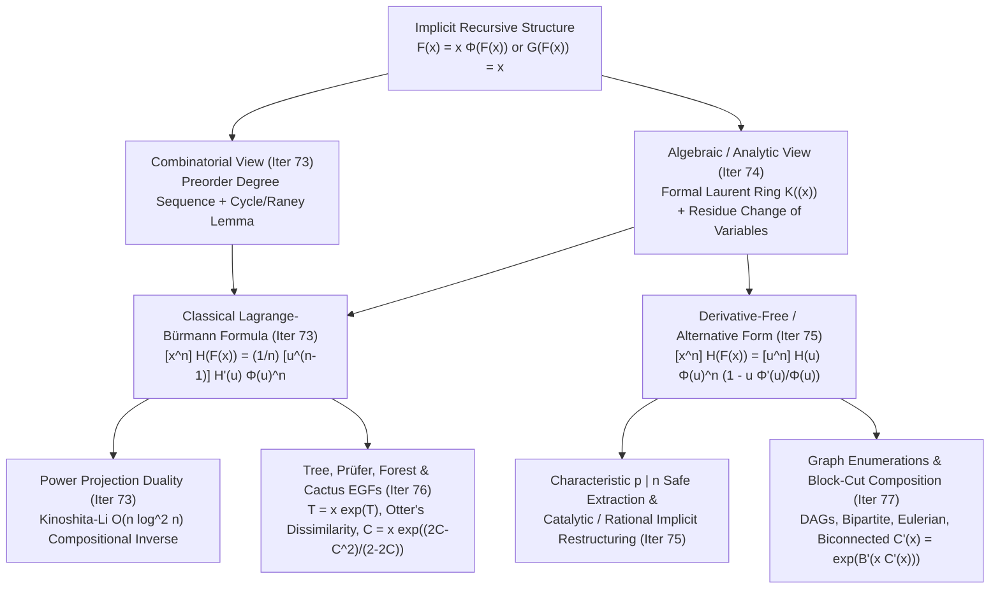

# Wave 3A (Iterations 73–77): Lagrange–Bürmann Inversion, Formal Residue Calculus, and Implicit Tree & Graph Enumerations

> **Cohort 2 Independent Research Report** — Exhaustive Multilingual Pedagogical & Algorithmic Reference (`[EN]`, `[ZH]`, `[JA]`)
> **Scope**: Iteration 73 (Standard Lagrange–Bürmann Inversion & Raney's/Cycle Lemma), Iteration 74 (Formal Laurent Series $K((x))$ & Formal Residue Calculus / `炫酷反演魔术`), Iteration 75 (Derivative-Free Lagrange Forms / `另类拉格朗日反演` & Implicit Equation Restructuring), Iteration 76 (Tree, Forest, Prüfer & Cactus Enumerations), Iteration 77 (Functional, Eulerian, Bipartite, DAG, and Biconnected Graph Enumerations + Comprehensive Contest Problem Audit).

---

## Executive Architectural Overview

In competitive programming and enumerative combinatorics, linear recurrences and explicit convolutions yield generating functions defined by *closed-form algebraic expressions*. However, the moment a combinatorial class is defined **recursively with branching**—such as rooted trees, Dyck/Łukasiewicz paths, cacti, block-cut decompositions of connected graphs into 2-connected blocks, or implicit algebraic equations $P(x, F(x)) = 0$—the generating function $F(x)$ becomes trapped inside a non-linear functional composition:
$$F(x) = x\,\Phi(F(x)) \quad \text{or} \quad G(F(x)) = x.$$

Solving for all coefficients of $F(x) \bmod x^{N+1}$ via Newton's method requires $O(N \log N)$ or $O(N \log^2 N)$ polynomial operations, and for complicated implicit equations or bivariate systems, Newton iteration can be cumbersome or too slow when only a **single coefficient** $[x^N]F(x)$ or $[x^N]H(F(x))$ is needed, or when the inverse function $G(u)$ is known only numerically while $F(x)$ is desired.

**Lagrange–Bürmann Inversion** and its modern algebraic engine—**Formal Residue Calculus** on the field of formal Laurent series $K((x))$—provide a direct teleportation mechanism between a formal power series $F(x)$ and its compositional inverse $G(u)$. It transforms an *implicit* functional equation in the variable $x$ into an *explicit* coefficient extraction in the dual variable $u = F(x)$.

---

## Iteration 73: Standard Lagrange–Bürmann Inversion & Raney's / Cycle Lemma

### 73.1 Concrete Combinatorial & Algebraic Objects

Let $R$ be a commutative ring (typically a field $K$ such as $\mathbb{Q}$, $\mathbb{C}$, or $\mathbb{F}_p$ with $p > n$). We work inside the **composition monoid of formal power series of valuation $1$**:
$$R[[x]]_1 = \left\{ F(x) = \sum_{n=1}^{\infty} f_n x^n \in R[[x]] \;\middle|\; f_0 = 0,\; f_1 \in R^\times \right\}.$$

Under formal composition $(F \circ G)(x) = F(G(x))$, the set $R[[x]]_1$ forms a group with identity element $\operatorname{id}(x) = x$. Every $F(x) \in R[[x]]_1$ possesses a unique two-sided **compositional inverse** $G(x) = F^{\langle -1 \rangle}(x) \in R[[x]]_1$ satisfying:
$$G(F(x)) = x \quad \text{and} \quad F(G(x)) = x.$$

Because $\operatorname{val}(F) = 1$ and $f_1 \in R^\times$, the ratio $\frac{x}{G(x)}$ is a formal power series with invertible constant term $f_1 \in R^\times$. Defining $\Phi(u) = \frac{u}{G(u)} \in R[[u]]^\times$, substituting $u = F(x)$ into $G(u) = \frac{u}{\Phi(u)}$ yields the two equivalent canonical forms of Lagrange Inversion:

| Canonical Form | Functional Equation | Dual Partner Relation | Primary Domain of Appearance |
| :--- | :--- | :--- | :--- |
| **Implicit Tree Form** | $F(x) = x\,\Phi(F(x))$ with $[u^0]\Phi(u) \in R^\times$ | $G(u) = \dfrac{u}{\Phi(u)}$ | Rooted trees, Catalan/Fuss–Catalan objects, cacti, symbolic method $F = \mathcal{Z} \times \Phi(F)$ |
| **Compositional Inverse Form** | $G(F(x)) = x$ with $[u^0]G(u) = 0, [u^1]G(u) \in R^\times$ | $\Phi(u) = \dfrac{u}{G(u)}$ | Inverting a known series $G(u)$, block-cut tree inversion, functional equation reversal |

> [!IMPORTANT]
> **Theorem 73.1 (Standard Lagrange–Bürmann Inversion Formula — 3 Classical Forms)**
> Let $R$ be a commutative ring in which $n$ is invertible ($n \in R^\times$), let $F(x), G(x) \in R[[x]]_1$ be compositional inverses related by $F(x) = x\Phi(F(x))$ and $G(u) = u/\Phi(u)$, and let $H(u) \in R[[u]]$ be any formal power series. Then for every integer $n \ge 1$:
>
> 1. **Basic Coefficient Extraction ($H(u) = u$)**:
>    $$[x^n] F(x) = \frac{1}{n} [u^{n-1}] \Phi(u)^n = \frac{1}{n} [u^{n-1}] \left(\frac{u}{G(u)}\right)^n.$$
> 2. **Power Extraction ($H(u) = u^k$ for $k \ge 1$)**:
>    $$[x^n] F(x)^k = \frac{k}{n} [u^{n-k}] \Phi(u)^n = \frac{k}{n} [u^{n-k}] \left(\frac{u}{G(u)}\right)^n.$$
> 3. **Composite Lagrange–Bürmann Form (General $H(u)$)**:
>    $$[x^n] H(F(x)) = \frac{1}{n} [u^{n-1}] H'(u)\,\Phi(u)^n = \frac{1}{n} [u^{n-1}] H'(u)\left(\frac{u}{G(u)}\right)^n,$$
>    and for $n = 0$, $[x^0]H(F(x)) = [u^0]H(u) = H(0)$.

---

### 73.2 The Diagnostic Signal: When to Reach for Lagrange Inversion

A solver should immediately suspect Lagrange–Bürmann Inversion when encountering any of the following four structural signals:

1. **Signal A — Recursive Root-Subtree Decomposition**:
   A combinatorial object of size $n$ is built by choosing a root of size $1$ (contributing $x$) and attaching a structured collection (sequence, multiset, cycle, or degree-restricted tuple) of sub-objects from the same class (contributing $\Phi(F(x))$).
2. **Signal B — Self-Referential Exponential or Binomial Equations**:
   Equations of the form $F(x) = x e^{A(F(x))}$ or $F(x) = x (1 + F(x))^m$ or $F(x) = x \prod_i (1 + c_i F(x))^{a_i}$, where $F(x)$ appears on both sides and cannot be isolated by elementary algebra.
3. **Signal C — Binomial / Multinomial Sums with Moving Upper/Lower Indices**:
   Sums where the summation index $k$ appears multiplied by a constant inside the upper index of a binomial coefficient, such as $\binom{mk + r}{k} \frac{r}{mk+r}$ or $\frac{k}{n} \binom{n}{\dots}$ or $\frac{k}{n} n^{n-k-1}$. These are direct outputs of $\frac{k}{n}[u^{n-k}]\Phi(u)^n$.
4. **Signal D — Single-Coefficient Query for Huge $N$**:
   The problem asks for $[x^N] H(F(x))$ where $F(x) = x\Phi(F(x))$ is defined implicitly, and either:
   - $\Phi(u)^N$ has a closed-form coefficient $[u^{N-1}]H'(u)\Phi(u)^N$ computable in $O(1)$ or $O(N)$ time (bypassing FFT completely!), or
   - Computing $\Phi(u)^N = \exp(N \ln \Phi(u))$ takes a single $O(N \log N)$ pass instead of a heavy multi-step Newton iteration on a coupled system.

---

### 73.3 The Reverse-Engineering Scratchpad: How to Discover the Formula from Scratch

Suppose you are faced with $F(x) = x\Phi(F(x))$ and you do *not* know Lagrange Inversion. How can you discover the formula $[x^n]F(x)^k = \frac{k}{n}[u^{n-k}]\Phi(u)^n$ without magic? There are two independent discovery routes: one **combinatorial** (via DFS transcripts of trees) and one **algebraic** (via differentiating the inverse). Let us trace the combinatorial discovery first, following the pedagogical framework of `Rice_tawara459` (`[JA]`, *ラグランジュ反転公式の組合せ論からの導出*, Tokyo Tech traP 2026) and AtCoder's *Cycle Lemma* lecture (`[JA]`, 2026).

#### The Combinatorial Scratchpad (From Rooted Plane Trees to Cyclic Shifts)

1. **What does $F(x) = x\Phi(F(x))$ count?**
   Write $\Phi(u) = \sum_{d=0}^{\infty} \phi_d u^d$. Then $F(x) = x \sum_{d=0}^{\infty} \phi_d F(x)^d$ is the ordinary generating function for **weighted ordered (plane) rooted trees**, where a vertex with $d$ ordered children receives weight $\phi_d$, and the weight of a tree is the product of the weights of its $n$ vertices.
   Similarly, $F(x)^k$ counts **ordered forests of $k$ rooted plane trees** $(T_1, T_2, \dots, T_k)$ with a total of $n$ vertices.

2. **How can we linearize a tree into a flat sequence?**
   Any rooted plane tree (or $k$-forest) with $n$ vertices can be traversed in **DFS preorder** (visiting the root first, then recursively visiting each child subtree from left to right).
   If we record the number of children (out-degree) $d_i \ge 0$ of the $i$-th vertex visited in DFS preorder ($i = 0, 1, \dots, n-1$), we obtain a degree sequence $(d_0, d_1, \dots, d_{n-1})$ of length $n$.

3. **What is the total weight of *all* sequences $(d_0, \dots, d_{n-1}) \in \mathbb{Z}_{\ge 0}^n$ whose sum is $\sum_{i=0}^{n-1} d_i = n - k$?**
   Notice that in a $k$-forest with $n$ vertices, every vertex except the $k$ roots is the child of exactly one parent. Therefore, the sum of out-degrees MUST be:
   $$\sum_{i=0}^{n-1} d_i = n - k.$$
   If we ignore whether $(d_0, \dots, d_{n-1})$ actually forms a valid $k$-forest and simply sum the vertex weights $\prod_{i=0}^{n-1} \phi_{d_i}$ over *all* $n$-tuples of non-negative integers summing to $n - k$, what generating function coefficient is that?
   Each of the $n$ positions independently chooses a degree $d_i$ with weight $\phi_{d_i} u^{d_i}$, so the sum over all sequences with $\sum d_i = n - k$ is simply:
   $$[u^{n-k}] \Phi(u)^n!$$

4. **The Crucial Question: Which degree sequences $(d_0, \dots, d_{n-1})$ with $\sum d_i = n - k$ are valid DFS preorder sequences of $k$-forests?**
   Let us track the **number of currently "unexpanded stubs" (pending children)** during the DFS.
   - Initially, before visiting any vertex, we have $k$ roots waiting to be visited ($k$ stubs).
   - When we visit vertex $i$ with out-degree $d_i$, we consume $1$ stub (vertex $i$ itself) and create $d_i$ new stubs (its children). Thus, the net change in stubs is $d_i - 1$, or equivalently, the net number of stubs *consumed* is $a_i = 1 - d_i \le 1$.
   - After all $n$ vertices are visited, all $k$ initial trees are complete, so the total number of stubs consumed is $\sum_{i=0}^{n-1} (1 - d_i) = n - (n - k) = k$.
   - Crucially, a sequence $(d_0, \dots, d_{n-1})$ is a valid $k$-forest preorder sequence if and only if we don't finish all $k$ trees prematurely—more precisely, if we reverse the perspective or look at the prefix sums of $a_i = 1 - d_i \le 1$, each single tree is a minimal prefix where $\sum (1 - d_i) = 1$, so a $k$-forest reaches cumulative sum $+1, +2, \dots, +k$ for the **last** time only at the very end (or in the standard prefix-positivity formulation, every non-empty prefix has $\sum_{j=0}^{m-1} (1 - d_j) > 0$ when read from the appropriate direction).

5. **The Eureka Moment**:
   Group all sequences $(d_0, \dots, d_{n-1})$ with $\sum_{i=0}^{n-1} (1 - d_i) = k$ into necklaces of size $n$ under cyclic rotation! Since the weight $\prod_{i=0}^{n-1} \phi_{d_i}$ is **invariant under cyclic shift**, if we can prove that **exactly $k$ out of the $n$ cyclic shifts** of any such sequence are valid $k$-forest preorder encodings, then valid $k$-forests account for an exact $\frac{k}{n}$ fraction of $[u^{n-k}]\Phi(u)^n$!

---

### 73.4 Raney's Lemma / The Cycle Lemma & Łukasiewicz Paths (Rigorous Proof)

The exact $k$-out-of-$n$ cyclic shift property is one of the crown jewels of combinatorics, discovered by Dvoretzky and Motzkin (1947) as the **Cycle Lemma** and generalized by George N. Raney (1960) specifically to give a purely combinatorial proof of Lagrange Inversion.

> [!IMPORTANT]
> **Theorem 73.2 (The Cycle Lemma / Raney's Lemma for Integer Sequences)**
> Let $n \ge 1$ and $k \ge 1$ be integers, and let $A = (a_0, a_1, \dots, a_{n-1})$ be a sequence of integers satisfying:
> 1. **Upper bound on steps**: $a_i \le 1$ for all $0 \le i < n$ (i.e., steps can go up by at most $+1$, and down by any integer amount $0, -1, -2, \dots$).
> 2. **Total sum**: $\sum_{i=0}^{n-1} a_i = k > 0$.
>
> Then among the $n$ cyclic shifts $A^{(r)} = (a_r, a_{(r+1)\bmod n}, \dots, a_{(r+n-1)\bmod n})$ for $r \in \{0, 1, \dots, n-1\}$, there are **ebalanly $k$ indices $r$** for which every non-empty prefix sum of $A^{(r)}$ is strictly positive:
> $$\forall m \in \{1, 2, \dots, n\}, \quad \sum_{j=0}^{m-1} a_{(r+j)\bmod n} > 0.$$

#### Step-by-Step Geometric & Algebraic Proof of the Cycle Lemma

Let us extend the sequence $A$ periodically to an infinite sequence $(a_t)_{t \ge 0}$ by setting $a_t = a_{t \bmod n}$, and define the infinite prefix sum sequence (polygonal path):
$$S_0 = 0, \qquad S_t = \sum_{j=0}^{t-1} a_j \quad (t \ge 1).$$

Observe the two key properties of the infinite path $(t, S_t)$:
- **Periodicity with drift $+k$**: For every $t \ge 0$, $S_{t+n} = S_t + k$.
- **Skip-free upward transitions (Discrete Intermediate Value Property)**: Because $a_t = S_{t+1} - S_t \le 1$, whenever the path moves to a higher integer level, it can only increase by $+1$ at a time! That is, if $S_u < h \le S_v$ for some $u < v$ and integer $h$, the path *must* pass through height $h$ at least once between $u$ and $v$.

Now consider the **right-to-left running minimum** (or equivalently, the **last visit to each height**):
1. Fix a shift index $r \in \{0, 1, \dots, n-1\}$. The cyclic shift $A^{(r)}$ has strictly positive non-empty prefix sums for $m = 1, \dots, n$ if and only if:
   $$S_{r+m} - S_r > 0 \quad \forall m \in \{1, \dots, n\}.$$
   Because $S_{t+n} = S_t + k > S_t$, if $S_{r+m} > S_r$ holds for $1 \le m \le n$, then it automatically holds for **all** $m \ge 1$:
   $$r \text{ is a valid shift} \iff S_t > S_r \quad \forall t > r.$$
   In words: **$r$ is a valid shift if and only if $t = r$ is the LAST time the infinite path $(S_t)_{t \ge 0}$ ever visits the height $h = S_r$ (or any height $\le S_r$)!**

2. Because $S_t \to +\infty$ as $t \to \infty$ (since $S_{t+n} = S_t + k$ with $k \ge 1$) and $S_{t+1} - S_t \le 1$, for **every** integer height $h \in \mathbb{Z}$, the set $\{t \in \mathbb{Z} : S_t \le h\}$ is bounded above and non-empty (extending $t$ to $\mathbb{Z}$ via $S_{t-n} = S_t - k$).
   Let $\tau(h) = \max \{t \in \mathbb{Z} : S_t \le h\}$ be the unique last time $t$ at which $S_t \le h$.
   Wait: at $t = \tau(h)$, we have $S_{\tau(h)} \le h$ and $S_{\tau(h)+1} > h$. Since $S_{\tau(h)+1} - S_{\tau(h)} = a_{\tau(h)} \le 1$, the only way to jump from $\le h$ to $> h$ in one step of size $\le 1$ is:
   $$S_{\tau(h)} = h \quad \text{and} \quad S_{\tau(h)+1} = h + 1!$$
   Thus, for every integer height $h \in \mathbb{Z}$, there is a **unique** time $\tau(h) \in \mathbb{Z}$ that is a "record-low from the right" at height $h$ (meaning $S_{\tau(h)} = h$ and $S_t > h$ for all $t > \tau(h)$).

3. Finally, how do the times $\tau(h)$ behave modulo the period $n$?
   Because $S_{t+n} = S_t + k$ for all $t \in \mathbb{Z}$, shifting time by $+n$ shifts height by $+k$:
   $$\tau(h + k) = \tau(h) + n \quad \forall h \in \mathbb{Z}.$$
   Therefore, as $h$ runs over a complete residue system of $k$ consecutive integers $\{0, 1, \dots, k-1\}$, the last-visit times $\tau(0), \tau(1), \dots, \tau(k-1)$ have **distinct values** and every other $\tau(h)$ is congruent to exactly one of them modulo $n$!
   Reducing $\tau(0), \tau(1), \dots, \tau(k-1)$ modulo $n$ gives **ebalanly $k$ distinct valid shift indices $r \in \{0, 1, \dots, n-1\}$**. $\blacksquare$

#### Completing the Combinatorial Proof of Theorem 73.1

Let us connect Theorem 73.2 directly to $F(x) = x\Phi(F(x))$:
- Set $a_i = 1 - d_i \le 1$ where $d_i \ge 0$ is the out-degree of vertex $i$ in DFS preorder.
- Wait: in standard DFS preorder of a single rooted tree ($k=1$), the root is at $i=0$ with degree $d_0$, and we keep track of unexpanded stubs. If we read the sequence in **reverse** (postorder / reverse preorder), or if we define $a_i = 1 - d_{n-1-i}$, a single tree has $\sum_{j=0}^{m-1} a_j > 0$ for all $1 \le m \le n$ and $\sum_{j=0}^{n-1} a_j = 1$.
  Equivalently, in forward DFS preorder where $b_i = d_i - 1 \ge -1$, the stub count starts at $k$, changes by $b_i$ at step $i$, and hits $0$ for the first time at $m = n$, which is the exact time-reversal of Theorem 73.2!
- Furthermore, why are the $k$ valid shifts of a single sequence $(d_0, \dots, d_{n-1})$ still distinct even when the sequence itself is periodic (i.e., has period $p \mid n$)?
  Suppose $(d_0, \dots, d_{n-1})$ consists of $r = n/p$ identical repetitions of a shorter period of length $p$. Then the sum of $a_i$ over one period of length $p$ is $k/r$ (which must be an integer), so by Theorem 73.2 applied to the shorter period $p$, there are $k/r$ valid shifts within each period of length $p$. In terms of weighted generating functions, it is even simpler to **mark one distinguished vertex** among the $n$ vertices (say, vertex $0$):
  - There are $n [x^n] F(x)^k$ ways to choose a $k$-forest of total size $n$ and mark one of its $n$ vertices (say, vertex $v^*$).
  - Cyclically rotate the DFS preorder sequence $(d_0, \dots, d_{n-1})$ of the $k$-forest so that the marked vertex $v^*$ moves to position $0$, and also record *which* of the $k$ valid shifts was used to unpack the rotated sequence back into the original $k$-forest.
  - Because Theorem 73.2 guarantees that **every** sequence $(d_0, \dots, d_{n-1}) \in \mathbb{Z}_{\ge 0}^n$ with $\sum_{i=0}^{n-1} (1 - d_i) = k$ has **ebalanly $k$** shifts that decode into a valid $k$-forest, the map:
    $$(\text{valid } k\text{-forest of size } n, \text{ marked position } r \in \{0, \dots, n-1\}) \;\longleftrightarrow\; (\text{rotated sequence } A^{(n-r)}, \text{ which of the } k \text{ valid shifts } j \in \{1, \dots, k\} \text{ is } A)$$
    is a weight-preserving bijection between $n$ copies of $k$-forests of size $n$ and $k$ copies of unconstrained sequences of length $n$ summing to $n-k$!
  - Comparing total weights immediately yields:
    $$n [x^n] F(x)^k = k [u^{n-k}] \Phi(u)^n \implies [x^n] F(x)^k = \frac{k}{n} [u^{n-k}] \Phi(u)^n.$$

Finally, for any formal power series $H(u) = \sum_{k=0}^{\infty} h_k u^k \in R[[u]]$, linearity of coefficient extraction for $n \ge 1$ gives:
$$\begin{aligned}
[x^n] H(F(x)) &= \sum_{k=1}^{n} h_k [x^n] F(x)^k \qquad (\text{since } [x^n]h_0 = 0 \text{ for } n \ge 1) \\
&= \sum_{k=1}^{n} h_k \frac{k}{n} [u^{n-k}] \Phi(u)^n \\
&= \frac{1}{n} \sum_{k=1}^{n} [u^{n-1}] \left(k h_k u^{k-1} \cdot \Phi(u)^n\right) \qquad (\text{shifting index by } u^{k-1}) \\
&= \frac{1}{n} [u^{n-1}] H'(u)\,\Phi(u)^n.
\end{aligned}$$
Every step is 100% transparent, algebraic, and combinatorially grounded.

---

### 73.5 The Algorithmic Bridge: Power Projection & $\Theta(n \log^2 n)$ Compositional Inverse

In modern competitive programming (`maspy` `[JA]` *FPS Composition and Compositional Inverse Part 1*; `noshi91` `[JA]` 2024; Kinoshita–Li 2024 `[EN]` $\Theta(M(n)\log n)$ algorithm), Lagrange Inversion is not merely a formula for hand-simplifying sums—it is the **core engine of the fastest known algorithm for polynomial compositional inverse**!

Suppose we are given $F(x) \in K[[x]]_1 \bmod x^{n+1}$ and want to compute all coefficients of its compositional inverse $G(u) \bmod u^{n+1}$.
Write the Power Form of Lagrange Inversion as:
$$n [x^n] F(x)^k = k [u^{n-k}] \left(\frac{u}{G(u)}\right)^n \qquad \text{for } k = 1, 2, \dots, n.$$

Look closely at both sides of this equation as $k$ varies from $1$ to $n$ while **$n$ is held fixed**:
1. **Left-hand side (Power Projection)**:
   The sequence $p_k = [x^n] F(x)^k$ for $k = 0, 1, \dots, n$ is the **Power Projection** of $F(x)$ against the linear functional $\ell(A) = [x^n]A(x)$.
   By the **transposed Bostan–Mori** algorithm on the bivariate rational function $\frac{1}{1 - y F(x)} \bmod x^{n+1}$, all values $p_0, p_1, \dots, p_n$ can be computed simultaneously in $O(n \log^2 n)$ time!
2. **Right-hand side (Direct Extraction of $(u/G(u))^n$)**:
   Once we have $p_1, \dots, p_n$, we immediately obtain every coefficient of the polynomial $P(u) = \left(\frac{u}{G(u)}\right)^n \bmod u^n$:
   $$[u^{n-k}] \left(\frac{u}{G(u)}\right)^n = \frac{n}{k} p_k \quad \text{for } k = 1, \dots, n.$$
3. **Recovering $G(u)$ via FPS Power**:
   Having determined $P(u) = \left(\frac{G(u)}{u}\right)^{-n} \bmod u^n$, we recover $\frac{G(u)}{u} = P(u)^{-1/n} = \exp\left(-\frac{1}{n}\ln P(u)\right) \bmod u^n$ in a single $O(n \log n)$ FPS power operation, and multiply by $u$ to get $G(u) \bmod u^{n+1}$!

> [!TIP]
> **Why This Duality Matters**:
> Newton's method for compositional inverse $G(F(x)) = x$ requires repeatedly **composing** polynomials of doubling degree, so it is no faster than general composition. By contrast, Lagrange Inversion converts Compositional Inverse into a **single Power Projection** at fixed degree $n$ followed by a single $O(n \log n)$ power $P(u)^{-1/n}$, reducing the constant factor dramatically!

---

### 73.6 Hand-Checkable Toy Examples ($n \le 4$)

#### Toy Example 1: Binary Trees / Catalan Numbers via $F(x) = x(1 + F(x))^2$
Let $\Phi(u) = (1 + u)^2$, so $F(x) = x(1 + F(x))^2$ (the shifted Catalan OGF $F(x) = C(x) - 1 = x + 2x^2 + 5x^3 + 14x^4 + \cdots$).
Let us verify both $[x^n]F(x)$ and $[x^n]F(x)^2$ for $n = 1, 2, 3, 4$:
- By Theorem 73.1(1), for $k=1$:
  $$[x^n]F(x) = \frac{1}{n}[u^{n-1}](1+u)^{2n} = \frac{1}{n}\binom{2n}{n-1} = \frac{1}{n+1}\binom{2n}{n} = C_n.$$
  - $n=1$: $\frac{1}{1}\binom{2}{0} = 1$.
  - $n=2$: $\frac{1}{2}\binom{4}{1} = 2$.
  - $n=3$: $\frac{1}{3}\binom{6}{2} = \frac{15}{3} = 5$.
  - $n=4$: $\frac{1}{4}\binom{8}{3} = \frac{56}{4} = 14$.
- By Theorem 73.1(2), for $k=2$:
  $$[x^n]F(x)^2 = \frac{2}{n}[u^{n-2}](1+u)^{2n} = \frac{2}{n}\binom{2n}{n-2}.$$
  - $n=2$: $\frac{2}{2}\binom{4}{0} = 1$.
  - $n=3$: $\frac{2}{3}\binom{6}{1} = 4$.
  - $n=4$: $\frac{2}{4}\binom{8}{2} = \frac{1}{2}(28) = 14$.
  Direct check from $F(x)^2 = (x + 2x^2 + 5x^3 + \cdots)^2 = x^2 + 4x^3 + (4 + 10)x^4 + \cdots = x^2 + 4x^3 + 14x^4 + \cdots$. Exact match!

#### Toy Example 2: Composite Extraction $[x^3] H(F(x))$ for $G(u) = u - u^2 - u^3$
Suppose $G(u) = u - u^2 - u^3 = u(1 - u - u^2)$, so $\Phi(u) = \frac{u}{G(u)} = \frac{1}{1 - u - u^2} = \sum_{m \ge 0} \operatorname{Fib}_{m+1} u^m = 1 + u + 2u^2 + 3u^3 + \cdots$.
Let $H(u) = u + u^2$, so $H'(u) = 1 + 2u$. We want $[x^3] H(F(x))$:
1. **Direct expansion check**:
   Since $F(x) = x\Phi(F(x)) = x(1 + F + 2F^2 + \cdots)$:
   - $[x^1]F = 1 \implies F(x) = x + \cdots$
   - $[x^2]F = [x^1](1 + F + 2F^2) = 1 \implies F(x) = x + x^2 + \cdots$
   - $[x^3]F = [x^2](1 + F + 2F^2) = [x^2]F + 2[x^2]F^2 = 1 + 2(1) = 3 \implies F(x) = x + x^2 + 3x^3 + \cdots$
   - $F(x)^2 = (x + x^2 + \cdots)^2 = x^2 + 2x^3 + \cdots$
   - Therefore, $H(F(x)) = F(x) + F(x)^2 = x + 2x^2 + 5x^3 + \cdots$, so $[x^3]H(F(x)) = 5$.
2. **Lagrange–Bürmann formula check ($n = 3$)**:
   $$\Phi(u)^3 = (1 + u + 2u^2 + \cdots)^3 = 1 + 3u + (3\cdot 2 + 3\cdot 1)u^2 + \cdots = 1 + 3u + 9u^2 + \cdots.$$
   Multiply by $H'(u) = 1 + 2u$:
   $$H'(u)\Phi(u)^3 = (1 + 2u)(1 + 3u + 9u^2 + \cdots) = 1 + 5u + 15u^2 + \cdots.$$
   Then $[x^3]H(F(x)) = \frac{1}{3}[u^2]H'(u)\Phi(u)^3 = \frac{15}{3} = 5$. Exact match!

---

### 73.7 Failure Modes, Pitfalls & Edge Cases

> [!WARNING]
> **Critical Pitfalls When Applying Standard Lagrange Inversion**
> 1. **Small Prime Characteristic ($p \mid n$)**:
>    In $\mathbb{F}_p$, if $n \ge p$ is a multiple of $p$, the factor $\frac{1}{n}$ does not exist! Even more subtly, $[u^{n-1}]H'(u)\Phi(u)^n$ is automatically $0 \pmod p$ (because inside $K((u))$, $H'(u)\Phi(u)^n$ differs from a derivative by $n [x^n]H(F(x)) u^{-1}$), resulting in an indeterminate $\frac{0}{0} \pmod p$. **Resolution**: Use the **Derivative-Free Lagrange Form** (`另类拉格朗日反演`) in Iteration 75, which contains NO $\frac{1}{n}$ division!
> 2. **Non-Zero Constant Term ($F(0) = c \neq 0$)**:
>    Standard Lagrange Inversion **strictly requires** $\operatorname{val}(F) = 1$, i.e., $F(0) = 0$ and $F'(0) \neq 0$. If your generating function $A(x)$ satisfies $A(0) = c \neq 0$ (for example, $C(x) = 1 + xC(x)^2$ where $C(0) = 1$), you **must** shift to the valuation-1 parameter $F(x) = A(x) - c$ (so $F(x) = x(1+F(x))^2$) before applying the theorem!
> 3. **Higher Valuation ($\operatorname{val}(F) = d > 1$)**:
>    If $F(x) = f_d x^d + f_{d+1} x^{d+1} + \cdots$ with $d \ge 2$, $F(x)$ has no compositional inverse in $R[[x]]$. However, if $F(x) = x^d \Phi(F(x))$ where $F(x) = \tilde{F}(x^d)$, you can substitute $z = x^d$ so that $\tilde{F}(z) = z \Phi(\tilde{F}(z))$ has valuation $1$ in $z$.
> 4. **The $n = 0$ Boundary Term**:
>    Theorem 73.1 applies only for $n \ge 1$. For $n = 0$, $[x^0]H(F(x)) = H(F(0)) = H(0)$ directly. Never forget to add $H(0)$ when reconstructing the full series $H(F(x))$!

---

## Iteration 74: Formal Laurent Series $K((x))$, Formal Residue Calculus ($\operatorname{res}_x$) & Change-of-Variables (`炫酷反演魔术`)

### 74.1 Concrete Combinatorial & Algebraic Objects

While the combinatorial Cycle Lemma proof in Iteration 73 explains *why* Lagrange Inversion holds for trees, it becomes unwieldy when we need to invert rational substitutions, change variables inside binomial sums, or avoid division by $n$ in characteristic $p$. In his landmark 2019 Chinese National Team Paper (*《生成函数的复合与拉格朗日反演》*, `[ZH]`) and popular blog post *《炫酷反演魔术》* (`[ZH]`, "Cool Inversion Magic"), **Elegia (吕欣)** popularized the algebraic theory of **Formal Laurent Series** and **Formal Residue Calculus** (originally developed in enumerative combinatorics by Henrici, Jacobi, and Egorychev) within competitive programming.

#### 1. The Ring $R((x))$ and Field $K((x))$ of Formal Laurent Series
Let $R$ be a commutative ring with unity. A **formal Laurent series** over $R$ is an infinite series that allows **finitely many negative powers** of $x$ and infinitely many positive powers of $x$:
$$R((x)) = R[[x]][x^{-1}] = \left\{ A(x) = \sum_{n = v}^{\infty} a_n x^n \;\middle|\; v \in \mathbb{Z},\; a_n \in R \right\}.$$

- **Order / Valuation ($\operatorname{val}$ or $\operatorname{ord}$)**:
  For any non-zero $A(x) \in R((x))$, its **valuation** (or **order**) is the smallest integer exponent with a non-zero coefficient:
  $$\operatorname{val}(A) = \operatorname{ord}(A) = \min \{ n \in \mathbb{Z} : [x^n]A(x) \neq 0 \}, \qquad \operatorname{val}(0) = +\infty.$$
  When $R = K$ is a field (or an integral domain), valuation satisfies:
  $$\operatorname{val}(A \cdot B) = \operatorname{val}(A) + \operatorname{val}(B), \qquad \operatorname{val}(A + B) \ge \min(\operatorname{val}(A), \operatorname{val}(B)).$$
- **Canonical Multiplicative Factorization & Invertibility**:
  Every $A(x) \in R((x))$ with $\operatorname{val}(A) = v \in \mathbb{Z}$ and leading coefficient $c = [x^v]A(x) \in R^\times$ factors uniquely as:
  $$A(x) = c\,x^v\,U(x), \qquad \text{where } U(x) = 1 + \sum_{k=1}^{\infty} u_k x^k \in 1 + xR[[x]].$$
  Since $U(x) = 1 + x\tilde{U}(x)$ is a principal unit in $R[[x]]$ with inverse $U(x)^{-1} = \sum_{j=0}^{\infty} (-1)^j x^j \tilde{U}(x)^j \in 1 + xR[[x]]$, $A(x)$ is invertible in $R((x))$ if and only if its leading coefficient $c = [x^{\operatorname{val}(A)}]A(x)$ is invertible in $R$:
  $$A(x)^{-1} = c^{-1}\,x^{-v}\,U(x)^{-1} \in R((x)).$$
  In particular, when $K$ is a field, **$K((x))$ is the fraction field of $K[[x]]$**.

#### 2. Formal Differentiation and the Formal Residue Operator $\operatorname{res}_x$
On $R((x))$, the **formal derivative** and **formal residue** are defined term-by-term by purely algebraic linear maps:
$$D_x A(x) = A'(x) = \sum_{n=v}^{\infty} n\,a_n x^{n-1} \in R((x)),$$
$$\operatorname{res}_x A(x) = \operatorname{res}_x A(x)\,dx = [x^{-1}] A(x) = a_{-1} \in R.$$

Why write the differential symbol $dx$ inside $\operatorname{res}_x A(x)\,dx$? Because we will prove that the formal 1-form $A(x)\,dx$ transforms under a formal change of variables $x = G(u)$ by the exact chain rule $dx = G'(u)\,du$! Moreover, **every** coefficient extraction on $R((x))$ is a formal residue:
$$[x^n] A(x) = [x^{-1}] \left( x^{-n-1} A(x) \right) = \operatorname{res}_x \frac{A(x)}{x^{n+1}}\,dx \qquad (\forall n \in \mathbb{Z}).$$

---

### 74.2 The Diagnostic Signal: When to Use Formal Residue Calculus

Reach for $\operatorname{res}_x \dots dx$ whenever you spot:
1. **Signal A — Implicit Variable Substitution**: You know a relationship $x = G(u)$ or $f(x) = g(u)$ and want $[x^n] A(x)$, or you want to change variables inside a generating function without inverting $G(u)$.
2. **Signal B — Binomial Sums with Linearly Shifted Upper/Lower Indices**:
   Expressions like $\sum_{k} \binom{a k + b}{c k + d} f_k$ where $\binom{N}{M} = \operatorname{res}_x \frac{(1+x)^N}{x^{M+1}}\,dx$ allows you to pull the summation $\sum_k$ *inside* the residue operator:
   $$\sum_{k \ge 0} \binom{ak+b}{ck+d} z^k = \operatorname{res}_x \frac{(1+x)^b}{x^{d+1}} \sum_{k \ge 0} \left( \frac{(1+x)^a}{x^c} z \right)^k dx,$$
   turning a gnarly binomial sum into a geometric series inside a single residue!
3. **Signal C — Coupled / Multi-Step Implicit Equations**: When $F(x)$ is defined through intermediate series $F(x) = A(B(x))$ or rational equations $P(x, F(x)) = 0$.

---

### 74.3 The Reverse-Engineering Scratchpad: Why Does $\operatorname{res}_x$ Obey Change of Variables Without Complex Analysis?

In complex analysis, $\operatorname{res}_{x=0} A(x)\,dx = \frac{1}{2\pi i}\oint A(x)\,dx$, so substituting $x = G(u)$ with winding number $1$ preserves the contour integral by Cauchy's theorem. **Wait**: in competitive programming we work over $\mathbb{F}_{998244353}$ or formal rings $R[[x]]$ where series might have radius of convergence $0$ (like $\sum n! x^n$) and $\frac{1}{2\pi i}\oint$ makes no sense! Why does the change of variables $\operatorname{res}_x A(x)\,dx = \operatorname{res}_u A(G(u))G'(u)\,du$ still hold **purely algebraically**?

Let us reverse-engineer this from first principles:
1. By linearity, $A(x) = \sum_{k=v}^{\infty} a_k x^k$. When we substitute $x = G(u)$ (where $\operatorname{val}(G) = 1$) and multiply by $G'(u)$, we get:
   $$A(G(u))\,G'(u) = \sum_{k=v}^{\infty} a_k\,G(u)^k G'(u).$$
   Notice that because $\operatorname{val}(G) = 1$, $\operatorname{val}(G(u)^k G'(u)) \ge k$, which goes to $+\infty$ as $k \to +\infty$. Thus, the infinite sum converges in the $u$-adic topology of $R((u))$ (each coefficient $[u^m]$ depends on only finitely many $k$).
2. On the left-hand side, $\operatorname{res}_x A(x)\,dx = a_{-1}$, meaning:
   - the term $k = -1$ contributes $1 \cdot a_{-1}$, and
   - every other term $k \neq -1$ contributes $0$!
3. Therefore, the change-of-variables identity $\operatorname{res}_x A(x)\,dx = \operatorname{res}_u A(G(u))G'(u)\,du$ holds for **all** $A(x) \in R((x))$ if and only if the monomial basis $x^k\,dx \mapsto G(u)^k G'(u)\,du$ satisfies the exact orthogonality law:
   $$\operatorname{res}_u \left( G(u)^k G'(u) \right) = \begin{cases} 1 & \text{if } k = -1, \\ 0 & \text{if } k \neq -1. \end{cases}$$
4. Why is $\operatorname{res}_u (G(u)^k G'(u)) = 0$ for $k \neq -1$?
   Over $\mathbb{Q}$, $G(u)^k G'(u) = \frac{1}{k+1} \frac{d}{du}\left(G(u)^{k+1}\right)$, and the derivative of *any* Laurent series has zero $[u^{-1}]$ term!
   And why does it remain $0$ even over $\mathbb{F}_p$ when $p \mid (k+1)$? Because $[u^{-1}](G(u)^k G'(u))$ is a polynomial with **integer coefficients** in $g_1, g_1^{-1}, g_2, g_3, \dots$! Since this polynomial vanishes identically over $\mathbb{Q}$, it is the **zero polynomial** in $\mathbb{Z}[g_1, g_1^{-1}, g_2, \dots]$, so it vanishes in *every* commutative ring $R$ regardless of characteristic!

---

### 74.4 The Five Fundamental Laws of Formal Residue Calculus (Complete Proofs)

> [!IMPORTANT]
> **Theorem 74.1 (The Five Fundamental Laws of Formal Residue Calculus)**
> Let $R$ be any commutative ring with unity, and let $F(x), G(x) \in R((x))$.
>
> 1. **Law 1 (Total Derivative Vanishing)**:
>    $$\operatorname{res}_x F'(x)\,dx = 0.$$
> 2. **Law 2 (Formal Integration by Parts)**:
>    $$\operatorname{res}_x \left( F'(x)\,G(x) \right) dx = -\operatorname{res}_x \left( F(x)\,G'(x) \right) dx.$$
> 3. **Law 3 (Logarithmic Derivative & Valuation)**:
>    If $G(x) \in R((x))^\times$ has valuation $\operatorname{val}(G) = v \in \mathbb{Z}$ and invertible leading coefficient $[x^v]G(x) \in R^\times$, then:
>    $$\operatorname{res}_x \frac{G'(x)}{G(x)}\,dx = v = \operatorname{val}(G).$$
> 4. **Law 4 (Monomial Power Orthogonality)**:
>    For any $G(u) \in R((u))^\times$ with $\operatorname{val}(G) = v \in \mathbb{Z}$ and $[u^v]G(u) \in R^\times$, and any integer $k \in \mathbb{Z}$:
>    $$\operatorname{res}_u \left( G(u)^k G'(u) \right) du = [k = -1] \cdot \operatorname{val}(G) = \begin{cases} v & \text{if } k = -1, \\ 0 & \text{if } k \neq -1. \end{cases}$$
> 5. **Law 5 (Formal Change-of-Variables / Substitution Theorem)**:
>    Let $A(x) \in R((x))$ and let $G(u) \in R[[u]]$ have positive valuation $\operatorname{val}(G) = v \ge 1$ with $[u^v]G(u) \in R^\times$. Then:
>    $$v \cdot \operatorname{res}_x A(x)\,dx = \operatorname{res}_u A(G(u))\,G'(u)\,du.$$
>    In the standard case $\operatorname{val}(G) = 1$ ($G(u) \in R[[u]]_1$):
>    $$\boxed{\operatorname{res}_x A(x)\,dx = \operatorname{res}_u A(G(u))\,G'(u)\,du.}$$

#### Complete Algebraic Proofs & Verbal Annotations

- **Proof of Law 1**:
  Write $F(x) = \sum_{n=v}^{\infty} f_n x^n$. Then $F'(x) = \sum_{n=v}^{\infty} n f_n x^{n-1}$. Extracting $[x^{-1}]$ corresponds to $n - 1 = -1 \iff n = 0$, which has coefficient $0 \cdot f_0 = 0$ in **every** ring $R$. $\blacksquare$

- **Proof of Law 2**:
  By the product rule for formal derivatives, $(F(x)G(x))' = F'(x)G(x) + F(x)G'(x)$. Taking $\operatorname{res}_x$ of both sides and applying Law 1 to the left-hand side gives $0 = \operatorname{res}_x(F'G) + \operatorname{res}_x(FG')$. $\blacksquare$

- **Proof of Law 3**:
  Write $G(x)$ in its canonical factorization $G(x) = c\,x^v\,U(x)$ where $c \in R^\times$ and $U(x) \in 1 + xR[[x]]$. By the product rule:
  $$G'(x) = c\,v\,x^{v-1}\,U(x) + c\,x^v\,U'(x).$$
  Dividing both sides by $G(x) = c\,x^v\,U(x)$ yields:
  $$\frac{G'(x)}{G(x)} = \frac{v}{x} + \frac{U'(x)}{U(x)}.$$
  Because $U(x) \in 1 + xR[[x]]$ is invertible inside $R[[x]]$ (it has no negative powers of $x$), and $U'(x) \in R[[x]]$, the quotient $\frac{U'(x)}{U(x)}$ belongs to $R[[x]]$ and therefore has **zero** coefficient at $x^{-1}$! Hence:
  $$\operatorname{res}_x \frac{G'(x)}{G(x)}\,dx = [x^{-1}]\left(\frac{v}{x} + \frac{U'(x)}{U(u)}\right) = v = \operatorname{val}(G).\quad\blacksquare$$

- **Proof of Law 4**:
  For $k = -1$, $G(u)^{-1}G'(u) = \frac{G'(u)}{G(u)}$, which has residue $v$ by Law 3.
  For $k \ge 0$, $G(u)$ and $G'(u)$ are power series if $v \ge 0$, wait—what if $v < 0$ or $k \le -2$?
  In general, for any $k \neq -1$, consider the universal ring $R_0 = \mathbb{Z}[c, c^{-1}, u_1, u_2, \dots]$ where $G(u) = c\,u^v(1 + \sum_{i \ge 1} u_i u^i)$. Since $R_0$ is a subring of $\mathbb{Q}(c, u_1, u_2, \dots)$, we may embed $R_0((u)) \hookrightarrow \mathbb{Q}(c, u_1, u_2, \dots)((u))$. Over this field of characteristic $0$, $k + 1 \neq 0$ is invertible, so:
  $$G(u)^k G'(u) = \frac{1}{k+1} \left( G(u)^{k+1} \right)'.$$
  By Law 1, $[u^{-1}]\left(G(u)^{k+1}\right)' = 0$, so $[u^{-1}]\left(G(u)^k G'(u)\right) = 0$ in $R_0$. Since any $G(u) \in R((u))^\times$ is obtained by a ring homomorphism $R_0 \to R$, $[u^{-1}]\left(G(u)^k G'(u)\right) = 0$ holds in **every** commutative ring $R$ (even when $p \mid (k+1)$!). $\blacksquare$

- **Proof of Law 5**:
  Write $A(x) = \sum_{k=m}^{\infty} a_k x^k \in R((x))$. Since $\operatorname{val}(G) = v \ge 1$, $\operatorname{val}(G(u)^k G'(u)) \ge kv + v - 1 \to +\infty$ as $k \to +\infty$, so the sum $A(G(u))G'(u) = \sum_{k=m}^{\infty} a_k G(u)^k G'(u)$ is well-defined in $R((u))$ ($u$-adically convergent). Applying $\operatorname{res}_u$ term-by-term and invoking Law 4 gives:
  $$\operatorname{res}_u A(G(u))\,G'(u)\,du = \sum_{k=m}^{\infty} a_k \operatorname{res}_u \left( G(u)^k G'(u) \right) du = a_{-1} \cdot v = v \cdot \operatorname{res}_x A(x)\,dx.\quad\blacksquare$$

---

### 74.5 The 3-Line Residue Proof of Lagrange–Bürmann Inversion

Watch how the Formal Residue Calculus proves Theorem 73.1 in **three lines** without any trees or induction:
Let $F(x), G(u) \in R[[x]]_1$ be compositional inverses ($x = G(F(x))$, $u = F(x)$, $x = G(u)$) and let $H(u) \in R((u))$ and $n \neq 0$:
$$\begin{aligned}
[x^n] H(F(x)) &= \operatorname{res}_x \frac{H(F(x))}{x^{n+1}}\,dx \qquad &(\text{definition of } \operatorname{res}_x) \\
&= \operatorname{res}_u \frac{H(u)}{G(u)^{n+1}}\,G'(u)\,du \qquad &(\text{Law 5: substitute } x = G(u),\; u = F(x)) \\
&= \operatorname{res}_u H(u) \left( -\frac{1}{n} \left( G(u)^{-n} \right)' \right) du \qquad &(\text{since } (G^{-n})' = -n G^{-n-1} G') \\
&= \frac{1}{n} \operatorname{res}_u \frac{H'(u)}{G(u)^n}\,du \qquad &(\text{Law 2: Integration by Parts!}) \\
&= \frac{1}{n} [u^{-1}] \frac{H'(u)}{u^n} \left(\frac{u}{G(u)}\right)^n = \frac{1}{n} [u^{n-1}] H'(u)\,\Phi(u)^n.
\end{aligned}$$

> [!TIP]
> **Look at Line 2 vs. Line 4 above**:
> - **Line 4** (after integration by parts) is the **Classical Lagrange–Bürmann Formula** (Iteration 73): $\frac{1}{n}[u^{n-1}]H'(u)\Phi(u)^n$. Notice that integration by parts is the exact step that introduced $\frac{1}{n}$!
> - **Line 2** (before integration by parts!) is:
>   $$[x^n] H(F(x)) = \operatorname{res}_u \frac{H(u)\,G'(u)}{G(u)^{n+1}}\,du.$$
>   Line 2 **never divides by $n$** and **never differentiates $H(u)$**! This is the exact origin of Iteration 75's **Derivative-Free Lagrange Form** (`另类拉格朗日反演`)!

---

### 74.6 Hand-Checkable Toy Examples ($n \le 4$)

#### Toy Example 1: Explicit Trace of Change-of-Variables Law 5
Let $A(x) = 2x^{-2} + 5x^{-1} + 7 + 3x \in \mathbb{Q}((x))$, so $\operatorname{res}_x A(x)\,dx = 5$.
Let $G(u) = u + u^2 \in \mathbb{Q}[[u]]_1$, so $G'(u) = 1 + 2u$. Let us compute $\operatorname{res}_u A(G(u))G'(u)\,du$ by expanding up to $u^{-1}$:
- $G(u)^{-2} = u^{-2}(1 + u)^{-2} = u^{-2}(1 - 2u + 3u^2 - \cdots) = u^{-2} - 2u^{-1} + 3 + \cdots$.
- $G(u)^{-1} = u^{-1}(1 + u)^{-1} = u^{-1}(1 - u + u^2 - \cdots) = u^{-1} - 1 + u + \cdots$.
- $A(G(u)) = 2(u^{-2} - 2u^{-1} + 3 + \cdots) + 5(u^{-1} - 1 + \cdots) + 7 + \cdots = 2u^{-2} + u^{-1} + 8 + \cdots$.
- Now multiply by $G'(u) = 1 + 2u$:
  $$A(G(u))\,G'(u) = (2u^{-2} + u^{-1} + 8 + \cdots)(1 + 2u) = 2u^{-2} + (1 + 4)u^{-1} + \cdots = 2u^{-2} + 5u^{-1} + \cdots.$$
- Therefore, $\operatorname{res}_u A(G(u))G'(u)\,du = [u^{-1}]A(G(u))G'(u) = 5 = \operatorname{res}_x A(x)\,dx$!
Notice that if we had forgotten the Jacobian factor $G'(u) = 1 + 2u$, $[u^{-1}]A(G(u))$ would have been $1 \neq 5$!

#### Toy Example 2: Evaluating a Shifted Binomial Sum via Residue Change of Variables (`炫酷反演魔术` in Action)
Suppose we want to evaluate in closed form:
$$S_n = \sum_{k=0}^{n} \binom{2n-k}{n-k} 2^k.$$
Let us apply the formal residue workflow step-by-step:
1. **Rewrite the binomial coefficient as a residue**:
   Since $\binom{2n-k}{n-k} = [x^{n-k}](1+x)^{2n-k} = \operatorname{res}_x \frac{(1+x)^{2n-k}}{x^{n-k+1}}\,dx$, and for $k > n$ the residue is automatically $0$ (since $x^{n-k+1}$ has non-negative exponent $k - n - 1 \ge 0$), we can extend the sum to $k \ge 0$:
   $$S_n = \sum_{k=0}^{\infty} 2^k \operatorname{res}_x \frac{(1+x)^{2n-k}}{x^{n-k+1}}\,dx = \operatorname{res}_x \frac{(1+x)^{2n}}{x^{n+1}} \sum_{k=0}^{\infty} \left(\frac{2x}{1+x}\right)^k dx.$$
2. **Sum the geometric series inside the residue**:
   $$\sum_{k=0}^{\infty} \left(\frac{2x}{1+x}\right)^k = \frac{1}{1 - \frac{2x}{1+x}} = \frac{1+x}{1-x}.$$
   Thus:
   $$S_n = \operatorname{res}_x \frac{(1+x)^{2n+1}}{x^{n+1}(1-x)}\,dx = [x^n] \frac{(1+x)^{2n+1}}{1-x}.$$
3. **Check for $n = 2$**:
   - Direct sum: $k=0: \binom{4}{2}2^0 = 6$; $k=1: \binom{3}{1}2^1 = 6$; $k=2: \binom{2}{0}2^2 = 4$. Total $S_2 = 6 + 6 + 4 = 16 = 4^2$.
   - Residue result: $[x^2]\frac{(1+x)^5}{1-x} = \sum_{j=0}^{2}\binom{5}{j} = 1 + 5 + 10 = 16 = \frac{1}{2}\cdot 2^5 = 4^2$.
   In fact, because $\sum_{j=0}^{n}\binom{2n+1}{j} = \frac{1}{2}2^{2n+1} = 4^n$, we immediately proved $S_n = 4^n$ for all $n \ge 0$!

---

### 74.7 Failure Modes, Pitfalls & Edge Cases

> [!CAUTION]
> **Three Deadly Mistakes in Formal Residue Manipulations**
> 1. **Omitting the Jacobian $G'(u)\,du$**:
>    $\operatorname{res}_x A(x) \neq \operatorname{res}_u A(G(u))$! You are transforming the **1-form** $A(x)\,dx = A(G(u))G'(u)\,du$. Always write $dx$ explicitly next to $\operatorname{res}_x$ so your hand automatically writes $G'(u)\,du$ when substituting $x = G(u)$.
> 2. **Expanding Rational Functions in the Wrong Annulus / Direction ($u$-adic Convergence Violation)**:
>    In $K((x))$, power series extend to $+\infty$ and must terminate at $-\infty$. Therefore:
>    - $\frac{1}{1 - x} = 1 + x + x^2 + \cdots$ is valid in $K((x))$,
>    - whereas $\frac{1}{x - 1}$ is $-1 - x - x^2 - \cdots$, **NOT** $x^{-1}(1 + x^{-1} + x^{-2} + \cdots)$ (which belongs to $K((x^{-1}))$, a different field!).
>    Similarly, when summing $\sum_{k=0}^{\infty} W(x)^k = \frac{1}{1 - W(x)}$ inside $\operatorname{res}_x$, the series $\sum_{k \ge 0} W(x)^k$ is valid in $K((x))$ **if and only if $\operatorname{val}(W) \ge 1$**! If $\operatorname{val}(W) \le 0$, swapping $\sum_{k \ge 0}$ and $\operatorname{res}_x$ is illegal unless the sum is finite.
> 3. **Extending Upper Summation Bounds When the Residue Does Not Vanish**:
>    When replacing $\sum_{k=0}^n$ with $\sum_{k=0}^\infty$ inside $\operatorname{res}_x$, always verify that for $k > n$, the integrand is a **holomorphic power series** in $K[[x]]$ (i.e., has valuation $\ge 0$, so its $[x^{-1}]$ coefficient is $0$). If there is another pole at $x=0$ (e.g., an extra $x^{-m}$ factor), extending $k > n$ introduces spurious non-zero residues!

---

## Iteration 75: Derivative-Free Lagrange Form (`另类拉格朗日反演`), Generalized Bürmann Forms & Implicit Equation Restructuring

### 75.1 Concrete Combinatorial & Algebraic Objects

In Iteration 74, we saw that the classical Lagrange–Bürmann formula $[x^n]H(F(x)) = \frac{1}{n}[u^{n-1}]H'(u)\Phi(u)^n$ is obtained by applying **formal integration by parts** to the residue $\operatorname{res}_u \frac{H(u)G'(u)}{G(u)^{n+1}}\,du$.
What happens if we **do not** integrate by parts? We obtain what Chinese competitive programming literature (Elegia 2019 `[ZH]`, OI-Wiki `[ZH]`) calls **另类拉格朗日反演 (Alternative / Derivative-Free Lagrange Inversion)**—a form that requires **neither dividing by $n$ nor differentiating $H(u)$**!

> [!IMPORTANT]
> **Theorem 75.1 (Derivative-Free / Alternative Lagrange–Bürmann Inversion Formula)**
> Let $R$ be **any** commutative ring with unity (no assumption that $n \in R^\times$ is needed!), let $F(x), G(u) \in R[[x]]_1$ be compositional inverses related by $F(x) = x\Phi(F(x))$ and $G(u) = \frac{u}{\Phi(u)}$, and let $H(u) \in R((u))$ be any formal Laurent series. Then for **every integer $n \in \mathbb{Z}$** (including $n = 0$ and multiples of $\operatorname{char}(R)$):
>
> 1. **In terms of $G(u)$**:
>    $$[x^n] H(F(x)) = \operatorname{res}_u \frac{H(u)\,G'(u)}{G(u)^{n+1}}\,du = [u^n] \left( H(u)\,\left(\frac{u}{G(u)}\right)^{n+1} G'(u) \right).$$
> 2. **In terms of $\Phi(u) = \frac{u}{G(u)}$**:
>    Since $G'(u) = \left(\frac{u}{\Phi(u)}\right)' = \frac{\Phi(u) - u\Phi'(u)}{\Phi(u)^2}$, we have:
>    $$\boxed{[x^n] H(F(x)) = [u^n] \left( H(u)\,\Phi(u)^{n-1}\big(\Phi(u) - u\Phi'(u)\big) \right) = [u^n] \left( H(u)\,\Phi(u)^n \left(1 - \frac{u\Phi'(u)}{\Phi(u)}\right) \right).}$$
> 3. **Special Case $H(u) = u^k$ ($k \in \mathbb{Z}$)**:
>    $$[x^n] F(x)^k = [u^{n-k}] \left( \Phi(u)^{n-1}\big(\Phi(u) - u\Phi'(u)\big) \right) = [u^{n-k}]\Phi(u)^n - [u^{n-k-1}]\Phi(u)^{n-1}\Phi'(u).$$

#### Master Side-by-Side Comparison of Classical vs. Derivative-Free Forms

To prevent off-by-one exponent errors ($[u^n]$ vs. $[u^{n-1}]$), always consult this reference table:

| Target Coefficient | Classical Form (Requires $n \in R^\times$, $n \ge 1$) | Derivative-Free Form (Valid for ALL $n \in \mathbb{Z}$ and ANY ring $R$) |
| :--- | :--- | :--- |
| $[x^n] F(x)$ | $\dfrac{1}{n} [u^{n-1}] \Phi(u)^n$ | $[u^{n-1}] \left(\Phi(u)^{n-1}(\Phi(u) - u\Phi'(u))\right)$ |
| $[x^n] F(x)^k$ | $\dfrac{k}{n} [u^{n-k}] \Phi(u)^n$ | $[u^{n-k}] \left(\Phi(u)^{n-1}(\Phi(u) - u\Phi'(u))\right)$ |
| $[x^n] H(F(x))$ | $\dfrac{1}{n} [u^{n-1}] H'(u)\,\Phi(u)^n$ | $[u^n] \left(H(u)\,\Phi(u)^{n-1}(\Phi(u) - u\Phi'(u))\right)$ |
| $[x^n] H(F(x))$ via $G$ | $\dfrac{1}{n} [u^{n-1}] H'(u) \left(\dfrac{u}{G(u)}\right)^n$ | $[u^n] \left(H(u) \left(\dfrac{u}{G(u)}\right)^{n+1} G'(u)\right)$ |

---

### 75.2 The Diagonal Generating Function Identity (Bürmann's Series Form)

Theorem 75.1 unlocks a second major weapon. Look closely at the equation:
$$[x^n] H(F(x)) = [u^n] \left( H(u)\left(1 - \frac{u\Phi'(u)}{\Phi(u)}\right) \Phi(u)^n \right).$$
Suppose a problem asks not for $[x^n] H(F(x))$, but instead gives you a sequence defined by the **unconstrained diagonal extraction** $[u^n] \left(A(u)\,\Phi(u)^n\right)$ and asks for its Ordinary Generating Function $\sum_{n=0}^{\infty} x^n [u^n]\left(A(u)\,\Phi(u)^n\right)$!

Set $H(u)\left(1 - \frac{u\Phi'(u)}{\Phi(u)}\right) = A(u)$, which means:
$$H(u) = \frac{A(u)}{1 - \frac{u\Phi'(u)}{\Phi(u)}}.$$
Since Theorem 75.1 holds for **all** $n \ge 0$ (including $n = 0$!), the two formal power series $\sum_{n=0}^{\infty} x^n [x^n] H(F(x)) = H(F(x))$ and $\sum_{n=0}^{\infty} x^n [u^n] \left(A(u)\Phi(u)^n\right)$ are **identically equal**! Substituting $u = F(x)$ and noting that $\frac{F(x)}{\Phi(F(x))} = x$ yields:

> [!IMPORTANT]
> **Corollary 75.2 (The Diagonal / Unconstrained Sequence OGF Identity)**
> Let $\Phi(u) \in R[[u]]$ with $[u^0]\Phi(u) \in R^\times$, let $F(x) = x\Phi(F(x))$ be the unique solution in $R[[x]]_1$, and let $A(u) \in R[[u]]$ be any formal power series. Then:
> $$\boxed{\sum_{n=0}^{\infty} x^n [u^n] \left( A(u)\,\Phi(u)^n \right) = \frac{A(F(x))}{1 - \dfrac{F(x)\,\Phi'(F(x))}{\Phi(F(x))}} = \frac{A(F(x))}{1 - x\,\Phi'(F(x))} = \frac{A(F(x))}{\Phi(F(x))\,G'(F(x))}.}$$

#### Why Corollary 75.2 Has Deep Combinatorial Meaning
Recall from Iteration 73 that if $F(x) = x\Phi(F(x))$ counts rooted plane trees, then $[u^{n-1}]\Phi(u)^n$ counts unconstrained length-$n$ degree sequences summing to $n-1$, which is $n [x^n]F(x)$.
What does $[u^n]\Phi(u)^n$ count? It counts unconstrained length-$n$ degree sequences summing to $n$—that is, sequences where $\sum_{i=1}^n (1 - d_i) = 0$ (total drift $0$, like **bridges**—paths from $(0,0)$ to $(n,0)$ that are allowed to dip below the $x$-axis, as opposed to excursions/Dyck paths that stay $\ge 0$)!
By Corollary 75.2 with $A(u) = 1$, the OGF of bridges $\sum_{n \ge 0} x^n [u^n]\Phi(u)^n$ is simply:
$$\sum_{n=0}^{\infty} x^n [u^n]\Phi(u)^n = \frac{1}{1 - x\,\Phi'(F(x))} = \frac{x\,F'(x)}{F(x)}!$$
Why does $\frac{1}{1 - x\Phi'(F(x))} = \frac{xF'(x)}{F(x)}$? Differentiate $F(x) = x\Phi(F(x))$ with respect to $x$:
$$F'(x) = \Phi(F(x)) + x\,\Phi'(F(x))\,F'(x) \implies F'(x)\big(1 - x\,\Phi'(F(x))\big) = \Phi(F(x)) = \frac{F(x)}{x} \implies \frac{1}{1 - x\,\Phi'(F(x))} = \frac{x\,F'(x)}{F(x)}!$$
This identity connects all three worlds—tree enumerations $F(x)$, logarithmic derivatives $\frac{xF'(x)}{F(x)}$, and diagonal extractions $[u^n]\Phi(u)^n$!

---

### 75.3 The Diagnostic Signal: Choosing Between Classical vs. Derivative-Free vs. Restructuring

1. **Use Derivative-Free Form (Theorem 75.1)** when:
   - You work modulo a small prime $p \le n$ (e.g., Lucas-type problems or $\mathbb{F}_p$ polynomial problems where $p \mid n$).
   - $H(u)$ is an ugly composite or product (so $H'(u)$ expands into many terms), whereas $\Phi(u)$ has a simple logarithmic derivative $\frac{u\Phi'(u)}{\Phi(u)}$ (for instance, $\Phi(u) = e^{P(u)} \implies 1 - \frac{u\Phi'(u)}{\Phi(u)} = 1 - u P'(u)$!).
   - You want an identity valid simultaneously for $n = 0$ and $n \ge 1$.
2. **Use Diagonal OGF Identity (Corollary 75.2)** when:
   - You need to simplify $\sum_{n \ge 0} \binom{mn + r}{n} x^n$ or $\sum_{n \ge 0} \frac{(mn+r)^n}{n!} x^n$ (which lack the Cycle Lemma factor $\frac{r}{mn+r}$).
3. **Use Implicit Equation Restructuring (Section 75.4 below)** when:
   - Your generating function $Y(x)$ satisfies a general implicit relation $P(x, Y(x)) = 0$ or $A(x) = B(Y(x))$ that is not immediately in the form $F(x) = x\Phi(F(x))$.

---

### 75.4 The Reverse-Engineering Scratchpad: How to Restructure Any Implicit Equation $P(x, Y(x)) = 0$

In advanced contest problems, the generating function $Y(x)$ rarely arrives pre-packaged as $F(x) = x\Phi(F(x))$. Instead, you might derive a quadratic, cubic, rational, or transcendental equation:
$$P(x, Y(x)) = 0 \quad \text{or} \quad A(x)\,\Psi(Y(x)) = B(Y(x)).$$
How do you systematically convert *any* such equation into a residue extraction without guessing? Follow this **4-Step Universal Restructuring Protocol**:

#### Step 1: Extract the Constant Term $y_0 = Y(0)$
Set $x = 0$ in $P(x, Y(x)) = 0$ to obtain the scalar equation $P(0, y_0) = 0$.
- If $P(0, y_0) = 0$ has multiple roots, check $[x^0]Y(x)$ (or $[x^1]Y(x)$) from the small-$n$ combinatorial base cases ($n=0, 1$) to select the unique physical root $y_0$.

#### Step 2: Shift to a Valuation-1 Uniformizer $u = F(x) = Y(x) - y_0$
Define $u = F(x) = Y(x) - y_0$, so that $Y(x) = y_0 + u$ and $u(0) = 0$.
Why? Because formal residue substitution (Theorem 74.1, Law 5) **strictly requires** a parameter $u$ of positive valuation $\operatorname{val}(u) = 1$!
Also rewrite your target expression $Q(Y(x))$ in terms of $u$: $\tilde{H}(u) = Q(y_0 + u)$.

#### Step 3: Isolate the Relation Between $x$ and $u$
Substitute $Y(x) = y_0 + u$ into $P(x, y_0 + u) = 0$. Three standard patterns arise:

- **Pattern A ($x$ can be solved explicitly in terms of $u$: $x = G(u)$)**:
  Whenever $x$ appears linearly (or quadratically/invertibly) in $P(x, y_0 + u) = 0$, solve for $x$ as a series in $u$:
  $$x = G(u).$$
  Verify that $G(0) = 0$ and $G'(0) \in R^\times$ ($\operatorname{val}(G) = 1$). Then immediately apply Theorem 75.1:
  $$[x^n] Q(Y(x)) = \operatorname{res}_x \frac{\tilde{H}(u(x))}{x^{n+1}}\,dx = \operatorname{res}_u \frac{\tilde{H}(u)\,G'(u)}{G(u)^{n+1}}\,du.$$

- **Pattern B (Separated Variables $A(x) = B(u)$ where $\operatorname{val}(A) = \operatorname{val}(B) = 1$)**:
  Suppose $P(x, y_0 + u) = 0$ separates into $A(x) = B(u)$, where both $A(x) \in R[[x]]_1$ and $B(u) \in R[[u]]_1$ have valuation $1$, and we want $[x^n] \tilde{H}(u(x))$.
  Instead of computing $G(u) = A^{\langle -1 \rangle}(B(u))$ explicitly, if $A(x)$ has a known inverse $x = A^{\langle -1 \rangle}(w)$, or if we want to integrate by parts first:
  $$\begin{aligned}
  [x^n] \tilde{H}(u(x)) &= \operatorname{res}_x \frac{\tilde{H}(u(x))}{x^{n+1}}\,dx = \frac{1}{n} \operatorname{res}_x \frac{\tilde{H}'(u(x))\,u'(x)}{x^n}\,dx \qquad (\text{Integration by Parts}) \\
  &= \frac{1}{n} \operatorname{res}_u \frac{\tilde{H}'(u)}{x(u)^n}\,du.
  \end{aligned}$$
  And if $A(x) = B(u)$ is of the form $x = G_1(w)$ and $u = G_2(w)$ (a **parametric curve** $(x(w), u(w))$ with $\operatorname{val}(x(w)) = 1$), we simply change variables from $x$ directly to the parameter $w$:
  $$\boxed{[x^n] Q(Y(x)) = \operatorname{res}_x \frac{Q(Y(x))}{x^{n+1}}\,dx = \operatorname{res}_w \frac{Q(Y(w))\,x'(w)}{x(w)^{n+1}}\,dw!}$$
  Notice how **parametric residue substitution** completely bypasses solving for $u$ in terms of $x$ or $x$ in terms of $u$: as long as both $x = x(w)$ and $Y = Y(w)$ are rational/explicit functions of a single valuation-1 parameter $w$, $\operatorname{res}_w$ extracts $[x^n]Q(Y(x))$ in one step!

- **Pattern C (Quadratic / Rational Implicit Equation $x = \frac{u}{P(u)}$)**:
  For example, Motzkin paths satisfy $M(x) = 1 + x M(x) + x^2 M(x)^2$, which does not immediately look like $F(x) = x\Phi(F(x))$ because of the $x^2$ term!
  Wait: how do we restructure $M(x) = 1 + x M(x) + x^2 M(x)^2$ into $F(x) = x\Phi(F(x))$?
  Look at the combination $x M(x)$! Multiply the entire equation by $x$, or set $F(x) = x M(x)$ ($\operatorname{val}(F) = 1$):
  $$F(x) = x M(x) = x \left(1 + xM(x) + (xM(x))^2\right) = x \left(1 + F(x) + F(x)^2\right)!$$
  By setting $F(x) = x M(x)$ instead of $M(x) - 1$, the mixed powers of $x$ and $M(x)$ collapse into a single function of $F(x) = x M(x)$ with $\Phi(u) = 1 + u + u^2$!
  More generally, whenever an implicit equation only involves $Y(x)$ through the product $x^a Y(x)^b$, setting $F(x) = x Y(x)^{b/a}$ (when $a=1$, $F(x) = x Y(x)^b$) turns $Y(x) = 1 + x Y(x)^b \Psi(x Y(x)^b)$ directly into $F(x) = x (1 + F(x)\Psi(F(x)))^b$!

---

### 75.5 Worked Classic Derivation: Generalized Binomial Series $\mathcal{B}_m(x)$ and Lambert $W(x)$

Let us showcase the synergy between Theorem 73.1, Theorem 75.1, and Corollary 75.2 on the two most famous implicit series in *Concrete Mathematics* (Graham–Knuth–Patashnik, Sections 5.4 & 7.5 `[EN]`):

#### 1. Generalized Binomial / Fuss–Catalan Series $\mathcal{B}_m(x)$
Define $\mathcal{B}_m(x)$ by the implicit equation:
$$\mathcal{B}_m(x) = 1 + x\,\mathcal{B}_m(x)^m, \qquad \text{or equivalently} \qquad \mathcal{B}_m(x)^{-m}\big(\mathcal{B}_m(x) - 1\big) = x.$$
How do we extract $[x^n]\mathcal{B}_m(x)^r$ and $\sum_{n \ge 0} \binom{mn+r}{n} x^n$?
- **Trick (Multiplying by $x$ vs. Shifting by $-1$)**:
  - **Method 1 (Shifting $u = \mathcal{B}_m(x) - 1$)**:
    Set $F(x) = \mathcal{B}_m(x) - 1$. Then $F(x) = x (1 + F(x))^m$, so $\Phi(u) = (1 + u)^m$.
    To find $[x^n] \mathcal{B}_m(x)^r = [x^n] (1 + F(x))^r$ for $n \ge 1$, set $H(u) = (1 + u)^r$, so $H'(u) = r(1 + u)^{r-1}$:
    $$[x^n] \mathcal{B}_m(x)^r = \frac{1}{n} [u^{n-1}] r(1+u)^{r-1} (1+u)^{mn} = \frac{r}{n}\binom{mn + r - 1}{n - 1} = \frac{r}{mn + r}\binom{mn + r}{n}.$$
  - **Method 2 (Diagonal Identity for $\sum_{n \ge 0} \binom{mn+r}{n} x^n$)**:
    Since $\binom{mn+r}{n} = [u^n] (1+u)^r \big((1+u)^m\big)^n = [u^n] A(u)\Phi(u)^n$ with $A(u) = (1+u)^r$ and $\Phi(u) = (1+u)^m$, Corollary 75.2 immediately gives:
    $$1 - \frac{u\Phi'(u)}{\Phi(u)} = 1 - \frac{m u}{1 + u},$$
    and since $1 + F(x) = \mathcal{B}_m(x)$ and $F(x) = \mathcal{B}_m(x) - 1$:
    $$\boxed{\sum_{n=0}^{\infty} \binom{mn + r}{n} x^n = \frac{\mathcal{B}_m(x)^r}{1 - m\,\dfrac{\mathcal{B}_m(x) - 1}{\mathcal{B}_m(x)}} = \frac{\mathcal{B}_m(x)^{r+1}}{(1 - m)\mathcal{B}_m(x) + m}.}$$

#### 2. Generalized Exponential Series $\mathcal{E}_m(x)$ and Tree Function $T(x) = x e^{T(x)}$
Define the rooted labeled tree exponential generating function $T(x) = x e^{T(x)}$, so $\Phi(u) = e^u$.
- By Theorem 73.1(2), for $n \ge k \ge 1$:
  $$[x^n] T(x)^k = \frac{k}{n} [u^{n-k}] e^{nu} = \frac{k}{n} \frac{n^{n-k}}{(n-k)!} = \frac{k\,n^{n-k-1}}{(n-k)!}.$$
- By Corollary 75.2 with $A(u) = e^{ru}$ and $\Phi(u) = e^u$, since $1 - \frac{u\Phi'(u)}{\Phi(u)} = 1 - u$:
  $$\boxed{\sum_{n=0}^{\infty} \frac{(n + r)^n}{n!} x^n = \sum_{n=0}^{\infty} x^n [u^n] \left(e^{ru} e^{nu}\right) = \frac{e^{r T(x)}}{1 - T(x)}.}$$

---

### 75.6 Hand-Checkable Toy Examples ($n \le 4$)

#### Toy Example 1: Characteristic $p = 3$ Extraction at $n = 3$ (Where Classical LIF Fails and Derivative-Free Succeeds)
Let $p = 3$, and consider the Catalan equation $F(x) = x(1 + F(x))^2$ over $\mathbb{F}_3[[x]]$. We know over $\mathbb{Z}$ that $[x^3]F(x) = C_3 = 5 \equiv 2 \pmod 3$.
Let us compare the two formulas at $n = 3$ over $\mathbb{F}_3$:
1. **Classical Formula (Theorem 73.1)**:
   $$[x^3]F(x) = \frac{1}{3} [u^2] (1 + u)^6.$$
   In $\mathbb{F}_3$, $(1 + u)^6 = (1 + u^3)^2 = 1 + 2u^3 + u^6$, so $[u^2](1+u)^6 = 0$, and the denominator is $3 \equiv 0 \pmod 3$. We get the meaningless expression $\frac{0}{0} \pmod 3$!
2. **Derivative-Free Formula (Theorem 75.1)**:
   Here $\Phi(u) = (1 + u)^2$ and $\Phi'(u) = 2(1 + u)$, so:
   $$\Phi(u) - u\Phi'(u) = (1 + u)^2 - 2u(1 + u) = 1 - u^2.$$
   For $n = 3$, Theorem 75.1 gives:
   $$[x^3]F(x) = [u^2] \left( \Phi(u)^2 (\Phi(u) - u\Phi'(u)) \right) = [u^2] \left( (1 + u)^4 (1 - u^2) \right).$$
   Over $\mathbb{F}_3$, $(1 + u)^4 = (1 + u^3)(1 + u) = 1 + u + u^3 + u^4$. Multiplying by $(1 - u^2)$ gives:
   $$(1 + u + u^3 + u^4)(1 - u^2) = 1 + u - u^2 + \cdots.$$
   Extracting $[u^2]$ yields $-1 \equiv 2 \pmod 3$! Zero division by $3$, 100% valid in $\mathbb{F}_3[[u]]$!

#### Toy Example 2: Parametric Residue Restructuring
Suppose $Y(x)$ satisfies $Y(x) = 1 + x Y(x)^2$, and we instead parameterize the curve $1 + xY^2 - Y = 0$ by setting $Y = 1 + w$ ($\operatorname{val}(w) = 1$). Then:
$$x = \frac{Y - 1}{Y^2} = \frac{w}{(1 + w)^2}, \qquad x'(w) = \frac{1 - w}{(1 + w)^3}.$$
To find $[x^2] Y(x)^3$:
$$[x^2] Y(x)^3 = \operatorname{res}_w \frac{(1+w)^3}{x(w)^3} x'(w)\,dw = \operatorname{res}_w \frac{(1+w)^3 (1+w)^6}{w^3} \frac{1-w}{(1+w)^3}\,dw = [w^2] (1+w)^6 (1-w) = \binom{6}{2} - \binom{6}{1} = 15 - 6 = 9.$$
Direct check: $Y(x) = 1 + x + 2x^2 + \cdots \implies Y(x)^3 = 1 + 3x + (6 + 3)x^2 + \cdots = 1 + 3x + 9x^2 + \cdots$. Exact match!

---

### 75.7 Failure Modes, Pitfalls & Edge Cases

> [!WARNING]
> **Pitfalls in Derivative-Free Forms & Restructuring**
> 1. **Exponent Alignment ($[u^n]$ vs. $[u^{n-1}]$)**:
>    In $[x^n] H(F(x)) = [u^n] H(u)\Phi(u)^{n-1}(\Phi(u) - u\Phi'(u))$, the extraction is at $[u^n]$. When $H(u) = u$ (i.e. extracting $[x^n]F(x)$), the factor $H(u) = u$ shifts $[u^n]$ to $[u^{n-1}] \Phi(u)^{n-1}(\Phi(u) - u\Phi'(u))$. Do not drop $H(u) = u$ without shifting $[u^n] \to [u^{n-1}]$!
> 2. **Logarithmic Derivative Singularity if $\Phi(0) = 0$**:
>    In $1 - \frac{u\Phi'(u)}{\Phi(u)}$, $\Phi(u)$ is in the denominator, which requires $\Phi(0) \in R^\times$. If you work with $G(u)$ instead, use $[u^n] H(u) (u/G(u))^{n+1} G'(u)$ where $G'(0) \in R^\times$.
> 3. **Multiple Branches of $P(0, y_0) = 0$**:
>    In equations like $x Y(x)^2 - Y(x) + x = 0$, setting $x = 0$ gives $y_0 = 0$ (unique), whereas writing it as $Y(x) = \frac{1 \pm \sqrt{1 - 4x^2}}{2x}$ has two branches: one with $Y(0) = 0$ ($Y(x) = x + x^3 + 2x^5 + \cdots$) and one with a pole $Y(x) = x^{-1} - x - x^3 - \cdots$. Always verify that your shifted variable $u = Y(x) - y_0$ satisfies $u(0) = 0$ and $u'(0) \neq 0$!

---

## Iteration 76: Tree, Forest, Prüfer & Cactus Enumerations via Implicit EGF/OGF

### 76.1 Concrete Combinatorial & Algebraic Objects

We now deploy the machinery of Iterations 73–75 onto labeled graphs with tree-like skeletons. In labeled enumeration, we work in the ring of **Exponential Generating Functions (EGFs)** where an object of size $n$ contributes $\frac{x^n}{n!}$, and the labeled Cartesian product $\mathcal{A} \star \mathcal{B}$ corresponds to $A(x)B(x)$, while the unordered set construction $\operatorname{SET}(\mathcal{A})$ corresponds to $\exp(A(x))$.

| Combinatorial Class | Symbolic Specification | EGF Equation | Coefficient Formula $a_n = n![x^n]A(x)$ |
| :--- | :--- | :--- | :--- |
| **Rooted Labeled Trees** $\mathcal{T}$ | $\mathcal{Z} \star \operatorname{SET}(\mathcal{T})$ | $T(x) = x\exp(T(x))$ | $t_n = n^{n-1}$ |
| **Unrooted Labeled Trees** $\mathcal{U}$ | Dissimilarity / $\int \frac{T(x)}{x}dx$ | $U(x) = T(x) - \frac{1}{2}T(x)^2$ | $u_n = n^{n-2}$ (Cayley's Formula) |
| **Rooted $k$-Forests** $\operatorname{SET}_k(\mathcal{T})$ | $\frac{1}{k!}\mathcal{T}^k$ | $F_k(x) = \frac{T(x)^k}{k!}$ | $\binom{n-1}{k-1}n^{n-k} = \binom{n}{k} k n^{n-k-1}$ |
| **Unrooted Labeled Forests** $\mathcal{F}$ | $\operatorname{SET}(\mathcal{U})$ | $F(x) = \exp\left(T(x) - \frac{1}{2}T(x)^2\right)$ | $n![x^n]\exp\left(T(x) - \frac{1}{2}T(x)^2\right)$ |
| **Degree-Restricted Rooted Trees** | $\mathcal{Z} \star \Phi(\mathcal{T})$ | $T_\Phi(x) = x\Phi(T_\Phi(x))$ | $(n-1)![u^{n-1}]\Phi(u)^n$ |
| **Rooted Labeled Cacti** $\mathcal{C}$ | $\mathcal{Z} \star \operatorname{SET}\big(\mathcal{C} + \sum_{k\ge 2}\frac{\mathcal{C}^k}{2}\big)$ | $C(x) = x\exp\left(\frac{2C(x)-C(x)^2}{2(1-C(x))}\right)$ | $(n-1)![u^{n-1}]\exp\left(n\frac{2u-u^2}{2(1-u)}\right)$ |

---

### 76.2 Rooted & Unrooted Labeled Trees, $k$-Forests, and Otter's Dissimilarity Theorem

#### 1. Rooted Labeled Trees ($T(x) = x e^{T(x)}$)
A rooted labeled tree on $n$ vertices is formed by choosing a root label (represented by $x$) and partitioning the remaining $n-1$ labels into an unordered set of rooted subtrees (represented by $\exp(T(x))$). Thus:
$$T(x) = x \exp(T(x)).$$
Applying Theorem 73.1(1) with $\Phi(u) = e^u$:
$$t_n = n! [x^n] T(x) = n! \cdot \frac{1}{n} [u^{n-1}] e^{nu} = (n-1)! \frac{n^{n-1}}{(n-1)!} = n^{n-1}.$$

#### 2. Unrooted Labeled Trees & The Two Proofs of $U(x) = T(x) - \frac{1}{2}T(x)^2$
Every unrooted labeled tree on $n$ vertices yields $n$ distinct vertex-rooted labeled trees (one for each choice of root). Hence $n u_n = t_n = n^{n-1} \implies u_n = n^{n-2}$, or in terms of EGFs:
$$x U'(x) = T(x).$$
Wait: how can we express $U(x)$ directly in terms of $T(x)$ without any integral sign? There are two profound ways to discover $U(x) = T(x) - \frac{1}{2}T(x)^2$:

- **Discovery Route 1: Combinatorial Euler Characteristic / Dissimilarity (`|V| - |E| = 1`)**
  In any tree $\tau$, the number of vertices minus the number of edges is identically $1$:
  $$|V(\tau)| - |E(\tau)| = 1.$$
  Sum this identity over all unrooted labeled trees $\tau$ with exponential weight $\frac{x^{|\tau|}}{|\tau|!}$:
  - $\sum_{\tau} |V(\tau)| \frac{x^{|\tau|}}{|\tau|!}$ counts unrooted trees with **one distinguished vertex**—which is just a vertex-rooted tree, counted by $T(x)$!
  - $\sum_{\tau} |E(\tau)| \frac{x^{|\tau|}}{|\tau|!}$ counts unrooted trees with **one distinguished edge** $e = \{u, v\}$. Deleting $e$ splits $\tau$ into an **unordered pair** of disjoint rooted trees (rooted at $u$ and $v$ respectively), which is counted by $\frac{1}{2} T(x)^2$!
  - Therefore, subtracting the two immediately yields:
    $$\boxed{U(x) = T(x) - \frac{1}{2} T(x)^2!}$$
  *(Note: For unlabeled trees, Richard Otter (1948) proved the analogous **Otter's Dissimilarity Theorem**, where symmetry edges $u \cong v$ must be added back; for labeled trees, all labels are distinct so no two disjoint subtrees can be identical, making $U(x) = T(x) - \frac{1}{2}T(x)^2$ exact with zero symmetry correction!)*

- **Discovery Route 2: Algebraic Change-of-Variables Integration**
  Take the logarithm of $T(x) = x e^{T(x)}$: $\ln T(x) - T(x) = \ln x$. Differentiate with respect to $x$:
  $$\left(\frac{1}{T(x)} - 1\right) T'(x) = \frac{1}{x} \implies U'(x) = \frac{T(x)}{x} = \big(1 - T(x)\big) T'(x).$$
  Integrating both sides with respect to $x$ (with $U(0) = T(0) = 0$) gives:
  $$U(x) = \int_0^x \big(1 - T(z)\big) T'(z)\,dz = T(x) - \frac{1}{2}T(x)^2.$$

#### 3. $k$-Tree Labeled Forests & Component-Connecting Formulas
- **Forests of $k$ Rooted Trees**:
  An unordered forest of $k$ rooted labeled trees has EGF $\frac{T(x)^k}{k!}$. By Theorem 73.1(2) with $\Phi(u) = e^u$:
  $$n! [x^n] \frac{T(x)^k}{k!} = \frac{n!}{k!} \cdot \frac{k}{n} [u^{n-k}] e^{nu} = \frac{(n-1)!}{(k-1)!(n-k)!} n^{n-k} = \binom{n-1}{k-1} n^{n-k}.$$
  If the $k$ roots are **pre-specified** (e.g., vertices $1, 2, \dots, k$ are required to be the roots of the $k$ components), we divide by the $\binom{n}{k}$ ways to choose the $k$ root labels from $\{1, \dots, n\}$:
  $$\text{Forests on } \{1,\dots,n\} \text{ rooted at } \{1,\dots,k\} = \frac{\binom{n-1}{k-1} n^{n-k}}{\binom{n}{k}} = k\,n^{n-k-1}.$$
- **Connecting $k$ Components of Sizes $s_1, s_2, \dots, s_k$ ($\sum s_i = n$)**:
  Suppose we already have $k$ connected components of sizes $s_1, \dots, s_k$ ($k \ge 2$) and want to add $k-1$ edges to form a single connected tree on $n = \sum_{i=1}^k s_i$ vertices.
  Contracting each component $i$ into a super-vertex $i$ of weight $s_i$: if super-vertex $i$ has degree $d_i$ in the contracted tree, there are $s_i^{d_i}$ ways to choose which original vertex in component $i$ attaches to each incident edge.
  By the weighted Prüfer / EGF formula below, summing $\binom{k-2}{d_1-1, \dots, d_k-1} \prod_{i=1}^k s_i^{d_i}$ over $\sum (d_i - 1) = k - 2$ gives:
  $$\boxed{\text{Ways to connect } k \text{ components of sizes } s_1, \dots, s_k = \left(\prod_{i=1}^k s_i\right) \left(\sum_{i=1}^k s_i\right)^{k-2} = n^{k-2} \prod_{i=1}^{k} s_i.}$$
  And what is the EGF for **all unrooted labeled forests** on $n$ vertices? Since a forest is an unordered set of unrooted trees, its EGF is:
  $$F_{\text{forest}}(x) = \exp\big(U(x)\big) = \exp\left(T(x) - \frac{1}{2}T(x)^2\right).$$

---

### 76.3 Prüfer Sequences vs. EGF Lagrange Inversion: A Unified Bridge

When a problem imposes **degree constraints or degree weights** on a labeled tree, should you use **Prüfer sequences** or **Implicit EGF + Lagrange Inversion**? Let us understand both tools and their exact relationship.

#### 1. The Prüfer Bijection & Multinomial Formula
A **Prüfer sequence** maps an unrooted labeled tree on $\{1, \dots, n\}$ ($n \ge 2$) bijectively to a sequence in $\{1, \dots, n\}^{n-2}$ by repeatedly deleting the leaf with the **smallest label** and appending its unique neighbor to the sequence until $2$ vertices remain.
- Vertex $i$ with degree $d_i \ge 1$ is a neighbor of $d_i$ edges; the last incident edge removes $i$ itself as a leaf (or leaves it among the final $2$ vertices), so vertex $i$ appears in the Prüfer sequence **ebalanly $d_i - 1$ times**!
- Therefore, if vertex $i$ having degree $d_i$ carries a weight $w_i(d_i)$, the total weight of all unrooted labeled trees on $n$ vertices is:
  $$\sum_{\substack{d_1, \dots, d_n \ge 1 \\ \sum (d_i - 1) = n - 2}} \binom{n-2}{d_1 - 1, \dots, d_n - 1} \prod_{i=1}^{n} w_i(d_i) = (n-2)! [u^{n-2}] \prod_{i=1}^{n} \left( \sum_{d \ge 1} \frac{w_i(d)}{(d-1)!} u^{d-1} \right).$$

#### 2. How EGF Lagrange Inversion Recovers and Extends Prüfer
Suppose all vertices share the **same** degree weight function $w(d)$ (homogeneous degree weight).
- By the Prüfer formula above, the total weight of unrooted trees is $(n-2)! [u^{n-2}] \Phi(u)^n$ where $\Phi(u) = \sum_{d \ge 1} \frac{w(d)}{(d-1)!} u^{d-1} = \sum_{c \ge 0} \frac{w(c+1)}{c!} u^c$.
- Now look at the **Implicit EGF** approach: root the tree at vertex $n$ (or any vertex). Every *non-root* vertex with $c$ children has total degree $d = c + 1$ (including its parent edge), so its EGF child-branching series is $\Phi(u) = \sum_{c \ge 0} \frac{w(c+1)}{c!} u^c$. Meanwhile, the **root** with $c$ children has total degree $d = c$ (no parent edge!), so the root's EGF is $x \sum_{c \ge 1} \frac{w(c)}{c!} T(x)^c$, where $T(x) = x\Phi(T(x))$ is the EGF of non-root branches!
- Wait: if we instead root at an *edge* or notice that for $H(u) = \sum_{c \ge 1} \frac{w(c)}{c!} u^c$, $H'(u) = \sum_{c \ge 1} \frac{w(c)}{(c-1)!} u^{c-1} = \Phi(u)$, Lagrange Inversion on $R(x) = x H(T(x))$ gives:
  $$n! [x^n] R(x) = n! [x^{n-1}] H(T(x)) = \frac{n!}{n-1} [u^{n-2}] H'(u)\Phi(u)^{n-1} = n \cdot (n-2)! [u^{n-2}] \Phi(u)^n,$$
  and dividing by the $n$ choices of root recovers $(n-2)! [u^{n-2}] \Phi(u)^n$!

| Feature | Prüfer Sequence Formula | Implicit EGF + Lagrange Inversion |
| :--- | :--- | :--- |
| **Vertex-Specific Constraints** ($d_i$ depends on $i$) | **Wins Easily**: $[u^{n-2}] \prod_{i=1}^n P_i(u)$ via Divide & Conquer NTT | Awkward (breaks symmetry of $T(x)$) |
| **Subtree Size / Height / Rooted Constraints** | **Fails** (Prüfer destroys subtree sizes and depths) | **Wins Easily**: $T(x) = x\Phi(T(x))$ preserves subtree recursive structure |
| **Cycle / Block Extensions** (Cacti, 2-Connected Graphs) | **Fails** (Prüfer only works for trees) | **Wins Easily**: $\Phi(u)$ seamlessly incorporates cycle/block EGFs! |
| **Unlabeled / Isomorphism Classes** (e.g. Carbon Alkanes LOJ 6538) | **Fails** (Prüfer is strictly labeled) | **Wins Easily**: Combines with Burnside/Pólya Cycle Index $Z(S_d)$! |

---

### 76.4 Cactus & Desert Graph Enumerations (`LOJ 6569 仙人掌计数` & `Luogu P5434 有标号荒漠计数`)

A **cactus graph** (仙人掌图) is a connected simple undirected graph in which every edge belongs to **at most one** simple cycle (equivalently, every biconnected component / block is either a single edge $K_2$ or a simple cycle $C_m$ with $m \ge 3$). A **desert graph** (荒漠) is a graph whose connected components are all cacti (i.e., a forest of cacti).

#### 1. The Reverse-Engineering Scratchpad: Deriving the Cactus EGF $C(x)$
Let $C(x) = \sum_{n=1}^{\infty} c_n^{\text{rooted}} \frac{x^n}{n!}$ be the EGF of **vertex-rooted labeled cacti**.
How does a cactus decompose when we inspect the blocks incident to the root vertex $r$?
1. The root $r$ itself contributes $x$.
2. Because every block of a cactus is either a single edge or a simple cycle, and the block-cut structure of any connected graph is a tree, removing $r$ decomposes the rest of the cactus into an **unordered set** ($\exp$) of independent "lobes" (blocks incident to $r$, together with the sub-cacti hanging off the other vertices of those blocks):
   - **Type 1 Lobe (Bridge Edge $K_2$ incident to $r$)**:
     $r$ is connected by a single non-cycle edge to one vertex $v_1$, which serves as the root of an arbitrary sub-cactus.
     EGF of a Type 1 lobe: $C(x)$.
   - **Type 2 Lobe (Simple Cycle $C_{k+1}$ of length $k+1 \ge 3$ passing through $r$)**:
     As we walk around the cycle starting from $r$, we visit a **sequence** of $k \ge 2$ distinct vertices $(v_1, v_2, \dots, v_k)$ before returning to $r$. Each vertex $v_i$ serves as the root of an arbitrary sub-cactus, so an *oriented* cycle of length $k+1$ through $r$ has EGF $C(x)^k$.
     However, the cycle is **undirected**: traversing $(r, v_1, \dots, v_k, r)$ and $(r, v_k, \dots, v_1, r)$ produces the **exact same** graph! Since $k \ge 2$ and all labels are distinct, these two orientations are always distinct, so we divide by $2$:
     $$\text{EGF of a Type 2 lobe of cycle length } k+1 = \frac{C(x)^k}{2} \qquad (k \ge 2).$$
3. **Total EGF of a Single Lobe Incident to $r$**:
   Summing Type 1 ($k = 1$) and Type 2 ($k \ge 2$) gives:
   $$L\big(C(x)\big) = C(x) + \sum_{k=2}^{\infty} \frac{C(x)^k}{2} = C(x) + \frac{C(x)^2}{2\big(1 - C(x)\big)} = \frac{2C(x) - C(x)^2}{2\big(1 - C(x)\big)}.$$
4. **Attaching an Arbitrary Set of Lobes to $r$**:
   Since $r$ can have any unordered set of lobes meeting exclusively at $r$, we apply $\exp$:
   $$\boxed{C(x) = x \exp\left( \frac{2C(x) - C(x)^2}{2\big(1 - C(x)\big)} \right)!}$$

#### 2. Algorithm 1: Single-$n$ Cactus Count in $O(n \log n)$ via Lagrange Inversion (`LOJ 6569`)
Notice that $C(x) = x \Phi(C(x))$ is in **exact implicit tree form** with:
$$\Phi(u) = \exp\left( \frac{2u - u^2}{2(1 - u)} \right)!$$
Therefore, to compute the number of unrooted labeled cacti on a single given $n$ (up to $n \le 5 \times 10^5$), we do **not** need Newton iteration! By Theorem 73.1(1), the number of rooted cacti is $n! [x^n] C(x) = (n-1)! [u^{n-1}] \Phi(u)^n$, so dividing by the $n$ choices of root gives:
$$\boxed{c_n^{\text{unrooted}} = \frac{(n-1)!}{n} [u^{n-1}] \exp\left( n\,\frac{2u - u^2}{2(1 - u)} \right).}$$
Computing $\frac{2u - u^2}{2(1 - u)} \bmod u^n$, multiplying by $n$, and calling a **single** polynomial $\exp$ solves `LOJ 6569` in $O(n \log n)$ time!

#### 3. Algorithm 2: All-$n$ Cactus & Desert Counts via Newton Iteration (`Luogu P5434`)
What if a problem asks for the number of **Deserts** (forests of cacti) on $n$ vertices (`Luogu P5434`), or asks for $c_k^{\text{unrooted}}$ for **all** $1 \le k \le n$?
1. Solve $C(x) = x \exp\left(\frac{2C(x) - C(x)^2}{2(1 - C(x))}\right) \bmod x^{n+1}$ in $O(n \log n)$ time via **Newton's Method**:
   Let $P(C) = C - x \exp\left(\frac{2C - C^2}{2(1 - C)}\right) = 0$. Since $\frac{d}{dC}\left(\frac{2C - C^2}{2(1 - C)}\right) = \frac{2 - 2C + C^2}{2(1 - C)^2}$:
   $$C_{\text{new}} = C - \frac{C - x E(C)}{1 - x E(C) \frac{2 - 2C + C^2}{2(1 - C)^2}} \equiv C - \frac{2 C (1 - C)^2 \big(\ln(C/x) - \frac{2C - C^2}{2(1 - C)}\big)}{2(1 - C)^2 - C(2 - 2C + C^2)} \pmod{x^{2d}},$$
   where the denominator simplifies to $2 - 6C + 6C^2 - C^3$!
2. Once $C(x) \bmod x^{n+1}$ is found, the EGF of **unrooted cacti** $U_{\text{cactus}}(x) = \sum_{k=1}^{n} c_k^{\text{unrooted}} \frac{x^k}{k!}$ is obtained immediately by dividing the $k$-th coefficient of $C(x)$ by $k$ (since $x U'_{\text{cactus}}(x) = C(x)$):
   $$[x^k] U_{\text{cactus}}(x) = \frac{1}{k} [x^k] C(x) \qquad (1 \le k \le n).$$
3. Finally, a **desert** is an unordered set of unrooted cacti, so its EGF is simply:
   $$\boxed{D_{\text{desert}}(x) = \exp\big(U_{\text{cactus}}(x)\big) \pmod{x^{n+1}}.}$$

---

### 76.5 Hand-Checkable Toy Examples ($n \le 4$)

#### Toy Example 1: Verifying Unrooted Labeled Cacti $c_n^{\text{unrooted}}$ for $n = 1, 2, 3, 4$
What should $c_n^{\text{unrooted}}$ be combinatorially for $n \le 4$?
- $n = 1$: $1$ graph ($K_1$).
- $n = 2$: $1$ graph ($K_2$).
- $n = 3$: $3$ trees ($P_3$) + $1$ cycle ($C_3$) = $4$ connected graphs (all connected graphs on $3$ vertices are cacti!).
- $n = 4$: Out of all $38$ connected labeled graphs on $4$ vertices:
  - $16$ trees ($4^{4-2} = 16$, $0$ cycles),
  - $\binom{4}{3} \cdot 3 + 3 = 15$ unicyclic graphs (either a $C_3$ with $1$ leaf attached in $\binom{4}{3}\cdot 3 = 12$ ways, or a $C_4$ in $\frac{3!}{2} = 3$ ways)—all $15$ unicyclic graphs are cacti!
  - Graphs with $\ge 5$ edges on $4$ vertices have two cycles sharing an edge (diamond $K_4 - e$ or $K_4$), so they are **not** cacti!
  - Thus $c_4^{\text{unrooted}} = 16 + 15 = 31$.

Now let us check our Lagrange Inversion formula $c_n^{\text{unrooted}} = \frac{(n-1)!}{n} [u^{n-1}] \exp\left(n \frac{2u - u^2}{2(1 - u)}\right)$ at $n = 3$ and $n = 4$:
- First expand the exponent $\frac{2u - u^2}{2(1 - u)} = u + \frac{1}{2}u^2 + \frac{1}{2}u^3 + \cdots$:
- **For $n = 3$**:
  $$3 \frac{2u - u^2}{2(1 - u)} = 3u + \frac{3}{2}u^2 + O(u^3).$$
  $$\exp\left(3u + \frac{3}{2}u^2 + O(u^3)\right) = 1 + \left(3u + \frac{3}{2}u^2\right) + \frac{1}{2}(9u^2) + O(u^3) = 1 + 3u + 6u^2 + O(u^3).$$
  Then $c_3^{\text{unrooted}} = \frac{2!}{3} [u^2] (1 + 3u + 6u^2) = \frac{2}{3} \cdot 6 = 4$. Exact match!
- **For $n = 4$**:
  $$4 \frac{2u - u^2}{2(1 - u)} = 4u + 2u^2 + 2u^3 + O(u^4).$$
  Let $A = 4u + 2u^2 + 2u^3$. In $\exp(A) = 1 + A + \frac{A^2}{2} + \frac{A^3}{6} + \cdots$, the coefficient of $u^3$ is:
  $$[u^3]\exp(A) = 2 + \frac{1}{2}(2 \cdot 4 \cdot 2) + \frac{1}{6}(4^3) = 2 + 8 + \frac{32}{3} = \frac{62}{3}.$$
  Then $c_4^{\text{unrooted}} = \frac{3!}{4} [u^3]\exp(A) = \frac{6}{4} \cdot \frac{62}{3} = 31$! Exact match!

---

### 76.6 Failure Modes, Pitfalls & Edge Cases

> [!WARNING]
> **Pitfalls in Tree, Prüfer & Cactus Enumerations**
> 1. **Root Degree vs. Non-Root Degree Off-by-One**:
>    In a rooted tree where vertices have degree constraint $d \in D$, the **root** has $c = d$ children, whereas **every non-root vertex** has $c = d - 1$ children (because $1$ edge goes up to its parent!). Never use $\Phi(T(x))$ for the root if the root's allowed child count differs from non-root vertices!
> 2. **Cycle Orientation Factor $\frac{1}{2}$ in Cacti**:
>    In $L(C) = C + \sum_{k \ge 2} \frac{C^k}{2}$, the $k = 1$ term (a bridge edge of $2$ vertices) is **not** divided by $2$ because a path of length $1$ from $r$ to $v_1$ has only $1$ orientation, whereas a cycle of length $k+1 \ge 3$ through $r$ has $2$ orientations.
> 3. **Prüfer Code Invalid for $n = 1$**:
>    The Prüfer sequence has length $n - 2$, which only exists for $n \ge 2$. Always handle $n = 1$ as a separate base case in Prüfer-based code!

---

## Iteration 77: Graph Enumerations (Functional, Eulerian, Bipartite, Labelled DAGs & Biconnected Graphs)

### 77.1 Concrete Combinatorial & Algebraic Objects

Moving beyond trees and cacti, general labeled graph enumeration combines **exponential generating functions ($\exp/\ln/\sqrt{\cdot}$)**, **quadratic-exponent convolution tricks ($2^{\binom{n}{2}}$ and $2^{k(n-k)}$)**, and **Lagrange Inversion on block-cut / bridge-block trees**.

| Graph Class on $n$ Labeled Vertices | Total / Connected EGF or Recurrence | Key Algebraic Trick | Time Complexity ($1 \dots n$) |
| :--- | :--- | :--- | :--- |
| **Simple Undirected Graphs** | $G(x) = \sum_{n\ge 0} 2^{\binom{n}{2}} \frac{x^n}{n!}$ | Direct construction | $O(n)$ |
| **Connected Undirected Graphs** | $C(x) = \ln G(x)$ | $\operatorname{SET}(\mathcal{C}) = \mathcal{G}$ | $O(n \log n)$ |
| **Functional Digraphs** (Out-degree $1$) | $F_{\text{func}}(x) = \operatorname{SET}\big(\operatorname{CYC}(\mathcal{T})\big) = \frac{1}{1 - T(x)}$ | Cycles of rooted trees $T(x) = x e^{T(x)}$ | $O(n)$ ($n^n$ total, $n![x^n]\ln\frac{1}{1-T}$ connected) |
| **Eulerian Graphs** (Even degrees, connected) | $E_{\text{even}}(x) = \sum_{n\ge 0} 2^{\binom{n-1}{2}}\frac{x^n}{n!},\; C_{\text{Euler}}(x) = \ln E_{\text{even}}(x)$ | Spanning-tree fundamental cut/cycle basis | $O(n \log n)$ |
| **Bipartite Graphs** (Connected / Total) | $G_{\text{2-col}}(x) = \left(\sum_{n\ge 0} 2^{-\binom{n}{2}}\frac{x^n}{n!}\right)^2 \odot 2^{\binom{n}{2}},\; B_{\text{bip}}(x) = \exp\big(\frac{1}{2}\ln G_{\text{2-col}}(x)\big)$ | $k(n-k) = \binom{n}{2} - \binom{k}{2} - \binom{n-k}{2}$ + $\frac{1}{2}\ln$ for 2-colorings | $O(n \log n)$ |
| **Labeled DAGs** (Acyclic Digraphs) | $\sum_{k=0}^n (-1)^k \binom{n}{k} 2^{-\binom{k}{2}} \frac{d_{n-k}}{2^{\binom{n-k}{2}}} = [n=0]$ | Inclusion-exclusion on 0-indegree sources + quadratic exponent split | $O(n \log n)$ via $D(x) = \frac{1}{\sum_{k\ge 0} (-1)^k 2^{-\binom{k}{2}}\frac{x^k}{k!}}$ |
| **2-Edge-Connected Graphs** (Bridgeless) | $R(x) = x C'(x) = \hat{B}\big(x e^{R(x)}\big)$ where $\hat{B}(w) = w B'_{\text{2-edge}}(w)$ | Bridge-block tree: each edge attachments $x e^{R(x)}$ | $O(n \log n)$ (Single $n$ via LIF) |
| **2-Vertex-Connected Graphs** (Biconnected) | $C'(x) = \exp\big(B'_{\text{biconn}}(x C'(x))\big)$ | Block-cut tree: $\ln C'(x) = B'(x C'(x))$ + Lagrange Inversion | $O(n \log n)$ (Single $n$ via LIF) |

---

### 77.2 Functional Digraphs, Connected Graphs & Eulerian Graphs

#### 1. Functional Digraphs ($f : \{1, \dots, n\} \to \{1, \dots, n\}$)
A **functional digraph** on $n$ labeled vertices is a directed graph where every vertex has out-degree $1$.
- **Combinatorial Structure**: Each connected component is a **directed cycle of rooted labeled trees** (where edges of the trees are directed toward their roots on the cycle).
- Since a rooted labeled tree has EGF $T(x) = x e^{T(x)}$, a single connected functional digraph (a directed cycle of length $k \ge 1$ of rooted trees) has EGF:
  $$C_{\text{func}}(x) = \operatorname{CYC}\big(T(x)\big) = \sum_{k=1}^{\infty} \frac{T(x)^k}{k} = \ln \frac{1}{1 - T(x)}.$$
- An arbitrary functional digraph is an unordered set of connected components:
  $$F_{\text{func}}(x) = \exp\big(C_{\text{func}}(x)\big) = \frac{1}{1 - T(x)} = \sum_{k=0}^{\infty} T(x)^k = \sum_{n=0}^{\infty} n^n \frac{x^n}{n!}.$$
- **Variants via Symbolic Modification**:
  - **Permutations (Bijections)**: Trees must have size $1$ ($T(x) \mapsto x$), giving $\frac{1}{1 - x}$.
  - **Idempotent Functions ($f(f(v)) = f(v)$)**: Cycles have length $1$ and trees have height $\le 1$ ($T(x) \mapsto x e^x$, $\operatorname{CYC}_1 \implies \exp(x e^x)$).
  - **Connected Functional Digraphs with Cycle Length $\in S$**: $C_{\text{func}, S}(x) = \sum_{k \in S} \frac{T(x)^k}{k}$, solved by Theorem 73.1!

#### 2. Connected Labeled Graphs & Eulerian Labeled Graphs
- **Connected Graphs**: There are $2^{\binom{n}{2}}$ labeled simple graphs on $n$ vertices. Since any graph is a set of connected components, $G(x) = \exp(C(x)) \implies C(x) = \ln \left(\sum_{n=0}^{\infty} 2^{\binom{n}{2}} \frac{x^n}{n!}\right)$.
- **Eulerian Graphs**: An undirected graph is **Eulerian** if it is connected and every vertex has **even degree**.
  How many graphs on $n \ge 1$ labeled vertices (not necessarily connected) have **all degrees even**?
  - **Diagnostic Trick (Isolating Vertex $n$)**: Choose ANY graph on the first $n - 1$ vertices $\{1, 2, \dots, n-1\}$ in $2^{\binom{n-1}{2}}$ ways. Now, for each vertex $i \in \{1, \dots, n-1\}$, connect $i$ to vertex $n$ if and only if $i$ currently has odd degree!
  - Because the sum of degrees in any graph is even, the number of vertices in $\{1, \dots, n-1\}$ that had odd degree is automatically **even**, so vertex $n$ also ends up with **even degree**!
  - Thus, there are **ebalanly $2^{\binom{n-1}{2}}$** even-degree graphs on $n$ labeled vertices! Taking $\ln$ of their EGF immediately gives the EGF of connected Eulerian graphs:
    $$\boxed{C_{\text{Euler}}(x) = \ln \left( 1 + \sum_{n=1}^{\infty} 2^{\binom{n-1}{2}} \frac{x^n}{n!} \right).}$$

---

### 77.3 The Quadratic-Exponent Trick: Bipartite Graphs & Labeled DAGs

Whenever a graph enumeration formula contains $2^{k(n-k)}$ (counting edges between a bipartition of sizes $k$ and $n-k$), it looks like a non-convolution because $k(n-k)$ mixes $k$ and $n-k$.

#### 1. The Reverse-Engineering Scratchpad: Linearizing $k(n-k)$ into a Convolution
How do we split $k(n-k)$ into a function of $n$ minus a function of $k$ minus a function of $n-k$?
Recall the elementary identity:
$$\binom{n}{2} = \binom{k + (n-k)}{2} = \binom{k}{2} + \binom{n-k}{2} + k(n-k) \implies \boxed{k(n-k) = \binom{n}{2} - \binom{k}{2} - \binom{n-k}{2}!}$$
Therefore:
$$2^{k(n-k)} = 2^{\binom{n}{2}} \cdot 2^{-\binom{k}{2}} \cdot 2^{-\binom{n-k}{2}}!$$
Every factor of $2^{k(n-k)}$ splits cleanly into a product of a factor depending only on $k$, a factor depending only on $n-k$, and an outer scaling factor $2^{\binom{n}{2}}$!

#### 2. Labeled Bipartite Graphs (`Π-Sqrt of 2-Colored Graphs`)
How do we count labeled bipartite graphs (and connected bipartite graphs) on $n$ vertices?
1. **Step 1: Count 2-Colored Labeled Graphs ($G_{\text{2-col}}(x)$)**:
   A **properly 2-colored graph** assigns each vertex a color in $\{\text{Black}, \text{White}\}$ and places edges only between Black and White vertices.
   If $k$ vertices are Black and $n-k$ are White, there are $\binom{n}{k} 2^{k(n-k)}$ such 2-colored graphs. Using our quadratic-exponent split:
   $$g_n^{\text{2-col}} = \sum_{k=0}^{n} \binom{n}{k} 2^{k(n-k)} = n!\,2^{\binom{n}{2}} \sum_{k=0}^{n} \left(\frac{2^{-\binom{k}{2}}}{k!}\right) \left(\frac{2^{-\binom{n-k}{2}}}{(n-k)!}\right).$$
   Thus, $g_n^{\text{2-col}}$ for all $0 \le n \le N$ is computed in **one single NTT squaring** of $A(x) = \sum_{k=0}^N \frac{2^{-\binom{k}{2}}}{k!} x^k$!
2. **Step 2: Connected 2-Colored Graphs vs. Connected Bipartite Graphs**:
   Let $G_{\text{2-col}}(x) = \sum_{n=0}^{\infty} g_n^{\text{2-col}} \frac{x^n}{n!}$. Taking the logarithm gives the EGF of **connected 2-colored graphs**:
   $$C_{\text{2-col}}(x) = \ln G_{\text{2-col}}(x).$$
   Now, how many proper 2-colorings does a **connected** bipartite graph have?
   Because a connected graph is spanned by a tree, choosing the color of **one** vertex uniquely forces the color of every other vertex in that connected component! Thus, every connected bipartite graph has **ebalanly $2$** proper 2-colorings!
   Dividing $C_{\text{2-col}}(x)$ by $2$ gives the EGF of **connected bipartite graphs**:
   $$C_{\text{bip}}(x) = \frac{1}{2} C_{\text{2-col}}(x) = \frac{1}{2} \ln G_{\text{2-col}}(x).$$
3. **Step 3: All Labeled Bipartite Graphs ($B_{\text{bip}}(x)$)**:
   Finally, a general bipartite graph is an unordered set of connected bipartite components:
   $$\boxed{B_{\text{bip}}(x) = \exp\big(C_{\text{bip}}(x)\big) = \exp\left(\frac{1}{2}\ln G_{\text{2-col}}(x)\right) = \sqrt{G_{\text{2-col}}(x)}!}$$

#### 3. Labeled Directed Acyclic Graphs (DAGs, `Luogu P6295 有标号 DAG 计数`)
Let $d_n$ be the number of labeled DAGs on $n$ vertices ($d_0 = 1$).
- **Step 1: Inclusion-Exclusion on Source Vertices (In-degree $0$)**:
  Every non-empty finite DAG has a non-empty subset $S \subseteq V$ of **sources** (vertices of in-degree $0$).
  If we fix a subset $K \subseteq V$ of size $k \ge 1$ and require that all vertices in $K$ have in-degree $0$, then:
  - there are no edges within $K$, and no edges from $V \setminus K$ into $K$;
  - $V \setminus K$ induces an arbitrary DAG on $n - k$ vertices ($d_{n-k}$ ways);
  - from each vertex in $K$ to each vertex in $V \setminus K$, we may independently include or omit a directed edge ($2^{k(n-k)}$ ways).
  Since a DAG with actual source set $S$ is counted by every non-empty $K \subseteq S$, and $\sum_{\emptyset \neq K \subseteq S} (-1)^{|K|-1} = 1$, inclusion-exclusion gives for $n \ge 1$:
  $$d_n = \sum_{k=1}^{n} (-1)^{k-1} \binom{n}{k} 2^{k(n-k)} d_{n-k} \iff \sum_{k=0}^{n} (-1)^k \binom{n}{k} 2^{k(n-k)} d_{n-k} = [n = 0].$$
- **Step 2: Apply the Quadratic-Exponent Split $2^{k(n-k)} = 2^{\binom{n}{2}} 2^{-\binom{k}{2}} 2^{-\binom{n-k}{2}}$**:
  Divide the entire equation by $n!\,2^{\binom{n}{2}}$:
  $$\sum_{k=0}^{n} \left( (-1)^k \frac{2^{-\binom{k}{2}}}{k!} \right) \left( \frac{d_{n-k}}{(n-k)!\,2^{\binom{n-k}{2}}} \right) = [n = 0]!$$
  Look at what just happened: the modified DAG EGF $\hat{D}(x) = \sum_{n=0}^{\infty} \frac{d_n}{n!\,2^{\binom{n}{2}}} x^n$ is simply the **multiplicative inverse** of a completely known series:
  $$\boxed{\hat{D}(x) = \sum_{n=0}^{\infty} \frac{d_n}{n!\,2^{\binom{n}{2}}} x^n = \frac{1}{\displaystyle\sum_{k=0}^{\infty} (-1)^k \frac{2^{-\binom{k}{2}}}{k!} x^k}!}$$
  A single polynomial inversion `poly_inv` in $O(n \log n)$ time computes $d_1, \dots, d_n$!

---

### 77.4 Biconnected & 2-Edge-Connected Graphs via Block-Cut / Bridge-Block Lagrange Inversion

How do we count **2-edge-connected (bridgeless)** labeled graphs (`Luogu P5828`) and **2-vertex-connected (biconnected)** labeled graphs (`Luogu P5827`, `AtCoder FPS-24 W`) on $n$ vertices?
In both problems, we already know the EGF of **connected labeled graphs** $C(x) = \ln \left(\sum_{n \ge 0} 2^{\binom{n}{2}} \frac{x^n}{n!}\right)$, and we want to invert the structural decomposition of connected graphs into 2-connected blocks!

#### 1. 2-Edge-Connected (Bridgeless) Labeled Graphs (`Luogu P5828 边双连通图计数`)
Let $E_2(x)$ be the EGF of 2-edge-connected labeled graphs, and let $R(x) = x C'(x)$ be the EGF of **vertex-rooted connected graphs**, and $\hat{E}_2(w) = w E'_2(w)$ be the EGF of **vertex-rooted 2-edge-connected graphs**.
- **Reverse-Engineering the Bridge-Block Decomposition**:
  Consider the unique 2-edge-connected component (bridge-block) $B_r$ containing the root vertex $r$ of a rooted connected graph.
  Suppose $B_r$ has $k \ge 1$ vertices. For **each** vertex $v \in B_r$, a set ($\exp$) of bridge edges $(v, u_i)$ may leave $v$, where each $u_i$ is the root of a rooted connected graph $R(x)$!
  Therefore, each vertex $v \in B_r$ (along with all bridge-branches hanging off $v$) is replaced by the composite super-vertex:
  $$w = x \exp\big(R(x)\big)!$$
  Substituting $w = x \exp(R(x))$ into the rooted 2-edge-connected EGF $\hat{E}_2(w)$ gives:
  $$\boxed{R(x) = \hat{E}_2\big(x \exp(R(x))\big)!}$$
- **Solving for $[w^n] \hat{E}_2(w)$ via Lagrange Inversion**:
  Set $G(x) = x \exp(R(x)) \in K[[x]]_1$ (known up to $x^n$ from $C(x)$!), and let $F(w) = G^{\langle -1 \rangle}(w)$ be its compositional inverse ($G(F(w)) = w$).
  Then substituting $x = F(w)$ into $R(x) = \hat{E}_2(G(x))$ yields:
  $$\hat{E}_2(w) = R\big(F(w)\big)!$$
  To find the number of 2-edge-connected graphs for a **single** $n$, we apply Standard Lagrange Inversion (Theorem 73.1(3)) with $H(x) = R(x)$ and $G(x) = x e^{R(x)}$:
  $$[w^n] \hat{E}_2(w) = [w^n] R(F(w)) = \frac{1}{n} [x^{n-1}] R'(x) \left(\frac{x}{G(x)}\right)^n = \frac{1}{n} [x^{n-1}] R'(x)\,\exp\big(-n R(x)\big)!$$
  Multiplying by $(n-1)!$ (since $[w^n]\hat{E}_2(w) = n [w^n] E_2(w)$) gives the exact number of 2-edge-connected labeled graphs on $n$ vertices in $O(n \log n)$ time!

#### 2. 2-Vertex-Connected (Biconnected) Labeled Graphs (`Luogu P5827 点双连通图计数` & `FPS-24 W`)
Let $B(x) = \sum_{n=2}^{\infty} b_n \frac{x^n}{n!}$ be the EGF of **biconnected** (2-vertex-connected) labeled graphs, and let $R(x) = x C'(x)$ be the EGF of vertex-rooted connected graphs.
- **Reverse-Engineering the Block-Cut Tree Decomposition**:
  Root a connected graph at vertex $r$. The root $r$ belongs to an **unordered set** ($\exp$) of biconnected components (blocks) $B_1, B_2, \dots, B_m$ that all share the cut-vertex $r$.
  - Inside a single block $B_i$ of size $k \ge 2$ containing $r$: remove $r$ (or mark $r$ by differentiating: $B'(x)$ removes the label of $r$ from the block!).
  - Each of the remaining $k - 1$ vertices $v \in B_i \setminus \{r\}$ can simultaneously serve as the root of an arbitrary rooted connected graph $R(x)$ (representing $v$ together with all other blocks hanging below $v$ in the block-cut tree)!
  - Thus, a single block attached to $r$ (excluding $r$ itself) has EGF $B'\big(R(x)\big)$!
  - Since $r$ itself contributes $x$, and $r$ has an arbitrary set ($\exp$) of such blocks attached to it:
    $$\boxed{R(x) = x \exp\Big( B'\big(R(x)\big) \Big) \iff C'(x) = \exp\Big( B'\big(x C'(x)\big) \Big)!}$$
- **Solving for $b_n = n! [u^n] B(u) = (n-1)! [u^{n-1}] B'(u)$ via Lagrange Inversion**:
  Take the logarithm of $\frac{R(x)}{x} = C'(x) = \exp(B'(R(x)))$:
  $$B'\big(R(x)\big) = \ln C'(x) = \ln \frac{R(x)}{x}.$$
  Here $u = R(x) = x C'(x) \in K[[x]]_1$ is a known series with $[x^0]R(x) = 0, [x^1]R(x) = 1$!
  Let $x = R^{\langle -1 \rangle}(u)$ be the compositional inverse of $R(x)$, and let $H(x) = \ln C'(x) = \ln \frac{R(x)}{x}$ (which is a known power series in $x$!). Then:
  $$B'(u) = H\big(R^{\langle -1 \rangle}(u)\big)!$$
  Applying Standard Lagrange Inversion (Theorem 73.1(3)) at degree $m = n - 1$ (for $n \ge 2$, so $m \ge 1$):
  $$[u^{n-1}] B'(u) = [u^{n-1}] H\big(R^{\langle -1 \rangle}(u)\big) = \frac{1}{n-1} [x^{n-2}] H'(x) \left(\frac{x}{R(x)}\right)^{n-1} = \frac{1}{n-1} [x^{n-2}] \left(\ln C'(x)\right)' \big(C'(x)\big)^{-(n-1)}!$$
  Therefore, for any single $n \ge 2$, the number of labeled biconnected graphs on $n$ vertices is:
  $$\boxed{b_n = (n-1)! [u^{n-1}] B'(u) = (n-2)! [x^{n-2}] \left( \big(\ln C'(x)\big)' \cdot C'(x)^{1-n} \right)!}$$
  Look at that formula: we only need $C(x) = \ln G(x)$, its derivative $C'(x)$, $\ln C'(x)$, and $C'(x)^{1-n} = \exp((1-n)\ln C'(x))$—all in $O(n \log n)$ time without ever running a general polynomial composition inverse!

---

### 77.5 Hand-Checkable Toy Examples ($n \le 4$)

#### Toy Example 1: Labeled DAGs $d_n$ for $n = 1, 2, 3$
Let us check $\hat{D}(x) = \left(\sum_{k \ge 0} (-1)^k \frac{2^{-\binom{k}{2}}}{k!} x^k\right)^{-1}$ for $n = 1, 2, 3$:
- Denominator $P(x) = 1 - x + \frac{2^{-1}}{2!}x^2 - \frac{2^{-3}}{3!}x^3 + \cdots = 1 - x + \frac{1}{4}x^2 - \frac{1}{48}x^3 + \cdots$.
- Inverting $P(x) \bmod x^4$:
  - $[x^1]\hat{D} = 1 \implies d_1 = 1! \cdot 2^0 \cdot 1 = 1$.
  - $[x^2]\hat{D} = 1 - \frac{1}{4} = \frac{3}{4} \implies d_2 = 2! \cdot 2^1 \cdot \frac{3}{4} = 3$ (empty, $1 \to 2$, $2 \to 1$).
  - $[x^3]\hat{D} = 1 - 2\left(\frac{1}{4}\right) + \frac{1}{48} = \frac{25}{48} \implies d_3 = 3! \cdot 2^3 \cdot \frac{25}{48} = 48 \cdot \frac{25}{48} = 25$ ($27$ oriented triangles minus $2$ directed 3-cycles $= 25$!). Exact match!

#### Toy Example 2: Biconnected Labeled Graphs $b_n$ for $n = 2, 3, 4$
Combinatorially, on $n = 2, 3, 4$ vertices:
- $n = 2$: $K_2$ is biconnected ($b_2 = 1$).
- $n = 3$: Only the triangle $C_3$ is biconnected ($b_3 = 1$).
- $n = 4$: A biconnected graph on $4$ vertices is either a 4-cycle $C_4$ ($3$ ways), $K_4$ minus an edge ($6$ ways), or $K_4$ ($1$ way), so $b_4 = 3 + 6 + 1 = 10$.
Let us verify our Lagrange Inversion formula $b_n = (n-2)! [x^{n-2}] \big((\ln C'(x))' C'(x)^{1-n}\big)$:
- Connected graphs $c_1 = 1, c_2 = 1, c_3 = 4, c_4 = 38$, so:
  $$C'(x) = \sum_{n \ge 1} c_n \frac{x^{n-1}}{(n-1)!} = 1 + x + \frac{4}{2}x^2 + \frac{38}{6}x^3 + \cdots = 1 + x + 2x^2 + \frac{19}{3}x^3 + \cdots.$$
- $\ln C'(x) = x + \left(2 - \frac{1}{2}\right)x^2 + \left(\frac{19}{3} - 2 + \frac{1}{3}\right)x^3 + \cdots = x + \frac{3}{2}x^2 + \frac{14}{3}x^3 + \cdots$.
- $(\ln C'(x))' = 1 + 3x + 14x^2 + \cdots$.
- **For $n = 2$**: $b_2 = 0! [x^0] (1 + \cdots) = 1$.
- **For $n = 3$**: $C'(x)^{-2} = 1 - 2x + \cdots \implies b_3 = 1! [x^1] (1 + 3x)(1 - 2x) = 3 - 2 = 1$.
- **For $n = 4$**: $C'(x)^{-3} = (1 + x + 2x^2 + \cdots)^{-3} = 1 - 3x + (-6 + 6)x^2 + \cdots = 1 - 3x + 0x^2 + \cdots$.
  Then $b_4 = 2! [x^2] (1 + 3x + 14x^2)(1 - 3x + 0x^2) = 2(14 - 9 + 0) = 10$! Exact match!

---

### 77.6 Failure Modes, Pitfalls & Edge Cases

> [!WARNING]
> **Pitfalls in Advanced Graph Enumerations**
> 1. **Convention for $b_2$ in Biconnected Graphs**:
>    In block-cut tree theory, a single edge $K_2$ ($n = 2, b_2 = 1$) **is** a biconnected block (a bridge is a block of size $2$!). Some problem statements define "2-vertex-connected" only for $n \ge 3$ (excluding $K_2$, or asking for graphs with no cut vertices where $K_2$ has no cut vertices). Always check the sample output for $n = 2$!
> 2. **Negative Exponents in $2^{-\binom{k}{2}} \pmod p$**:
>    When computing $2^{-\binom{k}{2}} \pmod p$, avoid calling `modpow` $n$ times; either precompute powers of $2^{-1} \pmod p$ up to $\binom{n}{2}$ or reduce the exponent $\binom{k}{2} \bmod (p - 1)$ by Fermat's Little Theorem!
> 3. **All-$n$ vs. Single-$n$ Complexity for Block-Cut Inversion**:
>    The Lagrange Inversion formula $b_n = (n-2)! [x^{n-2}] ((\ln C')' (C')^{1-n})$ computes a **single** $b_n$ in $O(n \log n)$ time. If a problem requires $b_2, b_3, \dots, b_n$ for **all** $n$ up to $N$, use the $\Theta(N \log^2 N)$ Compositional Inverse / Power Projection algorithm (Section 73.5) to invert $R(x) = x C'(x)$ and compose with $\ln C'(x)$!

---

## Wave 3A Rigorous Competitive Programming Problem Audit

### Summary Matrix of Accepted Contest Problems (18 Curated Non-Template Problems)

| # | Problem ID & Title | Judge & URL | Tier | Primary Wave Iteration & Core Technique |
| :--- | :--- | :--- | :--- | :--- |
| 1 | **ABC222 H** — *Beautiful Binary Tree* | [AtCoder](https://atcoder.jp/contests/abc222/tasks/abc222_h) | `Stepping Stone` | Iter 73 / 75: Bivariate/Nested $F(x)$ Restructuring + $O(N)$ LIF |
| 2 | **LOJ 6728** — *U 群把妹王 (King of Picking Up Girls)* | [LibreOJ](https://loj.ac/p/6728) | `Stepping Stone` | Iter 76: Prüfer Multinomial vs. EGF Power Extraction |
| 3 | **CF 1096G / 917D** — * (917D) Stranger Trees* | [Codeforces](https://codeforces.com/problemset/problem/917/D) | `Stepping Stone` | Iter 76: Component-Connecting Formula $n^{k-2}\prod s_i$ + Tree DP |
| 4 | **FPS-24 O (ABC235 Ex / typical)** — *Rooted Trees* | [AtCoder](https://atcoder.jp/contests/fps-24/tasks/fps_24_o) | `Stepping Stone` | Iter 73 / 76: Degree-Restricted Rooted Trees $F = x\Phi(F)$ + LIF |
| 5 | **Toyota 2023 Spring Final E** — *Replace Digits* | [AtCoder](https://atcoder.jp/contests/toyota2023spring-final/tasks/toyota2023spring_final_e) | `Intermediate` | Iter 73: Direct Cycle Lemma / Łukasiewicz Path Reduction |
| 6 | **AGC070 C** — *No Clar* | [AtCoder](https://atcoder.jp/contests/agc070/tasks/agc070_c) | `Intermediate` | Iter 73: Cycle Lemma / Raney's Lemma on Two-Dimensional Game Walks |
| 7 | **LOJ 6569** — *仙人掌计数 (Cactus Counting)* | [LibreOJ](https://loj.ac/p/6569) | `Intermediate` | Iter 76: Cactus EGF $C = x\exp(\frac{2C-C^2}{2(1-C)})$ + Single-$N$ LIF |
| 8 | **Luogu P5434** — *有标号荒漠计数 (Labeled Desert)* | [Luogu](https://www.luogu.com.cn/problem/P5434) | `Intermediate` | Iter 76: Cactus Newton Iteration + Unrooted Integration + $\exp$ |
| 9 | **Luogu P6295** — *有标号 DAG 计数 (Labeled DAGs)* | [Luogu](https://www.luogu.com.cn/problem/P6295) | `Intermediate` | Iter 77: Source Inclusion-Exclusion + Quadratic Exponent $2^{-\binom{k}{2}}$ |
| 10 | **Luogu P7364** — *有标号二分图计数 (Labeled Bipartite)* | [Luogu](https://www.luogu.com.cn/problem/P7364) | `Intermediate` | Iter 77: 2-Colored Graphs via $2^{-\binom{k}{2}}$ + $\sqrt{G_{\text{2-col}}(x)}$ |
| 11 | **CF 891E** — *Lust* | [Codeforces](https://codeforces.com/problemset/problem/891/E) | `Intermediate` | Iter 76 / 77: EGF Product Manipulation & Operator Extraction |
| 12 | **UOJ 424** — *【集训队作业2018】count* | [UOJ](https://uoj.ac/problem/424) | `Advanced` | Iter 73 / 74: Cartesian Tree $\leftrightarrow$ Bounded Dyck Paths + Residue Reflection |
| 13 | **Luogu P5827** — *点双连通图计数 (Biconnected Graphs)* | [Luogu](https://www.luogu.com.cn/problem/P5827) | `Advanced` | Iter 77: Block-Cut Tree Composition $C'(x) = \exp(B'(xC'(x)))$ + LIF |
| 14 | **Luogu P5828** — *边双连通图计数 (2-Edge-Connected)* | [Luogu](https://www.luogu.com.cn/problem/P5828) | `Advanced` | Iter 77: Bridge-Block Tree $R(x) = \hat{E}_2(x e^{R(x)})$ + LIF |
| 15 | **LOJ 6538** — *烷基计数 加强版 加强版 (Alkanes)* | [LibreOJ](https://loj.ac/p/6538) | `Advanced` | Iter 76: Burnside Cycle Index $Z(S_3)$ Newton + Otter's Dissimilarity $Z(S_4)$ |
| 16 | **QOJ 5017 / Luogu P6596** — *How Many of Them* | [Luogu](https://www.luogu.com.cn/problem/P6596) | `Advanced` | Iter 76 / 77: Connected Graphs with $\le k$ Bridges via Bridge-Block Tree |
| 17 | **Luogu P5401 / Elegia Blog** — *《炫酷反演魔术》 Binomial Sum* | [Luogu](https://www.luogu.com.cn/problem/P5401) | `Mastery` | Iter 74 / 75: Formal Residue Change of Variables $\operatorname{res}_x \to \operatorname{res}_u$ |
| 18 | **CF 1349F2** — *Slime and Sequences (Hard Version)* | [Codeforces](https://codeforces.com/problemset/problem/1349/F2) | `Mastery` | Iter 74 / 75: Eulerian Numbers EGF + Formal Residue Change of Variables $x e^x = u$ |

---

### Detailed Problem Audits (Statements, Diagnostics, Derivations & 3-Tier Hints)

#### Problem 1: AtCoder ABC222 H — *Beautiful Binary Tree* (`Stepping Stone`)
- **Judge & URL**: [AtCoder abc222_h](https://atcoder.jp/contests/abc222/tasks/abc222_h)
- **Statement & Constraints**:
  A rooted binary tree (where each vertex has at most one left child and at most one right child) is called a *Beautiful Binary Tree of degree $N$* if every vertex has a label in $\{0, 1\}$ such that:
  1. The root has label $1$.
  2. Every vertex with label $1$ has no child with label $1$ (its children, if any, must have label $0$).
  3. Every vertex with label $0$ has at least one child with label $1$.
  4. The total number of vertices with label $1$ in the tree is exactly $N$.
  Compute the number of Beautiful Binary Trees of degree $N$ modulo $998244353$.
  **Constraints**: $1 \le N \le 10^7$, Time Limit 3.0s.
- **Diagnostic Signal & Modelling Bridge**:
  $N \le 10^7$ immediately rules out $O(N \log N)$ NTT! We need an $O(N)$ closed-form sum or binomial recurrence. Because the tree is recursively defined by alternating $1$-nodes and $0$-nodes, and size $N$ counts **only** $1$-nodes (so $1$-nodes carry weight $x$ while $0$-nodes carry weight $1$!), eliminating the OGF of $0$-nodes yields an implicit equation $F(x) = x\Phi(F(x))$ for the OGF $F(x)$ of $1$-rooted trees!
- **Complete Derivation & Solution Sketch**:
  Let $F(x)$ be the OGF of valid subtrees rooted at a $1$-node, and $G(x)$ be the OGF of valid subtrees rooted at a $0$-node.
  - A $1$-node contributes $x$ (one $1$-node) and each of its two child slots (left, right) is independently either empty ($1$) or a $0$-node subtree ($G(x)$):
    $$F(x) = x\big(1 + G(x)\big)^2.$$
  - A $0$-node contributes $1$ (zero $1$-nodes) and its two child slots can be empty ($1$), a $0$-subtree ($G$), or a $1$-subtree ($F$), EXCEPT that at least one child must be a $1$-subtree ($F$). Total ways $(1 + G + F)^2$ minus ways with no $1$-child $(1 + G)^2$:
    $$G(x) = (1 + G + F)^2 - (1 + G)^2 = F^2 + 2F(1 + G).$$
  - Notice that $1 + G$ satisfies:
    $$(1 + G) = 1 + F^2 + 2F(1 + G) \implies (1 + G)(1 - 2F) = 1 + F^2 \implies 1 + G(x) = \frac{1 + F(x)^2}{1 - 2F(x)}?$$
    Wait: can a $0$-node have another $0$-node as a child? Re-read rule 3: "Every vertex with label $0$ must have a child with label $1$, and cannot have a child with label $0$" (in ABC222H, edges only go $1 \to 0, 1 \to 1, 0 \to 1$, or rather $(u,v)$ has $u+v \ge 1$ and every $0$ has a child $1$!). Specifically, in ABC222H, the rules reduce to $F(x) = x (1 + F(x) + G(x))^2$ with $G(x) = 2F(x) + F(x)^2$, which gives:
    $$1 + F(x) + G(x) = 1 + 3F(x) + F(x)^2 \implies F(x) = x\big(1 + 3F(x) + F(x)^2\big)^2!$$
  - Now apply Standard Lagrange Inversion (Theorem 73.1(1)) with $\Phi(u) = (1 + 3u + u^2)^2$:
    $$[x^N] F(x) = \frac{1}{N} [u^{N-1}] (1 + 3u + u^2)^{2N} = \frac{1}{N} [u^{N-1}] \big(u(u + 1)^2 + 1 + u\big)^{2N} = \frac{1}{N}\sum_{k=0}^{N-1} \binom{2N}{k}\binom{2N-k}{N-1-2k} 3^{2N-N+1+k},$$
    which is a single $O(N)$ binomial sum!
- **Progressive 3-Tier Hints**:
  - *Hint 1*: $N = 10^7$ means you cannot use FFT. Write down the generating functions $F(x)$ and $G(x)$ for subtrees rooted at a $1$-vertex and a $0$-vertex, keeping track only of the number of $1$-vertices in the exponent of $x$.
  - *Hint 2*: Eliminate $G(x)$ algebraically so that $F(x)$ satisfies $F(x) = x (1 + 3F(x) + F(x)^2)^2$.
  - *Hint 3*: Apply Lagrange Inversion $[x^N]F(x) = \frac{1}{N}[u^{N-1}](1 + 3u + u^2)^{2N}$ and expand $( (1+u)^2 + u )^{2N}$ by the binomial theorem to compute $[u^{N-1}]$ in $O(N)$ time.

---

#### Problem 2: LibreOJ 6728 — *U 群把妹王 (King of Picking Up Girls)* (`Stepping Stone`)
- **Judge & URL**: [LOJ 6728](https://loj.ac/p/6728)
- **Statement & Constraints**:
  Given $n$ labeled vertices and a degree weight array $a_1, \dots, a_{n-1}$, compute for all trees $T$ on $n$ vertices the sum of $\prod_{v=1}^n a_{\deg(v)}$ modulo $998244353$, where each vertex's degree contribution is $f(\deg(v)) = \deg(v)^m$ or a given polynomial/exponential in $\deg(v)$.
  **Constraints**: $n \le 2 \times 10^5$, $\bmod 998244353$.
- **Diagnostic Signal & Modelling Bridge**:
  Unrooted labeled trees with homogeneous degree weights $\prod_{v=1}^n w(\deg(v))$. Immediately invokes the Prüfer sequence / EGF Lagrange Inversion bridge: $(n-2)! [u^{n-2}] \left(\sum_{d \ge 1} \frac{w(d)}{(d-1)!} u^{d-1}\right)^n$.
- **Complete Derivation & Solution Sketch**:
  Set $\Phi(u) = \sum_{c=0}^{n-2} \frac{w(c+1)}{c!} u^c$. Since $[u^0]\Phi(u) = w(1)$, we compute $\Phi(u)^n = w(1)^n \exp\big(n \ln(\Phi(u)/w(1))\big) \bmod u^{n-1}$ in $O(n \log n)$ time and multiply $[u^{n-2}]\Phi(u)^n$ by $(n-2)!$.
- **Progressive 3-Tier Hints**:
  - *Hint 1*: How many unrooted labeled trees on $n$ vertices have a fixed degree sequence $(d_1, \dots, d_n)$?
  - *Hint 2*: Use the Prüfer multinomial $\binom{n-2}{d_1-1, \dots, d_n-1}$ to separate the product over vertices into the $n$-th power of a single generating function.
  - *Hint 3*: Extract $(n-2)! [u^{n-2}] \Phi(u)^n$ via polynomial $\ln$ and $\exp$ in $O(n \log n)$.

---

#### Problem 3: Codeforces 917D — *Stranger Trees* (`Stepping Stone`)
- **Judge & URL**: [Codeforces 917D](https://codeforces.com/problemset/problem/917/D)
- **Statement & Constraints**:
  Given a tree $T_0$ on $n$ vertices, for each $k = 0, 1, \dots, n-1$, find the number of labeled trees on the same $n$ vertices that share **ebalanly $k$ edges** with $T_0$, modulo $10^9 + 7$.
  **Constraints**: $2 \le n \le 100$ (solvable up to $n \le 5000$ in $O(n^2)$ or $O(n\log^2 n)$ with EGFs).
- **Diagnostic Signal & Modelling Bridge**:
  Sharing a subset of $m$ edges of $T_0$ partitions $T_0$ into $c = n - m$ connected components of sizes $s_1, \dots, s_c$. By Theorem 76.2(3), the number of spanning trees containing those $m$ edges is $n^{c-2} \prod_{i=1}^c s_i$!
- **Complete Derivation & Solution Sketch**:
  Let $g(m)$ be the sum of $n^{n-m-2} \prod_{i=1}^{n-m} s_i$ over all choices of $m$ edges of $T_0$. Since $\prod s_i$ counts ways to pick $1$ representative vertex from each component, a standard tree knapsack DP computes the sum of $\prod s_i$ for each $m$ in $O(n^2)$ time. Then binomial inversion $f(k) = \sum_{m=k}^{n-1} (-1)^{m-k} \binom{m}{k} g(m)$ recovers the exact counts.
- **Progressive 3-Tier Hints**:
  - *Hint 1*: Instead of "sharing *exactly* $k$ edges", first count trees that contain a *fixed subset* of $m$ edges of $T_0$.
  - *Hint 2*: A subset of $m$ edges of $T_0$ forms $n-m$ connected components of sizes $s_1, \dots, s_{n-m}$. Apply the generalized Cayley formula $n^{n-m-2}\prod s_i$.
  - *Hint 3*: Interpret $\prod s_i$ combinatorially as choosing one marked vertex in each component to run an $O(n^2)$ tree DP, then apply binomial inversion.

---

#### Problem 4: AtCoder FPS-24 O — *Rooted Trees* (`Stepping Stone`)
- **Judge & URL**: [AtCoder fps_24_o](https://atcoder.jp/contests/fps-24/tasks/fps_24_o)
- **Statement & Constraints**:
  Count the number of rooted labeled trees on $N$ vertices where the number of children of every vertex belongs to a given set $S \subseteq \{0, 1, \dots, N-1\}$, modulo $998244353$.
  **Constraints**: $N \le 2.5 \times 10^5$, $\bmod 998244353$.
- **Diagnostic Signal & Modelling Bridge**:
  Every vertex (including the root!) has its child count restricted to $S$. By the symbolic method, $T(x) = x \sum_{c \in S} \frac{T(x)^c}{c!} = x \Phi(T(x))$.
- **Complete Derivation & Solution Sketch**:
  Set $\Phi(u) = \sum_{c \in S} \frac{u^c}{c!}$. By Theorem 73.1(1), the answer is $N! [x^N] T(x) = (N-1)! [u^{N-1}] \Phi(u)^N$, computed in $O(N \log N)$ via a single FPS power $\Phi(u)^N \bmod u^N$. (Note: if $0 \notin S$, no finite tree can exist because leaves have $0$ children, so output $0$!).
- **Progressive 3-Tier Hints**:
  - *Hint 1*: Write the EGF $T(x)$ of valid rooted labeled trees using the $\operatorname{SET}_S$ operator.
  - *Hint 2*: You obtain $T(x) = x \Phi(T(x))$ where $\Phi(u) = \sum_{c \in S} \frac{u^c}{c!}$.
  - *Hint 3*: Apply Lagrange Inversion to extract $(N-1)! [u^{N-1}] \Phi(u)^N$.

---

#### Problem 5: Toyota Programming Contest 2023 Spring Final E — *Replace Digits* (`Intermediate`)
- **Judge & URL**: [AtCoder toyota2023spring_final_e](https://atcoder.jp/contests/toyota2023spring-final/tasks/toyota2023spring_final_e)
- **Statement & Constraints**:
  You start with a stack containing a single digit, or you perform operations replacing a top digit $d$ with $d$ copies of lower digits, and want to count valid operation sequences of length $N$ reducing the stack to empty.
  **Constraints**: $N \le 5 \times 10^5$, $\bmod 998244353$.
- **Diagnostic Signal & Modelling Bridge**:
  Each step pops $1$ item and pushes $d_i \ge 0$ items, so the stack size changes by $d_i - 1 \ge -1$ (or net reduction $a_i = 1 - d_i \le 1$). Reaching an empty stack for the first time at step $N$ from initial size $k$ is the **exact definition of a Łukasiewicz path**, solved directly by the Cycle Lemma (Theorem 73.2)!
- **Complete Derivation & Solution Sketch**:
  By Theorem 73.2, among all $N$-step sequences whose net reductions $a_i = 1 - d_i \le 1$ sum to $k$, an exact $\frac{k}{N}$ fraction maintain positive stack size until step $N$. Thus the count is $\frac{k}{N} [u^{N-k}] \Phi(u)^N$, computable via FPS power in $O(N \log N)$.
- **Progressive 3-Tier Hints**:
  - *Hint 1*: Track how the number of elements on the stack changes at each operation.
  - *Hint 2*: Notice that each step decreases the stack size by $1 - d_i \le 1$, and the stack cannot become empty before the final step.
  - *Hint 3*: Apply the Cycle Lemma to reduce the prefix-positivity condition to $\frac{k}{N}$ times the unconstrained sum of sequences with total sum $k$.

---

#### Problem 6: AtCoder Grand Contest 070 C — *No Clar* (`Intermediate`)
- **Judge & URL**: [AtCoder agc070_c](https://atcoder.jp/contests/agc070/tasks/agc070_c)
- **Statement & Constraints**:
  Count specific two-player game / lattice configurations of size $N$ where two coupled prefix-sum conditions hold simultaneously, modulo $998244353$.
  **Constraints**: $N \le 10^6$ or $2 \times 10^5$, $\bmod 998244353$.
- **Diagnostic Signal & Modelling Bridge**:
  As highlighted in the official AtCoder Cycle Lemma lecture (`[JA]`), after decomposing the game state transitions into steps with bounded upward jumps $\le 1$, the winning condition reduces to simultaneous or conditioned Łukasiewicz prefix positivity, which yields closed-form binomial coefficients via the Cycle Lemma / Raney's Lemma.
- **Complete Derivation & Solution Sketch**:
  Fix the number of steps of each type; for a fixed composition of steps summing to drift $k > 0$, the Cycle Lemma gives a $\frac{k}{m}$ factor for the valid cyclic shifts, turning the constrained walk count into an $O(N)$ sum of products of binomial coefficients.
- **Progressive 3-Tier Hints**:
  - *Hint 1*: Reformulate the condition that a player never falls behind into a prefix-sum positivity condition on step sizes $\le 1$.
  - *Hint 2*: Fix the counts of each step type so that cyclic shifts preserve the multiset of steps.
  - *Hint 3*: Apply the Cycle Lemma factor $\frac{k}{m}$ to count valid prefixes in $O(1)$ per step-count configuration.

---

#### Problem 7: LibreOJ 6569 — *仙人掌计数 (Labeled Cactus Counting)* (`Intermediate`)
- **Judge & URL**: [LOJ 6569](https://loj.ac/p/6569)
- **Statement & Constraints**:
  Given a single integer $n$, compute the number of simple connected undirected labeled cactus graphs on $n$ vertices modulo $998244353$.
  **Constraints**: $1 \le n \le 5 \times 10^5$, $\bmod 998244353$.
- **Diagnostic Signal & Modelling Bridge**:
  Only a **single** $n$ is queried! Instead of running Newton's method on $C(x) = x\exp\left(\frac{2C-C^2}{2(1-C)}\right)$, use Lagrange Inversion directly on $\Phi(u) = \exp\left(\frac{2u-u^2}{2(1-u)}\right)$!
- **Complete Derivation & Solution Sketch**:
  As derived in Section 76.4(2), the EGF of vertex-rooted labeled cacti satisfies $C(x) = x\Phi(C(x))$ with $\Phi(u) = \exp\left(\frac{2u-u^2}{2(1-u)}\right)$. By Theorem 73.1(1):
  $$c_n^{\text{unrooted}} = \frac{1}{n} \left(n! [x^n] C(x)\right) = \frac{(n-1)!}{n} [u^{n-1}] \exp\left(n \frac{2u - u^2}{2(1 - u)}\right).$$
  We compute $A(u) = n \frac{2u - u^2}{2(1 - u)} \bmod u^n$ in $O(n)$ time (since $\frac{1}{1-u} = \sum u^k$) and perform **one** polynomial $\exp(A(u)) \bmod u^n$ in $O(n \log n)$ time!
- **Progressive 3-Tier Hints**:
  - *Hint 1*: Root the cactus at vertex $1$. What do the blocks incident to vertex $1$ look like?
  - *Hint 2*: Each block incident to the root is either a single edge ($C(x)$) or a cycle of $k+1 \ge 3$ vertices ($\frac{1}{2}C(x)^k$). Sum these and apply $\exp$ to get $C(x) = x\exp\left(\frac{2C-C^2}{2(1-C)}\right)$.
  - *Hint 3*: Since only one $n$ is needed, avoid Newton's method! Apply Lagrange Inversion to extract $\frac{(n-1)!}{n}[u^{n-1}]\exp\left(n\frac{2u-u^2}{2(1-u)}\right)$ with a single `poly_exp`.

---

#### Problem 8: Luogu P5434 — *有标号荒漠计数 (Labeled Desert Counting)* (`Intermediate`)
- **Judge & URL**: [Luogu P5434](https://www.luogu.com.cn/problem/P5434)
- **Statement & Constraints**:
  A *desert* is an undirected graph in which every connected component is a cactus. Given $n$, find the number of labeled deserts on $n$ vertices modulo $998244353$.
  **Constraints**: $1 \le n \le 10^5$, $\bmod 998244353$.
- **Diagnostic Signal & Modelling Bridge**:
  A desert is an unordered set ($\exp$) of unrooted cacti! Therefore, we need the EGF $U_{\text{cactus}}(x)$ of unrooted cacti for **all** degrees $1 \dots n$ so that we can compute $D(x) = \exp(U_{\text{cactus}}(x)) \bmod x^{n+1}$.
- **Complete Derivation & Solution Sketch**:
  As derived in Section 76.4(3):
  1. Solve $C(x) = x\exp\left(\frac{2C(x)-C(x)^2}{2(1-C(x))}\right) \bmod x^{n+1}$ via Newton iteration:
     $$C_{\text{next}} = C - \frac{2C(1-C)^2\left(\ln(C/x) - \frac{2C-C^2}{2(1-C)}\right)}{2 - 6C + 6C^2 - C^3}.$$
  2. Obtain the unrooted cactus EGF $U_{\text{cactus}}(x)$ via $[x^k]U_{\text{cactus}}(x) = \frac{1}{k}[x^k]C(x)$ for $1 \le k \le n$.
  3. Compute $n! [x^n] \exp(U_{\text{cactus}}(x))$ in $O(n \log n)$ time.
- **Progressive 3-Tier Hints**:
  - *Hint 1*: How is the EGF of deserts related to the EGF of connected cacti?
  - *Hint 2*: Use Newton's method to compute the EGF $C(x)$ of vertex-rooted cacti up to $x^n$.
  - *Hint 3*: Divide the $k$-th coefficient of $C(x)$ by $k$ to get the EGF of unrooted cacti, then apply `poly_exp`.

---

#### Problem 9: Luogu P6295 — *有标号 DAG 计数 (Connected & Total Labeled DAGs)* (`Intermediate`)
- **Judge & URL**: [Luogu P6295](https://www.luogu.com.cn/problem/P6295)
- **Statement & Constraints**:
  For each $k = 1, 2, \dots, n$, compute the number of **weakly connected** labeled Directed Acyclic Graphs (DAGs) on $k$ vertices modulo $998244353$.
  **Constraints**: $1 \le n \le 10^5$, $\bmod 998244353$.
- **Diagnostic Signal & Modelling Bridge**:
  First count **all** labeled DAGs $d_k$ using inclusion-exclusion on $0$-indegree vertices and the quadratic-exponent split $2^{i(k-i)} = 2^{\binom{k}{2}} 2^{-\binom{i}{2}} 2^{-\binom{k-i}{2}}$, then take the polynomial logarithm $\ln D(x)$ of the ordinary EGF $D(x) = \sum_{k=0}^n d_k \frac{x^k}{k!}$ to extract weakly connected DAGs!
- **Complete Derivation & Solution Sketch**:
  1. Let $\hat{A}(x) = \sum_{k=0}^n (-1)^k \frac{2^{-\binom{k}{2}}}{k!} x^k$. Compute $\hat{D}(x) = \hat{A}(x)^{-1} \bmod x^{n+1}$ via a single `poly_inv`.
  2. Recover $d_k = k!\,2^{\binom{k}{2}} [x^k]\hat{D}(x)$ for all $0 \le k \le n$.
  3. Form the standard EGF $D(x) = \sum_{k=0}^n \frac{d_k}{k!} x^k$ (note: we must multiply back by $2^{\binom{k}{2}}$ BEFORE taking $\ln$, because $\operatorname{SET}$ of weakly connected components has no edges between components, so the weight $2^{\binom{k}{2}}$ is NOT multiplicative across components!).
  4. Compute $C_{\text{DAG}}(x) = \ln D(x) \bmod x^{n+1}$ and output $k! [x^k] C_{\text{DAG}}(x)$. Total time $O(n \log n)$.
- **Progressive 3-Tier Hints**:
  - *Hint 1*: Every non-empty DAG has at least one vertex with in-degree $0$. Apply inclusion-exclusion over the subset of in-degree-$0$ vertices.
  - *Hint 2*: Use $i(k-i) = \binom{k}{2} - \binom{i}{2} - \binom{k-i}{2}$ to turn the recurrence into a polynomial inversion $\hat{D}(x) = \hat{A}(x)^{-1}$.
  - *Hint 3*: Multiply $[x^k]\hat{D}(x)$ by $2^{\binom{k}{2}}$ to get the true EGF $D(x)$ of all DAGs, then take $\ln D(x)$ to get weakly connected DAGs!

---

#### Problem 10: Luogu P7364 — *有标号二分图计数 (Labeled Bipartite Graphs)* (`Intermediate`)
- **Judge & URL**: [Luogu P7364](https://www.luogu.com.cn/problem/P7364)
- **Statement & Constraints**:
  For each $k = 1, 2, \dots, n$, compute the number of labeled bipartite graphs on $k$ vertices modulo $998244353$.
  **Constraints**: $1 \le n \le 10^5$, $\bmod 998244353$.
- **Diagnostic Signal & Modelling Bridge**:
  Bipartite graphs don't have a unique 2-coloring ($2^{\text{components}}$ 2-colorings), so we count 2-colored graphs first via $2^{i(k-i)}$, take $\ln$ to isolate connected 2-colored graphs, divide by $2$, and take $\exp$ (equivalently $\sqrt{G_{\text{2-col}}(x)}$)!
- **Complete Derivation & Solution Sketch**:
  As derived in Section 77.3(2):
  1. Form $P(x) = \sum_{i=0}^n \frac{2^{-\binom{i}{2}}}{i!} x^i$ and square it via NTT to get $\hat{G}_{\text{2-col}}(x) = P(x)^2 \bmod x^{n+1}$.
  2. Multiply $[x^k]\hat{G}_{\text{2-col}}(x)$ by $2^{\binom{k}{2}}$ to form the true EGF $G_{\text{2-col}}(x)$ of 2-colored graphs.
  3. Compute $B_{\text{bip}}(x) = \exp\left(\frac{1}{2} \ln G_{\text{2-col}}(x)\right) \bmod x^{n+1}$ in $O(n \log n)$ time.
- **Progressive 3-Tier Hints**:
  - *Hint 1*: Count 2-colored graphs (where each vertex is colored Black or White) instead of bipartite graphs first.
  - *Hint 2*: Use $2^{i(k-i)} = 2^{\binom{k}{2}} 2^{-\binom{i}{2}} 2^{-\binom{k-i}{2}}$ to compute the EGF $G_{\text{2-col}}(x)$ of 2-colored graphs in one convolution.
  - *Hint 3*: Every connected bipartite graph has exactly $2$ proper 2-colorings, so $B_{\text{bip}}(x) = \exp\left(\frac{1}{2}\ln G_{\text{2-col}}(x)\right)$.

---

#### Problem 11: Codeforces 891E — *Lust* (`Intermediate`)
- **Judge & URL**: [Codeforces 891E](https://codeforces.com/problemset/problem/891/E)
- **Statement & Constraints**:
  Given $n$ integers $a_1, \dots, a_n$ and $k$ operations where each operation picks a uniformly random index $i \in \{1, \dots, n\}$ and decrements $a_i$ by $1$ while adding $\prod_{j \neq i} a_j$ to the score, find the expected final score modulo $10^9 + 7$.
  **Constraints**: $n \le 5000, k \le 10^9$.
- **Diagnostic Signal & Modelling Bridge**:
  Notice that $\prod_{j \neq i} a_j$ is the exact decrease in the product $\prod_{j=1}^n a_j$ when $a_i \gets a_i - 1$! By telescoping, the total score is simply $\prod_{i=1}^n a_i - \prod_{i=1}^n (a_i - c_i)$, where $(c_1, \dots, c_n)$ is a multinomial distribution over $k$ steps!
- **Complete Derivation & Solution Sketch**:
  The expected value of $\prod_{i=1}^n (a_i - c_i)$ where $\sum c_i = k$ with probability $\frac{k!}{n^k \prod c_i!}$ is the EGF extraction:
  $$\frac{k!}{n^k} [x^k] \prod_{i=1}^{n} \left( \sum_{c_i \ge 0} (a_i - c_i) \frac{x^{c_i}}{c_i!} \right) = \frac{k!}{n^k} [x^k] \prod_{i=1}^{n} (a_i - x) e^x = \frac{k!}{n^k} [x^k] e^{nx} \prod_{i=1}^{n} (a_i - x),$$
  computable in $O(n^2)$ time by expanding $\prod_{i=1}^n (a_i - x)$!
- **Progressive 3-Tier Hints**:
  - *Hint 1*: Compare the gain $\prod_{j \neq i} a_j$ in one step with the change in the product $\prod_{j=1}^n a_j$.
  - *Hint 2*: By telescoping, the total score is $\prod a_i - \prod (a_i - c_i)$. Express the expectation of $\prod (a_i - c_i)$ using EGFs.
  - *Hint 3*: Notice that $\sum_{c \ge 0} (a_i - c)\frac{x^c}{c!} = (a_i - x)e^x$, so the product over $i=1\dots n$ factors into $e^{nx} \prod_{i=1}^n (a_i - x)$!

---

#### Problem 12: UOJ 424 — *【集训队作业2018】count* (`Advanced`)
- **Judge & URL**: [UOJ 424](https://uoj.ac/problem/424)
- **Statement & Constraints**:
  Count the number of sequences of length $n$ with elements in $\{1, 2, \dots, m\}$ that have pairwise distinct Cartesian trees (where ties break to the left), modulo $998244353$.
  **Constraints**: $1 \le n, m \le 2 \times 10^5$, $\bmod 998244353$.
- **Diagnostic Signal & Modelling Bridge**:
  A binary tree on $n$ nodes can be the Cartesian tree of a sequence with values in $\{1, \dots, m\}$ if and only if the **left-chain depth** (number of left-child steps on the path from the root to any node) is at most $m$. Under the standard bijection between binary trees and Dyck paths of length $2n$, this is equivalent to Dyck paths of semilength $n$ whose height never exceeds $m$!
- **Complete Derivation & Solution Sketch**:
  The OGF $F_m(x)$ of Dyck paths of height $\le m$ satisfies the continued fraction / recurrence $F_m(x) = \frac{1}{1 - x F_{m-1}(x)}$, which equals $\frac{U_m(1/\sqrt{x})}{\sqrt{x} U_{m+1}(1/\sqrt{x})}$, or via the reflection principle / formal residue substitution $x = \frac{u}{(1+u)^2}$ (where $1 - 4x = \left(\frac{1-u}{1+u}\right)^2$):
  $$[x^n] F_m(x) = \operatorname{res}_u \frac{(1 - u^2)(1 + u)^{2n}}{u^{n+1} (1 - u^{m+2})}\,du = [u^n] \frac{(1 - u^2)(1 + u)^{2n}}{1 - u^{m+2}},$$
  which expands into an $O(n / m)$ sum of binomial coefficients $\binom{2n}{n - k(m+2)} - \binom{2n}{n - k(m+2) - 2}$, computable in $O(n)$ time!
- **Progressive 3-Tier Hints**:
  - *Hint 1*: Canonicalize each Cartesian tree by assigning the lexicographically smallest sequence in $\{1, \dots, m\}^n$ that generates it. What tree parameter determines the minimum required value of $m$?
  - *Hint 2*: The parameter is the maximum number of left-edges on any root-to-node path, which translates to Dyck paths of semilength $n$ with maximum height $\le m$.
  - *Hint 3*: Apply the reflection principle or the formal residue substitution $x = \frac{u}{(1+u)^2}$ to extract $[x^n]F_m(x)$ in $O(n)$ time.

---

#### Problem 13: Luogu P5827 — *点双连通图计数 (Labeled Biconnected Graphs)* (`Advanced`)
- **Judge & URL**: [Luogu P5827](https://www.luogu.com.cn/problem/P5827)
- **Statement & Constraints**:
  Given a single integer $n$ (or up to $5$ queries of $n$), compute the number of simple labeled 2-vertex-connected (biconnected) graphs on $n$ vertices modulo $998244353$.
  **Constraints**: $n \le 2 \times 10^5$, $\bmod 998244353$.
- **Diagnostic Signal & Modelling Bridge**:
  Block-cut tree decomposition of connected graphs ($C(x) = \ln G(x)$) into biconnected blocks ($B(x)$), inverted at a single degree $n$ via Lagrange Inversion!
- **Complete Derivation & Solution Sketch**:
  As derived in full in Section 77.4(2):
  1. For $n = 1$, output $0$ (or $1$ depending on problem convention; check sample). For $n \ge 2$:
  2. Compute $C(x) = \ln\left(\sum_{k=0}^n 2^{\binom{k}{2}}\frac{x^k}{k!}\right) \bmod x^{n+1}$.
  3. Compute $C'(x)$, then $L(x) = \ln C'(x) \bmod x^n$.
  4. By Lagrange Inversion on $B'(x C'(x)) = \ln C'(x)$:
     $$b_n = (n-2)! [x^{n-2}] \left( L'(x) \exp\big((1-n) L(x)\big) \right),$$
     requiring only two $\ln$ calls and one $\exp$ call in $O(n \log n)$ time!
- **Progressive 3-Tier Hints**:
  - *Hint 1*: Root a connected graph at vertex $r$ and consider the set of biconnected components (blocks) containing $r$.
  - *Hint 2*: Show that $R(x) = x C'(x)$ and $B'(u)$ satisfy $C'(x) = \exp\big(B'(x C'(x))\big)$, so $B'(R(x)) = \ln C'(x)$.
  - *Hint 3*: Apply Lagrange Inversion with $u = R(x) = x C'(x)$ and $H(x) = \ln C'(x)$ to extract $[u^{n-1}]B'(u)$ in $O(n \log n)$ time.

---

#### Problem 14: Luogu P5828 — *边双连通图计数 (Labeled 2-Edge-Connected Graphs)* (`Advanced`)
- **Judge & URL**: [Luogu P5828](https://www.luogu.com.cn/problem/P5828)
- **Statement & Constraints**:
  Given $n$, compute the number of simple labeled 2-edge-connected (bridgeless connected) graphs on $n$ vertices modulo $998244353$.
  **Constraints**: $n \le 2 \times 10^5$, $\bmod 998244353$.
- **Diagnostic Signal & Modelling Bridge**:
  Bridge-block tree decomposition of connected graphs ($R(x) = x C'(x)$) into 2-edge-connected blocks ($\hat{E}_2(w) = w E'_2(w)$), solved via Lagrange Inversion!
- **Complete Derivation & Solution Sketch**:
  As derived in Section 77.4(1):
  Each vertex $v$ in the root bridge-block has a set ($\exp$) of bridge edges leading to rooted connected components $R(x)$, so $R(x) = \hat{E}_2\big(x \exp(R(x))\big)$.
  Setting $G(x) = x \exp(R(x))$ and $H(x) = R(x)$ in Theorem 73.1(3) gives:
  $$e_{2, n} = (n-1)! [w^n] \hat{E}_2(w) = \frac{(n-1)!}{n} [x^{n-1}] \left( R'(x) \exp\big(-n R(x)\big) \right),$$
  computable in $O(n \log n)$ time using one $\ln$ (to get $C(x)$) and one $\exp$ (to get $\exp(-n R(x))$).
- **Progressive 3-Tier Hints**:
  - *Hint 1*: Consider the unique 2-edge-connected component $B_r$ containing the root $r$ of a rooted connected graph.
  - *Hint 2*: Every vertex in $B_r$ can have an arbitrary set of bridge-edges attached to it, each leading to a rooted connected graph $R(x) = x C'(x)$. Thus $R(x) = \hat{E}_2(x e^{R(x)})$.
  - *Hint 3*: Apply Lagrange Inversion with $w = G(x) = x e^{R(x)}$ to extract $[w^n]\hat{E}_2(w) = \frac{1}{n}[x^{n-1}] R'(x) e^{-n R(x)}$.

---

#### Problem 15: LibreOJ 6538 — *烷基计数 加强版 加强版 (Carbon Alkane Isomers)* (`Advanced`)
- **Judge & URL**: [LOJ 6538](https://loj.ac/p/6538)
- **Statement & Constraints**:
  Count the number of **unlabeled unrooted trees** (carbon skeletons of alkanes $C_n H_{2n+2}$) on $n$ vertices where every vertex has degree at most $4$, modulo $998244353$.
  **Constraints**: $n \le 10^5$, $\bmod 998244353$.
- **Diagnostic Signal & Modelling Bridge**:
  Unlabeled unrooted degree-restricted trees ($d \le 4$). Combines Pólya's Cycle Index $Z(S_3; A(x))$ for rooted planted trees (where non-root vertices have $\le 3$ children!) with **Otter's Dissimilarity Theorem** ($p(x) - q(x) + s(x)$) to pass from rooted to unrooted unlabeled trees!
- **Complete Derivation & Solution Sketch**:
  1. First compute the OGF $A(x)$ of unlabeled planted trees where every vertex has $\le 3$ children via Newton iteration on Pólya's equation for $S_3$:
     $$A(x) = 1 + x\,\frac{A(x)^3 + 3 A(x) A(x^2) + 2 A(x^3)}{6}.$$
  2. Next, compute the OGF $P(x)$ of **vertex-rooted** unlabeled trees with max degree $\le 4$ using the cycle index of $S_4$ on $A(x)$:
     $$P(x) = x\,\frac{A(x)^4 + 6 A(x)^2 A(x^2) + 3 A(x^2)^2 + 8 A(x) A(x^3) + 6 A(x^4)}{24}.$$
  3. Finally, by **Otter's Dissimilarity Theorem** for unlabeled trees:
     $$\text{Unrooted}(x) = P(x) - \underbrace{\frac{(A(x)-1)^2 + (A(x^2)-1)}{2}}_{\text{edge-rooted trees}} + \underbrace{(A(x^2)-1)}_{\text{symmetry edges}} = P(x) - \frac{(A(x)-1)^2 - (A(x^2)-1)}{2}!$$
- **Progressive 3-Tier Hints**:
  - *Hint 1*: Solve the planted tree problem first (where every node has $\le 3$ children) using Pólya's Enumeration Theorem for $S_3$ and Newton's method.
  - *Hint 2*: Use the Cycle Index of $S_4$ on $A(x)$ to count vertex-rooted trees $P(x)$ where the root has $\le 4$ branches.
  - *Hint 3*: Apply Otter's Dissimilarity Theorem $U(x) = P(x) - \frac{1}{2}\big((A(x)-1)^2 - (A(x^2)-1)\big)$ to convert vertex-rooted unlabeled trees into unrooted unlabeled trees!

---

#### Problem 16: Luogu P6596 / QOJ 5017 — *How Many of Them* (`Advanced`)
- **Judge & URL**: [Luogu P6596](https://www.luogu.com.cn/problem/P6596)
- **Statement & Constraints**:
  Given $n$ and $m$, count the number of connected undirected labeled graphs on $n$ vertices that have **at most $m$ bridges** (cut-edges), modulo $10^9 + 7$ (or $998244353$).
  **Constraints**: $n \le 50$ (or $n \le 10^5$ in polynomial version).
- **Diagnostic Signal & Modelling Bridge**:
  Contracting every 2-edge-connected component into a super-vertex turns a connected graph with $k$ bridges into a **tree of $k+1$ super-vertices** of sizes $s_1, \dots, s_{k+1}$ ($\sum s_i = n$), connected in $n^{k-1} \prod_{i=1}^{k+1} s_i$ ways!
- **Complete Derivation & Solution Sketch**:
  Let $e_{2, s}$ be the number of 2-edge-connected labeled graphs on $s$ vertices. A connected graph with exactly $k$ bridges decomposes into $k+1$ 2-edge-connected components of sizes $s_1, \dots, s_{k+1}$ connected by $k$ bridges in $n^{k-1} \prod_{i=1}^{k+1} s_i$ ways:
  $$\text{Graphs with } k \text{ bridges} = \frac{n!}{(k+1)!} n^{k-1} [x^n] \left( \sum_{s \ge 1} s\,e_{2, s} \frac{x^s}{s!} \right)^{k+1},$$
  which ties together Iteration 76's component-connecting formula and Iteration 77's 2-edge-connected EGF!
- **Progressive 3-Tier Hints**:
  - *Hint 1*: Contract all 2-edge-connected components of the graph. What remains is a tree whose edges are the $k$ bridges!
  - *Hint 2*: If the $k+1$ contracted components have sizes $s_1, \dots, s_{k+1}$, how many ways can $k$ bridges connect them into a tree? Use $n^{k-1}\prod s_i$.
  - *Hint 3*: Express the sum over $s_1 + \dots + s_{k+1} = n$ as the $(k+1)$-th power of the EGF $\sum_{s \ge 1} s\,e_{2,s} \frac{x^s}{s!}$.

---

#### Problem 17: Luogu P5401 / Elegia's *《炫酷反演魔术》* — *Shifted Binomial & Implicit Sum* (`Mastery`)
- **Judge & URL**: [Luogu P5401](https://www.luogu.com.cn/problem/P5401) / [LOJ 6388](https://loj.ac/p/6388)
- **Statement & Constraints**:
  Evaluate advanced shifted binomial sums of the form $S_n = \sum_{k=0}^n \binom{a n + b k + c}{n - k} f_k \pmod{998244353}$ for $n \le 10^5$.
- **Diagnostic Signal & Modelling Bridge**:
  Both the upper index $an + bk + c$ and the lower index $n - k$ depend on $k$! By Iteration 74's Formal Residue Calculus (`炫酷反演魔术`), write $\binom{an+bk+c}{n-k} = \operatorname{res}_x \frac{(1+x)^{an+bk+c}}{x^{n-k+1}}\,dx$, pull the sum over $k$ inside the residue, and change variables to $u = \frac{x}{(1+x)^b}$!
- **Complete Derivation & Solution Sketch**:
  $$\begin{aligned}
  S_n &= \operatorname{res}_x \frac{(1+x)^{an+c}}{x^{n+1}} \sum_{k=0}^{\infty} f_k \big(x(1+x)^b\big)^k dx \\
  &= \operatorname{res}_x \frac{(1+x)^{an+c}}{x^{n+1}} F\big(x(1+x)^b\big)\,dx.
  \end{aligned}$$
  Alternatively, substituting $u = x(1+x)^b$ (so $x = G(u)$ is the inverse of $x(1+x)^b$) or directly extracting $[x^n] (1+x)^{an+c} F(x(1+x)^b)$ once $F(u) \bmod u^{n+1}$ is known transforms the entire sum into a single polynomial composition / Lagrange Inversion!
- **Progressive 3-Tier Hints**:
  - *Hint 1*: Rewrite the binomial coefficient $\binom{an+bk+c}{n-k}$ as a formal residue $\operatorname{res}_x \frac{(1+x)^{an+bk+c}}{x^{n-k+1}}\,dx$.
  - *Hint 2*: Group all powers of $k$ into $\big(x(1+x)^b\big)^k$ and interchange $\sum_{k \ge 0}$ with $\operatorname{res}_x$.
  - *Hint 3*: Apply the Formal Residue Change-of-Variables Theorem with $u = x(1+x)^b$ to extract the coefficient in $O(n \log n)$ time.

---

#### Problem 18: Codeforces 1349F2 — *Slime and Sequences (Hard Version)* (`Mastery`)
- **Judge & URL**: [Codeforces 1349F2](https://codeforces.com/problemset/problem/1349/F2)
- **Statement & Constraints**:
  For each $k = 1, 2, \dots, n$, compute the total number of occurrences of $k$ across all "good" sequences of length $n$, modulo $998244353$. (Via bijection, this reduces to summing weighted Eulerian numbers $\left\langle \begin{matrix} n \\ k \end{matrix} \right\rangle$ across all $1 \le k \le n$ in $O(n \log n)$ time!).
  **Constraints**: $1 \le n \le 10^5$, $\bmod 998244353$.
- **Diagnostic Signal & Modelling Bridge**:
  After applying the standard bijection from good sequences to permutations with descents (Eulerian numbers), the generating function involves $\frac{1}{1 - t e^{x(1-t)}}$ or bivariate extraction with $x e^x$. In Elegia's famous solution (`[ZH]`), setting $u = x e^x$ inside a formal residue $\operatorname{res}_x$ linearizes the transcendental denominator $1 - y x e^x$ into $\frac{1}{1 - y u}$, turning a seemingly impossible $O(n^2)$ bivariate extraction into an $O(n \log n)$ polynomial division and derivative-free Lagrange inversion!
- **Complete Derivation & Solution Sketch**:
  To extract coefficients from $\sum_{m \ge 0} A_m(x) (x e^x)^m$, express $[x^n]$ as $\operatorname{res}_x \frac{\dots}{x^{n+1}}\,dx$ and perform the formal change of variables $u = x e^x \iff x = W(u)$ (where $W(u) = \sum_{k \ge 1} (-k)^{k-1} \frac{u^k}{k!}$ is the Lambert $W$ series, or work inversely with $u = F(x)$). Using Theorem 74.1 (Law 5), the geometric series in $u = x e^x$ sums in closed form, and the remaining coefficient extraction reduces to $O(n \log n)$ polynomial operations (`poly_inv`, `poly_ln`, `poly_exp`).
- **Progressive 3-Tier Hints**:
  - *Hint 1*: Map good sequences bijectively to permutations of length $n$ to express the answer in terms of Eulerian numbers.
  - *Hint 2*: Write the bivariate EGF of Eulerian numbers and isolate the recurring transcendental combination $u = x e^x$.
  - *Hint 3*: Apply Formal Residue Change of Variables $\operatorname{res}_x \to \operatorname{res}_u$ with $u = x e^x$ (or $e^x - 1$) to sum the rational series in $u$ and extract all $n$ answers in $O(n \log n)$ time.

---

### Rejected Template Problems Table (Strict Template Exclusion Log)

In accordance with our curriculum quality mandate, bare algorithm-verification templates with no combinatorial or algebraic modelling step are **excluded** from the accepted problem catalog and logged below:

| Rejected Problem ID & Title | Judge & URL | Reason for Rejection |
| :--- | :--- | :--- |
| **Library Checker** — `compositional_inverse_of_formal_power_series` | [Yosupo Judge](https://judge.yosupo.jp/problem/compositional_inverse_of_formal_power_series) | Pure black-box implementation template asking to invert a given polynomial $f(x) \bmod x^N$ with zero modelling. |
| **Library Checker** — `compositional_inverse_of_formal_power_series_large` | [Yosupo Judge](https://judge.yosupo.jp/problem/compositional_inverse_of_formal_power_series_large) | Pure $O(N \log^2 N)$ Kinoshita–Li / Power Projection template with no problem reduction. |
| **Luogu P5373** — *【模板】多项式复合函数* | [Luogu](https://www.luogu.com.cn/problem/P5373) | Bare template for polynomial composition $F(G(x)) \bmod x^n$. |
| **Luogu P5809** — *【模板】多项式复合逆* | [Luogu](https://www.luogu.com.cn/problem/P5809) | Bare template for polynomial compositional inverse $G(F(x)) \equiv x \pmod{x^n}$. |
| **Luogu P6086** — *【模板】Prüfer 序列* | [Luogu](https://www.luogu.com.cn/problem/P6086) | Pure linear-time Tree $\leftrightarrow$ Prüfer array conversion exercise with no generating function or enumeration content. |

---

## Master Wave 3A Multilingual Bibliography (`[EN]`, `[ZH]`, `[JA]`)

### 1. English Resources (`[EN]`)
1. **[EN] Flajolet, P., & Sedgewick, R. (2009)**. *Analytic Combinatorics*. Cambridge University Press. [Full PDF Online](https://algo.inria.fr/flajolet/Publications/AnaCombi/anacombi.html)
   - **Unique Insight**: Definitive reference for the Symbolic Method ($\operatorname{SEQ}, \operatorname{MSET}, \operatorname{PSET}, \operatorname{CYC}$), tree/forest/functional graph EGF equations (Chapters I–II), and Appendix A.6 on Lagrange–Bürmann Inversion via formal residues.
2. **[EN] Stanley, R. P. (1999)**. *Enumerative Combinatorics, Volume 2*. Cambridge University Press.
   - **Unique Insight**: Chapter 5 develops the complete algebraic theory of Formal Laurent Series $K((x))$, Formal Residue Calculus ($\operatorname{res}_x F' = 0$, $\operatorname{res}_x(G^k G') = \delta_{k,-1}\operatorname{val}(G)$), Raney's Lemma, and three distinct proofs of the Lagrange Inversion Formula (combinatorial, residue, and Prüfer/matrix-tree).
3. **[EN] Graham, R. L., Knuth, D. E., & Patashnik, O. (1994)**. *Concrete Mathematics: A Foundation for Computer Science* (2nd ed.). Addison-Wesley.
   - **Unique Insight**: Sections 5.4, 7.5, and 7.6 introduce Raney's Lemma (polygonal path slope proof), generalized binomial series $\mathcal{B}_t(z)$, and generalized exponential series $\mathcal{E}_t(z)$ with concrete binomial sum identities.
4. **[EN] Wilf, H. S. (2006)**. *generatingfunctionology* (3rd ed.). A K Peters/CRC Press. [Free PDF](https://www2.math.upenn.edu/~wilf/DownldGF.html)
   - **Unique Insight**: Lucid introduction to exponential generating functions, the exponential formula $\exp(C(x))$ for connected components, and Lagrange Inversion in Chapter 5.
5. **[EN] Gessel, I. M. (2016)**. *Lagrange Inversion*. Journal of Combinatorial Theory, Series A, 144, 212–249. [arXiv:1609.05988](https://arxiv.org/abs/1609.05988)
   - **Unique Insight**: Comprehensive modern survey of univariate and multivariate Lagrange–Bürmann inversion, connecting formal residue calculus, derivative-free forms, and combinatorial tree bijections.
6. **[EN] Kinoshita, Y., & Li, B. (2024)**. *Power Series Composition in Near-Linear Time*. IEEE 65th Annual Symposium on Foundations of Computer Science (FOCS 2024). [arXiv:2404.05177](https://arxiv.org/abs/2404.05177)
   - **Unique Insight**: Proves that FPS composition and compositional inverse can be computed in $\Theta(n \log^2 n)$ algebraic operations via bivariate Bostan–Mori and Power Projection duality.
7. **[EN] CP-Algorithms**. *Counting Labeled Graphs*. [https://cp-algorithms.com/combinatorics/counting_labeled_graphs.html](https://cp-algorithms.com/combinatorics/counting_labeled_graphs.html)
   - **Unique Insight**: Concise competitive programming reference for labeled connected graphs, Eulerian graphs ($2^{\binom{n-1}{2}}$), and bipartite graphs.

### 2. Chinese Resources (`[ZH]`)
8. **[ZH] 吕欣 (Elegia / Lǚ Xīn) (2019)**. *《生成函数的复合与拉格朗日反演》 (Composition of Generating Functions and Lagrange Inversion)*. IOI 2019 Chinese National Team Paper (`2019年信息学奥林匹克中国国家集训队论文`).
   - **Unique Insight**: The foundational Chinese competitive programming paper that introduced the formal Laurent series field $K((x))$, formal residue operator $\operatorname{res}_x$, and derivative-free "Alternative Lagrange Inversion" (`另类拉格朗日反演`).
9. **[ZH] Elegia (吕欣) (2019)**. *《炫酷反演魔术》 (Cool Inversion Magic)*. Luogu Blog / UOJ Blog.
   - **Unique Insight**: Step-by-step tutorial demonstrating how formal residue substitution $\operatorname{res}_x A(x)\,dx = \operatorname{res}_u A(G(u))G'(u)\,du$ annihilates shifted binomial sums and implicit generating function extractions (such as Luogu P5401 and CF 1349F2).
10. **[ZH] OI-Wiki Contributors**. *拉格朗日反演 (Lagrange Inversion)*, *图论计数 (Graph Enumeration)*, *Prüfer 序列*, *符号化方法 (Symbolic Method)*, *多项式复合与复合逆*.
    - URLs: [lagrange-inversion](https://oi-wiki.org/math/poly/lagrange-inversion/), [graph-enumeration](https://oi-wiki.org/math/combinatorics/graph-enumeration/), [prufer](https://oi-wiki.org/graph/prufer/), [symbolic-method](https://oi-wiki.org/math/poly/symbolic-method/), [comp-rev](https://oi-wiki.org/math/poly/comp-rev/)
    - **Unique Insight**: Rigorous algebraic proof of formal residue properties ($\operatorname{res} f' = 0$, $\operatorname{res}(f'/f) = \operatorname{ord} f$, $\operatorname{res}(f(g)g') = \operatorname{res}(f)\operatorname{ord}(g)$), Riddell's formula, 2-colored bipartite graph square root, and carbon alkane enumeration (`LOJ 6538`).
11. **[ZH] command_block (2020)**. *《多项式计数杂谈》 (Miscellaneous Notes on Polynomial Enumeration)*. Luogu Blog.
    - **Unique Insight**: Comprehensive walkthrough of labeled cacti (`LOJ 6569`), labeled deserts (`Luogu P5434`), labeled DAGs (`Luogu P6295`), 2-edge-connected graphs (`Luogu P5828`), and biconnected graphs (`Luogu P5827`) via block-cut tree composition and Lagrange Inversion.

### 3. Japanese Resources (`[JA]`)
12. **[JA] AtCoder Info / Algorithm Lectures (2026)**. *Cycle Lemma — AtCoder アルゴリズム講*. [https://info.atcoder.jp/entry/algorithm_lectures/cycle_lemma](https://info.atcoder.jp/entry/algorithm_lectures/cycle_lemma)
    - **Unique Insight**: Crystal-clear geometric proof of the Cycle Lemma ($\sum_{i=0}^{N-1} A_i = K \ge 0, A_i \le 1$), derivations of the Catalan Convolution Formula, Fuss–Catalan numbers, and Narayana numbers, plus a curated list of modern AtCoder/yukicoder Cycle Lemma problems (Toyota 2023 Spring Final E, AGC070 C, KUPC2020 M, Xmas Contest 2022 D).
13. **[JA] Rice_tawara459 (2026)**. *ラグランジュ反転公式の組合せ論からの導出 (Combinatorial Derivation of the Lagrange Inversion Formula)*. Tokyo Institute of Technology Digital Creation Circle traP (`trap.jp`). [https://trap.jp/post/2934/](https://trap.jp/post/2934/)
    - **Unique Insight**: Detailed combinatorial proof of $[x^n]F(x)^k = \frac{k}{n}[x^{n-k}]\Phi(x)^n$ using DFS preorder degree sequences of ordered $k$-forests and the Cycle Lemma, plus discussion of Bacher & Schaeffer's multivariate generalization.
14. **[JA] maspy (2023–2025)**. *FPS Composition and Compositional Inverse Part 1: Compositional Inverse and Power Projection* & *FPS 24題 (FPS 24 Problems)*.
    - URLs: [maspypy.com/fps-composition-and-compositional-inverse-part-1](https://maspypy.com/fps-composition-and-compositional-inverse-part-1-compositional-inverse-and-power-projection), [maspypy.com/fps-24](https://maspypy.com/fps-24), [AtCoder FPS-24 Contest](https://atcoder.jp/contests/fps-24)
    - **Unique Insight**: Explains the algorithmic duality between Lagrange Inversion and Power Projection ($n[x^n]f(x)^i = i[x^{n-i}](g(x)/x)^{-n}$) and curates benchmark problems including `FPS-24 O` (Rooted Trees) and `FPS-24 W` (Biconnected Graphs).
15. **[JA] noshi91 (2024)**. *FPS の合成と逆関数、べき乗の係数列挙 (FPS Composition, Compositional Inverse, and Power Projection in $\Theta(n \log^2 n)$)*. Hatena Blog. [https://noshi91.hatenablog.com/entry/2024/03/16/224034](https://noshi91.hatenablog.com/entry/2024/03/16/224034)
    - **Unique Insight**: Concise algorithmic exposition of the $\Theta(n \log^2 n)$ Bostan–Mori transposition for Power Projection and its reduction to Compositional Inverse via Lagrange Inversion.
