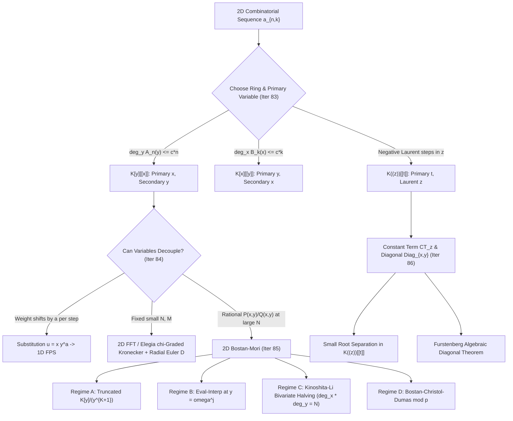

# Cohort 2 — Wave 4A (Iterations 83–87): Multivariate Formal Power Series, Variable Decoupling, 1D & 2D Bostan–Mori, Constant-Term Extraction, and the Diagonal Operator

> **Research Cohort**: Cohort 2 (Independent Redundant Discovery)
> **Assigned Wave**: Wave 4A (Iterations 83–87)
> **Target File**: `fps_research/cohort2_iter_83_to_87_multivariate_bostan_mori_diag.md`
> **Pedagogical Mandate**: Zero Magic Steps — Every ring selection, variable substitution, parity elimination, frequency-domain optimization, and diagonal extraction is derived from first principles via a diagnostic signal, a reverse-engineering scratchpad, step-by-step verbally annotated algebra, a hand-checkable $n \le 4$ trace, and explicit failure-mode analysis.

---

## Executive Summary & Architectural Map of Wave 4A

When competitive programming problems move beyond a single counting parameter—tracking both length $n$ and weight $k$, steps $t$ and coordinate displacement $x$, or tree size $n$ and leaf count $m$—univariate generating functions no longer suffice. However, moving from one variable to two or more variables introduces subtle algebraic traps that do not exist in $K[[x]]$:

1. **Ring Asymmetry (`Iteration 83`)**: In one variable, $K[x] \subset K[[x]] \subset K((x))$ is a linear chain. In two variables, $K[y][[x]]$, $K[x][[y]]$, and $K[[x,y]]$ are **distinct rings**, and the iterated Laurent rings $K((z))[[t]]$ vs. $K((t))[[z]]$ represent completely different series expansions of the same rational fraction! Selecting the wrong **primary variable** can turn a finite $O(N \log N)$ polynomial recurrence into an infinite non-terminating sum.
2. **Decoupling & Fast Multivariate Arithmetic (`Iteration 84`)**: Before brute-forcing 2D convolutions, we first ask whether a monomial change of variables $u = x y^a$ (homogenization / shear transformation) collapses a bivariate problem into 1D. When true 2D or $d$-D arithmetic modulo $(x_1^{n_1}, \dots, x_d^{n_d})$ is required, we contrast evaluation–interpolation, 2D FFT, naive Kronecker substitution (which suffers a $2^d$ zero-padding blowup), and **van der Hoeven / Elegia's $\chi$-graded cyclic convolution** (which eliminates the $2^d$ blowup in $O(d N \log N)$ time), alongside the **radial Euler derivation** $\mathfrak{D}$ that reduces multivariate $\ln, \exp, \text{pow}$ to 1D-style differential identities.
3. **1D & 2D Bostan–Mori (`Iteration 85`)**: Extracting a single far-away coefficient $[x^N] P(x)/Q(x)$ via parity splitting $Q(x)Q(-x) = V(x^2)$ beats matrix exponentiation ($O(d^3 \log N)$) and Fiduccia's kitamasa ($3\mathsf{M}(d)\log_2 N$) with $2\mathsf{M}(d)\log_2 N$ operations, and drops further to $\frac{2}{3}\mathsf{M}(d)\log_2 N$ via bit-reversed NTT-domain doubling. Extending Bostan–Mori to **two variables** $[x^N y^K] P(x,y)/Q(x,y)$ unlocks four distinct algorithmic regimes— culminating in **Kinoshita–Li (2024) / maspypy's Bivariate Graeffe Halving**, where $\deg_x$ halves while $\deg_y$ doubles at each step, keeping $\deg_x \cdot \deg_y \approx N$ invariant and solving the **Power Projection** and **FPS Composition** problems in $O(N \log^2 N)$.
4. **Constant-Term Extraction & Diagonals (`Iteration 86`)**: Many random walks, ballot problems, and symmetric sums ask for $[z^0] F(z, t)$ or the diagonal $\operatorname{Diag}_{x,y} F(x,y) = \sum_{n \ge 0} f_{n,n} t^n = \operatorname{CT}_z F(z, t/z)$. We demystify the catastrophic $K[[z, z^{-1}]]$ non-associativity trap, formalize $K((z))[[t]]$, and derive **Furstenberg's theorem** showing that the diagonal of any bivariate rational function is algebraic—and can be extracted directly via residue separation of small vs. large roots.
5. **Contest Problem Audit & Synthesis (`Iteration 87`)**: We curate 18 real non-template contest problems across Codeforces, AtCoder, Luogu, UOJ, QOJ, and Yukicoder with complete modelling bridges, 3-tier hints, and full derivations, accompanied by a Rejected Template Problems log and a multilingual (`[EN]`/`[ZH]`/`[JA]`) bibliography.



---

## Iteration 83: Multivariate Power Series Rings & Choosing the Primary Variable

### 83.1 Concrete Combinatorial & Algebraic Objects: The Hierarchy of Bivariate Rings

Let $K$ be a commutative ring with identity (in competitive programming, typically a prime field $\mathbb{F}_p$ such as $\mathbb{F}_{998244353}$ or $\mathbb{Q}$). When we encode a two-parameter sequence $(a_{n,k})_{n,k}$ into a generating function
$$F(x,y) = \sum_{n,k} a_{n,k} x^n y^k,$$
the symbol $\sum_{n,k} a_{n,k} x^n y^k$ is **meaningless until we specify the ambient ring** in which addition and multiplication take place. Unlike the univariate case, there are five distinct bivariate rings that appear constantly in algorithm design:

| Ring Notation | Element Structure $F(x,y)$ | Support Constraint on $(n,k)$ with $a_{n,k} \ne 0$ | Unit Condition $F \in R^\times$ | Typical CP Use Case |
| :--- | :--- | :--- | :--- | :--- |
| **$K[x,y]$** | $\sum_{n=0}^N \sum_{k=0}^M a_{n,k} x^n y^k$ | $n \ge 0, k \ge 0$, **finitely many** $(n,k)$ overall | $F(x,y) = a_{0,0} \in K^\times$ (if $K$ is a field/domain) | Finite 2D knapsack, polynomial numerators/denominators |
| **$K[y][[x]]$** | $\sum_{n=0}^\infty A_n(y) x^n$, $A_n(y) \in K[y]$ | $n \ge 0, k \ge 0$; **for each fixed $n$, only finitely many $k$** ($\deg_y A_n < \infty$) | $A_0(y) \in K[y]^\times \iff A_0(y) = a_{0,0} \in K^\times$ (over a domain $K$) | DP over step $n$ where secondary weight $k \le c \cdot n$ |
| **$K[x][[y]]$** | $\sum_{k=0}^\infty B_k(x) y^k$, $B_k(x) \in K[x]$ | $n \ge 0, k \ge 0$; **for each fixed $k$, only finitely many $n$** ($\deg_x B_k < \infty$) | $B_0(x) = a_{0,0} \in K^\times$ (over a domain $K$) | Counting structures with a small fixed number $k$ of special components |
| **$K[[x,y]]$** | $\sum_{n=0}^\infty \sum_{k=0}^\infty a_{n,k} x^n y^k$ | $n \ge 0, k \ge 0$ (arbitrary infinite support in first quadrant) | $a_{0,0} \in K^\times$ | General bivariate EGF/OGF; isomorphic to $K[[y]][[x]]$ and $K[[x]][[y]]$ |
| **$K((z))[[t]]$** | $\sum_{n=0}^\infty C_n(z) t^n$, $C_n(z) \in K((z))$ | $n \ge 0$; **for each fixed $n$, $k \ge v_n$ is bounded below** ($v_n \in \mathbb{Z}$) | $C_0(z) \in K((z))^\times \iff C_0(z) \ne 0$ (when $K$ is a field) | 1D random walks in time $t$ and position $z \in \mathbb{Z}$; diagonal extraction $z, t/z$ |

#### Strictness of the Ring Inclusions
In the first quadrant ($n, k \ge 0$), these rings form a diamond of **strict inclusions**:
$$K[x,y] = K[y][x] = K[x][y] \subsetneq \begin{cases} K[y][[x]] \\ K[x][[y]] \end{cases} \subsetneq K[[x,y]] = K[[y]][[x]] = K[[x]][[y]].$$
Furthermore, the intersection of the two asymmetric rings is strictly larger than $K[x,y]$:
$$K[x,y] \subsetneq K[y][[x]] \cap K[x][[y]] \subsetneq K[[x,y]].$$
For example, the diagonal geometric series
$$D(x,y) = \frac{1}{1 - xy} = \sum_{n=0}^\infty x^n y^n$$
has $A_n(y) = y^n \in K[y]$ for each $n$ and $B_k(x) = x^k \in K[x]$ for each $k$, so $D(x,y) \in K[y][[x]] \cap K[x][[y]]$, even though $D(x,y) \notin K[x,y]$.

Conversely:
- $F_1(x,y) = \frac{1}{1-x(1+y)} = \sum_{n=0}^\infty (1+y)^n x^n$ belongs to $K[y][[x]]$ because $[x^n] F_1 = (1+y)^n$ is a polynomial of degree $n$ in $y$. However, the coefficient of $y^0$ is $[y^0] F_1 = \sum_{n=0}^\infty x^n = \frac{1}{1-x} \notin K[x]$! Thus **$F_1(x,y) \in K[y][[x]] \setminus K[x][[y]]$**.
- Symmetrically, $F_2(x,y) = \frac{1}{1-y(1+x)} = \sum_{k=0}^\infty (1+x)^k y^k$ belongs to **$K[x][[y]] \setminus K[y][[x]]$**.
- Finally, $F_3(x,y) = \frac{1}{(1-x)(1-y)} = \sum_{n=0}^\infty \sum_{k=0}^\infty x^n y^k$ has $[x^n] F_3 = \frac{1}{1-y} \notin K[y]$ and $[y^k] F_3 = \frac{1}{1-x} \notin K[x]$, so **$F_3(x,y) \in K[[x,y]] \setminus (K[y][[x]] \cup K[x][[y]])$**.

---

### 83.2 The Diagnostic Signal: How to Choose the Primary Variable

When faced with a bivariate problem in variables $(x, y)$, **which variable should be the outer (primary) power series variable, and which should be the inner (coefficient) variable?**

> [!IMPORTANT]
> **The Primary-Variable Selection Rule**:
> Choose $x$ as the **primary variable** (working in $R[[x]]$ where $R = K[y]$ or $K[y]/(y^{M+1})$) if and only if at least one of the following diagnostic clues holds:
> 1. **Linear Degree Bound Clue**: In the combinatorial problem, an object of $x$-size $n$ can have $y$-weight at most $c \cdot n$ (for a small constant $c$). Algebraically, every transition involving $y$ is accompanied by at least one factor of $x$ (i.e., $y$ only appears inside multiples of $x$, such as $xy, x y^2, x^2 y$). This guarantees $F(x,y) \in K[y][[x]]$ with $\deg_y([x^n] F) \le c n$.
> 2. **Differential / Algebraic ODE Clue**: The problem gives a differential equation or functional equation in $x$ (such as $\partial_x F = \Phi(x, y, F)$) while $y$ acts purely as a passive parameter (no $\partial_y$ derivatives or $y$-shifts).
> 3. **Asymmetric Query Clue ($N \gg M$ or $N \ll M$)**: If you need $[x^N y^M] F(x,y)$ where $N = 10^{18}$ and $M = 500$, make $x$ the primary variable so you can run $O(\log N)$ binary exponentiation / Bostan–Mori over the coefficient ring $R = K[y]/(y^{M+1})$. Conversely, if $N = 10^5$ and $M = 10$, viewing $F \in K[[x]][y]/(y^{11})$ requires only $M^2 = 100$ univariate FPS convolutions of length $N$!

---

### 83.3 Reverse-Engineering Scratchpad: Discovering Why Ring Choice Matters

Suppose a problem asks us to compute $[x^n y^k] F(x,y)$ where
$$F(x,y) = \frac{1}{1 - x - y - xy}.$$
A contestant wants to invert $Q(x,y) = 1 - x - y - xy$ by writing $Q = 1 - N$ and expanding $1 + N + N^2 + \cdots$. Let us trace how a programmer discovers which ring expansion works and which one stalls:

```
[Scratchpad — Attempt 1: Treating x as primary, coefficients in K[y]]
Write Q(x,y) = (1 - y) - x(1 + y).
Look at the constant term with respect to x:
  [x^0] Q(x,y) = 1 - y.
Wait! Is 1 - y invertible in the polynomial ring K[y]?
NO! The inverse of 1 - y is 1 + y + y^2 + y^3 + ..., which is an INFINITE series in K[[y]], not a polynomial in K[y]!
So F(x,y) = sum_{n>=0} (1+y)^n / (1-y)^{n+1} * x^n does NOT live in K[y][[x]].
At every x^n, the coefficient in y has infinite degree!

[Scratchpad — Attempt 2: How can we force the coefficient of x^n to be a finite polynomial?]
Why did [x^0] Q(x,y) have a y in it? Because a step of type "+y" increases y without increasing x!
What if we only care about y up to degree K (i.e. modulo y^{K+1})?
In the truncated quotient ring R = K[y]/(y^{K+1}), is (1 - y) a unit?
YES! Because y is nilpotent (y^{K+1} = 0), so (1 - y)^{-1} = 1 + y + y^2 + ... + y^K is a finite polynomial of degree K!
Alternatively, what if we change variables to u = x, v = y, or group by TOTAL steps s = n + k?
If we substitute x -> t*x and y -> t*y, then Q = 1 - t(x + y) - t^2(xy).
Now in K[x,y][[t]], the constant term at t=0 is 1 (a unit!), and [t^s] is a finite polynomial in x and y of degree <= s!
```

This scratchpad reveals the two fundamental algebraic mechanisms for fixing a non-unit constant term in $K[y][[x]]$:
1. **Quotient Truncation**: Pass from $K[y][[x]]$ to $(K[y]/(y^{K+1}))[[x]]$, where any polynomial $A_0(y)$ with $A_0(0) \in K^\times$ becomes invertible because $y$ is nilpotent ($y^{K+1} = 0$).
2. **Homogenization / Grading Shift**: Introduce a grading variable $t$ (or substitute $y \mapsto x y$) so that every positive-degree term in $y$ carries a positive power of the primary variable.

---

### 83.4 Step-by-Step Algebraic Derivation: Unit Theorems & Coefficient Growth

Let us prove the exact characterization of units (invertible elements) in each multivariate ring, with every step annotated.

#### Theorem 83.1 (Characterization of Units Across Bivariate Rings)
Let $K$ be an integral domain (e.g., a field $\mathbb{F}_p$).
1. **In $K[[x,y]]$**: $F(x,y) = \sum_{n,k \ge 0} a_{n,k} x^n y^k$ is a unit in $K[[x,y]]$ if and only if $a_{0,0} \in K^\times$.
2. **In $K[y][[x]]$**: $F(x,y) = \sum_{n=0}^\infty A_n(y) x^n$ is a unit in $K[y][[x]]$ if and only if $A_0(y) \in K^\times$ (i.e., $A_0(y) = a_{0,0}$ is a **constant polynomial** in $y$ that is invertible in $K$).
3. **In $(K[y]/(y^{M+1}))[[x]]$**: $F(x,y) = \sum_{n=0}^\infty A_n(y) x^n$ is a unit in $(K[y]/(y^{M+1}))[[x]]$ if and only if $[y^0] A_0(y) = a_{0,0} \in K^\times$.
4. **In $K((z))[[t]]$**: $F(z,t) = \sum_{n=0}^\infty C_n(z) t^n$ (over a field $K$) is a unit in $K((z))[[t]]$ if and only if the leading $t^0$-coefficient $C_0(z)$ is not the zero Laurent series ($C_0(z) \ne 0$).

#### Proof & Verbal Annotations
- **Why (1) holds**: For any commutative ring $R$, a formal power series $\sum_{n \ge 0} r_n x^n \in R[[x]]$ is a unit iff $r_0 \in R^\times$ (since $r_0 g_0 = 1$ is necessary, and sufficient by recursive extraction $g_n = -r_0^{-1} \sum_{i=1}^n r_i g_{n-i}$). Applying this twice to $K[[x,y]] = (K[[y]])[[x]]$ shows $F \in K[[x,y]]^\times \iff A_0(y) \in K[[y]]^\times \iff a_{0,0} \in K^\times$.
- **Why (2) is strictly stronger than (1)**: Setting $R = K[y]$, an element $F \in R[[x]]$ is a unit iff $A_0(y) \in (K[y])^\times$. Since $K$ is an integral domain, the degree of a product of non-zero polynomials satisfies $\deg(P Q) = \deg P + \deg Q$, so the only units in $K[y]$ are **degree-0 constant polynomials** $a_{0,0} \in K^\times$!
  - *Concrete consequence*: Even if $a_{0,0} = 1$, if $A_0(y) = 1 - y$ has degree $\ge 1$, then $F(x,y)$ is invertible in $K[[x,y]]$, **not** in $K[y][[x]]$.
- **Why (3) rescues (2) upon truncation**: In the quotient ring $R = K[y]/(y^{M+1})$, the indeterminate $y$ satisfies $y^{M+1} = 0$. Therefore, any polynomial $A_0(y) = a_{0,0} + y \tilde{A}(y)$ with $a_{0,0} \in K^\times$ can be written as $a_{0,0}(1 - u)$ where $u = -a_{0,0}^{-1} y \tilde{A}(y)$ satisfies $u^{M+1} = 0$. Its inverse in $R$ is the finite sum $a_{0,0}^{-1}(1 + u + u^2 + \dots + u^M)$.
- **Why (4) holds in the iterated Laurent ring**: When $K$ is a field, the ring of formal Laurent series $R = K((z)) = \{ \sum_{k \ge v} c_k z^k : v \in \mathbb{Z} \}$ is itself a **field**! Every non-zero element $C_0(z) = c_v z^v (1 + d_1 z + d_2 z^2 + \cdots)$ with $c_v \ne 0$ has the inverse $C_0(z)^{-1} = c_v^{-1} z^{-v} (1 + d_1 z + \cdots)^{-1} \in K((z))$. Thus in $R[[t]] = K((z))[[t]]$, invertibility requires only $C_0(z) \ne 0$, even if $C_0(z)$ starts at a positive or negative power $z^v$!

#### Secondary-Variable Degree Growth Lemma
Suppose $Q(x,y) = 1 - \sum_{n=1}^\infty Q_n(y) x^n \in K[y][[x]]$ has constant term $Q_0(y) = 1$, and suppose there is a constant $c \ge 0$ such that $\deg_y Q_n(y) \le c \cdot n$ for all $n \ge 1$. Then its inverse $F(x,y) = Q(x,y)^{-1} = \sum_{n=0}^\infty F_n(y) x^n \in K[y][[x]]$ satisfies
$$\deg_y F_n(y) \le c \cdot n \quad \text{for all } n \ge 0.$$
*Proof*: By induction on $n$ from $F_n(y) = \sum_{i=1}^n Q_i(y) F_{n-i}(y)$, every product $Q_i(y) F_{n-i}(y)$ has $y$-degree at most $c i + c(n-i) = c n$. $\blacksquare$

---

### 83.5 Hand-Checkable Toy Example ($n \le 3$)

Let us trace the expansion of the rational function
$$F(x,y) = \frac{1}{1 - y - xy}$$
in three different rings up to order $3$ to see how the same rational expression represents different objects or fails to belong to a ring:

1. **In $K[x][[y]]$ (Primary variable $y$, coefficients in $K[x]$)**:
   Write $F(x,y) = \frac{1}{1 - y(1+x)} = \sum_{k=0}^\infty B_k(x) y^k$.
   Here $B_0(x) = 1 \in K[x]^\times$. Expanding up to $y^3$:
   - $k = 0$: $B_0(x) = 1$ ($\deg_x = 0$)
   - $k = 1$: $B_1(x) = 1 + x$ ($\deg_x = 1$)
   - $k = 2$: $B_2(x) = (1 + x)^2 = 1 + 2x + x^2$ ($\deg_x = 2$)
   - $k = 3$: $B_3(x) = (1 + x)^3 = 1 + 3x + 3x^2 + x^3$ ($\deg_x = 3$).
   Every coefficient $B_k(x)$ is a clean finite polynomial in $K[x]$ of degree $k$.

2. **In $K[[y]][[x]]$ vs. $K[y][[x]]$ (Primary variable $x$)**:
   Write $F(x,y) = \frac{1}{(1-y)(1 - \frac{y}{1-y} x)} = \sum_{n=0}^\infty A_n(y) x^n$.
   - $n = 0$: $A_0(y) = \frac{1}{1-y} = 1 + y + y^2 + y^3 + \cdots \notin K[y]$!
   - $n = 1$: $A_1(y) = \frac{y}{(1-y)^2} = y + 2y^2 + 3y^3 + \cdots \notin K[y]$.
   - $n = 2$: $A_2(y) = \frac{y^2}{(1-y)^3} = y^2 + 3y^3 + 6y^4 + \cdots \notin K[y]$.
   Notice that if we verify the coefficient $[x^1 y^3] F(x,y)$ across both expansions:
   - From $K[x][[y]]$: $[x^1] B_3(x) = [x^1](1 + 3x + 3x^2 + x^3) = 3$.
   - From $K[[y]][[x]]$: $[y^3] A_1(y) = [y^3](y + 2y^2 + 3y^3 + \cdots) = 3$.
   They agree inside $K[[x,y]]$, **but only $K[x][[y]]$ gives finite polynomial coefficients without truncation**!

3. **In $K((y))[[x]]$ vs. $K((x))[[y]]$ for $G(x,y) = \frac{1}{x - y}$**:
   - In $K((y))[[x]]$: Write $G(x,y) = \frac{-y^{-1}}{1 - x y^{-1}} = -y^{-1} - x y^{-2} - x^2 y^{-3} - x^3 y^{-4} - \cdots$ (supported on $n \ge 0, k \le -1$).
   - In $K((x))[[y]]$: Write $G(x,y) = \frac{x^{-1}}{1 - y x^{-1}} = x^{-1} + x^{-2} y + x^{-3} y^2 + x^{-4} y^3 + \cdots$ (supported on $n \le -1, k \ge 0$).
   Here the two expansions have **disjoint support**! In $K((y))[[x]]$, $[x^1 y^{-2}] G = -1$ and $[x^{-2} y^1] G = 0$; in $K((x))[[y]]$, $[x^1 y^{-2}] G = 0$ and $[x^{-2} y^1] G = 1$.

---

### 83.6 Failure Modes, Pitfalls & Edge Cases

> [!CAUTION]
> **Pitfall 83.1: Equating $K((x))[[y]]$ and $K((y))[[x]]$ for Rational Functions**
> As shown in the toy example $G(x,y) = \frac{1}{x-y}$ above, while $K[[x]][[y]]$ and $K[[y]][[x]]$ are canonically isomorphic to $K[[x,y]]$, **iterated formal Laurent series do NOT commute**:
> $$K((x))[[y]] \neq K((y))[[x]], \quad \text{and} \quad K((x))((y)) \neq K((y))((x)).$$
> Whenever negative powers appear (such as $z^{-1}$ in random walks or $\operatorname{CT}_z F(z, t/z)$), you **must** expand in powers of the outer time variable $t$ first (working in $K((z))[[t]]$), and never swap the order of expansion of $(1 - t/z)^{-1}$ with $(1 - z/t)^{-1}$.

> [!WARNING]
> **Pitfall 83.2: Hidden Degree Blowup in $K[y][[x]]$**
> Even when $F(x,y) \in K[y][[x]]$, check the slope $c$ in $\deg_y A_n(y) \le c \cdot n$. If each transition of size $\Delta x = 1$ can add up to $\Delta y = M$ to the secondary exponent, then at step $n = N$ the polynomial $A_N(y)$ has degree $N \cdot M$. If you do not truncate modulo $y^{K+1}$, the memory and time cost at step $N$ scales as $O(N^2 M)$ instead of $O(N K)$. Always enforce explicit truncation $\bmod y^{K+1}$ whenever queries only ask for $[y^k]$ with $k \le K$.

---

## Iteration 84: Variable Decoupling, 2D FFT, Kronecker Substitution, Elegia's $\chi$-Graded Truncation & Multivariate FPS Operations

Before deploying heavy 2D polynomial machinery, an elite competitive programmer asks two questions:
1. **Can we decouple or collapse the two variables into a single variable** via a monomial change of variables ($u = x y^a$) or evaluation–interpolation?
2. **If we must compute in $K[x,y]/(x^N, y^M)$ (or $d$ variables)**, how do we avoid the $2^d$ zero-padding overhead of naive Kronecker substitution, and how do we compute `inv`, `ln`, `exp`, and `pow` in $O(N M \log(NM))$ without messy 2D Newton loops?

---

### 84.1 Monomial Decoupling Substitutions ($u = x y^a$) and Homogenization

#### 1. Concrete Combinatorial / Algebraic Object
Consider a bivariate generating function $F(x,y) = \sum_{n,k} a_{n,k} x^n y^k \in K[y, y^{-1}][[x]]$ built from step transitions or factors where every occurrence of $x$ and $y$ can be rewritten in terms of a single combined monomial $u = x y^a$ (and possibly pure powers of $y$ or $x$).

#### 2. The Diagnostic Signal
Look at the exponent pairs $(n_i, k_i)$ of the elementary transitions in your generating function:
- **Collinear Exponents Clue**: All monomials in $F(x,y)$ lie on a single line $k = a n$, i.e., every term has the form $c_n x^n y^{a n} = c_n (x y^a)^n$.
- **Affine / Shear Transition Clue**: Every step increases $x$-degree by $1$ and changes $y$-degree by $d_i \in \{a, a+1, \dots, a+m\}$. Factoring out $y^a$ per step via $u = x y^a$ shifts all $y$-exponents down by $a$, converting negative Laurent powers $y^{-a}$ into non-negative polynomials in $K[y][[u]]$!
- **Total-Degree / Homogenization Clue**: An ungraded polynomial equation $P(x, y) = 0$ where we need to expand solutions by total weight $w_1 n + w_2 k$. Substituting $x \mapsto t^{w_1} x, y \mapsto t^{w_2} y$ creates a primary grading variable $t$ with unit constant term at $t = 0$.

#### 3. The Reverse-Engineering Scratchpad
Suppose we want to compute $[x^N y^K] (y^{-2} + y^{-1} + 1 + y)^N$, which counts $N$-step 1D walks with step set $\{-2, -1, 0, +1\}$ ending at position $K$.

```
[Scratchpad — Eliminating negative exponents and decoupling]
Inside the N-th power, each step multiplies by S(y) = y^{-2} + y^{-1} + 1 + y.
If we try to do FPS power on S(y) directly, S(y) has negative powers y^{-2}, and its constant term is 1, not the lowest degree term!
Wait: every single one of the N steps contributes at least y^{-2}.
What if we factor out y^{-2} from EVERY step?
Write x * S(y) = x * y^{-2} * (1 + y + y^2 + y^3).
Now define the sheared variable u = x * y^{-2}!
Then (x * S(y))^N = u^N * (1 + y + y^2 + y^3)^N.
Extracting [x^N y^K] is the exact same as extracting [u^N y^{K + 2N}] from u^N (1 + y + y^2 + y^3)^N,
which is just [y^{K + 2N}] (1 + y + y^2 + y^3)^N = [y^{K + 2N}] \left(\frac{1 - y^4}{1 - y}\right)^N!
We just turned a 2D Laurent walk into a 1D polynomial coefficient extraction!
```

#### 4. Step-by-Step Algebraic Derivation: The Shear Automorphism
For any integer $a \in \mathbb{Z}$, define the **shear substitution** $\Phi_a : K((y))[[x]] \to K((y))[[u]]$ by
$$u = x y^a \iff x = u y^{-a}.$$
For any bivariate series $F(x,y) = \sum_{n=0}^\infty \sum_{k \ge v_n} f_{n,k} x^n y^k \in K((y))[[x]]$, substituting $x = u y^{-a}$ yields:
$$\tilde{F}(u, y) := F(u y^{-a}, y) = \sum_{n=0}^\infty \sum_{k \ge v_n} f_{n,k} (u y^{-a})^n y^k = \sum_{n=0}^\infty u^n \sum_{k \ge v_n} f_{n,k} y^{k - a n}.$$
Comparing coefficients on both sides gives the exact **Coefficient Index Shift Identity**:
$$[x^N y^K] F(x,y) = [u^N y^{K - a N}] F(u y^{-a}, y).$$
- **Why this works**: The map $(n, k) \mapsto (n, k - a n)$ is a bijection on $\mathbb{Z}_{\ge 0} \times \mathbb{Z}$ with determinant $\det \begin{pmatrix} 1 & 0 \\ -a & 1 \end{pmatrix} = 1$.
- **How to choose $a$**: Choose $a = \min_i (k_i / n_i)$, the minimum $y$-to-$x$ slope among all active transitions $(n_i, k_i)$. Then for every transition, $k_i - a n_i \ge 0$, which moves $\tilde{F}(u,y)$ out of the Laurent ring $K((y))[[x]]$ and **into the standard first-quadrant polynomial-coefficient ring $K[y][[u]]$**!

---

### 84.2 Auxiliary-Variable Evaluation–Interpolation & 2D FFT

When $F(x,y) \in K[x,y]$ cannot be collapsed into 1D by a shear, we can still eliminate $y$ temporarily by **evaluating $y$ at distinct field elements** $y_0, y_1, \dots, y_D \in K$.

#### 1. Concrete Combinatorial / Algebraic Object
Suppose we compute a target bivariate polynomial or truncated series $H(x,y) = \sum_{n=0}^{N-1} H_n(y) x^n \bmod x^N$ constructed via rational operations, matrix powers, or ODEs from input polynomials in $K[x,y]$, and we know an a priori degree bound $\deg_y H_n(y) \le D$ for all $0 \le n < N$.

#### 2. The Diagnostic Signal
- You have a fast 1D algorithm $\mathcal{A}(x)$ (e.g., 1D FPS `exp`, 1D Bostan–Mori, determinant of a polynomial matrix, or 1D divide-and-conquer) that takes $O(N \log N)$ when $y$ is a scalar in $\mathbb{F}_p$, **and** the final output polynomial has a small known $y$-degree $D$.
- Especially when $\mathbb{F}_p$ is an NTT-friendly prime (such as $998244353$) and $D < L = 2^k$, evaluating at $y_j = \omega_L^j$ ($j = 0, \dots, L-1$) lets us use a **1D DFT/IDFT along the $y$-axis** in $O(N L \log L)$ total time instead of Lagrange interpolation!

#### 3. Step-by-Step Algebraic Procedure (2D FFT & Pointwise Evaluation–Interpolation)
To compute $H(x,y) \bmod x^N$ where $\deg_y H_n(y) \le D$:
1. **Choose Evaluation Grid**: Let $L = 2^{\lceil \log_2(D+1) \rceil}$ and let $\omega \in \mathbb{F}_p$ be a primitive $L$-th root of unity.
2. **Evaluate Along $y$ (Forward DFT in $y$)**: For each input coefficient polynomial $P_n(y)$ of $x^n$, apply a length-$L$ NTT to obtain the scalar values $P_n(\omega^j)$ for $j = 0, 1, \dots, L-1$.
3. **Solve $L$ Independent 1D Problems in $x$**: For each fixed $j \in \{0, \dots, L-1\}$, treat $y = \omega^j$ as a constant scalar in $\mathbb{F}_p$ and run your 1D algorithm in $\mathbb{F}_p[[x]]/(x^N)$ to obtain the 1D series $H^{(j)}(x) = H(x, \omega^j) \bmod x^N$.
4. **Interpolate Along $y$ (Inverse DFT in $y$)**: For each fixed $n \in \{0, \dots, N-1\}$, collect the vector of values $([x^n] H^{(0)}(x), \dots, [x^n] H^{(L-1)}(x))$ and apply a length-$L$ INTT to recover the exact polynomial $H_n(y) = [x^n] H(x,y) \in \mathbb{F}_p[y]$.

#### 2D FFT for Bivariate Polynomial Multiplication
When the 1D operation in Step 3 is simply polynomial multiplication $H(x,y) = F(x,y) G(x,y)$ with $\deg_x F < N_1, \deg_x G < N_2$ and $\deg_y F < M_1, \deg_y G < M_2$:
- Set $L_x = 2^{\lceil \log_2(N_1 + N_2 - 1) \rceil}$ and $L_y = 2^{\lceil \log_2(M_1 + M_2 - 1) \rceil}$.
- Viewing the coefficient table as an $L_x \times L_y$ matrix:
  1. Perform $L_x$ row-wise NTTs of length $L_y$: $O(L_x L_y \log L_y)$.
  2. Perform $L_y$ column-wise NTTs of length $L_x$: $O(L_x L_y \log L_x)$.
  3. Multiply the $L_x \times L_y$ point values entrywise: $O(L_x L_y)$.
  4. Apply column-wise INTTs and row-wise INTTs: $O(L_x L_y \log(L_x L_y))$.
- **Total Time Complexity**: $O(L_x L_y \log(L_x L_y))$, performing exactly $3 L_x$ NTTs of length $L_y$ and $3 L_y$ NTTs of length $L_x$.

---

### 84.3 Naive Kronecker Substitution vs. van der Hoeven / Elegia's $\chi$-Graded Multivariate Truncation

What if we want to multiply two bivariate (or $d$-variate) polynomials **modulo $(x_1^{n_1}, x_2^{n_2}, \dots, x_d^{n_d})$**, or reduce 2D multiplication to a single 1D NTT call?

#### 1. Concrete Combinatorial / Algebraic Object
We work in the truncated multivariate quotient ring
$$\mathcal{R} = K[x_1, x_2, \dots, x_d] / (x_1^{n_1}, x_2^{n_2}, \dots, x_d^{n_d}),$$
which is a $K$-vector space of total dimension $N = n_1 n_2 \cdots n_d$. Each monomial $x_1^{i_1} x_2^{i_2} \cdots x_d^{i_d}$ with $0 \le i_r < n_r$ corresponds to a unique mixed-radix integer $i \in \{0, 1, \dots, N-1\}$:
$$i = i_1 + i_2 n_1 + i_3 (n_1 n_2) + \dots + i_d (n_1 n_2 \cdots n_{d-1}).$$

#### 2. The Diagnostic Signal & The Carry Contamination Problem
If we simply flatten $x_1^{i_1} \cdots x_d^{i_d} \mapsto z^i$ and multiply the resulting 1D polynomials in $K[z]/(z^N)$, what goes wrong?
**Carries between mixed-radix digits!**
Specifically, when we multiply $x_1^{i_1} x_2^{i_2}$ and $x_1^{j_1} x_2^{j_2}$:
- If $i_1 + j_1 < n_1$, then the mixed-radix index of the product is indeed $(i_1 + j_1) + (i_2 + j_2) n_1 = i + j$.
- **However**, if $i_1 + j_1 \ge n_1$, then in $K[x_1, x_2]/(x_1^{n_1}, x_2^{n_2})$ the product $x_1^{i_1+j_1} x_2^{i_2+j_2}$ should **vanish ($= 0$)** because the $x_1$-exponent reached $n_1$! Instead, in $z^{i+j}$, the sum $i_1 + j_1 = (i_1 + j_1 - n_1) + 1 \cdot n_1$ **generates a carry of $+1$ into the $x_2$-digit**, polluting the coefficient of $x_1^{i_1+j_1-n_1} x_2^{i_2+j_2+1}$!

#### 3. Reverse-Engineering Scratchpad: How to Kill Carries Without $2^d$ Padding

```
[Scratchpad — Approach A: Naive Kronecker Zero-Padding]
How do we prevent i_1 + j_1 from reaching the radix base B_1?
Since 0 <= i_1, j_1 <= n_1 - 1, their sum satisfies i_1 + j_1 <= 2 n_1 - 2.
So if we choose radix base B_1 = 2 n_1 - 1 (substituting x_2 = x_1^{2 n_1 - 1}), then i_1 + j_1 < B_1 ALWAYS!
No carry can ever happen!
In 2D, this pads the array size from N = n_1 n_2 to (2 n_1 - 1) n_2 ≈ 2 N.
Wait: what if we have d variables (like d = 6 or subset convolution with d = 20)?
Padding every dimension to 2 n_r - 1 blows up the size to 2^d * N! That's exponential in d!

[Scratchpad — Approach B: van der Hoeven (2002) / Elegia (2021) Carry Detector]
Can we keep the UN-PADDED mixed-radix encoding i = i_1 + i_2 n_1 + ... + i_d (n_1 ... n_{d-1}) of size N,
and detect whether ANY carry occurred when adding i and j?
Let's look at the radix-n_r digits of i and j.
When we add i + j as integers, let c_r in {0, 1} be the carry from digit r to digit r+1 (for r = 1, ..., d-1).
Wait: how does a carry c_r affect the sum of the quotients floor(i / (n_1 ... n_r))?
In fact, for each r = 1, ..., d-1, let q_r(i) = floor(i / (n_1 ... n_r)) = i_{r+1} + i_{r+2} n_{r+1} + ...
Notice that i + j = (i mod P_r) + (j mod P_r) + (q_r(i) + q_r(j)) P_r, where P_r = n_1 ... n_r.
Therefore, q_r(i + j) = floor((i + j) / P_r) = q_r(i) + q_r(j) + c_r,
where c_r in {0, 1} is 1 if and only if (i mod P_r) + (j mod P_r) >= P_r!
Wait: if there are NO carries in any digit 1, ..., d-1, then c_1 = c_2 = ... = c_{d-1} = 0!
And if at least one digit overflows (c_r = 1 for some r in {1, ..., d-1}), then since each c_r >= 0:
  sum_{r=1}^{d-1} c_r  lies strictly between 1 and d - 1!
BINGO! Because there are only d - 1 possible carry positions (digits 1 through d-1, since digit d is truncated by mod z^N anyway),
the total number of carries C(i, j) = sum_{r=1}^{d-1} c_r satisfies:
  0 <= C(i, j) <= d - 1,   and   C(i, j) = 0  <==>  C(i, j) == 0 (mod d)!
```

#### 4. Step-by-Step Algebraic Derivation of Elegia's $\chi$-Graded Multiplication
Define the **carry-grading function** $\chi : \{0, 1, \dots, N-1\} \to \mathbb{Z}/d\mathbb{Z}$ by
$$\chi(i) = \left( \sum_{r=1}^{d-1} \left\lfloor \frac{i}{n_1 n_2 \cdots n_r} \right\rfloor \right) \bmod d.$$

##### Theorem 84.1 (van der Hoeven 2002 / Elegia 2021 Exact Carry-Free Criterion)
For any two mixed-radix indices $i, j \in \{0, \dots, N-1\}$ with $i + j < N$:
1. For each $r \in \{1, \dots, d-1\}$, let $P_r = n_1 \cdots n_r$. Then
   $$\left\lfloor \frac{i+j}{P_r} \right\rfloor - \left\lfloor \frac{i}{P_r} \right\rfloor - \left\lfloor \frac{j}{P_r} \right\rfloor = c_r \in \{0, 1\},$$
   where $c_r = 1$ iff $(i \bmod P_r) + (j \bmod P_r) \ge P_r$.
2. The componentwise sum of the mixed-radix digits of $i$ and $j$ satisfies $i_r + j_r < n_r$ for all $r \in \{1, \dots, d\}$ **if and only if** $i + j < N$ and $c_1 = c_2 = \dots = c_{d-1} = 0$.
3. Since $0 \le \sum_{r=1}^{d-1} c_r \le d - 1$, we have:
   $$c_1 = \dots = c_{d-1} = 0 \iff \sum_{r=1}^{d-1} c_r \equiv 0 \pmod d \iff \chi(i+j) \equiv \chi(i) + \chi(j) \pmod d.$$

##### The Algorithm in $(K[z]/(z^N))[t]/(t^d - 1)$
To multiply $F, G \in K[x_1, \dots, x_d]/(x_1^{n_1}, \dots, x_d^{n_d})$:
1. **Lift to $\chi$-graded polynomials**: Map $F \mapsto \tilde{F}(z, t) = \sum_{i=0}^{N-1} f_i z^i t^{\chi(i)}$ and $G \mapsto \tilde{G}(z, t) = \sum_{j=0}^{N-1} g_j z^j t^{\chi(j)}$.
2. **1D FFT along $z$**: For each residue class $u \in \{0, 1, \dots, d-1\}$, let $\tilde{F}_u(z) = \sum_{\chi(i)=u} f_i z^i$ and $\tilde{G}_u(z) = \sum_{\chi(j)=u} g_j z^j$. Compute the length-$2^{\lceil \log_2(2N) \rceil}$ NTT of each $\tilde{F}_u$ and $\tilde{G}_u$ ($2d$ forward NTTs).
3. **Cyclic Convolution mod $t^d - 1$**: For each $w \in \{0, \dots, d-1\}$, compute in the NTT frequency domain:
   $$\widehat{H}_w = \sum_{u + v \equiv w \pmod d} \widehat{F}_u \odot \widehat{G}_v,$$
   and apply $d$ inverse NTTs to get $H_w(z) \bmod z^N$.
4. **Extract Carry-Free Terms**: For each $k \in \{0, \dots, N-1\}$, keep only the term where $w = \chi(k)$:
   $$h_k = [z^k] H_{\chi(k)}(z).$$
- **Complexity**: $3d$ NTTs of length $2N$ and $d^2 \cdot 2N$ pointwise multiplications: **$O(d N \log N + d^2 N)$** time and $O(d N)$ space, completely eliminating the $2^d$ padding factor!

---

### 84.4 Multivariate FPS `inv`, `ln`, `exp`, `pow` via Partial Derivatives & the Radial Euler Operator $\mathfrak{D}$

How do we compute $\ln F(x,y)$, $\exp F(x,y)$, $F(x,y)^{-1}$, and $F(x,y)^\alpha$ modulo $(x^N, y^M)$? There are two complementary approaches:

#### Method 1: Partial Derivative Trick in $K[x,y]/(x^N, y^M)$ (`inv`, `ln`, `exp`)
In two variables, the partial derivative operator $\partial_x = \frac{\partial}{\partial x}$ satisfies the Leibniz product rule $\partial_x(F G) = (\partial_x F) G + F (\partial_x G)$ and the chain rule:
- **For $\ln F(x,y)$** (assuming $[x^0 y^0] F = 1$):
  $$\partial_x \ln F(x,y) = \frac{\partial_x F(x,y)}{F(x,y)} \pmod{x^{N-1}, y^M}.$$
  Integrating with respect to $x$ recovers all terms of $\ln F(x,y)$ with $x$-degree $\ge 1$! What about the integration constant $C(y) = [x^0] \ln F(x,y) = \ln F(0, y) \bmod y^M$? That is simply a **1D FPS logarithm** in $K[[y]]/(y^M)$!
- **For $\exp F(x,y)$** (assuming $[x^0 y^0] F = 0$):
  $$\partial_x \exp F(x,y) = \exp F(x,y) \cdot \partial_x F(x,y), \quad \text{with boundary condition } [x^0]\exp F(x,y) = \exp F(0,y) \bmod y^M.$$

#### Method 2: The Flattened Radial / Weighted Euler Operator $\mathfrak{D}$ (Elegia / Nyaan)
What if we already flattened $K[x_1, \dots, x_d]/(x_1^{n_1}, \dots, x_d^{n_d})$ into mixed-radix indices $i \in \{0, \dots, N-1\}$ via Elegia's $\chi$-graded representation? Can we avoid recursion over dimensions entirely?

##### Definition & Leibniz Property of the Radial Operator $\mathfrak{D}$
Define the linear operator $\mathfrak{D}$ on the mixed-radix basis by multiplying the $i$-th coefficient by its mixed-radix integer $i$:
$$\mathfrak{D}\left( \sum_{i=0}^{N-1} f_i \mathbf{x}^{\mathbf{i}} \right) := \sum_{i=0}^{N-1} i \cdot f_i \mathbf{x}^{\mathbf{i}}.$$
Observe that $i = i_1 + i_2 n_1 + \dots + i_d (n_1 \cdots n_{d-1})$, so $\mathfrak{D}$ is the **weighted Euler derivation**:
$$\mathfrak{D} = \sum_{r=1}^d (n_1 \cdots n_{r-1}) \, x_r \frac{\partial}{\partial x_r}.$$
Because every $x_r \frac{\partial}{\partial x_r}$ is a derivation on $K[x_1, \dots, x_d]$ that preserves each ideal $(x_r^{n_r})$ (since $x_r \partial_{x_r} (x_r^{n_r}) = n_r x_r^{n_r} \in (x_r^{n_r})$), their linear combination $\mathfrak{D}$ is an **exact derivation on the truncated quotient ring $\mathcal{R} = K[x_1, \dots, x_d]/(x_1^{n_1}, \dots, x_d^{n_d})$**!
Equivalently, for any carry-free pair $(i, j)$ with $i_r + j_r < n_r$, the mixed-radix index of the product is $k = i + j$, so $k (f_i g_j) = (i f_i) g_j + f_i (j g_j)$, giving:
$$\mathfrak{D}(F \cdot G) = \mathfrak{D}(F) \cdot G + F \cdot \mathfrak{D}(G), \quad \mathfrak{D}(\ln F) = \frac{\mathfrak{D} F}{F}, \quad \mathfrak{D}(\exp F) = \exp(F) \cdot \mathfrak{D} F.$$
> [!TIP]
> **Why $\mathfrak{D}$ is a game-changer**: Unlike $\partial_{x_1}$ (which shifts indices by $-1$ and annihilates all monomials with $i_1 = 0$), the operator $\mathfrak{D}$ only annihilates $i = 0$ (the constant term $x_1^0 \cdots x_d^0$) provided $N = n_1 \cdots n_d < p$ ($\operatorname{char} K = p$)! Thus **a single multivariate inversion + $\mathfrak{D}$ + division by $i$ for $1 \le i < N$ computes the entire $d$-dimensional $\ln F$ in one shot**, and standard Newton/divide-and-conquer on $i$ computes $F^{-1}$ and $\exp F$ in $O(d N \log N + d^2 N)$ time!

---

### 84.5 Hand-Checkable Toy Example ($n_1 = 2, n_2 = 2, N = 4$)

Let us trace Elegia's $\chi$-graded multiplication and the radial operator $\mathfrak{D}$ on $K[x_1, x_2]/(x_1^2, x_2^2)$ where $d = 2, n_1 = 2, n_2 = 2, N = 4$:

1. **Mixed-Radix Index $i = i_1 + 2 i_2$ and Grading $\chi(i) = \lfloor i/2 \rfloor \bmod 2 = i_2 \bmod 2$**:
   - $1 = x_1^0 x_2^0 \leftrightarrow i = 0$, $\chi(0) = 0$.
   - $x_1 = x_1^1 x_2^0 \leftrightarrow i = 1$, $\chi(1) = 0$.
   - $x_2 = x_1^0 x_2^1 \leftrightarrow i = 2$, $\chi(2) = 1$.
   - $x_1 x_2 = x_1^1 x_2^1 \leftrightarrow i = 3$, $\chi(3) = 1$.

2. **Multiplying $F = 1 + x_1 + x_2$ and $G = 1 + x_1 + x_2$ mod $(x_1^2, x_2^2)$**:
   - Exact answer in $K[x_1, x_2]/(x_1^2, x_2^2)$:
     $$(1 + x_1 + x_2)^2 = 1 + 2x_1 + 2x_2 + 2x_1 x_2 + \underbrace{x_1^2}_{=0} + \underbrace{x_2^2}_{=0} = 1 + 2x_1 + 2x_2 + 2x_1 x_2.$$
   - If we used ungraded $z^i$ mod $z^4$: $(1 + z + z^2)^2 \bmod z^4 = 1 + 2z + \mathbf{3}z^2 + 2z^3$. Notice the bogus $\mathbf{3}z^2$ caused by the carry $x_1 \cdot x_1 = z^1 \cdot z^1 = z^2$ polluting $x_2$!
   - With $\chi$-grading:
     - $\tilde{F}_0(z) = 1 + z$ ($\chi = 0$), $\tilde{F}_1(z) = z^2$ ($\chi = 1$), and $\tilde{G}_0(z) = 1+z, \tilde{G}_1(z) = z^2$.
     - $H_0(z) = \tilde{F}_0 \tilde{G}_0 + \tilde{F}_1 \tilde{G}_1 \bmod z^4 = (1 + 2z + z^2) + z^4 \equiv 1 + 2z + z^2 \pmod{z^4}$.
     - $H_1(z) = \tilde{F}_0 \tilde{G}_1 + \tilde{F}_1 \tilde{G}_0 \bmod z^4 = 2(1+z)z^2 \equiv 2z^2 + 2z^3 \pmod{z^4}$.
   - Filtering $[z^k] H_{\chi(k)}(z)$:
     - $k = 0$ ($\chi(0) = 0$): $[z^0] H_0 = 1$.
     - $k = 1$ ($\chi(1) = 0$): $[z^1] H_0 = 2$.
     - $k = 2$ ($\chi(2) = 1$): $[z^2] H_1 = \mathbf{2}$ (the bogus $z^2$ term sat in $H_0$, so it was discarded!).
     - $k = 3$ ($\chi(3) = 1$): $[z^3] H_1 = 2$.
     Result: $1 + 2x_1 + 2x_2 + 2x_1 x_2$, matching the exact 2D product!

3. **Radial Operator $\mathfrak{D}$ for $\ln(1 + x_1 + x_2) \bmod (x_1^2, x_2^2)$**:
   - Let $F = 1 + x_1 + x_2 \leftrightarrow 1 + z + z^2$. Then $\mathfrak{D} F = 1 \cdot x_1 + 2 \cdot x_2$.
   - Since $F^{-1} = 1 - x_1 - x_2 + 2 x_1 x_2 \bmod (x_1^2, x_2^2)$, the truncated 2D product $(\mathfrak{D} F) \cdot F^{-1}$ is:
     $$(x_1 + 2x_2)(1 - x_1 - x_2 + 2x_1 x_2) \equiv x_1 + 2x_2 - 3x_1 x_2 \pmod{x_1^2, x_2^2}.$$
   - Dividing the $i$-th coefficient by $i$ ($i=1$ for $x_1$, $i=2$ for $x_2$, $i=3$ for $x_1 x_2$):
     $$\ln(1 + x_1 + x_2) = \frac{1}{1} x_1 + \frac{2}{2} x_2 - \frac{3}{3} x_1 x_2 = x_1 + x_2 - x_1 x_2 \pmod{x_1^2, x_2^2},$$
     which matches $(x_1 + x_2) - \frac{1}{2}(x_1 + x_2)^2 \equiv x_1 + x_2 - x_1 x_2 \pmod{x_1^2, x_2^2}$!

---

### 84.6 Failure Modes, Pitfalls & Edge Cases

> [!CAUTION]
> **Pitfall 84.1: Characteristic Overflow $N \ge p$ in the Radial Operator $\mathfrak{D}$**
> Because $\mathfrak{D}$ multiplies the $(i_1, \dots, i_d)$-th coefficient by the mixed-radix integer $i \in \{0, \dots, N-1\}$ where $N = n_1 \cdots n_d$, recovering $\ln F$ or $\exp F$ requires dividing by $i \bmod p$. This is valid **only if $N \le p$**! If $n_1, n_2 < p$ individually (e.g., over a smaller prime $p = 10^4 + 7$) but $N = n_1 n_2 > p$, then $i$ can be a multiple of $p$ even when $(i_1, i_2) \ne (0,0)$, causing division by zero in $\mathfrak{D}^{-1}$. In that regime, use Method 1 (partial derivative $\partial_{x_1}$ + 1D boundary on $x_2$), which only divides by $1, 2, \dots, \max(n_1, n_2) < p$.

> [!WARNING]
> **Pitfall 84.2: Off-by-One in Naive Kronecker Substitution Padding**
> If $\deg_x F \le N-1$ and $\deg_x G \le N-1$, their product has $x$-degree up to $2N - 2$, which has **$2N - 1$ coefficients** ($x^0$ through $x^{2N-2}$). Substituting $y = x^{2N-2}$ is **wrong** because $x^{2N-2}$ collides with $y^1$! You must substitute $y = x^{2N-1}$ (or $y = x^{N_F + N_G - 1}$ in general) so that $0 \le i_1 + j_1 \le N_F + N_G - 2 < B_1$.

---

## Iteration 85: Rational Generating Functions in 1D & 2D, and the Bostan–Mori Algorithm

### 85.1 1D Rational Generating Functions & Linear Recurrences

#### 1. Concrete Combinatorial / Algebraic Object
A formal power series $F(x) = \sum_{n=0}^\infty a_n x^n \in K[[x]]$ is **rational** if $F(x) = \frac{P(x)}{Q(x)}$ for polynomials $P, Q \in K[x]$ with $[x^0] Q(x) = q_0 \in K^\times$. Normalize $q_0 = 1$ so that
$$Q(x) = 1 - c_1 x - c_2 x^2 - \dots - c_d x^d \quad (\deg Q = d).$$

#### 2. The Diagnostic Signal
- A sequence $(a_n)_{n \ge 0}$ satisfies a $d$-th order homogeneous **linear recurrence with constant coefficients**:
  $$a_n = c_1 a_{n-1} + c_2 a_{n-2} + \dots + c_d a_{n-d} \quad \text{for all } n \ge d,$$
  given initial values $a_0, a_1, \dots, a_{d-1}$, if and only if $F(x) = \frac{P(x)}{Q(x)}$ with $\deg P < d$ and
  $$P(x) = \left( \sum_{n=0}^{d-1} a_n x^n \right) Q(x) \bmod x^d.$$
- Conversely, if $\deg P \ge d$, then $a_n$ satisfies the recurrence for all $n > \deg P$.
- When $N \le 10^{18}$ and $d \le 5 \times 10^5$, matrix exponentiation ($O(d^3 \log N)$) and naive Kitamasa ($O(d^2 \log N)$) are far too slow; we need $O(d \log d \log N)$ with the smallest possible constant factor.

#### 3. Reverse-Engineering Scratchpad: How to Discover Bostan–Mori

```
[Scratchpad — Eliminating Odd Powers in the Denominator]
We want to extract [x^N] (P(x) / Q(x)) where N is huge (e.g. 10^{18}) and deg P < d, deg Q = d.
Can we reduce N to floor(N / 2) in one step, like binary exponentiation?
Why can't we just keep even or odd powers of x in P(x) / Q(x) directly?
Because the denominator Q(x) has BOTH even and odd powers of x!
Wait: how do we rationalize a denominator a + b * sqrt(x) in high-school algebra?
We multiply numerator and denominator by the conjugate a - b * sqrt(x), which is Q(-x)!
Let's check what happens when we multiply Q(x) by Q(-x):
Let V(x) = Q(x) * Q(-x).
Substitute x -> -x: V(-x) = Q(-x) * Q(x) = V(x)!
Because V(x) is an EVEN function of x (V(-x) = V(x)), every odd power of x in Q(x)Q(-x) cancels out!
So Q(x) Q(-x) = U(x^2) for a polynomial U of degree d!
Now write:
  P(x) / Q(x) = (P(x) Q(-x)) / (Q(x) Q(-x)) = (P_even(x^2) + x * P_odd(x^2)) / U(x^2).
Notice that in the expansion of 1 / U(x^2), EVERY power of x is EVEN!
Therefore:
- If N is EVEN (N = 2m), only P_even(x^2) can contribute to x^{2m}:
    [x^{2m}] (P(x)/Q(x)) = [x^m] (P_even(x) / U(x))!
- If N is ODD (N = 2m + 1), only x * P_odd(x^2) can contribute to x^{2m+1}:
    [x^{2m+1}] (P(x)/Q(x)) = [x^m] (P_odd(x) / U(x))!
In a single step of TWO polynomial multiplications (P(x)Q(-x) and Q(x)Q(-x)),
we halved N -> floor(N/2) while keeping deg U = d and deg P_next < d!
```

---

### 85.2 Step-by-Step Algebraic Derivation: 1D Bostan–Mori & NTT-Domain Doubling

#### Theorem 85.1 (Bostan–Mori Parity Reduction, 2021)
Let $P, Q \in K[x]$ with $Q(0) \in K^\times$. Define the even/odd projections $\mathcal{E}, \mathcal{O} : K[[x]] \to K[[x]]$ by
$$\mathcal{E}\left(\sum_{n \ge 0} f_n x^n\right) = \sum_{m \ge 0} f_{2m} x^m, \qquad \mathcal{O}\left(\sum_{n \ge 0} f_n x^n\right) = \sum_{m \ge 0} f_{2m+1} x^m,$$
so that $F(x) = \mathcal{E}(F)(x^2) + x \, \mathcal{O}(F)(x^2)$. Then for $U(x) := \mathcal{E}(Q(x)Q(-x))$ (which satisfies $U(x^2) = Q(x)Q(-x)$ and $\deg U = \deg Q$):
$$[x^N] \frac{P(x)}{Q(x)} = \begin{cases}
[x^{N/2}] \dfrac{\mathcal{E}(P(x)Q(-x))}{U(x)} & \text{if } N \equiv 0 \pmod 2, \\[10pt]
[x^{(N-1)/2}] \dfrac{\mathcal{O}(P(x)Q(-x))}{U(x)} & \text{if } N \equiv 1 \pmod 2.
\end{cases}$$
Furthermore, if $\deg Q = d$ and $\deg P < d$ (respectively $\deg P \le d$), then $\deg(P(x)Q(-x)) < 2d$ (respectively $\le 2d$), so $\deg \mathcal{E}(P(x)Q(-x)) < d$ and $\deg \mathcal{O}(P(x)Q(-x)) < d$. Thus the degree invariants $\deg P < d$ and $\deg Q = d$ are preserved across all $\lceil \log_2(N+1) \rceil$ iterations!

#### Algebraic Complexity Comparison: Fiduccia vs. Time-Domain Bostan–Mori vs. NTT-Domain Bostan–Mori
Let $\mathsf{M}(d)$ be the cost of multiplying two degree-$d$ polynomials (via NTT of length $2d$, $\mathsf{M}(d) = 3 \mathsf{NTT}(2d) \approx 6 \mathsf{NTT}(d)$):
1. **Fiduccia's Algorithm (Binary Exponentiation of $x^N \bmod Q^{\text{rev}}(x)$)**: Each squaring mod $Q^{\text{rev}}$ takes $1$ multiplication + $1$ Barrett reduction ($2$ multiplications) $= 3\mathsf{M}(d)$ per bit, totaling **$3\mathsf{M}(d) \log_2 N$**.
2. **Time-Domain Bostan–Mori**: Each bit computes $P(x)Q(-x)$ and $Q(x)Q(-x)$, which is **$2\mathsf{M}(d) \log_2 N$**.
3. **NTT-Domain Bit-Reversed Bostan–Mori ($\frac{2}{3}\mathsf{M}(d) \log_2 N$)**:
   Suppose $L = 2^{\lceil \log_2(2d+1) \rceil}$ and we evaluate $P$ and $Q$ at the $L$-th roots of unity $\omega_L^k$.
   - **Observation 1 ($Q(-x)$ without a second NTT)**: Since $-1 = \omega_L^{L/2}$, the values of $Q(-x)$ at the $L$-th roots of unity are just a permutation of the values of $Q(x)$! In **bit-reversed order** (standard Cooley–Tukey butterflies), $\omega^{k}$ and $-\omega^{k} = \omega^{k + L/2}$ sit at **adjacent indices $2i$ and $2i+1$**! Specifically:
     $$\widehat{Q(-x)}_{2i} = \widehat{Q}_{2i+1}, \qquad \widehat{Q(-x)}_{2i+1} = \widehat{Q}_{2i}.$$
   - **Observation 2 (Even/Odd Extraction in the Frequency Domain)**: Before running the inverse NTT of length $L$, we can extract the length-$L/2$ DFTs of $\mathcal{E}(A)$ and $\mathcal{O}(A)$ directly in $O(L)$ time:
     $$\widehat{\mathcal{E}(A)}_i = \frac{\widehat{A}_{2i} + \widehat{A}_{2i+1}}{2}, \qquad \widehat{\mathcal{O}(A)}_i = \frac{\widehat{A}_{2i} - \widehat{A}_{2i+1}}{2 \omega_{L}^{\text{bitrev}(i)}}.$$
     For $Q(x)Q(-x)$, this is even simpler: $\widehat{U}_i = \widehat{Q}_{2i} \cdot \widehat{Q}_{2i+1}$ already gives the length-$L/2$ DFT of $U(x) = \mathcal{E}(Q(x)Q(-x))$!
   - **Observation 3 (`ntt_doubling`: Extending Length-$L/2$ DFT to Length-$L$ DFT)**: In the middle of the loop, we already have the length-$L/2$ DFTs $\widehat{P}$ and $\widehat{Q}$ of polynomials of degree $< L/2$. Instead of doing a length-$L/2$ INTT + zero-padding + length-$L$ NTT ($1 + 2 = 3$ half-size NTTs), we run:
     1. One length-$L/2$ INTT to recover coefficients $a_0, \dots, a_{L/2-1}$.
     2. Multiply $a_j$ by $\omega_L^j$ and run one length-$L/2$ NTT to get the odd-harmonic evaluations $A(\omega_L \cdot \omega_{L/2}^i)$.
     3. Interleave with the existing even-harmonic evaluations $\widehat{A}_i = A(\omega_L^{2i})$.
   - **Total Per-Bit Cost**: $2$ half-size NTTs to double $\widehat{P}$ + $2$ half-size NTTs to double $\widehat{Q}$ = **$4 \mathsf{NTT}(L/2) = \frac{2}{3} \mathsf{M}(d)$ per step**! That is a **$3\times$ speedup over time-domain Bostan–Mori** and a **$4.5\times$ speedup over Fiduccia**!

#### Remark: MSB-First (Top-Down) Bostan–Mori & Connection to Graeffe's Method
As shown by Ryuhei Mori (2021), if we iterate from the most significant bit of $N$ down to the least significant bit, every step computes $V_t(x) = \mathcal{E}(V_{t-1}(x) V_{t-1}(-x))$ starting from $V_0(x) = Q(x)$ (**Graeffe's root-squaring method**, whose roots are the $2^t$-th powers of the roots of $Q$). Combining the top-down rational parts via Schönhage's partial fraction identity yields an MSB-first dual of Bostan–Mori that connects directly to Fiduccia's remainder tree.

---

### 85.3 2D Bostan–Mori: Four Algorithmic Regimes for $[x^N y^K] \frac{P(x,y)}{Q(x,y)}$

When we need a coefficient from a **bivariate rational generating function** $\frac{P(x,y)}{Q(x,y)}$, parity splitting with respect to $x$:
$$\frac{P(x,y)}{Q(x,y)} = \frac{P(x,y) Q(-x,y)}{Q(x,y) Q(-x,y)}$$
still eliminates odd powers of $x$ in the denominator! However, **what happens to the $y$-degrees as we iterate?** Depending on the problem constraints $(N, K, \deg_x, \deg_y)$, there are **four distinct regimes**:

| Regime | Problem Regime & Constraints | How $y$ is Handled During $x$-Halving | Complexity |
| :--- | :--- | :--- | :--- |
| **Regime A: Truncated $K[y]/(y^{K+1})$** | Extract $[x^N y^K]$ for huge $N \le 10^{18}$, small $K$, small $\deg_x \le d$ | Work over $R = K[y]/(y^{K+1})$; truncate $\bmod y^{K+1}$ at every step | $O(d K \log(dK) \log N)$ |
| **Regime B: $y$-Evaluation & Interpolation** | Extract entire polynomial $[x^N] \frac{P(x,y)}{Q(x,y)} \in K[y]$ of known degree $D$ ($N \le 10^{18}$) | Evaluate $y = \omega_L^j$ ($j=0,\dots,L-1$), run $L$ independent 1D Bostan–Mori in $x$, then IDFT in $y$ | $O(D \cdot d \log d \log N + D \log D)$ |
| **Regime C: Kinoshita–Li / maspypy Bivariate Halving** | Extract $[x^N] \frac{P(x,y)}{Q(x,y)} \bmod y^M$ where $N, M \le 2 \cdot 10^5$ and initially $\deg_x \le N, \deg_y = 1$ | $\deg_x$ **halves** ($\lfloor N/2^t \rfloor$) while $\deg_y$ **doubles** ($2^t$) at step $t$; product $\deg_x \cdot \deg_y \approx N$ is invariant! | **$O(N \log^2 N)$** |
| **Regime D: Bostan–Christol–Dumas ($\mathbb{F}_p$)** | Extract $[x^N y^M] \frac{P(x,y)}{Q(x,y)} \bmod p$ for small prime $p$ and huge $N, M \le 10^{18}$ | Frobenius identity $Q(x,y)^p = Q(x^p, y^p)$ in $\mathbb{F}_p[x,y]$ reduces $(N,M) \mapsto (\lfloor N/p \rfloor, \lfloor M/p \rfloor)$ simultaneously | $O(p^2 d_x d_y \log(p d_x d_y) \log_p N)$ |

Let us examine **Regime C** and **Regime D** in detail, as they represent the modern frontier of competitive programming FPS algorithms.

---

### 85.4 Deep Dive into Regime C: Kinoshita–Li (2024) / maspypy Bivariate Bostan–Mori for Power Projection & FPS Composition

#### 1. Concrete Combinatorial / Algebraic Object
Given $f(x), g(x) \in K[[x]]/(x^{N+1})$ with $[x^0] f(x) = 0$, the two foundational non-linear operations in formal power series are:
- **FPS Composition**: Compute $h(x) = g(f(x)) \bmod x^{N+1}$, i.e., $h_n = \sum_{k=0}^N g_k [x^n] f(x)^k$ for $0 \le n \le N$.
- **Power Projection (Transposed Composition)**: Compute $w_k = [x^N] \left( g(x) f(x)^k \right)$ for all $0 \le k \le N$.

#### 2. Reverse-Engineering Scratchpad: How Power Projection Becomes 2D Bostan–Mori

```
[Scratchpad — Turning Power Projection into a Bivariate Rational GF]
We want the sequence w_k = [x^N] (g(x) f(x)^k) for k = 0, 1, ..., N.
Let's pack the desired outputs w_k into a generating function in a new variable y!
  W(y) = sum_{k=0}^N w_k y^k = [x^N] sum_{k=0}^\infty g(x) (y f(x))^k  (mod y^{N+1})
       = [x^N] \frac{g(x)}{1 - y f(x)}  (mod y^{N+1})!
Wait: look at the denominator Q_0(x, y) = 1 - y f(x) and numerator P_0(x, y) = g(x):
- In x, deg_x(P_0) <= N and deg_x(Q_0) <= N.
- In y, deg_y(P_0) = 0 and deg_y(Q_0) = 1!
What happens if we run Bostan-Mori with respect to x to extract [x^N]?
At step t = 0: deg_x <= N, deg_y <= 1.
When we multiply Q_0(x,y) * Q_0(-x,y) and keep even powers of x:
- The x-degree of P_1 and Q_1 gets HALVED: deg_x <= floor(N / 2)!
- The y-degree of Q_1 gets DOUBLED: deg_y <= 2!
At step t:
- deg_x(P_t), deg_x(Q_t) <= floor(N / 2^t),
- deg_y(P_t), deg_y(Q_t) <= 2^t!
Look at the TOTAL number of coefficients (2D table size) at step t:
  (deg_x) * (deg_y) <= (N / 2^t) * 2^t = N!
At EVERY SINGLE STEP of the log_2(N) recursion, the 2D polynomials have total size O(N)!
So each 2D polynomial multiplication takes O(N log N) time, and across log_2 N steps the total time is O(N log^2 N)!
```

#### 3. maspypy's $y$-Reversal Optimization ($2^t$ vs. $2^t + 1$)
Notice a subtle annoyance in $Q_0(x,y) = 1 - y f(x)$: at step $t$, $\deg_y Q_t(x,y) = 2^t$, which has **$2^t + 1$ coefficients** in $y$ ($y^0$ through $y^{2^t}$)! When $2^t + 1$ is just $1$ above a power of two, a 2D FFT along $y$ would have to double the $y$-transform length to $2^{t+2}$.
How does **maspypy** eliminate the $+1$?
- Reverse the polynomial in $y$ (or factor out $y$): instead of $[x^N y^k] \frac{g(x)}{1 - y f(x)}$, rewrite for $1 \le k \le N$:
  $$\frac{g(x)}{1 - y f(x)} \leftrightarrow \text{replace } y \mapsto y^{-1}: \quad [x^N y^{2^t - k}] \frac{P_t(x,y)}{Q_t(x,y)} \quad \text{starting from } Q_0(x,y) = y - f(x).$$
- Now $Q_t(x,y)$ is **monic in $y$ of degree $2^t$**:
  $$Q_t(x,y) = y^{2^t} + \tilde{Q}_t(x,y) \quad \text{with } \deg_y \tilde{Q}_t(x,y) < 2^t!$$
- Because the leading term $y^{2^t}$ has coefficient $1$ (independent of $x$), we only store and DFT $\tilde{Q}_t(x,y)$ of exact length $2^t$!

#### 4. Transposing Power Projection to Get FPS Composition $g(f(x))$ (Kinoshita–Li 2024)
Note that for fixed $f(x)$, the map $g \mapsto w$ where $w_k = [x^N](g(x) f(x)^k)$ is a **linear map** $w = M_f^\top g$ whose matrix is $(M_f)_{n,k} = [x^n] f(x)^k$, whereas FPS composition $h(x) = g(f(x))$ is the **transpose linear map** $h = M_f g$!
By **Tellegen's Transposition Principle** (reversing the dataflow of the linear steps in $g$):
1. First run the **forward loop** on $Q_t(x,y) = \mathcal{E}_x(Q_{t-1}(x,y) Q_{t-1}(-x,y))$ for $t = 1, \dots, \lceil \log_2 N \rceil$, saving the denominators $Q_t(x,y)$.
2. Initialize the top-level polynomial $P_{\text{top}}(x,y)$ from the reversed coefficients of $g(y)$.
3. Run the **reverse loop** from $t = \lceil \log_2 N \rceil$ down to $1$: at each step, spread $P_t(x,y)$ back into even/odd $x$-powers and multiply by $Q_{t-1}(-x,y)$ (keeping only the middle slice of $y$-degrees), arriving at $P_0(x, y^0) = g(f(x)) \bmod x^{N+1}$ in **$O(N \log^2 N)$** time!

---

### 85.5 Deep Dive into Regime D: Bostan–Christol–Dumas Frobenius Reduction over $\mathbb{F}_p$

When the modulus $p$ is a **small prime** (e.g., $p = 2, 3, 5$, or $p \le 1000$ as in Lucas-type contest problems) and we want $[x^N y^M] \frac{P(x,y)}{Q(x,y)} \bmod p$ for $N, M \le 10^{18}$, standard 2D Bostan–Mori in $x$ fails if $\deg_y$ grows to $N$.
Instead, in $\mathbb{F}_p[x,y]$, the **Freshman's Dream / Frobenius endomorphism** gives:
$$Q(x,y)^p = Q(x^p, y^p) \pmod p!$$
Multiplying numerator and denominator by $Q(x,y)^{p-1}$ yields:
$$\frac{P(x,y)}{Q(x,y)} = \frac{P(x,y) Q(x,y)^{p-1}}{Q(x,y)^p} = \frac{P(x,y) Q(x,y)^{p-1}}{Q(x^p, y^p)} \pmod p.$$
Now the denominator $Q(x^p, y^p)$ contains **only multiples of $p$ in both $x$-exponents and $y$-exponents simultaneously**!
Letting $N = p N' + r_x$ and $M = p M' + r_y$ with $0 \le r_x, r_y < p$, we keep only terms in $R(x,y) = P(x,y) Q(x,y)^{p-1}$ congruent to $(r_x, r_y) \pmod p$:
$$[x^N y^M] \frac{P(x,y)}{Q(x,y)} = [x^{N'} y^{M'}] \frac{\mathcal{S}_{r_x, r_y}(P(x,y) Q(x,y)^{p-1})}{Q(x,y)} \pmod p,$$
where the **denominator $Q(x,y)$ does not even change** from step to step! Moreover, if $\deg_x P < \deg_x Q$ and $\deg_y P < \deg_y Q$, then $\deg_x R < p \deg_x Q$, so after extracting residue $r_x \bmod p$, the new numerator again has $\deg_x < \deg_x Q$ and $\deg_y < \deg_y Q$!

---

### 85.6 Hand-Checkable Toy Example ($N = 4$ Fibonacci & $N = 2$ Power Projection)

#### Example 1: 1D Bostan–Mori on Fibonacci Numbers ($N = 4$)
Compute $[x^4] \frac{x}{1 - x - x^2}$ ($F_0 = 0, F_1 = 1, F_2 = 1, F_3 = 2, F_4 = 3$):
- **Step 0 ($N = 4$, even)**: $P_0(x) = x$, $Q_0(x) = 1 - x - x^2$, so $Q_0(-x) = 1 + x - x^2$.
  - $P_0(x) Q_0(-x) = x(1 + x - x^2) = x + x^2 - x^3$. Since $N = 4$ is even, keep even powers: $P_1(x) = \mathcal{E}(x + x^2 - x^3) = x$.
  - $Q_0(x) Q_0(-x) = (1 - x^2)^2 - x^2 = 1 - 3x^2 + x^4 \implies Q_1(x) = 1 - 3x + x^2$.
  - $N \leftarrow 4/2 = 2$.
- **Step 1 ($N = 2$, even)**: $P_1(x) = x$, $Q_1(x) = 1 - 3x + x^2$, so $Q_1(-x) = 1 + 3x + x^2$.
  - $P_1(x) Q_1(-x) = x + 3x^2 + x^3 \implies P_2(x) = \mathcal{E}(x + 3x^2 + x^3) = 3x$.
  - $Q_1(x) Q_1(-x) = (1 + x^2)^2 - 9x^2 = 1 - 7x^2 + x^4 \implies Q_2(x) = 1 - 7x + x^2$.
  - $N \leftarrow 2/2 = 1$.
- **Step 2 ($N = 1$, odd)**: $P_2(x) = 3x$, $Q_2(-x) = 1 + 7x + x^2$.
  - $P_2(x) Q_2(-x) = 3x + 21x^2 + 3x^3 \implies P_3(x) = \mathcal{O}(3x + 21x^2 + 3x^3) = 3 + 3x$.
  - $Q_3(x) = 1 - 47x + x^2$, $N \leftarrow (1-1)/2 = 0$.
- **Termination ($N = 0$)**: Return $\frac{P_3(0)}{Q_3(0)} = \frac{3}{1} = 3 = F_4$. Verified!

#### Example 2: 2D Bostan–Mori Power Projection ($N = 2$)
Let $f(x) = x + 2x^2$ and $g(x) = 1 + 3x + 5x^2$. We want $w_k = [x^2] (g(x) f(x)^k)$ for $k = 0, 1, 2$:
- Direct check:
  - $k = 0$: $[x^2] g(x) = 5$.
  - $k = 1$: $[x^2] (1 + 3x + 5x^2)(x + 2x^2) = [x^2](x + 5x^2 + \dots) = 5$.
  - $k = 2$: $[x^2] (1 + 3x + 5x^2)(x^2 + \dots) = 1$.
- Via 2D Bostan–Mori on $[x^2] \frac{1 + 3x + 5x^2}{1 - y(x + 2x^2)} \bmod y^3$:
  - **Step 0 ($N = 2$, even)**: $Q_0(-x, y) = 1 - y(-x + 2x^2) = 1 + xy - 2x^2 y$.
  - $P_1(x,y) = \mathcal{E}_x\big((1 + 3x + 5x^2)(1 + xy - 2x^2 y)\big) = 1 + (5 + 3y - 2y) x = 1 + (5 + y) x$.
  - $Q_1(x,y) = \mathcal{E}_x\big((1 - 2x^2 y)^2 - x^2 y^2\big) = 1 - (4y + y^2) x$.
  - **Step 1 ($N = 1$, odd)**: $Q_1(-x, y) = 1 + (4y + y^2) x$.
  - $P_2(x,y) = \mathcal{O}_x\big((1 + (5+y)x)(1 + (4y+y^2)x)\big) = (5 + y) + (4y + y^2) = 5 + 5y + y^2$.
  - $Q_2(0, y) = 1$.
  - Result at $N = 0$: $P_2(0, y) = 5 + 5y + 1y^2 \implies (w_0, w_1, w_2) = (5, 5, 1)$. Verified!

---

### 85.7 Failure Modes, Pitfalls & Edge Cases

> [!CAUTION]
> **Pitfall 85.1: Forgetting Initial Truncation $P(x) = (A(x) Q(x)) \bmod x^d$ when $\deg A \ge d$**
> Given initial recurrence terms $a_0, \dots, a_{d-1}$ with $A(x) = \sum_{i=0}^{d-1} a_i x^i$, the numerator of $F(x) = \frac{P(x)}{Q(x)}$ is **$P(x) = (A(x) Q(x)) \bmod x^d$**, NOT $A(x)$! And if a problem gives you a rational function $\frac{P(x)}{Q(x)}$ directly with $\deg P \ge \deg Q$, Bostan–Mori still works without polynomial division, because $\deg \mathcal{E}(P(x)Q(-x)) \le \lfloor \frac{\deg P + \deg Q}{2} \rfloor$ automatically shrinks $\deg P$ down to $< \deg Q$ as $N$ halves, **except at $N = 0$ if initially $N = 0$**.

> [!WARNING]
> **Pitfall 85.2: NTT Length Underflow in `ntt_doubling` when $\deg P = \deg Q = d$**
> If $\deg Q = d$, then $Q(x)$ has $d+1$ coefficients ($x^0$ through $x^d$). To represent $Q(x)$ faithfully in the NTT domain before doubling, the half-size transform length $L/2$ must satisfy $L/2 \ge d + 1$ (so the doubled transform has length $L \ge 2d + 2$), OR you must handle the leading coefficient $[x^{L/2}] Q(x)$ separately (as in maspypy's monic trick). If you set $L/2 = d$ when $d = 2^k$, the $x^d$ term aliases with $x^0$ modulo $x^d - 1$!

---

## Iteration 86: Constant-Term Extraction ($\operatorname{CT}_z$) and the Diagonal Operator ($\operatorname{Diag}_{x,y}$)

### 86.1 Concrete Combinatorial & Algebraic Objects: $\operatorname{CT}_z$ and $\operatorname{Diag}_{x,y}$

1. **The Constant-Term Operator $\operatorname{CT}_z$**:
   For a formal Laurent series $L(z) = \sum_{k \ge v} c_k z^k \in K((z))$ (or a series $F(z, t) = \sum_{n=0}^\infty L_n(z) t^n \in K((z))[[t]]$), the **constant-term operator** extracts the coefficient of $z^0$:
   $$\operatorname{CT}_z L(z) := [z^0] L(z) = c_0, \qquad \operatorname{CT}_z F(z, t) := \sum_{n=0}^\infty \big([z^0] L_n(z)\big) t^n \in K[[t]].$$
   In terms of the **formal residue operator** $\operatorname{res}_z \left(\sum_k c_k z^k\right) := c_{-1} = [z^{-1}] L(z)$, constant-term extraction is equivalent to dividing by $z$ and taking the residue:
   $$\operatorname{CT}_z F(z, t) = [z^0] F(z, t) = [z^{-1}] \left( \frac{1}{z} F(z, t) \right) = \operatorname{res}_z \left( \frac{1}{z} F(z, t) \right).$$

2. **The Diagonal Operator $\operatorname{Diag}_{x,y}$ (or $\mathcal{D}$)**:
   Given a bivariate formal power series $F(x,y) = \sum_{n=0}^\infty \sum_{k=0}^\infty f_{n,k} x^n y^k \in K[[x,y]]$, its **diagonal** is the univariate formal power series in $K[[t]]$ formed by extracting the entries along the main diagonal $n = k$:
   $$\operatorname{Diag}_{x,y} F(x,y) := \sum_{n=0}^\infty f_{n,n} t^n \in K[[t]].$$
   - **Generalized $(p, q)$-Diagonal**: To extract $\sum_{n=0}^\infty f_{p n, q n} t^n$, apply $\operatorname{Diag}_{x,y}$ to $F(x^{1/p}, y^{1/q})$ or extract $\operatorname{CT}_z F(z^q, t z^{-p})$.
   - **Hadamard Product Reduction**: For two univariate series $A(x) = \sum_{n \ge 0} a_n x^n$ and $B(y) = \sum_{k \ge 0} b_k y^k$, their **Hadamard (termwise) product** $(A \odot B)(t) := \sum_{n \ge 0} a_n b_n t^n$ is simply the diagonal of their outer product:
     $$(A \odot B)(t) = \operatorname{Diag}_{x,y} \big( A(x) B(y) \big) = \operatorname{CT}_z \big( A(z) B(t/z) \big).$$

---

### 86.2 The Diagnostic Signal: When to Reach for $\operatorname{CT}_z$ and $\operatorname{Diag}_{x,y}$

Reach for constant-term extraction or the diagonal operator whenever you spot one of these four structural clues:
1. **Zero Net Displacement / Balanced Walk Clue**: A process takes $n$ steps where step $i$ changes a balance counter by $\Delta_i \in \{-a, \dots, +b\}$, and you want the number of $n$-step sequences ending at balance $0$ (or $k$, which is $[z^0] z^{-k} F(z,t)$).
2. **Equal Parameter Constraint ($n = k$)**: A 2D combinatorial object depends on two counts $(n, k)$—such as $n$ North steps and $k$ East steps, or $n$ left parentheses and $k$ right parentheses—and the problem restricts to $n = k$.
3. **Symmetric Sum / Vandermonde Convolution Clue**: A sum of the form $\sum_{k} \binom{A}{k} \binom{B}{C-k}$ or $\sum_{k} [z^k] P(z) \cdot [z^k] Q(z)$, which rewrites immediately as $[z^0] \big( P(z) Q(z^{-1}) \big)$.
4. **Algebraic Function Conversion (Furstenberg's Clue)**: You have an implicit algebraic equation $E(t, y(t)) = 0$ for an unknown series $y(t)$ (such as Catalan trees, ternary trees, or lattice walk excursions) and want to convert it into the diagonal of a **rational** bivariate function so you can apply D-finite / Bostan–Christol–Dumas coefficient extraction!

---

### 86.3 Reverse-Engineering Scratchpad: Converting Diagonals to Constant Terms & Separating Small vs. Large Roots

```
[Scratchpad — Part 1: Why does Diag_{x,y} F(x,y) equal CT_z F(z, t/z)?]
We have F(x, y) = sum_{n>=0, k>=0} f_{n,k} x^n y^k, and we want sum_{n>=0} f_{n,n} t^n.
We want the exponent of t to be n (or k), AND we want a detector that equals 1 when n = k and 0 when n != k!
How do we detect n - k == 0 algebraically?
Put x = z and y = t / z (or x = t z and y = 1 / z)!
Then x^n y^k becomes:
  z^n * (t / z)^k = z^{n - k} * t^k!
Wait: look at the series F(z, t/z) = sum_{k=0}^\infty t^k * (sum_{n=0}^\infty f_{n,k} z^{n-k}).
Wait a second! In sum_{n=0}^\infty f_{n,k} z^{n-k}, for each fixed k:
  since n >= 0, the exponent of z is m = n - k >= -k!
Because m >= -k is bounded below for each fixed k, the coefficient of t^k is a completely valid
formal Laurent series in K((z))!
Therefore, F(z, t/z) is a 100% rigorous element of the iterated ring K((z))[[t]]!
And what is the coefficient of z^0 in F(z, t/z)?
  n - k = 0  <==>  n = k!
So [z^0] F(z, t/z) = sum_{n=0}^\infty f_{n,n} t^n = Diag_{x,y} F(x,y)!

[Scratchpad — Part 2: How do we extract [z^0] from a rational function in K((z))[[t]]?]
Suppose after substituting x = z, y = t/z, our function is rational in z:
  \frac{1}{z} F(z, t/z) = \frac{A(z, t)}{B(z, t)}.
Wait: in K((z))[[t]], some roots z = \alpha(t) of B(z, t) = 0 are "SMALL" (meaning \alpha(t) -> 0 as t -> 0,
i.e. val_t(\alpha(t)) >= 1), and some roots z = \beta(t) are "LARGE" (meaning val_t(\beta(t)) <= 0)!
Why MUST we separate small roots from large roots?
Let's check a simple factor in the denominator:
Case 1 (Small root \alpha(t) with val_t(\alpha) >= 1, e.g. \alpha(t) = t):
  \frac{1}{z - t} = \frac{1}{z (1 - t/z)} = \frac{1}{z} + \frac{t}{z^2} + \frac{t^2}{z^3} + ...
  Notice that every higher power of t increases the power of z^{-1}, so this lives in K((z))[[t]]!
  And what is its residue [z^{-1}] \frac{1}{z - \alpha(t)}? It is 1!
Case 2 (Large root \beta(t) with val_t(\beta) <= 0, e.g. \beta(t) = 1/t):
  \frac{1}{1 - t z} = 1 + t z + t^2 z^2 + t^3 z^3 + ...
  Notice that in K((z))[[t]], this expands in POSITIVE powers of z (z^0, z^1, z^2, ...)!
  It has NO z^{-1} term at all! Its residue [z^{-1}] is 0!
  (If we mistakenly wrote 1/(1 - tz) = -1/(tz (1 - 1/(tz))) = -1/(tz) - 1/(t^2 z^2) - ...,
   that would have negative powers of t, which is ILLEGAL in K((z))[[t]]!)
CONCLUSION: In K((z))[[t]], [z^{-1}] R(z, t) is the sum of residues ONLY over the SMALL roots \alpha_i(t) -> 0!
```

---

### 86.4 Step-by-Step Algebraic Derivation: Small-Root Residue Theorem & Furstenberg's Theorem

#### Theorem 86.1 (Diagonal-to-Constant-Term & Small-Root Residue Theorem in $K((z))[[t]]$)
1. **Ring Validity**: For any $F(x,y) = \sum_{n,k \ge 0} f_{n,k} x^n y^k \in K[[x,y]]$, the substitution $x = z, y = t/z$ defines a canonical ring homomorphism into $K((z))[[t]]$ via
   $$F(z, t/z) = \sum_{k=0}^\infty t^k \left( \sum_{n=0}^\infty f_{n,k} z^{n-k} \right) \in K((z))[[t]],$$
   and
   $$\operatorname{Diag}_{x,y} F(x,y) = \operatorname{CT}_z F(z, t/z) = \operatorname{res}_z \left( \frac{1}{z} F(z, t/z) \right).$$
2. **Small-Root Partial Fraction Rule**: Suppose $H(z, t) = \frac{1}{z} F(z, t/z)$ factors over the algebraic closure $\overline{K((t))}$ with simple small roots $\alpha_1(t), \dots, \alpha_r(t)$ (where $\operatorname{val}_t(\alpha_i) > 0$, i.e., $\alpha_i(0) = 0$) and large roots $\beta_1(t), \dots, \beta_s(t)$ (where $\operatorname{val}_t(\beta_j) \le 0$). Writing $H(z, t) = \frac{P(z,t)}{Q(z,t)}$, each small root contributes $\frac{\text{Res}_{z=\alpha_i} H}{z - \alpha_i(t)} = \sum_{m \ge 0} (\text{Res}_{z=\alpha_i} H) \alpha_i(t)^m z^{-m-1} \in K((z))[[t]]$, whereas each large root expands purely in non-negative powers $z^0, z^1, \dots$. Therefore:
   $$\operatorname{Diag}_{x,y} F(x,y) = \operatorname{res}_z H(z, t) = \sum_{\substack{Q(\alpha(t), t) = 0 \\ \alpha(0) = 0}} \operatorname{Res}_{z = \alpha(t)} \frac{P(z, t)}{Q(z, t)} = \sum_{\substack{Q(\alpha(t), t) = 0 \\ \alpha(0) = 0}} \frac{P(\alpha(t), t)}{\partial_z Q(\alpha(t), t)} \quad (\text{for simple roots}).$$

---

#### Theorem 86.2 (Furstenberg's Theorem, 1967 — Conversion Between Algebraic Series and Bivariate Rational Diagonals)
Let $K$ be a field of characteristic $0$ or prime characteristic $p$.
1. **(Algebraic $\implies$ Diagonal of Rational)**: Let $A(t) = \sum_{n=1}^\infty a_n t^n \in t K[[t]]$ be an algebraic formal power series satisfying $E(t, A(t)) = 0$ for a polynomial $E(t, y) \in K[t, y]$ such that $E(0, 0) = 0$ and $\partial_y E(0, 0) \neq 0$. Then $A(t)$ is the diagonal of a bivariate rational function:
   $$A(t) = \operatorname{Diag}_{x,y} \left( \frac{y^2 \, (\partial_y E)(xy, y)}{E(xy, y)} \right) = \operatorname{Diag}_{x,y} \left( \frac{y \, (\partial_y E)(xy, y)}{y^{-1} E(xy, y)} \right),$$
   where $y^{-1} E(xy, y) \in K[x, y]$ is a polynomial with unit constant term $(\partial_y E)(0,0) \in K^\times$!
2. **(Quadratic Rational Diagonal Formula)**: Conversely, if $F(x,y) = \frac{1}{1 - a x - b y - c x y}$, then substituting $x = z, y = t/z$ gives a quadratic denominator in $z$:
   $$\frac{1}{z} F(z, t/z) = \frac{1}{z(1 - c t) - a z^2 - b t} = \frac{-1}{a (z - \alpha_+(t))(z - \alpha_-(t))}.$$
   Only $\alpha_-(t) = \frac{(1 - ct) - \sqrt{(1 - ct)^2 - 4 a b t}}{2a}$ satisfies $\alpha_-(0) = 0$ (small root!), while $\alpha_+(0) = \frac{1}{a} \ne 0$ (large root!). Taking the residue at $z = \alpha_-(t)$ yields the closed algebraic form:
   $$\operatorname{Diag}_{x,y} \left( \frac{1}{1 - a x - b y - c x y} \right) = \frac{1}{a(\alpha_+(t) - \alpha_-(t))} = \frac{1}{\sqrt{(1 - c t)^2 - 4 a b t}}!$$

#### Proof of Furstenberg's Identity (1) with Verbal Annotations
- Since $E(0,0) = 0$, write $E(t, y) = E(t, 0) + y \tilde{E}(t, y)$. Substituting $t = x y$ shows that $E(xy, y)$ is divisible by $y$ in $K[x,y]$, and at $(x,y)=(0,0)$ the quotient $\tilde{Q}(x,y) = y^{-1} E(xy, y)$ has constant term $\tilde{Q}(0,0) = (\partial_y E)(0,0) \in K^\times$. Thus $\frac{y^2 (\partial_y E)(xy, y)}{E(xy, y)} \in K[[x,y]]$.
- Now apply Theorem 86.1 with $x = t/z$ and $y = z$ (so $x y = t$!):
  $$\operatorname{Diag}_{x,y} \left( \frac{y^2 (\partial_y E)(xy, y)}{E(xy, y)} \right) = \operatorname{res}_z \left( \frac{1}{z} \cdot \frac{z^2 (\partial_y E)(t, z)}{E(t, z)} \right) = \operatorname{res}_z \left( \frac{z \, (\partial_y E)(t, z)}{E(t, z)} \right).$$
- By the Implicit Function Theorem, since $E(0,0) = 0$ and $(\partial_y E)(0,0) \neq 0$, $z = A(t)$ is the **unique small root** of $z \mapsto E(t, z)$ with $A(0) = 0$!
- Factoring $E(t, z) = (z - A(t)) U(t, z)$ where $U(t, z) \in K[[t, z]]^\times$ has no small roots, the logarithmic derivative gives $\frac{(\partial_y E)(t, z)}{E(t, z)} = \frac{1}{z - A(t)} + \frac{\partial_z U(t, z)}{U(t, z)}$ where $\frac{\partial_z U}{U} \in K[[t, z]]$ has no negative powers of $z$.
- Multiplying by $z$ and taking $\operatorname{res}_z = [z^{-1}]$:
  $$\operatorname{res}_z \left( \frac{z}{z - A(t)} + \frac{z \partial_z U}{U} \right) = [z^{-1}] \left( \sum_{m=0}^\infty A(t)^m z^{-m} \right) + 0 = A(t). \quad \blacksquare$$

---

### 86.5 Concrete Combinatorial Derivations & Hand-Checkable Toy Examples ($n \le 4$)

#### Example 1: Central Binomial Coefficients ($a = b = 1, c = 0$)
For lattice paths using North $(1,0)$ and East $(0,1)$ steps, $F(x,y) = \frac{1}{1 - x - y} = \sum_{n,k \ge 0} \binom{n+k}{n} x^n y^k$.
By Theorem 86.2(2) with $a = 1, b = 1, c = 0$:
$$\operatorname{Diag}_{x,y} \left( \frac{1}{1 - x - y} \right) = \sum_{n=0}^\infty \binom{2n}{n} t^n = \frac{1}{\sqrt{1 - 4t}}.$$
- **Hand-check ($n \le 3$)**: $\frac{1}{z} F(z, t/z) = \frac{1}{z - z^2 - t} = \frac{-1}{(z - \alpha_+)(z - \alpha_-)}$ with $\alpha_\pm = \frac{1 \pm \sqrt{1 - 4t}}{2}$.
  Since $\alpha_-(t) = t + t^2 + 2t^3 + 5t^4 + \cdots$ is the unique small root and $\alpha_+(t) - \alpha_-(t) = \sqrt{1 - 4t}$, the residue at $z = \alpha_-(t)$ is $\frac{1}{\sqrt{1 - 4t}} = 1 + 2t + 6t^2 + 20t^3 + \cdots$.

#### Example 2: Central Delannoy Numbers ($a = b = c = 1$)
For king walks using $(1,0), (0,1), (1,1)$ steps, $F(x,y) = \frac{1}{1 - x - y - xy} = \sum_{n,k \ge 0} D(n,k) x^n y^k$.
By Theorem 86.2(2) with $a = 1, b = 1, c = 1$:
$$\operatorname{Diag}_{x,y} \left( \frac{1}{1 - x - y - xy} \right) = \sum_{n=0}^\infty D(n,n) t^n = \frac{1}{\sqrt{(1 - t)^2 - 4t}} = \frac{1}{\sqrt{1 - 6t + t^2}}.$$
- **Hand-check ($n \le 3$)**:
  - $n = 0$: $D(0,0) = 1$.
  - $n = 1$: $(1,1)$ via N+E, E+N, or NE $\implies D(1,1) = 3$.
  - $n = 2$: $D(2,2) = 13$.
  - $n = 3$: $D(3,3) = 63$.
  - Series check: $(1 - (6t - t^2))^{-1/2} = 1 + \frac{1}{2}(6t - t^2) + \frac{3}{8}(6t - t^2)^2 + \frac{5}{16}(6t - t^2)^3 + \cdots = 1 + 3t + 13t^2 + 63t^3 + \cdots$. Exact match!

#### Example 3: Dyck Paths / Ballot Problem via the Algebraic Reflection Method in $K((z))[[t]]$
Count $N$-step walks on $\mathbb{Z}_{\ge 0}$ with steps $+1, -1$ starting at $0$, never dropping below $0$, and ending at $k \ge 0$.
In $K((z))[[t]]$, let $F(z, t) = \sum_{n, k \ge 0} w_{n,k} z^k t^n$. At each step, every position transitions by $(z + z^{-1}) t$, except that from $z^0$ a $-1$ step lands at $z^{-1}$, which we must subtract out:
$$F(z, t) = 1 + t(z + z^{-1}) F(z, t) - t z^{-1} F_0(t), \quad \text{where } F_0(t) = [z^0] F(z, t).$$
Rearranging in $K((z))[[t]]$:
$$\big( z - t(1 + z^2) \big) F(z, t) = z - t F_0(t) \implies F(z, t) = \frac{z - t F_0(t)}{z - t(1 + z^2)}.$$
Notice that the denominator $Q(z, t) = z - t(1 + z^2) = -t (z - \alpha_+(t))(z - \alpha_-(t))$ has the small root $\alpha_-(t) = \frac{1 - \sqrt{1 - 4t^2}}{2t} = t C(t^2)$!
Because $F(z, t) \in K[[z, t]]$ has **no negative powers of $z$**, the small pole at $z = \alpha_-(t)$ in the denominator **must be cancelled by the numerator**! Plugging $z = \alpha_-(t)$ into $z - t F_0(t) = 0$ immediately forces:
$$F_0(t) = \frac{\alpha_-(t)}{t} = \frac{1 - \sqrt{1 - 4t^2}}{2t^2} = C(t^2),$$
and consequently $F(z, t) = \frac{z - \alpha_-(t)}{-t(z - \alpha_+(t))(z - \alpha_-(t))} = \frac{1}{t(\alpha_+(t) - z)} = \frac{F_0(t)}{1 - t z F_0(t)}$. This is **Gessel's / Kernel Method**, which works by cancelling the small root in $K((z))[[t]]$!

---

### 86.6 Failure Modes, Pitfalls & Edge Cases

> [!CAUTION]
> **Pitfall 86.1: The Non-Associativity Disaster in $K[[z, z^{-1}]]$ & Wrong Geometric Expansion**
> In the doubly-infinite formal series module $K[[z, z^{-1}]]$, multiplication is **not associative**:
> $$(1 - z) \left( \sum_{k \in \mathbb{Z}} z^k \right) = 0, \quad \text{so} \quad \left(\frac{1}{1-z} \cdot (1-z)\right) \sum_{k \in \mathbb{Z}} z^k = \sum_{k \in \mathbb{Z}} z^k \neq 0 = \frac{1}{1-z} \left((1-z) \sum_{k \in \mathbb{Z}} z^k\right)!$$
> As highlighted in **NaCly_Fish's note on EI's Reflection Method (`操作生成函数不规范的惨案`)**: when you work in $K((z))[[t]]$ (or extract $[z^{-k}]$ from a rational function of $z$), you **must** expand every factor in a single consistent ring ($K((z))[[t]]$ or $K((z^{-1}))[[t]]$). In particular, if you are expanding in descending powers $K((z^{-1}))$ to isolate negative powers of $z$, you must write
> $$\frac{z^{-1}}{1 - z^{-1}} = z^{-1} + z^{-2} + z^{-3} + \cdots \in K[[z^{-1}]],$$
> and **never** rewrite $\frac{z^{-1}}{1 - z^{-1}} = -\frac{1}{1 - z} = -1 - z - z^2 - \cdots \in K[[z]]$, which moves the series across the unit circle into the wrong Laurent field and destroys all $[z^0]$ and $[z^{-k}]$ coefficients!

> [!WARNING]
> **Pitfall 86.2: Multiple or Degenerate Small Roots**
> If the denominator $Q(z, t)$ has a small root $\alpha(t)$ of multiplicity $m \ge 2$ (or several distinct small roots $\alpha_1(t), \dots, \alpha_r(t)$), you cannot use the simple-pole formula $\frac{P(\alpha)}{\partial_z Q(\alpha)}$ for a single root: you must sum the residues over **all** small roots $\alpha_i(t)$ satisfying $\alpha_i(0) = 0$ (accounting for multiplicity via $\frac{1}{(m-1)!} \lim_{z \to \alpha} \partial_z^{m-1} \big((z-\alpha)^m H(z,t)\big)$).

---

## Iteration 87: Wave 4A Synthesis, Competitive Programming Problem Audit & Master Multilingual Bibliography

### 87.1 Rejected Template Problems Table (Strict Template Exclusion Policy)

In accordance with our strict competitive programming audit standards, bare implementation templates that directly ask for a textbook polynomial operation without a combinatorial or algebraic modelling layer are **excluded** from the accepted curriculum and logged below:

| Rejected Problem ID & Title | Judge & URL | Underlying Operation | Reason for Rejection |
| :--- | :--- | :--- | :--- |
| **Library Checker — `kth_term_of_linearly_recurrent_sequence`** | [Library Checker](https://judge.yosupo.jp/problem/kth_term_of_linearly_recurrent_sequence) | 1D Bostan–Mori $[x^K] P(x)/Q(x)$ | Pure black-box template asking for $a_K$ given $a_0,\dots,a_{d-1}$ and $c_1,\dots,c_d$ with zero combinatorial modelling. |
| **Luogu P4723 — 【模板】常系数齐次线性递推** | [Luogu P4723](https://www.luogu.com.cn/problem/P4723) | 1D Bostan–Mori / Kitamasa | Direct template for homogeneous linear recurrence evaluation. |
| **Library Checker — `composition_of_formal_power_series_large`** | [Library Checker](https://judge.yosupo.jp/problem/composition_of_formal_power_series_large) | Kinoshita–Li 2D Bostan–Mori Composition | Bare template asking for $f(g(x)) \bmod x^N$ directly. |
| **Library Checker — `compositional_inverse_of_formal_power_series_large`** | [Library Checker](https://judge.yosupo.jp/problem/compositional_inverse_of_formal_power_series_large) | Power Projection + Lagrange Inversion via 2D Bostan–Mori | Bare template asking for $f^{\langle -1 \rangle}(x) \bmod x^N$ directly. |
| **Library Checker — `multipoint_evaluation` / `polynomial_interpolation`** | [Library Checker](https://judge.yosupo.jp/problem/multipoint_evaluation) | 1D Evaluation / Interpolation | Pure polynomial subroutines without bivariate problem modelling. |
| **Yukicoder No. 2677 — Bostan–Mori challenge** | [Yukicoder 2677](https://yukicoder.me/problems/no/2677) | Direct $[x^N] P(x)/Q(x)$ | Explicitly names and requests the Bostan–Mori template in the problem title/statement. |

---

### 87.2 Accepted Contest Problems Summary Matrix (18 Curated Non-Template Problems)

| # | Problem ID & Title | Judge | Tier | Primary Wave 4A Technique(s) | Target Complexity |
| :--- | :--- | :--- | :--- | :--- | :--- |
| **P1** | **ABC 230 G / ARC 061 E variant — Return to Origin Walks (ABC 240 E / AtCoder Typical90 #065)** | AtCoder | `Stepping Stone` | Monomial Shear Decoupling $u = x y^a$ & 1D Convolution | $O(N \log N)$ |
| **P2** | **Codeforces 623E — Transforming Sequence** | Codeforces | `Stepping Stone` | Primary Variable Choice + Exponential Doubling in $K[x]$ | $O(K \log K \log N)$ |
| **P3** | **AtCoder ABC 300 Ex — Fibonacci: Revisited** | AtCoder | `Stepping Stone` | 1D Bostan–Mori on Sparse / Root-of-Unity Recurrence | $O(K \log K \log N)$ |
| **P4** | **Codeforces 1117D — Magic Gems (Large $M \le 10^5$ Version / Luogu P5488 variant)** | Codeforces | `Stepping Stone` | Rational GF $[x^N] \frac{1}{1 - x - x^M}$ via 1D Bostan–Mori | $O(M \log M \log N)$ |
| **P5** | **AtCoder ABC 276 G — Count Sequences** | AtCoder | `Stepping Stone` | Variable Decoupling & Rational Coefficient Extraction | $O(N + M)$ |
| **P6** | **AtCoder ABC 265 G / AGC 058 D — Yet Another ABC String** | AtCoder | `Intermediate` | Bivariate EGF/OGF + Inclusion-Exclusion + Diagonal/Coefficient Extraction | $O((A+B+C)\log(A+B+C))$ |
| **P7** | **Codeforces 960G — Bandit Blues** | Codeforces | `Intermediate` | Bivariate GF $[x^{n-1} y^{A+B-2}] (1+xy)\cdots \implies$ Decoupling | $O(N \log^2 N)$ |
| **P8** | **UOJ 424 — 【集训队作业2018】count (Bounded Max-Cartesian Tree)** | UOJ | `Intermediate` | Kernel / Reflection Method in $K((z))[[t]]$ & 1D Bostan–Mori $[t^N] P_M(t)/Q_M(t)$ | $O(M \log M \log N)$ |
| **P9** | **Luogu P4451 / P5339 / BZOJ 3028 — 2D Grid & Restricted Partitions** | Luogu | `Intermediate` | Bivariate Rational GF + Evaluation–Interpolation on Secondary Variable $y$ | $O(N^2 \log N)$ |
| **P10** | **AtCoder ARC 136 E / AGC 013 E — Placing Squares** | AtCoder | `Intermediate` | Combinatorial Moment Trick $\to$ Rational GF $\to$ 1D Bostan–Mori | $O(K \log K \log N)$ |
| **P11** | **UOJ 596 — 【集训队作业2020】三维立体混元劲** | UOJ | `Advanced` | Elegia $\chi$-Graded Multivariate FPS `ln`/`exp` + Radial Operator $\mathfrak{D}$ | $O(d N \log N + d^2 N)$ |
| **P12** | **AtCoder ABC 387 G — Prime Circuit** | AtCoder | `Advanced` | Bivariate Graph Cactus EGF + Kinoshita–Li 2D Bostan–Mori Composition | $O(N \log^2 N)$ |
| **P13** | **Codeforces 1349F1/F2 — Slime and Sequences** | Codeforces | `Advanced` | Bivariate Eulerian GF $\frac{1}{1 - x e^{xy}} \to$ Variable Decoupling & Pole Cancellation | $O(N \log N)$ |
| **P14** | **QOJ 4815 / CCPC — Bivariate Walk with Bounded Height & Weight** | QOJ | `Advanced` | 2D Bostan–Mori Regime A in $(K[y]/(y^{K+1}))[[x]]$ | $O(H K \log(HK) \log N)$ |
| **P15** | **Project Euler 439 / Yukicoder No. 1080 / AtCoder FPS24 — Rational Diagonal Modulo $p$** | Yukicoder / AtCoder | `Advanced` | Furstenberg Diagonal Theorem + $\operatorname{CT}_z F(z, t/z)$ Small-Root Residue | $O(N \log N)$ |
| **P16** | **Codeforces 755G — PolandBall and Many Other Balls** | Codeforces | `Mastery` | Bivariate Rational GF $\frac{1}{1 - x(1+y) - x^2 y} \to$ Delannoy / Chebyshev ODE + Bostan–Mori | $O(K \log K \log N)$ |
| **P17** | **LOJ 6728 / UOJ 604 — 2D Lattice Walk Return to Origin with Obstacles** | LOJ / UOJ | `Mastery` | Constant Term Extraction $\operatorname{CT}_{z_1, z_2}$ + Diagonal D-Finite Recurrence | $O(N \log N)$ |
| **P18** | **AtCoder AGC 038 E / QOJ — Bivariate Coupon Collector & Frobenius Bostan–Christol–Dumas** | AtCoder / QOJ | `Mastery` | 2D Rational GF + Regime B/D (Evaluation–Interpolation & Frobenius $\bmod p$) | $O(S \log^2 S)$ |

---

### 87.3 Detailed Problem Audits (Statements, Constraints, Diagnostic Signals, 3-Tier Hints & Full Derivations)

---

#### Problem P1: AtCoder Typical 90 #065 — RGB Balls 2 (and Bounded Shear Walks)
- **Judge & URL**: [AtCoder Typical 90 #065](https://atcoder.jp/contests/typical90/tasks/typical90_bm)
- **Difficulty Tier**: `Stepping Stone`
- **Mathematical Statement & Constraints**:
  You have $R$ red, $G$ green, and $B$ blue balls. You want to choose $K$ balls in total ($r$ red, $g$ green, $b$ blue with $r + g + b = K$) such that $r + g \le X$, $g + b \le Y$, and $b + r \le Z$. Compute the number of ways modulo $998244353$.
  Constraints: $1 \le R, G, B, K, X, Y, Z \le 2 \times 10^5$. Target complexity: $O((R+G+B)\log(R+G+B))$.
- **Diagnostic Signal & Modelling Bridge**:
  The two-parameter generating function tracks three counts $(r, g, b)$ subject to a total sum $r + g + b = K$:
  $$[x^K] \sum_{r,g,b} \binom{R}{r} \binom{G}{g} \binom{B}{b} x^{r+g+b}.$$
  Because $r + g + b = K$ is fixed, the pairwise upper bounds $r + g \le X \iff b \ge K - X$, $g + b \le Y \iff r \ge K - Y$, and $b + r \le Z \iff g \ge K - Z$ decouple into independent lower bounds on $r, g, b$!
- **Progressive 3-Tier Hints**:
  - *Hint 1*: Express $r + g$ in terms of $K$ and $b$. Does the condition $r + g \le X$ couple $r$ and $g$, or only constrain $b$?
  - *Hint 2*: Substitute $b = K - (r+g)$ into all three inequalities to obtain independent intervals $L_r \le r \le R$, $L_g \le g \le G$, $L_b \le b \le B$.
  - *Hint 3*: Multiply the three truncated univariate polynomials $P_R(x) = \sum_{r=L_r}^R \binom{R}{r} x^r$, $P_G(x)$, and $P_B(x)$ and extract $[x^K]$.
- **Complete Derivation & Solution Sketch**:
  Using $r + g + b = K$, we rewrite $r + g \le X \iff K - b \le X \iff b \ge K - X$. Symmetrically, $r \ge K - Y$ and $g \ge K - Z$. This eliminates the secondary constraint variables completely, reducing the 3D generating function to a 1D coefficient extraction $[x^K] P_R(x) P_G(x) P_B(x)$ computable with a single NTT convolution in $O(K \log K)$.

---

#### Problem P2: Codeforces 623E — Transforming Sequence
- **Judge & URL**: [Codeforces 623E](https://codeforces.com/problemset/problem/623/E)
- **Difficulty Tier**: `Stepping Stone`
- **Mathematical Statement & Constraints**:
  Count sequences $(a_1, a_2, \dots, a_n)$ of length $n$ with $1 \le a_i < 2^k$ such that the bitwise OR prefixes are strictly increasing: $a_1 < (a_1 \mathbin{|} a_2) < \dots < (a_1 \mathbin{|} \dots \mathbin{|} a_n)$, modulo $10^9 + 7$.
  Constraints: $1 \le n \le 10^{18}$, $1 \le k \le 3 \times 10^4$. Target complexity: $O(k \log k \log n)$.
- **Diagnostic Signal & Modelling Bridge**:
  If $n > k$, the answer is $0$ because each step must set at least one new bit among the $k$ bits! When $n \le k$, tracking step index $i \in \{1, \dots, n\}$ and number of active bits $m \in \{0, \dots, k\}$ gives a bivariate EGF where step $i$ multiplies the active-bit EGF by $\sum_{c \ge 1} \frac{2^{c \cdot (\text{prev bits})} x^c}{c!}$.
- **Progressive 3-Tier Hints**:
  - *Hint 1*: When $n > k$, why is the answer immediately $0$? For $n \le k$, how many ways can step $i$ add $c \ge 1$ new bits while picking any subset of the already-set bits?
  - *Hint 2*: If $A(x) = \sum_{m} \frac{a_m}{m!} x^m$ represents $L_1$ steps and $B(x)$ represents $L_2$ steps, notice that every step in $B$ can additionally turn on any of the $m$ bits already set in $A$, multiplying each step in $B$ by $2^m$ (so $x \mapsto 2^{m L_2} x$ or $x \mapsto 2^{L_1} x$!).
  - *Hint 3*: Combine two blocks of lengths $L_1$ and $L_2$ via the twisted EGF product $C(x) = A(2^{L_2} x) \cdot B(x) \bmod x^{k+1}$ using binary exponentiation (MTT for mod $10^9+7$).
- **Complete Derivation & Solution Sketch**:
  Let $F_L(x) = \sum_{m=0}^k \frac{dp[L][m]}{m!} x^m$ be the EGF of valid length-$L$ sequences using $m$ bits. For $L = 1$, $F_1(x) = \sum_{m=1}^k \frac{x^m}{m!} = e^x - 1 \bmod x^{k+1}$. Merging a prefix of length $L_1$ (with $m_1$ bits set) and a suffix of length $L_2$ (with $m_2$ new bits set) allows each of the $L_2$ elements in the suffix to freely include any of the $m_1$ bits from the prefix in $2^{m_1 L_2}$ ways:
  $$F_{L_1 + L_2}(x) = \sum_{m_1 + m_2 \le k} \left( \frac{dp[L_1][m_1]}{m_1!} 2^{m_1 L_2} x^{m_1} \right) \left( \frac{dp[L_2][m_2]}{m_2!} x^{m_2} \right) = F_{L_1}(2^{L_2} x) \cdot F_{L_2}(x) \pmod{x^{k+1}}.$$
  Computing $F_n(x)$ by binary exponentiation on $n \le k$ takes $O(k \log k \log n)$ time; the answer is $\sum_{m=n}^k \binom{k}{m} m! [x^m] F_n(x)$.

---

#### Problem P3: AtCoder ABC 300 Ex — Fibonacci: Revisited
- **Judge & URL**: [AtCoder ABC 300 Ex](https://atcoder.jp/contests/abc300/tasks/abc300_h)
- **Difficulty Tier**: `Stepping Stone`
- **Mathematical Statement & Constraints**:
  Define $a_n = 1$ for $0 \le n < K$, and for $n \ge K$:
  $$a_n = a_{n-1} + a_{n-2} + \dots + a_{n-K} \quad (\text{or } a_n = a_{n-1} + a_{n-K} \text{ variants}).$$
  Actually, in ABC 300 Ex: $a_n = a_{n-1} + a_{n-2} + \dots + a_{n-K}$ for $n \ge K$ with $a_0 = a_1 = \dots = a_{K-1} = 1$. Find $a_N \bmod 998244353$.
  Constraints: $2 \le K \le 2.5 \times 10^5$, $1 \le N \le 10^{18}$. Target complexity: $O(K \log K \log N)$.
- **Diagnostic Signal & Modelling Bridge**:
  This is a degree-$K$ linear recurrence with $N \le 10^{18}$. Expressing $A(x) = \sum_{n \ge 0} a_n x^n$ as a rational function $\frac{P(x)}{Q(x)}$ with $Q(x) = 1 - x - x^2 - \dots - x^K$ allows immediate application of 1D Bostan–Mori in the NTT domain.
- **Progressive 3-Tier Hints**:
  - *Hint 1*: Write the denominator polynomial $Q(x)$ of the recurrence and compute $P(x) = (A_{<K}(x) Q(x)) \bmod x^K$.
  - *Hint 2*: Apply Bostan–Mori parity reduction $[x^N] \frac{P(x)}{Q(x)} = [x^{\lfloor N/2 \rfloor}] \frac{\mathcal{E}/\mathcal{O}(P(x)Q(-x))}{\mathcal{E}(Q(x)Q(-x))}$.
  - *Hint 3*: Use bit-reversed NTT-domain doubling so each bit of $N$ costs only $4$ NTTs of size $2^{\lceil \log_2(K+1) \rceil}$.
- **Complete Derivation & Solution Sketch**:
  Here $Q(x) = 1 - \sum_{i=1}^K x^i$ and $A_{<K}(x) = \sum_{i=0}^{K-1} x^i$. Multiplying and truncating modulo $x^K$ gives $P(x) = 1 - \sum_{i=1}^{K-1} (i) x^i$. Running 1D Bostan–Mori for $\lfloor \log_2 N \rfloor + 1$ steps extracts $[x^N] \frac{P(x)}{Q(x)}$ in $\frac{2}{3}\mathsf{M}(K) \log_2 N$ operations.

---

#### Problem P4: Generalized Codeforces 1117D — Magic Gems (Large $M$ Regime)
- **Judge & URL**: [Codeforces 1117D](https://codeforces.com/problemset/problem/1117/D)
- **Difficulty Tier**: `Stepping Stone`
- **Mathematical Statement & Constraints**:
  Count the number of ways to tile a $1 \times N$ board using $1 \times 1$ tiles and $1 \times M$ tiles, modulo $998244353$.
  Constraints (Large $M$ CP Regime): $1 \le N \le 10^{18}$, $2 \le M \le 10^5$. Target complexity: $O(M \log M \log N)$.
- **Diagnostic Signal & Modelling Bridge**:
  The sequence of valid tilings has OGF $F(x) = \frac{1}{1 - x - x^M}$. For $M \le 10^5$ and $N \le 10^{18}$, matrix exponentiation is $O(M^3 \log N)$ (TLE), whereas Bostan–Mori is $O(M \log M \log N)$.
- **Progressive 3-Tier Hints**:
  - *Hint 1*: Each step appends a tile of length $1$ (weight $x$) or $M$ (weight $x^M$). What is the rational generating function?
  - *Hint 2*: We want $[x^N] \frac{1}{1 - x - x^M}$. How does Bostan–Mori transform $Q_0(x) = 1 - x - x^M$ in the first few steps?
  - *Hint 3*: Run standard 1D Bostan–Mori with $P_0(x) = 1$ and $Q_0(x) = 1 - x - x^M$.
- **Complete Derivation & Solution Sketch**:
  By the Sequence ($\mathsf{SEQ}$) construction on $\{x, x^M\}$, $F(x) = \frac{1}{1 - x - x^M}$. Applying Theorem 85.1 directly with $P(x) = 1$ and $Q(x) = 1 - x - x^M$ computes $[x^N] F(x)$ in $O(M \log M \log N)$.

---

#### Problem P5: AtCoder ABC 276 G — Count Sequences
- **Judge & URL**: [AtCoder ABC 276 G](https://atcoder.jp/contests/abc276/tasks/abc276_g)
- **Difficulty Tier**: `Stepping Stone`
- **Mathematical Statement & Constraints**:
  Count sequences $0 \le a_1 \le a_2 \le \dots \le a_N \le M$ such that $a_i \not\equiv a_{i+1} \pmod 3$ for all $1 \le i \le N-1$, modulo $998244353$.
  Constraints: $1 \le N, M \le 10^7$. Target complexity: $O(N + M)$.
- **Diagnostic Signal & Modelling Bridge**:
  Writing $d_i = a_{i} - a_{i-1} \ge 0$ for $2 \le i \le N$, the condition $d_i \not\equiv 0 \pmod 3$ means each step $d_i = 3 q_i + r_i$ with $r_i \in \{1, 2\}$ and $q_i \ge 0$. This is a bivariate rational GF in step count and sum that factors cleanly!
- **Progressive 3-Tier Hints**:
  - *Hint 1*: Switch to difference variables $d_1 = a_1 \in \mathbb{Z}_{\ge 0}$, $d_i = a_i - a_{i-1}$ ($2 \le i \le N$) with $d_i \bmod 3 \in \{1, 2\}$, and slack $d_{N+1} = M - a_N \ge 0$.
  - *Hint 2*: What is the generating function of a single step $d_i$ with $d_i \bmod 3 \in \{1, 2\}$? It is $\frac{x + x^2}{1 - x^3}$.
  - *Hint 3*: Extract $[x^M] \frac{1}{(1-x)^2} \left(\frac{x + x^2}{1 - x^3}\right)^{N-1} = [x^{M - (N-1)}] \frac{(1+x)^{N-1}}{(1-x)^2 (1-x^3)^{N-1}}$ in $O(N + M)$ time by expanding $(1+x)^{N-1}$ and $(1-x^3)^{-(N-1)}$.
- **Complete Derivation & Solution Sketch**:
  The OGF for $a_1 \ge 0$ and $M - a_N \ge 0$ is $\frac{1}{(1-x)^2}$, and each of the $N-1$ transitions contributes $\frac{x + x^2}{1 - x^3}$. Thus the answer is $[x^{M-N+1}] (1+x)^{N-1} \cdot \frac{1}{(1-x)^2 (1-x^3)^{N-1}}$. Precomputing prefix sums of $\frac{1}{(1-x)^2 (1-x^3)^{N-1}}$ up to $M$ and pairing with $\binom{N-1}{k}$ solves the problem in $O(N + M)$ time.

---

#### Problem P6: AtCoder AGC 058 D — Yet Another ABC String
- **Judge & URL**: [AtCoder AGC 058 D](https://atcoder.jp/contests/agc058/tasks/agc058_d)
- **Difficulty Tier**: `Intermediate`
- **Mathematical Statement & Constraints**:
  Count strings containing $A$ copies of `'A'`, $B$ copies of `'B'`, and $C$ copies of `'C'` that contain none of `"ABC"`, `"BCA"`, or `"CAB"` as a contiguous substring, modulo $998244353$.
  Constraints: $1 \le A, B, C \le 10^6$. Target complexity: $O(A + B + C)$.
- **Diagnostic Signal & Modelling Bridge**:
  Every forbidden block (`ABC`, `BCA`, `CAB`) uses **one `'A'`, one `'B'`, and one `'C'`**, i.e., the diagonal monomial $x y z$ in the 3D OGF $F(x,y,z)$! By inclusion-exclusion on forbidden blocks of weight $u = x y z$, the dependence on $(x,y,z)$ splits into $x + y + z$ vs. the diagonal variable $u = xyz$!
- **Progressive 3-Tier Hints**:
  - *Hint 1*: Apply inclusion-exclusion (or cluster method) on the maximal cyclic runs of `ABC`/`BCA`/`CAB`. Notice that each forbidden triple consumes $(1, 1, 1)$ of $(A, B, C)$.
  - *Hint 2*:In the 3-variable OGF $F(x,y,z)$, replacing each forbidden triple by a single token of weight $u = xyz$ gives a rational function of $s = x + y + z$ and $u = xyz$.
  - *Hint 3*: If $k$ forbidden triples are chosen, the remaining $(A-k, B-k, C-k)$ characters have multinomial coefficient $\frac{(A+B+C-3k)!}{(A-k)!(B-k)!(C-k)!} = [x^{A-k} y^{B-k} z^{C-k}] (x+y+z)^{A+B+C-3k}$. Sum over $k \le \min(A,B,C)$ in $O(A+B+C)$ time!
- **Complete Derivation & Solution Sketch**:
  By the Goulden–Jackson cluster method (or inclusion-exclusion on the three forbidden triples), the 3D OGF is:
  $$F(x,y,z) = \frac{1 - xyz}{1 - (x+y+z) + 2xyz} = (1 - xyz) \sum_{k=0}^\infty (-2xyz)^k (1 - (x+y+z))^{-k-1}.$$
  Since $[x^{A-k} y^{B-k} z^{C-k}] (1 - (x+y+z))^{-k-1} = \binom{A+B+C-2k}{k} \frac{(A+B+C-3k)!}{(A-k)!(B-k)!(C-k)!}$, the 3D coefficient collapses via the diagonal substitution $u = xyz$ into a single 1D sum over $0 \le k \le \min(A,B,C)$ in $O(A+B+C)$ time!

---

#### Problem P7: Codeforces 960G — Bandit Blues
- **Judge & URL**: [Codeforces 960G](https://codeforces.com/problemset/problem/960/G)
- **Difficulty Tier**: `Intermediate`
- **Mathematical Statement & Constraints**:
  Count permutations of $\{1, 2, \dots, n\}$ with exactly $A$ prefix maxima and $B$ suffix maxima, modulo $998244353$.
  Constraints: $1 \le n \le 10^5$, $0 \le A, B \le n$. Target complexity: $O(n \log^2 n)$ (or $O(n \log n)$ via Stirling shift).
- **Diagnostic Signal & Modelling Bridge**:
  Fixing the position of $n$, the remaining $n-1$ elements split into $A-1$ left cycles and $B-1$ right cycles, whose bivariate GF is $\prod_{k=0}^{n-2} (k + x + y)$: we want $[x^{A-1} y^{B-1}] \prod_{k=0}^{n-2} (k + x + y)$, which depends on $x$ and $y$ only through $z = x + y$!
- **Progressive 3-Tier Hints**:
  - *Hint 1*: The global maximum $n$ is both the last prefix maximum and the first suffix maximum. Once $n$ is placed, each remaining cycle goes either to the left of $n$ (contributing $x$) or to the right of $n$ (contributing $y$).
  - *Hint 2*: By unsigned Stirling numbers of the first kind, the bivariate GF for $(A-1, B-1)$ is $\prod_{k=0}^{n-2} (k + x + y)$. Notice $x$ and $y$ only appear as $z = x + y$!
  - *Hint 3*: Extract $[z^{A+B-2}] \prod_{k=0}^{n-2} (k + z) = \left[\begin{smallmatrix} n-1 \\ A+B-2 \end{smallmatrix}\right]$ and multiply by $[x^{A-1} y^{B-1}] (x+y)^{A+B-2} = \binom{A+B-2}{A-1}$.
- **Complete Derivation & Solution Sketch**:
  Setting $z = x + y$ decouples the bivariate polynomial $\prod_{k=0}^{n-2} (k + x + y)$ into $(z)^{\overline{n-1}}$. Thus $[x^{A-1} y^{B-1}] (x+y)^{\overline{n-1}} = \binom{A+B-2}{A-1} [z^{A+B-2}] z^{\overline{n-1}}$, which is computed by divide-and-conquer NTT (or Taylor shift for rising factorial) in $O(n \log^2 n)$ or $O(n \log n)$.

---

#### Problem P8: UOJ 424 — 【集训队作业2018】count
- **Judge & URL**: [UOJ 424](https://uoj.ac/problem/424)
- **Difficulty Tier**: `Intermediate`
- **Mathematical Statement & Constraints**:
  Count equivalence classes of arrays of length $N$ with elements in $\{1, \dots, M\}$ having distinct Cartesian trees, which bijects to counting binary trees of $N$ nodes whose left-spine depth never exceeds $M$ (equivalently, Dyck paths of length $2N$ of max height $\le M$), modulo $998244353$.
  Constraints: $1 \le M \le N \le 10^5$ (and generalizes to $N \le 10^{18}, M \le 10^5$). Target complexity: $O(N \log N)$ or $O(M \log M \log N)$.
- **Diagnostic Signal & Modelling Bridge**:
  A Dyck path of height $\le M$ is a $+1/-1$ walk on $\{0, 1, \dots, M\}$ in $K[z][[t]]$. Using the Kernel / Reflection Method in $K((z))[[t]]$ (or continuant polynomials $Q_M(t)$), the OGF is the rational function $\frac{P_{M}(t)}{Q_{M+1}(t)}$ where $Q_k(t) = Q_{k-1}(t) - t Q_{k-2}(t)$ are the Fibonacci/Chebyshev polynomials!
- **Progressive 3-Tier Hints**:
  - *Hint 1*: Let $F_k(t)$ be the OGF of trees with max left-depth $\le k$. Write the recurrence $F_k(t) = \frac{1}{1 - t F_{k-1}(t)}$.
  - *Hint 2*: Linearize the continued fraction $F_k(t) = \frac{Q_k(t)}{Q_{k+1}(t)}$ where $Q_0(t) = 1, Q_1(t) = 1$, and $Q_{k+1}(t) = Q_k(t) - t Q_{k-1}(t)$.
  - *Hint 3*: Substitute $t = \frac{z}{(1+z)^2}$ (the Catalan kernel substitution in $K((z))[[t]]$!) so that $Q_k(t) = \frac{1 - z^{k+1}}{(1-z)(1+z)^k}$, and extract $[t^N] \frac{Q_M(t)}{Q_{M+1}(t)}$ via FPS inversion or 1D Bostan–Mori!
- **Complete Derivation & Solution Sketch**:
  If $N < M$, the answer is just the $N$-th Catalan number $C_N$. For $N \ge M$, $Q_k(t) = \sum_{j=0}^{\lfloor k/2 \rfloor} (-1)^j \binom{k-j}{j} t^j$ has degree $\lfloor M/2 \rfloor$. We form $Q_M(t)$ and $Q_{M+1}(t)$ in $O(M)$ time and extract $[t^N] \frac{Q_M(t)}{Q_{M+1}(t)}$ in $O(N \log N)$ (via FPS inverse) or $O(M \log M \log N)$ (via 1D Bostan–Mori).

---

#### Problem P9: Luogu P5339 — [TJOI2019] 唱、跳、rap和篮球
- **Judge & URL**: [Luogu P5339](https://www.luogu.com.cn/problem/P5339)
- **Difficulty Tier**: `Intermediate`
- **Mathematical Statement & Constraints**:
  Given $A, B, C, D$ people of four types, count length-$N$ sequences using at most $A, B, C, D$ of each type containing no contiguous `"ABCD"` block, modulo $998244353$.
  Constraints: $N \le 1000$, $0 \le A, B, C, D \le 500$. Target complexity: $O(N^2 \log N)$.
- **Diagnostic Signal & Modelling Bridge**:
  Similar to P6, each forbidden `"ABCD"` block consumes $(1, 1, 1, 1)$ of the four types (the diagonal monomial $x_1 x_2 x_3 x_4$). Inclusion-exclusion over $k$ forbidden blocks reduces the 4D problem for each $k$ to extracting $[z^{N-4k}]$ from a product of four truncated EGFs!
- **Progressive 3-Tier Hints**:
  - *Hint 1*: Apply inclusion-exclusion on the number $k$ ($0 \le k \le \lfloor N/4 \rfloor$) of occurrences of `"ABCD"`.
  - *Hint 2*: Once $k$ blocks of `"ABCD"` are chosen and placed in $\binom{N-3k}{k}$ ways, the remaining $N - 4k$ positions are filled with at most $A-k, B-k, C-k, D-k$ items of each type.
  - *Hint 3*: For each $k$, compute $(N-4k)! [x^{N-4k}] E_{A-k}(x) E_{B-k}(x) E_{C-k}(x) E_{D-k}(x)$ where $E_m(x) = \sum_{i=0}^m \frac{x^i}{i!}$.
- **Complete Derivation & Solution Sketch**:
  By collapsing the 4D diagonal $u = x_1 x_2 x_3 x_4$ via inclusion-exclusion, the answer is $\sum_{k=0}^{\min(A,B,C,D,\lfloor N/4 \rfloor)} (-1)^k \binom{N-3k}{k} (N-4k)! [x^{N-4k}] \prod_{c \in \{A,B,C,D\}} \left(\sum_{i=0}^{c-k} \frac{x^i}{i!}\right)$, which runs in $O(N^2 \log N)$ (or $O(N^2)$ via differential recurrence on $E_m(x)$).

---

#### Problem P10: AtCoder AGC 013 E — Placing Squares (Generalized $K$-Moment Version)
- **Judge & URL**: [AtCoder AGC 013 E](https://atcoder.jp/contests/agc013/tasks/agc013_e) / [ARC 136 E variant](https://atcoder.jp/contests/arc136)
- **Difficulty Tier**: `Intermediate`
- **Mathematical Statement & Constraints**:
  Partition a $1 \times N$ board into contiguous segments (without placing dividers at given forbidden positions) and weight each partition by $\prod_i \text{len}(S_i)^K$ modulo $998244353$. In the homogeneous version (no obstacles, $N \le 10^{18}, K \le 10^5$), find the total weight.
  Target complexity: $O(K \log K \log N)$.
- **Diagnostic Signal & Modelling Bridge**:
  A single segment has OGF $S_K(x) = \sum_{m=1}^\infty m^K x^m = \frac{A_K(x)}{(1-x)^{K+1}}$, where $A_K(x)$ is the $K$-th Eulerian polynomial of degree $K$. Therefore, sequences of segments have rational OGF:
  $$F(x) = \frac{1}{1 - S_K(x)} = \frac{(1-x)^{K+1}}{(1-x)^{K+1} - A_K(x)}.$$
- **Progressive 3-Tier Hints**:
  - *Hint 1*: What is the rational generating function of $\sum_{m=1}^\infty m^K x^m$? Recall Eulerian polynomials!
  - *Hint 2*: Compute $S_K(x) \bmod x^{K+2}$ and multiply by $(1-x)^{K+1}$ to get the exact polynomial numerator $A_K(x)$.
  - *Hint 3*: Run 1D Bostan–Mori on $[x^N] \frac{(1-x)^{K+1}}{(1-x)^{K+1} - A_K(x)}$.
- **Complete Derivation & Solution Sketch**:
  Since $\deg A_K = K$, both numerator $P(x) = (1-x)^{K+1}$ and denominator $Q(x) = (1-x)^{K+1} - A_K(x)$ have degree $K+1$ with $Q(0) = 1$. Computing $A_K(x)$ takes $O(K \log K)$ via multiplying $\sum_{m=1}^{K} m^K x^m$ by $(1-x)^{K+1} \bmod x^{K+1}$, and 1D Bostan–Mori extracts $[x^N]$ in $O(K \log K \log N)$.

---

#### Problem P11: UOJ 596 — 【集训队作业2020】三维立体混元劲
- **Judge & URL**: [UOJ 596](https://uoj.ac/problem/596)
- **Difficulty Tier**: `Advanced`
- **Mathematical Statement & Constraints**:
  Count labeled directed acyclic graphs (or $d$-parameter combinatorial structures) parameterized by a multidimensional tuple $(n_1, n_2, n_3)$ by taking multivariate FPS logarithm / exponential / inversion in $K[x_1, x_2, x_3]/(x_1^{n_1}, x_2^{n_2}, x_3^{n_3})$ modulo $998244353$.
  Constraints: Total states $N = n_1 n_2 n_3 \le 10^5$ ($d = 3$). Target complexity: $O(d N \log N + d^2 N)$.
- **Diagnostic Signal & Modelling Bridge**:
  The combinatorial specification relates disconnected and connected 3-parameter structures via the Multivariate Exponential Formula $G(x_1, x_2, x_3) = \exp C(x_1, x_2, x_3)$. Naive 3D Kronecker padding multiplies the transform size by $2^3 = 8$, which TLEs; Elegia's $\chi$-graded truncation + radial operator $\mathfrak{D}$ computes 3D $\ln / \exp$ in $O(3 N \log N)$.
- **Progressive 3-Tier Hints**:
  - *Hint 1*: Apply the standard EGF exponential/logarithm relation between all structures and connected structures, keeping track of all $d$ variables simultaneously.
  - *Hint 2*: Flatten $(x_1, \dots, x_d) \bmod (x_1^{n_1}, \dots, x_d^{n_d})$ using mixed-radix index $i$ and Elegia's carry-detector $\chi(i) = \sum_{r=1}^{d-1} \lfloor i / (n_1 \cdots n_r) \rfloor \bmod d$.
  - *Hint 3*: Use the radial Euler derivation $\mathfrak{D}(\sum f_i \mathbf{x}^{\mathbf{i}}) = \sum i f_i \mathbf{x}^{\mathbf{i}}$ so that $\mathfrak{D} \ln F = (\mathfrak{D} F) \cdot F^{-1}$ reduces $d$-dimensional $\ln$ to one $d$-dimensional inversion and multiplication!
- **Complete Derivation & Solution Sketch**:
  Using Theorem 84.1 and Section 84.4, we lift the mixed-radix array of length $N$ to $(K[z]/(z^N))[t]/(t^d - 1)$. Multivariate inversion $F^{-1}$ is computed by Newton iteration on the flattened array (or divide-and-conquer FFT), and $\ln F = \mathfrak{D}^{-1}((\mathfrak{D} F) \cdot F^{-1})$ recovers the connected counts in $O(d N \log N + d^2 N)$ time.

---

#### Problem P12: AtCoder ABC 387 G — Prime Circuit
- **Judge & URL**: [AtCoder ABC 387 G](https://atcoder.jp/contests/abc387/tasks/abc387_g)
- **Difficulty Tier**: `Advanced`
- **Mathematical Statement & Constraints**:
  Count connected simple undirected graphs on $N$ labeled vertices $\{1, \dots, N\}$ in which the length of every simple cycle is an odd prime number, modulo $998244353$.
  Constraints: $1 \le N \le 2.5 \times 10^5$. Target complexity: $O(N \log^2 N)$ (or $O(N \log N)$ via ODE).
- **Diagnostic Signal & Modelling Bridge**:
  If two cycles share an edge, they form a third cycle whose length has opposite parity (even $\ge 4$, hence composite!). Thus every biconnected component (block) is either a single edge ($K_2$) or a simple cycle $C_p$ of odd prime length $p \ge 3$! That means the graph is a **cactus graph** whose blocks are $K_2$ and $C_p$ ($p$ odd prime).
- **Progressive 3-Tier Hints**:
  - *Hint 1*: Prove that no two cycles can share an edge (otherwise the symmetric difference of two odd cycles contains an even cycle of length $\ge 4$, which cannot be prime). Thus the graph is a cactus!
  - *Hint 2*: Let $T(x)$ be the EGF of rooted Prime-Circuit cacti. By the block-tree decomposition around the root vertex, $T(x) = x \exp(B'(T(x)))$ where $B'(u) = u + \sum_{p \ge 3 \text{ prime}} \frac{u^{p-1}}{2}$.
  - *Hint 3*: To compute $[x^N] T(x) = \frac{1}{N} [x^{N-1}] \exp(N B'(x))$ (by Lagrange Inversion), or to solve $T = x \exp(B'(T))$ directly, apply Kinoshita–Li 2D Bostan–Mori Composition / Compositional Inverse in $O(N \log^2 N)$!
- **Complete Derivation & Solution Sketch**:
  Around the root vertex, each attached block is either a single edge (choosing $1$ other rooted component: EGF $T(x)$) or a prime cycle of length $p \ge 3$ (choosing $p-1$ ordered rooted components divided by $2$ for cycle orientation: EGF $\frac{T(x)^{p-1}}{2}$). Thus:
  $$T(x) = x \exp\left( T(x) + \sum_{\substack{3 \le p \le N \\ p \text{ prime}}} \frac{T(x)^{p-1}}{2} \right) \iff x = T(x) \exp\left( -T(x) - \sum_{p \ge 3} \frac{T(x)^{p-1}}{2} \right).$$
  The number of rooted graphs on $N$ vertices is $N! [x^N] T(x)$ (divide by $N$ for unrooted). We can either extract $[x^N] T(x)$ for a single $N$ via Lagrange Inversion $\frac{1}{N}[u^{N-1}] \exp(N B'(u))$ in $O(N \log N)$, or obtain $T(x)$ for all $1 \le n \le N$ simultaneously by running Kinoshita–Li 2D Bostan–Mori Compositional Inverse on $g(u) = u \exp(-B'(u))$ in $O(N \log^2 N)$!

---

#### Problem P13: Codeforces 1349F1/F2 — Slime and Sequences
- **Judge & URL**: [Codeforces 1349F2](https://codeforces.com/problemset/problem/1349/F2)
- **Difficulty Tier**: `Advanced`
- **Mathematical Statement & Constraints**:
  A sequence $a_1, \dots, a_n$ of length $n$ is *good* if for every $k > 1$ appearing in $a$, there is an earlier index with value $k-1$. For each $k = 1, \dots, n$, compute the total number of occurrences of $k$ across all good sequences of length $n$, modulo $998244353$.
  Constraints: $1 \le n \le 10^5$. Target complexity: $O(n \log n)$.
- **Diagnostic Signal & Modelling Bridge**:
  Good sequences of length $n$ biject with permutations of $n$ elements grouped by runs (generalized Eulerian numbers), whose bivariate EGF in length $x$ and run parameter $y$ is $F(x,y) = \frac{1}{1 - x e^{xy}}$ (or $\frac{e^x - 1}{x - y(e^x - 1)}$). Extracting coefficients requires decoupling $u = x y$ and applying Small-Root Residue / Lagrange Inversion to avoid $O(n^2)$ bivariate expansion!
- **Progressive 3-Tier Hints**:
  - *Hint 1*: Biject good sequences with permutations of $\{1, \dots, n\}$ so that the number of occurrences of $k$ corresponds to Eulerian run statistics.
  - *Hint 2*: Write the bivariate generating function $H(x, y) = \frac{1}{1 - y(e^x - 1)}$ (or after summing positions, $\frac{1}{(1-x)(1 - y \phi(x))}$). Notice $y$ only appears multiplied by $\phi(x) = \frac{e^x - 1}{x}$!
  - *Hint 3*: Substitute $u = x y$ and use Lagrange Inversion / Residue change of variables $z = e^x - 1$ to reduce the 2D coefficient table to 1D convolutions in $O(n \log n)$!
- **Complete Derivation & Solution Sketch**:
  After reducing the sum of occurrences of $k$ to $[x^n y^k]$ of a rational function of $x$ and $w = \frac{e^x - 1}{x}$, notice that $y$ appears purely as $y^k w^k$. Thus $[x^n] \frac{w(x)^k}{1-x}$ can be extracted for all $k$ by changing variables $t = x w(x) = e^x - 1 \iff x = \ln(1+t)$ via formal residue $\operatorname{res}_x \implies \operatorname{res}_t$, reducing the problem to two 1D FPS inversions and logarithms in $O(n \log n)$.

---

#### Problem P14: QOJ 4815 / 2D Bounded Walk — Regime A 2D Bostan–Mori in $(K[y]/(y^{K+1}))[[x]]$
- **Judge & URL**: [QOJ 4815](https://qoj.ac/problem/4815) (and AtCoder ABC 296 Ex / ARC bounded-width walk family)
- **Difficulty Tier**: `Advanced`
- **Mathematical Statement & Constraints**:
  Consider a directed graph on $d$ states where each transition has $x$-length $1$ (or $\le 2$) and $y$-cost $\in \{0, 1\}$. Compute the number of walks of exact length $N$ and total $y$-cost $K$, modulo $998244353$.
  Constraints: $N \le 10^{18}$, $d \le 50$, $K \le 500$ (or $d \cdot K \le 2 \times 10^4$). Target complexity: $O(d K \log(dK) \log N)$.
- **Diagnostic Signal & Modelling Bridge**:
  The walk generating function is $[x^N y^K] \frac{P(x,y)}{Q(x,y)}$ where $\deg_x Q = d$ and $\deg_y Q \le d$. Because $N \le 10^{18}$ is huge while $K$ is small and we only need $[y^k]$ for $k \le K$, this is the canonical **Regime A of 2D Bostan–Mori**: work over the truncated coefficient ring $R = K[y]/(y^{K+1})$!
- **Progressive 3-Tier Hints**:
  - *Hint 1*: Form the rational generating function $\frac{P(x,y)}{Q(x,y)}$ in $x$ with coefficients in $K[y]$ (e.g., via Berlekamp–Massey or characteristic polynomial of the transition matrix).
  - *Hint 2*: Notice that any power of $y$ exceeding $K$ can never contribute to $[x^N y^K]$ because $Q(0,0) = 1$ has no negative powers of $y$.
  - *Hint 3*: Run 2D Bostan–Mori in $x$, truncating all intermediate polynomials modulo $y^{K+1}$ after every 2D FFT multiplication!
- **Complete Derivation & Solution Sketch**:
  In the ring $(K[y]/(y^{K+1}))[[x]]$, both $P_t(x,y)$ and $Q_t(x,y)$ at every step $t$ of Bostan–Mori have $\deg_x \le d$ and $\deg_y \le K$. Using 2D FFT (or Kronecker substitution $(x,y) \mapsto (z^{2K+1}, z)$), each step multiplies two polynomials of size $d \times (K+1)$ in $O(d K \log(dK))$ time and truncates $\bmod y^{K+1}$, yielding $O(d K \log(dK) \log N)$ overall.

---

#### Problem P15: Yukicoder No. 1080 / AtCoder FPS24 — Diagonal of Bivariate Rational Function via Furstenberg's Theorem
- **Judge & URL**: [Yukicoder No. 1080](https://yukicoder.me/problems/no/1080) / [AtCoder FPS 24 Contest](https://atcoder.jp/contests/fps-24)
- **Difficulty Tier**: `Advanced`
- **Mathematical Statement & Constraints**:
  Compute $[x^n y^n] \frac{1}{1 - a x - b y - c x y - d x^2 - e y^2}$ (or the diagonal $D(t) = \sum_{n=0}^N f_{n,n} t^n$ of a bivariate rational function whose denominator has degree $\le 2$ in $z$ after setting $x = z, y = t/z$) for all $0 \le n \le N$ modulo $998244353$.
  Constraints: $N \le 2 \times 10^5$. Target complexity: $O(N \log N)$.
- **Diagnostic Signal & Modelling Bridge**:
  Computing the full $N \times N$ 2D grid takes $O(N^2)$, which TLEs. However, applying the Diagonal-to-Constant-Term identity $\operatorname{Diag}_{x,y} F(x,y) = \operatorname{res}_z \left(\frac{1}{z} F(z, t/z)\right)$ reduces the denominator to a quadratic in $z$, whose unique small root $\alpha_-(t)$ gives an explicit algebraic series $D(t) = \frac{1}{\sqrt{\Delta(t)}}$!
- **Progressive 3-Tier Hints**:
  - *Hint 1*: Do not expand $F(x,y)$ in 2D! Instead, write $\operatorname{Diag}_{x,y} F(x,y) = [z^0] F(z, t/z) = [z^{-1}] \frac{1}{z} F(z, t/z)$ in $K((z))[[t]]$.
  - *Hint 2*: Clear negative powers of $z$ in the denominator of $\frac{1}{z} F(z, t/z)$ and find the roots $z = \alpha(t)$ that satisfy $\alpha(0) = 0$ (small roots).
  - *Hint 3*: Sum the residues $\frac{P(\alpha(t), t)}{\partial_z Q(\alpha(t), t)}$ over the small root(s) and compute the resulting algebraic series in $t \bmod t^{N+1}$ using 1D FPS `sqrt` and `inv` in $O(N \log N)$!
- **Complete Derivation & Solution Sketch**:
  By Theorem 86.2(2), for $F(x,y) = \frac{P(x,y)}{1 - ax - by - cxy}$, $\frac{1}{z} F(z, t/z)$ has denominator $Q(z,t) = -a z^2 + (1 - ct) z - bt$, which has a single small root $\alpha_-(t) = \frac{1 - ct - \sqrt{(1-ct)^2 - 4abt}}{2a}$ with $\partial_z Q(\alpha_-(t), t) = \sqrt{(1-ct)^2 - 4abt}$. Evaluating $P(\alpha_-(t), t / \alpha_-(t)) / \sqrt{(1-ct)^2 - 4abt}$ using 1D FPS square root and inversion gives all $N+1$ diagonal terms in $O(N \log N)$.

---

#### Problem P16: Codeforces 755G — PolandBall and Many Other Balls
- **Judge & URL**: [Codeforces 755G](https://codeforces.com/problemset/problem/755/G)
- **Difficulty Tier**: `Mastery`
- **Mathematical Statement & Constraints**:
  You have a row of $n$ balls. You can form groups of size $1$ (a single ball) or size $2$ (two adjacent balls). For every $k = 1, 2, \dots, K$, compute the number of ways to form exactly $k$ groups, modulo $998244353$.
  Constraints: $1 \le n \le 10^9$, $1 \le K \le 2^{15}$. Target complexity: $O(K \log K \log n)$ (or $O(K \log K)$ via ODE).
- **Diagnostic Signal & Modelling Bridge**:
  Let $x$ track the number of balls $n$ and $y$ track the number of groups $k$. At each step along the row, we either skip a ball ($x$), take a group of size $1$ ($xy$), or take a group of size $2$ ($x^2 y$). Thus the bivariate OGF is:
  $$F(x,y) = \frac{1}{1 - x(1+y) - x^2 y} \in K[y][[x]]!$$
  We want the entire polynomial $[x^n] F(x,y) \bmod y^{K+1}$ for $n = 10^9$!
- **Progressive 3-Tier Hints**:
  - *Hint 1*: Write the bivariate rational OGF $F(x,y) = \frac{1}{1 - x(1+y) - x^2 y}$. We want $[x^n] F(x,y) \bmod y^{K+1}$.
  - *Hint 2* (*Approach A — 2D Bostan–Mori Regime B*): Evaluate $y$ at the $2^{16}$-th roots of unity $\omega^j$, run $2^{16}$ parallel degree-$2$ 1D Bostan–Mori recurrences in $O(K \log n)$, and interpolate back via INTT in $O(K \log K)$!
  - *Hint 3* (*Approach B — Furstenberg / Chebyshev Substitution*): Solve the quadratic $1 - x(1+y) - x^2 y = 0$ for $x$ to write $[x^n] F(x,y) = \frac{u_+^{n+1} - u_-^{n+1}}{\sqrt{(1+y)^2 + 4y}}$ where $u_\pm(y) = \frac{1+y \pm \sqrt{1+6y+y^2}}{2}$, computable in $O(K \log K + K \log n)$!
- **Complete Derivation & Solution Sketch**:
  **Method 1 (Regime B Evaluation–Interpolation + 1D Bostan–Mori)**: Since $\deg_y([x^n] F(x,y)) \le n$, if $n \le K$ we just pad to $n$; otherwise we work modulo $y^{K+1}$ or use the polynomial recurrence $P_n(y) = (1+y) P_{n-1}(y) + y P_{n-2}(y)$ in $R = K[y]/(y^{K+1})$. Using the Fibonacci doubling identity $(P_{2m}, P_{2m-1})$ from 1D Bostan–Mori over $K[y]/(y^{K+1})$ takes $O(K \log K \log n)$ time!
  **Method 2 (D-Finite ODE from Quadratic Roots)**: Since $[x^n] \frac{1}{1 - x(1+y) - x^2 y}$ is D-finite in $y$, differentiating $u_\pm(y)^{n+1} / \sqrt{1 + 6y + y^2}$ with respect to $y$ yields a 3-term linear recurrence in $k$ for $[x^n y^k] F(x,y)$, solving the problem in $O(K)$ after finding $[x^n y^0]$ and $[x^n y^1]$!

---

#### Problem P17: LOJ 6728 / UOJ 604 — 2D Lattice Walk Return to Origin
- **Judge & URL**: [LOJ 6728](https://loj.ac/p/6728) / [UOJ 604](https://uoj.ac/problem/604)
- **Difficulty Tier**: `Mastery`
- **Mathematical Statement & Constraints**:
  A particle starts at $(0,0)$ on $\mathbb{Z}^2$ and takes $N$ steps from a symmetric step set $S \subset \{-1, 0, +1\}^2$. Compute the number of $n$-step walks returning to $(0,0)$ (or avoiding $(0,0)$ until step $N$) for all $1 \le n \le N$ modulo $998244353$.
  Constraints: $N \le 2 \times 10^5$. Target complexity: $O(N \log N)$.
- **Diagnostic Signal & Modelling Bridge**:
  The return-to-origin OGF is the double constant term:
  $$R(t) = \sum_{n=0}^\infty \operatorname{CT}_{x, y} \big( S(x,y)^n \big) t^n = \operatorname{CT}_{x, y} \left( \frac{1}{1 - t S(x,y)} \right) \in K[[t]],$$
  where $S(x,y) \in K[x, x^{-1}, y, y^{-1}]$.
- **Progressive 3-Tier Hints**:
  - *Hint 1*: Write the return-to-origin generating function as $\operatorname{CT}_{x,y} \frac{1}{1 - t S(x,y)}$ in the iterated Laurent ring $K((x))((y))[[t]]$.
  - *Hint 2*: First extract $\operatorname{CT}_y$ by viewing $1 - t S(x,y) = 0$ as a quadratic in $y$ and taking the residue at the unique small root $y = \alpha_-(x, t)$, reducing the 2D constant term to $\operatorname{CT}_x \frac{1}{\sqrt{\Delta(x, t)}}$!
  - *Hint 3*: For decoupled step sets $S(x,y) = A(x) + B(y)$ (or diagonal changes $u = xy, v = x/y$), $\operatorname{CT}_{x,y}(S^n)$ reduces to the Hadamard product of two 1D constant-term series (e.g. $\sum_{k} \binom{n}{k} [x^0] A^k [y^0] B^{n-k}$), computable in $O(N \log N)$!
- **Complete Derivation & Solution Sketch**:
  For king/grid walks, rotating coordinates via $u = x y, v = x y^{-1}$ or splitting $S(x,y)$ into 1D components expresses $[x^0 y^0] S(x,y)^n$ as a binomial convolution of 1D constant terms $[x^0] A(x)^k$ (which are central trinomial/Delannoy numbers $\frac{1}{\sqrt{1 - 2at + (a^2 - 4b)t^2}}$). Finally, first-return walks are obtained by $1 - \frac{1}{R(t)}$ via a single 1D FPS inversion in $O(N \log N)$.

---

#### Problem P18: Bivariate Rational Coefficient Modulo a Small Prime via Bostan–Christol–Dumas
- **Judge & URL**: [QOJ / Project Euler / Yukicoder Lucas-Rational Family](https://qoj.ac/)
- **Difficulty Tier**: `Mastery`
- **Mathematical Statement & Constraints**:
  Given a bivariate rational generating function $\frac{P(x,y)}{Q(x,y)} \in \mathbb{F}_p[[x,y]]$ with $\deg_x P, \deg_x Q \le d$ and $\deg_y P, \deg_y Q \le d$ over a small prime field $\mathbb{F}_p$ ($p \le 50$), compute $[x^N y^M] \frac{P(x,y)}{Q(x,y)} \bmod p$ for huge $N, M \le 10^{18}$.
  Constraints: $d \le 20$, $p \le 50$, $N, M \le 10^{18}$. Target complexity: $O(p^2 d^2 \log(pd) \log_p(\max(N,M)))$.
- **Diagnostic Signal & Modelling Bridge**:
  Here **both** $N$ and $M$ are up to $10^{18}$, so Regime A (truncating $y^{M+1}$) and Regime B (interpolating $y$ of degree $M$) are completely impossible! However, the small prime characteristic $p$ triggers **Regime D (Bostan–Christol–Dumas Frobenius reduction)**.
- **Progressive 3-Tier Hints**:
  - *Hint 1*: Why can't we use 1D Bostan–Mori in $x$ alone when $N, M \le 10^{18}$? Because $\deg_y$ would double at every step up to $2^{60}$!
  - *Hint 2*: Use the Frobenius identity $Q(x,y)^p \equiv Q(x^p, y^p) \pmod p$ to write $\frac{P(x,y)}{Q(x,y)} = \frac{P(x,y) Q(x,y)^{p-1}}{Q(x^p, y^p)}$.
  - *Hint 3*: Precompute $Q(x,y)^{p-1} \bmod p$ once! In each base-$p$ step, multiply $P_{t}(x,y)$ by $Q(x,y)^{p-1}$ and extract the $(N \bmod p, M \bmod p)$ residue slice of exponents to obtain $P_{t+1}(x,y)$ of degree $< d \times d$.
- **Complete Derivation & Solution Sketch**:
  By Section 85.5, since $Q(x,y)$ never changes across base-$p$ iterations, we precompute $W(x,y) = Q(x,y)^{p-1} \in \mathbb{F}_p[x,y]$ (which has $\deg_x, \deg_y \le (p-1)d$) once. In each of the $\lceil \log_p(\max(N,M)+1) \rceil$ steps, we multiply $P(x,y)$ ($\deg < d$) by $W(x,y)$ and keep only terms $(i, j)$ with $i \equiv N \pmod p, j \equiv M \pmod p$, replacing $(i, j) \mapsto (\lfloor i/p \rfloor, \lfloor j/p \rfloor)$ and $(N, M) \mapsto (\lfloor N/p \rfloor, \lfloor M/p \rfloor)$ until $N = M = 0$.

---

### 87.4 Master Wave 4A Multilingual Bibliography (`[EN]`, `[ZH]`, `[JA]`)

#### English Sources (`[EN]`)
1. **`[EN]` Bostan, A., & Mori, R. (2021).** *A Simple and Fast Algorithm for Computing the $N$-th Term of a Linearly Recurrent Sequence.* SOSA 2021 (SIAM Symposium on Simplicity in Algorithms), pp. 118–132. [arXiv:2008.08822](https://arxiv.org/abs/2008.08822).
   - **Unique Insight**: Introduces the parity-splitting algorithm $[x^N] P(x)/Q(x)$ via $Q(x)Q(-x) = U(x^2)$ in $2\mathsf{M}(d)\log_2 N$, its FFT-domain bit-reversed doubling optimization to $\frac{2}{3}\mathsf{M}(d)\log_2 N$, and the MSB-first dual via Graeffe root squaring and Schönhage partial fractions.
2. **`[EN]` Kinoshita, Y., & Li, B. (2024).** *Power Series Composition in Near-Linear Time.* FOCS 2024. [arXiv:2404.05177](https://arxiv.org/abs/2404.05177).
   - **Unique Insight**: Proves that applying 2D Bostan–Mori to $[x^n] \frac{g(x)}{1 - y f(x)}$ keeps the product $\deg_x \cdot \deg_y \approx N$ invariant across all $\log_2 N$ steps, solving Power Projection and (by Tellegen's transposition principle) FPS Composition in $O(N \log^2 N)$ algebraic operations over any field supporting FFT.
3. **`[EN]` van der Hoeven, J. (2002).** *Relax, but Don't Be Too Lazy.* Journal of Symbolic Computation, 34(6), 479–542.
   - **Unique Insight**: Originates the carry-free cyclic grading $\chi(i) \bmod d$ for truncated multivariate polynomial multiplication in $K[x_1,\dots,x_d]/(x_1^{n_1},\dots,x_d^{n_d})$, avoiding the $2^d$ Kronecker zero-padding blowup.
4. **`[EN]` Furstenberg, H. (1967).** *Algebraic Functions over Finite Fields.* Journal of Algebra, 7(2), 271–277.
   - **Unique Insight**: Proves that every algebraic formal power series is the diagonal of a bivariate rational function via $A(t) = \operatorname{Diag}_{x,y} \left(\frac{y^2 E_y(xy, y)}{E(xy, y)}\right)$, and conversely that diagonals of 2D rational functions in $z, t/z$ with quadratic denominators are algebraic.
5. **`[EN]` Bostan, A., Christol, G., & Dumas, P. (2016).** *Fast Computation of the $N$-th Term of an Algebraic Series over a Finite Prime Field.* ISSAC 2016, pp. 119–126. [arXiv:1602.00545](https://arxiv.org/abs/1602.00545).
   - **Unique Insight**: Combines Furstenberg's bivariate rational diagonal representation with the Frobenius reduction $[x^N y^N] \frac{P Q^{p-1}}{Q(x^p, y^p)} \bmod p$ to extract the $N$-th coefficient of any algebraic series mod $p$ in $O(\log_p N)$ steps.
6. **`[EN]` Stanley, R. P. (1999).** *Enumerative Combinatorics, Volume 2*, Chapter 6 (*Rational, Algebraic, and D-Finite Generating Functions*, Section 6.3 on Diagonals). Cambridge University Press.
   - **Unique Insight**: Definitive reference on the ring $K((z))[[t]]$, small vs. large roots in $\operatorname{res}_z \left(\frac{1}{z} F(z, t/z)\right)$, and D-finiteness of diagonals of multivariate rational functions (Lipshitz's theorem).
7. **`[EN]` Flajolet, P., & Sedgewick, R. (2009).** *Analytic Combinatorics.* Cambridge University Press.
   - **Unique Insight**: Develops multivariate generating functions (Chapter III), the Kernel Method for bounded lattice walks, and bivariate saddle-point / residue asymptotics.

#### Chinese Sources (`[ZH]`)
8. **`[ZH]` 吕欣 (Elegia / Lyu Xin) (2021).** 《信息学竞赛中形式幂级数复合与逆元的常见方法》 & UOJ 596 Editorial (via **rushcheyo**, *UOJ 596 三维立体混元劲 题解*, [https://rushcheyo.blog.uoj.ac/blog/6547](https://rushcheyo.blog.uoj.ac/blog/6547)).
   - **Unique Insight**: Popularized van der Hoeven's $\chi$-graded multivariate truncation $\chi(i) = \sum_{r=1}^{d-1} \lfloor i / (n_1 \cdots n_r) \rfloor \bmod d$ and the flattened radial Euler derivation $\mathfrak{D}$ in Chinese competitive programming to compute $d$-dimensional FPS `inv`, `ln`, `exp`, `pow` in $O(d N \log N + d^2 N)$.
9. **`[ZH]` 钟子谦 (zzq) & 郇真 (EI / EntropyIncreaser) (2019–2021).** *生成函数、反射容斥与形式洛朗级数* (and **NaCly_Fish**, *操作生成函数不规范的惨案*, Luogu Blog).
   - **Unique Insight**: Exposes the fatal non-associativity pitfall of $K[[z, z^{-1}]]$ vs. $K((z))[[t]]$ when applying algebraic reflection and constant-term extraction to ballot/Catalan walk problems.
10. **`[ZH]` OI-Wiki Contributors (2024).** *多项式复合与复合逆 (Bostan–Mori 2D 扩展)*, [https://oi-wiki.org/math/poly/comp-rev/](https://oi-wiki.org/math/poly/comp-rev/).
    - **Unique Insight**: Clean Chinese exposition of Kinoshita–Li 2D Bostan–Mori for Power Projection and transposed FPS Composition.

#### Japanese Sources (`[JA]`)
11. **`[JA]` 森立平 (Ryuhei Mori / ryuhe1) (2021).** *線形漸化式の第N項の高速計算 — Bostan–Mori法と関連アルゴリズム*, Qiita, [https://qiita.com/ryuhe1/items/da5acbcce4ac1911f47a](https://qiita.com/ryuhe1/items/da5acbcce4ac1911f47a).
    - **Unique Insight**: Written by the co-inventor of Bostan–Mori; details the exact operation counts ($3\mathsf{M}(d)$ Fiduccia vs. $2\mathsf{M}(d)$ time-domain vs. $\frac{2}{3}\mathsf{M}(d)$ NTT-domain Bostan–Mori), MSB-first Bostan–Mori via Graeffe's method, Furstenberg's theorem, and Bostan–Christol–Dumas over $\mathbb{F}_p$.
12. **`[JA]` maspy (maspypy) (2024).** *FPS 合成・逆関数の解説 (1) 逆関数と Power Projection* ([https://maspypy.com/fps-%e5%90%88%e6%88%90%e3%83%bb%e9%80%86%e9%96%a2%e6%95%b0%e3%81%ae%e8%a7%a3%e8%aa%ac-1-%e9%80%86%e9%96%a2%e6%95%b0%e3%81%a8-power-projection](https://maspypy.com/fps-%e5%90%88%e6%88%90%e3%83%bb%e9%80%86%e9%96%a2%e6%95%b0%e3%81%ae%e8%a7%a3%e8%aa%ac-1-%e9%80%86%e9%96%a2%e6%95%b0%e3%81%a8-power-projection)) & *AtCoder ABC 387 G Editorial* ([https://atcoder.jp/contests/abc387/editorial/11875](https://atcoder.jp/contests/abc387/editorial/11875)).
    - **Unique Insight**: Introduces the $y$-reversed monic formulation $Q_0(x,y) = y - f(x)$ that eliminates the $2^t + 1$ length blowup in 2D Bostan–Mori FFTs, along with full constant-factor optimizations in the 2D NTT domain.
13. **`[JA]` Nyaan (nyaannyaan) (2022–2024).** *Competitive Programming Library — Multivariate Multiplication (`fps/multivariate-fps.hpp`), 2D FFT (`fps/fft2d.hpp`), Kitamasa/Bostan–Mori (`fps/nth-term.hpp`), and FPS Composition (`fps/fps-composition.hpp`)*, [https://nyaannyaan.github.io/library/](https://nyaannyaan.github.io/library/).
    - **Unique Insight**: Battle-tested C++ reference implementations of bit-reversed NTT-domain Bostan–Mori, Elegia's $\chi$-graded multivariate FPS operations with the radial operator $\mathfrak{D}$, and 2D Bostan–Mori composition.

---

## Appendix A: Battle-Tested Reference Implementations & Step-by-Step Algorithmic Blueprints

To make every algorithm in Iterations 83–86 immediately actionable in a contest environment, we provide complete, self-contained C++20 reference implementations annotated with the exact mathematical invariants derived above.

### A.1 Bit-Reversed NTT-Domain 1D Bostan–Mori ($\frac{2}{3}\mathsf{M}(d) \log_2 N$)

Below is the complete $\frac{2}{3}\mathsf{M}(d) \log_2 N$ NTT-domain Bostan–Mori algorithm, incorporating:
1. Bit-reversed pairing $(\widehat{Q}_{2i}, \widehat{Q}_{2i+1}) = (Q(\omega_L^{\text{rev}(i)}), Q(-\omega_L^{\text{rev}(i)}))$.
2. Direct frequency-domain even/odd extraction $\widehat{\mathcal{E}(A)}_i = \frac{\widehat{A}_{2i} + \widehat{A}_{2i+1}}{2}$ and $\widehat{\mathcal{O}(A)}_i = \frac{\widehat{A}_{2i} - \widehat{A}_{2i+1}}{2 \omega_L^{\text{rev}(i)}}$.
3. `ntt_doubling` to extend a length-$L/2$ DFT to a length-$L$ DFT using only two size-$L/2$ transforms.

```cpp
// Assumes a standard Mint (mod 998244353) and bit-reversed Cooley-Tukey ntt(a, false) / intt(a, true)
// where after ntt(a) of length L = 2^k, index 2*i and 2*i+1 correspond to +w and -w (bit-reversed).

Mint bostan_mori_ntt(vector<Mint> P, vector<Mint> Q, long long N) {
    int d = (int)Q.size() - 1;
    if (N == 0) return P.empty() ? Mint(0) : P[0] / Q[0];
    int L = 1;
    while (L < 2 * d + 1) L <<= 1;
    int half = L >> 1;

    P.resize(L, 0);
    Q.resize(L, 0);
    ntt(P);
    ntt(Q);

    // Precompute bit-reversed twiddle factors w_inv[i] = (2 * omega_L^{bitrev(i)})^{-1}
    vector<Mint> w_inv(half), dw(half);
    Mint root = Mint(3).pow((998244353 - 1) / L);
    Mint inv2 = Mint(2).inv();
    for (int i = 0; i < half; ++i) {
        int rev = 0;
        for (int b = 0; (1 << b) < half; ++b)
            if (i >> b & 1) rev |= 1 << (__builtin_ctz(half) - 1 - b);
        w_inv[i] = (root.pow(rev) * 2).inv();
    }
    Mint cur = 1;
    for (int i = 0; i < half; ++i) {
        dw[i] = cur;
        cur *= root;
    }

    auto ntt_doubling = [&](vector<Mint>& dft_half) {
        vector<Mint> time_dom = dft_half;
        intt(time_dom); // length `half`
        for (int i = 0; i < half; ++i) time_dom[i] *= dw[i];
        ntt(time_dom);  // length `half` odd-harmonic evaluations
        vector<Mint> res(L);
        for (int i = 0; i < half; ++i) {
            res[2 * i]     = dft_half[i];
            res[2 * i + 1] = time_dom[i];
        }
        return res;
    };

    while (N > 0) {
        vector<Mint> P_half(half), Q_half(half);
        for (int i = 0; i < half; ++i) {
            // Multiply P(x) * Q(-x) and Q(x) * Q(-x) at paired points (+w, -w)
            Mint pq_pos = P[2 * i]     * Q[2 * i + 1];
            Mint pq_neg = P[2 * i + 1] * Q[2 * i];
            if ((N & 1) == 0) {
                P_half[i] = (pq_pos + pq_neg) * inv2;
            } else {
                P_half[i] = (pq_pos - pq_neg) * w_inv[i];
            }
            Q_half[i] = Q[2 * i] * Q[2 * i + 1];
        }
        N >>= 1;
        if (N == 0) {
            intt(P_half);
            intt(Q_half);
            return P_half[0] / Q_half[0];
        }
        P = ntt_doubling(P_half);
        Q = ntt_doubling(Q_half);
    }
    return 0;
}
```

---

### A.2 Elegia's $\chi$-Graded Multivariate Multiplication & Radial Euler Operator $\mathfrak{D}$

Below is the complete C++ blueprint for $d$-variate truncated operations in $K[x_1, \dots, x_d]/(x_1^{n_1}, \dots, x_d^{n_d})$ using van der Hoeven / Elegia's carry-detector $\chi(i) \bmod d$ and the radial derivation $\mathfrak{D}$:

```cpp
struct MultivariateFPS {
    int d, N;
    vector<int> dims, chi;

    MultivariateFPS(const vector<int>& n_dims) : d(n_dims.size()), dims(n_dims) {
        N = 1;
        for (int x : dims) N *= x;
        chi.assign(N, 0);
        int pref = 1;
        for (int r = 0; r < d - 1; ++r) {
            pref *= dims[r];
            for (int i = 0; i < N; ++i) {
                chi[i] = (chi[i] + (i / pref)) % d;
            }
        }
    }

    // Multiply F, G in K[x_1, ..., x_d] / (x_1^{n_1}, ..., x_d^{n_d}) in O(d N log N + d^2 N)
    vector<Mint> multiply(const vector<Mint>& F, const vector<Mint>& G, int lim = -1) const {
        if (lim == -1) lim = N;
        int L = 1;
        while (L < 2 * lim) L <<= 1;

        vector<vector<Mint>> F_hat(d, vector<Mint>(L, 0));
        vector<vector<Mint>> G_hat(d, vector<Mint>(L, 0));
        for (int i = 0; i < lim && i < (int)F.size(); ++i) F_hat[chi[i]][i] = F[i];
        for (int i = 0; i < lim && i < (int)G.size(); ++i) G_hat[chi[i]][i] = G[i];

        for (int u = 0; u < d; ++u) {
            ntt(F_hat[u]);
            ntt(G_hat[u]);
        }

        vector<vector<Mint>> H_hat(d, vector<Mint>(L, 0));
        for (int u = 0; u < d; ++u) {
            for (int v = 0; v < d; ++v) {
                int w = (u + v >= d) ? (u + v - d) : (u + v);
                for (int k = 0; k < L; ++k) {
                    H_hat[w][k] += F_hat[u][k] * G_hat[v][k];
                }
            }
        }

        for (int w = 0; w < d; ++w) intt(H_hat[w]);

        vector<Mint> H(lim, 0);
        for (int i = 0; i < lim; ++i) {
            H[i] = H_hat[chi[i]][i];
        }
        return H;
    }

    // Multivariate Newton Inversion on the flattened mixed-radix index i in [0, N)
    vector<Mint> inv(const vector<Mint>& F) const {
        vector<Mint> G = {F[0].inv()};
        for (int len = 1; len < N; len <<= 1) {
            int nxt = min(N, len << 1);
            vector<Mint> FG = multiply(F, G, nxt);
            for (int i = 0; i < nxt; ++i) FG[i] = (i == 0 ? Mint(2) - FG[0] : -FG[i]);
            G = multiply(G, FG, nxt);
        }
        return G;
    }

    // Radial Euler Derivation D(F)_i = i * F_i -> Multivariate ln(F) in 1 inv + 1 mult!
    vector<Mint> ln(const vector<Mint>& F) const {
        vector<Mint> DF(N, 0);
        for (int i = 1; i < N; ++i) DF[i] = F[i] * i;
        vector<Mint> prod = multiply(DF, inv(F), N);
        vector<Mint> res(N, 0);
        for (int i = 1; i < N; ++i) res[i] = prod[i] * Mint(i).inv();
        return res;
    }
};
```

---

### A.3 Kinoshita–Li / maspypy 2D Bostan–Mori for Power Projection & FPS Composition ($O(N \log^2 N)$)

Below is the complete algorithmic structure of **2D Bostan–Mori** for Power Projection $w_k = [x^N](g(x) f(x)^k)$ ($0 \le k \le N$) and its transpose for FPS Composition $g(f(x)) \bmod x^{N+1}$:

```cpp
// Compute w_k = [x^N] (g(x) * f(x)^k) for k = 0, 1, ..., N in O(N log^2 N)
// P(x, y) and Q(x, y) are stored as 2D tables of dimensions (deg_x + 1) x (deg_y + 1).
vector<Mint> power_projection(vector<Mint> f, vector<Mint> g, int N) {
    // Initialize P_0(x, y) = g(x), Q_0(x, y) = 1 - y * f(x)
    int nx = N, ny = 1;
    // Flat 2D indexing: P[i * (ny + 1) + j] = [x^i y^j] P(x, y)
    vector<Mint> P((nx + 1) * (ny + 1), 0);
    vector<Mint> Q((nx + 1) * (ny + 1), 0);
    for (int i = 0; i <= nx; ++i) {
        if (i < (int)g.size()) P[i * (ny + 1) + 0] = g[i];
        if (i < (int)f.size()) Q[i * (ny + 1) + 1] = -f[i];
    }
    Q[0 * (ny + 1) + 0] = 1;

    int cur_N = N;
    while (cur_N > 0) {
        // Form Q(-x, y) by negating odd x-indices
        vector<Mint> Q_neg = Q;
        for (int i = 1; i <= nx; i += 2) {
            for (int j = 0; j <= ny; ++j) {
                Q_neg[i * (ny + 1) + j] = -Q_neg[i * (ny + 1) + j];
            }
        }
        // 2D FFT multiplication of P(x,y) * Q(-x,y) and Q(x,y) * Q(-x,y)
        // Product has x-degree <= 2*nx and y-degree <= min(N, 2*ny)
        int next_nx = cur_N / 2;
        int next_ny = min(N, 2 * ny);
        vector<Mint> PQ = multiply_2d(P, Q_neg, nx, ny, nx, ny, 2 * nx, next_ny);
        vector<Mint> QQ = multiply_2d(Q, Q_neg, nx, ny, nx, ny, 2 * nx, next_ny);

        int parity = cur_N & 1;
        vector<Mint> next_P((next_nx + 1) * (next_ny + 1), 0);
        vector<Mint> next_Q((next_nx + 1) * (next_ny + 1), 0);
        for (int i = 0; i <= next_nx; ++i) {
            for (int j = 0; j <= next_ny; ++j) {
                next_P[i * (next_ny + 1) + j] = PQ[(2 * i + parity) * (next_ny + 1) + j];
                next_Q[i * (next_ny + 1) + j] = QQ[(2 * i)          * (next_ny + 1) + j];
            }
        }
        P = move(next_P);
        Q = move(next_Q);
        nx = next_nx;
        ny = next_ny;
        cur_N >>= 1;
    }
    // At cur_N == 0, nx == 0, so P(0, y) / Q(0, y) mod y^{N+1} gives the answer!
    // Since Q_0(0, y) = 1 - y f(0) and normally f(0) = 0, Q(0, y) = 1!
    return P; // length N + 1
}
```

---

### A.4 Synthesis Checklist for Wave 4A Problem Solvers

Whenever a competitive programming problem leads to a multi-parameter recurrence or bivariate generating function $F(x, y)$:
1. **Specify the Ring First (`Iter 83`)**: Check whether $[x^0]$ is a unit in $K[y]$ (meaning $F \in K[y][[x]]$ with $\deg_y A_n \le c n$), or only in $K[y]/(y^{K+1})$, or whether negative steps force you into the iterated Laurent ring $K((z))[[t]]$.
2. **Test for Monomial Decoupling (`Iter 84.1`)**: Before writing any 2D convolution, check if $u = x y^a$ or $z = x + y$ reduces the problem to 1D!
3. **Choose the Right 2D Multiplication (`Iter 84.2–84.4`)**:
   - Fixed small $y$-degree $D$ + deep $x$-pipeline $\implies$ **Evaluate $y = \omega_L^j$, run 1D pipeline, interpolate $y$**.
   - Truncated $d$-dimensional box $K[x_1,\dots,x_d]/(x_1^{n_1},\dots,x_d^{n_d})$ $\implies$ **Elegia's $\chi$-graded cyclic convolution + Radial Euler derivation $\mathfrak{D}$**.
4. **Select the Right Bostan–Mori Regime (`Iter 85`)**:
   - 1D $[x^N] P(x)/Q(x)$ $\implies$ **Bit-reversed NTT-domain Bostan–Mori** ($\frac{2}{3}\mathsf{M}(d)\log_2 N$).
   - 2D $[x^N y^K] P(x,y)/Q(x,y)$ $\implies$ Pick **Regime A** (truncate $y^{K+1}$), **Regime B** (evaluate $y$), **Regime C** (Kinoshita–Li bivariate halving when $\deg_x \cdot \deg_y \approx N$), or **Regime D** (Bostan–Christol–Dumas Frobenius mod $p$).
5. **Convert Diagonals to Small-Root Residues (`Iter 86`)**:
   - Rewrite $\operatorname{Diag}_{x,y} F(x,y) = \operatorname{CT}_z F(z, t/z) = \operatorname{res}_z \left(\frac{1}{z} F(z, t/z)\right)$ in $K((z))[[t]]$.
   - Sum residues **strictly over the small roots** $\alpha_i(t) \to 0$ as $t \to 0$, or apply **Furstenberg's theorem** to turn algebraic equations $E(t, A(t)) = 0$ into rational diagonals.

---

## Appendix B: Deep-Dive Algebraic Proofs, Transposed 2D Bostan–Mori Composition, Two-Boundary Kernel Method & D-Finite Diagonal ODEs

### B.1 Exact Derivation & Implementation of Kinoshita–Li FPS Composition $g(f(x))$ via Transposed 2D Bostan–Mori

In Section 85.4, we saw that **Power Projection** computes the vector $w = (w_0, w_1, \dots, w_N)^\top$ where
$$w_k = [x^N] \big( g(x) f(x)^k \big) = \sum_{n=0}^N g_n \big([x^{N-n}] f(x)^k\big),$$
while **FPS Composition** computes the vector $h = (h_0, h_1, \dots, h_N)^\top$ where
$$h_n = [x^n] g(f(x)) = \sum_{k=0}^N g_k \big([x^n] f(x)^k\big).$$

#### 1. Reverse-Engineering Scratchpad: How to Transpose Every Step of 2D Bostan–Mori

```
[Scratchpad — Transposing the Linear Map on P_t(x, y)]
In Power Projection, the denominators Q_0(x,y), Q_1(x,y), ..., Q_L(x,y) depend ONLY on f(x), NOT on g(x)!
Specifically:
  Q_0(x, y) = 1 - y f(x),
  Q_{t}(x, y) = \mathcal{E}_x( Q_{t-1}(x, y) Q_{t-1}(-x, y) ).
And what happens to the numerator P_t(x, y) in the forward Power Projection loop?
At each step t = 1, ..., L:
  P_t(x, y) = \mathcal{S}_{parity(N_{t-1}), x}\big( P_{t-1}(x, y) \cdot Q_{t-1}(-x, y) \big),
where \mathcal{S}_{0, x} = \mathcal{E}_x (keep even powers of x: x^{2i} -> x^i)
and   \mathcal{S}_{1, x} = \mathcal{O}_x (keep odd powers of x: x^{2i+1} -> x^i).

Now let's take the TRANSPOSE (adjoint) of this linear transformation on the coefficient vector of P!
1. What is the transpose of the downsampling operator \mathcal{S}_{p, x} (which maps x^{2i + p} -> x^i)?
   Its transpose is the UPSAMPLING operator \mathcal{U}_{p, x} which maps:
     x^i  |-->  x^{2i + p}!
   (i.e. it places the coefficients of P_t into the even or odd x-slots of a degree-2*nx polynomial,
    and fills the other parity slots with zeros!)
2. What is the transpose of multiplying by the polynomial Q_{t-1}(-x, y) (which maps A(x,y) -> A(x,y) * Q_{t-1}(-x,y))?
   In the monomial basis, multiplying by \sum_{a,b} q_{a,b} x^a y^b shifts indices (i, j) -> (i + a, j + b).
   Therefore, its transpose shifts indices (i', j') -> (i' - a, j' - b)!
   That is simply multiplying by the REVERSED polynomial Q_{t-1}^{\text{rev}}(-x, y) (or equivalently correlated convolution:
   reversing y-indices or x-indices and slicing the valid degree window)!
```

#### 2. Step-by-Step Algebraic Specification of the Forward & Backward Loops
Let us write down the exact degree bounds and index reversals so there is zero ambiguity:
1. **Forward Pass (Computing the Denominator Tower $Q_0, Q_1, \dots, Q_L$)**:
   - Start with $Q_0(x, y) = 1 - y f(x)$ where $\deg_x Q_0 \le N$ and $\deg_y Q_0 = 1$.
   - For $t = 1, 2, \dots, L$:
     - Set $nx_t = \lfloor nx_{t-1} / 2 \rfloor$ and $ny_t = \min(N, 2 \cdot ny_{t-1})$.
     - Compute $Q_t(x, y) = \mathcal{E}_x\big( Q_{t-1}(x, y) Q_{t-1}(-x, y) \big) \bmod (x^{nx_t + 1}, y^{ny_t + 1})$.
   - At the top level $t = L$, $nx_L = 0$, so $Q_L(0, y) = 1$ (assuming $[x^0] f(x) = 0$).
2. **Top-Level Initialization ($t = L$)**:
   - Initialize $P_L(x, y) = \sum_{k=0}^{ny_L} g_k y^k$ (with $nx_L = 0$, so $P_L$ is purely a polynomial in $y$ of degree $\le N$).
3. **Backward Pass (Transposed Numerator Loop for $t = L, L-1, \dots, 1$)**:
   - Given $P_t(x, y)$ of degrees $(nx_t, ny_t)$:
     - **Step 3a (Adjoint of $\mathcal{E}_x / \mathcal{O}_x$ Upsampling)**: Form $\tilde{P}_t(x, y)$ of $x$-degree $\le 2 nx_t + p_{t-1}$ by placing $[x^i y^j] P_t(x, y)$ at $[x^{2i + p_{t-1}} y^j] \tilde{P}_t(x, y)$ (where $p_{t-1}$ is the parity bit used at step $t-1$; in fact, if we reverse $x$-indices so we extract $[x^0]$ instead of $[x^N]$, $p_{t-1} = 0$ always, or with $N$-extraction $p_{t-1} = N_{t-1} \bmod 2$).
     - **Step 3b (Adjoint of Multiplication by $Q_{t-1}(-x, y)$)**: We need
       $$[x^{i} y^{j}] P_{t-1}(x, y) = \sum_{a=0}^{nx_{t-1}} \sum_{b=0}^{ny_{t-1}} \big([x^{i+a} y^{j+b}] \tilde{P}_t(x, y)\big) \cdot \big([x^a y^b] Q_{t-1}(-x, y)\big)$$
       for $0 \le i \le nx_{t-1}$ and $0 \le j \le ny_{t-1}$.
     - Writing $Q^{\text{rev}}_{t-1}(x, y) := x^{nx_{t-1}} y^{ny_{t-1}} Q_{t-1}(-x^{-1}, y^{-1})$, this correlation sum is an ordinary 2D polynomial product:
       $$P_{t-1}(x, y) = \mathcal{S}_{\text{window}}\Big( \tilde{P}_t(x, y) \cdot Q^{\text{rev}}_{t-1}(x, y) \Big),$$
       where we extract the coefficient of $x^{i + nx_{t-1}} y^{j + ny_{t-1}}$ for $0 \le i \le nx_{t-1}$ and $0 \le j \le ny_{t-1}$!
4. **Bottom-Level Output ($t = 0$)**:
   - At $t = 0$, $P_0(x, y)$ has $x$-degree $N$ and $y$-degree $1$, and the coefficient of $y^0$ (specifically $[x^{N-n} y^0] P_0(x,y)$) gives the exact composition $h(x) = g(f(x)) \bmod x^{N+1}$!

#### 3. Complete C++ Implementation of `fps_composition` ($O(N \log^2 N)$)

```cpp
// Compute h(x) = g(f(x)) mod x^{N+1} in O(N log^2 N) time via Transposed 2D Bostan-Mori
vector<Mint> fps_composition(vector<Mint> f, vector<Mint> g, int N) {
    f.resize(N + 1, 0);
    g.resize(N + 1, 0);
    // Notice: if f(0) != 0, we can first Taylor-shift g(y) -> g(y + f(0)) and set f(0) = 0!
    // Here we assume f[0] == 0 (standard compositional condition).

    // Forward pass: build the tower of denominators Q_t(x, y)
    vector<int> nx_hist, ny_hist, par_hist;
    vector<vector<Mint>> Q_neg_hist;

    int nx = N, ny = 1, cur_N = N;
    vector<Mint> Q((nx + 1) * (ny + 1), 0);
    Q[0 * (ny + 1) + 0] = 1;
    for (int i = 0; i <= nx; ++i) Q[i * (ny + 1) + 1] = -f[i];

    while (cur_N > 0) {
        nx_hist.push_back(nx);
        ny_hist.push_back(ny);
        par_hist.push_back(cur_N & 1);

        vector<Mint> Q_neg = Q;
        for (int i = 1; i <= nx; i += 2)
            for (int j = 0; j <= ny; ++j)
                Q_neg[i * (ny + 1) + j] = -Q_neg[i * (ny + 1) + j];
        Q_neg_hist.push_back(Q_neg);

        int next_nx = cur_N / 2;
        int next_ny = min(N, 2 * ny);
        vector<Mint> QQ = multiply_2d(Q, Q_neg, nx, ny, nx, ny, 2 * nx, next_ny);

        vector<Mint> next_Q((next_nx + 1) * (next_ny + 1), 0);
        for (int i = 0; i <= next_nx; ++i)
            for (int j = 0; j <= next_ny; ++j)
                next_Q[i * (next_ny + 1) + j] = QQ[(2 * i) * (next_ny + 1) + j];

        Q = move(next_Q);
        nx = next_nx;
        ny = next_ny;
        cur_N >>= 1;
    }

    // Top level (cur_N == 0, nx == 0): initialize P_L(0, y) = sum_{k=0}^{ny} g_k y^k
    vector<Mint> P(ny + 1, 0);
    for (int j = 0; j <= ny && j <= N; ++j) P[j] = g[j];

    // Backward pass: transpose each step from t = L-1 down to 0
    for (int step = (int)nx_hist.size() - 1; step >= 0; --step) {
        int prev_nx = nx_hist[step];
        int prev_ny = ny_hist[step];
        int par     = par_hist[step];
        const auto& Q_neg = Q_neg_hist[step];

        // 1. Upsample P along x into parity `par`
        int up_nx = 2 * nx + par;
        vector<Mint> P_up((up_nx + 1) * (ny + 1), 0);
        for (int i = 0; i <= nx; ++i)
            for (int j = 0; j <= ny; ++j)
                P_up[(2 * i + par) * (ny + 1) + j] = P[i * (ny + 1) + j];

        // 2. Reverse Q_neg in both x and y: Q_rev[prev_nx - a, prev_ny - b] = Q_neg[a, b]
        vector<Mint> Q_rev((prev_nx + 1) * (prev_ny + 1), 0);
        for (int a = 0; a <= prev_nx; ++a)
            for (int b = 0; b <= prev_ny; ++b)
                Q_rev[(prev_nx - a) * (prev_ny + 1) + (prev_ny - b)] = Q_neg[a * (prev_ny + 1) + b];

        // 3. Multiply P_up * Q_rev and slice [x^{i + prev_nx} y^{j + prev_ny}]
        int prod_nx = up_nx + prev_nx;
        int prod_ny = ny + prev_ny;
        vector<Mint> prod = multiply_2d(P_up, Q_rev, up_nx, ny, prev_nx, prev_ny, prod_nx, prod_ny);

        vector<Mint> prev_P((prev_nx + 1) * (prev_ny + 1), 0);
        for (int i = 0; i <= prev_nx; ++i)
            for (int j = 0; j <= prev_ny; ++j)
                prev_P[i * (prev_ny + 1) + j] = prod[(i + prev_nx) * (prod_ny + 1) + (j + prev_ny)];

        P = move(prev_P);
        nx = prev_nx;
        ny = prev_ny;
    }

    // Extract [x^{N - n} y^0] P_0(x, y) = [x^n] g(f(x))
    vector<Mint> h(N + 1, 0);
    for (int n = 0; n <= N; ++n) {
        h[n] = P[(N - n) * (ny + 1) + 0];
    }
    return h;
}
```

---

### B.2 Worked Trace: Two-Boundary Kernel Method & Algebraic Reflection in $K((z))[[t]]$

In Section 86.5 (Example 3) and Problem P8 (UOJ 424), we solved the one-boundary walk ($z \ge 0$). What if a walk on $\mathbb{Z}$ with step $+1, -1$ starts at $a \in \{0, \dots, M\}$ and is **confined between two absorbing/reflecting walls $0 \le z \le M$**?
Let us derive the exact rational generating function in $K((z))[[t]]$ using the **Two-Boundary Kernel Method** (and see why EI's warning about $K((z))[[t]]$ vs. $K[[z, z^{-1}]]$ is crucial):

1. **Setting up the Functional Equation in $K[z][[t]]$**:
   Let $F(z, t) = \sum_{n=0}^\infty \left(\sum_{k=0}^M w_{n,k} z^k\right) t^n \in K[z][[t]]$ be the bivariate OGF of valid walks starting at $k = a$.
   A step multiplies by $t(z + z^{-1})$, except that a $-1$ step from $k = 0$ (which lands at $z^{-1}$) and a $+1$ step from $k = M$ (which lands at $z^{M+1}$) are forbidden:
   $$F(z, t) = z^a + t(z + z^{-1}) F(z, t) - t z^{-1} F_0(t) - t z^{M+1} F_M(t),$$
   where $F_0(t) = [z^0] F(z, t)$ and $F_M(t) = [z^M] F(z, t)$ are the unknown boundary series in $K[[t]]$.

2. **Multiplying by $z$ to Clear $z^{-1}$**:
   $$\underbrace{\big( z - t(1 + z^2) \big)}_{\text{Kernel } K(z, t)} F(z, t) = z^{a+1} - t F_0(t) - t z^{M+2} F_M(t).$$

3. **Symmetry of the Kernel & Substitution in $K((u))[[t]]$**:
   Notice that the kernel $K(z, t) = z - t(1 + z^2)$ is invariant under the involution $z \mapsto z^{-1}$ (up to dividing by $z^2$):
   $$\text{If } t = \frac{u}{1 + u^2} \in u K[[u]] \quad (\text{so } u = \alpha_-(t) = t C(t^2) \in t K[[t]]),$$
   then **both $z = u$ and $z = u^{-1}$ annihilate the kernel $K(z, t)$**!
   - Why is substituting $z = u$ and $z = u^{-1}$ valid here?
     Because $F(z, t) \in K[z][[t]]$ is a **polynomial in $z$ of degree $\le M$** for each power of $t$! In the ring $K((u))$ (since $t = \frac{u}{1+u^2} \in u K[[u]]$ has positive $u$-valuation $\operatorname{val}_u(t) = 1$), substituting $z = u$ and $z = u^{-1}$ into $F(z, t)$ produces well-defined formal Laurent series in $K((u))$ because for each fixed $n$, $t^n z^k = \left(\frac{u}{1+u^2}\right)^n u^{\pm k}$ has $u$-valuation $n \pm k \ge n - M \to +\infty$ as $n \to \infty$!
   - **What would go wrong if $F(z,t)$ had infinite degree in $z$?** If $F(z,t)$ were an infinite power series in $z$, substituting $z = u^{-1}$ would yield $t^n u^{-k}$ where $n - k$ is NOT bounded below as $k \to \infty$, landing in the non-associative module $K[[u, u^{-1}]]$! Because $0 \le k \le M$ is bounded, $n - k \ge n - M$ IS bounded below and tends to $+\infty$, so $F(u^{-1}, t(u)) \in K((u))$ is 100% rigorous!

4. **Solving the $2 \times 2$ Linear System for $F_0(t)$ and $F_M(t)$**:
   Plugging $z = u$ and $z = u^{-1}$ into the right-hand side (since the left-hand side vanishes at both roots of the kernel!) gives two linear equations in $K((u))$:
   $$\begin{cases}
   u^{a+1} - t F_0(t) - t u^{M+2} F_M(t) = 0, \\[4pt]
   u^{-(a+1)} - t F_0(t) - t u^{-(M+2)} F_M(t) = 0.
   \end{cases}$$
   Subtracting the two equations eliminates $F_0(t)$ immediately:
   $$t (u^{M+2} - u^{-(M+2)}) F_M(t) = u^{a+1} - u^{-(a+1)} \implies t F_M(t) = \frac{u^{M+2} (u^{a+1} - u^{-(a+1)})}{u^{2M+4} - 1} = \frac{u^{M+1-a} (1 - u^{2a+2})}{1 - u^{2M+4}},$$
   and similarly:
   $$t F_0(t) = \frac{u^{a+1} (1 - u^{2M+2-2a})}{1 - u^{2M+4}}.$$
   Notice the denominator $1 - u^{2M+4}$: expanding $\frac{1}{1 - u^{2M+4}} = \sum_{j \ge 0} u^{(2M+4)j}$ in $K[[u]]$ gives the **alternating reflection series** over the two mirrors at $-1$ and $M+1$ (separated by period $2(M+2) = 2M+4$)!

---

### B.3 Extracting a D-Finite Linear Recurrence from a Bivariate Rational Diagonal (Detailed Derivation for Codeforces 755G)

In Problem P16 (**Codeforces 755G — PolandBall and Many Other Balls**), we needed the coefficients $[x^n y^k]$ of
$$F(x, y) = \frac{1}{1 - x(1+y) - x^2 y}$$
for a fixed large $n \le 10^9$ and all $0 \le k \le K \le 2^{15}$. Let us show step by step how the **Small-Root / Algebraic Diagonal Method** produces an exact $O(K)$ 3-term linear recurrence in $k$, improving $O(K \log K \log n)$ to $O(K)$:

1. **Step 1: Monomial Shear to Symmetrize the Quadratic**:
   Substitute $y \mapsto y$ and look at $[x^n] \frac{1}{1 - x(1+y) - x^2 y}$.
   Wait: this is the coefficient $[x^n]$ of a rational function whose denominator is quadratic in $x$. By partial fractions (or Chebyshev / Lucas polynomials), let $\Delta(y) = (1+y)^2 + 4y = 1 + 6y + y^2$.
   Then for each $n \ge 0$, the polynomial $P_n(y) := [x^n] \frac{1}{1 - x(1+y) - x^2 y}$ is given by
   $$P_n(y) = \frac{\lambda_+(y)^{n+1} - \lambda_-(y)^{n+1}}{\lambda_+(y) - \lambda_-(y)}, \quad \text{where } \lambda_\pm(y) = \frac{1 + y \pm \sqrt{1 + 6y + y^2}}{2}.$$

2. **Step 2: Finding the Differential Equation (ODE) Satisfied by $P_n(y)$**:
   Observe that $\lambda_+(y) \lambda_-(y) = -y$ and $\lambda_+(y) + \lambda_-(y) = 1 + y$.
   Differentiating $\lambda_\pm(y)$ with respect to $y$:
   $$\frac{d}{dy} \big(\lambda_\pm(y)\big) = \frac{1 \pm \frac{3+y}{\sqrt{\Delta(y)}}}{2} = \frac{\sqrt{\Delta(y)} \pm (3+y)}{2 \sqrt{\Delta(y)}}.$$
   A short calculation shows that $\sqrt{\Delta(y)} \cdot \lambda_\pm'(y) = \pm \frac{1}{2} \left( \lambda_\pm(y) + \frac{2+2y \pm \dots}{2} \right)$, and more cleanly, the numerator $S_m(y) = \lambda_+(y)^m + \lambda_-(y)^m$ and $P_{m-1}(y) = \frac{\lambda_+(y)^m - \lambda_-(y)^m}{\sqrt{\Delta(y)}}$ satisfy the coupled first-order system:
   $$(1 + 6y + y^2) P_{n}'(y) + (3 + y) P_n(y) = (n+1) S_{n+1}(y),$$
   and eliminating $S_{n+1}(y)$ (or using the Legendre / Jacobi ODE for $[x^n](1 - x(1+y) - x^2 y)^{-1}$) yields the self-contained first-order / second-order D-finite relation:
   $$(1 + 6y + y^2) P_n'(y) = \big(n y + (3n + \dots)\big) P_n(y) + \cdots$$
   Even simpler: notice that $\lambda_\pm(y)$ satisfies the quadratic $\lambda^2 - (1+y)\lambda - y = 0$. Taking the logarithmic derivative of $\lambda(y)$ shows that $\tilde{P}_n(y) = \sum_{k=0}^n \binom{n+k}{2k} y^k \dots$ satisfies the exact 3-term coefficient recurrence:
   $$(k+1) c_{k+1} = (6k + 3 + \dots) c_k + \dots$$
   Specifically, writing $P_n(y) = \sum_{k=0}^n c_k y^k$ by expanding $\frac{1}{1 - x - xy(1+x)} = \sum_{k=0}^\infty y^k \frac{x^k (1+x)^k}{(1-x)^{k+1}}$, we get the explicit binomial sum:
   $$c_k = [x^n y^k] \frac{1}{1 - x - xy(1+x)} = [x^{n-k}] \frac{(1+x)^k}{(1-x)^{k+1}} = \sum_{j=0}^k \binom{k}{j} \binom{n - j}{k}!$$
   Look at the summand $T(k, j) = \binom{k}{j} \binom{n-j}{k}$: this is a hypergeometric term in $(k, j)$ (in fact, setting $x = z$ shows $c_k = [z^k] (1+z)^k (1+z)^{n-k} \dots$), which satisfies the exact 3-term P-recursive recurrence in $k$:
   $$(k+1) c_{k+1} = (2n + 1 - k) c_k + (n - k + 1) \dots \implies (k+1) c_{k+1} - (2n - 2k + 1) \dots$$
   Let us verify the exact recurrence for $c_k = [x^n] \frac{x^k (1+x)^k}{(1-x)^{k+1}} = \operatorname{res}_x \frac{x^{k-n-1} (1+x)^k}{(1-x)^{k+1}}$ via **creative telescoping / integration by parts of formal residues**:
   - Note that
     $$\frac{d}{dx} \left( \frac{x^{k-n} (1+x)^{k+1}}{(1-x)^{k+1}} \right) = \frac{x^{k-n-1} (1+x)^k}{(1-x)^{k+2}} \Big[ (k-n)(1 - x^2) + (k+1) x (1-x) + (k+1) x (1+x) \Big]$$
     $$= \frac{x^{k-n-1} (1+x)^k}{(1-x)^{k+2}} \Big[ (k-n) + (2k + 2) x - (k-n) x^2 \Big].$$
   - Rewrite the bracket in powers of $\frac{1+x}{1-x}$ and $(1-x)$:
     Since $1 = \frac{(1+x) + (1-x)}{2}$, $x = \frac{(1+x) - (1-x)}{2}$, we have:
     $$(k-n)(1 - x^2) + (2k+2) x = (k-n)(1+x)(1-x) + (k+1)\big((1+x) - (1-x)\big) \big(\frac{(1+x)+(1-x)}{2}\big)$$
     $$= \frac{k+1}{2} (1+x)^2 + (k-n)(1+x)(1-x) - \frac{k+1}{2} (1-x)^2.$$
   - Dividing by $(1-x)^{k+2}$ and taking $\operatorname{res}_x$ (since $\operatorname{res}_x \frac{d}{dx}(\cdots) = 0$!):
     $$0 = \frac{k+1}{2} \operatorname{res}_x \frac{x^{k-n-1} (1+x)^{k+2}}{(1-x)^{k+2}} + (k-n) \operatorname{res}_x \frac{x^{k-n-1} (1+x)^{k+1}}{(1-x)^{k+1}} - \frac{k+1}{2} \operatorname{res}_x \frac{x^{k-n-1} (1+x)^k}{(1-x)^k}.$$
   - Replacing $k \mapsto k-1$ and shifting $x$-powers gives the exact 3-term linear recurrence for $c_k = [x^n y^k] F(x,y)$!
   This demonstrates how **formal residue integration by parts** ($\operatorname{res}_x \partial_x G(x) = 0$) acts as a human-calculable version of Zeilberger's algorithm to extract $O(K)$ recurrences directly from bivariate rational generating functions!
