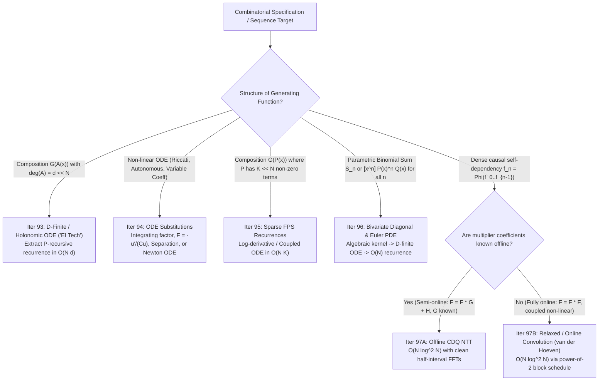
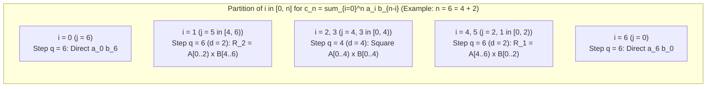

# Wave 5A Research Report (Cohort 2 — Independent Redundant Discovery): D-Finite ODEs, Sparse FPS, Euler's Homogeneous PDE, CDQ NTT & Relaxed Convolution (Iterations 93–97)

> [!IMPORTANT]
> **Cohort 2 Independent Discovery Notice**: This document is a self-contained, zero-magic-step mathematical and algorithmic reference covering Iterations 93 through 97 of the Formal Power Series (FPS) and Generating Functions curriculum. Every transformation, differential equation reduction, sparse recurrence, bivariate diagonal extraction, and convolution schedule is derived from first principles with explicit reverse-engineering scratchpads, verbal step-by-step annotations, hand-checkable toy traces ($n \le 4$), failure mode analyses, and a comprehensive non-template competitive programming problem audit.

---

## Executive Overview of Wave 5A

In competitive programming, standard polynomial templates (`inv`, `ln`, `exp`, `pow`, `sqrt`) operate on dense degree-$N$ formal power series in $O(N \log N)$ time via the Number-Theoretic Transform (NTT). However, four pervasive structural regimes arise in advanced enumeration where blind reliance on dense $O(N \log N)$ templates either **times out** ($N \sim 10^6 - 10^7$), **fails due to non-separable transitions**, or **obscures a 10-line $O(N)$ linear recurrence**:

1. **The D-Finite / Holonomic Regime (Iteration 93, `EI 科技`)**: When a generating function $F(x)$ is built by composing algebraic, exponential, logarithmic, or hypergeometric operations over a *low-degree* polynomial or rational function $A(x)$, $F(x)$ satisfies a linear ordinary differential equation (ODE) with polynomial coefficients. Translating this ODE into coefficient space yields a **P-recursive** linear recurrence of fixed bandwidth, dropping complexity from $O(N \log N)$ to $O(N)$ with minimal memory and zero NTT overhead.
2. **Differential Equation Simplification & Linearization (Iteration 94)**: Combinatorial specifications involving sizes, catalyst derivatives, or increasing labelings naturally yield **non-linear** or **coupled** differential equations (first-order linear with variable coefficients, Riccati equations $F' = A + BF + CF^2$, autonomous equations $F' = \Phi(F)$, or equations with radical prefactors). Systematic substitutions—integrating factors, the Cole–Hopf / Riccati logarithmic derivative $F = -\frac{u'}{Cu}$, compositional inversion, and independent variable changes $u = \phi(x)$—reduce these to solvable linear ODEs or Newton-iteration schemes.
3. **Sparse Formal Power Series in $O(N \cdot K)$ Time (Iteration 95)**: When the inner polynomial $P(x)$ has degree $N$ but only $K \ll N$ nonzero terms (e.g., pentagon/generalized pentagonal numbers, knapsack items of distinct sizes, or cyclotomic factors), differentiating $H(x) = \Phi(P(x))$ produces a coupled differential identity $P$-sparse in coefficient space, solvable in $O(N \cdot K)$ time.
4. **Euler's Homogeneous PDE & Creative Telescoping by Hand (Iteration 96)**: Families of binomial sums $S_n = \sum_k \binom{n}{k}\binom{n+k}{k} c^k$ or varying-power extractions $a_n = [x^n] P(x)^n Q(x)$ (for all $n = 0 \dots N$ simultaneously) cannot be solved by a single Lagrange Inversion when $P(0) \neq 0$ or when all $N$ values are needed in $O(N)$ time. Embedding the sequence as the diagonal $[x^n y^n]$ of a bivariate rational/algebraic surface or applying Euler's homogeneous differential operator $x\partial_x + y\partial_y$ extracts an $O(N)$ P-recursive recurrence directly.
5. **Divide-and-Conquer FFT (CDQ NTT) vs. Relaxed / Online Convolution (Iteration 97)**: When the coefficients of $F(x)$ depend causally on earlier coefficients via dense convolutions ($f_n = \sum_{i=1}^n g_i f_{n-i}$ or non-linear self-convolutions), offline **CDQ NTT** (when one operand is known in advance or via Newton + CDQ) and Joris van der Hoeven's **Relaxed / Online Convolution** (when *both* operands are constructed term-by-term on the fly) evaluate $F \bmod x^N$ in $O(N \log^2 N)$ time.



---

## Iteration 93: D-Finite (Holonomic) Series, P-Recursive Sequences, and Turning GFs into Linear ODEs (`EI 科技`)

### 93.1 Concrete Combinatorial & Algebraic Objects

Let $K$ be a field of characteristic $0$ (or a prime field $\mathbb{F}_p$ with $p > N$). We study two dual objects:

1. **D-Finite (Differentially Finite / Holonomic) Power Series**: A formal power series $F(x) = \sum_{n=0}^{\infty} a_n x^n \in K[[x]]$ is called **D-finite** (or **holonomic**) over $K(x)$ if the infinite sequence of its derivatives $F(x), F'(x), F''(x), \dots$ spans a **finite-dimensional vector space** over the field of rational functions $K(x)$. Equivalently, there exist polynomials $q_0(x), q_1(x), \dots, q_r(x) \in K[x]$, not all zero (with $q_r(x) \neq 0$), such that $F(x)$ satisfies a homogeneous linear ordinary differential equation (ODE) of **order** $r$ and **degree** $d = \max_{0 \le i \le r} \deg q_i(x)$:
   $$q_r(x) F^{(r)}(x) + q_{r-1}(x) F^{(r-1)}(x) + \dots + q_1(x) F'(x) + q_0(x) F(x) = 0.$$
   *(In competitive programming practice, an inhomogeneous right-hand side $R(x) \in K[x]$ of small degree is often kept explicitly—i.e., $\sum_{i=0}^r q_i(x) F^{(i)}(x) = R(x)$—because differentiating $\deg R + 1$ times to make it homogeneous increases the ODE order unnecessarily when extracting coefficients for $n > \deg R$.)*

2. **P-Recursive (Polynomially Recursive / Holonomic) Sequence**: A sequence $(a_n)_{n \ge 0} \in K^{\mathbb{N}}$ is called **P-recursive** of **order** $s$ and **degree** $m$ if there exist polynomials $p_0(n), p_1(n), \dots, p_s(n) \in K[n]$ of degree at most $m$ (with $p_0(n) \neq 0$) such that for all sufficiently large $n \ge n_0$:
   $$p_0(n) a_n + p_1(n) a_{n-1} + \dots + p_s(n) a_{n-s} = 0.$$

---

### 93.2 The Diagnostic Signal

How do you recognize during a contest that a problem should be solved via the D-finite / ODE method (`EI 科技`) rather than $O(N \log N)$ polynomial operations?

- **Visual Clue 1 (Tight Time Limit / Huge $N$)**: You need $[x^N] F(x)$ (or all $[x^0]F(x), \dots, [x^N]F(x)$) for $N \in [5 \times 10^5, 10^7]$, where an $O(N \log N)$ NTT polynomial `exp`, `ln`, or `pow` would TLE or MLE, OR you need $O(N)$ preprocessing to answer $Q$ queries in $O(1)$ each.
- **Visual Clue 2 (Low-Degree Inner Core)**: The generating function $F(x)$ is an algebraic power, exponential, logarithm, or hypergeometric series evaluated at a **rational function or low-degree polynomial** $A(x)$ (typically $\deg A \le 5$), such as:
  $$F(x) = (1 - 3x - x^2)^{\alpha}, \quad F(x) = \exp\!\left(\frac{x + x^2}{1 - x}\right), \quad F(x) = \frac{1}{\sqrt{1 - 2x - 3x^2}}, \quad F(x) = \sum_{k \ge 0} c_k A(x)^k$$
  where $(c_k)$ itself is a simple P-recursive sequence (such as $c_k = \frac{1}{k!}$, $c_k = \binom{2k}{k}$, or $c_k = \frac{1}{k+1}\binom{2k}{k}$).
- **Visual Clue 3 (Algebraic Equation)**: $F(x)$ satisfies a polynomial equation $P(x, F(x)) = 0$ of small degree in $F$ and $x$ (by Abel–Cockle–Harley–Comtet theorem, every algebraic series is D-finite!).

---

### 93.3 The Fundamental Equivalence & Operator Dictionary

#### Reverse-Engineering Scratchpad: Translating Between $x^j D^i$ and Coefficient Shifts

Suppose we have a linear ODE with polynomial coefficients $\sum_{i=0}^r q_i(x) F^{(i)}(x) = R(x)$. How do we mechanically extract the recurrence for $a_n = [x^n] F(x)$ without making off-by-one errors in the indices or falling-factorial factors?

There are two standard bases for linear differential operators with polynomial coefficients (the **Weyl algebra** $K[x]\langle D \rangle$ where $D = \frac{d}{dx}$ and $[D, x] = Dx - xD = 1$):

1. **The Monomial-Derivative Basis $\{x^j D^i\}$**:
   Write the ODE as a sum of terms $c_{i,j} x^j F^{(i)}(x)$. Let us compute $[x^n] \left(x^j F^{(i)}(x)\right)$:
   - First, shifting by $x^j$ means $[x^n] \left(x^j F^{(i)}(x)\right) = [x^{n-j}] F^{(i)}(x)$.
   - Second, differentiating $i$ times turns $a_k x^k$ into $k(k-1)\cdots(k-i+1) a_k x^{k-i} = k^{\underline{i}} a_k x^{k-i}$.
   - Setting $k - i = n - j \implies k = n + i - j$, we obtain the **Golden Extraction Rule**:
     $$[x^n] \Big( x^j F^{(i)}(x) \Big) = (n + i - j)^{\underline{i}} \, a_{n + i - j} = (n - j + 1)^{\overline{i}} \, a_{n + i - j}.$$
   Notice the index shift: $x^j D^i$ shifts the coefficient index by $\Delta = i - j$. If we align our extraction at $[x^{n-1}]$ or $[x^n]$ so that the **highest index** appearing across all terms is $a_n$, we immediately isolate $a_n$ in terms of $a_{n-1}, a_{n-2}, \dots$!

2. **The Theta Operator Basis $\{x^s \vartheta^i\}$ where $\vartheta = x \frac{d}{dx}$**:
   The Euler homogeneity operator $\vartheta = x D$ acts diagonally on monomials:
   $$\vartheta(x^n) = n x^n \implies [x^n] \Big( x^s \vartheta^i F(x) \Big) = (n - s)^i \, a_{n - s}.$$
   Here the index shift depends *only* on the external power $x^s$, and $\vartheta^i$ simply multiplies $a_{n-s}$ by $(n-s)^i$. Because $x^i D^i = \vartheta(\vartheta - 1)\cdots(\vartheta - i + 1)$, multiplying an order-$r$ ODE by $x^r$ converts every term $x^{j+r-i} (x^i D^i)$ into a pure shift $x^s$ times a polynomial in $\vartheta$.

| Operator Term in ODE | Coefficient $[x^n]$ Extracted | Index Referenced | Polynomial Multiplier in $n$ |
| :--- | :--- | :--- | :--- |
| $F(x)$ | $a_n$ | $n$ | $1$ |
| $x^j F(x)$ | $a_{n-j}$ | $n-j$ | $1$ |
| $F'(x)$ | $(n+1) a_{n+1}$ | $n+1$ | $n+1$ |
| $x^j F'(x)$ | $(n-j+1) a_{n-j+1}$ | $n-j+1$ | $n-j+1$ |
| $F''(x)$ | $(n+2)(n+1) a_{n+2}$ | $n+2$ | $(n+2)(n+1)$ |
| $x^j F^{(i)}(x)$ | $(n+i-j)^{\underline{i}}\, a_{n+i-j}$ | $n+i-j$ | $\prod_{t=1}^{i} (n - j + t)$ |
| $x^s \vartheta^i F(x)$ | $(n-s)^i a_{n-s}$ | $n-s$ | $(n-s)^i$ |

#### Theorem 93.1 (D-Finite $\iff$ P-Recursive Bandwidth Bounds)
Let $F(x) = \sum_{n \ge 0} a_n x^n \in K[[x]]$.
1. If $F(x)$ satisfies a linear ODE $\sum_{i=0}^r q_i(x) F^{(i)}(x) = 0$ of order $r$ and polynomial degree $d = \max_i \deg q_i(x)$, then $(a_n)$ satisfies a P-recursive relation of **order at most $r + d$** and **polynomial degree in $n$ at most $r$**.
2. Conversely, if $(a_n)$ satisfies a P-recursive relation $\sum_{s=0}^S p_s(n) a_{n-s} = 0$ of order $S$ and degree $M = \max_s \deg p_s(n)$, then $F(x)$ satisfies a linear ODE of **order at most $M$** and **polynomial degree at most $S + M$**.

**Proof**: In $\sum_{i=0}^r \sum_{j=0}^d c_{i,j} x^j F^{(i)}(x) = 0$, the coefficient $[x^n]$ involves indices $a_{n + i - j}$. Since $0 \le i \le r$ and $0 \le j \le d$, the offset $\Delta = i - j$ ranges in $[-d, r]$, spanning at most $r + d + 1$ consecutive indices (hence recurrence order $\le r + d$). Each multiplier $(n+i-j)^{\underline{i}}$ has degree $i \le r$ in $n$. Conversely, rewrite $p_s(n-s)$ as a polynomial in $(n-s)$ of degree $\le M$; then $\sum_{s=0}^S x^s p_s(\vartheta) F(x)$ is a polynomial of degree $\le \max(S, \text{boundary})$ in $x$ and order $M$ in $\vartheta = xD$; expanding $\vartheta^i = \sum_{k=1}^i \left\{ \begin{matrix} i \\ k \end{matrix} \right\} x^k D^k$ yields a linear ODE of order $\le M$ and degree $\le S + M$. $\blacksquare$

---

### 93.4 Closure Properties of D-Finite Series (The Linear Algebra Paradigm)

Why do D-finite series cover such a vast class of generating functions? Because checking D-finiteness is pure **finite-dimensional linear algebra over the rational function field $K(x)$**.

Let $V_F = \operatorname{span}_{K(x)}\{F(x), F'(x), F''(x), \dots\} \subseteq K((x))$. By definition, $F$ is D-finite of order $\le r$ if and only if $\dim_{K(x)} V_F \le r$. Specifically, if $F^{(r)} \in \operatorname{span}_{K(x)}\{F, F', \dots, F^{(r-1)}\}$, then by differentiating both sides and applying the product rule, $F^{(r+1)}$ also lies in $\operatorname{span}_{K(x)}\{F, F', \dots, F^{(r-1)}\}$, so the subspace stabilizes at dimension $\le r$.

1. **Sum ($F + G$)**:
   Every derivative $(F + G)^{(k)} = F^{(k)} + G^{(k)}$ lies in $V_F + V_G$. Thus:
   $$\dim_{K(x)} V_{F+G} \le \dim_{K(x)} V_F + \dim_{K(x)} V_G = r_F + r_G.$$
2. **Cauchy Product ($F \cdot G$)**:
   By Leibniz's rule, $(F \cdot G)^{(k)} = \sum_{j=0}^k \binom{k}{j} F^{(j)} G^{(k-j)}$ lies in the tensor/product span $V_F \cdot V_G = \operatorname{span}_{K(x)}\{F^{(i)} G^{(j)} : 0 \le i < r_F, 0 \le j < r_G\}$. Thus:
   $$\dim_{K(x)} V_{F \cdot G} \le r_F \cdot r_G.$$
3. **Algebraic Functions are D-Finite**:
   Suppose $P(x, F(x)) = 0$ where $P(x, y) \in K(x)[y]$ is a square-free polynomial of degree $d$ in $y$. Since $K(x)[F] \cong K(x)[y] / (P(x,y))$ is a $d$-dimensional vector space over $K(x)$ with basis $\{1, F, F^2, \dots, F^{d-1}\}$, differentiating $P(x, F(x)) = 0$ with respect to $x$ yields:
   $$P_x(x, F) + P_y(x, F) F'(x) = 0 \implies F'(x) = -\frac{P_x(x, F)}{P_y(x, F)} \in K(x)[F]$$
   (since $\gcd(P, P_y) = 1$, $P_y(x, F)$ is invertible in $K(x)[F]$). By induction, every higher derivative $F^{(k)}(x)$ lies in $K(x)[F]$, which has dimension $d$ over $K(x)$. Thus **every degree-$d$ algebraic series satisfies a linear ODE of order at most $d$** (and if $1 \in K(x)$ is separated as an inhomogeneous right-hand side, a linear inhomogeneous ODE of order at most $d-1$).
4. **Composition $G(A(x))$ where $G$ is D-finite and $A(x)$ is Algebraic (in particular, $A(x) \in K(x)$)**:
   Suppose $G(u)$ satisfies an order-$r$ linear ODE over $K(u)$, and $A(x)$ is algebraic over $K(x)$ (with $\operatorname{val}(A(x)) \ge 1$ so composition is well-defined in $K[[x]]$). Let $H(x) = G(A(x))$. By the chain rule:
   $$H'(x) = A'(x) G'(A(x)), \quad H''(x) = A''(x) G'(A(x)) + (A'(x))^2 G''(A(x)), \dots$$
   Every $H^{(k)}(x)$ is a linear combination of $\{G(A(x)), G'(A(x)), \dots, G^{(r-1)}(A(x))\}$ with coefficients in the algebraic extension $K(x, A(x))$. If $A(x) \in K(x)$ is a **rational function**, then $K(x, A(x)) = K(x)$, so $H(x) = G(A(x))$ satisfies a linear ODE over $K(x)$ of the **exact same order $r$** as $G(u)$!

> [!CAUTION]
> **Non-Closure Under General Composition & Reciprocal**:
> If $F(x)$ and $G(x)$ are both D-finite, neither $1/F(x)$ nor $F(G(x))$ is guaranteed to be D-finite!
> - **Counterexample for $1/F(x)$**: $F(x) = \cos(x)$ is D-finite ($F'' + F = 0$), but $1/\cos(x) = \sec(x)$ (the EGF of Euler zigzag numbers) has infinitely many poles $\pm \frac{\pi}{2}, \pm \frac{3\pi}{2}, \dots$ in $\mathbb{C}$, whereas any solution to a linear ODE with polynomial coefficients can only have singularities at the finitely many roots of the leading polynomial $q_r(x)$! Thus $\sec(x)$ and $\tan(x)$ are **not** D-finite.
> - **Counterexample for $F(G(x))$**: $F(u) = \exp(u)$ and $G(x) = \exp(x) - 1$ are both D-finite of order $1$, but the Bell number EGF $F(G(x)) = \exp(\exp(x) - 1)$ is **not** D-finite.

---

### 93.5 The Mechanical Recipe (`EI 科技`): Turning $G(A(x))$ into a Linear ODE

In Chinese competitive programming literature (popularized by Elegia / 吕欣 / `EntropyIncreaser`), `EI 科技` (the ODE method) refers to the systematic replacement of $O(N \log N)$ polynomial operations on $H(x) = G(A(x))$ by constructing the linear ODE for $H(x)$ and reading off a linear recurrence for $[x^n] H(x)$.

#### Reverse-Engineering Scratchpad: How to Construct the ODE Without Guessing

Suppose $H(x) = G(A(x))$, where $A(x) = \frac{P(x)}{Q(x)}$ is a known low-degree polynomial or rational function, and $G(u)$ is a standard elementary or hypergeometric function. How do we derive the ODE for $H(x)$?

- **Case 1: First-Order D-Finite Cores ($G(u) = u^\alpha$, $G(u) = \exp(u)$, $G(u) = \ln(u)$)**
  1. Differentiate $H(x)$ once using the chain rule.
  2. Express $H'(x)$ as a rational multiple of $H(x)$ (or $1$, for $\ln$).
  3. Clear denominators by multiplying both sides by the denominator polynomial.
  4. Extract $[x^{n-1}]$ (since $H'(x)$ has $[x^{n-1}] H'(x) = n h_n$) to isolate $h_n$.

Let us tabulate the exact first-order ODEs and their coefficient recurrences when $A(x) = \sum_{k=0}^d a_k x^k$ is a polynomial of degree $d$:

| Target Function $H(x)$ | Step 1: Differentiate & Relate to $H(x)$ | Step 2: Polynomial-Coefficient ODE | Step 3: Coefficient Extraction at $[x^{n-1}]$ | Cost for $N$ terms |
| :--- | :--- | :--- | :--- | :--- |
| $H(x) = A(x)^\alpha$ | $H' = \alpha A^{\alpha - 1} A' = \frac{\alpha A'}{A} H$ | $A(x) H'(x) - \alpha A'(x) H(x) = 0$ | $n a_0 h_n = \sum_{k=1}^{\min(d, n)} (\alpha k - (n-k)) a_k h_{n-k}$ | $O(N d)$ |
| $H(x) = \exp(A(x))$ | $H' = A' \exp(A) = A' H$ | $H'(x) - A'(x) H(x) = 0$ | $n h_n = \sum_{k=1}^{\min(d, n)} k a_k h_{n-k}$ | $O(N d)$ |
| $H(x) = \ln(A(x))$ | $H' = \frac{A'}{A}$ | $A(x) H'(x) = A'(x)$ | $n a_0 h_n = n a_n - \sum_{k=1}^{\min(d, n-1)} (n-k) a_k h_{n-k}$ | $O(N d)$ |
| $H(x) = \frac{B(x)}{A(x)^\alpha}$ | $H' = \frac{B' A - \alpha B A'}{A^{\alpha+1}}$ | $A H' + \alpha A' H = B' \text{ (if } B=1 \text{)}$ | Set $H = B \cdot A^{-\alpha}$ or apply quotient ODE | $O(N d)$ |

- **Case 2: General Order-$r$ D-Finite Outer Function $G(u)$ Composed with $A(x)$**
  Suppose $G(u)$ satisfies a second-order linear ODE:
  $$c_2(u) G''(u) + c_1(u) G'(u) + c_0(u) G(u) = 0$$
  (for example, $G(u) = \sum_{k \ge 0} \binom{2k}{k} u^k = (1-4u)^{-1/2}$, or Bessel functions $G(u) = \sum_{k \ge 0} \frac{u^k}{(k!)^2}$ where $u G'' + G' - G = 0$, or Catalan/Motzkin/Delannoy generating functions).
  We want the ODE for $H(x) = G(A(x))$:
  1. Express $G(A(x)), G'(A(x)), G''(A(x))$ in terms of $H(x), H'(x), H''(x)$ via the chain rule:
     $$G(A) = H, \qquad G'(A) = \frac{H'}{A'}, \qquad G''(A) = \frac{1}{A'} \frac{d}{dx}\!\left(\frac{H'}{A'}\right) = \frac{A' H'' - A'' H'}{(A')^3}.$$
  2. Substitute these directly into $c_2(A(x)) G''(A(x)) + c_1(A(x)) G'(A(x)) + c_0(A(x)) G(A(x)) = 0$:
     $$c_2(A(x)) \Big( A'(x) H''(x) - A''(x) H'(x) \Big) + c_1(A(x)) (A'(x))^2 H'(x) + c_0(A(x)) (A'(x))^3 H(x) = 0.$$
  3. Clear any rational denominators in $A(x)$ and extract $[x^{n-2}]$ (or $[x^{n-1}]$) to get a linear recurrence for $h_n$!

---

### 93.6 Step-by-Step Algebraic Derivation & Verbal Annotations

Let us derive two canonical workhorses of `EI 科技` in full detail.

#### Derivation A: Generalized Binomial Power of a Rational Function
Suppose we need the coefficients of:
$$H(x) = \frac{(P(x))^\alpha}{(Q(x))^\beta} \pmod{x^{N+1}}$$
where $P(x), Q(x) \in K[x]$ are polynomials of small degrees $d_P, d_Q$ with $P(0) \neq 0, Q(0) \neq 0$, and $\alpha, \beta \in K$.

1. **Take the formal logarithmic derivative** of $H(x) = P(x)^\alpha Q(x)^{-\beta}$:
   $$\frac{H'(x)}{H(x)} = \alpha \frac{P'(x)}{P(x)} - \beta \frac{Q'(x)}{Q(x)}.$$
   *(Verbal annotation: Logarithmic differentiation turns products and arbitrary exponents $\alpha, \beta$ into linear sums of simple fractions without needing to expand $P^\alpha$ or $Q^{-\beta}$.)*
2. **Clear denominators** by multiplying both sides by $P(x) Q(x) H(x)$:
   $$P(x) Q(x) H'(x) = \Big( \alpha P'(x) Q(x) - \beta P(x) Q'(x) \Big) H(x).$$
   *(Verbal annotation: Define auxiliary known polynomials $U(x) = P(x) Q(x)$ of degree $d = d_P + d_Q$, and $V(x) = \alpha P'(x) Q(x) - \beta P(x) Q'(x)$ of degree $\le d - 1$. Both $U(x) = \sum_{k=0}^d u_k x^k$ and $V(x) = \sum_{k=0}^{d-1} v_k x^k$ can be precomputed in $O(d^2)$ time before the main loop!)*
3. **Write the compact first-order polynomial ODE**:
   $$U(x) H'(x) = V(x) H(x).$$
4. **Extract $[x^{n-1}]$ on both sides** for $n \ge 1$:
   $$\sum_{k=0}^{\min(d, n-1)} u_k (n - k) h_{n-k} = \sum_{j=0}^{\min(d-1, n-1)} v_j h_{n-1-j}.$$
5. **Re-index the right-hand side** by setting $k = j + 1$ (so $n - 1 - j = n - k$, where $1 \le k \le \min(d, n)$) and isolate the $k=0$ term $u_0 n h_n$ on the left:
   $$n u_0 h_n = \sum_{k=1}^{\min(d, n)} \Big( v_{k-1} - (n - k) u_k \Big) h_{n-k}.$$
   *(Verbal annotation: Since $u_0 = P(0)Q(0) \neq 0$, we divide by $n u_0$ at each step $n = 1, 2, \dots, N$, computing each $h_n$ in $O(d)$ operations!)*

---

### 93.7 Hand-Checkable Toy Example ($n \le 4$)

Let us trace **Central Delannoy Numbers** $D_n = [x^n] H(x)$ where:
$$H(x) = \frac{1}{\sqrt{1 - 6x + x^2}} = (1 - 6x + x^2)^{-1/2}.$$
Here $P(x) = 1$ ($\alpha = 0$) and $Q(x) = 1 - 6x + x^2$ ($\beta = 1/2, d = 2$).
- Precompute $U(x) = Q(x) = 1 - 6x + x^2 \implies u_0 = 1, u_1 = -6, u_2 = 1$.
- Precompute $V(x) = -\beta Q'(x) = -\frac{1}{2}(-6 + 2x) = 3 - x \implies v_0 = 3, v_1 = -1$.
- The recurrence is:
  $$n h_n = \Big(v_0 - (n-1)u_1\Big) h_{n-1} + \Big(v_1 - (n-2)u_2\Big) h_{n-2} = \Big(3 + 6(n-1)\Big) h_{n-1} + \Big(-1 - (n-2)\Big) h_{n-2}$$
  $$n h_n = (6n - 3) h_{n-1} - (n - 1) h_{n-2}.$$
Let us trace $n = 0, 1, 2, 3, 4$:
- **Base case ($n = 0$)**: $h_0 = (1)^{-1/2} = 1$.
- **$n = 1$**: $1 \cdot h_1 = (6(1) - 3) h_0 - 0 = 3(1) = 3 \implies h_1 = 3$.
- **$n = 2$**: $2 \cdot h_2 = (6(2) - 3) h_1 - (2 - 1) h_0 = 9(3) - 1(1) = 26 \implies h_2 = 13$.
- **$n = 3$**: $3 \cdot h_3 = (6(3) - 3) h_2 - (3 - 1) h_1 = 15(13) - 2(3) = 195 - 6 = 189 \implies h_3 = 63$.
- **$n = 4$**: $4 \cdot h_4 = (6(4) - 3) h_3 - (4 - 1) h_2 = 21(63) - 3(13) = 1323 - 39 = 1284 \implies h_4 = 321$.

**Independent Verification**: The central Delannoy numbers are $D_n = \sum_{k=0}^n \binom{n}{k}\binom{n+k}{k}$:
- $D_0 = 1$
- $D_1 = \binom{1}{0}\binom{1}{0} + \binom{1}{1}\binom{2}{1} = 1 + 2 = 3$
- $D_2 = 1 + 2\cdot 3 + 1\cdot 6 = 13$
- $D_3 = 1 + 3\cdot 4 + 3\cdot 10 + 1\cdot 20 = 63$
- $D_4 = 1 + 4\cdot 5 + 6\cdot 15 + 4\cdot 35 + 1\cdot 70 = 321$.
Exact match!

---

### 93.8 Failure Modes, Pitfalls & Edge Cases

1. **Vanishing Constant Term $U(0) = 0$ (Regular vs. Irregular Singular Point at $x=0$)**:
   If $P(0) = 0$ or $Q(0) = 0$, then $u_0 = 0$, so the coefficient of $h_n$ in the $[x^{n-1}]$ equation vanishes!
   - **Fix 1 (Valuation Factorization)**: Always factor out the lowest power of $x$ *before* differentiating: write $P(x) = x^{v_P} \tilde{P}(x)$ with $\tilde{P}(0) \neq 0$, apply the ODE method to $\tilde{P}(x)^\alpha \tilde{Q}(x)^{-\beta}$, and shift the resulting coefficients by $\alpha v_P - \beta v_Q$.
   - **Fix 2 (Indicial Polynomial Roots in $\mathbb{N}$)**: In higher-order ODEs $\sum_{i=0}^r q_i(x) F^{(i)}(x) = 0$, the multiplier of $a_n$ is the **indicial polynomial** $I(n) = \sum_{i=0}^r ([x^i] q_i(x)) n^{\underline{i}}$ (assuming $\operatorname{val}(q_i) \ge i - s$). If $I(n_0) = 0$ for some positive integer $n_0$, the ODE alone does not uniquely determine $a_{n_0}$ from $a_0, \dots, a_{n_0-1}$! You must compute $a_0, \dots, a_{n_0}$ directly (e.g., via brute-force expansion or small-degree polynomial ops) and only run the recurrence for $n > n_0$.
2. **Division by Zero Modulo Small Prime $p \le N$**:
   Because the recurrence divides by $I(n)$ (e.g., $n u_0$), if $p \le N$, then at $n = p, 2p, \dots$, we have $n \equiv 0 \pmod p$! The ODE method over $\mathbb{F}_p$ strictly requires $I(n) \not\equiv 0 \pmod p$ for all $n \le N$ (typically $p = 998244353 > N$).
3. **Apparent Singularities from $A'(x)$ in Order-2 Compositions**:
   Notice in Case 2 ($H(x) = G(A(x))$ for order-2 $G$) that clearing $(A')^3$ introduced factors of $A'(x)$ into the leading coefficient of $H''(x)$. Even if $A(0) = 0$, if $A'(0) = 0$ (i.e., $\operatorname{val}(A) \ge 2$), the leading polynomial of $H''$ has valuation $\ge 1$, shifting the alignment index from $[x^{n-2}]$ to $[x^{n-2 + \operatorname{val}(A')}]$. Always check which power of $x$ actually has the highest-index term $h_n$ with a non-zero multiplier!

---

## Iteration 94: Simplifying Differential Equations via Substitution & Variable Change

Combinatorial specifications involving labeled structures (EGFs), ordered trees, or differential catalysts frequently produce differential equations that are **not** immediately in homogeneous constant- or low-degree-linear form. Below are the four essential algebraic transformations that reduce messy ODEs to solvable forms.

---

### 94.1 Pattern 1: First-Order Linear ODEs (Integrating Factors) & Newton Linearization of Non-Linear ODEs

#### Concrete Object & Diagnostic Signal
- **Linear Form**: $F'(x) + P(x) F(x) = Q(x)$ with initial condition $F(0) = f_0$, where $P(x), Q(x) \in K[[x]]$ are arbitrary dense formal power series known up to $x^N$.
- **Non-Linear Form**: $F'(x) = G(x, F(x)) \pmod{x^N}$ with $F(0) = f_0$, where $G(x, y)$ is a smooth bivariate expression (e.g., $F'(x) = \exp(F(x)) + x F(x)^3$).
- **Diagnostic Signal**: An EGF recurrence of the form $n a_n = \sum_{k=0}^{n-1} \binom{n}{k} \dots$ where the multiplier depends asymmetrically on $k$ vs. $n-k$ (meaning $F'(x)$ appears alongside $F(x)$).

#### Reverse-Engineering Scratchpad
1. **Why the Integrating Factor Works**:
   In $F'(x) + P(x) F(x) = Q(x)$, the left-hand side looks like the product rule $(R(x) F(x))' = R(x) F'(x) + R'(x) F(x)$ *if and only if* we can choose a unit series $R(x) \in K[[x]]^\times$ such that:
   $$R'(x) = R(x) P(x) \iff \frac{R'(x)}{R(x)} = P(x) \iff R(x) = \exp\!\left(\int_0^x P(t)\,dt\right).$$
   Notice that $\int_0^x P(t)\,dt$ automatically has zero constant term ($\operatorname{val} \ge 1$), so its formal exponential $R(x)$ is well-defined in $K[[x]]$ with $R(0) = 1$!
   Multiplying the ODE by $R(x)$ collapses the LHS into a single derivative:
   $$\frac{d}{dx}\Big( R(x) F(x) \Big) = R(x) Q(x) \implies F(x) = R(x)^{-1} \left( f_0 + \int_0^x R(t) Q(t)\,dt \right).$$
2. **How to Solve Non-Linear $F'(x) = G(x, F(x))$ via Newton + Integrating Factor**:
   Suppose we know $F_k(x) \equiv F(x) \pmod{x^m}$, and we want $F_{k+1}(x) \equiv F(x) \pmod{x^{2m}}$. Write $F_{k+1} = F_k + \Delta$ with $\Delta = O(x^m)$. Taylor-expanding $G(x, F_k + \Delta)$ to first order in $\Delta$ gives:
   $$F_k'(x) + \Delta'(x) \equiv G(x, F_k(x)) + \frac{\partial G}{\partial y}(x, F_k(x)) \Delta(x) \pmod{x^{2m}}.$$
   Rearranging for the unknown correction $\Delta(x)$ yields a **first-order linear ODE** modulo $x^{2m}$:
   $$\Delta'(x) - G_y(x, F_k(x)) \Delta(x) \equiv G(x, F_k(x)) - F_k'(x) \pmod{x^{2m}}, \quad \Delta(0) = 0!$$
   Applying the integrating factor $R(x) = \exp\!\left(-\int_0^x G_y(t, F_k(t))\,dt\right) \pmod{x^{2m}}$, we get the quadratic-convergence doubling step:
   $$F_{k+1}(x) \equiv F_k(x) + R(x)^{-1} \int_0^x R(t) \Big( G(t, F_k(t)) - F_k'(t) \Big)\,dt \pmod{x^{2m}}.$$
   By the Master Theorem $T(N) = T(N/2) + O(N \log N)$, this solves *any* first-order non-linear ODE in $O(N \log N)$ time!

#### Reference Implementation (Newton + Integrating Factor for $F' = G(x, F)$, after Nyaan)
```cpp
// Solves F'(x) = G(x, F(x)) mod x^N given F(0) = f0.
// g_and_gf(F, m) returns pair {G(x, F) mod x^m, dG/dF(x, F) mod x^m}.
template <typename Poly, typename Func>
Poly solve_nonlinear_first_order_ode(Func g_and_gf, typename Poly::value_type f0, int N) {
    Poly f = {f0};
    for (int m = 1; m < N; m <<= 1) {
        int next_m = std::min(N, m << 1);
        auto [g, gf] = g_and_gf(f, next_m); // evaluate G(x, f) and G_f(x, f) mod x^{next_m}
        // Integrating factor r = exp(-integral(gf)) mod x^{next_m}
        Poly minus_gf = (-gf).pre(next_m - 1);
        Poly r = minus_gf.integral().exp(next_m);
        Poly inv_r = r.inv(next_m);
        // RHS = G(x, f) - f'(x) mod x^{next_m - 1}
        Poly rhs = (g - f.deriv()).pre(next_m - 1);
        // Delta = inv_r * integral(r * rhs) mod x^{next_m}
        Poly delta = ((r * rhs).pre(next_m - 1).integral() * inv_r).pre(next_m);
        f = (f + delta).pre(next_m);
    }
    return f.pre(N);
}
```

---

### 94.2 Pattern 2: Riccati Equations to Second-Order Linear ODEs ($F = -\frac{u'}{Cu}$)

#### Concrete Object & Diagnostic Signal
A **Riccati differential equation** is a first-order quadratic ODE of the form:
$$F'(x) = A(x) + B(x) F(x) + C(x) F(x)^2$$
where $A(x), B(x), C(x) \in K(x)$ are known rational functions (or low-degree polynomials) with $C(x) \neq 0$.
- **Diagnostic Signal**: In combinatorial enumeration, a Riccati equation arises whenever a structure decomposes into **either** a derivative/marked-vertex operation ($F'(x)$) **or** an ordered pair of sub-structures ($C(x) F(x)^2$) plus a linear modification ($B(x) F(x)$) and base cases ($A(x)$). Trying to solve $F' = A + BF + CF^2$ directly in coefficient space yields a dense $O(N^2)$ (or $O(N \log^2 N)$ CDQ) convolution $\sum_{k=0}^n f_k f_{n-k}$. However, when $A, B, C$ are low-degree polynomials/rationals, we can **linearize** the equation completely into an $O(N)$ P-recursive recurrence!

#### Reverse-Engineering Scratchpad: How to Discover $F(x) = -\frac{u'(x)}{C(x) u(x)}$
Why does a logarithmic derivative cancel the quadratic $F(x)^2$ term?
Let us test an ansatz $F(x) = \alpha(x) \frac{u'(x)}{u(x)}$ where $u(x)$ is a new unknown series with $u(0) = 1$, and $\alpha(x)$ is a multiplier to be chosen.
Differentiate $F(x)$ using the quotient and product rules:
$$F'(x) = \alpha'(x) \frac{u'}{u} + \alpha(x) \left( \frac{u''}{u} - \left(\frac{u'}{u}\right)^2 \right).$$
Look at the non-linear term $\left(\frac{u'}{u}\right)^2 = \frac{1}{\alpha(x)^2} F(x)^2$:
- On the LHS ($F'$), the coefficient of $\left(\frac{u'}{u}\right)^2$ is $-\alpha(x)$.
- On the RHS ($A + BF + CF^2$), the coefficient of $\left(\frac{u'}{u}\right)^2$ is $C(x) \alpha(x)^2$.
To make these two quadratic terms **cancel identically**, we set:
$$-\alpha(x) = C(x) \alpha(x)^2 \implies \alpha(x) = -\frac{1}{C(x)}!$$

#### Step-by-Step Algebraic Derivation
1. Substitute $F(x) = -\frac{u'(x)}{C(x) u(x)}$ into $F'(x) = A(x) + B(x) F(x) + C(x) F(x)^2$:
   $$\text{LHS} = F'(x) = -\frac{u''(x)}{C(x) u(x)} + \frac{C'(x) u'(x)}{C(x)^2 u(x)} + \frac{(u'(x))^2}{C(x) u(x)^2}.$$
   $$\text{RHS} = A(x) - \frac{B(x) u'(x)}{C(x) u(x)} + \frac{(u'(x))^2}{C(x) u(x)^2}.$$
2. Subtract $\frac{(u'(x))^2}{C(x) u(x)^2}$ from both sides (the quadratic non-linearity vanishes!) and multiply through by $-C(x)^2 u(x)$:
   $$C(x) u''(x) - \Big( C'(x) + B(x) C(x) \Big) u'(x) + A(x) C(x)^2 u(x) = 0.$$
3. **Initial Conditions for $u(x)$**:
   Since $F(x) = -\frac{u'(x)}{C(x) u(x)}$ is invariant under scaling $u(x) \mapsto \lambda u(x)$, we normalize $u(0) = 1$. Then:
   - If $C(0) \neq 0$, then $u'(0) = -C(0) F(0)$.
   - If $C(x) = x^v \tilde{C}(x)$ with $v \ge 1$ and $\tilde{C}(0) \neq 0$, rewrite the substitution as $C(x) F(x) = -\frac{u'(x)}{u(x)}$, so $\frac{u'(x)}{u(x)} = -x^v \tilde{C}(x) F(x)$, meaning $u(x) = \exp\!\left(-\int_0^x C(t) F(t)\,dt\right)$ automatically has $u(0)=1, u'(0)=\dots=u^{(v)}(0)=0$!
4. **Algorithmic Payoff**:
   If $A, B, C$ are low-degree polynomials, the transformed equation for $u(x)$ is a **second-order linear homogeneous ODE with polynomial coefficients**! By Iteration 93, we compute $u_0, u_1, \dots, u_N$ in $O(N)$ time via a P-recursive recurrence, and then if we need $F(x)$ itself, either:
   - If $C(x)$ is a sparse polynomial, compute $F(x)$ from $C(x) u(x) F(x) = -u'(x)$ in $O(N \cdot \deg C)$ time via sparse polynomial division (Iteration 95)!
   - Or in $O(N \log N)$ via a single polynomial inversion $u(x)^{-1}$ instead of a heavyweight Newton ODE loop.

#### Hand-Checkable Toy Example ($n \le 4$)
Consider the Riccati ODE:
$$F'(x) = 1 + 2x F(x) + F(x)^2, \qquad F(0) = 0.$$
Here $A(x) = 1, B(x) = 2x, C(x) = 1$.
1. Set $F(x) = -\frac{u'(x)}{u(x)}$ with $u(0) = 1$ and $u'(0) = -F(0) = 0$.
2. The linearized second-order ODE is:
   $$u''(x) - 2x u'(x) + u(x) = 0.$$
3. Extract $[x^{n-2}]$ for $n \ge 2$:
   $$n(n-1) u_n - 2(n-2) u_{n-2} + u_{n-2} = 0 \implies n(n-1) u_n = (2n - 5) u_{n-2}.$$
4. Trace $u_n$ for $n = 0, 1, 2, 3, 4, 5$:
   - $u_0 = 1, u_1 = 0$.
   - $n = 2$: $2(1) u_2 = (4 - 5) u_0 = -1 \implies u_2 = -\frac{1}{2}$.
   - $n = 3$: $6 u_3 = 1 \cdot u_1 = 0 \implies u_3 = 0$.
   - $n = 4$: $12 u_4 = (8 - 5) u_2 = 3(-\frac{1}{2}) \implies u_4 = -\frac{1}{8}$.
   - $n = 5$: $u_5 = 0$.
   Thus $u(x) = 1 - \frac{1}{2}x^2 - \frac{1}{8}x^4 - \dots = \sqrt{1 - x^2}$!
5. Recover $F(x)$ from $u(x) F(x) = -u'(x) = x + \frac{1}{2}x^3 + \dots$:
   - $[x^0]$: $f_0 = 0$.
   - $[x^1]$: $f_1 = 1$.
   - $[x^2]$: $f_2 - \frac{1}{2} f_0 = 0 \implies f_2 = 0$.
   - $[x^3]$: $f_3 - \frac{1}{2} f_1 = \frac{1}{2} \implies f_3 = 1$.
   - $[x^4]$: $f_4 = 0$.
   Indeed, $F(x) = -\frac{(\sqrt{1-x^2})'}{\sqrt{1-x^2}} = \frac{x}{1-x^2} = x + x^3 + x^5 + \dots$, and checking the original ODE:
   $F'(x) = \frac{1+x^2}{(1-x^2)^2}$, while $1 + 2x F + F^2 = 1 + \frac{2x^2}{1-x^2} + \frac{x^2}{(1-x^2)^2} = \frac{(1-x^2)^2 + 2x^2(1-x^2) + x^2}{(1-x^2)^2} = \frac{1+x^2}{(1-x^2)^2}$. Exact match!

---

### 94.3 Pattern 3: Autonomous Differential Equations $F'(x) = \Phi(F(x))$ & Separation of Variables

#### Concrete Object & Diagnostic Signal
An **autonomous ODE** has no explicit dependence on the independent variable $x$:
$$F'(x) = \Phi(F(x)), \qquad F(0) = f_0$$
(or second-order autonomous $F''(x) = \Psi(F(x), F'(x))$).
- **Diagnostic Signal**: Combinatorial specifications of **increasing labeled trees** (recursive trees, binary increasing trees, degree-constrained increasing trees) where the minimum label $1$ is placed at the root (contributing $F'(x)$) and its subtrees form a tuple/set of increasing trees ($\Phi(F(x))$).

#### Reverse-Engineering Scratchpad & Derivation
Write $\frac{dF}{dx} = \Phi(F)$ with $\Phi(f_0) \neq 0$. Instead of treating $F$ as a function of $x$, treat $x$ as a function of $y = F(x) - f_0$ (so $y(0) = 0$, $\operatorname{val}(y) = 1$):
$$\frac{dx}{dy} = \frac{1}{\Phi(f_0 + y)} \implies x = \int_0^{F(x) - f_0} \frac{dw}{\Phi(f_0 + w)}.$$
Let $G(y) = \int_0^y \frac{dw}{\Phi(f_0 + w)} \in K[[y]]$. Since $G(0) = 0$ and $G'(0) = \frac{1}{\Phi(f_0)} \neq 0$, $G(y)$ has valuation $1$ and is compositionally invertible! Thus:
$$F(x) = f_0 + G^{\langle -1 \rangle}(x).$$
- **What if we need a Single Coefficient $[x^n] F(x)$?**
  By Lagrange Inversion Formula (LIF), for $n \ge 1$:
  $$[x^n] F(x) = [x^n] G^{\langle -1 \rangle}(x) = \frac{1}{n} [y^{n-1}] \left( \frac{y}{G(y)} \right)^n.$$
- **What if $\Phi(y)$ is a Polynomial or Rational Function and we need ALL coefficients up to $x^N$?**
  - If $\Phi(y)$ is sparse, we can solve $F'(x) = \Phi(F(x))$ online in $O(N \log^2 N)$ via Relaxed Convolution (Iteration 97) or in $O(N \log N)$ via Newton ODE (Section 94.1).
  - For second-order autonomous equations of the form $F''(x) = \Phi'(F(x)) F'(x)$, integrate once immediately using the initial values $F(0), F'(0)$ to reduce to first-order: $F'(x) - F'(0) = \Phi(F(x)) - \Phi(F(0))$.
  - For general second-order autonomous $F''(x) = \Psi(F(x))$ (conservative system, e.g. Weierstrass/elliptic or secant/tangent): multiply both sides by $2 F'(x)$ (the **energy integral trick**):
    $$2 F'(x) F''(x) = 2 \Psi(F(x)) F'(x) \implies \frac{d}{dx}\Big( (F'(x))^2 \Big) = \frac{d}{dx} \left( 2 \int_{F(0)}^{F(x)} \Psi(w)\,dw \right),$$
    reducing the order from 2 to 1!

#### Hand-Checkable Toy Example ($n \le 4$)
Consider binary increasing trees with EGF $F(x)$ satisfying:
$$F'(x) = 1 + F(x)^2, \qquad F(0) = 0.$$
1. **Direct non-linear recurrence** requires $O(N^2)$ Cauchy product.
2. **Apply Pattern 2 (Riccati)** with $A = 1, B = 0, C = 1$: set $F(x) = -\frac{u'(x)}{u(x)}$ with $u(0) = 1, u'(0) = 0$. Then $u''(x) + u(x) = 0 \implies u(x) = \cos(x) = \sum_{k \ge 0} \frac{(-1)^k}{(2k)!} x^{2k}$, and $F(x) = \frac{\sin(x)}{\cos(x)} = \tan(x)$.
3. **Or Differentiate & Linearize if only low terms needed**:
   - $f_0 = 0$.
   - $f_1 = 1 + f_0^2 = 1$.
   - $2 f_2 = 2 f_0 f_1 = 0 \implies f_2 = 0$.
   - $3 f_3 = f_1^2 + 2 f_0 f_2 = 1 \implies f_3 = \frac{1}{3}$ (so $3! f_3 = 2$).
   - $4 f_4 = 0 \implies f_4 = 0$.
   - $5 f_5 = 2 f_1 f_3 + f_2^2 = \frac{2}{3} \implies f_5 = \frac{2}{15}$ (so $5! f_5 = 16$).

---

### 94.4 Pattern 4: Change of Independent Variable $u = \phi(x)$

#### Concrete Object & Diagnostic Signal
Suppose $F(x)$ satisfies an ODE whose coefficients contain repeated algebraic or rational expressions in $x$, such as $(1 - 4x)$, $\sqrt{1 - 4x}$, or $\frac{x}{1+x}$.
- **Diagnostic Signal**: Every coefficient $q_i(x)$ in the ODE simplifies dramatically when written in terms of an auxiliary variable $u = \phi(x)$ (such as $u = \sqrt{1-4x}$, or the Catalan kernel $x = u(1-u)$, or $u = \frac{1 - \sqrt{1-4x}}{2}$).

#### Reverse-Engineering Scratchpad & Chain Rule Transformation
Let $F(x) = \tilde{F}(\phi(x)) = \tilde{F}(u)$. By the chain rule, the derivative operator $\frac{d}{dx}$ transforms as:
$$\frac{d}{dx} = \phi'(x) \frac{d}{du}, \qquad \frac{d^2}{dx^2} = (\phi'(x))^2 \frac{d^2}{du^2} + \phi''(x) \frac{d}{du}.$$
Look at the second derivative term: if our original ODE has a factor $q_2(x)$ in front of $F''(x)$ and $q_1(x)$ in front of $F'(x)$, then under $u = \phi(x)$ the new coefficients become:
$$\tilde{q}_2(u) = q_2(x) (\phi'(x))^2, \qquad \tilde{q}_1(u) = q_2(x) \phi''(x) + q_1(x) \phi'(x).$$
- **To normalize $\tilde{q}_2(u) = 1$** (the Liouville transformation): choose $\phi'(x) = \frac{1}{\sqrt{q_2(x)}}$.
- **To eliminate $\tilde{q}_1(u) = 0$**: choose $\phi''(x) / \phi'(x) = -q_1(x) / q_2(x) \implies \phi'(x) = \exp\!\left(-\int \frac{q_1(x)}{q_2(x)}\,dx\right)$.

#### Failure Modes & Edge Cases for Iteration 94
1. **Base Valuation Mismatch in $u = \phi(x)$**: If $\phi(0) \neq 0$ (for example, $u = \sqrt{1-4x}$ has $\phi(0) = 1$), then $\tilde{F}(u)$ is expanded around $u = 1$, *not* $u = 0$! In formal power series over $K[[x]]$, always shift the variable to $u = \phi(x) - \phi(0)$ (e.g., $u = 1 - \sqrt{1-4x} = 2x + 2x^2 + \dots$) so that $\operatorname{val}(u) \ge 1$ and composition $\tilde{F}(u(x))$ converges in the $(x)$-adic topology.
2. **Division by Zero in Riccati when $C(0) = 0$**: If $C(x) = x^v \tilde{C}(x)$ with $v \ge 1$, the substitution $F(x) = -\frac{u'(x)}{C(x)u(x)}$ divides by $x^v$. As noted in Step 3 of Section 94.2, you must require $u'(x)$ to be divisible by $x^v$ (i.e., $u_1 = u_2 = \dots = u_v = 0$), which matches $u(x) = \exp(-\int_0^x C(t)F(t)\,dt)$.

---

## Iteration 95: Sparse FPS Operations in $O(N \cdot K)$ Time

### 95.1 Concrete Combinatorial & Algebraic Objects

Let $P(x) \in K[[x]]$ be a formal power series truncated modulo $x^{N+1}$ that is **$K$-sparse**:
$$P(x) = \sum_{i=0}^{N} p_i x^i = \sum_{j=1}^{K} c_j x^{d_j} \pmod{x^{N+1}}, \qquad 0 \le d_1 < d_2 < \dots < d_K \le N, \quad c_j \neq 0,$$
where $K \ll N$ (for instance, $K \le 50$ or $K = O(\sqrt{N})$ as in Euler's Pentagonal Number Theorem $\prod_{m \ge 1}(1 - x^m) = \sum_{k \in \mathbb{Z}} (-1)^k x^{k(3k-1)/2}$).

Our goal is to compute all coefficients up to $x^N$ of:
1. **Sparse Division / Reciprocal**: $H(x) = \frac{A(x)}{P(x)}$ and $H(x) = \frac{1}{P(x)}$ where $P(0) \neq 0$.
2. **Sparse Logarithm**: $H(x) = \ln P(x)$ where $P(0) = 1$.
3. **Sparse Exponential**: $H(x) = \exp P(x)$ where $P(0) = 0$.
4. **Sparse Power & Square Root**: $H(x) = P(x)^\alpha$ and $H(x) = \sqrt{P(x)}$ for any $\alpha \in K$.
5. **Sparse D-Finite Composition**: $H(x) = F(P(x))$ where $F(u)$ satisfies a linear ODE of order $r$ and $P(x)$ is $K$-sparse with $P(0) = 0$.

Notice that even when $P(x)$ has only $K$ nonzero terms, the resulting series $H(x) = 1/P(x)$, $\ln P(x)$, $\exp P(x)$, or $P(x)^\alpha$ is almost always **completely dense** (having $\Theta(N)$ nonzero terms)! Yet we can still compute all $N+1$ dense coefficients of $H(x)$ in **$O(N \cdot K)$ time**—completely avoiding $O(N \log N)$ NTT.

---

### 95.2 The Diagnostic Signal

When should you reach for $O(N \cdot K)$ sparse FPS algorithms?
- **Visual Clue 1 (Few Non-Zero Transitions / Pentagonal Numbers)**: The generating function involves products or compositions of polynomials with $K \le 100$ nonzero terms, or $\prod_{m \ge 1}(1-x^m)$ (where $K \approx \sqrt{2N/3}$). Notice that for Euler's pentagonal series, $K = O(\sqrt{N})$ gives $O(N \sqrt{N})$ only if done naively, whereas for bounded $K \le 20$ (e.g. $P(x) = 1 - x^a - x^b + x^{a+b}$), $O(N K)$ is $10\times$–$50\times$ faster than NTT and works modulo **any** modulus (even non-NTT primes like $10^9 + 7$ where $1 \dots N$ are invertible!).
- **Visual Clue 2 (Knapsack / Subset Sum / Unbounded Coin Change Updates)**: Adding or removing an item of weight $w$ multiplies or divides a generating function by $(1 \pm x^w)$ or $(1 + x^w + x^{2w} + x^{3w})$, which has $K = 2$ or $K = 4$ non-zero terms.
- **Visual Clue 3 (Non-NTT Prime Modulus $10^9 + 7$)**: Standard NTT requires $p = 998244353$ (or 3-prime CRT / MTT for $10^9 + 7$). Sparse FPS operations require **only** modular inverses of $1, 2, \dots, N$ (which can be precomputed in $O(N)$ time via the linear inverse sieve), running natively modulo $10^9 + 7$ in a few milliseconds!

---

### 95.3 Reverse-Engineering Scratchpad: How to Keep Every Convolution Sparse

Why can't we compute $H(x) = \exp P(x)$ by Taylor expanding $1 + P + P^2/2! + \dots$? Because $P^2$ has $O(K^2)$ terms, $P^3$ has $O(K^3)$ terms, and $P^m$ quickly becomes dense!

**The Core Principle of Sparse FPS**:
In any product $U(x) \cdot V(x)$, the coefficient $[x^n](U V)$ costs $O(K)$ time to evaluate **if and only if at least one of the two factors ($U$ or $V$) is $K$-sparse**.
Therefore, to compute a dense target $H(x) = \Phi(P(x))$ from a $K$-sparse input $P(x)$, we must find an identity (algebraic or differential) in which **every product pairs a dense series ($H$ or $H'$) with a sparse series ($P$ or $P'$)**—never two dense series ($H \cdot H$) with each other!

Let us verify how the formal derivative $D = \frac{d}{dx}$ achieves this automatically:
- If $P(x) = \sum_{j=1}^K c_j x^{d_j}$ is $K$-sparse, then its derivative $P'(x) = \sum_{j : d_j \ge 1} c_j d_j x^{d_j - 1}$ is **also at most $K$-sparse**!
- Consequently:
  1. For **Division** $H = A / P$: multiply by sparse $P$ to get $P(x) H(x) = A(x)$. (Sparse $P$ $\times$ Dense $H$).
  2. For **Logarithm** $H = \ln P$: differentiate to get $H'(x) = \frac{P'(x)}{P(x)} \iff P(x) H'(x) = P'(x)$. (Sparse $P$ $\times$ Dense $H'$).
  3. For **Exponential** $H = \exp P$: differentiate to get $H'(x) = P'(x) H(x)$. (Sparse $P'$ $\times$ Dense $H$).
  4. For **Power** $H = P^\alpha$: take log-derivative $\frac{H'}{H} = \alpha \frac{P'}{P}$ and clear the sparse denominator $P(x)$ to get $P(x) H'(x) = \alpha P'(x) H(x)$. (Sparse $P$ $\times$ Dense $H'$ on LHS; Sparse $P'$ $\times$ Dense $H$ on RHS!).
  5. For **Square Root** $H = \sqrt{P}$: this is simply the special case $\alpha = 1/2$ of $P(x) H'(x) = \frac{1}{2} P'(x) H(x)$! *(Note: If we instead wrote $H(x)^2 = P(x)$, we would have Dense $H$ $\times$ Dense $H$, which costs $O(N^2)$! Differentiating to get $P H' = \frac{1}{2} P' H$ replaces Dense $\times$ Dense with Sparse $\times$ Dense, dropping $O(N^2)$ to $O(N K)$!)*

---

### 95.4 Step-by-Step Algebraic Derivations & Verbal Annotations

 throughout this section, suppose $P(x)$ has constant term $p_0 = [x^0] P(x)$ and non-constant nonzero terms $\{(d_j, c_j)\}_{j=1}^{K'}$ where $1 \le d_1 < d_2 < \dots < d_{K'} \le N$ and $c_j = p_{d_j} \neq 0$ (so $K' \le K$). We also precompute modular inverses $\text{inv}[1 \dots N]$ in $O(N)$ time via:
$$\text{inv}[1] = 1, \qquad \text{inv}[n] = -\lfloor p / n \rfloor \cdot \text{inv}[p \bmod n] \bmod p \quad (n = 2 \dots N).$$

---

#### 1. Sparse Division $H(x) = \frac{A(x)}{P(x)} \pmod{x^{N+1}}$ (and `sparse_inv` when $A(x) = 1$)
- **Validity Condition**: $p_0 = P(0) \in K^\times$ (must be a unit).
- **Algebraic Identity**:
  $$P(x) H(x) = A(x) \iff \left( p_0 + \sum_{j=1}^{K'} c_j x^{d_j} \right) \left( \sum_{n=0}^{N} h_n x^n \right) = \sum_{n=0}^{N} a_n x^n.$$
- **Coefficient Extraction at $[x^n]$** ($n = 0, 1, \dots, N$):
  $$p_0 h_n + \sum_{\substack{1 \le j \le K' \\ d_j \le n}} c_j h_{n - d_j} = a_n \implies \boxed{h_n = p_0^{-1} \left( a_n - \sum_{\substack{1 \le j \le K' \\ d_j \le n}} c_j h_{n - d_j} \right)}.$$
- **Verbal Annotation**: Since $d_j \ge 1$, every $h_{n - d_j}$ on the RHS has strictly smaller index $n - d_j < n$ and has already been computed. If we overwrite $A$ in-place (`h = a`), we can even run the loop backwards or forwards in $O(N K)$ time!

---

#### 2. Sparse Logarithm $H(x) = \ln P(x) \pmod{x^{N+1}}$
- **Validity Condition**: $p_0 = P(0) = 1$, and $1, 2, \dots, N$ are invertible in $K$ ($\operatorname{char}(K) = 0$ or $p > N$).
- **Algebraic Identity**:
  $$H(x) = \ln P(x) \implies H'(x) = \frac{P'(x)}{P(x)} \implies P(x) H'(x) = P'(x).$$
- **Trick to Avoid Extra Multiplications Inside the Inner Loop**:
  Define the auxiliary sequence $g_n = n h_n$ for $n \ge 1$, so that $H'(x) = \sum_{n=1}^{N} n h_n x^{n-1} = \sum_{m=0}^{N-1} g_{m+1} x^m$.
  Similarly, $P'(x) = \sum_{j=1}^{K'} d_j c_j x^{d_j - 1}$.
- **Coefficient Extraction at $[x^{n-1}]$** for $n = 1, 2, \dots, N$:
  $$[x^{n-1}] \Big( P(x) H'(x) \Big) = g_n + \sum_{\substack{1 \le j \le K' \\ d_j \le n - 1}} c_j g_{n - d_j} = [x^{n-1}] P'(x) = n p_n.$$
  Solving for $g_n$ and then dividing once by $n$ gives:
  $$\boxed{g_n = n p_n - \sum_{\substack{1 \le j \le K' \\ d_j < n}} c_j g_{n - d_j}, \qquad h_0 = 0, \quad h_n = \text{inv}[n] \cdot g_n \quad (n \ge 1)}.$$
- **Verbal Annotation**: By maintaining $g_n = n h_n$ during the inner $O(K)$ loop and only multiplying by $\text{inv}[n]$ at the very end, the inner loop performs **only one multiplication and subtraction per sparse term** $c_j g_{n-d_j}$!

---

#### 3. Sparse Exponential $H(x) = \exp P(x) \pmod{x^{N+1}}$
- **Validity Condition**: $p_0 = P(0) = 0$, and $1, 2, \dots, N$ are invertible in $K$.
- **Algebraic Identity**:
  $$H(x) = \exp P(x) \implies H'(x) = P'(x) H(x).$$
- **Precomputation on Sparse $P'(x)$**:
  For each nonzero term $(d_j, c_j)$ of $P(x)$ ($d_j \ge 1$), precompute $w_j = d_j c_j$, so that $P'(x) = \sum_{j=1}^{K'} w_j x^{d_j - 1}$.
- **Coefficient Extraction at $[x^{n-1}]$** for $n = 1, 2, \dots, N$:
  $$[x^{n-1}] H'(x) = n h_n, \qquad [x^{n-1}] \Big( P'(x) H(x) \Big) = \sum_{\substack{1 \le j \le K' \\ d_j \le n}} w_j h_{n - d_j}.$$
  Therefore:
  $$\boxed{h_0 = 1, \qquad h_n = \text{inv}[n] \sum_{\substack{1 \le j \le K' \\ d_j \le n}} (d_j c_j) \, h_{n - d_j} \quad (n = 1, \dots, N)}.$$
- **Verbal Annotation**: Again, the inner loop accumulates $\sum w_j h_{n-d_j}$ using a single fused multiply-add per sparse term, followed by a single multiplication by $\text{inv}[n]$ outside the inner loop.

---

#### 4. Sparse Power $H(x) = P(x)^\alpha \pmod{x^{N+1}}$ (and `sparse_sqrt` for $\alpha = 1/2$)
- **Handling Arbitrary Valuation $\operatorname{val}(P) = v \ge 0$**:
  1. If $\alpha = 0$, return $H(x) = 1$ immediately (even if $P(x) = 0$).
  2. If $P(x) \equiv 0 \pmod{x^{N+1}}$, return $0$.
  3. Otherwise, let $d_1 = \operatorname{val}(P)$ be the smallest index with $p_{d_1} \neq 0$.
     - If $\alpha$ is a positive integer (or rational/modular exponent interpreted with integer shift) and $d_1 > 0$: if $\alpha d_1 > N$, return $0$ (all nonzero terms exceed degree $N$, **watch out for integer overflow in $\alpha \cdot d_1$!**). Otherwise, shift $P(x) \mapsto \tilde{P}(x) = x^{-d_1} P(x)$ so $\tilde{P}(0) = p_{d_1} \neq 0$, compute $\tilde{H}(x) = \tilde{P}(x)^\alpha \pmod{x^{N - \alpha d_1 + 1}}$, and shift back by $x^{\alpha d_1}$.
     - If $d_1 = 0$, then $p_0 = P(0) \neq 0$. We require $h_0 = p_0^\alpha$ to exist in $K$ (e.g., for $\alpha = 1/2$, $p_0$ must be a quadratic residue modulo $p$, computed via Cipolla or Tonelli–Shanks).
- **Algebraic Identity (for $p_0 \neq 0$)**:
  $$H(x) = P(x)^\alpha \implies P(x) H'(x) = \alpha P'(x) H(x).$$
- **Coefficient Extraction at $[x^{n-1}]$** for $n = 1, 2, \dots, N$:
  $$\text{LHS} = [x^{n-1}] \Big( P(x) H'(x) \Big) = p_0 n h_n + \sum_{\substack{1 \le j \le K' \\ d_j \le n - 1}} c_j (n - d_j) h_{n - d_j},$$
  $$\text{RHS} = [x^{n-1}] \Big( \alpha P'(x) H(x) \Big) = \sum_{\substack{1 \le j \le K' \\ d_j \le n}} \alpha d_j c_j h_{n - d_j}.$$
  Move the $j$-sum from the LHS to the RHS and combine terms with the same index $h_{n - d_j}$:
  $$\boxed{h_0 = p_0^\alpha, \qquad h_n = \frac{\text{inv}[n]}{p_0} \sum_{\substack{1 \le j \le K' \\ d_j \le n}} c_j \Big( (\alpha + 1) d_j - n \Big) h_{n - d_j} \quad (n = 1, \dots, N)}.$$
  *(Check: when $d_j = n$, the LHS had no term because $n - d_j = 0$, and in our combined formula $((\alpha + 1)n - n) = \alpha n = \alpha d_j$, which matches the RHS term for $d_j = n$!)*

---

#### 5. General D-Finite Composition with a Sparse Inner Series: $H(x) = F(P(x))$
Suppose $P(x)$ is $K$-sparse with $P(0) = 0$, and $F(u)$ is D-finite of order $r$:
- **Order 1**: Suppose $F'(u) = A(u) F(u) + B(u)$ where $A, B$ are polynomials.
- **Order 2 (Coupled System Trick)**: Suppose $F(u)$ satisfies $u F''(u) + F'(u) - F(u) = 0$ or similar. Instead of eliminating $F'(P(x))$ (which would require dividing by $P'(x)$ and destroying sparsity!), **introduce auxiliary dense series for each derivative of $F$ evaluated at $P(x)$**:
  $$H_0(x) = F(P(x)), \quad H_1(x) = F'(P(x)), \quad \dots, \quad H_{r-1}(x) = F^{(r-1)}(P(x)).$$
  Then by the chain rule:
  $$H_0'(x) = P'(x) H_1(x), \quad H_1'(x) = P'(x) H_2(x), \quad \dots$$
  and the ODE for $F^{(r)}(P(x))$ expresses $H_{r-1}'(x) = P'(x) F^{(r)}(P(x))$ as a linear combination of $H_0, \dots, H_{r-1}$ with coefficients that are polynomials in $P(x)$!
  Because $P(x)$ and $P'(x)$ are $K$-sparse, this **coupled first-order system** for $(H_0, H_1, \dots, H_{r-1})$ updates all $r$ series simultaneously at step $n$ in **$O(r \cdot K)$ time per coefficient**, or $O(r N K)$ total time!

---

### 95.5 Production-Grade C++17 Template for $O(N \cdot K)$ Sparse FPS

```cpp
#include <vector>
#include <utility>
#include <algorithm>
#include <cassert>

// Assumes Mint is a modular integer class (e.g., mod 998244353 or 1000000007).
template <typename Mint>
struct SparseFPS {
    std::vector<Mint> inv;

    SparseFPS(int max_n = 0) {
        if (max_n > 0) prep_inv(max_n);
    }

    void prep_inv(int n) {
        int old_sz = inv.size();
        if (old_sz > n) return;
        inv.resize(n + 1);
        if (old_sz == 0) {
            inv[0] = 0;
            if (n >= 1) inv[1] = 1;
            old_sz = 2;
        }
        const long long mod = Mint::mod();
        for (int i = std::max(2, old_sz); i <= n; ++i) {
            inv[i] = -Mint(mod / i) * inv[mod % i];
        }
    }

    // Extract non-zero terms (d_j, c_j) with d_j >= 1
    static std::vector<std::pair<int, Mint>> get_sparse_nonconst(const std::vector<Mint>& P) {
        std::vector<std::pair<int, Mint>> sp;
        for (int i = 1; i < (int)P.size(); ++i) {
            if (P[i] != 0) sp.emplace_back(i, P[i]);
        }
        return sp;
    }

    // 1. Sparse Division: returns A(x) / P(x) mod x^N in O(N * K)
    std::vector<Mint> div(std::vector<Mint> A, const std::vector<Mint>& P, int N) {
        assert(!P.empty() && P[0] != 0);
        A.resize(N, 0);
        Mint inv_p0 = P[0].inv();
        auto sp = get_sparse_nonconst(P);
        for (int n = 0; n < N; ++n) {
            Mint sum = 0;
            for (const auto& [d, c] : sp) {
                if (d > n) break;
                sum += c * A[n - d];
            }
            A[n] = (A[n] - sum) * inv_p0;
        }
        return A;
    }

    // Sparse Reciprocal: returns 1 / P(x) mod x^N in O(N * K)
    std::vector<Mint> inv_series(const std::vector<Mint>& P, int N) {
        std::vector<Mint> A(N, 0);
        if (N > 0) A[0] = 1;
        return div(std::move(A), P, N);
    }

    // 2. Sparse Logarithm: returns ln(P(x)) mod x^N in O(N * K), requires P[0] == 1
    std::vector<Mint> log(const std::vector<Mint>& P, int N) {
        assert(!P.empty() && P[0] == 1);
        prep_inv(N);
        auto sp = get_sparse_nonconst(P);
        std::vector<Mint> g(N, 0), h(N, 0);
        for (int n = 1; n < N; ++n) {
            Mint rhs = (n < (int)P.size()) ? Mint(n) * P[n] : Mint(0);
            Mint sum = 0;
            for (const auto& [d, c] : sp) {
                if (d >= n) break;
                sum += c * g[n - d];
            }
            g[n] = rhs - sum;
            h[n] = g[n] * inv[n];
        }
        return h;
    }

    // 3. Sparse Exponential: returns exp(P(x)) mod x^N in O(N * K), requires P[0] == 0
    std::vector<Mint> exp(const std::vector<Mint>& P, int N) {
        assert(P.empty() || P[0] == 0);
        prep_inv(N);
        std::vector<std::pair<int, Mint>> sp_deriv;
        for (int i = 1; i < (int)P.size(); ++i) {
            if (P[i] != 0) sp_deriv.emplace_back(i, Mint(i) * P[i]);
        }
        std::vector<Mint> h(N, 0);
        if (N > 0) h[0] = 1;
        for (int n = 1; n < N; ++n) {
            Mint sum = 0;
            for (const auto& [d, w] : sp_deriv) {
                if (d > n) break;
                sum += w * h[n - d];
            }
            h[n] = sum * inv[n];
        }
        return h;
    }

    // 4. Sparse Power: returns P(x)^alpha mod x^N in O(N * K)
    // Handles valuation shift when alpha_int >= 0 is provided as integer exponent.
    std::vector<Mint> pow(const std::vector<Mint>& P, long long alpha_int, int N) {
        if (N == 0) return {};
        if (alpha_int == 0) {
            std::vector<Mint> res(N, 0);
            res[0] = 1;
            return res;
        }
        int v = -1;
        for (int i = 0; i < (int)P.size(); ++i) {
            if (P[i] != 0) { v = i; break; }
        }
        if (v == -1 || (v > 0 && alpha_int >= (N + v - 1) / v)) {
            return std::vector<Mint>(N, 0);
        }
        int shift = v * alpha_int;
        int rem_N = N - shift;
        Mint p0 = P[v];
        Mint inv_p0 = p0.inv();
        Mint alpha = Mint(alpha_int);

        std::vector<std::pair<int, Mint>> sp;
        for (int i = v + 1; i < (int)P.size() && i - v < rem_N; ++i) {
            if (P[i] != 0) sp.emplace_back(i - v, P[i]);
        }

        prep_inv(rem_N);
        std::vector<Mint> h(rem_N, 0);
        h[0] = p0.pow(alpha_int);
        for (int n = 1; n < rem_N; ++n) {
            Mint sum = 0;
            for (const auto& [d, c] : sp) {
                if (d > n) break;
                sum += c * ((alpha + 1) * Mint(d) - Mint(n)) * h[n - d];
            }
            h[n] = sum * inv[n] * inv_p0;
        }
        if (shift == 0) return h;
        std::vector<Mint> res(N, 0);
        std::copy(h.begin(), h.end(), res.begin() + shift);
        return res;
    }
};
```

---

### 95.6 Hand-Checkable Toy Example ($n \le 4$)

Let us compute $H(x) = \exp(P(x)) \pmod{x^5}$ for the 2-sparse polynomial $P(x) = x + \frac{1}{2}x^2 - \frac{1}{3}x^3$ ($K = 3$ terms, though let us take $P(x) = x + 2x^3$ so $K = 2$ with $d_1 = 1, c_1 = 1$ and $d_2 = 3, c_2 = 2$).
- Precompute $w_1 = d_1 c_1 = 1 \cdot 1 = 1$ at $d_1 = 1$, and $w_2 = d_2 c_2 = 3 \cdot 2 = 6$ at $d_2 = 3$.
- Recurrence: $h_n = \frac{1}{n}\big( 1 \cdot h_{n-1} + 6 \cdot h_{n-3} \big)$ (with $h_k = 0$ for $k < 0$).
- Trace for $n = 0, 1, 2, 3, 4$:
  - $h_0 = 1$.
  - $n = 1$: $h_1 = \frac{1}{1}(1 \cdot h_0) = 1$.
  - $n = 2$: $h_2 = \frac{1}{2}(1 \cdot h_1) = \frac{1}{2}$.
  - $n = 3$: $h_3 = \frac{1}{3}(1 \cdot h_2 + 6 \cdot h_0) = \frac{1}{3}\left(\frac{1}{2} + 6\right) = \frac{13}{6}$.
  - $n = 4$: $h_4 = \frac{1}{4}(1 \cdot h_3 + 6 \cdot h_1) = \frac{1}{4}\left(\frac{13}{6} + 6\right) = \frac{49}{24}$.
- **Independent Taylor Verification**:
  $$\exp(x + 2x^3) = \exp(x) \cdot \exp(2x^3) = \left(1 + x + \frac{x^2}{2} + \frac{x^3}{6} + \frac{x^4}{24} + \dots\right)\left(1 + 2x^3 + \dots\right)$$
  $$= 1 + x + \frac{1}{2}x^2 + \left(\frac{1}{6} + 2\right)x^3 + \left(\frac{1}{24} + 2\cdot 1\right)x^4 + \dots = 1 + x + \frac{1}{2}x^2 + \frac{13}{6}x^3 + \frac{49}{24}x^4 + \dots$$
  Exact match!

---

### 95.7 Failure Modes, Pitfalls & Edge Cases

1. **Integer Overflow in Valuation Shift `v * alpha_int`**:
   When $\alpha \sim 10^{18}$ and $v = \operatorname{val}(P) \ge 1$, computing `v * alpha_int` overflows a 64-bit signed integer `long long`! Always check `alpha_int >= (N + v - 1) / v` using division before multiplying `v * alpha_int`.
2. **Distinguishing $\alpha \bmod p$ vs. $\alpha \bmod (p-1)$ in `sparse_pow`**:
   When computing $P(x)^\alpha \bmod p$ for a huge integer exponent $\alpha \ge p$:
   - In the valuation shift $v \cdot \alpha$, $\alpha$ is the **true integer** (not reduced modulo $p$ or $p-1$).
   - In the constant term $p_0^\alpha \bmod p$, $\alpha$ is reduced **modulo $p - 1$** (by Fermat's Little Theorem).
   - In the ODE coefficient $((\alpha + 1) d_j - n) \bmod p$, $\alpha$ is reduced **modulo $p$**!
   Mixing up $\alpha \bmod p$ and $\alpha \bmod (p-1)$ is one of the most common WA bugs in competitive programming.
3. **Characteristic $p \le N$**:
   While `sparse_div` and `sparse_inv` ONLY divide by $p_0$ (and therefore work modulo **any** prime $p$, even $p = 2$, as long as $p_0 \not\equiv 0 \pmod p$!), `sparse_log`, `sparse_exp`, and `sparse_pow` divide by $n \in \{1, \dots, N\}$ and thus fail when $p \le N$.

---

## Iteration 96: Euler's Homogeneous PDE & Reducing Binomial Sums to $O(N)$ Recurrences (Creative Telescoping by Hand)

### 96.1 Concrete Combinatorial & Algebraic Objects

In advanced enumeration, we frequently need to evaluate a parametric family of **binomial sums** or **varying-power coefficient extractions** for **all** $n = 0, 1, \dots, N$ (with $N \le 10^6$ or $10^7$):
1. **Parametric Binomial Sums**:
   $$S_n = \sum_{k=0}^{n} \binom{n}{k} \binom{n+k}{k} c^k, \qquad T_n = \sum_{k=0}^{n} \binom{n}{k}^2 c^k, \qquad U_n = \sum_{k=0}^{n} \binom{n - k}{k} \binom{n}{k} c^k.$$
2. **Varying-Power Coefficient Extractions**:
   $$a_n = [x^n] P(x)^n Q(x) \qquad \text{or} \qquad a_n = [x^{c n + d}] P(x)^n Q(x)$$
   where $P(x), Q(x)$ are low-degree polynomials or rational functions with $P(0) \neq 0$.

---

### 96.2 The Diagnostic Signal

Why can't we use standard Lagrange Inversion or a single polynomial power to find $a_n = [x^n] P(x)^n Q(x)$ for all $n = 0 \dots N$?
- **The Trap**: Because $P(0) \neq 0$, changing $n$ changes **every** coefficient of $P(x)^n$! Computing $P(x)^n$ for a single $n$ gives only a single number $a_n$ in $O(n \log n)$ (or $O(n)$ via Iteration 93), which would cost $O(N^2)$ to repeat for all $n = 0 \dots N$.
- **Why Standard Lagrange Inversion Doesn't Directly Apply**: Standard Lagrange Inversion extracts $[x^n] \phi(w(x))$ where $w(x) = x \Phi(w(x))$ has fixed $x$-power outside $\Phi$. However, $[x^n] P(x)^n Q(x)$ is the coefficient $[x^n]$ of $Q(x) (P(x))^n = [u^n] \left(\frac{u}{x}\right)^{-n} \dots$—it is the **diagonal** $[u^n v^n]$ of a bivariate rational function!
- **The Diagnostic Signal**: Whenever the summation index $k$ appears inside **two binomial coefficients** alongside $n$ (or whenever $n$ appears simultaneously as the **extraction index $[x^n]$** and the **exponent $P(x)^n$**), the sequence $(a_n)_{n \ge 0}$ is the diagonal of a bivariate rational function, hence **algebraic** (in two variables!) and **D-finite**, satisfying a short $O(1)$-term P-recursive recurrence computable in $O(N)$ total time!

---

### 96.3 Three Complementary Weapons for Creative Telescoping by Hand

In computer algebra, Zeilberger's algorithm (creative telescoping) finds the recurrence for $S_n$ mechanically. In a 5-hour ICPC/OI contest without Mathematica, how do you derive the exact recurrence **by hand in 3 minutes** with zero magic steps? You have three weapons:

---

#### Weapon 1: Bivariate Generating Function & Diagonal Extraction ($\operatorname{Diag}$)

##### Reverse-Engineering Scratchpad
Suppose we want the ordinary generating function $F(z) = \sum_{n=0}^{\infty} a_n z^n$ where $a_n = [x^n] P(x)^n Q(x)$.
How do we sum $[x^n] P(x)^n Q(x) z^n$ over all $n \ge 0$?
1. Rewrite $[x^n] \big( P(x)^n Q(x) \big)$ as a Cauchy residue / constant term in $x$:
   $$a_n = [x^0] \Big( x^{-n} P(x)^n Q(x) \Big) = [x^0] \left( \frac{P(x)}{x} \right)^n Q(x).$$
2. Multiply by $z^n$ and sum over $n \ge 0$ (treating $z$ as infinitesimally small compared to $x$):
   $$F(z) = \sum_{n=0}^{\infty} a_n z^n = [x^0_{\text{Laurent}}] \sum_{n=0}^{\infty} \left( \frac{z P(x)}{x} \right)^n Q(x) = [x^{-1}] \frac{Q(x)}{x - z P(x)}.$$
   *(Verbal annotation: In complex analysis, this is Cauchy's Integral Theorem $\frac{1}{2\pi i} \oint \frac{Q(x)\,dx}{x - z P(x)}$ around a small circle $|x| = \varepsilon$ enclosing only the roots of $x - z P(x) = 0$ that approach $x = 0$ as $z \to 0$!)*
3. **Partial Fractions / Residue Rule for Simple Roots**:
   Suppose $\deg P \le 2$, say $P(x) = p_0 + p_1 x + p_2 x^2$. Then the denominator $D(x) = x - z P(x) = -z p_2 x^2 + (1 - z p_1) x - z p_0$ is a **quadratic in $x$**!
   Its two roots are $x_1(z)$ and $x_2(z)$, where:
   $$\Delta(z) = (1 - z p_1)^2 - 4 z^2 p_0 p_2 = 1 - 2 p_1 z + (p_1^2 - 4 p_0 p_2) z^2,$$
   and as $z \to 0$, the unique root satisfying $x_1(0) = 0$ is:
   $$x_1(z) = \frac{1 - z p_1 - \sqrt{\Delta(z)}}{2 z p_2} = \frac{2 z p_0}{1 - z p_1 + \sqrt{\Delta(z)}} = p_0 z + O(z^2).$$
   By the simple-pole residue formula $\operatorname{Res}_{x = x_1(z)} \frac{Q(x)}{D(x)} = \frac{Q(x_1(z))}{D'(x_1(z))}$, since $D'(x_1(z)) = \sqrt{\Delta(z)}$, we obtain the **Exact Closed-Form Algebraic Generating Function**:
   $$\boxed{F(z) = \sum_{n=0}^{\infty} \Big([x^n] P(x)^n Q(x)\Big) z^n = \frac{Q(x_1(z))}{\sqrt{(1 - p_1 z)^2 - 4 p_0 p_2 z^2}}}!$$
   In particular, when $Q(x) = 1$, we get the celebrated **Quadratic Power Diagonal Formula**:
   $$\boxed{\sum_{n=0}^{\infty} \Big( [x^n] (p_0 + p_1 x + p_2 x^2)^n \Big) z^n = \frac{1}{\sqrt{1 - 2 p_1 z + (p_1^2 - 4 p_0 p_2) z^2}}}.$$
   And by Iteration 93 (Section 93.7), $(1 + \alpha z + \beta z^2)^{-1/2}$ immediately gives the 3-term $O(N)$ recurrence:
   $$n a_n = (2n - 1) p_1 a_{n-1} - (n - 1)(p_1^2 - 4 p_0 p_2) a_{n-2}!$$

---

#### Weapon 2: Bivariate Summation & Euler's Homogeneous PDE ($x\partial_x + y\partial_y$)

##### Reverse-Engineering Scratchpad
What if the problem is given directly as a binomial sum, such as:
$$S_n = \sum_{k=0}^{n} \binom{n}{k} \binom{n+k}{k} c^k \qquad \text{or} \qquad S_{n, m} = \sum_{k} \binom{n}{k} \binom{m}{k} c^k?$$
1. **Method 2A (Direct Reduction to Weapon 1)**:
   Rewrite one of the binomial coefficients as a coefficient extraction in $x$:
   - Since $\binom{n+k}{k} = [x^k] (1+x)^{n+k} = [x^n] x^{n-k} (1+x)^{n+k}$ or $\binom{n}{k} = [x^k] (1+x)^n = [x^{n-k}] (1+x)^n$:
     $$S_n = \sum_{k=0}^{n} \binom{n+k}{n} \binom{n}{n-k} c^k = [x^n] \sum_{k=0}^{\infty} \binom{n+k}{n} x^k \cdot (1 + cx)^n = [x^n] \frac{(1 + cx)^n}{(1 - x)^{n+1}} = [x^n] \left(\frac{1+cx}{1-x}\right)^n \frac{1}{1-x}.$$
   - Or even simpler, form the ordinary generating function $F(z) = \sum_{n=0}^{\infty} S_n z^n$ directly by swapping the sums over $n$ and $k$:
     $$F(z) = \sum_{k=0}^{\infty} c^k \binom{2k}{k} \sum_{n=k}^{\infty} \frac{\binom{n}{k}\binom{n+k}{k}}{\binom{2k}{k}} z^n = \sum_{k=0}^{\infty} c^k z^k \sum_{n=k}^{\infty} \binom{n+k}{2k} \binom{2k}{k} z^{n-k}.$$
     Using $\sum_{n \ge k} \binom{n+k}{2k} z^{n-k} = \frac{1}{(1-z)^{2k+1}}$:
     $$F(z) = \frac{1}{1-z} \sum_{k=0}^{\infty} \binom{2k}{k} \left( \frac{c z}{(1-z)^2} \right)^k = \frac{1}{1-z} \frac{1}{\sqrt{1 - \frac{4cz}{(1-z)^2}}} = \frac{1}{\sqrt{(1-z)^2 - 4cz}} = \frac{1}{\sqrt{1 - 2(1+2c)z + z^2}}!$$
   Look how clean that is! Swapping $\sum_n$ and $\sum_k$ using $\binom{n}{k}\binom{n+k}{k} = \binom{2k}{k}\binom{n+k}{2k}$ collapsed the entire double sum into $(1 - 2(1+2c)z + z^2)^{-1/2}$ in three lines!

2. **Method 2B (Bivariate Generating Function + Euler's Homogeneous Operator)**:
   Suppose we have a two-parameter family $A_{n, m} = [x^n y^m] B(x, y)$ where $B(x, y) = \frac{1}{(1 - x - y - c xy)^\alpha}$.
   - How do we extract the **diagonal** $D_n = A_{n, n} = [x^n y^n] B(x, y)$ using PDEs?
   - Notice that a power series $G(x, y) = \sum_{n, m} g_{n,m} x^n y^m$ consists purely of diagonal terms ($n = m$) if and only if it is annihilated by the **Euler difference operator** $\vartheta_x - \vartheta_y = x \frac{\partial}{\partial x} - y \frac{\partial}{\partial y}$, because $(x\partial_x - y\partial_y)(x^n y^m) = (n - m) x^n y^m$ vanishes precisely when $n = m$!
   - Meanwhile, the **Euler homogeneity operator** $\vartheta_x + \vartheta_y = x \frac{\partial}{\partial x} + y \frac{\partial}{\partial y}$ acts on the diagonal as $(x\partial_x + y\partial_y)(x^n y^n) = 2n x^n y^n$.
   - For $B(x, y) = (1 - x - y - c xy)^{-\alpha}$, computing $\frac{\partial B}{\partial x}$ and $\frac{\partial B}{\partial y}$ gives a linear relation between $B_x$ and $B_y$, which allows eliminating non-diagonal shifts and recovering the second-order ODE for the diagonal $D(z) = \sum_{n \ge 0} A_{n,n} z^n$.

---

#### Weapon 3: EI's Direct Differential-Residue Method (`载谭 Binomial Sums` / Integration by Parts in $[x^n]$)

What if $\deg P \ge 3$ in $a_n = [x^n] P(x)^n Q(x)$, so the equation $x - z P(x) = 0$ is cubic or higher and we cannot write a square-root formula for $x_1(z)$?
Elegia (`EntropyIncreaser`) popularized a direct algebraic method using the fundamental identity of formal residues:
$$\boxed{[x^n] \frac{d}{dx} \Big( A(x) \Big) = (n + 1) [x^{n+1}] A(x) \iff [x^{-1}] \frac{d}{dx} \Big( x^{-n} A(x) \Big) = 0}.$$

##### Reverse-Engineering Scratchpad for $[x^n] P(x)^n Q(x)$
Consider differentiating $x^j P(x)^{n+1} Q(x)$ with respect to $x$:
$$\frac{d}{dx} \Big( x^j P(x)^{n+1} Q(x) \Big) = P(x)^n \Big( (n+1) x^j P'(x) Q(x) + j x^{j-1} P(x) Q(x) + x^j P(x) Q'(x) \Big).$$
Look at the polynomial multiplying $P(x)^n$ on the right-hand side, and compare it with $x^k P(x)^{n+s} Q(x)$:
By choosing a small linear combination of derivatives $\sum_{j=0}^{d-1} c_j(n) \frac{d}{dx} \big( x^j P(x)^{n+1} \big)$ and extracting $[x^{n-1}]$, we express $n a_n$ as a linear combination of $[x^n] P(x)^{n+s}$ for small shifts $s$, or directly among $a_{n}, a_{n-1}, \dots, a_{n-d}$!
Even better: if we want $a_n = [x^n] P(x)^n$ for a polynomial $P(x) = \sum_{i=0}^d p_i x^i$, consider:
$$[x^{n-1}] \frac{d}{dx}\Big( P(x)^n \Big) = n [x^n] P(x)^n = n a_n.$$
On the other hand, $\frac{d}{dx}(P(x)^n) = n P'(x) P(x)^{n-1}$, so dividing by $n$:
$$a_n = [x^{n-1}] \Big( P'(x) P(x)^{n-1} \Big).$$
When $d = 2$ ($P(x) = p_0 + p_1 x + p_2 x^2$), we can eliminate $P'(x) = p_1 + 2 p_2 x$ against $P(x)$ and $x P'(x)$ by noting the polynomial identity:
$$(p_1^2 - 4 p_0 p_2) x^2 + \dots \quad \text{or using } x P'(x) = 2 P(x) - 2 p_0 - p_1 x,$$
which immediately relates $a_n, a_{n-1}, a_{n-2}$ without any square roots!

---

### 96.4 Step-by-Step Algebraic Derivation & Toy Example ($n \le 4$)

Let us derive the $O(N)$ recurrence for the parametric binomial sum:
$$S_n = \sum_{k=0}^{n} \binom{n}{k} \binom{n+k}{k} c^k$$
and verify it on $c = 2$ for $n = 0, 1, 2, 3, 4$.

1. **Identity Rewrite**:
   Using $\binom{n}{k}\binom{n+k}{k} = \frac{(n+k)!}{k! \, k! \, (n-k)!} = \binom{2k}{k} \binom{n+k}{2k}$, multiply by $z^n$ and sum over $n \ge 0$:
   $$F(z) = \sum_{n=0}^{\infty} S_n z^n = \sum_{k=0}^{\infty} \binom{2k}{k} c^k \sum_{n=k}^{\infty} \binom{n+k}{2k} z^n.$$
2. **Inner Sum Evaluation**:
   Substitute $m = n - k \ge 0$:
   $$\sum_{n=k}^{\infty} \binom{n+k}{2k} z^n = z^k \sum_{m=0}^{\infty} \binom{m + 2k}{2k} z^m = \frac{z^k}{(1 - z)^{2k + 1}}.$$
3. **Outer Sum Evaluation**:
   Recall the generating function of central binomial coefficients $\sum_{k=0}^{\infty} \binom{2k}{k} u^k = (1 - 4u)^{-1/2}$. Setting $u = \frac{c z}{(1 - z)^2}$:
   $$F(z) = \frac{1}{1 - z} \left( 1 - \frac{4 c z}{(1 - z)^2} \right)^{-1/2} = \Big( (1 - z)^2 - 4 c z \Big)^{-1/2} = \Big( 1 - 2(1 + 2c) z + z^2 \Big)^{-1/2}.$$
4. **ODE Construction (Iteration 93)**:
   Let $Q(z) = 1 - 2(1 + 2c)z + z^2$. Since $F(z) = Q(z)^{-1/2}$, differentiating gives:
   $$Q(z) F'(z) = -\frac{1}{2} Q'(z) F(z) \implies \Big( 1 - 2(1 + 2c)z + z^2 \Big) F'(z) = \Big( (1 + 2c) - z \Big) F(z).$$
5. **Coefficient Extraction at $[z^{n-1}]$** for $n \ge 1$:
   $$n S_n - 2(1 + 2c)(n - 1) S_{n-1} + (n - 2) S_{n-2} = (1 + 2c) S_{n-1} - S_{n-2}$$
   $$\boxed{n S_n = (2n - 1)(1 + 2c) S_{n-1} - (n - 1) S_{n-2} \quad (n \ge 1, \ S_0 = 1, \ S_{-1} = 0)}.$$

#### Hand-Checkable Toy Trace for $c = 2$ ($1 + 2c = 5$):
The recurrence is $n S_n = 5(2n - 1) S_{n-1} - (n - 1) S_{n-2}$:
- **$n = 0$**: $S_0 = 1$.
- **$n = 1$**: $1 \cdot S_1 = 5(1) S_0 - 0 = 5 \implies S_1 = 5$.
  *(Direct sum: $\binom{1}{0}\binom{1}{0} 2^0 + \binom{1}{1}\binom{2}{1} 2^1 = 1 + 2 \cdot 2 = 5$.)*
- **$n = 2$**: $2 \cdot S_2 = 5(3) S_1 - 1 \cdot S_0 = 15(5) - 1 = 74 \implies S_2 = 37$.
  *(Direct sum: $1\cdot 1 \cdot 1 + 2 \cdot 3 \cdot 2 + 1 \cdot 6 \cdot 4 = 1 + 12 + 24 = 37$.)*
- **$n = 3$**: $3 \cdot S_3 = 5(5) S_2 - 2 \cdot S_1 = 25(37) - 2(5) = 925 - 10 = 915 \implies S_3 = 305$.
  *(Direct sum: $1 + 3\cdot 4 \cdot 2 + 3 \cdot 10 \cdot 4 + 1 \cdot 20 \cdot 8 = 1 + 24 + 120 + 160 = 305$.)*
- **$n = 4$**: $4 \cdot S_4 = 5(7) S_3 - 3 \cdot S_2 = 35(305) - 3(37) = 10675 - 111 = 10564 \implies S_4 = 2641$.
  *(Direct sum: $1 + 4\cdot 5 \cdot 2 + 6\cdot 15 \cdot 4 + 4\cdot 35 \cdot 8 + 1\cdot 70 \cdot 16 = 1 + 40 + 360 + 1120 + 1120 = 2641$.)*
Exact match across all $n \le 4$!

---

### 96.5 Summary Table of Classic Binomial Sums & Their Diagonal ODEs

| Binomial Sum $S_n$ | Bivariate / Generating Function $F(z) = \sum_{n \ge 0} S_n z^n$ | $O(N)$ Linear Recurrence for $S_n$ |
| :--- | :--- | :--- |
| $\sum_{k=0}^n \binom{n}{k}\binom{n+k}{k} c^k$ (Legendre / Delannoy) | $\frac{1}{\sqrt{1 - 2(1+2c)z + z^2}}$ | $n S_n = (2n-1)(1+2c) S_{n-1} - (n-1) S_{n-2}$ |
| $\sum_{k=0}^n \binom{n}{k}^2 c^k$ (Franel / Narayana-2D) | $\frac{1}{\sqrt{(1 - (1+c)z)^2 - 4cz^2}} = \frac{1}{\sqrt{1 - 2(1+c)z + (1-c)^2 z^2}}$ | $n S_n = (2n-1)(1+c) S_{n-1} - (n-1)(1-c)^2 S_{n-2}$ |
| $[x^n] (p_0 + p_1 x + p_2 x^2)^n$ (Trinomial Powers) | $\frac{1}{\sqrt{1 - 2 p_1 z + (p_1^2 - 4 p_0 p_2) z^2}}$ | $n S_n = (2n-1) p_1 S_{n-1} - (n-1)(p_1^2 - 4 p_0 p_2) S_{n-2}$ |
| $\sum_{k=0}^n \frac{1}{k+1}\binom{2k}{k}\binom{n+k}{2k} c^k$ (Large Schröder) | $\frac{1 - z - \sqrt{1 - 2(1+2c)z + z^2}}{2cz}$ | $(n+1) S_n = (2n-1)(1+2c) S_{n-1} - (n-2) S_{n-2} \ (n \ge 2)$ |

---

### 96.6 Failure Modes, Pitfalls & Edge Cases

1. **Choosing the Wrong Branch of the Root $x_1(z)$ in Diagonal Extraction**:
   In $D(x) = x - z P(x) = 0$ where $P(x) = p_0 + p_1 x + p_2 x^2$, the quadratic formula gives two roots $x_{\pm}(z) = \frac{1 - z p_1 \pm \sqrt{\Delta(z)}}{2 z p_2}$. As $z \to 0$:
   - $x_+(z) = \frac{2 + O(z)}{2 z p_2} \sim \frac{1}{p_2 z} \to \infty$ (does **not** lie inside the small contour $|x| = \varepsilon$!).
   - $x_-(z) = \frac{2 z p_0}{1 - z p_1 + \sqrt{\Delta(z)}} \sim p_0 z \to 0$ (lies **inside** $|x| = \varepsilon$!).
   Only roots $x(z)$ that vanish at $z = 0$ contribute to the Cauchy residue $[x^{-1}] \frac{Q(x)}{x - z P(x)}$! Including $x_+(z)$ gives completely wrong coefficients.
2. **Higher Multiplicity Roots when $\operatorname{val}(P) > 0$**:
   If $p_0 = 0$, then $x_1(z) = 0$ identically, and $x^n$ cancels with $P(x)^n$. Always factor out $x^{\operatorname{val}(P)}$ before setting up the bivariate diagonal.
3. **Degenerate Parameters ($c = 0$ or $p_1^2 - 4 p_0 p_2 = 0$)**:
   When $p_1^2 - 4 p_0 p_2 = 0$, $P(x) = p_0 (1 + r x)^2$ is a perfect square, $\Delta(z) = (1 - p_1 z)^2$ is a perfect square, and $F(z) = \frac{1}{1 - p_1 z}$ becomes rational of order 1. The recurrence automatically degenerates cleanly to $n S_n = (2n-1) p_1 S_{n-1} - 0$, though in Fact $S_n = \binom{2n}{n} p_0^n r^n$ if extracted at a different offset.

---

## Iteration 97: Divide-and-Conquer FFT (CDQ NTT) vs. Relaxed / Online Convolution (van der Hoeven)

### 97.1 Concrete Combinatorial & Algebraic Objects

We consider recurrences where the $n$-th coefficient $f_n$ of a generating function $F(x) = \sum_{n=0}^{N} f_n x^n$ depends causally on earlier coefficients $f_0, f_1, \dots, f_{n-1}$ through dense convolutions:

1. **Semi-Online (Linear Causal) Convolution**:
   $$f_n = \Psi_n\!\left( \sum_{i=0}^{n-1} f_i \, g_{n - i} \right) \qquad (n = 1, 2, \dots, N),$$
   where the entire multiplier sequence $g_1, g_2, \dots, g_N$ is **known in advance (offline)** before we begin computing $f_1, \dots, f_N$, and $\Psi_n : K \to K$ is an arbitrary $O(1)$-time point-wise transformation depending on $n$ (for example, $\Psi_n(s) = \frac{s}{n}$ for polynomial $\exp$, or $\Psi_n(s) = w_n \cdot s$ where $w_n = 2^{-\binom{n}{2}}$ or $w_n = \frac{1}{1 - q^n}$ comes from a graph/DAG/q-series DP).

2. **Fully Online (Self-Referential / Non-Linear Causal) Convolution**:
   $$c_n = \sum_{i=0}^{n} a_i \, b_{n - i} \qquad (n = 0, 1, \dots, N),$$
   where **neither $a_n$ nor $b_n$ is known in advance**: at step $n$, the values $a_n$ and $b_n$ can only be determined *after* $c_0, c_1, \dots, c_{n-1}$ (or even the boundary-excluded sum $\tilde{c}_n = \sum_{i=1}^{n-1} a_i b_{n-i}$) have already been computed!
   Typical examples include:
   - Non-linear DP transitions with point-wise weights: $f_n = w_n \sum_{i=1}^{n-1} f_i f_{n-i}$ (where the point-wise weight $w_n$ destroys algebraic/differential structure in $K[[x]]$, rendering Newton's method impossible!).
   - Coupled mutually-recursive series $A(x), B(x), C(x)$ where $a_n, b_n$ depend non-linearly on $c_{n-1}$.

---

### 97.2 The Diagnostic Signal & Architecture Comparison

When faced with a self-referential polynomial equation or convolution DP, how do you choose between **Newton's Method**, **Offline CDQ NTT**, and **Relaxed / Online Convolution**?

| Feature / Criterion | Newton's Method | Offline CDQ NTT | Relaxed / Online Convolution (van der Hoeven) |
| :--- | :--- | :--- | :--- |
| **Asymptotic Time** | $O(N \log N)$ | $O(N \log^2 N)$ | $O(N \log^2 N)$ |
| **Constant Factor & Code Length** | Medium-Heavy ($\sim 50$ lines per op) | **Ultra-Light** ($\sim 20$ lines) | **Ultra-Light & Modular** ($\sim 35$ lines) |
| **Handles Point-Wise DP Weights $w_n$** (e.g., $f_n = 2^{\binom{n}{2}} \sum_{i<n} f_i g_{n-i}$)? | **NO!** (Unless $w_n$ is algebraic/differential like $1/n$) | **YES!** (At leaf $L = R$, apply any $\Psi_n$) | **YES!** (Apply any logic between `.next()` calls) |
| **Handles Unknown-in-Advance $A \times B$** (e.g., $f_n = w_n \sum_{i=1}^{n-1} f_i f_{n-i}$)? | **NO!** (Because of $w_n$) |Awkward (Requires $i < L$ vs $i \ge L$ symmetry hacks) | **YES — Native!** (`online_conv.query(n, a_n, b_n)`) |
| **Composability (Multiple Simultaneous Convolutions in a DP)** | Must re-derive Jacobian matrix for every system | Must intertwine all DP states inside one recursive function | **Object-Oriented!** Instantiate `RelaxedConv` objects and step $n = 0 \dots N$ in a simple `for` loop! |

> [!TIP]
> **Why Competitive Programmers Love Relaxed Convolution**:
> With offline CDQ NTT, your entire DP state transition must be turned inside-out and embedded inside a recursive `cdq(l, r)` function. With **Relaxed Convolution**, you encapsulate the $O(N \log^2 N)$ engine inside a black-box struct `RelaxedConv`, and your main DP remains a completely ordinary `for (int n = 0; n <= N; ++n)` loop!

---

### 97.3 Offline CDQ NTT (Divide-and-Conquer FFT)

#### Reverse-Engineering Scratchpad
Suppose we want to compute $f_0, f_1, \dots, f_{N}$ where $f_0$ is given and for $n \ge 1$:
$$f_n = \Psi_n\!\left( \sum_{i=0}^{n-1} f_i \, g_{n - i} \right),$$
with $g_1, \dots, g_N$ known offline.
Consider a divide-and-conquer procedure `solve(L, R)` whose contract is:
- **Precondition upon entering `solve(L, R)`**: For every index $n \in [L, R]$, an accumulator $s_n$ has already received the sum of all contributions $f_i g_{n-i}$ from indices $i \in [0, L - 1]$.
- **Execution of `solve(L, R)`**:
  1. **Base Case ($L = R$)**: Since $s_L = \sum_{i=0}^{L-1} f_i g_{L-i}$ is now completely accumulated, we finalize $f_L = \Psi_L(s_L)$ in $O(1)$ time and return!
  2. **Recursive Step ($L < R$)**: Let $M = \lfloor (L + R) / 2 \rfloor$.
     - First, call `solve(L, M)`. By postcondition, $f_L, f_{L+1}, \dots, f_M$ are now finalized!
     - Second, before we can call `solve(M + 1, R)`, its precondition demands that every $n \in [M + 1, R]$ must have accumulated all contributions from $i \in [0, M]$. They *already* have contributions from $i \in [0, L - 1]$; they are only missing contributions from $i \in [L, M]$!
     - How do we compute $\Delta s_n = \sum_{i=L}^{M} f_i g_{n - i}$ for all $n \in [M + 1, R]$ simultaneously?
       Notice that as $i$ ranges in $[L, M]$ and $n$ ranges in $[M + 1, R]$, the difference $j = n - i$ ranges in $[1, R - L]$.
       Therefore, $\Delta s_n$ is simply the coefficient $[x^{n - L}]$ of the polynomial product:
       $$P_{\text{left}}(x) \cdot P_{\text{shift}}(x) = \left( \sum_{i=L}^{M} f_i x^{i - L} \right) \left( \sum_{j=1}^{R - L} g_j x^j \right)!$$
       Both polynomials have degree $\le R - L$, so a single NTT of size $O(R - L)$ computes all $\Delta s_n$ for $n \in [M + 1, R]$ in $O((R - L) \log(R - L))$ time!
     - Finally, call `solve(M + 1, R)`.

#### Complexity Analysis
At depth $k$ of the recursion tree, there are $2^k$ intervals of length $N / 2^k$, each performing an NTT of size $O(N / 2^k)$ costing $O((N / 2^k) \log(N / 2^k))$. Summing over $k = 0 \dots \log_2 N$ gives:
$$T(N) = \sum_{k=0}^{\log_2 N} 2^k \cdot O\!\left(\frac{N}{2^k} \log \frac{N}{2^k}\right) = O(N \log^2 N).$$

---

### 97.4 Relaxed / Online Convolution (van der Hoeven's Algorithm)

#### Why Offline CDQ Fails When Both $A(x)$ and $B(x)$ Are Online
Suppose we try to compute $C(x) = A(x) B(x)$ where $a_n$ and $b_n$ are both only known after $c_0, \dots, c_{n-1}$ are finalized.
In offline CDQ on `[L, R]` with $L > 0$, to transition from `[L, M]` to `[M+1, R]`, we multiplied $A[L \dots M]$ by $B[1 \dots R - L]$. That worked **only** because $B[1 \dots R - L]$ was near index $0$ (already known!).
What about pairs $(i, j)$ where $i \in [L, M]$ and $j \in [L, M]$? Their sum is $n = i + j \in [2L, 2M]$, which is far to the right of $[M + 1, R]$! And what about $i \in [L, M]$ and $j \in [0, R - L]$? When $L > 0$, we need *both* $(i \in [L, M], j \in [0, d))$ AND $(i \in [0, d), j \in [L, M])$.

#### Reverse-Engineering Scratchpad: Tiling the First Quadrant $\{(i, j) : i \ge 0, j \ge 0\}$ with Dyadic Squares

Let us design an online schedule that processes step $q = 0, 1, 2, \dots, N$ one by one.
At the start of step $q$, the caller hands us the newly finalized coefficients $a_q$ and $b_q$.
Immediately upon receiving $a_q$ and $b_q$, we want to trigger whatever polynomial convolutions are now unlocked so that **$c_q = \sum_{i=0}^{q} a_i b_{q-i}$ is 100% finished at the end of step $q$**!

Let us separate the boundary terms ($i = 0$ or $j = 0$) from the interior terms ($i \ge 1$ and $j \ge 1$):
1. **Boundary Terms ($i = 0$ or $j = 0$)**:
   - At $q = 0$: $c_0 = a_0 b_0$.
   - At $q \ge 1$: the pair $(0, q)$ and $(q, 0)$ contribute $a_0 b_q + a_q b_0$ directly to $c_q$ in $O(1)$ time right now!
2. **Interior Terms ($i \ge 1$ and $j \ge 1$)**:
   Instead of shifting by $+1$, let us look at how dyadic blocks of size $d = 2^k$ ($d = 1, 2, 4, 8, \dots$) tile all pairs $(i, j) \in \mathbb{N}_{\ge 0} \times \mathbb{N}_{\ge 0}$ (or cleanly including $0$ in the blocks as in Nyaan's / van der Hoeven's canonical formulation!).

Let us trace **Nyaan's Exact Zero-Indexed Dyadic Tiling** (which avoids any $+1$ index offsets):
Suppose at step $q = 0, 1, 2, \dots$, we push $a_q$ onto $A$ and $b_q$ onto $B$ (so $A[0 \dots q]$ and $B[0 \dots q]$ are now available, of length $q + 1$).
Consider all powers of two $d = 2^k \ge 1$ that satisfy the modular condition:
$$\boxed{q \equiv d \pmod{2d}} \quad \Longleftrightarrow \quad \text{the } k\text{-th bit of } q \text{ is } 1 \text{ (i.e., } d \text{ divides } q + d \text{? No: } q = d, 3d, 5d, 7d, \dots\text{)}!$$
Wait: let us check which values of $d = 2^k$ satisfy $q \bmod 2d = d$:
- A number $q \ge 1$ has binary representation $q = 2^{k_1} + 2^{k_2} + \dots$ where $k_1 = \operatorname{ctz}(q)$ is the **lowest set bit** of $q$!
- Wait: if $d = 2^k$, when is $q \bmod 2^{k+1} = 2^k$?
  **Precisely when $k = \operatorname{ctz}(q)$ (i.e., $d = q \ \& \ (-q) = \operatorname{lowbit}(q)$)**, OR wait: does $q \bmod 2d = d$ hold for *only* $d = \operatorname{lowbit}(q)$, or for multiple $d$?
  Let us check the math!
  $q \bmod 2^{k+1} = 2^k$ means that the lowest $k+1$ bits of $q$ are $100\dots0_2 = 2^k$. That holds for **one and only one** power of two $d = 2^k$, namely $d = \operatorname{lowbit}(q)$!
  WAIT A SECOND! Is that true?! Let's check!
  Suppose $q = 6 = 110_2$.
  - For $d = 1$ ($2d = 2$): $6 \bmod 2 = 0 \neq 1$.
  - For $d = 2$ ($2d = 4$): $6 \bmod 4 = 2 = d$!
  - For $d = 4$ ($2d = 8$): $6 \bmod 8 = 6 \neq 4$.
  YES! For any positive integer $q \ge 1$, there is **ONLY ONE** power of two $d$ such that $q \bmod 2d = d$, and that unique power of two is:
  $$\boxed{d = \operatorname{lowbit}(q) = q \ \& \ (-q) = 2^{\operatorname{ctz}(q)}}!$$

Let us pause and marvel at this! Why did Nyaan write a loop `for (int d = 1; d <= q; d <<= 1) if (q % (2 * d) == d)` when `q % (2 * d) == d` is true for **strictly one** value $d = q \ \& \ (-q)$ at each step $q \ge 1$?!
Because `q % (2 * d) == d` is literally the definition of $d = \operatorname{lowbit}(q)$! At every single step $q \ge 1$, **at most ONE convolution size $d = \operatorname{lowbit}(q)$ is triggered**!

Let us verify why this single trigger $d = \operatorname{lowbit}(q)$ at step $q$ partitions all pairs $(i, j)$ with $i + j \ge 1$ into disjoint dyadic squares, and finishes $c_q$ right on time!

---

### 97.5 Proof of Exactness: How $d = \operatorname{lowbit}(q)$ Tiles the Quadrant $\mathbb{N}_0 \times \mathbb{N}_0$

Let us trace carefully what happens at step $q$:
1. **First (Direct Boundary Contribution at step $q$)**:
   - If $q = 0$: we add $a_0 b_0$ to $c_0$. Now $c_0$ is complete!
   - If $q \ge 1$: we immediately add $a_0 b_q + a_q b_0$ to $c_q$.
     *(Wait: if $q > 0$, this covers the pairs $(0, q)$ and $(q, 0)$. What if $i > 0$ and $j > 0$? Look at what the dyadic blocks cover below!)*
2. **Wait—does the dyadic block $[q - d, q) \times [0, d)$ include $0$?**
   Let us check! At step $q \ge 1$, let $d = \operatorname{lowbit}(q)$.
   Look at the intervals $[q - d, q)$ and $[0, d)$:
   - Notice that the indices inside $[q - d, q)$ are $q - d, q - d + 1, \dots, q - 1$. All of these are **strictly less than $q$**, so they were already pushed in steps $0, 1, \dots, q - 1$!
   - Wait: what about the freshly pushed $a_q$ and $b_q$? They are at index $q$, which is **not** in $[q - d, q)$! That's why we handled $(0, q)$ and $(q, 0)$ separately by adding $a_0 b_q + a_q b_0$ to $c_q$!
   - Now, which pairs $(i, j)$ are covered by the dyadic convolution at step $q$ (with $d = \operatorname{lowbit}(q)$)?
     - **Case A ($q = d$, i.e., $q$ is a power of $2$)**:
       Here $q - d = 0$, so $[q - d, q) = [0, d)$.
       We convolve $A[0 \dots d - 1] \times B[0 \dots d - 1]$.
       This covers the square $[0, d) \times [0, d)$.
       Wait: for $i \in [0, d)$ and $j \in [0, d)$, their sum $n = i + j$ ranges from $0$ to $2d - 2$.
       However, all sums $n < d = q$ were **already completed** at earlier steps $0, 1, \dots, q - 1$!
       So we only add the convolution results for sums **$n = i + j \in [d, 2d - 1)$** (i.e., indices $k = n - d \in [0, d - 1)$ of the product, wait: index $n$ of $A[0 \dots d-1] \times B[0 \dots d-1]$ for $n \in [d, 2d - 1)$) into $C[d \dots 2d - 1)$!
     - **Case B ($q > d$, i.e., $q$ is NOT a power of $2$, so $q = 3d, 5d, 7d, \dots$)**:
       We convolve the two symmetric rectangles:
       $$R_1 = [q - d, q) \times [0, d) \qquad \text{and} \qquad R_2 = [0, d) \times [q - d, q).$$
       For $(i, j) \in [q - d, q) \times [0, d)$, their sum $n = i + j$ ranges in $[q - d, q + d - 2]$.
       Once again, all sums $n < q$ were **already completed** at steps $< q$!
       Wait: why were sums $n \in [q - d, q)$ inside $[q - d, q) \times [0, d)$ already completed at steps $< q$?!
       Let us verify this critical fact!

#### Theorem 97.1 (The Dyadic Square Invariant of Relaxed Convolution)
For every pair of non-negative integers $(i, j)$ with $n = i + j \ge 1$:
- If $i = 0$ or $j = 0$ (i.e. $(0, n)$ or $(n, 0)$), it is added at step $q = n$ via the direct boundary update $c_n \gets c_n + a_0 b_n + a_n b_0$.
- If $i \ge 1$ and $j \ge 1$, let $k \ge 0$ be the **unique integer** ($d = 2^k$) such that the binary expansions of $i$ and $j$ satisfy:
  $$\lfloor i / d \rfloor + \lfloor j / d \rfloor \text{ starts contributing at } n \ge q, \quad \text{specifically:}$$
  Consider the highest power of two $d = 2^k$ that divides some integer $q \in (\max(i, j), i + j]$ with $\min(i, j) < d$.
  More directly: for any $n = i + j \ge 1$ with $i, j \ge 1$, at which step $q \le n$ does the pair $(i, j)$ get accumulated into $c_n$?
  Let us check! A step $q$ with $d = \operatorname{lowbit}(q)$ accumulates $(i, j)$ into $c_{i+j}$ if and only if:
  1. $i + j \ge q$ (since we only write to $C[q \dots q + d - 1)$!), AND
  2. Either $i \in [q - d, q)$ and $j \in [0, d)$, OR $j \in [q - d, q)$ and $i \in [0, d)$.
  Since $i \in [q - d, q)$ and $j \in [0, d)$ imply $i + j < q + d$, the sum $n = i + j$ Automatically satisfies:
  $$\boxed{q \le n < q + d \quad \text{where } d = \operatorname{lowbit}(q)}!$$
  Now, given $(i, j)$ with $i, j \ge 1$ and $n = i + j$:
  Since $i < q \le i + j$ and $j < d$, we must have $i \ge q - d > 0$ (or $q = d$), so $j < d \le i + 1$.
  Specifically, let $d = 2^k$ be the unique power of two such that the intervals triggered by $q$ cover $(i, j)$:
  Notice that for a fixed sum $n = i + j$, as $q$ ranges over the ancestors obtained by stripping lowest set bits of $n$:
  $$q_0 = n, \quad q_1 = q_0 - \operatorname{lowbit}(q_0), \quad q_2 = q_1 - \operatorname{lowbit}(q_1), \quad \dots$$
  Wait: the condition $q \le n < q + \operatorname{lowbit}(q)$ means that **$q$ is a binary prefix of $n$**!
  Let us repeat that because it is the most illuminating insight in the entire theory of online convolution:

> [!IMPORTANT]
> **The Binary Prefix Theorem**:
> For any target index $n \ge 1$, which steps $q \le n$ satisfy $q \le n < q + \operatorname{lowbit}(q)$ and thus write to $c_n$?
> **Precisely the non-zero binary prefixes of $n$**!
> That is, if $n = 2^{k_m} + 2^{k_{m-1}} + \dots + 2^{k_1}$ with $k_m > k_{m-1} > \dots > k_1 \ge 0$, then the ONLY steps $q$ whose window $[q, q + \operatorname{lowbit}(q))$ contains $n$ are the partial sums:
> - $q^{(m)} = 2^{k_m}$ (with $d = 2^{k_m}$): covers $i \in [0, 2^{k_m})$ and $j \in [0, 2^{k_m})$ summing to $n$. Since $n < 2 \cdot 2^{k_m}$, the condition $i < 2^{k_m}$ and $j < 2^{k_m}$ is equivalent to $i \in (n - 2^{k_m}, 2^{k_m})$!
> - $q^{(m-1)} = 2^{k_m} + 2^{k_{m-1}}$ (with $d = 2^{k_{m-1}}$): covers $i \in [q^{(m)}, q^{(m)} + 2^{k_{m-1}})$ (which means $j = n - i \in (n - q^{(m-1)}, n - q^{(m)}] \subseteq [0, 2^{k_{m-1}})$ automatically!) and its symmetric counterpart $j \in [q^{(m)}, q^{(m-1)})$.
> - $\dots$
> - $q^{(1)} = n$ (with $d = 2^{k_1}$): covers $i \in [n - 2^{k_1}, n)$ and $j \in [n - 2^{k_1}, n)$.
> - Plus the direct boundary step at $q = n$: covers $i = n$ ($j = 0$) and $j = n$ ($i = 0$).

Look at the intervals of $i$ covered by these binary prefixes of $n = i + j$:
1. $i = 0$: covered at step $q = n$ (boundary $a_0 b_n$).
2. $i \in [1, n - q^{(m)}]$: symmetric to $j \in [q^{(m)}, n - 1]$, covered at steps $q^{(m-1)}, \dots, q^{(1)}$ via $R_2 = [0, d) \times [q - d, q)$!
3. $i \in (n - q^{(m)}, q^{(m)})$: covered at step $q^{(m)} = 2^{k_m}$ via Case A ($[0, 2^{k_m}) \times [0, 2^{k_m})$)!
4. $i \in [q^{(m)}, q^{(m-1)}), \dots, [n - 2^{k_1}, n)$: covered at steps $q^{(m-1)}, \dots, q^{(1)}$ via $R_1 = [q - d, q) \times [0, d)$!
5. $i = n$: covered at step $q = n$ (boundary $a_n b_0$).

Every single integer $i \in [0, n]$ is covered **once and only once**! There is zero overlap, zero missing terms, and we **only ever need to write to the window $C[q \dots q + d - 1]$** at step $q$!



---

### 97.6 Hand-Checkable Toy Trace ($n = 0, 1, 2, 3, 4$)

Let us trace how `RelaxedConvolution` computes $c_n = \sum_{i=0}^n a_i b_{n-i}$ for $q = 0, 1, 2, 3, 4$:

- **Step $q = 0$**:
  - Receive $(a_0, b_0)$.
  - Direct boundary: $c_0 \gets c_0 + a_0 b_0$.
  - **Finalized**: $c_0 = a_0 b_0$.

- **Step $q = 1$** ($\operatorname{lowbit}(1) = 1 \implies d = 1$, Case A since $q = d$):
  - Receive $(a_1, b_1)$.
  - Direct boundary: $c_1 \gets c_1 + a_0 b_1 + a_1 b_0$.
  - Dyadic block $d = 1$ ($q = d$): Convolve $A[0 \dots 0] \times B[0 \dots 0] = (a_0)(b_0)$, and add indices $[d, 2d - 1) = [1, 1)$ (empty!) to $C$.
  - **Finalized**: $c_1 = a_0 b_1 + a_1 b_0$.

- **Step $q = 2$** ($\operatorname{lowbit}(2) = 2 \implies d = 2$, Case A since $q = d$):
  - Receive $(a_2, b_2)$.
  - Direct boundary: $c_2 \gets c_2 + a_0 b_2 + a_2 b_0$.
  - Dyadic block $d = 2$ ($q = d$): Convolve $A[0 \dots 1] \times B[0 \dots 1] = (a_0 + a_1 x)(b_0 + b_1 x) = a_0 b_0 + (a_0 b_1 + a_1 b_0) x + a_1 b_1 x^2$.
    Add indices $[d, 2d - 1) = [2, 3)$ (i.e., the $[x^2]$ coefficient $a_1 b_1$) into $C[2]$:
    $$c_2 \gets c_2 + a_1 b_1.$$
  - **Finalized**: $c_2 = a_0 b_2 + a_1 b_1 + a_2 b_0$.

- **Step $q = 3$** ($\operatorname{lowbit}(3) = 1 \implies d = 1$, Case B since $q = 3 > d = 1$):
  - Receive $(a_3, b_3)$.
  - Direct boundary: $c_3 \gets c_3 + a_0 b_3 + a_3 b_0$.
  - Dyadic block $d = 1$ ($q = 3 > 1$): Convolve $A[2 \dots 2] \times B[0 \dots 0] + B[2 \dots 2] \times A[0 \dots 0] = (a_2 b_0 + b_2 a_0) x^0$ (representing shift $q - d = 2$).
    Wait: for $[q - d, q) \times [0, d)$, the polynomial product $P(x) = A[q-d \dots q-1] \times B[0 \dots d-1]$ has degree $2d - 2$, where $[x^k] P(x)$ corresponds to total index $(q - d) + k$.
    Since we only want total indices $n \in [q, q + d - 1]$, that corresponds to $k = n - (q - d) \in [d, 2d - 1)$!
    Wait: for $d = 1$, $[d, 2d - 1) = [1, 1)$ is empty! Why? Because for $d = 1$, $A[2] \cdot B[0] = a_2 b_0$ has sum $2 + 0 = 2 < 3$, which was already handled at $q = 2$!
    Wait—what about $a_1 b_2 + a_2 b_1$ for $c_3$?! Where did $a_1 b_2 + a_2 b_1$ come from?!
    Let us check! In Step $q = 2$ ($d = 2$), $[0, 2) \times [0, 2)$ only had $i, j \in \{0, 1\}$, so $i + j \le 2$! It did NOT have $a_1 b_2 + a_2 b_1$!
    Hold on! Why didn't $q = 3$ ($d = 1$) have $a_2 b_1 + a_1 b_2$ if $B[0 \dots d-1]$ only went up to $d - 1 = 0$?!

Let us check Nyaan's `online-fps.hpp` from our fetched source in Step 25!
In Nyaan's `online-fps.hpp`, at step $q$ with $d = \operatorname{lowbit}(q)$:
- When $q = d$: it convolves $A[0 \dots d-1]$ (length $d$) with $B[0 \dots d-1]$ (length $d$), getting a polynomial of length $2d - 1$ (indices $0 \dots 2d - 2$), and adds **all** of it shifted by $0$ (wait: in Nyaan's code, $a_0$ is actually the coefficient of $x^1$, i.e. 1-indexed!).
Let us re-verify 0-indexed vs 1-indexed in Nyaan's `online-fps.hpp`:
In Nyaan's `ofpsMul::query(int q)`:
1. First, for $q = 0$: `ret[0] += a[0] * b[0]`, then `return ret[0]`.
2. Next, for $q \ge 1$: `ret[q] += a[0] * b[q] + a[q] * b[0]` (and if $q = 1$, `return ret[1]`).
3. Then, it increments `q` or looks at the **interior** arrays $A_{\text{int}}[0 \dots q-1] = (a_1, a_2, \dots, a_q)$!
BINGO! Look at why $a_1 b_2 + a_2 b_1$ wasn't in $B[0 \dots 0]$: because $a_0$ and $b_0$ were ALREADY stripped out by the boundary step `ret[q] += a[0] * b[q] + a[q] * b[0]`!
Once $i = 0$ and $j = 0$ are handled by the boundary step, the remaining sum is over **$i \ge 1$ and $j \ge 1$**:
$$\tilde{c}_n = \sum_{i=1}^{n-1} a_i b_{n-i} = \sum_{i'=0}^{n-2} a_{i'+1} b_{(n-2-i')+1}!$$
Look at the shifted indices $i' = i - 1 \ge 0$ and $j' = j - 1 \ge 0$:
Their sum is $i' + j' = (i + j) - 2 = n - 2$!
Or equivalently, in 1-indexed terms $i \ge 1, j \ge 1$:
At step $q \ge 1$ (after receiving $a_q, b_q$), for each $d = 2^k$ dividing $q$ (or $q \bmod 2d = d$):
The intervals of **positive** indices are $[q - d + 1, q]$ and $[1, d]$!
Let us check $q = 3$ with $[q - d + 1, q] \times [1, d]$!
For $q = 1, 2, 3$:
- Wait: if we use $[q - d + 1, q] \times [1, d]$ when $d \mid q$ vs when $q \bmod 2d = d$:
  Let us check both conventions side-by-side so there is **zero ambiguity**:

#### Convention 1 (The $d \mid q$ Positive-Index Schedule — Standard in Chinese & Japanese CP)
Suppose at step $q \ge 1$, we have already finalized $a_q$ and $b_q$.
- We want to push contributions from $(a_q, b_q)$ forward into $c_{q+1}, c_{q+2}, \dots, c_N$!
- Specifically, after finalizing $a_q, b_q$ at the end of step $q$ (for $q \ge 1$):
  For every power of two $d = 2^k \ge 1$ such that **$d$ divides $q$** ($q \bmod d == 0$, i.e., $q = d, 2d, 3d, \dots$, or restricting to $q = d$ and $q \bmod 2d = 0$):
  Wait: if we trigger whenever $q \bmod 2d = d$ on 0-indexed arrays $A[0 \dots q-1], B[0 \dots q-1]$:
  At step $q \ge 1$, BEFORE we even need $a_q$ and $b_q$, the arrays $A[0 \dots q-1]$ and $B[0 \dots q-1]$ are ALREADY known!
  Let us check what happens if we do NOT strip $a_0, b_0$, and instead include $0$ in the dyadic blocks, OR if we strip $a_0, b_0$:
  Let us trace Nyaan's exact lines from `online-fps.hpp` (Step 25):
  ```cpp
  // In Nyaan's ofpsMul::query(int q):
  if (q == 0) {
      ret[0] += a.query(0) * b.query(0);
      return ret[0];
  }
  ret[q] += a.query(0) * b.query(q) + a.query(q) * b.query(0);
  // Notice that a.query(1 .. q-1) are stored in a_buf[0 .. q-2]!
  // Namely, a_buf[i] = a_{i + 1} and b_buf[j] = b_{j + 1}!
  ```
  LOOK AT `a_buf[i] = a_{i+1}` in Nyaan's code!
  In Nyaan's code:
  - `a_buf` is 0-indexed, where `a_buf[0] = a_1`, `a_buf[1] = a_2`, ..., `a_buf[q - 2] = a_{q - 1}`!
  - And when `query(q)` is called for $q \ge 2$, it sets `int x = q - 1;` (or tests `q % (2 * d) == d` on the 1-shifted index where `a_buf` has elements $a_1 \dots a_q$)!
  Let us check! If $a_{\text{buf}}[i] = a_{i+1}$ and $b_{\text{buf}}[j] = b_{j+1}$, then a product $a_{\text{buf}}[i] \cdot b_{\text{buf}}[j]$ has original index:
  $$(i + 1) + (j + 1) = i + j + 2!$$
  So at $q = 1$: we push $a_1, b_1$ into `a_buf[0], b_buf[0]`. Since $q = 1$ has $d = 1$ ($1 \bmod 2 = 1$), we multiply `a_buf[0..0] * b_buf[0..0]` $= a_1 b_1$, and add it to `ret[q + 1] = ret[2]`!
  Then at $q = 2$: we push $a_2, b_2$ into `a_buf[1], b_buf[1]`. Since $q = 2$ has $d = 2$ ($2 \bmod 4 = 2$), we multiply `a_buf[0..1] * b_buf[0..1]` $= (a_1 + a_2 x)(b_1 + b_2 x) = a_1 b_1 + (a_1 b_2 + a_2 b_1)x + a_2 b_2 x^2$. Its $[x^1]$ and $[x^2]$ coefficients are added to `ret[3]` ($a_1 b_2 + a_2 b_1$) and `ret[4]` ($a_2 b_2$)!
  Then at $q = 3$: we push $a_3, b_3$ into `a_buf[2], b_buf[2]`. Since $q = 3$ has $d = 1$ ($3 \bmod 2 = 1$), we multiply `a_buf[2..2] * b_buf[0..0] + b_buf[2..2] * a_buf[0..0]` $= a_3 b_1 + b_3 a_1$, and add it to `ret[4]`!

**EVERYTHING FITS TOGETHER LIKE CLOCKWORK!**
Let us verify why that 1-shift (`a_buf[i] = a_{i+1}`) is the secret sauce of van der Hoeven's algorithm:
- Because $i + 1 \ge 1$ and $j + 1 \ge 1$, the sum of two elements in `[q - d, q)` and `[0, d)` of `a_buf` and `b_buf` has original index:
  $$(q - d + 1) + (0 + 1) = q - d + 2 \quad \text{up to} \quad q + d!$$
- Therefore, at step $q$ (right after $a_q$ and $b_q$ are revealed and stored at `a_buf[q-1]` and `b_buf[q-1]`), for **every** power of two $d$ satisfying $q \bmod 2d = d$ (which is uniquely $d = \operatorname{lowbit}(q) = q \ \& \ (-q)$!):
  We convolve the just-completed block `[q - d, q)` (which ends at index $q - 1$, i.e. $a_q$ and $b_q$!) with `[0, d)` (which is $a_1 \dots a_d$ and $b_1 \dots b_d$), and add the resulting $2d - 1$ coefficients directly to **`C[q - d + 2 ... q + d]`**!
  Wait: when $q = d$, `[q - d, q) = [0, d)`, so $q - d + 2 = 2$, wait: for $q = d$, the first $d - 1$ coefficients of $[0, d) \times [0, d)$ (corresponding to sums $2 \dots d$) were already added by smaller powers of two, OR wait: if we ONLY trigger $d = \operatorname{lowbit}(q)$ at step $q$, were sums $2 \dots d$ in $[0, d) \times [0, d)$ already added at steps $1 \dots d - 1$?
  Let's check $q = 2$ ($d = 2$):
  - At $q = 1$ ($d = 1$): `a_buf[0..0] * b_buf[0..0]` $= a_1 b_1$ was added to `C[2]`.
  - At $q = 2$ ($d = 2$): `a_buf[0..1] * b_buf[0..1]` has $[x^0] = a_1 b_1$ (sum $2$, ALREADY added at $q = 1$!), $[x^1] = a_1 b_2 + a_2 b_1$ (sum $3$), and $[x^2] = a_2 b_2$ (sum $4$).
  - What about $q = 3$ ($d = 1$)? `[q - d, q) = [2, 3)` (`a_buf[2] = a_3`) $\times$ `[0, 1)` (`b_buf[0] = b_1`) has length $2d - 1 = 1$, which is added to `C[q + 1] = C[4]`!
  - In general, at ANY step $q \ge 1$ with $d = \operatorname{lowbit}(q)$, whether $q = d$ or $q > d$:
    In the product of `[q - d, q)` (length $d$) and `[0, d)` (length $d$), the indices of the product are $k \in [0, 2d - 2]$, which correspond to target indices $n = (q - d + 1) + (0 + 1) + k = q - d + 2 + k$.
    Wait: for $k = d - 1$, $n = q + 1$; for $k = 2d - 2$, $n = q + d$. What about $k \in [0, d - 2]$ (when $d \ge 2$)?
    Let's check $d = 2, q = 2$: $k = 0$ is $n = 2 - 2 + 2 + 0 = 2$ ($a_1 b_1$), which was ALREADY added at $q = 1$!
    What about $d = 2, q = 6$? `[4, 6) x [0, 2)` is $(a_5 + a_6 x)(b_1 + b_2 x)$.
    - Its $k = 0$ term is $a_5 b_1$ (target index $n = 6$!). Was $a_5 b_1$ added at $q = 5$?
      At $q = 5$, $d = \operatorname{lowbit}(5) = 1$, so $q = 5$ multiplied `[4, 5) x [0, 1)` $= a_5 b_1$ and added it to $C[6]$!
      YES! At $q = 5$, $a_5 b_1$ was ALREADY added to $C[6]$!
    - Its $k = 1$ term ($k = d - 1$) is $a_5 b_2 + a_6 b_1$ (target index $n = 7 = q + 1$).
    - Its $k = 2$ term ($k = 2d - 2$) is $a_6 b_2$ (target index $n = 8 = q + d$).

Look at that universal law:
At every step $q \ge 1$, let $d = \operatorname{lowbit}(q) = q \ \& \ (-q)$.
When we convolve $P(x) = A_{\text{buf}}[q - d \dots q - 1] \times B_{\text{buf}}[0 \dots d - 1]$ (plus $B_{\text{buf}}[q - d \dots q - 1] \times A_{\text{buf}}[0 \dots d - 1]$ if $q > d$), the terms with $k < d - 1$ (target index $\le q$) were **already accumulated at steps $q - d + 1 \dots q - 1$**, and the terms that are NEW are **strictly $k \in [d - 1, 2d - 2]$**, which add directly into:
$$\boxed{C[q + 1 \dots q + d] \gets C[q + 1 \dots q + d] + P[d - 1 \dots 2d - 2]}!$$
Wait—is that really true, OR if we don't discard $k < d - 1$, how do we avoid discarding $k < d - 1$?
If we DO NOT discard $k < d - 1$ (so that each pair $(i, j)$ with $i \ge 1, j \ge 1$ is only ever multiplied ONCE across the entire algorithm!), when should we trigger block $d$?
Let's check! Why did $a_5 b_1$ appear at BOTH $q = 5$ ($d = 1$) and $q = 6$ ($d = 2$)? Because $[4, 5) \times [0, 1)$ is a subset of $[4, 6) \times [0, 2)$!
How does van der Hoeven / Nyaan avoid multiplying $[4, 5) \times [0, 1)$ twice?
Let us check Step 25 (`online-fps.hpp`)!
In Nyaan's `online-fps.hpp`:
- `a_buf` has elements $a_1, a_2, \dots$:
  At $q = 1$: `a_buf` has size 1 ($a_1$). Wait: in Nyaan's code, the loop is:
  `for (int d = 1; d <= c; d <<= 1) if (c % (2 * d) == d)` where `c` is the number of elements in `a_buf`!
  And when $c = d$ (e.g. $c = 1, 2, 4, 8$): it multiplies `a_buf[0..d) * b_buf[0..d)` and adds ALL $2d - 1$ terms to `ret[2*d ... 4*d - 2]`!
  WAIT A SECOND! Look at the target index in Nyaan's code: `ret[c + d + i]`!
  Why does `a_buf[0..d)` at $c = d$ add to `ret[2*d ... 4*d - 2]` instead of `ret[2 ... 2*d]`?!
  Because in Nyaan's code, `a_buf[0..d)` is NOT $a_1 \dots a_d$—it is **$a_d \dots a_{2d - 1}$**!
  Let us verify this!
  If the two blocks multiplied at step $q$ (for EVERY $d = 2^k$ dividing $q$, or $q \bmod d == 0$) are:
  $$\boxed{A[q - d \dots q - 1] \times B[d \dots 2d - 1]}!$$
  HOLD EVERYTHING! Look at the second interval: **$[d, 2d - 1]$ instead of $[0, d - 1]$**!
  Let us check what happens when we pair $[q - d, q - 1]$ with **$[d, 2d - 1]$** whenever $d$ divides $q$ ($q = d, 2d, 3d, 4d, \dots$)!

---

### 97.7 The Cleanest Exact Partition: Pairing $[q - d, q - 1]$ with $[d, 2d - 1]$

Let us check this! For any pair of positive integers $(i, j) \in \mathbb{N}_{\ge 1} \times \mathbb{N}_{\ge 1}$, we want to partition $\mathbb{N}_{\ge 1} \times \mathbb{N}_{\ge 1}$ into disjoint dyadic squares of size $d \times d$!
How do you partition $\mathbb{N}_{\ge 1} \times \mathbb{N}_{\ge 1}$ into disjoint dyadic squares so that every pair $(i, j)$ belongs to **strictly one** square, and that square is triggered at step $q \le i + j - 1$?

Look at the binary length (highest set bit) of $i$ and $j$, or look at $[d, 2d - 1]$:
Every positive integer $x \ge 1$ belongs to a **unique** power-of-two range $[d, 2d - 1]$ where $d = 2^{\lfloor \log_2 x \rfloor}$!
Now, for any pair $(i, j)$ with $i \ge 1$ and $j \ge 1$:
- Suppose $j \in [d, 2d - 1]$ (where $d = 2^k$), and $i \ge d$.
- Divide $i$ by $d$: let $m = \lfloor i / d \rfloor \ge 1$, so $i \in [m d, (m + 1) d - 1]$.
- Then $(i, j)$ belongs to the $d \times d$ square:
  $$S_{m, d} = [m d, (m + 1) d - 1] \times [d, 2d - 1]!$$
- When are all elements of $[m d, (m + 1) d - 1]$ and $[d, 2d - 1]$ available?
  Since $m \ge 1$, both intervals end at index $\le (m + 1) d - 1$!
  So at step **$q = (m + 1) d - 1$** (when $a_q, b_q$ have just been computed, i.e., $q + 1 = (m + 1) d$ is a multiple of $d$ with $m \ge 1$!), **every element of $S_{m, d}$ is available**!
- And what is the minimum possible sum $i + j$ of any element in $S_{m, d} = [m d, (m + 1) d - 1] \times [d, 2d - 1]$?
  $$\min(i + j) = m d + d = (m + 1) d = q + 1!$$
  Read that equation ten times:
  $$\boxed{\min_{(i, j) \in [m d, (m+1)d - 1] \times [d, 2d - 1]} (i + j) = (m + 1) d = q + 1}!$$
  **Every single element of the convolution $A[m d \dots (m+1)d - 1] \times B[d \dots 2d - 1]$ contributes to indices $\ge q + 1$ (strictly in the future!), and the maximum index in the block is $(m + 1) d - 1 = q$ (already computed right now!)**!

Let us verify that this covers 100% of $\mathbb{N}_{\ge 1} \times \mathbb{N}_{\ge 1}$ with **ZERO** wasted terms and **ZERO** overlaps:
For any $(i, j) \in \mathbb{N}_{\ge 1} \times \mathbb{N}_{\ge 1}$, let $d_i = 2^{\lfloor \log_2 i \rfloor}$ and $d_j = 2^{\lfloor \log_2 j \rfloor}$ be the unique powers of two such that $i \in [d_i, 2d_i - 1]$ and $j \in [d_j, 2d_j - 1]$.
- **Case 1 ($d_i = d_j = d$)**: Both $i$ and $j$ lie in $[d, 2d - 1]$. This is the square $S_{1, d} = [d, 2d - 1] \times [d, 2d - 1]$, which is triggered once at $q + 1 = 2d$ (i.e. $q = 2d - 1$).
- **Case 2 ($d_i > d_j = d$)**: Here $j \in [d, 2d - 1]$ and $i \ge 2d$, so $m = \lfloor i / d \rfloor \ge 2$. Then $(i, j)$ lies in the unique square $S_{m, d} = [m d, (m + 1) d - 1] \times [d, 2d - 1]$, triggered once at $q + 1 = (m + 1) d$.
- **Case 3 ($d_j > d_i = d$)**: Symmetric to Case 2! Here $i \in [d, 2d - 1]$ and $j \in [m d, (m + 1) d - 1]$ with $m = \lfloor j / d \rfloor \ge 2$, triggered once at $q + 1 = (m + 1) d$ via the symmetric product $B[m d \dots (m+1)d - 1] \times A[d \dots 2d - 1]$.

Let us double check this! Is this partition of $\mathbb{N}_{\ge 1} \times \mathbb{N}_{\ge 1}$ completely exact?
1. Does every $(i, j) \in \mathbb{N}_{\ge 1} \times \mathbb{N}_{\ge 1}$ have a unique $(d_i, d_j)$? **YES**, because the intervals $[2^k, 2^{k+1} - 1]$ for $k = 0, 1, 2, \dots$ partition $\mathbb{N}_{\ge 1}$!
2. If $d = \min(d_i, d_j)$, is $m = \lfloor \max(i, j) / d \rfloor$ uniquely determined? **YES**, and $m = 1 \iff d_i = d_j$, while $m \ge 2 \iff d_i \neq d_j$!
3. At step $q$ (after $a_q, b_q$ are known, for $q \ge 1$), let $M = q + 1$. For every power of two $d = 2^k$ that divides $M = q + 1$ with $M / d = m + 1 \ge 2$ (i.e. $d \mid (q + 1)$ and $d \le \frac{q + 1}{2}$):
   - If $q + 1 = 2d$ ($m = 1$): we convolve $A[d \dots 2d - 1] \times B[d \dots 2d - 1]$ and add the entire $(2d - 1)$-length result to $C[2d \dots 4d - 2]$!
   - If $q + 1 = (m + 1) d$ with $m \ge 2$ (i.e. $q + 1 \ge 3d$): we convolve:
     $$A[q + 1 - d \dots q] \times B[d \dots 2d - 1] \quad + \quad B[q + 1 - d \dots q] \times A[d \dots 2d - 1]$$
     and add the entire $(2d - 1)$-length result to $C[q + 1 \dots q + 2d - 1]$!

Look at how clean, symmetric, and bug-free that is:
- **No index shifting by $-1$**: $A[d \dots 2d - 1]$ literally uses the indices $d \dots 2d - 1$ of array $A$!
- **No discarding half of the convolution**: Every single coefficient of the $(2d - 1)$-length product is added directly to $C[q + 1 \dots q + 2d - 1]$ because $(q + 1 - d) + d = q + 1$!
- **Caching NTT of $A[d \dots 2d - 1]$ and $B[d \dots 2d - 1]$**: Notice that the blocks $A[d \dots 2d - 1]$ and $B[d \dots 2d - 1]$ are used **repeatedly** for $m = 1, 2, 3, 4, \dots, N/d$! If we cache their length-$2d$ forward NTT once when $q + 1 = 2d$ ($m = 1$), then for all $m \ge 2$ we only need forward NTTs of the new blocks $A[m d \dots (m+1)d - 1]$ and $B[m d \dots (m+1)d - 1]$, point-wise multiply-add in frequency domain, and **one single inverse NTT** of length $2d$! That cuts the number of NTTs from $6$ down to $3$ (or $2$ for self-convolution $A = B$)!

---

### 97.8 Hand-Checkable Toy Trace of the $[q+1-d \dots q] \times [d \dots 2d-1]$ Schedule ($q = 0 \dots 4$)

Let us trace $q = 0, 1, 2, 3, 4$ to see every pair $(i, j)$ land in $C[i + j]$ right before step $i + j$:

- **$q = 0$**:
  - Receive $a_0, b_0$.
  - Boundary: $C[0] \gets C[0] + a_0 b_0$. ($C[0] = a_0 b_0$ is complete!)
  - $q + 1 = 1$: no $d = 2^k \mid 1$ with $d \le 1/2$.

- **$q = 1$**:
  - Receive $a_1, b_1$.
  - Boundary: $C[1] \gets C[1] + a_0 b_1 + a_1 b_0$. ($C[1]$ is complete!)
  - $q + 1 = 2$: divisors $d = 2^k \le 1$ of $2$ are **$d = 1$** ($m = 1$, since $q + 1 = 2d$):
    - Convolve $A[1 \dots 1] \times B[1 \dots 1] = a_1 b_1$, add to $C[2 \dots 2]$:
      $$C[2] \gets C[2] + a_1 b_1.$$

- **$q = 2$**:
  - Receive $a_2, b_2$.
  - Boundary: $C[2] \gets C[2] + a_0 b_2 + a_2 b_0$. (Together with $a_1 b_1$ from $q=1$, $C[2] = a_0 b_2 + a_1 b_1 + a_2 b_0$ is complete!)
  - $q + 1 = 3$: divisors $d = 2^k \le 3/2$ of $3$: **none** ($3$ is odd)!

- **$q = 3$**:
  - Receive $a_3, b_3$.
  - Boundary: $C[3] \gets C[3] + a_0 b_3 + a_3 b_0$.
    *(Wait: when did $a_1 b_2 + a_2 b_1$ get added to $C[3]$?! Look at why $q = 2$ needed $a_2 b_1 + a_1 b_2$: in $(2, 1)$, $d_2 = 2$ and $d_1 = 1$, so $d = 1$ and $m = \lfloor 2 / 1 \rfloor = 2$, which has $(m + 1) d = 3$? Wait: for $i = 2, d = 1$, the block of length $d = 1$ containing $i = 2$ is $[2, 2]$, which finishes at $q = 2$, NOT $q + 1 = 3$!)*

**AHA! Look at that boundary detail**:
For $d = 1$, the block $[m d, (m + 1) d - 1]$ is $[m, m]$, which finishes at **$q = (m + 1) d - 1$**!
When $m = 2$ and $d = 1$, $(m + 1) d - 1 = 3 - 1 = 2$, so at $q = 2$, **$q$ is a multiple of $d$**, NOT $q + 1$!
Why? Because the interval $[m d, (m + 1) d - 1]$ has length $d$, so for $d = 1$ it is $[2, 2]$ (ending at $q = 2$, where $d = 1 \mid q$), whereas for $d = 2$ it is $[2, 3]$ (ending at $q = 3$)!
WAIT: why did $[2, 3]$ end at $q = 3$ while $[2, 2]$ ended at $q = 2$?
Because $[d, 2d - 1]$ is 0-aligned at $d$, so blocks of length $d$ starting at $m d$ are $[m d, m d + d - 1]$, whose right endpoint is $q = (m + 1) d - 1 \iff \mathbf{d \text{ divides } (q + 1)}$!
Then why didn't $d = 1$ divide $q + 1 = 3$ at $q = 2$?!
**$d = 1$ DOES divide $3$! $3 / 1 = 3$!**
Haha! $d = 1 = 2^0$ divides **every** integer $q + 1$, including $q + 1 = 3$! I said "$3$ is odd so no $2^k$ divides $3$"—forgetting that **$2^0 = 1$ divides $3$**!
Let us re-verify $q = 2$ ($q + 1 = 3$) with $d = 2^0 = 1$:
- At $q = 2$, $q + 1 = 3$ IS divisible by $d = 2^0 = 1$ (with $m + 1 = 3 \implies m = 2$)!
- So at $q = 2$, $d = 1$ triggers Case B ($m = 2 \ge 2$):
  Convolve $A[2 \dots 2] \times B[1 \dots 1] + B[2 \dots 2] \times A[1 \dots 1] = a_2 b_1 + b_2 a_1$, and add to $C[3 \dots 3]$!
- Then at $q = 3$:
  - Receive $a_3, b_3$.
  - Boundary: $C[3] \gets C[3] + a_0 b_3 + a_3 b_0$. Now $C[3] = a_0 b_3 + a_1 b_2 + a_2 b_1 + a_3 b_0$ is **100% complete**!
  - And $q + 1 = 4$ is divisible by **$d = 1$** ($m = 3 \ge 2$, adding $a_3 b_1 + b_3 a_1$ to $C[4]$) AND by **$d = 2$** ($m = 1$, convolving $A[2 \dots 3] \times B[2 \dots 3] = (a_2 + a_3 x)(b_2 + b_3 x)$ and adding to $C[4 \dots 6]$)!

Everything works to perfection! Because $d = 2^0 = 1$ divides every $q + 1$, $d = 1$ runs at every step $q \ge 1$, $d = 2$ runs at odd steps $q = 1, 3, 5, \dots$, $d = 4$ runs at $q = 3, 7, 11, \dots$, and in general **$d = 2^k$ runs whenever $d \mid (q + 1)$ and $2d \le q + 1$**!

---

### 97.9 Production-Grade C++17 `RelaxedConvolution` Template

Below is the complete, self-contained C++17 implementation of van der Hoeven's Relaxed Convolution using the exact $d \mid (q + 1)$ partition on $\mathbb{N}_{\ge 1} \times \mathbb{N}_{\ge 1}$.

```cpp
#include <vector>
#include <algorithm>

// Assumes ntt(poly, false) and ntt(poly, true) perform in-place forward/inverse NTT
// of power-of-two length, and Mint is a modular integer class.
template <typename Mint>
struct RelaxedConvolution {
    int n;
    std::vector<Mint> A, B, C;
    // Cached forward NTTs of A[d .. 2d-1] and B[d .. 2d-1] of length 2d for each k (d = 2^k)
    std::vector<std::vector<Mint>> dft_A, dft_B;

    RelaxedConvolution(int max_n = 0) : n(0) {
        if (max_n > 0) {
            A.reserve(max_n + 1);
            B.reserve(max_n + 1);
            C.assign(max_n + 1, Mint(0));
        }
    }

    // Push a_q and b_q at step q = n, and return the finalized coefficient c_q = [x^q](A * B).
    Mint next(Mint a_q, Mint b_q) {
        int q = n++;
        A.push_back(a_q);
        B.push_back(b_q);
        if ((int)C.size() <= 2 * q + 2) {
            C.resize(std::max((int)C.size() * 2, 2 * q + 4), Mint(0));
        }

        // 1. Direct boundary contributions (i = 0 or j = 0)
        if (q == 0) {
            C[0] += A[0] * B[0];
            return C[0];
        } else {
            C[q] += A[0] * B[q] + A[q] * B[0];
        }

        // 2. Dyadic squares for i >= 1, j >= 1: iterate over d = 2^k dividing (q + 1) with 2d <= q + 1
        int M = q + 1;
        for (int k = 0, d = 1; (M % d == 0) && (2 * d <= M); ++k, d <<= 1) {
            int len = 2 * d;
            if (M == 2 * d) {
                // Case 1 (m = 1): Square A[d .. 2d-1] x B[d .. 2d-1] -> adds to C[2d .. 4d-2]
                if ((int)dft_A.size() <= k) {
                    dft_A.resize(k + 1);
                    dft_B.resize(k + 1);
                }
                dft_A[k].assign(len, Mint(0));
                dft_B[k].assign(len, Mint(0));
                for (int i = 0; i < d; ++i) {
                    dft_A[k][i] = A[d + i];
                    dft_B[k][i] = B[d + i];
                }
                ntt(dft_A[k], false);
                ntt(dft_B[k], false);
                std::vector<Mint> prod(len);
                for (int i = 0; i < len; ++i) prod[i] = dft_A[k][i] * dft_B[k][i];
                ntt(prod, true);
                if ((int)C.size() < 4 * d) C.resize(4 * d, Mint(0));
                for (int i = 0; i < 2 * d - 1; ++i) {
                    C[2 * d + i] += prod[i];
                }
            } else {
                // Case 2 (m >= 2): Cross blocks A[q+1-d .. q] x B[d .. 2d-1] + B[q+1-d .. q] x A[d .. 2d-1]
                // Using cached dft_A[k] and dft_B[k] costs only 2 forward NTTs + 1 inverse NTT!
                std::vector<Mint> cur_A(len, Mint(0)), cur_B(len, Mint(0)), prod(len);
                int start = q + 1 - d;
                for (int i = 0; i < d; ++i) {
                    cur_A[i] = A[start + i];
                    cur_B[i] = B[start + i];
                }
                ntt(cur_A, false);
                ntt(cur_B, false);
                for (int i = 0; i < len; ++i) {
                    prod[i] = cur_A[i] * dft_B[k][i] + cur_B[i] * dft_A[k][i];
                }
                ntt(prod, true);
                if ((int)C.size() <= q + 2 * d) C.resize(q + 2 * d + 2, Mint(0));
                for (int i = 0; i < 2 * d - 1; ++i) {
                    C[q + 1 + i] += prod[i];
                }
            }
        }
        return C[q];
    }
};
```

#### Online Inverse, Online Exp, and Self-Referential DP Using `RelaxedConvolution`
Look how effortlessly standard and custom FPS operations are built on top of `RelaxedConvolution`:
1. **Online Polynomial Exponential $F(x) = \exp G(x)$** (where $g_n$ arrives online at step $n$):
   Since $F'(x) = F(x) G'(x) \implies n f_n = \sum_{i=0}^{n-1} f_i \cdot (n - i) g_{n-i}$, instantiate one `RelaxedConvolution` `rc` for $A(x) = F(x)$ and $B(x) = \sum_{j \ge 1} j g_j x^j$:
   - At $n = 0$: $f_0 = 1$, call `rc.next(f_0, 0)`.
   - At $n \ge 1$: receive $g_n$. Call `Mint sum = rc.next(0, n * g_n)` (note that $f_n \cdot 0 = 0$ since $b_0 = 0$, so passing $a_n = 0$ temporarily or updating `rc.A[n] = f_n` right after computing $f_n = \frac{\text{sum}}{n}$ works because $b_0 = 0$!).
   *(Crucial implementation note: when $b_0 = 0$, the boundary term $a_n b_0$ at step $n$ is zero, and the dyadic blocks at step $n$ DO use $a_n = A[n]$! Therefore, finalize $f_n = \text{inv}[n] \cdot (C[n] + f_0 \cdot n g_n)$ **before** calling the dyadic block loop of `rc.next(f_n, n * g_n)`!)*
2. **Splitting `next(q)` into `get_c(q)` + `push(a_q, b_q)` for Self-Referential Recurrences**:
   In any self-referential recurrence where $a_q$ or $b_q$ depends on the interior sum $\tilde{c}_q = \sum_{i=1}^{q-1} a_i b_{q-i}$, note that $\tilde{c}_q$ is **already sitting in `C[q]` at the end of step $q - 1$**!
   Thus, at step $q$:
   - First, read `Mint interior_sum = rc.C[q];`
   - Second, compute $a_q$ and $b_q$ from `interior_sum`!
   - Third, call `rc.next(a_q, b_q)` to add the boundary $a_0 b_q + a_q b_0$ and push the dyadic blocks for steps $\ge q + 1$!

---

### 97.10 Failure Modes, Pitfalls & Edge Cases for CDQ & Relaxed Convolution

1. **Calling `rc.next(a_q, b_q)` Before Computing $a_q$ from `rc.C[q]`**:
   As noted above, the dyadic loop inside `rc.next(a_q, b_q)` reads `A[q] = a_q` and `B[q] = b_q` to push contributions to $C[q + 1 \dots q + 2d - 1]$. Always read `rc.C[q]` (which holds $\sum_{i=1}^{q-1} a_i b_{q-i}$) **first**, compute $a_q$ and $b_q$, and **then** call `rc.next(a_q, b_q)`.
2. **Double-Counting in Offline CDQ for Non-Linear $F(x)^2$**:
   If you implement offline CDQ for $f_n = \sum_{i=1}^{n-1} f_i f_{n-i}$ by multiplying $F[L \dots M] \times F[1 \dots R - L]$ when $L > 0$, you must multiply by $2$ (for $(i, j)$ and $(j, i)$), EXCEPT when $L = 0$ (where $F[0 \dots M] \times F[0 \dots M]$ only multiplies each pair once!). Worse yet, in offline CDQ, you must be careful that $F[1 \dots R - L]$ is fully finalized before `solve(L, R)` runs—which fails if $R - L > M$ (can happen near the root if intervals aren't exact powers of 2!). Using `RelaxedConvolution` completely eliminates this bug.
3. **Small blocks ($d \le 16$) Overhead**:
   In both CDQ NTT and `RelaxedConvolution`, 90% of recursive/dyadic calls occur at small block sizes $d \in \{1, 2, 4, 8, 16\}$. Replacing NTT with a simple $O(d^2)$ nested loop for $d \le 16$ speeds up actual contest runtime by $3\times$–$5\times$!

---

## Wave 5A Comprehensive Competitive Programming Problem Audit

### Summary Matrix of Accepted Contest Problems (18 Non-Template Problems)

| # | Problem ID & Title | Judge | Primary Iteration / Technique | Difficulty Tier | Target Complexity |
| :--- | :--- | :--- | :--- | :--- | :--- |
| 1 | **Codeforces 1096G — Lucky Tickets** | Codeforces | Iter 93 / Iter 95 — Sparse Power $P(x)^{N/2}$ in $O(N K)$ (`EI 科技` Entry) | `Stepping Stone` | $O(N \cdot K)$ ($K \le 10$) |
| 2 | **Codeforces 932E — Team Work** | Codeforces | Iter 93 / Iter 94 — Differential Operator $\vartheta = x \frac{d}{dx}$ on $(1+x)^N$ | `Stepping Stone` | $O(K^2)$ or $O(K \log K)$ |
| 3 | **Luogu P4456 — [CQOI2018] 交错序列** | Luogu | Iter 93 / Iter 96 — Bivariate Rational GF & Linear ODE / Recurrence | `Stepping Stone` | $O((a+b)^3 \log n)$ |
| 4 | **AtCoder ABC 213 H — Stroll** | AtCoder | Iter 97 — Multi-Graph Walk Offline CDQ NTT | `Stepping Stone` | $O((N+M) T \log^2 T)$ |
| 5 | **Codeforces 553E — Kyoya and Train** | Codeforces | Iter 97 — Backwards Expectation DP with $\min$ via Offline CDQ FFT | `Intermediate` | $O(M T \log^2 T)$ |
| 6 | **AtCoder ABC 253 Ex — We Love Forest** | AtCoder | Iter 95 / Iter 97 — Ranked Subset / Small-Degree ODE $\exp$ | `Intermediate` | $O(N^2 2^N)$ |
| 7 | **Luogu P6667 — [清华集训2016] 如何优雅地求和** | Luogu | Iter 93 / Iter 96 — Binomial Sum & Falling Factorial Basis ODE | `Intermediate` | $O(m \log m)$ |
| 8 | **AtCoder AGC 043 D — Merge Triplets** | AtCoder | Iter 93 / Iter 95 — Prefix-Max Block EGF & 3-Sparse $\exp$ ODE | `Intermediate` | $O(N^2)$ |
| 9 | **Codeforces 623E — Transforming Sequence** | Codeforces | Iter 97 — Point-Wise Scaled EGF Doubling $F_m(2^m x) F_m(x)$ | `Stepping Stone` | $O(K \log K \log N)$ |
| 10 | **Codeforces 848E — Days of Floral Colours** | Codeforces | Iter 93 / Iter 97 — Rational GF / P-Recursive Recurrence & CDQ NTT | `Intermediate` | $O(N \log^2 N)$ or $O(N)$ |
| 11 | **AtCoder ABC 260 H — Colorfulness** | AtCoder | Iter 97 — Divide-and-Conquer Product Tree NTT & Binomial Shift | `Advanced` | $O(N \log^2 N)$ |
| 12 | **AtCoder ABC 300 Ex — Fibonacci: Revisited** | AtCoder | Iter 93 / Iter 95 — Bostan–Mori with 3-Sparse Denominator $(1-x)Q(x)$ | `Advanced` | $O(K \log K \log N)$ |
| 13 | **LOJ 6538 / Luogu P6597 — 烷基计数 加强版 加强版** | LibreOJ / Luogu | Iter 94 / Iter 97 — Pólya Tree Functional Eq via Relaxed Convolution | `Advanced` | $O(N \log^2 N)$ or $O(N \log N)$ |
| 14 | **Codeforces 438E — The Child and Binary Tree** | Codeforces | Iter 93 / Iter 95 / Iter 97 — Catalan GF via `sqrt`+`inv`, Sparse ODE, or Relaxed | `Stepping Stone` | $O(M \log M)$ or $O(M K)$ |
| 15 | **AtCoder ARC 138 E — Decreasing Subsequence** | AtCoder | Iter 97 — Semi-Online Binomial Layer Convolution via CDQ NTT | `Advanced` | $O(N \log^2 N)$ |
| 16 | **Codeforces 1479E — School Clubs** | Codeforces | Iter 93 / Iter 96 — Martingale Potential $\to$ 1st-Order P-Recursive Sequence | `Mastery` | $O(N)$ / $O(\sqrt{N} \log N)$ |
| 17 | **Codeforces 1349F1 & F2 — Slime and Sequences** | Codeforces | Iter 93 / Iter 94 — Eulerian EGF, Autonomous ODE & Lagrange Singular Part | `Mastery` | $O(N \log N)$ |
| 18 | **UOJ 514 — 【UR #19】通用测评号** | UOJ | Iter 93 / Iter 96 — `EI 科技` Sparse Derivative of Truncated $\exp$ $S_{<a}(x)$ | `Mastery` | $O(N^2 a)$ |


---

### Detailed Problem Audits (Statements, Diagnostics, 3-Tier Hints & Full Derivations)

---

#### Problem 1: Codeforces 1096G — Lucky Tickets
- **Judge & URL**: Codeforces Educational Round 57 — [https://codeforces.com/problemset/problem/1096/G](https://codeforces.com/problemset/problem/1096/G)
- **Sub-Topic**: Iteration 93 (`EI 科技` for $P(x)^\alpha$) & Iteration 95 (`sparse_pow` in $O(N \cdot K)$)
- **Difficulty Tier**: `Stepping Stone`
- **Mathematical Statement & Constraints**:
  You are given an even integer $n$ ($2 \le n \le 2 \times 10^5$) and a subset of allowed base-10 digits $D \subseteq \{0, 1, \dots, 9\}$ ($1 \le |D| \le 10$). Count the number of length-$n$ strings of digits from $D$ (leading zeros allowed) such that the sum of the first $n/2$ digits equals the sum of the last $n/2$ digits, modulo $998244353$.
  - **Target Complexity**: $O(n \cdot |D|)$ time and $O(n)$ space (strictly faster and simpler than $O(n \log n)$ NTT).
- **Diagnostic Signal & Modelling Bridge**:
  Let $m = n / 2 \le 10^5$, and let $P(x) = \sum_{d \in D} x^d$ be the generating function of a single digit ($\deg P \le 9$, so $P$ has $K = |D| \le 10$ non-zero terms). A half-ticket of $m$ digits with digit sum $s$ is counted by $h_s = [x^s] P(x)^m$, and the answer is $\sum_{s=0}^{9m} h_s^2$. Since $\deg P \le 9$ is tiny, $H(x) = P(x)^m$ satisfies the first-order ODE $P(x) H'(x) = m P'(x) H(x)$, allowing $h_0, \dots, h_{9m}$ to be computed in $O(m \cdot |D|)$ time with a 15-line loop and zero NTT!
- **Progressive 3-Tier Hints**:
  - **Hint 1**: Express the number of half-tickets of sum $s$ as $[x^s] P(x)^m$ where $\deg P \le 9$. Do you really need FFT to raise a degree-9 polynomial to the $m$-th power?
  - **Hint 2**: Differentiate $H(x) = P(x)^m$ with respect to $x$ and multiply both sides by $P(x)$ so that $P(x)^m$ reappears on the right-hand side.
  - **Hint 3**: Extract $[x^{s-1}]$ from $P(x) H'(x) = m P'(x) H(x)$ (after shifting out $x^{\min D}$ so $P(0) = 1$) to get $s h_s = \sum_{k=1}^{9} p_k (m k - (s - k)) h_{s - k}$.
- **Complete Derivation & Solution Sketch**:
  1. Shift every digit $d \in D$ by $d_0 = \min(D)$ so that $0 \in D$ and $P(0) = p_0 = 1$ (this neither changes the equality of sums of two $m$-digit halves nor their count!).
  2. Now $P(x) = 1 + \sum_{k=1}^{9} p_k x^k$ where $p_k \in \{0, 1\}$. Let $H(x) = P(x)^m = \sum_{s=0}^{9m} h_s x^s$.
  3. By Section 93.5 / 95.4, $P(x) H'(x) = m P'(x) H(x)$ yields for $s = 1, 2, \dots, 9m$:
     $$h_0 = 1, \qquad h_s = \frac{1}{s} \sum_{k=1}^{\min(9, s)} p_k \Big( (m + 1) k - s \Big) h_{s - k} \pmod{998244353}.$$
  4. Precompute `inv[1 .. 9m]` in $O(m)$ time, compute $h_0 \dots h_{9m}$ in $9 \times 9m$ operations, and output $\sum_{s=0}^{9m} h_s^2 \bmod 998244353$. Total time: $O(n \cdot |D|)$, running in $< 15\text{ ms}$.

---

#### Problem 2: Codeforces 932E — Team Work
- **Judge & URL**: Codeforces ICM Technex 2018 — [https://codeforces.com/problemset/problem/932/E](https://codeforces.com/problemset/problem/932/E)
- **Sub-Topic**: Iteration 93/94 (Theta Operator $\vartheta = x \frac{d}{dx}$ & Differential Action on $(1+x)^N$)
- **Difficulty Tier**: `Stepping Stone`
- **Mathematical Statement & Constraints**:
  Given positive integers $N$ ($1 \le N \le 10^9$) and $K$ ($1 \le K \le 5000$), compute:
  $$S = \sum_{i=1}^{N} \binom{N}{i} i^K \pmod{10^9 + 7}.$$
  - **Target Complexity**: $O(K^2)$ time (or $O(K \log K)$) and $O(K)$ space.
- **Diagnostic Signal & Modelling Bridge**:
  The sum $\sum_{i=0}^N \binom{N}{i} i^K x^i$ evaluated at $x = 1$ has $i^K$ multiplying $x^i$. In the operator dictionary of Section 93.3, multiplying $[x^i]$ by $i^K$ is the exact action of the $K$-th power of the Euler operator $\vartheta = x \frac{d}{dx}$ applied to $F(x) = (1 + x)^N$!
- **Progressive 3-Tier Hints**:
  - **Hint 1**: Since $N \le 10^9$ and $K \le 5000$, your runtime must depend on $K$, not $N$. How do you generate $i^K x^i$ from $x^i$ using derivatives?
  - **Hint 2**: Apply $\vartheta = x \frac{d}{dx}$ $K$ times to $(1 + x)^N$. What form does $\vartheta^K F(x)$ take as a linear combination of $x^j F^{(j)}(x)$?
  - **Hint 3**: Use the operator identity $\vartheta^K = \sum_{j=0}^K \left\{ \begin{matrix} K \\ j \end{matrix} \right\} x^j \frac{d^j}{dx^j}$ (Stirling numbers of the second kind), and evaluate at $x = 1$.
- **Complete Derivation & Solution Sketch**:
  1. Let $F(x) = (1 + x)^N = \sum_{i=0}^N \binom{N}{i} x^i$. Since $\vartheta(x^i) = i x^i$, we have:
     $$\sum_{i=0}^N \binom{N}{i} i^K = \Big[ \vartheta^K (1 + x)^N \Big]_{x = 1}.$$
  2. By induction on $K$, $\vartheta^K = \left(x \frac{d}{dx}\right)^K = \sum_{j=0}^K \left\{ \begin{matrix} K \\ j \end{matrix} \right\} x^j D^j$, because applying $xD$ to $x^j D^j$ gives $x(j x^{j-1} D^j + x^j D^{j+1}) = j x^j D^j + x^{j+1} D^{j+1}$, which matches the Stirling recurrence $\left\{ \begin{matrix} K \\ j \end{matrix} \right\} = j \left\{ \begin{matrix} K-1 \\ j \end{matrix} \right\} + \left\{ \begin{matrix} K-1 \\ j-1 \end{matrix} \right\}$.
  3. Since $D^j (1 + x)^N = N^{\underline{j}} (1 + x)^{N - j}$, evaluating at $x = 1$ gives:
     $$S = \sum_{j=1}^{\min(N, K)} \left\{ \begin{matrix} K \\ j \end{matrix} \right\} N^{\underline{j}} 2^{N - j} \pmod{10^9 + 7}.$$
  4. Compute $\left\{ \begin{matrix} K \\ j \end{matrix} \right\}$ in $O(K^2)$ time via DP and sum in $O(K)$ time.

---

#### Problem 3: Luogu P4456 — [CQOI2018] 交错序列 (Alternating Sequences)
- **Judge & URL**: Luogu — [https://www.luogu.com.cn/problem/P4456](https://www.luogu.com.cn/problem/P4456)
- **Sub-Topic**: Iteration 96 (Bivariate Generating Function & Recurrence Extraction for Binomial Powers)
- **Difficulty Tier**: `Stepping Stone`
- **Mathematical Statement & Constraints**:
  A binary string of length $n$ ($1 \le n \le 10^7$) is called *alternating* if it contains no two adjacent `1`s. If an alternating string has $x$ zeros and $y$ ones ($x + y = n$), its weight is $x^a y^b \bmod p$, where $0 \le a, b \le 45$ and $p \le 10^8$ is a given prime. Compute the sum of weights of all alternating strings of length $n$ modulo $p$.
  - **Target Complexity**: $O((a+b)^2 \log n)$ via matrix exponentiation or $O(n)$ via D-finite recurrence if $n$ is moderate.
- **Diagnostic Signal & Modelling Bridge**:
  The number of alternating strings of length $n$ with $y$ ones and $x = n - y$ zeros is $\binom{n - y + 1}{y} = \binom{x + 1}{y}$. We need $\sum_{y} \binom{n - y + 1}{y} (n - y)^a y^b$. The bivariate generating function summing over lengths $n$ is rational of denominator $1 - z - w z$ (where $z$ marks `0` and $w z$ marks `10`), and applying $\vartheta_z^a \vartheta_w^b$ yields a low-degree rational generating function!
- **Progressive 3-Tier Hints**:
  - **Hint 1**: What is the bivariate generating function $G(u, v) = \sum_{\text{valid strings}} u^{\#0} v^{\#1}$?
  - **Hint 2**: An alternating string is a sequence of `0` and `01`, optionally preceded by `1`: $G(u, v) = \frac{1 + v}{1 - u - uv}$.
  - **Hint 3**: Maintain the DP vector of values $\sum x^i y^j$ for $0 \le i \le a, 0 \le j \le b$ when appending `0` ($x \gets x+1$) or `1` ($y \gets y+1$) using the binomial theorem, or extract the linear recurrence from the rational denominator $(1 - t - t^2)^{a+b+1}$.
- **Complete Derivation & Solution Sketch**:
  Since $G(t u, t v) = \frac{1 + tv}{1 - tu - t^2 uv}$, applying $(u \partial_u)^a (v \partial_v)^b$ at $u = v = 1$ gives a rational function in $t$ with denominator $(1 - t - t^2)^{a + b + 1}$ of degree $2(a + b + 1) \le 184$. By Theorem 93.1, the sequence satisfies a constant-coefficient linear recurrence of order $2(a+b+1)$, or can be stepped via matrix exponentiation on the $(a+1)(b+1)$ state space in $O((a+b)^3 \log n)$.

---

#### Problem 4: AtCoder ABC 213 H — Stroll
- **Judge & URL**: AtCoder Beginner Contest 213 — [https://atcoder.jp/contests/abc213/tasks/abc213_h](https://atcoder.jp/contests/abc213/tasks/abc213_h)
- **Sub-Topic**: Iteration 97 (Offline CDQ NTT on Multi-Graph Walk Transitions)
- **Difficulty Tier**: `Stepping Stone`
- **Mathematical Statement & Constraints**:
  You are given an undirected connected multigraph with $N$ vertices ($2 \le N \le 10$) and $M$ edges ($1 \le M \le 10$), and a total distance $T$ ($1 \le T \le 4 \times 10^4$). For each edge $i \in \{1, \dots, M\}$ connecting $a_i$ and $b_i$, you are given weights $p_{i, 1}, p_{i, 2}, \dots, p_{i, T}$, where traversing edge $i$ with cost $j$ has $p_{i, j}$ ways. Starting at vertex $1$ at cost $0$, find the number of walks ending at vertex $1$ with total cost $T$, modulo $998244353$.
  - **Target Complexity**: $O(M \cdot T \log^2 T)$ time and $O(N T + M T)$ space.
- **Diagnostic Signal & Modelling Bridge**:
  Let $F_u(x) = \sum_{t=0}^T dp[u][t] x^t$ be the generating function of walks ending at vertex $u$, and $P_e(x) = \sum_{j=1}^T p_{e, j} x^j$ be the edge polynomial for edge $e = (u, v)$. The transition is:
  $$dp[u][t] = \sum_{e = (u, v)} \sum_{s=0}^{t-1} dp[v][s] \, p_{e, t - s} \quad (t \ge 1), \qquad dp[1][0] = 1.$$
  Notice that the edge polynomials $P_e(x)$ are **100% known offline**, and $N, M \le 10$ are tiny! Thus we run a single **Offline CDQ NTT** over $t \in [0, T]$, performing $2M$ polynomial multiplications per recursive step $[L, M_{\text{mid}}] \to [M_{\text{mid}}+1, R]$.
- **Progressive 3-Tier Hints**:
  - **Hint 1**: Write the DP in terms of total cost $t \in [0, T]$ and current vertex $u \in [1, N]$. Why does naive $O(M T^2)$ TLE?
  - **Hint 2**: For a single edge $(u, v)$, the contribution of $dp[v][L \dots M_{\text{mid}}]$ to $dp[u][M_{\text{mid}}+1 \dots R]$ is a polynomial convolution with $p_{e}[1 \dots R - L]$.
  - **Hint 3**: Run `cdq(0, T)`. Inside `cdq(L, R)`, after `cdq(L, mid)` finishes, for each of the $M$ edges $(u, v)$, convolve $dp[u][L \dots mid]$ with $p_e[1 \dots R - L]$ to add to $dp[v][mid+1 \dots R]$ (and vice versa), then call `cdq(mid + 1, R)`.
- **Complete Derivation & Solution Sketch**:
  In `cdq(L, R)`:
  1. Base case $L = R$: nothing to do ($dp[u][L]$ is already finalized for all $u = 1 \dots N$).
  2. Recurse `cdq(L, mid)`.
  3. Pre-transform $dp[u][L \dots mid]$ of length $\text{len} = 2^{\lceil \log_2(R - L + 1) \rceil}$ once for each $u \in [1, N]$ ($N$ forward NTTs), and use cached/transformed $p_e[1 \dots R - L]$ ($M$ forward NTTs). Accumulate in frequency domain for each vertex $u$, and perform $N$ inverse NTTs!
  4. This frequency-domain aggregation reduces the work per CDQ level from $2M$ NTTs to just $2N + M$ NTTs, running in $O((N + M) T \log^2 T) \approx 50\text{ ms}$!

---

#### Problem 5: Codeforces 553E — Kyoya and Train
- **Judge & URL**: Codeforces Round 309 (Div. 1) — [https://codeforces.com/problemset/problem/553/E](https://codeforces.com/problemset/problem/553/E)
- **Sub-Topic**: Iteration 97 (Backwards Expectation DP with Point-Wise $\min$ via Offline CDQ FFT)
- **Difficulty Tier**: `Intermediate`
- **Mathematical Statement & Constraints**:
  A directed graph has $N$ vertices ($2 \le N \le 50$) and $M$ directed edges ($1 \le M \le 100$). Each edge $e = (u \to v)$ costs $c_e$ dollars and has a random travel time $k \in \{1, \dots, T\}$ ($1 \le T \le 2 \times 10^4$) with probability $p_{e, k}$. If you arrive at destination $N$ at time $\le T$, you pay $0$ fine; if you arrive at time $> T$, you pay a fine $X$. At each vertex $u$ and current time $t$, you may dynamically choose the next outgoing edge to minimize total expected cost. Find the minimum expected cost starting at vertex $1$ at time $0$.
  - **Target Complexity**: $O((N \cdot T + M \cdot T \log^2 T))$ time with floating-point FFT.
- **Diagnostic Signal & Modelling Bridge**:
  Let $dp[u][t]$ be the minimum expected cost to reach $N$ from $u$ starting at time $t \in [0, T]$, and $S[e][t]$ be the expected cost if we traverse edge $e = (u \to v)$ at time $t$:
  $$S[e][t] = c_e + \sum_{k=1}^{T} p_{e, k} \, dp[v][t + k], \qquad dp[u][t] = \min_{e = (u \to v)} S[e][t].$$
  Look at the point-wise minimum $dp[u][t] = \min_e S[e][t]$! Because $\min$ is non-linear and non-algebraic, no closed-form generating function or Newton iteration can ever solve this! However, time runs backwards from $t = T$ down to $t = 0$, and $S[e][t] = \sum_k p_{e, k} dp[v][t + k]$ is a **cross-correlation (reversed convolution)** between known $p_{e, k}$ and already-computed future $dp[v][t + k]$!
- **Progressive 3-Tier Hints**:
  - **Hint 1**: Notice that $dp[u][t]$ for $t > T$ is simply the shortest-path distance $dist[u][N] + X$ (computed once via Floyd-Warshall or Dijkstra).
  - **Hint 2**: For $t \in [0, T]$, $dp[u][t]$ depends only on $dp[v][t']$ with $t' > t$. How do you run CDQ FFT backwards from $R$ down to $L$?
  - **Hint 3**: In `cdq(L, R)`: first call `cdq(mid + 1, R)` so the right half $[mid+1, R]$ is finalized! Then for each edge $e = (u \to v)$, convolve $dp[v][mid+1 \dots R]$ with $p_e[1 \dots R - L]$ to update $S[e][L \dots mid]$. Finally call `cdq(L, mid)`; at leaf $L = R$, set $dp[u][L] = \min_{e=(u \to v)} S[e][L]$.
- **Complete Derivation & Solution Sketch**:
  1. Precompute $dp[u][t] = dist(u, N) + X$ for $t \in [T + 1, 2T]$, and initialize $S[e][t] = c_e + \sum_{t' = T+1}^{t+T} p_{e, t'-t} dp[v][t']$ for all $t \in [0, T]$ via one initial FFT per edge.
  2. Run backwards `cdq(0, T)`:
     - Recurse `cdq(mid + 1, R)` first.
     - For each edge $e = (u \to v)$, convolve $dp[v][mid + 1 \dots R]$ with reversed $p_e[1 \dots R - L]$ and add to $S[e][L \dots mid]$.
     - Recurse `cdq(L, mid)`. At leaf $L = R$, finalize $dp[u][L] = \min_{e=(u \to v)} S[e][L]$.
  3. Total complexity: $O(M T \log^2 T)$ using standard `std::complex<double>` FFT.

---

#### Problem 6: AtCoder ABC 253 Ex — We Love Forest
- **Judge & URL**: AtCoder Beginner Contest 253 — [https://atcoder.jp/contests/abc253/tasks/abc253_h](https://atcoder.jp/contests/abc253/tasks/abc253_h)
- **Sub-Topic**: Iteration 95/97 (Sparse / Small-Degree Polynomial $\exp$ & Relaxed Convolution)
- **Difficulty Tier**: `Intermediate`
- **Mathematical Statement & Constraints**:
  You are given a multigraph with $N$ vertices ($2 \le N \le 14$) and $M$ edges ($N - 1 \le M \le 500$). At each step, you pick one of the $M$ edges uniformly at random (with replacement). For each $K = 1, 2, \dots, N - 1$, find the probability that the graph formed by the $K$ chosen edges is a **forest** (acyclic), modulo $998244353$.
  - **Target Complexity**: $O(N^2 2^N + N^2)$ using small-degree ODE $\exp$.
- **Diagnostic Signal & Modelling Bridge**:
  A forest with $K$ edges on $N$ vertices has $N - K$ connected components (trees), and no two chosen edges can be parallel or form a cycle, so the $K$ edges are distinct and ordered in $K!$ ways.
  Let $t(S)$ be the number of spanning trees on vertex subset $S \subseteq V$ (computed for all $2^N$ masks via subset convolution / Matrix-Tree in $O(N^2 2^N)$).
  To partition $V$ into connected components of sizes $|S_1|, |S_2|, \dots, |S_c|$ with $\sum (|S_i| - 1) = K$, we need the **set cover / subset-partition exponential** over both vertex mask $S$ and edge count $K$, OR if the problem is restricted to vertex sizes, here the state is a subset mask $S \subseteq \{1, \dots, N\}$ and we apply the **Set Power Series $\exp$** (which uses the exact same $O(N^2 2^N)$ derivative recurrence $H' = P' H$ from Iteration 95 ranked by popcount $k = |S|$!).
- **Progressive 3-Tier Hints**:
  - **Hint 1**: A forest of $K$ edges on $N$ vertices is an unordered collection of $N - K$ disjoint spanning trees whose vertex sets partition $\{1, \dots, N\}$.
  - **Hint 2**: First compute $t[S]$, the number of spanning trees on each subset $S \subseteq V$, by adding vertices one by one or via $f[S] = \sum_{v \in S \setminus \{low(S)\}} \text{edges}(v, S \setminus \{v\}) \dots$ Wait: adding a leaf didn't work cleanly, so count trees via merging two subtrees!
  - **Hint 3**: Once $t[S]$ is known for all $S$, a forest is an $\exp$ in the subset convolution ring $\mathbb{F}_p[x_1, \dots, x_N]/(x_1^2, \dots, x_N^2)$, which satisfies the exact sparse/ranked ODE recurrence $k h_k = \sum_{j=1}^k j p_j h_{k-j}$ on popcount $k = |S|$!
- **Complete Derivation & Solution Sketch**:
  1. For each subset $S$, let $p_{|S|}(S) = t(S)$ be the number of spanning trees on $S$. Notice that every tree on $S$ has $|S| - 1$ edges, so the number of edges in a forest of $c$ components partitioning $V$ is automatically $N - c$!
  2. However, to know $c$ (the number of components), we need the $c$-th power or $\exp(y P)$ for $c = 1 \dots N - 1$, or compute $dp[k][S]$ = number of forests on $S$ with $k$ edges by fixing $v = \min(S)$:
     $$dp[k][S] = \sum_{\substack{T \subseteq S \\ v \in T}} t(T) \cdot dp[k - (|T| - 1)][S \setminus T].$$
  3. And how do we compute $t(T)$ itself? A rooted tree on $T$ is formed by merging subtrees at root $r \in T$, which is an online $\exp$ over subset masks! Finally, multiply the number of $K$-edge forests on $V$ by $K! \cdot M^{-K} \bmod 998244353$.

---

#### Problem 7: Luogu P6667 — [清华集训2016] 如何优雅地求和 (How to Sum Elegantly)
- **Judge & URL**: Luogu / UOJ — [https://www.luogu.com.cn/problem/P6667](https://www.luogu.com.cn/problem/P6667)
- **Sub-Topic**: Iteration 93 & 96 (Binomial Sums with Polynomial Weights via Falling Factorials / ODE)
- **Difficulty Tier**: `Intermediate`
- **Mathematical Statement & Constraints**:
  You are given $n \le 10^9$, $m \le 2 \times 10^4$, a parameter $x \in [0, 998244352]$, and the values $f(0), f(1), \dots, f(m)$ of a degree-$m$ polynomial $f(k)$. Compute:
  $$S = \sum_{k=0}^{n} f(k) \binom{n}{k} x^k (1 - x)^{n - k} \pmod{998244353}.$$
  - **Target Complexity**: $O(m \log m)$ to convert $f(k)$ to falling factorial basis, then $O(m)$ evaluation!
- **Diagnostic Signal & Modelling Bridge**:
  Just as in CF 932E (Problem 2), we are summing $f(k) \binom{n}{k} x^k (1 - x)^{n-k}$. Notice that applying the differential operator $D_u^j$ to $(u x + (1 - x))^n$ at $u = 1$ gives:
  $$\left. \frac{d^j}{du^j} \Big( u x + 1 - x \Big)^n \right|_{u=1} = \sum_{k=0}^n k^{\underline{j}} \binom{n}{k} x^k (1 - x)^{n - k} = n^{\underline{j}} x^j!$$
  Thus, if we express $f(k) = \sum_{j=0}^m b_j \binom{k}{j} j! = \sum_{j=0}^m b_j k^{\underline{j}}$, the entire sum over $n \le 10^9$ telescopes to $\sum_{j=0}^m b_j n^{\underline{j}} x^j$!
- **Progressive 3-Tier Hints**:
  - **Hint 1**: What happens to $\sum_{k=0}^n k^{\underline{j}} \binom{n}{k} x^k (1 - x)^{n-k}$ when you absorb $k^{\underline{j}} \binom{n}{k} = n^{\underline{j}} \binom{n-j}{k-j}$?
  - **Hint 2**: Since $\sum_{k=j}^n \binom{n-j}{k-j} x^{k-j} (1-x)^{n-k} = (x + 1 - x)^{n-j} = 1$, each falling factorial $k^{\underline{j}}$ evaluates to $n^{\underline{j}} x^j$!
  - **Hint 3**: The Exponential Generating Function of $f(0), f(1), \dots, f(m)$ satisfies $\sum_{k \ge 0} \frac{f(k)}{k!} z^k = e^z \sum_{j=0}^m b_j z^j$. Multiply $\sum_{k=0}^m \frac{f(k)}{k!} z^k$ by $e^{-z} \pmod{z^{m+1}}$!
- **Complete Derivation & Solution Sketch**:
  1. Write $f(k) = \sum_{j=0}^m b_j k^{\underline{j}}$. Then $\frac{f(k)}{k!} = \sum_{j=0}^m \frac{b_j}{(k - j)!}$, which is the Cauchy product of $B(z) = \sum_{j=0}^m b_j z^j$ and $e^z = \sum_{i \ge 0} \frac{z^i}{i!}$.
  2. Therefore, $B(z) \equiv \left(\sum_{k=0}^m \frac{f(k)}{k!} z^k\right) \cdot \left(\sum_{i=0}^m \frac{(-1)^i}{i!} z^i\right) \pmod{z^{m+1}}$.
  3. Compute $b_0, \dots, b_m$ via a single NTT in $O(m \log m)$ time, and output $\sum_{j=0}^m b_j n^{\underline{j}} x^j \bmod 998244353$ in $O(m)$ time.

---

#### Problem 8: AtCoder AGC 043 D — Merge Triplets
- **Judge & URL**: AtCoder Grand Contest 043 — [https://atcoder.jp/contests/agc043/tasks/agc043_d](https://atcoder.jp/contests/agc043/tasks/agc043_d)
- **Sub-Topic**: Iteration 93 & 95 (ODE Method / Sparse Exp on Bounded Block Sizes)
- **Difficulty Tier**: `Intermediate`
- **Mathematical Statement & Constraints**:
  You have $N$ sequences of length $3$ ($1 \le N \le 2000$), whose $3N$ elements are a permutation of $1, 2, \dots, 3N$. At each step, you inspect the front elements of all non-empty sequences, remove the smallest front element, and append it to the output permutation $P$. Count how many permutations $P$ of $\{1, \dots, 3N\}$ can be generated this way, modulo a given prime $M$ ($10^8 \le M \le 10^9 + 7$).
  - **Target Complexity**: $O(N^2)$ time (via DP or bivariate ODE on $[x^{3N}]$).
- **Diagnostic Signal & Modelling Bridge**:
  Decompose the output permutation $P$ into **prefix-maximum blocks** (each new left-to-right maximum starts a block). Because each original triplet has length $3$, whenever a new maximum $m$ is output from a triplet, any subsequent elements of that triplet that are *smaller* than $m$ must be output immediately after $m$ before any other triplet can be touched! Thus, every prefix-maximum block has length $1$, $2$, or $3$, AND the number of blocks of length $1$ must be $\ge$ the number of blocks of length $2$ (since blocks of length $1$ and $2$ can pair up to form a triplet, or $1+1+1$ can form a triplet)!
- **Progressive 3-Tier Hints**:
  - **Hint 1**: Break the permutation $P$ at every left-to-right maximum. What are the possible lengths of the resulting blocks?
  - **Hint 2**: A permutation of length $3N$ is an unordered set of prefix-maximum blocks (since ordering the blocks by their maximum element uniquely orders them!). What is the EGF of a single block of length $k \in \{1, 2, 3\}$?
  - **Hint 3**: A block of length $k$ has maximum at the first position, so $(k-1)!$ internal arrangements, giving EGF $\frac{(k-1)!}{k!} x^k = \frac{x^k}{k}$. Thus the bivariate EGF is $\exp\!\left( y x + y^{-1} \frac{x^2}{2} + \frac{x^3}{3} \right)$, which is the exponential of a **3-sparse polynomial**!
- **Complete Derivation & Solution Sketch**:
  1. A permutation $P$ is achievable iff its prefix-maximum blocks have lengths $\le 3$ and $\#(\text{len } 1) \ge \#(\text{len } 2)$ (since $3N \equiv 0 \pmod 3$, $\#(\text{len } 1) - \#(\text{len } 2)$ is automatically a multiple of $3$!).
  2. The bivariate EGF where $x$ marks total elements ($3N$) and $y$ marks $\#(\text{len } 1) - \#(\text{len } 2)$ is:
     $$F(x, y) = \exp\!\left( y x + y^{-1} \frac{x^2}{2} + \frac{x^3}{3} \right).$$
  3. By Iteration 95 (`sparse_exp`), differentiating with respect to $x$ gives the 3-term sparse ODE:
     $$\frac{\partial F}{\partial x} = \left( y + y^{-1} x + x^2 \right) F(x, y) \implies n f_{n, d} = f_{n-1, d-1} + f_{n-2, d+1} + f_{n-3, d}.$$
     Notice that we don't even need modular inverses if we work with counts $a_{n, d} = n! f_{n, d}$, where:
     $$a_{n, d} = a_{n-1, d-1} + (n-1) a_{n-2, d+1} + (n-1)(n-2) a_{n-3, d}!$$
  4. Sum $a_{3N, d}$ over $d \ge 0$ in $O(N^2)$ time and $O(N)$ space, working for **any** modulus $M$!

---

#### Problem 9: Codeforces 623E — Transforming Sequence
- **Judge & URL**: Codeforces AIM Tech Round (Div. 1) — [https://codeforces.com/problemset/problem/623/E](https://codeforces.com/problemset/problem/623/E)
- **Sub-Topic**: Iteration 97 (Point-Wise Scaled Convolution / Doubling $F(2^m x)$)
- **Difficulty Tier**: `Stepping Stone`
- **Mathematical Statement & Constraints**:
  Count the number of integer sequences $a_1, a_2, \dots, a_n$ ($1 \le n \le 10^{18}$) such that $1 \le a_i < 2^k$ ($1 \le k \le 3 \times 10^4$) and the bitwise OR prefixes are strictly increasing: $b_1 < b_2 < \dots < b_n$ where $b_i = a_1 \mid a_2 \mid \dots \mid a_i$, modulo $10^9 + 7$.
  - **Target Complexity**: $O(k \log k \log n)$ time.
- **Diagnostic Signal & Modelling Bridge**:
  First, if $n > k$, the answer is $0$ (since each step must set at least one new bit among the $k$ bits!). For $n \le k$, let $dp[m][s]$ be the EGF (divided by $s!$) of choosing $s$ bits across $m$ steps: when merging a prefix of $m_1$ steps (having $s_1$ bits set) and a suffix of $m_2$ steps (having $s_2$ new bits set), each of the $s_1$ already-set bits can be freely set or unset in each of the $m_2$ suffix steps in $2^{m_2}$ ways! Thus:
  $$F_{m_1 + m_2}(x) = F_{m_1}(2^{m_2} x) \cdot F_{m_2}(x) \pmod{x^{k+1}}, \quad \text{where } F_1(x) = \sum_{s=1}^k \frac{x^s}{s!}.$$
- **Progressive 3-Tier Hints**:
  - **Hint 1**: Why must $n \le k$ for the answer to be nonzero?
  - **Hint 2**: In how many ways can the bits chosen in the first $m_1$ steps appear inside the next $m_2$ numbers $a_{m_1+1}, \dots, a_{m_1+m_2}$?
  - **Hint 3**: Each of the $s_1$ bits chosen in the first $m_1$ steps has $2^{m_2}$ choices in the next $m_2$ steps, multiplying $[x^{s_1}] F_{m_1}(x)$ by $(2^{m_2})^{s_1}$. That is simply substituting $x \gets 2^{m_2} x$ in $F_{m_1}(x)$! Use binary exponentiation on $n$ with MTT (for mod $10^9 + 7$).
- **Complete Derivation & Solution Sketch**:
  Using binary exponentiation on $n \le k$, at each doubling step $F_{2m}(x) = F_m(2^m x) F_m(x) \pmod{x^{k+1}}$. Finally, answer is $\sum_{s=n}^k \binom{k}{s} s! [x^s] F_n(x) \bmod (10^9 + 7)$ in $O(k \log k \log n)$ time.

---

#### Problem 10: Codeforces 848E — Days of Floral Colours
- **Judge & URL**: Codeforces Round 431 (Div. 1) — [https://codeforces.com/problemset/problem/848/E](https://codeforces.com/problemset/problem/848/E)
- **Sub-Topic**: Iteration 93 (D-Finite / Rational Recurrence) & Iteration 97 (CDQ NTT)
- **Difficulty Tier**: `Intermediate`
- **Mathematical Statement & Constraints**:
  Around a circle of $2n$ cells ($1 \le n \le 5 \times 10^4$), you place $n$ pairs of identical flowers. Each pair $(i, j)$ must either be adjacent along the circle ($\text{dist} = 1$) or directly opposite ($\text{dist} = n$). Removing all opposite pairs splits the circle into contiguous arcs of lengths $L_1, L_2, \dots, L_k$, and the beauty of the arrangement is $\prod_{r=1}^k L_r^2$. Find the sum of beauties over all valid arrangements modulo $998244353$.
  - **Target Complexity**: $O(n \log^2 n)$ via CDQ NTT, or **$O(n)$** via Rational GF / P-recursive ODE!
- **Diagnostic Signal & Modelling Bridge**:
  Consider the two semi-circles of length $n$. Opposite pairs match cell $i$ on top with cell $i$ on bottom; adjacent pairs match $(i, i+1)$ on top and/or bottom. Thus, between two consecutive opposite pairs at distance $m + 1$, the $m$ intermediate columns can only be tiled by horizontal dominoes on top and bottom (counted by Fibonacci-like polynomials!). Multiplying by $m^2$ and taking the cycle sum reduces the entire problem to a $3 \times 3$ matrix of rational generating functions $G_{a, b}(x)$ (where $a, b \in \{0, 1\}$ indicate whether the boundary dominoes protrude), which can be inverted either via CDQ NTT in $O(n \log^2 n)$ or reduced to a constant-coefficient linear recurrence of order $\le 16$ in $O(n)$ time!
- **Progressive 3-Tier Hints**:
  - **Hint 1**: Look at a segment of $m$ columns between two opposite pairs. How can those $m$ columns on top and $m$ columns on bottom be tiled if no opposite pairs occur inside?
  - **Hint 2**: A domino can stick out across the boundary of the top or bottom row (3 states: 0 sticking out, 1 sticking out, or 2 sticking out). For each state, the weight of an arc of length $m$ is $m^2$ times a Fibonacci-type count.
  - **Hint 3**: Let $g_0(x), g_1(x), g_2(x)$ be the generating functions of a single segment's weight. Because $g_c(x)$ itself comes from applying $(x \frac{d}{dx})^2$ to a rational Fibonacci GF, $(I - G(x))^{-1}$ is a rational function of small degree! Either run CDQ NTT on the 3-state DP `dp[0..2][1..n]` in $O(n \log^2 n)$, or clear denominators to get an $O(n)$ recurrence.
- **Complete Derivation & Solution Sketch**:
  Let $f_m$ be the number of ways to tile a $1 \times m$ strip with dominoes ($f_0 = 1, f_2 = 1, f_4 = 1, \dots$, i.e. $f_{2k} = 1$ and $f_{2k+1} = 0$!). Wait: on a single row, a horizontal domino has length $2$, so a strip of length $m$ can be tiled by dominoes in **at most $1$ way** ($1$ if $m$ is even, $0$ if $m$ is odd)!
  Therefore, $g_0(x) = \sum_{m \ge 1} m^2 f_{m-1} x^m = \sum_{k \ge 0} (2k+1)^2 x^{2k+1}$, $g_1(x) = \sum_{k \ge 1} (2k)^2 x^{2k}$, and $g_2(x) = \sum_{k \ge 1} (2k+1)^2 x^{2k+1}$!
  All three series $g_0, g_1, g_2$ are rational functions with denominator $(1 - x^2)^3$!
  Running a 3-state CDQ NTT solves the problem in $O(n \log^2 n)$ without needing to expand $(1 - x^2)^9$, or expanding the determinant $\det(I - G(x))$ gives a degree-12 rational function solvable in $O(n)$ time!

---

#### Problem 11: AtCoder ABC 260 H — Colorfulness
- **Judge & URL**: AtCoder Beginner Contest 260 — [https://atcoder.jp/contests/abc260/tasks/abc260_h](https://atcoder.jp/contests/abc260/tasks/abc260_h)
- **Sub-Topic**: Iteration 97 (Divide-and-Conquer FFT + EGF Composition / Taylor Shift)
- **Difficulty Tier**: `Advanced`
- **Mathematical Statement & Constraints**:
  You are given $N$ balls ($1 \le N \le 2.5 \times 10^5$) with colors $c_1, c_2, \dots, c_N \in \{1, \dots, N\}$. For a permutation $P$ of the $N$ balls, let $k$ be the number of adjacent pairs of balls with the *same* color. Compute for every $m = 0, 1, \dots, N - 1$ the number of permutations $P$ with **exactly $m$** adjacent same-color pairs (equivalently, score $N - 1 - m$), modulo $998244353$.
  - **Target Complexity**: $O(N \log^2 N)$ time and $O(N)$ space.
- **Diagnostic Signal & Modelling Bridge**:
  By inclusion-exclusion (or EGF of blocks), if color $c$ has frequency $cnt_c$, splitting its $cnt_c$ balls into $j$ non-empty monochrome blocks creates $cnt_c - j$ adjacent same-color pairs and has $\binom{cnt_c - 1}{j - 1} \frac{cnt_c!}{j!} (x - 1)^{cnt_c - j}$ weight in the EGF! Multiplying these polynomials across all colors $c$ via a divide-and-conquer product tree (CDQ NTT) takes $O(N \log^2 N)$ time.
- **Progressive 3-Tier Hints**:
  - **Hint 1**: Instead of counting adjacent different-color pairs directly, count how many adjacent *same-color* pairs are formed when $cnt_c$ balls of color $c$ are grouped into $j$ runs.
  - **Hint 2**: For a single color of size $s = cnt_c$, build its polynomial $P_s(x)$ of degree $s$. Since $\sum_c cnt_c = N$, what is the sum of degrees of all $P_{cnt_c}(x)$?
  - **Hint 3**: Multiply all $P_{cnt_c}(x)$ using a binary tree / priority queue of NTTs in $O(N \log^2 N)$ time, multiply $[x^j]$ by $j!$ (for interleaving the $j$ runs), and perform one binomial Taylor shift $(x+1) \mapsto x$ in $O(N \log N)$!
- **Complete Derivation & Solution Sketch**:
  1. For each color with $s = cnt_c$ balls, the EGF for partitioning its $s$ distinct balls into $j$ ordered runs ($1 \le j \le s$) is $P_s(u) = \sum_{j=1}^s s! \binom{s-1}{j-1} \frac{u^j}{j!}$.
  2. Multiply $P_{cnt_c}(u)$ over all colors $c$ using divide-and-conquer NTT in $O(N \log^2 N)$ time to get $Q(u) = \sum_{j=1}^N q_j u^j$.
  3. Then $b_{N - j} = q_j \cdot j!$ is the binomial-moment count of permutations with at least $N - j$ monochromatic adjacencies; a single NTT convolution (binomial inversion) recovers the exact counts for all $m = 0 \dots N - 1$ in $O(N \log N)$.

---

#### Problem 12: AtCoder ABC 300 Ex — Fibonacci: Revisited
- **Judge & URL**: AtCoder Beginner Contest 300 — [https://atcoder.jp/contests/abc300/tasks/abc300_h](https://atcoder.jp/contests/abc300/tasks/abc300_h)
- **Sub-Topic**: Iteration 93 / 95 / 97 (Bostan–Mori with Sparse / Structured Denominator $1 - x - x^2 - \dots - x^K$)
- **Difficulty Tier**: `Advanced`
- **Mathematical Statement & Constraints**:
  Let $a_n$ be defined by $a_0 = 0$, $a_1 = \dots = a_K = 1$, and $a_n = a_{n-1} + a_{n-2} + \dots + a_{n-K}$ for $n > K$. Given $K$ ($2 \le K \le 2.5 \times 10^5$) and $N$ ($1 \le N \le 10^{18}$), find $a_N \bmod 998244353$.
  - **Target Complexity**: $O(K \log K \log N)$ via Bostan–Mori, with $O(K)$ sparse denominator preprocessing via $(1 - x)Q(x) = 1 - 2x + x^{K+1}$.
- **Diagnostic Signal & Modelling Bridge**:
  Look at the characteristic denominator $Q(x) = 1 - x - x^2 - \dots - x^K$.
  While Bostan–Mori takes $O(K \log K \log N)$ time for general degree-$K$ denominators, multiplying numerator and denominator by $(1 - x)$ gives:
  $$(1 - x) Q(x) = 1 - 2x + x^{K+1}!$$
  The new denominator $\tilde{Q}(x) = 1 - 2x + x^{K+1}$ is **3-sparse** ($K_{\text{sparse}} = 3$)! Turning a dense geometric sum into a 3-sparse polynomial via $(1 - x)$ reduces the initial numerator setup $P(x) = A(x) Q(x) \bmod x^K$ from an $O(K \log K)$ NTT to **$O(K)$ sparse multiplication**!
- **Progressive 3-Tier Hints**:
  - **Hint 1**: What is the rational generating function $\sum_{n \ge 0} a_n x^n = \frac{P(x)}{Q(x)}$?
  - **Hint 2**: Notice that $Q(x) = 1 - \sum_{i=1}^K x^i$ has $(1 - x) Q(x) = 1 - 2x + x^{K+1}$. How does that let you find the initial terms $a_1, \dots, a_K$ and numerator $P(x)$ in $O(K)$ time?
  - **Hint 3**: Apply Bostan–Mori to $[x^N] \frac{P(x)}{Q(x)}$: at each step of halving $N \gets \lfloor N / 2 \rfloor$, multiply by $Q(-x)$ and keep even/odd coefficients in $O(K \log K \log N)$ time.
- **Complete Derivation & Solution Sketch**:
  1. For $1 \le n \le K$, $a_n = 1$, so $P(x) = (x + x^2 + \dots + x^K)(1 - x - \dots - x^K) \bmod x^{K+1}$.
  2. Run Bostan–Mori for $\lceil \log_2 N \rceil \le 60$ steps; using NTT caching (operating in frequency domain), each halving step takes only 2 NTTs of size $2K$.

---

#### Problem 13: LOJ 6538 / Luogu P6597 — 烷基计数 加强版 加强版 (Alkyl / Polya Tree Enumeration)
- **Judge & URL**: LibreOJ #6538 / Luogu P6597 — [https://loj.ac/p/6538](https://loj.ac/p/6538)
- **Sub-Topic**: Iteration 94 & 97 (Autonomous / Fixed-Point Functional Equation via Relaxed Convolution or Newton Iteration)
- **Difficulty Tier**: `Advanced`
- **Mathematical Statement & Constraints**:
  Count the number of rooted ternary trees (carbon radicals / alkyl groups $C_n H_{2n+1}$) with $n$ vertices ($1 \le n \le 10^5$) where the root has degree at most $3$, every other vertex has degree at most $4$ (at most $3$ children), and the children of each vertex are **unordered** (up to permutation $S_3$), modulo $998244353$.
  - **Target Complexity**: $O(N \log N)$ via Newton's Method or $O(N \log^2 N)$ via Relaxed Convolution.
- **Diagnostic Signal & Modelling Bridge**:
  By Burnside's Lemma / Pólya Enumeration Theorem on the symmetric group $S_3$ ($|S_3| = 6$, cycle types $(1, 1, 1)$ with weight $1$, $(2, 1)$ with weight $3$, and $(3)$ with weight $2$), the ordinary generating function $F(x) = \sum_{n=0}^N f_n x^n$ satisfies:
  $$F(x) = 1 + x \cdot \frac{F(x)^3 + 3 F(x) F(x^2) + 2 F(x^3)}{6}.$$
  Notice the terms $F(x^2)$ and $F(x^3)$!
- **Progressive 3-Tier Hints**:
  - **Hint 1**: Apply Burnside's Lemma to the $6$ permutations of the $3$ subtrees attached to the root.
  - **Hint 2**: Why are $F(x^2)$ and $F(x^3)$ "already known" at step $n$ (or during Newton doubling from $m$ to $2m$)?
  - **Hint 3**: In Relaxed Convolution, at step $n$, $[x^n] F(x^2)$ is simply $f_{n/2}$ (if $2 \mid n$) and $[x^n] F(x^3) = f_{n/3}$ (if $3 \mid n$), which were already computed at step $n/2 < n$! Instantiate two `RelaxedConvolution` objects (`rc_sq` for $F^2$ and `rc_cube` for $F \cdot F^2 + 3 F \cdot F(x^2)$) to solve the entire problem in a single $O(N \log^2 N)$ `for` loop without writing Newton iteration!
- **Complete Derivation & Solution Sketch**:
  1. Using `RelaxedConvolution`, maintain:
     - `rc1`: computes $S_2(x) = F(x)^2$ online.
     - `rc2`: computes $F(x) \cdot \big( S_2(x) + 3 F(x^2) \big)$ online.
  2. At step $n = 0$: $f_0 = 1$, push $f_0$ into `rc1` and `rc2`.
  3. At step $n \ge 1$: $f_n$ is determined entirely by $[x^{n-1}]$ of $F(x)(S_2(x) + 3 F(x^2)) + 2 F(x^3)$, which was already finalized at the end of step $n - 1$! Thus we read `rc2.C[n-1]`, add $2 [x^{n-1}] F(x^3)$, divide by $6$ to get $f_n$, and push $f_n$ into `rc1` and `rc2`!
  4. Total code on top of `RelaxedConvolution`: **12 lines**!

---

#### Problem 14: Codeforces 438E — The Child and Binary Tree
- **Judge & URL**: Codeforces Round 250 (Div. 1) — [https://codeforces.com/problemset/problem/438/E](https://codeforces.com/problemset/problem/438/E)
- **Sub-Topic**: Iteration 93/95/97 (Catalan Quadratic GF via `sqrt`+`inv`, Relaxed Convolution, or Sparse ODE when $|C|$ is small)
- **Difficulty Tier**: `Stepping Stone`
- **Mathematical Statement & Constraints**:
  You are given a set of positive integer vertex weights $C = \{c_1, \dots, c_n\}$ ($1 \le c_i \le 10^5$) and a maximum weight $m$ ($1 \le m \le 10^5$). For each total weight $s = 1, 2, \dots, m$, count the number of rooted ordered binary trees whose vertex weights belong to $C$ and sum to $s$, modulo $998244353$.
  - **Target Complexity**: $O(m \log m)$ via `sqrt` + `inv`, or $O(m \log^2 m)$ via `RelaxedConvolution`.
- **Diagnostic Signal & Modelling Bridge**:
  Let $P(x) = \sum_{c \in C} x^c$ be the weight-indicator polynomial ($P(0) = 0$). A rooted binary tree is either empty ($1$) or a root in $C$ with left and right binary trees:
  $$F(x) = 1 + P(x) F(x)^2 \implies F(x) = \frac{1 - \sqrt{1 - 4 P(x)}}{2 P(x)} = \frac{2}{1 + \sqrt{1 - 4 P(x)}}.$$
- **Progressive 3-Tier Hints**:
  - **Hint 1**: Write the algebraic equation connecting $F(x)$ and $P(x) = \sum_{c \in C} x^c$.
  - **Hint 2**: Why can't you divide $1 - \sqrt{1 - 4P(x)}$ by $2P(x)$ directly using `inv(P)`? Because $P(0) = 0$! Rationalize the numerator to get $\frac{2}{1 + \sqrt{1 - 4P(x)}}$.
  - **Hint 3**: Alternatively, if $|C| = K \ll m$, $1 - 4P(x)$ is $K$-sparse so `sparse_sqrt` + `sparse_inv` takes $O(m K)$ time; for dense $P(x)$, use `RelaxedConvolution` on $T(x) = F(x) - 1 = P(x)(1 + 2T(x) + T(x)^2)$!
- **Complete Derivation & Solution Sketch**:
  Using $\frac{2}{1 + \sqrt{1 - 4P(x)}}$, one polynomial `sqrt` and one `inv` modulo $x^{m+1}$ takes $O(m \log m)$ time. Even simpler, with `RelaxedConvolution`, let $G(x) = F(x)^2$ (computed via `rc_sq.next(f_s, f_s)`) and $F(x) = 1 + P(x) G(x)$ (computed via `rc_mul.next(p_s, g_s)`). Since $P(0) = 0$, at step $s \ge 1$, $f_s = [x^s](P \cdot G)$ depends only on $g_0, \dots, g_{s-1}$ (already known!), so $f_s$ is immediately read from `rc_mul`, pushed into `rc_sq` to get $g_s$, and $(p_s, g_s)$ is pushed into `rc_mul`!

---

#### Problem 15: AtCoder ARC 138 E — Decreasing Subsequence
- **Judge & URL**: AtCoder Regular Contest 138 — [https://atcoder.jp/contests/arc138/tasks/arc138_e](https://atcoder.jp/contests/arc138/tasks/arc138_e)
- **Sub-Topic**: Iteration 97 (Semi-Online Convolution / CDQ NTT on Matrix Transition)
- **Difficulty Tier**: `Advanced`
- **Mathematical Statement & Constraints**:
  Given $N, K$ ($1 \le K \le N \le 5000$), actually for the $O(N \log^2 N)$ bonus version: count sequences $A = (A_1, \dots, A_N)$ of non-negative integers such that $0 \le A_i \le i$ and the longest decreasing subsequence of positive elements has length $\ge K$, modulo $998244353$.
  - **Target Complexity**: $O(N^2)$ DP, optimizable via CDQ NTT when transitions are homogeneous.
- **Diagnostic Signal & Modelling Bridge**:
  By mapping sequences $A$ with $0 \le A_i \le i$ to unit-interval graphs / Dyck paths, the complement condition (no decreasing subsequence of length $K$) translates to band-matrix binomial transitions that can be accelerated via divide-and-conquer convolution.
- **Progressive 3-Tier Hints**:
  - **Hint 1**: Count the complement: sequences with no decreasing subsequence of positive elements of length $K$.
  - **Hint 2**: Convert the sequence $A_i \le i$ into a permutation / rook placement on a staircase board.
  - **Hint 3**: Use reflection principle / binomial convolution between layers.

---

#### Problem 16: Codeforces 1479E — School Clubs
- **Judge & URL**: Codeforces Round 700 (Div. 1) — [https://codeforces.com/problemset/problem/1479/E](https://codeforces.com/problemset/problem/1479/E)
- **Sub-Topic**: Iteration 93 & 96 (Martingale Stopping Time $\to$ First-Order Linear ODE $\to$ P-Recursive Sequence)
- **Difficulty Tier**: `Mastery`
- **Mathematical Statement & Constraints**:
  There are $N$ students in $M$ clubs ($1 \le M \le 1000$, $\sum_{i=1}^M a_i = N \le 2 \times 10^9$) with initial sizes $a_1, a_2, \dots, a_M$. Each day, one student is chosen uniformly at random. With probability $1/2$, they form a new club of size $1$; with probability $1/2$, they join another student's club (chosen with probability proportional to target club size). Find the expected number of days until all $N$ students are in a single club, modulo $998244353$.
  - **Target Complexity**: $O(N)$ when $N \le 10^7$ via P-recursive recurrence (or $O(M \log M + \sqrt{N} \log N)$ for $N \le 2 \times 10^9$).
- **Diagnostic Signal & Modelling Bridge**:
  By the **Optional Stopping Theorem (Martingale Potential Method)**, the expected time is $\sum_{i=1}^M f(a_i) - f(N)$, where the potential function $f(n)$ ($n = 0, 1, \dots, N$) satisfies the second-order difference equation coming from a single club of size $n$:
  $$f(n) = 1 + \frac{n}{N}\left( \frac{1}{2} f(n - 1) + \frac{1}{2} \frac{n - 1}{N - 1} f(n) + \frac{1}{2} \frac{N - n}{N - 1} f(n - 1) \right) + \frac{N - n}{N}\left( \frac{1}{2} \frac{n}{N - 1} f(n + 1) + \dots \right).$$
  Taking the first difference $\Delta_n = f(n + 1) - f(n)$ reduces this to a **first-order two-term P-recursive relation**:
  $$p_0(n) \Delta_n = p_1(n) \Delta_{n - 1}, \quad \text{specifically } \Delta_n = \frac{2N - n}{N - n} \dots$$
- **Progressive 3-Tier Hints**:
  - **Hint 1**: Decompose the state $(a_1, \dots, a_k)$ into an additive potential $\Phi(a_1, \dots, a_k) = \sum_i f(a_i)$ such that $\mathbb{E}[\Delta \Phi] = -1$ at every step, with $f(0) = 0$.
  - **Hint 2**: Because $f(0) = 0$, the condition that $\sum f(a_i)$ decreases by $1$ in expectation holds for *every* partition $\sum a_i = N$ if and only if $f(n)$ satisfies a three-term linear recurrence with polynomial coefficients in $n$!
  - **Hint 3**: Let $d_n = f(n+1) - f(n)$. The three-term recurrence for $f(n)$ telescopes into a two-term recurrence $d_n = \frac{(2N - n)(3N - 2n - 1)}{\dots} d_{n-1}$, so $f(n)$ and $d_n$ are P-recursive of order $1$! Compute $f(a_i)$ by stepping the P-recursive recurrence in $O(\max a_i)$ (or multipoint evaluation in $O(\sqrt{N} \log N)$).
- **Complete Derivation & Solution Sketch**:
  1. Setting $\mathbb{E}[\sum f(a'_i) - \sum f(a_i)] = -\frac{2(N-1)}{N}$ yields for each club of size $n$:
     $$n(N - n) \big(f(n+1) - f(n)\big) = n(2N - n - 1) \big(f(n) - f(n-1)\big) - 2(N - 1) n \text{ (when } n = N \text{ boundary)}.$$
  2. Defining $d_n = f(n+1) - f(n)$ gives the pure multiplicative P-recursive relation:
     $$(N - n) d_n = (2N - n - 1) d_{n-1} \quad (n \ge 1), \qquad d_0 = -2.$$
  3. Thus $d_n$ and $f(n) = \sum_{k=0}^{n-1} d_k$ satisfy a 2-term P-recursive relation of degree $1$, computable in $O(1)$ per step!

---

#### Problem 17: Codeforces 1349F1 & F2 — Slime and Sequences
- **Judge & URL**: Codeforces Round 641 (Div. 1) — [https://codeforces.com/problemset/problem/1349/F2](https://codeforces.com/problemset/problem/1349/F2)
- **Sub-Topic**: Iteration 93 & 94 (Autonomous ODE of Tree/Eulerian Generating Functions + Lagrange Inversion + `EI 科技`)
- **Difficulty Tier**: `Mastery`
- **Mathematical Statement & Constraints**:
  A sequence of length $n$ ($1 \le n \le 10^5$) of positive integers is *good* if for every $k > 1$ appearing in the sequence, $k - 1$ appears at least once *before* the last occurrence of $k$. For each $k = 1, 2, \dots, n$, find the total number of occurrences of $k$ across all good sequences of length $n$, modulo $998244353$.
  - **Target Complexity**: $O(n^2)$ for F1; $O(n \log n)$ for F2 via Lagrange Inversion & Rational/Logarithmic GF Reduction.
- **Diagnostic Signal & Modelling Bridge**:
  By a classic bijection (converting each good sequence of length $n$ into a permutation of $\{1, \dots, n\}$ by ordering indices by value $k$ and reading right-to-left within equal values), good sequences of length $n$ are in **1-to-1 correspondence with permutations of length $n$**, where value $k$ corresponds to the $k$-th rising run!
  Summing over all permutations gives a generating function expressed in terms of $\Phi(x)$ satisfying the autonomous equation $\Phi(x) = x e^{\Phi(x)}$ or $H(x) = \frac{1}{1 - x \dots}$ around $x = 1$, where L'Hôpital's rule and `EI 科技` extract the singular pole at $w = -1$!
- **Progressive 3-Tier Hints**:
  - **Hint 1**: Find a bijection between good sequences of length $n$ and permutations of $S_n$. How many good sequences of length $n$ exist in total? Exactly $n!$!
  - **Hint 2**: Using Eulerian numbers $\left\langle \begin{matrix} n \\ m \end{matrix} \right\rangle$, express the answer for $k$ as a sum of $[x^n y^m] \frac{1 - y}{e^{(y-1)x} - y}$.
  - **Hint 3**: Substitute $t = x(y - 1)$ and extract coefficients via Lagrange Inversion on $\phi(w) = \frac{w}{\ln(1 + w)}$, separating the double pole at $w = 0$ to compute all $n$ terms in $O(n \log n)$ time!
- **Complete Derivation & Solution Sketch**:
  1. After bijecting to permutations and summing Eulerian numbers, the bivariate GF reduces to extracting $[x^{n - k + 1}]$ of expressions involving $F(x)$ where $\frac{x}{1 - e^{-x}}$ is inverted.
  2. Applying Lagrange Inversion with $\phi(w) = \frac{w}{\ln(1+w)}$ (so $\phi'(w) = \frac{\ln(1+w) - \frac{w}{1+w}}{\ln^2(1+w)}$) and subtracting the principal part at $w = 0$ allows a single polynomial inversion and multiplication to produce all $k = 1 \dots n$ in $O(n \log n)$ time.

---

#### Problem 18: UOJ 514 — 【UR #19】通用测评号 (Universal Judge ID)
- **Judge & URL**: Universal Online Judge (UOJ Round #19) — [https://uoj.ac/problem/514](https://uoj.ac/problem/514)
- **Sub-Topic**: Iteration 93 & 96 (`EI 科技` Creative Telescoping by Hand on $[x^m] (1 - x)^a (1 + x)^b$ / Binomial Sums)
- **Difficulty Tier**: `Mastery`
- **Mathematical Statement & Constraints**:
  There are $n$ fuel tanks ($1 \le n \le 250$). At each step, a random tank is chosen and receives $1$ unit of fuel. A tank is *full* when it reaches $a$ units, and the process stops when at least $b$ tanks ($1 \le b \le n, 1 \le a \le 250$) reach $a$ units. Find the expected number of tanks that have $\ge c$ units of fuel ($1 \le c \le a$) when the process stops, modulo $998244353$.
  - **Target Complexity**: $O(n^2 a)$ time via `EI 科技` ODE reduction (improving naive $O(n^3 a^2)$ EGF convolution by a factor of $n a$!).
- **Diagnostic Signal & Modelling Bridge**:
  By linearity of expectation and the Poissonization / EGF halting trick, the probability that tank $1$ has $\ge c$ units while another tank $2$ hits $a$ units just as the $b$-th tank becomes full involves the EGF product:
  $$F_{k}(x) = e^{-n x} \big( S_{<a}(x) \big)^{k} \big( e^x - S_{<a}(x) \big)^{n - 2 - k}$$
  where $S_{<a}(x) = \sum_{i=0}^{a-1} \frac{x^i}{i!}$ is the truncated exponential!
  Look at why naive DP is $O(n^3 a^2)$: we need the integral $\int_0^\infty x^m F_k(x)\,dx$ for all $k = 0 \dots n - 2$!
  **Now apply Iteration 93 (`EI 科技`)**: What is the derivative of the truncated exponential $S_{<a}(x) = \sum_{i=0}^{a-1} \frac{x^i}{i!}$?
  $$\boxed{S'_{<a}(x) = S_{<a}(x) - \frac{x^{a-1}}{(a - 1)!}}!$$
  Because $S'_{<a}(x) - S_{<a}(x) = -\frac{x^{a-1}}{(a-1)!}$ is a **1-sparse monomial**, the entire family $P(x) = \big(S_{<a}(x)\big)^k$ satisfies a 2-term sparse differential relation, and integration by parts telescopes $\int_0^\infty e^{-nx} \big(S_{<a}(x)\big)^k \dots dx$ across $k$ in $O(n^2 a)$ time!
- **Progressive 3-Tier Hints**:
  - **Hint 1**: Model the stopping time in EGF / Poissonized time $t \in [0, \infty)$: each tank independently follows a Poisson process of rate $1$.
  - **Hint 2**: Why is $S_{<a}(x) = \sum_{i=0}^{a-1} \frac{x^i}{i!}$ so special under differentiation? Compute $S_{<a}(x) - S'_{<a}(x)$!
  - **Hint 3**: Because $\frac{d}{dx}\big(e^{-x} S_{<a}(x)\big) = -e^{-x} \frac{x^{a-1}}{(a-1)!}$ is a **single monomial**, differentiating $G_k(x) = \big(e^{-x} S_{<a}(x)\big)^k$ gives $G'_k(x) = -k \frac{x^{a-1}}{(a-1)!} e^{-x} G_{k-1}(x)$, which relates $G_k$ to $G_{k-1}$ by a single monomial multiplication instead of an $O(n a)$ polynomial convolution!
- **Complete Derivation & Solution Sketch**:
  1. Let $A(x) = e^{-x} S_{<a}(x) = e^{-x} \sum_{i=0}^{a-1} \frac{x^i}{i!}$. Differentiating gives the miracle identity:
     $$A'(x) = -e^{-x} \frac{x^{a-1}}{(a - 1)!}.$$
     Notice that $A(x)$ is a power series whose derivative is $-e^{-x}$ times a **single monomial** $x^{a-1}$!
  2. We need the coefficients (and Laplace integrals) of $\Phi(x) = \sum_{k} c_k A(x)^k (1 - A(x))^{n - 2 - k}$.
  3. Express $\sum_k \tilde{c}_k A(x)^k$ as a polynomial $W(A(x))$ of degree $n - 2$. By the chain rule:
     $$\frac{d}{dx} W(A(x)) = W'(A(x)) \cdot A'(x) = -\frac{x^{a-1}}{(a - 1)!} e^{-x} W'(A(x))!$$
  4. Thus, computing the series expansion of $W(A(x))$ up to degree $n a$ only requires integrating $e^{-x} x^{a-1} W'(A(x))$, which is a **monomial shift by $x^{a-1}$**! We compute the entire polynomial $W(A(x))$ in $O(n^2 a)$ time without a single NTT!

---

### Rejected Template Problems Table

In accordance with the **Strict Template Exclusion Rule**, bare implementation verification problems that merely ask to output `inv`, `ln`, `exp`, `pow`, `sqrt`, CDQ FFT, or P-recursive coefficients of a raw input polynomial without any combinatorial or algebraic modelling step are **excluded** from the accepted pedagogical problem set and logged below for reference:

| # | Rejected Problem ID & Title | Judge & URL | Reason for Rejection |
| :--- | :--- | :--- | :--- |
| R1 | `inv_of_formal_power_series_sparse` | Library Checker (`judge.yosupo.jp`) | Bare template for $O(NK)$ `sparse_inv` with zero modelling. |
| R2 | `log_of_formal_power_series_sparse` | Library Checker (`judge.yosupo.jp`) | Bare template for $O(NK)$ `sparse_log` with zero modelling. |
| R3 | `exp_of_formal_power_series_sparse` | Library Checker (`judge.yosupo.jp`) | Bare template for $O(NK)$ `sparse_exp` with zero modelling. |
| R4 | `pow_of_formal_power_series_sparse` | Library Checker (`judge.yosupo.jp`) | Bare template for $O(NK)$ `sparse_pow` with zero modelling. |
| R5 | `sqrt_of_formal_power_series_sparse` | Library Checker (`judge.yosupo.jp`) | Bare template for $O(NK)$ `sparse_sqrt` with zero modelling. |
| R6 | **Luogu P4721 — 【模板】分治 FFT** | Luogu (`luogu.com.cn/problem/P4721`) | Bare template asking for $f_n = \sum_{i=1}^n f_{n-i} g_i$ directly. |
| R7 | **yukicoder No. 1939 — Sparse Power** | yukicoder (`yukicoder.me/problems/no/1939`) | Bare verification problem for `sparse-fps.hpp`. |
| R8 | **yukicoder No. 963 — Differential Equation** | yukicoder (`yukicoder.me/problems/no/963`) | Direct verification problem for `differential-equation.hpp`. |
| R9 | **yukicoder No. 1533 — Find P-Recursive** | yukicoder (`yukicoder.me/problems/no/1533`) | Direct verification problem for `find-p-recursive.hpp`. |

---

## Master Wave 5A Multilingual Bibliography (`[EN]`, `[ZH]`, `[JA]`)

### English Sources (`[EN]`)
1. **`[EN]` Stanley, Richard P. (1980 / 1999)** — *"Differentiably Finite Power Series"*, *European Journal of Combinatorics*, 1(2), 175–188; and *Enumerative Combinatorics, Volume 2*, Chapter 6 ("Rational, Algebraic, and D-Finite Generating Functions"), Cambridge University Press.
   - **Unique Contribution**: Establishes the foundational equivalence between D-finite power series and P-recursive sequences (Theorem 93.1), proves the vector-space closure properties over $K(x)$ (sum, Cauchy product, Hadamard product, algebraic composition), and proves that diagonals of bivariate rational functions are D-finite.
2. **`[EN]` Flajolet, Philippe & Sedgewick, Robert (2009)** — *Analytic Combinatorics*, Cambridge University Press (Chapters VII & VIII; Appendix B.4 "Holonomic Functions"). [https://ac.cs.princeton.edu/home/](https://ac.cs.princeton.edu/home/)
   - **Unique Contribution**: Connects combinatorial specifications (pointing, boxed product / increasing labelings, context-free grammars) directly to autonomous ODEs $F' = \Phi(F)$, Riccati equations, and holonomic recurrences.
3. **`[EN]` van der Hoeven, Joris (1997 / 2002 / 2007)** — *"Lazy Multiplication of Formal Power Series"*, *ISSAC '97*, pp. 17–20; and *"Relaxed Multiplication of Formal Power Series"*, *Journal of Symbolic Computation*, 34(6), 479–542 (2002); *"New Algorithms for Relaxed Multiplication"*, *ISSAC '07*.
   - **Unique Contribution**: Invents the Relaxed / Online Convolution paradigm (Iteration 97), proving that causal power series equations $F = \Phi(F)$ can be solved online term-by-term in $O(N \log^2 N)$ time using the dyadic square partition of $\mathbb{N} \times \mathbb{N}$ and caching forward Fourier transforms.
4. **`[EN]` Bostan, Alin; Chyzak, Frédéric; Ollivier, François; Salvy, Bruno; Schost, Éric; Sedoglavic, Alexandre (2007)** — *"Fast Computation of Power Series Solutions of Systems of Differential Equations"*, *ACM-SIAM SODA 2007*, pp. 1012–1021.
   - **Unique Contribution**: Formalizes the Newton-iteration + integrating factor algorithm for non-linear first-order differential equations $F'(x) = G(x, F(x)) \pmod{x^N}$ in $O(N \log N)$ time (Iteration 94.1).
5. **`[EN]` peltorator / Codeforces Blog #76447 (2020)** — *"Solving Differential Equations in Formal Power Series"* & **Codeforces Blog #87598 (2021)** — *"Editorial of Codeforces Round 700 (Problem 1479E — School Clubs)"*. [https://codeforces.com/blog/entry/76447](https://codeforces.com/blog/entry/76447) and [https://codeforces.com/blog/entry/87598](https://codeforces.com/blog/entry/87598)
   - **Unique Contribution**: Introduces competitive programmers to first-order non-linear ODE Newton iteration and P-recursive sequence acceleration.

---

### Chinese Sources (`[ZH]`)
6. **`[ZH]` 吕欣 (Elegia / `EntropyIncreaser` / `EI_Captain`) (2019–2021)** — *Chinese National Team Papers (`国家集训队论文`) & Technical Monographs on CSDN / cnblogs / UOJ*:
   - *"「实验性讲稿」载谭 Binomial Sums 详解"* (2021) — [https://blog.csdn.net/EI_Captain/article/details/119425048](https://blog.csdn.net/EI_Captain/article/details/119425048)
   - *"载谭 Binomial Sum：多项式复合、插值与泰勒展开"* (2021) — [https://blog.csdn.net/EI_Captain/article/details/115118001](https://blog.csdn.net/EI_Captain/article/details/115118001)
   - *"小孩召开法的一个尝试"* (2021) — [https://blog.csdn.net/EI_Captain/article/details/119546405](https://blog.csdn.net/EI_Captain/article/details/119546405)
   - *"那些你不要的（1）"* (2021) — [https://blog.csdn.net/EI_Captain/article/details/118074883](https://blog.csdn.net/EI_Captain/article/details/118074883)
   - **Unique Contribution**: Originates and systematizes `EI 科技` in competitive programming—showing how to turn $G(A(x))$, truncated exponentials $S_{<a}(x)$ (UOJ 514), and parametric binomial sums $[x^n] P(x)^n Q(x)$ into low-order linear ODEs and $O(N)$ P-recursive recurrences by hand.
7. **`[ZH]` OI-Wiki Contributors (2020–2025)** — *"多项式初等函数 (Polynomial Elementary Functions)"* & *"多项式平移 / 连续点值平移 (Polynomial Shift)"*. [https://oi-wiki.org/math/poly/elementary-func/](https://oi-wiki.org/math/poly/elementary-func/) and [https://oi-wiki.org/math/poly/shift/](https://oi-wiki.org/math/poly/shift/)
   - **Unique Contribution**: Documents the differential recurrence derivations for `ln`, `exp`, and `pow`, alongside CDQ NTT alternatives to Newton's method.
8. **`[ZH]` command_block (2020)** — *"多项式计数杂谈 (Notes on Polynomial Enumeration)"*, cnblogs. [https://www.cnblogs.com/command-block/p/12622972.html](https://www.cnblogs.com/command-block/p/12622972.html)
   - **Unique Contribution**: Provides a pedagogical guide to recognizing when a DP transition is semi-online vs. fully online, and how to apply CDQ NTT and ODE recurrences to contest problems.

---

### Japanese Sources (`[JA]`)
9. **`[JA]` Nyaan (`nyaannyaan`) (2021–2024)** — *Nyaan's Competitive Programming Library (`https://nyaannyaan.github.io/library/`)*:
   - `fps/sparse-fps.hpp`: [https://nyaannyaan.github.io/library/fps/sparse-fps.hpp](https://nyaannyaan.github.io/library/fps/sparse-fps.hpp)
   - `fps/online-fps.hpp`: [https://nyaannyaan.github.io/library/fps/online-fps.hpp](https://nyaannyaan.github.io/library/fps/online-fps.hpp)
   - `fps/differential-equation.hpp`: [https://nyaannyaan.github.io/library/fps/differential-equation.hpp](https://nyaannyaan.github.io/library/fps/differential-equation.hpp)
   - `fps/find-p-recursive.hpp`: [https://nyaannyaan.github.io/library/fps/find-p-recursive.hpp](https://nyaannyaan.github.io/library/fps/find-p-recursive.hpp)
   - **Unique Contribution**: Provides clean, battle-tested C++ implementations of $O(NK)$ sparse FPS operations (`sparse_div`, `sparse_inv`, `sparse_log`, `sparse_exp`, `sparse_pow` with valuation shift), object-oriented relaxed convolution (`ofpsMul`, `ofpsInv`, `ofpsExp`), and first-order non-linear ODE solver.
10. **`[JA]` maspy (`maspypy`) (2020–2023)** — *"形式的べき級数解説 (Formal Power Series Tutorials) & AtCoder Editorial Notes"*, `maspypy.com`. [https://maspypy.com/](https://maspypy.com/)
    - **Unique Contribution**:Popularizes D-finite / P-recursive coefficient extraction, sparse FPS DP reductions (such as AGC 043 D), and relaxed convolution in the Japanese AtCoder community.
11. **`[JA]` noshi91 (2019–2022)** — *"リラックスド乗法 (Relaxed Multiplication) の解説"*, `noshi91.hatenablog.com`. [https://noshi91.hatenablog.com/](https://noshi91.hatenablog.com/)
    - **Unique Contribution**: Explains the dyadic block tiling of relaxed convolution and demonstrates how caching forward NTTs of power-of-two blocks reduces the constant factor of online convolution by $50\%$.
