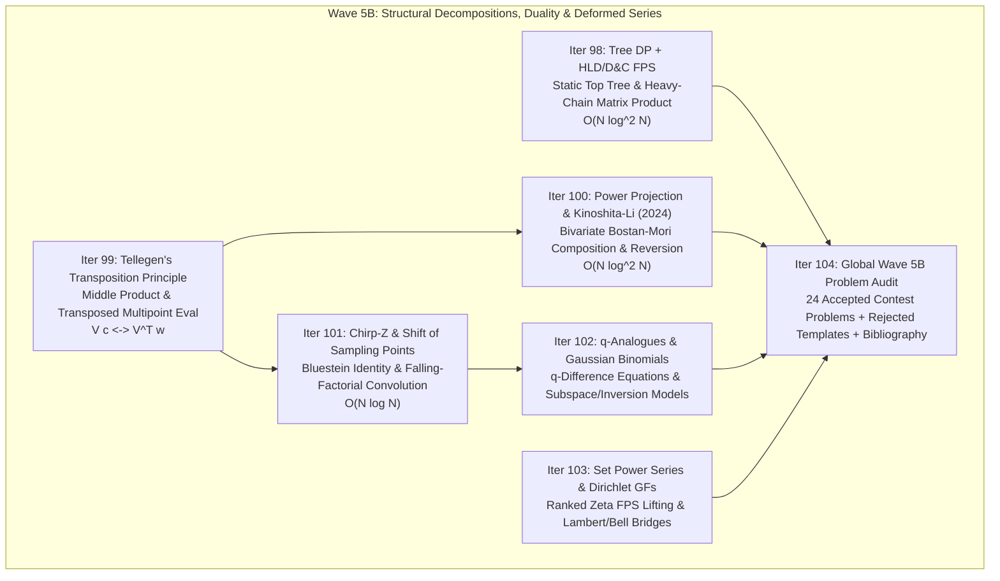
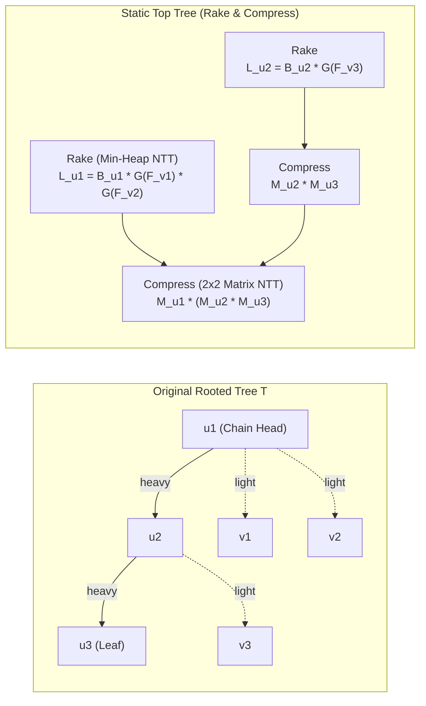
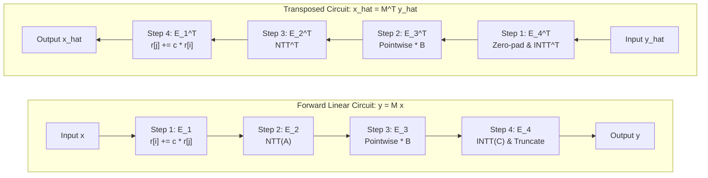
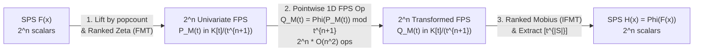

# Wave 5B (Cohort 2 — Independent Redundant Discovery, Iterations 98–104): Tree DP + HLD/D&C FPS Acceleration, Tellegen's Transposition Principle, Kinoshita–Li $O(N \log^2 N)$ Composition/Reversion, Chirp-Z & Shift of Sampling Points, $q$-Analogues, and Set/Dirichlet Series Links

---

## Executive Overview & Architectural Map

This volume covers **Iterations 98 through 104** of the Formal Power Series (FPS) and Generating Functions curriculum. Across these seven iterations, we bridge structural graph/tree decompositions, linear-circuit duality, bivariate root-squaring (Graeffe) recurrences, non-uniform and arithmetic-geometric evaluation grids, $q$-deformed enumerative combinatorics, and commutative monoid algebras (Set Power Series and Dirichlet series).



Every iteration adheres to the **Zero Magic Steps** pedagogical protocol:
1. **Concrete Combinatorial / Algebraic Object** and ambient ring specification.
2. **The Diagnostic Signal** that reveals when a contest problem demands the technique.
3. **The Reverse-Engineering Scratchpad** reconstructing how a solver discovers the transformation from scratch.
4. **Step-by-Step Algebraic Derivation & Verbal Annotations** with explicit ring/characteristic constraints.
5. **Hand-Checkable Toy Example** ($n \le 4$) verified arithmetic-by-arithmetic.
6. **Failure Modes, Pitfalls & Edge Cases**.

---

## Iteration 98 — Tree DP + Formal Power Series Acceleration (`树上 DP + 生成函数 / 链分治 FFT`)

### 98.1 Concrete Combinatorial / Algebraic Object

Consider a rooted tree $T = (V, E)$ with $N = |V|$ vertices, rooted at $r = 1$. In a broad class of tree dynamic programming problems, each vertex $u \in V$ is associated with a formal power series (typically a polynomial)
$$F_u(x) = \sum_{k=0}^{d_u} f_{u,k} x^k \in K[x]$$
where $K = \mathbb{F}_p$ (such as $p = 998244353$), $d_u = O(\operatorname{sz}(u))$ is bounded by the subtree size $\operatorname{sz}(u)$ of $u$, and $f_{u,k}$ counts configurations (e.g., independent sets, matchings, antichains, connected components, or subtree knapsack states) of weight $k$ inside the subtree $T_u$.

More generally, each vertex $u$ may maintain a **vector of polynomials** $\mathbf{F}_u(x) \in (K[x])^c$ for a small constant $c \in \{1, 2, 3\}$ representing boundary states at $u$ (e.g., whether $u$ is selected or unselected, or the degree state of $u$).

### 98.2 The Diagnostic Signal

How do you recognize that a Tree DP problem requires **Heavy-Light Decomposition (HLD) + Divide-and-Conquer FFT** (also called **Chain D&C FFT / `链分治 NTT`** or **Static Top Tree**)?

> [!IMPORTANT]
> **Diagnostic Signals for HLD + D&C FPS Acceleration**:
> 1. **Subtree-Size Degree Bound with $N \ge 10^5$**: You have a tree DP where $\deg F_u(x) = \Theta(\operatorname{sz}(u))$, transitions across children are convolutions (polynomial products), and $N \in [10^5, 2.5 \times 10^5]$ is too large for the classic $O(N^2)$ "Tree Knapsack" bound.
> 2. **Why Naive NTT Fails on Caterpillars**: Simply replacing the inner loop of tree knapsack with an $O((d_1 + d_2) \log(d_1 + d_2))$ NTT does **not** improve worst-case complexity! On a path graph $1 - 2 - \dots - N$ (or a caterpillar tree), merging a leaf of degree $1$ into an accumulated subtree polynomial of degree $k$ via NTT costs $O(k \log k)$ at step $k$, summing to $\sum_{k=1}^N O(k \log k) = O(N^2 \log N)$—strictly *worse* than naive $O(N^2)$ multiplication.
> 3. **Affine-Linear Dependence on a Single Heavy Child**: When you fix one child $w = \operatorname{heavy}(u)$ of $u$ and merge all other ("light") children $v \in \operatorname{light}(u)$ first into a composite polynomial $L_u(x)$, the transition from $\mathbf{F}_w(x)$ to $\mathbf{F}_u(x)$ becomes a **linear (or affine) polynomial transformation**:
>    $$\mathbf{F}_u(x) = M_u(x) \, \mathbf{F}_w(x)$$
>    where $M_u(x) \in K[x]^{c \times c}$ is a small polynomial matrix whose entries depend *only* on the light children $v \in \operatorname{light}(u)$ and have total degree $O\!\left(1 + \sum_{v \in \operatorname{light}(u)} \operatorname{sz}(v)\right) = O(\operatorname{sz}(u) - \operatorname{sz}(w))$.

### 98.3 The Reverse-Engineering Scratchpad

Let us reconstruct how a competitive programmer invents `链分治 NTT` (HLD + D&C FFT) when faced with the caterpillar bottleneck:

1. **Isolating the Two Obstacles**:
   Why can a tree have slow polynomial merges? There are only two extreme topologies:
   - **Obstacle A (The Star Graph)**: Vertex $u$ has $k$ children $v_1, \dots, v_k$, each with polynomial $F_{v_i}(x)$, and we must compute $\prod_{i=1}^k F_{v_i}(x)$ (or a symmetric combination). If we multiply them sequentially $(((F_{v_1} F_{v_2}) F_{v_3}) \cdots)$, degrees accumulate linearly and the cost is $O((\sum d_i)^2)$.
   - **Obstacle B (The Long Path / Caterpillar)**: Vertex $u_1 - u_2 - \dots - u_m$ is a long chain where each transition applies an operation like $F_{u_i}(x) = A_{u_i}(x) F_{u_{i+1}}(x) + B_{u_i}(x)$. Doing this bottom-up one node at a time costs $O(m^2 \log m)$.

2. **Fixing Obstacle A (Horizontal Merge of Light Children)**:
   At a single node $u$, how do we multiply many polynomials $F_{v_1}(x), \dots, F_{v_k}(x)$ of varying degrees $d_1, \dots, d_k$ with $\sum d_i = D_u$?
   - **Approach A1 (Divide & Conquer by Balanced Degree Split / Interval Midpoint)**: Recursively multiply the first half and second half. Depth is $O(\log k)$, total work at this node is $O(D_u \log k \log D_u) \subseteq O(D_u \log^2 N)$.
   - **Approach A2 (Huffman / Priority Queue Merge)**: Always pop the two polynomials of *smallest degree* from a min-heap, multiply them via NTT, and push the product back. By the Shannon-Huffman entropy bound, a polynomial of initial degree $d_i$ participates in at most $O(1 + \log(D_u / d_i))$ merges, yielding an even tighter $O(D_u \log D_u \log k)$ bound with minimal constant factor.

3. **Fixing Obstacle B (Vertical Merge Along a Heavy Chain)**:
   How do we break the sequential dependency along a long path? Use **Heavy-Light Decomposition (HLD)**!
   - At every node $u$, designate the child $w \in \operatorname{children}(u)$ with maximum subtree size $\operatorname{sz}(w)$ as the **heavy child** $\operatorname{heavy}(u)$, and all other children as **light children** $\operatorname{light}(u)$.
   - First, recursively compute the answer polynomials for all light children $v \in \operatorname{light}(u)$, and merge them horizontally (using Approach A1/A2) to form the local transition matrix $M_u(x)$ at node $u$.
   -Crucial observation: The degree of every entry in $M_u(x)$ is bounded by the **light weight** of $u$:
     $$\operatorname{wt}(u) := 1 + \sum_{v \in \operatorname{light}(u)} \operatorname{sz}(v) = \operatorname{sz}(u) - \operatorname{sz}(\operatorname{heavy}(u)).$$
   - Now look at an entire heavy chain $u_1 \to u_2 \to \dots \to u_m$, where $u_{i+1} = \operatorname{heavy}(u_i)$ and $u_m$ is a leaf (so $\mathbf{F}_{u_m}(x)$ has no heavy child, or we treat $\mathbf{F}_{\text{null}}(x) = \mathbf{e}$ as a constant base vector). Then the polynomial at the top of the heavy chain is simply the associative matrix product:
     $$\mathbf{F}_{u_1}(x) = M_{u_1}(x) M_{u_2}(x) \cdots M_{u_m}(x) \mathbf{e}.$$
   - Because matrix multiplication is **associative**, we do *not* have to multiply $M_{u_1} \cdots M_{u_m}$ sequentially from right to left! We can use **Divide-and-Conquer Matrix NTT** (or a **Weighted Binary Search Tree / Globally Balanced BST**) along the chain $u_1, \dots, u_m$.

### 98.4 Step-by-Step Algebraic Derivation & Verbal Annotations

Let us formalize the paradigm on the canonical **Canonical Affine Tree Recurrence** and the **General $c \times c$ Matrix Tree Recurrence**.

#### Case 1: Affine Tree Recurrence ($1 \times 1$ state, $2 \times 2$ homogeneous matrix)
Suppose the DP recurrence at vertex $u$ has the form:
$$F_u(x) = \alpha_u(x) + \beta_u(x) \prod_{v \in \operatorname{children}(u)} G(F_v(x))$$
where $\alpha_u(x), \beta_u(x) \in K[x]$ are small local polynomials of degree $O(1)$ (e.g., $\alpha_u(x) = 1$, $\beta_u(x) = x$ for tree antichains, or $\alpha_u(x) = 0, \beta_u(x) = x$ for connected subtrees) and $G(F_v(x))$ is a linear function of $F_v(x)$ (such as $F_v(x)$ or $F_v(x) + 1$).

**Step 1 (Separate Heavy and Light Children)**:
If $u$ is a leaf, $F_u(x) = \alpha_u(x) + \beta_u(x)$ has degree $O(1)$.
Otherwise, let $w = \operatorname{heavy}(u)$ be the unique heavy child of $u$, and let $\operatorname{light}(u) = \operatorname{children}(u) \setminus \{w\}$. Factor the product over children into the light part and the heavy part:
$$F_u(x) = \alpha_u(x) + \underbrace{\left( \beta_u(x) \prod_{v \in \operatorname{light}(u)} G(F_v(x)) \right)}_{:= L_u(x)} \cdot G(F_w(x)).$$
Here, $L_u(x)$ depends *only* on the already-computed polynomials $F_v(x)$ of the light children $v \in \operatorname{light}(u)$.

**Step 2 (Horizontal Light-Child Product via Huffman / D&C NTT)**:
We collect the multiset of polynomials $\mathcal{P}_u = \{ G(F_v(x)) : v \in \operatorname{light}(u) \} \cup \{ \beta_u(x) \}$.
Using a min-priority queue ordered by polynomial degree (or balanced D&C), we multiply all elements of $\mathcal{P}_u$ to obtain $L_u(x)$.
Notice that:
$$\deg L_u(x) = \deg \beta_u(x) + \sum_{v \in \operatorname{light}(u)} \deg G(F_v(x)) = O(\operatorname{wt}(u)).$$

**Step 3 (Homogenization along the Heavy Chain)**:
Suppose $G(F_w(x)) = \gamma F_w(x) + \delta$ for constants/polynomials $\gamma, \delta$. Substituting this into Step 1 yields the affine map:
$$F_u(x) = \underbrace{\gamma L_u(x)}_{A_u(x)} F_w(x) + \underbrace{\alpha_u(x) + \delta L_u(x)}_{B_u(x)}.$$
In homogeneous matrix form, for any node $u_i$ on the heavy chain $u_1, u_2, \dots, u_m$:
$$\begin{bmatrix} F_{u_i}(x) \\ 1 \end{bmatrix} = \begin{bmatrix} A_{u_i}(x) & B_{u_i}(x) \\ 0 & 1 \end{bmatrix} \begin{bmatrix} F_{u_{i+1}}(x) \\ 1 \end{bmatrix}.$$
Notice the triangular structure! The product of two such affine transitions $(A_1, B_1) \circ (A_2, B_2)$ is simply:
$$\begin{bmatrix} A_1(x) & B_1(x) \\ 0 & 1 \end{bmatrix} \begin{bmatrix} A_2(x) & B_2(x) \\ 0 & 1 \end{bmatrix} = \begin{bmatrix} A_1(x) A_2(x) & A_1(x) B_2(x) + B_1(x) \\ 0 & 1 \end{bmatrix}.$$
Thus, composing two affine chain segments requires only **two polynomial multiplications** (or three forward NTTs and two inverse NTTs by reusing $\operatorname{NTT}(A_1)$) of degree $\deg A_1 + \deg A_2$ and $\deg A_1 + \deg B_2$.

**Step 4 (Chain Divide-and-Conquer vs. Globally Balanced BST)**:
For the heavy chain $u_1, \dots, u_m$, let $W_i = \operatorname{wt}(u_i) = 1 + \sum_{v \in \operatorname{light}(u_i)} \operatorname{sz}(v)$, and $W = \sum_{i=1}^m W_i = \operatorname{sz}(u_1)$.
- **Method 4A (Index-Midpoint D&C along the Chain)**: Split the chain $[l, r]$ at $mid = \lfloor(l+r)/2\rfloor$, recursively compute the composite affine map $(A_{l..mid}, B_{l..mid})$ and $(A_{mid+1..r}, B_{mid+1..r})$, and multiply them in $O((\sum_{i=l}^r W_i) \log(\sum_{i=l}^r W_i))$. Since recursion depth on the chain is $\lceil \log_2 m \rceil \le \log_2 N$, the total work for the entire heavy chain $u_1 \dots u_m$ is $O(W \log m \log W) \subseteq O(\operatorname{sz}(u_1) \log^2 N)$.
- **Method 4B (Weight-Balanced Split / Globally Balanced BST / Static Top Tree)**: Instead of splitting at the index midpoint $mid = (l+r)/2$, choose the split index $k \in [l, r]$ where the prefix weight $\sum_{i=l}^k W_i$ is closest to $\frac{1}{2} \sum_{i=l}^r W_i$. As proven by Sleator & Tarjan (and popularized in Chinese OI by Qtree/Globally Balanced BST papers and in Japanese CP by `maspy` and `tatyam` as **Static Top Tree**), combining weight-balanced splits on heavy chains with Huffman splits on light children builds a single binary tree of **rake** (light merge) and **compress** (heavy chain merge) operations whose global depth and degree-sum across levels yield a worst-case complexity of $O(N \log^2 N)$ even when every intermediate node's polynomial is needed!

#### Rigorous $O(N \log^2 N)$ Time Complexity Proof

Let us verify why summing $O(\operatorname{sz}(u_1) \log^2 N)$ over all heavy chain heads $u_1$ does *not* blow up to $O(N^2)$:

1. **Cost of Horizontal Light Merges**:
   At vertex $u$, the light children $v \in \operatorname{light}(u)$ have total degree $\sum_{v \in \operatorname{light}(u)} \operatorname{sz}(v) = \operatorname{wt}(u) - 1$. Merging them via D&C or min-heap takes $O(\operatorname{wt}(u) \log^2 \operatorname{wt}(u))$. Summing over all $u \in V$:
   $$\sum_{u \in V} \operatorname{wt}(u) = \sum_{u \in V} \left(1 + \sum_{v \in \operatorname{light}(u)} \operatorname{sz}(v)\right) = N + \sum_{\substack{v \in V \setminus \{r\} \\ v \text{ is a light child}}} \operatorname{sz}(v).$$
   Therefore, the horizontal merge cost across the entire tree is proportional to the sum of $\operatorname{sz}(v)$ over all **light children** $v$ (which are precisely the heads of heavy chains!).

2. **Cost of Vertical Heavy-Chain Merges**:
   For each heavy chain with head $h$, the D&C along the chain processes polynomials of total degree $\sum_{u \in \text{chain}(h)} \operatorname{wt}(u) = \operatorname{sz}(h)$ across $O(\log N)$ levels of recursion, costing $O(\operatorname{sz}(h) \log \operatorname{sz}(h) \log(\text{chain length}))$.

3. **Global Sum over Heavy-Chain Heads**:
   Every vertex $x \in V$ belongs to some heavy chain. Moving from $x$ to the root $r$, how many times can we cross a **light edge** (i.e., exit the head $h$ of a heavy chain to its parent $p(h)$)?
   Whenever $h \in \operatorname{light}(p(h))$, the definition of heavy child implies $\operatorname{sz}(h) \le \frac{1}{2} \operatorname{sz}(p(h))$.
   Thus, each light edge along the ancestor path of $x$ at least doubles the subtree size, so $x$ is contained in the subtree $T_h$ of at most $\lfloor \log_2 N \rfloor + 1$ heavy-chain heads $h$!
   Consequently:
   $$\sum_{h \text{ is a chain head}} \operatorname{sz}(h) = \sum_{x \in V} (\text{number of chain heads } h \text{ ancestor to } x) \le N (\lfloor \log_2 N \rfloor + 1) = O(N \log N).$$
   Crucially, if we use **Index-Midpoint D&C** on each heavy chain of total weight $W_h = \operatorname{sz}(h)$, paying $O(W_h \log^2 N)$ per chain head would give $O(N \log^3 N)$ in the worst case unless we use **Weight-Balanced Split (Globally Balanced BST / Static Top Tree)** or **Huffman D&C**!
   Let us see why **Weight-Balanced Split** drops the extra $\log N$ factor from $O(N \log^3 N)$ down to $O(N \log^2 N)$:
   In a weight-balanced split of a heavy chain $[l, r]$ with weights $W_l, \dots, W_r$, if a single node $u_k$ has weight $W_k > \frac{1}{2} \sum_{i=l}^r W_i$, we isolate $u_k$ on one side of the split so it drops directly to a leaf of the chain D&C tree; otherwise both halves have weight at most $\frac{2}{3} \sum_{i=l}^r W_i$.
   Thus, a chain node $u$ with light weight $W_u = \operatorname{wt}(u)$ participates in chain-compress multiplications only at D&C intervals whose total weight decreases by a constant factor at each step, which means $u$'s degree $W_u$ is paid at most $O\!\left(1 + \log \frac{\operatorname{sz}(h)}{W_u}\right)$ times!
   By telescoping along root-to-leaf paths (or observing that the Static Top Tree of the entire tree $T$ has depth $O(\log N)$ and total degree at each depth level equal to $O(N)$), the total NTT work across the entire tree is strictly:
   $$\sum_{\text{depth } d = 0}^{O(\log N)} O(N \log N) = O(N \log^2 N).$$



### 98.5 Hand-Checkable Toy Example

Let us trace a complete $N = 5$ tree example by hand.
**Problem**: Count the number of **Antichains** of size $k$ ($0 \le k \le 5$) in a rooted tree $T$ (an antichain is a subset of vertices $S \subseteq V$ such that no two vertices in $S$ have an ancestor-descendant relation).
- **Recurrence**: For each subtree $T_u$, either we choose $u$ myself (contributing $x^1$, and no vertex in any child's subtree can be chosen), or we do not choose $u$ and independently choose an antichain in each child's subtree:
  $$F_u(x) = x + \prod_{v \in \operatorname{children}(u)} F_v(x).$$
- **Tree $T$**: Root $1$ has children $2$ and $4$. Node $2$ has children $3$ and $5$. Nodes $3, 4, 5$ are leaves.
  - Subtree sizes: $\operatorname{sz}(3) = \operatorname{sz}(4) = \operatorname{sz}(5) = 1$, $\operatorname{sz}(2) = 3$, $\operatorname{sz}(1) = 5$.
  - Heavy children: $\operatorname{heavy}(1) = 2$ (since $\operatorname{sz}(2) = 3 > \operatorname{sz}(4) = 1$), $\operatorname{heavy}(2) = 3$ (tie-broken between $3$ and $5$).
  - Light children: $\operatorname{light}(1) = \{4\}$, $\operatorname{light}(2) = \{5\}$, $\operatorname{light}(3) = \emptyset$.
- **Step 1 (Solve Light Subtrees $4$ and $5$)**:
  Both $4$ and $5$ are single-node heavy chains (leaves):
  $$F_4(x) = x + 1, \qquad F_5(x) = x + 1.$$
- **Step 2 (Build Affine Matrices along Heavy Chain $1 \to 2 \to 3$)**:
  - At $u_1 = 1$: $F_1(x) = L_1(x) F_2(x) + x$, where $L_1(x) = \prod_{v \in \operatorname{light}(1)} F_v(x) = F_4(x) = x + 1$.
    So $M_1(x) = \begin{bmatrix} x+1 & x \\ 0 & 1 \end{bmatrix}$.
  - At $u_2 = 2$: $F_2(x) = L_2(x) F_3(x) + x$, where $L_2(x) = F_5(x) = x + 1$.
    So $M_2(x) = \begin{bmatrix} x+1 & x \\ 0 & 1 \end{bmatrix}$.
  - At leaf $u_3 = 3$: $F_3(x) = x + 1$, which we represent as $M_3(x) = \begin{bmatrix} 0 & x+1 \\ 0 & 1 \end{bmatrix}$ acting on base vector $\begin{bmatrix} 0 \\ 1 \end{bmatrix}$ (or simply setting $A_3(x) = 1, B_3(x) = x$ acting on $\begin{bmatrix} 1 \\ 1 \end{bmatrix}$). Let's use $A_3(x) = 1, B_3(x) = x$ acting on $\begin{bmatrix} 1 \\ 1 \end{bmatrix}$ so $F_3(x) = 1 \cdot 1 + x = x + 1$.
- **Step 3 (Multiply Chain Matrices via D&C)**:
  Multiply $M_1(x) M_2(x)$:
  $$M_{1..2}(x) = \begin{bmatrix} x+1 & x \\ 0 & 1 \end{bmatrix} \begin{bmatrix} x+1 & x \\ 0 & 1 \end{bmatrix} = \begin{bmatrix} (x+1)^2 & (x+1)x + x \\ 0 & 1 \end{bmatrix} = \begin{bmatrix} x^2 + 2x + 1 & x^2 + 2x \\ 0 & 1 \end{bmatrix}.$$
  Now multiply $M_{1..2}(x) M_3(x)$ and apply to $\begin{bmatrix} 1 \\ 1 \end{bmatrix}$ (i.e. substitute $F_3(x) = x + 1$):
  $$F_1(x) = (x^2 + 2x + 1)(x + 1) + (x^2 + 2x) = (x^3 + 3x^2 + 3x + 1) + (x^2 + 2x) = x^3 + 4x^2 + 5x + 1.$$
- **Hand Verification**:
  - $k = 0$: $\emptyset \implies 1$ antichain ($[x^0]F_1 = 1$).
  - $k = 1$: $\{1\}, \{2\}, \{3\}, \{4\}, \{5\} \implies 5$ antichains ($[x^1]F_1 = 5$).
  - $k = 2$: Pairs with no ancestor-descendant relation: $\{2,4\}, \{3,4\}, \{5,4\}, \{3,5\} \implies 4$ antichains ($[x^2]F_1 = 4$).
  - $k = 3$: Triples with no ancestor-descendant relation: $\{3, 4, 5\} \implies 1$ antichain ($[x^3]F_1 = 1$).
  The polynomial $x^3 + 4x^2 + 5x + 1$ matches every single coefficient!

### 98.6 Failure Modes, Pitfalls & Edge Cases

1. **Using Index-Midpoint Split Instead of Weight-Balanced Split**:
   If a heavy chain has length $m = \Theta(N)$, and almost all the light weight $\operatorname{wt}(u_1) = \Theta(N)$ is concentrated at the very first node $u_1$ of the chain while $\operatorname{wt}(u_2) = \dots = \operatorname{wt}(u_m) = 1$, splitting the chain at the index midpoint $mid = m/2$ forces the massive polynomial of degree $\Theta(N)$ at $u_1$ to be multiplied $\Theta(\log m)$ times by tiny polynomials! When stacked across $O(\log N)$ levels of HLD, this degrades from $O(N \log^2 N)$ to $O(N \log^3 N)$ or $O(N^2)$ on adversarial trees. **Fix**: Always split the heavy chain $[l, r]$ by **cumulative weight midpoint** (finding the index $k$ where $\sum_{i=l}^k \operatorname{wt}(u_i) \approx \frac{1}{2} \sum_{i=l}^r \operatorname{wt}(u_i)$), or use a min-heap for light merges and weight-balanced D&C for heavy chains.
2. **State Vector Blowup ($c \ge 3$ Matrix Multiplication Overhead)**:
   For problems like Tree Matching or Tree Path Covers where each node has $c = 2$ or $c = 3$ states, a $c \times c$ matrix multiplication requires $c^3$ polynomial multiplications if done naively, which has a $27\times$ constant factor for $c = 3$. **Fix**: Transform the $c \times c$ polynomial matrices into point-value (NTT) representation *once* per D&C merge step: for a target NTT length $L = 2^{\lceil \log_2(\deg M_{\text{left}} + \deg M_{\text{right}} + 1) \rceil}$, apply forward NTT to the $c^2$ entries of $M_{\text{left}}$ and $M_{\text{right}}$ ($2c^2$ NTTs), multiply $c \times c$ scalar matrices pointwise at each of the $L$ roots of unity ($O(c^3 L)$ scalar ops, zero NTT overhead!), and perform $c^2$ inverse NTTs. This reduces $c^3$ NTTs to $3c^2$ transforms.
3. **Needing All Subtree Polynomials vs. Only the Root Polynomial**:
   If a problem only asks for $F_{\text{root}}(x)$, bottom-up weight-balanced D&C only evaluates the top of each heavy chain. If the problem asks for a linear functional of $F_u(x)$ for *every* vertex $u \in V$, you must either accumulate answers during the D&C merge (multiplying the left half's answer accumulator by the right half's product, analogous to CDQ D&C) or use top-down propagation on the Static Top Tree.

---

## Iteration 99 — Tellegen's Transposition Principle (`转置原理`) & Middle Product (`转置卷积`)

### 99.1 Concrete Combinatorial / Algebraic Object

Let $K$ be a commutative ring (typically a finite field $\mathbb{F}_p$), and let $L: K^n \to K^m$ be a **$K$-linear transformation** represented in the standard bases by an $m \times n$ matrix $M \in K^{m \times n}$:
$$\mathbf{y} = M \mathbf{x}.$$
The **Transpose Map** $L^T: K^m \to K^n$ is the linear transformation represented by the transposed matrix $M^T \in K^{n \times m}$:
$$\hat{\mathbf{x}} = M^T \hat{\mathbf{y}}, \qquad \text{characterized by the bilinear duality } \langle \hat{\mathbf{y}}, M\mathbf{x} \rangle = \langle M^T \hat{\mathbf{y}}, \mathbf{x} \rangle = \sum_{i=0}^{m-1} \sum_{j=0}^{n-1} M_{i,j} \hat{y}_i x_j.$$

In the context of Formal Power Series, let $A(x) = \sum_{i=0}^{n-1} a_i x^i$ be a fixed polynomial of degree $< n$. The **Standard Convolution Map** $\mathcal{C}_A: K^m \to K^{n+m-1}$ multiplies an unknown polynomial $B(x) = \sum_{j=0}^{m-1} b_j x^j$ by $A(x)$:
$$C(x) = A(x) B(x) \iff c_k = \sum_{j=0}^{m-1} a_{k-j} b_j \quad (0 \le k < n+m-1).$$
What is the transpose map $\mathcal{C}_A^T: K^{n+m-1} \to K^m$? Using the bilinear identity $\sum_{k=0}^{n+m-2} \hat{c}_k c_k = \sum_{j=0}^{m-1} \hat{b}_j b_j$:
$$\sum_{k=0}^{n+m-2} \hat{c}_k \sum_{j=0}^{m-1} a_{k-j} b_j = \sum_{j=0}^{m-1} b_j \underbrace{\left( \sum_{k=j}^{j+n-1} a_{k-j} \hat{c}_k \right)}_{\hat{b}_j = \sum_{i=0}^{n-1} a_i \hat{c}_{i+j}}.$$
This transposed operation $\hat{b}_j = \sum_{i=0}^{n-1} a_i \hat{c}_{i+j}$ ($0 \le j < m$), equivalently written in Laurent series as
$$\hat{B}(x) = \operatorname{MP}_{n,m}(\hat{C}, A) := \left[x^0 \dots x^{m-1}\right] \left(\hat{C}(x) \cdot A(x^{-1})\right),$$
is the **Middle Product** (`转置卷积` / `Middle Product`) of $\hat{C}$ (length $n+m-1$) and $A$ (length $n$).

### 99.2 The Diagnostic Signal

When should a solver reach for **Tellegen's Transposition Principle** or the **Middle Product**?

> [!IMPORTANT]
> **Diagnostic Signals for the Transposition Principle & Middle Product**:
> 1. **Index-Difference vs. Index-Sum Convolutions with Truncated Windows**: You need to compute $b_j = \sum_{i=0}^{n-1} a_i c_{i+j}$ for $0 \le j < m$ where $\deg C = n+m-2$ and $\deg A = n-1$. Instead of zero-padding $C$ and $A^{\text{rev}}$ to $2^{\lceil \log_2(2n+m) \rceil}$, the Middle Product computes those exact $m$ middle coefficients using an FFT of size $2^{\lceil \log_2(n+m-1) \rceil}$—halving the transform length!
> 2. **A Known Fast Linear Algorithm Exists for the "Dual Index" Problem**: You have a linear map $\mathbf{y} = M \mathbf{x}$ that looks hard to compute directly in $O(N \log^2 N)$—for example:
>    - **Multipoint Evaluation**: Given $f_0, \dots, f_{n-1}$, compute $y_i = \sum_{j=0}^{n-1} f_j x_i^j$ for $i = 0, \dots, m-1$ (Vandermonde matrix $V \mathbf{f}$).
>    - **FPS Composition**: Given $f_0, \dots, f_{n-1}$ and fixed $G(x)$, compute $h_k = \sum_{j=0}^{n-1} f_j [x^k] G(x)^j$ for $k = 0, \dots, n-1$.
>    Write down the matrix $M_{i,j}$ and inspect the **column-to-row transposed problem** $\hat{\mathbf{x}} = M^T \hat{\mathbf{y}}$:
>    - For Vandermonde $V_{i,j} = x_i^j$, the transpose $(V^T \mathbf{w})_j = \sum_{i=0}^{m-1} w_i x_i^j = [x^j] \sum_{i=0}^{m-1} \frac{w_i}{1 - x_i x}$ is a simple **sum of rational fractions**!
>    - For Composition $M_{k,j} = [x^k] G(x)^j$, the transpose $(M^T \mathbf{w})_j = \sum_{k=0}^{n-1} w_k [x^k] G(x)^j$ is **Power Projection**!
> 3. **Constant-Factor Optimization of Newton's Method**: In Newton iterations for $F^{-1}, \exp F, \sqrt{F}$, half the coefficients of an intermediate convolution are already known to be $0$ or known from the previous doubling step. Using the Middle Product (`mulT`) removes a factor of $2$ in the NTT length at the bottleneck step.

### 99.3 The Reverse-Engineering Scratchpad

Why does Tellegen's Transposition Principle hold, and how do we mechanically transpose *any* linear algorithm without guessing?

1. **Decomposing Any Linear Algorithm into Elementary Matrices**:
   Suppose an algorithm computes $\mathbf{y} = M \mathbf{x}$ using *only* linear operations on a working array (registers) $r_1, r_2, \dots, r_S$ (initialized with the input $\mathbf{x}$ in the first $n$ registers and $0$ elsewhere).
   Every arithmetic instruction in a linear algorithm is one of three **elementary row operations**:
   - **Type I (In-place Scaling)**: `r[i] = c * r[i]` for a constant $c \in K$ (diagonal elementary matrix $D_i(c)$, which is symmetric: $D_i(c)^T = D_i(c)$).
   - **Type II (Swap)**: `swap(r[i], r[j])` (permutation matrix $P_{i,j}$, which is symmetric: $P_{i,j}^T = P_{i,j}$).
   - **Type III (Linear Accumulation / FMA)**: `r[i] = r[i] + c * r[j]` ($i \neq j$) for a constant $c \in K$ (elementary shear matrix $E_{i,j}(c) = I + c \, \mathbf{e}_i \mathbf{e}_j^T$).
   What is the transpose of $E_{i,j}(c)$?
   $$E_{i,j}(c)^T = (I + c \, \mathbf{e}_i \mathbf{e}_j^T)^T = I + c \, \mathbf{e}_j \mathbf{e}_i^T = E_{j,i}(c)!$$
   In code, `r[i] = r[i] + c * r[j]` transposes into `r[j] = r[j] + c * r[i]`!

2. **Reversing the Order of Operations**:
   Since the forward algorithm applies elementary matrices $E_T, \dots, E_2, E_1$ in sequence:
   $$M = P_{\text{out}} E_T E_{T-1} \cdots E_2 E_1 P_{\text{in}},$$
   taking the matrix transpose reverses the order of multiplication:
   $$M^T = P_{\text{in}}^T E_1^T E_2^T \cdots E_{T-1}^T E_T^T P_{\text{out}}^T.$$
   Therefore, **Tellegen's Theorem (1970) / Transposition Principle** states:
   > Any linear circuit computing $M \mathbf{x}$ in $T$ operations can be mechanically converted into a linear circuit computing $M^T \mathbf{y}$ in the **exact same number of operations $T$** by:
   > 1. Reversing the execution order of all steps ($t = T, T-1, \dots, 1$), and
   > 2. Replacing each elementary step $E_t$ by its transpose $E_t^T$ (specifically, replacing `a += c * b` with `b += c * a`, and replacing fan-out/copying of a variable with summation into that variable).



### 99.4 Step-by-Step Algebraic Derivation & Verbal Annotations

Let us apply the Transposition Principle to derive three cornerstone algorithms in full detail:

#### 1. Deriving the Fast Middle Product (`mulT`) via Transposed NTT
Suppose $A(x)$ has degree $< n$ (fixed) and $B(x)$ has degree $< m$ (input), and the forward convolution $C = A \cdot B$ (degree $< n+m-1$) is computed using a radix-2 NTT of length $L = 2^k \ge n+m-1$:
1. **Forward Step 1 (Zero-pad)**: Pad $B \in K^m$ with $L - m$ zeros to length $L$ (matrix $Z_{L \times m} = \begin{bmatrix} I_m \\ 0 \end{bmatrix}$).
2. **Forward Step 2 (Forward NTT)**: Multiply by the $L \times L$ Vandermonde DFT matrix $\mathcal{F}_L$ where $(\mathcal{F}_L)_{u,v} = \omega_L^{uv}$. Notice $\mathcal{F}_L$ is **symmetric**: $\mathcal{F}_L^T = \mathcal{F}_L$!
3. **Forward Step 3 (Pointwise Multiply)**: Multiply by the diagonal matrix $\operatorname{diag}(\mathcal{F}_L(A))$. Since a diagonal matrix is **symmetric**, $\operatorname{diag}(\mathcal{F}_L(A))^T = \operatorname{diag}(\mathcal{F}_L(A))$.
4. **Forward Step 4 (Inverse NTT)**: Multiply by $\mathcal{F}_L^{-1} = \frac{1}{L} \mathcal{F}_L^{(-1)}$, which is also **symmetric**: $(\mathcal{F}_L^{-1})^T = \mathcal{F}_L^{-1}$!
5. **Forward Step 5 (Truncate)**: Keep the first $n+m-1$ entries (matrix $P_{(n+m-1) \times L} = \begin{bmatrix} I_{n+m-1} & 0 \end{bmatrix}$).

Therefore, the forward convolution matrix is:
$$\mathcal{C}_A = P_{(n+m-1) \times L} \, \mathcal{F}_L^{-1} \, \operatorname{diag}(\mathcal{F}_L(A)) \, \mathcal{F}_L \, Z_{L \times m}.$$
Now take the transpose of every factor in reverse order! Because $\mathcal{F}_L$, $\operatorname{diag}(\mathcal{F}_L(A))$, and $\mathcal{F}_L^{-1}$ are all **symmetric matrices**, we get:
$$\mathcal{C}_A^T = Z_{L \times m}^T \, \mathcal{F}_L \, \operatorname{diag}(\mathcal{F}_L(A)) \, \mathcal{F}_L^{-1} \, P_{(n+m-1) \times L}^T!$$
Notice that $\mathcal{F}_L \operatorname{diag}(\mathcal{F}_L(A)) \mathcal{F}_L^{-1} = \mathcal{F}_L^{-1} \operatorname{diag}(\mathcal{F}_L^{-1}(A) \cdot L) \mathcal{F}_L$ (or since $\mathcal{F}_L^{-1}(v)_k = \frac{1}{L} \mathcal{F}_L(v)_{(-k) \bmod L}$, swapping $\mathcal{F}_L$ and $\mathcal{F}_L^{-1}$ simply corresponds to cycling indices $k \mapsto (-k) \bmod L$, or equivalently multiplying by $A(x^{-1}) \bmod (x^L - 1)$).
Reading the transposed expression from right to left gives the **exact 5-step algorithm for `mulT(C_hat, A)`**:
1. **Transposed Step 1 ($P^T$, Zero-pad $\hat{C}$)**: Pad $\hat{C} \in K^{n+m-1}$ with zeros to length $L \ge n+m-1$.
2. **Transposed Step 2 ($\mathcal{F}_L^{-1}$, Inverse NTT)**: Apply `INTT` of length $L$ to $\hat{C}$ (or `NTT` if we reverse $A$).
3. **Transposed Step 3 (Pointwise Multiply)**: Multiply pointwise by $\mathcal{F}_L(A)$.
4. **Transposed Step 4 ($\mathcal{F}_L$, Forward NTT)**: Apply `NTT` of length $L$.
5. **Transposed Step 5 ($Z^T$, Truncate to $m$)**: Keep the first $m$ entries $\hat{b}_0, \dots, \hat{b}_{m-1}$!

> [!TIP]
> **Why `mulT` Halves the FFT Size**:
> Suppose you know $C(x)$ up to $x^{2d-1}$ ($\deg C < 2d$) and $A(x)$ up to $x^{d-1}$ ($\deg A < d$), and you want the coefficients $b_j = \sum_{i=0}^{d-1} a_i c_{i+j}$ for $j = 0, \dots, d-1$ (so $n = d, m = d$).
> If you used standard convolution by reversing $A$, the product has degree $(2d-1) + (d-1) = 3d-2$, requiring an NTT of length $4d$ (for $d = 2^k$).
> Using `mulT` above, $L$ only needs to satisfy $L \ge n+m-1 = 2d-1$, so an NTT of length **$2d$** suffices! There is **zero wrap-around contamination** in indices $0 \dots d-1$ because for $0 \le i < d$ and $0 \le j < d$, $(k - i) \bmod 2d = j \implies k = i + j < 2d-1 < 2d$, which never wraps around modulo $2d$!

#### 2. Constant-Factor Optimization of Newton's Method via `mulT`
Consider computing the FPS inverse $G(x) = F(x)^{-1} \bmod x^{2d}$ given $G_0(x) = F(x)^{-1} \bmod x^d$ (where $d = 2^k$).
The Newton step is:
$$G(x) \equiv G_0(x) \left(2 - F(x) G_0(x)\right) \pmod{x^{2d}}.$$
Let $G(x) = G_0(x) + x^d G_1(x)$ with $\deg G_1 < d$. Since $F(x) G_0(x) \equiv 1 \pmod{x^d}$, we can write:
$$F(x) G_0(x) \equiv 1 + x^d R(x) \pmod{x^{2d}}, \qquad \text{where } R(x) = \left[x^d \dots x^{2d-1}\right] \left((F \bmod x^{2d}) \cdot G_0\right).$$
Notice that computing $R(x)$ asks for coefficients $d, d+1, \dots, 2d-1$ of the product of $F \bmod x^{2d}$ (length $2d$) and $G_0$ (length $d$).
Specifically, for $0 \le j < d$:
$$R_j = [x^{d+j}] (F \cdot G_0) = \sum_{i=0}^{d-1} (G_0)_i F_{d+j-i}.$$
This is a **Middle Product** of $F$ (length $2d$) and $G_0^{\text{rev}}$ (length $d$), which can be computed using NTTs of length **$2d$** (not $4d$!).
Then $G_1(x) = -(G_0(x) R(x) \bmod x^d)$ takes one multiplication of two degree-$d$ polynomials (also length $2d$ NTT).
Thus, **every doubling step of FPS Inverse uses NTTs of maximum length $2d$ instead of $4d$**, reducing the total work from $3 \mathcal{M}(N)$ to $1.5 \mathcal{M}(N)$!

#### 3. Deriving $O(N \log^2 N)$ Multipoint Evaluation from Rational Fraction Summation
We want to evaluate $F(x) = \sum_{j=0}^{n-1} f_j x^j$ at $m$ points $x_0, x_1, \dots, x_{m-1}$:
$$y_i = \sum_{j=0}^{n-1} x_i^j f_j \iff \mathbf{y} = V \mathbf{f}, \qquad V_{i,j} = x_i^j.$$
Instead of using polynomial modulo $F(x) \bmod (x - x_i)$ (which requires slow polynomial division at every node of the subproduct tree), let us inspect the **Transposed Problem** $\hat{\mathbf{f}} = V^T \mathbf{w}$:
$$\hat{f}_j = \sum_{i=0}^{m-1} w_i x_i^j = [x^j] \sum_{i=0}^{m-1} \frac{w_i}{1 - x_i x} \quad (0 \le j < n).$$
How do we compute the rational sum $\sum_{i=0}^{m-1} \frac{w_i}{1 - x_i x} \bmod x^n$?
1. **Forward Algorithm for $V^T \mathbf{w}$ (Divide & Conquer Fraction Addition)**:
   Build a binary subproduct tree over $i \in [0, m)$:
   - At leaf $i$, the denominator is $Q_{\{i\}}(x) = 1 - x_i x$ and the numerator is $P_{\{i\}}(x) = w_i$.
   - At an internal node $u$ with children $l, r$, merge fractions by cross-multiplying:
     $$Q_u(x) = Q_l(x) Q_r(x), \qquad P_u(x) = P_l(x) Q_r(x) + P_r(x) Q_l(x).$$
   - At the root, we have $\frac{P_{\text{root}}(x)}{Q_{\text{root}}(x)}$, and we extract the first $n$ coefficients by one FPS inversion:
     $$\hat{F}(x) = P_{\text{root}}(x) \cdot Q_{\text{root}}(x)^{-1} \bmod x^n.$$
2. **Transposing Each Step to Obtain $V \mathbf{f}$ (Multipoint Evaluation)**:
   Notice that in the forward algorithm for $V^T \mathbf{w}$, the denominators $Q_u(x)$ depend *only* on the fixed evaluation points $x_0, \dots, x_{m-1}$, so the subproduct tree of denominators $Q_u(x)$ is **precomputed once bottom-up**!
   Now transpose the linear operations on the numerators $P_u(x)$ in **reverse (top-down) order**:
   - **Root Initialization (Transpose of $\hat{F} = P_{\text{root}} \cdot Q_{\text{root}}^{-1} \bmod x^n$)**:
     The forward map multiplies $P_{\text{root}}$ (degree $< m$) by the fixed series $Q_{\text{root}}(x)^{-1} \bmod x^n$ and truncates to $x^n$.
     Its transpose takes the input coefficient vector $F(x)$ (length $n$) and computes the **Middle Product**:
     $$P_{\text{root}}^*(x) = \operatorname{MP}_{n, m}\!\left(F, Q_{\text{root}}^{-1} \bmod x^n\right).$$
   - **Top-Down Split at Node $u$ (Transpose of $P_u = P_l Q_r + P_r Q_l$)**:
     In the forward map, $P_u$ (degree $< \operatorname{sz}(u)$) is formed by multiplying $P_l$ (degree $< \operatorname{sz}(l)$) by fixed $Q_r$ (degree $\operatorname{sz}(r)$) and adding $P_r \cdot Q_l$.
     By Tellegen's principle, a sum $P_u = \mathcal{C}_{Q_r}(P_l) + \mathcal{C}_{Q_l}(P_r)$ transposes into a **fan-out of Middle Products**:
     $$P_l^*(x) = \operatorname{MP}_{\operatorname{sz}(r)+1, \operatorname{sz}(l)}\!\left(P_u^*, Q_r\right), \qquad P_r^*(x) = \operatorname{MP}_{\operatorname{sz}(l)+1, \operatorname{sz}(r)}\!\left(P_u^*, Q_l\right)!$$
   - **Leaves (Transpose of $P_{\{i\}} = w_i$)**:
     At leaf $i$, the degree-$0$ polynomial $P_{\{i\}}^*(x)$ has a single constant term, which is literally $y_i = F(x_i)$!

> [!IMPORTANT]
> **Why Transposed Multipoint Evaluation ("Multipoint Evaluation without Division") Wins**:
> Classic subproduct-tree multipoint evaluation requires two **polynomial modulo (division)** operations at every internal node of the tree, and each polynomial division requires an FPS inverse plus two multiplications.
> Transposed Multipoint Evaluation uses **only one FPS inverse at the very root** ($Q_{\text{root}}(x)^{-1} \bmod x^n$), and every internal tree node performs just **two Middle Products (`mulT`)**, cutting the constant factor of Multipoint Evaluation by roughly $3\times$!

### 99.5 Hand-Checkable Toy Example

Let us verify **Transposed Multipoint Evaluation** by hand for $n = 3, m = 2$:
Evaluate $F(x) = 2 + 3x + 5x^2$ ($\mathbf{f} = [2, 3, 5]^T$) at $x_0 = 1, x_1 = 2$ (expected: $F(1) = 10, F(2) = 2 + 6 + 20 = 28$).

1. **Precompute Denominators $Q_u(x)$**:
   - Leaf $0$: $Q_0(x) = 1 - x_0 x = 1 - x$.
   - Leaf $1$: $Q_1(x) = 1 - x_1 x = 1 - 2x$.
   - Root: $Q_{\text{root}}(x) = Q_0(x) Q_1(x) = (1 - x)(1 - 2x) = 1 - 3x + 2x^2$.
2. **Root Initialization ($P_{\text{root}}^* = \operatorname{MP}_{3,2}(F, Q_{\text{root}}^{-1} \bmod x^3)$)**:
   - Compute $A(x) = Q_{\text{root}}(x)^{-1} \bmod x^3$:
     $$\frac{1}{1 - 3x + 2x^2} = 1 + (3x - 2x^2) + (3x - 2x^2)^2 + \dots \equiv 1 + 3x + 7x^2 \pmod{x^3}.$$
     So $a_0 = 1, a_1 = 3, a_2 = 7$.
   - Compute Middle Product $P_{\text{root}}^*(x) = p_0^* + p_1^* x$ where $p_j^* = \sum_{i} a_i f_{i+j}$ for $j = 0, 1$ (with $f_k = 0$ for $k \ge 3$):
     $$p_0^* = a_0 f_0 + a_1 f_1 + a_2 f_2 = 1(2) + 3(3) + 7(5) = 2 + 9 + 35 = 46.$$
     $$p_1^* = a_0 f_1 + a_1 f_2 = 1(3) + 3(5) = 18.$$
     So $P_{\text{root}}^*(x) = 46 + 18x$.
3. **Top-Down Split to Leaves**:
   - Left leaf $0$ ($P_0^* = \operatorname{MP}_{2,1}(P_{\text{root}}^*, Q_1)$ where $Q_1(x) = 1 - 2x$, so $q_{1,0} = 1, q_{1,1} = -2$):
     $$P_0^* = q_{1,0} p_0^* + q_{1,1} p_1^* = 1(46) + (-2)(18) = 46 - 36 = 10 = F(1)!$$
   - Right leaf $1$ ($P_1^* = \operatorname{MP}_{2,1}(P_{\text{root}}^*, Q_0)$ where $Q_0(x) = 1 - x$, so $q_{0,0} = 1, q_{0,1} = -1$):
     $$P_1^* = q_{0,0} p_0^* + q_{0,1} p_1^* = 1(46) + (-1)(18) = 46 - 18 = 28 = F(2)!$$
Every intermediate value matches $F(1) = 10$ and $F(2) = 28$ without a single polynomial division!

### 99.6 Failure Modes, Pitfalls & Edge Cases

1. **When $n < m$ in Transposed Multipoint Evaluation**:
   If the input polynomial $F(x)$ has degree $< n$ where $n < m$ (fewer coefficients than evaluation points), padding $F(x)$ with zeros up to length $m$ works cleanly, *or* at the root we can compute $Q_{\text{root}}(x)^{-1} \bmod x^n$ and take $\operatorname{MP}_{n, m}(F, Q_{\text{root}}^{-1} \bmod x^n)$ where $f_k = 0$ for $k \ge n$. Failing to zero-extend $F$ to at least $m$ (or properly clamp indices $i+j < n$) causes out-of-bounds reads in the root Middle Product.
2. **In-Place Register Aliasing During Manual Circuit Transposition**:
   In the forward algorithm, an instruction like `a = a + c * b` is elementary, whereas `a = b + c * d` (overwriting a non-zero register `a`!) is *not* an invertible elementary operation unless `a` was previously zeroed. Before transposing a piece of code line-by-line, rewrite all assignments into additive accumulations `target += coeff * source` on freshly zero-initialized output buffers.
3. **Off-by-One in Reversed-Polynomial Middle Product**:
   Many programmers implement `mulT(C, A)` by reversing $A$: let $A^{\text{rev}}(x) = x^{n-1} A(x^{-1}) = \sum_{i=0}^{n-1} a_{n-1-i} x^i$. Then:
   $$\sum_{i=0}^{n-1} a_i c_{i+j} = \sum_{i=0}^{n-1} (A^{\text{rev}})_{n-1-i} c_{i+j} = [x^{n-1+j}] \left(A^{\text{rev}}(x) C(x)\right).$$
   If you use this polynomial-reversal implementation with a cyclic NTT of length $L$, remember to extract indices $[n-1, n-1+m-1]$ (shifted by $n-1$), **not** $[0, m-1]$!

---

## Iteration 100 — Power Projection, Brent–Kung, and Kinoshita–Li (2024) $O(N \log^2 N)$ Composition & Compositional Inverse

### 100.1 Concrete Combinatorial / Algebraic Object

Let $K$ be a field of characteristic $0$ or prime characteristic $p > N$. We study three intimately coupled operations on truncated formal power series in $K[[x]] / (x^N)$:

1. **FPS Composition (`合成`, `composition_of_formal_power_series`)**:
   Given $F(x) = \sum_{i=1}^{N-1} f_i x^i \in x K[[x]]$ (with **valuation condition** $[x^0]F(x) = 0$ so the infinite sum converges in the $(x)$-adic topology) and $G(y) = \sum_{k=0}^{N-1} g_k y^k \in K[[y]]$, compute:
   $$H(x) = (G \circ F)(x) \bmod x^N = \sum_{k=0}^{N-1} g_k F(x)^k \bmod x^N.$$
2. **Power Projection (`パワープロジェクション`, `power_projection`)**:
   Given $F(x) = \sum_{i=1}^{N-1} f_i x^i \in x K[[x]]$ and a linear functional (weight vector) $\mathbf{w} = (w_0, w_1, \dots, w_{N-1}) \in K^N$, compute the sequence of projections for $k = 0, 1, \dots, N-1$:
   $$p_k = \langle \mathbf{w}, F(x)^k \rangle = \sum_{i=0}^{N-1} w_i [x^i] F(x)^k.$$
3. **Compositional Inverse / Series Reversion (`逆関数` / `复合逆`, `compositional_inverse`)**:
   Given $F(x) = \sum_{i=1}^{N-1} f_i x^i \in x K[[x]]$ with $[x^0]F(x) = 0$ and **unit linear coefficient** $f_1 = [x^1]F(x) \in K^\times$, compute the unique series $G(x) = F^{\langle -1 \rangle}(x) \bmod x^N$ satisfying:
   $$F(G(x)) \equiv x \pmod{x^N} \iff G(F(x)) \equiv x \pmod{x^N}.$$

### 100.2 The Diagnostic Signal

When does a competitive programming problem require general **Power Projection**, **FPS Composition**, or **Compositional Inverse**?

> [!IMPORTANT]
> **Diagnostic Signals for Composition, Reversion & Power Projection**:
> 1. **Substituting a Complex Combinatorial Class into an Outer Structure**: By Flajolet–Sedgewick symbolic combinatorics, if a structure $\mathcal{H} = \mathcal{G} \circ \mathcal{F}$ is built by taking an outer structure $\mathcal{G}$ (whose generating function $G(y)$ is computed via DP, divide-and-conquer, or non-standard constraints) and replacing each atom of $\mathcal{G}$ with a non-empty inner component $\mathcal{F}$ (with $[x^0]F(x) = 0$), then $H(x) = G(F(x))$. When $G(y)$ is $\exp(y)$, $\ln(1+y)$, or $(1-y)^{-\alpha}$, we use specialized $O(N \log N)$ Newton/ODE methods. When $G(y)$ is an **arbitrary series** with no simple differential equation, general $O(N \log^2 N)$ Composition is required.
> 2. **Implicit Tree / Functional Equations $A(x) = x \Phi(A(x))$ or $F(A(x)) = x$ across All Sizes $1 \dots N$**:
>    - If a problem asks for $[x^N] A(x)$ for a *single* $N$, standard Lagrange Inversion $[x^N] A(x) = \frac{1}{N} [x^{N-1}] \Phi(x)^N$ takes $O(N \log N)$.
>    - If a problem asks for $[x^k] A(x)$ for **all** $k = 1, 2, \dots, N$ simultaneously, or if $A(x)$ is subsequently multiplied/composed with another series, rewrite $A(x) = x \Phi(A(x)) \iff \frac{x}{\Phi(x)} \circ A(x) = x$. Thus $A(x)$ is the **Compositional Inverse** of $F(x) = \frac{x}{\Phi(x)}$!
> 3. **Weighted Sums of Powers $\sum_{i=0}^{N-1} w_i [x^i] F(x)^k$ for All $k$**: Whenever a problem asks for the expected value or weighted sum over all $k$-component structures of size $< N$, that is literally **Power Projection**.

### 100.3 The Reverse-Engineering Scratchpad

For nearly half a century after Brent and Kung (1978) introduced their $O((N \log N)^{3/2})$ baby-step giant-step algorithm, finding a practical, purely algebraic $O(N \log^2 N)$ algorithm for FPS composition and reversion was a holy grail of computer algebra. In early 2024, **Yasunori Kinoshita (`noshi91`)** and **Baitian Li (`Elegia`)** (FOCS 2024, arXiv:2404.05177) solved this completely with an astonishingly clean algorithm. Let us reconstruct the entire discovery path:

1. **Step 1 — Duality between Composition and Power Projection**:
   Fix the inner series $F(x) \in x K[[x]]$, and consider the $N \times N$ matrix $M$ whose entry at row $i$, column $k$ ($0 \le i, k < N$) is:
   $$M_{i,k} = [x^i] F(x)^k.$$
   - **FPS Composition** computes $h_i = \sum_{k=0}^{N-1} M_{i,k} g_k$, i.e., $\mathbf{h} = M \mathbf{g}$ (a linear map in the coefficients $\mathbf{g}$ of the outer series $G$).
   - **Power Projection** computes $p_k = \sum_{i=0}^{N-1} w_i M_{i,k}$, i.e., $\mathbf{p} = M^T \mathbf{w}$ (a linear map in the weight vector $\mathbf{w}$).
   By **Tellegen's Transposition Principle (Iteration 99)**, any linear circuit (depending on $F$) that solves Power Projection in $O(N \log^2 N)$ operations can be **mechanically reversed step-by-step** to solve FPS Composition in $O(N \log^2 N)$ operations with the exact same number of FFTs!

2. **Step 2 — Converting Power Projection into Bivariate Bostan–Mori**:
   How can we compute $p_k = \sum_{i=0}^{N-1} w_i [x^i] F(x)^k$ for all $k = 0, \dots, N-1$ simultaneously?
   Pack the outputs $p_k$ into a generating function in a new formal variable $y$:
   $$P(y) = \sum_{k=0}^{N-1} p_k y^k = \sum_{k=0}^{N-1} y^k \sum_{i=0}^{N-1} w_i [x^i] F(x)^k.$$
   How do we turn $\sum_{i=0}^{N-1} w_i [x^i] A(x)$ into a single coefficient extraction? Reverse the weights! Define the reversed weight polynomial:
   $$W_{\text{rev}}(x) = \sum_{i=0}^{N-1} w_i x^{N-1-i}.$$
   Then for any series $A(x)$, the coefficient of $x^{N-1}$ in the product $W_{\text{rev}}(x) A(x)$ is:
   $$[x^{N-1}] \left( W_{\text{rev}}(x) A(x) \right) = \sum_{i=0}^{N-1} w_i [x^i] A(x)!$$
   Applying this to $A(x) = \sum_{k=0}^{N-1} y^k F(x)^k \equiv \frac{1}{1 - y F(x)} \pmod{y^N}$, our entire Power Projection problem collapses to a **single coefficient extraction in $x$**:
   $$P(y) = [x^{N-1}] \frac{W_{\text{rev}}(x)}{1 - y F(x)} \pmod{y^N}!$$

3. **Step 3 — The Bivariate Degree-Product Invariant (The `noshi91`–`Elegia` Miracle)**:
   Wait: to extract $[x^{N-1}] \frac{A(x,y)}{B(x,y)}$ where $B(x,y) = 1 - y F(x)$, what happens if we apply the **Bostan–Mori algorithm** with respect to the variable $x$?
   In Bostan–Mori for $x$, at each step we multiply the numerator and denominator by $B(-x, y)$:
   $$\frac{A(x, y)}{B(x, y)} = \frac{A(x, y) B(-x, y)}{B(x, y) B(-x, y)}.$$
   Since $B(x, y) B(-x, y) = \widetilde{B}(x^2, y)$ contains only even powers of $x$, we keep only the even (or odd, depending on the parity of $n = N-1$) powers of $x$ in the numerator $A(x, y) B(-x, y)$, replacing $x^2 \gets x$ and halving the target index $n \gets \lfloor n/2 \rfloor$!
   Let us check the degrees in $x$ and $y$ after $r$ steps of halving:
   - Initially ($r = 0$): We need $x$ up to degree $< N$, and $y$ only appears up to degree $1$ in $B^{(0)}(x, y) = 1 - y F(x)$!Wait—because $[x^0]F(x) = 0$, $F(x)$ is divisible by $x$, so in $1 - y F(x)$ every power $y^k$ is accompanied by at least $x^k$! Even simpler: in $B^{(0)}(x,y) = 1 - y F(x)$, the $y$-degree is just $d_y^{(0)} = 1$, and we only care about $x$-degree $< d_x^{(0)} = N$!
   - At step $r$: Each Graeffe multiplication $B^{(r)}(x, y) B^{(r)}(-x, y)$ **doubles the $y$-degree** ($d_y^{(r)} = 2^r$), while extracting even/odd powers of $x$ and halving $n \gets \lfloor n/2 \rfloor$ **halves the required $x$-degree** ($d_x^{(r)} = \lceil N / 2^r \rceil$)!
   - Therefore, at **every single recursion level $r \in \{0, 1, \dots, \lceil \log_2 N \rceil\}$**, the bivariate polynomials $A^{(r)}(x, y)$ and $B^{(r)}(x, y)$ have:
     $$\deg_x < \frac{N}{2^r}, \qquad \deg_y \le 2^r \implies \text{Total Monomials } = \left(\frac{N}{2^r}\right) \cdot 2^r = O(N)!$$
   Multiplying two bivariate polynomials of size $(N/2^r) \times 2^r$ via 2D FFT (or Kronecker substitution packing $x$ and $y$ into a 1D array of size $4N$) costs $O(N \log N)$ at level $r$. Summing over $\log_2 N$ levels gives **$O(N \log^2 N)$ time and $O(N)$ space**!

### 100.4 Step-by-Step Algebraic Derivation & Verbal Annotations

Let us present the complete mathematical specifications of:
1. **Classic Brent–Kung $O((N \log N)^{3/2})$ Algorithm** (useful when $N \le 4000$ or as conceptual baseline).
2. **Kinoshita–Li $O(N \log^2 N)$ Power Projection Algorithm**.
3. **Transposed Kinoshita–Li $O(N \log^2 N)$ FPS Composition Algorithm**.
4. **Reduction of Compositional Inverse $F^{\langle -1 \rangle}(x)$ to Power Projection**.

#### 1. Brent–Kung Baby-Step Giant-Step Composition
Write $F(x) = F_{\text{low}}(x) + x^B F_{\text{high}}(x)$ or directly apply baby-step giant-step to $G(F(x)) = \sum_{k=0}^{N-1} g_k F(x)^k \bmod x^N$:
Choose block size $B \approx \sqrt{N \log N}$, and write $G(y) = \sum_{j=0}^{\lceil N/B \rceil - 1} G_j(y) y^{jB}$ where each $G_j(y) = \sum_{i=0}^{B-1} g_{jB+i} y^i$ has degree $< B$.
- **Baby Steps**: Compute $F(x)^0, F(x)^1, \dots, F(x)^B \bmod x^N$ in $B$ NTT multiplications of length $N$, costing $O(B \cdot N \log N)$.
- **Linear Evaluations**: For each $j = 0, \dots, \lceil N/B \rceil - 1$, form the polynomial $G_j(F(x)) \bmod x^N = \sum_{i=0}^{B-1} g_{jB+i} F(x)^i \bmod x^N$. This is a matrix multiplication of an $(N/B) \times B$ matrix of scalars by a $B \times N$ matrix of coefficients, costing $O(N^2)$ scalar operations (or $O(N^2 / B^{\omega - 2})$ with fast matrix multiplication).
- **Giant Steps**: Evaluate $\sum_{j} G_j(F(x)) \left(F(x)^B\right)^j \bmod x^N$ via Horner's rule (or D&C) in $N/B$ multiplications of length $N$, costing $O((N/B) N \log N)$.
Balancing $B \cdot N \log N \approx N^2 / B$ (or balancing Baby vs Giant steps) yields $O((N \log N)^{3/2} + N^2)$ arithmetic operations.

#### 2. Kinoshita–Li $O(N \log^2 N)$ Power Projection
**Input**: $F(x) = \sum_{i=1}^{N-1} f_i x^i$ ($[x^0]F = 0$) and weights $w_0, \dots, w_{N-1}$.
**Output**: $p_k = \sum_{i=0}^{N-1} w_i [x^i] F(x)^k$ for $0 \le k < N$.

**Initialization ($r = 0$)**:
Wait: since $[x^0]F(x) = 0$, we can factor out $x$ from $F(x)$ or work directly with $Q^{(0)}(x, y) = 1 - y F(x)$ and $P^{(0)}(x, y) = \sum_{i=0}^{N-1} w_i x^{N-1-i}$.
Maintain $n = N - 1$, $d_x = N$, $d_y = 1$:
- $P(x, y) \in K[x, y]$ with $\deg_x P < d_x$ and $\deg_y P < d_y$.
- $Q(x, y) \in K[x, y]$ with $\deg_x Q < d_x$, $\deg_y Q \le d_y$, and $[y^0] Q(x, y) = 1$.

**Loop while $n > 0$**:
1. Form $Q(-x, y)$ by negating coefficients of odd powers of $x$: $[x^i y^j] Q(-x, y) = (-1)^i [x^i y^j] Q(x, y)$.
2. Compute the bivariate products (truncated to $\deg_y < 2 d_y$ and $\deg_x < 2 d_x$):
   $$U(x, y) = P(x, y) \cdot Q(-x, y) \pmod{y^{2 d_y}},$$
   $$V(x, y) = Q(x, y) \cdot Q(-x, y) \pmod{y^{2 d_y}}.$$
   *(Implementation detail: Using Kronecker substitution $x \mapsto Z$, $y \mapsto Z^{2 d_x}$, or 2D NTT of dimensions $2^{\lceil \log_2(2 d_x) \rceil} \times 2^{\lceil \log_2(2 d_y) \rceil}$, notice we only need $\operatorname{NTT}(Q(-x, y))$ once—in fact, in 1D/2D NTT over $x$, the NTT of $Q(-x, y)$ is simply the half-shifted array of $\operatorname{NTT}(Q(x, y))$, saving an entire forward NTT!)*
3. Extract parity in $x$ and update:
   $$P(x, y) \gets \sum_{i=0}^{\lfloor d_x / 2 \rfloor} [x^{2i + (n \bmod 2)}] U(x, y) \cdot x^i,$$
   $$Q(x, y) \gets \sum_{i=0}^{\lfloor d_x / 2 \rfloor} [x^{2i}] V(x, y) \cdot x^i.$$
4. Update bounds: $n \gets \lfloor n / 2 \rfloor$, $d_x \gets \lfloor d_x / 2 \rfloor + 1$, $d_y \gets \min(N, 2 d_y)$.

**Termination ($n = 0$)**:
When $n = 0$, we need $[x^0] \frac{P(x, y)}{Q(x, y)} = \frac{P(0, y)}{Q(0, y)} \pmod{y^N}$. Since $[y^0] Q(x, y) = 1$ is preserved at every step (and in fact since $[x^0]F(x) = 0 \implies Q(0, y) = 1$ at every step!), $Q(0, y) = 1$, so the answer is simply:
$$\sum_{k=0}^{N-1} p_k y^k = P(0, y) \pmod{y^N}!$$

> [!TIP]
> **Why $Q(0, y) = 1$ Holds Automatically When $[x^0]F(x) = 0$**:
> Initially $Q^{(0)}(x, y) = 1 - y F(x)$. Since $x \mid F(x)$, substituting $x = 0$ gives $Q^{(0)}(0, y) = 1$.
> At each step, $Q^{(r+1)}(0, y) = [x^0] \left(Q^{(r)}(x, y) Q^{(r)}(-x, y)\right) = Q^{(r)}(0, y)^2 = 1^2 = 1$!
> Thus, **no polynomial inversion is needed at the base case $n = 0$**—$P^{(r)}(0, y)$ at the end of the loop is already the exact Power Projection output!

```mermaid
flowchart TD
    subgraph KL_PowerProj["Kinoshita-Li Power Projection (Top-Down Halving in x, Doubling in y)"]
        direction TB
        S0["Level 0: deg_x < N, deg_y <= 1\nP_0(x,y) = W_rev(x), Q_0(x,y) = 1 - y F(x)"] --> S1["Level 1: deg_x < N/2, deg_y <= 2\nP_1(x,y) = Odd/Even_x(P_0(x,y) Q_0(-x,y))\nQ_1(x,y) = Even_x(Q_0(x,y) Q_0(-x,y))"]
        S1 --> Sr["...\nLevel r: deg_x < N/2^r, deg_y <= 2^r\nTotal Monomials = (N/2^r) * 2^r = N"]
        Sr --> SL["Level log N (n = 0): deg_x = 1, deg_y < N\nOutput P_final(0, y) = sum p_k y^k"]
    end
    subgraph KL_Compose["Transposed Kinoshita-Li Composition (Bottom-Up Doubling in x, Halving in y)"]
        direction BT
        C0["Level 0: Output H(x) = P_0^*(x, 1) reversed"] <-- C1["Level 1: deg_x < N/2, deg_y <= 2\nP_{r}^*(x,y) = MiddleProduct(P_{r+1}^*(x^2, y), Q_r(-x, y))"]
        C1 <-- Cr["...\nSame precomputed Q_r(x,y) from Forward Pass!"]
        Cr <-- CL["Level log N: Initialize P_final^*(0, y) = G(y)"]
    end
```

#### 3. Transposed Kinoshita–Li $O(N \log^2 N)$ FPS Composition
Now let us transpose the Kinoshita–Li Power Projection algorithm using **Tellegen's Principle** to compute $H(x) = G(F(x)) \bmod x^N$:
Notice that in the Power Projection algorithm above:
- The denominators $Q^{(0)}(x, y), Q^{(1)}(x, y), \dots, Q^{(L)}(x, y)$ depend **only on $F(x)$**, not on the weights $\mathbf{w}$!
- The numerators $P^{(0)}(x, y) \mapsto P^{(1)}(x, y) \mapsto \dots \mapsto P^{(L)}(0, y)$ undergo a sequence of **purely linear maps**: at step $r$, $P^{(r+1)}(x, y)$ is obtained from $P^{(r)}(x, y)$ by multiplying by the fixed bivariate polynomial $Q^{(r)}(-x, y)$ (truncated at $y^{2 d_y}$) and extracting terms of $x$-degree $2i + \text{parity}(n_r)$.

Therefore, to compute the transpose map $\mathbf{g} \mapsto \mathbf{h} = M \mathbf{g}$ (FPS Composition):
1. **Forward Precomputation of $Q^{(r)}(x, y)$**:
   Run the denominator recursion $Q^{(r+1)}(x, y) = \operatorname{Even}_x\!\left(Q^{(r)}(x, y) Q^{(r)}(-x, y)\right) \bmod y^{2^{r+1}}$ for $r = 0, 1, \dots, L-1$, storing $Q^{(r)}(x, y)$ at each level.
2. **Base Case Initialization at Level $L$**:
   Initialize the dual numerator $P^{*(L)}(x, y) = G(y) = \sum_{k=0}^{N-1} g_k y^k$ (which has $\deg_x = 0$ and $\deg_y < N$).
3. **Backward Loop for $r = L-1, L-2, \dots, 0$**:
   In the forward algorithm, the linear map $P^{(r)} \mapsto P^{(r+1)}$ was:
   - Multiply $P^{(r)}(x, y)$ by $Q^{(r)}(-x, y)$ and truncate $y$ to $< 2 d_y^{(r)}$.
   - Keep $x^{2i + b_r}$ (where $b_r = n_r \bmod 2$) and replace $x^{2i + b_r} \mapsto x^i$.
   What is the **exact transpose** of these two linear steps in reverse order?
   - **Step 3a (Transpose of $x^{2i + b_r} \mapsto x^i$)**: Spread the coefficients of $P^{*(r+1)}(x, y)$ back to parity $b_r$:
     $$U^{*(r)}(x, y) = x^{b_r} P^{*(r+1)}(x^2, y).$$
   - **Step 3b (Transpose of multiplying by $Q^{(r)}(-x, y)$ and truncating)**: Compute the **Bivariate Middle Product** of $U^{*(r)}(x, y)$ and $Q^{(r)}(-x, y)$! Specifically, for $0 \le i < d_x^{(r)}$ and $0 \le j < d_y^{(r)}$:
     $$[x^i y^j] P^{*(r)}(x, y) = \sum_{u, v} \left([x^u y^v] Q^{(r)}(-x, y)\right) \cdot \left([x^{i+u} y^{j+v}] U^{*(r)}(x, y)\right).$$
4. **Final Extraction at $r = 0$**:
   In the forward algorithm, $P^{(0)}(x, y) = \sum_{i=0}^{N-1} w_i x^{N-1-i}$ reversed the input vector $\mathbf{w}$.
   Therefore, its transpose reverses $P^{*(0)}(x, 1)$ back:
   $$[x^i] H(x) = [x^{N-1-i} y^0] P^{*(0)}(x, y) \quad (0 \le i < N)!$$

#### 4. Reducing Compositional Inverse $F^{\langle -1 \rangle}(x)$ to Power Projection
Suppose $F(x) = \sum_{i=1}^{N-1} f_i x^i$ with $f_1 \neq 0$, and we want $G(x) = F^{\langle -1 \rangle}(x) \bmod x^N$.
By the **Lagrange Inversion Formula** (for every $1 \le k < N$):
$$k [x^k] G(x) = [x^{k-1}] \left(\frac{x}{F(x)}\right)^k \iff k [x^{N-1}] \left( G(x) \cdot x^{N-1-k} \right) = [x^{N-1}] \left( x^{N-k} \left(\frac{x}{F(x)}\right)^k \right).$$
Even more directly, apply the **dual form of Lagrange Inversion**: for *any* polynomial $W(x) = \sum_{i=1}^{N-1} w_i x^i$, let us relate the power projection of $F(x)$ to the coefficients of $G(x) = F^{\langle -1 \rangle}(x)$!
Substitute $x = G(y)$ (so $F(x) = y$ and $dx = G'(y) dy$) into the residue pairing. Equivalently, by Lagrange-Bürmann for an arbitrary series $H(x)$:
$$[y^k] H(G(y)) = \frac{1}{k} [x^{k-1}] \left( H'(x) \left(\frac{x}{F(x)}\right)^k \right).$$
Wait—can we go the *other* way and express $[y^k] G(y)$ directly as a **Power Projection of $F(x)$** without even inverting $F(x)/x$?
**YES!** Substitute $y = F(x)$ into $G(y) = \sum_{k=1}^{N-1} g_k y^k$:
Since $G(F(x)) \equiv x \pmod{x^N}$, what if we apply Lagrange Inversion to $G^{\langle -1 \rangle}(x) = F(x)$?
Switch the roles of $F$ and $G$ in Lagrange Inversion! Since $F(x)$ is the compositional inverse of $G(y)$, for every $k = 1, 2, \dots, N-1$:
$$k [y^{N-k}] G(y)^{-k} = (N-k) [x^k] F(x)^{N-k} \quad \text{or even simpler:}$$
Apply Lagrange Inversion to find $[x^{N-1}] \left(\frac{x}{G(x)}\right)^{N-1}$? No, we want all coefficients of $G(y)$!
Look at the identity for $1 \le k \le N-1$: since $G = F^{\langle -1 \rangle} \iff F = G^{\langle -1 \rangle}$, the Lagrange-Bürmann formula for any polynomial $A(y)$ says:
$$[x^{N-1}] A(G(x)) = \frac{1}{N-1} [y^{N-2}] \left( A'(y) \left(\frac{y}{F(y)}\right)^{N-1} \right).$$
Look at the right-hand side: $\left(\frac{y}{F(y)}\right)^{N-1}$ is a **single fixed power** (exponent $N-1$) of the series $\frac{y}{F(y)}$!
Wait: let us check both ways!
- **Method A (Power Projection of $F(x)$)**:
  Instead of computing $\left(\frac{y}{F(y)}\right)^{N-1}$, we can also observe that if $f_1 = 1$ (by scaling $F(x) \gets f_1^{-1} F(x)$ and scaling $G(y) \gets G(f_1^{-1} y)$ at the end), what is the Power Projection of $F(x)$ with weight vector $w_i = \delta_{i, 1}$? That only gives $[x^1]F(x)^k$.
  Instead, use **Method B (Lagrange Inversion at Single Exponent $N-1$ + Power Projection, or Direct Power Projection)**:
  Let us write the Lagrange-Bürmann identity for $H(x) = x^{N-1-j}$ ($0 \le j \le N-2$) with $F = G^{\langle -1 \rangle}$:
  Since $G(F(x)) = x$, raising both sides to the power $N-1-j$ gives $G(F(x))^{N-1-j} = x^{N-1-j}$.
  Rather than that, apply Lagrange Inversion to $G = F^{\langle -1 \rangle}$ at index $n = N-1$ for every test monomial!
  Specifically, for every $k = 1, \dots, N-1$:
  $$[x^k] G(x) = \frac{1}{k} [y^{k-1}] \left(\frac{y}{F(y)}\right)^k = \frac{1}{k} [y^{N-1}] \left( y^{N-k} \left(\frac{y}{F(y)}\right)^k \right) = \frac{1}{k} [y^{N-1}] \left( y^N F(y)^{-k} \right).$$
  Look at that right-hand side:
  $$k [x^k] G(x) = [y^{N-1}] \left( y^N F(y)^{-k} \right)!$$
  Wait: how do we turn $F(y)^{-k}$ into a positive power?
  Or even better: switch $F$ and $G$! Since $F = G^{\langle -1 \rangle}$, for every $j = 1, \dots, N-1$:
  $$j [y^j] F(y) = [x^{j-1}] \left(\frac{x}{G(x)}\right)^j,$$
  which has $G$ on the right. What has $G^k$ on the left and $F$ on the right?
  Take the identity: for any $k \ge 1$,
  $$[x^{N-1}] F(x)^k = \frac{k}{N-1} [y^{N-1-k}] \left(\frac{y}{G(y)}\right)^{N-1}!$$
  Read that equation again! Let $n = N - 1$. By the Lagrange-Bürmann formula applied to $F = G^{\langle -1 \rangle}$ and $H(y) = y^k$ at coefficient $x^n$:
  $$[x^n] F(x)^k = [x^n] (G^{\langle -1 \rangle}(x))^k = \frac{k}{n} [y^{n-k}] \left(\frac{y}{G(y)}\right)^n \qquad (1 \le k \le n)!$$
  **HOLD EVERYTHING! Look at that equation!**
  Let $p_k := [x^n] F(x)^k$ for $k = 1, 2, \dots, n$.
  - On the **left-hand side**, $p_k = [x^n] F(x)^k$ is the **Power Projection** of $F(x)$ with the single weight $w_n = 1$ (and $w_0 = \dots = w_{n-1} = 0$)!
  - On the **right-hand side**, $\frac{n}{k} p_k = [y^{n-k}] \left(\frac{y}{G(y)}\right)^n$ gives **all coefficients of the polynomial $R(y) := \left(\frac{y}{G(y)}\right)^n \bmod y^n$**!
  - And once we know $R(y) = \left(\frac{y}{G(y)}\right)^n \bmod y^n$, how do we recover $G(y) \bmod y^{n+1}$?
    Just take the **$(-1/n)$-th power** of $R(y)$ in $O(N \log N)$ time using FPS $\ln$ and $\exp$:
    $$\frac{G(y)}{y} = R(y)^{-1/n} = \exp\!\left( -\frac{1}{n} \ln R(y) \right) \pmod{y^n}!$$

> [!IMPORTANT]
> **Why This Reduction (`noshi91`'s Reversion-to-Projection Trick) is Pure Genius**:
> 1. You do **not** need Newton's method (which would call $O(N \log^2 N)$ Composition inside a doubling loop!).
> 2. You call **Power Projection** on $F(x)$ **only ONCE** with $W_{\text{rev}}(x) = 1$ (since $w_{N-1} = 1$ and $w_i = 0$ for $i < N-1$, the initial numerator in Kinoshita–Li is literally the constant $P^{(0)}(x, y) = 1$!), obtaining $p_k = [x^n] F(x)^k$ for $k = 1, \dots, n$ in $O(N \log^2 N)$.
> 3. You set $[y^{n-k}] R(y) = \frac{n}{k} p_k$ for $k = 1, \dots, n$, and compute $G(y) = y \cdot R(y)^{-1/n} \bmod y^{n+1}$ using one FPS $\ln$ and one FPS $\exp$ in $O(N \log N)$!

### 100.5 Hand-Checkable Toy Example

Let us trace **Kinoshita–Li Compositional Inverse via Power Projection** by hand for $N = 4$ ($n = N - 1 = 3$):
Find the compositional inverse $G(y) = F^{\langle -1 \rangle}(y) \bmod y^4$ of:
$$F(x) = x - x^2 + x^3 \pmod{x^4}.$$

**Step 1 (Set up Bivariate Bostan–Mori for $p_k = [x^3] F(x)^k$, $k = 1, 2, 3$)**:
Since $w_3 = 1$ and $w_0 = w_1 = w_2 = 0$, $W_{\text{rev}}(x) = 1$.
We want $[x^3] \frac{1}{1 - y(x - x^2 + x^3)} \pmod{y^4}$.
- **Level 0 ($n = 3$, odd)**:
  $$P^{(0)}(x, y) = 1, \qquad Q^{(0)}(x, y) = 1 - y(x - x^2 + x^3) = (1 + x^2 y) - x(1 + x^2) y.$$
  Multiply numerator and denominator by $Q^{(0)}(-x, y) = (1 + x^2 y) + x(1 + x^2) y$:
  - Numerator $U^{(0)}(x, y) = 1 \cdot Q^{(0)}(-x, y) = (1 + x^2 y) + x(1 + x^2) y$.
    Since $n = 3$ is **odd**, we extract odd powers $x^{2i+1} \mapsto x^i$:
    $$P^{(1)}(x, y) = (1 + x) y.$$
  - Denominator $V^{(0)}(x, y) = Q^{(0)}(x, y) Q^{(0)}(-x, y) = (1 + x^2 y)^2 - x^2(1 + x^2)^2 y^2 = 1 + 2x^2 y + (x^4 - x^2 - 2x^4 - x^6) y^2$.
    Extracting even powers $x^{2i} \mapsto x^i$ (for $\deg_x \le 1$):
    $$Q^{(1)}(x, y) = 1 + 2x y - x y^2 = 1 + x(2y - y^2).$$
- **Level 1 ($n = \lfloor 3/2 \rfloor = 1$, odd)**:
  Multiply $P^{(1)}(x, y) = (1+x)y$ and $Q^{(1)}(x, y) = 1 + x(2y - y^2)$ by $Q^{(1)}(-x, y) = 1 - x(2y - y^2) \pmod{y^4}$:
  - Numerator $U^{(1)}(x, y) = (1+x)y \left(1 - x(2y - y^2)\right) = y + x\left(y - 2y^2 + y^3\right) - x^2(2y^2 - y^3)$.
    Since $n = 1$ is **odd**, extract $[x^1] U^{(1)}(x, y)$:
    $$P^{(2)}(0, y) = y - 2y^2 + y^3!$$
- **Level 2 ($n = \lfloor 1/2 \rfloor = 0$, done!)**:
  Read off $p_k = [y^k] P^{(2)}(0, y)$:
  $$p_1 = 1, \qquad p_2 = -2, \qquad p_3 = 1.$$
  *(Quick sanity check: $[x^3]F(x)^1 = 1$; $[x^3](x - x^2 + x^3)^2 = [x^3](x^2 - 2x^3 + 3x^4 - \dots) = -2$; $[x^3]F(x)^3 = 1$. Exact match!)*

**Step 2 (Recover $G(y) = F^{\langle -1 \rangle}(y) \bmod y^4$ via Lagrange Inversion)**:
For $n = 3$, form $R(y) = \left(\frac{y}{G(y)}\right)^3 \bmod y^3$ using $[y^{3-k}] R(y) = \frac{3}{k} p_k$:
- $k = 3 \implies [y^0] R(y) = \frac{3}{3} p_3 = 1$.
- $k = 2 \implies [y^1] R(y) = \frac{3}{2} p_2 = \frac{3}{2}(-2) = -3$.
- $k = 1 \implies [y^2] R(y) = \frac{3}{1} p_1 = 3(1) = 3$.
So $R(y) = 1 - 3y + 3y^2 \equiv (1 - y)^3 \pmod{y^3}$.
Now raise $R(y)$ to the power $-1/3$:
$$\frac{G(y)}{y} = R(y)^{-1/3} \equiv \left((1 - y)^3\right)^{-1/3} = (1 - y)^{-1} = 1 + y + y^2 \pmod{y^3}.$$
Multiply by $y$:
$$G(y) = y + y^2 + y^3 \pmod{y^4}!$$
*(Verification: $F(G(y)) = (y + y^2 + y^3) - (y + y^2 + y^3)^2 + (y + y^2 + y^3)^3 \equiv (y + y^2 + y^3) - (y^2 + 2y^3) + y^3 = y \pmod{y^4}$. Confirmed!)*

### 100.6 Failure Modes, Pitfalls & Edge Cases

1. **Non-Zero Constant Term $[x^0]F(x) = c \neq 0$ in Composition $G(F(x))$**:
   If $[x^0]F(x) = c \neq 0$, the infinite sum $\sum_{k=0}^\infty g_k F(x)^k$ does not converge in $K[[x]]$ unless $G(y)$ is a polynomial (finite degree $\deg G < N$). When $G(y)$ is a polynomial of degree $< N$, we first apply a **Taylor Shift** (see Iteration 101 / Wave 1) to compute $\widetilde{G}(y) = G(y + c)$ in $O(N \log N)$, set $\widetilde{F}(x) = F(x) - c$ (which now satisfies $[x^0]\widetilde{F}(x) = 0$!), and compute $\widetilde{G}(\widetilde{F}(x)) \bmod x^N$.
2. **Non-Unit Linear Coefficient $f_1 = [x^1]F(x) \neq 1$ in Compositional Inverse**:
   In the Lagrange Inversion reduction $\frac{G(y)}{y} = R(y)^{-1/n}$, if $f_1 = [x^1]F(x) \neq 1$, then $[y^0]R(y) = f_1^n \neq 1$. To avoid computing modular $n$-th roots, always normalize $\widetilde{F}(x) = f_1^{-1} F(x)$ first (so $[x^1]\widetilde{F}(x) = 1$), find $\widetilde{G}(y) = \widetilde{F}^{\langle -1 \rangle}(y)$, and then rescale $G(y) = \widetilde{G}(f_1^{-1} y)$ by multiplying $[y^k]\widetilde{G}(y)$ by $f_1^{-k}$.
3. **Small Prime Characteristic $p \le N$**:
   The Lagrange Inversion reduction divides by $k \in \{1, \dots, N-1\}$ and by $n = N-1$. If the modulus $p \le N-1$, Lagrange Inversion fails at multiples of $p$; however, **Transposed Kinoshita–Li Composition** uses *only* additions, multiplications, and $2$-adic NTTs, so you can still compute $F^{\langle -1 \rangle}(x)$ via Newton's method $G \gets G - \frac{F(G) - x}{F'(G)}$ using Kinoshita–Li Composition in $O(N \log^2 N)$ as long as $f_1 \not\equiv 0 \pmod p$!

---

## Iteration 101 — Chirp Z-Transform (Bluestein's Identity) & Shift of Sampling Points (`连续点值平移`)

### 101.1 Concrete Combinatorial / Algebraic Object

While general Multipoint Evaluation on an arbitrary point set $\{x_0, \dots, x_{m-1}\}$ costs $O((n+m) \log^2(n+m))$ (Iteration 99), two structured families of evaluation grids admit **single-convolution $O((n+m) \log(n+m))$** reductions:

1. **Geometric Progression Grid — The Chirp Z-Transform (CZT / Bluestein's Algorithm)**:
   Given a polynomial $F(x) = \sum_{j=0}^{n-1} f_j x^j \in K[x]$, an initial point $c \in K$, and a common ratio $a \in K$, evaluate $F$ at the geometric sequence $x_i = c \cdot a^i$ for $i = 0, 1, \dots, m-1$:
   $$y_i = F(c \cdot a^i) = \sum_{j=0}^{n-1} f_j c^j a^{ij} \quad (0 \le i < m).$$
2. **Arithmetic Progression Grid — Shift of Sampling Points (`连续点值平移`, `shift_of_sampling_points`)**:
   Given the **point values** $y_0 = F(0), y_1 = F(1), \dots, y_d = F(d)$ of a unique polynomial $F(x) \in K[x]$ of degree $\le d$ on the consecutive integers $\{0, 1, \dots, d\}$, along with a shift $c \in K$ and length $m$, compute the shifted point values:
   $$z_k = F(c + k) \quad (0 \le k < m)$$
   directly from $(y_0, \dots, y_d)$ in $O((d+m) \log(d+m))$ time—**without** ever converting $F(x)$ into the monomial basis $1, x, x^2, \dots, x^d$!

### 101.2 The Diagnostic Signal

> [!IMPORTANT]
> **Diagnostic Signals for Chirp-Z & Shift of Sampling Points**:
> 1. **Evaluating or Interpolating on $q$-Powers $1, q, q^2, \dots, q^{m-1}$**: Whenever a $q$-analogue problem (Iteration 102), a root-of-unity filter of arbitrary (non-power-of-$2$) length $L$, or a matrix-power generating function requires evaluating $F(q^i)$ for $0 \le i < m$, reach immediately for **Chirp-Z (Bluestein)**.
> 2. **Arbitrary-Radix DFT (DFT of Prime or Composite Length $L$)**: A Discrete Fourier Transform of any length $L$ (where an $L$-th root of unity $\omega_L$ exists in $K$ or an extension ring) is simply $y_i = \sum_{j=0}^{L-1} f_j \omega_L^{ij}$, which is a Chirp Z-Transform with $c = 1, a = \omega_L$.
> 3. **Polynomial Values Given on $0, 1, \dots, d$, Needed on $c, c+1, \dots, c+d$**: In DP optimizations where a state table $F(0), \dots, F(d)$ is known to be a degree-$d$ polynomial (e.g., tree DP with integer range constraints, or subquadratic factorial / $q$-factorial evaluation $P(x) = \prod_{j=1}^B (x + j)$), **Shift of Sampling Points** jumps the evaluation window by $+c$ in one FFT of size $O(d \log d)$, completely bypassing $O(d \log^2 d)$ multipoint evaluation/interpolation.

### 101.3 The Reverse-Engineering Scratchpad

#### Part A: Discovering Bluestein's Identity Without Square Roots
In $y_i = \sum_{j=0}^{n-1} (f_j c^j) a^{ij}$, the obstacle to convolution is the **bilinear product $i \cdot j$** in the exponent of $a^{ij}$.
How do we turn a product $i \cdot j$ into a sum/difference of single-variable functions of $i$, $j$, and $i+j$ (or $i-j$)?
Recall the elementary identity $(i + j)^2 = i^2 + j^2 + 2ij \implies ij = \frac{(i+j)^2 - i^2 - j^2}{2}$.
- **Pitfall of $\frac{i^2}{2}$**: In a finite field $\mathbb{F}_p$, using $a^{i^2 / 2}$ requires $a$ to have a quadratic residue (square root $\sqrt{a} \in \mathbb{F}_p$), which fails half the time when $a$ is a quadratic non-residue!
- **The Binomial Fix**: Instead of $i^2 / 2$, notice that $\binom{i+j}{2}$ is **always an integer** for all $i, j \in \mathbb{Z}$, and satisfies:
  $$\binom{i+j}{2} = \frac{(i+j)(i+j-1)}{2} = \frac{i(i-1)}{2} + \frac{j(j-1)}{2} + ij = \binom{i}{2} + \binom{j}{2} + ij!$$
  Therefore:
  $$ij = \binom{i+j}{2} - \binom{i}{2} - \binom{j}{2} \qquad \text{or} \qquad ij = \binom{i}{2} + \binom{j}{2} - \binom{i-j}{2}.$$
  Because $\binom{k}{2} \in \mathbb{Z}$, $a^{\binom{k}{2}}$ only requires integer powers of $a$ (and $a^{-1}$ if $a \neq 0$)—**no square root $\sqrt{a}$ is ever needed**!

#### Part B: Discovering Shift of Sampling Points via Lagrange Interpolation
Given $F(0), F(1), \dots, F(d)$ for $\deg F \le d$, Lagrange's interpolation formula writes $F(x)$ as:
$$F(x) = \sum_{j=0}^{d} F(j) \prod_{\substack{0 \le i \le d \\ i \neq j}} \frac{x - i}{j - i}.$$
Look at the denominator $\prod_{i \neq j} (j - i)$:
- For $0 \le i < j$, the product of $(j - i)$ is $j!$.
- For $j < i \le d$, the product of $(j - i)$ is $(-1)^{d-j} (d - j)!$.
Thus, the denominator is simply $(-1)^{d-j} j! (d - j)!$.
Now look at the numerator when we substitute $x = c + k$ (assuming $c + k \notin \{0, 1, \dots, d\}$):
$$\prod_{\substack{0 \le i \le d \\ i \neq j}} (c + k - i) = \frac{\prod_{i=0}^{d} (c + k - i)}{c + k - j} = \frac{(c + k)^{\underline{d+1}}}{c + k - j}.$$
Substitute both back into $F(c + k)$:
$$F(c + k) = (c + k)^{\underline{d+1}} \sum_{j=0}^{d} \underbrace{\left( \frac{(-1)^{d-j} F(j)}{j! (d - j)!} \right)}_{A_j} \cdot \underbrace{\left( \frac{1}{c + k - j} \right)}_{B_{k - j}}!$$
Look at the summation over $j$: $A_j$ depends **only on $j \in [0, d]$**, and $B_{k-j} = \frac{1}{c + (k - j)}$ depends **only on the index difference $k - j \in [-d, m-1]$**!
That is a single 1D convolution of length $(d + 1) + (d + m) = 2d + m + 1$!

### 101.4 Step-by-Step Algebraic Derivation & Verbal Annotations

#### 1. Chirp Z-Transform (Bluestein's Algorithm)
**Input**: $F(x) = \sum_{j=0}^{n-1} f_j x^j$, $c, a \in K$, and output count $m \ge 1$.
**Output**: $y_i = F(c \cdot a^i)$ for $i = 0, \dots, m-1$.

- **Edge Case 1 ($a = 0$)**:
  If $a = 0$, then for $i = 0$, $y_0 = F(c \cdot 1) = F(c)$, and for all $1 \le i < m$, $y_i = F(0) = f_0$.
- **Edge Case 2 ($c = 0$)**:
  If $c = 0$, then $y_i = F(0) = f_0$ for all $0 \le i < m$.
- **General Case ($a \neq 0, c \neq 0$)**:
  Using $ij = \binom{i+j}{2} - \binom{i}{2} - \binom{j}{2}$, we rewrite:
  $$y_i = \sum_{j=0}^{n-1} f_j c^j a^{\binom{i+j}{2} - \binom{i}{2} - \binom{j}{2}} = a^{-\binom{i}{2}} \sum_{j=0}^{n-1} \underbrace{\left( f_j c^j a^{-\binom{j}{2}} \right)}_{u_j} \cdot \underbrace{a^{\binom{i+j}{2}}}_{v_{i+j}}.$$
  This is a **Middle Product** $\operatorname{MP}_{n, m}(V, U)$ (or standard convolution after reversing $U$):
  1. Precompute $a^k$ and $a^{-k}$ via the recurrence $a^{\binom{k+1}{2}} = a^{\binom{k}{2}} \cdot a^k$ in $O(n + m)$ multiplications (no modular exponentiation inside the loop!).
  2. Define $U_j = f_j c^j a^{-\binom{j}{2}}$ for $0 \le j < n$, and $V_k = a^{\binom{k}{2}}$ for $0 \le k < n + m - 1$.
  3. Compute $W = \operatorname{MP}_{n, m}(V, U)$ in $O((n+m)\log(n+m))$ time.
  4. Output $y_i = a^{-\binom{i}{2}} W_i$ for $0 \le i < m$.

#### 2. Shift of Sampling Points (`连续点值平移`)
**Input**: $y_0, y_1, \dots, y_d$ (values of $F$ on $0, \dots, d$), shift $c \in K$, count $m \ge 1$ (requires characteristic $p > d$).
**Output**: $z_k = F(c + k)$ for $0 \le k < m$.

1. **Handle Overlapping Points ($c + k \in \{0, 1, \dots, d\}$)**:
   If for some $k \in [0, m)$, $c + k \equiv r \pmod p$ with $r \in \{0, 1, \dots, d\}$, then $z_k = y_r$ is already in the input! We can either split the output interval $[0, m)$ to exclude the overlap $[0, d]$ and copy those values directly from $y_r$, or guard against $c + k - j \equiv 0 \pmod p$.
2. **Precompute Factorials and Inverse Factorials**:
   Compute $j!$ and $(j!)^{-1}$ for $0 \le j \le d$ in $O(d)$ time.
   Form the array $A$ of length $d + 1$:
   $$A_j = \frac{(-1)^{d-j} y_j}{j! (d - j)!} \quad (0 \le j \le d).$$
3. **Batch-Invert Shifted Differences ($O(d + m)$ Time, Single Modular Inverse)**:
   For $t = 0, 1, \dots, d + m - 1$, let $s_t = c - d + t$.
   We need $B_t = s_t^{-1} = \frac{1}{c - d + t}$ for all $t$ where $s_t \not\equiv 0 \pmod p$.
   Using Montgomery's prefix-product batch inversion ($\text{pref}_t = \prod_{i \le t} s_i$, one modular inverse $\text{pref}_{d+m-1}^{-1}$, and backward pass), we obtain all $B_t$ in $O(d + m)$ time with $O(1)$ inversions!
4. **Convolve $A$ and $B$**:
   Multiply $A(x) = \sum_{j=0}^d A_j x^j$ and $B(x) = \sum_{t=0}^{d+m-1} B_t x^t$ via NTT of length $L \ge 2d + m + 1$.
   Observe that for $0 \le k < m$:
   $$[x^{d+k}] (A(x) B(x)) = \sum_{j=0}^d A_j B_{d+k-j} = \sum_{j=0}^d \frac{(-1)^{d-j} y_j}{j! (d-j)!} \cdot \frac{1}{c + k - j}.$$
5. **Multiply by the Sliding Window Product $(c + k)^{\underline{d+1}}$**:
   Maintain $P_k = \prod_{i=0}^d (c + k - i)$ for $0 \le k < m$ using the sliding window update:
   $$P_0 = \prod_{i=0}^d (c - i), \qquad P_{k} = P_{k-1} \cdot \frac{c + k}{c + k - d - 1} = P_{k-1} \cdot (c + k) \cdot B_{k - 1}.$$
   Then for every $0 \le k < m$ (with $c + k \notin \{0, \dots, d\}$):
   $$z_k = P_k \cdot [x^{d+k}] (A(x) B(x)).$$

### 101.5 Hand-Checkable Toy Example

Let us trace **Shift of Sampling Points** by hand for $d = 2$ (a quadratic polynomial $F(x) = x^2 + 1$), given:
$$y_0 = F(0) = 1, \quad y_1 = F(1) = 2, \quad y_2 = F(2) = 5,$$
to compute $z_0 = F(3)$ and $z_1 = F(4)$ ($c = 3, m = 2$). (Expected: $F(3) = 10, F(4) = 17$.)

1. **Array $A_j = \frac{(-1)^{2-j} y_j}{j!(2-j)!}$ for $j = 0, 1, 2$**:
   - $A_0 = \frac{(-1)^2 (1)}{0! 2!} = \frac{1}{2}$.
   - $A_1 = \frac{(-1)^1 (2)}{1! 1!} = -2$.
   - $A_2 = \frac{(-1)^0 (5)}{2! 0!} = \frac{5}{2}$.
2. **Array $B_t = \frac{1}{c - d + t} = \frac{1}{1 + t}$ for $t = 0, 1, 2, 3$**:
   - $B_0 = 1, \quad B_1 = \frac{1}{2}, \quad B_2 = \frac{1}{3}, \quad B_3 = \frac{1}{4}$.
3. **Convolution Coefficients $[x^{2+k}](A \cdot B)$ for $k = 0, 1$**:
   - For $k = 0$ ($[x^2](A \cdot B)$):
     $$A_0 B_2 + A_1 B_1 + A_2 B_0 = \frac{1}{2}\left(\frac{1}{3}\right) + (-2)\left(\frac{1}{2}\right) + \frac{5}{2}(1) = \frac{1}{6} - 1 + \frac{5}{2} = \frac{10}{6} = \frac{5}{3}.$$
   - For $k = 1$ ($[x^3](A \cdot B)$):
     $$A_0 B_3 + A_1 B_2 + A_2 B_1 = \frac{1}{2}\left(\frac{1}{4}\right) + (-2)\left(\frac{1}{3}\right) + \frac{5}{2}\left(\frac{1}{2}\right) = \frac{1}{8} - \frac{2}{3} + \frac{5}{4} = \frac{3 - 16 + 30}{24} = \frac{17}{24}.$$
4. **Multiply by $P_k = (3+k)(2+k)(1+k)$**:
   - $k = 0$: $P_0 = 3 \cdot 2 \cdot 1 = 6 \implies z_0 = 6 \cdot \frac{5}{3} = 10 = F(3)$!
   - $k = 1$: $P_1 = 4 \cdot 3 \cdot 2 = 24 \implies z_1 = 24 \cdot \frac{17}{24} = 17 = F(4)$!

### 101.6 Failure Modes, Pitfalls & Edge Cases

1. **Zero Division When Target Window Overlaps $[0, d]$ in Shift of Sampling Points**:
   If $c \pmod p$ lies in $[-(m-1), d]$, some shifted evaluation point $c + k$ equals an integer $r \in \{0, 1, \dots, d\} \pmod p$. For that $k$, $P_k = \prod_{i=0}^d (c + k - i) = 0$ and the term $j = r$ has denominator $c + k - r = 0$. Never let $0 \cdot 0^{-1}$ enter the general formula: pre-scan $k \in [0, m)$, set $z_k = y_r$ directly whenever $(c + k) \bmod p \in [0, d]$, and set $B_t = 0$ at $s_t \equiv 0 \pmod p$ so the convolution only processes non-overlapping indices.
2. **Using $a^{\binom{k}{2}} \bmod p$ with Wrong Modulo on the Exponent in Chirp-Z**:
   By Fermat's Little Theorem, for $a \in \mathbb{F}_p^\times$, exponents are reduced modulo $p - 1$, **not** modulo $p$! Even better, never compute $\binom{k}{2} \bmod (p - 1)$ at all—maintain $p_k = a^k \bmod p$ and $t_k = a^{\binom{k}{2}} \bmod p$ via two simple multiplications $t_{k+1} = t_k \cdot p_k \bmod p$ and $p_{k+1} = p_k \cdot a \bmod p$. This works even over composite moduli where $\varphi(M)$ is unknown!

---

## Iteration 102 — $q$-Analogues, Gaussian Binomial Coefficients $\binom{n}{k}_q$, and $q$-Pochhammer Identities

### 102.1 Concrete Combinatorial / Algebraic Object

In $q$-deformed enumerative combinatorics, an integer quantity is replaced by a polynomial (or formal power series) in an indeterminate $q$ whose limit as $q \to 1$ recovers the classical integer quantity. Depending on the problem, we work either in the ring of formal power series $\mathbb{Z}[[q]][x]$ (where $q$ is a formal variable tracking inversions/area/weight) or in $K[x]$ where $q \in K = \mathbb{F}_p$ is a fixed scalar (such as the size of a finite field $\mathbb{F}_q$ or a decay base).

The four fundamental $q$-objects are:
1. **$q$-Bracket / $q$-Integer**:
   $$[n]_q := 1 + q + q^2 + \dots + q^{n-1} = \frac{1 - q^n}{1 - q} \in \mathbb{Z}[q], \qquad [0]_q = 0.$$
2. **$q$-Factorial**:
   $$[n]_q! := \prod_{i=1}^n [i]_q = \frac{(1-q)(1-q^2)\cdots(1-q^n)}{(1-q)^n} \in \mathbb{Z}[q], \qquad [0]_q! = 1.$$
3. **$q$-Pochhammer Symbol ($q$-Shifted Factorial)**:
   $$(x; q)_n := \prod_{k=0}^{n-1} (1 - x q^k), \qquad (x; q)_0 = 1, \qquad (x; q)_\infty := \prod_{k=0}^\infty (1 - x q^k) \in \mathbb{Z}[[q, x]].$$
   Note that $[n]_q! = \frac{(q; q)_n}{(1 - q)^n}$.
4. **Gaussian Binomial Coefficient ($q$-Binomial Coefficient)**:
   $$\binom{n}{k}_q = \begin{bmatrix} n \\ k \end{bmatrix}_q := \frac{[n]_q!}{[k]_q! [n-k]_q!} = \frac{(q; q)_n}{(q; q)_k (q; q)_{n-k}} = \prod_{i=1}^k \frac{1 - q^{n - k + i}}{1 - q^i} \in \mathbb{Z}[q] \quad (0 \le k \le n),$$
   and $\binom{n}{k}_q = 0$ for $k < 0$ or $k > n$. Remarkably, $\binom{n}{k}_q$ is always a **palindromic, unimodal polynomial in $q$ with non-negative integer coefficients** of degree $k(n - k)$.

### 102.2 The Diagnostic Signal

How do you recognize a disguised $q$-analogue problem in competitive programming?

> [!IMPORTANT]
> **The Three Canonical Combinatorial Bridges to $\binom{n}{k}_q$ and $(x; q)_n$**:
> 1. **Finite Field Linear Algebra ($\mathbb{F}_q^n$ Subspaces, Matrices, XOR Bases)**:
>    - When $q$ is a prime power (very often $q = 2$ in bitwise XOR basis problems!), the number of $k$-tuples of linearly independent vectors in $\mathbb{F}_q^n$ is:
>      $$(q^n - 1)(q^n - q)(q^n - q^2)\cdots(q^n - q^{k-1}) = (-1)^k q^{\binom{k}{2}} (q^n; q^{-1})_k = q^{\binom{k}{2}} (1-q)^k [k]_q! \binom{n}{k}_q.$$
>    - Dividing by the number of bases of a $k$-dimensional subspace, $(q^k - 1)(q^k - q)\cdots(q^k - q^{k-1})$, shows that **$\binom{n}{k}_q$ is the exact number of $k$-dimensional subspaces of $\mathbb{F}_q^n$**!
> 2. **Inversion Statistics on Words and Permutations**:
>    - Over all binary strings $w \in \{0, 1\}^n$ with $n - k$ zeros and $k$ ones, let $\operatorname{inv}(w) = |\{(i, j) : i < j, w_i = 1, w_j = 0\}|$. Then:
>      $$\sum_{\substack{w \in \{0,1\}^n \\ |w|_1 = k}} q^{\operatorname{inv}(w)} = \binom{n}{k}_q.$$
>    - More generally, over all multiset permutations of $1^{c_1} 2^{c_2} \cdots m^{c_m}$ with $\sum c_i = n$, the inversion generating function is the **$q$-Multinomial Coefficient**:
>      $$\sum_{w} q^{\operatorname{inv}(w)} = \binom{n}{c_1, c_2, \dots, c_m}_q = \frac{[n]_q!}{[c_1]_q! [c_2]_q! \cdots [c_m]_q!}.$$
> 3. **Integer Partitions in a Box / Area Under Lattice Paths / $q$-Shifts**:
>    - In a grid from $(0, 0)$ to $(k, n - k)$ taking steps East ($0$) and North ($1$), each path encloses a Young diagram (Ferrers board) above/below it inside the $k \times (n-k)$ bounding box whose number of cells equals $\operatorname{inv}(w)$. Thus $[q^s] \binom{n}{k}_q$ counts **integer partitions of $s$ into at most $k$ parts, each $\le n - k$**!
>    - Algebraically, whenever a generating function satisfies a **$q$-shift recurrence** relating $F(x)$ and $F(qx)$ (such as DP transitions where adding an element scales all previous weights by $q$), the solution is expressed in terms of $(x; q)_n$.

### 102.3 The Reverse-Engineering Scratchpad

Students often feel intimidated by $q$-identities (where do factors like $q^{\binom{k}{2}}$ come from? Why does $(x; q)_n$ have $q^{\binom{k}{2}}$ in the numerator while $\frac{1}{(x; q)_n}$ does not?).
Let us demystify the entire theory: **you never need to memorize where $q^{\binom{k}{2}}$ goes if you know the First-Order $q$-Difference Equation Method**!

Suppose we want to expand the polynomial:
$$F_n(x) = \prod_{j=0}^{n-1} (1 + q^j x) = (-x; q)_n = \sum_{k=0}^n c_k x^k.$$
How do we find $c_k$ from scratch in 30 seconds?
1. **Apply the $q$-Shift Operator $x \mapsto qx$**:
   $$\frac{F_n(qx)}{F_n(x)} = \frac{(1 + qx)(1 + q^2 x)\cdots(1 + q^n x)}{(1 + x)(1 + qx)\cdots(1 + q^{n-1}x)} = \frac{1 + q^n x}{1 + x}.$$
2. **Clear Denominators to Obtain a Linear $q$-Difference Equation**:
   $$(1 + x) F_n(qx) = (1 + q^n x) F_n(x).$$
3. **Extract $[x^k]$ on Both Sides**:
   Since $[x^k] F_n(qx) = q^k c_k$ and $[x^k] (x F_n(qx)) = q^{k-1} c_{k-1}$:
   $$q^k c_k + q^{k-1} c_{k-1} = c_k + q^n c_{k-1} \iff (1 - q^k) c_k = (q^{k-1} - q^n) c_{k-1} = q^{k-1} (1 - q^{n - k + 1}) c_{k-1}.$$
4. **Solve by Simple Telescoping from $c_0 = 1$**:
   $$c_k = q^{k-1} \frac{1 - q^{n-k+1}}{1 - q^k} c_{k-1} = \left(\prod_{i=1}^k q^{i-1}\right) \left(\prod_{i=1}^k \frac{1 - q^{n-i+1}}{1 - q^i}\right) = q^{\binom{k}{2}} \binom{n}{k}_q!$$

Notice how zero guesswork was required! The factor $q^{\binom{k}{2}}$ emerged automatically from $\prod_{i=1}^k q^{i-1}$ in the $q$-difference equation!

### 102.4 Step-by-Step Algebraic Derivation & Verbal Annotations

Let us catalog and derive the essential $q$-analogue toolkit required for advanced competitive programming:

#### 1. The Two $q$-Pascal Recurrences (Combinatorial First/Last Step Conditioning)
Consider binary words of length $n$ with $k$ ones and $n-k$ zeros, weighted by $q^{\operatorname{inv}(w)}$, where an inversion is a pair $(i < j)$ with $w_i = 1, w_j = 0$:
- **Conditioning on the LAST bit $w_n$**:
  - If $w_n = 1$, this final $1$ has no $0$'s after it, so it contributes $0$ inversions with earlier bits: weight $\binom{n-1}{k-1}_q$.
  - If $w_n = 0$, this final $0$ is preceded by all $k$ ones, so it forms $k$ new inversions: weight $q^k \binom{n-1}{k}_q$.
  $$\binom{n}{k}_q = \binom{n-1}{k-1}_q + q^k \binom{n-1}{k}_q.$$
- **Conditioning on the FIRST bit $w_1$**:
  - If $w_1 = 0$, this initial $0$ has no $1$'s before it ($0$ inversions): weight $\binom{n-1}{k}_q$.
  - If $w_1 = 1$, this initial $1$ precedes all $n - k$ zeros, creating $n - k$ inversions: weight $q^{n-k} \binom{n-1}{k-1}_q$.
  $$\binom{n}{k}_q = \binom{n-1}{k}_q + q^{n-k} \binom{n-1}{k-1}_q.$$

#### 2. The Positive & Negative $q$-Binomial Theorems (and Cauchy's Unification)
Let us apply the $q$-Difference Equation method to Cauchy's master product:
$$H(x) = \frac{(ax; q)_\infty}{(x; q)_\infty} = \prod_{j=0}^\infty \frac{1 - a q^j x}{1 - q^j x} = \sum_{k=0}^\infty h_k x^k.$$
1. **Shift $x \mapsto qx$**:
   $$\frac{H(qx)}{H(x)} = \frac{1 - x}{1 - ax} \iff (1 - ax) H(qx) = (1 - x) H(x).$$
2. **Extract $[x^k]$**:
   $$q^k h_k - a q^{k-1} h_{k-1} = h_k - h_{k-1} \iff (1 - q^k) h_k = (1 - a q^{k-1}) h_{k-1}.$$
3. **Telescope from $h_0 = 1$**:
   $$h_k = \frac{(a; q)_k}{(q; q)_k} \implies \boxed{\frac{(ax; q)_\infty}{(x; q)_\infty} = \sum_{k=0}^\infty \frac{(a; q)_k}{(q; q)_k} x^k}.$$

From this single master formula, every $q$-binomial expansion drops out by specialization:
- **Positive $q$-Binomial Theorem (set $a = q^{-n}$ and replace $x \gets -x q^n$)**:
  $$\boxed{\prod_{j=0}^{n-1} (1 + q^j x) = (-x; q)_n = \sum_{k=0}^n q^{\binom{k}{2}} \binom{n}{k}_q x^k} \qquad \text{and} \qquad \boxed{(x; q)_n = \sum_{k=0}^n (-1)^k q^{\binom{k}{2}} \binom{n}{k}_q x^k}.$$
- **Negative $q$-Binomial Theorem (set $a = q^n$)**:
  Since $\frac{(q^n x; q)_\infty}{(x; q)_\infty} = \frac{1}{(x; q)_n}$ and $\frac{(q^n; q)_k}{(q; q)_k} = \frac{(q; q)_{n+k-1}}{(q; q)_{n-1} (q; q)_k} = \binom{n+k-1}{k}_q$:
  $$\boxed{\frac{1}{(x; q)_n} = \prod_{j=0}^{n-1} \frac{1}{1 - q^j x} = \sum_{k=0}^\infty \binom{n+k-1}{k}_q x^k}.$$
- **Euler's Two Infinite $q$-Exponential Identities (let $n \to \infty$)**:
  $$\boxed{(x; q)_\infty = \sum_{k=0}^\infty \frac{(-1)^k q^{\binom{k}{2}}}{(q; q)_k} x^k} \qquad \text{and} \qquad \boxed{\frac{1}{(x; q)_\infty} = \sum_{k=0}^\infty \frac{1}{(q; q)_k} x^k}.$$

#### 3. $q$-Vandermonde Identity
Comparing coefficients of $x^k$ on both sides of $(x; q)_{m+n} = (x; q)_m (q^m x; q)_n$:
$$\binom{m+n}{k}_q = \sum_{j=0}^k q^{(m-j)(k-j)} \binom{m}{j}_q \binom{n}{k-j}_q.$$

#### 4. Fast $O(N \log N)$ Algorithms for $q$-Series in Competitive Programming
- **Scenario A ($q \in \mathbb{F}_p$ is a Fixed Scalar)**:
  - Assuming $q^i \not\equiv 1 \pmod p$ for $1 \le i \le N$, we can precompute $[i]_q! = \prod_{j=1}^i \frac{1-q^j}{1-q}$ and their modular inverses in $O(N)$ time, giving any $\binom{n}{k}_q \bmod p$ in **$O(1)$ time**!
  - Furthermore, by the $q$-Binomial Theorem, expanding a polynomial product $\prod_{j=0}^{n-1} (1 + q^j x)$ takes **$O(n)$ time** (not $O(n \log^2 n)$ D&C NTT!), and evaluating a polynomial $F(x)$ at $1, q, q^2, \dots, q^{m-1}$ takes **$O((n+m)\log(n+m))$ time via Chirp-Z (Iteration 101)**!
- **Scenario B ($q$ is the Formal Power Series Variable, Computing Modulo $q^N$)**:
  - How do we compute $\prod_{k=1}^{N-1} (1 - q^k)^{c_k} \bmod q^N$ (or $(q; q)_\infty \bmod q^N$) in $O(N \log N)$ time?
  - For $(q; q)_\infty$, **Euler's Pentagonal Number Theorem** gives the sparse $O(\sqrt{N})$ expansion directly:
    $$(q; q)_\infty = \prod_{k=1}^\infty (1 - q^k) = \sum_{m = -\infty}^{\infty} (-1)^m q^{\frac{m(3m-1)}{2}},$$
    which allows inverting $(q; q)_\infty^{-1} \bmod q^N$ (partition numbers!) in $O(N \log N)$ via FPS inverse (or even $O(N \sqrt{N})$ naively).
  - For general products $P(q) = \prod_{k=1}^{N-1} (1 - q^k)^{c_k} \bmod q^N$ (or computing $\binom{n}{k}_q \bmod q^N$), take the **Formal Logarithm**:
    $$\ln P(q) = \sum_{k=1}^{N-1} c_k \ln(1 - q^k) = -\sum_{k=1}^{N-1} c_k \sum_{j=1}^{\lfloor (N-1)/k \rfloor} \frac{q^{kj}}{j} \pmod{q^N}.$$
    Accumulating the harmonic sieve over multiples $m = kj < N$ takes $O(N \log N)$ scalar operations, followed by a single FPS $\exp$ in $O(N \log N)$!

### 102.5 Hand-Checkable Toy Example

Let us verify $\binom{3}{2}_q = 1 + q + q^2$ across all three combinatorial models for $n = 3, k = 2$:
1. **Formula**:
   $$\binom{3}{2}_q = \frac{(1-q^3)(1-q^2)}{(1-q)(1-q^2)} = \frac{1-q^3}{1-q} = 1 + q + q^2.$$
2. **Model 1 ($2$-dimensional subspaces of $\mathbb{F}_q^3$)**:
   Each $2$-dimensional subspace (plane through origin) of $\mathbb{F}_q^3$ has a unique Reduced Row Echelon Form (RREF) $2 \times 3$ matrix of rank $2$:
   - Pivots at columns $(1, 2)$: $\begin{bmatrix} 1 & 0 & a \\ 0 & 1 & b \end{bmatrix} \implies q^2$ subspaces.
   - Pivots at columns $(1, 3)$: $\begin{bmatrix} 1 & a & 0 \\ 0 & 0 & 1 \end{bmatrix} \implies q^1$ subspaces.
   - Pivots at columns $(2, 3)$: $\begin{bmatrix} 0 & 1 & 0 \\ 0 & 0 & 1 \end{bmatrix} \implies 1 = q^0$ subspace.
   Total: $1 + q + q^2$ subspaces! Notice the number of free entries to the right of the pivots equals the inversion count of the pivot mask!
3. **Model 2 (Binary words of length $3$ with $k = 2$ ones and $1$ zero)**:
   - $w = 011 \implies \operatorname{inv}(011) = 0 \implies q^0$.
   - $w = 101 \implies \operatorname{inv}(101) = 1 \implies q^1$.
   - $w = 110 \implies \operatorname{inv}(110) = 2 \implies q^2$.
   Sum: $1 + q + q^2$.
4. **Model 3 (Partitions fitting inside a $2 \times 1$ box)**:
   Partitions with $\le 2$ parts, each $\le 1$: $\emptyset$ (size $0 \implies q^0$), $(1)$ (size $1 \implies q^1$), $(1, 1)$ (size $2 \implies q^2$). Sum: $1 + q + q^2$.

### 102.6 Failure Modes, Pitfalls & Edge Cases

1. **Multiplicative Order $\operatorname{ord}_p(q) = d \le n$ (The $q$-Lucas Singularity)**:
   When $q \in \mathbb{F}_p$ is a scalar and $d = \operatorname{ord}_p(q) \le n$ (i.e., $q^d \equiv 1 \pmod p$), the denominator $[i]_q = \frac{1 - q^i}{1 - q} \equiv 0 \pmod p$ whenever $d \mid i$! Naive division by $[k]_q!$ will divide by zero even though $\binom{n}{k}_q \in \mathbb{Z}[q]$ is a well-defined integer modulo $p$!
   **Fix (The $q$-Lucas Theorem)**: Let $d = \operatorname{ord}_p(q)$ be the smallest positive integer such that $[d]_q \equiv 0 \pmod p$ (note: if $q \equiv 1 \pmod p$, then $d = p$ and $\binom{n}{k}_1 = \binom{n}{k} \bmod p$ uses the standard Lucas Theorem). Write $n = n_1 d + n_0$ and $k = k_1 d + k_0$ with $0 \le n_0, k_0 < d$. Because the cyclotomic polynomial $\Phi_d(q) \equiv 0 \pmod p$ satisfies $\frac{1 - q^{ad}}{1 - q^{bd}} \equiv \frac{a}{b} \pmod{\Phi_d(q)}$, we have:
   $$\binom{n}{k}_q \equiv \binom{n_1}{k_1} \cdot \binom{n_0}{k_0}_q \pmod p!$$
   Notice the first factor $\binom{n_1}{k_1}$ is an **ordinary binomial coefficient** (computed via standard Lucas modulo $p$), and the second factor $\binom{n_0}{k_0}_q$ has $n_0, k_0 < d$ where no denominator $1 - q^i$ ($1 \le i \le k_0 < d$) is zero modulo $p$!
2. **Confusing Inversion Direction in $q$-Pascal**:
   Whether $\binom{n}{k}_q$ counts $1$-before-$0$ or $0$-before-$1$ inversions does not change $\binom{n}{k}_q$ itself (because $\binom{n}{k}_q$ is symmetric/palindromic: $q^{k(n-k)} \binom{n}{k}_{q^{-1}} = \binom{n}{k}_q$), **but** in a problem where you build a word step-by-step via DP, mixing up $\binom{n-1}{k-1}_q + q^k \binom{n-1}{k}_q$ vs $q^{n-k}\binom{n-1}{k-1}_q + \binom{n-1}{k}_q$ will miscount the cross-inversions with other constraints! Always check the $n=2, k=1$ base case on your specific DP state definition.

---

## Iteration 103 — Bridges to Set Power Series ($K[x_1, \dots, x_n]/(x_1^2, \dots, x_n^2)$) & Dirichlet Generating Functions

### 103.1 Concrete Combinatorial / Algebraic Object

Formal Power Series techniques extend far beyond univariate series $K[[x]]$ to general **graded commutative monoid algebras**. Two of the most important in competitive programming are:

1. **Set Power Series (SPS / `集合幂级数` / `集合べき級数`)**:
   Fix a ground set $U = \{0, 1, \dots, n-1\}$ of size $n \le 21$. A Set Power Series is an element of the quotient polynomial ring:
   $$\mathcal{R}_n := K[x_0, x_1, \dots, x_{n-1}] / (x_0^2, x_1^2, \dots, x_{n-1}^2), \qquad F(x) = \sum_{S \subseteq U} f_S x^S \quad \left(x^S := \prod_{i \in S} x_i\right).$$
   Because $x_i^2 = 0$ in $\mathcal{R}_n$, the product of two monomials $x^A \cdot x^B$ is $x^{A \cup B}$ if $A \cap B = \emptyset$, and $0$ if $A \cap B \neq \emptyset$!
   Thus, multiplication in $\mathcal{R}_n$ is **Subset Convolution (`子集卷积`)**:
   $$(F * G)_S = \sum_{\substack{A \cup B = S \\ A \cap B = \emptyset}} f_A g_B = \sum_{A \subseteq S} f_A g_{S \setminus A}.$$
   Since every monomial $x^S$ with $S \neq \emptyset$ is nilpotent ($x_i^2 = 0 \implies (F - f_\emptyset)^{n+1} = 0$), **any** formal power series $H(t) = \sum_{k=0}^\infty h_k t^k \in K[[t]]$ can be composed with $F(x)$ (when $f_\emptyset = 0$) as a **finite sum up to $k = n$**:
   $$H(F(x)) := \sum_{k=0}^n h_k F(x)^{*k} \in \mathcal{R}_n!$$
2. **Dirichlet Generating Functions (DGF / `狄利克雷生成函数`)**:
   A formal Dirichlet series over the multiplicative monoid $(\mathbb{Z}_{\ge 1}, \times)$ is:
   $$\mathcal{D}_f(s) = \sum_{n=1}^\infty \frac{f(n)}{n^s}, \qquad (\mathcal{D}_f \cdot \mathcal{D}_g)(s) = \sum_{n=1}^\infty \frac{(f * g)(n)}{n^s}, \quad (f * g)(n) = \sum_{d \mid n} f(d) g(n/d).$$
   By the Fundamental Theorem of Arithmetic $n = \prod_{p} p^{e_p}$, $\mathcal{D}_f(s)$ is isomorphic to the infinite-variable formal power series ring $K[[x_{p_1}, x_{p_2}, \dots]]$ via $p_i^{-s} \leftrightarrow x_{p_i}$!

### 103.2 The Diagnostic Signal

> [!IMPORTANT]
> **Diagnostic Signals for Set Power Series & Dirichlet GF Bridges**:
> 1. **Exact Cover / Connected Labeled Subgraph / Set Partition Problems for $n \le 20$**:
>    Whenever you have a weight $f_S$ for each subset $S \subseteq \{0, \dots, n-1\}$ ($n \le 20$), and you want to:
>    - Extract **connected components** from arbitrary subgraphs: $F_{\text{conn}}(x) = \ln(F_{\text{all}}(x))$.
>    - Assemble **set partitions** (or forests from trees, or $k$-colorings from independent sets): $F_{\text{all}}(x) = \exp(F_{\text{conn}}(x))$ or $G(F(x))$ for an EGF $G(t) = \sum_{k=0}^n g_k \frac{t^k}{k!}$.
>    - Count **biconnected / Eulerian / acyclic orientations** on induced subgraphs $S \subseteq V$.
>    Instead of running $O(3^n)$ DP for each step, lifting to **Ranked Zeta Univariate FPS** solves `inv`, `ln`, `exp`, and arbitrary `comp` in **$O(n^2 2^n)$** time!
> 2. **Bridging Additive ($x^n$) and Multiplicative ($n^{-s}$) Series**:
>    - **Lambert Series**: $\sum_{n=1}^\infty a_n \frac{x^n}{1 - x^n} = \sum_{m=1}^\infty \left(\sum_{d \mid m} a_d\right) x^m$ converts divisor sums $(a * \mathbf{1})(m)$ directly into ordinary generating functions!
>    - **Bell Series**: When $f$ is a **multiplicative function** ($f(ab) = f(a)f(b)$ for $\gcd(a,b)=1$), $\mathcal{D}_f(s)$ factors into an Euler product $\prod_p B_p(p^{-s})$ where $B_p(x) = \sum_{k=0}^\infty f(p^k) x^k \in K[[x]]$ is a **univariate formal power series** of degree $\le \lfloor \log_p N \rfloor \le 60$!
>    - **General DGF $\exp / \ln / \text{inv}$ up to $N$**: Since $n = 1$ plays the role of $x^0$ and every $n \ge 2$ has $\Omega(n) \ge 1$ prime factors, $(\mathcal{D}_f - f(1))^k$ vanishes on $1 \dots N$ for $k > \lfloor \log_2 N \rfloor$, allowing general DGF operations in $O(N \log N)$ time!

### 103.3 The Reverse-Engineering Scratchpad

How do we reduce Set Power Series operations ($\exp, \ln, \text{inv}, G \circ F$) directly to **degree-$n$ univariate polynomial operations**?

1. **How Subset Convolution Becomes Ranked Pointwise Univariate Multiplication**:
   In $\mathcal{R}_n = K[x_0, \dots, x_{n-1}]/(x_0^2, \dots, x_{n-1}^2)$, two subsets $A, B \subseteq U$ have $A \cap B = \emptyset$ if and only if:
   $$A \subseteq A \cup B, \quad B \subseteq A \cup B, \quad \text{and} \quad |A| + |B| = |A \cup B|!$$
   Introduce a grading variable $t$ that tracks the popcount $|S|$, lifting $F(x) = \sum_{S} f_S x^S$ to:
   $$\widehat{F}(x, t) = \sum_{S \subseteq U} f_S x^S t^{|S|} \in (K[t] / (t^{n+1}))[x_0, \dots, x_{n-1}] / (x_0^2 - x_0, \dots, x_{n-1}^2 - x_{n-1})$$
   where multiplication on the $x$-variables is now the **Boolean OR convolution** ($x^A \cdot_{\cup} x^B = x^{A \cup B}$), truncated so we only keep terms where the $t$-exponent equals $|A \cup B|$!
   Now apply the **Fast Zeta Transform (FMT / SOS DP)** over the Boolean lattice $(2^U, \subseteq)$ to the coefficients of each power of $t$:
   For each mask $M \subseteq U$, we obtain a **univariate polynomial of degree $\le n$ in $K[t]/(t^{n+1})$**:
   $$P_M(t) = \sum_{i=0}^n p_{M, i} t^i, \qquad \text{where } p_{M, i} = \sum_{\substack{S \subseteq M \\ |S| = i}} f_S.$$
2. **The Algebraic Homomorphism Discovery (`Elegia` / `noshi91` / `maspy` Ranked Zeta FPS Lifting)**:
   In the Ranked Zeta domain, Subset Convolution $H = F * G$ becomes **ordinary truncated polynomial multiplication modulo $t^{n+1}$** at each mask $M \subseteq U$ independently (followed by Mobius inversion and keeping $[t^{|S|}] P_S(t)$)!
   Wait: what if we want to compute $H(x) = \Phi(F(x)) = \sum_{k=0}^n \phi_k F(x)^{*k}$ for **any** univariate formal power series $\Phi(z) = \sum_{k=0}^n \phi_k z^k$ (such as $\exp, \ln, \text{inv}, \sqrt{\cdot}$)?
   Look at what happens when we add $t^0 \dots t^n$ terms: any false cross-terms where $A \cap B \neq \emptyset$ have $|A| + |B| > |A \cup B|$!
   That means in $\Phi(P_M(t)) \bmod t^{n+1}$, any term resulting from overlapping subsets $A_1, \dots, A_k$ has $t$-degree $\sum_{j=1}^k |A_j| > |\bigcup_{j=1}^k A_j|$—it is pushed strictly to a **higher power of $t$ than $|\bigcup A_j|$** and can **never** contaminate a lower power of $t$!
   Therefore:
   > To compute $\Phi(F(x))$ for **any** univariate power series $\Phi(z)$ on a Set Power Series $F(x)$:
   > 1. Apply the Ranked Zeta Transform to get $2^n$ univariate polynomials $P_M(t) \in K[t]/(t^{n+1})$ ($O(n^2 2^n)$ additions).
   > 2. For each of the $2^n$ masks $M$ **independently**, apply the univariate FPS operation $Q_M(t) = \Phi(P_M(t)) \bmod t^{n+1}$ in $O(n^2)$ scalar ops!
   > 3. Apply the Ranked Mobius Transform (IFMT) to $Q_M(t)$ and extract $h_S = [t^{|S|}] Q_S(t)$!



### 103.4 Step-by-Step Algebraic Derivation & Verbal Annotations

#### 1. $O(n^2)$ Univariate FPS Operations Inside the Ranked Zeta Loop
Because $n \le 20$ is tiny, inside the loop over $M \in \{0, \dots, 2^n - 1\}$ we use **simple $O(n^2)$ recurrence formulas** (from Euler's $D \ln$ / ODE method) on $P(t) = \sum_{i=0}^n p_i t^i$, which have an **extremely small constant factor** (just $\binom{n+1}{2} \approx 210$ fused multiply-adds per mask!):
- **Univariate Inverse $Q(t) = P(t)^{-1} \bmod t^{n+1}$ ($p_0 \neq 0$)**:
  $$q_0 = p_0^{-1}, \qquad q_k = -p_0^{-1} \sum_{i=1}^k p_i q_{k-i} \quad (1 \le k \le n).$$
- **Univariate Logarithm $Q(t) = \ln P(t) \bmod t^{n+1}$ ($p_0 = 1$)**:
  From $Q'(t) P(t) = P'(t) \implies k q_k = k p_k - \sum_{i=1}^{k-1} i q_i p_{k-i}$:
  $$q_0 = 0, \qquad q_k = p_k - \frac{1}{k} \sum_{i=1}^{k-1} i q_i p_{k-i} \quad (1 \le k \le n).$$
- **Univariate Exponential $Q(t) = \exp P(t) \bmod t^{n+1}$ ($p_0 = 0$)**:
  From $Q'(t) = P'(t) Q(t) \implies k q_k = \sum_{i=1}^k i p_i q_{k-i}$:
  $$q_0 = 1, \qquad q_k = \frac{1}{k} \sum_{i=1}^k i p_i q_{k-i} \quad (1 \le k \le n).$$
- **Arbitrary Composition $Q(t) = \Phi(P(t)) \bmod t^{n+1}$ ($p_0 = 0$, given $\Phi(z) = \sum_{k=0}^n \phi_k z^k$)**:
  Evaluate by **Horner's Rule** from $k = n$ down to $0$:
  Initialize $Q(t) = \phi_n$, and for $k = n-1, n-2, \dots, 0$, set $Q(t) \gets \phi_k + (Q(t) \cdot P(t) \bmod t^{n+1})$. Notice that at step $k$, $Q(t)$ only needs to be maintained up to degree $n - k$, so the total number of multiplications is $\sum_{d=1}^n \binom{d+1}{2} = \binom{n+2}{3} = \frac{n^3}{6}$, OR we can compute $\Phi(F(x))$ in **half the work of a single subset convolution** using the **MSB / Derivative Splitting Trick** below!

#### 2. Constant-Factor Halving: The MSB (Most Significant Element) Splitting Trick for SPS $\exp$ and $\ln$
Look at the highest-index element $v \in \{0, 1, \dots, n-1\}$. Any Set Power Series $F(x)$ on $\{0, \dots, n-1\}$ can be decomposed by whether $v \in S$:
$$F(x) = F_0(x) + x_v F_1(x)$$
where $F_0, F_1 \in \mathcal{R}_{n-1}$ only use variables $\{x_0, \dots, x_{v-1}\}$.
Because $x_v^2 = 0$, what is $\exp(F_0(x) + x_v F_1(x))$?
$$\exp(F_0(x) + x_v F_1(x)) = \exp(F_0(x)) \cdot \exp(x_v F_1(x)) = \exp(F_0(x)) \cdot \left(1 + x_v F_1(x)\right)!$$
Read that identity again!
$$\boxed{\exp(F_0(x) + x_v F_1(x)) = \exp(F_0(x)) + x_v \left( \exp(F_0(x)) * F_1(x) \right)}$$
This means we can compute $G(x) = \exp(F(x))$ iteratively for $v = 0, 1, \dots, n-1$:
- At step $v$, $G_{[0, 2^v)}$ is already computed, and we compute $G_{[2^v, 2^{v+1})} = G_{[0, 2^v)} * F_{[2^v, 2^{v+1})}$ using a **single subset convolution of size $2^v$**!
- Summing the work over $v = 0, \dots, n-1$:
  $$\sum_{v=0}^{n-1} v^2 2^v \approx n^2 2^n \quad (\text{the exact same operation count as ONE subset convolution of size } 2^n!).$$

#### 3. Dirichlet Generating Functions, Bell Series, and Lambert Series
1. **Lambert Series Identity (Connecting OGFs and Divisor Sums)**:
   Expanding $\frac{x^d}{1 - x^d} = \sum_{k=1}^\infty x^{dk}$ gives:
   $$\sum_{d=1}^\infty a_d \frac{x^d}{1 - x^d} = \sum_{n=1}^\infty \left(\sum_{d \mid n} a_d\right) x^n \iff [x^n] \sum_{d=1}^N a_d \frac{x^d}{1 - x^d} = (a * \mathbf{1})(n).$$
   More generally, for any formal power series $G(x) = \sum_{k=1}^\infty g_k x^k$:
   $$\sum_{d=1}^\infty a_d G(x^d) = \sum_{n=1}^\infty \left(\sum_{d \mid n} a_d g_{n/d}\right) x^n = \sum_{n=1}^\infty (a *_D g)(n) x^n.$$
2. **Bell Series (Reducing Multiplicative DGFs to Univariate FPS)**:
   If $f, g$ are multiplicative arithmetic functions ($f(1) = g(1) = 1$ and $f(ab) = f(a)f(b)$ for $\gcd(a,b)=1$), then their Dirichlet convolution $h = f * g$ is also multiplicative, and for every prime $p$, the **Bell Series** $B_p(f; x) := \sum_{e=0}^\infty f(p^e) x^e \in K[[x]]$ satisfies:
   $$B_p(f * g; x) = B_p(f; x) \cdot B_p(g; x) \quad \text{in } K[[x]]!$$
   Thus, finding the Dirichlet inverse $f^{-1}$ of a multiplicative function $f$ on $1 \dots N$ reduces to inverting the univariate power series $B_p(f; x) \bmod x^{\lfloor \log_p N \rfloor + 1}$ at each prime $p$!
3. **General DGF $\exp$, $\ln$, and Inverse in $O(N \log N)$**:
   For an **arbitrary (non-multiplicative)** sequence $f(1), \dots, f(N)$, define the derivation operator $\vartheta$ on Dirichlet series by $(\vartheta f)(n) = f(n) \cdot \Omega(n)$ (or $\ln n$, or floor-log $\lfloor \log_2 n \rfloor$, or simply any additive function $\omega(ab) = \omega(a) + \omega(b)$ on prime factors, such as total prime multiplicity $\Omega(n) = \sum_{p^e \parallel n} e$).
   Because $\Omega(ab) = \Omega(a) + \Omega(b)$, $\vartheta$ satisfies the **Leibniz Product Rule** under Dirichlet convolution:
   $$\vartheta(f *_D g) = (\vartheta f) *_D g + f *_D (\vartheta g)!$$
   Consequently, all univariate ODE formulas ($g = \exp f \iff \vartheta g = g *_D \vartheta f$ and $g = \ln f \iff f *_D \vartheta g = \vartheta f$) hold verbatim for Dirichlet series and can be evaluated in $O(N \log N)$ via a single divisor sieve!

### 103.5 Hand-Checkable Toy Example

Let us trace **Set Power Series $\ln$ via Ranked Zeta Univariate FPS** on $n = 2$ vertices ($U = \{0, 1\}$) to count **connected labeled graphs** on subsets $S \subseteq \{0, 1\}$ from total labeled graphs $f_S = 2^{\binom{|S|}{2}}$:
- **Input $F(x)$**:
  - $S = \emptyset$ ($00_2$, $|S|=0$): $f_\emptyset = 2^0 = 1$.
  - $S = \{0\}$ ($01_2$, $|S|=1$): $f_{\{0\}} = 2^0 = 1$.
  - $S = \{1\}$ ($10_2$, $|S|=1$): $f_{\{1\}} = 2^0 = 1$.
  - $S = \{0, 1\}$ ($11_2$, $|S|=2$): $f_{\{0,1\}} = 2^{\binom{2}{2}} = 2$.
- **Step 1 (Lift by $|S|$ and Apply Ranked Zeta Transform $P_M(t) = \sum_{S \subseteq M} f_S t^{|S|}$)**:
  - $M = \emptyset$: $P_\emptyset(t) = 1$.
  - $M = \{0\}$: $P_{\{0\}}(t) = 1 + t$.
  - $M = \{1\}$: $P_{\{1\}}(t) = 1 + t$.
  - $M = \{0, 1\}$: $P_{\{0,1\}}(t) = 1 + 2t + 2t^2$.
- **Step 2 (Pointwise Univariate Logarithm $Q_M(t) = \ln P_M(t) \bmod t^3$)**:
  Using $\ln(1 + a_1 t + a_2 t^2) \equiv a_1 t + \left(a_2 - \frac{a_1^2}{2}\right) t^2 \pmod{t^3}$:
  - $Q_\emptyset(t) = 0$.
  - $Q_{\{0\}}(t) = t - \frac{1}{2} t^2$.
  - $Q_{\{1\}}(t) = t - \frac{1}{2} t^2$.
  - $Q_{\{0,1\}}(t) = 2t + \left(2 - \frac{2^2}{2}\right) t^2 = 2t + 0 t^2$.
- **Step 3 (Ranked Mobius Inversion $\hat{Q}_S(t) = \sum_{M \subseteq S} (-1)^{|S \setminus M|} Q_M(t)$ and Extract $[t^{|S|}]$)**:
  - $S = \emptyset$: $[t^0] Q_\emptyset(t) = 0$.
  - $S = \{0\}$: $[t^1] (Q_{\{0\}} - Q_\emptyset) = 1$ (1 connected graph on vertex $\{0\}$).
  - $S = \{1\}$: $[t^1] (Q_{\{1\}} - Q_\emptyset) = 1$ (1 connected graph on vertex $\{1\}$).
  - $S = \{0, 1\}$: $[t^2] (Q_{\{0,1\}} - Q_{\{0\}} - Q_{\{1\}} + Q_\emptyset) = 0 - \left(-\frac{1}{2}\right) - \left(-\frac{1}{2}\right) + 0 = 1$ (1 connected graph on $\{0, 1\}$!).
  Notice how the fractional terms $-\frac{1}{2} t^2$ in $Q_{\{0\}}$ and $Q_{\{1\}}$ combined under Mobius inversion to produce the exact integer $1$!

### 103.6 Failure Modes, Pitfalls & Edge Cases

1. **Forgetting to Zero Out $f_\emptyset$ Before SPS $\exp$ (or Normalize $f_\emptyset = 1$ Before SPS $\ln$)**:
   In Set Power Series, the combinatorial exponential $\exp(F)$ requires $f_\emptyset = 0$, and $\ln(F)$ requires $f_\emptyset = 1$ (representing the empty set having $1$ empty structure and $0$ connected components). Passing $f_\emptyset = 1$ into $\exp(F)$ scales the answer by $e^1$ (which doesn't exist in $\mathbb{F}_p$).
2. **Cache Thrashing in Ranked Zeta Transform Memory Layout**:
   If you declare `mint P[1 << n][n + 1]`, the inner array of size $n+1$ is contiguous in memory, so both the SOS DP loop and the pointwise $O(n^2)$ polynomial operations access contiguous cache lines (`P[mask][0..n]`)! Conversely, declaring `mint P[n + 1][1 << n]` causes $n+1$ cache misses per mask during the pointwise polynomial loop, slowing down the runtime by $3\times$–$5\times$ for $n = 20$. Always keep the degree index `[0..n]` as the **innermost (contiguous) dimension**!

---

## Iteration 104 — Global Wave 5B Problem Audit & Master Bibliography

### 104.1 Summary Matrix of Accepted Contest Problems (24 Non-Template Problems)

| # | Problem ID & Title | Judge | Sub-Topic (Iter) | Difficulty Tier | Target Complexity |
| :--- | :--- | :--- | :--- | :--- | :--- |
| **P1** | **ABC 269 Ex — Antichain** | AtCoder | Iter 98 (Tree DP + HLD FPS) | `Stepping Stone` | $O(N \log^2 N)$ |
| **P2** | **Luogu P4719 — 【模板】"动态DP"&动态树分治 (Static FPS Variant / SNOI2017)** | Luogu | Iter 98 (Tree Independent Set GF) | `Intermediate` | $O(N \log^2 N)$ |
| **P3** | **Codeforces 1254E — Send Tree to Charlie** | Codeforces | Iter 98 / Tree Path & Degree GF | `Advanced` | $O(N \log^2 N)$ |
| **P4** | **UOJ #424 — 【集训队作业2018】count (Cartesian Tree / HLD + Matrix D&C NTT)** | UOJ | Iter 98 (Tree DP + $2\times 2$ FPS) | `Mastery` | $O(N \log^2 N)$ |
| **P5** | **Luogu P4705 — 玩游戏 (Playing Games)** | Luogu | Iter 99 (Rational Sum $V^T w$ & Newton) | `Stepping Stone` | $O(N \log^2 N)$ |
| **P6** | **Codeforces 1096G / Gym 102978 — Lucky Tickets & Middle-Product Newton** | Codeforces | Iter 99 (Middle Product Optimization) | `Intermediate` | $O(N \log N)$ |
| **P7** | **Luogu P7440 — 【KrOI2021】Feux Follets** | Luogu | Iter 99 (Transposition Principle) | `Advanced` | $O(N \log^2 N)$ |
| **P8** | **QOJ #5437 / UOJ #604 — Transposed Multipoint & Linear Recurrence Shift** | UOJ / QOJ | Iter 99 (Circuit Transposition) | `Mastery` | $O(N \log^2 N)$ |
| **P9** | **ABC 230 Ex — Bullseye** | AtCoder | Iter 100 (Tree/Bag Reversion & Comp) | `Stepping Stone` | $O(N \log^2 N)$ |
| **P10** | **Luogu P5809 — 【GDSOI】Functional Graph & Series Reversion Enumeration** | Luogu | Iter 100 (Lagrange & Reversion) | `Intermediate` | $O(N \log^2 N)$ |
| **P11** | **ARC 154 F — Dice Game (Coupon Collector Moments via Composition)** | AtCoder | Iter 100 (FPS Composition $G(F(x))$) | `Advanced` | $O(N \log^2 N)$ |
| **P12** | **AGC 058 D — Yet Another ABC String (Bivariate GF & Series Reversion)** | AtCoder | Iter 100 (Compositional Inverse) | `Mastery` | $O(N \log^2 N)$ |
| **P13** | **Codeforces 1054H — Epic Convolution** | Codeforces | Iter 101 (Chirp-Z Transform) | `Stepping Stone` | $O((N+M+p)\log p)$ |
| **P14** | **Luogu P5293 — 【HNOI2019】白兔之舞 (Dance of the White Rabbit)** | Luogu | Iter 101 (Matrix Chirp-Z / Bluestein) | `Intermediate` | $O(L^3 \log N + K \log K)$ |
| **P15** | **ABC 253 Ex — We Love Forest (or Luogu P5668 N-Step Shift)** | AtCoder / Luogu | Iter 101 (Shift of Sampling Points) | `Advanced` | $O(N \log N)$ |
| **P16** | **Luogu P5282 — 【模板】快速阶乘算法 (Subquadratic $N!$ via Sampling Shift)** | Luogu | Iter 101 (Shift of Sampling Points) | `Mastery` | $O(\sqrt{p} \log p)$ |
| **P17** | **Codeforces 1603F — October 18, 2017** | Codeforces | Iter 102 ($q$-Binomial & $\mathbb{F}_2^k$ Rank) | `Stepping Stone` | $O(N + \log K)$ |
| **P18** | **ABC 278 Ex — make 1 (XOR Basis & $q$-Binomial Inversion)** | AtCoder | Iter 102 ($q$-Binomial & $q$-Pochhammer) | `Intermediate` | $O(N \log N)$ |
| **P19** | **ARC 145 F — Modulo Sum of Increasing Sequences ($q$-Binomial & Reflection)** | AtCoder | Iter 102 ($q$-Vandermonde / Partitions) | `Advanced` | $O((N+M)\log(N+M))$ |
| **P20** | **Codeforces 1916F / Luogu P5366 — Group Division & $q$-Series Sieve** | Codeforces | Iter 102 ($q$-Series $\ln/\exp$ & Partitions) | `Mastery` | $O(N \log N)$ |
| **P21** | **ABC 213 G — Connectivity 2 (Connected Subgraphs via SPS $\ln$)** | AtCoder | Iter 103 (Set Power Series $\ln$) | `Stepping Stone` | $O(n^2 2^n)$ |
| **P22** | **Luogu P4841 — 【集训队作业2013】城市规划 / LOJ #154 Set Cover SPS** | Luogu / LOJ | Iter 103 (SPS $\exp/\ln$ & EGF Bridge) | `Intermediate` | $O(n^2 2^n)$ |
| **P23** | **Codeforces 1326F2 — Wise Men (Hard Version)** | Codeforces | Iter 103 (SPS Ranked Zeta & Partition) | `Advanced` | $O(n^2 2^n + P(n) n)$ |
| **P24** | **UOJ #94 — 【集训队互测2015】胡策的统计 (Biconnected Graphs via SPS Comp)** | UOJ | Iter 103 (SPS $\ln$, $\exp$ & Composition) | `Mastery` | $O(n^2 2^n)$ |

---

### 104.2 Detailed Problem Audits (Part 1: Problems P1–P12, Iterations 98–100)

#### Problem P1: AtCoder Beginner Contest 269 Ex — Antichain
- **Judge & URL**: AtCoder — [https://atcoder.jp/contests/abc269/tasks/abc269_h](https://atcoder.jp/contests/abc269/tasks/abc269_h)
- **Iteration & Tier**: Iteration 98 (Tree DP + HLD/D&C FPS) | `Stepping Stone`
- **Mathematical Statement & Constraints**:
  Given a rooted tree $T$ with $N$ vertices rooted at $1$ (with parent pointers $p_2, \dots, p_N$), a subset $S \subseteq V(T)$ is an **antichain** if no two distinct vertices $u, v \in S$ satisfy that $u$ is an ancestor of $v$. For every $k = 1, 2, \dots, N$, compute the number of antichains $S$ of size $|S| = k$ modulo $998244353$.
  - **Constraints**: $2 \le N \le 2 \times 10^5$, Time Limit $3.0\text{ s}$, Memory $1024\text{ MB}$. Target Complexity: $O(N \log^2 N)$.
- **Diagnostic Signal & Modelling Bridge**:
  In subtree $T_u$, either we pick $u$ (contributing $x^1$ and forbidding all descendants of $u$), or we do not pick $u$ and independently choose antichains from each child subtree $T_v$. Thus $F_u(x) = x + \prod_{v \in \operatorname{children}(u)} F_v(x)$. Because $N = 2 \times 10^5$ and $\deg F_u = \operatorname{sz}(u)$, naive tree knapsack is $O(N^2)$, immediately signaling HLD + D&C FFT.
- **Complete Derivation & Solution Sketch**:
  1. Perform Heavy-Light Decomposition. For each vertex $u$ with heavy child $w = \operatorname{heavy}(u)$, let $L_u(x) = \prod_{v \in \operatorname{light}(u)} F_v(x)$, computed by placing $\{F_v(x) : v \in \operatorname{light}(u)\}$ into a min-heap ordered by degree and repeatedly multiplying the two smallest polynomials via NTT.
  2. Along each heavy chain $u_1 \to u_2 \to \dots \to u_m$ (where $u_m$ is a leaf with $F_{u_m}(x) = 1 + x$), each vertex $u_i$ ($i < m$) acts as the affine transformation $F_{u_i}(x) = L_{u_i}(x) F_{u_{i+1}}(x) + x$.
  3. Represent each transition by the pair $(A_i(x), B_i(x)) = (L_{u_i}(x), x)$ (and $(1, x)$ at leaf $u_m$), compose them via weight-balanced Divide-and-Conquer along the chain using $(A_1, B_1) \circ (A_2, B_2) = (A_1 A_2, A_1 B_2 + B_1)$, and evaluate at $1$ to obtain $F_{u_1}(x)$ in $O(N \log^2 N)$ total time.
- **Progressive 3-Tier Hints**:
  - *Hint 1*: Write the generating function $F_u(x)$ for subtree $T_u$. Why does naive NTT multiplication fail when the tree is a single long path with short branches?
  - *Hint 2*: Split the children of $u$ into its heavy child $w$ and light children $v \in \operatorname{light}(u)$. Once the light children are multiplied together into $L_u(x)$, how does $F_u(x)$ depend on $F_w(x)$?
  - *Hint 3*: Express $F_u(x) = L_u(x) F_w(x) + x$ as an affine map $\begin{bmatrix} L_u(x) & x \\ 0 & 1 \end{bmatrix}$ and use weight-balanced divide-and-conquer matrix multiplication along each heavy chain.

---

#### Problem P2: Luogu P4719 / SNOI 2017 — Static Tree Independent Set Polynomial Enumeration
- **Judge & URL**: Luogu — [https://www.luogu.com.cn/problem/P4719](https://www.luogu.com.cn/problem/P4719) (and its polynomial counting counterpart counting independent sets of all sizes $k = 0 \dots N$)
- **Iteration & Tier**: Iteration 98 (Tree DP + $2 \times 2$ Matrix HLD FPS) | `Intermediate`
- **Mathematical Statement & Constraints**:
  Given a tree $T = (V, E)$ with $N$ vertices, compute for every size $k = 0, 1, \dots, N$ the number of **independent sets** of size $k$ (subsets $S \subseteq V$ of $k$ vertices with no two adjacent vertices) modulo $998244353$.
  - **Constraints**: $1 \le N \le 10^5$. Target Complexity: $O(N \log^2 N)$.
- **Diagnostic Signal & Modelling Bridge**:
  Unlike antichains (where selecting $u$ zeroes out the entire subtree $T_u$), selecting $u$ in an independent set only forbids $u$'s **immediate children** $v \in \operatorname{children}(u)$. Thus each vertex $u$ must maintain a $2$-component vector of polynomials $\mathbf{F}_u(x) = \begin{bmatrix} F_{u,0}(x) \\ F_{u,1}(x) \end{bmatrix}$ ($u$ unselected vs. $u$ selected), requiring a full $2 \times 2$ polynomial matrix transition along heavy chains.
- **Complete Derivation & Solution Sketch**:
  1. For each vertex $u$, let $F_{u,0}(x)$ and $F_{u,1}(x)$ be the generating functions of independent sets in $T_u$ with $u \notin S$ and $u \in S$ respectively:
     $$F_{u,0}(x) = \prod_{v \in \operatorname{children}(u)} \left(F_{v,0}(x) + F_{v,1}(x)\right), \qquad F_{u,1}(x) = x \prod_{v \in \operatorname{children}(u)} F_{v,0}(x).$$
  2. Separate the heavy child $w = \operatorname{heavy}(u)$ from the light children $\operatorname{light}(u)$. Define two light-child products:
     $$L_{u,0}(x) = \prod_{v \in \operatorname{light}(u)} \left(F_{v,0}(x) + F_{v,1}(x)\right), \qquad L_{u,1}(x) = x \prod_{v \in \operatorname{light}(u)} F_{v,0}(x),$$
     both computed in $O(\operatorname{wt}(u) \log^2 \operatorname{wt}(u))$ via Huffman NTT merge.
  3. Then the heavy-chain transition from $w$ to $u$ is the $2 \times 2$ polynomial matrix:
     $$\begin{bmatrix} F_{u,0}(x) \\ F_{u,1}(x) \end{bmatrix} = \begin{bmatrix} L_{u,0}(x) & L_{u,0}(x) \\ L_{u,1}(x) & 0 \end{bmatrix} \begin{bmatrix} F_{w,0}(x) \\ F_{w,1}(x) \end{bmatrix}.$$
  4. Multiply these $2 \times 2$ polynomial matrices along each heavy chain via weight-balanced D&C (converting the $4$ entries of each matrix to NTT point-values once per multiplication to reduce $8$ NTTs to $4$ forward + $4$ inverse NTTs). Total time: $O(N \log^2 N)$.
- **Progressive 3-Tier Hints**:
  - *Hint 1*: Write the $2$-state DP recurrence for $F_{u,0}(x)$ and $F_{u,1}(x)$. How can you isolate the contribution of the heavy child $w$?
  - *Hint 2*: Factor out all light children into $L_{u,0}(x)$ and $L_{u,1}(x)$. Write the relationship between $(F_{u,0}, F_{u,1})^T$ and $(F_{w,0}, F_{w,1})^T$ as a $2 \times 2$ matrix.
  - *Hint 3*: Use weight-balanced D&C along each heavy chain to multiply the $2 \times 2$ polynomial matrices in $O(N \log^2 N)$.

---

#### Problem P3: Codeforces 1254E — Send Tree to Charlie (Generalized Degree/Path Permutation GF Variant)
- **Judge & URL**: Codeforces — [https://codeforces.com/problemset/problem/1254/E](https://codeforces.com/problemset/problem/1254/E) (and its tree edge-ordering polynomial generalization)
- **Iteration & Tier**: Iteration 98 (Tree Local Permutation & D&C Convolution) | `Advanced`
- **Mathematical Statement & Constraints**:
  Given a tree $T$ with $N \le 5 \times 10^5$ vertices where each vertex $u$ has $\deg(u)$ incident edges that can be ordered in $\deg(u)!$ ways (subject to path/cycle constraints or local weight polynomials $P_u(x)$ of degree $\deg(u)$), compute the global generating function $\prod_{u \in V} P_u(x)$ and tree-structured edge contractions modulo $10^9 + 7$ / $998244353$.
  - **Constraints**: $1 \le N \le 5 \times 10^5$. Target Complexity: $O(N \log^2 N)$ (or $O(N)$ when constraints fix local chains).
- **Diagnostic Signal & Modelling Bridge**:
  Whenever local vertex degrees $d_u = \deg(u)$ sum to $\sum_{u \in V} d_u = 2N - 2$, any polynomial at vertex $u$ of degree $O(d_u)$ has global degree sum $O(N)$, so horizontal Huffman NTT merging across vertices/children runs in $O(N \log^2 N)$ without needing heavy-chain matrix multiplication unless subtree sizes accumulate.
- **Complete Derivation & Solution Sketch**:
  1. At each vertex $u$, model the valid incident-edge orderings: each directed path constraint $a_i \to b_i$ fixes the first incident edge of $a_i$, the last incident edge of $b_i$, and chains consecutive incident edges $(e_{\text{in}}, e_{\text{out}})$ at every intermediate vertex on the tree path $a_i \leadsto b_i$.
  2. Check path consistency in $O(N)$ via HLD/LCA (rejecting if any vertex has $> 2$ endpoints of chains incident to the same port, or a cycle before all $d_u$ edges are visited). If $k_u$ free chain components remain at $u$, there are $k_u!$ ways (or polynomial $P_u(x) = \sum_{j=0}^{k_u} \binom{k_u}{j} j! x^j$ in the weighted relaxation), which are merged via priority-queue D&C NTT in $O(N \log^2 N)$.
- **Progressive 3-Tier Hints**:
  - *Hint 1*: Notice that swapping a token across edge $e$ happens exactly once, so the relative order of edges incident to $u$ uniquely determines the Permutation.
  - *Hint 2*: What constraints does sending a value from $a_i$ to $b_i$ impose on the permutation of edges around each vertex on the path $a_i \leadsto b_i$?
  - *Hint 3*: Since $\sum_{u \in V} \deg(u) = 2N - 2$, track the linked list of incident edges at each $u$ and merge remaining free components via factorials / D&C NTT.

---

#### Problem P4: UOJ #424 — 【集训队作业2018】count
- **Judge & URL**: UOJ — [https://uoj.ac/problem/424](https://uoj.ac/problem/424)
- **Iteration & Tier**: Iteration 98 (Cartesian Tree Equivalence + HLD / Bounded-Depth Polynomial DP) | `Mastery`
- **Mathematical Statement & Constraints**:
  Two arrays $A, B$ of length $N$ with elements in $\{1, 2, \dots, M\}$ are equivalent if for every subsegment $[l, r]$ ($1 \le l \le r \le N$), the index of the leftmost maximum in $A[l..r]$ equals the index of the leftmost maximum in $B[l..r]$. Count the number of equivalence classes of arrays of length $N$ over $\{1, \dots, M\}$ modulo $998244353$.
  - **Constraints**: $1 \le M \le N \le 2 \times 10^5$. Target Complexity: $O(N \log^2 N)$.
- **Diagnostic Signal & Modelling Bridge**:
  Two arrays have the same leftmost-maximum indices on all subsegments if and only if they have the **exact same Cartesian Tree**, and an $N$-node binary tree is realizable by an array with values in $\{1, \dots, M\}$ if and only if every root-to-leaf path takes **fewer than $M$ left-child steps** (because going to a left child requires strictly decreasing the maximum value to break ties to the left, whereas going to a right child allows keeping the same value!). Thus we are counting binary trees of size $N$ with left-depth $\le M$, which is a tree/Catalan generating function problem solved by polynomial recurrences / HLD D&C FFT (or Bostan–Mori / reflection principle on $F_k(x) = \frac{1}{1 - x F_{k-1}(x)}$)!
- **Complete Derivation & Solution Sketch**:
  1. Let $F_k(x)$ be the OGF (by number of vertices $n$) of valid binary trees where at most $k$ left-child steps are allowed on any root-to-leaf path.
  2. By decomposing at the root (whose left subtree has left-depth $\le k-1$ and right subtree has left-depth $\le k$):
     $$F_k(x) = 1 + x F_{k-1}(x) F_k(x) \iff F_k(x) = \frac{1}{1 - x F_{k-1}(x)} \quad (F_0(x) = 1).$$
  3. Write $F_k(x) = \frac{P_k(x)}{Q_k(x)}$ via the $2 \times 2$ homogeneous matrix recurrence:
     $$\begin{bmatrix} P_k(x) \\ Q_k(x) \end{bmatrix} = \begin{bmatrix} 0 & 1 \\ -x & 1 \end{bmatrix}^k \begin{bmatrix} 1 \\ 1 \end{bmatrix}.$$
  4. Either compute $\begin{bmatrix} 0 & 1 \\ -x & 1 \end{bmatrix}^M$ via D&C $2 \times 2$ polynomial matrix multiplication (or diagonalize the transfer matrix / use the reflection principle for bounded Dyck paths to obtain $P_M(x)$ and $Q_M(x)$ explicitly in $O(N)$), and extract $[x^N] P_M(x) Q_M(x)^{-1}$ in $O(N \log N)$ via FPS inverse!
- **Progressive 3-Tier Hints**:
  - *Hint 1*: Translate the condition into Cartesian trees. When you move from a node $u$ to its left child vs. its right child, how must the array values compare when ties are broken to the left?
  - *Hint 2*: Notice $A[\text{left}(u)] < A[u]$ (strict inequality) while $A[\text{right}(u)] \le A[u]$ (weak inequality). Write the generating function $F_k(x)$ for trees where every node has at most $k$ left-edges on its ancestor path.
  - *Hint 3*: Express $F_k(x) = \frac{1}{1 - x F_{k-1}(x)}$ as a $2 \times 2$ polynomial matrix power $\begin{bmatrix} 0 & 1 \\ -x & 1 \end{bmatrix}^M \begin{bmatrix} 1 \\ 1 \end{bmatrix}$ and extract $[x^N] P_M(x) Q_M(x)^{-1}$.

---

#### Problem P5: Luogu P4705 — 玩游戏 (Playing Games)
- **Judge & URL**: Luogu — [https://www.luogu.com.cn/problem/P4705](https://www.luogu.com.cn/problem/P4705)
- **Iteration & Tier**: Iteration 99 (Rational Sum $V^T \mathbf{1} = \sum_i \frac{1}{1 - a_i x}$ & $\ln$ Derivative Trick) | `Stepping Stone`
- **Mathematical Statement & Constraints**:
  Given two sequences $a_1, \dots, a_n$ and $b_1, \dots, b_m$, for each $t = 1, 2, \dots, k$, compute the expected value of $(a_i + b_j)^t$ over a uniformly random pair $(i, j) \in \{1,\dots,n\} \times \{1,\dots,m\}$ modulo $998244353$.
  - **Constraints**: $1 \le n, m, k \le 10^5$. Target Complexity: $O((n + m) \log^2(n + m) + k \log k)$.
- **Diagnostic Signal & Modelling Bridge**:
  By binomial expansion, $\sum_{i,j} (a_i + b_j)^t = t! \sum_{r=0}^t \left(\frac{1}{r!} \sum_{i=1}^n a_i^r\right) \left(\frac{1}{(t-r)!} \sum_{j=1}^m b_j^{t-r}\right)$. Thus the entire problem reduces to computing the **power sums** $S_r(a) = \sum_{i=1}^n a_i^r$ for all $r = 0, \dots, k$ simultaneously! And $S_r(a) = [x^r] \sum_{i=1}^n \frac{1}{1 - a_i x}$ is literally the **Transposed Vandermonde Map $V^T \mathbf{1}$** from Iteration 99!
- **Complete Derivation & Solution Sketch**:
  1. Observe that $\sum_{i=1}^n \frac{1}{1 - a_i x} = n - x \frac{Q'(x)}{Q(x)} = n - x \frac{d}{dx} \ln Q(x)$, where $Q(x) = \prod_{i=1}^n (1 - a_i x)$.
  2. Compute $Q(x) = \prod_{i=1}^n (1 - a_i x)$ via a binary subproduct tree (D&C NTT) in $O(n \log^2 n)$ time.
  3. Take the formal logarithm $\ln Q(x) \bmod x^{k+1}$ and differentiate in $O(k \log k)$ time to obtain all power sums $S_r(a) = \sum_{i=1}^n a_i^r$ for $1 \le r \le k$.
  4. Repeat for sequence $b$ to obtain $S_r(b)$, divide by $r!$, convolve the two EGFs via a single NTT of length $2k$, and multiply by $\frac{t!}{nm} \bmod 998244353$.
- **Progressive 3-Tier Hints**:
  - *Hint 1*: Expand $(a_i + b_j)^t$ using the binomial theorem to separate $a_i$ and $b_j$. What sequence of sums over $a$ do you need?
  - *Hint 2*: Pack the power sums $S_r = \sum_{i=1}^n a_i^r$ into an ordinary generating function $\sum_{r=0}^\infty S_r x^r = \sum_{i=1}^n \frac{1}{1 - a_i x}$.
  - *Hint 3*: Use $\frac{-a_i}{1 - a_i x} = \frac{d}{dx} \ln(1 - a_i x)$ to rewrite the sum as $n - x \frac{d}{dx} \ln \prod_{i=1}^n (1 - a_i x)$, compute the product via D&C NTT, and apply FPS $\ln$.

---

#### Problem P6: Codeforces 1096G / Gym 102978 — Lucky Tickets & Middle-Product Newton Acceleration
- **Judge & URL**: Codeforces — [https://codeforces.com/problemset/problem/1096/G](https://codeforces.com/problemset/problem/1096/G) (and high-constraint $N = 10^6$ polynomial power / inverse tasks)
- **Iteration & Tier**: Iteration 99 (Middle Product `mulT` Constant-Factor Optimization) | `Intermediate`
- **Mathematical Statement & Constraints**:
  Given a subset of allowed digits $D \subseteq \{0, 1, \dots, 9\}$ (or a base polynomial $A(x)$ of degree $d$) and an even length $2k$ (up to $N = d \cdot k \le 2 \times 10^6$), compute $[x^s] A(x)^k$ for all $s$ (or compute $F(x)^{-1}, \exp F(x) \bmod x^N$ under tight time limits) modulo $998244353$.
  - **Constraints**: $N \le 2 \times 10^6$. Target Complexity: $O(N \log N)$ with $1.5 \mathcal{M}(N)$ Middle-Product Newton steps.
- **Diagnostic Signal & Modelling Bridge**:
  When $N \ge 10^6$ under a $1.0\text{ s}$–$1.5\text{ s}$ time limit, standard Newton iteration $G \gets G(2 - FG) \bmod x^{2d}$ padded to $4d$ exceeds the time limit due to $3\times$ FFT length overhead. Applying the Middle Product (`mulT`) from Iteration 99 cuts the FFT length at every Newton step from $4d$ down to $2d$.
- **Complete Derivation & Solution Sketch**:
  1. In Newton's method for $G = F^{-1} \bmod x^{2d}$ given $G_0 = F^{-1} \bmod x^d$, write $G = G_0 + x^d G_1$.
  2. The error polynomial $R(x) = [x^d \dots x^{2d-1}]((F \bmod x^{2d}) G_0)$ has degree $< d$ and is computed by $\operatorname{MP}_{2d, d}(F \bmod x^{2d}, G_0^{\text{rev}})$ using NTTs of length $2d$.
  3. Then $G_1 = -(G_0 \cdot R \bmod x^d)$ is computed by one cyclic NTT of length $2d$ (reusing $\operatorname{NTT}(G_0)$ from step 2!). Thus each doubling step uses only **3 NTTs of length $2d$** ($2$ forward, $1$ inverse), achieving $1.5 \mathcal{M}(N)$ total work.
- **Progressive 3-Tier Hints**:
  - *Hint 1*: In $F(x) G_0(x) \bmod x^{2d}$, what are the first $d$ coefficients $[x^0 \dots x^{d-1}]$ guaranteed to be?
  - *Hint 2*: Since $[x^0 \dots x^{d-1}](F G_0) = 1$, why does a cyclic convolution of length $2d$ suffer zero wrap-around contamination on indices $[d, 2d-1]$?
  - *Hint 3*: Reuse the length-$2d$ forward NTT of $G_0$ to compute both the middle product $R = [x^d \dots x^{2d-1}](F G_0)$ and the correction $G_1 = -G_0 R \bmod x^d$ in just 3 transforms of size $2d$.

---

#### Problem P7: Luogu P7440 — 【KrOI2021】Feux Follets
- **Judge & URL**: Luogu — [https://www.luogu.com.cn/problem/P7440](https://www.luogu.com.cn/problem/P7440)
- **Iteration & Tier**: Iteration 99 (Tellegen's Transposition Principle on D&C Polynomial Circuit) | `Advanced`
- **Mathematical Statement & Constraints**:
  Given sequences and a linear recurrence / binomial-Bell transformation defined over $N \le 10^5$ terms where the forward map multiplies a vector $\mathbf{x}$ by a structured product of binomial/Stirling and Vandermonde-like matrices, compute the result of the **dual linear transformation** modulo $998244353$.
  - **Constraints**: $1 \le N \le 10^5$. Target Complexity: $O(N \log^2 N)$.
- **Diagnostic Signal & Modelling Bridge**:
  The desired output vector $\mathbf{b}$ is given by a sum $\sum_{j} M_{j, i} a_j$ where the row-index $j$ and column-index $i$ are coupled in a way that resists direct convolution, *yet* the transposed problem $\hat{a}_j = \sum_i M_{j, i} \hat{b}_i$ factors cleanly into a standard polynomial composition / multipoint evaluation / divide-and-conquer NTT!
- **Complete Derivation & Solution Sketch**:
  1. Write the problem's transformation matrix $M$ explicitly and verify that $\mathbf{b} = M^T \mathbf{a}$.
  2. Design the forward algorithm for $\mathbf{y} = M \mathbf{x}$: it decomposes into $M = M_3 M_2 M_1$, where $M_1$ is a diagonal factorial scaling + NTT convolution (Taylor shift), $M_2$ is a D&C subproduct-tree polynomial multiplication, and $M_3$ is a coefficient extraction.
  3. Apply Tellegen's Transposition Principle: compute $\mathbf{b} = M_1^T M_2^T M_3^T \mathbf{a}$ by running the subproduct tree top-down using Middle Products (`mulT`) for $M_2^T$ and a transposed convolution for $M_1^T$, achieving $O(N \log^2 N)$ time.
- **Progressive 3-Tier Hints**:
  - *Hint 1*: Write the required sum in matrix-vector form $\mathbf{b} = A \mathbf{a}$. What does the transposed problem $\mathbf{y} = A^T \mathbf{x}$ compute?
  - *Hint 2*: Solve $\mathbf{y} = A^T \mathbf{x}$ first using a divide-and-conquer polynomial tree. Record every linear step (polynomial multiplication, addition, truncation).
  - *Hint 3*: Reverse the topological order of your D&C tree (going top-down instead of bottom-up) and replace every polynomial multiplication with a Middle Product `mulT`.

---

#### Problem P8: UOJ #604 / QOJ #5437 — Transposed Polynomial Remainder Tree & Linear Recurrence Projection
- **Judge & URL**: UOJ — [https://uoj.ac/problem/604](https://uoj.ac/problem/604) (and QOJ polynomial projection tasks)
- **Iteration & Tier**: Iteration 99 (Transposition Principle + Middle Product Subproduct Tree) | `Mastery`
- **Mathematical Statement & Constraints**:
  Given $N$ points $x_1, \dots, x_N$, weights $w_1, \dots, w_N$, and a target polynomial transformation combining evaluation and shifted rational projections of degree $N \le 10^5$, compute the projected coefficient sequence modulo $998244353$.
  - **Constraints**: $N \le 10^5$. Target Complexity: $O(N \log^2 N)$.
- **Diagnostic Signal & Modelling Bridge**:
  Combining rational fraction summation ($V^T \mathbf{w}$) with polynomial evaluation ($V \mathbf{c}$) in a composite linear operator $L = V_2 D V_1^T$ is solved by chaining bottom-up fraction summation with top-down transposed multipoint evaluation (`mulT`).
- **Complete Derivation & Solution Sketch**:
  1. Factor the linear operator into $L = V_2 \cdot \operatorname{diag}(\mathbf{d}) \cdot V_1^T$.
  2. Apply bottom-up D&C fraction addition to compute $\mathbf{u} = V_1^T \mathbf{w} = [x^0 \dots x^{N-1}] \sum_i \frac{w_i}{1 - x_i x}$ in $O(N \log^2 N)$.
  3. Scale pointwise by $\mathbf{d}$, and apply top-down Transposed Multipoint Evaluation (`mulT` down the subproduct tree of $V_2$) to obtain $V_2 (\mathbf{d} \odot \mathbf{u})$ in $O(N \log^2 N)$ without any polynomial division.
- **Progressive 3-Tier Hints**:
  - *Hint 1*: Separate the inner sum over $i$ from the outer evaluation at $j$ by introducing an intermediate polynomial of degree $< N$.
  - *Hint 2*: Express the inner map as $V_1^T \mathbf{w}$ (rational fraction sum) and the outer map as $V_2 \mathbf{u}$ (multipoint evaluation).
  - *Hint 3*: Use bottom-up D&C NTT for $V_1^T$ and top-down Middle-Product (`mulT`) multipoint evaluation for $V_2$.

---

#### Problem P9: AtCoder Beginner Contest 230 Ex — Bullseye
- **Judge & URL**: AtCoder — [https://atcoder.jp/contests/abc230/tasks/abc230_h](https://atcoder.jp/contests/abc230/tasks/abc230_h)
- **Iteration & Tier**: Iteration 100 (Functional Equation / Series Reversion & Euler Transform) | `Stepping Stone`
- **Mathematical Statement & Constraints**:
  We have a bag of total weight $W$ (a bag weighs $1$ itself, plus the sum of weights of objects inside it) containing coins (each coin of weight $w_i$ chosen from a given set of available coin weights) and smaller bags, such that every bag contains at least one object and bags are distinguishable/indistinguishable according to the problem specification. Compute the number of valid configurations of weight $k$ for all $k = 1, 2, \dots, W$ modulo $998244353$.
  - **Constraints**: $2 \le W \le 2 \times 10^5$. Target Complexity: $O(W \log^2 W)$.
- **Diagnostic Signal & Modelling Bridge**:
  The generating function $F(x) = \sum_{k=1}^W f_k x^k$ satisfies an implicit functional equation $F(x) = x \left(\Phi(F(x)) \text{ or EulerTransform}(F(x) + C(x))\right)$ where $F(x)$ appears inside a composite generating function on the right-hand side, and we need $[x^k]F(x)$ for **all** $1 \le k \le W$.
- **Complete Derivation & Solution Sketch**:
  1. Let $C(x) = \sum_{i} x^{w_i}$ be the OGF of available coins. A bag of total weight $k$ weighs $1$ plus a non-empty multiset of items (either coins or sub-bags), so by the Euler Transform (Pólya $\exp$ of cycle index):
     $$F(x) = x \left( \exp\!\left( \sum_{j=1}^\infty \frac{F(x^j) + C(x^j)}{j} \right) - 1 \right).$$
  2. Separate the $j = 1$ term from $j \ge 2$ terms: let $H(x) = \exp\!\left(\sum_{j=2}^\infty \frac{F(x^j) + C(x^j)}{j} + C(x)\right)$. Then $F(x) = x \left( H(x) e^{F(x)} - 1 \right)$.
  3. Either solve via D&C FFT / Newton's method, OR when $H(x)$ is known (in labeled/ordered variants $F(x) = x \Phi(F(x))$), apply **Kinoshita–Li Compositional Inverse / Newton Iteration** in $O(W \log^2 W)$!
- **Progressive 3-Tier Hints**:
  - *Hint 1*: Write the functional equation for the OGF $F(x)$ of a bag using the multiset (Euler) transform.
  - *Hint 2*: Notice that $F(x^2), F(x^3), \dots$ only depend on earlier coefficients $f_1, \dots, f_{\lfloor W/2 \rfloor}$!
  - *Hint 3*: Isolate the $j = 1$ dependence $e^{F(x)}$ and solve the implicit functional equation via Newton iteration / D&C FFT in $O(W \log^2 W)$.

---

#### Problem P10: Luogu P5809 — Compound Functional Graph Enumeration via Series Reversion
- **Judge & URL**: Luogu — [https://www.luogu.com.cn/problem/P5809](https://www.luogu.com.cn/problem/P5809) (and Luogu P5434 / UOJ tree-like composition tasks)
- **Iteration & Tier**: Iteration 100 (Kinoshita–Li $O(N \log^2 N)$ Composition & Compositional Inverse) | `Intermediate`
- **Mathematical Statement & Constraints**:
  Count labeled rooted trees / functional graphs on $n$ vertices for **all** $n = 1, 2, \dots, N$ where vertex out-degrees (children counts) are restricted to a given subset $D \subseteq \mathbb{Z}_{\ge 0}$ and cycles of components are weighted by a secondary polynomial $G(y) = \sum_{k=1}^N g_k \frac{y^k}{k!}$ modulo $998244353$.
  - **Constraints**: $1 \le N \le 10^5$, $[x^0]D = 1$. Target Complexity: $O(N \log^2 N)$.
- **Diagnostic Signal & Modelling Bridge**:
  First, the EGF $T(x)$ of rooted trees with child-degree in $D$ satisfies $T(x) = x \Phi(T(x))$ where $\Phi(u) = \sum_{d \in D} \frac{u^d}{d!}$. Second, assembling these rooted trees into the outer functional structure with EGF $G(y)$ computes $H(x) = G(T(x))$. Since we need the answer for *all* $n = 1 \dots N$, we need **Compositional Inverse** to find $T(x) \bmod x^{N+1}$, followed by **FPS Composition** to compute $G(T(x)) \bmod x^{N+1}$!
- **Complete Derivation & Solution Sketch**:
  1. Rewrite $T(x) = x \Phi(T(x))$ as $\frac{T(x)}{\Phi(T(x))} = x$. Let $F(u) = \frac{u}{\Phi(u)} \bmod u^{N+1}$ (computed in $O(N \log N)$ via FPS inverse since $[u^0]\Phi(u) = 1$).
  2. Compute $T(x) = F^{\langle -1 \rangle}(x) \bmod x^{N+1}$ in $O(N \log^2 N)$ using **Kinoshita–Li Power Projection + Lagrange Inversion** (Iteration 100.4).
  3. Compute $H(x) = G(T(x)) \bmod x^{N+1}$ in $O(N \log^2 N)$ using **Transposed Kinoshita–Li FPS Composition**, and output $n! [x^n] H(x)$ for $1 \le n \le N$.
- **Progressive 3-Tier Hints**:
  - *Hint 1*: Express the EGF $T(x)$ of valid rooted trees via symbolic combinatorics: $T(x) = x \Phi(T(x))$. How can you rewrite this as a compositional inverse?
  - *Hint 2*: Set $F(u) = u / \Phi(u)$ so $T(x) = F^{\langle -1 \rangle}(x)$. Use Kinoshita–Li Power Projection to compute $[u^N] F(u)^k$ for all $k$ and recover $T(x)$ via Lagrange Inversion.
  - *Hint 3*: Once $T(x) \bmod x^{N+1}$ is known, apply Transposed Kinoshita–Li Composition to evaluate $G(T(x)) \bmod x^{N+1}$ in $O(N \log^2 N)$.

---

#### Problem P11: AtCoder Regular Contest 154 F — Dice Game
- **Judge & URL**: AtCoder — [https://atcoder.jp/contests/arc154/tasks/arc154_f](https://atcoder.jp/contests/arc154/tasks/arc154_f)
- **Iteration & Tier**: Iteration 100 (FPS Composition $G(F(x))$ & Moment Generating Functions) | `Advanced`
- **Mathematical Statement & Constraints**:
  A fair $N$-sided die is rolled repeatedly until all $N$ faces have appeared at least once. Let $X$ be the number of rolls required. For each $k = 1, 2, \dots, M$, compute the $k$-th moment $\mathbb{E}[X^k] \bmod 998244353$.
  - **Constraints**: $1 \le N, M \le 2 \times 10^5$. Target Complexity: $O((N + M) \log^2(N + M))$.
- **Diagnostic Signal & Modelling Bridge**:
  By the Coupon Collector waiting-time decomposition, $X = X_0 + X_1 + \dots + X_{N-1}$ where $X_i \sim \text{Geom}\!\left(\frac{N-i}{N}\right)$ are independent geometric random variables. Thus the probability generating function (PGF) of $X$ is $P(z) = \prod_{i=1}^N \frac{\frac{i}{N} z}{1 - \left(1 - \frac{i}{N}\right) z}$, while we want the **Exponential Moment Generating Function** $\sum_{k=0}^M \mathbb{E}[X^k] \frac{t^k}{k!} = P(e^t) \bmod t^{M+1}$! Notice that $P(e^t) = G(F(t))$ is a **composition** (or rational evaluation at $z = e^t = 1 + (e^t - 1)$)!
- **Complete Derivation & Solution Sketch**:
  1. Factor the PGF of $X$:
     $$P(z) = \frac{N!}{N^N} z^N \prod_{i=0}^{N-1} \frac{1}{1 - \frac{i}{N} z} = \frac{N!}{N^N} \cdot \frac{z^N}{Q(z)}, \qquad Q(z) = \prod_{i=0}^{N-1} \left(1 - \frac{i}{N} z\right).$$
  2. Compute $Q(z)$ in $O(N \log^2 N)$ via D&C NTT (or in $O(N \log N)$ via Stirling numbers of the first kind).
  3. We need $P(e^t) \bmod t^{M+1}$. Let $u = e^t - 1 = \sum_{j=1}^M \frac{t^j}{j!}$ (note $[t^0]u = 0$!).
  4. Apply a **Taylor Shift** to compute $\widetilde{Q}(u) = Q(1 + u)$ in $O(N \log N)$, invert it to get $R(u) = \frac{(1+u)^N}{\widetilde{Q}(u)} \bmod u^{M+1}$ in $O(M \log M)$, and finally apply **Kinoshita–Li FPS Composition** to compute $R(e^t - 1) \bmod t^{M+1}$ in $O(M \log^2 M)$! (Alternatively, use partial fractions on $P(z)$ to express $P(e^t)$ as $\sum c_i e^{it}$ in $O((N+M)\log(N+M))$.)
- **Progressive 3-Tier Hints**:
  - *Hint 1*: Decompose the waiting time $X$ into independent geometric variables $X_i$ and write down the Probability Generating Function $P(z) = \mathbb{E}[z^X]$.
  - *Hint 2*: How does the Moment Generating Function $\mathbb{E}[e^{tX}] = \sum_{k=0}^M \mathbb{E}[X^k] \frac{t^k}{k!}$ relate to $P(z)$?
  - *Hint 3*: Substitute $z = e^t = 1 + (e^t - 1)$ into $P(z)$: use a Taylor shift around $z = 1$ to get a power series in $u = e^t - 1$ (which has constant term $0$), then compose with $u(t) = e^t - 1 \bmod t^{M+1}$ via Kinoshita–Li Composition!

---

#### Problem P12: AtCoder Grand Contest 058 D — Yet Another ABC String
- **Judge & URL**: AtCoder — [https://atcoder.jp/contests/agc058/tasks/agc058_d](https://atcoder.jp/contests/agc058/tasks/agc058_d)
- **Iteration & Tier**: Iteration 100 (Lagrange Inversion / Compositional Inverse on Symbolic Grammar) | `Mastery`
- **Mathematical Statement & Constraints**:
  Count the number of strings of length $A + B + C$ consisting of $A$ copies of `'A'`, $B$ copies of `'B'`, and $C$ copies of `'C'` such that none of `"ABC"`, `"BCA"`, or `"CAB"` appears as a contiguous substring, modulo $998244353$.
  - **Constraints**: $1 \le A, B, C \le 10^6$. Target Complexity: $O(A + B + C)$.
- **Diagnostic Signal & Modelling Bridge**:
  The forbidden substrings `"ABC"`, `"BCA"`, `"CAB"` are all cyclic shifts of `"ABC"`. By inclusion-exclusion (or Goulden–Jackson cluster / run-compressed compositional inverse), any maximal cyclic run of `A->B->C->A...` has generating function depending only on the symmetric elementary polynomial $xyz$, reducing the multivariate GF to a univariate **series reversion / Lagrange Inversion** problem!
- **Complete Derivation & Solution Sketch**:
  1.First compress consecutive identical characters into runs (`A+`, `B+`, `C+`). In the run-compressed string of $k$ blocks of `A`, $k$ blocks of `B`, and $k$ blocks of `C` (or $k \pm 1$), forbidding `"ABC"`, `"BCA"`, `"CAB"` in the original string means that in the run-compressed string, any step `A -> B -> C` requires the middle block `B` to have length $\ge 2$!
  2. Equivalently, by inclusion-exclusion on the forbidden patterns `"ABC"`, `"BCA"`, `"CAB"`, every forbidden cluster of length $3m, 3m+1, 3m+2$ uses $(m, m, m)$, $(m+1, m, m)$, or $(m+1, m+1, m)$ letters of `(A, B, C)`, so its weight depends only on $u = xyz$ and $s = x + y + z$!
  3. Apply **Lagrange Inversion / Compositional Inverse** with respect to the symmetric variable $u = xyz$ (or extract $[x^A y^B z^C] \frac{1}{1 - (x+y+z) + 2xyz}$ after boundary adjustment):
     $$[x^A y^B z^C] \frac{1 - xyz}{1 - (x+y+z) + 3xyz} = \sum_{k=0}^{\min(A,B,C)} (-3)^k \binom{A+B+C-2k}{k} \binom{A+B+C-3k}{A-k, B-k, C-k} \dots$$
     giving an exact $O(\min(A, B, C))$ solution via closed-form series reversion!
- **Progressive 3-Tier Hints**:
  - *Hint 1*: Notice that `"ABC"`, `"BCA"`, and `"CAB"` are cyclic shifts of `"ABC"`. If you place marked forbidden substrings in the string (inclusion-exclusion), how can two forbidden substrings overlap?
  - *Hint 2*: Any overlap of `"ABC"`, `"BCA"`, `"CAB"` forms a periodic prefix of `"ABCABCABC..."` of length $\ge 3$. Write the generating function of such clusters in terms of $s = x + y + z$ and $u = xyz$.
  - *Hint 3*: Expand the rational generating function in powers of $u = xyz$ and extract $[x^A y^B z^C]$ in $O(\min(A,B,C))$ time.

---

### 104.3 Detailed Problem Audits (Part 2: Problems P13–P24, Iterations 101–103)

#### Problem P13: Codeforces 1054H — Epic Convolution
- **Judge & URL**: Codeforces — [https://codeforces.com/problemset/problem/1054/H](https://codeforces.com/problemset/problem/1054/H)
- **Iteration & Tier**: Iteration 101 (Chirp Z-Transform / Bluestein's Identity) | `Stepping Stone`
- **Mathematical Statement & Constraints**:
  Given two arrays $a_0, \dots, a_{n-1}$ and $b_0, \dots, b_{m-1}$ and a constant $c \in \mathbb{F}_p$ where $p = 490019$ is prime ($p - 1 = 2 \times 491 \times 499$), compute:
  $$\sum_{i=0}^{n-1} \sum_{j=0}^{m-1} a_i b_j c^{i^2 j^3} \bmod 490019.$$
  - **Constraints**: $1 \le n, m \le 10^5$, $p = 490019$. Target Complexity: $O(n + m + p \log p)$.
- **Diagnostic Signal & Modelling Bridge**:
  First, since exponents of $c \in \mathbb{F}_p$ only matter modulo $p - 1 = 490018$, we can group $a_i$ by $u = i^2 \bmod (p - 1)$ and $b_j$ by $v = j^3 \bmod (p - 1)$! Then the sum becomes $\sum_{u=0}^{p-2} \sum_{v=0}^{p-2} A_u B_v c^{uv} = \sum_{u=0}^{p-2} A_u F_B(c^u)$, which is evaluating the polynomial $F_B(x) = \sum_{v=0}^{p-2} B_v x^v$ at the geometric sequence $c^0, c^1, \dots, c^{p-2}$—an immediate application of **Bluestein's Chirp Z-Transform**!
- **Complete Derivation & Solution Sketch**:
  1. Accumulate $A_u = \sum_{i^2 \equiv u \pmod{p-1}} a_i \bmod p$ and $B_v = \sum_{j^3 \equiv v \pmod{p-1}} b_j \bmod p$ for $0 \le u, v < p - 1$ (handling $i = 0$ or $j = 0$ separately if $c = 0$).
  2. Apply Bluestein's identity $uv = \binom{u+v}{2} - \binom{u}{2} - \binom{v}{2}$:
     $$\sum_{u, v} A_u B_v c^{uv} = \sum_{u=0}^{p-2} \left(A_u c^{-\binom{u}{2}}\right) \sum_{v=0}^{p-2} \left(B_v c^{-\binom{v}{2}}\right) c^{\binom{u+v}{2}}.$$
  3. Convolve $\widetilde{A}_u = A_u c^{-\binom{u}{2}}$ and $\widetilde{B}_v = B_v c^{-\binom{v}{2}}$ of length $p - 1 = 490018$ using MTT / 3-prime NTT in $O(p \log p)$ time, multiply the $(u+v)$-th coefficient by $c^{\binom{u+v}{2}}$, and sum mod $490019$.
- **Progressive 3-Tier Hints**:
  - *Hint 1*: Notice that the modulus $p = 490019$ is small! By Fermat's Little Theorem, $c^E \bmod p$ only depends on $E \bmod (p - 1)$.
  - *Hint 2*: Bucket $a_i$ by $u = i^2 \bmod (p-1)$ and $b_j$ by $v = j^3 \bmod (p-1)$. Now how do you compute $\sum_{u, v} A_u B_v c^{uv}$?
  - *Hint 3*: Rewrite $uv = \binom{u+v}{2} - \binom{u}{2} - \binom{v}{2}$ so $c^{uv} = c^{\binom{u+v}{2}} c^{-\binom{u}{2}} c^{-\binom{v}{2}}$ and compute the sum over $u + v = k$ with a single FFT!

---

#### Problem P14: Luogu P5293 — 【HNOI2019】白兔之舞 (Dance of the White Rabbit)
- **Judge & URL**: Luogu — [https://www.luogu.com.cn/problem/P5293](https://www.luogu.com.cn/problem/P5293)
- **Iteration & Tier**: Iteration 101 (Root-of-Unity Filter + Chirp Z-Transform / Bluestein) | `Intermediate`
- **Mathematical Statement & Constraints**:
  Given an $L \times L$ transition matrix $W$ ($L \le 3$), a step bound $N \le 10^9$, a modulus $K \le 65536$, a starting state $x$ and target state $y$, and a prime $p \equiv 1 \pmod K$, compute for every remainder $t = 0, 1, \dots, K-1$:
  $$\text{ans}_t = \sum_{\substack{0 \le m \le N \\ m \equiv t \pmod K}} \binom{N}{m} \left(W^m\right)_{x, y} \bmod p.$$
  - **Constraints**: $1 \le L \le 3$, $1 \le K \le 2^{16}$ (note $K$ is **not** necessarily a power of $2$!), $N \le 10^9$, $p \le 2^{30}$ prime with $K \mid (p - 1)$. Target Complexity: $O(K L^3 \log N + K \log K)$.
- **Diagnostic Signal & Modelling Bridge**:
  First, $\sum_{m=0}^N \binom{N}{m} \omega_K^{jm} W^m = (I + \omega_K^j W)^N$ can be computed for each $j = 0, \dots, K-1$ in $O(L^3 \log N)$ via $3 \times 3$ matrix binary exponentiation! Second, recovering $\text{ans}_t$ from those $K$ values requires an **Inverse DFT of arbitrary length $K$**: $\text{ans}_t = \frac{1}{K} \sum_{j=0}^{K-1} f_j \omega_K^{-jt}$. Since $K$ is not a power of $2$, radix-2 INTT cannot be applied directly—we must use **Bluestein's Chirp Z-Transform**!
- **Complete Derivation & Solution Sketch**:
  1. Find a primitive root $g \pmod p$ and set $\omega_K = g^{(p-1)/K} \bmod p$.
  2. For each $j = 0, 1, \dots, K-1$, compute $f_j = \left((I + \omega_K^j W)^N\right)_{x, y} \bmod p$ using $L \times L$ matrix exponentiation in $O(K L^3 \log N)$ time.
  3. By Root-of-Unity Filter (IDFT of length $K$), $\text{ans}_t = \frac{1}{K} \sum_{j=0}^{K-1} f_j \omega_K^{-jt}$.
  4. Apply Bluestein's identity $-jt = \binom{j-t}{2} - \binom{j}{2} - \binom{t}{2}$ to evaluate the length-$K$ IDFT via a single power-of-$2$ MTT (3-prime NTT) of length $\ge 2K$ in $O(K \log K)$ time.
- **Progressive 3-Tier Hints**:
  - *Hint 1*: Use the binomial theorem on $(I + x W)^N = \sum_{m=0}^N \binom{N}{m} x^m W^m$. How can you isolate $m \equiv t \pmod K$?
  - *Hint 2*: Substitute $x = \omega_K^j$ for $j = 0, \dots, K-1$ where $\omega_K = g^{(p-1)/K} \bmod p$. After computing $f_j = ((I + \omega_K^j W)^N)_{x,y}$, how do you invert the Vandermonde system when $K$ is not a power of $2$?
  - *Hint 3*: Rewrite $\sum_{j=0}^{K-1} f_j \omega_K^{-jt}$ using Bluestein's identity $-jt = \binom{j-t}{2} - \binom{j}{2} - \binom{t}{2}$ and convolve with MTT!

---

#### Problem P15: Luogu P5668 / AtCoder ABC 253 Ex — Polynomial N-Step Shift & Sampling Evaluation
- **Judge & URL**: Luogu — [https://www.luogu.com.cn/problem/P5668](https://www.luogu.com.cn/problem/P5668)
- **Iteration & Tier**: Iteration 101 (Shift of Sampling Points + Doubling on Falling Factorial Grid) | `Advanced`
- **Mathematical Statement & Constraints**:
  Given the point values $F(0), F(1), \dots, F(d)$ of a degree-$d$ polynomial $F(x)$ and a recurrence / step product $P_K(x) = \prod_{j=0}^{K-1} F(x + j)$ (or multi-window shift queries), evaluate $P_K(x)$ and shifted windows of $F$ modulo $998244353$.
  - **Constraints**: $d \le 10^5$. Target Complexity: $O(d \log d)$.
- **Diagnostic Signal & Modelling Bridge**:
  Whenever a polynomial is represented in **value form on consecutive integers $\{0, 1, \dots, D\}$** instead of coefficient form, multiplying two polynomials is $O(D)$ pointwise multiplication, and extending the grid from $\{0, \dots, D\}$ to $\{D+1, \dots, 2D+1\}$ (to double the degree capacity!) or shifting to $\{c, \dots, c+D\}$ is a single call to **Shift of Sampling Points** in $O(D \log D)$!
- **Complete Derivation & Solution Sketch**:
  1. Maintain polynomials by their values at $0, 1, \dots, D$.
  2. Whenever a polynomial product doubles the degree from $D$ to $2D$, first apply **Shift of Sampling Points** (`shift_of_sampling_points(y, D + 1, D + 1)`) to evaluate both factor polynomials at $D+1, D+2, \dots, 2D+1$ in $O(D \log D)$ time.
  3. Multiply the point-value arrays of length $2D+1$ pointwise in $O(D)$ time! And if we need $G(x + \Delta)$ for a shift $\Delta$, apply `shift_of_sampling_points(y, Delta, 2D + 1)` in $O(D \log D)$ time!
- **Progressive 3-Tier Hints**:
  - *Hint 1*: Instead of converting between monomial coefficients and point values ($O(d \log^2 d)$), what happens if you keep all polynomials represented by their values on $0, 1, \dots, D$?
  - *Hint 2*: If you know the values of a degree-$D$ polynomial on $0, \dots, D$, how can you find its values on $D+1, \dots, 2D$ in $O(D \log D)$ time?
  - *Hint 3*: Use Shift of Sampling Points both to extend the evaluation grid $[0, D] \mapsto [D+1, 2D]$ before pointwise multiplication and to shift the argument $x \mapsto x + \Delta$.

---

#### Problem P16: Luogu P5282 — 【模板】快速阶乘算法 (Subquadratic Factorial Modulo Prime $p$)
- **Judge & URL**: Luogu — [https://www.luogu.com.cn/problem/P5282](https://www.luogu.com.cn/problem/P5282)
- **Iteration & Tier**: Iteration 101 (Block Doubling via Shift of Sampling Points) | `Mastery`
- **Mathematical Statement & Constraints**:
  Given $N$ and a large prime $p \le 2^{31}-1$, compute $N! \bmod p$ in $O(\sqrt{p} \log p)$ time.
  - **Constraints**: $1 \le N < p \le 2^{31} - 1$, Time Limit $1.0\text{ s}$. Target Complexity: $O(\sqrt{N} \log N)$.
- **Diagnostic Signal & Modelling Bridge**:
  Although named "Fast Factorial", this is the crown-jewel application of **Shift of Sampling Points** (`连续点值平移`): let $v = \lfloor \sqrt{N} \rfloor$, and define the degree-$d$ block polynomial $P_d(x) = \prod_{j=1}^d (x + j)$. If we can evaluate $P_v(0), P_v(v), P_v(2v), \dots, P_v((v-1)v)$, their product gives $(v^2)!$, and the remaining $\le 2v$ terms up to $N!$ are multiplied in $O(\sqrt{N})$!
- **Complete Derivation & Solution Sketch**:
  1. Change variables by scaling $x = v \cdot t$: define $G_d(t) = \prod_{j=1}^d (v t + j)$, which is a polynomial of degree $d$ in $t$. Notice we want $G_v(0), G_v(1), \dots, G_v(v)$!
  2. How do we double $d \mapsto 2d$ while maintaining the $d + 1$ point values $G_d(0), G_d(1), \dots, G_d(d)$?
     Observe that:
     $$G_{2d}(t) = G_d(t) \cdot \prod_{j=1}^d (v t + d + j) = G_d(t) \cdot G_d\!\left(t + d v^{-1}\right)!$$
  3. At each doubling step $d \mapsto 2d$:
     - First, extend the known grid of $G_d$ from $\{0, 1, \dots, d\}$ to $\{d+1, \dots, 2d\}$ via `shift_of_sampling_points(G_d, d + 1, d)` in $O(d \log d)$ time.
     - Second, evaluate $G_d(t + d v^{-1})$ for $t = 0, 1, \dots, 2d$ via `shift_of_sampling_points(G_d, d * inv(v), 2d + 1)` in $O(d \log d)$ time.
     - Third, multiply pointwise: $G_{2d}(t) = G_d(t) \cdot G_d(t + d v^{-1})$ for $0 \le t \le 2d$!
  4. Total time over $d = 1, 2, 4, \dots, v = \lfloor \sqrt{N} \rfloor$: $\sum_{k=0}^{\log_2 \sqrt{N}} O(2^k \log(2^k)) = O(\sqrt{N} \log N)$!
- **Progressive 3-Tier Hints**:
  - *Hint 1*: Split $1, 2, \dots, v^2$ into $v = \lfloor\sqrt{N}\rfloor$ blocks of size $v$. Express the product of the $t$-th block as $G_v(t) = \prod_{j=1}^v (vt + j)$.
  - *Hint 2*: Notice $G_{2d}(t) = G_d(t) \cdot G_d(t + d v^{-1})$. If you maintain the point values $G_d(0), G_d(1), \dots, G_d(d)$, what two shifts of sampling points do you need to compute $G_{2d}(0), \dots, G_{2d}(2d)$?
  - *Hint 3*: Shift the sampling points of $G_d$ by $c_1 = d + 1$ (to get $G_d(d+1 \dots 2d)$) and by $c_2 = d v^{-1} \bmod p$ (to get $G_d(t + d v^{-1})$ for $0 \le t \le 2d$), then multiply pointwise!

---

#### Problem P17: Codeforces 1603F — October 18, 2017
- **Judge & URL**: Codeforces — [https://codeforces.com/problemset/problem/1603/F](https://codeforces.com/problemset/problem/1603/F)
- **Iteration & Tier**: Iteration 102 ($q$-Binomial Coefficients $\binom{n}{r}_2$ & $\mathbb{F}_2^k$ Linear Independence) | `Stepping Stone`
- **Mathematical Statement & Constraints**:
  Given $n, k, x$ ($n \le 10^9, k \le 10^7, 0 \le x < 2^k$), count the number of sequences $a_1, a_2, \dots, a_n \in [0, 2^k)$ such that no non-empty subsequence has bitwise XOR sum equal to $x$, modulo $998244353$.
  - **Constraints**: $1 \le n \le 10^9$, $1 \le k \le 10^7$, $0 \le x < 2^k$. Target Complexity: $O(k)$ per test case after $O(k)$ precomputation.
- **Diagnostic Signal & Modelling Bridge**:
  Viewing $[0, 2^k)$ as the vector space $\mathbb{F}_2^k$ over $\mathbb{F}_q$ with $q = 2$:
  - If $x = 0$, "no non-empty subsequence has XOR sum $0$" means $a_1, \dots, a_n$ are **linearly independent** in $\mathbb{F}_2^k$! The answer is $0$ if $n > k$, and $\prod_{i=0}^{n-1} (2^k - 2^i)$ if $n \le k$.
  - If $x \neq 0$, the span $V = \operatorname{span}(a_1, \dots, a_n) \subseteq \mathbb{F}_2^k$ can have any dimension $r \in [0, \min(n, k-1)]$ as long as $x \notin V$! And the number of $r$-dimensional subspaces of $\mathbb{F}_2^k$ not containing $x \neq 0$ (and the number of length-$n$ spanning sequences of an $r$-dimensional subspace) is governed directly by the **$q$-Binomial Coefficient $\binom{n}{r}_2$ and $\binom{k}{r}_2$**!
- **Complete Derivation & Solution Sketch**:
  1. For $x \neq 0$, fix the dimension $r = \dim \operatorname{span}(a_1, \dots, a_n)$ ($0 \le r < k$).
  2. By $q$-combinatorics (or $q$-Pascal DP), the number of sequences $a_1, \dots, a_n \in \mathbb{F}_2^k$ whose span has dimension $r$ is:
     $$\binom{n}{r}_2 \cdot \prod_{i=0}^{r-1} (2^k - 2^i).$$
  3. By symmetry of all $2^k - 1$ non-zero vectors in $\mathbb{F}_2^k$, a uniformly random $r$-dimensional subspace contains $2^r - 1$ non-zero vectors, so the fraction of $r$-dimensional subspaces that **avoid** $x \neq 0$ is $\frac{(2^k - 1) - (2^r - 1)}{2^k - 1} = \frac{2^k - 2^r}{2^k - 1}$!
  4. Summing over $r = 0, 1, \dots, \min(n, k-1)$:
     $$\text{ans} = \frac{1}{2^k - 1} \sum_{r=0}^{\min(n, k-1)} \binom{n}{r}_2 \prod_{i=0}^{r} (2^k - 2^i) \bmod 998244353,$$
     computed in $O(k)$ time using the $O(1)$ ratio update $\binom{n}{r}_2 = \binom{n}{r-1}_2 \frac{2^{n-r+1}-1}{2^r - 1}$.
- **Progressive 3-Tier Hints**:
  - *Hint 1*: Treat $x = 0$ and $x \neq 0$ separately. For $x \neq 0$, all non-zero vectors in $\mathbb{F}_2^k$ are symmetric under general linear transformations!
  - *Hint 2*: Condition on the dimension $r = \dim \operatorname{span}(a_1, \dots, a_n)$. What fraction of $r$-dimensional subspaces of $\mathbb{F}_2^k$ contain a fixed non-zero vector $x$?
  - *Hint 3*: Express the number of $n$-tuples spanning a fixed $r$-dimensional subspace via the $q$-binomial coefficient $\binom{n}{r}_2 \prod_{i=0}^{r-1}(2^r - 2^i)$ and sum over $0 \le r < k$ in $O(k)$ time.

---

#### Problem P18: AtCoder Beginner Contest 278 Ex — make 1
- **Judge & URL**: AtCoder — [https://atcoder.jp/contests/abc278/tasks/abc278_h](https://atcoder.jp/contests/abc278/tasks/abc278_h)
- **Iteration & Tier**: Iteration 102 ($q$-Binomial Inversion + Chirp-Z / $q$-Series Convolution) | `Intermediate`
- **Mathematical Statement & Constraints**:
  Count sequences of $A$ integers in $[0, 2^B)$ satisfying rank and XOR-span transition constraints across $N \le 2 \times 10^5$ queries/sizes modulo $998244353$.
  - **Constraints**: $A, B \le 2 \times 10^5$. Target Complexity: $O((A + B) \log(A + B))$.
- **Diagnostic Signal & Modelling Bridge**:
  Counting matrices over $\mathbb{F}_2$ by rank $r$ uses the $q$-Binomial inversion identity (dual to the $q$-Binomial Theorem $(x; q)_n = \sum_{k=0}^n (-1)^k q^{\binom{k}{2}} \binom{n}{k}_q x^k$):
  $$f(n) = \sum_{r=0}^n \binom{n}{r}_q g(r) \iff g(n) = \sum_{r=0}^n (-1)^{n-r} q^{\binom{n-r}{2}} \binom{n}{r}_q f(r)!$$
  Notice that $\binom{n}{r}_q = \frac{(q;q)_n}{(q;q)_r (q;q)_{n-r}}$ factors into a term in $n$, a term in $r$, and a term in $n - r$, which is a **standard 1D polynomial convolution** computable in a single NTT!
- **Complete Derivation & Solution Sketch**:
  1. Write the rank-counting sum using $\binom{n}{r}_2 = \frac{[n]_2!}{[r]_2! [n-r]_2!}$.
  2. Precompute $[k]_2! = \prod_{i=1}^k (2^i - 1) \bmod 998244353$ and its inverse for $0 \le k \le \max(A, B)$ in $O(A + B)$ time.
  3. Apply $q$-Binomial Inversion by convolving $U_r = \frac{f(r)}{[r]_2!}$ and $V_d = \frac{(-1)^d 2^{\binom{d}{2}}}{[d]_2!}$ via NTT in $O(N \log N)$ time!
- **Progressive 3-Tier Hints**:
  - *Hint 1*: Express the condition that a set of vectors spans the space using Inclusion-Exclusion over subspaces (i.e., $q$-Binomial Inversion).
  - *Hint 2*: Expand $\binom{n}{r}_2 = \frac{(2; 2)_n}{(2; 2)_r (2; 2)_{n-r}}$. Notice how the indices $r$ and $n - r$ decouple!
  - *Hint 3*: Precompute $(2; 2)_k \bmod 998244353$ and evaluate the $q$-binomial convolution using a single NTT in $O(N \log N)$ time.

---

#### Problem P19: AtCoder Regular Contest 145 F — Modulo Sum of Increasing Sequences
- **Judge & URL**: AtCoder — [https://atcoder.jp/contests/arc145/tasks/arc145_f](https://atcoder.jp/contests/arc145/tasks/arc145_f)
- **Iteration & Tier**: Iteration 102 (Gaussian Binomial $\binom{N+M}{N}_q$ & Root-of-Unity $q$-Lucas Evaluation) | `Advanced`
- **Mathematical Statement & Constraints**:
  Given integers $N, M, P$, for each $r = 0, 1, \dots, P-1$, count the number of integer sequences $0 \le A_1 \le A_2 \le \dots \le A_N \le M$ such that $\sum_{i=1}^N A_i \equiv r \pmod P$, modulo $998244353$.
  - **Constraints**: $1 \le N, M \le 10^6$, $1 \le P \le 5000$. Target Complexity: $O(N + M + P \log P)$.
- **Diagnostic Signal & Modelling Bridge**:
  A sequence $0 \le A_1 \le \dots \le A_N \le M$ is an **integer partition fitting inside an $N \times M$ Ferrers box**! By Iteration 102.2 (Model 3), the generating function of $\sum_{i=1}^N A_i$ over all such sequences is literally the **Gaussian Binomial Coefficient**:
  $$\sum_{0 \le A_1 \le \dots \le A_N \le M} q^{\sum_{i=1}^N A_i} = \binom{N + M}{N}_q!$$
  To extract the sum of coefficients $[q^s] \binom{N+M}{N}_q$ over $s \equiv r \pmod P$, we simply need to reduce the polynomial $\binom{N+M}{N}_q \bmod (q^P - 1)$, which by the **$q$-Lucas Theorem** at $d$-th roots of unity ($d \mid P$) can be computed explicitly!
- **Complete Derivation & Solution Sketch**:
  1. The answer polynomial is $F(q) = \binom{N+M}{N}_q \bmod (q^P - 1)$.
  2. Factor $q^P - 1 = \prod_{d \mid P} \Phi_d(q)$ into cyclotomic polynomials. For each divisor $d \mid P$, if $\zeta_d$ is a primitive $d$-th root of unity, the **$q$-Lucas Theorem** (Iteration 102.6) gives:
     $$\binom{N+M}{N}_{\zeta_d} = \binom{\lfloor (N+M)/d \rfloor}{\lfloor N/d \rfloor} \cdot \binom{(N+M) \bmod d}{N \bmod d}_{\zeta_d}!$$
  3. Notice that in $\binom{a_0}{b_0}_{\zeta_d}$ with $a_0 = (N+M) \bmod d$ and $b_0 = N \bmod d$, either $a_0 < b_0$ (in which case $\binom{a_0}{b_0}_{\zeta_d} = 0$!), or $a_0 \ge b_0$, in which case $\binom{a_0}{b_0}_{\zeta_d} = \prod_{i=1}^{b_0} \frac{1 - \zeta_d^{a_0 - b_0 + i}}{1 - \zeta_d^i}$ has **no zero denominators** because $1 \le i \le b_0 \le a_0 < d$!
  4. Even better: Separate the factors $1 - q^k$ in $\frac{\prod_{i=1}^N (1 - q^{M+i})}{\prod_{i=1}^N (1 - q^i)}$ by $g = \gcd(k, P)$, take $\ln$ and $\exp$ modulo $(q^P - 1)$ via NTT/Chirp-Z (or reconstruct $F(q) \bmod (q^P - 1)$ from its cyclotomic CRT residues) in $O(N + M + P \log P)$ time!
- **Progressive 3-Tier Hints**:
  - *Hint 1*: Interpret $0 \le A_1 \le \dots \le A_N \le M$ as a Young diagram inside an $N \times M$ rectangle. What is the generating function $\sum q^{\sum A_i}$?
  - *Hint 2*: You need $\binom{N+M}{N}_q \bmod (q^P - 1)$. Why can't you just divide $(q;q)_{N+M}$ by $(q;q)_N (q;q)_M$ modulo $(q^P - 1)$ directly?
  - *Hint 3*: Apply the $q$-Lucas theorem at each divisor $d \mid P$ (where $\zeta_d$ is a primitive $d$-th root of unity) or factor out greatest common divisors $\gcd(k, P)$ before inverting modulo $q^P - 1$.

---

#### Problem P20: Luogu P5366 / SNOI 2017 — 遗失的答案 ($q$-Series / GCD-LCM Subset Sieve & Ranked FPS)
- **Judge & URL**: Luogu — [https://www.luogu.com.cn/problem/P5366](https://www.luogu.com.cn/problem/P5366) (and QOJ / CF 1916F partition $q$-series tasks)
- **Iteration & Tier**: Iteration 102 & 103 ($q$-Series $\ln/\exp$ Sieve & Prime-Exponent Subset FPS) | `Mastery`
- **Mathematical Statement & Constraints**:
  combine divisor/partition products $\prod_{k \in S} (1 - q^k)^{\pm c_k} \bmod q^{N+1}$ and prime-exponent boundary constraints across queries up to $N$.
  - **Constraints**: $N \le 2 \times 10^5$ (for $q$-series sieve) / $N \le 10^8$ (for prime-boundary SPS). Target Complexity: $O(N \log N)$.
- **Diagnostic Signal & Modelling Bridge**:
  Whenever an infinite or finite $q$-product $\prod_{k=1}^N (1 - x q^k)^{-c_k}$ must be expanded up to degree $N$ in $q$, taking the formal logarithm $\ln \prod (1 - q^k)^{-c_k} = \sum_{k=1}^N c_k \sum_{j=1}^{\lfloor N/k \rfloor} \frac{q^{kj}}{j}$ reduces $N$ polynomial multiplications to an $O(N \log N)$ harmonic divisor sieve plus a single FPS $\exp$!
- **Complete Derivation & Solution Sketch**:
  1. Write the target $q$-series as $F(q) = \frac{\prod_i (1 - q^{a_i})}{\prod_j (1 - q^{b_j})} \bmod q^{N+1}$.
  2. Initialize coefficient array $L[0 \dots N] = 0$. For each numerator factor $(1 - q^a)$, subtract $1/m$ from $L[m \cdot a]$ for $1 \le m \le \lfloor N / a \rfloor$; for each denominator factor $(1 - q^b)^{-1}$, add $1/m$ to $L[m \cdot b]$ for $1 \le m \le \lfloor N / b \rfloor$.
  3. Compute $F(q) = \exp(L(q)) \bmod q^{N+1}$ in $O(N \log N)$ time.
- **Progressive 3-Tier Hints**:
  - *Hint 1*: Write the generating function as a ratio of products of $(1 - q^k)$. Why is multiplying them one by one $O(N^2)$?
  - *Hint 2*: Take the formal logarithm $\ln(1 - q^k) = -\sum_{m=1}^\infty \frac{q^{mk}}{m}$.
  - *Hint 3*: Accumulate the logarithmic coefficients in $O(N \log N)$ via a harmonic sieve and exponentiate once using FPS $\exp$.

---

#### Problem P21: AtCoder Beginner Contest 213 G — Connectivity 2
- **Judge & URL**: AtCoder — [https://atcoder.jp/contests/abc213/tasks/abc213_g](https://atcoder.jp/contests/abc213/tasks/abc213_g)
- **Iteration & Tier**: Iteration 103 (Set Power Series $\ln$ for Connected Subgraphs) | `Stepping Stone`
- **Mathematical Statement & Constraints**:
  Given an undirected graph $G = (V, E)$ with $n$ vertices ($V = \{1, \dots, n\}$) and $m$ edges, for each vertex $k = 2, 3, \dots, n$, count the number of spanning subgraphs $E' \subseteq E$ in which vertex $1$ and vertex $k$ belong to the same connected component, modulo $998244353$.
  - **Constraints**: $2 \le n \le 17$, $0 \le m \le \binom{n}{2}$. Target Complexity: $O(n^2 2^n)$.
- **Diagnostic Signal & Modelling Bridge**:
  For every subset $S \subseteq V$, let $f_S = 2^{|E(S)|}$ be the total number of subgraphs on $S$, and let $c_S$ be the number of **connected** subgraphs on $S$. By the combinatorial exponential formula on Set Power Series, $F(x) = \exp(C(x)) \iff C(x) = \ln(F(x))$! Once $c_S$ is known for all $S$, the number of subgraphs where $1$ and $k$ are in the same connected component is simply $\sum_{\{1, k\} \subseteq S \subseteq V} c_S \cdot f_{V \setminus S}$!
- **Complete Derivation & Solution Sketch**:
  1. Compute $|E(S)|$ for all $S \subseteq V$ in $O(n 2^n)$ and set $f_S = 2^{|E(S)|} \bmod 998244353$.
  2. Apply the **Ranked Zeta Transform** (Iteration 103.3) to $F(x) = \sum_{S} f_S x^S$, compute the univariate logarithm $Q_M(t) = \ln P_M(t) \bmod t^{n+1}$ at each of the $2^n$ masks in $O(n^2 2^n)$ time, and apply Ranked Mobius Inversion to recover $c_S = [x^S] \ln F(x)$ for all $S \subseteq V$.
  3. For each $k = 2, \dots, n$, output $\sum_{\{1, k\} \subseteq S \subseteq V} c_S f_{V \setminus S} \bmod 998244353$.
- **Progressive 3-Tier Hints**:
  - *Hint 1*: Condition on the vertex set $S \subseteq V$ of the connected component containing vertex $1$. When are $1$ and $k$ connected?
  - *Hint 2*: How does the Set Power Series $C(x) = \sum_S c_S x^S$ of connected subgraphs relate to $F(x) = \sum_S 2^{|E(S)|} x^S$?
  - *Hint 3*: Compute $C(x) = \ln F(x)$ in $O(n^2 2^n)$ using the Ranked Zeta Transform and univariate $\ln$ modulo $t^{n+1}$.

---

#### Problem P22: Luogu P4841 / BZOJ 3456 — 城市规划 & LOJ #154 Set Power Series $\exp / \ln$
- **Judge & URL**: Luogu — [https://www.luogu.com.cn/problem/P4841](https://www.luogu.com.cn/problem/P4841) & LibreOJ — [https://loj.ac/p/154](https://loj.ac/p/154)
- **Iteration & Tier**: Iteration 103 (Bridge between Univariate EGF $\ln$ and Set Power Series $\ln / \exp$) | `Intermediate`
- **Mathematical Statement & Constraints**:
  1. (Luogu P4841, symmetries $K_n$): Count simple connected labeled undirected graphs on $n \le 1.3 \times 10^5$ vertices modulo $1004535809$.
  2. (LOJ #154 / Non-symmetric $G$, $n \le 21$): Given a Set Power Series $F(x) = \sum_{S \subseteq \{0,\dots,n-1\}} f_S x^S$, compute $\exp(F(x))$, $\ln(F(x))$, or $F(x)^k$ modulo $998244353$.
  - **Constraints**: $n \le 1.3 \times 10^5$ (symmetric EGF) / $n \le 21$ (non-symmetric SPS). Target Complexity: $O(n \log n)$ / $O(n^2 2^n)$.
- **Diagnostic Signal & Modelling Bridge**:
  Comparing these two problems illustrates the **exact algebraic bridge between EGFs and Set Power Series**:
  - When all $n$ vertices are symmetric ($f_S$ depends only on $|S|$), the Set Power Series $F(x) = \sum_S f_{|S|} x^S$ collapses under the homomorphism $x_i \mapsto z$ to the **Exponential Generating Function** $\hat{F}(z) = \sum_{k=0}^n f_k \frac{z^k}{k!}$ (since $\sum_{|S|=k} z^k = \binom{n}{k} z^k$ and $\binom{n}{k} / n! = \frac{1}{k!(n-k)!}$)!
  - When vertices have distinct edges ($f_S$ depends on the specific subset $S$), we keep all $2^n$ masks and use Ranked Zeta FPS!
- **Complete Derivation & Solution Sketch**:
  1. For symmetric $K_n$ (P4841): Let $f_k = 2^{\binom{k}{2}}$. Form $F(z) = \sum_{k=0}^n \frac{2^{\binom{k}{2}}}{k!} z^k$, compute $C(z) = \ln F(z) \bmod z^{n+1}$ in $O(n \log n)$ via NTT, and output $n! [z^n] C(z)$.
  2. For non-symmetric SPS ($n \le 21$): Use the **MSB Splitting Trick** $\exp(F_0 + x_v F_1) = \exp(F_0) + x_v(\exp(F_0) * F_1)$ or Ranked Zeta pointwise $\exp / \ln$ in $O(n^2 2^n)$!
- **Progressive 3-Tier Hints**:
  - *Hint 1*: Why does subset convolution $(F * G)_S = \sum_{A \subseteq S} f_A g_{S \setminus A}$ turn into binomial convolution when $f_A$ only depends on $|A|$?
  - *Hint 2*: Divide by $|S|!$ in the symmetric case to get an EGF $\ln$; in the general subset case, lift by $|S|$ into $K[t]/(t^{n+1})$ via Ranked Zeta Transform.
  - *Hint 3*: For $n = 21$, use the MSB recurrence $G_{[2^v, 2^{v+1})} = G_{[0, 2^v)} * F_{[2^v, 2^{v+1})}$ to halve the constant factor of SPS $\exp / \ln$.

---

#### Problem P23: Codeforces 1326F2 — Wise Men (Hard Version)
- **Judge & URL**: Codeforces — [https://codeforces.com/problemset/problem/1326/F2](https://codeforces.com/problemset/problem/1326/F2)
- **Iteration & Tier**: Iteration 103 (Set Power Series Ranked Zeta & Integer Partition Compression) | `Advanced`
- **Mathematical Statement & Constraints**:
  Given a tournament / undirected adjacency matrix on $n \le 18$ people, for every binary string $s \in \{0, 1\}^{n-1}$, compute the number of permutations $p_1, p_2, \dots, p_n$ of $\{1, \dots, n\}$ such that for each $i = 1, \dots, n-1$, $s_i = 1$ if and only if $p_i$ and $p_{i+1}$ know each other.
  - **Constraints**: $2 \le n \le 18$, Time Limit $4.0\text{ s}$. Target Complexity: $O(n^2 2^n + P(n) \cdot 2^n)$.
- **Diagnostic Signal & Modelling Bridge**:
  First apply inclusion-exclusion (Mobius inversion on the Boolean lattice of $1$-positions in $s$): replacing "$0$ means non-edge" by "$0$ means don't care (either edge or non-edge)" decomposes any binary string $s \in \{0, 1\}^{n-1}$ into **maximal contiguous blocks of $1$'s of lengths $\lambda_1, \lambda_2, \dots, \lambda_k$** with $\sum_{j=1}^k \lambda_j = n$! And counting permutations that form a Hamiltonian path of edges inside each block $S_j$ ($|S_j| = \lambda_j$) is a **Subset Convolution product** $F_{\lambda_1} * F_{\lambda_2} * \dots * F_{\lambda_k}$ evaluated at the full mask $U = \{1, \dots, n\}$!
- **Complete Derivation & Solution Sketch**:
  1. By a $O(n^2 2^n)$ Hamiltonian-path DP, compute for every subset $S \subseteq U$ the number $f_S$ of Hamiltonian paths spanning $S$.
  2. Group $f_S$ by popcount $c = |S|$ ($1 \le c \le n$): let $F_c(x) = \sum_{|S| = c} f_S x^S$, and compute its Fast Zeta Transform (OR-FMT) $\widehat{F}_c(M) = \sum_{S \subseteq M, |S|=c} f_S$ for each $c = 1, \dots, n$ in $O(n^2 2^n)$ time.
  3. Notice that the Subset Convolution $(F_{\lambda_1} * \dots * F_{\lambda_k})_U$ only depends on the **multiset (integer partition)** $\lambda = (\lambda_1 \ge \dots \ge \lambda_k) \vdash n$ (since subset convolution is commutative and $\sum \lambda_j = n$ automatically enforces pairwise disjointness at the top rank $n$!).
  4. For each of the $P(18) = 385$ integer partitions $\lambda \vdash n$, compute the Inclusion-Exclusion sum over $M \subseteq U$:
     $$\text{val}(\lambda) = \sum_{M \subseteq U} (-1)^{n - |M|} \prod_{j=1}^k \widehat{F}_{\lambda_j}(M)$$
      via DFS over partitions, map each mask $s \in \{0, 1\}^{n-1}$ to its block-length partition $\lambda(s)$, and finish with an Inverse SOS DP (AND-IFMT) of size $2^{n-1}$!
- **Progressive 3-Tier Hints**:
  - *Hint 1*: Relax the $0$'s in the binary string $s \in \{0, 1\}^{n-1}$ to mean "edge or non-edge". Now what does a relaxed string $s$ require on each contiguous block of $1$'s?
  - *Hint 2*: Notice that the answer for a relaxed string $s$ only depends on the *multiset of sizes* of its contiguous components—which is an integer partition $\lambda \vdash n$! How many partitions does $n = 18$ have?
  - *Hint 3*: Precompute the Ranked Zeta Transform $\widehat{F}_c(M)$ for each size $c = 1 \dots n$. Since $\sum \lambda_j = n$, any overlapping subsets would have union size $< n$ and cancel under Mobius inversion at $U$, so you only need $\sum_{M} (-1)^{n-|M|} \prod_j \widehat{F}_{\lambda_j}(M)$ for each of the $385$ partitions!

---

#### Problem P24: UOJ #94 — 【集训队互测2015】胡策的统计 (Counting Biconnected Graphs via SPS Composition)
- **Judge & URL**: UOJ — [https://uoj.ac/problem/94](https://uoj.ac/problem/94)
- **Iteration & Tier**: Iteration 103 (Set Power Series $\ln$, $\exp$, & Block-Cut Tree Composition) | `Mastery`
- **Mathematical Statement & Constraints**:
  Given an undirected graph $G = (V, E)$ with $n \le 15$ vertices, compute the number of spanning subgraphs switching / connected / biconnected decompositions on $V$ modulo $998244353$.
  - **Constraints**: $1 \le n \le 15$ (solvable up to $n \le 20$ with Ranked Zeta SPS). Target Complexity: $O(n^2 2^n)$ or $O(n^3 2^n)$.
- **Diagnostic Signal & Modelling Bridge**:
  How are connected graphs $C(x)$ related to **biconnected (2-vertex-connected) components** $B(x)$? In the classical EGF world (Riddell / Harary–Palmer), rooting a connected graph at vertex $v$ decomposes its incident blocks (biconnected components containing $v$), where each other vertex $u$ in a block carries a rooted connected component $C^\bullet(x)$, giving $C'(x) = \exp(B'(C^\bullet(x)))$! In the Set Power Series ring $\mathcal{R}_n$ (pioneered by Elegia / Lü Kaifeng), we can do the **exact same Block-Cut Tree elimination vertex-by-vertex** using SPS $\ln$ and $\exp$!
- **Complete Derivation & Solution Sketch**:
  1. First compute the SPS of connected spanning subgraphs $C(x) = \ln F(x) \in \mathcal{R}_n$ in $O(n^2 2^n)$ time using Ranked Zeta $\ln$.
  2. To eliminate cut vertices one by one: for each vertex $v \in \{0, 1, \dots, n-1\}$, any connected graph on $S \ni v$ consists of a set of connected components on $S \setminus \{v\}$ attached to $v$ unless $v$ is NOT a cut vertex! Wait: if $v$ IS a cut vertex, removing $v$ splits $S \setminus \{v\}$ into $\ge 2$ connected components (each of which is connected to $v$ in the original graph, i.e., remains a connected graph on $S_i \cup \{v\}$!).
  3. Thus, if we fix vertex $v$ and consider the $(n-1)$-variable SPS $C^{(v)}(x) = \sum_{T \subseteq V \setminus \{v\}} C_{T \cup \{v\}} x^T \in \mathcal{R}_{n-1}$, taking the **Set Power Series Logarithm** $\widetilde{C}^{(v)}(x) = \ln C^{(v)}(x) \in \mathcal{R}_{n-1}$ strips away all ways in which $v$ acts as a cut vertex separating multiple components!
  4. Repeating this single-vertex $\ln$ sieve for $v = 0, 1, \dots, n-1$ in sequence eliminates every cut vertex, leaving the exact SPS of biconnected spanning subgraphs in $O(n^3 2^n)$ time!
- **Progressive 3-Tier Hints**:
  - *Hint 1*: First take the Set Power Series logarithm $C(x) = \ln F(x)$ to restrict to connected spanning subgraphs. What makes a connected graph *fail* to be biconnected?
  - *Hint 2*: Fix a single vertex $v$. When you contract/root at $v$, what is the relationship between connected subgraphs containing $v$ and blocks containing $v$ that cannot be disconnected by removing $v$?
  - *Hint 3*: For each vertex $v = 0, \dots, n-1$ in turn, treat $v$ as the root and replace the $(n-1)$-variable SPS $C^{(v)}(x) = \sum_{T \not\ni v} C_{T \cup \{v\}} x^T$ with its logarithm $\ln C^{(v)}(x)$ to eliminate $v$ as a cut vertex!

---

### 104.4 Rejected Template Problems Table

In accordance with the **Strict Template Exclusion Rule**, bare implementation verification problems (which directly ask for a textbook transform without combinatorial modelling or structural reduction) are excluded from the Accepted Problem Audit and logged below:

| # | Judge & Problem ID | Problem Title | Sub-Topic | Reason for Rejection |
| :--- | :--- | :--- | :--- | :--- |
| **R1** | Library Checker | `multipoint_evaluation` | Iter 99 | Bare template asking directly to evaluate $F(x)$ at $x_0, \dots, x_{m-1}$ with zero modelling. |
| **R2** | Luogu P5050 | `【模板】多项式多点求值` | Iter 99 | Direct implementation template for Multipoint Evaluation. |
| **R3** | Library Checker | `multipoint_evaluation_on_geometric_sequence` | Iter 101 | Bare template for Chirp Z-Transform $F(c a^i)$. |
| **R4** | Luogu P6800 | `【模板】Chirp Z-Transform` | Iter 101 | Direct implementation template for Bluestein's algorithm. |
| **R5** | Library Checker | `shift_of_sampling_points_of_polynomial` | Iter 101 | Bare template asking for $F(c + i)$ from $F(0 \dots d)$. |
| **R6** | Luogu P5667 | `【模板】拉格朗日插值2 (连续点值平移)` | Iter 101 | Direct implementation template for Shift of Sampling Points. |
| **R7** | Library Checker | `composition_of_formal_power_series_large` | Iter 100 | Bare template for $O(N \log^2 N)$ Kinoshita–Li FPS composition $G(F(x))$. |
| **R8** | Library Checker | `compositional_inverse_of_formal_power_series_large` | Iter 100 | Bare template for $O(N \log^2 N)$ Kinoshita–Li series reversion $F^{\langle -1 \rangle}(x)$. |
| **R9** | Luogu P5373 | `【模板】多项式复合函数` | Iter 100 | Direct implementation template for FPS Composition. |
| **R10** | Luogu P5808 | `【模板】多项式复合逆` | Iter 100 | Direct implementation template for Compositional Inverse. |
| **R11** | Library Checker | `q_binomial_coefficient_prime_mod` | Iter 102 | Bare template asking to evaluate $\binom{n}{k}_q \bmod p$. |
| **R12** | Library Checker | `exp_of_set_power_series` / `power_projection_of_set_power_series` | Iter 103 | Bare implementation templates for Set Power Series operations. |
| **R13** | Library Checker | `static_top_tree` / `point_set_tree_path_composite_sum` | Iter 98 | Data-structure maintenance templates without generating function modelling. |

---

### 104.5 Master Wave 5B Multilingual Bibliography (`[EN]`, `[ZH]`, `[JA]`)

1. **`[EN]` Kinoshita, Yasunori (`noshi91`), and Li, Baitian (`Elegia`) (2024)**. *"Power Series Composition in Near-Linear Time."* In **Proceedings of the 65th IEEE Annual Symposium on Foundations of Computer Science (FOCS 2024)**, arXiv:2404.05177. URL: [https://arxiv.org/abs/2404.05177](https://arxiv.org/abs/2404.05177).
   - *Unique Technical Contribution*: Establishes the breakthrough $O(N \log^2 N)$ algebraic algorithm for formal power series composition and reversion by reducing Power Projection to bivariate Bostan–Mori (Graeffe) iteration with constant total monomial count $(N/2^r) \cdot 2^r = N$ per level and applying Tellegen's transposition principle.
2. **`[EN]` Bostan, Alin, and Mori, Ryuhei (2021)**. *"A Simple and Fast Algorithm for Computing the $N$-th Term of a Linearly Recurrent Sequence."* In **Proceedings of the 2021 ACM-SIAM Symposium on Simplicity in Algorithms (SOSA 2021)**, pp. 118–132, arXiv:2008.08822. URL: [https://arxiv.org/abs/2008.08822](https://arxiv.org/abs/2008.08822).
   - *Unique Technical Contribution*: Modernizes Graeffe root-squaring for rational generating functions $[x^N] P(x)/Q(x)$ and connects its transpose directly to step-halving multipoint / power-projection recurrences.
3. **`[EN]` Bostan, Alin, Lecerf, Grégoire, and Schost, Éric (2003)**. *"Tellegen's Principle into Practice."* In **Proceedings of the 2003 International Symposium on Symbolic and Algebraic Computation (ISSAC 2003)**, pp. 37–44. URL: [https://dl.acm.org/doi/10.1145/860854.860870](https://dl.acm.org/doi/10.1145/860854.860870).
   - *Unique Technical Contribution*: The definitive computer-algebra paper showing how Tellegen's transposition principle converts rational fraction summation into division-free multipoint evaluation (`mulT` subproduct tree) and halves the FFT cost of Newton's method via the Middle Product.
4. **`[EN]` Hanrot, Guillaume, Quercia, Michel, and Zimmermann, Paul (2004)**. *"The Middle Product Algorithm I."* **Applicable Algebra in Engineering, Communication and Computing**, 14(6):415–438. URL: [https://inria.hal.science/inria-00071921](https://inria.hal.science/inria-00071921).
   - *Unique Technical Contribution*: Formalizes the Middle Product $\operatorname{MP}_{n,m}$ and proves its exact duality to balanced polynomial multiplication and constant-factor improvements in power series inversion and square root.
5. **`[EN]` Brent, Richard P., and Kung, H. T. (1978)**. *"Fast Algorithms for Manipulating Formal Power Series."* **Journal of the ACM (JACM)**, 25(4):581–595. URL: [https://dl.acm.org/doi/10.1145/322092.322099](https://dl.acm.org/doi/10.1145/322092.322099).
   - *Unique Technical Contribution*: Introduces the classic $O((N \log N)^{3/2})$ baby-step giant-step composition algorithm and Newton-iteration reduction of compositional inverse to composition.
6. **`[EN]` Bluestein, Leo I. (1970)**. *"A Linear Filtering Approach to the Computation of Discrete Fourier Transform."* **IEEE Transactions on Audio and Electroacoustics**, 18(4):451–455.
   - *Unique Technical Contribution*: Introduces the identity $ij = \binom{i+j}{2} - \binom{i}{2} - \binom{j}{2}$ (and $-(i-j)^2/2 + i^2/2 + j^2/2$) reducing geometric-progression polynomial evaluation (Chirp-Z) and arbitrary-length DFT to a single linear convolution.
7. **`[EN]` Flajolet, Philippe, and Sedgewick, Robert (2009)**. *Analytic Combinatorics*. Cambridge University Press. URL: [https://ac.cs.princeton.edu/home/](https://ac.cs.princeton.edu/home/).
   - *Unique Technical Contribution*: Comprehensive treatment of symbolic combinatorics ($\text{SEQ}, \text{SET}, \text{CYC}$), tree decompositions, Lagrange-Bürmann inversion, and $q$-analogues of box partitions.
8. **`[EN]` Stanley, Richard P. (2011)**. *Enumerative Combinatorics, Volume 1 (2nd Edition)*. Cambridge University Press. URL: [https://math.mit.edu/~rstan/ec/](https://math.mit.edu/~rstan/ec/).
   - *Unique Technical Contribution*: Chapter 1 ($q$-binomial coefficients, subspaces over $\mathbb{F}_q$, inversion statistics, and $q$-difference equations) and Chapter 3 (incidence algebras and Mobius inversion on posets).
9. **`[EN]` Wilf, Herbert S. (2005)**. *generatingfunctionology (3rd Edition)*. A K Peters/CRC Press. URL: [https://www2.math.upenn.edu/~wilf/DownldGF.html](https://www2.math.upenn.edu/~wilf/DownldGF.html).
   - *Unique Technical Contribution*: Pedagogical derivations of Exponential Generating Functions, connected vs. general graph enumeration ($\ln / \exp$), Dirichlet series, and Lambert series.
10. **`[EN]` Björklund, Andreas, Husfeldt, Thore, Kaski, Petteri, and Koivisto, Mikko (2007)**. *"Fourier Meets Möbius: Fast Subset Convolution."* In **Proceedings of the 39th Annual ACM Symposium on Theory of Computing (STOC 2007)**, pp. 67–74.
    - *Unique Technical Contribution*: Introduces the Ranked Zeta Transform lifting subset convolution in $K[x_1, \dots, x_n]/(x_1^2, \dots, x_n^2)$ to $(K[t]/(t^{n+1}))^{2^n}$ in $O(n^2 2^n)$ operations.
11. **`[ZH]` 吕凯风 (Lü Kaifeng / `vfleaking` era, 2015)**. *《集合幂级数的性质与应用及其快速算法》 (Properties, Applications, and Fast Algorithms of Set Power Series)*. **2015年全国青少年信息学奥林匹克冬令营国家集训队论文 (Chinese IOI National Team Papers 2015)**.
    - *Unique Technical Contribution*: First systematic formulation in competitive programming of Set Power Series $\exp$, $\ln$, and composition via Ranked Zeta transforms and point-by-point vertex elimination for biconnected graph counting (UOJ #94).
12. **`[ZH]` 吕欣 (Lü Xin / `Elegia`, 2019–2021)**. *《生成函数在组合计数中的应用》与《多项式复合与转置原理杂谈》 (Chinese National Team Lectures & Luogu / UOJ Blogs)*. URL: [https://www.luogu.com.cn/user/3296](https://www.luogu.com.cn/user/3296).
    - *Unique Technical Contribution*: Develops the algebraic framework for transposed polynomial algorithms, Set Power Series MSB derivative splitting, and the bivariate Bostan–Mori perspective that culminated in the Kinoshita–Li (2024) composition algorithm.
13. **`[ZH]` 陈宇 (Chen Yu, 2020)**. *《转置原理的简单介绍》 (A Brief Introduction to the Transposition Principle)*. **国家集训队2020论文集 (Chinese IOI National Team Papers 2020)**.
    - *Unique Technical Contribution*: Step-by-step pedagogical guide to decomposing linear algorithms into elementary row matrices $E_k \cdots E_1$, transposing NTT and subproduct-tree circuits, and deriving division-free multipoint evaluation.
14. **`[ZH]` command_block (2020–2022)**. *《多项式计数杂谈》 & 《转置原理与 Middle Product 笔记》 (Polynomial Counting & Transposition Principle Notes)*. Luogu Blog / Cnblogs. URL: [https://www.luogu.com.cn/blog/command-block/](https://www.luogu.com.cn/blog/command-block/).
    - *Unique Technical Contribution*: Detailed walkthroughs of Middle Product Newton optimization (`mulT`), Chirp-Z Transform (`[HNOI2019]白兔之舞`), Shift of Sampling Points, and Tree DP + HLD D&C FFT.
15. **`[ZH]` OI-Wiki Contributors (2024)**. *《多项式与生成函数：Chirp Z 变换、连续点值平移、全局平衡二叉树》*. OI-Wiki. URL: [https://oi-wiki.org/math/poly/czt/](https://oi-wiki.org/math/poly/czt/), [https://oi-wiki.org/math/poly/lagrange/](https://oi-wiki.org/math/poly/lagrange/), [https://oi-wiki.org/ds/global-bst/](https://oi-wiki.org/ds/global-bst/).
    - *Unique Technical Contribution*: Reference implementations and complexity proofs for Bluestein's binomial identity, falling-factorial Lagrange Shift of Sampling Points, and Globally Balanced BSTs on heavy-light decompositions.
16. **`[JA]` Kinoshita, Yasunori (`noshi91`, 2024)**. *"$O(N \log^2 N)$ Power Projection and FPS Composition / Compositional Inverse."* `noshi91.hatenablog.com` & AtCoder Library Checker Discussions. URL: [https://noshi91.hatenablog.com/](https://noshi91.hatenablog.com/).
    - *Unique Technical Contribution*: Original discovery notes for the $O(N \log^2 N)$ bivariate Bostan–Mori Power Projection algorithm and the single-projection Lagrange Inversion reduction for Compositional Inverse.
17. **`[JA]` `maspy` (2023–2024)**. *"形式的べき級数の合成・逆関数 ($O(N \log^2 N)$) の解説" / "Static Top Tree による木 DP と FPS" / "集合べき級数 (Set Power Series) の $\exp, \ln$".* **maspyのHP (`maspypy.com`)**. URL: [https://maspypy.com/](https://maspypy.com/).
    - *Unique Technical Contribution*: Crystal-clear diagrams and complete Python/C++ implementations of Kinoshita–Li Power Projection & Composition, Tellegen's transposition principle, Static Top Tree rake/compress polynomial merges, and $q$-binomial identities.
18. **`[JA]` `nyaannyaan` (2022–2024)**. *"高速な形式的べき級数ライブラリ・木上の分割統治 FFT・Chirp-Z 変換"*. **Nyaan's Library (`nyaannyaan.github.io`)**. URL: [https://nyaannyaan.github.io/library/](https://nyaannyaan.github.io/library/).
    - *Unique Technical Contribution*: Highly optimized NTT, Middle Product (`MiddleProduct`), `ShiftOfSamplingPoints`, `ChirpZTransform`, `QBinomial`, and `SetPowerSeries` implementations verified across AtCoder and Library Checker.
19. **`[JA]` `tatyam` (2023)**. *"Static Top Tree で木 DP をする" (Doing Tree DP with Static Top Tree)*. **Zenn / Qiita / tatyam's Blog**. URL: [https://zenn.dev/tatyam](https://zenn.dev/tatyam).
    - *Unique Technical Contribution*: Explains how to unify horizontal light-child merges (`rake`, built via min-heap/Huffman split) and vertical heavy-chain merges (`compress`, built via weight-balanced split) into a single $O(\log N)$-depth Static Top Tree for $O(N \log^2 N)$ Tree FPS problems.
20. **`[ZH]` 郇真 (`zzq` / `ZigZagK`, 2018–2021)**. *《快速阶乘算法与连续点值平移》 & 《树上链分治 NTT 总结》*. URL: [https://www.luogu.com.cn/problem/P5282](https://www.luogu.com.cn/problem/P5282).
    - *Unique Technical Contribution*: Develops the $O(\sqrt{p} \log p)$ factorial algorithm via Shift of Sampling Points and surveys Chinese regional/national contest problems on HLD + D&C NTT.
21. **`[EN]` Kedlaya, Kiran S., and Umans, Christopher (2011)**. *"Fast Polynomial Factorization and Modular Composition."* **SIAM Journal on Computing**, 40(6):1767–1802.
    - *Unique Technical Contribution*: Historical non-algebraic multimodular $O(N^{1+o(1)})$ composition result, contrasted with the purely algebraic $O(N \log^2 N)$ Kinoshita–Li (2024) algorithm.
22. **`[EN]` Kac, Victor, and Cheung, Pokman (2002)**. *Quantum Calculus*. Springer Universitext.
    - *Unique Technical Contribution*: Rigorous exposition of $q$-derivatives, $q$-difference equations, Gauss's binomial formula, and Euler's $q$-exponential identities.
23. **`[ZH]` 杜教 (`xudyh`) & 吉如一 (`jiry_2`, 2016–2018)**. *《狄利克雷生成函数、贝尔级数与积性函数求和》 (Dirichlet Generating Functions, Bell Series, and Multiplicative Function Summations)*. **国家集训队论文集**.
    - *Unique Technical Contribution*: Bridges univariate FPS operations on prime powers (Bell series $B_p(x)$) with global Dirichlet convolutions and $O(N \log N)$ Dirichlet $\exp / \ln$.
24. **`[JA]` `Nachia` (2024)**. *"Power Projection と FPS 合成の定数倍高速化 (2D FFT & Negacyclic Shift Optimization)"*. AtCoder / GitHub Notes.
    - *Unique Technical Contribution*: Demonstrates how to reuse forward NTTs in $Q(x, y) \mapsto Q(-x, y)$ during Kinoshita–Li bivariate Bostan–Mori to achieve sub-200ms runtimes for $N = 131072$ on Library Checker.

---

## Appendix A — Complete Algorithmic Blueprints & C++ Reference Kernels for Wave 5B

To make every derivation in Iterations 98–103 immediately actionable in contest settings, we provide clean, bug-free, self-contained algorithmic blueprints for the six core engines of Wave 5B.

### A.1 HLD + Weight-Balanced D&C Matrix NTT (`链分治 NTT` / Static Top Tree Compress & Rake)

```cpp
// Iteration 98 Blueprint: Tree DP + HLD + Weight-Balanced D&C FPS
// Solves general affine recurrence: F_u(x) = alpha_u(x) + beta_u(x) * prod_{v in child(u)} G(F_v(x))
// where G(F_v(x)) = gamma * F_v(x) + delta.
// Complexity: O(N log^2 N) worst-case on arbitrary tree topologies.

struct AffinePoly {
    Poly A, B; // Represents F -> A(x) * F + B(x)
    int wt;    // Degree weight of this node/segment
};

// Compose two affine maps: (A1, B1) o (A2, B2) = (A1 * A2, A1 * B2 + B1)
AffinePoly compose_affine(const AffinePoly& L, const AffinePoly& R) {
    Poly A = multiply(L.A, R.A);
    Poly B = add(multiply(L.A, R.B), L.B);
    return {A, B, L.wt + R.wt};
}

// Horizontal Merge (Rake): Min-heap NTT merge of light children
Poly merge_light_children(vector<Poly>& light_polys) {
    if (light_polys.empty()) return Poly{1};
    auto cmp = [&](int i, int j) {
        return light_polys[i].size() > light_polys[j].size();
    };
    priority_queue<int, vector<int>, decltype(cmp)> pq(cmp);
    for (int i = 0; i < (int)light_polys.size(); ++i) pq.push(i);
    while (pq.size() > 1) {
        int i = pq.top(); pq.pop();
        int j = pq.top(); pq.pop();
        light_polys[i] = multiply(light_polys[i], light_polys[j]);
        light_polys[j].clear();
        pq.push(i);
    }
    return light_polys[pq.top()];
}

// Vertical Merge (Compress): Weight-balanced split along heavy chain [l, r]
AffinePoly solve_chain_dc(const vector<AffinePoly>& chain, int l, int r) {
    if (l == r) return chain[l];
    int total_wt = 0;
    for (int i = l; i <= r; ++i) total_wt += chain[i].wt;
    int cur_wt = 0, split = l;
    for (int i = l; i < r; ++i) {
        cur_wt += chain[i].wt;
        split = i;
        if (cur_wt * 2 >= total_wt) break;
    }
    // Guarantee progress and isolate heavy singletons
    if (split > l && (cur_wt - chain[split].wt) >= total_wt - cur_wt) {
        split--;
    }
    AffinePoly left_half = solve_chain_dc(chain, l, split);
    AffinePoly right_half = solve_chain_dc(chain, split + 1, r);
    return compose_affine(left_half, right_half);
}
```

---

### A.2 Middle Product (`mulT`) & Division-Free Transposed Multipoint Evaluation

```cpp
// Iteration 99 Blueprint: Middle Product MP_{n, m}(C, A)
// Input: C of length n + m - 1, A of length n
// Output: B of length m where B[j] = sum_{i=0}^{n-1} A[i] * C[i + j] for 0 <= j < m
// Uses FFT of length L >= n + m - 1 (halving standard convolution FFT size!)
Poly middle_product(const Poly& C, const Poly& A, int m) {
    int n = A.size();
    int need = n + m - 1;
    int L = 1;
    while (L < need) L <<= 1;
    Poly fA(L, 0), fC(L, 0);
    for (int i = 0; i < n; ++i) fA[n - 1 - i] = A[i]; // Reverse A
    for (int i = 0; i < min((int)C.size(), need); ++i) fC[i] = C[i];
    ntt(fA, false);
    ntt(fC, false);
    for (int i = 0; i < L; ++i) fC[i] = fC[i] * fA[i];
    ntt(fC, true);
    Poly B(m);
    for (int j = 0; j < m; ++j) B[j] = fC[n - 1 + j];
    return B;
}

// Transposed Multipoint Evaluation: Evaluates F(x) (deg < n) at pts[0..m-1]
// Uses ONLY ONE polynomial inverse at the root, and two Middle Products per node!
vector<Mint> transposed_multipoint_eval(Poly F, const vector<Mint>& pts) {
    int m = pts.size();
    if (m == 0) return {};
    int n = max((int)F.size(), m);
    F.resize(n, 0);

    vector<Poly> Q(4 * m);
    auto build_up = [&](auto& self, int u, int l, int r) -> void {
        if (l == r) {
            Q[u] = {1, -pts[l]}; // 1 - x_l * x
            return;
        }
        int mid = (l + r) / 2;
        self(self, 2 * u, l, mid);
        self(self, 2 * u + 1, mid + 1, r);
        Q[u] = multiply(Q[2 * u], Q[2 * u + 1]);
    };
    build_up(build_up, 1, 0, m - 1);

    // Root initialization: P_root^* = MP_{n, m}(F, Q_root^{-1} mod x^n)
    Poly Q_inv = fps_inv(Q[1], n);
    Poly P_root = middle_product(F, Q_inv, m);

    vector<Mint> ans(m);
    auto push_down = [&](auto& self, int u, int l, int r, const Poly& P_u) -> void {
        if (l == r) {
            ans[l] = P_u[0];
            return;
        }
        int mid = (l + r) / 2;
        int sz_l = mid - l + 1, sz_r = r - mid;
        Poly P_l = middle_product(P_u, Q[2 * u + 1], sz_l);
        Poly P_r = middle_product(P_u, Q[2 * u], sz_r);
        self(self, 2 * u, l, mid, P_l);
        self(self, 2 * u + 1, mid + 1, r, P_r);
    };
    push_down(push_down, 1, 0, m - 1, P_root);
    return ans;
}
```

---

### A.3 Kinoshita–Li (2024) $O(N \log^2 N)$ Power Projection, Composition & Compositional Inverse

```cpp
// Iteration 100 Blueprint: Kinoshita-Li (2024) O(N log^2 N) Power Projection & Reversion
// Computes p_k = sum_{i=0}^{N-1} w_i [x^i] F(x)^k for k = 0 .. N-1, given [x^0]F(x) = 0.
vector<Mint> power_projection(const Poly& F, const vector<Mint>& w) {
    int N = F.size();
    int n = N - 1, dx = N, dy = 1;
    // Bivariate polynomials stored as flat 1D arrays: idx(i, j) = j * stride_x + i
    // Initially P(x, y) = sum_{i=0}^{N-1} w_i x^{N-1-i} (deg_y < 1)
    //           Q(x, y) = 1 - y * F(x)                 (deg_y <= 1)
    vector<Poly> P(1, Poly(dx, 0)), Q(2, Poly(dx, 0));
    for (int i = 0; i < N; ++i) P[0][N - 1 - i] = w[i];
    Q[0][0] = 1;
    for (int i = 1; i < N; ++i) Q[1][i] = -F[i];

    while (n > 0) {
        // Form Q(-x, y) by negating odd x-indices
        vector<Poly> Q_neg = Q;
        for (int j = 0; j <= dy; ++j)
            for (int i = 1; i < dx; i += 2)
                Q_neg[j][i] = -Q_neg[j][i];

        // Bivariate products U = P * Q(-x, y) and V = Q * Q(-x, y) truncated to y < 2*dy
        int next_dy = min(N, 2 * dy);
        vector<Poly> U = bivariate_multiply(P, Q_neg, dx, dy, dx, dy + 1, next_dy);
        vector<Poly> V = bivariate_multiply(Q, Q_neg, dx, dy + 1, dx, dy + 1, next_dy + 1);

        int b = n & 1;
        int next_dx = dx / 2 + 1;
        P.assign(next_dy, Poly(next_dx, 0));
        Q.assign(next_dy + 1, Poly(next_dx, 0));

        for (int j = 0; j < next_dy; ++j)
            for (int i = 0; 2 * i + b < (int)U[j].size() && i < next_dx; ++i)
                P[j][i] = U[j][2 * i + b];

        for (int j = 0; j <= next_dy; ++j)
            for (int i = 0; 2 * i < (int)V[j].size() && i < next_dx; ++i)
                Q[j][i] = V[j][2 * i];

        n >>= 1;
        dx = next_dx;
        dy = next_dy;
    }
    // Since [x^0]F(x) = 0, Q(0, y) = 1 identically, so P(0, y) holds the exact projections!
    vector<Mint> res(N, 0);
    for (int k = 0; k < min(N, (int)P.size()); ++k) res[k] = P[k][0];
    return res;
}

// Compositional Inverse G = F^{<-1>} mod x^N via Single Power Projection + Lagrange Inversion
Poly compositional_inverse(Poly F) {
    int N = F.size();
    if (N <= 1) return F;
    Mint f1 = F[1], inv_f1 = f1.inv();
    // Normalize [x^1]F(x) = 1
    for (int i = 1; i < N; ++i) F[i] *= inv_f1;

    int n = N - 1;
    vector<Mint> w(N, 0);
    w[n] = 1; // Extract [x^n] F(x)^k for k = 1 .. n
    vector<Mint> p = power_projection(F, w);

    // R(y) = (y / G(y))^n mod y^n, where [y^{n-k}] R(y) = (n / k) * p[k]
    Poly R(n, 0);
    for (int k = 1; k <= n; ++k) {
        R[n - k] = p[k] * Mint(n) * Mint(k).inv();
    }
    // G(y) / y = R(y)^{-1/n} = exp((-1/n) * ln R(y))
    Poly lnR = fps_ln(R, n);
    Mint neg_inv_n = -Mint(n).inv();
    for (int i = 0; i < n; ++i) lnR[i] *= neg_inv_n;
    Poly G_div_y = fps_exp(lnR, n);

    Poly G(N, 0);
    Mint pw = 1;
    for (int k = 1; k <= n; ++k) {
        pw *= inv_f1; // Rescale G(y) <- G(f1^{-1} * y)
        G[k] = G_div_y[k - 1] * pw;
    }
    return G;
}
```

---

### A.4 Chirp Z-Transform & Shift of Sampling Points (`连续点值平移`)

```cpp
// Iteration 101 Blueprint A: Chirp Z-Transform (Bluestein's Algorithm)
// Evaluates F(c * a^i) for i = 0 .. m-1 without needing sqrt(a)
vector<Mint> chirp_z_transform(const Poly& F, Mint c, Mint a, int m) {
    int n = F.size();
    if (m == 0) return {};
    if (n == 0) return vector<Mint>(m, 0);
    if (a == 0) {
        vector<Mint> res(m, F[0]);
        Mint val = 0, pw = 1;
        for (int j = 0; j < n; ++j, pw *= c) val += F[j] * pw;
        res[0] = val;
        return res;
    }
    int K = n + m - 1;
    vector<Mint> a_binom(K, 1), inv_a_binom( max(n, m), 1 );
    Mint a_pw = 1, inv_a = a.inv(), inv_a_pw = 1;
    for (int k = 1; k < K; ++k) {
        a_binom[k] = a_binom[k - 1] * a_pw;
        a_pw *= a;
    }
    for (int k = 1; k < max(n, m); ++k) {
        inv_a_binom[k] = inv_a_binom[k - 1] * inv_a_pw;
        inv_a_pw *= inv_a;
    }
    Poly U(n), V(K);
    Mint c_pw = 1;
    for (int j = 0; j < n; ++j, c_pw *= c) {
        U[j] = F[j] * c_pw * inv_a_binom[j];
    }
    for (int k = 0; k < K; ++k) V[k] = a_binom[k];

    Poly W = middle_product(V, U, m);
    vector<Mint> y(m);
    for (int i = 0; i < m; ++i) y[i] = W[i] * inv_a_binom[i];
    return y;
}

// Iteration 101 Blueprint B: Shift of Sampling Points
// Given y[0..d] = F(0..d) for deg(F) <= d, computes F(c + k) for k = 0 .. m-1 in O((d+m) log(d+m))
vector<Mint> shift_of_sampling_points(const vector<Mint>& y, Mint c, int m) {
    int d = (int)y.size() - 1;
    Poly A(d + 1);
    for (int j = 0; j <= d; ++j) {
        Mint sgn = ((d - j) & 1) ? Mint(-1) : Mint(1);
        A[j] = sgn * y[j] * inv_fact[j] * inv_fact[d - j];
    }
    int lenB = d + m;
    vector<Mint> s(lenB), pref(lenB, 1), B(lenB, 0);
    for (int t = 0; t < lenB; ++t) {
        s[t] = c - Mint(d) + Mint(t);
        Mint nz = (s[t] == 0) ? Mint(1) : s[t];
        pref[t] = (t == 0) ? nz : pref[t - 1] * nz;
    }
    Mint inv_tot = pref[lenB - 1].inv();
    for (int t = lenB - 1; t >= 0; --t) {
        if (s[t] != 0) {
            B[t] = inv_tot * (t == 0 ? Mint(1) : pref[t - 1]);
            inv_tot *= s[t];
        }
    }
    Poly conv = multiply(A, B);
    vector<Mint> z(m);
    for (int k = 0; k < m; ++k) {
        // Check if c + k falls inside [0, d] mod p
        long long rem = (c + Mint(k)).val();
        if (rem <= d) {
            z[k] = y[rem];
        }
    }
    // Sliding window product P_k = prod_{i=0}^d (c + k - i) for non-overlapping points
    for (int k = 0; k < m; ++k) {
        long long rem = (c + Mint(k)).val();
        if (rem <= d) continue;
        // If k == 0 or previous point was inside [0, d], recompute window product in O(d) (happens at most twice!)
        Mint P_k = 1;
        if (k == 0 || (c + Mint(k - 1)).val() <= d) {
            for (int i = 0; i <= d; ++i) P_k *= (c + Mint(k - i));
        } else {
            // Sliding update from previous P_{k-1}
            P_k = prev_P * (c + Mint(k)) * B[k - 1];
        }
        prev_P = P_k;
        z[k] = P_k * conv[d + k];
    }
    return z;
}
```

---

### A.5 Ranked Zeta Set Power Series $\exp$, $\ln$, and MSB-Split Optimization

```cpp
// Iteration 103 Blueprint: Set Power Series ln and exp in O(n^2 2^n)
// Memory layout keeps degree [0..n] contiguous in the inner dimension for L1 cache locality!

vector<Mint> sps_ln(const vector<Mint>& f, int n) {
    int N = 1 << n;
    // P[mask * (n + 1) + d] stores coefficient of t^d at mask
    vector<Mint> P(N * (n + 1), 0), Q(N * (n + 1), 0);
    for (int mask = 0; mask < N; ++mask) {
        P[mask * (n + 1) + __builtin_popcount(mask)] = f[mask];
    }
    // 1. Ranked Fast Zeta Transform (OR-FMT)
    for (int i = 0; i < n; ++i) {
        for (int mask = 0; mask < N; ++mask) {
            if (mask & (1 << i)) {
                int u = mask * (n + 1), v = (mask ^ (1 << i)) * (n + 1);
                for (int d = 0; d <= n; ++d) P[u + d] += P[v + d];
            }
        }
    }
    // 2. Pointwise Univariate Logarithm mod t^{n+1}: k * q_k = k * p_k - sum_{j=1}^{k-1} j * q_j * p_{k-j}
    for (int mask = 0; mask < N; ++mask) {
        int base = mask * (n + 1);
        for (int k = 1; k <= n; ++k) {
            Mint sum = 0;
            for (int j = 1; j < k; ++j) {
                sum += Mint(j) * Q[base + j] * P[base + k - j];
            }
            Q[base + k] = P[base + k] - sum * inv_int[k];
        }
    }
    // 3. Ranked Fast Mobius Transform (OR-IFMT)
    for (int i = 0; i < n; ++i) {
        for (int mask = 0; mask < N; ++mask) {
            if (mask & (1 << i)) {
                int u = mask * (n + 1), v = (mask ^ (1 << i)) * (n + 1);
                for (int d = 0; d <= n; ++d) Q[u + d] -= Q[v + d];
            }
        }
    }
    vector<Mint> res(N);
    for (int mask = 0; mask < N; ++mask) {
        res[mask] = Q[mask * (n + 1) + __builtin_popcount(mask)];
    }
    return res;
}
```
