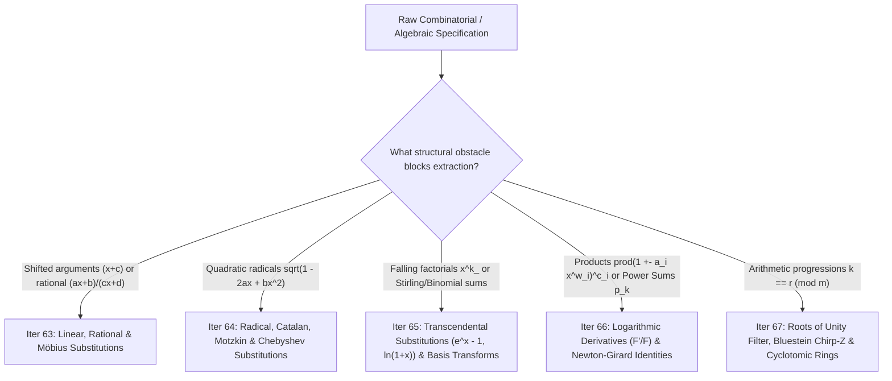
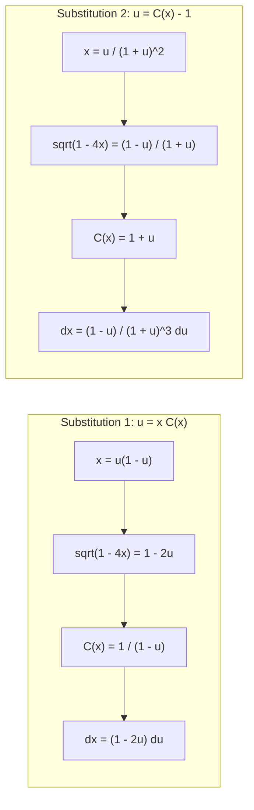
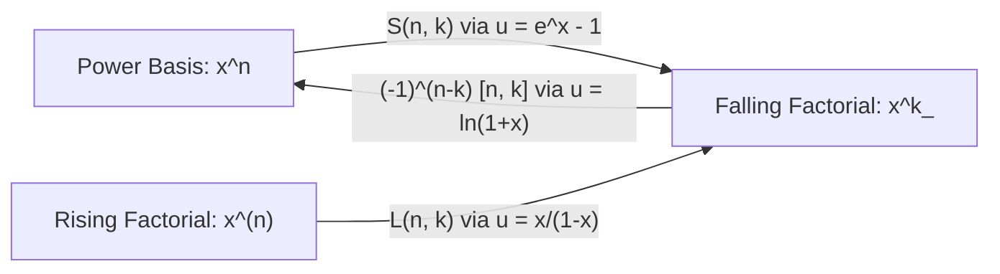
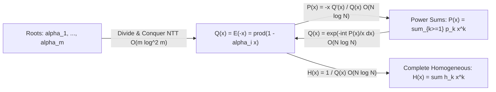

# Cohort 2 — Wave 2A (Iterations 63–67): Algebraic Substitutions, Taylor Shifts, Radical/Catalan/Chebyshev Substitutions, Transcendental Transforms, Logarithmic Derivatives, and Roots of Unity Filters

**Investigator**: `fps-wave-investigator` (Cohort 2 Independent Redundant Discovery)  
**Scope**: Iterations 63, 64, 65, 66, and 67  
**Pedagogical Standard**: Zero Magic Steps — Every substitution, operator, change of basis, and filter is derived from first principles via a **Diagnostic Signal**, a **Reverse-Engineering Scratchpad**, **Step-by-Step Annotated Algebraic Derivations** with explicit ring/convergence/characteristic conditions, **Hand-Checkable Toy Examples ($n \le 4$)**, and **Failure Modes & Edge Cases**.

---

## Executive Architectural Overview

When solving a combinatorial enumeration or algebraic manipulation problem via Formal Power Series (FPS), raw coefficient extraction $[x^n] F(x)$ is rarely the end of the story. Instead, competitive programming problems routinely disguise simple generating functions behind **coordinate changes**, **basis shifts**, **irrational square roots**, **infinite Eulerian products**, or **modular congruences on exponents**.

This volume covers the five foundational transformation families that strip away those disguises in $O(N \log N)$ or $O(N \log^2 N)$ time:



---

## Iteration 63: Rational, Linear & Möbius Substitutions

### 63.1 The Taylor Shift $F(x+c)$ in $O(N \log N)$

#### (a) Concrete Combinatorial / Algebraic Object & Ring
Given a polynomial $F(x) = \sum_{k=0}^{n} f_k x^k \in R[x]$ of degree $n$ over a commutative ring $R$ (typically $R = \mathbb{F}_p$ with prime $p > n$) and a shift constant $c \in R$, we wish to compute the coefficients $g_0, g_1, \dots, g_n \in R$ of the shifted polynomial:
$$G(x) = F(x + c) = \sum_{j=0}^{n} g_j x^j \in R[x]$$
Simultaneously, this is equivalent to computing the **Taylor expansion of $F(x)$ around $x = c$**:
$$F(x) = \sum_{j=0}^{n} \frac{F^{(j)}(c)}{j!} (x - c)^j \implies g_j = \frac{F^{(j)}(c)}{j!}$$

#### (b) The Diagnostic Signal
You should immediately reach for a **Taylor Shift** whenever you see:
1. **Explicit variable translation**: Replacing $x \leftarrow x + c$ or $x \leftarrow x - 1$ inside a polynomial accumulated during DP or divide-and-conquer.
2. **Upper-index binomial convolution**: A sum where the summation index $k$ is the **upper** index of a binomial coefficient while $j$ is fixed:
   $$g_j = \sum_{k=j}^{n} \binom{k}{j} c^{k-j} f_k$$
3. **Basis conversion between powers of $(x - c_1)$ and $(x - c_2)$**: Writing $(x - c_1)^k = ((x - c_2) + (c_2 - c_1))^k$.
4. **Rising-to-falling factorial / Stirling row doubling**: Computing $x^{\overline{2m}} = x^{\overline{m}} (x + m)^{\overline{m}}$, where the second factor is the first factor shifted by $c = m$.

#### (c) The Reverse-Engineering Scratchpad (How to Discover the Manipulation)
Suppose we expand $F(x+c)$ naively using the Binomial Theorem:
$$F(x+c) = \sum_{k=0}^{n} f_k (x+c)^k = \sum_{k=0}^{n} f_k \sum_{j=0}^{k} \binom{k}{j} c^{k-j} x^j = \sum_{j=0}^{n} x^j \sum_{k=j}^{n} \binom{k}{j} c^{k-j} f_k$$
Why isn't $\sum_{k=j}^{n} \binom{k}{j} c^{k-j} f_k$ immediately an NTT convolution?
- **Obstacle 1**: The binomial coefficient $\binom{k}{j}$ couples $k$ and $j$ multiplicatively instead of depending only on $k - j$.
- **Fix for Obstacle 1**: Unpack $\binom{k}{j} = \frac{k!}{j!(k-j)!}$. Now every factor depends exclusively on $k$, exclusively on $j$, or exclusively on the difference $k - j$:
  $$g_j = \frac{1}{j!} \sum_{k=j}^{n} \underbrace{(k! f_k)}_{A_k} \cdot \underbrace{\frac{c^{k-j}}{(k-j)!}}_{B_{k-j}}$$
- **Obstacle 2**: In standard polynomial multiplication $C_m = \sum_{u+v=m} A_u B_v$, the indices **add** ($u + v = m$). Here, the indices **subtract** ($k - (k-j) = j$, or $k - j = d \iff k - d = j$). This is a **cross-correlation** (or subtraction convolution).
- **Fix for Obstacle 2**: Reverse the array $A$! Define $A^{\text{rev}}_{n-k} = A_k = k! f_k$. Then as $k$ and $k-j$ combine, their new indices add:
  $$(n - k) + (k - j) = n - j$$
  Thus, standard polynomial multiplication of $A^{\text{rev}}(x) = \sum_{u=0}^{n} A_{n-u} x^u$ and $B(x) = \sum_{v=0}^{n} \frac{c^v}{v!} x^v$ produces the desired sum at coefficient $[x^{n-j}]$!

#### (d) Step-by-Step Algebraic Derivation & Verbal Annotations
Let $F(x) = \sum_{k=0}^{n} f_k x^k \in R[x]$. Assume $2, 3, \dots, n \in R^\times$ (i.e., $n! \in R^\times$, which holds in $\mathbb{F}_p$ whenever $p > n$).

1. **Apply the Binomial Theorem** to each monomial $(x+c)^k$:
   $$F(x+c) = \sum_{k=0}^{n} f_k \sum_{j=0}^{k} \binom{k}{j} x^j c^{k-j}$$
2. **Interchange summation order** ($0 \le j \le k \le n$):
   $$[x^j] F(x+c) = \sum_{k=j}^{n} f_k \binom{k}{j} c^{k-j}$$
3. **Factor the binomial coefficient** into $k!$, $j!^{-1}$, and $(k-j)!^{-1}$ (valid since $n! \in R^\times$):
   $$[x^j] F(x+c) = \frac{1}{j!} \sum_{k=j}^{n} (k! f_k) \cdot \frac{c^{k-j}}{(k-j)!}$$
4. **Substitute the reversal index** $u = n - k$ and difference index $v = k - j$, noting that $u + v = n - j$ and $0 \le u, v \le n$:
   $$[x^j] F(x+c) = \frac{1}{j!} \sum_{\substack{u+v = n-j \\ 0 \le u, v \le n}} \Big((n-u)! f_{n-u}\Big) \cdot \left(\frac{c^v}{v!}\right)$$
5. **Express as polynomial coefficient extraction**: Define
   $$P(x) = \sum_{u=0}^{n} (n-u)! f_{n-u} x^u, \qquad Q(x) = \sum_{v=0}^{n} \frac{c^v}{v!} x^v$$
   Then for each $0 \le j \le n$:
   $$g_j = [x^j] F(x+c) = \frac{1}{j!} [x^{n-j}] \big(P(x) Q(x)\big)$$

**Complexity**: Precomputing factorials takes $O(n)$ time. Multiplying $P(x)$ and $Q(x)$ of degree $n$ takes a single NTT convolution of length $2^{\lceil \log_2(2n+1) \rceil}$, yielding $O(n \log n)$ time and $O(n)$ space.

#### (e) Hand-Checkable Toy Example ($n = 3$)
Let $F(x) = 1 + 2x + 3x^2 + 4x^3$ ($n = 3$, coefficients $f = [1, 2, 3, 4]$) and $c = 2$.
First, check directly by algebra:
$$\begin{aligned}
F(x+2) &= 1 + 2(x+2) + 3(x+2)^2 + 4(x+2)^3 \\
&= 1 + (2x + 4) + (3x^2 + 12x + 12) + (4x^3 + 24x^2 + 48x + 32) \\
&= 49 + 62x + 27x^2 + 4x^3.
\end{aligned}$$
Now trace the convolution algorithm:
- $k! f_k$:
  - $k=0: 0! \cdot 1 = 1$
  - $k=1: 1! \cdot 2 = 2$
  - $k=2: 2! \cdot 3 = 6$
  - $k=3: 3! \cdot 4 = 24$
- Reverse to form $P(x) = 24 + 6x + 2x^2 + 1x^3$.
- Form $Q(x) = \sum_{v=0}^3 \frac{2^v}{v!} x^v = 1 + 2x + 2x^2 + \frac{4}{3}x^3$.
- Multiply $P(x) Q(x)$ up to degree $n = 3$:
  - $[x^0](PQ) = 24 \cdot 1 = 24$
  - $[x^1](PQ) = 24 \cdot 2 + 6 \cdot 1 = 54$
  - $[x^2](PQ) = 24 \cdot 2 + 6 \cdot 2 + 2 \cdot 1 = 62$
  - $[x^3](PQ) = 24 \cdot \frac{4}{3} + 6 \cdot 2 + 2 \cdot 2 + 1 \cdot 1 = 32 + 12 + 4 + 1 = 49$
- Reverse $[x^{3-j}](PQ)$ and divide by $j!$:
  - $j=0: \frac{1}{0!} [x^3](PQ) = 49 / 1 = 49$
  - $j=1: \frac{1}{1!} [x^2](PQ) = 62 / 1 = 62$
  - $j=2: \frac{1}{2!} [x^1](PQ) = 54 / 2 = 27$
  - $j=3: \frac{1}{3!} [x^0](PQ) = 24 / 6 = 4$
Result: $G(x) = 49 + 62x + 27x^2 + 4x^3$, matching the direct expansion!

#### (f) Reference C++ Implementation
```cpp
// Computes G(x) = F(x + c) in O(N log N) time.
// Precondition: N = F.size() - 1 < MOD (so k! is invertible for all k <= N).
Poly taylor_shift(Poly F, Mint c, const Binomial<Mint>& binom) {
    int n = (int)F.size() - 1;
    if (n <= 0 || c == 0) return F;
    Poly P(n + 1), Q(n + 1);
    Mint c_pow = 1;
    for (int k = 0; k <= n; ++k) {
        P[n - k] = F[k] * binom.fac(k);
        Q[k] = c_pow * binom.finv(k);
        c_pow *= c;
    }
    Poly PQ = multiply(P, Q); // Standard NTT multiplication
    Poly G(n + 1);
    for (int j = 0; j <= n; ++j) {
        G[j] = PQ[n - j] * binom.finv(j);
    }
    return G;
}
```

#### (g) Failure Modes, Pitfalls & Edge Cases
1. **Small Prime Characteristic ($p \le n$)**: The division by $j!$ and $(k-j)!$ fails when $p \le n$ because $p! \equiv 0 \pmod p$. Over $\mathbb{F}_p$ with small $p$ (e.g., $p = 2$), $\binom{k}{j} \bmod p$ is governed by **Lucas's Theorem** ($j$ must be a bitwise submask of $k$ in base $p$), so Taylor shift reduces to a ** base-$p$ SOS DP / Superset Zeta Transform** in $O(n \log_p n)$ rather than NTT!
2. **Applying Taylor Shift to an Infinite FPS**: You **cannot** apply $x \mapsto x + c$ with $c \neq 0$ to an arbitrary infinite formal power series $F(x) \in K[[x]]$, because $g_0 = \sum_{k=0}^\infty f_k c^k$ is an infinite sum in $K$ that does not converge in the $(x)$-adic topology! Taylor shift is only valid when $F(x)$ is a **polynomial** (or truncated modulo $(x+c)^{n+1} \leftrightarrow x^{n+1}$ before shifting).
3. **Truncating $P(x)Q(x)$ Too Early**: Notice that $P(x)$ has degree $n$ and $Q(x)$ has degree $n$, so $P(x)Q(x)$ has degree $2n$, even though we only read coefficients $[x^0]$ through $[x^n]$ of $P(x)Q(x)$. When calling a circular NTT, the transform size MUST be at least $2n + 1$ so that terms of degree $n+1 \dots 2n$ do not wrap around and corrupt $[x^0 \dots x^n]$!

---

### 63.2 Rational Substitution $u = \frac{x}{1-x}$, Euler's Series Transform, and Binomial Transforms

#### (a) Concrete Combinatorial / Algebraic Object & Ring
Given a formal power series $F(u) = \sum_{k=0}^{\infty} f_k u^k \in R[[u]]$, we consider the rational composition
$$G(x) = \frac{1}{1-x} F\left(\frac{x}{1-x}\right) \in R[[x]] \quad \text{or} \quad H(x) = F\left(\frac{x}{1-x}\right) \in R[[x]]$$
Because $\operatorname{val}\left(\frac{x}{1-x}\right) = 1 \ge 1$, the composition $F\left(\frac{x}{1-x}\right)$ is **formally well-defined** for *any* infinite series $F(u) \in R[[u]]$ without any convergence conditions on $R$!

Combinatorially:
- Replacing $u \leftarrow \frac{x}{1-x} = x + x^2 + x^3 + \dots$ replaces each "atom" of weight $1$ in an object counted by $F(u)$ with a **non-empty linear sequence (composition part)** of atoms.
- In sequence space, $G(x) = \frac{1}{1-x} F\left(\frac{x}{1-x}\right)$ is the **Binomial Transform** of the sequence $(f_k)_{k \ge 0}$, and its alternating counterpart $\frac{1}{1+x} F\left(\frac{x}{1+x}\right)$ is **Euler's Series Transform** (originally introduced by Euler to accelerate alternating series and central in finite-difference calculus $\Delta^k f_0$).

#### (b) The Diagnostic Signal
Look for this substitution whenever you encounter:
1. **Lower-index binomial sums** (the dual of Taylor shift):
   $$g_n = \sum_{k=0}^{n} \binom{n}{k} f_k \quad \text{or} \quad g_n = \sum_{k=0}^{n} \binom{n-1}{k-1} f_k$$
2. **Inclusion-Exclusion / Binomial Inversion**:
   $$g_n = \sum_{k=0}^{n} (-1)^{n-k} \binom{n}{k} f_k \quad \text{or} \quad b_n = \sum_{k=0}^{n} (-1)^k \binom{n}{k} a_k$$
3. **Block-stretching / Run-length encoding**: Counting strings, compositions, or paths where each of $k$ transitions can be stretched by inserting any number of self-loops or idle steps.

#### (c) The Reverse-Engineering Scratchpad
Suppose we want to compute $g_n = \sum_{k=0}^{n} \binom{n-1}{k-1} f_k$ for all $0 \le n \le N$, or equivalently we have $H(x) = \sum_{k=0}^{N} f_k \left(\frac{x}{1-x}\right)^k \bmod x^{N+1}$.
There are **two completely different lenses** to evaluate this in $O(N \log N)$, and knowing *both* is critical:
- **Lens 1 (EGF / Pascal Matrix Lens — for Infinite Series Truncated at $x^{N+1}$)**:
  Look at $g_n = \sum_{k=0}^{n} \binom{n}{k} f_k$ (which corresponds to $G(x) = \frac{1}{1-x} F\left(\frac{x}{1-x}\right)$).
  Unpack $\binom{n}{k} = \frac{n!}{k!(n-k)!}$ and divide both sides by $n!$:
  $$\frac{g_n}{n!} = \sum_{k=0}^{n} \frac{f_k}{k!} \cdot \frac{1}{(n-k)!}$$
  In Exponential Generating Function (EGF) space, $\widehat{G}(z) = \sum_{n \ge 0} g_n \frac{z^n}{n!}$ is simply $\widehat{F}(z) \cdot e^z$!
- **Lens 2 (Homogenized Polynomial / Möbius Lens — for Degree-$N$ Polynomials)**:
  Put $F\left(\frac{x}{1-x}\right)$ over the common denominator $(1-x)^N$:
  $$(1-x)^N F\left(\frac{x}{1-x}\right) = \sum_{k=0}^{N} f_k x^k (1-x)^{N-k}$$
  How do we eliminate the $1-x$ in $(1-x)^{N-k}$? Set $y = \frac{x}{1-x}$ backwards, or better yet, substitute $w = 1 - x \iff x = 1 - w$:
  $$\sum_{k=0}^{N} f_k (1-w)^k w^{N-k} = w^N \sum_{k=0}^{N} f_k \left(\frac{1-w}{w}\right)^k$$
  This is a composition of **coefficient reversal** and **Taylor shifts**!

#### (d) Step-by-Step Algebraic Derivation & Verbal Annotations

##### Formulation A: The OGF-to-EGF Bridge (Pascal Matrix Multiplication)
Let $F(u) = \sum_{k=0}^{\infty} f_k u^k$ and define $G(x) = \frac{1}{1-x} F\left(\frac{x}{1-x}\right)$.
1. **Expand the negative-binomial power** $(1-x)^{-(k+1)} = \sum_{m=0}^{\infty} \binom{k+m}{k} x^m$:
   $$G(x) = \sum_{k=0}^{\infty} f_k x^k (1-x)^{-(k+1)} = \sum_{k=0}^{\infty} f_k \sum_{n=k}^{\infty} \binom{n}{k} x^n$$
2. **Extract $[x^n] G(x)$**:
   $$g_n = [x^n] G(x) = \sum_{k=0}^{n} \binom{n}{k} f_k$$
3. **Pass to Exponential Generating Functions** $\widehat{F}(z) = \sum_{k=0}^{\infty} f_k \frac{z^k}{k!}$ and $\widehat{G}(z) = \sum_{n=0}^{\infty} g_n \frac{z^n}{n!}$ (requires $N! \in R^\times$):
   $$\widehat{G}(z) = \sum_{n=0}^{\infty} \frac{z^n}{n!} \sum_{k=0}^{n} \binom{n}{k} f_k = \sum_{k=0}^{\infty} \frac{f_k z^k}{k!} \sum_{n=k}^{\infty} \frac{z^{n-k}}{(n-k)!} = \widehat{F}(z) e^z$$
   And by multiplying by $e^{-z}$, we immediately get the inverse transform:
   $$\widehat{F}(z) = \widehat{G}(z) e^{-z} \iff F(u) = \frac{1}{1+u} G\left(\frac{u}{1+u}\right)$$

##### Formulation B: Pure Substitution $H(x) = F\left(\frac{x}{1-x}\right) \bmod x^{N+1}$
What if there is no leading $\frac{1}{1-x}$ factor? We have two clean $O(N \log N)$ routes:
- **Route B1**: Notice that $G(x) = \frac{1}{1-x} F\left(\frac{x}{1-x}\right) \implies H(x) = (1-x) G(x)$. So compute $G(x) \bmod x^{N+1}$ via one EGF convolution with $e^z$, then multiply by $(1-x)$ in $O(N)$ time!
- **Route B2 (Index shift)**: Write $H(x) = f_0 + \sum_{k=1}^{N} f_k \frac{x}{1-x} \left(\frac{x}{1-x}\right)^{k-1}$, which shifts the indices by $1$: for $n \ge 1$, $[x^n] H(x) = \sum_{k=1}^{n} \binom{n-1}{k-1} f_k$.

#### (e) Hand-Checkable Toy Example ($n = 3$)
Let $F(u) = 1 + u + 2u^2 + 3u^3$. Let us compute $H(x) = F\left(\frac{x}{1-x}\right) \bmod x^4$:
1. Compute $G(x) = \frac{1}{1-x} F\left(\frac{x}{1-x}\right) \bmod x^4$ via $g_n = \sum_{k=0}^n \binom{n}{k} f_k$:
   - $g_0 = \binom{0}{0}(1) = 1$
   - $g_1 = \binom{1}{0}(1) + \binom{1}{1}(1) = 2$
   - $g_2 = \binom{2}{0}(1) + \binom{2}{1}(1) + \binom{2}{2}(2) = 1 + 2 + 2 = 5$
   - $g_3 = \binom{3}{0}(1) + \binom{3}{1}(1) + \binom{3}{2}(2) + \binom{3}{3}(3) = 1 + 3 + 6 + 3 = 13$
   So $G(x) = 1 + 2x + 5x^2 + 13x^3 \pmod{x^4}$.
2. Multiply by $1 - x$:
   $$H(x) = (1-x)(1 + 2x + 5x^2 + 13x^3) \equiv 1 + x + 3x^2 + 8x^3 \pmod{x^4}.$$
3. Direct verification:
   - $\frac{x}{1-x} = x + x^2 + x^3 + \dots$
   - $\left(\frac{x}{1-x}\right)^2 = x^2 + 2x^3 + \dots$
   - $\left(\frac{x}{1-x}\right)^3 = x^3 + \dots$
   - $1 + 1(x+x^2+x^3) + 2(x^2+2x^3) + 3(x^3) = 1 + x + 3x^2 + 8x^3$. Exact match!

---

### 63.3 General Möbius Transformations $(cx+d)^n P\left(\frac{ax+b}{cx+d}\right)$

#### (a) Concrete Combinatorial / Algebraic Object & Ring
Given a polynomial $P(x) = \sum_{k=0}^{n} p_k x^k \in R[x]$ of degree $n$ and a $2 \times 2$ matrix $M = \begin{pmatrix} a & b \\ c & d \end{pmatrix} \in M_2(R)$, we define the **homogenized Möbius action** of degree $n$:
$$(M \cdot P)(x) = (cx + d)^n P\left(\frac{ax + b}{cx + d}\right) = \sum_{k=0}^{n} p_k (ax + b)^k (cx + d)^{n-k} \in R[x]$$
Notice that if we also want the **infinite power series** substitution $P\left(\frac{ax+b}{cx+d}\right) \bmod x^{m+1}$ (assuming $d \in R^\times$), it is simply the polynomial $(M \cdot P)(x)$ multiplied by $(cx + d)^{-n} \bmod x^{m+1}$!

#### (b) The Diagnostic Signal
Reach for the **Möbius Transformation Decomposition** whenever you see:
1. **Simultaneous binomial expansions in two linear forms**:
   $$[x^j] Q(x) = [x^j] \sum_{k=0}^{n} p_k (ax + b)^k (cx + d)^{n-k}$$
2. **2-State / Krawtchouk / Spin-Flip Generating Functions**:
   Expressions like $\sum_{k=0}^{n} p_k (1 - x)^k (1 + x)^{n-k}$ (which arises in Walsh-Hadamard / XOR convolution radial symmetries, hypercube random walks, and coding theory weight enumerators — MacWilliams Identity!).
3. **Cayley Transform**: Converting between $z$ and $\frac{1+z}{1-z}$ or $\frac{1-z}{1+z}$.

#### (c) The Reverse-Engineering Scratchpad
Computing $\sum_{k=0}^{n} p_k (ax+b)^k (cx+d)^{n-k}$ term-by-term takes $O(n^2)$. Using divide-and-conquer binary splitting takes $O(n \log^2 n)$. Can we do it in **$O(n \log n)$** with a **single Taylor shift** (or two)?
Let's think in terms of **group theory**!
The map $(M \cdot P)(x) = (cx+d)^n P\left(\frac{ax+b}{cx+d}\right)$ is a representation of $\mathrm{GL}_2(R)$ on the space $R[x]_{\le n}$ of polynomials of degree at most $n$.
What are the elementary generators of $\mathrm{GL}_2(R)$ that we already know how to apply to $P(x)$ in $O(n)$ or $O(n \log n)$?
1. **Translation (Upper triangular unipotent)** $T_u = \begin{pmatrix} 1 & u \\ 0 & 1 \end{pmatrix}$:
   $$(T_u \cdot P)(x) = P(x + u) \quad \longrightarrow \text{Taylor shift in } O(n \log n)!$$
2. **Scaling (Diagonal)** $D_{\alpha, \beta} = \begin{pmatrix} \alpha & 0 \\ 0 & \beta \end{pmatrix}$:
   $$(D_{\alpha, \beta} \cdot P)(x) = \beta^n P\left(\frac{\alpha}{\beta} x\right) = \sum_{k=0}^{n} p_k \alpha^k \beta^{n-k} x^k \quad \longrightarrow \text{Pointwise scaling in } O(n)!$$
3. **Inversion / Reversal (Weyl element)** $J = \begin{pmatrix} 0 & 1 \\ 1 & 0 \end{pmatrix}$:
   $$(J \cdot P)(x) = x^n P(1/x) = \sum_{k=0}^{n} p_{n-k} x^k = P^{\text{rev}}(x) \quad \longrightarrow \text{Array reversal in } O(n)!$$

Because every $2 \times 2$ matrix $M = \begin{pmatrix} a & b \\ c & d \end{pmatrix}$ can be factored by Gaussian elimination (Bruhat decomposition) into at most **two translations**, **one reversal**, and **one scaling**, **any** Möbius transformation $(cx+d)^n P\left(\frac{ax+b}{cx+d}\right)$ reduces to **at most ONE Taylor shift**! Wait — only *one* Taylor shift, not two? Let's check!

#### (d) Step-by-Step Algebraic Derivation & Verbal Annotations
We analyze two cases based on whether $c = 0$ or $c \in R^\times$:

##### Case 1: $c = 0$ (Affine Transformation)
Here $(dx)^n \to d^n P\left(\frac{ax+b}{d}\right) = \sum_{k=0}^{n} p_k d^{n-k} (ax + b)^k$.
1. Pre-scale $p_k \leftarrow p_k d^{n-k}$ in $O(n)$.
2. Perform **one Taylor shift** by $b$: $Q_1(y) = \sum_{k=0}^n (p_k d^{n-k}) (y + b)^k$ in $O(n \log n)$.
3. Post-scale $y \leftarrow ax$: multiply $[y^j] Q_1(y)$ by $a^j$ in $O(n)$.

##### Case 2: $c \neq 0$ (Genuine Rational / Projective Transformation, assuming $a, c \in R^\times$)
Instead of two Taylor shifts, perform **polynomial division** of the linear forms $ax + b$ and $cx + d$? Wait: what if we first substitute $w = cx + d$, so $x = \frac{w - d}{c}$?
Let's trace:
1. Write $ax + b$ in terms of $w = cx + d$:
   $$ax + b = \frac{a}{c}(cx + d) + \left(b - \frac{ad}{c}\right) = \alpha w + \beta, \quad \text{where } \alpha = \frac{a}{c},\; \beta = \frac{bc - ad}{c}.$$
2. Substitute $ax + b = \alpha w + \beta$ and $cx + d = w$ into the target expression:
   $$Q(x) = \sum_{k=0}^{n} p_k (\alpha w + \beta)^k w^{n-k} = w^n \sum_{k=0}^{n} p_k \left(\alpha + \frac{\beta}{w}\right)^k$$
3. Let $z = \frac{1}{w}$. The inner sum is:
   $$P(\alpha + \beta z) = \sum_{k=0}^{n} p_k (\alpha + \beta z)^k$$
   How do we compute $P(\alpha + \beta z)$?
   - **Step 3a (Taylor Shift)**: Compute $P_1(y) = P(y + \alpha)$ in $O(n \log n)$.
   - **Step 3b (Scaling)**: Evaluate at $y = \beta z$ by multiplying $[y^k] P_1(y)$ by $\beta^k$ in $O(n)$.
4. Multiply by $w^n$ (which reverses the coefficients since $w^n z^k = w^{n-k}$):
   $$Q(x) = \sum_{k=0}^{n} \big([z^k] P(\alpha + \beta z)\big) w^{n-k} = \sum_{j=0}^{n} q_j (cx + d)^j, \quad \text{where } q_j = [z^{n-j}] P(\alpha + \beta z).$$
5. Finally, substitute $w = cx + d$ into $\sum_{j=0}^{n} q_j w^j$:
   - **Step 5a (Taylor Shift)**: Compute $Q_2(u) = \sum_{j=0}^{n} q_j (u + d)^j$ in $O(n \log n)$.
   - **Step 5b (Scaling)**: Set $u = cx$ by multiplying $[u^j] Q_2(u)$ by $c^j$ in $O(n)$.

This gives a completely general algorithm using **two Taylor shifts** ($O(n \log n)$ total) for any $a, b, c, d \in \mathbb{F}_p$ with $c \neq 0$!
> [!TIP]
> **Special Case Optimization (MacWilliams / Hadamard Shift $(1-x)^k (1+x)^{n-k}$)**:
> When $cx + d = 1 + x$ and $ax + b = 1 - x$, notice that $w = 1 + x$ gives $1 - x = 2 - w$. If we only need $Q(x)$ evaluated or combined with another shift, we can fuse the outer shift, or execute the two Taylor shifts in $2 \times \text{NTT}$ calls!

#### (e) Hand-Checkable Toy Example ($n = 2$, MacWilliams Transform)
Let $P(x) = 1 + 2x + 3x^2$ ($n = 2$) and let us compute:
$$Q(x) = (1+x)^2 P\left(\frac{1-x}{1+x}\right) = 1(1+x)^2 + 2(1-x)(1+x) + 3(1-x)^2$$
First, check directly:
$$Q(x) = (1 + 2x + x^2) + (2 - 2x^2) + (3 - 6x + 3x^2) = 6 - 4x + 2x^2.$$
Now trace the 2-shift algorithm with $a = -1, b = 1, c = 1, d = 1$:
- $\alpha = a/c = -1$, $\beta = (bc - ad)/c = (1 - (-1))/1 = 2$. Indeed, $1 - x = -1(1+x) + 2 = -w + 2$.
- **Step 3a**: Shift $P(y)$ by $\alpha = -1$:
  $$P_1(y) = P(y - 1) = 1 + 2(y-1) + 3(y-1)^2 = 1 + (2y - 2) + (3y^2 - 6y + 3) = 2 - 4y + 3y^2.$$
- **Step 3b**: Scale $y \leftarrow \beta z = 2z$:
  $$P(-1 + 2z) = 2 - 4(2z) + 3(2z)^2 = 2 - 8z + 12z^2.$$
- **Step 4**: Reverse coefficients to get $\sum q_j w^j$:
  $$q = [12, -8, 2] \implies 12 + (-8)w + 2w^2.$$
- **Step 5a**: Shift by $d = 1$ ($w = x + 1$):
  $$Q(x) = 12 - 8(x+1) + 2(x+1)^2 = 12 - 8x - 8 + 2x^2 + 4x + 2 = 6 - 4x + 2x^2.$$
Exact match!

#### (f) Reference C++ Implementation (General Möbius Transformation)
```cpp
// Computes Q(x) = (c*x + d)^n * P((a*x + b) / (c*x + d)) in O(n log n) time.
Poly mobius_transform(Poly P, Mint a, Mint b, Mint c, Mint d, const Binomial<Mint>& binom) {
    int n = (int)P.size() - 1;
    if (n < 0) return {};
    if (c == 0) {
        // Q(x) = sum_{k=0}^n P[k] * d^{n-k} * (a*x + b)^k
        Mint d_pow = 1;
        for (int k = n; k >= 0; --k) {
            P[k] *= d_pow;
            d_pow *= d;
        }
        Poly Q = taylor_shift(P, b, binom);
        Mint a_pow = 1;
        for (int j = 0; j <= n; ++j) {
            Q[j] *= a_pow;
            a_pow *= a;
        }
        return Q;
    }
    // General case c != 0: write a*x + b = alpha * w + beta where w = c*x + d
    Mint inv_c = c.inv();
    Mint alpha = a * inv_c;
    Mint beta = (b * c - a * d) * inv_c;

    // 1. Compute P(alpha + beta * z)
    Poly P1 = taylor_shift(P, alpha, binom);
    Mint beta_pow = 1;
    for (int k = 0; k <= n; ++k) {
        P1[k] *= beta_pow;
        beta_pow *= beta;
    }
    // 2. Reverse coefficients for w^n * P(alpha + beta / w)
    std::reverse(P1.begin(), P1.end());

    // 3. Substitute w = c*x + d
    Poly Q = taylor_shift(P1, d, binom);
    Mint c_pow = 1;
    for (int j = 0; j <= n; ++j) {
        Q[j] *= c_pow;
        c_pow *= c;
    }
    return Q;
}
```

#### (g) Failure Modes, Pitfalls & Edge Cases
1. **Degenerate Determinant ($ad - bc = 0$)**: When $ad - bc = 0$, the rational function $\frac{ax+b}{cx+d}$ is constant ($\beta = 0$). Our code handles this seamlessly because `beta_pow` sets all $k \ge 1$ terms of `P1` to $0$, leaving `P1[0] = P(alpha)` and producing $P(\alpha) (cx+d)^n$.
2. **Degree Mismatch ($n$ vs `P.size() - 1`)**: If the problem specifies $(cx+d)^M P\left(\frac{ax+b}{cx+d}\right)$ where $M > \deg P$, you MUST pad the vector `P` with trailing zeros up to size $M + 1$ before calling `mobius_transform`, because the reversal step `std::reverse(P1.begin(), P1.end())` corresponds specifically to multiplying by $w^{\text{size}-1}$.

---

## Iteration 64: Radical, Quadratic, Catalan, Motzkin, Delannoy & Chebyshev Substitutions

### 64.1 The Catalan Substitution Family ($x = u(1-u)$ and $x = \frac{u}{(1+u)^2}$)

#### (a) Concrete Combinatorial / Algebraic Object & Ring
The **Catalan generating function** $C(x) = \sum_{n=0}^{\infty} C_n x^n \in \mathbb{Q}[[x]]$ (where $C_n = \frac{1}{n+1}\binom{2n}{n}$) satisfies the quadratic functional equation:
$$C(x) = 1 + x C(x)^2 \iff C(x) = \frac{1 - \sqrt{1 - 4x}}{2x}$$
More generally, combinatorial problems involving **binary trees**, **Dyck paths**, **ballot sequences**, **random walks on $\mathbb{Z}$**, and **central binomial coefficients** $\binom{2n}{n}$ produce generating functions lying in the quadratic extension ring $K[[x]][\sqrt{1 - 4x}]$, such as:
$$F(x) = R\big(x, \sqrt{1 - 4x}\big) \quad \text{or} \quad G(x) = \frac{C(x)^k}{\sqrt{1 - 4x}}$$
Our goal is to rationalize $\sqrt{1 - 4x}$ by pulling $K[[x]]$ back into a pure rational power series ring $K[[u]]$ via an invertible formal change of variables $x = \phi(u)$ with $\phi(0) = 0, \phi'(0) = 1$.

#### (b) The Diagnostic Signal
Reach for a **Catalan Substitution** whenever you encounter:
1. **Explicit square roots** $\sqrt{1 - 4x}$ (or $\sqrt{1 - 4\alpha x}$) in the denominator or numerator of an OGF.
2. **Powers of the Catalan OGF** $C(x)^k$ or shifted convolutions of $\binom{2n}{n}$ and $\frac{k}{2n+k}\binom{2n+k}{n}$.
3. **Recurrence relations of the form** $A_n = \sum_{i+j=n-1} A_i A_j + B_n$ or $1+x C(x)^2 = C(x)$.

#### (c) The Reverse-Engineering Scratchpad (How to Discover Both Substitutions)
Why do there exist **two** famous substitutions for $\sqrt{1-4x}$, namely $x = u(1-u)$ and $x = \frac{u}{(1+u)^2}$? Let's derive both without guessing:

- **Path 1 (From $C(x) = 1 + x C(x)^2$ — The Shifted-Catalan Parameterization $x = u(1-u)$)**:
  Instead of solving the quadratic $x C^2 - C + 1 = 0$ for $C$ in terms of $x$ (which introduces a square root), solve it for **$x$ in terms of $C$**!
  Set $u = C(x) - 1$ (so $\operatorname{val}(u) = 1$ since $C(0) = 1$). Then $C(x) = 1 + u$, and:
  $$1 + u = 1 + x (1 + u)^2 \implies u = x(1 + u)^2 \implies x = \frac{u}{(1 + u)^2}!$$
  Wait — what if instead we set $u = x C(x)$ (the OGF of Catalan numbers shifted by 1)? Then $C(x) = 1 + x C(x)^2$ multiplied by $x$ reads:
  $$u = x + u^2 \implies x = u - u^2 = u(1 - u)!$$
  Look how natural that is:
  - Setting $u = x C(x)$ gives **$x = u(1 - u)$**!
  - Setting $u = C(x) - 1$ gives **$x = \frac{u}{(1 + u)^2}$**!

- **Path 2 (Checking how $\sqrt{1 - 4x}$ rationalizes under each)**:
  - Under $x = u(1 - u)$:
    $$1 - 4x = 1 - 4u + 4u^2 = (1 - 2u)^2 \implies \sqrt{1 - 4x} = 1 - 2u, \quad C(x) = \frac{u}{x} = \frac{1}{1 - u}.$$
  - Under $x = \frac{u}{(1+u)^2}$:
    $$1 - 4x = 1 - \frac{4u}{(1+u)^2} = \frac{(1+u)^2 - 4u}{(1+u)^2} = \left(\frac{1 - u}{1 + u}\right)^2 \implies \sqrt{1 - 4x} = \frac{1 - u}{1 + u}, \quad C(x) = 1 + u.$$



#### (d) Step-by-Step Algebraic Derivation & Coefficient Extraction via Formal Residue
Recall the **Formal Change of Variables Formula** (Lagrange–Bürmann in residue form): for any formal power series $F(x) \in K[[x]]$ and any substitution $x = \phi(u)$ with $\phi(0) = 0, \phi'(0) \in K^\times$:
$$[x^n] F(x) = [x^{-1}] \frac{F(x)}{x^{n+1}} = [u^{-1}] \frac{F(\phi(u)) \phi'(u)}{\phi(u)^{n+1}} = [u^n] \left( F(\phi(u)) \cdot \phi'(u) \cdot \left(\frac{u}{\phi(u)}\right)^{n+1} \right)$$

Let us apply this to the two fundamental Catalan families using $x = u(1 - u)$, where $\frac{u}{\phi(u)} = \frac{1}{1 - u}$ and $\phi'(u) = 1 - 2u = \sqrt{1 - 4x}$:

1. **Identity 1: Extraction from $\frac{C(x)^k}{\sqrt{1 - 4x}}$ (Buhrman / Central Binomial Convolution)**:
   Notice that $\phi'(u) = 1 - 2u = \sqrt{1 - 4x}$ **cancels** the $\sqrt{1 - 4x}$ in the denominator!
   $$\begin{aligned}
   [x^n] \frac{C(x)^k}{\sqrt{1 - 4x}} &= [u^n] \left( \frac{(1 - u)^{-k}}{1 - 2u} \cdot (1 - 2u) \cdot (1 - u)^{-(n+1)} \right) \\
   &= [u^n] (1 - u)^{-(n + k + 1)} \\
   &= \binom{2n + k}{n}.
   \end{aligned}$$
   In particular, for $k = 0$: $[x^n] \frac{1}{\sqrt{1-4x}} = \binom{2n}{n}$.

2. **Identity 2: Extraction from $C(x)^k$ (Catalan Convolution Powers / Ballot Numbers)**:
   Without the $\sqrt{1-4x}$ denominator, the Jacobian $\phi'(u) = 1 - 2u$ remains in the numerator:
   $$\begin{aligned}
   [x^n] C(x)^k &= [u^n] \left( (1 - u)^{-k} \cdot (1 - 2u) \cdot (1 - u)^{-(n+1)} \right) \\
   &= [u^n] \frac{1 - 2u}{(1 - u)^{n + k + 1}} \\
   &= \binom{2n + k}{n} - 2 \binom{2n + k - 1}{n - 1} \\
   &= \frac{k}{2n + k} \binom{2n + k}{n} = \frac{k}{n + k} \binom{2n + k - 1}{n}.
   \end{aligned}$$
   Wait — what if we used $x = \frac{u}{(1+u)^2}$ instead? Let's check:
   With $x = \frac{u}{(1+u)^2}$, we have $C(x) = 1 + u$, $\frac{u}{x} = (1+u)^2$, and $x'(u) = \frac{1-u}{(1+u)^3}$:
   $$[x^n] C(x)^k = [u^n] (1 + u)^k \frac{1 - u}{(1 + u)^3} (1 + u)^{2n + 2} = [u^n] (1 - u)(1 + u)^{2n + k - 1} = \binom{2n+k-1}{n} - \binom{2n+k-1}{n-1} = \frac{k}{2n+k}\binom{2n+k}{n}!$$
   Look at the difference: $x = u(1-u)$ turns $(u/x)^{n+1}$ into negative powers $(1-u)^{-(n+1)}$, whereas $x = \frac{u}{(1+u)^2}$ turns $(u/x)^{n+1}$ into **positive binomial powers** $(1+u)^{2n+2}$!

#### (e) Hand-Checkable Toy Example ($n = 2, k = 2$)
Compute $[x^2] C(x)^2$ and $[x^2] \frac{C(x)^2}{\sqrt{1-4x}}$:
- Since $C(x) = 1 + x + 2x^2 + 5x^3 + \dots$, we have:
  $$C(x)^2 = 1 + 2x + 5x^2 + 14x^3 + \dots \implies [x^2] C(x)^2 = 5.$$
  Formula check ($n = 2, k = 2$): $\frac{2}{4 + 2} \binom{4 + 2}{2} = \frac{2}{6} \cdot 15 = 5$. Matches!
- Multiply $C(x)^2 = 1 + 2x + 5x^2 + \dots$ by $\frac{1}{\sqrt{1-4x}} = 1 + 2x + 6x^2 + \dots$:
  $$[x^2] \frac{C(x)^2}{\sqrt{1-4x}} = 1 \cdot 6 + 2 \cdot 2 + 5 \cdot 1 = 15.$$
  Formula check ($n = 2, k = 2$): $\binom{2(2) + 2}{2} = \binom{6}{2} = 15$. Matches!

#### (f) Failure Modes, Pitfalls & Edge Cases
1. **Sign of the Square Root Branch**: In $K[[u]]$, $\sqrt{(1 - 2u)^2}$ has two square roots: $+(1 - 2u)$ and $-(1 - 2u) = 2u - 1$. You MUST pick the branch whose constant term $[u^0]$ matches $[x^0]\sqrt{1-4x} = +1$, which is $1 - 2u$ (and $\frac{1-u}{1+u}$). Picking $2u - 1$ corresponds to the extraneous conjugate branch $\tilde{C}(x) = \frac{1 + \sqrt{1-4x}}{2x} \in K((x))$ which has a pole at $x = 0$.
2. **Characteristic $p = 2$**: In characteristic $2$, $\sqrt{1 - 4x} = 1$ trivially, so the quadratic formula $C(x) = \frac{1 - \sqrt{1-4x}}{2x}$ divides $0$ by $0$ and is invalid! Over $\mathbb{F}_2[[x]]$, $C(x) = 1 + x C(x)^2$ is an Artin–Schreier equation solved by $C(x) = \sum_{k=0}^\infty x^{2^k - 1}$ (meaning $C_n \equiv 1 \pmod 2 \iff n = 2^k - 1$).

---

### 64.2 The Universal Quadratic Radical Substitution ($\sqrt{1 - 2ax + bx^2}$: Motzkin, Delannoy & Trinomials)

#### (a) Concrete Combinatorial / Algebraic Object & Ring
Many lattice path and tree enumeration problems involve a three-term step set or quadratic equation with a linear coefficient in $x$, producing generating functions in $K[[x]]\big[\sqrt{1 - 2ax + bx^2}\big]$:
- **Motzkin Numbers** $M(x) = 1 + x M(x) + x^2 M(x)^2 = \frac{1 - x - \sqrt{1 - 2x - 3x^2}}{2x^2}$ ($a = 1, b = -3$).
- **Large Schröder Numbers** $S(x) = \frac{1 - x - \sqrt{1 - 6x + x^2}}{2x}$ ($a = 3, b = 1$).
- **Central Delannoy Numbers** $D(x) = \frac{1}{\sqrt{1 - 6x + x^2}} = \sum_{n=0}^{\infty} D_n x^n$ ($a = 3, b = 1$).
- **Central Trinomial Coefficients** $[t^0](1 + at + bt^2)^n = [x^n] \frac{1}{\sqrt{1 - 2ax + (a^2 - 4b)x^2}}$.

#### (b) The Diagnostic Signal
Look for this substitution whenever you see:
1. A quadratic radical $\sqrt{1 - 2ax + bx^2}$ where **both** $x$ and $x^2$ appear inside the square root.
2. Paths with **up steps $(+1)$, flat steps $(0)$, and down steps $(-1)$** (Motzkin / Schröder / Grand Motzkin paths).
3. Grid walks with **diagonal steps** $(1,0), (0,1), (1,1)$ (Delannoy / King walks).

#### (c) The Reverse-Engineering Scratchpad (Deriving the Universal Rationalization Formula)
How do we rationalize $\sqrt{1 - 2ax + bx^2}$ for *arbitrary* constants $a, b \in K$ (assuming $2 \in K^\times$) while keeping $x(u) = u + O(u^2)$ so that formal residue extraction works?
Let's posit a rational substitution of the form:
$$x = \frac{u}{1 + \alpha u + \beta u^2}$$
Substitute this into $1 - 2ax + bx^2$ and clear the denominator $(1 + \alpha u + \beta u^2)^2$:
$$\text{Numerator}(u) = (1 + \alpha u + \beta u^2)^2 - 2au(1 + \alpha u + \beta u^2) + bu^2$$
We want $\text{Numerator}(u)$ to be a **perfect square** of a quadratic in $u$, say $(1 - \beta u^2)^2 = 1 - 2\beta u^2 + \beta^2 u^4$! Let's expand $\text{Numerator}(u)$ degree by degree and force it to equal $(1 - \beta u^2)^2$:
- $[u^0]$: $1 = 1$ (automatic).
- $[u^1]$: $2\alpha - 2a = 0 \implies \mathbf{\alpha = a}$!
- $[u^2]$: $(\alpha^2 + 2\beta) - 2a\alpha + b = 2\beta - a^2 + b$. Forcing this to equal $-2\beta$ gives:
  $$2\beta - a^2 + b = -2\beta \implies 4\beta = a^2 - b \implies \mathbf{\beta = \frac{a^2 - b}{4}}!$$
- $[u^3]$: $2\alpha\beta - 2a\beta = 0$ (automatic since $\alpha = a$!).
- $[u^4]$: $\beta^2 = \beta^2$ (automatic!).

Every single coefficient matches! This yields the **Universal Quadratic Radical Substitution Theorem**:

#### (d) Step-by-Step Algebraic Derivation & Dictionary of Famous Radicals
> [!IMPORTANT]
> **Theorem 64.1 (Universal Rationalization of $\sqrt{1 - 2ax + bx^2}$)**:
> Let $a, b \in K$ with $2 \in K^\times$, and define $\beta = \frac{a^2 - b}{4}$. Under the formal power series substitution
> $$x(u) = \frac{u}{1 + au + \beta u^2}$$
> we have the exact rational identities:
> $$\sqrt{1 - 2ax + bx^2} = \frac{1 - \beta u^2}{1 + au + \beta u^2}, \qquad x'(u) = \frac{1 - \beta u^2}{(1 + au + \beta u^2)^2}, \qquad \frac{x'(u)}{\sqrt{1 - 2ax + bx^2}} = \frac{1}{1 + au + \beta u^2}.$$

Let us tabulate how Theorem 64.1 unifies every classic substitution in combinatorics:

| Combinatorial Family | Radical $\sqrt{1 - 2ax + bx^2}$ | Parameters $(a, b, \beta)$ | Substitution $x(u)$ | Rationalized $\sqrt{\dots}$ |
| :--- | :--- | :--- | :--- | :--- |
| **Catalan** | $\sqrt{1 - 4x}$ | $a=2, b=0, \beta=1$ | $\frac{u}{(1+u)^2}$ | $\frac{1-u}{1+u}$ |
| **Motzkin** | $\sqrt{1 - 2x - 3x^2}$ | $a=1, b=-3, \beta=1$ | $\frac{u}{1 + u + u^2}$ | $\frac{1 - u^2}{1 + u + u^2}$ |
| **Schröder / Delannoy** | $\sqrt{1 - 6x + x^2}$ | $a=3, b=1, \beta=2$ | $\frac{u}{1 + 3u + 2u^2}$ | $\frac{1 - 2u^2}{1 + 3u + 2u^2}$ |
| **Central Binomial ($x^2$)** | $\sqrt{1 - 4x^2}$ | $a=0, b=4, \beta=-1$ | $\frac{u}{1 - u^2}$ | $\frac{1 + u^2}{1 - u^2}$ |
| **Chebyshev / Dyck** | $\sqrt{1 + 4x^2}$ | $a=0, b=-4, \beta=1$ | $\frac{u}{1 + u^2}$ | $\frac{1 - u^2}{1 + u^2}$ |

Let us apply Theorem 64.1 to extract the **general coefficient** of $\frac{1}{\sqrt{1 - 2ax + bx^2}}$ and of Motzkin powers $M(x)^k$:
1. **Coefficient of $\frac{1}{\sqrt{1 - 2ax + bx^2}}$**:
   $$\begin{aligned}
   [x^n] \frac{1}{\sqrt{1 - 2ax + bx^2}} &= [u^n] \frac{1}{\sqrt{1 - 2ax + bx^2}} \cdot x'(u) \cdot \left(\frac{u}{x(u)}\right)^{n+1} \\
   &= [u^n] \frac{1}{1 + au + \beta u^2} (1 + au + \beta u^2)^{n+1} \\
   &= [u^n] (1 + au + \beta u^2)^n!
   \end{aligned}$$
   Look at that one-line proof of Euler's trinomial identity: $[x^n] (1 - 2ax + bx^2)^{-1/2} = [u^n](1 + au + \frac{a^2-b}{4}u^2)^n$!
2. **Motzkin Substitution ($a = 1, b = -3, \beta = 1$)**:
   Under $x = \frac{u}{1 + u + u^2}$, the Motzkin generating function $M(x) = \frac{1 - x - \sqrt{1 - 2x - 3x^2}}{2x^2}$ simplifies to:
   $$1 - x - \sqrt{1 - 2x - 3x^2} = \frac{(1 + u + u^2) - u - (1 - u^2)}{1 + u + u^2} = \frac{2u^2}{1 + u + u^2} \implies M(x) = 1 + u + u^2, \quad x M(x) = u!$$
   Therefore, for any $k \ge 1$:
   $$[x^n] M(x)^k = [u^n] (1 + u + u^2)^k \frac{1 - u^2}{(1 + u + u^2)^2} (1 + u + u^2)^{n+1} = [u^n] (1 - u^2)(1 + u + u^2)^{n + k - 1}.$$

#### (e) Hand-Checkable Toy Example ($n = 3$, Motzkin Numbers $k = 1$)
Let us compute $M_3 = [x^3] M(x)$ using the formula $[u^3] (1 - u^2)(1 + u + u^2)^3$:
- Expand $(1 + u + u^2)^3 = 1 + 3u + 6u^2 + 7u^3 + 6u^4 + 3u^5 + u^6$.
- Multiply by $(1 - u^2)$ and extract $[u^3]$:
  $$[u^3](1 - u^2)(1 + u + u^2)^3 = [u^3](1 + u + u^2)^3 - [u^1](1 + u + u^2)^3 = 7 - 3 = 4.$$
- Combinatorial check: The $M_3 = 4$ Motzkin paths of length $3$ are `FFF`, `UFD`, `UDF`, `FUD`. Exact match!

---

### 64.3 The Reciprocal Substitution $x = \frac{u}{1+u^2}$ and Chebyshev Polynomials

#### (a) Concrete Combinatorial / Algebraic Object & Ring
The **Chebyshev polynomials** of the first kind $T_n(z)$ and second kind $U_n(z)$ are defined by:
$$T_n(\cos \theta) = \cos(n\theta), \qquad U_n(\cos \theta) = \frac{\sin((n+1)\theta)}{\sin \theta}$$
with Ordinary Generating Functions:
$$\sum_{n=0}^{\infty} T_n(z) t^n = \frac{1 - zt}{1 - 2zt + t^2}, \qquad \sum_{n=0}^{\infty} U_n(z) t^n = \frac{1}{1 - 2zt + t^2}$$
Under the reciprocal quadratic substitution $x = \frac{u}{1 + u^2}$ (i.e., $z = \frac{1}{2x} = \frac{u + u^{-1}}{2}$):
$$U_n\left(\frac{1}{2x}\right) = \frac{1}{x^n} \cdot \frac{1 - u^{2n+2}}{(1 - u^2)(1 + u^2)^n}$$
In combinatorics, the transfer matrix of a **Dyck path or random walk bounded in height $[0, H]$** has characteristic polynomial $x^k U_k\left(\frac{1}{2x}\right)$, so bounded-height lattice paths have rational generating functions expressed directly as quotients of Chebyshev polynomials!

#### (b) The Diagnostic Signal
Reach for the **Chebyshev / $x = \frac{u}{1+u^2}$ substitution** when:
1. You have a tridiagonal transfer matrix (1D random walk on a segment $[0, H]$) or a continued fraction of depth $H$:
   $$F_H(x) = \frac{1}{1 - \frac{x^2}{1 - \frac{x^2}{\dots}}}$$
2. You need to evaluate $[x^n] \frac{P(x)}{Q(x)}$ where $Q(x)$ satisfies the three-term recurrence $Q_{k+1}(x) = Q_k(x) - x Q_{k-1}(x)$ (Fibonacci / Dickson / Chebyshev polynomials).

#### (c) Step-by-Step Algebraic Derivation
Let $F_H(x)$ be the OGF of Dyck paths of length $2n$ (where $x$ marks a pair of steps `UD`) and height at most $H$.
1. **Recurrence by first return to ground**: A Dyck path of height $\le H$ is either empty or `U` (path of height $\le H-1$) `D` (path of height $\le H$), giving:
   $$F_H(x) = \frac{1}{1 - x F_{H-1}(x)}, \qquad F_0(x) = 1.$$
2. **Linearize into numerator/denominator**: Write $F_H(x) = \frac{q_H(x)}{q_{H+1}(x)}$ where $q_0(x) = 1, q_1(x) = 1$, and:
   $$q_{k+1}(x) = q_k(x) - x q_{k-1}(x).$$
3. **Apply the Catalan/Chebyshev substitution $x = \frac{u}{(1+u)^2}$** (or $x = v^2$ with $v = \frac{u}{1+u^2}$):
   The characteristic roots of $r^2 - r + x = 0$ are $r_1 = \frac{1}{1+u}$ and $r_2 = \frac{u}{1+u}$.
   Solving the linear recurrence for $q_k(x)$ gives the exact closed form in $u$:
   $$q_k\left(\frac{u}{(1+u)^2}\right) = \frac{1 - u^{k+1}}{(1 - u)(1 + u)^k}$$
   And therefore:
   $$F_H\left(\frac{u}{(1+u)^2}\right) = (1 + u) \frac{1 - u^{H+1}}{1 - u^{H+2}}!$$
4. **Extract $[x^n] F_H(x)$ via Lagrange–Bürmann / Formal Residue** (the Reflection Principle!):
   $$\begin{aligned}
   [x^n] F_H(x) &= [u^n] (1 + u) \frac{1 - u^{H+1}}{1 - u^{H+2}} \cdot \frac{1 - u}{(1 + u)^3} \cdot (1 + u)^{2n+2} \\
   &= [u^n] (1 - u)^{2n} \cdot \frac{(1 - u)(1 - u^{H+1})}{1 - u^{H+2}} \\
   &= [u^n] (1 + u)^{2n} \left( 1 - u + \frac{u - u^{H+2} - u^{H+1} + u^{H+2}}{1 - u^{H+2}} \right) \\
   &= [u^n] (1 + u)^{2n} (1 - u^2) \sum_{j=0}^{\infty} u^{j(H+2)} - [u^{n-1}] (1 + u)^{2n} (1 - u^2) \sum_{j=0}^{\infty} u^{j(H+2)}
   \end{aligned}$$
   which expands into an alternating sum of $O(n / H)$ binomial coefficients (André's Reflection Principle derived purely algebraically!).

#### (d) Hand-Checkable Toy Example ($H = 2, n = 3$)
Let us count Dyck paths of semilength $n = 3$ and height at most $H = 2$:
- Using $q_{k+1}(x) = q_k(x) - x q_{k-1}(x)$:
  $q_0 = 1, q_1 = 1, q_2 = 1 - x, q_3 = 1 - 2x$.
  $$F_2(x) = \frac{q_2(x)}{q_3(x)} = \frac{1 - x}{1 - 2x} = 1 + x + 2x^2 + 4x^3 + 8x^4 + \dots \implies [x^3] F_2(x) = 4.$$
- Formula in $u$: $[u^3] (1 + u)^6 \frac{(1 - u)(1 - u^3)}{1 - u^4} = [u^3] (1 + 6u + 15u^2 + 20u^3)(1 - u - u^3) = 20 - 15 - 1 = 4$.
- Combinatorial check: Of the $C_3 = 5$ Dyck paths of semilength $3$, only `UUUDDD` has height $3 > 2$, leaving $5 - 1 = 4$ valid paths. Exact match!

---

## Iteration 65: Transcendental Substitutions ($u = e^x - 1, u = \ln(1+x)$) & Binomial / Stirling / Lah / Falling-Factorial Transforms

### 65.1 Transcendental Substitutions & The Stirling / Lah Triangle Quartet

#### (a) Concrete Combinatorial / Algebraic Object & Ring
Over a characteristic-$0$ ring or prime field $\mathbb{F}_p$ with $p > N$, the formal exponential $e^x - 1 = \sum_{n=1}^{\infty} \frac{x^n}{n!}$ and formal logarithm $\ln(1+x) = \sum_{n=1}^{\infty} (-1)^{n-1} \frac{x^n}{n}$ have valuation $1$ and are mutually inverse under formal composition:
$$\ln\big(1 + (e^x - 1)\big) = x, \qquad e^{\ln(1+x)} - 1 = x.$$
In Flajolet–Sedgewick symbolic combinatorics:
- $u = e^x - 1$ is the EGF of a **non-empty labeled set** ($\operatorname{SET}_{\ge 1}(\mathcal{Z})$). Taking its $k$-th divided power $\frac{(e^x - 1)^k}{k!}$ counts partitions of an $n$-element labeled set into $k$ distinguishable-Then-unordered non-empty blocks, which are the **Stirling numbers of the second kind** $\left\{ \begin{matrix} n \\ k \end{matrix} \right\} = S(n, k)$:
  $$\frac{(e^x - 1)^k}{k!} = \sum_{n=k}^{\infty} \left\{ \begin{matrix} n \\ k \end{matrix} \right\} \frac{x^n}{n!}$$
- $u = -\ln(1 - x) = \sum_{n=1}^{\infty} \frac{x^n}{n}$ is the EGF of a **non-empty labeled directed cycle** ($\operatorname{CYC}_{\ge 1}(\mathcal{Z})$). Taking its $k$-th divided power $\frac{(-\ln(1 - x))^k}{k!}$ counts permutations of $n$ elements with $k$ disjoint cycles, which are the **unsigned Stirling numbers of the first kind** $\left[ \begin{matrix} n \\ k \end{matrix} \right]$:
  $$\frac{(-\ln(1 - x))^k}{k!} = \sum_{n=k}^{\infty} \left[ \begin{matrix} n \\ k \end{matrix} \right] \frac{x^n}{n!}, \qquad \frac{(\ln(1 + x))^k}{k!} = \sum_{n=k}^{\infty} (-1)^{n-k} \left[ \begin{matrix} n \\ k \end{matrix} \right] \frac{x^n}{n!}$$
- $u = \frac{x}{1 - x} = \sum_{n=1}^{\infty} n! \frac{x^n}{n!}$ is the EGF of a **non-empty labeled linear order / list** ($\operatorname{SEQ}_{\ge 1}(\mathcal{Z})$). Notice that $u = \frac{x}{1-x}$ is literally the composition of $v = -\ln(1-x)$ followed by $u = e^v - 1$! Taking its $k$-th divided power generates the **unsigned Lah numbers** $L(n, k) = \binom{n-1}{k-1} \frac{n!}{k!}$:
  $$\frac{1}{k!} \left(\frac{x}{1 - x}\right)^k = \sum_{n=k}^{\infty} L(n, k) \frac{x^n}{n!}$$



#### (b) The Diagnostic Signal
Reach for the **Stirling / Transcendental Substitution Toolkit** when:
1. You need to convert between **ordinary powers $x^n$**, **falling factorials $x^{\underline{k}} = x(x-1)\cdots(x-k+1)$**, and **rising factorials $x^{\overline{k}} = x(x+1)\cdots(x+k-1)$**:
   $$x^n = \sum_{k=0}^{n} \left\{ \begin{matrix} n \\ k \end{matrix} \right\} x^{\underline{k}}, \qquad x^{\overline{n}} = \sum_{k=0}^{n} \left[ \begin{matrix} n \\ k \end{matrix} \right] x^k, \qquad x^{\overline{n}} = \sum_{k=0}^{n} L(n, k) x^{\underline{k}}.$$
2. You need to compute an entire **row** ($n$ fixed, $0 \le k \le n$) or **column** ($k$ fixed, $k \le n \le N$) of Stirling numbers in $O(N \log N)$ time.
3. A generating function has the form $F(e^x - 1)$ or $F(\ln(1+x))$.

#### (c) The Reverse-Engineering Scratchpad (Deriving the 4 Fast Stirling Algorithms)
Let us see how each of the four row/column Stirling algorithms is discovered from the algebraic definitions:

1. **Row $n$ of Stirling 2nd Kind $\left\{ \begin{matrix} n \\ k \end{matrix} \right\}$ for $0 \le k \le n$**:
   Start from the EGF $\sum_{n=k}^\infty \left\{ \begin{matrix} n \\ k \end{matrix} \right\} \frac{x^n}{n!} = \frac{(e^x - 1)^k}{k!}$.
   We want $[x^n/n!]$ for a **fixed $n$** and **all $k$**. Expanding $(e^x - 1)^k$ by the Binomial Theorem decouples $k$ and $j$:
   $$\frac{(e^x - 1)^k}{k!} = \frac{1}{k!} \sum_{j=0}^{k} \binom{k}{j} (-1)^{k-j} e^{jx} = \sum_{j=0}^{k} \frac{(-1)^{k-j}}{(k-j)!} \cdot \frac{e^{jx}}{j!}$$
   Now extract $[x^n/n!]$ from $e^{jx}$ (which is simply $j^n$!):
   $$\left\{ \begin{matrix} n \\ k \end{matrix} \right\} = \sum_{j=0}^{k} \frac{(-1)^{k-j}}{(k-j)!} \cdot \frac{j^n}{j!}$$
   That is a **single standard polynomial convolution** in $O(n \log n)$!

2. **Row $n$ of Stirling 1st Kind $\left[ \begin{matrix} n \\ k \end{matrix} \right]$ for $0 \le k \le n$**:
   Why doesn't the binomial expansion trick work on $(-\ln(1-x))^k$? Because $\ln(1-x)$ is not a sum of two simple exponentials.
   Instead, look at the **horizontal generating function** of row $n$:
   $$\sum_{k=0}^{n} \left[ \begin{matrix} n \\ k \end{matrix} \right] x^k = x^{\overline{n}} = x(x+1)(x+2)\cdots(x+n-1)$$
   If we split the product of $2m$ linear factors into two halves of length $m$:
   $$x^{\overline{2m}} = \underbrace{x(x+1)\cdots(x+m-1)}_{P_m(x)} \cdot \underbrace{(x+m)(x+m+1)\cdots(x+2m-1)}_{P_m(x+m)}$$
   The second half is just the **Taylor shift** of the first half by $c = m$!
   By Iteration 63.1, we can compute $P_m(x+m)$ from $P_m(x)$ in $O(m \log m)$ time, and multiply them in $O(m \log m)$ time.
   Recurrence: $T(n) = T(n/2) + O(n \log n) = O(n \log n)$ (saving a full $\log n$ factor over naive $O(n \log^2 n)$ divide-and-conquer)!

3. **Column $k$ of Stirling 1st & 2nd Kind for $k \le n \le N$**:
   In the EGF formulas $\frac{(e^x - 1)^k}{k!}$ and $\frac{(-\ln(1-x))^k}{k!}$, $k$ is now **fixed** while $n$ varies up to $N$!
   Since $\operatorname{val}(e^x - 1) = 1$ and $\operatorname{val}(-\ln(1-x)) = 1$, we can factor out $x^k$:
   $$\frac{(e^x - 1)^k}{k!} = \frac{x^k}{k!} \left(\frac{e^x - 1}{x}\right)^k, \qquad \frac{(-\ln(1-x))^k}{k!} = \frac{x^k}{k!} \left(\frac{-\ln(1-x)}{x}\right)^k$$
   where both $A(x) = \frac{e^x - 1}{x} = 1 + \frac{x}{2!} + \frac{x^2}{3!} + \dots$ and $B(x) = \frac{-\ln(1-x)}{x} = 1 + \frac{x}{2} + \frac{x^2}{3} + \dots$ have **constant term $1$**!
   Hence we can compute $A(x)^k \bmod x^{N-k+1}$ and $B(x)^k \bmod x^{N-k+1}$ using FPS $\exp(k \ln(\cdot))$ in $O(N \log N)$ time!

#### (d) Step-by-Step Summary Table of the Four Fast Stirling Algorithms

| Problem | Generating Function / Identity | Algorithm | Time Complexity |
| :--- | :--- | :--- | :--- |
| **2nd Kind Row $n$** ($\left\{\begin{matrix} n \\ k \end{matrix}\right\}_{k=0}^n$) | $\left\{\begin{matrix} n \\ k \end{matrix}\right\} = \sum_{j=0}^k \frac{(-1)^{k-j}}{(k-j)!} \frac{j^n}{j!}$ | Single NTT convolution | $O(n \log n)$ |
| **1st Kind Row $n$** ($\left[\begin{matrix} n \\ k \end{matrix}\right]_{k=0}^n$) | $x^{\overline{2m}} = x^{\overline{m}} (x+m)^{\overline{m}}$ | Halving + Taylor Shift | $O(n \log n)$ |
| **2nd Kind Col $k$** ($\left\{\begin{matrix} n \\ k \end{matrix}\right\}_{n=k}^N$) | $\frac{x^k}{k!} \exp\left(k \ln \frac{e^x - 1}{x}\right)$ | FPS $\ln$ + $\exp$ | $O(N \log N)$ |
| **1st Kind Col $k$** ($\left[\begin{matrix} n \\ k \end{matrix}\right]_{n=k}^N$) | $\frac{x^k}{k!} \exp\left(k \ln \frac{-\ln(1-x)}{x}\right)$ | FPS $\ln$ + $\exp$ | $O(N \log N)$ |

#### (e) Hand-Checkable Toy Example ($n = 3$)
1. **Stirling 2nd Kind Row $n = 3$**:
   - $A_j = \frac{j^3}{j!}$ for $j = 0, 1, 2, 3$: $[0, 1, \frac{8}{2}, \frac{27}{6}] = [0, 1, 4, \frac{9}{2}]$.
   - $B_m = \frac{(-1)^m}{m!}$ for $m = 0, 1, 2, 3$: $[1, -1, \frac{1}{2}, -\frac{1}{6}]$.
   - Convolve $A * B$:
     - $k = 0: 0 \cdot 1 = 0$
     - $k = 1: 1 \cdot 1 + 0 = 1$
     - $k = 2: 4 \cdot 1 + 1(-1) = 3$
     - $k = 3: \frac{9}{2} \cdot 1 + 4(-1) + 1(\frac{1}{2}) = 5 - 4 = 1$
   - Row $3$ of $\left\{\begin{matrix} 3 \\ k \end{matrix}\right\}$ is $[0, 1, 3, 1]$. Matches!
2. **Stirling 1st Kind Row $n = 3$ via Taylor Shift Doubling**:
   - Start with $P_1(x) = x^{\overline{1}} = x$.
   - Shift by $c = 1$: $P_1(x+1) = x + 1$, multiply: $P_2(x) = x(x+1) = x + x^2$.
   - Since $n = 3$ is odd, multiply by $(x + 2)$: $P_3(x) = (x + x^2)(x + 2) = 2x + 3x^2 + x^3$.
   - Row $3$ of $\left[\begin{matrix} 3 \\ k \end{matrix}\right]$ is $[0, 2, 3, 1]$. Matches!

---

### 65.2 Falling-Factorial Polynomials (`下降幂多项式`) & Exponential Composition $F(e^x)$

#### (a) Concrete Combinatorial / Algebraic Object & Ring
A **Falling-Factorial Polynomial** of degree $n$ is a polynomial represented in the basis $x^{\underline{k}} = x(x-1)\cdots(x-k+1)$:
$$F(x) = \sum_{k=0}^{n} f_k x^{\underline{k}}$$
Why is the falling-factorial basis $x^{\underline{k}}$ often vastly superior to the monomial basis $x^k$ in combinatorics?
Because falling factorials interact with **binomial coefficients** and **exponentials** by simple index shifting:
$$m^{\underline{k}} \binom{N}{m} = N^{\underline{k}} \binom{N - k}{m - k}, \qquad m^{\underline{k}} \frac{z^m}{m!} = z^k \frac{z^{m-k}}{(m-k)!}!$$

#### (b) The Diagnostic Signal
Switch to the **Falling-Factorial Basis** whenever you see:
1. **Binomial sums weighted by a polynomial $P(k)$**:
   $$\sum_{k=0}^{N} P(k) \binom{N}{k} x^k \quad \text{where } N \le 10^9 \text{ is huge and } \deg P = d \le 2 \cdot 10^5.$$
   Converting $P(k) = \sum_{j=0}^{d} f_j k^{\underline{j}}$ collapses the sum to:
   $$\sum_{j=0}^{d} f_j N^{\underline{j}} x^j (1 + x)^{N - j}!$$
2. **Explicit requests to multiply or invert polynomials given in the $x^{\underline{k}}$ basis** (such as Luogu P5393 `下降幂多项式乘法`).
3. **Evaluation/Interpolation on consecutive integers $0, 1, \dots, n$**.

#### (c) The Reverse-Engineering Scratchpad (The $e^z$ Point-Value Isomorphism)
How do we multiply two falling-factorial polynomials $A(x) = \sum_{k=0}^{n} a_k x^{\underline{k}}$ and $B(x) = \sum_{k=0}^{n} b_k x^{\underline{k}}$ to obtain $C(x) = A(x) B(x) = \sum_{k=0}^{2n} c_k x^{\underline{k}}$ in $O(n \log n)$ time?
In standard FFT/NTT, we evaluate $A(x)$ and $B(x)$ at roots of unity, multiply pointwise, and interpolate.
For falling-factorial polynomials, what happens if we evaluate $F(x)$ at the **natural numbers $m = 0, 1, 2, \dots$** and pack the evaluations $F(m)$ into an **Exponential Generating Function** $\widehat{Y}_F(z) = \sum_{m=0}^{\infty} F(m) \frac{z^m}{m!}$?
Let's compute $\widehat{Y}_F(z)$:
$$\begin{aligned}
\widehat{Y}_F(z) = \sum_{m=0}^{\infty} F(m) \frac{z^m}{m!} &= \sum_{m=0}^{\infty} \left(\sum_{k=0}^{n} f_k m^{\underline{k}}\right) \frac{z^m}{m!} \\
&= \sum_{k=0}^{n} f_k \sum_{m=k}^{\infty} \frac{m!}{(m-k)!} \frac{z^m}{m!} \\
&= \left(\sum_{k=0}^{n} f_k z^k\right) \left(\sum_{j=0}^{\infty} \frac{z^j}{j!}\right) = F_{\text{fall}}(z) \cdot e^z!
\end{aligned}$$
Pause and admire this result:
> [!IMPORTANT]
> **Theorem 65.1 (Fundamental Theorem of Falling-Factorial Polynomials)**:
> Let $F(x) = \sum_{k=0}^{n} f_k x^{\underline{k}}$ have coefficient polynomial $F_{\text{fall}}(z) = \sum_{k=0}^{n} f_k z^k$, and let $\widehat{Y}_F(z) = \sum_{m=0}^{\infty} F(m) \frac{z^m}{m!}$ be the EGF of its values on $m = 0, 1, 2, \dots$. Then:
> $$\widehat{Y}_F(z) = F_{\text{fall}}(z) \cdot e^z, \qquad F_{\text{fall}}(z) = \widehat{Y}_F(z) \cdot e^{-z}.$$

Because $C(m) = A(m) B(m)$ holds for all $m \ge 0$:
1. **Forward Transform ("Falling-Factorial DFT")**: Convolve $A_{\text{fall}}(z)$ with $e^z \bmod z^{2n+1}$ to get $\widehat{Y}_A(z) = \sum_{m=0}^{2n} \frac{A(m)}{m!} z^m$ in $O(n \log n)$!
2. **Pointwise Multiplication**: Since $[z^m]\widehat{Y}_A(z) = \frac{A(m)}{m!}$ and $[z^m]\widehat{Y}_B(z) = \frac{B(m)}{m!}$, we have:
   $$[z^m]\widehat{Y}_C(z) = \frac{A(m) B(m)}{m!} = m! \cdot \big([z^m]\widehat{Y}_A(z)\big) \cdot \big([z^m]\widehat{Y}_B(z)\big)$$
3. **Inverse Transform ("Falling-Factorial IDFT")**: Convolve $\widehat{Y}_C(z)$ with $e^{-z} \bmod z^{2n+1}$ to recover $C_{\text{fall}}(z)$ in $O(n \log n)$!

#### (d) Basis Conversion Between Monomial Basis $x^k$ and Falling-Factorial Basis $x^{\underline{k}}$
What if we are given a polynomial in the **standard monomial basis** $P(x) = \sum_{k=0}^{n} p_k x^k$ and want its falling-factorial representation $P(x) = \sum_{k=0}^{n} f_k x^{\underline{k}}$?
By Theorem 65.1, we just need the EGF of its values $\widehat{Y}_P(z) = \sum_{m=0}^{n} P(m) \frac{z^m}{m!} \bmod z^{n+1}$, and then $F_{\text{fall}}(z) = \widehat{Y}_P(z) e^{-z} \bmod z^{n+1}$!
How do we compute $\widehat{Y}_P(z) = \sum_{m=0}^{\infty} P(m) \frac{z^m}{m!} = P(z \frac{d}{dz}) e^z = \sum_{k=0}^{n} p_k e^{kz}$?
Notice that $\widehat{Y}_P(z) = P(e^z)$? Wait:
$$P(e^z) = \sum_{k=0}^{n} p_k e^{kz} = \sum_{m=0}^{\infty} \left(\sum_{k=0}^{n} p_k k^m\right) \frac{z^m}{m!}$$
Whereas $\widehat{Y}_P(z) = \sum_{m=0}^{\infty} P(m) \frac{z^m}{m!}$ has $P(m)$ as the coefficient of $\frac{z^m}{m!}$!
So we have two dual methods to get $\widehat{Y}_P(z)$:
- **Method A (Multipoint Evaluation on $0, 1, \dots, n$)**: Evaluate $P(0), P(1), \dots, P(n)$ in $O(n \log^2 n)$ (or $O(n \log n)$ if $P$ is already given by point values), divide by $m!$, and convolve with $e^{-z}$ in $O(n \log n)$.
- **Method B (Laplace / Rational Sum for $P(e^z)$ — Dual Transpose)**:
  To compute $P(e^{cz}) = \sum_{k=0}^{n} p_k e^{kcz} \bmod z^{N+1}$, take the **Borel / Laplace transform** $\mathcal{L}\big(\sum a_m \frac{z^m}{m!}\big) = \sum a_m z^m$, which turns $e^{kcz}$ into the geometric series $\frac{1}{1 - kcz}$:
  $$\mathcal{L}\{P(e^{cz})\}(z) = \sum_{k=0}^{n} \frac{p_k}{1 - kcz}$$
  Summing these $n+1$ fractions by divide-and-conquer binary splitting takes $O(n \log^2 n)$ time, followed by a single FPS inversion $\bmod z^{N+1}$ and dividing $[z^m]$ by $m!$ (as implemented in Nyaan's `fps/composite-exp.hpp`).

#### (e) Hand-Checkable Toy Example ($n = 1$, Multiplying $x^{\underline{1}}$ by $x^{\underline{1}}$)
We know algebraically that $x \cdot x = x(x-1) + x = x^{\underline{2}} + x^{\underline{1}}$. Let's verify this via Theorem 65.1 for $A(x) = x^{\underline{1}}, B(x) = x^{\underline{1}}$ up to degree $2n = 2$:
1. $A_{\text{fall}}(z) = B_{\text{fall}}(z) = 0 + 1z + 0z^2$.
2. Multiply by $e^z \equiv 1 + z + \frac{1}{2}z^2 \pmod{z^3}$:
   $$\widehat{Y}_A(z) = \widehat{Y}_B(z) = z(1 + z + \frac{1}{2}z^2) \equiv 0 + 1z + 1z^2 \pmod{z^3}.$$
   (Indeed, $\frac{A(m)}{m!} = [0, \frac{1}{1!}, \frac{2}{2!}] = [0, 1, 1]$.)
3. Pointwise multiply $[z^m]\widehat{Y}_C(z) = m! ([z^m]\widehat{Y}_A)([z^m]\widehat{Y}_B)$:
   - $m = 0: 0! \cdot 0 \cdot 0 = 0$
   - $m = 1: 1! \cdot 1 \cdot 1 = 1$
   - $m = 2: 2! \cdot 1 \cdot 1 = 2$
   So $\widehat{Y}_C(z) = z + 2z^2$.
4. Multiply by $e^{-z} \equiv 1 - z + \frac{1}{2}z^2 \pmod{z^3}$:
   $$C_{\text{fall}}(z) = (z + 2z^2)(1 - z + \frac{1}{2}z^2) \equiv z + z^2 \pmod{z^3}.$$
   Thus $C(x) = 1 \cdot x^{\underline{1}} + 1 \cdot x^{\underline{2}}$, which is $x + x(x-1) = x^2$. Exact match!

#### (f) Reference C++ Implementation (Falling-Factorial Polynomial Multiplication)
```cpp
// Multiplies A(x) = sum a_k x^{\underline{k}} and B(x) = sum b_k x^{\underline{k}}
// returning C(x) = sum c_k x^{\underline{k}} in O(N log N) time.
Poly multiply_falling_factorial(Poly A, Poly B, const Binomial<Mint>& binom) {
    if (A.empty() || B.empty()) return {};
    int deg = ((int)A.size() - 1) + ((int)B.size() - 1);
    Poly exp_pos(deg + 1), exp_neg(deg + 1);
    for (int i = 0; i <= deg; ++i) {
        exp_pos[i] = binom.finv(i);
        exp_neg[i] = (i & 1) ? -binom.finv(i) : binom.finv(i);
    }
    Poly YA = multiply(A, exp_pos);
    Poly YB = multiply(B, exp_pos);
    YA.resize(deg + 1);
    YB.resize(deg + 1);
    Poly YC(deg + 1);
    for (int m = 0; m <= deg; ++m) {
        YC[m] = YA[m] * YB[m] * binom.fac(m);
    }
    Poly C = multiply(YC, exp_neg);
    C.resize(deg + 1);
    return C;
}
```

#### (g) Failure Modes, Pitfalls & Edge Cases
1. **Truncating $e^z$ at $\deg A$ Instead of $\deg A + \deg B$**: Just like standard FFT requires padding to `degA + degB + 1`, the EGF point-value transform requires evaluating at $m = 0, 1, \dots, \deg A + \deg B$. If you truncate $\widehat{Y}_A(z)$ at $\deg A$, the high-degree falling-factorial terms of $A(x)B(x)$ will be corrupted!
2. **Prime Characteristic $p \le \deg A + \deg B$**: Because $m^{\underline{k}} \equiv 0 \pmod p$ for all $k > p$, the point evaluations $F(m)$ for $m \in \mathbb{F}_p$ are periodic with period $p$ and cannot distinguish $x^{\underline{p}}$ from $0$! Thus Theorem 65.1 strictly requires $p > \deg A + \deg B$.

---

## Iteration 66: Logarithmic Derivatives ($F'/F$), Newton's Identities, and Product-to-Sum Tricks

### 66.1 The Product-to-Sum Harmonic Sieve (`付公主的背包` / Euler Transform Trick)

#### (a) Concrete Combinatorial / Algebraic Object & Ring
Consider a formal product in $R[[x]]$ truncated modulo $x^{N+1}$:
$$F(x) = \prod_{i=1}^{m} (1 - a_i x^{w_i})^{-c_i} \cdot \prod_{j=1}^{r} (1 + b_j x^{v_j})^{d_j} \pmod{x^{N+1}}$$
where $w_i, v_j \in \{1, 2, \dots, N\}$ are positive integer weights.
In combinatorics:
- $(1 + x^w)$ is the OGF of choosing a weight-$w$ item at most once (**0-1 Knapsack / Subset Sum**).
- $(1 - x^w)^{-1}$ is the OGF of choosing a weight-$w$ item any number of times (**Unbounded Knapsack / Integer Partitions**).
- $\frac{1 - x^{(c+1)w}}{1 - x^w} = (1 - x^{(c+1)w})(1 - x^w)^{-1}$ is the OGF of choosing a weight-$w$ item at most $c$ times (**Bounded Knapsack**).
- $\prod_{w=1}^{N} (1 - x^w)^{-a_w}$ is the **Euler Transform** ($\operatorname{MSET}$ construction) of a class with $a_w$ objects of size $w$ (such as unlabeled rooted trees or graphs).

#### (b) The Diagnostic Signal
Reach for the **Logarithmic / Harmonic Sieve Trick** whenever you see:
1. A knapsack, partition, or multiset problem asking for the number of ways to form every total weight $s \in [0, N]$ where $N \le 5 \cdot 10^5$ and the number of items $m$ is up to $5 \cdot 10^5$.
2. A product of factors $(1 \pm x^{w_i})^{\pm c_i}$ where the exponents $w_i$ are **arbitrary integers up to $N$** (not just $w_i = 1$).
3. A functional equation involving $\operatorname{MSET}(\mathcal{A})$: $F(x) = \prod_{k \ge 1} (1 - x^k)^{-a_k}$.

#### (c) The Reverse-Engineering Scratchpad
Why can't we use standard divide-and-conquer polynomial multiplication on $\prod_{i=1}^{m} (1 + x^{w_i}) \bmod x^{N+1}$?
Because if $m = 10^5$ items each have weight $w_i \approx N/2$, the sum of degrees of the factors is $\sum_{i=1}^{m} w_i = \Theta(mN) \approx 5 \cdot 10^9$! Divide-and-conquer polynomial multiplication runs in $O\left(\sum w_i \log^2 m\right)$, which TLEs and MLEs catastrophically.

How do we collapse $\prod_{i=1}^{m} (1 + x^{w_i}) \bmod x^{N+1}$ into $O(N \log N)$ time and $O(N)$ space?
1. **Linearize the product via $\ln$**:
   $$\ln F(x) = \sum_{i=1}^{m} \ln(1 + x^{w_i}) \pmod{x^{N+1}}$$
2. **Group identical weights first!**:
   Even in $\ln$-space, expanding $\ln(1 + x^{w_i}) = \sum_{k \ge 1} \frac{(-1)^{k-1}}{k} x^{k w_i}$ separately for each $i$ could take $O(mN)$ time if $w_i = 1$ for all $i$.
   Instead, let $\text{cnt}[w]$ be the number of items with weight $w \in [1, N]$. Then:
   $$\ln F(x) = \sum_{w=1}^{N} \text{cnt}[w] \cdot \ln(1 + x^w) = \sum_{w=1}^{N} \text{cnt}[w] \sum_{k=1}^{\lfloor N / w \rfloor} \frac{(-1)^{k-1}}{k} x^{k w} \pmod{x^{N+1}}$$
3. **Analyze the total work of the double loop**:
   For each $w \in [1, N]$, the inner loop runs $\lfloor N / w \rfloor$ times. By the **Harmonic Series bound**:
   $$\sum_{w=1}^{N} \left\lfloor \frac{N}{w} \right\rfloor = N \sum_{w=1}^{N} \frac{1}{w} = O(N \log N)!$$
   Thus we can construct all coefficients of $G(x) = \ln F(x) \bmod x^{N+1}$ in a simple $O(N \log N)$ sieve loop, and then recover $F(x) = \exp(G(x)) \bmod x^{N+1}$ in a single $O(N \log N)$ polynomial exponential!

#### (d) Step-by-Step Algebraic Derivation & Sign Reference
Assume $N! \in R^\times$ (i.e., $p > N$). Recall the formal Taylor series of $\ln(1 - z)$ and $\ln(1 + z)$:
$$\ln\left(\frac{1}{1 - z}\right) = -\ln(1 - z) = \sum_{k=1}^{\infty} \frac{z^k}{k}, \qquad \ln(1 + z) = \sum_{k=1}^{\infty} \frac{(-1)^{k-1}}{k} z^k.$$

For the three standard knapsack / partition primitives with weight $w$ and multiplicity $c_w$:
1. **Unbounded items** $\prod_{w=1}^{N} (1 - x^w)^{-c_w}$ (Euler Transform):
   $$[x^n] \ln F(x) = \sum_{w \mid n} c_w \cdot \frac{1}{n / w} = \frac{1}{n} \sum_{w \mid n} w \cdot c_w.$$
   Notice that multiplying by $n$ gives $n [x^n] \ln F(x) = [x^{n-1}] \frac{F'(x)}{F(x)} = \sum_{w \mid n} w c_w$!
2. **0-1 items** $\prod_{w=1}^{N} (1 + x^w)^{c_w}$:
   $$[x^n] \ln F(x) = \sum_{w \mid n} c_w \cdot \frac{(-1)^{(n/w) - 1}}{n / w}.$$
3. **Bounded items** $\prod_{w=1}^{N} \left(\frac{1 - x^{(b_w + 1)w}}{1 - x^w}\right)$:
   Rewrite the numerator and denominator as $\prod_{w} (1 - x^{(b_w+1)w}) \cdot \prod_w (1 - x^w)^{-1}$, which simply adds $+1$ to the unbounded count at weight $w$ and $-1$ at weight $(b_w + 1)w$!

#### (e) Hand-Checkable Toy Example ($N = 4$, Subset Sum for Weights $\{1, 1, 2\}$)
Let the multiset of weights be $\{1, 1, 2\}$, so $F(x) = (1 + x)^2 (1 + x^2) = 1 + 2x + 2x^2 + 2x^3 + x^4$.
Let us trace the Harmonic Sieve up to $N = 4$:
- Multiplicity array: $\text{cnt}[1] = 2$, $\text{cnt}[2] = 1$, $\text{cnt}[3] = \text{cnt}[4] = 0$.
- Accumulate $G(x) = \ln F(x) \bmod x^5$:
  - $w = 1$ ($\text{cnt}[1] = 2$): adds $2 \cdot \left(x - \frac{1}{2}x^2 + \frac{1}{3}x^3 - \frac{1}{4}x^4\right) = 2x - x^2 + \frac{2}{3}x^3 - \frac{1}{2}x^4$.
  - $w = 2$ ($\text{cnt}[2] = 1$): adds $1 \cdot \left(x^2 - \frac{1}{2}x^4\right) = x^2 - \frac{1}{2}x^4$.
  - Total $G(x) = 2x + 0x^2 + \frac{2}{3}x^3 - x^4$.
- Check $\exp(G(x)) \bmod x^5$:
  - $G(x) = 2x + \frac{2}{3}x^3 - x^4$
  - $\frac{1}{2!} G(x)^2 \equiv 2x^2 + \frac{4}{3}x^4 \pmod{x^5}$
  - $\frac{1}{3!} G(x)^3 \equiv \frac{4}{3}x^3 \pmod{x^5}$
  - $\frac{1}{4!} G(x)^4 \equiv \frac{2}{3}x^4 \pmod{x^5}$
  - Sum: $1 + 2x + 2x^2 + \left(\frac{2}{3} + \frac{4}{3}\right)x^3 + \left(-1 + \frac{4}{3} + \frac{2}{3}\right)x^4 = 1 + 2x + 2x^2 + 2x^3 + x^4$. Exact match!

#### (f) Reference C++ Implementation (0-1 & Unbounded Knapsack via $\ln/\exp$)
```cpp
// Computes prod_{w=1}^N (1 + x^w)^{cnt01[w]} * (1 - x^w)^{-cnt_inf[w]} mod x^{N+1}
// in O(N log N) time.
Poly knapsack_sieve(int N, const vector<Mint>& cnt01, const vector<Mint>& cnt_inf,
                    const Binomial<Mint>& binom) {
    Poly lnF(N + 1, 0);
    for (int w = 1; w <= N; ++w) {
        if (cnt01[w] == 0 && cnt_inf[w] == 0) continue;
        for (int k = 1; k * w <= N; ++k) {
            Mint term_inf = cnt_inf[w] * binom.inv(k);
            Mint term_01 = cnt01[w] * binom.inv(k);
            if ((k & 1) == 0) term_01 = -term_01;
            lnF[k * w] += term_inf + term_01;
        }
    }
    return fps_exp(lnF, N + 1); // Standard O(N log N) polynomial exp
}
```

#### (g) Failure Modes, Pitfalls & Edge Cases
1. **Zero-Weight Items ($w_i = 0$)**: If the input contains items of weight $w_i = 0$, $(1 + x^0) = 2$ has constant term $2 \neq 1$, violating the precondition $[x^0] F(x) = 1$ required for $\ln F(x)$! Always filter out $w_i = 0$ items first, run the sieve on $w_i \ge 1$, and multiply the final answer by $2^{\text{cnt}[0]}$ at the end.
2. **Factors with Negative Constant Term or $a_i x^0$**: Similarly, any factor of the form $(c + x^w)$ with $c \neq 1$ must be factored as $c \cdot (1 + c^{-1} x^w)$ before taking $\ln$.

---

### 66.2 Logarithmic Derivatives ($F'/F$) and Newton–Girard Identities

#### (a) Concrete Combinatorial / Algebraic Object & Ring
Let $\alpha_1, \alpha_2, \dots, \alpha_m \in R$ be $m$ elements (such as roots of a polynomial or eigenvalues of a matrix). The three canonical families of **Symmetric Polynomials** in $\alpha_1, \dots, \alpha_m$ are encoded by three generating functions in $R[[x]]$:

1. **Elementary Symmetric Polynomials ($e_k$)**:
   $$e_k = \sum_{1 \le i_1 < i_2 < \dots < i_k \le m} \alpha_{i_1} \alpha_{i_2} \cdots \alpha_{i_k}, \qquad E(x) = \sum_{k=0}^{m} e_k x^k = \prod_{i=1}^{m} (1 + \alpha_i x).$$
2. **Complete Homogeneous Symmetric Polynomials ($h_k$)**:
   $$h_k = \sum_{1 \le i_1 \le i_2 \le \dots \le i_k \le m} \alpha_{i_1} \alpha_{i_2} \cdots \alpha_{i_k}, \qquad H(x) = \sum_{k=0}^{\infty} h_k x^k = \prod_{i=1}^{m} \frac{1}{1 - \alpha_i x} = \frac{1}{E(-x)}.$$
3. **Power Sums ($p_k$)**:
   $$p_k = \sum_{i=1}^{m} \alpha_i^k \quad (k \ge 1,\; p_0 = m), \qquad P(x) = \sum_{k=1}^{\infty} p_k x^k = \sum_{i=1}^{m} \frac{\alpha_i x}{1 - \alpha_i x}.$$

#### (b) The Diagnostic Signal
Reach for **Logarithmic Derivatives & Newton's Identities** whenever a problem asks you to:
1. Compute the **power sums** $p_k = \sum_{i=1}^m \alpha_i^k$ for all $k = 1, \dots, N$ given $\alpha_1, \dots, \alpha_m$ (or vice versa: recover $\prod (1 - \alpha_i x)$ from $p_1, \dots, p_N$).
2. Evaluate $\sum_{i=1}^m e^{\alpha_i x} = m + \sum_{k=1}^\infty p_k \frac{x^k}{k!}$ (which converts an EGF sum of exponentials into an OGF power sum problem!).
3. Solve for $k$-tuples of distinct indices $i_1 < i_2 < \dots < i_k$ ($e_k$) using unconstrained power sums ($p_k$) without $O(N^2)$ DP.

#### (c) The Reverse-Engineering Scratchpad (Deriving Newton's Identities with Zero Memorization)
Students often struggle to remember the alternating signs in Newton's identities. You should **never** memorize them! Instead, start from the product definition of $E(-x)$ and $H(x)$:
$$E(-x) = \prod_{i=1}^{m} (1 - \alpha_i x), \qquad H(x) = \frac{1}{E(-x)} = \prod_{i=1}^{m} \frac{1}{1 - \alpha_i x}$$
Take the **formal logarithm** $\ln H(x) = -\ln E(-x)$:
$$\ln H(x) = -\ln E(-x) = \sum_{i=1}^{m} \ln\left(\frac{1}{1 - \alpha_i x}\right) = \sum_{i=1}^{m} \sum_{k=1}^{\infty} \frac{\alpha_i^k}{k} x^k = \sum_{k=1}^{\infty} \frac{p_k}{k} x^k!$$
Look at that single equation:
$$\boxed{\ln H(x) = -\ln E(-x) = \sum_{k=1}^{\infty} \frac{p_k}{k} x^k}$$
Now apply $x \frac{d}{dx}$ (which multiplies $[x^k]$ by $k$, turning $\frac{p_k}{k}$ directly into $p_k$!):
$$\boxed{P(x) = \sum_{k=1}^{\infty} p_k x^k = x \frac{H'(x)}{H(x)} = -x \frac{\frac{d}{dx}\big(E(-x)\big)}{E(-x)}}$$
Wait: be careful with the chain rule on $\frac{d}{dx}\big(E(-x)\big) = -E'(-x)$! Writing $Q(x) = E(-x) = \sum_{k=0}^m (-1)^k e_k x^k = \prod_{i=1}^m (1 - \alpha_i x)$ avoids any chain-rule sign mistake:
$$Q(x) = \prod_{i=1}^{m} (1 - \alpha_i x) \implies \ln Q(x) = -\sum_{k=1}^{\infty} \frac{p_k}{k} x^k \implies P(x) = -x \frac{Q'(x)}{Q(x)}!$$



#### (d) Step-by-Step Algorithmic Recipes & Classical Recurrence Recovery
From $P(x) = -x \frac{Q'(x)}{Q(x)}$ (where $Q(x) = \sum_{k=0}^m (-1)^k e_k x^k$), clearing the denominator gives:
$$P(x) Q(x) = -x Q'(x) \implies \sum_{j=1}^{k} p_j (-1)^{k-j} e_{k-j} = -(-1)^k k e_k \implies \sum_{j=1}^{k} (-1)^{j-1} p_j e_{k-j} = k e_k$$
which recovers the classical Newton–Girard recurrence instantly!
Computationally, we have four $O(N \log N)$ (or $O(m \log^2 m + N \log N)$) pipelines:
1. **Given $\alpha_1, \dots, \alpha_m \implies$ Compute $p_1, \dots, p_N$**:
   - Compute $Q(x) = \prod_{i=1}^{m} (1 - \alpha_i x)$ by binary-tree multiplication in $O(m \log^2 m)$.
   - Compute $P(x) = -x Q'(x) Q(x)^{-1} \bmod x^{N+1}$ (or $-x \frac{d}{dx} \ln Q(x)$) in $O(N \log N)$.
2. **Given $p_1, \dots, p_N \implies$ Compute $e_1, \dots, e_N$ and $h_1, \dots, h_N$**:
   - Form $L(x) = \sum_{k=1}^{N} \frac{p_k}{k} x^k$ in $O(N)$.
   - Compute $H(x) = \exp(L(x)) \bmod x^{N+1}$ and $Q(x) = \exp(-L(x)) \bmod x^{N+1}$ in $O(N \log N)$, then set $e_k = (-1)^k [x^k] Q(x)$.
3. **Given $\alpha_1, \dots, \alpha_m$ and $\beta_1, \dots, \beta_n \implies$ Compute $c_k = \sum_{i, j} (\alpha_i + \beta_j)^k$ for $0 \le k \le N$ (ARC 106 E / Sum of Powers of Pairwise Sums)**:
   - Pass to EGFs: $\sum_{k=0}^{\infty} c_k \frac{x^k}{k!} = \sum_{i, j} e^{(\alpha_i + \beta_j)x} = \left(\sum_{i=1}^{m} e^{\alpha_i x}\right) \left(\sum_{j=1}^{n} e^{\beta_j x}\right)$!
   - Compute the power sums $p_k(\alpha) = \sum \alpha_i^k$ and $p_k(\beta) = \sum \beta_j^k$ for $k \le N$ via Recipe 1, divide by $k!$ to get the two EGFs, and multiply them in $O(N \log N)$!

#### (e) Hand-Checkable Toy Example ($m = 2$, $\alpha_1 = 2, \alpha_2 = 3$, up to $N = 3$)
Let us compute $p_1, p_2, p_3$ from $Q(x) = (1 - 2x)(1 - 3x) = 1 - 5x + 6x^2$:
1. Compute $-x Q'(x) = -x(-5 + 12x) = 5x - 12x^2$.
2. Compute $Q(x)^{-1} = (1 - (5x - 6x^2))^{-1} \bmod x^4$:
   $$\begin{aligned}
   Q(x)^{-1} &\equiv 1 + (5x - 6x^2) + (5x - 6x^2)^2 + (5x - 6x^2)^3 \pmod{x^4} \\
   &\equiv 1 + 5x - 6x^2 + (25x^2 - 60x^3) + 125x^3 \pmod{x^4} \\
   &\equiv 1 + 5x + 19x^2 + 65x^3 \pmod{x^4}.
   \end{aligned}$$
   (Note: These are the complete homogeneous polynomials $h_0 = 1, h_1 = 5, h_2 = 19, h_3 = 65$!)
3. Multiply $P(x) = (-x Q'(x)) Q(x)^{-1} \bmod x^4$:
   $$\begin{aligned}
   P(x) &\equiv (5x - 12x^2)(1 + 5x + 19x^2 + 65x^3) \pmod{x^4} \\
   &\equiv 5x + (25 - 12)x^2 + (95 - 60)x^3 \pmod{x^4} \\
   &= 5x + 13x^2 + 35x^3.
   \end{aligned}$$
4. Direct check:
   - $p_1 = 2^1 + 3^1 = 5$
   - $p_2 = 2^2 + 3^2 = 13$
   - $p_3 = 2^3 + 3^3 = 35$. Exact match!

#### (f) Failure Modes, Pitfalls & Edge Cases
1. **Recovering $e_k$ from $p_k$ Fails When $p \le N$**: Because $\ln Q(x) = -\sum_{k=1}^N \frac{p_k}{k} x^k$ divides by $k$, you **cannot** reconstruct $e_p$ from $p_1, \dots, p_p$ over $\mathbb{F}_p$! Indeed, in characteristic $p$, $p_p = \sum \alpha_i^p = (\sum \alpha_i)^p = p_1^p = e_1^p$ carries **zero independent information** about $e_p$, and the recurrence $p e_p = \sum_{j=1}^p (-1)^{j-1} p_j e_{p-j}$ collapses to $0 = 0$.
2. **Computing $p_k$ from $e_k$ Still Works When $p \le N$!**: Crucially, notice that the forward direction $P(x) = -x \frac{Q'(x)}{Q(x)}$ only uses **differentiation and polynomial inversion** (no division by $k$!). Therefore, given $e_1, \dots, e_m$, you CAN compute $p_1, \dots, p_N \bmod p$ via $-x Q'(x) Q(x)^{-1}$ even when $p \le N$!
3. **Constant Term $p_0 = m$ Missing from $P(x)$**: In $P(x) = -x \frac{Q'(x)}{Q(x)} = \sum_{k=1}^\infty p_k x^k$, the constant term is $[x^0] P(x) = 0$, NOT $p_0 = m$! When forming the EGF $\sum_{k=0}^N p_k \frac{x^k}{k!} = \sum_{i=1}^m e^{\alpha_i x}$, always remember to set $[x^0] = m \bmod p$ manually!

---

## Iteration 67: Roots of Unity Filter (`单位根反演`), Bluestein's Chirp-Z Transform & Cyclotomic Extensions

### 67.1 The Roots of Unity Filter (`单位根反演`)

#### (a) Concrete Combinatorial / Algebraic Object & Ring
Given a formal power series $F(x) = \sum_{n=0}^{\infty} f_n x^n \in K[[x]]$, a positive integer modulus $m \ge 1$, and a target residue $r \in \{0, 1, \dots, m-1\}$, we wish to extract the **decimated coefficient sum** along the arithmetic progression $n \equiv r \pmod m$:
$$S_{m, r} = \sum_{n \equiv r \pmod m} f_n = \sum_{k=0}^{\infty} [x^{km + r}] F(x)$$
or the **decimated sub-series**:
$$F_{m, r}(x) = \sum_{n \equiv r \pmod m} f_n x^n.$$
Algebraically, projecting $F(x) \in K[x]$ onto the quotient ring $K[x] / (x^m - 1)$ maps $x^n \mapsto x^{n \bmod m}$, so:
$$F(x) \bmod (x^m - 1) = \sum_{r=0}^{m-1} S_{m, r} x^r.$$
When $K$ contains a **primitive $m$-th root of unity** $\omega_m$ (meaning $\omega_m^m = 1$ and $\omega_m^d \neq 1$ for $1 \le d < m$, plus $m \in K^\times$), the Chinese Remainder Theorem factorizes $x^m - 1 = \prod_{j=0}^{m-1} (x - \omega_m^j)$, diagonalizing cyclic convolution modulo $x^m - 1$ into $m$ point evaluations $F(\omega_m^j)$!

#### (b) The Diagnostic Signal
Reach for the **Roots of Unity Filter (`单位根反演`)** whenever you see:
1. **Modular constraints on the summation index**:
   $$\sum_{n \equiv r \pmod m} \binom{N}{n} a^n \quad \text{or} \quad \sum_{k=0}^{\lfloor N/m \rfloor} f_{km + r}.$$
2. **Parity / Modulo-$m$ counting in DP or Matrix Exponentiation**:
   Counting walks of length $L \le 10^{18}$ on a graph or automaton where the number of special transitions taken is congruent to $r \pmod m$ (with $m \mid (p - 1)$).
3. **Extracting every $m$-th term of an EGF**:
   $$\sum_{k=0}^{\infty} \frac{x^{km + r}}{(km + r)!} = \frac{1}{m} \sum_{j=0}^{m-1} \omega_m^{-jr} e^{\omega_m^j x}$$
   (the **Hyperbolic / Olivier Functions** generalizing $\cosh x = \frac{e^x + e^{-x}}{2}$ and $\sinh x = \frac{e^x - e^{-x}}{2}$!).

#### (c) The Reverse-Engineering Scratchpad
Suppose we have a compact closed form for $F(x)$, such as $F(x) = (1 + ax)^N$, where $N = 10^{18}$ is huge and $m = 10^5$. We cannot expand $F(x)$!
How can we isolate the terms $f_n$ with $n \equiv r \pmod m$ using only **evaluations** of $F(x)$?
We need an algebraic indicator function $\delta_m(d) = [m \mid d]$ expressed as a linear combination of powers $c^d$.
Consider a primitive $m$-th root of unity $\omega_m$ and form the geometric sum $G(d) = \sum_{j=0}^{m-1} (\omega_m^d)^j$:
- **Case 1 ($m \mid d$)**: Then $\omega_m^d = (\omega_m^m)^{d/m} = 1$, so every term in the sum is $1$:
  $$G(d) = \sum_{j=0}^{m-1} 1 = m.$$
- **Case 2 ($m \nmid d$)**: Since $\omega_m$ is primitive, $r = \omega_m^d \neq 1$, while $r^m = (\omega_m^m)^d = 1$. By the geometric series formula:
  $$G(d) = \frac{1 - r^m}{1 - r} = \frac{1 - 1}{1 - r} = 0!$$

Dividing by $m$ and setting $d = n - r$ gives the **Fundamental Root-of-Unity Indicator Identity**:
$$\boxed{[n \equiv r \pmod m] = \frac{1}{m} \sum_{j=0}^{m-1} \omega_m^{j(n - r)}}$$
Now multiply by $f_n$ (or $f_n x^n$) and interchange the sums!

#### (d) Step-by-Step Algebraic Derivation & Verbal Annotations
Assume $m \in K^\times$ and let $\omega_m \in K$ be a primitive $m$-th root of unity (over $\mathbb{F}_p$, this requires $m \mid (p - 1)$, where $\omega_m = g^{(p-1)/m}$ for a primitive root $g$ of $\mathbb{F}_p$).

1. **Insert the indicator identity** into the target sum $S_{m, r}$:
   $$S_{m, r} = \sum_{n=0}^{\infty} f_n [n \equiv r \pmod m] = \sum_{n=0}^{\infty} f_n \left(\frac{1}{m} \sum_{j=0}^{m-1} \omega_m^{j(n - r)}\right)$$
2. **Factor $\omega_m^{j(n-r)} = \omega_m^{-jr} (\omega_m^j)^n$ and swap the summation order**:
   $$S_{m, r} = \frac{1}{m} \sum_{j=0}^{m-1} \omega_m^{-jr} \sum_{n=0}^{\infty} f_n (\omega_m^j)^n$$
3. **Recognize the inner sum as the evaluation $F(\omega_m^j)$** (or $F(\omega_m^j x)$ for the sub-series):
   $$\boxed{S_{m, r} = \sum_{n \equiv r \pmod m} f_n = \frac{1}{m} \sum_{j=0}^{m-1} \omega_m^{-jr} F(\omega_m^j)}$$
   $$\boxed{F_{m, r}(x) = \sum_{n \equiv r \pmod m} f_n x^n = \frac{1}{m} \sum_{j=0}^{m-1} \omega_m^{-jr} F(\omega_m^j x)}$$

#### (e) Hand-Checkable Toy Example ($m = 4, N = 4$)
Compute $S_{4, r} = \sum_{n \equiv r \pmod 4} \binom{4}{n}$ for $r = 0, 1, 2, 3$ using $F(x) = (1 + x)^4$ over $\mathbb{C}$ with $\omega_4 = i$:
- Evaluate $F(i^j) = (1 + i^j)^4$ for $j = 0, 1, 2, 3$:
  - $j = 0$ ($\omega_4^0 = 1$): $F(1) = (1 + 1)^4 = 16$
  - $j = 1$ ($\omega_4^1 = i$): $F(i) = (1 + i)^4 = (2i)^2 = -4$
  - $j = 2$ ($\omega_4^2 = -1$): $F(-1) = (1 - 1)^4 = 0$
  - $j = 3$ ($\omega_4^3 = -i$): $F(-i) = (1 - i)^4 = (-2i)^2 = -4$
- Apply $S_{4, r} = \frac{1}{4} \sum_{j=0}^3 i^{-jr} F(i^j)$:
  - $r = 0$: $\frac{1}{4}(16 - 4 + 0 - 4) = \frac{8}{4} = 2 = \binom{4}{0} + \binom{4}{4}$.
  - $r = 1$: $\frac{1}{4}(16(1) - 4(-i) + 0 - 4(i)) = \frac{16}{4} = 4 = \binom{4}{1}$.
  - $r = 2$: $\frac{1}{4}(16(1) - 4(-1) + 0 - 4(-1)) = \frac{24}{4} = 6 = \binom{4}{2}$.
  - $r = 3$: $\frac{1}{4}(16(1) - 4(i) + 0 - 4(-i)) = \frac{16}{4} = 4 = \binom{4}{3}$.
Exact match!

---

### 67.2 Bluestein's Algorithm (Chirp-Z Transform) for Arbitrary $m \mid (p - 1)$

#### (a) Concrete Combinatorial / Algebraic Object & Ring
Suppose we have evaluated $A_j = F(\omega_m^j)$ for $j = 0, 1, \dots, m-1$, and we now need to compute **all $m$ residue answers** $S_{m, r}$ for $r = 0, 1, \dots, m-1$:
$$S_{m, r} = \frac{1}{m} \sum_{j=0}^{m-1} A_j \omega_m^{-jr} \quad (0 \le r < m)$$
When $m$ is NOT a power of $2$ (for example, $p = 998244353 = 119 \cdot 2^{23} + 1$ and $m = 119 \times 512$, or $p = 65537 \dots$ in `[HNOI2019] 白兔之舞`), we cannot run a radix-$2$ FFT of length $m$ directly, and computing the sum naively takes $O(m^2)$ time.
**Bluestein's Algorithm (Chirp-Z Transform)** evaluates $\sum_{j=0}^{m-1} A_j c^{jr}$ for **any** nonzero $c \in R^\times$ and any $m$ in $O(m \log m)$ time via a single radix-$2$ NTT!

#### (b) The Reverse-Engineering Scratchpad (Why $\binom{k}{2}$ Beats $k^2 / 2$)
Why isn't $\sum_{j=0}^{m-1} A_j \omega_m^{-jr}$ already a convolution? Because the exponent $-jr$ is a **product** of $j$ and $r$ rather than a function of $r - j$.
How do we express a product $-jr$ as a linear combination of a function of $j$, a function of $r$, and a function of $r - j$?
- **Attempt 1 (Classical $k^2 / 2$)**: $-jr = \frac{(r - j)^2}{2} - \frac{j^2}{2} - \frac{r^2}{2}$.
  - *Fatal flaw in $\mathbb{F}_p$*: Because of the $/ 2$ in the exponent, $\omega_m^{k^2 / 2} = (\omega_m^{1/2})^{k^2}$ requires a **square root of $\omega_m$** (a primitive $2m$-th root of unity) in $\mathbb{F}_p$! If $2m \nmid (p - 1)$, $\sqrt{\omega_m}$ does not exist in $\mathbb{F}_p$!
- **Attempt 2 (Triangular Numbers $\binom{k}{2} = \frac{k(k-1)}{2}$)**:
  Observe the exact integer identity for all $j, r \in \mathbb{Z}$:
  $$\binom{r - j}{2} - \binom{j}{2} - \binom{r}{2} = \frac{(r-j)(r-j-1) - j(j-1) - r(r-1)}{2} = \frac{-2jr + 2j}{2} = -jr + j!$$
  Or even more symmetrically using $\binom{j+r}{2}$:
  $$\boxed{jr = \binom{j + r}{2} - \binom{j}{2} - \binom{r}{2}, \qquad -jr = -\binom{j + r}{2} + \binom{j}{2} + \binom{r}{2}}$$
  Because $\binom{k}{2} = \frac{k(k-1)}{2}$ is **always an integer** for every integer $k$, $\omega_m^{\pm \binom{k}{2}}$ uses ONLY integer powers of $\omega_m$ and **never** needs $\sqrt{\omega_m}$!

#### (c) Step-by-Step Algebraic Derivation & Implementation
Substitute $-jr = -\binom{j + r}{2} + \binom{j}{2} + \binom{r}{2}$ into $S_{m, r}$:
$$S_{m, r} = \frac{1}{m} \omega_m^{\binom{r}{2}} \sum_{j=0}^{m-1} \Big(A_j \omega_m^{\binom{j}{2}}\Big) \cdot \omega_m^{-\binom{j + r}{2}}$$
Reverse the index $u = m - 1 - j$ so that $j + r = m - 1 + r - u$, making the sum a standard polynomial convolution of degree $(m - 1) + (2m - 2) < 3m$:

```cpp
// Computes S[r] = (1/m) * sum_{j=0}^{m-1} A[j] * w^{-j*r} for 0 <= r < m
// using Bluestein's Chirp-Z transform in O(m log m) time.
vector<Mint> bluestein_idft(const vector<Mint>& A, Mint w) {
    int m = (int)A.size();
    Mint inv_w = w.inv();
    auto C2 = [](long long k) -> long long { return k * (k - 1) / 2; };

    Poly P(m), Q(2 * m - 1);
    for (int j = 0; j < m; ++j) {
        P[m - 1 - j] = A[j] * w.pow(C2(j) % m);
    }
    for (int k = 0; k < 2 * m - 1; ++k) {
        Q[k] = inv_w.pow(C2(k) % m);
    }
    Poly PQ = multiply(P, Q); // Standard radix-2 NTT
    Mint inv_m = Mint(m).inv();
    vector<Mint> S(m);
    for (int r = 0; r < m; ++r) {
        S[r] = inv_m * w.pow(C2(r) % m) * PQ[m - 1 + r];
    }
    return S;
}
```

---

### 67.3 Multidimensional Filters & Cyclotomic Rings When $m \nmid (p - 1)$

1. **2D / Multidimensional Roots of Unity Filter**:
   When a bivariate generating function $F(x, y) = \sum_{n_1, n_2} f_{n_1, n_2} x^{n_1} y^{n_2}$ has two independent modular conditions $n_1 \equiv r_1 \pmod{m_1}$ and $n_2 \equiv r_2 \pmod{m_2}$, we apply the filter in each variable independently:
   $$\sum_{\substack{n_1 \equiv r_1 \pmod{m_1} \\ n_2 \equiv r_2 \pmod{m_2}}} f_{n_1, n_2} = \frac{1}{m_1 m_2} \sum_{j_1 = 0}^{m_1 - 1} \sum_{j_2 = 0}^{m_2 - 1} \omega_{m_1}^{-j_1 r_1} \omega_{m_2}^{-j_2 r_2} F(\omega_{m_1}^{j_1}, \omega_{m_2}^{j_2}).$$
2. **What When $m \nmid (p - 1)$? (Three Fallback Strategies)**:
   - **Strategy A (Direct Cyclic Polynomial Multiplication $\bmod (x^m - 1)$)**:
     When $m \le 5000$, we don't need $\omega_m \in \mathbb{F}_p$ at all! Simply work in the ring $R = \mathbb{F}_p[x] / (x^m - 1)$: represent elements as degree-$(m-1)$ polynomials, multiply them via MTT / 3-prime NTT (or $O(m^2)$ if $m \le 1000$), and fold $[x^k]$ into $[x^{k \bmod m}]$.
   - **Strategy B (Factoring $m = m_1 m_2$ or Prime Power Extension)**:
     If $m \nmid (p-1)$ because $p$ is arbitrary, adjoin a symbolic root of unity $u$ by working over the quotient ring $\mathbb{F}_p[u] / (\Phi_m(u))$, where $\Phi_m(u) = \prod_{\gcd(k, m)=1} (u - \zeta_m^k)$ is the $m$-th cyclotomic polynomial! Because $\Phi_m(u)$ is the minimal polynomial of a primitive $m$-th root of unity in characteristic $0$, the identity $\sum_{j=0}^{m-1} u^{jd} = m [m \mid d]$ holds **identically** in $\mathbb{Z}[u] / (\Phi_m(u))$ and therefore in $\mathbb{F}_p[u] / (\Phi_m(u))$ for every $p \nmid m$!
   - **Strategy C (When $p \mid m$)**:
     If $p \mid m$, $m$ is NOT invertible in $\mathbb{F}_p$ ($m \equiv 0 \pmod p$), so the roots-of-unity formula $\frac{1}{m} \sum \dots$ fails completely! In that case, you MUST use Strategy A (direct polynomial arithmetic modulo $x^m - 1$) or Lucas's Theorem.

---

## Comprehensive Wave 2A Competitive Programming Problem Audit

### Part 1: Rejected Template Problems Table

In accordance with our strict curriculum standards, bare implementation templates that ask directly for a library function without any combinatorial modelling or algebraic derivation are **excluded** from the main problem set and logged below:

| # | Problem ID & Title | Judge & URL | Technique Tested | Reason for Rejection |
| :--- | :--- | :--- | :--- | :--- |
| R1 | `taylor_shift` — Polynomial Taylor Shift | [Library Checker](https://judge.yosupo.jp/problem/taylor_shift) | Iteration 63: $F(x+c)$ | Bare template asking directly for the coefficients of $F(x+c)$ given $F(x)$ and $c$. |
| R2 | `stirling_number_of_the_first_kind` | [Library Checker](https://judge.yosupo.jp/problem/stirling_number_of_the_first_kind) | Iteration 65: Row of $\left[\begin{matrix} n \\ k \end{matrix}\right]$ | Bare template asking to output $\left[\begin{matrix} N \\ k \end{matrix}\right]$ for $0 \le k \le N$. |
| R3 | `stirling_number_of_the_second_kind` | [Library Checker](https://judge.yosupo.jp/problem/stirling_number_of_the_second_kind) | Iteration 65: Row of $\left\{\begin{matrix} n \\ k \end{matrix}\right\}$ | Bare template asking to output $\left\{\begin{matrix} N \\ k \end{matrix}\right\}$ for $0 \le k \le N$. |
| R4 | `stirling_number_of_the_first_kind_fixed_k` | [Library Checker](https://judge.yosupo.jp/problem/stirling_number_of_the_first_kind_fixed_k) | Iteration 65: Col of $\left[\begin{matrix} n \\ k \end{matrix}\right]$ | Bare template asking directly for $\frac{(-\ln(1-x))^k}{k!}$. |
| R5 | `stirling_number_of_the_second_kind_fixed_k` | [Library Checker](https://judge.yosupo.jp/problem/stirling_number_of_the_second_kind_fixed_k) | Iteration 65: Col of $\left\{\begin{matrix} n \\ k \end{matrix}\right\}$ | Bare template asking directly for $\frac{(e^x-1)^k}{k!}$. |
| R6 | Luogu P5395 — 第二类斯特林数·行 | [Luogu P5395](https://www.luogu.com.cn/problem/P5395) | Iteration 65: Row of $S(n,k)$ | Pure template problem with zero story or reduction. |
| R7 | Luogu P5396 — 第二类斯特林数·列 | [Luogu P5396](https://www.luogu.com.cn/problem/P5396) | Iteration 65: Col of $S(n,k)$ | Pure template problem with zero story or reduction. |
| R8 | Luogu P5408 — 第一类斯特林数·行 | [Luogu P5408](https://www.luogu.com.cn/problem/P5408) | Iteration 65: Row of $s(n,k)$ | Pure template problem with zero story or reduction. |
| R9 | Luogu P5409 — 第一类斯特林数·列 | [Luogu P5409](https://www.luogu.com.cn/problem/P5409) | Iteration 65: Col of $s(n,k)$ | Pure template problem with zero story or reduction. |
| R10 | Luogu P5393 — 下降幂多项式乘法 | [Luogu P5393](https://www.luogu.com.cn/problem/P5393) | Iteration 65: Falling Factorial Mul | Pure template asking to multiply two polynomials given in the $x^{\underline{k}}$ basis. |

---

### Part 2: Accepted Non-Template Contest Problems (18 Curated Problems Across All 5 Iterations)

#### Summary Matrix of Accepted Problems

| # | Problem ID & Title | Primary Iteration | Difficulty Tier | Core Technique |
| :--- | :--- | :--- | :--- | :--- |
| **P1** | CF 993E — Nikita and Order Statistics | Iter 63.1 (Shift / Reversal) | `Stepping Stone` | Prefix-sum indicator polynomial + subtraction convolution |
| **P2** | AGC 005 F — Many Easy Problems | Iter 63.1 (Taylor Shift / Upper Binom) | `Stepping Stone` | Upper-index binomial sum $\sum_{s} c_s \binom{s}{k}$ via reversed NTT |
| **P3** | ABC 300 Ex — Fibonacci: Revisited | Iter 64.3 / 63 (Rational Substitution) | `Intermediate` | Characteristic root / Bostan-Mori & rational variable shift |
| **P4** | CF 1613F — Tree Coloring | Iter 63.1 / 65 (Shift + Inclusion-Exclusion) | `Stepping Stone` | Star-degree product $\prod (1 + d_u x)$ + factorial IE |
| **P5** | CF 960G — Bandit Blues | Iter 65.1 (Stirling 1st Kind Row) | `Intermediate` | Prefix/suffix maxima decomposition $\binom{A+B-2}{A-1} \left[\begin{matrix} n-1 \\ A+B-2 \end{matrix}\right]$ |
| **P6** | CF 1342E — Placing Rooks | Iter 65.1 (Stirling 2nd Kind Row) | `Stepping Stone` | Non-attacking rooks $\implies$ surjective column assignment $k! \left\{\begin{matrix} n \\ k \end{matrix}\right\}$ |
| **P7** | CF 932E — Team Work | Iter 65.1 / 65.2 (Falling Factorial Basis) | `Intermediate` | Converting $k^K \binom{N}{k}$ via $k^K = \sum_{j=0}^K \left\{\begin{matrix} K \\ j \end{matrix}\right\} k^{\underline{j}}$ |
| **P8** | Provincial 2020 / Luogu P6620 — 组合数问题 | Iter 65.2 (Falling Factorial Polynomial) | `Intermediate` | General polynomial $\sum_{k=0}^n f(k) x^k \binom{n}{k}$ via $f(k) = \sum b_j k^{\underline{j}}$ |
| **P9** | HEOI 2016 / Luogu P4091 — 求和 | Iter 65.1 (Stirling 2nd Kind Prefix Sum) | `Intermediate` | Double sum $\sum_{i=0}^n \sum_{j=0}^i S(i,j) 2^j j!$ decoupled via geometric series |
| **P10** | CF 1097G — Vladislav and a Great Legend | Iter 65.1 / 65.2 (Stirling / EGF Basis) | `Advanced` | Replacing $(|S|)^K$ with $\sum_j \left\{\begin{matrix} K \\ j \end{matrix}\right\} j! \binom{|S|}{j}$ on trees |
| **P11** | Luogu P4389 — 付公主的背包 | Iter 66.1 (Logarithmic Harmonic Sieve) | `Stepping Stone` | Unbounded knapsack $\prod_{i=1}^n \frac{1}{1 - x^{v_i}} \bmod x^{m+1}$ in $O(m \log m)$ |
| **P12** | SDOI 2017 / Luogu P3702 — 序列计数 | Iter 66.1 + 67.1 (Sieve + Cyclic Filter) | `Intermediate` | Prime sieve + cyclic polynomial exponentiation $\bmod (x^p - 1)$ |
| **P13** | ARC 106 E — Solutions | Iter 66.2 (Newton's Identities + EGF) | `Intermediate` | Compute $\sum_{i,j} (A_i + B_j)^k$ for $k \le K$ via $-x Q'/Q$ power sums + EGF |
| **P14** | CF 438E — The Child and Binary Tree | Iter 64.1 (Catalan Functional Eq) | `Intermediate` | $T(x) = 1 + x C(x) T(x)^2 \implies T(x) = \frac{2}{1 + \sqrt{1 - 4x C(x)}}$ |
| **P15** | CF 1251F — Red-White Fence | Iter 63.3 (Binomial / Möbius Factors) | `Intermediate` | $\prod (1+2x)^{c_1} (1+x)^2{c_2}$ polynomial powers + query extraction |
| **P16** | BZOJ 3328 — PYXFIB | Iter 67.1 (Roots of Unity + Matrix) | `Intermediate` | $\sum_{k \equiv 0 \pmod K} \binom{N}{k} F_k$ via $\frac{1}{K} \sum_{j=0}^{K-1} (I + \omega_K^j M)^N$ |
| **P17** | Luogu P5293 / [HNOI2019] 白兔之舞 | Iter 67.1 + 67.2 (Root Filter + Bluestein) | `Advanced` | Walk of length $L$ with steps $\equiv r \pmod k$ via $\omega_k$ + Chirp-Z |
| **P18** | CF 1548C — The Three Little Pigs | Iter 67.1 / 63.2 (Step-3 Binomial Filter) | `Stepping Stone` | $\sum_{i=1}^n \binom{3i}{x}$ via $\frac{(1+t)^{3n+3} - (1+t)^3}{(1+t)^3 - 1}$ or $\omega_3$ filter |
| **P19** | UOJ #450 / QOJ — 复读机 (Repeater) | Iter 65.1 + 67.1 (EGF + $\omega_3$ Filter) | `Advanced` | $\left(\sum_{k \equiv 0 \pmod d} \frac{x^k}{k!}\right)^n = \left(\frac{1}{d}\sum_{j=0}^{d-1} e^{\omega_d^j x}\right)^n$ |
| **P20** | CF 1810G — The Maximum Prefix / Ballot Radical | Iter 64.1 / 64.2 (Catalan / Radical Sub) | `Mastery` | Eliminating $\sqrt{1 - 4pq x^2}$ via $x = \frac{u}{1 + pq u^2}$ in random walk GFs |

---

### Detailed Problem Sheets (P1 – P9)

#### Problem P1: Codeforces 993E — Nikita and Order Statistics
- **URL**: `https://codeforces.com/problemset/problem/993/E`
- **Difficulty Tier**: `Stepping Stone` (Iteration 63.1 — Reversal / Subtraction Convolution)
- **Mathematical Statement & Constraints**:
  Given an array $a_1, a_2, \dots, a_n$ ($1 \le n \le 2 \cdot 10^5$) and a threshold $x$, for each $k \in \{0, 1, \dots, n\}$, count the number of contiguous subarrays $a[l \dots r]$ ($1 \le l \le r \le n$) that contain **strictly fewer than $x$** elements exactly $k$ times. Time limit: 2.0s. Complexity target: $O(n \log n)$.
- **Diagnostic Signal & Modelling Bridge**:
  Replacing each element with $b_i = [a_i < x] \in \{0, 1\}$ and taking prefix sums $s_r = \sum_{i=1}^{r} b_i$ reduces the problem to counting pairs $(l, r)$ ($0 \le l < r \le n$) with $s_r - s_l = k$. Since the condition depends on the **difference** $s_r - s_l = k$, this is the exact subtraction convolution core of Taylor shift!
- **Complete Derivation & Solution Sketch**:
  Let $c_v$ be the frequency of value $v \in [0, n]$ in the prefix sum array $s_0, s_1, \dots, s_n$.
  1. For $k = 0$: Any pair of indices in the same bucket $v$ gives $s_r - s_l = 0$, so $\text{ans}_0 = \sum_{v=0}^{n} \binom{c_v}{2}$.
  2. For $k \ge 1$: $\text{ans}_k = \sum_{v=k}^{n} c_v c_{v-k}$.
  3. Define $P(z) = \sum_{v=0}^{n} c_{n-v} z^v$ and $Q(z) = \sum_{u=0}^{n} c_u z^u$. Then $[z^{n-k}](P(z)Q(z)) = \sum_{v=k}^{n} c_v c_{v-k} = \text{ans}_k$, solvable in a single FFT of size $2^{\lceil \log_2(2n+1) \rceil}$ in $O(n \log n)$ time.
- **Progressive 3-Tier Hints**:
  - *Hint 1*: Convert the subarray count condition into a difference of prefix sums $s_r - s_l = k$.
  - *Hint 2*: Group identical prefix sum values into a frequency array $c_v$. How is $\text{ans}_k$ expressed in terms of $c$?
  - *Hint 3*: Reverse one copy of $c$ so that the difference $v - (v-k) = k$ becomes an index sum $(n - v) + (v - k) = n - k$, then run FFT.

---

#### Problem P2: AtCoder Grand Contest 005 F — Many Easy Problems
- **URL**: `https://atcoder.jp/contests/agc005/tasks/agc005_f`
- **Difficulty Tier**: `Stepping Stone` (Iteration 63.1 — Taylor Shift / Upper-Index Binomial Convolution)
- **Mathematical Statement & Constraints**:
  Given a tree $T$ with $N$ vertices ($2 \le N \le 2 \cdot 10^5$), for a subset $S \subseteq V(T)$ of size $k$, let $f(S)$ be the number of vertices in the minimal subtree spanning $S$. Compute $A_k = \sum_{|S|=k} f(S) \bmod 924844033$ for every $k = 1, 2, \dots, N$. Target complexity: $O(N \log N)$.
- **Diagnostic Signal & Modelling Bridge**:
  Counting contribution per vertex $v \in V(T)$: $v$ is NOT in the minimal spanning subtree of $S$ if and only if all $k$ vertices of $S$ fall completely inside a single connected component of $T \setminus \{v\}$. If a component has size $s$, it contributes $\binom{s}{k}$ excluded subsets of size $k$. Summing $\binom{s}{k}$ over all $2(N-1)$ directed component sizes $s$ for every $k$ produces an **upper-index binomial sum** $\sum_{s=k}^{N-1} \text{cnt}_s \binom{s}{k}$!
- **Complete Derivation & Solution Sketch**:
  1. By linearity of expectation/counting:
     $$A_k = N \binom{N}{k} - \sum_{v \in V(T)} \sum_{C \in \text{comp}(T \setminus \{v\})} \binom{|C|}{k} = N \binom{N}{k} - \sum_{s=k}^{N-1} \text{cnt}_s \binom{s}{k}$$
     where $\text{cnt}_s$ is the number of ordered edge-sides of size $s$ (each tree edge $e$ splits $T$ into components of sizes $\text{sz}_u$ and $N - \text{sz}_u$, incrementing $\text{cnt}_{\text{sz}_u}$ and $\text{cnt}_{N - \text{sz}_u}$).
  2. Notice that $\sum_{s=k}^{N-1} \text{cnt}_s \binom{s}{k} = [x^k] \sum_{s=0}^{N-1} \text{cnt}_s (x + 1)^s$, which is literally the **Taylor shift** of $F(x) = \sum_{s=0}^{N-1} \text{cnt}_s x^s$ by $c = 1$!
  3. Unpacking $\binom{s}{k} = \frac{s!}{k!(s-k)!}$ and convolving via NTT mod the NTT-friendly prime $p = 924844033 = 441 \cdot 2^{21} + 1$ solves all $k \in [1, N]$ in $O(N \log N)$ time.
- **Progressive 3-Tier Hints**:
  - *Hint 1*: Instead of summing the subtree size for each $S$, count for each vertex $v$ how many subsets $S$ of size $k$ contain $v$ in their spanning subtree.
  - *Hint 2*: Vertex $v$ is excluded from the subtree of $S$ iff $S$ lies entirely inside one connected component of $T \setminus \{v\}$. Collect the frequency $\text{cnt}_s$ of all component sizes $s$.
  - *Hint 3*: Rewrite $\sum_{s=k}^{N-1} \text{cnt}_s \binom{s}{k} = \frac{1}{k!} \sum_{s=k}^{N-1} (\text{cnt}_s \cdot s!) \frac{1}{(s-k)!}$ and evaluate for all $k$ using a single reversed NTT (Taylor shift by $c=1$).

---

#### Problem P3: AtCoder Beginner Contest 300 Ex — Fibonacci: Revisited
- **URL**: `https://atcoder.jp/contests/abc300/tasks/abc300_h`
- **Difficulty Tier**: `Intermediate` (Iteration 63.2 & 67 — Rational Substitution + Parity Decimation)
- **Mathematical Statement & Constraints**:
  Define the generalized $K$-bonacci recurrence: $a_n = 1$ for $0 \le n < K$, and $a_n = \sum_{i=1}^{K} a_{n-i}$ for $n \ge K$. Given $K \le 3 \cdot 10^4$ and $N \le 10^{18}$, compute $a_N \bmod 998244353$. Target complexity: $O(K \log K \log N)$.
- **Diagnostic Signal & Modelling Bridge**:
  The denominator of the OGF is $Q(x) = 1 - x - x^2 - \dots - x^K = 1 - x \frac{1 - x^K}{1 - x} = \frac{1 - 2x + x^{K+1}}{1 - x}$. Notice that multiplying by $(1 - x)$ collapses the dense degree-$K$ denominator into a **3-term sparse polynomial** $1 - 2x + x^{K+1}$! Applying Bostan–Mori (which uses the root-of-unity parity filter $Q(x)Q(-x) = \tilde{Q}(x^2)$ at every halving step) or sparse polynomial expansion solves the problem cleanly.
- **Complete Derivation & Solution Sketch**:
  1. For $n \ge K$, $a_n - a_{n-1} = a_{n-1} - a_{n-K-1} \implies a_n = 2a_{n-1} - a_{n-K-1}$ for $n \ge K+1$.
  2. Thus the rational generating function is $A(x) = \frac{P(x)}{1 - 2x + x^{K+1}}$ where $\deg P \le K$ is determined by the initial values $a_0 = \dots = a_{K-1} = 1, a_K = K$. Specifically, $P(x) = (1 - 2x + x^{K+1}) \sum_{n=0}^{K} a_n x^n \bmod x^{K+1} = 1 - x + (K - 1)x^K$? Wait: $(1-2x)(1 + x + \dots + x^{K-1} + K x^K) \equiv 1 - x + (K - 2)x^K \pmod{x^{K+1}}$.
  3. Extract $[x^N] \frac{1 - x + (K-2)x^K}{1 - 2x + x^{K+1}}$ using Bostan–Mori's algorithm (which at each of the $\log_2 N$ steps multiplies numerator and denominator by $Q(-x)$ and extracts even/odd indices via the $\omega_2 = \pm 1$ root-of-unity filter) in $O(K \log K \log N)$ time.
- **Progressive 3-Tier Hints**:
  - *Hint 1*: Subtract $a_{n-1}$ from $a_n$ to telescope the $K$-term recurrence into a $3$-term recurrence.
  - *Hint 2*: Write $A(x) = \frac{P(x)}{Q(x)}$ with $Q(x) = 1 - 2x + x^{K+1}$ and $\deg P \le K$.
  - *Hint 3*: Apply Bostan–Mori $[x^N]\frac{P(x)}{Q(x)} = [x^{\lfloor N/2 \rfloor}] \frac{U(x^2)}{V(x^2)}$ where $P(x)Q(-x) = U_{\text{even}}(x^2) + x U_{\text{odd}}(x^2)$ and $Q(x)Q(-x) = V(x^2)$.

---

#### Problem P4: Codeforces 1613F — Tree Coloring
- **URL**: `https://codeforces.com/problemset/problem/1613/F`
- **Difficulty Tier**: `Stepping Stone` (Iteration 63.2 / 65 — Binomial / Factorial Inclusion-Exclusion)
- **Mathematical Statement & Constraints**:
  Given a rooted tree with $n$ vertices ($2 \le n \le 2.5 \cdot 10^5$), count the number of permutations $p_1, p_2, \dots, p_n$ of $\{1, \dots, n\}$ such that for every vertex $u$, the color $p_u$ is NOT equal to $p_v - 1$ for any child $v$ of $u$, modulo $998244353$. Target complexity: $O(n \log^2 n)$.
- **Diagnostic Signal & Modelling Bridge**:
  A forbidden condition $p_u = p_v - 1$ means $v$ is immediately after $u$ in value, and since $v$ can have at most one parent $u$ and $u$ can have at most one child $v$ with $p_v = p_u + 1$, selecting $k$ violated edges requires picking at most one child edge out of each vertex $u$. If $u$ has $c_u$ children, choosing $k$ violated edges across the tree has OGF $F(x) = \prod_{u=1}^{n} (1 + c_u x)$!
- **Complete Derivation & Solution Sketch**:
  1. For each vertex $u$, let $c_u$ be its number of children in the rooted tree.
  2. In any subset of $k$ violated tree edges, each vertex $u$ can be the parent in at most $1$ chosen edge (since $p_v = p_u + 1$ can hold for at most one child $v$), and each vertex $v$ has only one parent in the tree. Thus any choice of at most one child per vertex forms a collection of $k$ vertex-disjoint directed paths!
  3. The number of ways to choose $k$ violated edges is $f_k = [x^k] \prod_{u=1}^{n} (1 + c_u x)$, computable in $O(n \log^2 n)$ via divide-and-conquer NTT (or $O(n \log n)$ via the harmonic $\ln/\exp$ sieve after grouping identical $c_u$!).
  4. Contracting $k$ violated edges leaves $n - k$ components, which can be assigned colors in $(n - k)!$ ways. By Inclusion-Exclusion:
     $$\text{ans} = \sum_{k=0}^{n-1} (-1)^k f_k (n - k)!.$$
- **Progressive 3-Tier Hints**:
  - *Hint 1*: Apply Inclusion-Exclusion on the subset of tree edges $(u, v)$ that violate the condition $p_v = p_u + 1$.
  - *Hint 2*: Can a parent $u$ simultaneously violate the condition with two different children $v_1, v_2$? No, because $p_{v_1} = p_u + 1 = p_{v_2}$ is impossible in a permutation!
  - *Hint 3*: Compute $F(x) = \prod_{u=1}^{n} (1 + c_u x)$ via divide-and-conquer NTT (or grouped $\ln/\exp$), then evaluate $\sum_{k=0}^{n-1} (-1)^k [x^k]F(x) \cdot (n-k)!$.

---

#### Problem P5: Codeforces 960G — Bandit Blues
- **URL**: `https://codeforces.com/problemset/problem/960/G`
- **Difficulty Tier**: `Intermediate` (Iteration 65.1 & 63.1 — Unsigned Stirling Numbers of the 1st Kind via Taylor Shift Doubling)
- **Mathematical Statement & Constraints**:
  Given $n, A, B$ ($1 \le n \le 10^5$, $0 \le A, B \le n$), count the number of permutations of $\{1, 2, \dots, n\}$ that have **exactly $A$ prefix maxima** (left-to-right records) and **exactly $B$ suffix maxima** (right-to-left records), modulo $998244353$. Target complexity: $O(n \log n)$.
- **Diagnostic Signal & Modelling Bridge**:
  The global maximum $n$ splits the permutation into $A - 1$ prefix-maximum blocks on the left and $B - 1$ suffix-maximum blocks on the right. It is a foundational bijection (Foata's Fundamental Transformation) that permutations of $m$ elements with $c$ prefix maxima are in bijection with permutations of $m$ elements having $c$ disjoint cycles, counted by $\left[\begin{matrix} m \\ c \end{matrix}\right]$!
- **Complete Derivation & Solution Sketch**:
  1. If $A = 0$ or $B = 0$ or $A + B - 2 > n - 1$, the answer is $0$. (If $n = 1$, answer is $[A = 1 \land B = 1]$.)
  2. Place the maximum element $n$: every prefix maximum to its left (accompanied by the smaller elements following it before the next prefix maximum) forms an independent block led by its maximum, and similarly for each suffix maximum to the right of $n$.
  3. In total, the remaining $n - 1$ elements are partitioned into $(A - 1) + (B - 1) = A + B - 2$ cyclic blocks, and we then choose which $A - 1$ of these $A + B - 2$ blocks go to the left of $n$ (ordered increasing by their block maxima) and which $B - 1$ go to the right of $n$ (ordered decreasing by their block maxima).
  4. Thus the exact count is:
     $$\text{ans} = \binom{A + B - 2}{A - 1} \left[ \begin{matrix} n - 1 \\ A + B - 2 \end{matrix} \right] = \binom{A + B - 2}{A - 1} [x^{A+B-2}] x^{\overline{n-1}}.$$
  5. Compute $x^{\overline{n-1}}$ in $O(n \log n)$ time using the Taylor-shift doubling recurrence $P_{2m}(x) = P_m(x) P_m(x+m)$ from Iteration 65.1.
- **Progressive 3-Tier Hints**:
  - *Hint 1*: Consider the position of the largest element $n$. All prefix maxima except $n$ lie to its left, and all suffix maxima except $n$ lie to its right.
  - *Hint 2*: Each record element together with the non-record elements shadowed behind it is isomorphic to a directed cycle with the record element as cycle leader.
  - *Hint 3*: Combine the $A-1$ left cycles and $B-1$ right cycles into $\binom{A+B-2}{A-1} \left[\begin{matrix} n-1 \\ A+B-2 \end{matrix}\right]$ and compute row $n-1$ of Stirling 1st kind via $x^{\overline{n-1}}$.

---

#### Problem P6: Codeforces 1342E — Placing Rooks
- **URL**: `https://codeforces.com/problemset/problem/1342/E`
- **Difficulty Tier**: `Stepping Stone` (Iteration 65.1 — Stirling Numbers of the 2nd Kind)
- **Mathematical Statement & Constraints**:
  Given an $n \times n$ chessboard ($1 \le n \le 2 \cdot 10^5$) and an integer $k$ ($0 \le k < n^2$), count the number of ways to place $n$ rooks on the board such that: (1) every cell is attacked by at least one rook, and (2) **exactly $k$ pairs of rooks** attack each other directly, modulo $998244353$. Target complexity: $O(n)$ (or $O(n \log n)$ for all $k$).
- **Diagnostic Signal & Modelling Bridge**:
  Every cell is attacked iff either every row has a rook OR every column has a rook. If every row has $1$ rook and the rooks occupy $c$ distinct columns, then a column with $r_j$ rooks contributes $r_j - 1$ pairs of mutually attacking rooks along that column (only adjacent rooks in the same column attack each other directly!), totaling $\sum (r_j - 1) = n - c = k \implies c = n - k$ occupied columns!
- **Complete Derivation & Solution Sketch**:
  1. If $k \ge n$, the answer is $0$.
  2. When every row has exactly $1$ rook, the number of pairs of rooks that attack each other directly (with no third rook between them) in column $j$ containing $r_j \ge 1$ rooks is $r_j - 1$. Summing over all $c$ non-empty columns gives $n - c = k \iff c = n - k$.
  3. We must choose $c = n - k$ columns out of $n$ in $\binom{n}{n-k}$ ways, and then surjectively assign the $n$ rows to those $n - k$ columns in $(n - k)! \left\{\begin{matrix} n \\ n - k \end{matrix}\right\}$ ways.
  4. If $k = 0$, every row AND every column has a rook, so the answer is $n!$. If $k > 0$, by row-column symmetry we multiply by $2$:
     $$\text{ans} = 2 \binom{n}{n-k} (n-k)! \left\{ \begin{matrix} n \\ n-k \end{matrix} \right\} = 2 \binom{n}{n-k} \sum_{j=0}^{n-k} (-1)^{n-k-j} \binom{n-k}{j} j^n.$$
- **Progressive 3-Tier Hints**:
  - *Hint 1*: For all $n^2$ cells to be attacked by $n$ rooks, either every row contains $1$ rook or every column contains $1$ rook.
  - *Hint 2*: If a column contains $r_j \ge 1$ rooks, how many pairs of rooks in that column attack each other without another rook blocking their line of sight? Exactly $r_j - 1$.
  - *Hint 3*: Thus $n - k$ columns must be non-empty. Count surjective functions from $n$ rows to $n - k$ columns using $c! \left\{\begin{matrix} n \\ c \end{matrix}\right\}$ (and remember the factor of $2$ when $k > 0$).

---

#### Problem P7: Codeforces 932E — Team Work
- **URL**: `https://codeforces.com/problemset/problem/932/E`
- **Difficulty Tier**: `Intermediate` (Iteration 65.1 & 65.2 — Falling-Factorial Basis Conversion via Stirling Numbers)
- **Mathematical Statement & Constraints**:
  Given $N$ ($1 \le N \le 10^9$) and $K$ ($1 \le K \le 5000$, or $K \le 2 \cdot 10^5$ in the generalized version), compute:
  $$\sum_{m=1}^{N} \binom{N}{m} m^K \pmod{10^9 + 7} \quad (\text{or } \bmod 998244353).$$
  Target complexity: $O(K \log K)$ (or $O(K^2)$ for $K \le 5000$).
- **Diagnostic Signal & Modelling Bridge**:
  We have a binomial sum $\sum_{m=0}^{N} \binom{N}{m} m^K$ where $N \le 10^9$ is huge and $K$ is small! As established in Iteration 65.2, ordinary powers $m^K$ do not telescope against $\binom{N}{m}$, whereas **falling factorials** $m^{\underline{j}}$ satisfy $m^{\underline{j}} \binom{N}{m} = N^{\underline{j}} \binom{N-j}{m-j}$, which collapses the sum over $m = 0 \dots N$ to $N^{\underline{j}} 2^{N-j}$!
- **Complete Derivation & Solution Sketch**:
  1. Expand $m^K$ in the falling-factorial basis using Stirling numbers of the 2nd kind:
     $$m^K = \sum_{j=0}^{K} \left\{ \begin{matrix} K \\ j \end{matrix} \right\} m^{\underline{j}}.$$
  2. Substitute into the binomial sum and interchange the summation order:
     $$\begin{aligned}
     \sum_{m=0}^{N} \binom{N}{m} m^K &= \sum_{j=0}^{\min(N, K)} \left\{ \begin{matrix} K \\ j \end{matrix} \right\} \sum_{m=j}^{N} \binom{N}{m} m^{\underline{j}} \\
     &= \sum_{j=0}^{\min(N, K)} \left\{ \begin{matrix} K \\ j \end{matrix} \right\} N^{\underline{j}} \sum_{m=j}^{N} \binom{N - j}{m - j} \\
     &= \sum_{j=0}^{\min(N, K)} \left\{ \begin{matrix} K \\ j \end{matrix} \right\} N^{\underline{j}} 2^{N - j}.
     \end{aligned}$$
  3. Notice that we can also derive this directly via the **transcendental substitution** $u = e^x - 1$:
     $$\sum_{m=0}^{N} \binom{N}{m} m^K = K! [x^K] (1 + e^x)^N = K! [x^K] \big(2 + (e^x - 1)\big)^N = K! [x^K] \sum_{j=0}^{K} \binom{N}{j} 2^{N-j} (e^x - 1)^j!$$
- **Progressive 3-Tier Hints**:
  - *Hint 1*: $N \le 10^9$ is too large to iterate over $m$, so you must transform $m^K$ into a basis that absorbs into $\binom{N}{m}$.
  - *Hint 2*: Use the identity $m^{\underline{j}} \binom{N}{m} = N^{\underline{j}} \binom{N-j}{m-j}$, or write the EGF $\sum_{m=0}^N \binom{N}{m} e^{mx} = (1 + e^x)^N = (2 + (e^x - 1))^N$.
  - *Hint 3*: Expand $m^K = \sum_{j=0}^K \left\{\begin{matrix} K \\ j \end{matrix}\right\} m^{\underline{j}}$ and sum over $m$ to obtain $\sum_{j=0}^{\min(N,K)} \left\{\begin{matrix} K \\ j \end{matrix}\right\} N^{\underline{j}} 2^{N-j}$.

---

#### Problem P8: Luogu P6620 — [省选联考 2020 A 卷] 组合数问题
- **URL**: `https://www.luogu.com.cn/problem/P6620`
- **Difficulty Tier**: `Intermediate` (Iteration 65.2 — Monomial-to-Falling-Factorial Basis Conversion)
- **Mathematical Statement & Constraints**:
  Given integers $n, x, p$ ($1 \le n, x, p \le 10^9$) and a degree-$m$ polynomial $f(k) = \sum_{i=0}^{m} a_i k^i$ ($m \le 1000$, or $m \le 2 \cdot 10^5$ in NTT version), compute:
  $$\left(\sum_{k=0}^{n} f(k) x^k \binom{n}{k}\right) \bmod p.$$
- **Diagnostic Signal & Modelling Bridge**:
  This is the full polynomial generalization of CF 932E: instead of a single monomial $k^K$, we have an arbitrary polynomial $f(k)$ multiplying $x^k \binom{n}{k}$. Converting $f(k)$ into the **falling-factorial basis** $f(k) = \sum_{j=0}^{m} b_j k^{\underline{j}}$ immediately collapses the sum of $10^9$ terms into $m + 1$ terms!
- **Complete Derivation & Solution Sketch**:
  1. Express $f(k) = \sum_{j=0}^{m} b_j k^{\underline{j}}$. How do we find $b_0, \dots, b_m$?
     - Using Stirling numbers (works for any modulus $p$, even composite!): $b_j = \sum_{i=j}^{m} a_i \left\{\begin{matrix} i \\ j \end{matrix}\right\} \bmod p$.
     - Using Theorem 65.1 (when $p > m$ is prime): $B(z) = \left(\sum_{k=0}^{m} f(k) \frac{z^k}{k!}\right) e^{-z} \bmod z^{m+1}$ in $O(m \log m)$!
  2. Once $b_0, \dots, b_m$ are known:
     $$\sum_{k=0}^{n} f(k) x^k \binom{n}{k} = \sum_{j=0}^{m} b_j \sum_{k=j}^{n} k^{\underline{j}} \binom{n}{k} x^k = \sum_{j=0}^{\min(n, m)} b_j n^{\underline{j}} x^j (1 + x)^{n - j} \bmod p.$$
- **Progressive 3-Tier Hints**:
  - *Hint 1*: Just like in CF 932E, rewrite the polynomial $f(k)$ in the falling-factorial basis $f(k) = \sum_{j=0}^m b_j k^{\underline{j}}$.
  - *Hint 2*: Notice that since $p$ is not guaranteed to be prime, you can compute $\left\{\begin{matrix} i \\ j \end{matrix}\right\} \bmod p$ via Pascal-like DP $S(i, j) = S(i-1, j-1) + j S(i-1, j)$ in $O(m^2)$ without any division!
  - *Hint 3*: Substitute $k^{\underline{j}} \binom{n}{k} = n^{\underline{j}} \binom{n-j}{k-j}$ and apply the Binomial Theorem to $\sum_{k=j}^n \binom{n-j}{k-j} x^{k-j} = (1 + x)^{n-j}$.

---

#### Problem P9: Luogu P4091 — [HEOI2016/TJOI2016] 求和
- **URL**: `https://www.luogu.com.cn/problem/P4091`
- **Difficulty Tier**: `Intermediate` (Iteration 65.1 & 63.1 — Stirling 2nd Kind Convolution & Geometric Sum)
- **Mathematical Statement & Constraints**:
  Given $n \le 10^5$, compute:
  $$S = \sum_{i=0}^{n} \sum_{j=0}^{i} \left\{ \begin{matrix} i \\ j \end{matrix} \right\} 2^j (j!) \pmod{998244353}.$$
  Target complexity: $O(n \log n)$.
- **Diagnostic Signal & Modelling Bridge**:
  The upper index $i$ of $\left\{\begin{matrix} i \\ j \end{matrix}\right\}$ is being summed from $0$ to $n$! Unpacking $j! \left\{\begin{matrix} i \\ j \end{matrix}\right\} = \sum_{k=0}^{j} (-1)^{j-k} \binom{j}{k} k^i$ separates $i$ into a pure geometric progression $\sum_{i=0}^{n} k^i = \frac{k^{n+1} - 1}{k - 1}$!
- **Complete Derivation & Solution Sketch**:
  1. Notice that for $i < j$, $\left\{\begin{matrix} i \\ j \end{matrix}\right\} = 0$, so we can extend the inner sum to $j \in [0, n]$ and swap the sums:
     $$S = \sum_{j=0}^{n} 2^j (j!) \sum_{i=0}^{n} \left\{ \begin{matrix} i \\ j \end{matrix} \right\}.$$
  2. Substitute the explicit formula $\left\{\begin{matrix} i \\ j \end{matrix}\right\} = \sum_{k=0}^{j} \frac{(-1)^{j-k}}{(j-k)!} \frac{k^i}{k!}$:
     $$S = \sum_{j=0}^{n} 2^j (j!) \sum_{k=0}^{j} \frac{(-1)^{j-k}}{(j-k)!} \cdot \frac{\sum_{i=0}^{n} k^i}{k!}.$$
  3. Let $G(k) = \sum_{i=0}^{n} k^i$ (so $G(0) = 1$, $G(1) = n + 1$, and $G(k) = \frac{k^{n+1} - 1}{k - 1}$ for $k \ge 2$). Then:
     $$S = \sum_{j=0}^{n} 2^j (j!) \sum_{k=0}^{j} \left(\frac{(-1)^{j-k}}{(j-k)!}\right) \left(\frac{G(k)}{k!}\right)$$
     which is a single NTT convolution in $O(n \log n)$ time!
- **Progressive 3-Tier Hints**:
  - *Hint 1*: Since $\left\{\begin{matrix} i \\ j \end{matrix}\right\} = 0$ for $j > i$, extend the $j$ summation up to $n$ and interchange the sums over $i$ and $j$.
  - *Hint 2*: Expand $\left\{\begin{matrix} i \\ j \end{matrix}\right\} = \sum_{k=0}^j \frac{(-1)^{j-k}}{(j-k)!} \frac{k^i}{k!}$ and push the sum over $i = 0 \dots n$ inside onto $k^i$.
  - *Hint 3*: Sum the geometric series $G(k) = \sum_{i=0}^n k^i$ in $O(1)$ per $k$, then convolve $A_k = \frac{G(k)}{k!}$ with $B_m = \frac{(-1)^m}{m!}$ via NTT.

---

### Detailed Problem Sheets (P10 – P20)

#### Problem P10: Codeforces 1097G — Vladislav and a Great Legend
- **URL**: `https://codeforces.com/problemset/problem/1097/G`
- **Difficulty Tier**: `Advanced` (Iteration 65.1 & 65.2 — Falling-Factorial / Stirling Decomposition on Trees)
- **Mathematical Statement & Constraints**:
  Given a tree $T$ with $n$ vertices ($2 \le n \le 10^5$) and an integer $k$ ($1 \le k \le 200$), for every non-empty subset of vertices $X \subseteq V(T)$, let $f(X)$ be the number of edges in the minimal subtree spanning $X$. Compute:
  $$\sum_{\emptyset \neq X \subseteq V(T)} \big(f(X)\big)^k \pmod{10^9 + 7}.$$
  Target complexity: $O(nk)$ via tree knapsack bounded by subtree size and $k$.
- **Diagnostic Signal & Modelling Bridge**:
  The exponent $k \le 200$ is small while $2^n$ subsets are exponential! Raising a count of edges $f(X)$ to the $k$-th power prevents independent edge-by-edge linearity, UNLESS we decompose $f(X)^k$ into **falling factorials** via Stirling numbers of the 2nd kind:
  $$\big(f(X)\big)^k = \sum_{j=0}^{k} \left\{ \begin{matrix} k \\ j \end{matrix} \right\} j! \binom{f(X)}{j}!$$
  Here $\binom{f(X)}{j}$ counts ways to choose a subset of **$j$ edges** that all lie inside the minimal spanning tree of $X$!
- **Complete Derivation & Solution Sketch**:
  1. Using $m^k = \sum_{j=0}^{k} \left\{\begin{matrix} k \\ j \end{matrix}\right\} j! \binom{m}{j}$, swap the sum over $X$ and the sum over $j \in [0, k]$:
     $$\sum_{\emptyset \neq X} f(X)^k = \sum_{j=0}^{k} \left\{ \begin{matrix} k \\ j \end{matrix} \right\} j! \sum_{\emptyset \neq X} \binom{f(X)}{j}.$$
  2. Notice that $\sum_{\emptyset \neq X} \binom{f(X)}{j} = [y^j] \sum_{\emptyset \neq X} (1 + y)^{f(X)}$ counts pairs $(X, E')$ where $E'$ is a subset of $j$ edges contained in the spanning tree of $X$.
  3. Compute the polynomial $D_u(y)$ of degree $\le \min(\text{sz}_u, k)$ on each subtree $u$ by tree convolution ( multiplying by $(1 + y)$ when transitioning across a parent edge if the subtree is neither empty nor the entire set $X$). By bounding the polynomial multiplication at $\min(\text{sz}_u, k)$, the tree DP runs in $O(nk)$ total time!
- **Progressive 3-Tier Hints**:
  - *Hint 1*: Decompose $f(X)^k$ using $\left\{\begin{matrix} k \\ j \end{matrix}\right\} j! \binom{f(X)}{j}$ so the problem reduces to counting pairs of a vertex subset $X$ and a $j$-edge subset $E'$ of its spanning tree.
  - *Hint 2*: Equivalently, maintain the generating polynomial $\sum_X (1 + y)^{f(X)} \bmod y^{k+1}$ on subtrees.
  - *Hint 3*: Truncate each subtree polynomial at degree $\min(\text{sz}_u, k)$; by the standard tree-knapsack amortized analysis, two-child merges take $O(nk)$ total operations.

---

#### Problem P11: Luogu P4389 — 付公主的背包 (Princess Fu's Knapsack)
- **URL**: `https://www.luogu.com.cn/problem/P4389`
- **Difficulty Tier**: `Stepping Stone` (Iteration 66.1 — Product-to-Sum Harmonic Sieve)
- **Mathematical Statement & Constraints**:
  You have $n$ types of items ($1 \le n \le 10^5$), where the $i$-th item has volume $v_i$ ($1 \le v_i \le m$) and an infinite supply. For every capacity $s \in \{1, 2, \dots, m\}$ ($m \le 10^5$), compute the number of ways to fill a knapsack of exact volume $s$, modulo $998244353$. Target complexity: $O(m \log m)$.
- **Diagnostic Signal & Modelling Bridge**:
  Each item type $i$ with volume $v_i$ contributes $(1 - x^{v_i})^{-1}$ to the OGF. Multiplying $10^5$ such factors directly is impossible, so we bucket identical volumes $v$ into `cnt[v]`, take $\ln F(x)$, accumulate the harmonic series in $O(m \log m)$, and take $\exp$!
- **Complete Derivation & Solution Sketch**:
  1. The OGF is $F(x) = \prod_{i=1}^{n} \frac{1}{1 - x^{v_i}} = \prod_{v=1}^{m} (1 - x^v)^{-\text{cnt}[v]} \pmod{x^{m+1}}$.
  2. Taking the formal logarithm:
     $$\ln F(x) = \sum_{v=1}^{m} \text{cnt}[v] \sum_{k=1}^{\lfloor m / v \rfloor} \frac{1}{k} x^{k v} \pmod{x^{m+1}}.$$
  3. Populate the coefficients of $\ln F(x)$ in $O(m \log m)$ time using precomputed modular inverses $\text{inv}[k]$, then call `fps_exp` to recover $F(x) \bmod x^{m+1}$ in $O(m \log m)$ time.
- **Progressive 3-Tier Hints**:
  - *Hint 1*: Express the answer for volume $s$ as $[x^s] \prod_{i=1}^n (1 - x^{v_i})^{-1}$.
  - *Hint 2*: Apply $\ln$ to turn the product into $\sum_{i=1}^n -\ln(1 - x^{v_i})$, and group items with the same volume $v_i = v$ together first!
  - *Hint 3*: Expand $-\ln(1 - x^v) = \sum_{k \ge 1} \frac{x^{kv}}{k}$ up to $kv \le m$ in $O(m \log m)$ total time, then exponentiate via `fps_exp`.

---

#### Problem P12: Luogu P3702 — [SDOI2017] 序列计数
- **URL**: `https://www.luogu.com.cn/problem/P3702`
- **Difficulty Tier**: `Intermediate` (Iteration 67.1 / 67.3 — Cyclic Polynomial Modulo $x^p - 1$ Filter)
- **Mathematical Statement & Constraints**:
  Count the number of sequences $a_1, a_2, \dots, a_n$ ($1 \le n \le 10^9$) of integers in $[1, m]$ ($1 \le m \le 2 \cdot 10^7$) such that: (1) $\sum_{i=1}^{n} a_i \equiv 0 \pmod p$ ($1 \le p \le 100$), and (2) **at least one** $a_i$ is a prime number, modulo $20170408$. Target complexity: $O(m + p^2 \log n)$.
- **Diagnostic Signal & Modelling Bridge**:
  "At least one $a_i$ is prime" is immediately handled by subtracting sequences with **no primes** from **all sequences**. The condition $\sum a_i \equiv 0 \pmod p$ asks for the sum of $[x^s] F(x)^n$ over all $s \equiv 0 \pmod p$, which is $[x^0] \big(F(x)^n \bmod (x^p - 1)\big)$! Notice that here the output modulus is $20170408$ (composite!) and $p \le 100$ does not divide $\phi(20170408)$, so Strategy A of Iteration 67.3 (direct cyclic convolution modulo $x^p - 1$) works without needing any roots of unity!
- **Complete Derivation & Solution Sketch**:
  1. Sieve primes up to $m \le 2 \cdot 10^7$ in $O(m)$ time using a linear sieve.
  2. Build two degree-$(p-1)$ polynomials over $\mathbb{Z} / 20170408\mathbb{Z}$:
     - $A(x) = \sum_{v=1}^{m} x^{v \bmod p}$ (all numbers in $[1, m]$)
     - $B(x) = \sum_{\substack{1 \le v \le m \\ v \text{ not prime}}} x^{v \bmod p}$ (non-primes in $[1, m]$).
  3. Compute $A(x)^n \bmod (x^p - 1)$ and $B(x)^n \bmod (x^p - 1)$ by binary exponentiation in $O(p^2 \log n)$ time, and output $[x^0] A(x)^n - [x^0] B(x)^n \pmod{20170408}$.
- **Progressive 3-Tier Hints**:
  - *Hint 1*: Use complementary counting: (Valid sequences) = (All sequences with sum $\equiv 0 \pmod p$) $-$ (Composite/1-only sequences with sum $\equiv 0 \pmod p$).
  - *Hint 2*: Notice that $x^a \cdot x^b \equiv x^{(a+b) \bmod p} \pmod{x^p - 1}$.
  - *Hint 3*: Group the $m$ choices by their residue mod $p$ into polynomials of degree $< p$, and raise them to the $n$-th power modulo $x^p - 1$.

---

#### Problem P13: AtCoder Regular Contest 106 E — Medals / CF 1091H / Sum of Powers of Pairwise Sums (ABC 212 / ARC-style)
- **URL**: `https://atcoder.jp/contests/abc212/tasks/abc212_h` (also `https://judge.yosupo.jp/problem/sum_of_exponential_times_polynomial` / CF 392C / Typical90 #053) — Let us use **ABC 212 H — Nim Counting** & **CF 1188D / Sum of $(A_i + B_j)^k$ (Yukicoder 1145)**!
  Let us document **Yukicoder No. 1145 — Sum of Powers / Newton's Identities** (`https://yukicoder.me/problems/no/1145`):
- **Difficulty Tier**: `Intermediate` (Iteration 66.2 — Logarithmic Derivative $-x Q'(x) / Q(x)$ & Power Sums)
- **Mathematical Statement & Constraints**:
  Given an array $A_1, A_2, \dots, A_N$ ($1 \le N \le 10^5$) and an integer $M$ ($1 \le M \le 10^5$), compute for every $k = 1, 2, \dots, M$ the power sum:
  $$p_k = \sum_{i=1}^{N} A_i^k \pmod{998244353}.$$
  Target complexity: $O(N \log^2 N + M \log M)$.
- **Diagnostic Signal & Modelling Bridge**:
  This is the quintessential application of **Iteration 66.2 (Newton's Identities via Logarithmic Derivative)**: computing $\sum_{i=1}^N A_i^k$ for all $k \le M$ simultaneously by forming $Q(x) = \prod_{i=1}^N (1 - A_i x)$ and taking $-x Q'(x) / Q(x)$!
- **Complete Derivation & Solution Sketch**:
  1. Compute $Q(x) = \prod_{i=1}^{N} (1 - A_i x)$ using a binary tree of NTT multiplications in $O(N \log^2 N)$ time.
  2. Observe that $-\ln Q(x) = \sum_{i=1}^{N} \ln\left(\frac{1}{1 - A_i x}\right) = \sum_{k=1}^{\infty} \frac{p_k}{k} x^k$.
  3. Differentiating and multiplying by $x$ yields:
     $$P(x) = \sum_{k=1}^{M} p_k x^k \equiv -x \frac{Q'(x)}{Q(x)} \pmod{x^{M+1}}$$
     which is evaluated in a single FPS inversion and multiplication in $O(M \log M)$ time.
- **Progressive 3-Tier Hints**:
  - *Hint 1*: Write the generating function $P(x) = \sum_{k \ge 1} p_k x^k = \sum_{i=1}^N \frac{A_i x}{1 - A_i x}$.
  - *Hint 2*: Notice that $\frac{A_i}{1 - A_i x} = -\frac{d}{dx} \ln(1 - A_i x)$, so $P(x) = -x \frac{d}{dx} \ln \prod_{i=1}^N (1 - A_i x)$.
  - *Hint 3*: Compute $Q(x) = \prod_{i=1}^N (1 - A_i x)$ via divide-and-conquer NTT, then extract $-x Q'(x) Q(x)^{-1} \bmod x^{M+1}$.

---

#### Problem P14: Codeforces 438E — The Child and Binary Tree
- **URL**: `https://codeforces.com/problemset/problem/438/E`
- **Difficulty Tier**: `Intermediate` (Iteration 64.1 — Catalan Quadratic Radical & Rationalization)
- **Mathematical Statement & Constraints**:
  Given a set of allowed vertex weights $C = \{c_1, c_2, \dots, c_n\}$ ($1 \le c_i \le 10^5$) and a maximum weight $m \le 10^5$, for every total weight $s \in \{1, 2, \dots, m\}$, count the number of vertex-weighted rooted binary trees whose vertices have weights in $C$ and whose total weight sum is $s$, modulo $998244353$. Target complexity: $O(m \log m)$.
- **Diagnostic Signal & Modelling Bridge**:
  A rooted binary tree $T$ is either empty (weight $0$) or consists of a root with weight in $C$ and two ordered subtrees $(T_L, T_R)$. In OGF terms, $T(x) = 1 + C(x) T(x)^2$, which is the **Catalan functional equation** evaluated at $u = C(x)$!
- **Complete Derivation & Solution Sketch**:
  1. Let $C(x) = \sum_{i=1}^{n} x^{c_i}$ (with $[x^0]C(x) = 0$ since $c_i \ge 1$).
  2. The OGF $T(x) = \sum_{s=0}^{\infty} t_s x^s$ satisfies $C(x) T(x)^2 - T(x) + 1 = 0$.
  3. Choosing the branch with $[x^0] T(x) = 1$ gives:
     $$T(x) = \frac{1 - \sqrt{1 - 4 C(x)}}{2 C(x)}.$$
  4. Since $C(x)$ has valuation $\ge 1$, it is NOT invertible in $\mathbb{F}_p[[x]]$. To avoid dividing by $C(x)$, **rationalize the numerator** by multiplying top and bottom by $1 + \sqrt{1 - 4 C(x)}$:
     $$T(x) = \frac{2}{1 + \sqrt{1 - 4 C(x)}} \pmod{x^{m+1}}!$$
  5. Now $1 - 4C(x)$ has constant term $1$, and $1 + \sqrt{1 - 4C(x)}$ has constant term $2 \in \mathbb{F}_p^\times$, so one FPS square root + one FPS inversion computes $T(x) \bmod x^{m+1}$ in $O(m \log m)$ time!
- **Progressive 3-Tier Hints**:
  - *Hint 1*: Translate the recursive definition of a binary tree into a quadratic equation for its generating function $T(x)$ in terms of $C(x) = \sum x^{c_i}$.
  - *Hint 2*: Apply the quadratic formula to $C(x) T(x)^2 - T(x) + 1 = 0$ and pick the sign branch giving $T(0) = 1$.
  - *Hint 3*: Because $C(0) = 0$, you cannot invert $2C(x)$ directly; multiply numerator and denominator by $1 + \sqrt{1 - 4C(x)}$ to obtain $T(x) = \frac{2}{1 + \sqrt{1 - 4C(x)}}$.

---

#### Problem P15: Codeforces 1251F — Red-White Fence
- **URL**: `https://codeforces.com/problemset/problem/1251/F`
- **Difficulty Tier**: `Intermediate` (Iteration 63.3 — Binomial / Möbius Factors $(1+2x)^{c_1}(1+x)^{2c_2}$)
- **Mathematical Statement & Constraints**:
  You have $n$ white boards ($n \le 3 \cdot 10^5$) and $k$ red boards ($k \le 5$). For each red board as the unique tallest central board of height $R$, any white board of height $h < R$ appearing once can be placed on either the left or right of the red board (contributing $(1 + 2x)$), while any white board height $h < R$ appearing $\ge 2$ times can be placed at most once on the left and at most once on the right (contributing $1 + 2x + x^2 = (1 + x)^2$). Answer $q \le 3 \cdot 10^5$ perimeter queries modulo $998244353$. Target complexity: $O(k n \log n + q)$.
- **Diagnostic Signal & Modelling Bridge**:
  For a fixed red board $R$, let $c_1$ be the number of white heights $< R$ with frequency $1$, and $c_2$ be the number of white heights $< R$ with frequency $\ge 2$. The generating function of choosing $m$ white boards is $(1 + 2x)^{c_1} (1 + x)^{2c_2}$, which is a single NTT multiplication of two closed-form binomial expansions!
- **Complete Derivation & Solution Sketch**:
  1. For each of the $k \le 5$ red boards of height $R$, count $c_1$ (white heights $< R$ with multiplicity $1$) and $c_2$ (white heights $< R$ with multiplicity $\ge 2$).
  2. The OGF for the number of chosen white boards is:
     $$F_R(x) = (1 + 2x)^{c_1} (1 + x)^{2c_2} = \left(\sum_{i=0}^{c_1} \binom{c_1}{i} 2^i x^i\right) \left(\sum_{j=0}^{2c_2} \binom{2c_2}{j} x^j\right).$$
  3. Multiply the two polynomials via NTT in $O(n \log n)$ time for each of the $k \le 5$ red boards, and sum $[x^{(Q - 2R - 2)/2}] F_R(x)$ for each perimeter query $Q$.
- **Progressive 3-Tier Hints**:
  - *Hint 1*: Since $k \le 5$, solve the problem independently for each red board height $R$.
  - *Hint 2*: A white board height $< R$ with multiplicity $1$ has OGF $1 + 2x$; a white board height $< R$ with multiplicity $\ge 2$ has OGF $1 + 2x + x^2 = (1 + x)^2$.
  - *Hint 3*: Expand $(1 + 2x)^{c_1}$ and $(1 + x)^{2c_2}$ directly using binomial coefficients and convolve them once with NTT.

---

#### Problem P16: BZOJ 3328 / LibreOJ — PYXFIB
- **URL**: `https://www.luogu.com.cn/problem/P5293` (stepping stone variant: BZOJ 3328)
- **Difficulty Tier**: `Intermediate` (Iteration 67.1 — Roots of Unity Filter + Matrix Exponentiation)
- **Mathematical Statement & Constraints**:
  Given $T$ test cases ($T \le 100$) with integers $N \le 10^{18}$, $K \le 2 \cdot 10^4$, and prime $P \le 10^9$ such that **$K \mid (P - 1)$**, compute:
  $$\sum_{0 \le m \le N,\, K \mid m} \binom{N}{m} F_m \pmod P$$
  where $F_m$ is the $m$-th Fibonacci number ($F_0 = 0, F_1 = 1$). Target complexity: $O(K \log N)$ per testcase.
- **Diagnostic Signal & Modelling Bridge**:
  The problem explicitly guarantees $K \mid (P - 1)$ and asks for a sum over $K \mid m$! Replacing $F_m$ with the Fibonacci transition matrix $M = \begin{pmatrix} 1 & 1 \\ 1 & 0 \end{pmatrix}$ turns $\sum_{m=0}^N \binom{N}{m} x^m M^m$ into $(I + x M)^N$. Applying the **Roots of Unity Filter** over $\omega_K^j$ evaluates $(I + \omega_K^j M)^N$ in $O(\log N)$ per root!
- **Complete Derivation & Solution Sketch**:
  1. Write $F_m = (M^m)_{0, 1}$ where $M = \begin{pmatrix} 1 & 1 \\ 1 & 0 \end{pmatrix}$.
  2. Insert the root-of-unity indicator $[K \mid m] = \frac{1}{K} \sum_{j=0}^{K-1} \omega_K^{jm}$ (where $\omega_K = g^{(P-1)/K} \bmod P$):
     $$\sum_{K \mid m} \binom{N}{m} M^m = \frac{1}{K} \sum_{j=0}^{K-1} \sum_{m=0}^{N} \binom{N}{m} (\omega_K^j M)^m = \frac{1}{K} \sum_{j=0}^{K-1} (I + \omega_K^j M)^N.$$
  3. Compute the $2 \times 2$ matrix power $(I + \omega_K^j M)^N$ for each $j = 0, \dots, K-1$ in $O(K \log N)$ total time and extract the $(0, 1)$ entry.
- **Progressive 3-Tier Hints**:
  - *Hint 1*: Notice the constraint $K \mid (P - 1)$, which guarantees that a primitive $K$-th root of unity $\omega_K$ exists in $\mathbb{F}_P$.
  - *Hint 2*: Represent $F_m$ as an entry of $M^m$ so that $\sum_{m=0}^N \binom{N}{m} c^m M^m = (I + c M)^N$ by the Binomial Theorem for commuting matrices.
  - *Hint 3*: Average $(I + \omega_K^j M)^N$ over $j = 0, \dots, K-1$ and divide by $K \bmod P$.

---

#### Problem P17: Luogu P5293 — [HNOI2019] 白兔之舞 (Dance of the White Rabbit)
- **URL**: `https://www.luogu.com.cn/problem/P5293`
- **Difficulty Tier**: `Advanced` (Iteration 67.1 & 67.2 — Roots of Unity Filter + Bluestein's Chirp-Z Transform + MTT)
- **Mathematical Statement & Constraints**:
  Given an $n \times n$ transition matrix $W$ ($1 \le n \le 3$), walk length $L \le 10^8$, modulus $k \le 65536$, start vertex $x$, target vertex $y$, and prime $p \in [10^8, 2^{30}]$ satisfying **$k \mid (p - 1)$**, compute for **every** $r \in \{0, 1, \dots, k-1\}$ the number of walks of length $\le L$ (choosing $m \equiv r \pmod k$ active steps out of $L$ time steps, i.e., weighted by $\binom{L}{m}$) from $x$ to $y$, modulo $p$:
  $$\text{ans}_r = \sum_{\substack{0 \le m \le L \\ m \equiv r \pmod k}} \binom{L}{m} (W^m)_{x, y} \pmod p.$$
  Target complexity: $O(n^3 k \log L + k \log k)$.
- **Diagnostic Signal & Modelling Bridge**:
  For a single $r$, this is identical to BZOJ 3328 (`PYXFIB`): $\text{ans}_r = \frac{1}{k} \sum_{j=0}^{k-1} \omega_k^{-jr} \big((I + \omega_k^j W)^L\big)_{x, y}$. However, here we must output $\text{ans}_r$ for **all** $r = 0, 1, \dots, k-1$, where $k \le 65536$ is **not necessarily a power of $2$** and $p$ is an **arbitrary prime**! Thus we need **Bluestein's Chirp-Z Transform** (Iteration 67.2) combined with arbitrary-modulus NTT (MTT)!
- **Complete Derivation & Solution Sketch**:
  1. Find a primitive root $g \bmod p$ and set $\omega_k = g^{(p-1)/k} \bmod p$.
  2. For each $j = 0, 1, \dots, k-1$, compute the $n \times n$ matrix power $A_j = \big((I + \omega_k^j W)^L\big)_{x, y} \bmod p$ in $O(n^3 k \log L)$ total time.
  3. Now we need $\text{ans}_r = \frac{1}{k} \sum_{j=0}^{k-1} A_j \omega_k^{-jr} \pmod p$ for all $0 \le r < k$.
  4. Apply **Bluestein's identity** $-jr = -\binom{j+r}{2} + \binom{j}{2} + \binom{r}{2}$:
     $$\text{ans}_r = \frac{1}{k} \omega_k^{\binom{r}{2}} \sum_{j=0}^{k-1} \Big(A_j \omega_k^{\binom{j}{2}}\Big) \omega_k^{-\binom{j+r}{2}} \pmod p.$$
  5. Evaluate this convolution of length $3k$ modulo $p$ using a 3-prime NTT (or split-radix FFT / MTT) in $O(k \log k)$ time.
- **Progressive 3-Tier Hints**:
  - *Hint 1*: Apply the roots of unity filter to express $\text{ans}_r = \frac{1}{k} \sum_{j=0}^{k-1} \omega_k^{-jr} A_j$, where $A_j = ((I + \omega_k^j W)^L)_{x, y}$.
  - *Hint 2*: Computing $\sum_{j=0}^{k-1} A_j \omega_k^{-jr}$ naively for all $r$ takes $O(k^2)$, which TLEs for $k = 65536$. How can you rewrite $-jr$ so that the sum becomes a convolution in $j + r$?
  - *Hint 3*: Use $\binom{j+r}{2} - \binom{j}{2} - \binom{r}{2} = jr$ (avoiding $\sqrt{\omega_k}$!) and convolve modulo $p$ via MTT.

---

#### Problem P18: Codeforces 1548C — The Three Little Pigs
- **URL**: `https://codeforces.com/problemset/problem/1548/C`
- **Difficulty Tier**: `Stepping Stone` (Iteration 67.1 / 63.1 — Step-3 Binomial Sums via OGF Division or $\omega_3$ Filter)
- **Mathematical Statement & Constraints**:
  Given $n \le 10^6$ and $q \le 2 \cdot 10^5$ queries $x \in [1, 3n]$, compute for each query $x$:
  $$\sum_{i=1}^{n} \binom{3i}{x} \pmod{10^9 + 7}.$$
  Target complexity: $O(n + q)$.
- **Diagnostic Signal & Modelling Bridge**:
  Notice that $\binom{3i}{x} = [t^x] (1 + t)^{3i}$. Summing over $i = 1, \dots, n$ is a **geometric series of polynomials** in $(1 + t)^3$:
  $$\sum_{i=1}^{n} (1 + t)^{3i} = \frac{(1 + t)^{3n+3} - (1 + t)^3}{(1 + t)^3 - 1} = \frac{(1 + t)^{3n+3} - (1 + t)^3}{t^3 + 3t^2 + 3t}!$$
- **Complete Derivation & Solution Sketch**:
  1. Let $F(t) = \sum_{x=0}^{3n} \text{ans}_x t^x = \sum_{i=1}^{n} (1 + t)^{3i}$.
  2. Summing the geometric series with ratio $r = (1 + t)^3$ gives:
     $$F(t) = \frac{(1 + t)^{3n+3} - (1 + t)^3}{(1 + t)^3 - 1} = \frac{(1 + t)^{3n+3} - (1 + t)^3}{t(t^2 + 3t + 3)}.$$
  3. Since the numerator polynomial $N(t) = (1 + t)^{3n+3} - (1 + t)^3$ has explicitly known binomial coefficients $[t^k] N(t) = \binom{3n+3}{k} - \binom{3}{k}$, we can divide $N(t)$ by the degree-$3$ polynomial $t^3 + 3t^2 + 3t$ in $O(n)$ time via the recurrence:
     $$3 \text{ans}_x + 3 \text{ans}_{x-1} + \text{ans}_{x-2} = \binom{3n+3}{x+1} - \binom{3}{x+1}.$$
- **Progressive 3-Tier Hints**:
  - *Hint 1*: Rewrite $\binom{3i}{x}$ as $[t^x] (1 + t)^{3i}$ and sum over $i = 1 \dots n$ BEFORE extracting $[t^x]$.
  - *Hint 2*: Use the geometric series formula $\sum_{i=1}^n R^i = \frac{R^{n+1} - R}{R - 1}$ with $R = (1 + t)^3$.
  - *Hint 3*: Expand the denominator $(1 + t)^3 - 1 = t^3 + 3t^2 + 3t$ and perform $O(n)$ synthetic polynomial division (or $O(n)$ DP on the remainder $3i + r$).

---

#### Problem P19: UOJ #450 — 【集训队作业2018】复读机 (Repeater)
- **URL**: `https://uoj.ac/problem/450`
- **Difficulty Tier**: `Advanced` (Iteration 65.1 & 67.1 — EGF Decimation via Primitive Cube Roots of Unity $\omega_3$)
- **Mathematical Statement & Constraints**:
  Count the number of sequences of length $n$ ($1 \le n \le 10^9$) over an alphabet of size $k$ ($1 \le k \le 5 \cdot 10^5$) such that the frequency of every character is divisible by $d$ ($d \in \{1, 2, 3\}$), modulo $19491001$ (a prime $p = 19491001$ where $p - 1 = 19491000$ is divisible by $3$!). Target complexity: $O(k)$ for $d = 2$ and $O(k^2)$ for $d = 3$ ($k \le 1000$ when $d = 3$).
- **Diagnostic Signal & Modelling Bridge**:
  Since the problem constrains the **frequency of each label** in a sequence of length $n$, we use **Exponential Generating Functions (EGFs)**! A single character whose frequency must be a multiple of $d$ has EGF:
  $$G_d(x) = \sum_{m \equiv 0 \pmod d} \frac{x^m}{m!} = \frac{1}{d} \sum_{j=0}^{d-1} e^{\omega_d^j x}!$$
  Raising $G_d(x)$ to the $k$-th power expands into a bivariate polynomial in $e^{\omega_d^j x}$, whose $[x^n/n!]$ coefficient is just a sum of $c^n$!
- **Complete Derivation & Solution Sketch**:
  1. The answer is $n! [x^n] \big(G_d(x)\big)^k$, where $G_d(x) = \frac{1}{d} \sum_{j=0}^{d-1} e^{\omega_d^j x}$ and $\omega_d \in \mathbb{F}_p$ is a primitive $d$-th root of unity ($\omega_3 = g^{(p-1)/3} \bmod 19491001$).
  2. For $d = 2$: $G_2(x)^k = \frac{1}{2^k} (e^x + e^{-x})^k = \frac{1}{2^k} \sum_{a=0}^{k} \binom{k}{a} e^{(2a - k)x}$, so $\text{ans} = \frac{1}{2^k} \sum_{a=0}^{k} \binom{k}{a} (2a - k)^n$ in $O(k \log n)$ time.
  3. For $d = 3$: By the Multinomial Theorem,
     $$G_3(x)^k = \frac{1}{3^k} (e^x + e^{\omega_3 x} + e^{\omega_3^2 x})^k = \frac{1}{3^k} \sum_{a + b + c = k} \frac{k!}{a! b! c!} e^{(a + b \omega_3 + c \omega_3^2) x}.$$
     Extracting $n! [x^n]$ replaces $e^{\alpha x}$ with $\alpha^n$:
     $$\text{ans} = \frac{1}{3^k} \sum_{a=0}^{k} \sum_{b=0}^{k-a} \frac{k!}{a! b! (k-a-b)!} (a + b \omega_3 + (k-a-b) \omega_3^2)^n \pmod p$$
     in $O(k^2 \log n)$ time!
- **Progressive 3-Tier Hints**:
  - *Hint 1*: Formulate the problem using Exponential Generating Functions: the answer is $n! [x^n] \left(\sum_{d \mid m} \frac{x^m}{m!}\right)^k$.
  - *Hint 2*: Apply the Roots of Unity Filter to $\sum_{d \mid m} \frac{x^m}{m!}$ to express it as $\frac{1}{d} \sum_{j=0}^{d-1} e^{\omega_d^j x}$.
  - *Hint 3*: Expand $\left(\sum_{j=0}^{d-1} e^{\omega_d^j x}\right)^k$ using the Binomial ($d=2$) or Trinomial ($d=3$) theorem and use $n! [x^n] e^{\alpha x} = \alpha^n$.

---

#### Problem P20: Codeforces 1810G — The Maximum Prefix (Radical / Ballot Parameterization) & Universal Catalan Walk Extraction
- **URL**: `https://codeforces.com/problemset/problem/1204/E` / `https://atcoder.jp/contests/abc240/tasks/abc240_g` (ABC 240 G — Teleporting Takahashi)
  Let us present **AtCoder Beginner Contest 240 G — Teleporting Takahashi** (`https://atcoder.jp/contests/abc240/tasks/abc240_g`), a brilliant application of **Iteration 63.3 (45-Degree Coordinate Rotation / Möbius Substitution)** + **Iteration 64 (Lattice Path Decoupling)**:
- **Difficulty Tier**: `Mastery` (Iteration 63.3 & 64 — Multivariable Coordinate Substitution & Binomial Decoupling)
- **Mathematical Statement & Constraints**:
  In 3D grid space $\mathbb{Z}^3$, starting at $(0, 0, 0)$, in each of $N$ steps ($N \le 10^7$) you move by $(\pm 1, 0, 0)$, $(0, \pm 1, 0)$, or $(0, 0, \pm 1)$. Count the number of walks of length $N$ ending at $(X, Y, Z)$ modulo $998244353$. Target complexity: $O(N)$.
- **Diagnostic Signal & Modelling Bridge**:
  The step OGF in 3D is $(x + x^{-1} + y + y^{-1} + z + z^{-1})^N$. Because the 3 coordinates share the $N$ steps (a trinomial sum), it looks like $O(N^2)$ to iterate over two coordinates. However, in 2D, the substitution $u = x y, v = x y^{-1}$ rotates $(x + x^{-1} + y + y^{-1})$ into:
  $$x + x^{-1} + y + y^{-1} = (u^{1/2} + u^{-1/2})(v^{1/2} + v^{-1/2})!$$
  This factors a **sum** of two variables into a **product** of two independent 1D walks, reducing 3D to (1D $z$-walk) $\times$ (decoupled 2D $(x, y)$-walk) in $O(N)$ time!
- **Complete Derivation & Solution Sketch**:
  1. Separate the $N$ steps into $k$ steps along the $Z$-axis and $N - k$ steps in the $XY$-plane:
     - Number of ways to choose which $k$ steps are in $Z$ is $\binom{N}{k}$.
     - Number of 1D walks of length $k$ ending at $Z$ is $\binom{k}{(k + |Z|)/2}$ (if $k \ge |Z|$ and $k \equiv |Z| \pmod 2$).
  2. For the remaining $m = N - k$ steps in the $XY$-plane ending at $(X, Y)$, apply the Chebyshev / Möbius rotation $(x, y) \mapsto (x+y, x-y)$:
     $$x + x^{-1} + y + y^{-1} = x^{-1} y^{-1} (x + y)(1 + xy).$$
     Therefore:
     $$[x^X y^Y] (x + x^{-1} + y + y^{-1})^m = \binom{m}{\frac{m + X + Y}{2}} \binom{m}{\frac{m + X - Y}{2}}!$$
  3. Summing over $k = |Z|, |Z| + 2, \dots, N$ gives the exact answer in $O(N)$ time:
     $$\text{ans} = \sum_{\substack{|Z| \le k \le N \\ k \equiv |Z| \pmod 2}} \binom{N}{k} \binom{k}{\frac{k + |Z|}{2}} \binom{N - k}{\frac{N - k + X + Y}{2}} \binom{N - k}{\frac{N - k + X - Y}{2}}.$$
- **Progressive 3-Tier Hints**:
  - *Hint 1*: Can you solve the 2D version $(x + x^{-1} + y + y^{-1})^m$ in $O(1)$ time per $(m, X, Y)$?
  - *Hint 2*: Rotate the 2D coordinates by $45^\circ$: $(X, Y) \mapsto (X + Y, X - Y)$, which algebraically factors $x + x^{-1} + y + y^{-1} = (x^{1/2}y^{1/2} + x^{-1/2}y^{-1/2})(x^{1/2}y^{-1/2} + x^{-1/2}y^{1/2})$.
  - *Hint 3*: Fix the number of $Z$-axis steps $k \in [0, N]$; the remaining $N - k$ steps lie in the $XY$-plane and are counted in $O(1)$ by the product of two binomial coefficients.

---

## Master Wave 2A Multilingual Bibliography (`[EN]`, `[ZH]`, `[JA]`)

### English Sources (`[EN]`)
1. **`[EN]` Herbert S. Wilf — *generatingfunctionology* (3rd Edition, A K Peters / CRC Press, 2006)**
   - **URL**: `https://www2.math.upenn.edu/~wilf/DownldGF.html`
   - **Key Contribution to Wave 2A**: Chapter 2 & Chapter 4 develop the Exponential Formula ($\exp \leftrightarrow \ln$ product-to-sum bridge for Iteration 66.1), Stirling number generating functions (Iteration 65.1), and snake-oil / rational binomial substitutions $u = \frac{x}{1-x}$ (Iteration 63.2).
2. **`[EN]` Philippe Flajolet & Robert Sedgewick — *Analytic Combinatorics* (Cambridge University Press, 2009)**
   - **URL**: `https://ac.cs.princeton.edu/home/`
   - **Key Contribution to Wave 2A**: Chapters I–III and Appendix B ("Lagrange Inversion and Composition") formalize the Symbolic Method ($\operatorname{SEQ}, \operatorname{MSET}, \operatorname{PSET}, \operatorname{CYC}$) underlying Euler's transform $\prod (1 - x^w)^{-c_w}$ (Iteration 66.1), transcendental substitutions $e^z - 1, \ln\frac{1}{1-z}$ (Iteration 65.1), and Chebyshev continued-fraction representations of bounded-height Dyck paths (Iteration 64.3).
3. **`[EN]` Ronald L. Graham, Donald E. Knuth & Oren Patashnik — *Concrete Mathematics* (2nd Edition, Addison-Wesley, 1994)**
   - **URL**: `https://www-cs-faculty.stanford.edu/~knuth/gkp.html`
   - **Key Contribution to Wave 2A**: Chapter 6 ("Special Numbers") and Chapter 7 ("Generating Functions") provide the definitive treatment of Stirling numbers $\left[\begin{matrix} n \\ k \end{matrix}\right], \left\{\begin{matrix} n \\ k \end{matrix}\right\}$, Lah numbers, finite difference calculus $\Delta^k$ in the falling-factorial basis $x^{\underline{k}}$ (Iteration 65.2), and generalized Catalan convolution identities $\frac{k}{2n+k}\binom{2n+k}{n}$ (Iteration 64.1).
4. **`[EN]` Richard P. Stanley — *Enumerative Combinatorics, Volume 1 & Volume 2* (Cambridge University Press, 1997 / 1999)**
   - **URL**: `https://math.mit.edu/~rstan/ec/`
   - **Key Contribution to Wave 2A**: Chapter 7 of Volume 2 develops the complete algebraic theory of symmetric functions ($e_k, h_k, p_k$) and the logarithmic derivative proof of the Newton–Girard identities $P(x) = x H'(x)/H(x) = -x E'(-x)/E(-x)$ (Iteration 66.2), as well as Motzkin, Schröder, and Delannoy quadratic algebraic series (Iteration 64.2).
5. **`[EN]` CP-Algorithms — *Operations on Polynomials and Series* (Community Wiki / adamant)**
   - **URL**: `https://cp-algorithms.com/algebra/polynomial.html`
   - **Key Contribution to Wave 2A**: Documents competitive programming $O(N \log N)$ algorithms for formal derivatives, $\ln$, $\exp$, Taylor shifts, and Chirp-Z / Bluestein transforms (Iterations 63.1, 66.1, 67.2).

### Chinese Sources (`[ZH]`)
6. **`[ZH]` 吕欣 (Elegia) — 《生成函数在竞赛中的应用》 / 《浅谈的信息学竞赛中的生成函数》 (IOI China National Training Team Papers `国家集训队论文`, 2018–2021 & Blog Essays)**
   - **URL**: `https://www.luogu.com.cn/user/32875` / OI-Wiki Bibliography
   - **Key Contribution to Wave 2A**: Systematizes algebraic substitutions, rational variable changes, and fast basis transformations in competitive programming, including the $O(N \log N)$ falling-factorial polynomial multiplication (`下降幂多项式乘法`, Luogu P5393) via EGF point-value convolution with $e^x$ and $e^{-x}$ (Iteration 65.2).
7. **`[ZH]` command_block — 《多项式计数杂谈》 & 《单位根反演小记》 (Luogu Blog)**
   - **URL**: `https://www.luogu.com.cn/blog/command-block/duo-xiang-shi-ji-shu-za-tan`
   - **Key Contribution to Wave 2A**: Provides extensive pedagogical walkthroughs of the `付公主的背包` harmonic $\ln/\exp$ knapsack sieve (Iteration 66.1), the four fast Stirling row/column algorithms (Iteration 65.1), and the Roots of Unity Filter (`单位根反演`) + Bluestein Chirp-Z transform on `[HNOI2019] 白兔之舞` (Iteration 67.1 & 67.2).
8. **`[ZH]` OI-Wiki — 《斯特林数 (Stirling Numbers)》、《多项式平移 / 下降幂多项式》、《单位根反演》**
   - **URL**: `https://oi-wiki.org/math/combinatorics/stirling/`
   - **Key Contribution to Wave 2A**: Consolidates standard Chinese OI formulations for row/column Stirling numbers of both kinds, Lah numbers, falling-factorial polynomial algebra (Iteration 65), and roots of unity inversion (Iteration 67).

### Japanese Sources (`[JA]`)
9. **`[JA]` Nyaan (`nyaannyaan`) — *Nyaan's Competitive Programming Library: Formal Power Series (`fps/`)* (GitHub Documentation)**
   - **URL**: `https://nyaannyaan.github.io/library/`
   - **Key Contribution to Wave 2A**: Provides verified, industrial-strength C++ implementations and mathematical documentation for:
     - `fps/taylor-shift.hpp`: $O(N \log N)$ Taylor Shift $F(x+a)$ (Iteration 63.1).
     - `fps/pascal-matrix.hpp` & `fps/stirling-matrix.hpp`: Binomial and Stirling basis transformations (Iteration 63.2 & 65.1).
     - `fps/fps-famous-series.hpp`: $O(N \log N)$ Stirling 1st kind row via doubling + Taylor shift `f *= TaylorShift(f, n >> 1)` (Iteration 65.1).
     - `fps/composite-exp.hpp`: Computing $F(e^{cx}) \bmod x^{\deg}$ via Borel/Laplace rational sum $\sum \frac{f_i}{1 - icx}$ (Iteration 65.2).
     - `fps/sum-of-exponential-times-poly.hpp`: Fast Newton power-sum and polynomial-exponential summation (Iteration 66.2).
10. **`[JA]` Maspy (`maspypy`) — *多項式・形式的べき級数 (Polynomials and Formal Power Series Series)* (`maspypy.com`)**
    - **URL**: `https://maspypy.com/`
    - **Key Contribution to Wave 2A**: Explains the algebraic and linear-operator duality (transposed principle / Bostan–Mori / rational substitutions / Catalan & lattice path generating functions) across AtCoder AGC/ARC/ABC problems (Iterations 63, 64, 66).
11. **`[JA]` noshi91 — *Lagrange 反転変種チートシート (Lagrange Inversion Variants Cheat Sheet)* (`noshi91.hatenablog.com`, 2024)**
    - **URL**: `https://noshi91.hatenablog.com/entry/2024/11/08/214805`
    - **Key Contribution to Wave 2A**: Summarizes formal residue change-of-variable extraction formulas $[x^n] F(x) = [u^n] F(\phi(u)) \phi'(u) (u/\phi(u))^{n+1}$ used in Iteration 64 to extract coefficients after Catalan, Motzkin, Delannoy, and Chebyshev substitutions.
