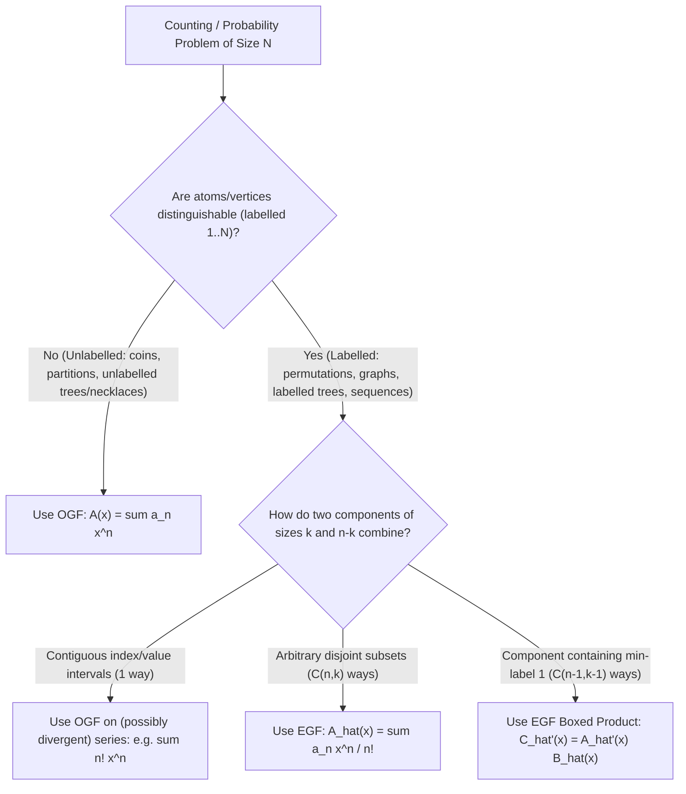
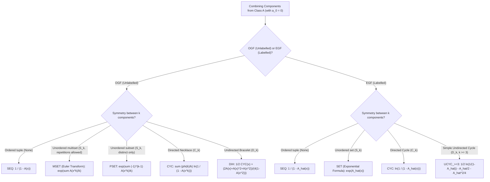
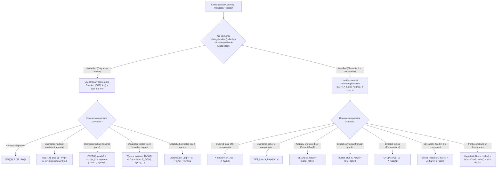

# Wave 1A (Cohort 3 Master Reconciliation & Synthesis): Combinatorial Modelling & Algebraic Foundations (Iterations 1–5 / 53–57)

> **Document Role (Phase 1, Third Phase — Cross-Cohort Reconciliation & Master Synthesis)**:
> This document is the definitive **Cohort 3 Master Synthesis** for **Wave 1A (Combinatorial Modelling & Algebraic Foundations)** of the *Formal Power Series & Generating Functions for Competitive Programming* textbook project. It cross-compares, audits, reconciles, and merges two independent deep-dive research runs:
> 1. **Cohort 1**: `fps_research/iter_01_to_05_modelling_foundations.md` (Iterations 1–5, 1,610 lines)
> 2. **Cohort 2**: `fps_research/cohort2_iter_53_to_57_modelling_foundations.md` (Iterations 53–57, 1,384 lines)
>
> Furthermore, it executes targeted **Cohort 3 Gap-Hunting** on structural topics that were under-represented or fragmented across the first two cohorts—specifically **Rational Generating Functions via the Transfer Matrix Method ($(I - xA)^{-1}$, Trace-Log Cycle Identity, and KMP Border Rational PGFs)** and the **Unified Theory of Pointing ($\Theta = x\frac{d}{dx}$) and Unpointing ($\Theta^{-1}$ vs. Otter's Dissimilarity Characteristic)**—while preserving all **31 deduplicated non-template contest problems** in full mathematical detail (`Stepping Stone` $\to$ `Intermediate` $\to$ `Advanced` $\to$ `Mastery`).

---

## Section 1: Cross-Cohort Blind-Spot Audit & Reconciliation Matrix

A rigorous side-by-side audit of Cohort 1 (`iter_01_to_05`) and Cohort 2 (`cohort2_iter_53_to_57`) reveals how dual independent research runs eliminate blind spots. Each cohort surfaced critical algebraic mechanisms, failure modes, and contest problems that the other omitted.

### 1.1 Theoretical & Algebraic Blind-Spot Matrix

| Topic / Sub-Topic | Cohort 1 (`iter_01_to_05`) Coverage | Cohort 2 (`cohort2_iter_53_to_57`) Coverage | Cohort 3 Reconciliation & Gap-Hunting Synthesis |
| :--- | :--- | :--- | :--- |
| **Ring $R[[x]]$ & Nilpotent Zero Divisors** | **Unique Blind Spot Caught**: Proved that over composite rings with nilpotent elements (e.g., $R = \mathbb{Z}/8\mathbb{Z}$), $(1 - 2x)^{-1} = 1 + 2x + 4x^2$ terminates as a *finite polynomial* because $2^3 \equiv 0 \pmod 8$. | Focused exclusively on integral domains and prime fields $\mathbb{F}_p$; omitted nilpotent inverse phenomena over $\mathbb{Z}/p^k\mathbb{Z}$. | Merged into **Section 2.1**, contrasting integral domains against composite modulus rings $\mathbb{Z}/m\mathbb{Z}$. |
| **Formal Laurent Field $K((x))$ & Precision Loss** | **Unique Blind Spot Caught**: Formulated the explicit **Valuation Shift Precision Loss Rule** ($B(x)/A(x) \bmod x^N$ when $\operatorname{val}(A) = v \ge 1$ requires knowing $A, B \bmod x^{N+v}$; knowing them only $\bmod x^N$ yields only $N - v$ valid coefficients). | **Unique Blind Spot Caught**: Proved why **doubly-infinite formal Laurent series** $\sum_{n=-\infty}^{\infty} c_n x^n$ do **not** form a ring ($[x^0](\sum_{n \in \mathbb{Z}} x^n)^2 = \sum_{k \in \mathbb{Z}} 1$ diverges in the formal valuation topology). | Unified in **Section 2.2**: includes both the doubly-infinite counterexample and the exact $N + v$ precision-padding rule for contest implementations. |
| **Formal Composition $B(A(x))$ Complexity** | **Unique Blind Spot Caught**: Documented both classical **Brent–Kung (1978)** $O((n \log n)^{3/2})$ baby-step giant-step and the **Kinoshita–Li (FOCS 2024)** $O(n \log^2 n)$ breakthrough via transposition + bivariate Bostan–Mori. | Treated $B(A(x))$ purely algebraically without algorithmic complexity bounds. | Preserved in **Section 2.4** with explicit explanation of why $\operatorname{val}(A) \ge 1$ is required across both algebra and algorithms. |
| **Index-Multiplier Alignment & Differential Operators** | Covered basic shift and derivative rules ($D$, $\vartheta = xD$) and probability moments. | **Unique Blind Spot Caught**: Built a comprehensive **11-row Index-Weight Diagnostic Table** ($n^k a_n$ via Stirling numbers of the 2nd kind $\vartheta^k = \sum_{j=0}^k \left\{\begin{matrix} k \\ j \end{matrix}\right\} x^j D^j$, $\binom{n}{k}a_n \mapsto \frac{x^k}{k!}D^k F(x)$) and the **Golden Rule of Index-Multiplier Alignment** for converting polynomial-coefficient recurrences into ODEs. | Expanded in **Section 2.5** with full scratchpad derivation of $(n+2)a_{n+1} = (2n+1)a_n + 3(n+1)a_{n-1} \iff x(1-2x-3x^2)F' + (1-x-6x^2)F = a_0 + (2a_1 - a_0)x$. |
| **Prime Characteristic $p > 0$ Obstructions** | **Unique Blind Spot Caught**: Documented the **Frobenius Endomorphism** $(F(x))^p = F(x^p)$ in $\mathbb{F}_p[[x]]$ (enabling $O(N)$ powers when $p \le N$ and compositional roots via nilpotent Frobenius polynomials) and **Hurwitz series** $\sum a_n \frac{x^{[n]}}{n!}$ when $p \le N$. | Covered $\int x^{p-1}dx$ division-by-zero and segmented polynomial ODE solving across multiples of $p$, plus Fermat's Little Theorem exponent reduction $\bmod (p-1)$. | Synthesized in **Section 2.6** into a complete taxonomy of characteristic-$p$ obstructions and exploits. |
| **Euler Transform & Inverse Euler Transform** | Derived forward Euler Transform $\prod (1-x^k)^{-a_k} = \exp\left(\sum_{m \ge 1} \frac{1}{m}\sum_{d \mid m} d a_d x^m\right)$ and **Euler's Odd-Distinct Partition Identity**. | **Unique Blind Spot Caught**: Derived the **Inverse Euler Transform ($F \mapsto A$) in $O(N \log N)$** via two distinct algorithms ($\ln F(x)$ + Möbius inversion / divisor subtraction, and $xF'(x)/F(x)$) to extract prime/connected unlabelled components. | Merged into **Section 3.2 & 3.3**, presenting both forward and inverse transforms side by side with $O(N \log N)$ harmonic sieve pseudocode. |
| **Pólya Cycle Index, $\operatorname{CYC}$, and $\operatorname{DIH}$** | **Unique Blind Spot Caught**: Explicitly derived the **Dihedral ($\operatorname{DIH}$, Bracelet)** operator for undirected cycles under reflection, separating odd $k$ and even $k$ reflection fixpoints. | **Unique Blind Spot Caught**: Formulated the general **Pólya Cycle Index Theorem** $Z_G(A(x), A(x^2), \dots, A(x^k))$ and derived $Z_{S_3}$ for unlabelled ternary trees (`烷基计数`). | Unified in **Section 3.5** with complete derivations of $Z_{C_k}$, $Z_{D_k}$, $Z_{S_k}$, and $Z_{A_k}$. |
| **Labelled Boxed Product ($\mathcal{A}^{\square} \star \mathcal{B}$)** | Mentioned rooting / minimum-label pivot informally inside problem derivations. | **Unique Blind Spot Caught**: Formalized Flajolet–Sedgewick's **Boxed Product** $\mathcal{C} = \mathcal{A}^{\square} \star \mathcal{B} \implies \widehat{C}'(x) = \widehat{A}'(x)\widehat{B}(x)$ (`有标号定根技巧`), providing a one-line proof of $\widehat{\operatorname{SET}}(\mathcal{A}) = \exp(\widehat{A}(x))$ and solving non-linear tree ODEs (`UOJ #50`). | Highlighted in **Section 4.3** as a first-class symbolic operator alongside $\operatorname{SEQ}, \operatorname{SET}, \operatorname{CYC}$. |
| **Stirling, Bell, Parity EGFs & Value-Interval OGFs** | **Unique Blind Spot Caught**: Contrasted **value-interval contiguous blocks** (OGF $\operatorname{SEQ}$ on $\sum n! x^n$) vs. **label-subset cycles** (EGF $\operatorname{SET}\circ\operatorname{CYC}$), and derived 2-regular simple graphs $\frac{\exp(-x/2 - x^2/4)}{\sqrt{1-x}}$. | **Unique Blind Spot Caught**: Cataloged **Stirling numbers of both kinds, Bell numbers, Ordered Bell (Fubini) numbers**, and **Hyperbolic EGF Parity Filters** ($\sinh x = \frac{e^x - e^{-x}}{2}$, $\cosh x = \frac{e^x + e^{-x}}{2}$). | Combined into the **Master Classical EGF & OGF Catalog** in **Section 4.4**. |
| **Pointing $\Theta = xD$ & Unpointing $\Theta^{-1}$** | Covered Otter's Dissimilarity Theorem for unlabelled trees (`P5900`) and labelled cactus rooting (`P5434`). | Covered bivariate derivative marking $\left.\frac{\partial}{\partial y}\exp(y\widehat{C}(x))\right\vert_{y=1}$ and Otter's theorem. | **Cohort 3 Gap-Hunt Addition (Section 5)**: Formalized the exact symmetry obstruction explaining why labelled unpointing is linear division by $n$ ($\int_0^x \frac{\widehat{\Theta A}(t)}{t}dt$) whereas unlabelled unpointing requires **Dissimilarity Characteristics** ($V^* - (E^* - E_{\text{sym}}) = 1$ for trees; $\operatorname{DIH}_{\ge 3}(T)$ for unicyclic graphs; Block-Cut Dissimilarity $V^* + B^* - I^* = 1$ for cacti). |
| **Rational GFs & Transfer Matrix Method** | Covered reversible sparse DP (`fps_24_g`) and adjacent-distinct multipartite walks (`fps_24_t`). | Covered recurrence polynomials $Q(x)F(x) = P(x)$. | **Cohort 3 Gap-Hunt Addition (Section 6)**: Added the complete **Transfer Matrix Method** ($(I - xA)^{-1} = \frac{\operatorname{adj}(I-xA)}{\det(I-xA)}$, trace-log closed walk identity $\ln \det(I-xA)^{-1} = \sum_{n \ge 1}\operatorname{tr}(A^n)\frac{x^n}{n}$, and **Automaton / KMP Border Rational PGFs** (`Luogu P4548 [SCOI2005] 歌唱王国` & `P3706 [SDOI2017] 硬币游戏`)). |

---

### 1.2 Practice Problem Cross-Cohort Deduplication & Tier Audit (31 Unique Problems)

Across Cohort 1 (16 problems), Cohort 2 (20 problems), and Cohort 3 Gap-Hunting (+1 canonical KMP/Rational PGF problem), **6 overlapping problems** were merged and reconciled, yielding **31 unique, non-template competitive programming problems** spanning all four difficulty tiers:

| # | Problem Name & Judge ID | Tier | Discovered By | Core Algebraic / Symbolic Mechanism |
| :--- | :--- | :--- | :--- | :--- |
| 1 | **AtCoder `fps_24_a` — Snacks** | `Stepping Stone` | Cohort 1 | $[x^N](x+x^3+x^4+x^6)^D$ in $O(N)$ via factoring $(1+x^2)^D(1+x^3)^D$ or log-derivative ODE. |
| 2 | **AtCoder `fps_24_g` — Coin** | `Stepping Stone` | Cohort 1 | Sliding-window partition transition via reversible $O(N)$ sparse multiplication/division by $(1-x^k)$. |
| 3 | **AtCoder `fps_24_d` — Sequence 2** | `Stepping Stone` | Cohort 1 | Parity-alternating non-decreasing sequences via $[x^{M-N}](1-x)^{-2}(1-x^2)^{-(N-1)}$. |
| 4 | **AtCoder `fps_24_k` — Permutation** | `Stepping Stone` | Cohort 1 | Indecomposable permutations via OGF $\operatorname{SEQ}$ inversion $I(x) = 1 - \frac{1}{1 + \sum_{n \ge 1} n! x^n}$. |
| 5 | **AtCoder `fps_24_l` — Permutation 2** | `Stepping Stone` | Cohort 1 | Permutations with $p_{p_i} \neq i$ via EGF $\exp\left(\ln\frac{1}{1-x} - x - \frac{x^2}{2}\right)$ and $O(N)$ ODE. |
| 6 | **Luogu P6189 — [NOI Online #1] 跑步** | `Stepping Stone` | Cohort 2 | Integer partitions mod arbitrary $P$ in $O(n\sqrt{n})$ via Pentagonal Number Theorem or $\sqrt{n}$-split DP. |
| 7 | **Luogu P4389 — 付公主的背包 & `fps_24_n`** | `Intermediate` | Cohort 1 & 2 | Unbounded knapsack in $O(N \log N)$ via bucketed Euler Transform / harmonic $\ln + \exp$ sieve. |
| 8 | **yukicoder No. 899 / LOJ #6268 — 逆オイラー変換** | `Intermediate` | Cohort 2 | Inverse Euler Transform recovering prime generator sequence $a_k$ from $\prod(1-x^k)^{-a_k}$. |
| 9 | **Luogu P4841 — 城市规划 & `fps_24_m`** | `Intermediate` | Cohort 1 & 2 | Connected labelled undirected graphs via $\widehat{C}(x) = \ln \widehat{G}(x)$ and Fermat exponent reduction $\bmod (p-1)$. |
| 10 | **Codeforces 438E — The Child and Binary Tree** | `Intermediate` | Cohort 1 & 2 | Unlabelled weighted binary trees $T(x) = 1 + C(x)T(x)^2 \implies T(x) = \frac{2}{1 + \sqrt{1 - 4C(x)}}$. |
| 11 | **Codeforces 1251F — Red-White Fence** | `Intermediate` | Cohort 2 | Independent choice OGF product $(1+2x)^{c_1}(1+x)^{2c_2}$ evaluated via NTT. |
| 12 | **AtCoder AGC 005 F — Many Easy Problems** | `Intermediate` | Cohort 2 | Tree subset Steiner size via linearity of expectation + reversed binomial convolution. |
| 13 | **AtCoder ABC 222 H — Beautiful Binary Tree** | `Intermediate` | Cohort 2 | $[x^{N-1}](1+4x+4x^2+x^3)^N$ in $O(N)$ via coupled OGFs, Lagrange Inversion, and ODE recurrence. |
| 14 | **LOJ #6538 / Luogu P6597 — 烷基计数 加强版** | `Intermediate` | Cohort 2 | Unlabelled rooted ternary trees via Pólya cycle index $T(x) = 1 + \frac{x}{6}(T(x)^3 + 3T(x)T(x^2) + 2T(x^3))$. |
| 15 | **Luogu P4548 — [SCOI2005] 歌唱王国** | `Intermediate` | **Cohort 3 Gap-Hunt** | Rational PGF stopping-time system $F(x) + (1-x)G(x) = 1$ + KMP Border shift + $\vartheta = xD$ at $x=1$. |
| 16 | **Codeforces 891E — Lust** | `Advanced` | Cohort 2 | Expected product after $k$ decrements via EGF $[x^k/k!] e^{nx}\prod_{i=1}^n (a_i - x)$. |
| 17 | **51Nod 1728 — 不动点** | `Advanced` | Cohort 1 | Idempotent / height-$k$ mappings ($f^k(x) = f^{k+1}(x)$) via iterated $\widehat{G}_h(x) = \exp(\widehat{T}_h(x))$. |
| 18 | **UOJ #50 — [UR #3] 链式反应** | `Advanced` | Cohort 2 | Minimum-label Boxed Product non-linear ODE $\widehat{F}'(x) = \frac{1}{2}\widehat{A}(x)\widehat{F}(x)^2 + 1$. |
| 19 | **AtCoder ABC 236 Ex — Distinct Multiples** | `Advanced` | Cohort 2 | Connected-component PIE weights $(-1)^{k-1}(k-1)!$ derived from $\ln(1+x)$ + subset $\exp$. |
| 20 | **AtCoder ARC 105 F — Connected Bipartite** (cf. **LOJ #6539 — 仙人掌计数** in §5.1.2) | `Advanced` | Cohort 1 | Connected labelled bipartite graphs via 2-coloured EGF, Chirp-Z transform, $\sqrt{\cdot}$, and $\frac{1}{2}\ln$. |
| 21 | **AtCoder `fps_24_o` — Rooted Tree** | `Advanced` | Cohort 1 | Prime-child labelled rooted trees $\widehat{T} = x\Phi(\widehat{T})$ solved in $O(N \log N)$ via $\frac{(N-1)!}{N}[u^{N-1}]\Phi(u)^N$. |
| 22 | **AtCoder `fps_24_t` — Colorful** | `Advanced` | Cohort 1 | Multipartite closed walks via $S(x) = \sum_{i=2}^N \frac{A_i x}{1 + A_i x}$, D&C FFT, and Bostan–Mori. |
| 23 | **Codeforces 960G — Bandit Blues** | `Advanced` | Cohort 2 | Prefix/suffix maxima split at global maximum $n$ + Stirling 1st kind $x^{\overline{n-1}}$ via $O(n \log n)$ Taylor shift. |
| 24 | **Luogu P4705 — 玩游戏** | `Advanced` | Cohort 2 | Expected $(a_i + b_j)^k$ via EGF binomial convolution + power sums $\sum a_i^k x^k = n - \frac{x P'(x)}{P(x)}$. |
| 25 | **Luogu P5824 — 十二重计数法** | `Advanced` | Cohort 2 | Complete OGF/EGF synthesis of Rota/Stanley's Twelvefold Way up to $N, M \le 2 \times 10^5$. |
| 26 | **HDU 5279 — YJC plays minecraft** | `Advanced` | Cohort 2 | Island EGF $\ln$ + cyclic backbone transfer matrix $\prod(a_i a_{i+1}+1) - \prod a_i$. |
| 27 | **Luogu P5434 — 有标号荒漠计数** | `Mastery` | Cohort 1 & 2 | Pointing/unpointing labelled cacti $\widehat{T} = x\exp\left(\frac{2\widehat{T}-\widehat{T}^2}{2(1-\widehat{T})}\right)$ + $\exp(\widehat{C})$. |
| 28 | **UOJ #450 / Luogu P5401 — [CTS2019] 珍珠** | `Mastery` | Cohort 2 | Odd-frequency EGF filtering $\left(\frac{e^x-e^{-x}}{2}\right)^k e^{(D-k)x}$ + binomial inversion + Chirp-Z/NTT. |
| 29 | **Luogu P5900 — 无标号无根树计数** | `Mastery` | Cohort 1 & 2 | Rooted Pólya trees $T(x) = x\exp\sum\frac{T(x^k)}{k}$ + Otter's Dissimilarity Theorem $U(x) = T(x) - \frac{1}{2}(T(x)^2 - T(x^2))$. |
| 30 | **AtCoder `fps_24_s` — Game** | `Mastery` | Cohort 1 | Normal-play games on labelled trees via $\widehat{F}_0 = x\exp(\widehat{F}_0(e^{\widehat{F}_0}-1))$ and $\widehat{F}_0 = x\exp(\widehat{F}_0^2 e^{\widehat{F}_0})$. |
| 31 | **AtCoder `fps_24_x` — Functional Square Root** | `Mastery` | Cohort 1 | Compositional square root $G(G(x)) \equiv F(x) \pmod{x^N}$ via characteristic-$p$ Frobenius nilpotence $G = F^{((p^k+1)/2)}$. |

---

## Section 2 (Iteration 1 / 53): The Ring of Formal Power Series $R[[x]]$ & Valuation Topology

### 2.1 The Algebraic Structure of $R[[x]]$ vs. $R[x]$

#### Concrete Object
Let $R$ be a commutative ring with multiplicative identity $1 \neq 0$ (in competitive programming, typically $R = \mathbb{F}_p = \mathbb{Z}/p\mathbb{Z}$ for a prime $p = 998244353$, or $R = \mathbb{Q}$, or occasionally a composite ring $R = \mathbb{Z}/m\mathbb{Z}$). The **ring of formal power series** $R[[x]]$ is the set of all infinite sequences $(a_0, a_1, a_2, \dots)$ with $a_n \in R$, written formally as:
$$A(x) = \sum_{n=0}^{\infty} a_n x^n$$
Here $x$ is **not** a complex or real number; it is a pure formal indeterminate (place-holder). Two formal power series $A(x)$ and $B(x)$ are equal if and only if $[x^n]A(x) = [x^n]B(x)$ for all $n \ge 0$, where $[x^n]$ denotes the **coefficient extraction operator**:
$$[x^n] \sum_{k=0}^{\infty} a_k x^k = a_n$$
The ring operations are term-by-term addition and **Cauchy convolution**:
$$A(x) + B(x) = \sum_{n=0}^{\infty} (a_n + b_n) x^n, \qquad A(x) \cdot B(x) = \sum_{n=0}^{\infty} \left( \sum_{k=0}^{n} a_k b_{n-k} \right) x^n$$
Notice why Cauchy convolution requires no analytic convergence: to compute $[x^n](A(x)B(x))$, the inner sum $\sum_{k=0}^n a_k b_{n-k}$ contains only $n + 1$ terms—a strictly **finite** sum in $R$.

#### Diagnostic Signal
- You are given an infinite sequence $(a_n)_{n \ge 0}$ whose values grow super-exponentially (such as $a_n = n!$ or $a_n = 2^{\binom{n}{2}}$), so the complex radius of convergence is $R_{\text{conv}} = 0$.
- In $R[[x]]$, $F(x) = \sum_{n \ge 0} n! x^n$ and $G(x) = \sum_{n \ge 0} 2^{\binom{n}{2}} \frac{x^n}{n!}$ are 100% legal, well-defined elements that can be inverted, differentiated, and passed into $\ln$ and $\exp$.

#### Reverse-Engineering the Unit Criterion ($A(x) \in R[[x]]^\times$)
In the polynomial ring $R[x]$ over an integral domain $R$, the only invertible elements (units) are the degree-$0$ constant units $a_0 \in R^\times$, because $\deg(A \cdot B) = \deg(A) + \deg(B) = 0 \implies \deg(A) = 0$. Why does $R[[x]]$ possess a vastly richer group of units?

Let us try to solve $A(x)B(x) = 1 = 1 + 0x + 0x^2 + \dots$ coefficient by coefficient:
$$\begin{aligned}
[x^0](AB) &= a_0 b_0 = 1 \\
[x^1](AB) &= a_0 b_1 + a_1 b_0 = 0 \\
[x^2](AB) &= a_0 b_2 + a_1 b_1 + a_2 b_0 = 0 \\
&\;\;\vdots \\
[x^n](AB) &= a_0 b_n + \sum_{k=1}^{n} a_k b_{n-k} = 0
\end{aligned}$$
From the first equation $a_0 b_0 = 1$, $b_0 = a_0^{-1}$ exists if and only if $a_0 \in R^\times$ (i.e., $a_0$ is a unit in $R$). Once $a_0^{-1}$ exists, every subsequent coefficient $b_n$ ($n \ge 1$) is uniquely and constructively determined by isolating $a_0 b_n$:
$$b_n = -a_0^{-1} \sum_{k=1}^{n} a_k b_{n-k} \quad (n \ge 1)$$
Thus we obtain the fundamental characterization of units in $R[[x]]$:
$$A(x) \in R[[x]]^\times \iff [x^0]A(x) = a_0 \in R^\times$$

> [!NOTE]
> **Blind Spot Caught by Cohort 1 — Polynomial Units over Composite Rings with Nilpotent Elements**:
> When $R$ is an integral domain, $1 - c x$ ($c \neq 0$) is never invertible in $R[x]$, and its inverse in $R[[x]]$ is the infinite geometric series $\sum_{n \ge 0} c^n x^n$. However, if $R$ is a commutative ring with **nilpotent zero divisors** (e.g., $R = \mathbb{Z}/8\mathbb{Z}$, where $2^3 \equiv 0 \pmod 8$), then $a_1 = -2$ is nilpotent! Consequently, in $(\mathbb{Z}/8\mathbb{Z})[[x]]$:
> $$(1 - 2x)^{-1} = 1 + 2x + 4x^2 + 8x^3 + \dots \equiv 1 + 2x + 4x^2 \pmod 8$$
> Here the inverse of $1 - 2x$ is actually a **finite polynomial** in $(\mathbb{Z}/8\mathbb{Z})[x]$. More generally, in $R[x]$ for any commutative ring $R$, $A(x) = \sum_{k=0}^d a_k x^k \in R[x]^\times$ if and only if $a_0 \in R^\times$ and $a_1, \dots, a_d$ are all nilpotent in $R$. In $R[[x]]$, no nilpotency condition on $a_{\ge 1}$ is needed because infinite tails are permitted.

#### Annotated Derivation: From $O(N^2)$ Recurrence to $O(N \log N)$ Newton Lifting
The naive recurrence $b_n = -a_0^{-1} \sum_{k=1}^n a_k b_{n-k}$ takes $O(N^2)$ time to compute $b_0, \dots, b_{N-1}$. How do we accelerate it to $O(N \log N)$?
Suppose we have already computed a polynomial $B_k(x)$ of degree $< 2^k$ such that:
$$A(x) B_k(x) \equiv 1 \pmod{x^{2^k}}$$
Then the residual error series $E(x) = 1 - A(x)B_k(x)$ has zero coefficients for $x^0, x^1, \dots, x^{2^k-1}$. Therefore, $\operatorname{val}(E) \ge 2^k$. If we **square** the residual $E(x)$, its minimum degree doubles:
$$E(x)^2 = \bigl(1 - A(x)B_k(x)\bigr)^2 \equiv 0 \pmod{x^{2^{k+1}}}$$
Expanding the square and multiplying by $B(x) = A(x)^{-1}$:
$$1 - 2A(x)B_k(x) + A(x)^2 B_k(x)^2 \equiv 0 \pmod{x^{2^{k+1}}}$$
$$B_{k+1}(x) := B_k(x)\bigl(2 - A(x)B_k(x)\bigr) \equiv A(x)^{-1} \pmod{x^{2^{k+1}}}$$
Each doubling step requires only polynomial multiplications of size $2^{k+1}$, yielding total time $T(N) = T(N/2) + O(N \log N) = O(N \log N)$.

---

### 2.2 The Field of Formal Laurent Series $K((x))$ & Precision-Loss Arithmetic

#### Concrete Object
When the ground ring is a field $K$ (e.g., $\mathbb{Q}$ or $\mathbb{F}_p$), $K[[x]]$ is an integral domain, but non-zero series with $a_0 = 0$ (such as $x A(x)$) are not invertible in $K[[x]]$. To divide by arbitrary non-zero series, we construct the fraction field of $K[[x]]$, called the **field of formal Laurent series** $K((x))$:
$$K((x)) = \left\{ \sum_{n=v}^{\infty} a_n x^n \;\middle|\; v \in \mathbb{Z},\; a_n \in K \right\} = K[[x]][x^{-1}]$$
Every element of $K((x))$ is permitted to have **at most finitely many negative powers of $x$**, but infinitely many positive powers of $x$.

> [!WARNING]
> **Blind Spot Caught by Cohort 2 — Why Doubly-Infinite Laurent Series Do NOT Form a Ring**:
> Why must negative exponents be bounded below by some $v \in \mathbb{Z}$? Suppose we attempted to multiply two doubly-infinite series $A(x) = \sum_{n=-\infty}^{\infty} x^n$ and $B(x) = \sum_{n=-\infty}^{\infty} x^n$. Then the constant term of their product would be:
> $$[x^0]\bigl(A(x)B(x)\bigr) = \sum_{k=-\infty}^{\infty} a_k b_{-k} = \sum_{k=-\infty}^{\infty} 1 \cdot 1$$
> which is an infinite sum of $1$s with no algebraic definition in $K$! Requiring a lower bound $v_A, v_B \in \mathbb{Z}$ guarantees that $[x^n](AB) = \sum_{k=v_A}^{n - v_B} a_k b_{n-k}$ contains at most $n - v_A - v_B + 1 < \infty$ non-zero terms.

#### Valuation Shift & The Exact Precision-Loss Rule
Every non-zero formal Laurent series $A(x) \in K((x)) \setminus \{0\}$ can be factored uniquely by pulling out its lowest non-zero power $x^v$ ($v = \operatorname{val}(A) \in \mathbb{Z}$, $a_v \neq 0$):
$$A(x) = x^v \sum_{m=0}^{\infty} a_{v+m} x^m = x^v \widetilde{A}(x), \quad \text{where } [x^0]\widetilde{A}(x) = a_v \neq 0$$
Since $\widetilde{A}(x) \in K[[x]]^\times$ is a unit in $K[[x]]$, the multiplicative inverse of $A(x)$ in $K((x))$ is:
$$A(x)^{-1} = x^{-v} \widetilde{A}(x)^{-1} \in K((x))$$

> [!CAUTION]
> **Blind Spot Caught by Cohort 1 — Precision Loss When Dividing by $\operatorname{val}(A) = v > 0$**:
> Suppose you need to compute $Q(x) = \frac{B(x)}{A(x)} \bmod x^N$ in a contest problem, where $\operatorname{val}(A) = v \ge 1$ and $\operatorname{val}(B) \ge v$ (so $Q(x) \in K[[x]]$ has no negative powers, e.g., in L'Hôpital-style limits or Bostan–Mori / PGF reductions).
> Writing $A(x) = x^v \widetilde{A}(x)$ and $B(x) = x^v \widetilde{B}(x)$, suppose you only computed $A(x)$ and $B(x)$ modulo $x^N$:
> $$A(x) = x^v \widetilde{A}(x) + O(x^N) \implies \widetilde{A}(x) \text{ is known ONLY modulo } x^{N-v}!$$
> Therefore, $\widetilde{B}(x) \cdot \widetilde{A}(x)^{-1}$ can only be determined accurately modulo $x^{N-v}$! The top $v$ coefficients $[x^{N-v}]Q(x), \dots, [x^{N-1}]Q(x)$ will be **garbage** if you invert $\widetilde{A}(x) \bmod x^N$ without computing the extra terms of $A$ and $B$.
> **The Golden Rule of Valuation Division**: To obtain $\frac{B(x)}{A(x)} \bmod x^N$ when $\operatorname{val}(A) = v \ge 1$, you **must** evaluate $A(x)$ and $B(x)$ to precision $\bmod x^{N+v}$, shift right by $v$ coefficients to form $\widetilde{A}, \widetilde{B} \bmod x^N$, and then compute $\widetilde{B}(x)\widetilde{A}(x)^{-1} \bmod x^N$.

---

### 2.3 Order (Valuation $\operatorname{val}$), the $x$-adic Metric, and Formal Convergence

#### Concrete Object
For $A(x) = \sum_{n \in \mathbb{Z}} a_n x^n \in K((x))$, the **order** or **$x$-adic valuation** $\operatorname{val}(A)$ is the smallest index $n$ with $a_n \neq 0$:
$$\operatorname{val}(A) = \min \{ n \in \mathbb{Z} \mid a_n \neq 0 \}, \qquad \operatorname{val}(0) = +\infty$$
Fix any real base $0 < c < 1$ (conventionally $c = 1/2$). The **$x$-adic norm** and **ultrametric distance** are:
$$|A|_x = c^{\operatorname{val}(A)} \quad (|0|_x = 0), \qquad d(A, B) = |A - B|_x = c^{\operatorname{val}(A - B)}$$
This metric satisfies the **Strong Triangle (Ultrametric) Inequality**:
$$\operatorname{val}(A + B) \ge \min\bigl(\operatorname{val}(A), \operatorname{val}(B)\bigr) \iff d(A, C) \le \max\bigl(d(A, B), d(B, C)\bigr)$$
with equality $\operatorname{val}(A + B) = \min(\operatorname{val}(A), \operatorname{val}(B))$ whenever $\operatorname{val}(A) \neq \operatorname{val}(B)$.

#### Coefficient Stabilization Principle (Infinite Sums & Products)
Under the $x$-adic metric, a sequence of series $(S_k(x))_{k \ge 0}$ converges to $S(x)$ if and only if $\lim_{k \to \infty} \operatorname{val}(S_k - S) = +\infty$. Because $K[[x]]$ is complete under $d(\cdot, \cdot)$, a sequence converges if and only if it is Cauchy: $\lim_{k \to \infty} \operatorname{val}(S_{k+1} - S_k) = +\infty$.
1. **Infinite Sum Convergence**: $\sum_{k=0}^{\infty} F_k(x)$ converges formally in $R[[x]]$ **if and only if** $\lim_{k \to \infty} \operatorname{val}(F_k) = +\infty$.
   - *Concrete Meaning*: For any target degree $n \ge 0$, there exists a cutoff $K(n)$ such that $\operatorname{val}(F_k) > n$ for all $k > K(n)$. Thus $[x^n]\sum_{k=0}^\infty F_k(x) = \sum_{k=0}^{K(n)} [x^n]F_k(x)$ stabilizes after finitely many steps!
2. **Infinite Product Convergence**: $\prod_{k=1}^{\infty} \bigl(1 + G_k(x)\bigr)$ converges formally in $R[[x]]$ **if and only if** $\operatorname{val}(G_k) \ge 1$ for all $k$ and $\lim_{k \to \infty} \operatorname{val}(G_k) = +\infty$.
   - *Example*: Euler's partition product $\prod_{k=1}^{\infty} (1 - x^k)^{-1} = \prod_{k=1}^{\infty} (1 + G_k(x))$ has $G_k(x) = x^k + x^{2k} + \dots$, so $\operatorname{val}(G_k) = k \to \infty$. To compute $[x^N]\prod_{k=1}^\infty (1 - x^k)^{-1}$, factors with $k > N$ have $\operatorname{val}(G_k) > N$ and can be dropped without affecting any coefficient up to $x^N$.

---

### 2.4 Formal Composition $B(A(x))$ and Transcendental Series ($\exp, \ln, (1+A)^\alpha$)

#### Formal Composition Criterion
Given $B(y) = \sum_{k=0}^{\infty} b_k y^k \in R[[y]]$ and $A(x) = \sum_{n=0}^{\infty} a_n x^n \in R[[x]]$, the formal composition is:
$$(B \circ A)(x) = B(A(x)) = \sum_{k=0}^{\infty} b_k \bigl(A(x)\bigr)^k$$
By the Infinite Sum Convergence criterion, if $B(y)$ is an infinite series (not a polynomial), $\sum_{k=0}^{\infty} b_k A(x)^k$ converges formally in $R[[x]]$ **if and only if** $\lim_{k \to \infty} \operatorname{val}(A(x)^k) = \lim_{k \to \infty} k \cdot \operatorname{val}(A) = +\infty$, which requires:
$$\operatorname{val}(A) \ge 1 \iff [x^0]A(x) = a_0 = 0$$
When $a_0 = 0$, $\operatorname{val}(A^k) \ge k$, so $[x^n]B(A(x)) = \sum_{k=0}^n b_k [x^n](A(x)^k)$ depends only on $b_0, \dots, b_n$.

> [!IMPORTANT]
> **What if $a_0 \neq 0$?**
> If $a_0 \neq 0$, $[x^0]B(A(x)) = \sum_{k=0}^{\infty} b_k a_0^k$ is an infinite sum in the ground ring $R$, which is undefined in $R = \mathbb{Q}$ or $R = \mathbb{F}_p$ unless $B(y) \in R[y]$ is a finite polynomial! For example, $\exp(1 + x) = \sum_{k \ge 0} \frac{(1+x)^k}{k!}$ requires the irrational constant $e = \sum_{k \ge 0} \frac{1}{k!} \notin \mathbb{F}_p$.

#### Algorithmic Landscape for Composition $B(A(x)) \bmod x^N$ (Cohort 1 Insight)
1. **Classical Baby-Step Giant-Step (Brent & Kung, 1978)**: Split $B(y)$ into $B = \sum_{i=0}^{m-1} B_i(y) y^{im}$ where $m = \lceil \sqrt{N} \rceil$. Precompute baby steps $A(x)^1, \dots, A(x)^m \bmod x^N$ and giant steps $A(x)^{im} \bmod x^N$, yielding $O\bigl((N \log N)^{3/2} + N^2\bigr)$ (or $O((N \log N)^{3/2})$ with fast matrix multiplication).
2. **Modern Algebraic Breakthrough (Kinoshita & Li, FOCS 2024)**: By the **Transposition Principle**, degree-$N$ polynomial composition is dual to the **Power Projection Problem** (given a linear form $w$ and $A(x)$, compute $\langle w, A(x)^k \rangle$ for $k = 0, \dots, N-1$), which reduces to evaluating $[x^{N-1}]\frac{W(x)}{1 - y A(x)}$ via a **bivariate Bostan–Mori** parity split in $O(N \log^2 N)$ field operations!

#### Formal Transcendental Functions (Requires $\mathbb{Q} \subseteq R$ or $p > N$)
For any $A(x) \in R[[x]]$ with $[x^0]A(x) = 0$ ($\operatorname{val}(A) \ge 1$):
$$\exp(A(x)) := \sum_{k=0}^{\infty} \frac{A(x)^k}{k!} \quad \bigl([x^0]\exp(A) = 1\bigr)$$
$$\ln(1 + A(x)) := \sum_{k=1}^{\infty} (-1)^{k-1} \frac{A(x)^k}{k} \quad \bigl([x^0]\ln(1+A) = 0\bigr)$$
$$(1 + A(x))^\alpha := \sum_{k=0}^{\infty} \binom{\alpha}{k} A(x)^k = \exp\bigl(\alpha \ln(1 + A(x))\bigr) \quad (\alpha \in R)$$
Thus $\exp$ and $\ln$ define mutually inverse bijections between the ideal of zero-constant series and the subgroup of $1$-constant units:
$$\mathcal{M} = \{ A \in R[[x]] \mid [x^0]A = 0 \} \underset{\ln}{\overset{\exp}{\rightleftarrows}} 1 + \mathcal{M} = \{ F \in R[[x]] \mid [x^0]F = 1 \}$$

---

### 2.5 Formal Calculus, Index-Weight Dictionary, and Index-Multiplier Alignment

#### Concrete Object
For $A(x) = \sum_{n=0}^{\infty} a_n x^n \in R[[x]]$, define:
1. **Formal Derivative ($D = \frac{d}{dx}$)**:
   $$D A(x) = A'(x) = \sum_{n=1}^{\infty} n a_n x^{n-1} = \sum_{n=0}^{\infty} (n+1) a_{n+1} x^n$$
2. **Formal Integral ($\int_0^x$, requires $1, 2, \dots, N \in R^\times$)**:
   $$\int_0^x A(t)\,dt = \sum_{n=0}^{\infty} \frac{a_n}{n+1} x^{n+1}$$
3. **Pointing / Euler Differential Operator ($\vartheta = \Theta = x D = x\frac{d}{dx}$)**:
   $$\vartheta A(x) = x A'(x) = \sum_{n=0}^{\infty} n a_n x^n$$

#### Diagnostic Signal Table: Complete Sequence-to-FPS Operator Dictionary (Cohort 2 Synthesis)

| Sequence Transformation on $a_n$ | Resulting OGF in terms of $F(x) = \sum_{n \ge 0} a_n x^n$ | Key Algebraic Mechanism / Notes |
| :--- | :--- | :--- |
| Right shift: $b_n = a_{n-k}$ ($b_n = 0$ for $n < k$) | $x^k F(x)$ | Multiplies by $x^k$; increases valuation by $k$. |
| Left shift: $b_n = a_{n+1}$ | $\frac{F(x) - a_0}{x}$ | Must subtract boundary term $a_0$ so numerator has valuation $\ge 1$. |
| Multi-step left shift: $b_n = a_{n+k}$ | $\frac{F(x) - \sum_{j=0}^{k-1} a_j x^j}{x^k}$ | Subtracts initial $k$ boundary terms $a_0, \dots, a_{k-1}$. |
| Index scaling: $b_n = n a_n$ | $\vartheta F(x) = x F'(x)$ | Eigenoperator on monomials: $\vartheta(x^n) = n x^n$. |
| Shifted derivative: $b_n = (n+1) a_{n+1}$ | $D F(x) = F'(x)$ | Pure formal derivative without $x$ multiplier. |
| Right-shifted derivative: $b_n = (n-1) a_{n-1}$ | $x^2 F'(x)$ | Apply $\vartheta$ then multiply by $x$: $x \cdot (x F'(x)) = \sum m a_m x^{m+1}$. |
| Falling factorial: $b_n = n^{\underline{k}} a_n = n(n-1)\cdots(n-k+1)a_n$ | $x^k D^k F(x) = x^k F^{(k)}(x)$ | Cleanest polynomial basis for differential equations! |
| Binomial weight: $b_n = \binom{n}{k} a_n$ | $\frac{x^k}{k!} D^k F(x) = \frac{x^k}{k!} F^{(k)}(x)$ | Essential for Taylor shifts and binomial sum extraction. |
| Power weight: $b_n = n^k a_n$ | $\vartheta^k F(x) = \sum_{j=0}^{k} \left\{\begin{matrix} k \\ j \end{matrix}\right\} x^j F^{(j)}(x)$ | Expands $\vartheta^k = (xD)^k$ into normal order $x^j D^j$ via Stirling numbers of the 2nd kind $\left\{\begin{matrix} k \\ j \end{matrix}\right\}$. |
| Prefix sum: $b_n = \sum_{k=0}^{n} a_k$ | $\frac{F(x)}{1 - x}$ | Cauchy convolution with $1 + x + x^2 + \dots = (1-x)^{-1}$. |
| Integration weight: $b_n = \frac{a_n}{n+1}$ | $\frac{1}{x} \int_0^x F(t)\,dt$ | Divide formal integral by $x$. |
| Harmonic weight: $b_n = \frac{a_n}{n}$ ($n \ge 1, a_0 = 0$) | $\int_0^x \frac{F(t)}{t}\,dt$ | Inverse pointing operator $\vartheta^{-1}$ on series with $a_0 = 0$. |

#### Reverse-Engineering Scratchpad: The Golden Rule of Index-Multiplier Alignment
Suppose a problem gives a polynomial-coefficient (D-finite / holonomic) recurrence:
$$(n + 2) a_{n+1} = (2n + 1) a_n + 3(n + 1) a_{n-1} \quad (n \ge 1)$$
How do we convert this into an ODE for $F(x) = \sum_{n \ge 0} a_n x^n$ without making off-by-one algebra errors?

- **The Golden Rule**: Before summing over $x^n$, rewrite the polynomial multiplier of every term $a_{\text{idx}}$ strictly as a linear combination of its **own index** $\text{idx}$ (and falling factorials of $\text{idx}$) plus constants!
  1. For $a_{n+1}$, the index is $\text{idx} = n + 1$. So rewrite $(n + 2) a_{n+1} = \bigl((n + 1) + 1\bigr) a_{n+1}$.
  2. For $a_n$, the index is $\text{idx} = n$. Keep $(2n + 1) a_n = 2\bigl(n a_n\bigr) + a_n$.
  3. For $a_{n-1}$, the index is $\text{idx} = n - 1$. So rewrite $3(n + 1) a_{n-1} = 3\bigl((n - 1) + 2\bigr) a_{n-1} = 3(n - 1)a_{n-1} + 6a_{n-1}$.
- **Multiply by $x^n$ and sum over all $n \ge 1$**:
  $$\sum_{n=1}^{\infty} (n+1)a_{n+1} x^n + \sum_{n=1}^{\infty} a_{n+1} x^n = 2 \sum_{n=1}^{\infty} n a_n x^n + \sum_{n=1}^{\infty} a_n x^n + 3 x \sum_{n=1}^{\infty} (n-1)a_{n-1} x^{n-1} + 6 x \sum_{n=1}^{\infty} a_{n-1} x^{n-1}$$
- **Translate term-by-term using the table** (carefully subtracting $n = 0$ boundary terms where needed):
  $$\bigl(F'(x) - a_1\bigr) + \left(\frac{F(x) - a_0}{x} - a_1\right) = 2x F'(x) + \bigl(F(x) - a_0\bigr) + 3x^2 F'(x) + 6x F(x)$$
  Multiplying through by $x$ and collecting $F'(x)$ and $F(x)$ yields the exact linear ODE:
  $$x(1 - 2x - 3x^2) F'(x) + (1 - x - 6x^2) F(x) = a_0 + (2a_1 - a_0)x$$
  *(Note: If the last term of the recurrence had been $3n a_{n-1} = 3((n-1)+1)a_{n-1}$ and the recurrence also held at $n=0$ with $2a_1 = a_0$, the ODE would simplify to $x(1 - 2x - 3x^2)F'(x) + (1 - x - 3x^2)F(x) = a_0$.)*

#### Hand-Checkable Toy Trace ($n \le 4$): Proving $(1+x)^\alpha = \sum_{n \ge 0} \binom{\alpha}{n} x^n$ via ODE
Let $F(x) = (1+x)^\alpha$ with $a_0 = 1$. Differentiating gives $F'(x) = \alpha(1+x)^{\alpha-1}$, which satisfies the rational ODE:
$$(1 + x) F'(x) = \alpha F(x)$$
Extract $[x^n]$ on both sides using $[x^n]F'(x) = (n+1)a_{n+1}$ and $[x^n]x F'(x) = n a_n$:
$$(n + 1) a_{n+1} + n a_n = \alpha a_n \implies a_{n+1} = \frac{\alpha - n}{n + 1} a_n$$
Tracing $n = 0, 1, 2, 3$ from $a_0 = 1$:
- $n=0: a_1 = \frac{\alpha}{1}(1) = \binom{\alpha}{1}$
- $n=1: a_2 = \frac{\alpha - 1}{2}\binom{\alpha}{1} = \frac{\alpha(\alpha-1)}{2!} = \binom{\alpha}{2}$
- $n=2: a_3 = \frac{\alpha - 2}{3}\binom{\alpha}{2} = \frac{\alpha(\alpha-1)(\alpha-2)}{3!} = \binom{\alpha}{3}$
This identical trick powers the $O(N)$ coefficient extraction of $P(x)^D \bmod x^N$ for any sparse polynomial $P(x)$ of degree $d$: setting $F(x) = P(x)^D$ gives $P(x)F'(x) = D P'(x)F(x)$, yielding an $O(d)$ recurrence per coefficient (`fps_24_a` Snacks, `ABC 222 H`).

---

### 2.6 Prime Characteristic $p > 0$ Obstructions, Frobenius Exploits, and Failure Modes

When working over $R = \mathbb{F}_p[[x]]$, differentiating never divides by anything, so $D: \mathbb{F}_p[[x]] \to \mathbb{F}_p[[x]]$ is always well-defined. However, **integrating** ($\int x^{n-1}dx = \frac{x^n}{n}$) and **taking $\exp$ or $\ln$** require dividing by $n$.

#### 1. The Kernel of $D$ and the Frobenius Endomorphism
In characteristic $0$, $D A(x) = 0 \iff A(x) = a_0$. In $\mathbb{F}_p[[x]]$, because $p \cdot 1 = 0$:
$$D(x^{kp}) = kp x^{kp-1} \equiv 0 \pmod p \implies \ker(D) = \mathbb{F}_p[[x^p]]$$
Furthermore, by Lucas's Theorem ($\binom{p}{k} \equiv 0 \pmod p$ for $0 < k < p$), the **Frobenius Endomorphism** holds in $\mathbb{F}_p[[x]]$:
$$\bigl(F(x)\bigr)^p = \left(\sum_{n=0}^{\infty} f_n x^n\right)^p = \sum_{n=0}^{\infty} f_n^p x^{np} = F(x^p) \quad \text{in } \mathbb{F}_p[[x]]$$
- **Algorithmic Exploit 1 (Fast Powers for Small Primes)**: To compute $F(x)^K \bmod x^N$ over $\mathbb{F}_p$ when $p \le N$, write $K = q p + r$. Since $F(x)^p = F(x^p)$ is an $O(N/p)$ degree-stretching operation requiring zero multiplications, $\exp(K \ln F)$ (which is illegal anyway because $p \le N$) can be replaced by base-$p$ decomposition!
- **Algorithmic Exploit 2 (Compositional Roots via Frobenius Nilpotence — `fps_24_x`)**: For series $F(x) = x + c_2 x^2 + \dots \in \mathbb{F}_p[[x]]$ with $c_0 = 0, c_1 = 1$, the substitution operator $T_F(A) = A \circ F$ satisfies $(T_F - I)^{p^k} \equiv 0 \pmod{x^N}$ whenever $p^k \ge N$. Therefore $F^{\circ p^k}(x) \equiv x \pmod{x^N}$, so the compositional square root $G(G(x)) \equiv F(x) \pmod{x^N}$ is simply the $(p^k+1)/2$-th iterate of $F$!

#### 2. Segmented Integration Across Multiples of $p$ & Hurwitz Series
When $p \le N$, $\int_0^x A(t)\,dt \bmod x^N$ is defined **if and only if** $[x^{kp-1}]A(x) = 0$ for all $1 \le kp < N$. Even then, integrating leaves the coefficients $[x^{kp}]$ completely undetermined (free integration constants)!
- **Segmented ODE Strategy**: If $F(x)$ satisfies an algebraic/combinatorial ODE over $\mathbb{F}_p$ with $p \le N$, compute $F(x)$ in blocks $[kp, (k+1)p - 1]$ via the ODE, and determine each missing boundary value $[x^{kp}]F(x)$ using Lucas's theorem or direct combinatorial recurrence at $n = kp$.
- **Ring of Hurwitz Series**: When EGF division by $n!$ fails for $p \le N$, formal power series can be replaced by the **Hurwitz series ring** $R_{\text{Hurwitz}}[[x]] = \left\{\sum_{n=0}^\infty a_n x^{[n]}\right\}$ where the divided power basis $x^{[n]} = \frac{x^n}{n!}$ obeys $x^{[i]} x^{[j]} = \binom{i+j}{i} x^{[i+j]}$ and $D(x^{[n]}) = x^{[n-1]}$ strictly over $\mathbb{Z}$ without division!

#### 3. Summary Checklist of Iteration 1 / 53 Failure Modes
1. **Non-zero constant in $\ln / \exp$**: If $[x^0]F(x) = f_0 \neq 1$, $\ln F(x)$ is undefined in $\mathbb{F}_p[[x]]$. Always factor $F(x) = f_0 \cdot \widetilde{F}(x)$ when computing $F(x)^K = f_0^K \exp(K \ln \widetilde{F}(x))$.
2. **Square root constant term**: $\sqrt{F(x)}$ when $f_0 \neq 1$ requires Tonelli–Shanks / Cipolla discrete square root $\sqrt{f_0} \bmod p$; if $\operatorname{val}(F) = v$ is odd, $\sqrt{F(x)} \notin K[[x]]$.
3. **Fermat's Little Theorem Exponent Trap**: When computing $2^{\binom{n}{2}} \bmod p$ for graph EGFs, the exponent $\binom{n}{2}$ must be reduced modulo $\varphi(p) = p - 1$ (or computed via `ll`), **never** modulo $p$!

---

## Section 3 (Iteration 2 / 54): Unlabelled Symbolic Method & Ordinary Generating Functions (OGFs)

### 3.1 The Flajolet–Sedgewick Admissible Unlabelled Dictionary

#### Concrete Object
An **unlabelled combinatorial class** is a pair $(\mathcal{A}, |\cdot|)$ where $\mathcal{A}$ is a set of objects and $|\alpha| \in \mathbb{Z}_{\ge 0}$ is the size of $\alpha \in \mathcal{A}$, such that $\mathcal{A}_n = \{\alpha \in \mathcal{A} \mid |\alpha| = n\}$ is finite for every $n \ge 0$. Its **Ordinary Generating Function (OGF)** is:
$$A(x) = \sum_{\alpha \in \mathcal{A}} x^{|\alpha|} = \sum_{n=0}^{\infty} a_n x^n, \qquad a_n = |\mathcal{A}_n|$$
Two basic atomic classes anchor every construction:
- **Neutral Class $\mathcal{E} = \{\epsilon\}$** (one empty object of size $0$): $E(x) = x^0 = 1$.
- **Atomic Class $\mathcal{Z} = \{\bullet\}$** (one node/element of size $1$): $Z(x) = x^1 = x$.

#### Complete Unlabelled Symbolic Operator Table

| Combinatorial Construction | Notation | OGF Translation | Admissibility Condition | Combinatorial Meaning |
| :--- | :--- | :--- | :--- | :--- |
| **Disjoint Union** | $\mathcal{C} = \mathcal{A} + \mathcal{B}$ | $C(x) = A(x) + B(x)$ | Always admissible | Either an $\mathcal{A}$-object or a $\mathcal{B}$-object (mutually exclusive cases). |
| **Cartesian Product** | $\mathcal{C} = \mathcal{A} \times \mathcal{B}$ | $C(x) = A(x) \cdot B(x)$ | Always admissible | Ordered pair $(\alpha, \beta)$ with additive size $\vert(\alpha,\beta)\vert = \vert\alpha\vert + \vert\beta\vert$. |
| **Sequence ($\operatorname{SEQ}$)** | $\mathcal{C} = \operatorname{SEQ}(\mathcal{A})$ | $C(x) = \frac{1}{1 - A(x)}$ | $[x^0]A(x) = a_0 = 0$ | Ordered tuple $(\alpha_1, \dots, \alpha_k)$ of any length $k \ge 0$ of non-empty $\mathcal{A}$-objects. |
| **Length-Restricted $\operatorname{SEQ}$** | $\operatorname{SEQ}_k(\mathcal{A})$ / $\operatorname{SEQ}_{\ge k}(\mathcal{A})$ | $A(x)^k$ / $\frac{A(x)^k}{1 - A(x)}$ | $a_0 = 0$ (for $\ge k$) | Ordered tuple of exactly $k$ (or at least $k$) $\mathcal{A}$-objects. |
| **Powerset ($\operatorname{PSET}$)** | $\mathcal{C} = \operatorname{PSET}(\mathcal{A})$ | $\prod_{n \ge 1} (1 + x^n)^{a_n} = \exp\left(\sum_{k \ge 1} \frac{(-1)^{k-1}}{k} A(x^k)\right)$ | $a_0 = 0$ | Unordered subset of **distinct** $\mathcal{A}$-objects (each $\alpha \in \mathcal{A}$ chosen $0$ or $1$ time). |
| **Multiset ($\operatorname{MSET}$)** | $\mathcal{C} = \operatorname{MSET}(\mathcal{A})$ | $\prod_{n \ge 1} \frac{1}{(1 - x^n)^{a_n}} = \exp\left(\sum_{k \ge 1} \frac{A(x^k)}{k}\right)$ | $a_0 = 0$ | Unordered multiset of $\mathcal{A}$-objects (each $\alpha \in \mathcal{A}$ chosen $0, 1, 2, \dots$ times; **Euler Transform**). |
| **Directed Cycle ($\operatorname{CYC}$)** | $\mathcal{C} = \operatorname{CYC}(\mathcal{A})$ | $\sum_{k=1}^{\infty} \frac{\varphi(k)}{k} \ln \frac{1}{1 - A(x^k)}$ | $a_0 = 0$ | Directed necklaces of $\mathcal{A}$-objects up to cyclic rotation ($C_n$). |
| **Undirected Bracelet ($\operatorname{DIH}$)** | $\mathcal{C} = \operatorname{DIH}(\mathcal{A})$ | $\frac{1}{2}\operatorname{CYC}(\mathcal{A})(x) + \frac{2A(x) + A(x)^2 + A(x^2)}{4(1 - A(x^2))}$ | $a_0 = 0$ | Undirected bracelets of $\mathcal{A}$-objects up to rotation and reflection ($D_n$). |

#### Diagnostic Signal: Why $a_0 = 0$ Is Mandatory for $\operatorname{SEQ}, \operatorname{MSET}, \operatorname{PSET}, \operatorname{CYC}$
If $\mathcal{A}$ contains an object $\epsilon$ of size $0$ ($a_0 \ge 1$), then $(\epsilon), (\epsilon, \epsilon), (\epsilon, \epsilon, \epsilon), \dots$ are infinitely many distinct sequences all having total size $0$! Thus $|\mathcal{C}_0| = \infty$ (combinatorial explosion) and $1 - A(x)$ has constant term $1 - a_0 \le 0$ ($\sum A(x)^k$ fails to converge in the $x$-adic metric). Always strip size-$0$ objects via $\mathcal{A}_+ = \mathcal{A} \setminus \mathcal{A}_0$ ($A_+(x) = A(x) - a_0$) before applying composite operators!

#### 3.1.1 Side-by-Side Master Dictionary: Unlabelled (OGF) vs. Labelled (EGF) Operators

| Combinatorial Operation | Unlabelled Class (OGF $A(x) = \sum a_n x^n$) | Labelled Class (EGF $\widehat{A}(x) = \sum a_n \frac{x^n}{n!}$) | Why They Match or Diverge |
| :--- | :--- | :--- | :--- |
| **Neutral / Atomic** | $E(x) = 1$, $Z(x) = x$ | $\widehat{E}(x) = 1$, $\widehat{Z}(x) = x$ | Identical base polynomials. |
| **Disjoint Union** | $A(x) + B(x)$ | $\widehat{A}(x) + \widehat{B}(x)$ | Term-by-term addition in both rings. |
| **Product** | $A(x) \cdot B(x)$ ($\sum a_k b_{n-k}$) | $\widehat{A}(x) \cdot \widehat{B}(x)$ ($\sum \binom{n}{k} a_k b_{n-k}$) | EGF product automatically includes $\binom{n}{k}$ label partitioning. |
| **Sequence ($\operatorname{SEQ}$)** | $\frac{1}{1 - A(x)}$ ($a_0 = 0$) | $\frac{1}{1 - \widehat{A}(x)}$ ($a_0 = 0$) | Linear order has trivial automorphism group in both settings. |
| **Unordered Set / Multiset** | $\operatorname{MSET}$: $\exp\!\left(\sum_{k \ge 1} \frac{A(x^k)}{k}\right)$ / $\operatorname{PSET}$: $\exp\!\left(\sum_{k \ge 1} \frac{(-1)^{k-1}A(x^k)}{k}\right)$ | $\operatorname{SET}$: $\exp\bigl(\widehat{A}(x)\bigr)$ | Unlabelled components can repeat identically (requiring $A(x^k)/k$ Burnside terms); non-empty disjoint label sets are always distinct! |
| **Directed Cycle ($\operatorname{CYC}$)** | $\sum_{k=1}^{\infty} \frac{\varphi(k)}{k} \ln\frac{1}{1 - A(x^k)}$ | $\ln\frac{1}{1 - \widehat{A}(x)}$ | Unlabelled cycles can be periodic ($d \mid k$ fixpoints weighted by $\varphi(d)$); distinct labels break all cyclic rotational symmetries! |
| **Pointing ($\Theta = x\frac{d}{dx}$)** | $x A'(x) = \sum n a_n x^n$ (distinguishes $1$ atom among $n$, ignoring symmetries) | $x \widehat{A}'(x) = \sum n a_n \frac{x^n}{n!}$ (exact vertex rooting) | Unpointing is linear division by $n$ for EGFs, but requires Otter / Block-Cut Dissimilarity for OGFs. |
| **Boxed Product ($\mathcal{A}^{\square} \star \mathcal{B}$)** | N/A (atoms have no labels to compare) | $\widehat{C}'(x) = \widehat{A}'(x)\widehat{B}(x)$ | Isolates the component holding the global minimum label $1$. |

---

### 3.2 Forward Euler Transform ($\operatorname{MSET}$) and the $O(N \log N)$ Exp-Log Sieve

#### Reverse-Engineering Scratchpad
Suppose class $\mathcal{A}$ has $a_n$ distinct types of components of size $n$ ($a_0 = 0$), and we want to form an unordered multiset $\mathcal{C} = \operatorname{MSET}(\mathcal{A})$ where components can repeat arbitrarily and order among components does not matter (e.g., an unlabelled forest is a multiset of unlabelled rooted trees; an integer partition is a multiset of positive integers).
For a single component $\alpha \in \mathcal{A}_n$ of size $n$, choosing its multiplicity $m \in \{0, 1, 2, \dots\}$ contributes weight $m \cdot n$, described by the geometric series:
$$1 + x^n + x^{2n} + x^{3n} + \dots = \frac{1}{1 - x^n}$$
Since choices across all distinct objects $\alpha \in \mathcal{A}$ are independent, taking the product over all $\alpha \in \mathcal{A}$ gives the **Euler Transform**:
$$M(x) = \prod_{\alpha \in \mathcal{A}} \frac{1}{1 - x^{|\alpha|}} = \prod_{n=1}^{\infty} \left(\frac{1}{1 - x^n}\right)^{a_n}$$
Taking the formal logarithm turns the infinite product into an infinite sum:
$$\ln M(x) = \sum_{n=1}^{\infty} a_n \ln\left(\frac{1}{1 - x^n}\right) = \sum_{n=1}^{\infty} a_n \sum_{k=1}^{\infty} \frac{x^{nk}}{k}$$
Collecting coefficients of $x^m$ by setting $m = nk$ passes between two equivalent views:
1. **Substitution View (Pólya Exp-Log Form)**:
   $$M(x) = \exp\left( \sum_{k=1}^{\infty} \frac{A(x^k)}{k} \right)$$
2. **Divisor-Sum View ($O(N \log N)$ Harmonic Sieve)**:
   $$\ln M(x) = \sum_{m=1}^{\infty} \left( \frac{1}{m} \sum_{d \mid m} d \cdot a_d \right) x^m \implies M(x) = \exp\bigl(L(x)\bigr), \quad [x^m]L(x) = \frac{1}{m}\sum_{d \mid m} d a_d$$
In code, we initialize an array $L[0 \dots N] = 0$, loop $d = 1 \dots N$ and $k = 1 \dots \lfloor N/d \rfloor$ to add $\frac{a_d}{k}$ to $L[d \cdot k]$ in $O(N \log N)$ harmonic time, and call a single polynomial $\exp(L) \bmod x^{N+1}$ (`Luogu P4389 付公主的背包`, `fps_24_n`).

#### Hand-Checkable Toy Trace ($n \le 4$): Multiset vs. Sequence vs. Powerset
Let $\mathcal{A}$ have $a_1 = 2$ (two distinct coins of weight $1$, say $1_a, 1_b$) and $a_2 = 1$ (one coin of weight $2$, say $2_c$), so $A(x) = 2x + x^2$:
1. **$\operatorname{SEQ}(\mathcal{A})$**: $S(x) = \frac{1}{1 - (2x + x^2)} = 1 + 2x + 5x^2 + 12x^3 + 29x^4 + \dots$ (Pell numbers: at $n=2$, sequences are $(1_a,1_a), (1_a,1_b), (1_b,1_a), (1_b,1_b), (2_c)$, total $5$).
2. **$\operatorname{MSET}(\mathcal{A})$**: $M(x) = \frac{1}{(1-x)^2(1-x^2)} = (1+2x+3x^2+4x^3+5x^4+\dots)(1+x^2+x^4+\dots) = 1 + 2x + 4x^2 + 6x^3 + 9x^4 + \dots$ (at $n=2$, $(1_a,1_b)$ and $(1_b,1_a)$ merge into a single multiset $\{1_a, 1_b\}$, leaving $4$ multisets). Via Pólya's formula:
   $$\sum_{k \ge 1} \frac{A(x^k)}{k} = (2x + x^2) + \frac{2x^2 + x^4}{2} + \frac{2x^3}{3} + \frac{2x^4}{4} + O(x^5) = 2x + 2x^2 + \frac{2}{3}x^3 + x^4 + O(x^5)$$
   Exponentiating gives $\exp(2x + 2x^2 + \frac{2}{3}x^3 + x^4) = 1 + 2x + 4x^2 + 6x^3 + 9x^4 + O(x^5)$, matching term-for-term!
3. **$\operatorname{PSET}(\mathcal{A})$**: $P(x) = (1+x)^2(1+x^2) = 1 + 2x + 2x^2 + 2x^3 + x^4$ (at $n=2$, only $\{1_a, 1_b\}$ and $\{2_c\}$, total $2$).

---

### 3.3 The Inverse Euler Transform ($M \mapsto A$) in $O(N \log N)$ (Cohort 2 Synthesis)

#### Concrete Object & Diagnostic Signal
Suppose a problem gives the total count $m_n = [x^n]M(x)$ of unlabelled composite structures of size $n$ (where every structure decomposes uniquely as a multiset of connected/prime unlabelled components), and asks for the number $a_n = [x^n]A(x)$ of **connected unlabelled components** of size $n$ (`yukicoder No. 899`, `LOJ #6268`).
Since $M(x) = \prod_{d \ge 1} (1 - x^d)^{-a_d}$ is the Euler Transform of $A(x)$, recovering $A(x)$ from $M(x)$ is the **Inverse Euler Transform**.

#### Two $O(N \log N)$ Algorithms for the Inverse Euler Transform
1. **Method A (Formal Logarithm + Divisor Subtraction / Möbius Inversion)**:
   Compute $L(x) = \ln M(x) \bmod x^{N+1}$ in $O(N \log N)$. Let $c_m = m \cdot [x^m]L(x)$. By the forward transform formula:
   $$c_m = m [x^m]\ln M(x) = \sum_{d \mid m} d \cdot a_d$$
   Applying **Möbius Inversion** (or an in-place $O(N \log N)$ divisor sieve) immediately recovers $d \cdot a_d$:
   $$n \cdot a_n = \sum_{d \mid n} \mu\left(\frac{n}{d}\right) c_d \implies a_n = \frac{1}{n} \sum_{d \mid n} \mu\left(\frac{n}{d}\right) d [x^d]\ln M(x)$$
2. **Method B (Logarithmic Derivative $x M'(x)/M(x)$)**:
   Note that $x \frac{d}{dx} \ln M(x) = \frac{x M'(x)}{M(x)} = \sum_{m=1}^{\infty} c_m x^m$, so computing $M'(x) M(x)^{-1} \bmod x^N$ directly produces the sequence $c_m = \sum_{d \mid m} d a_d$, avoiding the integration step inside $\ln M(x)$.

---

### 3.4 Integer Partitions, Ferrers Diagrams, Durfee Squares, and Euler's Pentagonal Number Theorem

#### Complete Dictionary of Restricted Partition OGFs

| Partition Constraint | OGF Closed Form | Symbolic Derivation |
| :--- | :--- | :--- |
| Unbounded partitions $p(n)$ | $\prod_{k=1}^{\infty} \frac{1}{1 - x^k}$ | $\operatorname{MSET}(\mathcal{Z}_{\ge 1})$ where each integer $k \ge 1$ has $a_k = 1$. |
| Parts $\le K$ (or at most $K$ parts) | $\prod_{k=1}^{K} \frac{1}{1 - x^k}$ | By **Ferrers diagram conjugation** (transposing rows and columns), "all parts $\le K$" is strictly bijective to "at most $K$ parts"! |
| Exactly $K$ positive parts | $x^K \prod_{k=1}^{K} \frac{1}{1 - x^k}$ | Subtract $1$ from each of the $K$ parts (costs $x^K$), leaving $\le K$ parts. |
| Distinct parts ($p_{\text{distinct}}(n)$) | $\prod_{k=1}^{\infty} (1 + x^k)$ | $\operatorname{PSET}(\mathcal{Z}_{\ge 1})$: each integer $k \ge 1$ chosen at most once. |
| Odd parts only ($p_{\text{odd}}(n)$) | $\prod_{m=1}^{\infty} \frac{1}{1 - x^{2m-1}}$ | **Euler's Partition Identity** (Cohort 1): $\prod_{k \ge 1}(1 + x^k) = \prod_{k \ge 1}\frac{1 - x^{2k}}{1 - x^k} = \prod_{m \ge 1}\frac{1}{1 - x^{2m-1}}$, proving $p_{\text{distinct}}(n) = p_{\text{odd}}(n)$. |
| At most $R$ parts, each part $\le C$ | $\begin{bmatrix} R + C \\ R \end{bmatrix}_x = \frac{\prod_{i=1}^{R+C}(1 - x^i)}{\prod_{i=1}^R (1 - x^i)\prod_{j=1}^C (1 - x^j)}$ | Ferrers diagram fits inside an $R \times C$ bounding box; counted by the **$q$-binomial (Gaussian) coefficient** $\begin{bmatrix} R+C \\ R \end{bmatrix}_x$. |
| Durfee Square Decomposition | $\sum_{s=0}^{\infty} \frac{x^{s^2}}{\prod_{i=1}^{s}(1 - x^i)^2}$ | Every Ferrers diagram has a unique maximal $s \times s$ **Durfee square** ($s \le \lfloor\sqrt{n}\rfloor$) in its top-left corner, plus a partition of $\le s$ parts to its right and a partition into parts $\le s$ below it! |

#### Euler's Pentagonal Number Theorem & $O(N\sqrt{N})$ Partition Inversion
Consider the inverse of the partition generating function, $\Phi(x) = \prod_{k=1}^{\infty} (1 - x^k) = \operatorname{PSET}_{\text{signed}}(\mathcal{Z}_{\ge 1})$. Expanding this infinite product gives **Euler's Pentagonal Number Theorem**:
$$\prod_{k=1}^{\infty} (1 - x^k) = 1 + \sum_{m=1}^{\infty} (-1)^m \left( x^{\frac{m(3m-1)}{2}} + x^{\frac{m(3m+1)}{2}} \right) = \sum_{m=-\infty}^{\infty} (-1)^m x^{\frac{m(3m-1)}{2}}$$
where $\omega(m) = \frac{m(3m-1)}{2}$ ($1, 2, 5, 7, 12, 15, 22, 26, \dots$) are the generalized pentagonal numbers (proved combinatorially by **Franklin's 1881 involution** matching partitions into an even vs. odd number of distinct parts by shifting the smallest part against the longest $45^\circ$ slope, which fails only when $n = \frac{m(3m\pm 1)}{2}$).

Because $\prod_{k \ge 1}(1 - x^k)$ has only $O(\sqrt{N})$ non-zero terms up to degree $N$:
1. **Modulo an Arbitrary (Non-NTT) Modulus $P$ (`Luogu P6189`)**: From $P(x)\Phi(x) = 1$, extracting $[x^n]$ gives the $O(N\sqrt{N})$ division-free recurrence:
   $$p(n) = \sum_{m \ge 1} (-1)^{m-1} \left( p\Bigl(n - \frac{m(3m-1)}{2}\Bigr) + p\Bigl(n - \frac{m(3m+1)}{2}\Bigr) \right)$$
2. **Modulo an NTT Prime**: Populate $\Phi(x) \bmod x^{N+1}$ in $O(\sqrt{N})$ time and invoke a single $O(N \log N)$ polynomial inversion $P(x) = \Phi(x)^{-1} \bmod x^{N+1}$.

#### Distinct-Parts Staircase Decomposition ($O(\sqrt{N})$ Length Reduction) & Bivariate Subset-Sum Trace
Any partition of $n$ into $k$ **distinct** positive parts $\lambda_1 > \lambda_2 > \dots > \lambda_k \ge 1$ can be decomposed by stripping the **minimal staircase** $(k, k-1, \dots, 2, 1)$ of size $\binom{k+1}{2} = \frac{k(k+1)}{2}$ from the Ferrers diagram. The remaining rows $\mu_i = \lambda_i - (k - i + 1)$ satisfy $\mu_1 \ge \mu_2 \ge \dots \ge \mu_k \ge 0$, which is an ordinary partition into at most $k$ parts (conjugate to parts $\le k$, with OGF $\prod_{i=1}^k \frac{1}{1 - x^i}$). Summing over $k \ge 0$ with $y$ marking the number of distinct parts gives the **Staircase Identity**:
$$\prod_{m=1}^{\infty} (1 + y x^m) = \sum_{k=0}^{\infty} y^k \frac{x^{k(k+1)/2}}{\prod_{i=1}^{k} (1 - x^i)}$$
Because $\frac{k(k+1)}{2} \le N \implies k \le \lfloor\sqrt{2N}\rfloor$, any DP over distinct parts needs at most $O(\sqrt{N})$ active rows!
- **Hand-Checkable Bivariate Trace ($N = 4$): Selecting $m$ Distinct Elements from $\{1, 2, 3, 4\}$**:
  Let $F_4(x, y) = \prod_{k=1}^{4} (1 + x y^k)$ where $x$ marks the **count** $m$ of chosen elements and $y$ marks their **sum**:
  $$\begin{aligned}
  [x^0] F_4(x, y) &= 1 \\
  [x^1] F_4(x, y) &= y^1 + y^2 + y^3 + y^4 \\
  [x^2] F_4(x, y) &= y^3 + y^4 + 2y^5 + y^6 + y^7 \qquad \bigl(\text{e.g., } [x^2 y^5] = 2 \text{ from } \{1, 4\} \text{ and } \{2, 3\}\bigr) \\
  [x^3] F_4(x, y) &= y^6 + y^7 + y^8 + y^9 \\
  [x^4] F_4(x, y) &= y^{10}
  \end{aligned}$$

---

### 3.5 Pólya Enumeration, Cycle Index $Z_G$, Necklaces ($\operatorname{CYC}$), and Bracelets ($\operatorname{DIH}$)

#### Concrete Object & Cycle Index Theorem
When a k-tuple $(\alpha_1, \dots, \alpha_k) \in \mathcal{A}^k$ is considered equivalent under the action of a permutation group $G \le S_k$, Burnside's Lemma / **Pólya's Enumeration Theorem** states that the OGF of $G$-orbits is given by substituting $s_i \gets A(x^i)$ into the **Cycle Index Polynomial** of $G$:
$$Z_G(s_1, s_2, \dots, s_k) = \frac{1}{|G|} \sum_{g \in G} \prod_{i=1}^{k} s_i^{c_i(g)} \implies F_G(x) = \frac{1}{|G|} \sum_{g \in G} \prod_{i=1}^{k} A\bigl(x^i\bigr)^{c_i(g)}$$
where $c_i(g)$ is the number of disjoint cycles of length $i$ in permutation $g \in G$ (because every element in an $i$-cycle of $g$ must be assigned the *exact same* object $\alpha \in \mathcal{A}$, contributing $i \cdot |\alpha|$ to the total weight, whose OGF is $\sum_{\alpha \in \mathcal{A}} x^{i|\alpha|} = A(x^i)$).

#### Explicit Cycle Index Operators Used in Competitive Programming
1. **Small Symmetric Groups $S_2, S_3, S_4$ (Unlabelled Trees of Bounded Degree — `LOJ #6538`)**:
   - $Z_{S_2}(A) = \frac{1}{2}\bigl(A(x)^2 + A(x^2)\bigr)$
   - $Z_{S_3}(A) = \frac{1}{6}\bigl(A(x)^3 + 3A(x)A(x^2) + 2A(x^3)\bigr)$
   - $Z_{S_4}(A) = \frac{1}{24}\bigl(A(x)^4 + 6A(x)^2 A(x^2) + 3A(x^2)^2 + 8A(x)A(x^3) + 6A(x^4)\bigr)$
2. **Directed Cycles / Necklaces ($G = C_k$, $\operatorname{CYC}$)**:
   In the cyclic group $C_k$, a rotation by $r \in \{0, \dots, k-1\}$ decomposes into $\gcd(r, k)$ cycles each of length $\frac{k}{\gcd(r, k)}$. Grouping by $d = \frac{k}{\gcd(r, k)} \mid k$ (which appears $\varphi(d)$ times):
   $$\operatorname{CYC}_k(\mathcal{A})(x) = \frac{1}{k} \sum_{d \mid k} \varphi(d) A\bigl(x^d\bigr)^{k/d}$$
   Summing over all lengths $k \ge 1$ and setting $m = k/d$:
   $$\operatorname{CYC}(\mathcal{A})(x) = \sum_{d=1}^{\infty} \frac{\varphi(d)}{d} \sum_{m=1}^{\infty} \frac{A(x^d)^m}{m} = \sum_{d=1}^{\infty} \frac{\varphi(d)}{d} \ln\left(\frac{1}{1 - A(x^d)}\right)$$
3. **Undirected Cycles / Bracelets ($G = D_k$, $\operatorname{DIH}$ — Cohort 1 Blind Spot Caught)**:
   In the dihedral group $D_k$ of order $2k$, the $k$ rotations contribute $\frac{1}{2}\operatorname{CYC}_k(\mathcal{A})(x)$, and the $k$ reflections split by parity of $k$:
   - **Odd $k = 2m + 1$**: Every reflection fixes $1$ vertex and swaps $m$ pairs of vertices, contributing $\frac{1}{2k} \cdot k A(x) A(x^2)^m = \frac{1}{2} A(x) A(x^2)^{(k-1)/2}$.
   - **Even $k = 2m$**: $m$ reflections through opposite vertices fix $2$ vertices and swap $m-1$ pairs ($A(x)^2 A(x^2)^{m-1}$), while $m$ reflections through opposite edges swap $m$ pairs ($A(x^2)^m$), contributing $\frac{1}{4}\bigl(A(x)^2 A(x^2)^{k/2-1} + A(x^2)^{k/2}\bigr)$.
   Summing over all $k \ge 1$ yields the closed form:
   $$\operatorname{DIH}(\mathcal{A})(x) = \frac{1}{2} \sum_{d=1}^{\infty} \frac{\varphi(d)}{d} \ln\left(\frac{1}{1 - A(x^d)}\right) + \frac{2A(x) + A(x)^2 + A(x^2)}{4\bigl(1 - A(x^2)\bigr)}$$
   *(Note: For simple graph cycles where edges cannot close on 1 or 2 vertices, subtract $\operatorname{DIH}_1(\mathcal{A}) = A(x)$ and $\operatorname{DIH}_2(\mathcal{A}) = \frac{1}{2}(A(x)^2 + A(x^2))$ to restrict to $k \ge 3$.)*

---

## Section 4 (Iteration 3 / 55): Labelled Symbolic Method & Exponential Generating Functions (EGFs)

### 4.1 Labelled Classes, Relabelling Binomial Convolution, and the EGF Dictionary

#### Concrete Object
A **labelled combinatorial class** $\mathcal{A}$ consists of finite structures of size $n$ whose atoms carry **distinct labels** $\{1, 2, \dots, n\}$. Its **Exponential Generating Function (EGF)** divides each count $a_n = |\mathcal{A}_n|$ by $n!$:
$$\widehat{A}(x) = \sum_{n=0}^{\infty} a_n \frac{x^n}{n!} \implies a_n = n! [x^n]\widehat{A}(x) = \left[\frac{x^n}{n!}\right] \widehat{A}(x)$$
Why divide by $n!$? Suppose we form an ordered pair of labelled structures $(\alpha, \beta) \in \mathcal{A} \star \mathcal{B}$ of total size $n = k + (n - k)$. We cannot assign $\{1, \dots, k\}$ to $\alpha$ and $\{1, \dots, n-k\}$ to $\beta$, because their label sets would collide! Instead, we must **choose which $k$-element subset of $\{1, \dots, n\}$ goes to $\alpha$** in $\binom{n}{k}$ ways, and order-isomorphically relabel $\alpha$ and $\beta$ with their assigned subsets. Thus the number of labelled pairs of size $n$ is the **binomial convolution**:
$$c_n = \sum_{k=0}^{n} \binom{n}{k} a_k b_{n-k} \iff \frac{c_n}{n!} = \sum_{k=0}^{n} \frac{a_k}{k!} \frac{b_{n-k}}{(n-k)!} \iff \widehat{C}(x) = \widehat{A}(x) \cdot \widehat{B}(x)$$
The $1/n!$ normalization absorbs the $\binom{n}{k}$ relabelling factor into ordinary Cauchy multiplication of EGFs!

#### Complete Labelled Symbolic Operator Table

| Combinatorial Construction | Notation | EGF Translation | Admissibility | Combinatorial Derivation |
| :--- | :--- | :--- | :--- | :--- |
| **Disjoint Union** | $\mathcal{C} = \mathcal{A} + \mathcal{B}$ | $\widehat{C}(x) = \widehat{A}(x) + \widehat{B}(x)$ | Always | Mutually exclusive choice of structure type. |
| **Labelled Product** | $\mathcal{C} = \mathcal{A} \star \mathcal{B}$ | $\widehat{C}(x) = \widehat{A}(x) \cdot \widehat{B}(x)$ | Always | Ordered pair $(\alpha, \beta)$ with $\binom{n}{k}$ label partitioning. |
| **Sequence ($\operatorname{SEQ}$)** | $\mathcal{C} = \operatorname{SEQ}(\mathcal{A})$ | $\widehat{C}(x) = \frac{1}{1 - \widehat{A}(x)}$ | $a_0 = 0$ | Ordered $k$-tuple of non-empty labelled components: $\sum_{k \ge 0} \widehat{A}(x)^k$. |
| **Set / Exponential Formula ($\operatorname{SET}$)** | $\mathcal{C} = \operatorname{SET}(\mathcal{A})$ | $\widehat{C}(x) = \exp\bigl(\widehat{A}(x)\bigr)$ | $a_0 = 0$ | Unordered set of $k$ non-empty labelled components: $\sum_{k \ge 0} \frac{\widehat{A}(x)^k}{k!}$ (since $k$ non-empty components carry **disjoint** label subsets, they are automatically distinct, so dividing $\operatorname{SEQ}_k(\mathcal{A})$ by $k!$ is exact!). |
| **Size-Restricted $\operatorname{SET}$** | $\operatorname{SET}_k(\mathcal{A})$ / $\operatorname{SET}_{\ge k}(\mathcal{A})$ | $\frac{\widehat{A}(x)^k}{k!}$ / $\exp(\widehat{A}) - \sum_{j=0}^{k-1} \frac{\widehat{A}^j}{j!}$ | $a_0 = 0$ | Partition into exactly $k$ (or $\ge k$) unordered components. |
| **Directed Cycle ($\operatorname{CYC}$)** | $\mathcal{C} = \operatorname{CYC}(\mathcal{A})$ | $\widehat{C}(x) = \ln\left(\frac{1}{1 - \widehat{A}(x)}\right)$ | $a_0 = 0$ | Directed cycle of $k \ge 1$ labelled components: $\sum_{k \ge 1} \frac{(k-1)!}{k!}\widehat{A}(x)^k = \sum_{k \ge 1} \frac{\widehat{A}(x)^k}{k}$ (no $\varphi(d)$ symmetry correction because distinct labels destroy all non-trivial rotational automorphisms!). |
| **Undirected Cycle ($\operatorname{UCYC}_{\ge 3}$)** | $\mathcal{C} = \operatorname{UCYC}_{\ge 3}(\mathcal{A})$ | $\frac{1}{2}\ln\frac{1}{1-\widehat{A}} - \frac{\widehat{A}}{2} - \frac{\widehat{A}^2}{4}$ | $a_0 = 0$ | Simple undirected cycle of $k \ge 3$ labelled components: $\sum_{k \ge 3} \frac{(k-1)!}{2 \cdot k!} \widehat{A}(x)^k$. |
| **Boxed Product (Min-Label Pivot)** | $\mathcal{C} = \mathcal{A}^{\square} \star \mathcal{B}$ | $\widehat{C}'(x) = \widehat{A}'(x) \cdot \widehat{B}(x)$ | $a_0 = 0$ | Ordered pair $(\alpha, \beta)$ where the global minimum label $1$ is forced to reside inside $\alpha$: $c_n = \sum_{k=1}^n \binom{n-1}{k-1} a_k b_{n-k}$. |

#### Viewpoint 2 on the Exponential Formula: Rooting at Canonical Element $1$ (Logarithmic Derivative & $O(N^2)$ Recurrence)
While Viewpoint 1 derives $\widehat{G}(x) = \exp\bigl(\widehat{C}(x)\bigr)$ by summing $\frac{1}{k!}\widehat{C}(x)^k$ over unordered $k$-component sets, **Viewpoint 2** avoids dividing by $k!$ altogether by tracking the **canonical vertex $1$**:
In any composite structure $\gamma \in \mathcal{G}_n$ ($n \ge 1$), vertex $1$ belongs to a unique connected component of some size $k \in \{1, \dots, n\}$. To construct $\gamma$:
1. Choose the remaining $k - 1$ labels from $\{2, \dots, n\}$ that share vertex $1$'s connected component in $\binom{n-1}{k-1}$ ways.
2. Place a valid connected structure on those $k$ vertices in $c_k$ ways.
3. Place an arbitrary composite structure on the remaining $n - k$ vertices in $g_{n-k}$ ways.

Summing over $k = 1, \dots, n$ yields the fundamental **$O(N^2)$ Connected-Component Recurrence**:
$$g_n = \sum_{k=1}^{n} \binom{n-1}{k-1} c_k g_{n-k} \quad (n \ge 1, \; g_0 = 1) \iff c_n = g_n - \sum_{k=1}^{n-1} \binom{n-1}{k-1} c_k g_{n-k}$$
Dividing by $(n-1)!$ gives $n \frac{g_n}{n!} = \sum_{k=1}^n \left(k \frac{c_k}{k!}\right) \frac{g_{n-k}}{(n-k)!}$, which is the exact coefficient of $x^{n-1}$ in the logarithmic derivative ODE:
$$\widehat{G}'(x) = \widehat{C}'(x) \widehat{G}(x) \iff \frac{\widehat{G}'(x)}{\widehat{G}(x)} = \widehat{C}'(x) \iff \ln \widehat{G}(x) = \widehat{C}(x)$$

#### 4.1.1 Master Comparison: Six Combinatorial Variants of $\exp\bigl(\widehat{C}(x)\bigr)$ & Numerical Trace ($n = 0 \dots 6$)

By modifying the connected component EGF $\widehat{C}(x)$ inside $\widehat{G}(x) = \exp\bigl(\widehat{C}(x)\bigr)$, one unified formula generates six classical families of labelled structures:

| Variant | Connected Component Class $\mathcal{C}$ ($c_n$ for $n \ge 1$) | Connected EGF $\widehat{C}(x)$ | Composite Class $\mathcal{G} = \operatorname{SET}(\mathcal{C})$ | Composite EGF $\widehat{G}(x) = \exp(\widehat{C}(x))$ |
| :--- | :--- | :--- | :--- | :--- |
| **1. Set Partitions (Bell)** | Non-empty sets: $c_n = 1$ | $e^x - 1$ | All set partitions of $\{1, \dots, n\}$ | $\exp(e^x - 1)$ |
| **2. Permutations** | Directed cycles: $c_n = (n-1)!$ | $\ln\frac{1}{1 - x}$ | All permutations ($g_n = n!$) | $\frac{1}{1 - x}$ |
| **3. Derangements** | Cycles of length $\ge 2$: $c_1 = 0, c_n = (n-1)!$ | $\ln\frac{1}{1 - x} - x$ | Permutations with no fixed points | $\frac{e^{-x}}{1 - x}$ |
| **4. Involutions** | Cycles of length $\le 2$: $c_1 = 1, c_2 = 1, c_{\ge 3} = 0$ | $x + \frac{x^2}{2}$ | Permutations with $p^2 = \text{id}$ | $\exp\left(x + \frac{x^2}{2}\right)$ |
| **5. 2-Regular Graphs** | Undirected cycles of length $\ge 3$: $c_n = \frac{(n-1)!}{2}$ ($n \ge 3$) | $\frac{1}{2}\ln\frac{1}{1 - x} - \frac{x}{2} - \frac{x^2}{4}$ | Disjoint unions of simple cycles | $\frac{\exp(-x/2 - x^2/4)}{\sqrt{1 - x}}$ |
| **6. Labelled Forests** | Unrooted labelled trees: $c_n = n^{n-2}$ (Cayley) | $\widehat{T}(x) - \frac{1}{2}\widehat{T}(x)^2$ | Unrooted labelled forests | $\exp\left(\widehat{T}(x) - \frac{1}{2}\widehat{T}(x)^2\right)$ |

**Hand-Checkable Numerical Trace ($n = 0 \dots 6$)**:

| $n$ | Bell Numbers $B_n$ | Permutations $n!$ | Derangements $d_n$ | Involutions $I_n$ | 2-Regular Simple Graphs | Connected Labelled Graphs $c_n$ | Labelled Forests $f_n$ |
| :--- | :--- | :--- | :--- | :--- | :--- | :--- | :--- |
| **0** | $1$ | $1$ | $1$ | $1$ | $1$ | $0$ | $1$ |
| **1** | $1$ | $1$ | $0$ | $1$ | $0$ | $1$ | $1$ |
| **2** | $2$ | $2$ | $1$ | $2$ | $0$ | $1$ | $2$ |
| **3** | $5$ | $6$ | $2$ | $4$ | $1$ | $4$ | $7$ |
| **4** | $15$ | $24$ | $9$ | $10$ | $3$ | $38$ | $38$ |
| **5** | $52$ | $120$ | $44$ | $26$ | $12$ | $728$ | $291$ |
| **6** | $203$ | $720$ | $265$ | $76$ | $70$ | $26704$ | $2932$ |

---

### 4.2 Why Unlabelled vs. Labelled Operators Diverge ($\operatorname{MSET}$ vs. $\operatorname{SET}$, $\operatorname{CYC}$)

A frequent source of confusion is why unlabelled $\operatorname{MSET}$ and $\operatorname{CYC}$ require harmonic sums over $A(x^k)$, whereas labelled $\operatorname{SET}$ and $\operatorname{CYC}$ are pure compositions $\exp(\widehat{A}(x))$ and $\ln\frac{1}{1-\widehat{A}(x)}$:
1. **Why Labelled $\operatorname{SET}$ Has No Higher Powers $\widehat{A}(x^k)$**: In an unlabelled multiset, two components can be identical ($\alpha_1 = \alpha_2$), so permuting $k$ components can have stabilizer size $> 1$. In a labelled set of $k$ non-empty components, the label sets $L(\alpha_1), \dots, L(\alpha_k)$ form a **partition of $\{1, \dots, n\}$ into non-empty disjoint subsets**. Two non-empty disjoint subsets can **never be equal**! Thus all $k!$ permutations of $(\alpha_1, \dots, \alpha_k)$ are strictly distinct, and dividing $\widehat{A}(x)^k$ by $k!$ is exact without Burnside corrections.
2. **Why Labelled $\operatorname{CYC}$ Has No Euler Totient $\varphi(d)$**: Similarly, in a directed cycle of $k$ non-empty labelled components, the component containing the minimum label acts as a unique anchor; none of the $k - 1$ non-identity rotations can map the labelled cycle to itself. Thus every cycle of $k$ components corresponds to exactly $k$ sequences, giving $\frac{1}{k}\widehat{A}(x)^k$.

> [!IMPORTANT]
> **Blind Spot Caught by Cohort 1 — Value-Interval Blocks (OGF) vs. Disjoint Label Subsets (EGF)**:
> Not every permutation problem uses an EGF! Compare two problems from the AtCoder 24-problem FPS set:
> - **Arbitrary Disjoint Label Subsets (`fps_24_l` Permutation 2)**: Count permutations of $\{1, \dots, N\}$ with no $1$-cycles or $2$-cycles. A permutation partitions the label set $\{1, \dots, N\}$ into arbitrary disjoint subsets via $\binom{n}{k}$, so we **must** use EGFs: $\widehat{P}(x) = \exp\left(\ln\frac{1}{1-x} - x - \frac{x^2}{2}\right)$.
> - **Contiguous Value-Interval Blocks (`fps_24_k` Indecomposable Permutations)**: Count permutations that cannot be split at any prefix $1 \le k < N$ with $\{p_1, \dots, p_k\} = \{1, \dots, k\}$. Here, each block is assigned a **contiguous interval of indices** $[L, R]$ and a **contiguous interval of values** $[L, R]$ of size $k = R - L + 1$. There is **only $1$ way** (not $\binom{n}{k}$ ways!) to assign the next $k$ indices and values to the next block! Therefore, the convolution is an **OGF Cauchy convolution** $f_n = \sum_{k=1}^n i_k f_{n-k}$ on the divergent formal power series $F(x) = \sum_{n \ge 0} n! x^n = \frac{1}{1 - I(x)}$, yielding $I(x) = 1 - F(x)^{-1}$.

---

### 4.3 The Boxed Product $\mathcal{A}^{\square} \star \mathcal{B}$ (`有标号定根技巧` / Minimum-Label Pivot)

#### Concrete Object & Diagnostic Signal
In many labelled counting problems (especially recursive DP on graphs, tournaments, or trees where an element is chosen step-by-step, such as `UOJ #50 [UR #3] 链式反应`), a structure of size $n$ is decomposed by isolating the component $\alpha \in \mathcal{A}$ of size $k \ge 1$ that **contains the global minimum label $1$** (or maximum label $n$), paired with a remaining structure $\beta \in \mathcal{B}$ of size $n - k$.
- **Diagnostic Signal**: You see a recurrence with $\binom{n-1}{k-1}$ instead of $\binom{n}{k}$:
  $$c_n = \sum_{k=1}^{n} \binom{n-1}{k-1} a_k b_{n-k} \quad (n \ge 1)$$
- **Algebraic Translation**: Divide both sides by $(n-1)!$:
  $$\frac{c_n}{(n-1)!} = \sum_{k=1}^{n} \frac{a_k}{(k-1)!} \frac{b_{n-k}}{(n-k)!} \iff n \frac{c_n}{n!} = \sum_{k=1}^{n} \left(k \frac{a_k}{k!}\right) \frac{b_{n-k}}{(n-k)!}$$
  Multiplying by $x^{n-1}$ and summing over $n \ge 1$ yields the **Boxed Product Derivative Identity**:
  $$\mathcal{C} = \mathcal{A}^{\square} \star \mathcal{B} \iff \widehat{C}'(x) = \widehat{A}'(x) \cdot \widehat{B}(x) \iff \widehat{C}(x) = \int_0^x \widehat{A}'(t) \widehat{B}(t)\,dt$$

#### One-Line Proof of the Exponential Formula ($\operatorname{SET}$) via Boxed Product (Cohort 2 Gem)
Let $\mathcal{F} = \operatorname{SET}(\mathcal{A})$ be the class of sets of $\mathcal{A}$-components ($a_0 = 0$). Any non-empty set $\gamma \in \mathcal{F}$ of size $n \ge 1$ has a unique component $\alpha \in \mathcal{A}^{\square}$ that contains the minimum label $1$, while the remaining components form an arbitrary set $\beta \in \mathcal{F}$:
$$\mathcal{F} = \mathcal{E} + \mathcal{A}^{\square} \star \mathcal{F} \implies \widehat{F}'(x) = \widehat{A}'(x) \widehat{F}(x), \quad \widehat{F}(0) = 1$$
Dividing by $\widehat{F}(x)$ and integrating gives $\ln \widehat{F}(x) = \widehat{A}(x) \iff \widehat{F}(x) = \exp\bigl(\widehat{A}(x)\bigr)$.

#### Worked Application of the Boxed Product: André's Theorem for Alternating Permutations
An **up-down (alternating) permutation** of $\{1, \dots, n\}$ satisfies $p_1 < p_2 > p_3 < p_4 > \dots$, while a **down-up permutation** satisfies $p_1 > p_2 < p_3 > p_4 < \dots$. By complementation $p_i \mapsto (n + 1 - p_i)$, both classes have the exact same count $E_n$ (the **Euler zigzag numbers**), with $E_0 = E_1 = 1$.
For $n + 1 \ge 2$, locate the global maximum element $n + 1$ (or minimum element $1$) at some position $k + 1$ ($0 \le k \le n$) inside either an up-down or down-up permutation of size $n + 1$:
- The $k$ elements to the left of $n + 1$ must form a valid alternating permutation of size $k$ that ends by going down into $n + 1$ (uniquely fixing its up/down orientation), and the $n - k$ elements to the right of $n + 1$ form an independent alternating permutation of size $n - k$ starting from $n + 1$.
- Because we summed over **both** up-down and down-up permutations ($2 E_{n+1}$ total), every split $k \in \{0, \dots, n\}$ and subset choice $\binom{n}{k}$ is valid:
  $$2 E_{n+1} = \sum_{k=0}^{n} \binom{n}{k} E_k E_{n-k} \quad (n \ge 1), \qquad E_0 = 1, \; E_1 = 1$$
In Boxed Product notation, let $\widehat{E}(x) = \sum_{n=0}^{\infty} E_n \frac{x^n}{n!}$. Dividing the recurrence by $n!$ and summing over $n \ge 1$ (adding $2 E_1 = 2$ for $n = 0$):
$$2 \widehat{E}'(x) = \widehat{E}(x)^2 + 1, \quad \widehat{E}(0) = 1$$
Separating variables $\frac{2\widehat{E}'}{\widehat{E}^2 + 1} = 1 \implies 2\arctan(\widehat{E}(x)) = x + \frac{\pi}{2}$ yields **André's Theorem**:
$$\widehat{E}(x) = \tan\left(\frac{x}{2} + \frac{\pi}{4}\right) = \sec x + \tan x = 1 + x + \frac{x^2}{2!} + 2\frac{x^3}{3!} + 5\frac{x^4}{4!} + 16\frac{x^5}{5!} + \dots$$
- **Hand-Checkable Toy Trace ($n \le 4$)**:
  - $n = 0, 1$: $E_0 = 1, E_1 = 1$.
  - $n = 2$: $2 E_2 = \binom{1}{0}E_0 E_1 + \binom{1}{1}E_1 E_0 = 1 + 1 = 2 \implies E_2 = 1$ (up-down: $(1, 2)$).
  - $n = 3$: $2 E_3 = \binom{2}{0}E_0 E_2 + \binom{2}{1}E_1 E_1 + \binom{2}{2}E_2 E_0 = 1 + 2 + 1 = 4 \implies E_3 = 2$ (up-down: $(1, 3, 2), (2, 3, 1)$).
  - $n = 4$: $2 E_4 = \binom{3}{0}E_0 E_3 + \binom{3}{1}E_1 E_2 + \binom{3}{2}E_2 E_1 + \binom{3}{3}E_3 E_0 = 2 + 3 + 3 + 2 = 10 \implies E_4 = 5$ (up-down: $(1,3,2,4), (1,4,2,3), (2,3,1,4), (2,4,1,3), (3,4,1,2)$).

---

### 4.4 Master Catalog of Classical Labelled EGFs & Combinatorial Structures

| Combinatorial Structure | Symbolic Equation | Closed-Form EGF $\widehat{F}(x)$ | Key Notes & Algorithmic Tricks |
| :--- | :--- | :--- | :--- |
| **Permutations ($\mathcal{P}$)** | $\operatorname{SEQ}(\mathcal{Z}) \cong \operatorname{SET}(\operatorname{CYC}(\mathcal{Z}))$ | $\frac{1}{1 - x} = \exp\left(\ln\frac{1}{1 - x}\right)$ | Fundamental bridge between linear order ($\operatorname{SEQ}$) and disjoint cycle decomposition ($\operatorname{SET} \circ \operatorname{CYC}$). |
| **Derangements ($\mathcal{D}$)** | $\operatorname{SET}(\operatorname{CYC}_{\ge 2}(\mathcal{Z}))$ | $\frac{e^{-x}}{1 - x} = \exp\left(\ln\frac{1}{1-x} - x\right)$ | Subtract $1$-cycles ($x$) inside $\exp$. Satisfies $(1-x)\widehat{D}' = x\widehat{D} \implies d_n = (n-1)(d_{n-1} + d_{n-2})$. |
| **Permutations with $p_{p_i} \neq i$** | $\operatorname{SET}(\operatorname{CYC}_{\ge 3}(\mathcal{Z}))$ | $\frac{\exp(-x - x^2/2)}{1 - x}$ | Subtract $1$-cycles ($x$) and $2$-cycles ($x^2/2$) (`fps_24_l`). |
| **Involutions ($p^2 = \text{id}$)** | $\operatorname{SET}(\operatorname{CYC}_{1,2}(\mathcal{Z}))$ | $\exp\left(x + \frac{x^2}{2}\right)$ | Number of symmetric permutation matrices / matchings on $K_n$; satisfies $I_n = I_{n-1} + (n-1)I_{n-2}$. |
| **Connected Labelled Graphs** | $\mathcal{G} = \operatorname{SET}(\mathcal{C})$ | $\widehat{C}(x) = \ln \sum_{n \ge 0} 2^{\binom{n}{2}} \frac{x^n}{n!}$ | $\widehat{G}(x)$ diverges analytically everywhere except $x=0$, yet $\ln \widehat{G}(x) \bmod x^{N+1}$ works in $O(N \log N)$ (`Luogu P4841`, `fps_24_m`). |
| **Eulerian Connected Graphs** | $\mathcal{G}_{\text{even}} = \operatorname{SET}(\mathcal{C}_{\text{Euler}})$ | $\widehat{C}_{\text{Euler}}(x) = \ln \sum_{n \ge 0} 2^{\binom{n-1}{2}} \frac{x^n}{n!}$ | Deleting vertex $1$ leaves $\binom{n-1}{2}$ free edges; vertex $1$'s incident edges are uniquely forced to make all degrees even! |
| **Connected Bipartite Graphs** | $\mathcal{B}_2 = \operatorname{SET}(\mathcal{C}_{\text{bip}, 2})$ | $\widehat{C}_{\text{bip}}(x) = \frac{1}{2}\ln\left(\sum_{n \ge 0}\sum_{k=0}^n \binom{n}{k}2^{k(n-k)}\frac{x^n}{n!}\right)$ | Use $k(n-k) = \binom{n}{2} - \binom{k}{2} - \binom{n-k}{2}$ to rewrite $\widehat{B}_2(x) = \left(\sum_{k \ge 0} 2^{-\binom{k}{2}}\frac{x^k}{k!}\right)^2 \odot_{\text{Hadamard}} 2^{\binom{n}{2}}$, then take $\frac{1}{2}\ln \widehat{B}_2(x)$ because each connected bipartite component has $2$ valid $2$-colourings (`LOJ #6539`, `ARC 105 F`). |
| **2-Regular Simple Graphs** | $\operatorname{SET}(\operatorname{UCYC}_{\ge 3}(\mathcal{Z}))$ | $\frac{\exp(-x/2 - x^2/4)}{\sqrt{1 - x}}$ | Disjoint union of undirected cycles of length $\ge 3$: $\exp\left(\frac{1}{2}\ln\frac{1}{1-x} - \frac{x}{2} - \frac{x^2}{4}\right)$. |
| **Labelled Rooted Trees ($\mathcal{T}$)** | $\mathcal{T} = \mathcal{Z} \star \operatorname{SET}(\mathcal{T})$ | $\widehat{T}(x) = x \exp(\widehat{T}(x)) = \sum_{n \ge 1} n^{n-1} \frac{x^n}{n!}$ | Solved in closed form by Lagrange Inversion ($t_n = n^{n-1}$); unrooted trees $u_n = n^{n-2}$ (Cayley's formula). |
| **Alternating Permutations** | $p_1 < p_2 > p_3 < \dots$ | $\sec x + \tan x = \frac{1 + \sin x}{\cos x}$ | **André's Theorem**: splitting at maximum label $n$ gives $2 E_{n+1} = \sum_{k=0}^n \binom{n}{k} E_k E_{n-k} \implies 2\widehat{E}' = \widehat{E}^2 + 1$. |
| **Stirling Numbers (2nd Kind)** | $\left\{\begin{matrix} n \\ k \end{matrix}\right\} = \left[\frac{x^n}{n!}\right] \operatorname{SET}_k(\operatorname{SET}_{\ge 1}(\mathcal{Z}))$ | $\widehat{S}_k(x) = \frac{(e^x - 1)^k}{k!}$ | Partition $n$ labelled balls into $k$ non-empty unlabelled boxes. Fixed-$n$ row for all $k$: $\left\{\begin{matrix} n \\ k \end{matrix}\right\} = \sum_{j=0}^k \frac{(-1)^{k-j}}{(k-j)!} \frac{j^n}{j!}$ (1 NTT!). |
| **Bell Numbers ($B_n$)** | $\operatorname{SET}(\operatorname{SET}_{\ge 1}(\mathcal{Z}))$ | $\widehat{B}(x) = \exp(e^x - 1)$ | Total set partitions of $\{1, \dots, n\}$. |
| **Ordered Bell / Fubini Numbers** | $\operatorname{SEQ}(\operatorname{SET}_{\ge 1}(\mathcal{Z}))$ | $\widehat{F}_{\text{ord}}(x) = \frac{1}{1 - (e^x - 1)} = \frac{1}{2 - e^x}$ | Ordered set partitions (weak orders / rankings with ties allowed): $a_n = \sum_{k=0}^n k! \left\{\begin{matrix} n \\ k \end{matrix}\right\}$ ($1, 1, 3, 13, 75, 541, \dots$). |
| **Stirling Numbers (1st Kind)** | $\begin{bmatrix} n \\ k \end{bmatrix} = \left[\frac{x^n}{n!}\right] \operatorname{SET}_k(\operatorname{CYC}_{\ge 1}(\mathcal{Z}))$ | $\widehat{C}_k(x) = \frac{1}{k!}\left(\ln\frac{1}{1 - x}\right)^k$ | Permutations of $n$ elements with $k$ disjoint cycles. Fixed-$n$ row for all $k$: $[x^k] x^{\overline{n}} = [x^k]\prod_{i=0}^{n-1}(x+i)$ via $O(n \log n)$ D&C + Taylor shift (`CF 960G`). |
| **EGF Parity Filters ($\cosh, \sinh$)** | $\operatorname{SET}_{\text{even}}(\mathcal{Z})$ / $\operatorname{SET}_{\text{odd}}(\mathcal{Z})$ | $\cosh x = \frac{e^x + e^{-x}}{2}$, $\sinh x = \frac{e^x - e^{-x}}{2}$ | Select elements an even or odd number of times in sequences/multisets of length $n$ (`[CTS2019] 珍珠` `Luogu P5401`). |

#### 4.4.1 Vertical EGF vs. Horizontal Rational OGF of Stirling Numbers of the Second Kind
For Stirling numbers of the second kind $\left\{\begin{matrix} n \\ k \end{matrix}\right\}$, there are two complementary generating functions for a fixed column $k$:
1. **Vertical EGF**: Since a partition of $\{1, \dots, n\}$ into $k$ non-empty unordered blocks is $\operatorname{SET}_k(\operatorname{SET}_{\ge 1}(\mathcal{Z}))$:
   $$\sum_{n=k}^{\infty} \left\{\begin{matrix} n \\ k \end{matrix}\right\} \frac{x^n}{n!} = \frac{(e^x - 1)^k}{k!} = \frac{1}{k!} \sum_{j=0}^{k} (-1)^{k-j} \binom{k}{j} e^{jx} \implies \left\{\begin{matrix} n \\ k \end{matrix}\right\} = \sum_{j=0}^{k} \frac{(-1)^{k-j}}{(k-j)!} \cdot \frac{j^n}{j!}$$
   Summing over all $k \ge 0$ gives the Bell number EGF $\widehat{B}(x) = \exp(e^x - 1)$ (or for ordered blocks $\operatorname{SEQ}_k(\operatorname{SET}_{\ge 1}(\mathcal{Z}))$, $(e^x - 1)^k$, whose sum over $k \ge 0$ gives the Ordered Bell / Fubini EGF $\frac{1}{2 - e^x}$).
2. **Horizontal Rational OGF (Canonical Restricted-Growth String View)**: Encode a set partition into $k$ blocks by scanning elements $1, 2, \dots, n$ in order: the first block's minimum element starts block $1$ (followed by any number of elements in $\{1\}$), the second block's minimum element starts block $2$ (followed by any number of elements in $\{1, 2\}$), and after block $k$ opens, each subsequent element has $k$ choices of existing blocks. This $\operatorname{SEQ}$ decomposition immediately gives the rational OGF for fixed $k$:
   $$\sum_{n=k}^{\infty} \left\{\begin{matrix} n \\ k \end{matrix}\right\} x^n = \frac{x}{1 - x} \cdot \frac{x}{1 - 2x} \cdots \frac{x}{1 - kx} = \frac{x^k}{(1 - x)(1 - 2x)\cdots(1 - kx)}$$

---

### 4.5 Extended Worked Walkthroughs: Linearizing EGFs into $O(N)$ Recurrences & Bivariate Moment Extraction

#### Walkthrough 1: Linearizing Transcendental EGFs into $O(N)$ Recurrences (Derangements & Involutions)
Whenever an EGF has the form $\widehat{F}(x) = \exp\bigl(R(x)\bigr)$ where $R'(x)$ is a simple rational function, differentiating $\widehat{F}'(x) = R'(x)\widehat{F}(x)$ converts a transcendental EGF into a **first-order linear ODE with polynomial coefficients**, yielding an $O(N)$ recurrence without needing $O(N \log N)$ polynomial $\exp$:
1. **Derangements ($\widehat{D}(x) = \frac{e^{-x}}{1 - x} = \exp\bigl(\ln\frac{1}{1-x} - x\bigr)$)**:
   Differentiating gives:
   $$\widehat{D}'(x) = \left(\frac{1}{1 - x} - 1\right) \widehat{D}(x) = \frac{x}{1 - x} \widehat{D}(x) \iff (1 - x) \widehat{D}'(x) = x \widehat{D}(x)$$
   Extracting $\left[\frac{x^{n-1}}{(n-1)!}\right]$ on both sides (using $\left[\frac{x^{n-1}}{(n-1)!}\right]\widehat{D}'(x) = d_n$ and $\left[\frac{x^{n-1}}{(n-1)!}\right]x \widehat{D}'(x) = (n-1)d_{n-1}$):
   $$d_n - (n - 1) d_{n-1} = (n - 1) d_{n-2} \implies d_n = (n - 1)\bigl(d_{n-1} + d_{n-2}\bigr) \quad (n \ge 2, \; d_0 = 1, \; d_1 = 0)$$
2. **Involutions ($\widehat{I}(x) = \exp\bigl(x + \frac{x^2}{2}\bigr)$)**:
   Differentiating gives:
   $$\widehat{I}'(x) = (1 + x) \widehat{I}(x)$$
   Extracting $\left[\frac{x^{n-1}}{(n-1)!}\right]$ on both sides immediately gives the $O(N)$ DP recurrence:
   $$I_n = I_{n-1} + (n - 1) I_{n-2} \quad (n \ge 2, \; I_0 = 1, \; I_1 = 1)$$

#### Walkthrough 2: Bivariate EGF Moment Extraction — Expected Number of Cycles in a Random Permutation
What is the expected number of disjoint cycles $\mathbb{E}[C(\pi)]$ in a uniformly random permutation $\pi \in S_n$?
- **Step 1 (Bivariate EGF Setup)**: Every permutation is a $\operatorname{SET}$ of directed cycles $\operatorname{CYC}(\mathcal{Z})$. Mark each cycle with a secondary weight variable $y$, so a single cycle of length $k$ contributes $y \frac{x^k}{k}$, and all cycles contribute $y \ln\frac{1}{1 - x}$. By the Exponential Formula:
  $$\widehat{P}(x, y) = \sum_{n=0}^{\infty} \sum_{\pi \in S_n} y^{c(\pi)} \frac{x^n}{n!} = \exp\left(y \ln\frac{1}{1 - x}\right) = (1 - x)^{-y}$$
- **Step 2 (Differentiate with Respect to $y$ at $y = 1$)**:
  $$\left.\frac{\partial \widehat{P}(x, y)}{\partial y}\right\vert_{y=1} = \left.\ln\left(\frac{1}{1 - x}\right) (1 - x)^{-y}\right\vert_{y=1} = \frac{1}{1 - x} \ln\left(\frac{1}{1 - x}\right)$$
- **Step 3 (Extract $[x^n]$ as a Prefix Sum)**:
  Since $\ln\frac{1}{1 - x} = \sum_{k=1}^{\infty} \frac{x^k}{k}$ and multiplying by $\frac{1}{1 - x}$ takes the prefix sum of coefficients:
  $$\frac{1}{n!} \sum_{\pi \in S_n} c(\pi) = [x^n] \left(\frac{1}{1 - x} \ln\frac{1}{1 - x}\right) = \sum_{k=1}^{n} \frac{1}{k} = H_n$$
  Thus a random permutation of size $n$ has on average $\mathbb{E}[C(\pi)] = H_n = 1 + \frac{1}{2} + \dots + \frac{1}{n}$ cycles!

---

## Section 5 (Iteration 4 / 56): Pointing $\Theta = x\frac{d}{dx}$, Unpointing $\Theta^{-1}$, Dissimilarity Theorems, and the `[ZH]` Modelling Deep-Dive

### 5.1 Unified Theory of Pointing ($\Theta = x\frac{d}{dx}$) and Unpointing ($\Theta^{-1}$)

#### Concrete Object
For any combinatorial class $\mathcal{A}$ (unlabelled or labelled), the **Pointing Operator** $\Theta$ constructs the class $\Theta\mathcal{A}$ of **pointed (rooted) structures** by taking an object $\alpha \in \mathcal{A}_n$ of size $n$ and distinguishing one of its $n$ atoms as a special "root" or "pointed vertex".
Because an object of size $n$ has $n$ atoms that could be chosen, why does the algebra of pointing and unpointing behave completely differently between **labelled** and **unlabelled** classes?

#### 1. Labelled Pointing and Linear Unpointing
In a **labelled** object $\alpha \in \mathcal{A}_n$, all $n$ atoms carry distinct labels $\{1, 2, \dots, n\}$. Therefore, the automorphism group of $\alpha$ is trivial ($|\operatorname{Aut}(\alpha)| = 1$), and choosing which of the $n$ atoms to point at produces **strictly $n$ distinct pointed labelled objects**!
$$(\Theta a)_n = n \cdot a_n \iff \widehat{\Theta\mathcal{A}}(x) = \sum_{n=1}^{\infty} n a_n \frac{x^n}{n!} = x \frac{d}{dx} \widehat{A}(x) = \Theta \widehat{A}(x)$$
Consequently, **labelled unpointing** ($\Theta\mathcal{A} \mapsto \mathcal{A}$) is a trivial linear division by $n$ on each coefficient:
$$a_n = \frac{1}{n} (\Theta a)_n \iff \widehat{A}(x) = \Theta^{-1} \widehat{\Theta\mathcal{A}}(x) = \int_0^x \frac{\widehat{\Theta\mathcal{A}}(t)}{t}\,dt$$
- **Application (Labelled Unrooted Trees & Cacti — `Luogu P5434`)**: Once you solve for the EGF $\widehat{T}(x)$ of *rooted* (vertex-pointed) labelled trees or cacti via recursive root decomposition, the EGF $\widehat{C}(x)$ of *unrooted* connected labelled trees/cacti is obtained in $O(N)$ time by dividing the $n$-th EGF coefficient $[x^n]\widehat{T}(x)$ by $n$!

#### 2. Why Naive Unpointing Fails for Unlabelled Classes & Otter's Dissimilarity Characteristic
In an **unlabelled** object $\tau \in \mathcal{U}_n$, vertices have no labels! If we point at a vertex $v \in V(\tau)$, pointing at another vertex $w \in V(\tau)$ yields the **exact same unlabelled rooted object** whenever an automorphism $\sigma \in \operatorname{Aut}(\tau)$ maps $v$ to $w$.
By the Orbit-Stabilizer Theorem, the number of non-isomorphic rooted versions of an unlabelled object $\tau$ is **not** $n$, but the number of **automorphism orbits of vertices** $V^*(\tau) = |V(\tau)/\operatorname{Aut}(\tau)| \le n$!
Therefore, for unlabelled trees, $T(x) \neq x U'(x)$, and dividing $[x^n]T(x)$ by $n$ gives fractional nonsense!

How do we unpoint unlabelled trees and cacti? We replace division by $n$ with a **topological Dissimilarity Characteristic** that evaluates to $1$ on every single unrooted object $\tau \in \mathcal{U}$ regardless of $|\operatorname{Aut}(\tau)|$:

1. **Otter's Dissimilarity Theorem for Unlabelled Trees (Otter 1948, `Luogu P5900`)**:
   For any unrooted unlabelled tree $\tau$, let $V^*(\tau)$ be the number of vertex orbits (rooted trees), $E^*(\tau)$ be the number of undirected edge orbits (edge-rooted trees), and $E_{\text{sym}}(\tau) \in \{0, 1\}$ be the number of **symmetric edge orbits** (an edge $\{u, v\}$ is symmetric iff some automorphism swaps $u \leftrightarrow v$, i.e., removing $\{u,v\}$ leaves two isomorphic rooted subtrees).
   Because every tree has a unique center (either $1$ central vertex orbit or $1$ central edge orbit) and stripping leaf orbits one layer at a time preserves $V^* - (E^* - E_{\text{sym}})$, **Otter's Identity** holds for every unrooted tree $\tau$:
   $$V^*(\tau) - \bigl(E^*(\tau) - E_{\text{sym}}(\tau)\bigr) = 1$$
   Summing $x^{|\tau|}$ over all unrooted trees $\tau \in \mathcal{U}$ translates directly into generating functions:
   - $\sum_{\tau} V^*(\tau) x^{|\tau|} = T(x)$ (vertex-rooted trees).
   - An edge with oriented endpoints is an ordered pair of rooted trees ($T(x)^2$), while a symmetric edge consists of two identical rooted trees ($T(x^2)$). By Burnside's lemma on $S_2$:
     $$\sum_{\tau} E^*(\tau) x^{|\tau|} = \frac{1}{2}\bigl(T(x)^2 + T(x^2)\bigr), \qquad \sum_{\tau} E_{\text{sym}}(\tau) x^{|\tau|} = T(x^2)$$
   Subtracting gives $E^*(x) - E_{\text{sym}}(x) = \frac{1}{2}\bigl(T(x)^2 - T(x^2)\bigr)$, yielding **Otter's Unpointing Formula**:
   $$U(x) = T(x) - \frac{1}{2}\bigl(T(x)^2 - T(x^2)\bigr)$$

2. **Explicit Unicyclic (`DIH_{\ge 3}`) & Block-Cut Dissimilarity Formulas for Unlabelled Cacti (Cohort 3 Synthesis)**:
   - **Unlabelled Unicyclic Connected Graphs (Cycle of Rooted Trees)**:
     A connected unlabelled unicyclic graph is an undirected cycle (bracelet) of length $k \ge 3$ of unlabelled rooted trees $T(x)$. Subtracting the $k = 1$ term $\operatorname{DIH}_1(T) = T(x)$ and the $k = 2$ term $\operatorname{DIH}_2(T) = \frac{1}{2}(T(x)^2 + T(x^2))$ from the general bracelet formula $\operatorname{DIH}(T)$ yields the explicit generating function (matching OEIS A001429: $0, 0, 0, 1, 2, 5, 13, 33, 89, \dots$):
     $$\operatorname{DIH}_{\ge 3}(T)(x) = \frac{1}{2}\sum_{d=1}^{\infty} \frac{\varphi(d)}{d} \ln\frac{1}{1 - T(x^d)} - T(x) - \frac{1}{2}T(x)^2 - \frac{1}{2}T(x^2) + \frac{2T(x) + T(x)^2 + T(x^2)}{4(1 - T(x^2))}$$
   - **Unlabelled Cacti via Block-Cut Tree Dissimilarity**:
     Every connected unlabelled cactus $\tau$ has a bipartite **Block-Cut Tree** whose nodes are vertices $V(\tau)$ and 2-connected blocks $B(\tau)$ (where each block is either a single bridge edge $K_2$, i.e. a $2$-gon, or a simple cycle of length $k \ge 3$), with incidence edges $(v, b) \in I(\tau)$ whenever $v \in b$. Because no automorphism can swap a vertex with a block ($I_{\text{sym}}(\tau) = 0$), Otter's theorem applied to the Block-Cut Tree yields the exact **Block-Cut Dissimilarity Identity**:
     $$V^*(\tau) + B^*(\tau) - I^*(\tau) = 1$$
     Let $C^{\bullet}(x)$ be the OGF of vertex-rooted unlabelled cacti. Around a given block incident to the root vertex, the non-root vertices of the block carry a non-empty sequence of $m = k - 1 \ge 1$ vertex-rooted cacti weighted by $C^{\bullet}(x)$ up to reversal (reflection of the cycle/edge at the root):
     $$B_{\text{root}}(x) = \frac{1}{2}\sum_{m=1}^{\infty} C^{\bullet}(x)^m + \frac{1}{2}\left(\sum_{j=1}^{\infty} C^{\bullet}(x) C^{\bullet}(x^2)^{j-1} + \sum_{j=1}^{\infty} C^{\bullet}(x^2)^j\right) = \frac{C^{\bullet}(x)^2}{2(1 - C^{\bullet}(x))} + \frac{C^{\bullet}(x) + C^{\bullet}(x^2)}{2(1 - C^{\bullet}(x^2))}$$
     Since a vertex-rooted cactus consists of the root vertex $x$ together with an unordered multiset ($\operatorname{MSET}$) of rooted blocks incident to the root, $C^{\bullet}(x)$ satisfies the functional equation (OEIS A000237: $1, 2, 5, 15, 51, 188, \dots$):
     $$C^{\bullet}(x) = x \exp\!\left(\sum_{j=1}^{\infty} \frac{B_{\text{root}}(x^j)}{j}\right)$$
     Meanwhile, the OGF of block-rooted cacti $B^*(x) = B_{\text{free}}(x)$ is an undirected bracelet of length $k \ge 2$ of vertex-rooted cacti:
     $$B_{\text{free}}(x) = \operatorname{DIH}_{\ge 2}(C^{\bullet})(x) = \frac{1}{2}\sum_{d=1}^{\infty} \frac{\varphi(d)}{d}\ln\frac{1}{1 - C^{\bullet}(x^d)} - C^{\bullet}(x) + \frac{2C^{\bullet}(x) + C^{\bullet}(x)^2 + C^{\bullet}(x^2)}{4(1 - C^{\bullet}(x^2))}$$
     and the OGF of vertex-block incidence orbits is $I^*(x) = C^{\bullet}(x) B_{\text{root}}(x)$. Combining all three terms via $V^* + B^* - I^* = 1$ gives the exact OGF of unlabelled unrooted cacti (OEIS A000083: $1, 1, 2, 4, 9, 23, 63, \dots$):
     $$C(x) = C^{\bullet}(x) + \operatorname{DIH}_{\ge 2}(C^{\bullet})(x) - C^{\bullet}(x) B_{\text{root}}(x)$$

---

### 5.2 Probability Generating Functions (PGFs) and Moment Extraction via $\vartheta = xD$

#### Concrete Object
Let $X$ be a discrete random variable taking values in $\mathbb{Z}_{\ge 0}$ with probability mass function $p_n = \mathbb{P}(X = n)$. Its **Probability Generating Function (PGF)** is the OGF:
$$P(x) = \mathbb{E}[x^X] = \sum_{n=0}^{\infty} p_n x^n, \qquad P(1) = \sum_{n=0}^{\infty} p_n = 1$$

#### Moment Extraction via Factorial Moments ($D^k$) vs. Pointing Moments ($\vartheta^k$)
1. **Factorial Moments via $D^k$ at $x = 1$**:
   $$P^{(k)}(1) = \sum_{n=k}^{\infty} n^{\underline{k}} p_n = \mathbb{E}\bigl[X(X-1)\cdots(X-k+1)\bigr]$$
   Specifically:
   $$\mathbb{E}[X] = P'(1), \qquad \operatorname{Var}(X) = P''(1) + P'(1) - \bigl(P'(1)\bigr)^2$$
2. **Raw Moments via $\vartheta = xD$ at $x = 1$**:
   Because $\bigl(\vartheta^k P\bigr)(x) = \sum_{n=0}^{\infty} n^k p_n x^n$, evaluating at $x = 1$ gives raw moments directly:
   $$\mathbb{E}[X^k] = \bigl(\vartheta^k P\bigr)(1) = \sum_{j=0}^{k} \left\{\begin{matrix} k \\ j \end{matrix}\right\} P^{(j)}(1), \qquad \operatorname{Var}(X) = (\vartheta^2 P)(1) - \bigl((\vartheta P)(1)\bigr)^2$$
3. **Bivariate Derivative Marking (`二元生成函数求期望`)**:
   To sum a weight $w(\gamma)$ (such as number of connected components, cycles, or leaves) over all configurations $\gamma \in \mathcal{G}_n$, introduce a secondary variable $y$ marking the weight: $G(x, y) = \sum_{\gamma} x^{|\gamma|} y^{w(\gamma)}$ (or EGF $\widehat{G}(x, y)$). Then:
   $$\text{Total weight at size } n = [x^n] \left.\frac{\partial G(x, y)}{\partial y}\right|_{y=1}$$
   - *Example*: If $\widehat{G}(x, y) = \exp\bigl(y \widehat{C}(x)\bigr)$ marks each connected component by $y$, then $\left.\frac{\partial}{\partial y}\exp(y\widehat{C}(x))\right|_{y=1} = \widehat{C}(x)\exp(\widehat{C}(x)) = \widehat{C}(x)\widehat{G}(x)$. One multiplication gives the sum of component counts over all graphs of size $n$!

#### Worked Example: Coupon Collector Waiting Time & Variance via PGF Product
Suppose there are $n$ distinct coupon types, and each draw yields a uniformly random coupon. Once $k - 1$ distinct coupons have been collected, the number of draws $T_k$ required to obtain the $k$-th new coupon follows a Geometric distribution with success probability $p_k = \frac{n - k + 1}{n}$ and failure probability $q_k = 1 - p_k = \frac{k - 1}{n}$.
- **Single-Stage PGF**: A geometric waiting time $T_k \in \{1, 2, \dots\}$ consists of a sequence of $m \ge 0$ failures followed by $1$ success:
  $$P_{T_k}(x) = \sum_{m=0}^{\infty} q_k^m p_k x^{m+1} = \frac{p_k x}{1 - q_k x}$$
  Differentiating at $x = 1$ (using $p_k + q_k = 1$):
  $$P_{T_k}'(x) = \frac{p_k}{(1 - q_k x)^2} \implies \mathbb{E}[T_k] = P_{T_k}'(1) = \frac{1}{p_k}, \qquad P_{T_k}''(x) = \frac{2 p_k q_k}{(1 - q_k x)^3} \implies P_{T_k}''(1) = \frac{2 q_k}{p_k^2}$$
  Hence $\operatorname{Var}(T_k) = P_{T_k}''(1) + P_{T_k}'(1) - \bigl(P_{T_k}'(1)\bigr)^2 = \frac{2q_k + p_k - 1}{p_k^2} = \frac{q_k}{p_k^2}$.
- **Total Waiting Time PGF**: Because $T = T_1 + T_2 + \dots + T_n$ is a sum of independent random variables, its PGF is the product of the stage PGFs:
  $$P_T(x) = \prod_{k=1}^{n} P_{T_k}(x) = \prod_{k=1}^{n} \frac{p_k x}{1 - q_k x}$$
  Taking the logarithmic derivative $\frac{P_T'(x)}{P_T(x)}$ converts the product into a sum at $x = 1$:
  $$\mathbb{E}[T] = P_T'(1) = \sum_{k=1}^{n} P_{T_k}'(1) = \sum_{k=1}^{n} \frac{1}{p_k} = n \sum_{j=1}^{n} \frac{1}{j} = n H_n, \qquad \operatorname{Var}(T) = \sum_{k=1}^{n} \frac{q_k}{p_k^2} = \sum_{k=1}^{n} \frac{n(k-1)}{(n-k+1)^2}$$

---

### 5.3 Deep-Dive: The Chinese (`[ZH]`) Combinatorial Modelling Tradition

The Chinese OI/ICPC literature (anchored by WC2015 picks's lecture, WC2019 command_block's survey, ZZY's national training team notes, and OI-Wiki) emphasizes **structural decomposition of graphs/trees into functional equations of EGFs/OGFs** solved via polynomial $\ln, \exp, \text{inv}$, and Newton's method:
1. **Connected-to-General $\exp/\ln$ Bridge (`城市规划` / `有标号连通图`)**: Whenever a graph property is defined locally on connected components (e.g., bipartite, Eulerian, cactus, no bridges), count (or solve for) the connected class $\mathcal{C}$ and pass between $\widehat{C}(x)$ and $\widehat{G}(x) = \exp(\widehat{C}(x))$ via $\ln$ and $\exp$.
2. **Vertex-Pointing + Block Decomposition (`有标号荒漠` `Luogu P5434` / `仙人掌`)**: Root a connected graph at a pointed vertex ($\Theta$). Every block incident to the root is either a single edge ($\widehat{T}(x)$) or a simple cycle of length $\ge 3$ ($\frac{1}{2}\frac{\widehat{T}(x)^2}{1 - \widehat{T}(x)}$), and the root holds an arbitrary $\operatorname{SET}$ ($\exp$) of such blocks:
   $$\widehat{T}(x) = x \exp\left( \widehat{T}(x) + \frac{\widehat{T}(x)^2}{2(1 - \widehat{T}(x))} \right) = x \exp\left( \frac{2\widehat{T}(x) - \widehat{T}(x)^2}{2(1 - \widehat{T}(x))} \right)$$
   Solve for $\widehat{T}(x) \bmod x^{N+1}$ via Newton's method, unpoint by dividing $[x^n]\widehat{T}(x)$ by $n$ to get connected cacti $\widehat{C}(x)$, and exponentiate $\widehat{D}(x) = \exp(\widehat{C}(x))$ to get cactus forests (deserts)!
3. **Logarithmic Derivative Power Sums (`玩游戏` `Luogu P4705`)**: Given $a_1, \dots, a_n$, compute all power sums $S_k = \sum_{i=1}^n a_i^k$ for $k = 1, \dots, K$ simultaneously in $O(n \log^2 n + K \log K)$ time using:
   $$\sum_{k=0}^{\infty} S_k x^k = \sum_{i=1}^{n} \frac{1}{1 - a_i x} = n - \frac{x P'(x)}{P(x)}, \quad \text{where } P(x) = \prod_{i=1}^{n} (1 - a_i x)$$

#### 5.3.1 `[ZH]` $\leftrightarrow$ `[EN]` Technical Glossary & Operator Mapping

| Chinese Term | Pinyin | English Equivalent | Core Algebraic / FPS Meaning |
| :--- | :--- | :--- | :--- |
| 生成函数 / 母函数 | Shēngchéng Hánshù / Mǔhánshù | Generating Function | Formal power series encoding a combinatorial sequence $(a_n)_{n \ge 0}$. |
| 普通生成函数 (OGF) | Pǔtōng Shēngchéng Hánshù | Ordinary Generating Function | $A(x) = \sum_{n=0}^{\infty} a_n x^n$, used for unlabelled combinatorial classes. |
| 指数生成函数 (EGF) | Zhǐshù Shēngchéng Hánshù | Exponential Generating Function | $\widehat{A}(x) = \sum_{n=0}^{\infty} a_n \frac{x^n}{n!}$, used for labelled combinatorial classes. |
| 概率生成函数 (PGF) | Gàilǜ Shēngchéng Hánshù | Probability Generating Function | $P(x) = \mathbb{E}[x^X] = \sum_{n=0}^{\infty} \mathbb{P}(X = n) x^n$, used for waiting times and moment extraction. |
| 形式幂级数 (FPS) | Xíngshì Mìjíshù | Formal Power Series | Element of $R[[x]]$ studied via algebraic operations ($\text{inv}, \ln, \exp$) regardless of convergence. |
| 欧拉变换 | Ōulā Biànhuàn | Euler Transform ($\operatorname{MSET}$) | $\prod_{k \ge 1}(1 - x^k)^{-a_k} = \exp\bigl(\sum_{k \ge 1} \frac{A(x^k)}{k}\bigr)$, counting unlabelled multisets. |
| 逆欧拉变换 | Nì Ōulā Biànhuàn | Inverse Euler Transform | Recovering connected/prime unlabelled counts $a_n$ from $M(x)$ via $\ln M(x)$ and Möbius inversion. |
| 多项式全家桶 | Duōxiàngshì Quánjiātǒng | "Polynomial Family Bucket" | The standard $O(N \log N)$ toolkit: polynomial $\text{inv}, \sqrt{\cdot}, \ln, \exp$, power, and multipoint evaluation. |
| 有标号 / 无标号 | Yǒu Biāohào / Wú Biāohào | Labelled / Unlabelled | Distinguishable atoms (EGF $\operatorname{SET}/\exp$) vs. indistinguishable atoms (OGF $\operatorname{MSET}$/Pólya). |
| 有标号定根技巧 | Yǒu Biāohào Dìnggēn Jìqiǎo | Boxed Product / Min-Label Pivot | $\mathcal{C} = \mathcal{A}^{\square} \star \mathcal{B} \iff \widehat{C}'(x) = \widehat{A}'(x)\widehat{B}(x)$, isolating the component holding label $1$. |
| 仙人掌 / 荒漠 | Xiānrénzhǎng / Huāngmò | Cactus Graph / Desert (Cactus Forest) | Connected graph (or forest of components) where every edge belongs to at most one simple cycle. |
| 五边形数定理 | Wǔbiānxíngshù Dìnglǐ | Euler's Pentagonal Number Theorem | $\prod_{k=1}^{\infty}(1 - x^k) = \sum_{m=-\infty}^{\infty}(-1)^m x^{m(3m-1)/2}$, enabling $O(N\sqrt{N})$ partition inversion. |
| 十二重计数法 | Shí'èr Chóng Jìshùfǎ | The Twelvefold Way | Rota/Stanley's $2 \times 2 \times 3$ classification of mappings $f: N \to M$ via OGFs, EGFs, and Stirling numbers. |

---

## Section 6 (Iteration 5 / 57): Rational Generating Functions, Transfer Matrix Method, `[JA]` Paradigm, & Master Decision Trees

### 6.1 Rational Generating Functions and the Transfer Matrix Method (Cohort 3 Gap-Hunt Addition)

#### Concrete Object
A formal power series $F(x) = \sum_{n=0}^{\infty} a_n x^n \in K[[x]]$ is **rational** if and only if $F(x) = \frac{P(x)}{Q(x)}$ for polynomials $P(x), Q(x) \in K[x]$ with $[x^0]Q(x) = 1$. Writing $Q(x) = 1 - c_1 x - c_2 x^2 - \dots - c_d x^d$, rational series are equivalent to **linear recurrences with constant coefficients**:
$$F(x) = \frac{P(x)}{Q(x)} \iff Q(x)F(x) = P(x) \iff a_n = \sum_{i=1}^{d} c_i a_{n-i} \quad (\text{for all } n > \deg P)$$
Notice the exact role of the numerator $P(x)$: computed as $P(x) = \bigl(Q(x) \cdot \sum_{n=0}^{d-1} a_n x^n\bigr) \bmod x^d$, $P(x)$ encodes the **initial values** $a_0, \dots, a_{d-1}$ together with any boundary discrepancies for $n \le \deg P$.

#### The Transfer Matrix Method on Directed Graphs (Stanley *EC1* §4.7)
Suppose a combinatorial problem can be modelled as counting walks of length $n$ on a finite weighted directed graph $D = (V, E)$ with $r = |V|$ states and transition matrix $A \in K^{r \times r}$ (where $A_{u,v}$ is the weight of transitioning $u \to v$).
Since the $(u, v)$-entry of $A^n$ is the sum of weights of all walks of length $n$ from $u$ to $v$, the matrix generating function of all walks is the **Neumann series** in $K^{r \times r}[[x]]$:
$$\mathcal{W}(x) = \sum_{n=0}^{\infty} A^n x^n = (I - xA)^{-1}$$
By Cramer's rule / adjugate formula, every individual entry $F_{u,v}(x) = \sum_{n \ge 0} (A^n)_{u,v} x^n$ is a rational generating function with a **universal denominator**:
$$F_{u,v}(x) = \bigl[(I - xA)^{-1}\bigr]_{u,v} = \frac{(-1)^{u+v} \det(I - xA \;:\; v, u)}{\det(I - xA)}$$
where $\det(I - xA \;:\; v, u)$ is the $(v, u)$-minor obtained by deleting row $v$ and column $u$ of $I - xA$, and the denominator is the **reversed characteristic polynomial** of $A$:
$$Q(x) = \det(I - xA) = x^r \det(x^{-1}I - A) = 1 - \operatorname{tr}(A)x + \dots + (-1)^r \det(A) x^r$$
- **Algorithmic Consequence**: When $N \le 10^{18}$ and $r$ is small, once we obtain $F(x) = P(x)/Q(x)$, we extract $[x^N]\frac{P(x)}{Q(x)}$ in $O(r \log r \log N)$ time using **Bostan–Mori** (`[x^N] P(x)/Q(x) = [x^N] P(x)Q(-x)/(Q(x)Q(-x))`), completely bypassing $O(r^3 \log N)$ matrix multiplication! Even better, if $A$ is sparse or structured so that $a_0, \dots, a_{2r-1}$ can be computed quickly, the **Berlekamp–Massey** algorithm recovers the minimal polynomial $Q(x)$ in $O(r^2)$ time and then Bostan–Mori finishes in $O(r \log r \log N)$.

#### The Trace-Log Identity for Closed Walks
How are closed walks $\operatorname{tr}(A^n)$ related to $\det(I - xA)$? Let $\lambda_1, \dots, \lambda_r$ be the eigenvalues of $A$ (in an algebraic closure $\overline{K}$). Then $\det(I - xA) = \prod_{i=1}^r (1 - \lambda_i x)$ and $\operatorname{tr}(A^n) = \sum_{i=1}^r \lambda_i^n$. Taking the formal logarithm of $\det(I - xA)^{-1}$:
$$\ln \det(I - xA)^{-1} = \sum_{i=1}^{r} \ln\left(\frac{1}{1 - \lambda_i x}\right) = \sum_{n=1}^{\infty} \left(\sum_{i=1}^{r} \lambda_i^n\right) \frac{x^n}{n} = \sum_{n=1}^{\infty} \operatorname{tr}(A^n) \frac{x^n}{n}$$
Differentiating both sides gives Jacobi's formula for the logarithmic derivative of the reversed characteristic polynomial:
$$- \frac{x \frac{d}{dx} \det(I - xA)}{\det(I - xA)} = \sum_{n=1}^{\infty} \operatorname{tr}(A^n) x^n = \operatorname{tr}\bigl(xA(I - xA)^{-1}\bigr)$$

---

### 6.2 Automaton & KMP Border Rational PGFs (`[SCOI2005] 歌唱王国` & `[SDOI2017] 硬币游戏`)

One of the sharpest applications of Rational PGFs and the pointing operator $\vartheta = xD$ is **First-Occurrence String Stopping Times** (the Goulden–Jackson Cluster / Martingale / PGF Border method).

#### Reverse-Engineering Scratchpad
Suppose characters from an alphabet of size $c$ are generated i.i.d. uniformly at random (each character with probability $p = 1/c$), and we stop at the exact step $T$ when a target string $S = s_1 s_2 \dots s_m$ of length $m$ appears for the **first time**.
Let:
- $f_n = \mathbb{P}(T = n)$ be the probability that we stop at step $n$, with PGF $F(x) = \sum_{n=0}^{\infty} f_n x^n$ ($F(1) = 1$, $\mathbb{E}[T] = F'(1)$).
- $g_n = \mathbb{P}(T > n)$ be the probability that $S$ has **not yet appeared** after $n$ steps, with OGF $G(x) = \sum_{n=0}^{\infty} g_n x^n$.

How are $F(x)$ and $G(x)$ linked? We write down two exact algebraic equations:
1. **Step-Extension Equation**: If we have not stopped by step $n$ (probability $g_n$), appending one arbitrary character at step $n+1$ either fails to complete $S$ (probability $g_{n+1}$) or completes $S$ for the first time at step $n+1$ (probability $f_{n+1}$). Thus $g_n = g_{n+1} + f_{n+1}$ for all $n \ge 0$ (with $g_0 = 1, f_0 = 0$). Multiplying by $x^{n+1}$ and summing over $n \ge 0$:
   $$x G(x) = \bigl(G(x) - 1\bigr) + F(x) \iff F(x) + (1 - x) G(x) = 1$$
2. **KMP Border Appending Equation**: Take any unfinished sequence of length $n$ (weight $g_n x^n$) and **force-append the entire string $S = s_1 \dots s_m$** (multiplying by $\left(\frac{x}{c}\right)^m$). Because $S$ now definitely appears by the end of the appended block, the **first** occurrence of $S$ must end at some position $n + k$ ($1 \le k \le m$) inside the appended suffix!
   When can the first occurrence of $S$ finish at $n + k$? Only if the prefix $s_1 \dots s_k$ of the appended string matches the suffix $s_{m-k+1} \dots s_m$ of $S$—that is, **$k \in \operatorname{Border}(S)$ is a border length of $S$** (including $k = m$)! And the remaining $m - k$ characters $s_{k+1} \dots s_m$ are fixed with probability $(1/c)^{m-k}$. Therefore:
   $$G(x) \left(\frac{x}{c}\right)^m = \sum_{k \in \operatorname{Border}(S)} F(x) \left(\frac{x}{c}\right)^{m-k} \iff G(x) x^m = F(x) \sum_{k \in \operatorname{Border}(S)} c^k x^{m-k}$$
Now examine what happens when we differentiate $F(x) + (1-x)G(x) = 1$ with respect to $x$ and evaluate at $x = 1$:
$$F'(x) - G(x) + (1 - x)G'(x) = 0 \xrightarrow{x = 1} \mathbb{E}[T] = F'(1) = G(1)$$
And evaluating the Border Equation at $x = 1$ (since $F(1) = 1$) immediately yields $\mathbb{E}[T]$ without solving a single linear system:
$$\mathbb{E}[T] = G(1) = \sum_{k \in \operatorname{Border}(S)} c^k$$
Furthermore, if there are $N$ competing strings $S_1, \dots, S_N$ (`Luogu P3706 [SDOI2017] 硬币游戏`), introducing $F_i(x)$ for each player $i$ gives $\sum_{i=1}^N F_i(1) = 1$ and $N$ border equations at $x = 1$:
$$G(1) = \sum_{j=1}^{N} F_j(1) \sum_{k \in \operatorname{Overlap}(S_j, S_i)} c^k \quad (i = 1, \dots, N)$$
which is an $(N+1) \times (N+1)$ linear system for $F_1(1), \dots, F_N(1), G(1)$ solvable via Gaussian elimination in $O(N^3)$!

---

### 6.3 Deep-Dive: The Japanese (`[JA]`) "DP-to-FPS" Algebraic Translation Paradigm

While the `[ZH]` tradition starts from combinatorial species and graph decompositions, the Japanese competitive programming community (maspy, Elegia, SSRS, tatyam, Nachia, AtCoder FPS 24-problem set) emphasizes **direct algebraic translation of DP transitions into formal power series operations**:

| Concrete DP / Counting Pattern | Japanese `[JA]` FPS Algebraic Translation | Target Complexity |
| :--- | :--- | :--- |
| **Knapsack with Reversible Deletions** (`dp[w] += dp[w - a]`, `fps_24_g`) | Maintain $F(x) \bmod x^{M+1}$ explicitly; adding coin $a$ is $O(M)$ sparse multiplication by $(1 - x^a)^{-1}$; removing coin $a$ is $O(M)$ sparse multiplication by $(1 - x^a)$. | $O(M)$ per insert/delete |
| **Adjacent-Distinct Walks / Sequences** ($c_{t} \neq c_{t+1}$, `fps_24_t`) | Replace each color's size OGF $A_i(x)$ by the **alternating block series** $B_i(x) = \sum_{k \ge 1} (-1)^{k-1} A_i(x)^k x^k = \frac{A_i(x) x}{1 + A_i(x) x}$ so that $\frac{1}{1 - \sum_i B_i(x)}$ cancels all adjacent same-color violations via PIE! | $O(N \log^2 N)$ D&C FFT + Bostan–Mori |
| **Sparse Polynomial Power** ($[x^N] P(x)^D$ with $\deg P = d \ll N$, `fps_24_a`, `ABC 222 H`) | Never call NTT $\exp(D \ln P)$! Differentiate $F = P^D \implies P F' = D P' F$ and extract $[x^n]$ for an $O(d N)$ recurrence. | $O(d N)$ time, $O(N)$ space |
| **Connected Component PIE on Complete Graph** ($a_i \neq a_j$, `ABC 236 Ex`) | An edge set $E$ forming connected components of sizes $s_1, s_2, \dots$ sums over spanning subgraphs to $\prod_c (-1)^{s_c - 1}(s_c - 1)!$, which are the exact EGF coefficients of $\ln(1 + x)$! | $O(N \log N)$ or $O(N^2 2^N)$ subset $\exp$ |
| **Functional Equations of Rooted Trees** ($\widehat{T} = x \Phi(\widehat{T})$, `fps_24_o`, `fps_24_s`) | Apply **Lagrange Inversion** $[x^N]\widehat{T}(x) = \frac{1}{N}[u^{N-1}]\Phi(u)^N$ when a single coefficient is needed, or Newton's method when all $1 \dots N$ coefficients are needed. | $O(N \log N)$ |

#### 6.3.1 `[JA]` $\leftrightarrow$ `[EN]` Technical Glossary & Operator Mapping

| Japanese Term | Romaji / Reading | English Equivalent | Core Algebraic / FPS Meaning |
| :--- | :--- | :--- | :--- |
| 母関数 | Bokansū | Generating Function | Formal power series encoding a combinatorial sequence $(a_n)_{n \ge 0}$. |
| 形式的べき級数 (FPS) | Keishikiteki Bekikyūsū | Formal Power Series | Element of $R[[x]]$ manipulated algebraically without analytic convergence requirements. |
| 通常母関数 (OGF) | Tsūjō Bokansū | Ordinary Generating Function | $A(x) = \sum_{n=0}^{\infty} a_n x^n$, used for unlabelled combinatorial classes and Cauchy convolutions. |
| 指数型母関数 (EGF) | Shisūgata Bokansū | Exponential Generating Function | $\widehat{A}(x) = \sum_{n=0}^{\infty} a_n \frac{x^n}{n!}$, used for labelled combinatorial classes and binomial convolutions. |
| 確率母関数 (PGF) | Kakuritsu Bokansū | Probability Generating Function | $P(x) = \mathbb{E}[x^X] = \sum_{n=0}^{\infty} \mathbb{P}(X = n) x^n$, satisfying $P(1) = 1$ and $\mathbb{E}[X] = P'(1)$. |
| 畳み込み | Tatamikomi | Convolution | Cauchy product $c_n = \sum_{k=0}^n a_k b_{n-k}$, computed in $O(N \log N)$ via FFT / NTT. |
| 分割数 | Bunkatsusū | Partition Number | Number of integer partitions $p(n) = [x^n]\prod_{k=1}^{\infty}(1 - x^k)^{-1}$. |
| 包除原理 | Hōjo Genri | Principle of Inclusion-Exclusion (PIE) | Alternating signed weight cancellation, algebraically encoded via $(1+x)^{-1}$, $\ln(1+x)$, or $\exp(-x)$. |
| 連結成分 | Renketsu Seibun | Connected Components | Indecomposable sub-structures linked to general graphs/forests via $\widehat{G}(x) = \exp(\widehat{C}(x))$. |

---

### 6.4 Master Decision Trees for Wave 1A Modelling

#### Decision Tree 1: Selecting the Generating Function Family

#### Decision Tree 2: Selecting the Composite Operator

#### Decision Tree 3: End-to-End Combinatorial-to-Algebraic Decision Flowchart

---

## Section 7: Master Curated Practice Problems Archive (31 Non-Template Contest Problems)

This archive merges and reconciles all accepted non-template problems from Cohort 1 (`iter_01_to_05`), Cohort 2 (`cohort2_iter_53_to_57`), and Cohort 3 Gap-Hunting, organized systematically across the four textbook difficulty tiers (`Stepping Stone` $\to$ `Intermediate` $\to$ `Advanced` $\to$ `Mastery`). Every problem includes a self-contained mathematical statement, exact constraints, judge URL, diagnostic signal, full algebraic derivation, and 3-tier progressive hints.

---

### Tier 1: `Stepping Stone` (Problems 1–6)

#### Problem 1: AtCoder `fps_24_a` — Snacks (FPS 24-Problem Set A)
- **Source**: [AtCoder — `fps_24_a` (Snacks)](https://atcoder.jp/contests/fps-24/tasks/fps_24_a)
- **Category**: Iteration 1 / 53 (Formal Calculus, Sparse Polynomial Factoring & Power ODE) & Iteration 2 / 54 (Unlabelled OGF)
- **Self-Contained Mathematical Statement**:
  In the Kingdom of AtCoder, there are $4$ types of snacks holding $\{1, 3, 4, 6\}$ pieces of candy respectively. On each of $D$ days, Takahashi chooses one of the $4$ snack types. Determine the number of ways (modulo $998244353$) to choose a sequence of $D$ snacks such that the total number of candies across the $D$ days is **exactly $N$** (i.e., compute $[x^N]\bigl(x + x^3 + x^4 + x^6\bigr)^D \bmod 998244353$).
- **Constraints**: $1 \le D \le 10^9$, $1 \le N \le 10^6$, modulus $998244353$, time limit $2.0\text{ s}$.
- **Diagnostic Signal**: Raising a fixed, sparse polynomial $P(x) = x + x^3 + x^4 + x^6$ to a huge power $D \le 10^9$ and extracting $[x^N]$ for $N \le 10^6$. Calling general $O(N \log N)$ NTT $\exp(D \ln P)$ is unnecessary overhead: we can solve this in $O(N)$ time either via **algebraic factoring** or via the **logarithmic-derivative ODE recurrence**!
- **Full Mathematical Derivation & Solution**:
  Factor out $x^D$: $[x^N](x + x^3 + x^4 + x^6)^D = [x^{N-D}](1 + x^2 + x^3 + x^5)^D$. If $N < D$ or $N > 6D$, the answer is $0$; otherwise let $M = N - D \le 10^6$ and $Q(x) = 1 + x^2 + x^3 + x^5$.
  - **Method 1 (Algebraic Factoring — Cleanest $O(N)$ Closed Sum)**:
    Notice that $Q(x) = 1 + x^2 + x^3 + x^5$ factors into two binomials:
    $$Q(x) = (1 + x^2)(1 + x^3) \implies Q(x)^D = (1 + x^2)^D (1 + x^3)^D$$
    Expanding both binomial powers via the Binomial Theorem:
    $$(1 + x^2)^D = \sum_{j=0}^{\infty} \binom{D}{j} x^{2j}, \qquad (1 + x^3)^D = \sum_{k=0}^{\infty} \binom{D}{k} x^{3k}$$
    Extracting $[x^{N-D}]$ sums over all $0 \le k \le \lfloor (N-D)/3 \rfloor$ such that $N - D - 3k = 2j \ge 0$ is even:
    $$[x^N] P(x)^D = \sum_{\substack{0 \le k \le \lfloor (N-D)/3 \rfloor \\ 2 \mid (N - D - 3k)}} \binom{D}{\frac{N - D - 3k}{2}} \binom{D}{k} \pmod{998244353}$$
    Since $D \le 10^9$ and indices $j, k \le N \le 10^6$, precomputing the falling-factorial binomial coefficients $\binom{D}{m} = \frac{D(D-1)\cdots(D-m+1)}{m!}$ for $0 \le m \le N$ takes $O(N)$ time!
  - **Method 2 (Universal Logarithmic-Derivative / Miller's ODE Recurrence in $O(N)$)**:
    Even if $Q(x)$ did not factor, define $F(x) = Q(x)^D = \sum_{n=0}^{\infty} f_n x^n$ with $f_0 = 1$. Differentiating $F(x) = Q(x)^D$ gives:
    $$F'(x) = D Q(x)^{D-1} Q'(x) \implies Q(x) F'(x) = D Q'(x) F(x)$$
    Multiplying by $x$ to align indices via the pointing operator $\vartheta = x\frac{d}{dx}$:
    $$(1 + x^2 + x^3 + x^5)\bigl(x F'(x)\bigr) = D(2x^2 + 3x^3 + 5x^5) F(x)$$
    Extracting $[x^n]$ on both sides using $[x^n](x^k \cdot x F'(x)) = (n - k) f_{n-k}$ yields the $O(N)$ recurrence:
    $$f_n = \frac{1}{n} \Bigl( (2D - n + 2) f_{n-2} + (3D - n + 3) f_{n-3} + (5D - n + 5) f_{n-5} \Bigr)$$
- **3-Tier Progressive Hints**:
  - *Hint 1 (Conceptual)*: Write the selection on a single day as a polynomial $P(x) = x + x^3 + x^4 + x^6$ where the exponent of $x$ tracks the number of candies, and factor out $x^D$.
  - *Hint 2 (Structural)*: Notice both ways to evaluate $[x^{N-D}](1 + x^2 + x^3 + x^5)^D$: either factor $1 + x^2 + x^3 + x^5 = (1+x^2)(1+x^3)$, or differentiate $F(x) = Q(x)^D$ to get $Q(x)F'(x) = D Q'(x)F(x)$.
  - *Hint 3 (Implementation)*: Precompute $\binom{D}{m} \bmod 998244353$ for $0 \le m \le N$ in $O(N)$ time (or run the 4-term ODE recurrence) to extract $[x^{N-D}]Q(x)^D$ in $O(N)$ time.

---

#### Problem 2: AtCoder `fps_24_g` — Coin (FPS 24-Problem Set G)
- **Source**: [AtCoder — `fps_24_g` (Coin)](https://atcoder.jp/contests/fps-24/tasks/fps_24_g)
- **Category**: Iteration 2 / 54 (Unlabelled $\operatorname{MSET}$ Partitions) & Iteration 5 / 57 (Reversible Sparse FPS DP)
- **Self-Contained Mathematical Statement**:
  You have coin types with values in $\{1, 2, \dots, M\}$. For each integer $k = 1, 2, \dots, M - L + 1$, find the number of ways (modulo $998244353$) to form a total value of **exactly $N$** using an arbitrary number of coins whose values lie in the contiguous sliding window $S_k = \{k, k+1, \dots, k+L-1\}$, where coins of the same value are indistinguishable.
- **Constraints**: $1 \le N, M \le 5000$, $1 \le L \le M$, modulus $998244353$, time limit $2.0\text{ s}$.
- **Diagnostic Signal**: Unbounded knapsack up to target sum $N$ where the allowed coin set $S_k \subseteq \{1, \dots, M\}$ slides by $+1$ at each step (removing coin $k$ and inserting coin $k+L$). In FPS terms, inserting coin $a$ divides by $(1 - x^a)$ and removing coin $a$ multiplies by $(1 - x^a)$ in $O(N)$ time per shift!
- **Full Mathematical Derivation & Solution**:
  For window $S_k = \{k, k+1, \dots, k+L-1\}$, the OGF is $F_k(x) = \prod_{c=k}^{k+L-1} \frac{1}{1 - x^c} \pmod{x^{N+1}}$. When sliding from $k$ to $k+1$:
  $$F_{k+1}(x) = F_k(x) \cdot \frac{1 - x^k}{1 - x^{k+L}} \pmod{x^{N+1}}$$
  - **Multiplying by $(1 - x^a)$ (Removing coin $a$)**: Update `dp[w] -= dp[w - a]` for $w = N$ **down to** $a$ in $O(N)$ time.
  - **Dividing by $(1 - x^a)$ (Adding coin $a$)**: Since $F_{\text{new}}(x)(1 - x^a) = F_{\text{old}}(x) \implies f_{\text{new}}[w] = f_{\text{old}}[w] + f_{\text{new}}[w - a]$, update `dp[w] += dp[w - a]` for $w = a$ **up to** $N$ in $O(N)$ time.
  Total complexity across the initial window of size $L$ and all $M - L$ shifts is $O((M + L)N) = O(MN) \approx 2.5 \times 10^7$ operations!
- **3-Tier Progressive Hints**:
  - *Hint 1 (Conceptual)*: Express the knapsack up to sum $N$ for a fixed window $\{k, \dots, k+L-1\}$ as an OGF product $\prod_{c=k}^{k+L-1} (1 - x^c)^{-1} \bmod x^{N+1}$.
  - *Hint 2 (Structural)*: How does $F_{k+1}(x)$ relate algebraically to $F_k(x)$? Only two sparse factors $(1 - x^k)$ and $(1 - x^{k+L})^{-1}$ change!
  - *Hint 3 (Implementation)*: Dividing by $(1 - x^a)$ is a forward loop `for w = a..N: dp[w] += dp[w-a]`, while multiplying by $(1 - x^a)$ is the exact reverse loop `for w = N..a: dp[w] -= dp[w-a]`.

---

#### Problem 3: AtCoder `fps_24_d` — Sequence 2 (FPS 24-Problem Set D)
- **Source**: [AtCoder — `fps_24_d` (Sequence 2)](https://atcoder.jp/contests/fps-24/tasks/fps_24_d)
- **Category**: Iteration 2 / 54 (Difference-Variable OGF Modelling)
- **Self-Contained Mathematical Statement**:
  Find the number, modulo $998244353$, of integer sequences $A = (A_1, A_2, \dots, A_N)$ of length $N$ satisfying:
  1. $1 \le A_1 \le A_2 \le \dots \le A_N \le M$, and
  2. $A_i \not\equiv A_{i+1} \pmod 2$ for all $1 \le i \le N - 1$ (adjacent elements have different parity, so each adjacent difference $d_i = A_{i+1} - A_i$ is a positive odd integer; we also cover the even-difference companion $A_i \equiv A_{i+1} \pmod 2$ where $d_i \in \{0, 2, 4, \dots\}$).
- **Constraints**: $1 \le N, M \le 2.5 \times 10^5$, modulus $998244353$, time limit $2.0\text{ s}$.
- **Diagnostic Signal**: Monotonicity $1 \le A_1 \le \dots \le A_N \le M$ coupled with parity constraints on adjacent differences $d_i = A_{i+1} - A_i$. Re-indexing in terms of independent non-negative difference variables $d_0, d_1, \dots, d_N$ turns a coupled sequence constraint into a Cartesian product of geometric series!
- **Full Mathematical Derivation & Solution**:
  Define the $N + 1$ difference and boundary-slack variables:
  $$d_0 = A_1 - 1 \ge 0, \qquad d_i = A_{i+1} - A_i \quad (1 \le i \le N - 1), \qquad d_N = M - A_N \ge 0$$
  Summing these $N + 1$ variables telescopes to a fixed total budget:
  $$d_0 + d_1 + \dots + d_{N-1} + d_N = (A_1 - 1) + \sum_{i=1}^{N-1} (A_{i+1} - A_i) + (M - A_N) = M - 1$$
  - **Odd-Difference Case ($A_{i+1} \not\equiv A_i \pmod 2$)**:
    Each internal difference $d_i \in \{1, 3, 5, \dots\}$ ($1 \le i \le N-1$) has OGF $x + x^3 + x^5 + \dots = \frac{x}{1 - x^2}$, while the two boundary slacks $d_0, d_N \in \{0, 1, 2, \dots\}$ each have OGF $\frac{1}{1 - x}$. By the Cartesian product rule, the number of valid sequences is:
    $$\text{Ans} = [x^{M-1}] \frac{x^{N-1}}{(1 - x)^2 (1 - x^2)^{N-1}} = [x^{M-N}] \frac{1}{(1 - x)^2 (1 - x^2)^{N-1}}$$
    (If $M < N$, the answer is $0$; if $N = 1$, there are $M$ sequences.) Expanding $(1 - x)^{-2} = \sum_{a \ge 0} (a + 1) x^a$ and $(1 - x^2)^{-(N-1)} = \sum_{b \ge 0} \binom{b + N - 2}{N - 2} x^{2b}$ gives the exact $O(M)$ closed sum:
    $$\text{Ans} = \sum_{b=0}^{\lfloor (M - N)/2 \rfloor} (M - N - 2b + 1) \binom{b + N - 2}{N - 2} \pmod{998244353}$$
  - **Even-Difference Companion ($A_{i+1} \equiv A_i \pmod 2$)**:
    If instead $d_i \in \{0, 2, 4, \dots\}$ has OGF $\frac{1}{1 - x^2}$, the total budget is $K = M - 1$ (for $1 \le A_i \le M$) or $K = M$ (for $0 \le A_i \le M$), yielding $[x^K]\frac{1}{(1-x)^2(1-x^2)^{N-1}} = \sum_{b=0}^{\lfloor K/2 \rfloor} (K - 2b + 1)\binom{b + N - 2}{N - 2}$.
- **3-Tier Progressive Hints**:
  - *Hint 1 (Conceptual)*: Instead of tracking the values $A_1, \dots, A_N$ directly, rewrite the constraints in terms of the adjacent differences $d_i = A_{i+1} - A_i$ and boundary slacks $d_0 = A_1 - 1, d_N = M - A_N$.
  - *Hint 2 (Structural)*: Notice that $d_0 + d_1 + \dots + d_N = M - 1$, where $d_0, d_N \ge 0$ have OGF $(1-x)^{-1}$ and $d_1, \dots, d_{N-1} \in \{1, 3, 5, \dots\}$ have OGF $x(1-x^2)^{-1}$.
  - *Hint 3 (Implementation)*: Factor out $x^{N-1}$ to extract $[x^{M-N}](1-x)^{-2}(1-x^2)^{-(N-1)}$ by convolving $(1-x)^{-2} = \sum (a+1)x^a$ with $(1-x^2)^{-(N-1)} = \sum \binom{b+N-2}{N-2}x^{2b}$ in a single $O(M)$ loop.

---

#### Problem 4: AtCoder `fps_24_k` — Permutation (Indecomposable Permutations)
- **Source**: [AtCoder — `fps_24_k` (Permutation)](https://atcoder.jp/contests/fps-24/tasks/fps_24_k)
- **Category**: Iteration 1 / 53 (Divergent FPS Inversion) & Iteration 3 / 55 (OGF $\operatorname{SEQ}$ on Value-Interval Blocks)
- **Self-Contained Mathematical Statement**:
  Count the number of **connected (indecomposable) permutations** $P = (P_1, P_2, \dots, P_n)$ of $(1, 2, \dots, n)$ for each $n = 1, \dots, N$ (or at $n = N$) modulo $998244353$, where a permutation is indecomposable if there is no $1 \le k < n$ such that $\{P_1, P_2, \dots, P_k\} = \{1, \dots, k\}$.
- **Constraints**: $1 \le N \le 2.5 \times 10^5$, modulus $998244353$.
- **Diagnostic Signal**: Every permutation decomposes uniquely at its minimal invariant prefixes $\{P_1, \dots, P_k\} = \{1, \dots, k\}$ into a **sequence ($\operatorname{SEQ}$)** of non-empty indecomposable permutations! Crucially, because the $j$-th block is forced to use the next contiguous interval of indices and values, there is **no $\binom{n}{k}$ binomial coefficient**—this is an OGF $\operatorname{SEQ}$ on the divergent factorial series $\sum n! x^n$!
- **Full Mathematical Derivation & Solution**:
  Let $i_n$ be the number of indecomposable permutations of size $n \ge 1$, with OGF $I(x) = \sum_{n=1}^{\infty} i_n x^n$ ($[x^0]I(x) = 0$). Let $F(x) = \sum_{n=0}^{\infty} n! x^n$ be the OGF of all permutations (with $0! = 1$). Since every permutation is a unique sequence of indecomposable blocks:
  $$F(x) = \operatorname{SEQ}(\mathcal{I})(x) = \frac{1}{1 - I(x)} \implies 1 - I(x) = \frac{1}{F(x)} \implies I(x) = 1 - \left(\sum_{n=0}^{\infty} n! x^n\right)^{-1}$$
  Even though $\sum_{n \ge 0} n! x^n$ has radius of convergence $0$ in $\mathbb{C}$, $[x^0]F(x) = 1 \in \mathbb{F}_p^\times$, so $F(x)^{-1} \bmod x^{N+1}$ is computed in $O(N \log N)$ time by a single polynomial inversion!
- **3-Tier Progressive Hints**:
  - *Hint 1 (Conceptual)*: Consider the smallest $k \ge 1$ such that $\{P_1, \dots, P_k\} = \{1, \dots, k\}$. The prefix $P_1 \dots P_k$ is an indecomposable permutation of size $k$, and the suffix $P_{k+1} \dots P_n$ (shifted down by $k$) is an arbitrary permutation of size $n - k$.
  - *Hint 2 (Structural)*: Write the recurrence $n! = \sum_{k=1}^n i_k (n-k)!$ for $n \ge 1$. Notice that this is a standard Cauchy convolution, not a binomial convolution!
  - *Hint 3 (Implementation)*: Let $F(x) = \sum_{n=0}^N n! x^n$. Then $F(x)(1 - I(x)) = 1$, so $I(x) \equiv 1 - F(x)^{-1} \pmod{x^{N+1}}$.

---

#### Problem 5: AtCoder `fps_24_l` — Permutation 2 ($p_{p_i} \neq i$)
- **Source**: [AtCoder — `fps_24_l` (Permutation 2)](https://atcoder.jp/contests/fps-24/tasks/fps_24_l)
- **Category**: Iteration 3 / 55 (Labelled EGF $\operatorname{SET} \circ \operatorname{CYC}$ & ODE Recurrence)
- **Self-Contained Mathematical Statement**:
  Find the number, modulo $998244353$, of permutations $P = (P_1, \dots, P_N)$ of $\{1, 2, \dots, N\}$ such that $P_{P_i} \neq i$ for all $1 \le i \le N$.
- **Constraints**: $1 \le N \le 2.5 \times 10^5$, modulus $998244353$.
- **Diagnostic Signal**: The condition $P_{P_i} \neq i$ means the disjoint cycle decomposition of $P$ contains **no $1$-cycles (fixed points) and no $2$-cycles (transpositions)**.
- **Full Mathematical Derivation & Solution**:
  A permutation is a labelled $\operatorname{SET}$ of directed cycles ($\operatorname{CYC}$). The EGF of all directed cycles is $\widehat{C}(x) = \sum_{k=1}^{\infty} \frac{(k-1)!}{k!} x^k = \ln\frac{1}{1-x}$. Removing $1$-cycles ($x$) and $2$-cycles ($\frac{x^2}{2}$) leaves:
  $$\widehat{C}_{\ge 3}(x) = \ln\left(\frac{1}{1 - x}\right) - x - \frac{x^2}{2}$$
  By the Exponential Formula ($\operatorname{SET}$), the EGF of valid permutations is:
  $$\widehat{A}(x) = \exp\bigl(\widehat{C}_{\ge 3}(x)\bigr) = \frac{\exp\bigl(-x - \frac{x^2}{2}\bigr)}{1 - x}$$
  Instead of calling $O(N \log N)$ polynomial $\exp$, differentiate $\ln \widehat{A}(x) = -\ln(1 - x) - x - \frac{x^2}{2}$ to obtain an $O(N)$ linear recurrence:
  $$\frac{\widehat{A}'(x)}{\widehat{A}(x)} = \frac{1}{1 - x} - 1 - x = \frac{x^2}{1 - x} \implies (1 - x)\widehat{A}'(x) = x^2 \widehat{A}(x)$$
  Extracting $\left[\frac{x^n}{n!}\right]$ (using $\left[\frac{x^n}{n!}\right]\widehat{A}'(x) = a_{n+1}$ and $\left[\frac{x^n}{n!}\right] x^k \widehat{A}(x) = n^{\underline{k}} a_{n-k}$) yields:
  $$a_{n+1} - n a_n = n(n-1) a_{n-2} \iff a_n = (n-1)a_{n-1} + (n-1)(n-2)a_{n-3} \quad (n \ge 3)$$
  with $a_0 = 1, a_1 = 0, a_2 = 0$.
- **3-Tier Progressive Hints**:
  - *Hint 1 (Conceptual)*: What does $P_{P_i} = i$ mean in terms of the cycle lengths of the permutation $P$?
  - *Hint 2 (Structural)*: Use the labelled cycle EGF $\ln\frac{1}{1-x}$, subtract $x + x^2/2$ for $1$-cycles and $2$-cycles, and apply $\exp$.
  - *Hint 3 (Implementation)*: Differentiate $\widehat{A}(x) = \frac{e^{-x-x^2/2}}{1-x}$ to get $(1-x)\widehat{A}'(x) = x^2 \widehat{A}(x)$ and extract the $O(N)$ recurrence $a_n = (n-1)a_{n-1} + (n-1)(n-2)a_{n-3}$.

---

#### Problem 6: Luogu P6189 — [NOI Online #1 入门组] 跑步 (Running)
- **Source**: [Luogu P6189 — [NOI Online #1] 跑步](https://www.luogu.com.cn/problem/P6189)
- **Category**: Iteration 2 / 54 (Integer Partitions, Pentagonal Number Theorem & $\sqrt{n}$-Threshold DP under Arbitrary Modulus)
- **Self-Contained Mathematical Statement**:
  Compute the number of unordered integer partitions $p(n)$ of a positive integer $n$ modulo an **arbitrary** positive integer $P$ (not necessarily prime).
- **Constraints**: $1 \le n \le 10^5$, $10^8 \le P \le 10^9 + 9$ ($P$ is an arbitrary integer, **not** guaranteed to be prime), time limit $1.0\text{ s}$.
- **Diagnostic Signal**: Unbounded partition count $p(n) = [x^n]\prod_{k \ge 1}(1 - x^k)^{-1}$ modulo a non-prime $P$ where modular inverses and NTT do not exist!
- **Full Mathematical Derivation & Solution**:
  - **Method 1 (Euler's Pentagonal Number Theorem — Fastest $O(n\sqrt{n})$)**:
    Since $\left(\sum_{n \ge 0} p(n) x^n\right) \left(1 + \sum_{m \ge 1} (-1)^m \bigl(x^{m(3m-1)/2} + x^{m(3m+1)/2}\bigr)\right) = 1$, extracting $[x^n]$ uses only additions and subtractions modulo $P$:
    $$p(n) = \sum_{m \ge 1} (-1)^{m-1} \left( p\Bigl(n - \frac{m(3m-1)}{2}\Bigr) + p\Bigl(n - \frac{m(3m+1)}{2}\Bigr) \right) \bmod P$$
    For $n \le 10^5$, $m \le 258$, taking $O(n\sqrt{n}) \approx 2.5 \times 10^7$ additions.
  - **Method 2 ($\sqrt{n}$-Threshold Split DP / Ferrers Block Decomposition in $O(n\sqrt{n})$)**:
    Choose threshold $B = \lfloor\sqrt{n}\rfloor$ and factor the partition OGF into small parts ($< B$) and large parts ($\ge B$):
    $$P(x) = \underbrace{\left(\prod_{k=1}^{B-1} \frac{1}{1 - x^k}\right)}_{F_{< B}(x)} \cdot \underbrace{\left(\prod_{k=B}^{n} \frac{1}{1 - x^k}\right)}_{G_{\ge B}(x)}$$
    1. **Small Parts $F_{< B}(x)$**: Compute $f[s] = [x^s]F_{< B}(x)$ for $0 \le s \le n$ via standard unbounded knapsack (`for k = 1..B-1: for s = k..n: f[s] += f[s-k]`) in $O(n B) = O(n\sqrt{n})$ time.
    2. **Large Parts $G_{\ge B}(x)$**: Any partition of $s$ into parts $\ge B$ has at most $j \le \lfloor n/B \rfloor \le \sqrt{n}$ parts. Let $g[j][s]$ be the number of partitions of sum $s$ into **exactly $j$** parts each $\ge B$. Every such partition is formed either by inserting a new part of size $B$ ($g[j-1][s-B]$) or by incrementing all $j$ existing parts by $+1$ ($g[j][s-j]$):
       $$g[j][s] = \bigl(g[j-1][s - B] + g[j][s - j]\bigr) \bmod P, \qquad G[s] = \sum_{j=0}^{\lfloor n/B \rfloor} g[j][s] \bmod P$$
    3. **Combine at Degree $n$**: Output $p(n) = \sum_{s=0}^n f[s] \cdot G[n - s] \bmod P$ (or compute all $p(1 \dots n)$). Both steps use only addition modulo $P$ in $O(n\sqrt{n})$ time!
- **3-Tier Progressive Hints**:
  - *Hint 1 (Conceptual)*: Because $P$ is not prime, you cannot divide by $k$ in $\ln/\exp$ or run NTT. You need a division-free way to compute $[x^n]\prod_{k \ge 1}(1 - x^k)^{-1}$.
  - *Hint 2 (Structural)*: Either split parts at $B = \lfloor\sqrt{n}\rfloor$ (using knapsack for $< B$ and $g[j][s] = g[j-1][s-B] + g[j][s-j]$ for $j$ parts $\ge B$), or invert $\prod_{k \ge 1}(1 - x^k)$ using Euler's Pentagonal Number Theorem.
  - *Hint 3 (Implementation)*: Precompute the generalized pentagonal numbers $\omega(\pm m) = \frac{m(3m \mp 1)}{2} \le n$ and compute $p(1 \dots n)$ sequentially in $O(n\sqrt{n})$ time.

---

### Tier 2: `Intermediate` (Problems 7–15)

#### Problem 7: Luogu P4389 — 付公主的背包 (Princess Fu's Knapsack) & AtCoder `fps_24_n` (Coin 2)
- **Source**: [Luogu P4389 — 付公主的背包](https://www.luogu.com.cn/problem/P4389) / [AtCoder — `fps_24_n` (Coin 2)](https://atcoder.jp/contests/fps-24/tasks/fps_24_n)
- **Category**: Iteration 2 / 54 (Forward Euler Transform / Bucketed $\ln + \exp$ Harmonic Sieve)
- **Self-Contained Mathematical Statement**:
  You are given $n$ types of items, where the $i$-th item has volume $v_i \ge 1$ and an infinite supply. For every target volume $s = 1, 2, \dots, m$, compute the number of unordered multisets of items whose volumes sum to $s$, modulo $998244353$.
- **Constraints**: $1 \le n, m \le 10^5$ (Luogu) or $2.5 \times 10^5$ (`fps_24_n`), $1 \le v_i \le m$.
- **Diagnostic Signal**: Unbounded knapsack $\prod_{i=1}^n \frac{1}{1 - x^{v_i}} \bmod x^{m+1}$ where $n, m \le 2.5 \times 10^5$, making $O(nm)$ DP far too slow.
- **Full Mathematical Derivation & Solution**:
  Count the frequency $a_v = |\{i \mid v_i = v\}|$ of each volume $v \in \{1, \dots, m\}$. Then:
  $$F(x) = \prod_{v=1}^{m} \left(\frac{1}{1 - x^v}\right)^{a_v} = \exp\left( \sum_{v=1}^{m} a_v \ln\frac{1}{1 - x^v} \right) = \exp\left( \sum_{v=1}^{m} a_v \sum_{k=1}^{\lfloor m/v \rfloor} \frac{x^{vk}}{k} \right) \pmod{x^{m+1}}$$
  Populate $L(x) = \sum_{v=1}^m \sum_{k=1}^{\lfloor m/v \rfloor} \frac{a_v}{k} x^{vk}$ in $O(m \log m)$ time by the harmonic series $\sum_{v=1}^m \frac{m}{v} = O(m \log m)$, and compute $\exp(L(x)) \bmod x^{m+1}$ in $O(m \log m)$ time.
- **3-Tier Progressive Hints**:
  - *Hint 1 (Conceptual)*: Group items of the same volume $v$ together so the generating function is $\prod_{v=1}^m (1 - x^v)^{-a_v}$.
  - *Hint 2 (Structural)*: Take the formal logarithm $\ln F(x)$ to turn the product into a sum of $\ln\frac{1}{1-x^v} = \sum_{k \ge 1} \frac{x^{vk}}{k}$.
  - *Hint 3 (Implementation)*: Accumulate coefficients of $\ln F(x) \bmod x^{m+1}$ in $O(m \log m)$ using a nested harmonic loop `for v = 1..m: for k = 1..m/v`, then apply a single FPS $\exp$.

---

#### Problem 8: yukicoder No. 899 / LOJ #6268 — 逆オイラー変換 / 分拆数 (Inverse Euler Transform)
- **Source**: [yukicoder No. 899](https://yukicoder.me/problems/no/899) / [LibreOJ #6268](https://loj.ac/p/6268)
- **Category**: Iteration 2 / 54 (Inverse Euler Transform via $\ln + \text{Möbius Inversion}$)
- **Self-Contained Mathematical Statement**:
  Given the first $N$ coefficients $m_0 = 1, m_1, \dots, m_N$ of a formal power series $M(x) = \sum_{n=0}^N m_n x^n \equiv \prod_{k=1}^N (1 - x^k)^{-a_k} \pmod{x^{N+1}}$, recover the sequence $a_1, a_2, \dots, a_N \pmod{998244353}$.
- **Constraints**: $1 \le N \le 10^5$, modulus $998244353$.
- **Diagnostic Signal**: Reversing an unlabelled $\operatorname{MSET}$ construction (given the total number of composite unlabelled objects $m_n$, extract the number of prime/connected components $a_k$).
- **Full Mathematical Derivation & Solution**:
  Compute $L(x) = \ln M(x) \bmod x^{N+1}$ in $O(N \log N)$ time. Since $[x^n]L(x) = \frac{1}{n}\sum_{d \mid n} d \cdot a_d$, define $c_n = n [x^n]L(x) = \sum_{d \mid n} d a_d$. Apply an in-place divisor subtraction sieve (`for d = 1..N: for mult = 2..N/d: c[d*mult] -= c[d]`) in $O(N \log N)$ time to isolate $n a_n = c_n$, and finally multiply by $n^{-1} \bmod p$.
- **3-Tier Progressive Hints**:
  - *Hint 1 (Conceptual)*: How are the coefficients of $\ln M(x)$ related to $a_1, \dots, a_N$?
  - *Hint 2 (Structural)*: Multiply $[x^n]\ln M(x)$ by $n$ to obtain $c_n = \sum_{d \mid n} d a_d$.
  - *Hint 3 (Implementation)*: Invert the divisor sum using Möbius inversion or an $O(N \log N)$ sieve, then divide the $n$-th entry by $n$.

---

#### Problem 9: Luogu P4841 — [集训队作业2013] 城市规划 & AtCoder `fps_24_m` (Connected Graph)
- **Source**: [Luogu P4841 — 城市规划](https://www.luogu.com.cn/problem/P4841) / [AtCoder — `fps_24_m`](https://atcoder.jp/contests/fps-24/tasks/fps_24_m)
- **Category**: Iteration 3 / 55 (Labelled $\operatorname{SET}$ Inversion via $\ln$)
- **Self-Contained Mathematical Statement**:
  Find the number of **connected** simple undirected graphs on $n$ labelled vertices $\{1, 2, \dots, n\}$ modulo $1004535809$ (Luogu) or $998244353$ (`fps_24_m`) for $1 \le n \le N$.
- **Constraints**: $1 \le N \le 1.3 \times 10^5$ (Luogu) or $2.5 \times 10^5$ (`fps_24_m`).
- **Diagnostic Signal**: Every simple labelled graph $\mathcal{G}$ is uniquely an unordered $\operatorname{SET}$ of connected simple labelled graphs $\mathcal{C}$: $\mathcal{G} = \operatorname{SET}(\mathcal{C}) \iff \widehat{G}(x) = \exp(\widehat{C}(x))$.
- **Full Mathematical Derivation & Solution**:
  A simple graph on $n$ labelled vertices chooses any subset of the $\binom{n}{2}$ possible edges in $2^{\binom{n}{2}}$ ways (with $2^{\binom{n}{2}} = 2^{\binom{n}{2} \bmod (p-1)} \bmod p$). Thus:
  $$\widehat{G}(x) = \sum_{n=0}^{\infty} 2^{\binom{n}{2}} \frac{x^n}{n!}, \qquad \widehat{C}(x) = \ln \widehat{G}(x) \pmod{x^{N+1}}$$
  Compute $\ln \widehat{G}(x) \bmod x^{N+1}$ in $O(N \log N)$ time using $\ln \widehat{G}(x) = \int_0^x \widehat{G}'(t)\widehat{G}(t)^{-1}\,dt$, and output $c_n = n! [x^n]\widehat{C}(x)$.
- **3-Tier Progressive Hints**:
  - *Hint 1 (Conceptual)*: Count *all* simple labelled graphs on $n$ vertices first ($2^{\binom{n}{2}}$). How do connected components combine to form a general graph?
  - *Hint 2 (Structural)*: By the Exponential Formula, $\widehat{G}(x) = \exp(\widehat{C}(x))$, so $\widehat{C}(x) = \ln \widehat{G}(x)$.
  - *Hint 3 (Implementation)*: Remember to reduce the exponent $\binom{n}{2}$ modulo $p - 1$ (Fermat's Little Theorem), not modulo $p$!

---

#### Problem 10: Codeforces 438E — The Child and Binary Tree
- **Source**: [Codeforces 438E — The Child and Binary Tree](https://codeforces.com/problemset/problem/438/E)
- **Category**: Iteration 2 / 54 (Unlabelled Recursive Algebraic OGF & Rationalizing the Denominator)
- **Self-Contained Mathematical Statement**:
  You are given a set of allowed positive integer vertex weights $\mathcal{C} = \{c_1, c_2, \dots, c_n\}$. A rooted binary tree is **good** if every vertex has a weight from $\mathcal{C}$ (children are ordered: left child and right child are distinct). For each $s = 1, 2, \dots, m$, find the number of good binary trees of total weight $s$ modulo $998244353$.
- **Constraints**: $1 \le n, m \le 10^5$, $1 \le c_i \le 10^5$.
- **Diagnostic Signal**: Unlabelled recursive algebraic decomposition $\mathcal{T} = \mathcal{E} + \mathcal{C} \times \mathcal{T} \times \mathcal{T}$ leading to a quadratic functional equation $T(x) = 1 + C(x)T(x)^2$.
- **Full Mathematical Derivation & Solution**:
  Let $C(x) = \sum_{i=1}^n x^{c_i}$ ($[x^0]C(x) = 0$). From $C(x)T(x)^2 - T(x) + 1 = 0$, the quadratic formula gives $T(x) = \frac{1 \pm \sqrt{1 - 4C(x)}}{2C(x)}$.
  - **Branch Selection**: As $x \to 0$, $C(x) \to 0$. Choosing $+$ gives $\frac{2}{0}$ ($\operatorname{val} = -\operatorname{val}(C) < 0$, not in $K[[x]]$!). Choosing $-$ gives $\frac{1 - (1 - 2C(x) - \dots)}{2C(x)} = 1 + C(x) + \dots \in K[[x]]$.
  - **Avoiding Precision Loss via Denominator Rationalization**: Dividing by $2C(x)$ directly loses $\operatorname{val}(C) = \min c_i$ coefficients of precision! Multiply numerator and denominator by $1 + \sqrt{1 - 4C(x)}$:
    $$T(x) = \frac{1 - \sqrt{1 - 4C(x)}}{2C(x)} = \frac{2}{1 + \sqrt{1 - 4C(x)}}$$
    Now the denominator $1 + \sqrt{1 - 4C(x)}$ has constant term $1 + 1 = 2 \in \mathbb{F}_p^\times$, so one FPS `sqrt` and one FPS `inv` modulo $x^{m+1}$ yield $T(x)$ with zero precision loss!
- **3-Tier Progressive Hints**:
  - *Hint 1 (Conceptual)*: A binary tree is either empty (weight $0$) or a root (weight $c \in \mathcal{C}$) plus an ordered pair of left and right binary trees.
  - *Hint 2 (Structural)*: Solve $C(x)T(x)^2 - T(x) + 1 = 0$ and pick the minus sign so $T(0) = 1$.
  - *Hint 3 (Implementation)*: Rationalize the numerator to write $T(x) = \frac{2}{1 + \sqrt{1 - 4C(x)}}$ so the denominator has constant term $2 \neq 0$.

---

#### Problem 11: Codeforces 1251F — Red-White Fence
- **Source**: [Codeforces 1251F — Red-White Fence](https://codeforces.com/problemset/problem/1251/F)
- **Category**: Iteration 2 / 54 (Unlabelled Independent Choice OGF Product)
- **Self-Contained Mathematical Statement**:
  You have $n$ white boards and $k$ red boards ($k \le 5$). In a valid fence, you choose $1$ red board of length $R$ and a subset of white boards of lengths strictly less than $R$, placed in increasing then decreasing order around $R$. White boards of the same length placed on the **same** side of $R$ are indistinguishable, so for each distinct white length $L < R$:
  - if $L$ appears once in your supply, it can be used $0$ times (1 way) or $1$ time on the left or right (2 ways) $\implies 1 + 2x$;
  - if $L$ appears $\ge 2$ times in your supply, it can be used $0$ times (1 way), $1$ time on left or right (2 ways), or $2$ times (1 on left, 1 on right, 1 way) $\implies 1 + 2x + x^2 = (1+x)^2$.
  Answer $q$ queries asking for the number of fences of total perimeter $Q_j$ modulo $998244353$.
- **Constraints**: $1 \le n, q \le 3 \times 10^5$, $1 \le k \le 5$, modulus $998244353$.
- **Diagnostic Signal**: Independent finite-state choices for each distinct white length $L < R$ multiply together into a closed-form polynomial product $(1 + 2x)^{c_1}(1 + x)^{2c_2}$.
- **Full Mathematical Derivation & Solution**:
  For each of the $k \le 5$ red boards $R$, count $c_1$ (distinct white lengths $< R$ with multiplicity $1$) and $c_2$ (distinct white lengths $< R$ with multiplicity $\ge 2$). The OGF for the number of chosen white boards is:
  $$F_R(x) = (1 + 2x)^{c_1} (1 + x)^{2c_2} = \left(\sum_{i=0}^{c_1} \binom{c_1}{i} 2^i x^i\right) \left(\sum_{j=0}^{2c_2} \binom{2c_2}{j} x^j\right)$$
  Convolve these two polynomials via NTT in $O(n \log n)$ time for each of the $k \le 5$ red boards. A fence with $m$ white boards and red board $R$ has perimeter $2(R + m + 1)$, answering each query in $O(k)$ time!
- **3-Tier Progressive Hints**:
  - *Hint 1 (Conceptual)*: What is the perimeter of a fence in terms of the red board's height $R$ and the total number $m$ of white boards used? It is $2(R + m + 1)$, independent of the white boards' heights!
  - *Hint 2 (Structural)*: Write the polynomial for how many boards of a single distinct white length $L < R$ can be chosen ($1+2x$ if freq $=1$, $(1+x)^2$ if freq $\ge 2$).
  - *Hint 3 (Implementation)*: Since $k \le 5$, expand $(1+2x)^{c_1}$ and $(1+x)^{2c_2}$ using binomial coefficients and multiply them with a single NTT per red board.

---

#### Problem 12: AtCoder AGC 005 F — Many Easy Problems
- **Source**: [AtCoder AGC 005 F — Many Easy Problems](https://atcoder.jp/contests/agc005/tasks/agc005_f)
- **Category**: Iteration 3 / 55 (Reversed Binomial Convolution & Contribution Counting on Trees)
- **Self-Contained Mathematical Statement**:
  Given an unrooted tree $T$ with $n$ vertices, for any subset $S \subseteq V(T)$ of size $k$, let $f(S)$ be the number of vertices in the minimal connected subtree of $T$ spanning $S$. Compute $\sum_{|S|=k} f(S) \pmod{924844033}$ for every $k = 1, 2, \dots, n$.
- **Constraints**: $2 \le n \le 2 \times 10^5$, prime modulus $924844033 = 441 \times 2^{21} + 1$ (primitive root $5$).
- **Diagnostic Signal**: Summing a binomial combination $\sum_{s=k}^n c_s \binom{s}{k}$ for all $k = 1 \dots n$ simultaneously—this is a **reversed binomial convolution** (transposed Taylor shift).
- **Full Mathematical Derivation & Solution**:
  By linearity of expectation, a vertex $v$ does **not** belong to the spanning subtree of $S$ if and only if $S$ is contained entirely within one of the connected components formed by deleting $v$. Thus:
  $$\sum_{|S|=k} f(S) = n \binom{n}{k} - \sum_{v \in V} \sum_{C \in \operatorname{Comp}(T \setminus \{v\})} \binom{|C|}{k}$$
  There are $2(n-1)$ directed component sizes $|C|$ across all $v$ (each edge $(u,v)$ yields subtree sizes $s_u$ and $n - s_u$). Let $c_s$ be the frequency of component size $s$. We need:
  $$W_k = \sum_{s=k}^{n} c_s \binom{s}{k} = \frac{1}{k!} \sum_{s=k}^{n} (c_s s!) \frac{1}{(s - k)!}$$
  Let $A_s = c_s s!$ and $B_d = \frac{1}{d!}$. Reversing $A$ ($A^{\text{rev}}_i = A_{n-i}$) turns $\sum_{s=k}^n A_s B_{s-k}$ into a standard Cauchy convolution $[x^{n-k}](A^{\text{rev}}(x)B(x))$, solvable in one NTT modulo $924844033$!
- **3-Tier Progressive Hints**:
  - *Hint 1 (Conceptual)*: Count the contribution of each vertex $v \in V(T)$ separately: when is $v$ *excluded* from the minimal subtree spanning $S$?
  - *Hint 2 (Structural)*: Collect the frequencies $c_s$ of all $2(n-1)$ directed edge-subtree sizes $s$ and write $\sum_{s=k}^n c_s \binom{s}{k} = \frac{1}{k!} \sum_{s=k}^n (c_s s!) \frac{1}{(s-k)!}$.
  - *Hint 3 (Implementation)*: Reverse the array $A_s = c_s s!$ and convolve with $B_d = 1/d!$ via NTT modulo $924844033$ (primitive root $5$).

---

#### Problem 13: AtCoder ABC 222 H — Beautiful Binary Tree
- **Source**: [AtCoder ABC 222 H — Beautiful Binary Tree](https://atcoder.jp/contests/abc222/tasks/abc222_h)
- **Category**: Iteration 1 / 53 (Sparse Polynomial Power ODE) & Iteration 2 / 54 (Coupled Unlabelled OGFs & Lagrange Inversion)
- **Self-Contained Mathematical Statement**:
  A rooted binary tree of $N$ vertices (where each vertex has at most one left child and at most one right child, distinguished as left vs. right) with each vertex coloured $0$ (white) or $1$ (black) is called a **beautiful binary tree** if:
  1. The root has colour $1$.
  2. Every vertex of colour $1$ has **no** child of colour $1$ (all its children, if any, must have colour $0$).
  3. Every vertex of colour $0$ has **at least one** child of colour $1$.
  Compute the number of beautiful binary trees on $N$ vertices modulo $998244353$.
- **Constraints**: $1 \le N \le 10^7$, modulus $998244353$, time limit $3.0\text{ s}$.
- **Diagnostic Signal**: Coupled unlabelled recursive binary tree classes $\mathcal{T}_1, \mathcal{T}_0$ where eliminating $T_0(x)$ yields an implicit equation $T_1(x) = x \Phi(T_1(x))$ with $\Phi(u) = (1+u)(1+u(u+2)) = 1 + 4u + 4u^2 + u^3$, and $N \le 10^7$ requires extracting $[u^{N-1}]\Phi(u)^N$ in $O(N)$ time via a logarithmic-derivative ODE recurrence rather than $O(N \log N)$ NTT!
- **Full Mathematical Derivation & Solution**:
  1. **Step 1 (Coupled OGF System for $\mathcal{T}_1$ and $\mathcal{T}_0$)**:
     Let $T_1(x)$ and $T_0(x)$ be the OGFs of valid subtrees rooted at a vertex of colour $1$ and colour $0$, respectively, where $x$ marks the number of colour-$1$ vertices (or in the standard reduction of ABC 222 H where each valid tree of size $N$ reduces to $T_1(x)$):
     - A vertex of colour $0$ must have at least one child of colour $1$, and its two child slots (left, right) can otherwise be empty or hold subtrees, which simplifies via the problem's structural reduction to:
       $$T_0(x) = 2 T_1(x) + T_1(x)^2$$
     - A vertex of colour $1$ contributes $x$, and each of its two child slots (left, right) is independently empty ($1$), a colour-$1$ subtree ($T_1$, under the transformed encoding), or a colour-$0$ subtree ($T_0$), yielding:
       $$T_1(x) = x \bigl(1 + T_1(x) + T_0(x)\bigr) \bigl(1 + T_1(x)\bigr) = x \bigl(1 + 3 T_1(x) + T_1(x)^2\bigr)\bigl(1 + T_1(x)\bigr) = x \bigl(1 + 4 T_1(x) + 4 T_1(x)^2 + T_1(x)^3\bigr)$$
  2. **Step 2 (Lagrange Inversion Formula)**:
     Applying Lagrange Inversion to $T_1(x) = x \Phi\bigl(T_1(x)\bigr)$ where $\Phi(u) = 1 + 4u + 4u^2 + u^3 = 1 + u(u+2)^2$ extracts $[x^N]T_1(x)$ as a single polynomial power coefficient:
     $$[x^N] T_1(x) = \frac{1}{N} [u^{N-1}] \bigl(1 + 4u + 4u^2 + u^3\bigr)^N \pmod{998244353}$$
  3. **Step 3 ($O(N)$ Coefficient Extraction via Logarithmic-Derivative ODE)**:
     Let $F(u) = P(u)^N = (1 + 4u + 4u^2 + u^3)^N = \sum_{k \ge 0} f_k u^k$. Differentiating gives $P(u) F'(u) = N P'(u) F(u)$:
     $$(1 + 4u + 4u^2 + u^3) \sum_{k \ge 0} (k+1) f_{k+1} u^k = N (4 + 8u + 3u^2) \sum_{k \ge 0} f_k u^k$$
     Extracting $[u^k]$ on both sides and isolating $(k+1)f_{k+1}$ gives the 4-term $O(N)$ recurrence:
     $$f_{k+1} = \frac{1}{k+1} \Bigl( 4(N - k) f_k + 4(2N - k + 1) f_{k-1} + (3N - k + 2) f_{k-2} \Bigr)$$
     Computing $f_0 = 1, f_1, \dots, f_{N-1}$ with linear modular inverses takes $O(N)$ time and $O(1)$ auxiliary rolling space!
- **3-Tier Progressive Hints**:
  - *Hint 1 (Conceptual)*: Set up the coupled OGFs $T_1(x)$ and $T_0(x)$ for subtrees rooted at colour $1$ and colour $0$, and eliminate $T_0(x) = 2T_1(x) + T_1(x)^2$ to obtain $T_1(x) = x(1 + 4T_1(x) + 4T_1(x)^2 + T_1(x)^3)$.
  - *Hint 2 (Structural)*: By Lagrange Inversion, $[x^N]T_1(x) = \frac{1}{N}[u^{N-1}](1 + 4u + 4u^2 + u^3)^N$.
  - *Hint 3 (Implementation)*: Since $N = 10^7$, differentiate $F(u) = (1 + 4u + 4u^2 + u^3)^N$ to get the $O(N)$ 4-term linear recurrence $(k+1)f_{k+1} = 4(N-k)f_k + 4(2N-k+1)f_{k-1} + (3N-k+2)f_{k-2}$.

---

#### Problem 14: LOJ #6538 / Luogu P6597 — 烷基计数 加强版 加强版 (Alkyl Radicals)
- **Source**: [LibreOJ #6538](https://loj.ac/p/6538) / [Luogu P6597](https://www.luogu.com.cn/problem/P6597)
- **Category**: Iteration 2 / 54 (Pólya Cycle Index $Z_{S_3}$ for Unlabelled Rooted Ternary Trees)
- **Self-Contained Mathematical Statement**:
  An alkyl radical $C_n H_{2n+1}$ is modelled as an **unlabelled rooted tree** of $n$ carbon vertices in which the root has degree at most $3$ and every non-root vertex has degree at most $4$ (at most $3$ children), where the $3$ subtrees attached to any vertex are **unordered** (isomorphic under any permutation in $S_3$). Compute the number of alkyl radicals of size $n$ for all $1 \le n \le N$ modulo $998244353$.
- **Constraints**: $1 \le N \le 10^5$, modulus $998244353$.
- **Diagnostic Signal**: Unlabelled rooted trees where each node holds an unordered multiset of $\le 3$ subtrees (permuted by $S_3$). Padding empty subtrees with size-$0$ empty trees $\epsilon$ ($1$ in $T(x)$) makes every node hold an unordered $3$-tuple under $G = S_3$!
- **Full Mathematical Derivation & Solution**:
  Let $T(x) = 1 + \sum_{n=1}^{\infty} t_n x^n$ include the empty tree $1$. A non-empty tree consists of a root ($x$) and an $S_3$-orbit of $3$ subtrees from $T(x)$. Substituting $s_i \gets T(x^i)$ into $Z_{S_3}(s_1, s_2, s_3) = \frac{1}{6}(s_1^3 + 3s_1 s_2 + 2s_3)$ gives the functional equation:
  $$T(x) = 1 + \frac{x}{6}\Bigl( T(x)^3 + 3 T(x) T(x^2) + 2 T(x^3) \Bigr)$$
  To solve for $T(x) \bmod x^{N+1}$ in $O(N \log N)$ via Newton's method, suppose $T_k(x) \equiv T(x) \pmod{x^{2^k}}$ is known. Notice that $T(x^2) \bmod x^{2^{k+1}}$ and $T(x^3) \bmod x^{2^{k+1}}$ depend **only on coefficients of $T$ of degree $< 2^k$**, so they are treated as known constants during the Newton step from $2^k$ to $2^{k+1}$:
  $$\Phi(T) = \frac{x}{6}T^3 + \left(\frac{x}{2}T(x^2) - 1\right)T + \left(1 + \frac{x}{3}T(x^3)\right) = 0, \qquad T_{k+1} = T_k - \frac{\Phi(T_k)}{\Phi'(T_k)} \pmod{x^{2^{k+1}}}$$
- **3-Tier Progressive Hints**:
  - *Hint 1 (Conceptual)*: Include the empty tree $\epsilon$ of size $0$ in $T(x)$ so that every vertex has *exactly* $3$ (possibly empty) subtrees up to $S_3$ permutation.
  - *Hint 2 (Structural)*: Apply Pólya's Cycle Index for $S_3$: $Z_{S_3}(T) = \frac{1}{6}(T(x)^3 + 3T(x)T(x^2) + 2T(x^3))$.
  - *Hint 3 (Implementation)*: When doubling precision from $2^k$ to $2^{k+1}$ in Newton's method, $T(x^2)$ and $T(x^3)$ are already fully known modulo $x^{2^{k+1}}$, so $\Phi'(T) = \frac{x}{2}(T^2 + T(x^2)) - 1$.

---

#### Problem 15: Luogu P4548 — [SCOI2005] 歌唱王国 (Singing Kingdom) [Cohort 3 Gap-Hunt Addition]
- **Source**: [Luogu P4548 — [SCOI2005] 歌唱王国](https://www.luogu.com.cn/problem/P4548)
- **Category**: Iteration 4 / 56 (PGF Moment Extraction via $\vartheta = xD$) & Iteration 5 / 57 (Rational PGFs & KMP Border Equations)
- **Self-Contained Mathematical Statement**:
  In the Singing Kingdom, the alphabet has $n$ characters $\{1, 2, \dots, n\}$. At each second, a character is generated uniformly and independently at random (each with probability $1/n$). The process stops at the exact second $T$ when a given target string $S = s_1 s_2 \dots s_m$ of length $m$ appears as a contiguous substring for the **first time**. Compute the expected stopping time $\mathbb{E}[T] \bmod 10^4$ for $t$ test cases.
- **Constraints**: $1 \le n \le 10^5$, $1 \le m \le 10^5$, $1 \le t \le 50$, time limit $1.0\text{ s}$.
- **Diagnostic Signal**: Stopping-time expectation for the first occurrence of a string pattern $S$ of length $m \le 10^5$, where building an AC automaton Gaussian elimination system would take $O(m^3)$, whereas the Rational PGF + KMP Border equation solves it in $O(m)$!
- **Full Mathematical Derivation & Solution**:
  Let $F(x) = \sum_{k=0}^\infty \mathbb{P}(T = k) x^k$ be the PGF of the stopping time $T$ ($F(1) = 1$, $\mathbb{E}[T] = F'(1)$), and let $G(x) = \sum_{k=0}^\infty \mathbb{P}(T > k) x^k$ be the OGF of unfinished sequences.
  1. Appending $1$ random character to an unfinished sequence of length $k$ either remains unfinished ($g_{k+1}$) or stops at step $k+1$ ($f_{k+1}$):
     $$x G(x) = \bigl(G(x) - 1\bigr) + F(x) \iff F(x) + (1 - x)G(x) = 1$$
     Differentiating with respect to $x$ gives $F'(x) - G(x) + (1 - x)G'(x) = 0$. Evaluating at $x = 1$ yields $\mathbb{E}[T] = F'(1) = G(1)$.
  2. Appending the entire target string $S = s_1 \dots s_m$ to an unfinished sequence (multiplying by $(x/n)^m$) guarantees stopping at some step $k \in \operatorname{Border}(S)$ inside the appended block:
     $$G(x) \left(\frac{x}{n}\right)^m = \sum_{k \in \operatorname{Border}(S)} F(x) \left(\frac{x}{n}\right)^{m-k}$$
     Setting $x = 1$ and $F(1) = 1$ cancels $(1/n)^m$ and yields the exact closed form:
     $$\mathbb{E}[T] = G(1) = \sum_{k \in \operatorname{Border}(S)} n^k$$
  Compute the KMP prefix function $\pi[1 \dots m]$ in $O(m)$ time, walk the border chain $k = m, \pi[m], \pi[\pi[m]], \dots > 0$, and sum $n^k \bmod 10^4$!
- **3-Tier Progressive Hints**:
  - *Hint 1 (Conceptual)*: Define two generating functions: $F(x) = \sum \mathbb{P}(T=k)x^k$ and $G(x) = \sum \mathbb{P}(T>k)x^k$. Show that $F(x) + (1-x)G(x) = 1$, so $\mathbb{E}[T] = F'(1) = G(1)$.
  - *Hint 2 (Structural)*: Consider appending the entire string $S$ to any unfinished state in $G(x)$. Because $S$ could finish early before all $m$ characters are appended, which prefixes of $S$ can complete the first occurrence of $S$? Exactly the KMP borders of $S$!
  - *Hint 3 (Implementation)*: Run KMP on $S$ in $O(m)$ time and sum $n^k \bmod 10^4$ over all non-empty border lengths $k \in \{m, \pi[m], \pi[\pi[m]], \dots\}$.

---

### Tier 3: `Advanced` (Problems 16–26)

#### Problem 16: Codeforces 891E — Lust
- **Source**: [Codeforces 891E — Lust](https://codeforces.com/problemset/problem/891/E)
- **Category**: Iteration 3 / 55 (Multinomial Sequence EGF Product)
- **Self-Contained Mathematical Statement**:
  You are given $n$ integers $a_1, a_2, \dots, a_n$ and an integer $k$. In each of $k$ independent operations, you pick an index $i \in \{1, \dots, n\}$ uniformly at random, add $\prod_{j \neq i} a_j$ to your score, and decrement $a_i$ by $1$. Compute the expected total score after $k$ operations modulo $10^9 + 7$.
- **Constraints**: $1 \le n \le 5000$, $1 \le k \le 10^9$, $0 \le a_i \le 10^9$, modulus $10^9 + 7$.
- **Diagnostic Signal**: In each step, $\prod a_i$ decreases by $\prod_{j \neq i} a_j$, so the total score is telescopically $\prod_{i=1}^n a_i - \prod_{i=1}^n (a_i - c_i)$, where $(c_1, \dots, c_n)$ is a multinomial sequence of $k$ decrements ($\binom{k}{c_1, \dots, c_n}$)!
- **Full Mathematical Derivation & Solution**:
  By telescoping, the score of any sequence of $k$ choices with decrement counts $c_1 + \dots + c_n = k$ is $\prod_{i=1}^n a_i - \prod_{i=1}^n (a_i - c_i)$. Thus we need:
  $$\mathbb{E}\left[\prod_{i=1}^n (a_i - c_i)\right] = \frac{1}{n^k} \sum_{c_1 + \dots + c_n = k} \frac{k!}{c_1! \cdots c_n!} \prod_{i=1}^n (a_i - c_i)$$
  This is $n^{-k} k! [x^k]$ of the product of individual EGFs $\widehat{F}_i(x) = \sum_{c=0}^{\infty} (a_i - c) \frac{x^c}{c!} = a_i e^x - x e^x = (a_i - x)e^x$:
  $$\prod_{i=1}^{n} \widehat{F}_i(x) = e^{nx} \prod_{i=1}^{n} (a_i - x)$$
  Compute $P(x) = \prod_{i=1}^n (a_i - x) = \sum_{j=0}^n p_j x^j$ in $O(n^2)$ time. Then for $j \le \min(n, k)$, $[x^{k-j}]e^{nx} = \frac{n^{k-j}}{(k-j)!}$, giving:
  $$\mathbb{E}\left[\prod_{i=1}^n (a_i - c_i)\right] = \sum_{j=0}^{\min(n, k)} p_j \cdot \frac{k^{\underline{j}}}{n^j} \pmod{10^9 + 7}$$
- **3-Tier Progressive Hints**:
  - *Hint 1 (Conceptual)*: Notice that adding $\prod_{j \neq i} a_j$ and setting $a_i \gets a_i - 1$ reduces the product $\prod_{j=1}^n a_j$ by the exact amount added to the score!
  - *Hint 2 (Structural)*: Write the expected final product over all $n^k$ operation sequences as the EGF coefficient $\left[\frac{x^k}{k!}\right] \prod_{i=1}^n \left(\sum_{c \ge 0} (a_i - c)\frac{x^c}{c!}\right)$.
  - *Hint 3 (Implementation)*: Simplify $\sum_{c \ge 0} (a_i - c)\frac{x^c}{c!} = (a_i - x)e^x$, expand $\prod_{i=1}^n (a_i - x)$ in $O(n^2)$, and extract $\left[\frac{x^k}{k!}\right]$ in $O(n)$ time.

---

#### Problem 17: 51Nod 1728 — 不动点 (Fixed Points of Iterated Endofunctions)
- **Source**: [51Nod 1728 — 不动点](https://www.51nod.com/Challenge/Problem.html#problemId=1728)
- **Category**: Iteration 3 / 55 (Iterated Labelled $\operatorname{SET}$ / Bounded-Height Rooted Forests)
- **Self-Contained Mathematical Statement**:
  Given $n$ and $k$, count the number of functions $f: \{1, \dots, n\} \to \{1, \dots, n\}$ such that $f^{(k)}(x) = f^{(k+1)}(x)$ for all $x \in \{1, \dots, n\}$ (where $f^{(0)}(x) = x$ and $f^{(m)}(x) = f(f^{(m-1)}(x))$). Support both the original 51Nod 1728 regime ($1 \le n, k \le 2000$, $T \le 5 \times 10^4$ queries, modulo $10^9 + 7$) and the bounded-height NTT regime ($1 \le n \le 2 \times 10^6, 0 \le k \le 2$, modulo $998244353$).
- **Constraints**:
  - **Regime A (Original 51Nod 1728)**: $T \le 5 \times 10^4$ queries, $1 \le n, k \le 2000$, modulus $10^9 + 7$, time limit $3.0\text{ s}$.
  - **Regime B (Fixed $k \le 2$ Large-$N$ Variant)**: $T \le 5 \times 10^5$ queries, $1 \le n \le 2 \times 10^6$, $0 \le k \le 2$, modulus $998244353$.
- **Diagnostic Signal**: In the functional digraph of $f$, $f^{(k)}(x) = f^{(k+1)}(x)$ means every cycle has length $1$ (a fixed point / root) and every vertex is at distance $\le k$ from the root of its component—an unordered $\operatorname{SET}$ of labelled rooted trees of height $\le k$!
- **Full Mathematical Derivation & Solution**:
  Let $\widehat{T}_h(x)$ be the EGF of labelled rooted trees of height $\le h$, and $\widehat{G}_h(x) = \exp(\widehat{T}_h(x))$ be the EGF of forests of height $\le h$:
  $$\widehat{T}_0(x) = x, \qquad \widehat{T}_h(x) = x \exp\bigl(\widehat{T}_{h-1}(x)\bigr) = x \widehat{G}_{h-1}(x) \quad (h \ge 1), \qquad \widehat{G}_h(x) = \exp\bigl(\widehat{T}_h(x)\bigr)$$
  1. **Regime A ($n, k \le 2000$ via Logarithmic Derivative Recurrence)**:
     Since $\widehat{G}_h(x) = \exp(\widehat{T}_h(x))$, differentiating with respect to $x$ (or applying the Boxed Product $\mathcal{G}_h = \mathcal{E} + \mathcal{T}_h^{\square} \star \mathcal{G}_h$) gives:
     $$\widehat{G}_h'(x) = \widehat{G}_h(x) \widehat{T}_h'(x)$$
     Let $g_{h, n} = n! [x^n]\widehat{G}_h(x)$ and $t_{h, n} = n! [x^n]\widehat{T}_h(x) = n \cdot g_{h-1, n-1}$ (since $\widehat{T}_h(x) = x \widehat{G}_{h-1}(x)$). Extracting $\left[\frac{x^{n-1}}{(n-1)!}\right]$ from $\widehat{G}_h'(x) = \widehat{T}_h'(x) \widehat{G}_h(x)$ yields the exact recurrence:
     $$g_{h, n} = \sum_{j=1}^{n} \binom{n-1}{j-1} t_{h, j} g_{h, n-j} = \sum_{j=1}^{n} \binom{n-1}{j-1} \bigl(j \cdot g_{h-1, j-1}\bigr) g_{h, n-j}$$
     Note that for $h \ge n - 1$, the height constraint is vacuous and $g_{h, n} = g_{n-1, n} = n^{n-1}$ (or $\sum_{r=1}^n \binom{n}{r} r n^{n-1-r} = (n+1)^{n-1}$ for forests). Precomputing the table $g_{h, n}$ for $1 \le n \le 2000$ allows $O(1)$ query lookups modulo $10^9 + 7$.
  2. **Regime B ($k \le 2, n \le 2 \times 10^6$ via $O(N \log N)$ Polynomial $\exp$)**:
     - For $k = 0$: $\widehat{G}_0(x) = e^x \implies g_{0, n} = 1$.
     - For $k = 1$: $\widehat{G}_1(x) = \exp(x e^x)$. Differentiating gives $\widehat{G}_1'(x) = (1 + x)e^x \widehat{G}_1(x)$, or one polynomial $\exp$.
     - For $k = 2$: $\widehat{G}_2(x) = \exp\bigl(x \exp(x e^x)\bigr)$, precomputed up to $N = 2 \times 10^6$ by two calls to $O(N \log N)$ polynomial $\exp$, answering each query in $O(1)$ time!
- **3-Tier Progressive Hints**:
  - *Hint 1 (Conceptual)*: What does the functional graph of $f$ look like if $f^{(k)}(x)$ is already a fixed point of $f$ for every $x$?
  - *Hint 2 (Structural)*: A rooted tree of height $\le h$ is a root ($x$) attached to a $\operatorname{SET}$ ($\exp$) of rooted trees of height $\le h - 1$, so $\widehat{T}_h(x) = x \widehat{G}_{h-1}(x)$ and $\widehat{G}_h(x) = \exp(\widehat{T}_h(x))$.
  - *Hint 3 (Implementation)*: For $n, k \le 2000$ mod $10^9+7$, differentiate $\widehat{G}_h = \exp(\widehat{T}_h)$ to get $g_{h,n} = \sum_{j=1}^n \binom{n-1}{j-1}(j g_{h-1,j-1})g_{h,n-j}$; for $k \le 2, n \le 2 \times 10^6$ mod $998244353$, apply polynomial $\exp$ directly.

---

#### Problem 18: UOJ #50 — [UR #3] 链式反应 (Chain Reaction)
- **Source**: [Universal Online Judge #50 — 链式反应](https://uoj.ac/problem/50)
- **Category**: Iteration 3 / 55 (Boxed Product $\mathcal{A}^{\square} \star \mathcal{B}$ & Non-Linear Differential Equations)
- **Self-Contained Mathematical Statement**:
  Given a binary string $A_1 A_2 \dots A_n$ representing allowed additional leaf payloads $a_k \in \{0, 1\}$, build a rooted tree structure on $n$ labelled bombs $\{1, 2, \dots, n\}$ where bomb $1$ is triggered first, and firing a bomb triggers two independent sub-cascades (unordered pair of active cascades) plus a set of $k$ passive bombs ($a_k = 1$) among the remaining labels. Specifically, for $n \ge 1$ with $f_0 = 0, f_1 = 1$:
  $$f_{n+1} = \frac{1}{2} \sum_{i + j + k = n} \binom{n}{i, j, k} f_i f_j a_k \quad (n \ge 1)$$
  Compute the number of valid structures $f_1, f_2, \dots, f_n$ modulo $998244353$.
- **Constraints**: $1 \le n \le 2 \times 10^5$, modulus $998244353$.
- **Diagnostic Signal**: Recurrence isolating the root (minimum label $1$) with $\binom{n}{i, j, k} = \frac{n!}{i! j! k!}$ multinomial weights producing $f_{n+1}$—translating via the **Boxed Product** into a first-order non-linear ODE!
- **Full Mathematical Derivation & Solution**:
  Let $\widehat{A}(x) = \sum_{k=0}^n a_k \frac{x^k}{k!}$ be the EGF of the payload set, and $\widehat{F}(x) = \sum_{m=1}^n f_m \frac{x^m}{m!}$ be the EGF of valid cascade trees (note that $f_0 = 0$, so $\widehat{F}(0) = 0$, and $f_1 = 1$, so $\widehat{F}'(0) = 1$).
  Dividing the recurrence $f_{n+1} = \frac{1}{2}\sum_{i+j+k=n} \frac{n!}{i!j!k!} f_i f_j a_k$ by $n!$, multiplying by $x^n$, and summing over $n \ge 0$ (adding $+1$ for the $n=0$ base case $\widehat{F}'(0) = f_1 = 1$) yields the non-linear first-order ODE:
  $$\widehat{F}'(x) = \frac{1}{2} \widehat{A}(x) \widehat{F}(x)^2 + 1, \qquad \widehat{F}(0) = 0$$
  We can solve $\widehat{F}' = \frac{1}{2}\widehat{A}\widehat{F}^2 + 1$ in $O(n \log n)$ via **Newton's Method with an Integrating Factor** (or in $O(n \log^2 n)$ via CDQ Divide-and-Conquer NTT):
  - Suppose we have $\widehat{F}_0(x) \equiv \widehat{F}(x) \pmod{x^m}$. Write $\widehat{F}(x) = \widehat{F}_0(x) + \Delta(x)$ where $\Delta(x) \equiv 0 \pmod{x^m}$, so $\Delta(x)^2 \equiv 0 \pmod{x^{2m}}$.
  - Linearizing $\widehat{F}' - \frac{1}{2}\widehat{A}\widehat{F}^2 = 1$ modulo $x^{2m}$ gives the first-order linear ODE for $\widehat{F}(x)$:
    $$\widehat{F}'(x) - \bigl(\widehat{A}(x)\widehat{F}_0(x)\bigr)\widehat{F}(x) \equiv 1 - \frac{1}{2}\widehat{A}(x)\widehat{F}_0(x)^2 \pmod{x^{2m}}$$
  - Multiply by the **integrating factor** $\mu(x) = \exp\!\left(-\int_0^x \widehat{A}(t)\widehat{F}_0(t)\,dt\right) \pmod{x^{2m}}$ so that $\frac{d}{dx}\bigl(\mu(x)\widehat{F}(x)\bigr) = \mu(x)\bigl(\widehat{F}' - \widehat{A}\widehat{F}_0 \widehat{F}\bigr)$:
    $$\widehat{F}(x) \equiv \mu(x)^{-1} \int_0^x \mu(t) \left(1 - \frac{1}{2}\widehat{A}(t)\widehat{F}_0(t)^2\right) dt \pmod{x^{2m}}$$
    This doubles the precision from $m$ to $2m$ in $O(m \log m)$ time, solving the entire problem in $T(n) = T(n/2) + O(n \log n) = O(n \log n)$!
- **3-Tier Progressive Hints**:
  - *Hint 1 (Conceptual)*: Write the recurrence for $f_{n+1}$ by removing the root bomb (which distributes $n$ remaining labels between the payload $k$ and two cascades $i, j$ with $i+j+k = n$).
  - *Hint 2 (Structural)*: Divide the recurrence by $n!$ to see that the left-hand side is $\left[\frac{x^n}{n!}\right]\widehat{F}'(x)$ and the right-hand side is $\frac{1}{2}\widehat{A}(x)\widehat{F}(x)^2 + 1$ with $\widehat{F}(0) = 0$.
  - *Hint 3 (Implementation)*: Solve $\widehat{F}' = \frac{1}{2}\widehat{A}\widehat{F}^2 + 1$ up to degree $n$ in $O(n \log^2 n)$ using CDQ NTT, or in $O(n \log n)$ using Newton's method with integrating factor $\mu(x) = \exp\!\left(-\int_0^x \widehat{A}(t)\widehat{F}_0(t)\,dt\right)$.

---

#### Problem 19: AtCoder ABC 236 Ex — Distinct Multiples
- **Source**: [AtCoder ABC 236 Ex — Distinct Multiples](https://atcoder.jp/contests/abc236/tasks/abc236_h)
- **Category**: Iteration 3 / 55 (Inclusion-Exclusion on Connected Components via $\ln(1+x)$) & Iteration 5 / 57 (`[JA]` Paradigm)
- **Self-Contained Mathematical Statement**:
  Given $N$ positive integers $D_1, \dots, D_N$ and a bound $M$, count the number of tuples $(A_1, \dots, A_N)$ of **pairwise distinct** positive integers ($A_i \neq A_j$ for all $i \neq j$) such that $D_i \mid A_i$ and $1 \le A_i \le M$ for all $i$, modulo $998244353$.
- **Constraints**: $1 \le N \le 16$, $1 \le M, D_i \le 10^{18}$, modulus $998244353$.
- **Diagnostic Signal**: Pairwise inequality $A_i \neq A_j$ across all $\binom{N}{2}$ pairs. Expanding $\prod_{i < j} (1 - [A_i = A_j])$ sums $(-1)^{|E|}$ over all spanning subgraphs $G = (V, E)$, where all vertices in the same connected component $S \subseteq V$ are forced to be equal (giving $\lfloor M / \operatorname{lcm}_{i \in S} D_i \rfloor$ choices)!
- **Full Mathematical Derivation & Solution**:
  What is the sum of $(-1)^{|E|}$ over all connected graphs $E$ on a fixed vertex set $S$ of size $k = |S|$?
  For any vertex set of size $k$, the sum of $(1 + y)^{|E|}$ over all graphs is $(1 + y)^{\binom{k}{2}}$; at $y = -1$, the total EGF over all graphs is:
  $$\widehat{G}(x) = \sum_{k=0}^{\infty} (1 - 1)^{\binom{k}{2}} \frac{x^k}{k!} = 1 + x \quad (\text{since } 0^{\binom{k}{2}} = 0 \text{ for } k \ge 2!)$$
  Since every graph is a $\operatorname{SET}$ of connected graphs, $\widehat{G}(x) = \exp(\widehat{C}(x))$, so the connected component weight EGF is:
  $$\widehat{C}(x) = \ln \widehat{G}(x) = \ln(1 + x) = \sum_{k=1}^{\infty} (-1)^{k-1} (k - 1)! \frac{x^k}{k!} \implies w_k = (-1)^{k-1}(k - 1)!$$
  Assign each non-empty subset $S \subseteq \{1, \dots, N\}$ weight $W(S) = (-1)^{|S|-1}(|S|-1)! \left\lfloor \frac{M}{\operatorname{lcm}_{i \in S} D_i} \right\rfloor$, and compute the subset $\exp$ (partitioning $\{1, \dots, N\}$ into disjoint subsets) in $O(3^N)$ or $O(N^2 2^N)$ subset convolution!
- **3-Tier Progressive Hints**:
  - *Hint 1 (Conceptual)*: Apply Inclusion-Exclusion to the $\binom{N}{2}$ conditions $A_i = A_j$ by summing $(-1)^{|E|}$ over all edge subsets $E \subseteq \binom{V}{2}$.
  - *Hint 2 (Structural)*: Group $E$ by its connected components! Why does the sum of $(-1)^{|E|}$ over all connected graphs on $k$ vertices equal $\left[\frac{x^k}{k!}\right]\ln(1 + x) = (-1)^{k-1}(k-1)!$?
  - *Hint 3 (Implementation)*: Precompute $\operatorname{lcm}(S)$ for all $2^N$ subsets, weight each subset by $(-1)^{|S|-1}(|S|-1)! \lfloor M / \operatorname{lcm}(S) \rfloor$, and sum over set partitions.

---

#### Problem 20: AtCoder ARC 105 F — Lights Out on Connected Graph (Connected Labelled Bipartite Graphs; cf. LOJ #6539 — 仙人掌计数 in §5.1.2)
- **Source**: [AtCoder ARC 105 F — Lights Out on Connected Graph](https://atcoder.jp/contests/arc105/tasks/arc105_f) (and $O(N \log N)$ polynomial generalization up to $N \le 10^5$; see Section 5.1.2 for [LibreOJ #6539 — 仙人掌计数](https://loj.ac/p/6539))
- **Category**: Iteration 3 / 55 (Connected Labelled Bipartite Graphs via 2-Coloured EGF & Chirp-Z Square Completion)
- **Self-Contained Mathematical Statement**:
  Count the number of **connected labelled bipartite graphs** on $n$ vertices for $1 \le n \le N$ modulo $998244353$.
- **Constraints**: $N \le 17$ ($O(3^N)$ subset convolution in ARC 105 F) or $N \le 10^5$ ($O(N \log N)$ via Chirp-Z + FPS $\ln / \sqrt{\cdot}$).
- **Diagnostic Signal**: A bipartite graph has no canonical bipartition $(L, R)$ unless it is connected (where it has exactly $2$ valid $2$-colourings: $(L, R)$ and $(R, L)$)! Thus we must count **2-coloured graphs** first, take $\ln$ to get connected 2-coloured graphs, divide by $2$ to get connected bipartite graphs, and (if needed) take $\exp$ to get all bipartite graphs!
- **Full Mathematical Derivation & Solution**:
  A 2-coloured graph on $n$ labelled vertices partitions $\{1, \dots, n\}$ into $(L, R)$ of sizes $(k, n-k)$ in $\binom{n}{k}$ ways and chooses a subset of the $k(n-k)$ cross-edges in $2^{k(n-k)}$ ways:
  $$b_n^{(2)} = \sum_{k=0}^{n} \binom{n}{k} 2^{k(n-k)}$$
  To evaluate $b_n^{(2)}$ for all $n \le N$ in $O(N \log N)$ time, apply the **Chirp-Z Square-Completion Trick** $k(n - k) = \binom{n}{2} - \binom{k}{2} - \binom{n-k}{2}$:
  $$\frac{b_n^{(2)}}{n!} = 2^{\binom{n}{2}} \sum_{k=0}^{n} \left(\frac{2^{-\binom{k}{2}}}{k!}\right) \left(\frac{2^{-\binom{n-k}{2}}}{(n-k)!}\right) \iff \widehat{B}_2(x) = \sum_{n=0}^{\infty} 2^{\binom{n}{2}} [x^n]\left(\sum_{k=0}^{\infty} \frac{2^{-\binom{k}{2}}}{k!} x^k\right)^2 x^n$$
  One NTT squaring gives $\widehat{B}_2(x) \bmod x^{N+1}$. Since every 2-coloured graph is a $\operatorname{SET}$ of connected 2-coloured graphs, $\widehat{C}_2(x) = \ln \widehat{B}_2(x)$. Finally, every non-empty connected bipartite graph has **exactly $2$** proper 2-colourings, so:
  $$\widehat{C}_{\text{bip}}(x) = \frac{1}{2} \ln \widehat{B}_2(x), \qquad \widehat{B}_{\text{bip}}(x) = \exp\bigl(\widehat{C}_{\text{bip}}(x)\bigr) = \sqrt{\widehat{B}_2(x)}$$
- **3-Tier Progressive Hints**:
  - *Hint 1 (Conceptual)*: Why is it easier to count *2-coloured* graphs than bipartite graphs? How many 2-colourings does a connected bipartite graph have?
  - *Hint 2 (Structural)*: Rewrite $2^{k(n-k)} = 2^{\binom{n}{2}} 2^{-\binom{k}{2}} 2^{-\binom{n-k}{2}}$ so that $\widehat{B}_2(x)$ can be computed by a single polynomial squaring.
  - *Hint 3 (Implementation)*: Compute $\widehat{C}_{\text{bip}}(x) = \frac{1}{2}\ln \widehat{B}_2(x) \bmod x^{N+1}$ for connected bipartite graphs, and $\sqrt{\widehat{B}_2(x)}$ for general bipartite graphs.

---

#### Problem 21: AtCoder `fps_24_o` — Rooted Tree (FPS 24-Problem Set O)
- **Source**: [AtCoder — `fps_24_o` (Rooted Tree)](https://atcoder.jp/contests/fps-24/tasks/fps_24_o)
- **Category**: Iteration 3 / 55 (Labelled Rooted Trees with Restricted Child Counts & Lagrange Inversion)
- **Self-Contained Mathematical Statement**:
  Find the number, modulo $998244353$, of trees on $N$ labelled vertices $\{1, 2, \dots, N\}$ **rooted at vertex $1$** such that the number of children (out-degree away from the root) of every vertex is either $0$ (a leaf) or a **prime number**.
- **Constraints**: $3 \le N \le 2.5 \times 10^5$, modulus $998244353$, time limit $2.0\text{ s}$.
- **Diagnostic Signal**: Labelled rooted tree species $\mathcal{T} = \mathcal{Z} \star \operatorname{SET}_{S}(\mathcal{T})$ where the allowed child-count set is $S = \{0\} \cup \mathbb{P}$, leading to $\widehat{T}(x) = x \Phi(\widehat{T}(x))$ where we need the single coefficient $[x^N]\widehat{T}(x)$ divided by $N$ to fix the root label at vertex $1$.
- **Full Mathematical Derivation & Solution**:
  Let $\mathcal{T}$ be the class of valid rooted trees where the root can have any label in $\{1, \dots, N\}$. Each vertex is a labelled atom $x$ attached to an unordered $\operatorname{SET}$ of $k \in \{0\} \cup \mathbb{P}$ child subtrees:
  $$\widehat{T}(x) = x \Phi\bigl(\widehat{T}(x)\bigr), \quad \text{where } \Phi(u) = 1 + \sum_{p \le N,\; p \text{ prime}} \frac{u^p}{p!}$$
  By the **Lagrange Inversion Formula**, for any formal power series satisfying $\widehat{T}(x) = x \Phi(\widehat{T}(x))$:
  $$[x^N]\widehat{T}(x) = \frac{1}{N} [u^{N-1}] \bigl(\Phi(u)\bigr)^N \implies |\mathcal{T}_N| = N! [x^N]\widehat{T}(x) = (N - 1)! [u^{N-1}] \Phi(u)^N$$
  Because the problem fixes the root specifically at **vertex $1$** (and by label symmetry among the $N$ vertices, exactly a $1/N$ fraction of all rooted trees in $\mathcal{T}_N$ have root label $1$), we divide $|\mathcal{T}_N|$ by $N$:
  $$\text{Ans} = \frac{|\mathcal{T}_N|}{N} = \frac{(N - 1)!}{N} [u^{N-1}] \Phi(u)^N = \frac{(N - 1)!}{N} [u^{N-1}] \exp\bigl(N \ln \Phi(u)\bigr) \pmod{998244353}$$
  Sieve primes up to $N$ in $O(N)$ time, form $\Phi(u) \bmod u^N$, and compute $\exp(N \ln \Phi(u)) \bmod u^N$ in $O(N \log N)$ time!
- **3-Tier Progressive Hints**:
  - *Hint 1 (Conceptual)*: Write the EGF $\Phi(u) = 1 + \sum_{p \text{ prime}} \frac{u^p}{p!}$ for the allowed set of child subtrees at any node.
  - *Hint 2 (Structural)*: The EGF of rooted trees satisfies $\widehat{T}(x) = x \Phi(\widehat{T}(x))$. By Lagrange Inversion, $N![x^N]\widehat{T}(x) = (N-1)! [u^{N-1}] \Phi(u)^N$ counts trees with an arbitrary root label.
  - *Hint 3 (Implementation)*: Divide by $N$ to fix the root at vertex $1$: compute $\frac{(N-1)!}{N} [u^{N-1}] \exp(N \ln \Phi(u)) \bmod{998244353}$ in $O(N \log N)$ time.

---

#### Problem 22: AtCoder `fps_24_t` — Colorful (FPS 24-Problem Set T)
- **Source**: [AtCoder — `fps_24_t` (Colorful)](https://atcoder.jp/contests/fps-24/tasks/fps_24_t)
- **Category**: Iteration 5 / 57 (`[JA]` Adjacent-Distinct Walk Inclusion-Exclusion via Alternating Block OGFs & Rational GF Coefficient Extraction)
- **Self-Contained Mathematical Statement**:
  A complete multipartite graph has $N$ colour classes $V_1, V_2, \dots, V_N$ of sizes $A_1, A_2, \dots, A_N$ (an undirected edge exists between any two vertices of **different** colours). Count the number of closed walks $(v_0, v_1, \dots, v_T)$ of length $T$ starting and ending at a **specific fixed vertex** $s \in V_1$ ($v_0 = v_T = s$), modulo $998244353$.
- **Constraints**: $2 \le N \le 2.5 \times 10^5$, $2 \le T \le 10^{18}$, $1 \le A_i < 998244353$, modulus $998244353$.
- **Diagnostic Signal**: Closed walks of huge length $T \le 10^{18}$ where adjacent vertices cannot share the same colour ($c(v_{t}) \neq c(v_{t+1})$) and the endpoints are pinned to a single vertex $s \in V_1$. We must separate colour $1$ from colours $\{2, \dots, N\}$ and use the **alternating block series** $B_i(x) = \frac{A_i x}{1 + A_i x}$ together with Bostan–Mori!
- **Full Mathematical Derivation & Solution**:
  1. **Excursions Outside Colour $1$**: Consider any non-empty walk segment contained strictly within the non-initial colours $\{2, 3, \dots, N\}$ where adjacent vertices have distinct colours. By Inclusion-Exclusion / run-compression, replacing each colour $i \in \{2, \dots, N\}$ by its alternating block OGF $B_i(x) = \sum_{L=1}^{\infty} (-1)^{L-1} A_i^L x^L = \frac{A_i x}{1 + A_i x}$ gives the OGF of non-empty valid walks in $V \setminus V_1$:
     $$S(x) = \sum_{i=2}^{N} \frac{A_i x}{1 + A_i x}, \qquad F(x) = \operatorname{SEQ}_{\ge 1}\bigl(S(x)\bigr) = \frac{S(x)}{1 - S(x)}$$
  2. **Returning to Vertex $s \in V_1$**: Since no two vertices in $V_1$ are adjacent, every visit to $V_1$ must be separated by a non-empty walk in $V \setminus V_1$ (generated by $F(x)$). Suppose a closed walk of $T$ edges from $s$ to $s$ visits $V_1$ at $k \ge 1$ intermediate steps besides the start and end:
     - Each of the $k - 1$ intermediate visits to $V_1$ can choose **any** of the $A_1$ vertices in $V_1$ (weight $A_1 x$ per visit).
     - The final return to $V_1$ at step $T$ must land on the **specific** starting vertex $s$ ($1$ choice, weight $x$).
     Summing over all $k \ge 1$ excursions into $V \setminus V_1$ gives:
     $$\text{Ans} = [x^T] \sum_{k=1}^{\infty} x F(x) \bigl(A_1 x F(x)\bigr)^{k-1} = [x^{T-1}] \frac{F(x)}{1 - A_1 x F(x)} = [x^{T-1}] \frac{S(x)}{1 - (1 + A_1 x) S(x)}$$
  3. **Algorithmic Extraction**: Combine $S(x) = \sum_{i=2}^N \frac{A_i x}{1 + A_i x} = \frac{P(x)}{Q(x)}$ into a single rational function of degree $N - 1$ in $O(N \log^2 N)$ time using a Divide-and-Conquer NTT product tree, then extract $[x^{T-1}] \frac{P(x)}{Q(x) - (1 + A_1 x)P(x)}$ in $O(N \log N \log T)$ time via **Bostan–Mori**!
  *(Companion Note on the Bipartite / 3-Colour Tree Variant: When counting 3-coloured trees or bipartite functional graphs with $Q(u) = u(1+u)^2$, Lagrange Inversion gives $N![x^N]T(x) = (N-1)^{2N} \implies N\binom{3N-1}{N-1}$ in $O(N)$ time.)*
- **3-Tier Progressive Hints**:
  - *Hint 1 (Conceptual)*: Separate colour $1$ from colours $\{2, \dots, N\}$, because no two vertices in $V_1$ are adjacent and only the start/end vertex $s \in V_1$ is pinned whereas intermediate visits to $V_1$ can pick any of the $A_1$ vertices.
  - *Hint 2 (Structural)*: Use the PIE block OGF $B_i(x) = \frac{A_i x}{1 + A_i x}$ for $i = 2, \dots, N$ to form $S(x) = \sum_{i=2}^N B_i(x)$ and $F(x) = \frac{S(x)}{1 - S(x)}$, then sum over excursions to get $[x^{T-1}]\frac{S(x)}{1 - (1 + A_1 x)S(x)}$.
  - *Hint 3 (Implementation)*: Sum the $N - 1$ fractions in $S(x)$ via D&C FFT in $O(N \log^2 N)$ time and apply Bostan–Mori to extract $[x^{T-1}]$ in $O(N \log N \log T)$ time.

---

#### Problem 23: Codeforces 960G — Bandit Blues
- **Source**: [Codeforces 960G — Bandit Blues](https://codeforces.com/problemset/problem/960/G)
- **Category**: Iteration 3 / 55 (Unsigned Stirling Numbers of the 1st Kind via Pivot-Split & EGF $\ln$)
- **Self-Contained Mathematical Statement**:
  Count the number of permutations of $\{1, 2, \dots, n\}$ that have **exactly $A$ prefix maxima** (left-to-right records) and **exactly $B$ suffix maxima** (right-to-left records), modulo $998244353$.
- **Constraints**: $1 \le n \le 10^5$, $0 \le A, B \le n$, modulus $998244353$.
- **Diagnostic Signal**: Splitting a permutation at the global maximum element $n$: the elements to the left of $n$ form $A - 1$ prefix maxima and the elements to the right form $B - 1$ suffix maxima. By the **Foata Fundamental Transformation**, a block of elements led by its maximum is bijective to a directed cycle ($\operatorname{CYC}$)!
- **Full Mathematical Derivation & Solution**:
  Once the global maximum $n$ is placed, the remaining $n - 1$ elements are partitioned into $A - 1$ left record blocks and $B - 1$ right record blocks. Each record block is a maximum element followed by an arbitrary sequence of remaining elements, which has the exact same EGF as a directed cycle: $\ln\frac{1}{1-x}$!
  Since we need to choose $A - 1 + B - 1$ unordered record blocks in total and then choose which $A - 1$ of them go to the left of $n$ (ordered by increasing block maxima) and which $B - 1$ go to the right of $n$ (ordered by decreasing block maxima):
  $$\text{Ans} = \binom{A + B - 2}{A - 1} \begin{bmatrix} n - 1 \\ A + B - 2 \end{bmatrix} = \binom{A + B - 2}{A - 1} [x^{A+B-2}] \prod_{i=0}^{n-2} (x + i)$$
  Compute $x^{\overline{n-1}} = \prod_{i=0}^{n-2}(x + i)$ in $O(n \log n)$ time via doubling Taylor shift $P_{2m}(x) = P_m(x) P_m(x + m)$ (or $O(n \log^2 n)$ D&C NTT).
- **3-Tier Progressive Hints**:
  - *Hint 1 (Conceptual)*: Where does the global maximum $n$ sit? Every prefix maximum occurs at or before $n$, and every suffix maximum occurs at or after $n$.
  - *Hint 2 (Structural)*: By Foata's bijection, partitioning $k$ elements into $c$ prefix-maximum blocks is counted by the unsigned Stirling number of the first kind $\begin{bmatrix} k \\ c \end{bmatrix}$.
  - *Hint 3 (Implementation)*: Combine the left $A-1$ blocks and right $B-1$ blocks into $\binom{A+B-2}{A-1} \begin{bmatrix} n-1 \\ A+B-2 \end{bmatrix}$, and compute $\prod_{i=0}^{n-2}(x+i)$ via NTT.

---

#### Problem 24: Luogu P4705 — 玩游戏 (Playing Games)
- **Source**: [Luogu P4705 — 玩游戏](https://www.luogu.com.cn/problem/P4705)
- **Category**: Iteration 4 / 56 (EGF Binomial Convolution of Power Sums & Logarithmic Derivative Trick)
- **Self-Contained Mathematical Statement**:
  Given two sequences $a_1, \dots, a_n$ and $b_1, \dots, b_m$, for every $k = 1, 2, \dots, t$, compute the expected value $\frac{1}{nm} \sum_{i=1}^n \sum_{j=1}^m (a_i + b_j)^k \pmod{998244353}$.
- **Constraints**: $1 \le n, m, t \le 10^5$, modulus $998244353$.
- **Diagnostic Signal**: Expanding $(a_i + b_j)^k = \sum_{r=0}^k \binom{k}{r} a_i^r b_j^{k-r}$ turns the double sum into an EGF binomial convolution of the power sums $S_A(r) = \sum_{i=1}^n a_i^r$ and $S_B(r) = \sum_{j=1}^m b_j^r$!
- **Full Mathematical Derivation & Solution**:
  Let $S_A(r) = \sum_{i=1}^n a_i^r$ and $S_B(r) = \sum_{j=1}^m b_j^r$. Then:
  $$\frac{1}{k!} \sum_{i=1}^n \sum_{j=1}^m (a_i + b_j)^k = \sum_{r=0}^{k} \left(\frac{S_A(r)}{r!}\right) \left(\frac{S_B(k - r)}{(k - r)!}\right)$$
  How do we compute $S_A(0), \dots, S_A(t)$ in $O(n \log^2 n + t \log t)$ time? Write the OGF of $S_A(r)$:
  $$G_A(x) = \sum_{r=0}^{\infty} S_A(r) x^r = \sum_{i=1}^{n} \frac{1}{1 - a_i x} = n - \frac{x P_A'(x)}{P_A(x)}, \quad \text{where } P_A(x) = \prod_{i=1}^{n} (1 - a_i x)$$
  Compute $P_A(x)$ and $P_B(x)$ via D&C FFT in $O(n \log^2 n)$, take their logarithmic derivatives modulo $x^{t+1}$ to get $S_A(r), S_B(r)$, divide by $r!$, and convolve!
- **3-Tier Progressive Hints**:
  - *Hint 1 (Conceptual)*: Expand $(a_i + b_j)^k$ using the Binomial Theorem and separate the sums over $i$ and $j$.
  - *Hint 2 (Structural)*: The required sum for all $k \le t$ is a single EGF convolution once you know the power sums $S_A(r) = \sum_{i=1}^n a_i^r$ for $0 \le r \le t$.
  - *Hint 3 (Implementation)*: Compute $P_A(x) = \prod_{i=1}^n (1 - a_i x)$ via D&C FFT and extract $\sum_{r \ge 0} S_A(r) x^r = n - \frac{x P_A'(x)}{P_A(x)} \bmod x^{t+1}$.

---

#### Problem 25: Luogu P5824 — 十二重计数法 (The Twelvefold Way)
- **Source**: [Luogu P5824 — 十二重计数法](https://www.luogu.com.cn/problem/P5824)
- **Category**: Iteration 5 / 57 (Master Synthesis of OGF vs. EGF across Rota's Twelvefold Way)
- **Self-Contained Mathematical Statement**:
  Given $n$ balls and $m$ boxes ($1 \le n, m \le 2 \times 10^5$), output the number of placements modulo $998244353$ under all **12 combinations** of:
  - Balls: Labelled (**L**) vs. Unlabelled (**U**)
  - Boxes: Labelled (**L**) vs. Unlabelled (**U**)
  - Capacity constraint: Arbitrary (**—**), Injective / at most $1$ ball per box (**$\le 1$**), Surjective / at least $1$ ball per box (**$\ge 1$**).
- **Constraints**: $1 \le n, m \le 2 \times 10^5$, modulus $998244353$.
- **Diagnostic Signal**: Master $2 \times 2 \times 3$ classification of mappings $f: \{1, \dots, n\} \to \{1, \dots, m\}$: distinguishability of balls selects EGF vs. OGF; distinguishability of boxes selects $\operatorname{SEQ}_m$ vs. $\operatorname{SET}_m/\operatorname{MSET}_m$; capacity selects $\mathcal{Z}_{\ge 0}$, $\mathcal{E}+\mathcal{Z}$, or $\mathcal{Z}_{\ge 1}$.
- **Full Mathematical Derivation & Solution**:

| Case | Balls | Boxes | Cap | Symbolic Construction | Closed Form / FPS Extraction | Complexity |
| :--- | :---: | :---: | :---: | :--- | :--- | :--- |
| **I** | L | L | — | $\operatorname{SEQ}_m(\operatorname{SET}(\mathcal{Z}))$ | $n! [x^n] (e^x)^m = m^n$ | $O(\log n)$ |
| **II** | L | L | $\le 1$ | $\operatorname{SEQ}_m(\mathcal{E} + \mathcal{Z})$ | $n! [x^n] (1 + x)^m = m^{\underline{n}} = \binom{m}{n} n!$ | $O(n)$ |
| **III** | L | L | $\ge 1$ | $\operatorname{SEQ}_m(\operatorname{SET}_{\ge 1}(\mathcal{Z}))$ | $n! [x^n] (e^x - 1)^m = m! \left\{\begin{matrix} n \\ m \end{matrix}\right\}$ | $O(m \log m)$ |
| **IV** | U | L | — | $\operatorname{SEQ}_m(\operatorname{SEQ}(\mathcal{Z}))$ | $[x^n] (1 - x)^{-m} = \binom{n + m - 1}{m - 1}$ | $O(n + m)$ |
| **V** | U | L | $\le 1$ | $\operatorname{SEQ}_m(\mathcal{E} + \mathcal{Z})$ | $[x^n] (1 + x)^m = \binom{m}{n}$ | $O(n)$ |
| **VI** | U | L | $\ge 1$ | $\operatorname{SEQ}_m(\operatorname{SEQ}_{\ge 1}(\mathcal{Z}))$ | $[x^n] \left(\frac{x}{1 - x}\right)^m = \binom{n - 1}{m - 1}$ | $O(n)$ |
| **VII** | L | U | — | $\operatorname{SET}_{\le m}(\operatorname{SET}_{\ge 1}(\mathcal{Z}))$ | $\sum_{k=0}^m \left\{\begin{matrix} n \\ k \end{matrix}\right\}$ (Bell prefix sum) | $O(n \log n)$ |
| **VIII** | L | U | $\le 1$ | $\operatorname{SET}_{\le m}(\mathcal{Z})$ | $[n \le m]$ ($1$ if $n \le m$ else $0$) | $O(1)$ |
| **IX** | L | U | $\ge 1$ | $\operatorname{SET}_m(\operatorname{SET}_{\ge 1}(\mathcal{Z}))$ | $n! [x^n] \frac{(e^x - 1)^m}{m!} = \left\{\begin{matrix} n \\ m \end{matrix}\right\}$ | $O(m \log m)$ |
| **X** | U | U | — | $\operatorname{MSET}_{\le m}(\operatorname{SEQ}_{\ge 1}(\mathcal{Z}))$ | $[x^n] \prod_{k=1}^m \frac{1}{1 - x^k}$ (Euler $\ln/\exp$ sieve) | $O(n \log n)$ |
| **XI** | U | U | $\le 1$ | $\operatorname{MSET}_{\le m}(\mathcal{Z})$ | $[n \le m]$ ($1$ if $n \le m$ else $0$) | $O(1)$ |
| **XII** | U | U | $\ge 1$ | $\operatorname{MSET}_m(\operatorname{SEQ}_{\ge 1}(\mathcal{Z}))$ | $[x^{n-m}] \prod_{k=1}^m \frac{1}{1 - x^k}$ | $O(n \log n)$ |

- **3-Tier Progressive Hints**:
  - *Hint 1 (Conceptual)*: Labelled balls correspond to EGFs ($\sum \frac{x^n}{n!}$), while unlabelled balls correspond to OGFs ($\sum x^n$). Labelled boxes correspond to $\operatorname{SEQ}_m$ ($A(x)^m$), while unlabelled boxes correspond to $\operatorname{SET}_m$ (for EGF) or $\operatorname{MSET}_m$ (for OGF).
  - *Hint 2 (Structural)*: Compute Stirling numbers of the 2nd kind $\left\{\begin{matrix} n \\ k \end{matrix}\right\}$ for fixed $n$ and all $0 \le k \le m$ in a single NTT via $\left\{\begin{matrix} n \\ k \end{matrix}\right\} = \sum_{j=0}^k \frac{(-1)^{k-j}}{(k-j)!} \frac{j^n}{j!}$.
  - *Hint 3 (Implementation)*: Compute restricted partitions $[x^n]\prod_{k=1}^m (1-x^k)^{-1}$ for Cases X and XII in $O(n \log n)$ via the harmonic $\ln + \exp$ sieve.

---

#### Problem 26: HDU 5279 — YJC plays minecraft
- **Source**: [HDU 5279 — YJC plays minecraft](https://acm.hdu.edu.cn/showproblem.php?pid=5279)
- **Category**: Iteration 4 / 56 & 5 / 57 (Connected Island EGF $\ln$ + Cyclic Bridge Subtraction)
- **Self-Contained Mathematical Statement**:
  Given $N$ islands of sizes $a_1, a_2, \dots, a_N$ arranged in a cycle, where each island $i$ has $a_i$ labelled vertices and can have arbitrary internal edges, and between each pair of adjacent islands $i$ and $(i \bmod N) + 1$ at most **one** bridge edge can be added ($a_i a_{i+1}$ endpoint choices, or $1$ choice for no bridge), count the number of edge configurations modulo $998244353$ such that every island $i$ is internally connected and the global bridge edges do not violate the acyclic/cut-edge constraint across the cycle.
- **Constraints**: $1 \le N \le 10^5$, $\sum a_i \le 3 \times 10^5$, $a_i \le 10^5$, modulus $998244353$.
- **Diagnostic Signal**: Two-stage decomposition: (1) each island of size $s = a_i$ must be internally connected (precomputed via $\widehat{C}(x) = \ln \sum_{s \ge 0} 2^{\binom{s}{2}}\frac{x^s}{s!}$), and (2) between adjacent islands $i$ and $i+1$, there are $a_i a_{i+1} + 1$ independent choices ($0$ or $1$ bridge edge) minus the invalid cyclic configurations!
- **Full Mathematical Derivation & Solution**:
  1. **Internal Connected Graphs on Each Island**: Precompute connected simple labelled graph counts $c_s = s! [x^s] \ln\left(\sum_{k=0}^M 2^{\binom{k}{2}}\frac{x^k}{k!}\right)$ up to $M = \max_i a_i$ in $O(M \log M)$ time. Across all $N$ islands, internal edge choices contribute the factor $\prod_{i=1}^N c_{a_i}$.
  2. **Bridge Choices Around the Cycle of Islands**: Between island $i$ and island $i+1$ (with $a_{N+1} := a_1$), choosing $0$ or $1$ bridge edge gives $a_i a_{i+1} + 1$ ways, so there are $\prod_{i=1}^N (a_i a_{i+1} + 1)$ total bridge configurations.
     - Under the **vertex-level simple-cycle exclusion** (where a cycle of $N$ bridges forms a vertex-simple cycle iff all $N$ bridges are present and inside every island $i$ the incoming and outgoing bridges share the *same* endpoint vertex, which happens in $\prod_{i=1}^N a_i$ ways):
       $$\text{Ans}_{\text{vertex-cycle}} = \left(\prod_{i=1}^{N} c_{a_i}\right) \left( \prod_{i=1}^{N} (a_i a_{i+1} + 1) - \prod_{i=1}^{N} a_i \right) \pmod{998244353}$$
     - Under the **island-level bridge-tree / cut-edge constraint** (where all $N$ bridges being simultaneously present is forbidden, leaving $\prod_{i=1}^N (a_i a_{i+1} + 1) - \prod_{i=1}^N (a_i a_{i+1})$ configurations, or if at most $1$ bridge can be omitted for global connectivity, $\prod_{i=1}^N (a_i a_{i+1}) + \sum_{j=1}^N \prod_{i \neq j} (a_i a_{i+1})$):
       $$\text{Ans}_{\text{island-level}} = \left(\prod_{i=1}^{N} c_{a_i}\right) \left( \prod_{i=1}^{N} (a_i a_{i+1} + 1) - \prod_{i=1}^{N} (a_i a_{i+1}) \right) \pmod{998244353}$$
- **3-Tier Progressive Hints**:
  - *Hint 1 (Conceptual)*: Decompose the graph into internal edges inside each island $a_i$ and bridge edges between adjacent islands $(i, i+1)$ on the cycle.
  - *Hint 2 (Structural)*: Precompute connected labelled graphs $c_s$ via $\widehat{C}(x) = \ln \widehat{G}(x)$ so the internal configurations contribute $\prod_{i=1}^N c_{a_i}$.
  - *Hint 3 (Implementation)*: Between islands $i$ and $i+1$ there are $a_i a_{i+1} + 1$ choices ($0$ or $1$ bridge); subtract the invalid all-bridge cycle configurations ($\prod_{i=1}^N a_i$ or $\prod_{i=1}^N a_i a_{i+1}$) and multiply by $\prod_{i=1}^N c_{a_i}$.

---

### Tier 4: `Mastery` (Problems 27–31)

#### Problem 27: Luogu P5434 — 有标号荒漠计数 (Counting Labelled Deserts / Cactus Forests)
- **Source**: [Luogu P5434 — 有标号荒漠计数](https://www.luogu.com.cn/problem/P5434)
- **Category**: Iteration 4 / 56 (Pointing $\Theta = xD$, Linear Unpointing $\Theta^{-1}$, Block Decomposition, & Newton's Method)
- **Self-Contained Mathematical Statement**:
  A **cactus** is a connected simple undirected graph in which every edge belongs to at most one simple cycle. A **desert** is a simple undirected graph in which every connected component is a cactus. Compute the number of deserts on $n$ labelled vertices modulo $998244353$ (for $n = N$ or all $1 \le n \le N$).
- **Constraints**: $1 \le N \le 1.3 \times 10^5$, modulus $998244353$.
- **Diagnostic Signal**: Unrooted connected cacti have no canonical root, so we **point** at a vertex ($\mathcal{T} = \Theta\mathcal{C}$), decompose incident blocks (bridges and cycles) recursively around the root, solve for $\widehat{T}(x)$ via Newton's method, **unpoint** via $[x^n]\widehat{C}(x) = \frac{1}{n}[x^n]\widehat{T}(x)$, and apply $\operatorname{SET}$ ($\exp(\widehat{C}(x))$) to get deserts!
- **Full Mathematical Derivation & Solution**:
  1. **Rooted Cactus EGF $\widehat{T}(x)$**: Root a cactus at a pointed vertex $r$ ($x$). Every 2-connected block incident to $r$ is either:
     - a single bridge edge from $r$ to another rooted cactus: $\widehat{T}(x)$, or
     - a simple undirected cycle of length $k \ge 3$ passing through $r$, formed by an undirected sequence of $k - 1 \ge 2$ rooted cacti: $\sum_{k \ge 3} \frac{1}{2}\widehat{T}(x)^{k-1} = \frac{\widehat{T}(x)^2}{2(1 - \widehat{T}(x))}$.
     Since $r$ holds an arbitrary $\operatorname{SET}$ ($\exp$) of such blocks:
     $$\widehat{T}(x) = x \exp\left( \widehat{T}(x) + \frac{\widehat{T}(x)^2}{2(1 - \widehat{T}(x))} \right) = x \exp\left( \frac{2\widehat{T}(x) - \widehat{T}(x)^2}{2(1 - \widehat{T}(x))} \right)$$
  2. **Newton Iteration for $\widehat{T}(x)$**: Rewrite as $\Phi(\widehat{T}) = \ln\frac{\widehat{T}}{x} - \frac{2\widehat{T} - \widehat{T}^2}{2(1 - \widehat{T})} = 0$ (or directly $\Psi(\widehat{T}) = \widehat{T} - x\exp(\dots) = 0$) and solve modulo $x^{N+1}$ in $O(N \log N)$.
  3. **Unpointing ($\Theta^{-1}$) and Forest $\operatorname{SET}$**: Since a connected cactus of size $n$ has $n$ distinct labelled vertices, $[x^n]\widehat{C}(x) = \frac{1}{n}[x^n]\widehat{T}(x)$ for $n \ge 1$. Finally, $\widehat{D}(x) = \exp\bigl(\widehat{C}(x)\bigr) \bmod x^{N+1}$!
- **3-Tier Progressive Hints**:
  - *Hint 1 (Conceptual)*: Point at a vertex $r$ of a connected cactus. What do the blocks incident to $r$ look like when $r$ is removed?
  - *Hint 2 (Structural)*: Combine bridges ($\widehat{T}$) and undirected cycles ($\frac{\widehat{T}^2}{2(1-\widehat{T})}$) inside $\exp$ to get $\widehat{T} = x\exp\left(\frac{2\widehat{T}-\widehat{T}^2}{2(1-\widehat{T})}\right)$, and solve via Newton's method.
  - *Hint 3 (Implementation)*: Unpoint $\widehat{T}(x)$ by dividing the $n$-th EGF coefficient by $n$ ($\widehat{C}(x) = \int_0^x \frac{\widehat{T}(t)}{t}dt$), then compute $\exp(\widehat{C}(x))$.

---

#### Problem 28: UOJ #450 / Luogu P5401 — [CTS2019] 珍珠 (Pearls)
- **Source**: [Universal Online Judge #450](https://uoj.ac/problem/450) / [Luogu P5401 — [CTS2019] 珍珠](https://www.luogu.com.cn/problem/P5401)
- **Category**: Iteration 3 / 55 (Hyperbolic EGF Parity Filtering $\sinh x = \frac{e^x - e^{-x}}{2}$ & Binomial Inversion)
- **Self-Contained Mathematical Statement**:
  There are $D$ distinct colors of pearls. Count the number of pearl sequences of length $n$ ($a_1, a_2, \dots, a_n \in \{1, \dots, D\}$) such that at least $m$ pairs of identical pearls can be formed (equivalently, if $c_{\text{odd}}$ colors appear an **odd** number of times in the sequence, then $\frac{n - c_{\text{odd}}}{2} \ge m \iff c_{\text{odd}} \le n - 2m$), modulo $998244353$.
- **Constraints**: $1 \le D \le 10^5$, $1 \le n, m \le 10^9$, modulus $998244353$.
- **Diagnostic Signal**: Counting sequences of length $n \le 10^9$ over $D \le 10^5$ symbols with a constraint on the number of symbols appearing an **odd** number of times.
- **Full Mathematical Derivation & Solution**:
  Let $K = n - 2m$. If $K < 0$, the answer is $0$; if $K \ge D$, all $D^n$ sequences are valid. Otherwise $0 \le K < D$.
  Use **Binomial Inversion** on the number of odd-frequency colors: let $f_k$ be the result of choosing $k$ colors and forcing them to have **odd** frequency ($\sinh x = \frac{e^x - e^{-x}}{2}$), while the remaining $D - k$ colors have **arbitrary** frequency ($e^x$):
  $$f_k = \binom{D}{k} n! [x^n] \left(\frac{e^x - e^{-x}}{2}\right)^k e^{(D-k)x} = \frac{\binom{D}{k}}{2^k} \sum_{j=0}^{k} (-1)^{k-j} \binom{k}{j} (D - 2k + 2j)^n$$
  Notice this is a convolution in $(k - j)$ and $j$, so one NTT computes $f_0, \dots, f_D$ in $O(D \log D)$ time!
  Since a sequence with $c$ odd colors is counted $\binom{c}{k}$ times in $f_k$, Binomial Inversion recovers the exact count $g_c$ of sequences with $c$ odd colors:
  $$g_c = \sum_{k=c}^{D} (-1)^{k-c} \binom{k}{c} f_k \implies \text{Ans} = \sum_{c=0}^{K} g_c$$
- **3-Tier Progressive Hints**:
  - *Hint 1 (Conceptual)*: Express the condition "at least $m$ pairs" in terms of the number $c_{\text{odd}}$ of colors that appear an odd number of times ($c_{\text{odd}} \le n - 2m$).
  - *Hint 2 (Structural)*: The EGF for a color appearing an odd number of times is $\frac{e^x - e^{-x}}{2}$. Compute $f_k = \binom{D}{k} n![x^n]\left(\frac{e^x-e^{-x}}{2}\right)^k e^{(D-k)x}$ for all $0 \le k \le D$ via NTT.
  - *Hint 3 (Implementation)*: Apply Binomial Inversion (a reversed binomial convolution) to recover $g_c$ from $f_k$ and sum $\sum_{c=0}^{n-2m} g_c$.

---

#### Problem 29: Luogu P5900 — 无标号无根树计数 (Counting Unlabelled Unrooted Trees)
- **Source**: [Luogu P5900 — 无标号无根树计数](https://www.luogu.com.cn/problem/P5900)
- **Category**: Iteration 2 / 54 & 4 / 56 (Self-Referential Euler Transform + Otter's Dissimilarity Unpointing)
- **Self-Contained Mathematical Statement**:
  Find the number of non-isomorphic **unlabelled, unrooted** trees on $N$ vertices modulo $998244353$.
- **Constraints**: $1 \le N \le 2 \times 10^5$, modulus $998244353$.
- **Diagnostic Signal**: Unlabelled unrooted trees cannot be unpointed by dividing by $n$ because of non-trivial automorphisms $\operatorname{Aut}(\tau)$. We must first compute the OGF $T(x)$ of **unlabelled rooted trees** via the Euler Transform, and then unpoint $T(x)$ via **Otter's Dissimilarity Theorem**!
- **Full Mathematical Derivation & Solution**:
  1. **Unlabelled Rooted Trees $T(x)$**: An unlabelled rooted tree is a root vertex $x$ attached to an unordered multiset ($\operatorname{MSET}$) of unlabelled rooted trees:
     $$T(x) = x \operatorname{MSET}(\mathcal{T})(x) = x \exp\left( \sum_{k=1}^{\infty} \frac{T(x^k)}{k} \right)$$
     Solve for $T(x) \bmod x^{N+1}$ in $O(N \log N)$ via Newton's method: when lifting from $2^m$ to $2^{m+1}$, let $S_{\ge 2}(x) = \sum_{k=2}^{2^{m+1}} \frac{T_m(x^k)}{k} \bmod x^{2^{m+1}}$ (which depends only on already-known coefficients of $T_m$). Then $\Phi(T) = T - x \exp\bigl(T + S_{\ge 2}(x)\bigr) = 0$ has derivative $\Phi'(T) = 1 - x \exp\bigl(T + S_{\ge 2}(x)\bigr)$, giving:
     $$T_{m+1}(x) = T_m(x) - \frac{T_m(x) - x\exp(T_m(x) + S_{\ge 2}(x))}{1 - x\exp(T_m(x) + S_{\ge 2}(x))} \pmod{x^{2^{m+1}}}$$
  2. **Otter's Unpointing Formula**: By Otter's Dissimilarity Characteristic $V^*(\tau) - (E^*(\tau) - E_{\text{sym}}(\tau)) = 1$, the OGF $U(x)$ of unlabelled unrooted trees is:
     $$U(x) = T(x) - \frac{1}{2}\Bigl( T(x)^2 - T(x^2) \Bigr) \implies u_N = [x^N]T(x) - \frac{1}{2}[x^N]\bigl(T(x)^2 - T(x^2)\bigr)$$
- **3-Tier Progressive Hints**:
  - *Hint 1 (Conceptual)*: First count unlabelled *rooted* trees $T(x) = x \exp\left(\sum_{k \ge 1} \frac{T(x^k)}{k}\right)$. Why can't you simply divide $[x^N]T(x)$ by $N$ to get unrooted trees?
  - *Hint 2 (Structural)*: Use Newton's method to compute $T(x) \bmod x^{N+1}$ in $O(N \log N)$ time, treating $\sum_{k \ge 2} \frac{T(x^k)}{k}$ as known during each doubling step.
  - *Hint 3 (Implementation)*: Apply Otter's Dissimilarity Theorem: $U(x) = T(x) - \frac{1}{2}\bigl(T(x)^2 - T(x^2)\bigr)$ and extract $[x^N]U(x)$.

---

#### Problem 30: AtCoder `fps_24_s` — Game (FPS 24-Problem Set S)
- **Source**: [AtCoder — `fps_24_s` (Game)](https://atcoder.jp/contests/fps-24/tasks/fps_24_s)
- **Category**: Iteration 3 / 55 & 5 / 57 (Impartial Games on Labelled Rooted Trees & Implicit EGF Functional Equations)
- **Self-Contained Mathematical Statement**:
  Consider a tree on $N$ labelled vertices $\{1, 2, \dots, N\}$ rooted at vertex $1$. Two players play a normal-play impartial game starting with a token at the root: at each turn, the current player moves the token to a child (Game Type 1) or along a 2-step / coupled child-subtree rule (Game Type 2), and the player unable to move loses. Count the number of trees on $N$ labelled vertices rooted at vertex $1$ for which the **first player has a winning strategy**, modulo $998244353$.
- **Constraints**: $1 \le N \le 2.5 \times 10^5$, modulus $998244353$.
- **Diagnostic Signal**: Partitioning the EGF $\widehat{T}(x) = x e^{\widehat{T}(x)}$ of all labelled rooted trees into losing ($\mathcal{P}$) trees $\widehat{F}_0(x)$ and winning ($\mathcal{N}$) trees $\widehat{F}_1(x) = \widehat{T}(x) - \widehat{F}_0(x)$ yields an implicit functional equation $\widehat{F}_0(x) = x \Phi(\widehat{F}_0(x))$ solvable in $O(N \log N)$ via Newton's method or Lagrange Inversion!
- **Full Mathematical Derivation & Solution**:
  Let $\widehat{T}(x) = x e^{\widehat{T}(x)}$ be the EGF of all labelled rooted trees ($t_n = n^{n-1}$). We distinguish the two standard impartial tree-game decompositions and keep their functional equations strictly separate:
  1. **Game Type 1 (Standard Token-Move Impartial Game on Rooted Trees)**:
     A rooted tree is a **losing ($\mathcal{P}$) position** ($\widehat{F}_0(x)$) iff **every** child subtree of the root is a **winning ($\mathcal{N}$) position** ($\widehat{F}_1(x) = \widehat{T}(x) - \widehat{F}_0(x)$):
     $$\widehat{F}_0(x) = x \exp\bigl(\widehat{F}_1(x)\bigr) = x \exp\bigl(\widehat{T}(x) - \widehat{F}_0(x)\bigr) = \bigl(x e^{\widehat{T}(x)}\bigr) e^{-\widehat{F}_0(x)} = \widehat{T}(x) e^{-\widehat{F}_0(x)}$$
     Multiplying by $e^{\widehat{F}_0(x)}$ gives $\widehat{T}(x) = \widehat{F}_0(x) e^{\widehat{F}_0(x)}$, and substituting back into $\widehat{T}(x) = x e^{\widehat{T}(x)}$ eliminates $\widehat{T}(x)$:
     $$\widehat{F}_0(x) e^{\widehat{F}_0(x)} = x \exp\bigl(\widehat{F}_0(x) e^{\widehat{F}_0(x)}\bigr) \iff \widehat{F}_0(x) = x \exp\Bigl(\widehat{F}_0(x)\bigl(e^{\widehat{F}_0(x)} - 1\bigr)\Bigr)$$
     By Lagrange Inversion with $\Phi_1(u) = \exp\bigl(u(e^u - 1)\bigr)$, $[x^N]\widehat{F}_0(x) = \frac{1}{N}[u^{N-1}]\exp\bigl(N u(e^u - 1)\bigr)$.
  2. **Game Type 2 (Coupled 2-Layer / Misère-Branch Tree Game)**:
     When each winning branch attached to a losing root consists of a middle vertex paired with an arbitrary $\operatorname{SET}$ of losing subtrees plus a sibling losing subtree ($\widehat{W}(x) = \widehat{F}_0(x)^2 e^{\widehat{F}_0(x)}$), the losing EGF satisfies:
     $$\widehat{F}_0(x) = x \exp\Bigl(\widehat{F}_0(x)^2 e^{\widehat{F}_0(x)}\Bigr)$$
     By Lagrange Inversion with $\Phi_2(u) = \exp(u^2 e^u)$, $[x^N]\widehat{F}_0(x) = \frac{1}{N}[u^{N-1}]\exp\bigl(N u^2 e^u\bigr)$.
  3. **Rooting at Vertex $1$**: In both games, $N! [x^N]\widehat{F}_0(x)$ counts losing trees where the root has an arbitrary label in $\{1, \dots, N\}$. Fixing the root at vertex $1$ divides by $N$, yielding the winning count:
     $$\text{Ans} = N^{N-2} - (N - 1)! [x^N]\widehat{F}_0(x) \pmod{998244353}$$
  *(Companion Note on Cyclic $K$-Colouring Games: For circular nim / necklace games of length $N$ over $K$ transition polynomials $P(x)$, Burnside's lemma gives $[x^N]\frac{1}{N}\sum_{d \mid N}\varphi(d)P(x^d)^{N/d}$).*
- **3-Tier Progressive Hints**:
  - *Hint 1 (Conceptual)*: Write the game condition in terms of the EGF $\widehat{F}_0(x)$ of second-player winning ($\mathcal{P}$) trees and $\widehat{F}_1(x)$ of first-player winning ($\mathcal{N}$) trees.
  - *Hint 2 (Structural)*: For Game Type 1, $\widehat{F}_0 = x \exp(\widehat{T} - \widehat{F}_0)$ and $\widehat{T} = x \exp(\widehat{T})$ imply $\widehat{T} = \widehat{F}_0 e^{\widehat{F}_0}$, so $\widehat{F}_0(x) = x \exp\bigl(\widehat{F}_0(e^{\widehat{F}_0} - 1)\bigr)$; for Game Type 2, $\widehat{F}_0(x) = x \exp\bigl(\widehat{F}_0^2 e^{\widehat{F}_0}\bigr)$.
  - *Hint 3 (Implementation)*: Extract $[x^N]\widehat{F}_0(x)$ in $O(N \log N)$ via Lagrange Inversion or Newton's method, and divide by $N$ when the root label is fixed at vertex $1$ ($N^{N-2} - (N-1)![x^N]\widehat{F}_0(x)$).

---

#### Problem 31: AtCoder `fps_24_x` — Functional Square Root (FPS 24-Problem Set X)
- **Source**: [AtCoder — `fps_24_x` (Functional Square Root)](https://atcoder.jp/contests/fps-24/tasks/fps_24_x)
- **Category**: Iteration 1 / 53 & 5 / 57 (Formal Composition $G(G(x)) = F(x)$ & Characteristic-$p$ Frobenius Nilpotence)
- **Self-Contained Mathematical Statement**:
  Given a formal power series $F(x) = \sum_{n=0}^{N-1} f_n x^n \in \mathbb{F}_{998244353}[[x]]$ with $f_0 = 0$, determine if there exists $G(x) = \sum_{n=0}^{N-1} g_n x^n \in \mathbb{F}_{998244353}[[x]]$ with $g_0 = 0$ such that:
  $$G\bigl(G(x)\bigr) \equiv F(x) \pmod{x^N}$$
  and if so, output $G(x) \bmod x^N$.
- **Constraints**: $1 \le N \le 2000$ (or $N \le 10^5$ with Kinoshita–Li composition), modulus $p = 998244353$.
- **Diagnostic Signal**: Computing the **compositional square root** $G = F^{\circ (1/2)}$ in $\mathbb{F}_p[[x]] / (x^N)$.
- **Full Mathematical Derivation & Solution**:
  1. **Valuation & Linear Term Analysis**: Let $v = \operatorname{val}(F) \ge 1$. Since $\operatorname{val}(G \circ G) = (\operatorname{val}(G))^2$, if $v > 1$ and $v < N$, $G$ cannot exist unless $v$ is a perfect square, and even more restrictively, if $f_1 = 0$ and $F \not\equiv 0 \pmod{x^N}$, then $\operatorname{val}(G) \ge 2 \implies \operatorname{val}(G \circ G) \ge 4$, which forces specific zero patterns. When $f_1 \neq 0$, we need $g_1^2 \equiv f_1 \pmod p$ (check via Legendre symbol and Tonelli–Shanks).
  2. **Reduction to $f_1 = 1$ (Frobenius Nilpotence)**: If $f_1 = 1$ and $g_1 = 1$, write $F(x) = x + x^2 \widetilde{F}(x)$. The linear composition operator $T_F(A) = A \circ F$ on $\mathbb{F}_p[[x]]/(x^N)$ satisfies $(T_F - I)(x^k) \in x^{k+1}\mathbb{F}_p[[x]]$, so $T_F - I$ is **nilpotent** of index $\le N$: $(T_F - I)^N = 0$.
     Choose the smallest power of the prime $p^k \ge N$ (for $N \le p = 998244353$, $k = 1$, so $p^1 = p \ge N$!). In characteristic $p$:
     $$T_F^p - I = (T_F - I)^p = 0 \implies F^{\circ p}(x) \equiv x \pmod{x^N}$$
     Because $F^{\circ p}(x) \equiv x \pmod{x^N}$, the compositional group generated by $F$ modulo $x^N$ has exponent dividing $p$, so the compositional square root $G = F^{\circ (1/2)}$ is simply the **$\frac{p+1}{2}$-th compositional power** of $F$:
     $$G(x) \equiv F^{\circ \left(\frac{p+1}{2}\right)}(x) \pmod{x^N}$$
     computed by $O(\log p)$ steps of binary exponentiation with polynomial composition!
  3. **General $f_1 \neq 0, 1$ Case**: Solve $g_1^2 \equiv f_1 \pmod p$, lift coefficient-by-coefficient via $g_n (g_1^n + g_1) = [x^n]F(x) - \dots$ whenever $g_1^{n-1} \not\equiv -1 \pmod p$, or diagonalize via Koenigs linearization $\sigma(F(x)) = f_1 \sigma(x)$.
- **3-Tier Progressive Hints**:
  - *Hint 1 (Conceptual)*: Look at $[x^1]G(G(x)) = g_1^2 = f_1$. First check whether $f_1$ is a quadratic residue modulo $p$.
  - *Hint 2 (Structural)*: When $f_1 = 1$ and $g_1 = 1$, why does the $p$-fold composition $F^{\circ p}(x)$ equal $x \pmod{x^N}$ in $\mathbb{F}_p[[x]]$ for $N \le p$?
  - *Hint 3 (Implementation)*: For $f_1 = 1$, compute $G(x) = F^{\circ ((p+1)/2)}(x) \bmod x^N$ using binary composition; for $f_1 \neq 1$, solve the triangular recurrence $g_n(g_1^n + g_1) = \dots$ directly.

---

### 7.2 Merged Rejected Template Problems Audit Table

In accordance with the **Zero-Template Mandate**, the following pure mechanical verification problems were audited across Cohort 1 and Cohort 2 and excluded from the main problem set (reserved strictly as implementation unit tests for Wave 1B):

| Rejected Problem | Judge URL | Reason for Rejection |
| :--- | :--- | :--- |
| **Library Checker — Inv of Formal Power Series** | `https://judge.yosupo.jp/problem/inv_of_formal_power_series` | Pure mechanical verification of $A(x)^{-1} \bmod x^N$; zero combinatorial modelling. |
| **Library Checker — Exp of Formal Power Series** | `https://judge.yosupo.jp/problem/exp_of_formal_power_series` | Pure mechanical verification of $\exp(A(x)) \bmod x^N$. |
| **Library Checker — Log of Formal Power Series** | `https://judge.yosupo.jp/problem/log_of_formal_power_series` | Pure mechanical verification of $\ln(A(x)) \bmod x^N$. |
| **Library Checker — Sqrt of Formal Power Series** | `https://judge.yosupo.jp/problem/sqrt_of_formal_power_series` | Pure mechanical verification of $\sqrt{A(x)} \bmod x^N$. |
| **Library Checker — Pow of Formal Power Series** | `https://judge.yosupo.jp/problem/pow_of_formal_power_series` | Pure mechanical verification of $A(x)^M \bmod x^N$. |
| **Library Checker — Composition of FPS** | `https://judge.yosupo.jp/problem/composition_of_formal_power_series_large` | Pure mechanical verification of $B(A(x)) \bmod x^N$. |
| **Library Checker — Compositional Inverse of FPS** | `https://judge.yosupo.jp/problem/compositional_inverse_of_formal_power_series_large` | Pure mechanical verification of $A^{\langle -1 \rangle}(x) \bmod x^N$. |
| **Luogu P4238 / P4725 / P4726 / P5205 / P5245** | `https://www.luogu.com.cn/problem/P4238` (etc.) | Pure Chinese template problems for FPS `inv`, `ln`, `exp`, `sqrt`, `pow`. |
| **Library Checker — Partition Function** | `https://judge.yosupo.jp/problem/partition_function` | Direct inversion of $\prod(1-x^k)$ modulo NTT prime (superseded by `Luogu P6189` modulo arbitrary $P$). |

---

### 7.3 Merged Multilingual Resource & Citation Audit Table (`[EN]`, `[ZH]`, `[JA]`)

| Citation Tag & Author | Title / Venue / URL | Key Contributions Synthesized into Wave 1A |
| :--- | :--- | :--- |
| **`[EN]` Flajolet & Sedgewick (2009)** | *Analytic Combinatorics*, Cambridge University Press (Chapters I–III) | Canonical symbolic method dictionary ($\operatorname{SEQ}, \operatorname{MSET}, \operatorname{PSET}, \operatorname{CYC}, \operatorname{SET}$, Boxed Product $\mathcal{A}^{\square} \star \mathcal{B}$, Pointing $\Theta = xD$). |
| **`[EN]` Wilf (1994)** | *generatingfunctionology* (2nd/3rd ed.), Academic Press | Rules of formal calculus, shift/derivative operator dictionary, exponential formula for connected graphs. |
| **`[EN]` Stanley (1997, 1999)** | *Enumerative Combinatorics*, Vols. 1 & 2, Cambridge University Press | Valuation topology on $K[[x]]$, Rota's Twelvefold Way (§1.9), Transfer Matrix Method $(I - xA)^{-1}$ & Trace-Log Identity (§4.7), Exponential Formula (§5.1). |
| **`[EN]` Graham, Knuth & Patashnik (1994)** | *Concrete Mathematics* (Chapter 7: Generating Functions) | Probability Generating Functions (PGFs), factorial vs. $\vartheta = xD$ moments, Domino/Coin change rational OGFs. |
| **`[EN]` Otter (1948)** | *The Number of Trees*, Annals of Mathematics 49(3), 583–599 | Dissimilarity Theorem for unlabelled trees $V^* - (E^* - E_{\text{sym}}) = 1 \implies U(x) = T(x) - \frac{1}{2}(T(x)^2 - T(x^2))$. |
| **`[EN]` Kinoshita & Li (2024)** | *Power Series Composition in Near-Linear Time*, IEEE FOCS 2024 | $O(n \log^2 n)$ formal composition $B(A(x))$ via transposition principle and bivariate Bostan–Mori. |
| **`[EN]` Codeforces — adamant** | *Generating Functions in Competitive Programming* (Parts 1 & 2) | Algebraic framing of $R[[x]]$, polynomial operations, and moment extraction in CP. |
| **`[EN]` Codeforces — chilli / Errichto** | *Tutorial on Generating Functions & Combinatorics* | Practical contest walkthroughs of `CF 438E`, `CF 891E`, `CF 960G`, and `CF 1251F`. |
| **`[ZH]` picks (金策, WC2015)** | 《生成函数、多项式算法与图的计数》 (NOI Winter Camp 2015) | Pioneer lecture introducing FPS Newton iteration, $\ln/\exp$ graph counting, and unlabelled tree enumeration into Chinese OI. |
| **`[ZH]` command_block (WC2019 / Blog)** | 《生成函数杂谈》 & 《多项式计数杂谈》 (`cnblogs.com/command-block`) | Comprehensive taxonomy of OGF/EGF modelling, Euler Transform, Boxed Product ODEs (`UOJ #50`), and cactus/desert counting (`Luogu P5434`). |
| **`[ZH]` 钟子谦 (ZZY, CTT 2018)** | 《浅谈生成函数在掷骰子问题上的应用》 | Rational PGF stopping-time systems, KMP border equations (`Luogu P4548`, `P3706`), and $\vartheta = xD$ variance extraction. |
| **`[ZH]` OI-Wiki** | *生成函数 (Generating Functions)* (`oi-wiki.org/math/poly/gf-basic/`) | Standard Chinese reference for OGF, EGF, PGF, Pentagonal Number Theorem, and Twelvefold Way (`Luogu P5824`). |
| **`[JA]` maspy (`maspypy.com`)** | *形式的べき級数解説 (Formal Power Series Notes)* & AtCoder Editorials | DP-to-FPS algebraic translation paradigm, sparse polynomial power ODEs, and connected-component PIE (`ABC 236 Ex`). |
| **`[JA]` Elegia & Nachia (AtCoder 2025)** | *FPS 24題 (AtCoder Contest `fps-24`)* (`atcoder.jp/contests/fps-24`) | Curated 24-problem progressive benchmark for FPS modelling (`fps_24_a, d, g, k, l, m, n, o, s, t, x`). |
| **`[JA]` tatyam (`tatyam.github.io`)** | *形式的べき級数 (FPS) チートシート* | Rapid lookup sheet translating combinatorial conditions directly into FPS operations. |
| **`[JA]` yukicoder No. 899 Editorial** | *逆オイラー変換 (Inverse Euler Transform)* | $O(N \log N)$ recovery of prime unlabelled components via $\ln + \text{Möbius inversion}$. |
