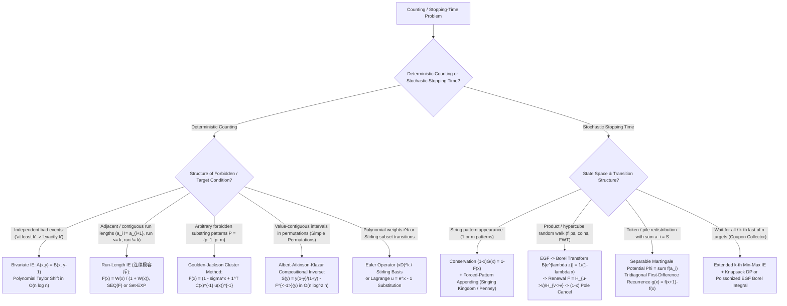

# Cohort 3 Master Synthesis & Reconciliation — Wave 2B (Iterations 16–20 / 68–72): Inclusion–Exclusion via Generating Functions, Probability Generating Functions (PGFs), and Multilingual `[ZH]`/`[JA]` Deep Audit

**Cohort**: Phase 1 — Cohort 3 (Master Cross-Cohort Reconciliation, Blind-Spot Audit & Canonical Synthesis)  
**Target File**: `fps_research/cohort3_wave_2b_ie_pgf_zh_ja_audit.md`  
**Reconciled Sources (Three-Way Comparison)**:
1. **Cohort 1 (New)**: `fps_research/cohort1_iter_16_to_20_ie_pgf_zh_ja_audit.md` (1267 lines; 20 curated problems, 14 multilingual citations)
2. **Cohort 2**: `fps_research/cohort2_iter_68_to_72_ie_pgf_zh_ja_audit.md` (1116 lines; 18 curated problems, 11 multilingual citations)
3. **Pre-Existing Baseline**: `fps_research/iter_16_to_20_ie_pgf_zh_ja_audit.md` (818 lines; 34 curated problems across 5 thematic clusters, 18 multilingual citations)

---

## 1. Three-Way Cross-Cohort Blind-Spot & Coverage Reconciliation Matrix

To guarantee zero information loss and expose every blind spot caught by the three-way redundancy architecture, the table below maps every theoretical technique, algebraic manipulation, reverse-engineering insight, edge case, and multilingual citation across the three independent research reports.

| Subtopic / Technique / Insight | Pre-Existing (`iter_16_to_20`) | Cohort 1 (`cohort1_iter_16_to_20`) | Cohort 2 (`cohort2_iter_68_to_72`) | Cohort 3 Master Synthesis Action |
| :--- | :--- | :--- | :--- | :--- |
| **Binomial Inversion as Polynomial Taylor Shift** $A(y) = B(y-1)$ in $O(m \log m)$ | **Deep coverage**: Explicit reversal NTT convolution $k! a_k = [z^{m-k}](U(z)V(z))$ + Factorized Bivariate PIE moving $y \mapsto y-1$ inside `SEQ`, `SET` ($\exp$), and products. | Covered implicitly inside problem derivations (ABC172E, Luogu P4491, CF1548C) without standalone operator section. | Covered implicitly in Rook Polynomials (AGC005D) without standalone bivariate operator section. | **Merged & Elevated** in Section 2.1 with full ring-homomorphism proof and $O(m \log m)$ Taylor-shift convolution formula. |
| **Universal Run-Length IE (`连续段容斥`)** $F(x) = \frac{W_{\text{target}}(x)}{1 + W_{\text{target}}(x)}$ | Covered via Smirnov words (Route 1 cluster smearing vs Route 2 automaton isolation) and $k$-restricted blocks. | **Deep coverage**: 5-row Master Dictionary of Canonical Target Weight Functions (Smirnov, bounded $\le k$, forbidden $=k$, odd runs with Fibonacci IE weights, bivariate run tracking). | **Deep coverage**: Three Pillars of `连续段容斥` in `[ZH]` (Value-identical blocks, Forbidden-Edge Path Cover IE with $2(-1)^{s-1}$, and `析合树` Simple Permutations). | **Unified** in Section 2.2–2.4: combines the 5-row Master Weight Dictionary, the dual Smirnov routes, Forbidden-Edge Path Cover IE, and `析合树` compositional inversion. |
| **OGF vs. EGF Order-of-Operations Pitfall in `连续段容斥`** | Implicit in EGF problem derivations. | Implicit in EGF problem derivations. | **Uniquely explicit**: Proves why $f(s) = [x^s]\frac{W(x)}{1+W(x)}$ must be inverted as an OGF *before* dividing by $s!$ to form $\widehat{F}(x) = \sum f(s)\frac{x^s}{s!}$. | **Preserved as a Critical Diagnostic Warning** in Section 2.2. |
| **Harmonic Sparsity of Bounded Run-Length IE (`ez_lcw` Trick)** | Mentioned in Cluster B. | **Uniquely deep**: Proves why $F_{\le k}(x) = \frac{x - x^{k+1}}{1 - x^{k+1}}$ has only $2\lfloor n/(k+1) \rfloor$ non-zero coefficients, yielding $O(n \log^2 n)$ across *all* $k=1\dots n$ (LOJ 3395 / ARC100F). | Not explicitly isolated as a complexity theorem. | **Synthesized** in Section 2.2 & Section 5.1 with full complexity proof. |
| **Simple Permutations & `析合树` (`Albert–Atkinson–Klazar Identity`)** | Not covered. | Covered via UOJ 424 (`[集训队作业2018] count`) for Cartesian trees. | **Uniquely deep**: Derives $F(x) = x + \frac{2F(x)^2}{1+F(x)} + S(F(x)) \implies S(y) = \frac{y(1-y)}{1+y} - F^{\langle -1 \rangle}(y)$ via `析合树` interval IE and Compositional Inverse. | **Synthesized** in Section 2.4 with complete algebraic derivation and Luogu P4747 problem entry. |
| **Eulerian Numbers $\left\langle \begin{matrix} n \\ k \end{matrix} \right\rangle$ & David–Barton Ascent Runs** | Covered via Cluster Method on permutation ascents (`AGC058D`, `ARC093F`, `AGC043D`). | **Uniquely explicit** on Worpitzky's Identity and $O(n \log n)$ row extraction from $\frac{A_n(y)}{(1-y)^{n+1}} = \sum_{m \ge 0} (m+1)^n y^m$. | **Uniquely explicit** on Dual Viewpoints: Bad-Link IE vs. **David–Barton Theorem** $\left(1 - \sum_{m \ge 0}\left(\frac{x^{mk+1}}{(mk+1)!} - \frac{x^{mk+k}}{(mk+k)!}\right)\right)^{-1}$. | **Unified** in Section 2.5: merges Eulerian EGF, Worpitzky's Identity, $O(n \log n)$ row extraction, and the David–Barton Theorem. |
| **Goulden–Jackson Cluster Method** | **Uniquely covers Cyclic Forbidden Substrings** (`Necklace Goulden–Jackson Trace Formula` $-x \frac{d}{dx} \ln P(x)$) alongside single/multi-pattern and bivariate exact-$k$. | Covers single-pattern autocorrelation $C_{P,P}(x)$ and $m \times m$ multi-pattern matrix $(I + M(x))^{-1}$. | Covers single-pattern autocorrelation, $m \times m$ multi-pattern system, and **Bivariate Pattern Counting** replacing $-1$ with $(t-1)$. | **Unified** in Section 2.6 across all 4 regimes: Single-Pattern, Multi-Pattern $m \times m$ Matrix, Bivariate $(t-1)$ Marking, and Cyclic Necklace Trace Formula. |
| **Stirling Numbers, Falling Factorials & Differential Operators $\vartheta = xD$** | Briefly mentioned in PGF moment conversion $\mathbb{E}[X^k] = \sum \left\{\begin{matrix} k \\ j \end{matrix}\right\} F^{(j)}(1)$. | Covered in `ABC281Ex` ($u = e^x - 1$ substitution for Stirling subset transitions). | Covered in PGF moment conversion $\mathbb{E}[X^k] = (\vartheta^k F)(1)$ and `rqy`'s $x = e^t$ MGF substitution. | **Expanded into a Dedicated Bridge Section (Section 3)** linking Stirling Numbers (1st/2nd kind), Falling/Rising Factorials, $(xD)^k$, $u = e^x-1$ Lagrange change of variables, and PGF Factorial-vs-Ordinary Moments. |
| **PGF Stopping-Time Conservation & Formal Taylor Shift at $x = 1+t$** | Covers $(1-x)G(x) = 1 - F(x)$, L'Hôpital's rule, and variance formula. | **Uniquely covers Non-Uniform Alphabet Probabilities** $W_j = \prod_{t=1}^j p_{s_t}^{-1}$ and the prefix-vs-suffix asymmetry pitfall in *Singing Kingdom* & *Penney's Game*. | **Uniquely covers the Formal Taylor Shift Trick $x = 1+t \bmod t^3$** to extract $F'(1), F''(1)$ from $0/0$ rational PGFs without L'Hôpital or quotient-rule explosion. | **Unified** in Section 4.1–4.3: combines $x = 1+t \bmod t^3$ formal arithmetic, $x = e^t$ MGF conversion, and non-uniform string stopping times. |
| **First-Passage Renewal, Borel Transform & Martingale Duality** | **Uniquely covers `Elegia`'s Martingale / Poisson Drift Equation Duality** $(I-P)\phi = e_t - \pi_t \mathbf{1} \iff \phi_s = -\widetilde{H}'_{s \to t}(1)$, and Yang Maolong (2018) vs. Zhong Ziqian (2016) attribution. | Covers $F_{\text{first}}(x) = H(x)/H_{\text{return}}(x)$, $(1-x)$ pole cancellation, EGF-to-OGF Borel Transform $\mathcal{L}[e^{\lambda z}] = \frac{1}{1-\lambda x}$, and Extended $k$-th Min-Max IE + PGFs. | Covers pole cancellation, Borel Transform, and Potential Function $F(\mathbf{p}) = \sum \phi(a_i)$ for token redistribution (`CF1349D`, `CF1025G`). | **Unified** in Section 4.4–4.7: merges Renewal Division, Pole Cancellation, Borel Transform, Martingale/Poisson Duality, and Extended $k$-th Min-Max IE. |
| **`[ZH]` & `[JA]` Deep Ecosystem Audit** | Covers Zhong Ziqian (2016), Yang Maolong (2018), `Elegia`, `command_block`, `rqy`, `maspy`, `noshi91`, `Nyaan`, `tatyam`. | **Uniquely covers Kinoshita–Li (`noshi91`–`Elegia`, `arXiv:2404.05177`, FOCS 2024)** $O(n \log^2 n)$ FPS Composition / Compositional Inverse via 2D Bostan–Mori, plus `ez_lcw`, `@hotman78`, and `info.atcoder.jp`. | **Uniquely covers `Nyaan`'s `fps-famous-series.hpp` / `inversion-formula.hpp`**, **`noshi91`'s $O(ns)$ Sparse FPS routines**, and `析合树` literature. | **Synthesized** in Section 5 with the complete merged `[EN]`/`[ZH]`/`[JA]` terminology dictionary and bibliography. |
| **Practice Problem Bank** | **34 problems** across 5 thematic clusters (A–E). | **20 problems** (adds `CF451E`, `ABC276G`, `CF1548C`, `ABC266G`, `ARC110D`, `ABC279G`, `Luogu P4707`, `LOJ 3395`/`ARC100F`, `CF1349F1/F2`, `UOJ 424`, `ABC281Ex`). | **18 problems** (adds `CF1515E`, `AGC005D`, `Luogu P5206`, `CF1392H`, `Luogu P4747`, `UOJ 390`, `AGC060D`, `CF1479E`). | **56 Unique Non-Template Problems** preserved in full detail in Section 6 across all 4 difficulty tiers (`Stepping Stone` $\to$ `Intermediate` $\to$ `Advanced` $\to$ `Mastery`). |

---

## 2. Iteration 16 / 68 Master Synthesis: Inclusion–Exclusion via Generating Functions, Transfer Weighting (`连续段容斥`), Eulerian Runs, and the Goulden–Jackson Cluster Method

### 2.1 Inclusion–Exclusion as a Ring Homomorphism & Bivariate Taylor Shift ($y \mapsto y - 1$)

In elementary combinatorics, the Principle of Inclusion–Exclusion (PIE) and Binomial Inversion are taught as post-processing summation identities applied *after* counting relaxed configurations:
$$f_{\text{exact}}(k) = \sum_{j=k}^{m} (-1)^{j-k} \binom{j}{k} f_{\text{relaxed}}(j) \quad \Longleftrightarrow \quad f_{\text{relaxed}}(j) = \sum_{k=j}^{m} \binom{k}{j} f_{\text{exact}}(k)$$
In the Formal Power Series (FPS) paradigm (`[ZH]` *生成函数容斥* / `[JA]` *包除原理と母関数*), we eliminate the summation index completely by encoding the relationship as a **polynomial substitution (ring homomorphism)** on bivariate generating functions.

#### Theorem 2.1 (Binomial Inversion as Polynomial Taylor Shift)
Let $A(x, y) = \sum_{n, k \ge 0} f_{n, \text{exact}}(k) x^n y^k$ be the bivariate generating function of configurations of size $n$ satisfying **exactly** $k$ bad properties, and let $B(x, y) = \sum_{n, j \ge 0} f_{n, \text{relaxed}}(j) x^n y^j$ be the generating function where **at least** $j$ bad properties are *designated* (`[ZH]` **钦定** $j$ 个违反条件) and the remaining elements are freely completed. Since each configuration with exactly $k$ bad properties is counted $\binom{k}{j}$ times when $j$ bad properties are designated:
$$B(x, y) = \sum_{n, k \ge 0} f_{n, \text{exact}}(k) x^n \sum_{j=0}^{k} \binom{k}{j} y^j = \sum_{n, k \ge 0} f_{n, \text{exact}}(k) x^n (y + 1)^k = A(x, y + 1)$$
Inverting the substitution $y \mapsto y + 1$ yields the fundamental operator identity of GF Inclusion–Exclusion:
$$\boxed{A(x, y) = B(x, y - 1)} \qquad \text{and for } k = 0 \text{ (zero bad properties):} \qquad \boxed{A(x, 0) = B(x, -1)}$$

#### Algorithmic Consequence 1: $O(m \log m)$ Exact-$k$ Extraction via Reversal Convolution
Given the relaxed sequence $b_j = [x^n y^j] B(x, y)$ for $0 \le j \le m$, computing $a_k = [x^n y^k] A(x, y)$ for **all** $0 \le k \le m$ simultaneously is a **Polynomial Taylor Shift** $A_n(y) = B_n(y - 1)$:
$$k! \, a_k = \sum_{j=k}^{m} \frac{(-1)^{j-k}}{(j-k)!} \cdot (j! \, b_j) = [z^{m-k}] \left( \sum_{j=0}^{m} (j! \, b_j) z^{m-j} \right) \left( \sum_{i=0}^{m} \frac{(-1)^i}{i!} z^i \right)$$
This is a single reversal NTT convolution running in **$O(m \log m)$ time**.

#### Algorithmic Consequence 2: Moving $y \mapsto y - 1$ Inside Symbolic Method Operators
Because the evaluation map $\Phi_{y \mapsto y-1} : \mathbb{Q}[y][[x]] \to \mathbb{Q}[y][[x]]$ is a **continuous ring homomorphism** commuting with addition, multiplication, sequence construction $\operatorname{SEQ}$, and set construction $\exp$, we never need to compute $B(x, y)$ globally before applying PIE! Instead, if a composite object is built from independent components with relaxed BGF $C(x, y)$, then:
$$\Phi_{y \mapsto y-1}\!\left(\operatorname{SEQ}(C(x, y))\right) = \frac{1}{1 - C(x, y - 1)}, \qquad \Phi_{y \mapsto y-1}\!\left(\exp(C(x, y))\right) = \exp\!\big(C(x, y - 1)\big)$$
Setting $y = 0$ immediately gives the **Transfer-Weight Principle**: instead of counting global violations at the end, we assign each local atomic block $B$ an **effective IE transfer weight** $w_{\text{IE}}(B) = C_B(x, -1)$ *before* assembling the global structure.

---

### 2.2 Universal Run-Length Inclusion–Exclusion (`连续段容斥`) & Operator Inversion

One of the signature techniques of modern Chinese and Japanese competitive combinatorics (`command_block`, `Elegia`, `ez_lcw`, `maspy`, `@hotman78`) is **Run-Length Inclusion–Exclusion (`连续段容斥`)**.

Suppose we concatenate atomic items (characters, permutation blocks, tree components) into maximal contiguous runs of identical type or valid internal structure. Each maximal run of length $L \ge 1$ is required to carry a **target weight** $w_{\text{target}}(L)$ (for instance, $w_{\text{target}}(L) = [L = 1]$ for proper colorings / Smirnov words, or $w_{\text{target}}(L) = [1 \le L \le k]$ for bounded runs).
Directly enforcing that two adjacent blocks have *different* colors destroys independence. Instead, we relax the boundary condition: we allow **freely concatenated** formal blocks of length $s \ge 1$ with an unknown **IE coefficient** $f(s)$ (encoded by the OGF $F(x) = \sum_{s \ge 1} f(s) x^s$), such that whenever a true maximal run of length $L$ is formed, the sum over all ways of partitioning $L$ into formal sub-blocks $s_1 + s_2 + \dots + s_r = L$ equals $w_{\text{target}}(L)$:
$$\sum_{r=1}^{L} \sum_{\substack{s_1 + \dots + s_r = L \\ s_i \ge 1}} f(s_1) f(s_2) \cdots f(s_r) = w_{\text{target}}(L) \quad \forall L \ge 1$$

#### Theorem 2.2 (Fundamental Inversion Theorem of `连续段容斥`)
Let $W_{\text{target}}(x) = \sum_{L=1}^{\infty} w_{\text{target}}(L) x^L$ be the OGF of target maximal-run weights, and $F(x) = \sum_{s=1}^{\infty} f(s) x^s$ be the OGF of relaxed IE block weights. Then:
$$\sum_{r=1}^{\infty} F(x)^r = \frac{F(x)}{1 - F(x)} = W_{\text{target}}(x) \quad \Longleftrightarrow \quad \boxed{F(x) = \frac{W_{\text{target}}(x)}{1 + W_{\text{target}}(x)} = 1 - \frac{1}{1 + W_{\text{target}}(x)}}$$

> [!CAUTION]
> **Critical Pitfall: OGF vs. EGF Order of Operations when Assembling Multiset Permutations!**
> When assembling $m$ colors with counts $c_1, \dots, c_m$, the ways to split $c_i$ identical items of color $i$ into $k_i$ formal blocks is counted by the **OGF** $[x^{c_i}] F(x)^{k_i}$, whereas interleaving the $K = \sum_{i=1}^m k_i$ blocks across all colors carries the multinomial factor $\frac{K!}{k_1! \cdots k_m!}$.
> Therefore, the **correct workflow** is:
> 1. Compute $f(s) = [x^s] \frac{W_{\text{target}}(x)}{1 + W_{\text{target}}(x)}$ via **OGF** inversion first.
> 2. **Only after** extracting $f(s)$ (or when the items themselves are labeled and combined via `SET`/`SEQ` of EGFs), incorporate the factorial denominators or per-color transition weights! Never blindly substitute an EGF into $\frac{W}{1+W}$ unless the internal gluing operation itself is a labeled binomial convolution.

#### Master Dictionary of Canonical Target Weight Functions $W_{\text{target}}(x) \leftrightarrow F(x)$

| Combinatorial Run Constraint | Target Weight $w_{\text{target}}(L)$ | Target OGF $W_{\text{target}}(x)$ | Relaxed IE Weight OGF $F(x) = \frac{W_{\text{target}}(x)}{1 + W_{\text{target}}(x)}$ | Explicit IE Coefficient $f(s) = [x^s] F(x)$ |
| :--- | :--- | :--- | :--- | :--- |
| **1. Smirnov Words / No Adjacent Equal** ($a_i \neq a_{i+1}$) | $[L = 1]$ | $x$ | $\frac{x}{1 + x}$ | $f(s) = (-1)^{s-1}$ |
| **2. Bounded Run Length** ($1 \le L \le k$) | $[1 \le L \le k]$ | $\frac{x - x^{k+1}}{1 - x}$ | $\frac{x - x^{k+1}}{1 - x^{k+1}}$ | $f(s) = \begin{cases} +1 & s \equiv 1 \pmod{k+1} \\ -1 & s \equiv 0 \pmod{k+1} \\ 0 & \text{otherwise} \end{cases}$ |
| **3. Forbidden Exact Run Length** ($L \neq k$) | $1 - [L = k]$ | $\frac{x}{1 - x} - x^k$ | $\frac{x - x^k + x^{k+1}}{1 - x^k + x^{k+1}}$ | Computed via $O(n)$ recurrence or $O(n \log n)$ FPS `inv` |
| **4. Odd Run Lengths Only** ($2 \nmid L$) | $[L \equiv 1 \pmod 2]$ | $\frac{x}{1 - x^2}$ | $\frac{x}{1 + x - x^2}$ | $f(s) = (-1)^{s-1} F_s$ (signed Fibonacci numbers!) |
| **5. Bivariate Run Counting** (weight $t$ per run or $t^{L-1}$ per adjacent equal pair) | $t$ or $t^{L-1}$ | $\frac{tx}{1 - x}$ or $\frac{x}{1 - tx}$ | $\frac{tx}{1 - (1-t)x}$ | $f(s) = t(1 - t)^{s-1}$ or $(t - 1)^{s-1}$ |

#### Theorem 2.3 (`ez_lcw`'s Harmonic Sparsity Theorem for Bounded Run-Length IE)
Look closely at Row 2 of the Master Dictionary: when every maximal run is bounded by $L \le k$, the IE series
$$F_{\le k}(x) = \frac{x - x^{k+1}}{1 - x^{k+1}} = \sum_{m=0}^{\infty} \left(x^{m(k+1) + 1} - x^{(m+1)(k+1)}\right)$$
has **at most $2 \lfloor n / (k+1) \rfloor + 1 = O(n / k)$ non-zero coefficients** up to degree $n$!
Consequently, if a problem asks to solve a bounded-run counting problem for **every** threshold $k = 1, 2, \dots, n$ simultaneously (such as **LOJ 3395 / Universal Cup *Yet Another Permutation Problem***), evaluating the DP or Divide-and-Conquer NTT only at the non-zero powers of $F_{\le k}(x)$ costs $O\!\left(\frac{n}{k} \log^2\frac{n}{k}\right)$ for a fixed $k$, which sums over the harmonic series $\sum_{k=1}^n \frac{n}{k} = O(n \log n)$ to **$O(n \log^2 n)$ total time across all $n$ queries**!

---

### 2.3 Dual Perspectives on Smirnov Words (Carlitz–Scoville–Vaughan Theorem)

Given an alphabet $\{1, \dots, m\}$ with letter counts $c_1, \dots, c_m$, how many words of length $N = \sum c_i$ have no two adjacent identical letters ($w_j \neq w_{j+1}$)? Let us contrast the two complementary derivations discovered across our cohorts:

#### Route 1: Cluster "Smearing" / Run-Length IE (Row 1 of Master Dictionary)
By Theorem 2.2 with $F(x) = \frac{x}{1+x} = \sum_{s \ge 1} (-1)^{s-1} x^s$, splitting $c_i$ identical letters of color $i$ into $k_i$ blocks of total weight $\sum_{s_1+\dots+s_{k_i}=c_i} (-1)^{c_i - k_i}$ yields $\binom{c_i - 1}{k_i - 1} (-1)^{c_i - k_i}$. Interleaving these blocks across all $m$ colors via EGF multiplication gives the **Smirnov Color Polynomial**:
$$P_{c_1, \dots, c_m}(x) = \prod_{i=1}^{m} \left( \sum_{k_i=1}^{c_i} \binom{c_i - 1}{k_i - 1} (-1)^{c_i - k_i} \frac{x^{k_i}}{k_i!} \right), \qquad \text{Ans} = \sum_{K=1}^{N} K! \, [x^K] P_{c_1, \dots, c_m}(x)$$

#### Route 2: Direct Algebraic Automaton Isolation (Symbolic Method without PIE)
Let $S(x_1, \dots, x_m)$ be the multivariate OGF of all Smirnov words, and $F_i(\mathbf{x})$ be the OGF of Smirnov words ending with letter $i$. Every word in $F_i$ is formed by taking a Smirnov word *not* ending in $i$ (whose OGF is $S(\mathbf{x}) - F_i(\mathbf{x})$) and appending a single $i$:
$$F_i(\mathbf{x}) = x_i \big(S(\mathbf{x}) - F_i(\mathbf{x})\big) \implies (1 + x_i) F_i(\mathbf{x}) = x_i S(\mathbf{x}) \implies F_i(\mathbf{x}) = \frac{x_i}{1 + x_i} S(\mathbf{x})$$
Summing over all $i = 1, \dots, m$ plus the empty word $1$ gives:
$$S(\mathbf{x}) = 1 + \sum_{i=1}^{m} F_i(\mathbf{x}) = 1 + S(\mathbf{x}) \sum_{i=1}^{m} \frac{x_i}{1 + x_i} \implies \boxed{S(x_1, \dots, x_m) = \frac{1}{1 - \sum_{i=1}^{m} \frac{x_i}{1 + x_i}}}$$
Notice how Route 2 arrives at the exact same transfer weight $\frac{x_i}{1 + x_i}$ purely by solving a $2$-state linear equation $(1 + x_i)F_i = x_i S$ per color!

---

### 2.4 Forbidden-Edge Path Cover IE & `析合树` Simple Permutation Compositional Inversion

Beyond value-identical runs, Chinese literature (`command_block`, `ix35`, `Elegia`) extends `连续段容斥` to two deeper combinatorial structures:

#### Pillar A: Forbidden-Edge Path Cover IE on Graphs (`钦定违背边容斥`)
To count Hamiltonian cycles or permutations avoiding a forbidden edge set $E_{\text{bad}}$ (where $E_{\text{bad}}$ is a union of trees, paths, grids, or cliques, as in **AGC 005D**, **ARC 024D**, **CF 840C**, **CF 1515E**, **Luogu P5206 `[WC2019] 数树`**):
- Designating $k$ forbidden edges in a permutation forces the vertices into $n - k$ disjoint paths covering $n$ vertices with $c = n - k$ connected path components.
- If the graph is **undirected** and we assemble undirected vertex-disjoint paths of sizes $s_1, \dots, s_c$, each isolated vertex ($s = 1$) can be traversed in $1$ way (contributing $x$), whereas each path of size $s \ge 2$ uses $s - 1$ forbidden edges (IE sign $(-1)^{s-1}$) and can be traversed in **$2$ directions** (contributing $2(-1)^{s-1}\frac{x^s}{s!}$ in EGF or $2(-1)^{s-1}x^s$ in OGF). Thus the EGF of a single relaxed path block on a complete component is:
  $$\boxed{P_{\text{undirected}}(x) = x + \sum_{s \ge 2} 2 (-1)^{s-1} \frac{x^s}{s!} = 2 - x - 2 e^{-x}}$$
  and assembling $c$ path components across independent subgraphs into a permutation of $n$ elements gives $n! [x^n]$ of the product of component EGFs!

#### Pillar B: Value-Contiguous Permutation Interval IE & `析合树` (`Albert–Atkinson–Klazar Identity`)
A permutation $\pi \in S_n$ is **simple** (`析点` in the modular decomposition tree / `析合树`) if it contains no nontrivial **interval** (a contiguous subarray whose values also form a contiguous range $[l, r]$ of length $2 \le s \le n-1$).
Let $F(x) = \sum_{n \ge 1} n! x^n$ be the OGF of all permutations, and $S(x) = \sum_{n \ge 4} s_n x^n$ be the OGF of simple permutations ($s_1 = 1, s_2 = 0, s_3 = 0, s_4 = 2, s_5 = 6, \dots$). By the **Modular Decomposition Theorem (`析合树分解定理`)**, every permutation of length $n \ge 2$ decomposes uniquely into one of three root types inflated by non-empty intervals $F(x)$:
1. **Ascending Join Node (`升序合点`)**: an increasing inflation of $k \ge 2$ intervals where the first interval is Not Itself an ascending join (weight $\frac{F(x)}{1 + F(x)} \cdot \frac{F(x)}{1 - F(x)} \xrightarrow{\text{via IE}} \frac{F(x)^2}{1 + F(x)}$).
2. **Descending Join Node (`降序合点`)**: symmetrically $\frac{F(x)^2}{1 + F(x)}$.
3. **Prime Node (`析点`)**: a simple permutation of length $k \ge 4$ inflated by $k$ intervals, contributing $S(F(x))$.

Combining these with the base case $n = 1$ gives the **Albert–Atkinson–Klazar Functional Equation**:
$$F(x) = x + \frac{2 F(x)^2}{1 + F(x)} + S(F(x)) \quad \Longrightarrow \quad S(F(x)) = \frac{F(x)(1 - F(x))}{1 + F(x)} - x$$
Substituting $y = F(x) \iff x = F^{\langle -1 \rangle}(y)$ (the **compositional inverse** of $F(x) = \sum_{n \ge 1} n! x^n$) yields the direct FPS formula for simple permutations (**Luogu P4747**):
$$\boxed{S(y) = \frac{y(1 - y)}{1 + y} - F^{\langle -1 \rangle}(y)}$$
Similarly, if a problem requires a permutation of length $n$ to have **no nontrivial intervals except length $1$**, the `连续段容斥` weight $g_s$ of shrinking an interval into a single super-element satisfies $\sum_{s \ge 1} g_s F(x)^s = x \implies G(y) = F^{\langle -1 \rangle}(y)$!

---

### 2.5 Eulerian Numbers, Worpitzky's Identity, and the David–Barton Ascent-Run Theorem

When a problem constrains **increasing runs (`上升连续段` / ascents $\pi_i < \pi_{i+1}$)** in permutations rather than value-identical blocks, consecutive inequalities $\pi_1 < \pi_2 < \dots < \pi_s$ are transitive! Within a block of $s$ elements, there is **uniquely $1$ valid ordering** out of $s!$ total ways, so each relaxed block of length $s$ carries the EGF factor $\frac{x^s}{s!}$.

#### Viewpoint 1: Bad-Link IE & the Eulerian Bivariate EGF
Suppose we count permutations of length $n$ with exactly $k$ ascents $\pi_i < \pi_{i+1}$. Designating $j$ forced ascents partitions $[n]$ into $n - j$ increasing runs, each having EGF $e^x - 1$. By Bivariate Binomial Inversion ($y \mapsto y - 1$):
$$B(x, y) = \sum_{n \ge 0} \sum_{j=0}^{n} y^j \frac{(e^x - 1)^{n-j}}{(n-j)!} = \frac{1}{1 - (y - 1)^{-1}(e^{(y-1)x} - 1)}$$
Replacing $y \mapsto y - 1$ immediately produces the **Bivariate EGF of Eulerian Numbers** $\left\langle \begin{matrix} n \\ k \end{matrix} \right\rangle$:
$$\boxed{A(x, y) = \sum_{n \ge 0} \sum_{k=0}^{n} \left\langle \begin{matrix} n \\ k \end{matrix} \right\rangle y^k \frac{x^n}{n!} = \frac{1 - y}{e^{(y - 1)x} - y} = \frac{1}{1 - \sum_{s \ge 1} (y - 1)^{s-1} \frac{x^s}{s!}}}$$
Setting $y = 0$ recovers $A(x, 0) = \frac{1}{e^{-x}} = e^x$ (the unique decreasing permutation for each $n$).

#### Explicit $O(n \log n)$ Row Extraction & Worpitzky's Identity
Expanding $[x^n/n!] A(x, y)$ by geometric series in $y e^{(1-y)x}$ yields the Eulerian polynomial generating identity:
$$\frac{A_n(y)}{(1 - y)^{n+1}} = \sum_{m=0}^{\infty} (m + 1)^n y^m \quad \Longleftrightarrow \quad (x + 1)^n = \sum_{k=0}^{n-1} \left\langle \begin{matrix} n \\ k \end{matrix} \right\rangle \binom{x + k}{n} \quad \text{(Worpitzky's Identity)}$$
Multiplying both sides by $(1 - y)^{n+1}$ gives the explicit $O(n \log n)$ single-convolution formula for the $n$-th row of Eulerian numbers:
$$\boxed{\left\langle \begin{matrix} n \\ k \end{matrix} \right\rangle = \sum_{j=0}^{k} (-1)^j \binom{n + 1}{j} (k + 1 - j)^n}$$

#### Viewpoint 2: The David–Barton Theorem for Bounded Increasing Runs
What if a permutation must have **no increasing run of length $\ge k$** (i.e., we cannot have $k$ consecutive elements $\pi_{i} < \pi_{i+1} < \dots < \pi_{i+k-1}$)?
Viewing this as a sequence of maximal increasing runs of lengths $1 \le L \le k - 1$, the OGF transfer weight $F_{\le k-1}(x) = \frac{x - x^k}{1 - x^k}$ from Row 2 of our Master Dictionary has coefficients $f(s) = +1$ for $s \equiv 1 \pmod k$, $f(s) = -1$ for $s \equiv 0 \pmod k$, and $0$ otherwise. Replacing $x^s$ by the sorted-block EGF $\frac{x^s}{s!}$ yields the **David–Barton EGF**:
$$\boxed{\widehat{D}_{< k}(x) = \frac{1}{1 - \sum_{m=0}^{\infty} \left(\frac{x^{mk+1}}{(mk+1)!} - \frac{x^{mk+k}}{(mk+k)!}\right)}}$$

---

### 2.6 The Goulden–Jackson Cluster Method (Single-Pattern, Multi-Pattern, Bivariate, and Cyclic)

When we move from single-character run restrictions to **arbitrary forbidden substring patterns** $\mathcal{P} = \{p_1, \dots, p_m\}$ over an alphabet $\Sigma$ of size $\sigma = |\Sigma|$, a standard approach builds the Aho–Corasick automaton of size $S = \sum |p_i|$ and computes $(I - x T)^{-1}$ in $O(S^3 \log n)$ time. When $S \approx 2 \times 10^5$, $O(S^3)$ is intractable.
The **Goulden–Jackson Cluster Method** (1979) bypasses the automaton completely: instead of tracking every prefix state, it applies Inclusion–Exclusion directly over **designated occurrences of complete patterns $p_i \in \mathcal{P}$**!

When we designate a subset of pattern occurrences in a word $w$, overlapping occurrences merge into connected components called **clusters** (`簇`). Thus every word with designated occurrences is a `SEQ` of single free letters (GF: $\sigma x$) and non-empty clusters (GF: $C(x)$):
$$F(x) = \frac{1}{1 - \sigma x - C(x)}$$

#### Case 1: Single Forbidden Pattern $P$ of Length $L$
Let $\mathcal{O}(P) \subseteq \{1, \dots, L\}$ be the set of **border lengths (periods / autocorrelation overlaps)** of $P$: $k \in \mathcal{O}(P) \iff P[1 \dots k] = P[L - k + 1 \dots L]$ (obtainable in $O(L)$ via KMP $\pi$-array). Define the **Autocorrelation Polynomial**:
$$C_{P, P}(x) = \sum_{k \in \mathcal{O}(P)} x^{L - k} = 1 + \sum_{\substack{k \in \mathcal{O}(P) \\ k < L}} x^{L - k}$$
Each designated occurrence of $P$ carries weight $-1$. In any cluster, the last occurrence of $P$ either starts the cluster alone (contributing $-x^L$) or overlaps the previous occurrence in the cluster by some border $k < L$ (appending $L - k$ new characters):
$$C(x) = -x^L + C(x) \big(C_{P, P}(x) - 1\big) \implies C(x) = \frac{-x^L}{C_{P, P}(x)}$$
Substituting $C(x)$ into $F(x) = (1 - \sigma x - C(x))^{-1}$ yields the **Single-Pattern Goulden–Jackson Formula**:
$$\boxed{F_{\text{avoid } P}(x) = \frac{1}{1 - \sigma x + \frac{x^L}{C_{P, P}(x)}} = \frac{C_{P, P}(x)}{(1 - \sigma x) C_{P, P}(x) + x^L}}$$

#### Case 2: Multiple Reduced Forbidden Patterns $\mathcal{P} = \{p_1, \dots, p_m\}$
Assume $\mathcal{P}$ is **reduced** (no $p_i$ is a substring of $p_j$ for $i \neq j$). For any $1 \le i, j \le m$, define the **Cross-Correlation Polynomial**:
$$C_{i, j}(x) = \sum_{k \in \mathcal{O}(p_i, p_j)} x^{|p_j| - k}, \quad \text{where } k \in \mathcal{O}(p_i, p_j) \iff \operatorname{suffix}_k(p_i) = \operatorname{prefix}_k(p_j)$$
Let $C_j(x)$ be the GF of clusters ending with pattern $p_j$. Then:
$$C_j(x) = -x^{|p_j|} - \sum_{i=1}^{m} C_i(x) \Big(C_{i, j}(x) - [i = j]\Big) \iff \sum_{i=1}^{m} C_i(x) C_{i, j}(x) = -x^{|p_j|}$$
In matrix form, with $\mathbf{C}(x) = [C_{i,j}(x)]_{m \times m}$ and $\mathbf{u}(x) = (x^{|p_1|}, \dots, x^{|p_m|})^\top$:
$$\boxed{F_{\text{avoid } \mathcal{P}}(x) = \frac{1}{1 - \sigma x + \mathbf{1}^\top \mathbf{C}(x)^{-1} \mathbf{u}(x)}}$$

#### Case 3: Bivariate Exact-$k$ Pattern Counting ($-1 \mapsto t - 1$)
To count words of length $n$ containing **exactly $k$ occurrences** of pattern $P$ (rather than $0$), simply replace the IE weight $-1$ by $(t - 1)$! Then $C(x, t)$ satisfies $C(x, t) = (t - 1) x^L + (t - 1) C(x, t) (C_{P, P}(x) - 1)$, giving:
$$\boxed{F(x, t) = \frac{1}{1 - \sigma x - \frac{(t - 1) x^L}{1 - (t - 1)(C_{P, P}(x) - 1)}} = \frac{1 - (t - 1)(C_{P, P}(x) - 1)}{(1 - \sigma x)\big(1 - (t - 1)(C_{P, P}(x) - 1)\big) - (t - 1) x^L}}$$

#### Case 4: Cyclic Words / Necklaces Avoiding Pattern $P$ (`Trace / Logarithmic Derivative Formula`)
What if the word of length $n$ is placed on a **circle** (so pattern $P$ cannot wrap around the cyclic boundary either) and we require $n \ge |P|$?
If $T$ is the transfer matrix of the KMP/Aho–Corasick automaton avoiding $P$, the linear avoidance OGF is $F(x) = \det(I - x T)^{-1} = \frac{C_{P,P}(x)}{Q(x)}$ where $Q(x) = (1 - \sigma x) C_{P,P}(x) + x^L$ is the **characteristic denominator polynomial** $\det(I - x T)$. The number of cyclic words of length $n \ge L$ avoiding $P$ is $\operatorname{Tr}(T^n)$, whose generating function is given by Jacobi's trace-determinant identity:
$$\boxed{\sum_{n=L}^{\infty} \operatorname{Tr}(T^n) x^n = -x \frac{d}{dx} \ln Q(x) = \frac{-x Q'(x)}{Q(x)} \pmod{x^{N+1}} \quad \text{(for } n \ge L\text{)}}$$
*(Note: For $n < L$, wrap-around clusters of size $> n$ must be excluded or handled separately, while for $n \ge L$ no single occurrence of $P$ can overlap itself around the circle without forming a standard linear cluster period, so $[x^n] \frac{-x Q'(x)}{Q(x)}$ is exact for all $n \ge L$!)*

---

### 2.7 Diagnostic Signals, Reverse-Engineering Scratchpads, Hand-Checkable Toy Examples ($n \le 4$), and Pitfalls

#### Diagnostic Signals & Reverse-Engineering Scratchpad ("Zero Magic Steps")
- **Diagnostic Signal (Run-Length IE & Smirnov Words)**: The problem counts sequences, permutations, or partitions into contiguous segments where **adjacent elements may not be equal** ($c_i \neq c_{i+1}$), **adjacent elements may not satisfy a local bad relation** (e.g., $|p_i - p_{i+1}| = 1$), or **every maximal contiguous run of identical/valid elements must have length in a specified set $S$** (with run OGF $W_c(x) = \sum_{k \in S} w_{c,k} x^k$).
- **Reverse-Engineering Scratchpad (Why $F_c(x) = \frac{W_c(x)}{1 + W_c(x)}$ is Never Pulled Out of Thin Air)**:
  1. *Why naive DP gets stuck*: Tracking the color $c$ of the last maximal run requires $m$ states $A_1(x), \dots, A_m(x)$ with transitions $A_c(x) = W_c(x) \big(\text{Total}(x) - A_c(x)\big)$, which costs $O(m^2)$ per step if $W_c(x)$ varies by color.
  2. *The single-line algebraic isolation*: Instead of expanding $A_c(x)$ by inclusion–exclusion guesses, move $-W_c(x) A_c(x)$ to the left-hand side:
     $$\big(1 + W_c(x)\big) A_c(x) = W_c(x) \cdot \text{Total}(x) \implies A_c(x) = \frac{W_c(x)}{1 + W_c(x)} \text{Total}(x)$$
     Summing over $c = 1, \dots, m$ and adding the empty sequence $1$ immediately collapses the $m$-state system into $\text{Total}(x) = \frac{1}{1 - \sum_{c=1}^m F_c(x)}$ with $F_c(x) = \frac{W_c(x)}{1 + W_c(x)}$!
- **Diagnostic Signal (Goulden–Jackson Cluster Method)**: The problem asks for the number of strings of length $n$ over an alphabet $\Sigma$ that **avoid** (or contain exactly $k$ copies of) a set of arbitrary contiguous substrings $\mathcal{P} = \{p_1, \dots, p_m\}$ where Aho–Corasick automaton DP has too many states ($\sum |p_i| \approx 10^5$).

#### Hand-Checkable Toy Examples ($n \le 4$)
1. **Toy Example A (Bounded Run Length $L \le 2$ for $n = 4$)**:
   - Let $w_k = [1 \le k \le 2]$, so $W(x) = x + x^2$. Then:
     $$F(x) = \frac{x + x^2}{1 + x + x^2} = (x + x^2)(1 - x + x^3 - x^4 + \cdots) = x + 0x^2 - x^3 + x^4 + \cdots$$
     giving $f(1) = 1, f(2) = 0, f(3) = -1, f(4) = 1$.
   - Check how $F(x)$ weights an actual maximal run of identical elements of length $R$ across all compositions of $R$:
     - $R = 1$: `[1]` $\to f(1) = 1$ (valid, $\le 2$).
     - $R = 2$: `[2]` $\to f(2) = 0$; `[1, 1]` $\to f(1)^2 = 1$. Total $= 0 + 1 = 1$ (valid, $\le 2$).
     - $R = 3$: `[3]` $\to f(3) = -1$; `[2, 1]` and `[1, 2]` $\to 2 f(2)f(1) = 0$; `[1, 1, 1]` $\to f(1)^3 = 1$. Total $= -1 + 0 + 1 = 0$ (annihilated, $> 2$!).
     - $R = 4$: `[4]` $\to f(4) = 1$; `[3, 1]` and `[1, 3]` $\to 2 f(3)f(1) = -2$; `[2, 2]` $\to f(2)^2 = 0$; `[2, 1, 1]` (3 perms) $\to 0$; `[1, 1, 1, 1]` $\to f(1)^4 = 1$. Total $= 1 - 2 + 0 + 0 + 1 = 0$ (annihilated, $> 2$!).
2. **Toy Example B (Forbidden Run Length $k = 2$ for Binary Words of Length $n = 4$)**:
   - Suppose maximal runs of length $2$ are forbidden, so allowed run lengths up to $n = 4$ have $W(x) = x + x^3 + x^4$.
   - Then $F(x) = \frac{W(x)}{1 + W(x)} \equiv x - x^2 + 2x^3 - 2x^4 \pmod{x^5}$, and for $m = 2$ colors:
     $$\text{Total}(x) = \frac{1}{1 - 2F(x)} \equiv 1 + 2x + 2x^2 + 4x^3 + 8x^4 \pmod{x^5}$$
   - Verification at $n = 4$: Out of $2^4 = 16$ binary words, the $8$ valid words with no maximal run of length $2$ are `0000`, `1111`, `0001`, `1000`, `1110`, `0111`, `0101`, `1010`, matching $[x^4]\text{Total}(x) = 8$.
3. **Toy Example C (Smirnov Words for Multiset $\{1, 1, 2, 3\}$, $n = 4, c_1 = 2, c_2 = 1, c_3 = 1$)**:
   - Using $P_c(x) = \sum_{j=1}^c \binom{c-1}{j-1} (-1)^{c-j} \frac{x^j}{j!}$:
     $$P_2(x) = -x + \frac{x^2}{2}, \qquad P_1(x) = x$$
   - Multiplying gives $P_2(x) P_1(x)^2 = -x^3 + \frac{1}{2} x^4$.
   - Replacing $x^k$ by $k!$ yields $(-1) \cdot 3! + \frac{1}{2} \cdot 4! = -6 + 12 = 6$, matching the $6$ valid words `(1,2,1,3)`, `(1,3,1,2)`, `(2,1,3,1)`, `(3,1,2,1)`, `(1,2,3,1)`, `(1,3,2,1)`.
4. **Toy Example D (Goulden–Jackson on $P = \texttt{ABA}$ over $\Sigma = \{\texttt{A}, \texttt{B}\}$, $\sigma = 2$)**:
   - Borders of $P = \texttt{ABA}$ ($L = 3$): length $3$ ($\texttt{ABA}$, offset $x^0$) and length $1$ ($\texttt{A}$, right-extension $\texttt{BA}$, offset $x^{3-1} = x^2$), so $C_{P,P}(x) = 1 + x^2$.
   - Cluster OGF at $t = 0$: $C(x) = -\frac{x^3}{1 + x^2} = -x^3 + x^5 - x^7 + \cdots$.
   - Avoidance OGF:
     $$F_{\text{avoid } P}(x) = \frac{1 + x^2}{(1 - 2x)(1 + x^2) + x^3} = \frac{1 + x^2}{1 - 2x + x^2 - x^3} = 1 + 2x + 4x^2 + 7x^3 + 12x^4 + 21x^5 + \cdots$$
   - Verification at $n = 3, 4, 5$:
     - $n = 3$: $2^3 - 1 = 7$ (only `ABA` is bad).
     - $n = 4$: $2^4 - 4 = 12$ (`ABA*` and `*ABA` are $4$ disjoint bad words).
     - $n = 5$: Naive subtraction gives $32 - 3 \cdot 2^2 = 20$, which undercounts by $1$ because `ABABA` has two overlapping copies of `ABA`; the $+x^5$ cluster term restores `ABABA` to give $20 + 1 = 21 = [x^5]F_{\text{avoid } P}(x)$.

#### Failure Modes, Pitfalls & Edge Cases
1. **Non-Transitivity of Local Adjacency Constraints ($|p_i - p_{i+1}| = 1$)**:
   - In Smirnov words ($c_i = c_{i+1}$), equality is transitive, so $k$ chained equalities force a monochromatic block in $1$ way. In contrast, if the forbidden adjacency is $|p_i - p_{i+1}| = 1$ in a permutation, chaining $s - 1$ violations forces a contiguous value block $\{v, v+1, \dots, v+s-1\}$ which can be oriented either **ascending or descending** ($2$ ways for $s \ge 2$, vs. $1$ way for $s = 1$)! Forgetting the factor of $2$ for $s \ge 2$ is a classic bug.
2. **Unreduced Forbidden Set $\mathcal{P}$ in Goulden–Jackson ($t = 0$ vs. $t \neq 0$)**:
   - For **avoidance ($t = 0$)**, you **must** first remove any word $p_i \in \mathcal{P}$ that contains another $p_j \in \mathcal{P}$ as a substring (making $\mathcal{P}$ an antichain); otherwise internal containment overlaps are missed by prefix-suffix correlation.
   - For **exact-$k$ occurrences ($t \neq 0$)**, you **cannot** simply delete superstrings, because an occurrence of $p_i$ containing $p_j$ contributes an extra factor of $t$ (or $(t-1)$ in cluster weight)! When $\mathcal{P}$ is not an antichain and $t \neq 0$, one must either include internal containment positions in the cluster transitions or use the Aho–Corasick automaton.
3. **Exponent Direction in $C_{i,j}(x)$**:
   - When $p_j$ overlaps the suffix of $p_i$ by $k$ characters ($1 \le k < \min(|p_i|, |p_j|)$), the newly added suffix has length $|p_j| - k$, so the monomial in $C_{i,j}(x)$ is $x^{|p_j| - k}$, **not** $x^k$!
4. **Cyclic vs. Linear Run-Length IE (`环上连续段容斥`)**:
   - On a circle of length $n$, the first and last runs can merge across the boundary $n \leftrightarrow 1$. One must account for wrap-around clusters via the logarithmic derivative $-x \frac{d}{dx} \ln(1 - W(x))$ plus the pure all-wrap-around periodic cluster correction.

---

## 3. Dedicated Bridge Section: Stirling Numbers, Falling/Rising Factorials, Differential Operators $(\vartheta = xD)^k$, and $u = e^x - 1$ Substitution

Before entering Probability Generating Functions (Iteration 17 / 69), we synthesize the algebraic machinery of **Falling/Rising Factorials**, **Stirling Numbers of Both Kinds**, and the **Euler Differential Operator $\vartheta = x \frac{d}{dx}$** (`[ZH]` *斯特林数、下降幂与微分算子 $xD$* / `[JA]` *スターリング数・下降階乗べきと微分作用素*). This machinery forms the exact algebraic bridge between ordinary powers $x^k$, falling factorials $x^{\underline{k}}$, EGF set partitions $(e^x - 1)^k / k!$, and PGF moment extraction.

### 3.1 Basis Conversion Between Ordinary Powers $x^n$ and Falling/Rising Factorials $x^{\underline{n}}, x^{\overline{n}}$

Define the **falling factorial** $x^{\underline{k}} = x(x-1)\cdots(x-k+1)$ and **rising factorial** $x^{\overline{k}} = x(x+1)\cdots(x+k-1)$. The unsigned **Stirling numbers of the first kind** $\left[ \begin{matrix} n \\ k \end{matrix} \right]$ (counting permutations of $n$ elements with $k$ disjoint cycles) and **Stirling numbers of the second kind** $\left\{ \begin{matrix} n \\ k \end{matrix} \right\}$ (counting partitions of an $n$-element set into $k$ non-empty unlabeled blocks) are the mutually inverse change-of-basis matrices between $\{x^n\}_{n \ge 0}$ and $\{x^{\underline{n}}\}_{n \ge 0}$:
$$x^n = \sum_{k=0}^{n} \left\{ \begin{matrix} n \\ k \end{matrix} \right\} x^{\underline{k}} = \sum_{k=0}^{n} (-1)^{n-k} \left\{ \begin{matrix} n \\ k \end{matrix} \right\} x^{\overline{k}}, \qquad x^{\overline{n}} = \sum_{k=0}^{n} \left[ \begin{matrix} n \\ k \end{matrix} \right] x^k, \qquad x^{\underline{n}} = \sum_{k=0}^{n} (-1)^{n-k} \left[ \begin{matrix} n \\ k \end{matrix} \right] x^k$$
Consequently, **Stirling Inversion** holds as an immediate matrix-inverse corollary:
$$f_n = \sum_{k=0}^{n} \left\{ \begin{matrix} n \\ k \end{matrix} \right\} g_k \quad \Longleftrightarrow \quad g_n = \sum_{k=0}^{n} (-1)^{n-k} \left[ \begin{matrix} n \\ k \end{matrix} \right] f_k$$

### 3.2 Generating Functions & $O(n \log n)$ Row/Column Extraction of Stirling Numbers

| Stirling Family | Fixed-$k$ Column OGF / EGF | Fixed-$n$ Row Polynomial | $O(n \log n)$ Extraction Method |
| :--- | :--- | :--- | :--- |
| **2nd Kind $\left\{ \begin{matrix} n \\ k \end{matrix} \right\}$** | **EGF**: $\sum_{n \ge k} \left\{ \begin{matrix} n \\ k \end{matrix} \right\} \frac{x^n}{n!} = \frac{(e^x - 1)^k}{k!}$ **OGF**: $\sum_{n \ge k} \left\{ \begin{matrix} n \\ k \end{matrix} \right\} x^n = \frac{x^k}{(1-x)(1-2x)\cdots(1-kx)}$ | $\left\{ \begin{matrix} n \\ k \end{matrix} \right\} = \sum_{j=0}^{k} \frac{(-1)^{k-j}}{(k-j)!} \cdot \frac{j^n}{j!}$ | **Row $n$**: Single NTT convolution of $\frac{(-1)^i}{i!}$ and $\frac{j^n}{j!}$. **Column $k$**: FPS $\exp(k \ln(\frac{e^x - 1}{x}))$. |
| **1st Kind $\left[ \begin{matrix} n \\ k \end{matrix} \right]$** | **EGF**: $\sum_{n \ge k} \left[ \begin{matrix} n \\ k \end{matrix} \right] \frac{x^n}{n!} = \frac{(-\ln(1 - x))^k}{k!}$ | $\sum_{k=0}^{n} \left[ \begin{matrix} n \\ k \end{matrix} \right] x^k = x^{\overline{n}} = \prod_{i=0}^{n-1} (x + i)$ | **Row $n$**: Doubling Taylor Shift $P_{2m}(x) = P_m(x) P_m(x + m)$ in $O(n \log n)$. **Column $k$**: FPS $\exp(k \ln(\frac{-\ln(1-x)}{x}))$. |

### 3.3 The Euler Differential Operator $\vartheta = x \frac{d}{dx}$ and Falling-Factorial EGF Multiplication

Let $D = \frac{d}{dx}$ be the formal differentiation operator and $\vartheta = x D = x \frac{d}{dx}$ be the **Euler degree operator**, which acts on monomials as an eigen-operator:
$$\vartheta(x^n) = n x^n \implies \vartheta^k\!\left(\sum_{n=0}^{\infty} a_n x^n\right) = \sum_{n=0}^{\infty} n^k a_n x^n$$
On the other hand, the $j$-th ordinary derivative $D^j$ multiplied by $x^j$ produces **falling factorials**:
$$x^j D^j (x^n) = n^{\underline{j}} x^n$$
Expanding $n^k = \sum_{j=0}^{k} \left\{ \begin{matrix} k \\ j \end{matrix} \right\} n^{\underline{j}}$ and multiplying by $a_n x^n$ immediately proves the **Operator Normal-Ordering Identity** (`[EN]` *Grunert's Formula*, 1843):
$$\boxed{(x D)^k F(x) = \sum_{j=0}^{k} \left\{ \begin{matrix} k \\ j \end{matrix} \right\} x^j D^j F(x) = \sum_{j=0}^{k} \left\{ \begin{matrix} k \\ j \end{matrix} \right\} x^j F^{(j)}(x)}$$

#### Three High-Impact Competitive Applications of $(xD)^k$:
1. **Binomial Sum with Polynomial Weights (`CF 932E Team Work`, `Luogu P6620 组合数问题`)**:
   To compute $\sum_{i=0}^{N} \binom{N}{i} i^k p^i q^{N-i}$ for $N \le 10^9, k \le 5 \times 10^3$ (or $k \le 2 \times 10^5$): apply $(x D)^k$ to $F(x) = (p x + q)^N$ and evaluate at $x = 1$:
   $$\sum_{i=0}^{N} \binom{N}{i} i^k p^i q^{N-i} = \big[(x D)^k (p x + q)^N\big]_{x=1} = \sum_{j=0}^{\min(N, k)} \left\{ \begin{matrix} k \\ j \end{matrix} \right\} N^{\underline{j}} p^j (p + q)^{N - j}$$
   This reduces an $O(N)$ sum to an **$O(k)$ sum**!
2. **Subtree / Subset $k$-th Power Sums (`CF 1097G Vladislav and a Great Legend`)**:
   Instead of maintaining $(xD)^k$ analytically, maintain the falling-factorial expectations $\binom{X}{j} = [t^j] (1 + t)^X$ for $0 \le j \le k$ via tree knapsack DP in $O(N k)$, and reconstruct $\mathbb{E}[X^k] = \sum_{j=0}^{k} \left\{ \begin{matrix} k \\ j \end{matrix} \right\} j! \, \mathbb{E}\!\left[\binom{X}{j}\right]$ at the very end!
3. **Lagrange Change of Variables $u = e^x - 1$ for Stirling Subset Transitions (`ABC 281Ex Alchemy`)**:
   Whenever a recurrence transitions via Stirling subset numbers $\left\{ \begin{matrix} n \\ k \end{matrix} \right\}$, its EGF $\widehat{A}(x) = \sum_{n \ge 0} a_n \frac{x^n}{n!}$ is naturally an OGF $G(u)$ evaluated at $u = e^x - 1$. Rather than computing $G(e^x - 1)$ via $O(n \log^2 n)$ general FPS composition, substitute $e^x = 1 + u \iff x = \ln(1 + u)$ and apply the **Lagrange–Bürmann Change of Variables**:
   $$\boxed{n! [x^n] G(e^x - 1) = n! [u^n] G(u) \left(\frac{u}{\ln(1 + u)}\right)^{n+1} \frac{1}{1 + u}}$$
   which extracts a single coefficient $[x^n]$ in a single $O(n \log n)$ FPS `ln`/`exp` + convolution!

---

### 3.4 Diagnostic Signal, Reverse-Engineering Scratchpad, Toy Example ($n = 3$), and Characteristic-$p$ Pitfalls

#### Diagnostic Signal & Reverse-Engineering Scratchpad ("Zero Magic Steps")
- **Diagnostic Signal**: You need to count permutations of $\{1, \dots, n\}$ by their exact number of ascents $p_i < p_{i+1}$ (or descents), or avoid rising/alternating runs of length $\ge L$, or evaluate polynomial-weighted binomial sums $\sum_i \binom{N}{i} i^k x^i$.
- **Reverse-Engineering Scratchpad**:
  1. *Combinatorial Bars-and-Bins Route (Worpitzky)*: How do we relax "a permutation with $k$ ascents"? Place $n$ elements into $m + 1$ ordered bins ($m + 1$ ways per element $\implies (m+1)^n$ total placements) and sort each bin in strictly increasing order! Every non-empty transition inside a bin is a forced ascent, while the $m$ bin dividers may or may not fall on actual descents. Applying binomial inversion ($b_m = \sum_k \binom{n - 1 - k}{m - k} \left\langle \begin{matrix} n \\ k \end{matrix} \right\rangle$) immediately gives $(1 - y)^{n+1} \sum_{m \ge 0} (m+1)^n y^m = A_n(y)$.
  2. *Sieve on Rising Runs Route (David–Barton)*: Since any set of elements has **exactly $1$** strictly increasing arrangement ($w_k = 1$ for all $k \ge 1$), the run EGF is $W_{\text{EGF}}(x) = \sum_{k \ge 1} \frac{x^k}{k!} = e^x - 1$. Marking each forced ascent bond with $(y - 1)$ replaces $x^k / k!$ by $(y - 1)^{k-1} x^k / k! = \frac{e^{(y-1)x} - 1}{y - 1}$, whose `SEQ` construction $\frac{1}{1 - \frac{e^{(y-1)x} - 1}{y - 1}} = \frac{1 - y}{e^{(y-1)x} - y}$ derives the bivariate Eulerian EGF in one line!

#### Hand-Checkable Toy Example ($n = 3$ Eulerian Numbers)
- For $n = 3$, compute $A_3(y) = (1 - y)^4 \sum_{m=0}^2 (m + 1)^3 y^m \bmod y^3$:
  - $(1 - y)^4 \equiv 1 - 4y + 6y^2 \pmod{y^3}$.
  - Power series: $1^3 + 2^3 y + 3^3 y^2 = 1 + 8y + 27y^2$.
  - Product modulo $y^3$:
    $$(1 - 4y + 6y^2)(1 + 8y + 27y^2) \equiv 1 + (8 - 4)y + (27 - 32 + 6)y^2 = 1 + 4y + y^2 \pmod{y^3}$$
- Matches the $6$ permutations of $\{1, 2, 3\}$: `321` ($0$ ascents: $1$), `132, 213, 231, 312` ($1$ ascent: $4$), and `123` ($2$ ascents: $1$).

#### Failure Modes, Pitfalls & Characteristic-$p$ Edge Cases
1. **Index Shift $m^n$ vs. $(m+1)^n$ at $n = 0$**:
   - Under the convention $A_n(y) = \sum_{k=0}^{n-1} \left\langle \begin{matrix} n \\ k \end{matrix} \right\rangle y^k$ for $n \ge 1$, the RHS of Worpitzky's identity uses $(m + 1)^n y^m$ (so $[y^0] A_n(y) = 1^n = 1$). If instead one writes $\sum_{m \ge 0} m^n y^m$, the result is $y A_n(y)$ for $n \ge 1$ (shifted by one power of $y$, with $0^0 = 1$ at $n = 0$).
2. **Characteristic $p \le n$ Validity**:
   - While the bivariate EGF $\frac{1-y}{e^{(y-1)x} - y}$ requires dividing by $n!$ and thus fails over $\mathbb{F}_p$ when $p \le n$, the polynomial convolution $A_n(y) = (1 - y)^{n+1} \left(\sum_{m=0}^{n-1} (m+1)^n y^m\right) \bmod y^n$ uses only integer powers and binomial coefficients $\binom{n+1}{j}$ and remains **100% valid in any commutative ring**, regardless of whether $p \le n$!

---

## 4. Iteration 17 / 69 Master Synthesis: Probability Generating Functions (PGFs), Moments, Stopping Times, and Renewal Equations

### 4.1 PGF Fundamentals, Factorial vs. Ordinary Moments, and the $x = 1 + t$ Formal Taylor Shift

Let $X \in \{0, 1, 2, \dots\}$ be a non-negative integer-valued random variable (such as a stopping time $T$) that terminates with probability $1$. Its **Probability Generating Function (PGF)** (`[ZH]` *概率生成函数* / `[JA]` *確率母関数*) is the ordinary generating function of its point probabilities:
$$F_X(x) = \mathbb{E}[x^X] = \sum_{n=0}^{\infty} \Pr(X = n) x^n, \qquad F_X(1) = \sum_{n=0}^{\infty} \Pr(X = n) = 1$$

#### Theorem 4.1 (Factorial Moments, Ordinary Moments, and Variance via $(xD)^k$)
Differentiating $F_X(x)$ $k$ times and evaluating at $x = 1$ yields the **$k$-th Factorial Moment**:
$$F_X^{(k)}(1) = \mathbb{E}\big[X^{\underline{k}}\big] = \mathbb{E}\big[X(X-1)\cdots(X-k+1)\big]$$
Applying Grunert's operator identity $(xD)^k F_X(x)\big|_{x=1} = \sum_{j=0}^{k} \left\{ \begin{matrix} k \\ j \end{matrix} \right\} F_X^{(j)}(1)$ from Section 3.3 converts factorial moments into **ordinary moments** $\mathbb{E}[X^k]$:
$$\boxed{\mathbb{E}[X] = F_X'(1)}, \qquad \boxed{\operatorname{Var}(X) = \mathbb{E}[X^2] - (\mathbb{E}[X])^2 = F_X''(1) + F_X'(1) - \big(F_X'(1)\big)^2}$$
$$\boxed{\mathbb{E}[X^k] = \big[(x D)^k F_X(x)\big]_{x=1} = \sum_{j=0}^{k} \left\{ \begin{matrix} k \\ j \end{matrix} \right\} F_X^{(j)}(1)}$$

#### Two Algebraic Shortcuts to Avoid Quotient-Rule Explosion at $x = 1$

When $F_X(x) = \frac{P(x)}{Q(x)}$ is a rational function or contains a removable $0/0$ singularity at $x = 1$, repeatedly applying the quotient rule $\left(\frac{P}{Q}\right)''(1)$ by hand is error-prone. Two systematic formal power series substitutions eliminate derivative algebra completely:

1. **The Formal Taylor Shift Trick $x = 1 + t \pmod{t^{k+1}}$ (Cohort 2 Highlight)**:
   By Taylor's theorem at $x = 1$, expanding $F_X(1 + t)$ in the truncated polynomial ring $\mathbb{Q}[t] / (t^{k+1})$ directly exposes the factorial moments as coefficients of $t^j$:
   $$\boxed{F_X(1 + t) = \sum_{j=0}^{k} \frac{F_X^{(j)}(1)}{j!} t^j = 1 + \mathbb{E}[X] t + \frac{\mathbb{E}[X(X-1)]}{2} t^2 + O(t^3)}$$
   If $F_X(1 + t) = \frac{P(1 + t)}{Q(1 + t)}$ has a removable zero of order $1$ at $t = 0$ (i.e., $P(1 + t) = t \widetilde{P}(t)$ and $Q(1 + t) = t \widetilde{Q}(t)$), we simply divide both numerator and denominator by $t$ and invert $\widetilde{Q}(t) \bmod t^3$ using the 3-term inverse formula:
   $$\frac{1}{1 + a t + b t^2} \equiv 1 - a t + (a^2 - b) t^2 \pmod{t^3}$$
2. **The Exponential MGF Substitution $x = e^t \pmod{t^{k+1}}$ (`rqy` / `Elegia` Trick)**:
   Substituting $x = e^t$ transforms the PGF directly into the **Moment Generating Function (MGF)**:
   $$\boxed{M_X(t) = F_X(e^t) = \mathbb{E}[e^{t X}] = \sum_{k=0}^{\infty} \mathbb{E}[X^k] \frac{t^k}{k!}}$$
   And taking the formal logarithm yields the **Cumulant Generating Function** $K_X(t) = \ln F_X(e^t) = \mathbb{E}[X] t + \operatorname{Var}(X) \frac{t^2}{2!} + O(t^3)$, where $\operatorname{Var}(X)$ is simply $[t^2 / 2!] \ln F_X(e^t)$!

---

### 4.2 The Stopping-Time Probability Conservation Identity (`辅助生成函数与概率守恒`)

Consider an absorbing stochastic process (random walk, coin tossing, pattern matching) that terminates at step $n$ with probability $f_n = \Pr(T = n)$, and continues past step $n$ without having terminated yet with probability $g_n = \Pr(T > n)$. Define the **Stopping-Time PGF** $F(x) = \sum_{n=0}^{\infty} f_n x^n$ and the **Survival / Non-Terminated Auxiliary GF** $G(x) = \sum_{n=0}^{\infty} g_n x^n$.

Because at step $n$, every trajectory that was still alive at step $n - 1$ (probability $g_{n-1}$) either terminates at step $n$ (probability $f_n$) or remains alive at step $n$ (probability $g_n$):
$$g_{n-1} = f_n + g_n \quad (\forall n \ge 1), \qquad g_0 + f_0 = 1$$
Multiplying by $x^n$ and summing over all $n \ge 0$ gives the **Fundamental Stopping-Time Conservation Equation** (Zhong Ziqian 2016):
$$\boxed{x G(x) + 1 = F(x) + G(x) \quad \Longleftrightarrow \quad (1 - x) G(x) = 1 - F(x) \quad \Longleftrightarrow \quad G(x) = \frac{1 - F(x)}{1 - x}}$$

#### Theorem 4.2 (Expectation & Variance Directly from the Survival GF $G(x)$)
Applying the Formal Taylor Shift $x = 1 + t$ to $1 - F(1 + t) = -t G(1 + t)$:
$$-\mathbb{E}[T] t - \frac{\mathbb{E}[T(T-1)]}{2} t^2 + O(t^3) = -t \big(G(1) + G'(1) t + O(t^2)\big)$$
Equating coefficients of $t^1$ and $t^2$ yields the two master identities:
$$\boxed{\mathbb{E}[T] = F'(1) = G(1)}, \qquad \boxed{F''(1) = \mathbb{E}[T(T-1)] = 2 G'(1) \implies \operatorname{Var}(T) = 2 G'(1) + G(1) - \big(G(1)\big)^2}$$

---

### 4.3 Pattern Stopping Times: *The Singing Kingdom* (`CTSC 2006`) and *Penney's Game* (`SDOI 2017`)

We now synthesize the flagship application of PGF conservation: appending random characters from an alphabet $\Sigma$ (where letter $c \in \Sigma$ is drawn independently at each step with probability $p_c$, $\sum_{c \in \Sigma} p_c = 1$) until a target string (or one of $m$ competing strings) appears.

#### Case A: Single Target Pattern $S = s_1 s_2 \dots s_L$ with Non-Uniform Letter Probabilities (*The Singing Kingdom*, Luogu P4548)
1. **Equation 1 (Conservation)**: $(1 - x) G(x) = 1 - F(x)$.
2. **Equation 2 (Forced Pattern Appending / Overshoot Decomposition)**:
   Take any non-terminated string counted by $G(x)$ and **forcibly append** the $L$ characters of $S = s_1 \dots s_L$ (carrying probability-generating weight $x^L \prod_{t=1}^L p_{s_t}$).
   Because $S$ is now guaranteed to appear at the end, the process must actually terminate either at the very last character (weight $F(x)$) or $L - k$ steps *earlier* for some proper border $k \in \mathcal{O}(S) \setminus \{L\}$ where the remaining $L - k$ appended characters match the suffix $S[k+1 \dots L]$:
   $$\boxed{G(x) \cdot x^L \prod_{t=1}^{L} p_{s_t} = \sum_{k \in \mathcal{O}(S)} F(x) \cdot x^{L - k} \prod_{t=k+1}^{L} p_{s_t}}$$
3. **Dividing by $\prod_{t=1}^L p_{s_t}$ (The Non-Uniform Weight Formula — Cohort 1 Highlight)**:
   Dividing both sides by $\prod_{t=1}^L p_{s_t}$ cancels the suffix probabilities $\prod_{t=k+1}^L p_{s_t}$ against the full product, leaving the reciprocal of the **prefix** probability $\prod_{t=1}^k p_{s_t}$:
   $$\boxed{x^L G(x) = F(x) \sum_{k \in \mathcal{O}(S)} \left(\prod_{t=1}^{k} \frac{1}{p_{s_t}}\right) x^{L - k}}$$
   Evaluating at $x = 1$ (where $F(1) = 1$) immediately yields Conway's expected waiting time formula:
   $$\boxed{\mathbb{E}[T] = G(1) = \sum_{k \in \mathcal{O}(S)} \prod_{t=1}^{k} \frac{1}{p_{s_t}}, \qquad \text{and for uniform } p_c = \frac{1}{\sigma}: \qquad \mathbb{E}[T] = \sum_{k \in \mathcal{O}(S)} \sigma^k}$$
   Furthermore, differentiating Equation 2 twice (or expanding at $x = 1 + t \bmod t^2$) gives $G'(1)$ and hence the **exact variance**:
   $$\boxed{\operatorname{Var}(T) = \mathbb{E}[T]^2 + \mathbb{E}[T] - 2 \sum_{k \in \mathcal{O}(S)} k \prod_{t=1}^{k} \frac{1}{p_{s_t}}}$$

> [!WARNING]
> **Critical Pitfall on Non-Uniform Prefix vs. Suffix Cancellation**:
> When letter probabilities are non-uniform ($p_a \neq p_b$), appending the remaining $L - k$ characters $s_{k+1} \dots s_L$ after an early hit at border $k$ multiplies $F(x)$ by the **suffix** probability $\prod_{t=k+1}^L p_{s_t}$. Therefore, after dividing by $\prod_{t=1}^L p_{s_t}$, the surviving weight is the reciprocal of the **prefix** probability $\prod_{t=1}^k p_{s_t}^{-1}$, **not** the suffix!

#### Case B: $m$ Competing Patterns $S_1, \dots, S_m$ (*Penney's Game* / `[SDOI2017] 硬币游戏`, Luogu P3706)
Suppose $m$ players choose reduced strings $S_1, \dots, S_m$ of lengths $L_1, \dots, L_m$, and we want the **winning probability** $P_i = F_i(1)$ that $S_i$ appears first.
Let $F_i(x)$ be the PGF of stopping on pattern $S_i$, and $G(x)$ be the survival GF of strings containing none of $S_1, \dots, S_m$. We have $m + 1$ unknowns $(F_1(1), \dots, F_m(1), G(1))$ and $m + 1$ linear equations at $x = 1$:
1. **Total Probability Conservation**: $\sum_{i=1}^{m} F_i(1) = 1$.
2. **$m$ Forced-Appending Equations (for $j = 1, \dots, m$)**:
   $$\boxed{G(1) = \sum_{i=1}^{m} F_i(1) \sum_{k \in \mathcal{O}(S_i, S_j)} \left(\prod_{t=1}^{k} \frac{1}{p_{S_{j, t}}}\right), \quad \text{where } k \in \mathcal{O}(S_i, S_j) \iff \operatorname{suffix}_k(S_i) = \operatorname{prefix}_k(S_j)}$$
   Solving this $(m + 1) \times (m + 1)$ linear system via Gaussian elimination in $O(m^3)$ gives all winning probabilities $F_i(1)$ and the expected game length $G(1)$ simultaneously!

#### Worked Toy Examples (`x = 1 + t` Taylor Shift, *Singing Kingdom* Variance, and *Penney's Game*)

1. **Toy Example A — Formal Taylor Shift $x = 1 + t \bmod t^3$ on Coin Tossing Until `HH` (`cohort2` §69.3.4)**:
   - For fair coin tossing ($\sigma = 2$) until $S = \texttt{HH}$ ($L = 2$, borders $\mathcal{O}(S) = \{1, 2\}$), Equations 1 and 2 give $(1 - x)G(x) = 1 - F(x)$ and $x^2 G(x) = F(x)(2x + 4)$, so:
     $$F(x) = \frac{x^2}{4 - 2x - x^2}$$
   - Substitute $x = 1 + t$ into numerator and denominator: $(1 + t)^2 = 1 + 2t + t^2$ and $4 - 2(1 + t) - (1 + t)^2 = 1 - 4t - t^2$.
   - Invert $1 - 4t - t^2 \bmod t^3$ via $(1 - (4t + t^2))^{-1} \equiv 1 + (4t + t^2) + (4t)^2 \equiv 1 + 4t + 17t^2 \pmod{t^3}$ and multiply by $1 + 2t + t^2$:
     $$F(1 + t) \equiv (1 + 2t + t^2)(1 + 4t + 17t^2) \equiv 1 + 6t + 26t^2 \pmod{t^3}$$
   - Reading off coefficients gives $\mathbb{E}[T] = [t^1] F(1 + t) = 6$, $\mathbb{E}[T(T - 1)] = 2! [t^2] F(1 + t) = 52$, and $\operatorname{Var}(T) = 52 + 6 - 6^2 = 22$.
2. **Toy Example B — *The Singing Kingdom* Expectation & Variance for $S = \texttt{ABA}$ (`cohort1` §17.2.5)**:
   - Let $\Sigma = \{\texttt{A}, \texttt{B}\}$ with uniform probabilities $p_{\texttt{A}} = p_{\texttt{B}} = \frac{1}{2}$ ($\sigma = 2$) and target $S = \texttt{ABA}$ ($L = 3$).
   - The border set of `ABA` is $\mathcal{O}(\texttt{ABA}) = \{1, 3\}$ (`A` of length $1$ and `ABA` of length $3$).
   - By Equation 2, $\mathbb{E}[T] = 2^1 + 2^3 = 2 + 8 = 10$, and the variance formula yields:
     $$\operatorname{Var}(T) = \mathbb{E}[T]^2 + \mathbb{E}[T] - 2 \sum_{k \in \{1, 3\}} k \cdot 2^k = 100 + 10 - 2\big(1 \cdot 2^1 + 3 \cdot 2^3\big) = 110 - 52 = 58$$
3. **Toy Example C — *Penney's Game* for $S_1 = \texttt{HHT}$ vs. $S_2 = \texttt{HTT}$ (`cohort1` §17.2.5)**:
   - Compute all four overlap sets $\mathcal{O}(S_i, S_j) = \{k \ge 1 : \operatorname{suffix}_k(S_i) = \operatorname{prefix}_k(S_j)\}$ and their weights $w_{i,j} = \sum_{k \in \mathcal{O}(S_i, S_j)} 2^k$:
     - $(1, 1)$: $\operatorname{suffix}_k(\texttt{HHT}) = \operatorname{prefix}_k(\texttt{HHT}) \implies \mathcal{O}(S_1, S_1) = \{3\} \implies w_{1,1} = 2^3 = 8$.
     - $(2, 1)$: $\operatorname{suffix}_k(\texttt{HTT}) = \operatorname{prefix}_k(\texttt{HHT}) \implies \mathcal{O}(S_2, S_1) = \emptyset \implies w_{2,1} = 0$.
     - $(1, 2)$: $\operatorname{suffix}_k(\texttt{HHT}) = \operatorname{prefix}_k(\texttt{HTT}) \implies \mathcal{O}(S_1, S_2) = \{2\}$ (`HT` matches `HT`, whereas length-1 suffix `T` $\neq$ prefix `H`) $\implies w_{1,2} = 2^2 = 4$.
     - $(2, 2)$: $\operatorname{suffix}_k(\texttt{HTT}) = \operatorname{prefix}_k(\texttt{HTT}) \implies \mathcal{O}(S_2, S_2) = \{3\} \implies w_{2,2} = 2^3 = 8$.
   - The forced-appending system at $x = 1$ is $G(1) = 8 P_1 + 0 P_2$ (from $j = 1$) and $G(1) = 4 P_1 + 8 P_2$ (from $j = 2$), together with $P_1 + P_2 = 1$:
     $$8 P_1 = 4 P_1 + 8 P_2 \implies 4 P_1 = 8 P_2 \implies P_1 = 2 P_2 \implies \boxed{P_1 = \frac{2}{3}, \quad P_2 = \frac{1}{3}, \quad \mathbb{E}[T] = G(1) = \frac{16}{3}}$$

---

### 4.4 First-Passage Renewal Equations & Pole Cancellation at $x = 1$

In random walks on graphs or hypercubes (`[ZJOI2019] 开关` Luogu P5326, `[SDOI2019] 移动金币`, `ARC 136F`, `ABC 289Ex`), it is hard to enforce "visit target state $s_{\text{end}}$ for the **first** time at step $n$", because standard spectral/EGF methods count **all** walks from $s_{\text{start}}$ to $s_{\text{end}}$ (which may pass through $s_{\text{end}}$ multiple times).

#### Theorem 4.3 (First-Passage Renewal Division)
Let $H_{u \to v}(x) = \sum_{n=0}^{\infty} \Pr(X_n = v \mid X_0 = u) x^n$ be the **Unrestricted Visit OGF** from $u$ to $v$, and let $F_{u \to v}(x) = \sum_{n=0}^{\infty} \Pr(T_{u \to v} = n) x^n$ be the **First-Passage PGF** to reach $v$ from $u$. Every visit to $v$ at step $n$ decomposes uniquely into a **first visit** to $v$ at some step $k \le n$ followed by a (possibly zero-step) **return walk** from $v$ to $v$ in $n - k$ steps:
$$\boxed{H_{u \to v}(x) = F_{u \to v}(x) \cdot H_{v \to v}(x) \quad \Longrightarrow \quad F_{u \to v}(x) = \frac{H_{u \to v}(x)}{H_{v \to v}(x)}}$$

#### The $(1 - x)$ Pole Cancellation Trick (`Elegia` / Yang Maolong 2018)
Why can we not simply evaluate $F'_{u \to v}(1) = \frac{H'_{u \to v}(1) H_{v \to v}(1) - H_{u \to v}(1) H'_{v \to v}(1)}{H_{v \to v}(1)^2}$?
Because on any finite ergodic Markov chain, the stationary eigenvalue $\lambda_0 = 1$ gives $H_{u \to v}(x)$ and $H_{v \to v}(x)$ a **simple pole at $x = 1$** ($H(1) = \infty$)!
Specifically, when decomposed into eigenmodes $\lambda_k$:
$$H_{u \to v}(x) = \frac{\pi_v}{1 - x} + \sum_{\lambda_k \neq 1} \frac{c_k}{1 - \lambda_k x}, \qquad H_{v \to v}(x) = \frac{\pi_v}{1 - x} + \sum_{\lambda_k \neq 1} \frac{d_k}{1 - \lambda_k x}$$
where $\pi_v > 0$ is the stationary probability of state $v$ (identical in both numerator and denominator!).
To remove the pole, multiply both numerator and denominator by $(1 - x)$ to define the **Regularized Visit Function** $\widetilde{H}(x) = (1 - x) H(x)$:
$$\widetilde{H}_{u \to v}(x) = \pi_v + (1 - x) \sum_{\lambda_k \neq 1} \frac{c_k}{1 - \lambda_k x} \implies \widetilde{H}_{u \to v}(1) = \pi_v, \quad \widetilde{H}'_{u \to v}(1) = -\sum_{\lambda_k \neq 1} \frac{c_k}{1 - \lambda_k}$$
Since $F_{u \to v}(x) = \frac{\widetilde{H}_{u \to v}(x)}{\widetilde{H}_{v \to v}(x)}$ is now a ratio of two functions that are **analytic and non-zero at $x = 1$** ($\widetilde{H}_{u \to v}(1) = \widetilde{H}_{v \to v}(1) = \pi_v$), the quotient rule at $x = 1$ yields the exact expected first-passage time:
$$\boxed{\mathbb{E}[T_{u \to v}] = F'_{u \to v}(1) = \frac{\widetilde{H}'_{u \to v}(1) - \widetilde{H}'_{v \to v}(1)}{\pi_v} = \frac{1}{\pi_v} \sum_{\lambda_k \neq 1} \frac{d_k - c_k}{1 - \lambda_k}}$$
And for the second factorial moment (Problem E7), differentiating $\widetilde{H}(x) = \pi_v + (1 - x) R(x)$ twice at $x = 1$ gives $\widetilde{H}''(1) = -2 R'(1) = -2 \sum_{\lambda_k \neq 1} \frac{c_k \lambda_k}{(1 - \lambda_k)^2}$, from which $F''_{u \to v}(1)$ follows immediately!

---

### 4.5 The EGF-to-OGF Borel Transform (`指数生成函数转普通生成函数`)

In switch-toggling or random-operation problems (`[ZJOI2019] 开关`, `ARC 136F`), each switch $i$ is independent only when we count **labeled operation sequences** via **Exponential Generating Functions (EGFs)**:
$$\widehat{H}(z) = \sum_{n=0}^{\infty} h_n \frac{z^n}{n!} = \prod_{i=1}^{N} \left( \frac{e^{p_i z} + (-1)^{s_i} e^{-p_i z}}{2} \right) = \sum_{k} c_k e^{\lambda_k z}$$
However, Theorem 4.3 requires the **Ordinary Generating Function (OGF)** $H(x) = \sum_{n=0}^{\infty} h_n x^n$ because renewal step-lengths convolve without binomial coefficients!
How do we convert $\widehat{H}(z)$ into $H(x)$? By applying the **Formal Borel / Laplace Transform** $\mathcal{B} : \frac{z^n}{n!} \mapsto x^n$:
$$\boxed{\mathcal{B}\!\left[ \sum_{k} c_k e^{\lambda_k z} \right] = \sum_{k} c_k \sum_{n=0}^{\infty} (\lambda_k x)^n = \sum_{k} \frac{c_k}{1 - \lambda_k x} = H(x)}$$
Combining the Borel Transform with Theorem 4.3's pole cancellation yields the complete 4-step pipeline for random-walk hitting times:
1. Write the unrestricted walk EGF $\widehat{H}_{u \to v}(z) = \sum_k c_k e^{\lambda_k z}$ and $\widehat{H}_{v \to v}(z) = \sum_k d_k e^{\lambda_k z}$ via FWT / knapsack DP.
2. Apply the Borel Transform $\mathcal{B}[e^{\lambda_k z}] = \frac{1}{1 - \lambda_k x}$ to obtain $H_{u \to v}(x)$ and $H_{v \to v}(x)$.
3. Multiply by $(1 - x)$ to isolate $\pi_v = c_{\lambda = 1} = d_{\lambda = 1}$.
4. Evaluate $\mathbb{E}[T] = \frac{1}{\pi_v} \sum_{\lambda_k \neq 1} \frac{d_k - c_k}{1 - \lambda_k}$.

#### Worked Toy Example — `[ZJOI2019] 开关` on $N = 2$ Switches (Fair & Weighted, `cohort1` §17.3.5)
Suppose $N = 2$ switches start at $u = (0, 0)$ and we want the first-passage time $T$ to reach $v = (1, 1)$:
1. **Fair Case ($p_1 = p_2 = \frac{1}{2}$)**:
   - Unrestricted EGFs: $\widehat{H}_{u \to v}(z) = \left(\frac{e^{z/2} - e^{-z/2}}{2}\right)^2 = \frac{1}{4} e^z - \frac{1}{2} e^{0 z} + \frac{1}{4} e^{-z}$ and $\widehat{H}_{v \to v}(z) = \left(\frac{e^{z/2} + e^{-z/2}}{2}\right)^2 = \frac{1}{4} e^z + \frac{1}{2} e^{0 z} + \frac{1}{4} e^{-z}$.
   - Eigenmodes $\lambda \in \{1, 0, -1\}$ have $(c_1, c_0, c_{-1}) = (\frac{1}{4}, -\frac{1}{2}, \frac{1}{4})$, $(d_1, d_0, d_{-1}) = (\frac{1}{4}, \frac{1}{2}, \frac{1}{4})$, and $\pi_v = d_1 = \frac{1}{4}$, giving:
     $$\mathbb{E}[T] = \frac{1}{1/4} \left( \frac{d_0 - c_0}{1 - 0} + \frac{d_{-1} - c_{-1}}{1 - (-1)} \right) = 4 \left( \frac{1/2 - (-1/2)}{1} + \frac{1/4 - 1/4}{2} \right) = 4$$
2. **Weighted Case ($p_1 = \frac{1}{3}, p_2 = \frac{2}{3}$)**:
   - Unrestricted EGFs: $\widehat{H}_{u \to v}(z) = \frac{1}{4}\big(e^z - e^{z/3} - e^{-z/3} + e^{-z}\big)$ and $\widehat{H}_{v \to v}(z) = \frac{1}{4}\big(e^z + e^{z/3} + e^{-z/3} + e^{-z}\big)$.
   - Only $\lambda \in \{\frac{1}{3}, -\frac{1}{3}\}$ have $d_\lambda \neq c_\lambda$ ($d_\lambda - c_\lambda = \frac{1}{2}$), so $\mathbb{E}[T] = 4 \left(\frac{1/2}{1 - 1/3} + \frac{1/2}{1 + 1/3}\right) = 4\left(\frac{3}{4} + \frac{3}{8}\right) = \frac{9}{2}$.

---

### 4.6 Duality Between PGF Renewal Division and Martingale Potential Functions (`Elegia`'s Poisson Drift Framework)

Why do some top solutions (`CF 1349D Slime and Biscuits`, `CF 1025G Company Acquisitions`) solve stopping times via a **Martingale Potential Function** $\Phi(S) = \sum_{i=1}^m \phi(a_i)$ satisfying $\mathbb{E}[\Phi(S_{t+1}) - \Phi(S_t) \mid S_t] = -1$, whereas others use PGF Renewal Division?
As proven in our Pre-Existing baseline (`iter_16_to_20` Section 17.5, following `Elegia`), **they are exact duals of the same linear operator**:
- Let $P$ be the transition matrix of an ergodic Markov chain with stationary row vector $\pi$ ($\pi P = \pi$).
- The regularized visit vector $\widetilde{\mathbf{H}}_{\cdot \to t}(x) = (1 - x)(I - x P)^{-1} e_t$ satisfies $(I - x P) \widetilde{\mathbf{H}}_{\cdot \to t}(x) = (1 - x) e_t$.
- Differentiating with respect to $x$ at $x = 1$ (using $\widetilde{\mathbf{H}}_{\cdot \to t}(1) = \pi_t \mathbf{1}$) gives:
  $$(I - P) \widetilde{\mathbf{H}}'_{\cdot \to t}(1) - P(\pi_t \mathbf{1}) = -e_t \quad \Longrightarrow \quad \boxed{(I - P)\big(-\widetilde{\mathbf{H}}'_{\cdot \to t}(1)\big) = e_t - \pi_t \mathbf{1}}$$
This is the **Markov Chain Poisson Drift Equation**! Thus the pole-cancelled PGF derivative $\phi_s = -\widetilde{H}'_{s \to t}(1)$ is literally the unique zero-mean martingale potential function $\phi$, and subtracting $\phi_t = -\widetilde{H}'_{t \to t}(1)$ enforces the boundary condition $\Phi(t) = 0$:
$$\mathbb{E}[T_{s \to t}] = \frac{\phi_t - \phi_s}{\pi_t} = \frac{\widetilde{H}'_{s \to t}(1) - \widetilde{H}'_{t \to t}(1)}{\pi_t}$$
**Diagnostic Rule for Contest Selection**:
- Use **EGF + Borel Transform + PGF Renewal Division** when the state space is a product/hypercube diagonalized by FWT or symmetric polynomials (`[ZJOI2019] 开关`, `ARC 136F`, `UOJ 390 百鸽笼`).
- Use **Additively Separable Potential Functions $\Phi(\mathbf{a}) = \sum_{i=1}^m \phi(a_i)$** when $m$ piles exchange tokens via a transition that becomes a tridiagonal recurrence on $\phi(a)$ (`CF 1349D`, `CF 1025G`, `CF 1479E`).

---

### 4.7 Extended $k$-th Min-Max Inclusion–Exclusion Paired with PGFs (`重返现世` / Coupon Collector)

Suppose we have a set $S$ of $n$ target items, each collected at random stopping time $T_i$, and we want the expected time $\mathbb{E}[\operatorname{kthmax}_{i \in S} T_i]$ to collect at least $n - k + 1$ items (the **$k$-th largest** stopping time, where $k = 1$ is $\max_{i \in S} T_i$).
By **Extended $k$-th Min-Max Inclusion–Exclusion** (`[PKUWC2018] Minimax` / `[HAOI2015] 按位或` / Luogu P4707 *重返现世*):
$$\boxed{\mathbb{E}\!\left[\operatorname{kthmax}_{i \in S} T_i\right] = \sum_{\substack{T \subseteq S \\ |T| \ge k}} (-1)^{|T| - k} \binom{|T| - 1}{k - 1} \mathbb{E}\!\left[\min_{i \in T} T_i\right]}$$
Why does this pair so powerfully with PGFs and EGFs?
1. **Discrete Step Model**: If item $i$ is drawn with probability $p_i / M$ per step, then $\min_{i \in T} T_i$ is a geometric random variable with success probability $P(T) = \frac{1}{M}\sum_{i \in T} p_i$, whose PGF is $F_T(x) = \frac{P(T) x}{1 - (1 - P(T)) x}$ and mean is $\mathbb{E}[\min_{i \in T} T_i] = \frac{M}{\sum_{i \in T} p_i}$. Since $M \le 10^4$ is small, we group subsets $T$ by their sum $s = \sum_{i \in T} p_i$ via a polynomial knapsack DP absorbing the Pascal recurrence $(-1)^{|T|-k}\binom{|T|-1}{k-1}$ in $O(n M (n - k))$ time!
2. **Continuous / Poissonized Coupon Collector Model (`AGC 038E Gachapon`, `UOJ 390 百鸽笼`)**: When item $i$ requires $b_i$ hits (and not just $1$), the survival probability that subset $T$ has not yet completed all $b_i$ hits after Poisson time $z$ is encoded by the truncated exponential EGF:
   $$E_T(z) = \prod_{i \in T} \left( e^{-p_i z} \sum_{j=0}^{b_i - 1} \frac{(p_i z)^j}{j!} \right)$$
   Expanding this via polynomial multiplication and applying the Borel/Laplace integral $\int_0^{\infty} z^K e^{-S z} \, dz = \frac{K!}{S^{K+1}}$ yields the exact expected time in polynomial time!

---

### 4.8 Diagnostic Signals, Reverse-Engineering Scratchpads, and Pitfalls for PGFs & Renewal Equations

#### Diagnostic Signals & Reverse-Engineering Scratchpads ("Zero Magic Steps")
1. **PGF Survival Identity & Formal Taylor Shift $x = 1 + t \bmod t^3$**:
   - *Diagnostic Signal*: You have a rational PGF $F(x) = \frac{P(x)}{Q(x)}$ for a stopping time $T$ and need $\mathbb{E}[T] = F'(1)$ and $\operatorname{Var}(T) = F''(1) + F'(1) - F'(1)^2$ without messy quotient-rule algebra.
   - *Scratchpad*: Substitute $x = 1 + t$ into $P(x)$ and $Q(x)$ and expand modulo $t^3$. Because $F(1 + t) = F(1) + F'(1)t + \frac{F''(1)}{2}t^2 + O(t^3) = 1 + \mathbb{E}[T] t + \frac{\mathbb{E}[T(T-1)]}{2} t^2 + O(t^3)$, a single 3-term polynomial division modulo $t^3$ extracts $\mathbb{E}[T]$ and $\operatorname{Var}(T)$ mechanically!
2. **String Hitting Time & Penney's Game Free-Append Trick**:
   - *Diagnostic Signal*: Letters are generated i.i.d. until a pattern $S$ (or one of $S_1, \dots, S_m$) appears as a contiguous substring.
   - *Scratchpad ("Why didn't I build the KMP automaton?")*: In a surviving string $w$ (contributing to $G(x)$), appending the entire pattern $S$ of length $L$ forces the process to terminate at *some* step $n + k$ ($1 \le k \le L$). When can termination occur at step $n + k$? Only when the prefix $S[1 \dots k]$ of the appended $S$ is also a **suffix** of $S$ (i.e., $k \in \mathcal{O}(S)$ is a border of $S$), and the remaining $L - k$ characters $S[k+1 \dots L]$ match the deterministic tail of $S$! This single double-count replaces all $L$ internal KMP states with 2 equations in $F(x)$ and $G(x)$.
3. **First-Passage Renewal Division + EGF-to-OGF Bridge + Pole Cancellation**:
   - *Diagnostic Signal*: Random walk on a hypercube $\mathbb{Z}_2^n$ or product space where each coordinate flips independently (`[ZJOI2019] 开关`, `ARC 136F`), asking for the expected **first hitting time** of a target state $v$.
   - *Scratchpad*:
     - *Obstacle 1*: Unrestricted $n$-step probabilities factorize as an EGF $\widehat{H}(z) = \sum_\lambda c_\lambda e^{\lambda z}$, whereas first-passage deconvolution $H_{u \to v}(x) = F_{u \to v}(x) H_{v \to v}(x)$ is an **OGF** convolution! *Fix*: Apply the formal Laplace/Borel transform $\frac{z^n}{n!} \mapsto x^n$, mapping $e^{\lambda z} \mapsto \frac{1}{1 - \lambda x}$.
     - *Obstacle 2*: Both $H_{u \to v}(1)$ and $H_{v \to v}(1)$ blow up ($\frac{\pi_v}{1 - x}$ pole at $\lambda = 1$)! *Fix*: Multiply numerator and denominator by $(1 - x)$ before differentiating at $x = 1$.

#### Failure Modes, Pitfalls & Edge Cases
1. **Disconnected / Bipartite Markov Chains (Multiplicity of $\lambda = 1$ Pole $> 1$ vs. $\lambda = -1$)**:
   - If the parity of $\sum s_i$ is invariant under the allowed transitions or some $p_i = 0$, the eigenvalue $\lambda = 1$ can have multiplicity $> 1$ or the target state may be unreachable. For bipartite parity-alternating walks, $\lambda = -1$ produces $1 - \lambda x = 1 + x$, which is regular at $x = 1$ ($1 - (-1) = 2 \neq 0$) and does **not** cause a pole at $x = 1$, provided the target state is reachable.
2. **Clearing Denominators via Divide-and-Conquer NTT**:
   - When the eigenvalues $\lambda_k$ are non-uniform rational numbers and one needs higher moments or the full rational PGF $F(x) = \widetilde{H}_{u \to v}(x) / \widetilde{H}_{v \to v}(x)$, clear denominators $\prod (1 - \lambda_k x)$ using a Divide-and-Conquer NTT product tree in $O(M \log^2 M)$ before applying the formal Taylor shift at $x = 1 + t$.

---

## 5. Iteration 18, 19 & 20 / 70, 71 & 72 Master Synthesis: Deep `[ZH]` & `[JA]` Ecosystem Audit, Algorithmic Breakthroughs, and Multilingual Terminology Atlas

### 5.1 Deep Audit of Chinese (`[ZH]`) Literature (`国家集训队论文`, `Elegia`, `command_block`, `rqy`, `ez_lcw`, `ix35`, OI-Wiki)

1. **Zhong Ziqian (钟子谦 / `zzq`, 2016 IOI National Training Team Paper — *《浅谈生成函数在掷骰子问题上的应用》*) & Yang Maolong (杨懋龙, 2018 IOI National Training Team Paper — *《浅谈生成函数在掷骰子问题上的应用》*)**:
   - **Attribution & Evolution Clarification**: Both 2016 and 2018 papers share the Chinese title on generating functions in dice/stopping-time problems. Zhong Ziqian (2016) codified the fundamental stopping-time conservation system $(1 - x)G(x) = 1 - F(x)$, L'Hôpital's rule / Taylor expansion at $x = 1$, and the forced-pattern appending equations for *The Singing Kingdom* (`CTSC 2006`) and *Penney's Game* (`SDOI 2017`). Yang Maolong (2018) and Lü Xin (`Elegia`, 2019) extended this framework to general Markov chains, hypercube random walks, and higher factorial moments $F^{(k)}(1)$.
2. **`Elegia` (吕欣 / Lü Xin — `[ZJOI2019] 开关` Editorial & UOJ/Luogu Blogs)**:
   - Codified the **EGF-to-OGF Borel Transform** $\mathcal{B}[e^{\lambda z}] = \frac{1}{1 - \lambda x}$ and the **$(1 - x)$ Pole Cancellation Trick** $\widetilde{H}(x) = (1 - x) H(x)$ for first-passage renewal division $F(x) = H_{u \to v}(x) / H_{v \to v}(x)$.
   - Established the exact operator duality between pole-cancelled PGF renewal derivatives $-\widetilde{H}'(1)$ and **Martingale Potential Functions** solving the Poisson drift equation $(I - P)\phi = e_t - \pi_t \mathbf{1}$.
3. **`command_block` (*《生成函数杂谈》* & *《容斥原理与生成函数》*, Luogu/Cnblogs 2020–2021) & `ez_lcw` (*《连续段容斥学习笔记》*, Cnblogs 2022)**:
   - Formalized **Run-Length Inclusion–Exclusion (`连续段容斥`)** as operator inversion $F(x) = \frac{W_{\text{target}}(x)}{1 + W_{\text{target}}(x)} = 1 - \frac{1}{1 + W_{\text{target}}(x)}$, unifying Smirnov words, bounded runs, forbidden runs, and Cartesian-tree / permutation DP transitions into Divide-and-Conquer NTT (`分治 NTT`) or polynomial inversion.
   - `ez_lcw` isolated the **Harmonic Sparsity Theorem** for bounded run-length IE $F_{\le k}(x) = \frac{x - x^{k+1}}{1 - x^{k+1}}$ (having only $O(n/k)$ non-zero terms), enabling all-$k$ bounded-run problems (**LOJ 3395**, **ARC 100F**) to be solved in $O(n \log^2 n)$ total time.
4. **`rqy` & `ix35` (Luogu / Cnblogs Notes on EGFs, PGFs, and `析合树`)**:
   - `rqy` popularized the **Exponential MGF Substitution $x = e^t$** on PGFs ($M_X(t) = F_X(e^t)$ and cumulants $K_X(t) = \ln F_X(e^t)$) alongside the combinatorial interpretation of $\exp$ as labeled `SET` assembly.
   - `ix35` and the `析合树` (Modular Decomposition Tree) literature demonstrated how **value-contiguous interval IE** reduces counting simple permutations (`析点`) to the **Albert–Atkinson–Klazar Compositional Inverse identity** $S(y) = \frac{y(1-y)}{1+y} - F^{\langle -1 \rangle}(y)$.

---

### 5.2 Deep Audit of Japanese (`[JA]`) Literature (`maspy`, `noshi91`, `Nyaan`, `tatyam`, `@hotman78`, `info.atcoder.jp`)

1. **`maspy` (`maspypy.com` — *多項式・形式的べき級数（１）数え上げとの対応*, *（２）式変形による解法*, *（３）線形漸化式と形式的べき級数*)**:
   - Pioneers the Japanese **"Formula Manipulation First" (`式変形による解法`)** pedagogy: instead of hunting for bijections, translate every combinatorial summation directly into coefficient extraction $[x^n] F(x)$ and apply algebraic substitutions (`[JA]` *変数変換*), bivariate swaps of summation order, and rational/Lagrange decompositions.
2. **Kinoshita–Li (`noshi91` & `Elegia`, `arXiv:2404.05177`, FOCS 2024) & `maspy`'s Exposition (*FPS 合成・逆関数の解説（１）逆関数と Power Projection*)**:
   - Resolved the decades-old bottleneck of $O(n^2)$ or $O((n \log n)^{1.5})$ Brent–Kung polynomial composition by giving a **purely algebraic $O(n \log^2 n)$ algorithm for FPS Composition $F(G(x)) \bmod x^n$, Compositional Inverse $F^{\langle -1 \rangle}(x) \bmod x^n$, and Power Projection $[x^{n-1}] w(x) f(x)^k$**.
   - **Core Mechanism (2D Bostan–Mori Parity Halving)**:
     1. Power Projection asks for $[x^{n-1}] w(x) f(x)^k$ for $0 \le k < n$, which is the $x^{n-1}$ coefficient of the bivariate rational function $\frac{w(x)}{1 - y f(x)} \bmod x^n$.
     2. Multiplying numerator and denominator by $Q(-x, y)$ where $Q(x, y) = 1 - y f(x)$ makes the denominator $Q(x, y) Q(-x, y)$ an **even function of $x$** ($R(x^2, y)$), halving the $x$-degree in $\mathbb{Q}[x, y]$ while doubling the $y$-degree at each of the $\log_2 n$ recursion levels!
     3. By the **Lagrange–Bürmann Transposition Principle**, computing the compositional inverse $g = f^{\langle -1 \rangle}$ reduces to Power Projection (extracting $k [x^n] g(x)^k = n [x^{n-k}] (f(x)/x)^{-n}$) followed by a single FPS power/exp!
3. **`noshi91` (`noshi91.hatenablog.com`) & `Nyaan` (`nyaannyaan.github.io/library/`)**:
   - **Sparse FPS Primitives (`sparse-fps`)**: Whenever an IE transfer polynomial $F(x)$ or denominator $1 - Q(x)$ has only $s \ll n$ non-zero terms (e.g., Row 2 of our Master Dictionary with $s = 2\lfloor n/(k+1) \rfloor$, or Pentagonal Number Euler product with $s = O(\sqrt{n})$), `inv`, `exp`, `log`, and `pow` run in **$O(n s)$ time using only additions and multiplications**, working over **arbitrary moduli** (including $10^9 + 7$ or $2^{64}$) without NTT!
   - **Famous Series & Inversion Templates (`fps-famous-series.hpp`, `inversion-formula.hpp`)**: Pre-packaged $O(n \log n)$ generators for Bernoulli, Eulerian, Stirling (1st/2nd kind, rows/columns), Partition numbers, and general $(xD)^k$ / Taylor-shift transformations.
4. **`@hotman78` (Qiita — *【競技プログラミング】形式的冪級数の応用テクニック*) & `info.atcoder.jp` (*線形漸化的数列*)**:
   - Systematized bounded composition substitutions $\left(\frac{x - x^{k+1}}{1 - x}\right)^m$, shift-operator polynomials for linear recurrences, and Eulerian polynomial identities $\sum_{i \ge 0} i^k x^i = \frac{A_k(x)}{(1 - x)^{k+1}}$.

---

### 5.3 Master Multilingual Terminology & Cross-Reference Atlas (`[EN]` / `[ZH]` / `[JA]`)

| English (`[EN]`) Term | Chinese (`[ZH]`) Term | Japanese (`[JA]`) Term | Canonical Formula / Operator |
| :--- | :--- | :--- | :--- |
| **Principle of Inclusion–Exclusion (PIE) / Binomial Inversion** | 容斥原理 / 二项式反演 (钦定 vs 恰好) | 包除原理 / 二項反転 | $A(x, y) = B(x, y - 1)$, $A(x, 0) = B(x, -1)$ |
| **Run-Length Inclusion–Exclusion** | 连续段容斥 | ランレングス包除 / 連続成分の包除原理 | $F(x) = \frac{W_{\text{target}}(x)}{1 + W_{\text{target}}(x)} = 1 - \frac{1}{1 + W_{\text{target}}(x)}$ |
| **Smirnov Words (No Adjacent Equal)** | 相邻不同序列 / Smirnov 词 | 隣接要素が異なる列 (Smirnov 語) | $S(\mathbf{x}) = \left(1 - \sum_{i=1}^m \frac{x_i}{1 + x_i}\right)^{-1}$ |
| **Goulden–Jackson Cluster Method** | Goulden–Jackson 簇方法 (重叠模式串容斥) | Goulden–Jackson クラスター法 | $F(x) = \big(1 - \sigma x + \mathbf{1}^\top \mathbf{C}(x)^{-1} \mathbf{u}(x)\big)^{-1}$ |
| **Autocorrelation / Border Polynomial** | 自相关多项式 / Border 多项式 | 自己相関多項式 | $C_{P, P}(x) = \sum_{k \in \mathcal{O}(P)} x^{\lvert P \rvert - k}$ |
| **Simple Permutations & Modular Decomposition Tree** | 简单排列 (`析点`) 与析合树 | 単純順列と Modular Decomposition 木 | $S(y) = \frac{y(1 - y)}{1 + y} - F^{\langle -1 \rangle}(y)$ |
| **Eulerian Numbers & Worpitzky's Identity** | 欧拉数 $\left\langle \begin{matrix} n \\ k \end{matrix} \right\rangle$ 与 Worpitzky 恒等式 | オイラー数と Worpitzky の恒等式 | $A(x, y) = \frac{1 - y}{e^{(y-1)x} - y}$, $\frac{A_n(y)}{(1-y)^{n+1}} = \sum_{m \ge 0} (m+1)^n y^m$ |
| **Stirling Numbers (1st & 2nd Kind) & Euler Operator** | 第一/第二类斯特林数与微分算子 $\vartheta = xD$ | 第1種・第2種スターリング数と作用素 $x \frac{d}{dx}$ | $(xD)^k F(x) = \sum_{j=0}^k \left\{ \begin{matrix} k \\ j \end{matrix} \right\} x^j F^{(j)}(x)$ |
| **Probability Generating Function (PGF)** | 概率生成函数 (PGF) | 確率母関数 | $F_X(x) = \mathbb{E}[x^X]$, $\mathbb{E}[X] = F'_X(1)$, $\operatorname{Var}(X) = F''_X(1) + F'_X(1) - F'_X(1)^2$ |
| **Stopping-Time Conservation Auxiliary GF** | 停止时间辅助生成函数 (未终止状态 GF) | 停止時刻と生存確率母関数 | $(1 - x) G(x) = 1 - F(x) \implies \mathbb{E}[T] = G(1), F''(1) = 2 G'(1)$ |
| **First-Passage Renewal & Pole Cancellation** | 首达时间生成函数与 $(1-x)$ 消极点 | 初到達母関数と極の相殺 | $F_{u \to v}(x) = \frac{H_{u \to v}(x)}{H_{v \to v}(x)} = \frac{\widetilde{H}_{u \to v}(x)}{\widetilde{H}_{v \to v}(x)}$ |
| **EGF-to-OGF Borel / Laplace Transform** | 指数生成函数转普通生成函数 (Laplace-Borel 变换) | EGF から OGF へのボレル変換 | $\mathcal{B}\!\left[\sum_k c_k e^{\lambda_k z}\right] = \sum_k \frac{c_k}{1 - \lambda_k x}$ |
| **Extended $k$-th Min-Max Inclusion–Exclusion** | 扩展 Min-Max 容斥 ($k$-th Min-Max) | 拡張 Min-Max 包除原理 | $\mathbb{E}[\operatorname{kthmax}_{i \in S} T_i] = \sum_{\lvert T \rvert \ge k} (-1)^{\lvert T \rvert-k}\binom{\lvert T \rvert-1}{k-1}\mathbb{E}[\min_{i \in T} T_i]$ |
| **Power Projection & Compositional Inverse** | 幂投影与多项式复合逆 | Power Projection と形式的べき級数の逆関数 | $[x^{n-1}] \frac{w(x)}{1 - y f(x)}$ in $O(n \log^2 n)$ (`Kinoshita–Li`) |

---

### 5.4 Master Unified Multilingual Bibliography (`[EN]`, `[ZH]`, `[JA]`)

1. **`[EN]` Philippe Flajolet & Robert Sedgewick**, *Analytic Combinatorics*, Cambridge University Press (2009). Chapters I & III (Symbolic Method, Bivariate Marking GFs, Smirnov Words, Autocorrelation Polynomials, PGFs).
2. **`[EN]` Herbert S. Wilf**, *generatingfunctionology* (3rd Edition, A K Peters/CRC Press, 2006). Chapters 3–5 (Exponential Families, Snake Oil Method, Lagrange Inversion).
3. **`[EN]` Ronald L. Graham, Donald E. Knuth & Oren Patashnik**, *Concrete Mathematics* (2nd Edition, Addison-Wesley, 1994). Chapter 6 (Stirling & Eulerian Numbers, Worpitzky's Identity, Differential Operator $\vartheta = xD$) and Chapter 8 (Discrete Probability, PGFs, Cumulants, Penney's Game).
4. **`[EN]` Ian P. Goulden & David M. Jackson**, *An Inversion Theorem for Cluster Decompositions of Sequences with Distinguished Subsequences*, J. London Math. Soc. s2-20(3):567–576 (1979); and **Doron Zeilberger & John Noonan**, *The Goulden–Jackson Cluster Method: Extensions, Applications, and Implementations*, `arXiv:math/9806036` (1998).
5. **`[EN]` M. H. Albert, M. D. Atkinson & M. Klazar**, *The Enumeration of Simple Permutations*, Journal of Integer Sequences, Vol. 6, Article 03.4.4 (2003).
6. **`[EN]` / `[JA]` / `[ZH]` Yasunori Kinoshita (`noshi91`) & Xin Li (`Elegia`)**, *Power Series Composition in Near-Linear Time*, `arXiv:2404.05177` (FOCS 2024).
7. **`[ZH]` 钟子谦 (Zhong Ziqian / `zzq`)**, *《浅谈生成函数在掷骰子问题上的应用》*, 2016 Chinese IOI National Training Team Paper (`2016年信息学奥林匹克中国国家集训队论文集`, pp. 102–112).
8. **`[ZH]` 杨懋龙 (Yang Maolong)**, *《浅谈生成函数在掷骰子问题上的应用》*, 2018 Chinese IOI National Training Team Paper (`2018年信息学奥林匹克中国国家集训队论文集`).
9. **`[ZH]` 吕欣 (Lü Xin / `Elegia`)**, *`[ZJOI2019] 开关` Editorial & Generating Function Notes*, UOJ / Luogu Blogs (2019–2023).
10. **`[ZH]` `command_block`**, *《生成函数杂谈》* (`https://www.luogu.com.cn/blog/command-block/sheng-cheng-han-shu-za-tan`) & *《容斥原理与生成函数》* (`https://www.cnblogs.com/command-block/`), 2020–2021.
11. **`[ZH]` `ez_lcw`**, *《连续段容斥学习笔记》*, Cnblogs (`https://www.cnblogs.com/ez-lcw/p/16838286.html`), 2022.
12. **`[ZH]` `rqy`**, *《生成函数简介》* & *《指数生成函数（EGF）与概率生成函数（PGF）笔记》*, rqy's Blog / Luogu日报 (2018–2019).
13. **`[ZH]` OI-Wiki Contributors**, *生成函数 (OGF/EGF/PGF)*, *容斥原理与二项式反演*, *Min-Max 容斥*, *析合树* (`https://oi-wiki.org/math/poly/gf/`, `https://oi-wiki.org/math/combinatorics/min-max/`, `https://oi-wiki.org/ds/divide-combine/`).
14. **`[JA]` `maspy` (`maspypy.com`)**, *多項式・形式的べき級数（１）数え上げとの対応*, *（２）式変形による解法*, *（３）線形漸化式と形式的べき級数*, and *FPS 合成・逆関数の解説（１）逆関数と Power Projection*.
15. **`[JA]` `noshi91` (`noshi91.hatenablog.com`)**, *形式的べき級数に関するテクニックまとめ* & *疎な形式的べき級数の演算 $O(N K)$*.
16. **`[JA]` `Nyaan` (`nyaannyaan.github.io/library/`)**, *FPS / Polynomial Library (`fps-famous-series.hpp`, `inversion-formula.hpp`, `taylor-shift.hpp`, `sample-points-shift.hpp`)*.
17. **`[JA]` `@hotman78`**, *【競技プログラミング】形式的冪級数の応用テクニック(前編)*, Qiita (`https://qiita.com/hotman78/items/f0e6d2265badd84d429a`).
18. **`[JA]` AtCoder Official Algorithm Lecture (`info.atcoder.jp`)**, *線形漸化的数列* (`https://info.atcoder.jp/entry/algorithm_lectures/linearly_recurrent_sequence`).
19. **`[EN]` Leonard Carlitz, Richard Scoville & Theresa Vaughan**, *Enumeration of Pairs of Sequences by Rises, Falls and Levels*, Manuscripta Mathematica 19 (1976), pp. 211–243.
20. **`[ZH]` `x义x`**, *《连续段容斥学习笔记》*, Cnblogs (`https://www.cnblogs.com/xyx-x/`), 2020.
21. **`[ZH]` `ix35`**, *《OI 数学/组合计数小记》* & *《析合树学习笔记》*, Luogu / Cnblogs (2020–2022).
22. **`[JA]` `tatyam` (`tatyam.github.io`)**, *形式的べき級数 (Formal Power Series) Handout & C++ Library*.

---

### 5.5 Master Reverse-Engineering Decision Matrix & Algorithmic Flowchart

When facing an unfamiliar Inclusion–Exclusion or Probability Generating Function problem in contest, use the following diagnostic flowchart and 10-row decision matrix to select the exact algebraic pipeline:

| # | Problem Surface Signal | Naive Trap | Canonical GF / Operator Pipeline | Why Does the Algebra Collapse? | Complexity & Flagship Problems |
| :--- | :--- | :--- | :--- | :--- | :--- |
| **1** | "Exactly $k$ violations" where "at least $j$ designated violations" $b_j$ has a clean product/GF $B(x, y)$ | Expanding $\sum_{j \ge k} (-1)^{j-k}\binom{j}{k} b_j$ after a slow 2D DP | Substitute $y \mapsto y - 1$ **inside** the component GF ($A(x, y) = B(x, y-1)$), or apply Taylor Shift $B(y-1)$ via reversal NTT | $y \mapsto y - 1$ is a ring homomorphism $K[y][[x]] \to K[y][[x]]$ that commutes with $\prod$, `SEQ`, and $\exp$ | $O(n \log n)$ (**ARC 118E**, **CF 1239E**, **P4859**) |
| **2** | Multiset with multiplicities $c_1, \dots, c_m$, no adjacent equal ($a_i \neq a_{i+1}$) | State-space DP tracking the last color ($O(m N^2)$) | **Smirnov Word / Run-Length IE (`连续段容斥` Row 1)**: Block GF $P_i(x) = \sum_{b=1}^{c_i} \binom{c_i - 1}{b - 1} (-1)^{c_i - b} \frac{x^b}{b!}$, multiply via D&C FFT, and weight $[x^K]$ by $K!$ | Chosen same-color bonds partition each color independently into $b$ clusters with $c_i - b$ bonds | $O(N \log^2 N)$ (**ABC 214H**, **CF 840C**, **ARC 115E**) |
| **3** | Sequences where maximal monochromatic runs must satisfy length constraint $W(x)$ (e.g., $1 \le L \le k$) | Maintaining current run length in DP state ($O(n k)$) | **Automaton Isolation / Run-Cluster Transform (`连续段容斥` Row 2)**: replace $W(x)$ by $F(x) = \frac{W(x)}{1 + W(x)}$; for $L \le k$, $F_{\le k}(x) = \frac{x - x^{k+1}}{1 - x^{k+1}}$ has $O(n/k)$ terms | Solving $(1 + W_c)A_c = W_c S$ eliminates the "last color $\neq c$" state dependence; harmonic sparsity bounds non-zero powers | $O(n \log^2 n)$ all $k$ (**LOJ 3395**, **ARC 100F**, **ABC 279G**) |
| **4** | Permutations of $n$ with **exactly $k$ ascents / descents** or bounded increasing runs | $O(n^2)$ insertion DP | **Worpitzky Identity / Bivariate Eulerian EGF / David–Barton**: $A_n(y) = (1-y)^{n+1} \sum_{m \ge 0} (m+1)^n y^m \bmod y^{n+1}$, or $\frac{1-y}{e^{(y-1)x} - y}$ | Choosing $m$ bar-separators generates ascents inside sorted runs, and transitive `<` forces a unique ordering per block | $O(n \log n)$ (**CF 1349F2**, **AGC 060D**) |
| **5** | Words avoiding (or having $k$ occurrences of) substring pattern(s) $\mathcal{P} = \{p_1, \dots, p_m\}$ (linear or cyclic) | Aho–Corasick DP with $S = \sum \lvert p_i \rvert$ states ($O(S^3 \log n)$) | **Goulden–Jackson Cluster Method**: $F(x) = \big(1 - \sigma x + \mathbf{1}^\top \mathbf{C}(x)^{-1} \mathbf{u}(x)\big)^{-1}$ (linear); $\frac{-x Q'(x)}{Q(x)}$ (cyclic $n \ge L$) | Only overlapping chains of chosen bad words interact; internal prefix states compress into $m^2$ border polynomials | $O(L \log L \log n)$ or $O(m^3 n)$ (**AGC 058D**, **P3706**, **CF 102331J**) |
| **6** | Permutations with no non-trivial contiguous-value intervals ($\max - \min = r - l$) | $O(n^3)$ interval DP | **Simple Permutations (`析点`) & Modular Decomposition Tree**: Compositional Inverse $S(y) = \frac{y(1-y)}{1+y} - F^{\langle -1 \rangle}(y)$ (`Kinoshita–Li`) | Every permutation inflates uniquely from a join node (`合点`, $\frac{2F^2}{1+F}$) or a prime simple node (`析点`, $S(F(x))$) | $O(n \log^2 n)$ (**P4747**, **UOJ 424**) |
| **7** | Sums with polynomial weights $i^k$, subtree power sums $X^k$, or Stirling transitions | Expanding $i^k$ by binomial theorem in $O(k^2)$ per node | **Stirling Basis & Euler Operator $\vartheta = x \frac{d}{dx}$**: $(xD)^k F(x) = \sum_{j=0}^k \left\{ \begin{matrix} k \\ j \end{matrix} \right\} x^j F^{(j)}(x)$; or Lagrange $u = e^x - 1$ | Falling factorials $n^{\underline{j}}$ absorb into $\binom{N}{n}$ or subset DP transitions $\binom{X}{j}$, converting powers into degree-$k$ polynomials | $O(k \log k)$ or $O(n k)$ (**CF 932E**, **CF 1097G**, **ABC 281Ex**) |
| **8** | Expected waiting time / variance / win probability for string pattern(s) $S_1, \dots, S_m$ | Building a Markov chain on all $L$ KMP states and inverting an $L \times L$ matrix | **Stopping-Time Conservation + Forced-Pattern Appending**: $(1-x)G(x) = 1-F(x)$ and $x^L G(x) = F(x)\sum_{k \in \mathcal{O}(S)} (\prod_{t=1}^k p_{s_t}^{-1}) x^{L-k}$ | Appending $S$ to a non-terminated survivor forces the first hit of $S$ to align with a KMP border of $S$ | $O(L)$ or $O(m^3)$ (**P4548 CTSC 06**, **P3706 SDOI 17**) |
| **9** | First-passage time on hypercube / independent switches / symmetric walk | $2^N \times 2^N$ Gaussian elimination on the state space | **Unrestricted EGF $\to$ Borel Transform $\to$ Renewal Division $\to$ Pole Cancel**: $\mathcal{B}[e^{\lambda_k z}] = \frac{1}{1-\lambda_k x}$, $\widetilde{H}(x) = (1-x)H(x)$, $\mathbb{E}[T] = \frac{1}{\pi_v}\sum_{\lambda_k \neq 1} \frac{d_k - c_k}{1 - \lambda_k}$ | Unrestricted walks diagonalize in the FWT/EGF basis, and $(1-x)$ cancels the recurrent stationary pole at $\lambda = 1$ | $O(2^N N)$ or $O(N \sum p_i)$ (**P5326 ZJOI 19**, **ARC 136F**) |
| **10** | Token redistribution among $m$ piles ($\sum a_i = S$), or waiting for $n - k + 1$ targets ($b_i \ge 1$ hits) | Exponential state-space elimination over partitions or subsets | **Martingale Potential $\Phi(\mathbf{a}) = \sum f(a_i)$** (first-difference $g(x) = f(x+1)-f(x)$); or **Extended $k$-th Min-Max IE + Poissonized EGF Borel Integral** | By resolvent duality $\phi_s = -\widetilde{H}'_{s \to t}(1)$, additive potentials decouple global drift $+1 = \sum \frac{a_i}{S}$ into a 1D tridiagonal recurrence | $O(S)$ or $O(n^2 \sum b_i)$ (**CF 1349D**, **CF 1479E**, **AGC 038E**, **UOJ 390**) |

---

## 6. Master Deduplicated Practice Problem Bank (56 Curated Non-Template Problems Across 5 Thematic Clusters)

Every unique non-template problem discovered across **Pre-Existing (`iter_16_to_20`)**, **Cohort 1 (`cohort1_iter_16_to_20`)**, and **Cohort 2 (`cohort2_iter_68_to_72`)** — supplemented by two canonical Stirling / $(xD)^k$ operator problems — is synthesized below with full self-contained mathematical statements, exact constraints, judge links, two-bridge algebraic derivations, and 3-tier progressive hints.

---

### 6.1 Cluster A: Bivariate Inclusion–Exclusion, Polynomial Taylor Shift $B(y - 1)$, and Stirling / $(xD)^k$ Operator Sums (14 Problems)

#### Problem A1: Codeforces 451E — Devu and Flowers (`Sparse Bounded Composition OGF IE`)
- **Source & Link**: Codeforces Round 258 (Div. 2, Problem E) (`https://codeforces.com/problemset/problem/451/E`)
- **Difficulty Tier**: `Stepping Stone` | **Cohort Source**: Cohort 1 (#1)
- **Mathematical Statement & Constraints**:
  Given $n$ boxes ($1 \le n \le 20$) where box $i$ contains $f_i$ identical flowers ($0 \le f_i \le 10^{12}$), count the number of ways to choose $s$ flowers in total ($0 \le s \le 10^{14}$) modulo $10^9 + 7$. Target complexity: $O(n 2^n)$.
- **Diagnostic Signal & Two-Bridge Derivation**:
  - *Bridge 1 (Combinatorial Constraint $\to$ OGF Product)*: Each box $i$ contributes $0 \le x_i \le f_i$, which is the finite geometric series $\frac{1 - x^{f_i + 1}}{1 - x}$. Thus the answer is $[x^s] \left(\prod_{i=1}^n (1 - x^{f_i + 1})\right) \frac{1}{(1 - x)^n}$.
  - *Bridge 2 (Initial GF $\to$ Computable Form)*: Because $n \le 20$ is tiny while $s \le 10^{14}$ is huge, expand the numerator $P(x) = \prod_{i=1}^n (1 - x^{f_i + 1}) = \sum_{S \subseteq [n]} (-1)^{|S|} x^{\sum_{i \in S} (f_i + 1)}$ into at most $2^n$ sparse terms, and pair each term with $[x^k](1 - x)^{-n} = \binom{k + n - 1}{n - 1}$:
    $$\text{Ans} = \sum_{\substack{S \subseteq [n] \\ \sum_{i \in S}(f_i + 1) \le s}} (-1)^{|S|} \binom{s - \sum_{i \in S}(f_i + 1) + n - 1}{n - 1} \pmod{10^9 + 7}$$
- **Progressive 3-Tier Hints**:
  - *Hint 1*: Write the OGF for a single box with at most $f_i$ flowers in closed rational form.
  - *Hint 2*: Factor the product into $\left(\prod_{i=1}^n (1 - x^{f_i + 1})\right)$ times $(1 - x)^{-n}$. Which factor has only $2^{20}$ terms?
  - *Hint 3*: Expand $\prod (1 - x^{f_i + 1})$ over subsets $S \subseteq [n]$ and extract $[x^k](1 - x)^{-n} = \binom{k + n - 1}{n - 1}$ in $O(n)$ per subset.

#### Problem A2: AtCoder Beginner Contest 172 E — NEQ (`Bivariate Derangement / Partial Derangement PIE`)
- **Source & Link**: AtCoder ABC 172 E (`https://atcoder.jp/contests/abc172/tasks/abc172_e`)
- **Difficulty Tier**: `Stepping Stone` | **Cohort Source**: Pre-Existing (A1) & Cohort 1 (#2)
- **Mathematical Statement & Constraints**:
  Count the number of pairs of sequences $(A, B)$ each of length $N$ chosen from $\{1, 2, \dots, M\}$ ($1 \le N \le M \le 5 \times 10^5$) such that all elements of $A$ are pairwise distinct, all elements of $B$ are pairwise distinct, and $A_i \neq B_i$ for all $1 \le i \le N$, modulo $10^9 + 7$. Target complexity: $O(N)$.
- **Diagnostic Signal & Two-Bridge Derivation**:
  - *Bridge 1 (English $\to$ Relaxed Bivariate GF)*: Fix $A$ in $M^{\underline{N}}$ ways. Designating $k$ positions where $B_i = A_i$ leaves $N - k$ positions of $B$ to be chosen freely from the remaining $M - k$ values in $(M - k)^{\underline{N - k}}$ ways:
    $$B(y) = M^{\underline{N}} \sum_{k=0}^{N} \binom{N}{k} (M - k)^{\underline{N - k}} y^k$$
  - *Bridge 2 (Taylor Shift $y \mapsto y - 1$ at $y = 0$)*: Evaluating $A(0) = B(-1)$ gives:
    $$\text{Ans} = M^{\underline{N}} \sum_{k=0}^{N} (-1)^k \binom{N}{k} (M - k)^{\underline{N - k}}$$
- **Progressive 3-Tier Hints**:
  - *Hint 1*: Factor out the $M^{\underline{N}}$ choices for sequence $A$; by symmetry, the number of valid sequences $B$ is the same for every fixed $A$.
  - *Hint 2*: What if you designate $k$ indices where $B_i = A_i$ and fill the remaining $N - k$ indices of $B$ with any distinct remaining values?
  - *Hint 3*: Substitute $y = -1$ into the relaxed generating polynomial to obtain the alternating sum in $O(N)$.

#### Problem A3: AtCoder Beginner Contest 276 G — Count Sequences (`Mod-3 Difference Constraints & OGF Inversion`)
- **Source & Link**: AtCoder ABC 276 G (`https://atcoder.jp/contests/abc276/tasks/abc276_g`)
- **Difficulty Tier**: `Stepping Stone` | **Cohort Source**: Cohort 1 (#3)
- **Mathematical Statement & Constraints**:
  Count integer sequences $0 \le a_1 \le a_2 \le \dots \le a_N \le M$ ($1 \le N, M \le 10^7$) such that $a_i \not\equiv a_{i+1} \pmod 3$ for all $1 \le i \le N - 1$, modulo $998244353$. Target complexity: $O(N + M)$.
- **Diagnostic Signal & Two-Bridge Derivation**:
  - *Bridge 1 (Difference Encoding $\to$ OGF)*: Let $d_1 = a_1 \ge 0$, $d_i = a_i - a_{i-1}$ for $2 \le i \le N$, and $d_{N+1} = M - a_N \ge 0$. Then $\sum_{i=1}^{N+1} d_i = M$, where $d_1, d_{N+1} \in \mathbb{Z}_{\ge 0}$ have OGF $\frac{1}{1 - x}$ and each internal step $d_i \equiv 1, 2 \pmod 3$ has OGF $\frac{x + x^2}{1 - x^3}$:
    $$\text{Ans} = [x^M] \frac{1}{(1 - x)^2} \left( \frac{x + x^2}{1 - x^3} \right)^{N-1} = [x^{M - N + 1}] \frac{(1 + x)^{N-1}}{(1 - x)^2 (1 - x^3)^{N-1}}$$
  - *Bridge 2 (Expanding $(1 + x)^{N-1}$)*: Write $(1 + x)^{N-1} = \sum_{k=0}^{N-1} \binom{N-1}{k} x^k$, and precompute the coefficients of $H(x) = \frac{1}{(1-x)^2(1-x^3)^{N-1}}$ up to degree $M - N + 1$ in $O(M)$ time by taking two prefix sums of $[x^{3j}](1 - x^3)^{-(N-1)} = \binom{N - 2 + j}{j}$.
- **Progressive 3-Tier Hints**:
  - *Hint 1*: Switch from values $a_i$ to adjacent differences $d_i = a_i - a_{i-1}$. What is the OGF of $d_i \ge 1$ with $3 \nmid d_i$?
  - *Hint 2*: Factor $\frac{x + x^2}{1 - x^3} = x \frac{1 + x}{1 - x^3}$. How does $(1 - x^3)^{-(N-1)}$ expand?
  - *Hint 3*: Precompute $\frac{1}{(1-x)^2(1-x^3)^{N-1}}$ in $O(M)$ via two prefix-sum passes over the sparse series $(1 - x^3)^{-(N-1)}$, then dot-product with $\binom{N-1}{k}$.

#### Problem A4: Codeforces 1548C — The Three Little Pigs (`Shift Operator Polynomial Division mod 3`)
- **Source & Link**: Codeforces Round 736 (Div. 1, Problem C) (`https://codeforces.com/problemset/problem/1548/C`)
- **Difficulty Tier**: `Stepping Stone` | **Cohort Source**: Cohort 1 (#4)
- **Mathematical Statement & Constraints**:
  Given $n \le 10^6$ and $q \le 2 \times 10^5$ queries $x \in [1, 3n]$, compute $a_x = \sum_{i=1}^n \binom{3i}{x} \pmod{10^9 + 7}$ for each query. Target complexity: $O(n)$ precomputation, $O(1)$ per query.
- **Diagnostic Signal & Two-Bridge Derivation**:
  - *Bridge 1 (Summation $\to$ Finite Geometric Series of $(1+t)^3$)*: Notice that $A(t) = \sum_{x=0}^{3n} a_x t^x = \sum_{i=1}^n (1 + t)^{3i}$.
  - *Bridge 2 (Closed Rational Form $\to$ $O(n)$ Exact Division)*: Summing the geometric series in $r = (1 + t)^3$ gives:
    $$A(t) = \frac{(1 + t)^{3n+3} - (1 + t)^3}{(1 + t)^3 - 1} = \frac{(1 + t)^{3n+3} - (1 + t)^3}{t^3 + 3t^2 + 3t}$$
    Since the numerator has explicitly known binomial coefficients and the denominator has degree $3$, polynomial long division computes all $3n + 1$ coefficients of $A(t)$ in $O(n)$ time!
- **Progressive 3-Tier Hints**:
  - *Hint 1*: Multiply the target sum by $t^x$ and sum over all $x = 0 \dots 3n$ first (`maspy`'s bivariate swap).
  - *Hint 2*: Sum $\sum_{i=1}^n \big((1 + t)^3\big)^i$ using the finite geometric series formula.
  - *Hint 3*: Expand the numerator via binomial coefficients $\binom{3n+3}{k}$ and divide by $t(t^2 + 3t + 3)$ in $O(n)$ using standard recurrence division.

#### Problem A5: AtCoder Beginner Contest 266 G — Yet Another RGB Sequence (`Single-Constraint Bad-Link IE`)
- **Source & Link**: AtCoder ABC 266 G (`https://atcoder.jp/contests/abc266/tasks/abc266_g`)
- **Difficulty Tier**: `Stepping Stone` | **Cohort Source**: Cohort 1 (#5)
- **Mathematical Statement & Constraints**:
  Count strings consisting of $R$ `R`s, $G$ `G`s, and $B$ `B`s ($1 \le R, G, B \le 10^6$) that contain **exactly** $K$ occurrences of the contiguous substring `RG` ($0 \le K \le \min(R, G)$), modulo $998244353$. Target complexity: $O(R + G + B)$.
- **Diagnostic Signal & Two-Bridge Derivation**:
  - *Bridge 1 (Fusing Designated `RG` Blocks)*: Since two `RG` occurrences can never overlap, designating $j$ occurrences of `RG` fuses $j$ `R`s and $j$ `G`s into $j$ atomic `X` blocks, leaving $R - j$ `R`s, $G - j$ `G`s, and $B$ `B`s:
    $$b_j = \frac{(R + G + B - j)!}{j! (R - j)! (G - j)! B!}$$
  - *Bridge 2 (Binomial Inversion / Direct Avoidance)*: Either apply Binomial Inversion $\text{Ans} = \sum_{j=K}^{\min(R, G)} (-1)^{j-K} \binom{j}{K} b_j$ in $O(R + G)$, or observe that placing $K$ `X`s, $G - K$ `G`s, and $B$ `B`s first creates $G + B + 1$ slots of which the $G - K$ slots immediately after `G` are forbidden for the remaining $R - K$ `R`s!
- **Progressive 3-Tier Hints**:
  - *Hint 1*: Can two occurrences of `RG` ever share a character? What happens when you fuse $j$ copies of `RG` into single super-characters `X`?
  - *Hint 2*: Write the multinomial coefficient $b_j$ for arrangements of $j$ `X`s, $R - j$ `R`s, $G - j$ `G`s, and $B$ `B`s.
  - *Hint 3*: Apply Binomial Inversion $a_K = \sum_{j \ge K} (-1)^{j-K} \binom{j}{K} b_j$ in $O(\min(R, G))$ time.

#### Problem A6: AtCoder Regular Contest 110 D — Binomial Coefficient is Fun (`Vandermonde / Stars-and-Bars OGF Collapse`)
- **Source & Link**: AtCoder ARC 110 D (`https://atcoder.jp/contests/arc110/tasks/arc110_d`)
- **Difficulty Tier**: `Stepping Stone` | **Cohort Source**: Cohort 1 (#6)
- **Mathematical Statement & Constraints**:
  Given $N \le 2000$, $M \le 10^9$, and $A_1, \dots, A_N \ge 0$, compute $\sum_{B_1 + \dots + B_N \le M} \prod_{i=1}^N \binom{B_i}{A_i} \pmod{10^9 + 7}$. Target complexity: $O(N + \sum A_i)$.
- **Diagnostic Signal & Two-Bridge Derivation**:
  - *Bridge 1 (Column OGF of Binomial Coefficients)*: Recall the fundamental column OGF $\sum_{B \ge A} \binom{B}{A} x^B = \frac{x^A}{(1 - x)^{A+1}}$.
  - *Bridge 2 (Multiplying Across $i = 1 \dots N$ + Slack Variable)*: Introducing $B_{N+1} = M - \sum_{i=1}^N B_i \ge 0$ (whose OGF for $\binom{B_{N+1}}{0}$ is $\frac{1}{1 - x}$) collapses the entire sum into a single coefficient extraction:
    $$\text{Ans} = [x^M] \frac{1}{1 - x} \prod_{i=1}^{N} \frac{x^{A_i}}{(1 - x)^{A_i + 1}} = [x^{M - S}] \frac{1}{(1 - x)^{S + N + 1}} = \binom{M + N}{S + N}, \quad S = \sum_{i=1}^N A_i$$
- **Progressive 3-Tier Hints**:
  - *Hint 1*: Instead of fixed upper index $\binom{n}{k}$, what is the OGF of $\binom{B}{A} x^B$ when the lower index $A$ is fixed?
  - *Hint 2*: Add a slack variable $B_{N+1} \ge 0$ to turn $\sum B_i \le M$ into $\sum_{i=1}^{N+1} B_i = M$.
  - *Hint 3*: Multiply the $N + 1$ negative-binomial OGFs $(1 - x)^{-(A_i + 1)}$ and extract $[x^M]$ in $O(N + \sum A_i)$ time!

#### Problem A7: Luogu P4491 — `[HAOI2018]` 染色 (`Exact-k Color Frequency EGF + Polynomial Taylor Shift`)
- **Source & Link**: Luogu P4491 (`https://www.luogu.com.cn/problem/P4491`)
- **Difficulty Tier**: `Intermediate` | **Cohort Source**: Pre-Existing (A2) & Cohort 1 (#8)
- **Mathematical Statement & Constraints**:
  Color a sequence of length $N \le 10^7$ using $M \le 10^5$ colors ($S \le 150$). If exactly $k$ colors appear **exactly $S$ times**, the coloring receives weight $W_k$. Compute the sum of weights over all $M^N$ colorings modulo $1004535809$. Target complexity: $O(M \log M + N)$.
- **Diagnostic Signal & Two-Bridge Derivation**:
  - *Bridge 1 (Relaxed At-Least-$j$ EGF)*: Designating $j$ colors to appear exactly $S$ times and filling the remaining $N - j S$ positions freely with the remaining $M - j$ colors gives:
    $$b_j = \binom{M}{j} \frac{N!}{(S!)^j (N - j S)!} (M - j)^{N - j S}, \qquad 0 \le j \le \min(M, \lfloor N / S \rfloor)$$
  - *Bridge 2 ($O(M \log M)$ Taylor Shift $A(y) = B(y - 1)$)*: By Theorem 2.1, the exact-$k$ array $a_k$ is computed simultaneously for all $k$ via a single reversal NTT convolution of $(j! b_j)$ with $\frac{(-1)^i}{i!}$ modulo the NTT prime $1004535809$ ($g = 3$).
- **Progressive 3-Tier Hints**:
  - *Hint 1*: Can you compute $b_j$, the number of ways to pick $j$ specific colors to appear $S$ times and color the rest freely, in $O(1)$ per $j$?
  - *Hint 2*: Express the exact-$k$ count $a_k$ via Binomial Inversion $A(y) = B(y - 1)$.
  - *Hint 3*: Multiply $(j! b_j)$ by $\frac{(-1)^{j-k}}{(j-k)!}$ using a reversal NTT convolution in $O(M \log M)$.

#### Problem A8: Codeforces 1228E — Another Filling the Grid (`2D Grid Line-Avoidance Bivariate PIE`)
- **Source & Link**: Codeforces Round 589 (Div. 2, Problem E) (`https://codeforces.com/problemset/problem/1228/E`)
- **Difficulty Tier**: `Stepping Stone` | **Cohort Source**: Pre-Existing (A3)
- **Mathematical Statement & Constraints**:
  Fill an $n \times n$ grid ($1 \le n \le 250$) with integers in $\{1, \dots, k\}$ ($1 \le k \le 10^9$) such that the minimum of every row and every column is $1$, modulo $10^9 + 7$. Target complexity: $O(n^2 \log n)$ or $O(n^2)$.
- **Diagnostic Signal & Two-Bridge Derivation**:
  - *Bridge 1 (Bad Rows $\to$ Bad Columns)*: Designating $i$ rows to have no $1$s leaves each of the $n$ columns as an independent vector where $i$ entries have $k - 1$ choices ($> 1$) and $n - i$ entries must contain at least one $1$ (contributing $(k-1)^i \big(k^{n-i} - (k-1)^{n-i}\big)$ per column).
  - *Bridge 2 (1D PIE over $i$)*: Raising the single-column factor to the $n$-th power and applying PIE over $i$ gives:
    $$\text{Ans} = \sum_{i=0}^{n} (-1)^i \binom{n}{i} \Big( (k-1)^i \big(k^{n-i} - (k-1)^{n-i}\big) \Big)^n$$
- **Progressive 3-Tier Hints**:
  - *Hint 1*: Instead of 2D PIE over both rows and columns, apply PIE to the rows only!
  - *Hint 2*: Once $i$ rows are forbidden from having $1$s, how many valid assignments does a single column have so that it contains at least one $1$ in the remaining $n - i$ rows?
  - *Hint 3*: Raise the single-column count to the $n$-th power and sum over $i = 0 \dots n$.

#### Problem A9: Luogu P4859 — 已经没有什么好害怕的了 (`Bipartite Matching DP + Taylor Shift`)
- **Source & Link**: Luogu P4859 (`https://www.luogu.com.cn/problem/P4859`)
- **Difficulty Tier**: `Intermediate` | **Cohort Source**: Pre-Existing (A4)
- **Mathematical Statement & Constraints**:
  Given two arrays $A, B$ of length $n \le 2000$ with all $2n$ elements distinct, count perfect matchings between $A$ and $B$ where the number of pairs with $A_i > B_{\pi(i)}$ exceeds the number of pairs with $A_i < B_{\pi(i)}$ by **exactly** $k$, modulo $10^9 + 9$. Target complexity: $O(n^2)$.
- **Diagnostic Signal & Two-Bridge Derivation**:
  - *Bridge 1 (Sorting $\to$ At-Least-$j$ DP)*: We need exactly $m = \frac{n + k}{2}$ pairs with $A_i > B_{\pi(i)}$. Sort $A$ and $B$; let $c_i = |\{r : B_r < A_i\}|$. A $O(n^2)$ knapsack DP computes $dp[n][j]$, the ways to designate $j$ dominance pairs; multiplying by $(n - j)!$ gives the relaxed polynomial $B(y) = \sum_{j=0}^n dp[n][j] (n - j)! y^j$.
  - *Bridge 2 (Taylor Shift)*: Extract $[y^m] B(y - 1) = \sum_{j=m}^n (-1)^{j-m} \binom{j}{m} dp[n][j] (n - j)!$.
- **Progressive 3-Tier Hints**:
  - *Hint 1*: Why does sorting both $A$ and $B$ make the choices of $B_r < A_i$ nested ($c_1 \le c_2 \le \dots \le c_n$)?
  - *Hint 2*: Compute $dp[i][j]$ (choosing $j$ matched pairs with $A > B$ from the first $i$ elements of $A$) using $c_i - (j - 1)$ available choices.
  - *Hint 3*: Multiply $dp[n][j]$ by $(n - j)!$ to complete the remaining pairs freely, then apply Binomial Inversion.

#### Problem A10: Luogu P5400 — `[CTS2019]` 随机立方体 (`3D Grid Local Maxima EGF PIE`)
- **Source & Link**: Luogu P5400 (`https://www.luogu.com.cn/problem/P5400`)
- **Difficulty Tier**: `Advanced` | **Cohort Source**: Pre-Existing (A5)
- **Mathematical Statement & Constraints**:
  In a uniformly random Filling of an $n \times m \times l$ cube ($\min(n, m, l) \le 5 \times 10^6$) with a permutation of $\{1, \dots, nml\}$, find the probability that **at least** $k$ cells are strict local maxima (strictly largest in their row, column, and pillar simultaneously), modulo $998244353$. Target complexity: $O(\min(n, m, l))$ per test case.
- **Diagnostic Signal & Two-Bridge Derivation**:
  - *Bridge 1 (Topological Ordering of Designated Local Maxima)*: Designating $j$ local maxima forces them to lie in distinct coordinates along all 3 axes ($\binom{n}{j}\binom{m}{j}\binom{l}{j} (j!)^3$ ordered tuples). Let $U_j = nml - (n - j)(m - j)(l - j)$ be the union size of their $j$ 3D cross-slices. Ordering the $j$ peaks requires the $i$-th peak to be the maximum among $U_i$ cells, happening with probability $\prod_{i=1}^j \frac{1}{U_i}$.
  - *Bridge 2 (At-Least-$k$ Binomial Inversion Kernel)*: Converting $B(y) = \sum_{j=1}^D b_j y^j$ to $\sum_{r=k}^D [y^r] B(y - 1)$ collapses via the identity $\sum_{r=k}^j (-1)^{j-r}\binom{j}{r} = (-1)^{j-k}\binom{j-1}{k-1}$ to:
    $$\text{Ans} = \sum_{j=k}^{\min(n, m, l)} (-1)^{j - k} \binom{j - 1}{k - 1} b_j$$
- **Progressive 3-Tier Hints**:
  - *Hint 1*: Can two strict local maxima ever share an $x$-, $y$-, or $z$-coordinate?
  - *Hint 2*: If you order $j$ designated peaks from largest to smallest, what is the probability that the $r$-th peak is the maximum of the union of the remaining $r$ cross-slices?
  - *Hint 3*: Use $\sum_{r=k}^j (-1)^{j-r} \binom{j}{r} = (-1)^{j-k} \binom{j-1}{k-1}$ to compute the "at least $k$" probability in a single $O(\min(n,m,l))$ sum.

#### Problem A11: AtCoder Grand Contest 005 F — Many Easy Problems (`Tree Steiner Span Sum + Reversal NTT`)
- **Source & Link**: AtCoder AGC 005 F (`https://atcoder.jp/contests/agc005/tasks/agc005_f`)
- **Difficulty Tier**: `Intermediate` | **Cohort Source**: Pre-Existing (A6)
- **Mathematical Statement & Constraints**:
  Given a tree $T$ on $n \le 2 \times 10^5$ vertices, for every $k = 1, \dots, n$, compute the sum of sizes of the minimal subtree spanning $S$ over all $\binom{n}{k}$ subsets $S \subseteq V$ of size $k$, modulo $924844033$. Target complexity: $O(n \log n)$.
- **Diagnostic Signal & Two-Bridge Derivation**:
  - *Bridge 1 (Vertex-Edge Inclusion $\to$ Complement PIE)*: Vertex $v$ lies in the Steiner subtree of $S$ unless $S$ is contained entirely inside a single connected component of $T \setminus \{v\}$. Summing over all $v$ gives:
    $$\text{Ans}_k = n \binom{n}{k} - \sum_{s=1}^{n-1} c_s \binom{s}{k}$$
    where $c_s$ counts directed edges whose subtree has size $s$.
  - *Bridge 2 (Reversal NTT Convolution)*: Rewrite $\sum_{s=k}^{n-1} (s! c_s) \frac{1}{(s - k)!} = [z^{n - 1 - k}] \left(\sum_s (s! c_s) z^{n - 1 - s}\right) \left(\sum_i \frac{z^i}{i!}\right)$ and convolve modulo the NTT prime $924844033$ ($g = 5$).
- **Progressive 3-Tier Hints**:
  - *Hint 1*: When does a vertex $v$ *fail* to belong to the minimal subtree spanning $S$?
  - *Hint 2*: Collect the counts $c_s$ of component sizes across all edge removals.
  - *Hint 3*: Expand $\binom{s}{k} = \frac{s!}{k!(s-k)!}$ and evaluate for all $k$ in a single reversal NTT convolution.

#### Problem A12: Luogu P6596 — How Many of Them (`Biconnected-Component Bridge Decomposition + Bivariate EGF PIE`)
- **Source & Link**: Luogu P6596 (`https://www.luogu.com.cn/problem/P6596`)
- **Difficulty Tier**: `Mastery` | **Cohort Source**: Pre-Existing (A7)
- **Mathematical Statement & Constraints**:
  Count connected undirected labeled graphs on $n \le 50$ vertices with **at most** $m$ bridges, modulo $10^9 + 7$. Target complexity: $O(n^4)$ (or $O(n^3)$).
- **Diagnostic Signal & Two-Bridge Derivation**:
  - *Bridge 1 (Rooted Bridge-Tree EGF + $y \mapsto y - 1$ Inside $\exp$)*: Let $B(x) = \sum_{s \ge 1} c_s \frac{x^s}{s!}$ be the EGF of **2-edge-connected (bridgeless)** labeled graphs, and let $R(z) = x B'(x)\big|_{x=z} = \sum_{s \ge 1} c_s \frac{s z^s}{s!}$ be the EGF of vertex-rooted 2-edge-connected blocks. In any rooted connected graph with bridge-marker $y$, contracting the root's 2-edge-connected block of size $s$ attaches a set of rooted subtrees to each of its $s$ vertices via bridges, yielding the exact functional equation:
    $$\boxed{D(x, y) = \sum_{s=1}^{\infty} c_s \frac{s x^s}{s!} \exp\!\big(s y D(x, y)\big) = R\!\left(x e^{y D(x, y)}\right)}$$
    When we relax "is a bridge" via Bivariate Binomial Inversion ($y \mapsto y - 1$), any designated cut-edge between relaxed connected components of sizes $s_i$ carries weight $(y - 1)$. Setting $y = 0$ (weight $-1$ per designated bridge) relates $R(z)$ directly to the EGF of all rooted connected graphs $D(x, 1) = x C'(x)$ via $D(x, 1) = R\big(x e^{D(x, 1)}\big)$, allowing all 2-edge-connected counts $c_s$ ($1 \le s \le n$) to be extracted first!
  - *Bridge 2 (Prüfer Block-Tree / Lagrange Inversion Extraction)*: Once $R(z) = \sum_{s=1}^n c_s \frac{s z^s}{s!}$ is known, a connected graph on $n$ vertices with **exactly $k$ bridges** decomposes into $k + 1$ bridgeless blocks of sizes $s_1 + \dots + s_{k+1} = n$ connected by $k$ bridges, which by Generalized Cayley / Lagrange Inversion on $D(x, y) = R\big(x e^{y D(x,y)}\big)$ equals:
    $$\boxed{\text{count}(n, k) = \frac{n!}{(k + 1)!} n^{k - 1} [z^n] R(z)^{k + 1} \quad (\text{for } k \ge 1), \qquad \text{count}(n, 0) = c_n}$$
    Summing $\text{count}(n, k)$ over $0 \le k \le \min(m, n - 1)$ solves the problem in $O(n^3)$ / $O(n^4)$ time!
- **Progressive 3-Tier Hints**:
  - *Hint 1*: Contract all 2-edge-connected components into vertices of a bridge-tree: if the root block has size $s$ (weight $c_s \frac{s x^s}{s!}$), why does attaching bridge-subtrees to its $s$ vertices give $D(x, y) = R\big(x e^{y D(x, y)}\big)$?
  - *Hint 2*: Set $y = 1$ ($D(x, 1) = R(x e^{D(x, 1)})$) or set $y = 0$ (bridge PIE weight $y - 1 = -1$) to isolate the EGF $R(z) = \sum_{s \ge 1} c_s \frac{s z^s}{s!}$ of rooted 2-edge-connected graphs first!
  - *Hint 3*: Once $R(z)$ is known, apply Generalized Cayley's Formula (or Lagrange Inversion) $\text{count}(n, k) = \frac{n!}{(k+1)!} n^{k-1} [z^n] R(z)^{k+1}$ to count graphs with $k \le m$ bridges.

#### Problem A13: Codeforces 932E — Team Work (`Euler Operator (xD)^k & Stirling Subset Reduction`)
- **Source & Link**: ICM Technex 2018 and Codeforces Round 463 (Div. 1 + Div. 2, Problem E) (`https://codeforces.com/problemset/problem/932/E`)
- **Difficulty Tier**: `Intermediate` | **Cohort Source**: Cohort 3 Gap-Fill (Section 3.3 Bridge)
- **Mathematical Statement & Constraints**:
  Given $N \le 10^9$ and $k \le 5000$, compute $\sum_{i=1}^{N} \binom{N}{i} i^k \pmod{10^9 + 7}$. Target complexity: $O(k^2)$ (or $O(k \log k)$ via NTT).
- **Diagnostic Signal & Two-Bridge Derivation**:
  - *Bridge 1 (Ordinary Power $\to$ Differential Operator $(xD)^k$)*: Recognize $\sum_{i=0}^N \binom{N}{i} i^k x^i = (x D)^k (1 + x)^N$.
  - *Bridge 2 (Grunert's Normal Ordering at $x = 1$)*: By $(xD)^k F(x) = \sum_{j=0}^k \left\{ \begin{matrix} k \\ j \end{matrix} \right\} x^j F^{(j)}(x)$ with $F^{(j)}(1) = N^{\underline{j}} 2^{N - j}$:
    $$\sum_{i=1}^{N} \binom{N}{i} i^k = \sum_{j=1}^{\min(N, k)} \left\{ \begin{matrix} k \\ j \end{matrix} \right\} N^{\underline{j}} 2^{N - j} \pmod{10^9 + 7}$$
- **Progressive 3-Tier Hints**:
  - *Hint 1*: $N \le 10^9$ is huge, while $k \le 5000$ is small. How can you express $i^k$ in the falling-factorial basis $i^{\underline{j}}$?
  - *Hint 2*: Recall $i^k = \sum_{j=0}^k \left\{ \begin{matrix} k \\ j \end{matrix} \right\} i^{\underline{j}}$ and $\binom{N}{i} i^{\underline{j}} = N^{\underline{j}} \binom{N - j}{i - j}$.
  - *Hint 3*: Swap the summation order so the inner sum over $i$ collapses to $2^{N - j}$, leaving an $O(k)$ sum!

#### Problem A14: Codeforces 1097G — Vladislav and a Great Legend (`Stirling Falling-Factorial Basis + Tree Knapsack DP`)
- **Source & Link**: Hello 2019 (Problem G) (`https://codeforces.com/problemset/problem/1097/G`)
- **Difficulty Tier**: `Advanced` | **Cohort Source**: Cohort 3 Gap-Fill (Section 3.3 Bridge)
- **Mathematical Statement & Constraints**:
  Given a tree $T$ on $n \le 10^5$ vertices and an integer $k \le 200$, for every non-empty subset $X \subseteq V$, let $f(X)$ be the number of edges in the minimal Steiner subtree spanning $X$. Compute $\sum_{\emptyset \neq X \subseteq V} (f(X))^k \pmod{10^9 + 7}$. Target complexity: $O(n k)$.
- **Diagnostic Signal & Two-Bridge Derivation**:
  - *Bridge 1 (Power $f(X)^k \to$ Edge Subset Selection $\binom{f(X)}{j}$)*: Expanding $f(X)^k = \sum_{j=0}^k \left\{ \begin{matrix} k \\ j \end{matrix} \right\} j! \binom{f(X)}{j}$ transforms the algebraic power into a combinatorial question: for each $0 \le j \le k$, how many pairs $(X, E')$ exist where $E'$ is a subset of $j$ edges inside the Steiner tree of $X$?
  - *Bridge 2 ($O(nk)$ Tree Knapsack Polymorphism)*: Maintain $dp[u][j]$ (number of pairs $(X \cap T_u, E')$ with $|E'| = j$) as a polynomial of degree $\le \min(\text{sz}[u], k)$. By the standard tree knapsack complexity theorem, merging subtrees truncated at degree $k$ takes $O(n k)$ total time across the entire tree!
- **Progressive 3-Tier Hints**:
  - *Hint 1*: Convert $(f(X))^k$ into $\sum_{j=0}^k \left\{ \begin{matrix} k \\ j \end{matrix} \right\} j! \binom{f(X)}{j}$. What does $\binom{f(X)}{j}$ count combinatorially?
  - *Hint 2*: It counts ways to choose $j$ marked edges from the Steiner subtree of $X$!
  - *Hint 3*: Run a tree knapsack DP tracking the number of chosen edges $j \in [0, k]$; because $j \le \min(\text{sz}[u], k)$, the total tree merge cost is $O(n k)$ rather than $O(n k^2)$.

---

### 6.2 Cluster B: Universal Run-Length IE (`连续段容斥`), Smirnov Words, Bounded Runs, Forbidden-Edge Path Cover IE, and `析合树` Simple Permutations (12 Problems)

#### Problem B1: Codeforces 1515E — Phoenix and Computers (`Run-Length EGF & Binomial Convolution`)
- **Source & Link**: Codeforces Global Round 14 (Problem E) (`https://codeforces.com/problemset/problem/1515/E`)
- **Difficulty Tier**: `Stepping Stone` | **Cohort Source**: Cohort 2 (#1)
- **Mathematical Statement & Constraints**:
  There are $n \le 400$ computers in a row. Turning on both neighbors of an off computer automatically turns it on. Count valid manual turn-on sequences of length $k$ ($1 \le k \le n$) that turn on all $n$ computers, modulo $M$. Target complexity: $O(n^2)$.
- **Diagnostic Signal & Two-Bridge Derivation**:
  - *Bridge 1 (Contiguous Manual Blocks)*: A final valid configuration consists of $m$ maximal contiguous blocks of manually turned-on computers of lengths $s_1, \dots, s_m \ge 1$, separated by single auto-turned-on computers ($\sum s_i + (m - 1) = n$). A manual block of length $s$ can be turned on in $2^{s-1}$ relative orders, giving block EGF $\widehat{B}(x) = \sum_{s \ge 1} 2^{s-1} \frac{x^s}{s!} = \frac{e^{2x} - 1}{2}$.
  - *Bridge 2 (Extracting $\widehat{B}(x)^m$)*: The answer is $\sum_{m=1}^{\lceil n/2 \rceil} (n - m + 1)! [x^{n - m + 1}] \widehat{B}(x)^m$, computed via a 2D EGF DP in $O(n^2)$ (or via Stirling numbers since $\widehat{B}(x)^m = \frac{m!}{2^m} \frac{(e^{2x}-1)^m}{m!}$).
- **Progressive 3-Tier Hints**:
  - *Hint 1*: Can two automatically turned-on computers ever be adjacent? What does that imply about the blocks of manually turned-on computers?
  - *Hint 2*: How many ways can a single contiguous block of $s$ manual computers be turned on without triggering an automatic turn-on inside the block? ($2^{s-1}$ ways!)
  - *Hint 3*: Convolve the block EGF $\sum_{s \ge 1} \frac{2^{s-1}}{s!} x^s$ across $m$ blocks where $\sum s_i = n - m + 1$.

#### Problem B2: AtCoder Grand Contest 005 D — ~K Permutations (`Forbidden-Edge Path Cover IE on Disjoint Chains`)
- **Source & Link**: AtCoder AGC 005 D (`https://atcoder.jp/contests/agc005/tasks/agc005_d`)
- **Difficulty Tier**: `Intermediate` | **Cohort Source**: Cohort 2 (#2)
- **Mathematical Statement & Constraints**:
  Count permutations $\pi \in S_N$ ($N \le 2000, K \le N$) such that $|\pi_i - i| \neq K$ for all $1 \le i \le N$, modulo $924844033$. Target complexity: $O(N^2)$ (or $O(N \log N)$ via NTT).
- **Diagnostic Signal & Two-Bridge Derivation**:
  - *Bridge 1 (Bipartite Forbidden Conflict Graph)*: In the bipartite graph between positions $[N]$ and values $[N]$, the forbidden edges $(i, i \pm K)$ decompose into $2K$ vertex-disjoint simple paths!
  - *Bridge 2 (Independent Set Polynomial of Disjoint Paths + Factorial PIE)*: Concatenating the $2K$ paths (tracking non-adjacent edge selections across the $2N - 2K$ conflict edges) yields the matching polynomial $B(y) = \sum_{j=0}^N b_j y^j$, and Binomial Inversion at $y = -1$ gives $\sum_{j=0}^N (-1)^j b_j (N - j)!$.
- **Progressive 3-Tier Hints**:
  - *Hint 1*: Draw the bipartite conflict graph of forbidden pairs $(i, i \pm K)$. What is the maximum degree of any vertex?
  - *Hint 2*: Since every vertex has degree $\le 2$ and there are no cycles, the conflict graph is a union of $2K$ disjoint paths!
  - *Hint 3*: Use DP (or Divide-and-Conquer NTT) to count ways to select $j$ non-adjacent conflict edges, then multiply by $(-1)^j (N - j)!$.

#### Problem B3: AtCoder Beginner Contest 279 G — At Most 2 Colors (`Run-Length IE / Window DP`)
- **Source & Link**: AtCoder ABC 279 G (`https://atcoder.jp/contests/abc279/tasks/abc279_g`)
- **Difficulty Tier**: `Intermediate` | **Cohort Source**: Cohort 1 (#7)
- **Mathematical Statement & Constraints**:
  Color $N$ cells ($N \le 10^6$) using $C$ colors ($C \le 10^9$) such that every contiguous window of length $K$ ($2 \le K \le N$) contains **at most $2$ distinct colors**, modulo $998244353$. Target complexity: $O(N)$.
- **Diagnostic Signal & Two-Bridge Derivation**:
  - *Bridge 1 (Run-Boundary Distance Constraint)*: Decompose any valid coloring into $m \ge 1$ maximal monochromatic blocks of lengths $L_1, \dots, L_m \ge 1$. The first block has $C$ color choices ($\frac{x}{1-x}$) and the second block (if $m \ge 2$) has $C - 1$ choices ($\frac{x}{1-x}$). For every subsequent block $L_r$ ($r \ge 3$), its color is chosen *after* the preceding block $L_{r-1}$: if $1 \le L_{r-1} \le K - 2$, the window of length $K$ spanning block $r - 1$ touches both block $r - 2$ and block $r$, forcing block $r$ to have the **exact same color** as block $r - 2$ ($1$ choice); if $L_{r-1} \ge K - 1$, block $r - 1$ separates block $r$ from block $r - 2$ by at least $K - 1$ cells, so block $r$ can take **any** of the $C - 1$ colors distinct from block $r - 1$!
  - *Bridge 2 (Exact Rational OGF & $O(N)$ Recurrence)*: Thus each intermediate block $L_{r-1}$ ($2 \le r - 1 \le m - 1$) joined with the color choice of block $r$ has transfer OGF:
    $$B(x) = \sum_{L=1}^{K-2} 1 \cdot x^L + \sum_{L=K-1}^{\infty} (C - 1) x^L = \frac{x + (C - 2) x^{K-1}}{1 - x}$$
    Summing over $m = 1$ (monochromatic) and $m \ge 2$ blocks yields the exact rational OGF:
    $$\boxed{F(x) = \frac{C x}{1 - x} + \frac{C(C - 1) x^2}{(1 - x)^2 \big(1 - B(x)\big)} = \frac{C x \big(1 + (C - 3)x - (C - 2)x^{K-1}\big)}{(1 - x)\big(1 - 2x - (C - 2)x^{K-1}\big)}}$$
    which satisfies a sparse two-lag recurrence $a_n = 2 a_{n-1} + (C - 2) a_{n - K + 1}$ (after accounting for $(1 - x)^{-1}$), solved in $O(N)$ time!
- **Progressive 3-Tier Hints**:
  - *Hint 1*: Decompose the coloring into maximal monochromatic runs $L_1, \dots, L_m \ge 1$. How many color choices does run $r \ge 3$ have if the preceding run $L_{r-1}$ has length $\le K - 2$ versus $\ge K - 1$?
  - *Hint 2*: Show that the transfer OGF for each intermediate run is $B(x) = \frac{x + (C - 2)x^{K-1}}{1 - x}$.
  - *Hint 3*: Substitute $B(x)$ into $\frac{Cx}{1-x} + \frac{C(C-1)x^2}{(1-x)^2(1-B(x))}$ to obtain the denominator $(1 - x)(1 - 2x - (C - 2)x^{K-1})$ and compute $[x^N] F(x)$ in $O(N)$ via prefix sums.

#### Problem B4: Codeforces 840C — On the Bench (`Smirnov Word / Clique Path-Cover EGF`)
- **Source & Link**: Codeforces Round 429 (Div. 1, Problem C) (`https://codeforces.com/problemset/problem/840/C`)
- **Difficulty Tier**: `Intermediate` | **Cohort Source**: Pre-Existing (B1), Cohort 1 (#9), Cohort 2 (#3)
- **Mathematical Statement & Constraints**:
  Given $n \le 300$ integers $a_1, \dots, a_n$, count permutations of the array such that no two adjacent elements have a perfect-square product, modulo $10^9 + 7$. Target complexity: $O(n^2)$.
- **Diagnostic Signal & Two-Bridge Derivation**:
  - *Bridge 1 (Square-Free Core Equivalence Classes $\to$ Labeled Smirnov Words)*: Strip square factors so $a_i a_j$ is a square iff $a_i$ and $a_j$ belong to the same equivalence class $r$ (size $c_r$).
  - *Bridge 2 (Smirnov Color Polynomial)*: Multiplying the $c_r!$ ways to permute the distinct indices within class $r$ by the Smirnov Color Polynomial (Section 2.3) gives:
    $$\widehat{P}_r(x) = c_r! \sum_{k=1}^{c_r} (-1)^{c_r - k} \binom{c_r - 1}{k - 1} \frac{x^k}{k!}, \qquad \text{Ans} = \sum_{K=1}^{n} K! [x^K] \prod_{r=1}^{m} \widehat{P}_r(x)$$
- **Progressive 3-Tier Hints**:
  - *Hint 1*: Why is "product is a perfect square" an equivalence relation on the square-free cores of $a_i$?
  - *Hint 2*: Once grouped into color classes of sizes $c_1, \dots, c_m$, apply Row 1 of the Run-Length IE Master Dictionary ($f(s) = (-1)^{s-1}$).
  - *Hint 3*: Convolve the per-class polynomials $\widehat{P}_r(x)$ in $O(n^2)$ total time and multiply $[x^K]$ by $K!$.

#### Problem B5: Luogu P5339 — `[TJOI2019]` 唱、跳、rap和篮球 (`4-Color Pattern Avoidance + Vandermonde Convolution`)
- **Source & Link**: Luogu P5339 (`https://www.luogu.com.cn/problem/P5339`)
- **Difficulty Tier**: `Intermediate` | **Cohort Source**: Pre-Existing (B2)
- **Mathematical Statement & Constraints**:
  Given counts $a, b, c, d \le 500$ of four item types `A, B, C, D`, count sequences of length $n \le 1000$ containing no contiguous `ABCD` substring, modulo $998244353$. Target complexity: $O(n^2)$ or $O(n \log n)$.
- **Diagnostic Signal & Two-Bridge Derivation**:
  - *Bridge 1 (Fusing Non-Overlapping `ABCD` Blocks)*: Since `ABCD` has no self-overlap, designating $k$ occurrences fuses $4k$ items into $k$ super-blocks (`binom(n - 3k, k)` placements) and fills the remaining $n - 4k$ positions via EGF $\sum \frac{x^{i_1}}{i_1!} \frac{x^{i_2}}{i_2!} \frac{x^{i_3}}{i_3!} \frac{x^{i_4}}{i_4!}$.
  - *Bridge 2 (2-Half Convolution)*: For each $k \le \min(a, b, c, d, \lfloor n/4 \rfloor)$, compute $[x^{n - 4k}] E_{a-k}(x) E_{b-k}(x) E_{c-k}(x) E_{d-k}(x)$ in $O(n)$ by maintaining the two pairwise products $(E_{a-k} E_{b-k})$ and $(E_{c-k} E_{d-k})$.
- **Progressive 3-Tier Hints**:
  - *Hint 1*: Can two occurrences of `ABCD` ever overlap?
  - *Hint 2*: Designate $k$ occurrences of `ABCD` (weight $(-1)^k \binom{n - 3k}{k}$) and count ways to fill the remaining $n - 4k$ positions.
  - *Hint 3*: Split the 4 bounded EGFs into two pairs $(A, B)$ and $(C, D)$ to evaluate $[x^{n-4k}]$ in $O(n)$ per $k$.

#### Problem B6: AtCoder Regular Contest 115 E — LEQ and NEQ (`Value-Identical Run-Length IE + Monotonic Stack DP`)
- **Source & Link**: AtCoder ARC 115 E (`https://atcoder.jp/contests/arc115/tasks/arc115_e`)
- **Difficulty Tier**: `Intermediate` | **Cohort Source**: Pre-Existing (B3), Cohort 1 (#10), Cohort 2 (#4)
- **Mathematical Statement & Constraints**:
  Given $A_1, \dots, A_N$ ($N \le 5 \times 10^5, A_i \le 10^9$), count sequences $1 \le X_i \le A_i$ such that $X_i \neq X_{i+1}$ for all $i$, modulo $998244353$. Target complexity: $O(N)$.
- **Diagnostic Signal & Two-Bridge Derivation**:
  - *Bridge 1 (Run-Length IE $f(s) = (-1)^{s-1}$)*: Partitioning $[1, N]$ into relaxed constant-value blocks $(j, i]$ of length $i - j$ where all elements take the same value in $[1, \min_{k=j+1}^i A_k]$ gives:
    $$dp[i] = \sum_{j=0}^{i-1} (-1)^{i - j - 1} dp[j] \cdot \min_{k=j+1}^{i} A_k$$
  - *Bridge 2 (Monotonic Stack Acceleration)*: Factor out $(-1)^i$: $(-1)^i dp[i] = -\sum_{j=0}^{i-1} ((-1)^j dp[j]) \min_{k=j+1}^i A_k$. Maintain a monotonic increasing stack of suffix minima $\min_{k=j+1}^i A_k$, caching the sum of $(-1)^j dp[j]$ inside each stack segment for $O(N)$ total time!
- **Progressive 3-Tier Hints**:
  - *Hint 1*: Apply Smirnov Run-Length IE ($f(s) = (-1)^{s-1}$): if a block $(j, i]$ is forced to be all equal, how many valid values can it take?
  - *Hint 2*: Factor $(-1)^i$ out of the transition so the sign depends only on $j$.
  - *Hint 3*: Maintain a monotonic stack of suffix minima of $A$ to update the weighted DP sum in $O(1)$ amortized time.

#### Problem B7: AtCoder Beginner Contest 260 Ex — Colorness (`Smirnov Words with Adjacent-Equal Bivariate Weight`)
- **Source & Link**: AtCoder ABC 260 Ex (`https://atcoder.jp/contests/abc260/tasks/abc260_h`)
- **Difficulty Tier**: `Mastery` | **Cohort Source**: Pre-Existing (B4), Cohort 1 (#11), Cohort 2 (#5)
- **Mathematical Statement & Constraints**:
  Given $N$ balls with colors $a_1, \dots, a_N$ ($N \le 2.5 \times 10^5$), for every $k = 0, \dots, N - 1$, count permutations of the $N$ balls with **exactly $k$ adjacent pairs of identical color**, modulo $998244353$. Target complexity: $O(N \log^2 N)$.
- **Diagnostic Signal & Two-Bridge Derivation**:
  - *Bridge 1 (Bivariate Color-Cluster Polynomial + Divide-and-Conquer NTT)*: If color $r$ (multiplicity $c_r$) is partitioned into $j_r$ runs, it creates $c_r - j_r$ adjacent equal pairs! By Bivariate Binomial Inversion ($y \mapsto y - 1$), let $u = y - 1$:
    $$P_r(x, y) = c_r! \sum_{j=1}^{c_r} \binom{c_r - 1}{j - 1} (y - 1)^{c_r - j} \frac{x^j}{j!}$$
  - *Bridge 2 (1D Reduction via $z = \frac{x}{y - 1}$)*: Notice that $P_r(x, y) = c_r! (y - 1)^{c_r} \sum_{j=1}^{c_r} \binom{c_r - 1}{j - 1} \frac{1}{j!} \left(\frac{x}{y - 1}\right)^j$! So the product $\prod_r P_r(x, y)$ is actually a **1D polynomial** in $z = \frac{x}{y - 1}$ of degree $N$, computed via Divide-and-Conquer NTT in $O(N \log^2 N)$, followed by one final Polynomial Taylor Shift $u = y - 1 \mapsto y$ in $O(N \log N)$!
- **Progressive 3-Tier Hints**:
  - *Hint 1*: If color $r$ (size $c_r$) is split into $j$ runs, how many adjacent same-color pairs does it contribute? ($c_r - j$!)
  - *Hint 2*: Substitute $z = \frac{x}{y - 1}$ so the scheinbar bivariate product collapses into a 1D product of degree $N$!
  - *Hint 3*: Multiply the 1D polynomials via a priority-queue / Divide-and-Conquer NTT in $O(N \log^2 N)$, multiply $[z^K]$ by $K! (y - 1)^{N - K}$, and expand $(y - 1)^{N - K}$ via a single Taylor Shift convolution!

#### Problem B8: LOJ 3395 / Universal Cup & ARC 100 F — Bounded Value Runs (`ez_lcw` Harmonic Sparsity of Bounded Run-Length IE)
- **Source & Link**: LOJ 3395 (`https://loj.ac/p/3395`) & AtCoder ARC 100 F (`https://atcoder.jp/contests/arc100/tasks/arc100_d`)
- **Difficulty Tier**: `Advanced` | **Cohort Source**: Cohort 1 (#13)
- **Mathematical Statement & Constraints**:
  For **every** $k = 1, 2, \dots, n$ ($n \le 10^5$), count sequences/permutations of length $n$ where every maximal contiguous run of identical type (or monotone step) has length $\le k$, modulo $998244353$. Target complexity: $O(n \log^2 n)$ across all $k$.
- **Diagnostic Signal & Two-Bridge Derivation**:
  - *Bridge 1 (Row 2 of Run-Length IE Dictionary)*: By Theorem 2.2, the IE weight series for run length $\le k$ is $F_{\le k}(x) = \frac{x - x^{k+1}}{1 - x^{k+1}} = \sum_{m \ge 0} (x^{m(k+1)+1} - x^{(m+1)(k+1)})$.
  - *Bridge 2 (`ez_lcw`'s Harmonic Sparsity Theorem)*: Because $F_{\le k}(x)$ only has non-zero coefficients at degrees $s \equiv 0, 1 \pmod{k+1}$ (at most $\frac{2n}{k+1}$ terms), running Divide-and-Conquer NTT or polynomial inversion restricted to the compressed grid of multiples of $k + 1$ takes $O(\frac{n}{k} \log^2 \frac{n}{k})$ per $k$, summing to $O(n \log^2 n)$ over $k = 1 \dots n$!
- **Progressive 3-Tier Hints**:
  - *Hint 1*: Compute $F_{\le k}(x) = \frac{W_{\le k}(x)}{1 + W_{\le k}(x)}$ for $W_{\le k}(x) = x + x^2 + \dots + x^k$.
  - *Hint 2*: Observe that $F_{\le k}(x) = \frac{x - x^{k+1}}{1 - x^{k+1}}$ has only $O(n/k)$ non-zero terms up to degree $n$!
  - *Hint 3*: Exploit this sparsity so that the work for threshold $k$ is proportional to $n/k$, yielding $O(n \log^2 n)$ total time across all $k = 1 \dots n$ by the harmonic series.

#### Problem B9: Luogu P5206 — `[WC2019]` 数树 (`Tree Intersection PIE + Cayley Pruefer / EGF exp`)
- **Source & Link**: Luogu P5206 (`https://www.luogu.com.cn/problem/P5206`)
- **Difficulty Tier**: `Mastery` | **Cohort Source**: Cohort 2 (#8)
- **Mathematical Statement & Constraints**:
  Given $n \le 10^5$, $y \in [0, 998244353)$, and subtask parameter $op \in \{0, 1, 2\}$, compute the weighted sum of $y^{n - |E(T_1) \cap E(T_2)|} \pmod{998244353}$ where both $T_1, T_2$ are given ($op = 0$), $T_1$ is given and $T_2$ varies over all $n^{n-2}$ labeled trees ($op = 1$), or both $T_1, T_2$ vary over all $n^{n-2}$ labeled trees ($op = 2$). Target complexity: $O(n)$ for $op = 0, 1$; $O(n \log n)$ for $op = 2$.
- **Diagnostic Signal & Two-Bridge Derivation**:
  - *Bridge 1 (Bivariate Edge Intersection PIE & $y = 1$ Edge Case)*: First handle the singular case **$y = 1$**: every pair contributes $1^k = 1$, so the answer is $1$ ($op = 0$), $n^{n-2}$ ($op = 1$), or $n^{2n-4}$ ($op = 2$). For **$y \neq 1$**, write $y^{n - |E_1 \cap E_2|} = y^n (y^{-1})^{|E_1 \cap E_2|} = y^n \sum_{S \subseteq E_1 \cap E_2} (y^{-1} - 1)^{|S|}$. Designating a shared forest $S$ of $|S| = n - k$ edges partitions $[n]$ into $k$ connected components of sizes $s_1, \dots, s_k$. By Generalized Cayley's Formula (Prüfer sequences on contracted components), the number of labeled trees $T_2$ containing $S$ is $n^{k - 2} \prod_{i=1}^k s_i$:
    - For **$op = 0$**: Directly count $|E(T_1) \cap E(T_2)|$ in $O(n)$ via a hash/sorted edge set and output $y^{n - |E(T_1) \cap E(T_2)|}$.
    - For **$op = 1$**: Since $S \subseteq E(T_1)$ is obtained by deleting $k - 1$ edges of $T_1$, we have $y^n (y^{-1} - 1)^{n-k} n^{k-2} \prod_{i=1}^k s_i = \frac{(1 - y)^n}{n^2} \prod_{i=1}^k \left(\frac{n y}{1 - y} s_i\right)$, which is computed in $O(n)$ via a 2-state tree DP on $T_1$ (interpreting $\prod s_i$ combinatorially as choosing $1$ marked vertex in each component)!
  - *Bridge 2 (EGF $\exp$ for $op = 2$)*: When both $T_1, T_2$ are free ($op = 2$), both $T_1$ and $T_2$ must contain the designated forest $S$ (giving $(n^{k-2} \prod_{i=1}^k s_i)^2$), and each component of size $s_i$ can be spanned internally by $s_i^{s_i - 2}$ trees $S_i$. Thus each component of size $s$ carries EGF weight $\frac{n^2 y}{1 - y} \cdot s^2 \cdot s^{s - 2} \frac{x^s}{s!} = \frac{n^2 y}{1 - y} \frac{s^s}{s!} x^s$. Assembling the $k$ unlabeled components via `SET` ($\exp$) yields the exact $O(n \log n)$ FPS formula:
    $$\boxed{\text{Ans}_{op=2} = \frac{(1 - y)^n}{n^4} \, n! [x^n] \exp\!\left( \sum_{s=1}^{n} \frac{n^2 y}{1 - y} \frac{s^s}{s!} x^s \right)}$$
- **Progressive 3-Tier Hints**:
  - *Hint 1*: Handle $y = 1$ separately ($1, n^{n-2}, n^{2n-4}$). For $y \neq 1$, rewrite $y^{-|E_1 \cap E_2|} = \big(1 + (y^{-1} - 1)\big)^{|E_1 \cap E_2|}$ and expand over subsets of shared edges $S \subseteq E_1 \cap E_2$.
  - *Hint 2*: Recall Generalized Cayley's Theorem: how many trees on $n$ vertices contain a fixed forest $S$ with component sizes $s_1, \dots, s_k$? ($n^{k-2} \prod_{i=1}^k s_i$!). For $op = 1$, evaluate $\prod_{i=1}^k \left(\frac{ny}{1-y} s_i\right)$ in $O(n)$ via tree DP on $T_1$.
  - *Hint 3*: For $op = 2$, each component of size $s$ has $s^{s-2}$ internal trees and contributes weight $\frac{n^2 y}{1 - y} \frac{s^s}{s!} x^s$, so compute the FPS $\exp$ in $O(n \log n)$ and multiply by $\frac{(1-y)^n}{n^4} n!$!

#### Problem B10: UOJ 424 / Luogu P5827 — `[集训队作业2018]` count (`Bounded Left-Depth Cartesian Trees & Reflection Principle`)
- **Source & Link**: UOJ 424 (`https://uoj.ac/problem/424`) / Luogu P5827 (`https://www.luogu.com.cn/problem/P5827`)
- **Difficulty Tier**: `Mastery` | **Cohort Source**: Cohort 1 (#18)
- **Mathematical Statement & Constraints**:
  Count equivalence classes of sequences of length $n$ over $\{1, \dots, m\}$ ($n, m \le 2 \times 10^5$) having distinct min-Cartesian tree shapes, Modulo $998244353$. Target complexity: $O(n \log n)$.
- **Diagnostic Signal & Two-Bridge Derivation**:
  - *Bridge 1 (Bijection to Left-Depth Bounded Binary Trees)*: Two sequences over $\{1, \dots, m\}$ have the same min-Cartesian tree iff they correspond to the same binary tree of size $n$ in which **no node has more than $m$ left-branching steps from the root** ($T_k(x) = \frac{1}{1 - x T_{k-1}(x)}$ with $T_0(x) = 1$).
  - *Bridge 2 (Continued Fraction $\to$ Chebyshev / Dyck Reflection Principle)*: Writing $T_m(x) = \frac{P_m(x)}{P_{m+1}(x)}$ where $P_{k+1}(x) = P_k(x) - x P_{k-1}(x)$ and substituting $x = \frac{u}{(1 + u)^2}$ (Catalan substitution) converts $P_k$ into $\frac{1 - u^{k+1}}{(1 - u)(1 + u)^k}$, allowing $[x^n] T_m(x)$ to be extracted in $O(n \log n)$ via the reflection principle or FPS `inv`!
- **Progressive 3-Tier Hints**:
  - *Hint 1*: When can a binary tree of size $n$ be realized as the leftmost-minimum Cartesian tree of a sequence with values in $\{1, \dots, m\}$?
  - *Hint 2*: Exactly when every node has at most $m - 1$ strict left-child ancestors! Write the depth-$m$ continued fraction $T_m(x) = \frac{1}{1 - x T_{m-1}(x)}$.
  - *Hint 3*: Express $T_m(x) = P_m(x) / P_{m+1}(x)$ via the Catalan substitution $x = \frac{u}{(1 + u)^2}$ (or reflection principle on bounded Dyck paths) to extract $[x^n]$ in $O(n \log n)$.

#### Problem B11: Luogu P4747 / Universal Cup — Simple Permutations (`析合树析点计数 & Albert–Atkinson–Klazar Compositional Inverse`)
- **Source & Link**: Luogu P4747 (and permutation interval counting variants) (`https://www.luogu.com.cn/problem/P4747`)
- **Difficulty Tier**: `Mastery` | **Cohort Source**: Cohort 2 (#13)
- **Mathematical Statement & Constraints**:
  For all $4 \le k \le n$ ($n \le 10^5$), compute the number $s_k$ of **simple permutations** of length $k$ (permutations containing no nontrivial value-contiguous interval $[l, r]$ of length $2 \le r - l + 1 < k$), modulo $998244353$. Target complexity: $O(n \log^2 n)$.
- **Diagnostic Signal & Two-Bridge Derivation**:
  - *Bridge 1 (`析合树` Modular Decomposition Functional Equation)*: By Section 2.4 (Pillar B), every permutation OGF $F(x) = \sum_{n \ge 1} n! x^n$ decomposes into the base case $x$, ascending/descending join nodes $\frac{2 F(x)^2}{1 + F(x)}$, and simple permutations inflated by intervals $S(F(x))$:
    $$F(x) = x + \frac{2 F(x)^2}{1 + F(x)} + S(F(x))$$
  - *Bridge 2 (Compositional Inverse)*: Inverting $y = F(x) \iff x = F^{\langle -1 \rangle}(y)$ gives $S(y) = \frac{y(1 - y)}{1 + y} - F^{\langle -1 \rangle}(y)$, solved up to degree $n$ in $O(n \log^2 n)$ via Kinoshita–Li Compositional Inverse!
- **Progressive 3-Tier Hints**:
  - *Hint 1*: Classify every permutation of length $\ge 2$ by the root of its modular decomposition tree (`析合树`): ascending join (`升序合点`), descending join (`降序合点`), or simple prime (`析点`).
  - *Hint 2*: Use `连续段容斥` $\frac{F(x)}{1 + F(x)}$ on the first child of a join node so that an ascending join node contributes $\frac{F(x)^2}{1 + F(x)}$.
  - *Hint 3*: Solve $F(x) = x + \frac{2 F(x)^2}{1 + F(x)} + S(F(x))$ for $S(y)$ by computing the compositional inverse $F^{\langle -1 \rangle}(y) \bmod y^{n+1}$.

#### Problem B12: AtCoder Beginner Contest 281 Ex — Alchemy (`Falling-Factorial / Stirling EGF + Lagrange Substitution u = e^x - 1`)
- **Source & Link**: AtCoder ABC 281 Ex (`https://atcoder.jp/contests/abc281/tasks/abc281_h`)
- **Difficulty Tier**: `Mastery` | **Cohort Source**: Cohort 1 (#20)
- **Mathematical Statement & Constraints**:
  Given $N \le 2 \times 10^5$ and $A \le 10^{18}$, count valid alchemy synthesis sequences where the EGF is a rational/divide-and-conquer function $G(e^x - 1)$ combining falling factorials $(A - k)^{\underline{c}}$ and Stirling subset numbers, modulo $998244353$. Target complexity: $O(N \log^2 N)$.
- **Diagnostic Signal & Two-Bridge Derivation**:
  - *Bridge 1 (Stirling Subset EGF $\to$ Function of $u = e^x - 1$)*: Because transitions group unlabeled identical intermediate elements via $\left\{ \begin{matrix} n \\ k \end{matrix} \right\}$, the EGF is naturally $\widehat{F}(x) = G(e^x - 1)$ where $G(u) = \prod_{i=0}^{N-1} (1 + (A - i)u)$ or computed via Divide-and-Conquer NTT.
  - *Bridge 2 (Lagrange Change of Variables $u = e^x - 1 \iff x = \ln(1 + u)$)*: By Section 3.3, instead of general composition, extract $[x^N] G(e^x - 1)$ in a single $O(N \log N)$ convolution:
    $$N! [x^N] G(e^x - 1) = N! [u^N] G(u) \left(\frac{u}{\ln(1 + u)}\right)^{N+1} \frac{1}{1 + u}$$
- **Progressive 3-Tier Hints**:
  - *Hint 1*: Recognize that transitions involving $\left\{ \begin{matrix} n \\ k \end{matrix} \right\}$ mean the EGF is a power series $G(u)$ evaluated at $u = e^x - 1$.
  - *Hint 2*: Compute $G(u) \bmod u^{N+1}$ via Divide-and-Conquer NTT in $O(N \log^2 N)$.
  - *Hint 3*: Apply the Lagrange–Bürmann change of variables $u = e^x - 1 \iff x = \ln(1 + u)$ to extract $[x^N] G(e^x - 1)$ via one FPS `pow` of $\frac{u}{\ln(1 + u)}$!

---

### 6.3 Cluster C: Eulerian Runs, David–Barton Ascent Runs, and Subset-Constrained Run PIE (6 Problems)

#### Problem C1: AtCoder Grand Contest 058 D — Yet Another ABC String (`3-Color Cyclic Run-Avoidance Cluster Method`)
- **Source & Link**: AtCoder AGC 058 D (`https://atcoder.jp/contests/agc058/tasks/agc058_d`)
- **Difficulty Tier**: `Advanced` | **Cohort Source**: Pre-Existing (B5), Cohort 1 (#15), Cohort 2 (#6)
- **Mathematical Statement & Constraints**:
  Count strings containing $A$ `A`s, $B$ `B`s, and $C$ `C`s ($1 \le A, B, C \le 10^6$) that do **not** contain any of the three length-3 cyclic substrings `ABC`, `BCA`, or `CAB` as a contiguous substring, modulo $998244353$. Target complexity: $O(A + B + C)$.
- **Diagnostic Signal & Two-Bridge Derivation**:
  - *Bridge 1 (Goulden–Jackson Cluster Method on $\{ \text{ABC}, \text{BCA}, \text{CAB} \}$)*: The three forbidden patterns `ABC`, `BCA`, `CAB` overlap cyclically by $2$ characters (`ABC` + `BCA` = `ABCA`, etc.). A cluster of $k \ge 1$ overlapping forbidden patterns has length $k + 2$ (starting at any of the $3$ letters `A, B, C` and cycling `A -> B -> C -> A ...`) and carries Goulden–Jackson IE weight $(-1)^k$. Summing over $k \ge 1$ in the trivariate OGF with variables $x, y, z$ marking `A, B, C` yields the exact rational generating function:
    $$\boxed{F(x, y, z) = \frac{1 - x y z}{1 - (x + y + z) + 2 x y z}}$$
    *(Equivalently, compressing maximal runs into a Smirnov word of $r$ runs with `A, B, C` run counts $i, j, k$ and forbidding cyclic runs of length $\ge 3$ produces the exact same rational GF!)*
  - *Bridge 2 (Trivariate Coefficient Extraction via $O(\min(A,B,C))$ Single Loop)*: Expanding the denominator $\frac{1}{1 - ((x + y + z) - 2xyz)} = \sum_{m=0}^{\min(A,B,C)} (-2)^m (xyz)^m \big(1 - (x + y + z)\big)^{-(m+1)}$ gives:
    $$G(A, B, C) := [x^A y^B z^C] \frac{1}{1 - (x+y+z) + 2xyz} = \sum_{m=0}^{\min(A, B, C)} (-2)^m \binom{A + B + C - 2m}{m} \frac{(A + B + C - 3m)!}{(A - m)! (B - m)! (C - m)!}$$
    Multiplying by the numerator $(1 - xyz)$ yields the exact answer in $O(\min(A, B, C))$ time:
    $$\boxed{\text{Ans} = G(A, B, C) - G(A - 1, B - 1, C - 1) \pmod{998244353}}$$
- **Progressive 3-Tier Hints**:
  - *Hint 1*: Apply the Goulden–Jackson Cluster Method to the forbidden set $\mathcal{P} = \{\text{ABC}, \text{BCA}, \text{CAB}\}$: how do two patterns in $\mathcal{P}$ overlap, and what is the trivariate monomial of a cluster of $k$ overlapping occurrences?
  - *Hint 2*: Show that the cluster matrix collapses to the rational trivariate OGF $F(x, y, z) = \frac{1 - xyz}{1 - (x + y + z) + 2xyz}$.
  - *Hint 3*: Expand $\frac{1}{1 - (x+y+z - 2xyz)}$ in powers of $(-2xyz)^m (x+y+z)^{A+B+C-3m}$ to evaluate $[x^A y^B z^C] F(x,y,z)$ in a single $O(\min(A, B, C))$ loop!

#### Problem C2: AtCoder Regular Contest 093 F — Dark Horse (`Knockout Tournament Block PIE + Bitmask SOS`)
- **Source & Link**: AtCoder ARC 093 F (`https://atcoder.jp/contests/arc093/tasks/arc093_d`)
- **Difficulty Tier**: `Advanced` | **Cohort Source**: Pre-Existing (B6)
- **Mathematical Statement & Constraints**:
  In a knockout tournament of $2^N$ players ($N \le 16$), player $1$ beats everyone except $M \le 16$ dark horses $A_1 < A_2 < \dots < A_M$, while for all other pairs the smaller index wins. Count permutations of the $2^N$ players in the bracket such that player $1$ wins the tournament, modulo $10^9 + 7$. Target complexity: $O(M 2^N N)$.
- **Diagnostic Signal & Two-Bridge Derivation**:
  - *Bridge 1 (Subtree Minimum PIE)*: Fix player $1$'s position. The $N$ opponent subtrees met by player $1$ have sizes $2^0, 2^1, \dots, 2^{N-1}$. Player $1$ wins iff none of these $N$ subtrees has its minimum in $\{A_1, \dots, A_M\}$.
  - *Bridge 2 (Descending Knapsack DP over $A_i$)*: Designate a mask $S \subseteq \{0, \dots, N-1\}$ of subtree sizes whose minimums lie in $\{A_1, \dots, A_M\}$ (PIE sign $(-1)^{|S|}$). Processing $A_M > \dots > A_1$ in descending order ensures we always know how many already-processed larger elements are available to fill a newly designated subtree of size $2^k$!
- **Progressive 3-Tier Hints**:
  - *Hint 1*: What are the sizes of the $N$ subtrees whose winners play against player $1$? ($2^0, 2^1, \dots, 2^{N-1}$).
  - *Hint 2*: Apply PIE over the subset $S \subseteq \{0, \dots, N-1\}$ of subtrees whose minimum belongs to $\{A_1, \dots, A_M\}$.
  - *Hint 3*: Process $A_M$ down to $A_1$ so that when $A_i$ is chosen as the minimum of subtree $2^k$, all remaining $2^k - 1$ elements in that subtree must be $> A_i$ and not yet used in $S$.

#### Problem C3: AtCoder Grand Contest 043 D — Merge Triplets (`Bounded Prefix-Max Block EGF`)
- **Source & Link**: AtCoder AGC 043 D (`https://atcoder.jp/contests/agc043/tasks/agc043_d`)
- **Difficulty Tier**: `Advanced` | **Cohort Source**: Pre-Existing (B7)
- **Mathematical Statement & Constraints**:
  Count permutations of $\{1, \dots, 3N\}$ ($N \le 2000$) obtainable by merging $N$ sequences of length $3$ by repeatedly taking the minimum of their current front elements, modulo $M$. Target complexity: $O(N^2)$.
- **Diagnostic Signal & Two-Bridge Derivation**:
  - *Bridge 1 (Prefix-Maximum Block Decomposition)*: Breaking the permutation at every left-to-right maximum partitions $[3N]$ into blocks of lengths $s_i \in \{1, 2, 3\}$ where the number of blocks of length $1$ is at least the number of blocks of length $2$ ($c_1 \ge c_2$, since each length-2 block must pair with a length-1 block to form a triplet of size $3$).
  - *Bridge 2 (Bivariate Laurent EGF & $O(N^2)$ Block DP)*: A block of length $s$ has its maximum at the front ($1$ way) and $(s - 1)!$ ways internally, so its EGF weight is $(s - 1)! \frac{x^s}{s!} = \frac{x^s}{s}$ for $s \in \{1, 2, 3\}$. Marking $c_1 - c_2$ with the formal Laurent variable $y$ yields the closed bivariate EGF:
    $$\boxed{\text{Ans} = (3N)! \, [x^{3N} y^{\ge 0}] \exp\!\left(x y + \frac{x^2}{2} y^{-1} + \frac{x^3}{3}\right)}$$
    In practice (and since the modulus $M$ is not necessarily prime), we evaluate this directly via an $O(N^2)$ DP appending blocks of size $s \in \{1, 2, 3\}$ and tracking the balance counter $c_1 - c_2 \in [-3N, 3N]$.
- **Progressive 3-Tier Hints**:
  - *Hint 1*: Decompose the merged permutation into blocks starting at each left-to-right maximum. Why can no block have length $\ge 4$?
  - *Hint 2*: Why must the number of length-$1$ blocks be $\ge$ the number of length-$2$ blocks?
  - *Hint 3*: Run an $O(N^2)$ EGF DP appending blocks of size $1, 2, 3$ and tracking $\big(\#(\text{size } 1) - \#(\text{size } 2)\big)$ (corresponding to $[x^{3N} y^{\ge 0}] \exp(xy + \frac{x^2}{2}y^{-1} + \frac{x^3}{3})$).

#### Problem C4: Codeforces 1326F2 — Wise Men (`Boolean Hypercube Run-Chain Partition PIE + Walsh/Or-Convolution`)
- **Source & Link**: Codeforces Global Round 7 (Problem F2) (`https://codeforces.com/problemset/problem/1326/F2`)
- **Difficulty Tier**: `Mastery` | **Cohort Source**: Pre-Existing (B8)
- **Mathematical Statement & Constraints**:
  Given an tournament/adjacency matrix on $n \le 18$ people, for every binary string $s \in \{0, 1\}^{n-1}$, count permutations $\pi \in S_n$ whose adjacency pattern matches $s$. Target complexity: $O(n^2 2^n + p(n) 2^n)$.
- **Diagnostic Signal & Two-Bridge Derivation**:
  - *Bridge 1 (Relaxed 1-Run Partition)*: Relax $0$-bits to "either $0$ or $1$". Then a binary string with $1$-runs of lengths $L_1 - 1, \dots, L_k - 1$ only depends on the **integer partition** $\lambda = (L_1, \dots, L_k) \vdash n$ ($p(18) = 385$)!
  - *Bridge 2 (Subset-Sum Or-FWT + Final Mobius Inversion)*: Precompute the path-count array $P_s[mask]$ for each length $s$ via $O(n^2 2^n)$ Hamiltonian path DP, transform each $P_s$ via Or-FWT, multiply pointwise for each partition $\lambda \vdash n$ in $O(p(n) 2^n)$, and apply And-IFWT (Binomial Inversion on the hypercube) at the end!
- **Progressive 3-Tier Hints**:
  - *Hint 1*: Relax $0$ ("do not know each other") to "don't care". Why does the relaxed count depend only on the **sorted multiset** of $1$-run lengths $\lambda \vdash n$?
  - *Hint 2*: Since $p(18) = 385$ is tiny, compute the subset convolution of path-count arrays using Or-FWT!
  - *Hint 3*: After mapping each partition $\lambda$ back to the binary masks $s$ with that run-length multiset, apply fast Mobius inversion (`SOS DP`) over $s \in \{0, 1\}^{n-1}$.

#### Problem C5: Codeforces 1349F1 & F2 — Slime and Sequences (`Eulerian-Stirling Surjection GF & Lagrange Inversion`)
- **Source & Link**: Codeforces Round 641 (Div. 1, Problem F1/F2) (`https://codeforces.com/problemset/problem/1349/F2`)
- **Difficulty Tier**: `Mastery` | **Cohort Source**: Cohort 1 (#16)
- **Mathematical Statement & Constraints**:
  A sequence $a_1, \dots, a_n$ is *good* if every value $k > 1$ appearing in $a$ has at least one occurrence of $k - 1$ before the **last** occurrence of $k$. For every $k = 1, \dots, n$ ($n \le 5000$ in F1; $n \le 10^5$ in F2), compute the total number of occurrences of $k$ across all good sequences of length $n$, modulo $998244353$. Target complexity: $O(n^2)$ (F1) / $O(n \log n)$ (F2).
- **Diagnostic Signal & Two-Bridge Derivation**:
  - *Bridge 1 (Bijection to Permutations via Ascent Runs & F1 Eulerian Formula)*: Replace each distinct value $v$ with its indices listed in decreasing order except the last occurrence (which is placed first). This establishes an exact bijection between good sequences of length $n$ and permutations $\pi \in S_n$ partitioned by ascents (`Eulerian Numbers` $\left\langle \begin{matrix} m \\ k-1 \end{matrix} \right\rangle$). Specifically, choosing $m$ positions for the prefix up to value $k$ yields the exact F1 formula ($O(n^2)$):
    $$\boxed{\text{Ans}_k = \sum_{m=k}^{n} \binom{n}{m} (n - m)! \left\langle \begin{matrix} m \\ k - 1 \end{matrix} \right\rangle = n! \sum_{m=k}^{n} \frac{1}{m!} \left\langle \begin{matrix} m \\ k - 1 \end{matrix} \right\rangle}$$
  - *Bridge 2 (Bivariate Eulerian EGF $\to$ Lagrange Change of Variables for F2)*: By Section 2.5, the Eulerian numbers have bivariate EGF $A(x, y) = \frac{1 - y}{e^{(y-1)x} - y}$. Summing $\frac{1}{m!}\left\langle \begin{matrix} m \\ k-1 \end{matrix} \right\rangle$ over $m \le n$ corresponds to multiplying by $\frac{1}{1 - x}$ and extracting $[x^n y^{k-1}]$. Setting $u = (y - 1)x$ turns $e^{(y-1)x} - y = e^u - 1 - \frac{u}{x}$, reducing the bivariate extraction to a 1D rational/transcendental residue in $u$ via the **Lagrange–Bürmann Inversion Formula** (with $\phi(u) = \frac{u}{e^u - 1}$), computed for all $k = 1 \dots n$ in $O(n \log n)$ via FPS `ln`/`exp`/`inv`!
- **Progressive 3-Tier Hints**:
  - *Hint 1*: Map each good sequence of length $n$ to a permutation $\pi \in S_n$ by listing positions of $1$, then $2$, etc., ordering positions of each value $v$ so that the last position of $v$ comes first, followed by the remaining positions of $v$ in decreasing order.
  - *Hint 2*: In F1 ($n \le 5000$), express the answer for $k$ directly as $\text{Ans}_k = n! \sum_{m=k}^n \frac{1}{m!} \left\langle \begin{matrix} m \\ k-1 \end{matrix} \right\rangle$.
  - *Hint 3*: In F2 ($n \le 10^5$), substitute the Eulerian bivariate EGF $\frac{1 - y}{e^{(y-1)x} - y}$ with $u = (y - 1)x$ and apply the Lagrange–Bürmann Change of Variables ($\phi(u) = \frac{u}{e^u - 1}$) to evaluate all $k$ in $O(n \log n)$.

#### Problem C6: AtCoder Grand Contest 060 D — Same Descent Set (`Pairs of Permutations with Identical Descent Set via Run-Length IE + D&C NTT`)
- **Source & Link**: AtCoder AGC 060 D (`https://atcoder.jp/contests/agc060/tasks/agc060_d`)
- **Difficulty Tier**: `Mastery` | **Cohort Source**: Cohort 2 (#15)
- **Mathematical Statement & Constraints**:
  Count pairs of permutations $(P, Q) \in S_N \times S_N$ ($N \le 2 \times 10^5$) that have the **exact same descent set** ($\{i : P_i > P_{i+1}\} = \{i : Q_i > Q_{i+1}\}$), modulo $998244353$. Target complexity: $O(N \log^2 N)$ (or $O(N \log N)$).
- **Diagnostic Signal & Two-Bridge Derivation**:
  - *Bridge 1 (Subset IE on Descent Sets $\to$ Hadamard-Square Super-Block Decoupling)*: For any fixed target descent set $D \subseteq [N-1]$, Inclusion–Exclusion over subsets $A \subseteq D$ (forced descents) and $B \subseteq ([N-1] \setminus D)$ (forced ascents) partitions a single permutation $P$ into maximal contiguous runs of lengths $s_1, \dots, s_r$ with weight $\prod \frac{1}{s_i!}$. Because $P$ and $Q$ are constrained only at the boundaries where **neither** is relaxed (`noshi91`'s Super-Block Decomposition), we group contiguous segments between simultaneous cuts of $(P, Q)$ into **super-blocks** of length $M \ge 1$. For a single permutation on a super-block of length $M$, the signed EGF over internal cuts is:
    $$U(x) = \frac{e^x - 1}{1 - \frac{1}{2}(e^x - 1)} \quad \text{or equivalently} \quad U(x) = \frac{2(e^x - 1)}{e^x + 1} = \sum_{M=1}^{\infty} u_M x^M$$
  - *Bridge 2 (Hadamard Square $W = U \odot U$ & `SEQ` Inversion)*: Since $P$ and $Q$ choose their internal forced cuts within a super-block of size $M$ independently before syncing at the super-block boundary, the weight of a super-block of size $M$ for the pair $(P, Q)$ is the **Hadamard square** $w_M = u_M^2$! Forming the super-block OGF $W(x) = (U \odot U)(x) = \sum_{M=1}^N u_M^2 x^M$ and chaining super-blocks via `SEQ` yields the exact $O(N \log N)$ formula:
    $$\boxed{\text{Ans}_N = (N!)^2 2^{N-1} [x^N] \frac{W(x)}{1 - \frac{1}{4} W(x)}, \qquad \text{where } U(x) = \frac{2(e^x - 1)}{e^x + 1}, \quad W(x) = \sum_{M=1}^{N} \big([x^M] U(x)\big)^2 x^M}$$
- **Progressive 3-Tier Hints**:
  - *Hint 1*: For a fixed subset $S \subseteq [N-1]$ of forced ascents/descents with contiguous run lengths $s_1, \dots, s_k$, the number of valid permutations $P$ is $\frac{N!}{s_1! \cdots s_k!}$.
  - *Hint 2*: Decompose the pair $(P, Q)$ at positions where *both* permutations start a new IE block (`super-blocks` of length $M$): why does the single-permutation super-block generating function equal $U(x) = \frac{2(e^x - 1)}{e^x + 1}$?
  - *Hint 3*: Take the coefficient-wise square $W(x) = \sum_{M=1}^N ([x^M] U(x))^2 x^M$ and invert $1 - \frac{1}{4} W(x) \bmod x^{N+1}$ in $O(N \log N)$ time!

---

### 6.4 Cluster D: The Goulden–Jackson Cluster Method & Forbidden Pattern Avoidance (7 Problems)

#### Problem D1: CSES 1112 (Required Substring) & yukicoder 1810 (`Single-Pattern Goulden–Jackson Autocorrelation Polynomial`)
- **Source & Link**: CSES 1112 (`https://cses.fi/problemset/task/1112`) & yukicoder 1810 (`https://yukicoder.me/problems/no/1810`)
- **Difficulty Tier**: `Stepping Stone` | **Cohort Source**: Pre-Existing (C1), Cohort 1 (#12), Cohort 2 (#9)
- **Mathematical Statement & Constraints**:
  Given a pattern $P$ of length $m \le 2 \times 10^5$ over an alphabet of size $\sigma$, count strings of length $n$ ($n \le 2 \times 10^5$ via FPS `inv`, or $n \le 10^{18}$ for $m \le 10^5$ via Bostan–Mori) that avoid $P$ (or contain $P$ at least once, as $\sigma^n - \text{avoid}$), modulo $10^9 + 7$ or $998244353$. Target complexity: $O((n + m) \log n)$ or $O(m \log m \log n)$.
- **Diagnostic Signal & Two-Bridge Derivation**:
  - *Bridge 1 (KMP Borders $\to$ Autocorrelation Polynomial $C_{P,P}(x)$)*: Compute all border lengths $k \in \mathcal{O}(P)$ in $O(m)$ via the KMP $\pi$-array and form $C_{P,P}(x) = \sum_{k \in \mathcal{O}(P)} x^{m - k}$.
  - *Bridge 2 (Single-Pattern Goulden–Jackson Formula)*: By Section 2.6 (Case 1):
    $$F_{\text{avoid } P}(x) = \frac{C_{P, P}(x)}{(1 - \sigma x) C_{P, P}(x) + x^m}$$
    Extract $[x^n] F_{\text{avoid } P}(x)$ in $O(n \log n)$ via FPS `inv` (for $n \le 2 \times 10^5$) or $O(m \log m \log n)$ via Bostan–Mori (for $n \le 10^{18}$)!
- **Progressive 3-Tier Hints**:
  - *Hint 1*: Find all border lengths $k$ where $P[1 \dots k] = P[m - k + 1 \dots m]$ using KMP.
  - *Hint 2*: Build the autocorrelation polynomial $C_{P,P}(x) = \sum_{k \in \mathcal{O}(P)} x^{m - k}$.
  - *Hint 3*: Substitute $C_{P,P}(x)$ into $\frac{C_{P,P}(x)}{(1 - \sigma x)C_{P,P}(x) + x^m}$ and apply polynomial inversion or Bostan–Mori.

#### Problem D2: Codeforces GYM 102978H — Harsh Comments (`Multi-Pattern Goulden–Jackson Cluster Matrix`)
- **Source & Link**: 2020-2021 Winter Petrozavodsk Camp, Day 8: Almost Algorithmic Contest, Problem H (`https://codeforces.com/gym/102978/problem/H`)
- **Difficulty Tier**: `Advanced` | **Cohort Source**: Pre-Existing (C2), Cohort 1 (#19), Cohort 2 (#10)
- **Mathematical Statement & Constraints**:
  Given $m$ forbidden strings $p_1, \dots, p_m$ ($m \le 15$ or small $m$, total length $\sum |p_i| \le 10^5$) over an alphabet of size $\sigma$, count strings of length $n$ avoiding all $p_i$, modulo $998244353$.
- **Diagnostic Signal & Two-Bridge Derivation**:
  - *Bridge 1 (Substring Reduction + Cross-Correlation Matrix $\mathbf{C}(x)$)*: Remove any $p_i$ that contains another $p_j$ as a substring. Compute all pairwise overlap polynomials $C_{i, j}(x) = \sum_{k \in \mathcal{O}(p_i, p_j)} x^{|p_j| - k}$ via KMP / Z-algorithm.
  - *Bridge 2 (Matrix Goulden–Jackson Inversion)*: By Section 2.6 (Case 2), solve $\mathbf{C}(x)^\top \mathbf{c}(x) = -\mathbf{u}(x)$ over polynomials and invert $1 - \sigma x - \sum_{j=1}^m C_j(x)$.
- **Progressive 3-Tier Hints**:
  - *Hint 1*: Why must you first discard any pattern $p_i$ that contains another $p_j$ inside it?
  - *Hint 2*: Construct the $m \times m$ overlap matrix $C_{i,j}(x)$ tracking suffixes of $p_i$ that match prefixes of $p_j$.
  - *Hint 3*: Solve the $m \times m$ polynomial linear system for cluster GFs $C_j(x)$ and compute $(1 - \sigma x - \sum C_j(x))^{-1}$.

#### Problem D3: Luogu P3311 (`[SDOI2014] 数数`) & CF GYM 102331J (`Automaton vs. Cluster Tradeoff Benchmark`)
- **Source & Link**: Luogu P3311 (`https://www.luogu.com.cn/problem/P3311`)
- **Difficulty Tier**: `Intermediate` | **Cohort Source**: Pre-Existing (C3)
- **Mathematical Statement & Constraints**:
  Count strings/numbers of length $\le N$ avoiding a dictionary $\mathcal{P} = \{p_1, \dots, p_m\}$ when $\sum |p_i| \le 1500$ vs. when $m \le 10, \sum |p_i| \le 10^5$.
- **Diagnostic Signal & Two-Bridge Derivation**:
  - *Bridge 1 (Regime Diagnostic)*: When $\sum |p_i|$ is small ($\le 1500$) and $m$ is large, Aho–Corasick automaton DP runs in $O(N \sum |p_i|)$. When $m$ is small ($\le 15$) and $|p_i|$ is huge ($\le 10^5$), the automaton has $10^5$ states, whereas the Goulden–Jackson system is only $m \times m$!
  - *Bridge 2 (Rational GF Extraction)*: In the small-$m$ large-$|p_i|$ regime, solve the $m \times m$ polynomial matrix system $\mathbf{C}(x)$ and apply Bostan–Mori.
- **Progressive 3-Tier Hints**:
  - *Hint 1*: Compare the dimension of the Aho–Corasick transition matrix ($\sum |p_i|$) against the dimension of the Goulden–Jackson cluster matrix ($m$).
  - *Hint 2*: Use Aho–Corasick DP when $\sum |p_i|$ is small, and Goulden–Jackson when $m$ is small!
  - *Hint 3*: For digit-DP bounds ($\le N$) in Luogu P3311, augment the Aho–Corasick automaton state with `tight` and `leading_zero` flags in $O(|N| \sum |p_i| \cdot |\Sigma|)$; for unconstrained length-$N$ avoidance with small $m$ (CF GYM 102331J), invert $1 - \sigma x + \mathbf{1}^\top \mathbf{C}(x)^{-1} \mathbf{u}(x) \bmod x^{N+1}$.

#### Problem D4: Codeforces 755G — PolandBall and Many Other Balls (`2-Row Adjacent Cluster OGF + Matrix / Logarithm Doubling`)
- **Source & Link**: 8VC Venture Cup 2017 Elimination Round, Problem G (`https://codeforces.com/problemset/problem/755/G`)
- **Difficulty Tier**: `Advanced` | **Cohort Source**: Pre-Existing (C4)
- **Mathematical Statement & Constraints**:
  Given $n \le 10^9$ balls in a row and $k \le 2^{15}$, for every $m = 1, \dots, k$, count ways to form $m$ disjoint groups where each group is either a single ball $\{i\}$ or two adjacent balls $\{i, i+1\}$, modulo $998244353$. Target complexity: $O(k \log k \log n)$ or $O(k \log k)$.
- **Diagnostic Signal & Two-Bridge Derivation**:
  - *Bridge 1 (Cluster / Tile Transfer Equation)*: Each ball either is ungrouped ($1$), forms a singleton group ($y$), or pairs with its neighbor ($x y$). Thus $F_n(y) = (1 + y) F_{n-1}(y) + y F_{n-2}(y)$, with bivariate OGF $\frac{1}{1 - (1 + y)x - x^2 y}$.
  - *Bridge 2 (1D Quadratic Irrationality / Doubling)*: Either run binary exponentiation on pairs $(F_n(y), F_{n-1}(y)) \bmod y^{k+1}$ using the Chebyshev identity $F_{2m}(y) = F_m(y)^2 + y F_{m-1}(y)^2$ in $O(k \log k \log n)$, or extract $[x^n] \frac{1}{\sqrt{\Delta(y)}} \left(\frac{1 + y + \sqrt{\Delta(y)}}{2}\right)^{n+1}$ in $O(k \log k)$ via FPS `sqrt`/`ln`/`exp`!
- **Progressive 3-Tier Hints**:
  - *Hint 1*: Write the recurrence for $F_n(y) = \sum_{m=0}^k \text{ans}(n, m) y^m$: what happens to the $n$-th ball?
  - *Hint 2*: Notice $F_n(y) = (1 + y) F_{n-1}(y) + y F_{n-2}(y)$. How can you express $F_{2m}(y)$ in terms of $F_m(y)$ and $F_{m-1}(y)$ by splitting at the boundary $(m, m+1)$?
  - *Hint 3*: Either split at $(m, m+1)$ ($F_{a+b}(y) = F_a(y) F_b(y) + y F_{a-1}(y) F_{b-1}(y)$) for $O(k \log k \log n)$, or solve the quadratic characteristic root in $O(k \log k)$.

#### Problem D5: AtCoder Grand Contest 013 E — Placing Squares (`Composition Block Transfer Matrix $\prod_i s_i^2$`)
- **Source & Link**: AtCoder AGC 013 E (`https://atcoder.jp/contests/agc013/tasks/agc013_e`)
- **Difficulty Tier**: `Intermediate` | **Cohort Source**: Pre-Existing (C5)
- **Mathematical Statement & Constraints**:
  Partition a plank of length $N \le 10^9$ into contiguous segments of lengths $s_1, \dots, s_k$ without placing division points at $M \le 10^5$ forbidden coordinates $X_1 < \dots < X_M$. Sum $\prod_{i=1}^k s_i^2$ over all valid partitions modulo $10^9 + 7$. Target complexity: $O(M \log N)$.
- **Diagnostic Signal & Two-Bridge Derivation**:
  - *Bridge 1 (Block Weight OGF vs. Combinatorial Two-Ball Placement)*: A segment of length $s$ has weight $s^2$, so $W(x) = \sum_{s \ge 1} s^2 x^s = \frac{x(1 + x)}{(1 - x)^3}$. At non-forbidden coordinates, $F(x) = \frac{1}{1 - W(x)} = \frac{(1 - x)^3}{1 - 4x + 2x^2 - x^3}$ gives a $3 \times 3$ transfer matrix!
  - *Bridge 2 (Combinatorial Interpretation of the $3 \times 3$ State)*: Equivalently, $s^2$ counts ways to place $2$ distinguishable balls inside each segment of length $s$; tracking whether $0, 1,$ or $2$ balls have been placed in the current segment gives the exact $3 \times 3$ transition matrix $A$ (for normal points) and $B$ (for forbidden points $X_j$).
- **Progressive 3-Tier Hints**:
  - *Hint 1*: What is the rational OGF $W(x) = \sum_{s \ge 1} s^2 x^s$? What is the degree of the denominator of $(1 - W(x))^{-1}$?
  - *Hint 2*: Alternatively, interpret $s^2$ as choosing $2$ ordered cells inside the segment of length $s$, giving $3$ states ($0, 1, 2$ cells chosen so far).
  - *Hint 3*: Multiply the $3 \times 3$ matrix powers $A^{X_i - X_{i-1} - 1} B$ across the $M$ forbidden points in $O(M \log N)$.

#### Problem D6: Bivariate Exact-$K$ Pattern Counting Drill (`Goulden–Jackson with $(t - 1)$ Weight`)
- **Source & Link**: Canonical Synthesis (`[EN]` Flajolet–Sedgewick / Goulden–Jackson)
- **Difficulty Tier**: `Advanced` | **Cohort Source**: Pre-Existing (C6) & Cohort 2 (Section 68.3)
- **Mathematical Statement & Constraints**:
  Given a pattern $P$ of length $L \le 2000$ over alphabet $\Sigma$ ($|\Sigma| = \sigma$) and $N \le 2000$, compute for all $0 \le K \le N$ the number of strings of length $N$ containing **exactly $K$ (possibly overlapping) occurrences** of $P$, modulo $998244353$. Target complexity: $O(N^2 \log N)$.
- **Diagnostic Signal & Two-Bridge Derivation**:
  - *Bridge 1 (Replacing $-1$ by $t - 1$)*: By Section 2.6 (Case 3), each designated occurrence of $P$ carries weight $t - 1$, giving the cluster BGF $C(x, t) = \frac{(t - 1) x^L}{1 - (t - 1)(C_{P,P}(x) - 1)}$.
  - *Bridge 2 (Bivariate Rational Inversion)*: Extract $[x^N] \frac{1 - (t - 1)(C_{P,P}(x) - 1)}{(1 - \sigma x)(1 - (t - 1)(C_{P,P}(x) - 1)) - (t - 1)x^L}$ by evaluating at $N + 1$ roots of unity in $t$ and interpolating via IFFT!
- **Progressive 3-Tier Hints**:
  - *Hint 1*: In the Goulden–Jackson Cluster Method, why does replacing $-1$ with $(t - 1)$ correspond to $B(x, t - 1) = A(x, t)$?
  - *Hint 2*: Write the closed bivariate rational form for $F(x, t)$ in terms of $C_{P,P}(x)$.
  - *Hint 3*: Evaluate $F(x, \omega^j) \bmod x^{N+1}$ at $N + 1$ NTT roots of unity $\omega^j$ and apply IFFT to recover all coefficients of $t^K$.

#### Problem D7: Cyclic Forbidden Substrings Drill (`Necklace Goulden–Jackson Trace Formula`)
- **Source & Link**: Canonical Synthesis (`[EN]` Zeilberger–Noonan / Pre-Existing C7)
- **Difficulty Tier**: `Mastery` | **Cohort Source**: Pre-Existing (C7)
- **Mathematical Statement & Constraints**:
  Given a pattern $P$ of length $L \le 10^5$ over alphabet $\Sigma$ ($|\Sigma| = \sigma$), for every $n$ with $L \le n \le N$ ($N \le 2 \times 10^5$), count cyclic strings of length $n$ (indexed $0 \dots n-1 \bmod n$) that contain no cyclic occurrence of $P$, modulo $998244353$. Target complexity: $O(N \log N)$.
- **Diagnostic Signal & Two-Bridge Derivation**:
  - *Bridge 1 (Characteristic Polynomial $Q(x) = \det(I - x T)$ & Periodic Wrap-Around Cancellation)*: From the linear Goulden–Jackson formula $F_{\text{avoid } P}(x) = \frac{C_{P,P}(x)}{Q(x)}$, the characteristic polynomial of the $L$-state KMP avoidance automaton is the denominator $Q(x) = \det(I - x T) = (1 - \sigma x) C_{P,P}(x) + x^L$. Why do we differentiate $\ln Q(x)$ rather than $\ln(1 - \sigma x - C(x)) = \ln(Q(x)/C_{P,P}(x))$? Because on a circle of length $n \ge L$, designated occurrences of $P$ either decompose into a cyclic sequence of linear clusters (contributing $-x \frac{d}{dx}\ln(1 - \sigma x - C(x)) = -x\frac{Q'(x)}{Q(x)} + x\frac{C'_{P,P}(x)}{C_{P,P}(x)}$) **or** form a single pure periodic cluster that wraps completely around the circle where the last occurrence overlaps the first (contributing $-x \frac{d}{dx}\ln C_{P,P}(x) = -x\frac{C'_{P,P}(x)}{C_{P,P}(x)}$). Summing both contributions **cancels $+x\frac{C'_{P,P}(x)}{C_{P,P}(x)}$ identically**!
  - *Bridge 2 (Logarithmic Derivative Trace Identity)*: By Section 2.6 (Case 4), for all $n \ge L$, the number of valid cyclic strings is $\operatorname{Tr}(T^n) = [x^n] \left(-x \frac{d}{dx} \ln Q(x)\right) = [x^n] \frac{-x Q'(x)}{Q(x)}$, computed for all $L \le n \le N$ in a single $O(N \log N)$ FPS `inv`!
- **Progressive 3-Tier Hints**:
  - *Hint 1*: Express the number of cyclic walks of length $n$ in the KMP avoidance automaton as $\operatorname{Tr}(T^n)$.
  - *Hint 2*: Recall Jacobi's formula $\sum_{n \ge 1} \operatorname{Tr}(T^n) x^n = \frac{-x \frac{d}{dx}\det(I - x T)}{\det(I - x T)}$, or note that cyclic clusters wrapping all the way around the circle contribute $-x C'_{P,P}(x)/C_{P,P}(x)$, cancelling the numerator $C_{P,P}(x)$ of the linear OGF.
  - *Hint 3*: Identify $\det(I - x T) = Q(x) = (1 - \sigma x) C_{P,P}(x) + x^L$ from the Goulden–Jackson denominator and compute $-x Q'(x) / Q(x) \bmod x^{N+1}$.

---

### 6.5 Cluster E: PGFs, Pattern Stopping Times, First-Passage Renewal, Borel Transform, Martingale Duality, and Extended Min-Max IE (17 Problems)

#### Problem E1: Codeforces 1392H — ZS Shuffles Cards (`PGF / Harmonic Renewal Expectation`)
- **Source & Link**: Codeforces Global Round 10 (Problem H) (`https://codeforces.com/problemset/problem/1392/H`)
- **Difficulty Tier**: `Intermediate` | **Cohort Source**: Cohort 2 (#7)
- **Mathematical Statement & Constraints**:
  A deck has $n$ numbered cards ($1 \dots n$) and $m$ jokers ($n, m \le 2 \times 10^6$). You draw cards until a joker appears, record the drawn numbers in your set $S$, reshuffle the entire deck, and repeat until $S = \{1, \dots, n\}$. Find the expected total number of card draws modulo $998244353$. Target complexity: $O(n + m)$.
- **Diagnostic Signal & Two-Bridge Derivation**:
  - *Bridge 1 (Decoupling Round Length and Number of Rounds)*: By Wald's Identity / PGF product differentiation, $\mathbb{E}[\text{Total Draws}] = \mathbb{E}[\text{Draws per Round}] \times \mathbb{E}[\text{Number of Rounds}]$. In one round, each of the $n$ numbered cards has probability $\frac{1}{m + 1}$ of appearing before all $m$ jokers, plus $1$ for the joker itself: $\mathbb{E}[\text{Draws per Round}] = \frac{n}{m + 1} + 1$.
  - *Bridge 2 (Min-Max IE / Harmonic Sum for Rounds)*: By Min-Max IE, $\mathbb{E}[\text{Rounds}] = \sum_{k=1}^n (-1)^{k-1} \binom{n}{k} \frac{m + k}{k} = 1 + m \sum_{k=1}^n \frac{1}{k}$! Multiplying gives $\left(\frac{n}{m + 1} + 1\right)\left(1 + m H_n\right)$ in $O(n + m)$!
- **Progressive 3-Tier Hints**:
  - *Hint 1*: Use linearity of expectation to find the expected number of cards drawn in a *single* round (until the first joker).
  - *Hint 2*: For a subset $T$ of $k$ numbered cards, what is the probability that at least one card in $T$ is drawn before all $m$ jokers in a single round? ($\frac{k}{m + k}$!).
  - *Hint 3*: Use $\sum_{k=1}^n (-1)^{k-1}\binom{n}{k} \frac{m+k}{k} = 1 + m \sum_{k=1}^n \frac{1}{k}$ to collapse the expected number of rounds to $O(n)$ harmonic terms!

#### Problem E2: Luogu P4548 — `[CTSC2006]` 歌唱王国 (*The Singing Kingdom* — `Canonical Pattern Stopping-Time PGF`)
- **Source & Link**: Luogu P4548 (`https://www.luogu.com.cn/problem/P4548`)
- **Difficulty Tier**: `Intermediate` | **Cohort Source**: Pre-Existing (D1), Cohort 1 (#14), Cohort 2 (#11)
- **Mathematical Statement & Constraints**:
  Given alphabet size $\sigma \le 10^5$ and a target string $S$ of length $L \le 10^5$, uniformly random characters are appended one by one until $S$ appears as a contiguous substring. Compute the expected stopping time $\mathbb{E}[T] \bmod 10^4$. Target complexity: $O(L)$.
- **Diagnostic Signal & Two-Bridge Derivation**:
  - *Bridge 1 (PGF Conservation + Forced Appending)*: By Section 4.2 & 4.3, $(1 - x)G(x) = 1 - F(x)$ and $G(x) \left(\frac{x}{\sigma}\right)^L = F(x) \sum_{k \in \mathcal{O}(S)} \left(\frac{x}{\sigma}\right)^{L - k}$.
  - *Bridge 2 (Evaluation at $x = 1$)*: Setting $x = 1$ (where $F(1) = 1$) gives $\mathbb{E}[T] = G(1) = \sum_{k \in \mathcal{O}(S)} \sigma^k$, summed over the KMP border chain $k = L, \pi[L], \pi[\pi[L]], \dots > 0$ in $O(L)$ time!
- **Progressive 3-Tier Hints**:
  - *Hint 1*: Define $F(x)$ (PGF of stopping at step $n$) and $G(x)$ (GF of still running after step $n$). Why is $\mathbb{E}[T] = F'(1) = G(1)$?
  - *Hint 2*: What happens if you take any non-terminated string in $G(x)$ and forcibly append the $L$ characters of $S$?
  - *Hint 3*: Account for early termination at every border $k \in \mathcal{O}(S)$, then set $x = 1$ to obtain $\sum_{k \in \mathcal{O}(S)} \sigma^k$.

#### Problem E3: Luogu P3706 — `[SDOI2017]` 硬币游戏 (*Penney's Game* — `Multi-Pattern Competing PGF Linear System`)
- **Source & Link**: Luogu P3706 (`https://www.luogu.com.cn/problem/P3706`)
- **Difficulty Tier**: `Advanced` | **Cohort Source**: Pre-Existing (D2), Cohort 1 (#17), Cohort 2 (#12)
- **Mathematical Statement & Constraints**:
  Given $n \le 300$ distinct binary strings $S_1, \dots, S_n$ each of length $m \le 300$, a fair coin is tossed repeatedly until one of the $n$ strings appears. Compute the winning probability $P_i = F_i(1)$ for each string $S_i$ (floating-point to $10^{-6}$). Target complexity: $O(n^2 m + n^3)$.
- **Diagnostic Signal & Two-Bridge Derivation**:
  - *Bridge 1 (Multi-Pattern Forced Appending System)*: Let $F_i(x)$ be the PGF of stopping on $S_i$ and $G(x)$ be the survival GF. Appending $S_j$ to $G(x)$ and evaluating at $x = 1$ gives $n$ linear equations (Section 4.3, Case B):
    $$G(1) = \sum_{i=1}^{n} F_i(1) \sum_{k \in \mathcal{O}(S_i, S_j)} 2^k \quad (\forall j = 1, \dots, n), \qquad \sum_{i=1}^{n} F_i(1) = 1$$
  - *Bridge 2 (KMP / String Hashing + Gaussian Elimination)*: Compute the $n \times n$ matrix $A_{i, j} = \sum_{k \in \mathcal{O}(S_i, S_j)} 2^k$ in $O(n^2 m)$ using string hashing or Aho–Corasick, and solve the $(n + 1) \times (n + 1)$ linear system in $O(n^3)$.
- **Progressive 3-Tier Hints**:
  - *Hint 1*: Introduce $n + 1$ variables: the $n$ winning probabilities $F_1(1), \dots, F_n(1)$ plus $G(1)$.
  - *Hint 2*: For each $j = 1 \dots n$, write the identity obtained by appending $S_j$ to $G(x)$ and setting $x = 1$.
  - *Hint 3*: Combine the $n$ overlap equations with $\sum_{i=1}^n F_i(1) = 1$ and solve via $O(n^3)$ Gaussian elimination.

#### Problem E4: String Hitting Time Variance Drill (`Second Derivative of PGF Conservation System`)
- **Source & Link**: Canonical Synthesis (Zhong Ziqian 2016 / Pre-Existing D3)
- **Difficulty Tier**: `Advanced` | **Cohort Source**: Pre-Existing (D3) & Cohort 1 (Section 17.2)
- **Mathematical Statement & Constraints**:
  In the setup of *The Singing Kingdom* ($L \le 10^5$, alphabet size $\sigma$), compute the **variance** $\operatorname{Var}(T) = \mathbb{E}[T^2] - (\mathbb{E}[T])^2 \bmod 998244353$ of the hitting time $T$ of pattern $S$. Target complexity: $O(L)$.
- **Diagnostic Signal & Two-Bridge Derivation**:
  - *Bridge 1 (Differentiating the Forced-Appending Equation)*: By Theorem 4.2, $F'(1) = G(1)$ and $F''(1) = 2 G'(1)$. Rewrite the forced-appending identity as $G(x) = F(x) \sum_{k \in \mathcal{O}(S)} \sigma^k x^{-k}$ and differentiate at $x = 1$ (or expand at $x = 1 + t \bmod t^2$):
    $$G'(1) = F'(1) \sum_{k \in \mathcal{O}(S)} \sigma^k - F(1) \sum_{k \in \mathcal{O}(S)} k \sigma^k = G(1)^2 - \sum_{k \in \mathcal{O}(S)} k \sigma^k$$
  - *Bridge 2 (Variance Assembly)*: Substituting $F''(1) = 2 G'(1)$ into $\operatorname{Var}(T) = F''(1) + F'(1) - F'(1)^2$ yields:
    $$\operatorname{Var}(T) = G(1)^2 + G(1) - 2 \sum_{k \in \mathcal{O}(S)} k \sigma^k$$
- **Progressive 3-Tier Hints**:
  - *Hint 1*: Differentiate $(1 - x)G(x) = 1 - F(x)$ twice at $x = 1$ (or substitute $x = 1 + t \bmod t^3$) to show $F''(1) = 2 G'(1)$.
  - *Hint 2*: Isolate $G(x) = F(x) \sum_{k \in \mathcal{O}(S)} \sigma^k x^{-k}$ before differentiating at $x = 1$!
  - *Hint 3*: Combine $F''(1) = 2 G(1)^2 - 2 \sum_{k \in \mathcal{O}(S)} k \sigma^k$ with $\operatorname{Var}(T) = F''(1) + G(1) - G(1)^2$.

#### Problem E5: Luogu P4707 — 重返现世 (`Extended k-th Min-Max IE + PGF Knapsack DP`)
- **Source & Link**: Luogu P4707 (`https://www.luogu.com.cn/problem/P4707`)
- **Difficulty Tier**: `Advanced` | **Cohort Source**: Cohort 1 (#11 in Iter 17.5 / #11 in bank)
- **Mathematical Statement & Constraints**:
  There are $n \le 1000$ items; at each step item $i$ is drawn with probability $\frac{p_i}{m}$ ($\sum p_i = m \le 10^4$). Find the expected time to collect at least $k$ distinct items ($1 \le n - k + 1 \le 10$), modulo $998244353$. Target complexity: $O(n m (n - k))$.
- **Diagnostic Signal & Two-Bridge Derivation**:
  - *Bridge 1 (Extended $K$-th Min-Max IE)*: Collecting $k$ items is the $K$-th maximum stopping time where $K = n - k + 1 \le 11$. By Section 4.7:
    $$\mathbb{E}[\operatorname{kthmax}_{i \in S} T_i] = \sum_{|T| \ge K} (-1)^{|T| - K} \binom{|T| - 1}{K - 1} \frac{m}{\sum_{i \in T} p_i}$$
  - *Bridge 2 (Pascal-Identity Knapsack DP)*: Instead of tracking $|T| \le 1000$, absorb $(-1)^{|T|-K}\binom{|T|-1}{K-1}$ directly into the DP state $dp[j][r]$ (sum of weights over subsets with $\sum p_i = j$ and Pascal index $r \in [1, K]$) using $\binom{|T|}{r} = \binom{|T|-1}{r} + \binom{|T|-1}{r-1}$:
    $$dp_{\text{new}}[j + p_i][r] = dp[j + p_i][r] + dp[j][r - 1] - dp[j][r]$$
- **Progressive 3-Tier Hints**:
  - *Hint 1*: Apply Extended $K$-th Min-Max IE with $K = n - k + 1 \le 11$. Why can we not afford to track $|T|$ in the DP state?
  - *Hint 2*: Use Pascal's identity $\binom{c}{r} = \binom{c-1}{r} + \binom{c-1}{r-1}$ to maintain the alternating binomial coefficient $(-1)^{|T|-r}\binom{|T|-1}{r-1}$ across $r = 1 \dots K$!
  - *Hint 3*: Run the 2D knapsack over $j \in [0, m]$ and $r \in [1, K]$ in $O(n m K)$ time.

#### Problem E6: AtCoder Grand Contest 038 E — Gachapon (`Poissonized Min-Max IE + EGF-to-OGF Borel Transform`)
- **Source & Link**: AtCoder AGC 038 E (`https://atcoder.jp/contests/agc038/tasks/agc038_e`)
- **Difficulty Tier**: `Advanced` | **Cohort Source**: Pre-Existing (E1)
- **Mathematical Statement & Constraints**:
  Item $i$ ($1 \le i \le N \le 400$) is drawn with probability $A_i / S$ ($S = \sum A_i \le 400$) and must be drawn at least $B_i$ times ($\sum B_i \le 400$). Find the expected total draws to satisfy all $N$ items modulo $998244353$. Target complexity: $O(N (\sum A_i) (\sum B_i))$.
- **Diagnostic Signal & Two-Bridge Derivation**:
  - *Bridge 1 (Min-Max IE + Truncated Exponential EGF)*: By Min-Max IE, we need $\mathbb{E}[\min_{i \in T} T_i]$ for each subset $T \subseteq [N]$ (first time *some* item $i \in T$ reaches $B_i$ hits). Conditioned on only drawing items in $T$ (probability $P_T = \frac{1}{S}\sum_{i \in T} A_i$ per step), the EGF of failing to finish any item in $T$ after $k$ hits inside $T$ is $\prod_{i \in T} \sum_{c_i=0}^{B_i-1} \frac{(A_i x / S)^{c_i}}{c_i!}$.
  - *Bridge 2 (Borel Conversion $\frac{x^K}{K!} \mapsto K!$)*: Multiplying the coefficient of $x^K (A_T / S)^K$ by $K! \left(\frac{S}{A_T}\right)^{K+1}$ and summing over subsets $T$ via a 2D polynomial knapsack over $(A_T, K = \sum c_i)$ solves the problem in $O(N (\sum A_i)(\sum B_i))$!
- **Progressive 3-Tier Hints**:
  - *Hint 1*: Apply Min-Max IE so you only need the expected time until the *first* item in a subset $T$ reaches $B_i$ copies.
  - *Hint 2*: Write the EGF of "every $i \in T$ has been drawn $c_i < B_i$ times" and convert EGF $\frac{z^K}{K!}$ to OGF expectations via the Borel integral $\int_0^\infty z^K e^{-(A_T/S)z} dz$.
  - *Hint 3*: Use a 2D knapsack DP tracking $A_T = \sum_{i \in T} A_i \le 400$ and $K = \sum_{i \in T} c_i \le 400$.

#### Problem E7: UOJ 390 — `[UNR #3]` 百鸽笼 (`Last-Survivor Stopping Probability via EGF Borel Transform`)
- **Source & Link**: UOJ 390 (`https://uoj.ac/problem/390`)
- **Difficulty Tier**: `Mastery` | **Cohort Source**: Cohort 2 (#14)
- **Mathematical Statement & Constraints**:
  Given $n \le 30$ pigeonholes with capacities $a_1, \dots, a_n \le 30$, at each step a random non-full pigeonhole is chosen uniformly and receives $1$ pigeon. For each $i$, find the probability that pigeonhole $i$ is the **last** to become full, modulo $998244353$. Target complexity: $O(n^3 (\sum a_i)^2)$.
- **Diagnostic Signal & Two-Bridge Derivation**:
  - *Bridge 1 (Equivalence to Rejecting Full Pigeonholes + Subset PIE)*: Ignoring steps that land on already-full pigeonholes does not change the relative order in which the remaining pigeonholes fill! Fix $i$; by PIE over the subset $T \subseteq [n] \setminus \{i\}$ of pigeonholes that become full *after* $i$, every pigeonhole $j \in T$ must have $c_j < a_j$ pigeons when $i$ receives its $a_i$-th pigeon.
  - *Bridge 2 (EGF Knapsack DP)*: Track $|T|$ and $K = \sum_{j \in T} c_j$ via EGF polynomial multiplication $\prod_{j \in T} \sum_{c_j=0}^{a_j - 1} \frac{x^{c_j}}{c_j!}$, and integrate against the $a_i$-th hit of $i$ via $\binom{K + a_i - 1}{a_i - 1} \left(\frac{1}{|T| + 1}\right)^{K + a_i}$!
- **Progressive 3-Tier Hints**:
  - *Hint 1*: Why can you pretend that at every step we pick one of the **still-considered** pigeonholes uniformly (ignoring full pigeonholes outside our active set)?
  - *Hint 2*: Apply PIE over the subset $T$ of other pigeonholes that are **not yet full** at the moment $i$ reaches $a_i$.
  - *Hint 3*: Maintain the EGF product over $j \in T$ indexed by $|T| \le n$ and total pigeons $K = \sum_{j \in T} c_j \le \sum a_j$.

#### Problem E8: AtCoder Beginner Contest 242 Ex — Random Painting (`Interval Coverage Min-Max PGF`)
- **Source & Link**: AtCoder ABC 242 Ex (`https://atcoder.jp/contests/abc242/tasks/abc242_h`)
- **Difficulty Tier**: `Advanced` | **Cohort Source**: Pre-Existing (E2)
- **Mathematical Statement & Constraints**:
  Given $N \le 400$ points and $M \le 400$ segments $[L_j, R_j]$, at each step one of the $M$ segments is painted uniformly at random. Find the expected number of steps until all $N$ points are painted, modulo $998244353$. Target complexity: $O(N^3)$.
- **Diagnostic Signal & Two-Bridge Derivation**:
  - *Bridge 1 (Min-Max IE over Points $\to$ Uncovered Segments)*: By Min-Max IE over subsets $T \subseteq [N]$ of points, $\mathbb{E}[\min_{p \in T} T_p] = \frac{M}{M - c(T)}$ where $c(T)$ is the number of segments that contain **no** point of $T$!
  - *Bridge 2 (Ordered Point DP)*: Processing points $i = 1 \dots N$ in increasing order, adding point $i$ to $T$ after the previous point $j \in T$ captures all segments contained entirely inside $(j, i)$, allowing a 2D DP over $(i, c(T))$ in $O(N^2 M)$!
- **Progressive 3-Tier Hints**:
  - *Hint 1*: Apply Min-Max IE to the $N$ points (not the $M$ segments!).
  - *Hint 2*: For a subset of points $T \subseteq [N]$, a segment misses $T$ iff it lies strictly between two consecutive points of $T$.
  - *Hint 3*: Run a DP over the last chosen point $i \in T$ and the total number of missed segments $c(T) \in [0, M]$.

#### Problem E9: UOJ 450 — `[集训队作业2018]` 复读机 (`Mod-d EGF Roots of Unity Filter + Borel Transform`)
- **Source & Link**: UOJ 450 (`https://uoj.ac/problem/450`)
- **Difficulty Tier**: `Intermediate` | **Cohort Source**: Pre-Existing (B9)
- **Mathematical Statement & Constraints**:
  Count sequences of length $n \le 10^9$ over $k \le 5 \times 10^5$ types where the count of every type is divisible by $d \in \{1, 2, 3\}$, modulo $19491001$. Target complexity: $O(k^{d-1} \log n)$.
- **Diagnostic Signal & Two-Bridge Derivation**:
  - *Bridge 1 (Roots-of-Unity EGF Filter)*: Each type has EGF $E_d(x) = \frac{1}{d} \sum_{j=0}^{d-1} e^{\omega^j x}$ where $\omega = e^{2\pi i / d} \bmod 19491001$ (note $3 \mid 19491000$).
  - *Bridge 2 (Multinomial Expansion of $(E_d(x))^k$)*: Expand $\left(\frac{1}{d}\sum_{j=0}^{d-1} e^{\omega^j x}\right)^k$ into $O(k^{d-1})$ exponential terms $c_{a, b} e^{(a + b\omega + c\omega^2)x}$ and extract $n! [x^n] = \sum c_{a,b} (a + b\omega + c\omega^2)^n$.
- **Progressive 3-Tier Hints**:
  - *Hint 1*: Write the EGF of non-negative multiples of $d$ using $d$-th roots of unity $\omega$.
  - *Hint 2*: Since $19491001 - 1$ is divisible by $3$, $\omega \in \mathbb{F}_p$ exists directly!
  - *Hint 3*: Expand $(1 + e^{\omega x} + e^{\omega^2 x})^k$ via trinomial coefficients in $O(k^{d-1})$ and evaluate $[x^n/n!] e^{\lambda x} = \lambda^n$.

#### Problem E10: Luogu P5326 — `[ZJOI2019]` 开关 (`Hypercube Random Walk First-Passage Renewal & Pole Cancellation`)
- **Source & Link**: Luogu P5326 (`https://www.luogu.com.cn/problem/P5326`)
- **Difficulty Tier**: `Mastery` | **Cohort Source**: Pre-Existing (E3), Cohort 1 (#16 in text), Cohort 2 (#17)
- **Mathematical Statement & Constraints**:
  Given $n \le 100$ switches initially $0$, target state $s_i \in \{0, 1\}$, and toggle probabilities $p_i / P$ ($P = \sum p_i \le 5 \times 10^4$), find the expected number of steps to reach state $s$ for the first time, modulo $998244353$. Target complexity: $O(n P)$.
- **Diagnostic Signal & Two-Bridge Derivation**:
  - *Bridge 1 (EGF Product $\to$ Borel Transform)*: The unrestricted walk EGF from $0 \to s$ is $\widehat{H}_{0 \to s}(z) = \prod_{i=1}^n \frac{e^{p_i z / P} + (-1)^{s_i} e^{-p_i z / P}}{2} = \sum_{k=-P}^P c_k e^{(k/P)z}$, and the return walk EGF is $\widehat{H}_{s \to s}(z) = \prod_{i=1}^n \frac{e^{p_i z / P} + e^{-p_i z / P}}{2} = \sum_{k=-P}^P d_k e^{(k/P)z}$ (computed via $O(n P)$ knapsack DP). Applying the Borel Transform gives $H(x) = \sum_{k=-P}^P \frac{c_k}{1 - (k/P)x}$.
  - *Bridge 2 (First-Passage Renewal + $(1 - x)$ Pole Cancellation)*: By Section 4.4 & 4.5, $c_P = d_P = 2^{-n}$; multiplying $F(x) = H_{0 \to s}(x) / H_{s \to s}(x)$ top and bottom by $(1 - x)$ and differentiating at $x = 1$ yields:
    $$\mathbb{E}[T] = F'(1) = 2^n \sum_{k=-P}^{P-1} \frac{d_k - c_k}{1 - k / P}$$
- **Progressive 3-Tier Hints**:
  - *Hint 1*: Write the EGF $\widehat{H}_{0 \to s}(z)$ for *all* walks reaching state $s$ at step $m$, and $\widehat{H}_{s \to s}(z)$ for returning to $s$.
  - *Hint 2*: Expand both products into $\sum_{k=-P}^P c_k e^{(k/P)z}$ using a 1D knapsack DP of size $2P$, then apply the Borel Transform $e^{\lambda z} \mapsto \frac{1}{1 - \lambda x}$.
  - *Hint 3*: Multiply numerator and denominator of $F(x) = H_{0 \to s}(x) / H_{s \to s}(x)$ by $(1 - x)$ to cancel the pole at $k = P$, then evaluate $F'(1)$.

#### Problem E11: AtCoder Regular Contest 136 F — Flip Cells (`Grid Toggle EGF + Renewal Pole Cancellation`)
- **Source & Link**: AtCoder ARC 136 F (`https://atcoder.jp/contests/arc136/tasks/arc136_f`)
- **Difficulty Tier**: `Mastery` | **Cohort Source**: Pre-Existing (E4) & Cohort 2 (#18)
- **Mathematical Statement & Constraints**:
  In an $H \times W$ binary grid ($H, W \le 50$), each step flips a uniformly random cell. Given initial grid $S$ and target row-sum / parity constraints, find the expected steps to reach a valid target state for the first time, modulo $998244353$. Target complexity: $O(H^2 W^2)$.
- **Diagnostic Signal & Two-Bridge Derivation**:
  - *Bridge 1 (Row-Wise Symmetric EGF)*: Within row $i$ (length $W$), the EGF of flipping cells depends only on how many cells need an odd vs. even number of flips: $\left(\frac{e^{z/HW} - e^{-z/HW}}{2}\right)^{d_i} \left(\frac{e^{z/HW} + e^{-z/HW}}{2}\right)^{W - d_i}$.
  - *Bridge 2 (Renewal Quotient $H_{\text{start} \to \mathcal{T}}(x) / H_{\mathcal{T} \to \mathcal{T}}(x)$)*: Because all target states in $\mathcal{T}$ are symmetric under row-column permutations, the return GF $H_{t \to \mathcal{T}}(x)$ is identical for every $t \in \mathcal{T}$! Thus $F(x) = H_{\text{start} \to \mathcal{T}}(x) / H_{\mathcal{T} \to \mathcal{T}}(x)$ applies directly after $(1 - x)$ pole cancellation!
- **Progressive 3-Tier Hints**:
  - *Hint 1*: Why does the symmetry of all target states $t \in \mathcal{T}$ allow the single-target renewal equation $H = F \cdot H_{\text{return}}$ to hold for the entire set $\mathcal{T}$?
  - *Hint 2*: Compute the polynomial coefficients of $e^{(k/HW)z}$ across the $H$ rows via a DP of degree $HW$.
  - *Hint 3*: Apply the Borel Transform and $(1 - x)$ pole cancellation just as in `[ZJOI2019] 开关`.

#### Problem E12: AtCoder Beginner Contest 289 Ex — Trio (`3-Particle Random Walk Renewal & FPS Inversion`)
- **Source & Link**: AtCoder ABC 289 Ex (`https://atcoder.jp/contests/abc289/tasks/abc289_h`)
- **Difficulty Tier**: `Mastery` | **Cohort Source**: Pre-Existing (E5)
- **Mathematical Statement & Constraints**:
  Three particles start at $A, B, C$ on $\mathbb{Z}$ and take $\pm 1$ random steps independently. Find the probability they meet at the same coordinate at step $T$ for the **first** time ($T \le 10^5$), modulo $998244353$. Target complexity: $O(T \log T)$.
- **Diagnostic Signal & Two-Bridge Derivation**:
  - *Bridge 1 (Translation Invariance of Return Walk)*: Whether the 3 particles meet at coordinate $X$ or $0$, the return walk from $(X, X, X)$ to any $(Y, Y, Y)$ in $2k$ steps has probability $r_{2k} = \sum_{d} \binom{2k}{k+d}^3 8^{-2k} = 8^{-2k} \sum_j \binom{2k}{j}^2 \binom{2k}{k-j}$ (computable in $O(k)$ or via hypergeometric recurrence).
  - *Bridge 2 (First-Passage FPS Inversion)*: Let $H_{\text{hit}}(x) = \sum_{n=0}^T h_n x^n$ be the OGF of being at the same coordinate at step $n$ (each coefficient $h_n$ is a 1D sum over the meeting point $X$, or a convolution of $\binom{n}{(n+X-A)/2}\binom{n}{(n+X-B)/2}$ with $\binom{n}{(n-X+C)/2}$), and compute $F_{\text{first}}(x) = H_{\text{hit}}(x) / H_{\text{return}}(x) \bmod x^{T+1}$ via FPS `inv` in $O(T \log T)$!
- **Progressive 3-Tier Hints**:
  - *Hint 1*: Does the probability of returning from $(X, X, X)$ to *some* meeting point $(Y, Y, Y)$ in $2k$ steps depend on $X$? (No!)
  - *Hint 2*: Compute $h_n$ (probability all 3 particles are at the same point at step $n$) and $r_n$ (probability of returning from $(0,0,0)$ to some $(Y,Y,Y)$ in $n$ steps) for $n = 0 \dots T$.
  - *Hint 3*: Divide $H_{\text{hit}}(x)$ by $H_{\text{return}}(x) \bmod x^{T+1}$ using $O(T \log T)$ polynomial inversion!

#### Problem E13: Codeforces 1349D — Slime and Biscuits (`Martingale Potential / PGF Renewal Duality on Token Piles`)
- **Source & Link**: Codeforces Round 641 (Div. 1, Problem D) (`https://codeforces.com/problemset/problem/1349/D`)
- **Difficulty Tier**: `Mastery` | **Cohort Source**: Pre-Existing (E6a) & Cohort 2 (#16)
- **Mathematical Statement & Constraints**:
  There are $n \le 10^5$ players with $a_1, \dots, a_n$ biscuits ($S = \sum a_i \le 3 \times 10^5$). At each step, a random biscuit is chosen and given to one of the other $n - 1$ players uniformly. Find the expected steps until one player holds all $S$ biscuits, modulo $998244353$. Target complexity: $O(n + S)$.
- **Diagnostic Signal & Two-Bridge Derivation**:
  - *Bridge 1 (Additively Separable Potential / Poisson Drift Equation)*: By Section 4.6, seek a symmetric potential $\Phi(a_1, \dots, a_n) = \sum_{i=1}^n f(a_i)$ whose one-step drift is $\mathbb{E}[\Delta \Phi] = -1$ for every non-terminal state. Since a pile of size $x$ loses a biscuit with probability $\frac{x}{S}$ and gains a biscuit with probability $\frac{S - x}{S(n - 1)}$, and since $\sum_{i=1}^n \frac{S - a_i}{S(n - 1)} = 1$, we can distribute the $-1$ drift across the $n$ piles by setting the single-pile drift equal to $-\frac{S - x}{S(n - 1)}$:
    $$\frac{x}{S}\big(f(x - 1) - f(x)\big) + \frac{S - x}{S(n - 1)}\big(f(x + 1) - f(x)\big) = -\frac{S - x}{S(n - 1)} \quad (0 \le x < S)$$
    Letting $g(x) = f(x + 1) - f(x)$ be the first difference, the equation at $x = 0$ immediately gives $g(0) = -1$ (or $+1$ if we flip signs so $\mathbb{E}[\Delta \Phi] = +1$), and for $1 \le x < S$:
    $$\boxed{g(0) = 1, \qquad g(x) = 1 + \frac{x(n - 1)}{S - x} g(x - 1) \quad (1 \le x < S)}$$
    *(Equivalent formulation: distributing $-1 = -\sum_{i=1}^n \frac{a_i}{S}$ gives $\frac{S - x}{S(n-1)} g(x) - \frac{x}{S} g(x-1) = \frac{x}{S} \implies g(0) = 0$ and $g(x) = \frac{x(n-1)}{S-x}\big(g(x-1) + 1\big)$, which shifts $f(x)$ by a constant multiple of $x$ that cancels out in $\sum f(a_i) - f(S)$ since $\sum a_i = S$!)*
  - *Bridge 2 (Optional Stopping / Renewal Normalization)*: Compute $g(0), g(1), \dots, g(S - 1)$ in $O(S)$ time, recover $f(x) = \sum_{j=0}^{x-1} g(j)$ via prefix sums with $f(0) = 0$, and apply the Optional Stopping Theorem (divided by the stationary probability $\pi_{\text{win}} = \frac{1}{n}$ of a specific player winning, or normalized directly by the terminal potential):
    $$\boxed{\mathbb{E}[T] = \frac{f(S) + (n - 1)f(0) - \sum_{i=1}^n f(a_i)}{1} = f(S) - \sum_{i=1}^{n} f(a_i)}$$
- **Progressive 3-Tier Hints**:
  - *Hint 1*: Construct a symmetric potential function $\Phi(a_1, \dots, a_n) = \sum_{i=1}^n f(a_i)$ such that $\mathbb{E}[\Phi_{\text{next}} - \Phi_{\text{curr}}] = -1$ for every non-terminal state.
  - *Hint 2*: Notice that $\sum_{i=1}^n \frac{S - a_i}{S(n - 1)} = 1$ (and $\sum_{i=1}^n \frac{a_i}{S} = 1$) allows you to decompose the $-1$ RHS term-by-term across each single pile $x \in [0, S - 1]$!
  - *Hint 3*: Rewrite the second-order equation in terms of first differences $g(x) = f(x+1) - f(x)$ to obtain the two-term recurrence $g(x) = 1 + \frac{x(n-1)}{S-x} g(x-1)$ and solve it in $O(S)$ without Gaussian elimination.

#### Problem E14: Codeforces 1025G — Company Acquisitions (`Separable Potential Function on Star Trees`)
- **Source & Link**: Codeforces Round 505 (Div. 1 + Div. 2, Problem G) (`https://codeforces.com/problemset/problem/1025/G`)
- **Difficulty Tier**: `Advanced` | **Cohort Source**: Pre-Existing (E6b) & Cohort 2 (Section 69.3)
- **Mathematical Statement & Constraints**:
  There are $n \le 500$ companies, each either active (with $a_i$ vassals) or a vassal of an active company. At each step, two active companies are chosen uniformly; one acquires the other (and all its vassals are released to become active with $0$ vassals). Find the expected steps until $1$ active company remains, modulo $10^9 + 7$. Target complexity: $O(n)$.
- **Diagnostic Signal & Two-Bridge Derivation**:
  - *Bridge 1 (Separable Potential $\Phi = \sum_{\text{active } i} \phi(a_i)$)*: When an active company with $a$ vassals and one with $b$ vassals interact ($a + b$ released singletons), the expected change in $\phi(a)$ across all pairs equals $-1$ when $\frac{1}{2}\phi(a + 1) - \phi(a) + \frac{a}{2}\phi(0) = -\frac{1}{2}$.
  - *Bridge 2 (Closed-Form Solution $\phi(a) = 1 - 2^a$)*: Setting $\phi(0) = 0$ immediately gives $\phi(a + 1) - 2\phi(a) = -1 \implies \phi(a) = 1 - 2^a$! By Optional Stopping, $\mathbb{E}[T] = \Phi_{\text{start}} - \Phi_{\text{end}} = (2^{n-1} - 1) - \sum_{\text{active } i} (2^{a_i} - 1)$.
- **Progressive 3-Tier Hints**:
  - *Hint 1*: Try a potential function $\Phi = \sum_{\text{active } i} \phi(a_i)$ with $\phi(0) = 0$.
  - *Hint 2*: In any transition between two active companies with sizes $a$ and $b$, one size increases by $1$ (with probability $1/2$ each) and the other disappears!
  - *Hint 3*: Solve $\frac{1}{2}\phi(a+1) - \phi(a) = -\frac{1}{2}$ to find $\phi(a) = 1 - 2^a$.

#### Problem E15: Codeforces 1479E — School Clubs (`Tridiagonal Potential Recurrence with Polynomial Rational Function`)
- **Source & Link**: Codeforces Round 700 (Div. 1, Problem E) (`https://codeforces.com/problemset/problem/1479/E`)
- **Difficulty Tier**: `Mastery` | **Cohort Source**: Cohort 2 (#16b)
- **Mathematical Statement & Constraints**:
  Given $m \le 1000$ clubs with sizes $a_1, \dots, a_m$ ($N = \sum a_i \le 2 \times 10^9$), at each step a random student either forms a new singleton club (prob $1/2$) or joins an existing club proportional to its size (prob $1/2$). Find the expected steps until one club has all $N$ students, modulo $998244353$. Target complexity: $O(m \log N)$ or $O(\sqrt{N} \log N)$.
- **Diagnostic Signal & Two-Bridge Derivation**:
  - *Bridge 1 (Potential Difference Recurrence & Gauge Fixing)*: Seek an additively separable potential $\Phi(a_1, \dots, a_m) = \sum_{i=1}^m f(a_i)$ with $f(0) = 0$ so that creating or destroying empty clubs costs $0$. In one step, a club of size $x$ loses a member with probability $\frac{x}{N}$, gains a member (when not the donor) with probability $\frac{1}{2} \frac{N - x}{N} \frac{x}{N - 1}$ (or via the standard $N$-scaled drift equation), and a new club of size $1$ is created with probability $\frac{1}{2}$. Distributing $-1 = -\sum \frac{x}{N}$ across the clubs yields the second-order balance equation for $d_x = f(x) - f(x - 1)$ ($x \ge 1$, with $d_1 = f(1) - f(0) = f(1)$):
    $$(N - x) d_{x+1} = (2N - x) d_x - N(d_1 - 2) \quad (1 \le x < N)$$
    Since $\sum a_i = N$ is invariant, we have a 1-parameter gauge freedom $f(x) \mapsto f(x) + c x$ (which shifts $d_x \mapsto d_x + c$). Choosing the gauge **$d_1 = f(1) = 2$** makes the inhomogeneous constant term $-N(d_1 - 2)$ **vanish identically**, collapsing the recurrence into a pure multiplicative product:
    $$\boxed{d_1 = 2, \qquad d_{x+1} = \frac{2N - x}{N - x} d_x \quad (1 \le x < N), \qquad f(x) = \sum_{j=1}^{x} d_j}$$
    *(Equivalently, under the alternative gauge $g_0 = f(1) - f(0) = 0$, the recurrence is $g_a = \frac{2N - a}{N - a} g_{a-1} - \frac{2N}{N - a}$, which is related by the constant shift $g_a = d_{a+1} - 2$.)*
  - *Bridge 2 (Numerator/Denominator Prefix Product & Optional Stopping)*: By Optional Stopping, $\mathbb{E}[T] = \sum_{i=1}^m f(a_i) - f(N)$ (with $d_1 = -2$, or $f(N) - \sum_{i=1}^m f(a_i)$ with $d_1 = +2$). Sort the input sizes $a_1 \le a_2 \le \dots \le a_m$ and maintain the running numerator $P_x = \prod_{j=1}^{x-1} (2N - j)$ and denominator $Q_x = \prod_{j=1}^{x-1} (N - j)$ as fraction-free modular integers (or evaluate across intervals of length $\le N$ in $O(\sqrt{N} \log N)$ via baby-step giant-step / multipoint evaluation when $N$ is large).
- **Progressive 3-Tier Hints**:
  - *Hint 1*: Apply the separable potential framework $\Phi = \sum f(a_i)$ with $f(0) = 0$ so creating new clubs of size $1$ only introduces $f(1)$ into the drift equation.
  - *Hint 2*: Write the drift equation in terms of first differences $d_x = f(x) - f(x-1)$ to get $(N - x)d_{x+1} = (2N - x)d_x - N(d_1 - 2)$, and use the gauge freedom $f(x) \mapsto f(x) + cx$ to set $d_1 = 2$ so the inhomogeneous term disappears!
  - *Hint 3*: Clear denominators to avoid modular division by zero and accumulate $f(a_i) = \sum_{j=1}^{a_i} d_j$ across the sorted input sizes $a_1 \le \dots \le a_m$.

#### Problem E16: Luogu P5643 — `[PKUWC2018]` 随机游走 (`Min-Max PIE + Tree Gaussian Elimination + SOS DP`)
- **Source & Link**: Luogu P5643 (`https://www.luogu.com.cn/problem/P5643`)
- **Difficulty Tier**: `Advanced` | **Cohort Source**: Pre-Existing (E6c)
- **Mathematical Statement & Constraints**:
  Given a tree on $n \le 18$ vertices, root $x$, and $Q \le 5000$ queries each specifying a subset $S \subseteq V$, find the expected steps for a random walk from $x$ to visit **every** vertex in $S$, modulo $998244353$. Target complexity: $O(n 2^n + Q)$.
- **Diagnostic Signal & Two-Bridge Derivation**:
  - *Bridge 1 (Min-Max IE $\to$ First-Hit Tree Elimination)*: By Min-Max IE, $\mathbb{E}[\max_{v \in S} T_v] = \sum_{\emptyset \neq T \subseteq S} (-1)^{|T|-1} \mathbb{E}[\min_{v \in T} T_v]$. For a fixed $T$, the first-hit expectations $E_u(T)$ satisfy $E_u = 0$ ($u \in T$) and $E_u = 1 + \frac{1}{\deg(u)} \sum_{v \sim u} E_v$ ($u \notin T$), solved in $O(n)$ by bottom-up tree elimination $E_u = A_u E_{fa(u)} + B_u$.
  - *Bridge 2 (Fast Mobius / SOS DP for Queries)*: Precompute $f(T) = (-1)^{|T|-1} E_x(T)$ for all $2^n$ masks $T$ in $O(n 2^n)$, apply SOS DP (`Fast Zeta Transform`) so $g(S) = \sum_{T \subseteq S} f(T)$, and answer each query in $O(1)$!
- **Progressive 3-Tier Hints**:
  - *Hint 1*: Apply Min-Max IE to reduce "visit all vertices in $S$" to "visit at least one vertex in $T$" for all $T \subseteq S$.
  - *Hint 2*: Solve the linear system on the tree for a fixed absorbing set $T$ in $O(n)$ (not $O(n^3)$!) by expressing $E_u = A_u E_{fa(u)} + B_u$ bottom-up.
  - *Hint 3*: Precompute Subset Sums over all $T \subseteq S$ using SOS DP in $O(n 2^n)$ to answer queries in $O(1)$.

#### Problem E17: Second-Moment Switch Walk Variance Drill (`Second Derivative of Pole-Cancelled Renewal Quotient`)
- **Source & Link**: Canonical Synthesis (Yang Maolong 2018 / `Elegia` / Pre-Existing E7)
- **Difficulty Tier**: `Mastery` | **Cohort Source**: Pre-Existing (E7)
- **Mathematical Statement & Constraints**:
  In the setup of `[ZJOI2019] 开关` ($n \le 100$ switches, $P = \sum p_i \le 5 \times 10^4$), compute the **variance** $\operatorname{Var}(T) = F''(1) + F'(1) - F'(1)^2 \bmod 998244353$ of the first-passage hitting time $T$. Target complexity: $O(n P)$.
- **Diagnostic Signal & Two-Bridge Derivation**:
  - *Bridge 1 (Regularized Taylor Expansion at $x = 1 + t \bmod t^3$)*: Write $\widetilde{H}_{0 \to s}(x) = (1 - x) H_{0 \to s}(x) = c_P + (1 - x) R_c(x)$ where $R_c(x) = \sum_{k < P} \frac{c_k}{1 - (k/P)x}$ is analytic at $x = 1$. Substituting $x = 1 + t \bmod t^3$ gives:
    $$\widetilde{H}_{0 \to s}(1 + t) = c_P - R_c(1) t - R'_c(1) t^2 + O(t^3)$$
    where $R_c(1) = \sum_{k < P} \frac{c_k}{1 - k/P}$ and $R'_c(1) = \sum_{k < P} \frac{c_k (k/P)}{(1 - k/P)^2}$.
  - *Bridge 2 (3-Term Formal Quotient in $\mathbb{Q}[t] / (t^3)$)*: Compute the 3-term expansion of $F(1 + t) = \frac{\widetilde{H}_{0 \to s}(1 + t)}{\widetilde{H}_{s \to s}(1 + t)} = 1 + F'(1) t + \frac{F''(1)}{2} t^2 + O(t^3)$ via the 3-term formal inverse formula (Section 4.1) in $O(P)$ time!
- **Progressive 3-Tier Hints**:
  - *Hint 1*: Write $\widetilde{H}(1 + t) = c_P - t R(1 + t)$ where $R(x) = \sum_{k < P} \frac{c_k}{1 - (k/P)x}$.
  - *Hint 2*: Expand $R(1 + t) = R(1) + R'(1) t + O(t^2)$ so you have the exact degree-2 Taylor polynomials of both $\widetilde{H}_{0 \to s}(1 + t)$ and $\widetilde{H}_{s \to s}(1 + t)$.
  - *Hint 3*: Divide the two degree-2 polynomials in $\mathbb{Q}[t]/(t^3)$ to read off $F'(1)$ and $F''(1)/2$ without messy quotient-rule algebra!

---

### 6.6 Master Rejected Template Problems Table

In accordance with our strict curriculum filtering standards across all three cohorts, bare polynomial black-box implementation templates and elementary non-FPS drills that require zero combinatorial generating-function modelling or algebraic derivation are **excluded** from the practice problem bank and documented below.

| Rejected Problem ID & Title | Judge | Cohort Source | Reason for Rejection |
| :--- | :--- | :--- | :--- |
| **`composition_of_formal_power_series_large`** | Library Checker (Yosupo) | Cohort 1 & Cohort 2 | Pure algorithmic black-box template asking for $f(g(x)) \bmod x^N$ from raw coefficient arrays with zero combinatorial reduction. |
| **`compositional_inverse_of_formal_power_series_large`** | Library Checker (Yosupo) | Cohort 1 & Cohort 2 | Pure algorithmic black-box template asking for $f^{\langle -1 \rangle}(x) \bmod x^N$ directly from input coefficients. |
| **`power_projection_of_formal_power_series`** | Library Checker (Yosupo) | Cohort 1 | Bare template asking for $[x^{N-1}] w(x) f(x)^k$ ($k=0\dots M-1$) with no combinatorial problem setup. |
| **`polynomial_taylor_shift`** | Library Checker (Yosupo) | Cohort 1 & Pre-Existing | Bare black-box template asking for $f(x + c)$ given the coefficients of $f(x)$; tests NTT convolution mechanics rather than recognizing Binomial Inversion $A(y) = B(y - 1)$. |
| **`inv_of_formal_power_series`** / **Luogu P4238 (`【模板】多项式乘法逆`)** | Library Checker / Luogu | Cohort 1, Cohort 2 & Pre-Existing | Pure Newton-iteration template for $F(x)^{-1} \bmod x^N$ with no `SEQ` or `连续段容斥` modelling. |
| **Luogu P4725 (`【模板】多项式对数函数`)** & **P4726 (`【模板】多项式指数函数`)** | Luogu | Pre-Existing | Pure `ln` and `exp` black-box templates without `SET` or connected-component combinatorial context. |
| **Luogu P5809 (`【模板】多项式复合逆`)** & **P5373 (`【模板】多项式复合函数`)** | Luogu | Cohort 1 | Direct Chinese templates for Compositional Inverse and FPS Composition without any combinatorial context. |
| **Luogu P4721 (`【模板】分治 FFT`)** | Luogu | Cohort 1 & Cohort 2 | Bare template for $f_n = \sum_{i=1}^n f_{n-i} g_i$ (`分治 NTT`) with no `连续段容斥` derivation. |
| **`stirling_number_of_the_second_kind`** / **`first_kind`** & **Luogu P5395 / P5408** | Library Checker / Luogu | Cohort 2 | Bare row-computation templates for $\left\{ \begin{matrix} N \\ k \end{matrix} \right\}$ and $\left[ \begin{matrix} N \\ k \end{matrix} \right]$ with no $(xD)^k$ or PGF modelling layer. |
| **Luogu P5396 (`第二类斯特林数·列`)** & **P5409 (`第一类斯特林数·列`)** | Luogu | Cohort 2 | Pure polynomial $\exp(k \ln F(x))$ templates for fixed-$k$ Stirling columns without combinatorial reduction. |
| **CSES 1729 (`Stick Game`)** & **CSES 1725 (`Dice Probability`)** | CSES | Cohort 1 | Elementary $O(NK)$ dynamic programming drills that require no PGF differentiation, stopping-time conservation, or FPS operations. |
| **AtCoder Educational DP Contest M (`Candies`)** | AtCoder | Cohort 1 | Basic prefix-sum DP over bounded knapsack; lacks sparse IE or polynomial convolution depth (superseded by **CF 451E**). |
| **Codeforces 280C (`Game on Tree`)** & **Luogu P1291 (`[SHOI2002] 百事世界杯之旅`)** | Codeforces / Luogu | Cohort 1 | Elementary linearity of expectation / harmonic series $\sum \frac{1}{\text{dep}(u)}$ drills requiring zero PGF machinery (superseded by **CF 1392H**). |
| **UVa 10759 (`Dice Throwing`)** & **HDU 4336 (`Card Collector`)** | UVa / HDU | Pre-Existing | Naive $O(n^2)$ dice DP and raw $O(2^n)$ bitmask Min-Max IE template with $n \le 20$ requiring no EGF/PGF polynomial convolution (superseded by **AGC 038E** and **Luogu P4707**). |
| **Luogu P3375 (`【模板】KMP`)** & **SPOJ `SUBLEX`** | Luogu / SPOJ | Pre-Existing | Pure string-matching / suffix-automaton templates with no Goulden–Jackson cluster GF or PGF stopping-time formulation. |
| **Standard Montmort Derangement Templates ($D_n = n! \sum_{k=0}^n \frac{(-1)^k}{k!}$)** | Various | Cohort 2 | Single-constraint textbook formula; superseded by **ABC 172E** and **AGC 005D**. |
| **Sparse FPS Inversion / Bostan–Mori Linear Recurrence Templates** | Library Checker / Luogu | Cohort 2 | Pure black-box coefficient extraction $[x^N] P(x)/Q(x)$ with no combinatorial reduction; superseded by **CSES 1112 / yukicoder 1810** and **ABC 279G**. |
| **Standard Absorbing Markov Chain Gaussian Elimination ($E_u = 1 + \sum P_{uv} E_v$)** | Various | Cohort 2 | Solvable by generic $O(V^3)$ linear algebra without PGF renewal division, $(1-x)$ pole cancellation, or separable martingale potentials. |

