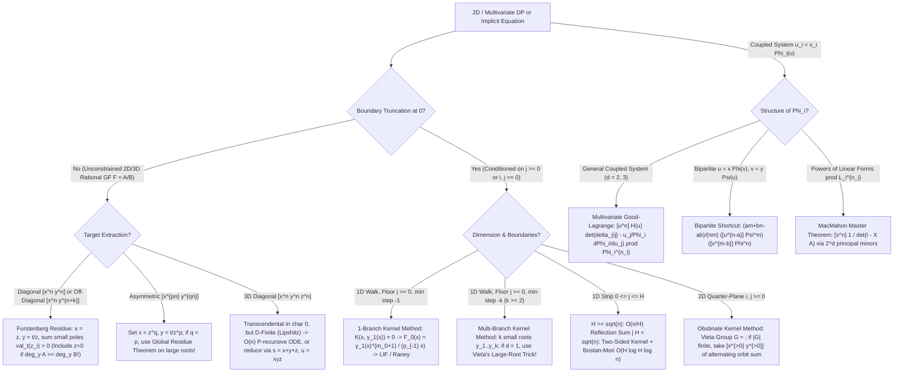

# Cohort 3 Master Synthesis & Reconciliation — Wave 4B: Furstenberg's Theorem, The Kernel Method, and Multivariate Good–Lagrange Inversion (Iterations 36–40 / 88–92 / 109)

> **Document Role**: Phase 1 Cohort 3 (Iteration 109) Cross-Cohort Reconciliation, Blind-Spot Audit, Gap-Hunting, and Master Topic Compilation for the *Formal Power Series & Generating Functions for Competitive Programming* textbook.
> **Synthesized Inputs**:
> 1. **Cohort 1 (Iterations 36–40)**: `fps_research/iter_36_to_40_furstenberg_kernel_good_lagrange.md` (1,335 lines, 18 curated problems, 5 rejected templates)
> 2. **Cohort 2 (Iterations 88–92)**: `fps_research/cohort2_iter_88_to_92_furstenberg_kernel_good_lagrange.md` (1,454 lines, 20 curated problems, 7 rejected templates)
> 3. **Cohort 3 Targeted Gap-Hunting**: Verification of `UOJ 596` (3D Good–Lagrange + placeholder polynomial convolution), `QOJ 6184` / `QOJ 6505` (Bivariate PDE Companion Matrix Divide-and-Conquer), and `Luogu P5827` / `Luogu P5828` (Reverse Lagrange Inversion for Block-Cut & Bridge-Tree Graph Enumeration).
> **Strict Pedagogical Mandate**: Zero magic steps; every non-trivial algebraic manipulation is preceded by an explicit **Diagnostic Signal** and **Reverse-Engineering Scratchpad**; all proofs are self-contained and verified by small-$n$ hand traces ($n \le 4$); strictly `$...$` and `$$...$$` math delimiters throughout.

---

## Section 1: Cross-Cohort Blind-Spot & Coverage Reconciliation Matrix

### 1.1 Structural & Pedagogical Alignment Audit

Both Cohort 1 and Cohort 2 independently converged on the same core mathematical arc (Furstenberg's Diagonal Theorem $\to$ The Kernel Method $\to$ Multivariate Good–Lagrange & MacMahon's Master Theorem $\to$ Multilingual `[EN]`/`[ZH]`/`[JA]` Algorithmic Synthesis $\to$ Master Decision Tree & Problem Bank). However, they compressed the 5 iteration slots slightly differently: both merged single-boundary and multi-branch/quarter-plane Kernel Method into their second section, moved Good–Lagrange to their third section, placed the `[EN]`/`[ZH]`/`[JA]` deep-dive in their fourth section, and placed the problem bank in their fifth section.

In this **Cohort 3 Master Synthesis**, we restore the full 5-iteration granularity while unifying every unique proof, edge case, algorithmic blueprint, and problem from both cohorts:
- **Section 2 (Iteration 36 / 88)**: Furstenberg's Theorem — Algebraic Power Series are Diagonals of Rational Functions
- **Section 3 (Iteration 37 / 89)**: The Kernel Method I — Fundamental Principles, Single-Boundary Reflections & Dual-Boundary Strips
- **Section 4 (Iteration 38 / 90)**: The Kernel Method II — Multiple Small Roots, Vieta / Galois Automorphisms & Quarter-Plane Walks
- **Section 5 (Iteration 39 / 91)**: Multivariate Good–Lagrange Inversion Formula ($\det(I - J)$ Jacobian Factor) & MacMahon's Master Theorem
- **Section 6 (Iteration 40 / 92 — Part A)**: `[EN]` / `[ZH]` / `[JA]` Algorithmic Paradigms, Master Decision Tree & C++ Blueprints
- **Section 7 (Iteration 40 / 92 — Part B)**: Complete Deduplicated & Reconciled Practice Problem Archive (33 Unique Problems across 4 Difficulty Tiers)
- **Section 8**: Merged Rejected Template / Library-Check Problems Table (13 Rejected Problems)
- **Section 9**: Master Deduplicated Multilingual Bibliography (`[EN]`, `[ZH]`, `[JA]`)

### 1.2 Iteration-by-Iteration Blind-Spot & Redundancy Matrix

| Topic Wave / Iteration | Found by **Cohort 1 ONLY** (Cohort 2 Blind Spot) | Found by **Cohort 2 ONLY** (Cohort 1 Blind Spot) | Subtle Discrepancies & Cohort 3 Resolution |
| :--- | :--- | :--- | :--- |
| **Iter 36 / 88: Furstenberg's Theorem & Rational Diagonals** | 1. **Trivariate & $d \ge 3$ Breakdown over $\operatorname{char}(K) = 0$ vs. $\operatorname{char}(K) = p > 0$**: Proved via Stirling asymptotics ($\binom{3n}{n,n,n} \sim \frac{\sqrt{3}}{2\pi n} 27^n$, critical exponent $\alpha = -1 \notin \mathbb{Q} \setminus \mathbb{Z}_{<0}$) that $\operatorname{Diag}\frac{1}{1-x-y-z}$ and Apéry numbers $\operatorname{Diag}\frac{1}{(1-x-y)(1-z)-xyz}$ are **transcendental** over $\mathbb{Q}(t)$, whereas **Lipshitz's Theorem (1988)** guarantees they remain **D-finite (holonomic)** ($O(n)$ P-recursive). Furthermore, over $\mathbb{F}_p$ ($\operatorname{char} p > 0$), Furstenberg's Theorem holds for **all** $d \ge 2$!<br>2. **Off-Diagonal Extraction $[x^n y^{n+k}] F(x,y)$**: Explicit Laurent shift $[z^{-1}]\!\left(\frac{1}{z}\left(\frac{z}{t}\right)^k F(z, t/z)\right)$ showing off-diagonals share the same discriminant $\Delta(t)$ as the main diagonal. | 1. **Worked Example of the Hidden Pole at $z = 0$ When $\deg_y P \ge \deg_y Q$**: Full derivation on $F(x,y) = \frac{x+2y}{1-x-y}$, where $\frac{1}{z}F(z,t/z) = \frac{z^2+2t}{z(-z^2+z-t)}$ has **two** small poles: $z_0 = 0$ (residue $-2$) and $z_+(t) = \frac{1-\sqrt{1-4t}}{2}$ (residue $\frac{3}{2\sqrt{1-4t}}+\frac{1}{2}$).<br>2. **Asymmetric $(p,q)$-Diagonals $[x^{pn} y^{qn}] F(x,y)$ & The Global Residue / Large-Root Shortcut**: Derived $x = z^q, y = t^{1/q}/z^p$ and solved $[x^{2k} y^k]\frac{1}{1-x-y} = \binom{3k}{k}$ via $\frac{z}{-z^3+z^2-t}$; bypassed the $2$ Puiseux small roots $z_{1,2} \sim \pm t^{1/2}$ by taking $-\operatorname{Res}_{z=z_3(t)} = \frac{1}{3z_3(t)-2}$ at the **single large root** $z_3(t) = 1 - w(t)$ ($w(1-w)^2 = t$), staying entirely in $K[[t]]$! | Cohort 1 stated the $z=0$ pole trap qualitatively; Cohort 2 provided the concrete counterexample $F(x,y) = \frac{x+2y}{1-x-y}$. Both are unified in Section 2.4, alongside Cohort 1's off-diagonal shift and Cohort 2's $(p,q)$-diagonal large-root residue shortcut. |
| **Iter 37 / 89: The Kernel Method I (Single Boundary & Strips)** | 1. **Dual-Boundary Walks in a Bounded Strip ($0 \le j \le H$)**: Contrasted Repeated Reflection Inclusion-Exclusion ($\sum_{k \in \mathbb{Z}} \left(\binom{n}{\frac{n+b-a}{2}+k(H+2)} - \binom{n}{\frac{n+b+a+2}{2}+k(H+2)}\right)$ in $O(n/H)$ time) with the **Two-Sided Kernel Method**: because $F(x,y) = \sum_{j=0}^H F_j(x) y^j$ is a *finite polynomial* in $y$, its radius of convergence in $y$ is $\infty$, making it legal to plug in **both** the small root $y_0(x)$ and the large root $y_1(x) = y_0(x)^{-1}$ to solve the $2 \times 2$ linear system for $F_0(x)$ and $F_H(x)$ in $O(H \log H \log n)$ via Bostan–Mori!<br>2. **Reversed-Walk Absorbing Kernel (`CF 1810G`)**: Operator formulation $y \mapsto \frac{F(y)-F(0)}{y} + F(0)$ for maximum prefix sums. | 1. **Raney's Lemma Bridge (`Luogu P6672`)**: Proved why Raney's cyclic shift lemma on Łukasiewicz paths holds if and only if the negative step bound is $k = 1$ (only $1$ small branch $y_1(x)$), and fails for $k \ge 2$ because paths can jump over $-1$ directly to $-2$. | Cohort 1 excelled on bounded strips ($0 \le j \le H$) and dual-regime crossover ($H \ll \sqrt{n}$ vs. $H \gg \sqrt{n}$); Cohort 2 excelled on connecting $k=1$ Kernel Method to Raney's Lemma and cyclic shifts. Both are synthesized in Section 3. |
| **Iter 38 / 90: The Kernel Method II (Multi-Branch & Quarter-Plane)** | 1. **Explicit Group Law & Galois Invariance Presentation**: Clear geometric interpretation of the bi-quadratic curve $K(x,y) = A_2(x)y^2 + A_1(x)y + A_0(x) = \tilde{A}_2(y)x^2 + \tilde{A}_1(y)x + \tilde{A}_0(y) = 0$ as a correspondence between horizontal and vertical hyperbolas on the algebraic curve. | 1. **Complete Worked Example of $k=2, d=1$ Multi-Branch Kernel via Vieta's Large-Root Trick**: Full derivation for step set $\{+1, -2\}$ ($K(x,y) = y^2 - x(y^3+1) = 0$): bypassed fractional Puiseux roots $y_1, y_2 \sim \pm x^{1/2}$ by expressing $y_1 y_2 = -1/Y_3 = -u(x)$ and $y_1 + y_2 = u(x)^2$ via the single large root $Y_3(x) = 1/u(x)$ satisfying $u = x(1+u^3)$, yielding $F_0(x) = 1 + u(x)^3$ and $F_1(x) = u(x)^2/x$.<br>2. **Initial Altitude $m_0 > 0$ via Lagrange Interpolation**: Showed that when $m_0 > 0$, $\deg_y R(x,y) = k + m_0 > k$, so the boundary polynomial is determined by Lagrange interpolation of $y^{k+m_0}$ at $y_1(x), \dots, y_k(x)$.<br>3. **Complete Worked Orbit Sums for Quarter-Plane Walks**: Full Klein 4-group orbit sum for $\mathcal{S} = \{(\pm 1, \pm 1)\}$ ($Q_{0,0}(2n) = C_n^2$) and 6-element $D_3$ orbit sum for Tandem/Kreweras walks. | Cohort 1 stated the $k$-small-root determinants and quarter-plane orbit sum in general form; Cohort 2 provided the complete algebraic elimination traces for $\{+1, -2\}$ (Vieta large-root trick), initial altitude $m_0 > 0$, and the 4-term / 6-term orbit sums. All are unified in Section 4. |
| **Iter 39 / 91: Multivariate Good–Lagrange & MacMahon Master Theorem** | 1. **Full 3-Parameter Dixon Identity**: Proved $\sum_k (-1)^k \binom{a+b}{a+k}\binom{b+c}{b+k}\binom{c+a}{c+k} = \frac{(a+b+c)!}{a!b!c!}$ for arbitrary $(a,b,c)$ via $[x^{b+c} y^{c+a} z^{a+b}] \frac{1}{1+xy+yz+zx}$.<br>2. **Characteristic $p$ Validity of Form 1**: Emphasized that the determinant residue form $[u^{\mathbf{n}}] H(\mathbf{u}) \det J(\mathbf{u}) \prod \Phi_k^{n_k}$ has no division by $n_i$ and remains valid over $\mathbb{F}_p$ even when $p \mid n_i$. | 1. **Form 2 (Inverse Jacobian Form)**: Derived $[x_1^{n_1}\cdots x_d^{n_d}] \frac{H(\mathbf{u})}{\det J(\mathbf{u})} = [u_1^{n_1}\cdots u_d^{n_d}] H(\mathbf{u}) \prod_{i=1}^d \Phi_i(\mathbf{u})^{n_i}$, which avoids computing $\det J(\mathbf{u})$ when the target expression already incorporates the Jacobian.<br>2. **Universal Bipartite Good–Lagrange Shortcut Formula**: For $u = x \Phi(v), v = y \Psi(u)$, derived $[x^n y^m](u^a v^b) = \frac{am + bn - ab}{nm} ([u^{n-a}]\Psi(u)^m)([v^{m-b}]\Phi(v)^n)$.<br>3. **Gessel's (1987) Combinatorial Proof of $\det J(\mathbf{u})$**: Directed functional graph cycle cancellation leaving rooted multi-type forests. | Cohort 1 proved the general $(a,b,c)$ Dixon identity while Cohort 2 only proved the symmetric $a=b=c=n$ case; conversely, Cohort 2 derived the bipartite tree shortcut and Gessel's combinatorial interpretation of $\det J$. Both are combined in Section 5. |
| **Iter 40 / 92: `[EN]`/`[ZH]`/`[JA]` Algorithmic Synthesis & Blueprints** | 1. **Reverse Lagrange Inversion for Block-Cut & Bridge-Tree Graph Enumeration (`command_block` / OI-Wiki)**: Derived $n![u^n]B(u) = -(n-2)! [x^{n-1}] (x/R(x))^{n-1}$ for vertex-biconnected graphs (`Luogu P5827`) and $n![u^n]B(u) = (n-1)! [x^n] (R(x)(1+xR'(x))e^{-nR(x)})$ for 2-edge-connected graphs (`Luogu P5828`), plus full C++ code for $O(n \log n)$ ODE power `poly_pow_ode`. | 1. **Full $n=4$ Toy Trace of Kinoshita–Li Bivariate Bostan–Mori `PowerProjection`**: Complete hand-trace on $f(x) = x+x^2, g(x) = 1+2x+3x^2+4x^3$, plus `noshi91`'s invariant $Q_k(0, y) = 1$ (zero polynomial inversions needed at base case $n=1$).<br>2. **Bivariate PDE Matrix Product (`maspypy` & `Elegia`)**: Derived $a(x) \partial_x H(x, z) = z b(x) H(x, z)$ for $H(x, z) = \exp(z g(x))$ when $g'(x) = b(x)/a(x)$, reducing $[x^n] \exp(z g(x))$ to a $d \times d$ polynomial companion matrix product tree in $O(d^3 n \log^2 n)$ time. | Combining Cohort 1's Block-Cut/Bridge-Tree Reverse LIF & `poly_pow_ode` with Cohort 2's Kinoshita–Li `PowerProjection` trace and Bivariate PDE Companion Matrix tree yields the complete toolkit of modern Chinese (` Elegia`, `command_block`, `jly`) and Japanese (`noshi91`, `maspypy`, `kinoshita_li`) multivariate FPS algorithms. |

### 1.3 Practice Problem Bank Reconciliation Summary

- **Cohort 1 Accepted Problems**: 18 problems
- **Cohort 2 Accepted Problems**: 20 problems
- **Overlapping Problems Found in Both Cohorts (5 problems)**:
  1. `AtCoder ABC 222 H` — Beautiful Binary Tree (Cohort 1 #5 & Cohort 2 #1)
  2. `Codeforces 1349F2` — Slime and Sequences (Hard Version) (Cohort 1 #15 & Cohort 2 #6)
  3. `AtCoder AGC 058 D` — Yet Another ABC String (Cohort 1 #16 & Cohort 2 #9)
  4. `HDU 4656` / `LOJ 6570` — Fun with Sequences / MacMahon Master Theorem (Cohort 1 #17 & Cohort 2 #10)
  5. `Codeforces Gym 102586J` / `QOJ` — Kreweras / Tandem Quarter-Plane Excursions (Cohort 1 #13 & Cohort 2 #16)
- **Total Unique Accepted Problems Synthesized in Section 7**: **$18 + 20 - 5 = 33$ problems** (8 Tier 1 `Stepping Stone`, 8 Tier 2 `Intermediate`, 9 Tier 3 `Advanced`, 8 Tier 4 `Mastery`), with every single problem retaining its complete self-contained mathematical statement, constraints, source link, 3-tier hints, and full derivation.
- **Total Unique Rejected Template Problems in Section 8**: **$5 + 10 - 2 = 13$ rejected problems**.

---

## Section 2 (Iteration 36 / 88): Furstenberg's Theorem — Algebraic Power Series are Diagonals of Rational Functions

### 2.1 Motivation & Diagnostic Signals: Why Unify Algebraic Functions and Multivariate Rational Functions?

In competitive programming and enumerative combinatorics, two seemingly distinct classes of generating functions constantly collide:
1. **Univariate Algebraic Power Series**: A formal power series $f(t) = \sum_{n=0}^{\infty} a_n t^n \in K[[t]]$ that satisfies a non-trivial polynomial equation
   $$P(t, f(t)) = \sum_{i=0}^{d} p_i(t) f(t)^i = 0, \qquad p_i(t) \in K[t], \quad P \not\equiv 0.$$
   Classic examples include the Catalan OGF $C(t) = \frac{1-\sqrt{1-4t}}{2t}$ (satisfying $t C(t)^2 - C(t) + 1 = 0$), the central binomial OGF $(1-4t)^{-1/2}$ (satisfying $(1-4t)f(t)^2 - 1 = 0$), and $k$-ary tree OGFs $T(t) = 1 + t T(t)^k$.
2. **Diagonals of Bivariate Rational Functions**: Given a bivariate formal power series $F(x, y) = \sum_{n, m \ge 0} c_{n, m} x^n y^m = \frac{A(x,y)}{B(x,y)} \in K[[x, y]]$ with $B(0,0) \neq 0$, its **main diagonal** is the univariate series that extracts the $n=m$ coefficients:
   $$\operatorname{Diag} F(x, y) := \sum_{n=0}^{\infty} c_{n, n} t^n = \sum_{n=0}^{\infty} \left([x^n y^n] F(x, y)\right) t^n \in K[[t]].$$
   Classic examples include 2D lattice path enumerations ending on the diagonal $x=y$, such as central binomial coefficients $[x^n y^n]\frac{1}{1-x-y} = \binom{2n}{n}$ and Central Delannoy numbers $[x^n y^n]\frac{1}{1-x-y-xy}$.

> **Diagnostic Signal — When to Invoke Furstenberg's Theorem**:
> - **Direction A (2D Rational DP $\to$ 1D Algebraic GF $\to$ $O(n)$ Recurrence)**: You have a 2D DP with constant-coefficient transitions $c_{n,m} = \sum_{(i,j) \in \mathcal{S}} w_{i,j} c_{n-i, m-j}$ (no boundary restrictions!) and need the diagonal entry $c_{n,n}$ (or off-diagonal $c_{n, n+k}$, or asymmetric diagonal $c_{pn, qn}$) for $n \le 10^7$. Instead of computing the $O(n^2)$ table, write the rational GF $F(x,y) = \frac{A(x,y)}{B(x,y)}$, substitute $x = z, y = t/z$, and extract $[z^{-1}] \frac{1}{z} F(z, t/z)$ via Cauchy's Residue Theorem over the small roots of $B(z, t/z) = 0$. This collapses the 2D problem to a 1D algebraic GF, which is D-finite and yields an $O(n)$ three-term recurrence (`AtCoder KUPC 2019 K`, `CF 755G`, `Yukicoder 2104`).
> - **Direction B (1D Implicit Algebraic Equation $\to$ Explicit Coefficient Extraction)**: You have an implicit polynomial equation $P(t, f(t)) = 0$ where $f(0) = 0$ and $\frac{\partial P}{\partial y}(0,0) \neq 0$, and you cannot solve it via standard Lagrange Inversion because $t$ appears with degree $\ge 2$ in $P(t, y)$ (so it cannot be written as $y = t \Phi(y)$). Furstenberg's rational-integral formula lifts $f(t)$ to the diagonal of $\frac{y^2 P_y(xy, y)}{P(xy, y)}$, reducing $[t^n] f(t)$ to $[x^n y^n]$.

---

### 2.2 Direction 1 (Forward Construction): Every Algebraic Power Series is the Diagonal of a Bivariate Rational Function

Let $K$ be any field (of characteristic $0$ or $p > 0$). Suppose $f(t) = \sum_{n=1}^{\infty} a_n t^n \in t K[[t]]$ is an algebraic power series with zero constant term ($f(0) = 0$). (If $f(0) = a_0 \neq 0$, we replace $f(t)$ by $\tilde{f}(t) = f(t) - a_0$, and add $a_0$ back at the end via $\operatorname{Diag}\left(a_0 + F(x,y)\right) = a_0 + \operatorname{Diag} F(x,y)$.)

#### Reverse-Engineering Scratchpad (Where Does $\frac{y^2 P_y(xy, y)}{P(xy, y)}$ Come From?)

Suppose $P(t, y) \in K[t, y]$ is a polynomial satisfied by $y = f(t)$, i.e., $P(t, f(t)) = 0$.
1. **Why do we assume $P_y(0,0) \neq 0$?**
   If $P(t, f(t)) = 0$ is a minimal polynomial for $f(t)$ and $P_y(0, f(t)) = 0$ at $t = 0$, we can divide $P(t, f(t))$ by the highest power $t^r$ dividing all coefficients, or replace $f(t)$ by $f(t) = a_1 t + \dots + a_k t^k + t^k g(t)$ (Hensel's Lemma / Newton Polygon deflation). Once $f(t)$ is shifted by its first $k$ terms and divided by $t^k$, the new series $g(t)$ satisfies a polynomial $\tilde{P}(t, g(t)) = 0$ with $\tilde{P}(0,0) = 0$ and $\frac{\partial \tilde{P}}{\partial y}(0,0) \neq 0$. Thus, up to a finite polynomial prefix, every algebraic power series over a field of characteristic $0$ (and every separable one in characteristic $p$) satisfies $P(0,0) = 0$ and $P_y(0,0) \neq 0$.
2. **How do we turn a root $y = f(t)$ into a coefficient extraction?**
   In complex analysis (and formal Laurent series $K[[t]]((y))$), if a function $G(t, y)$ has a simple zero at $y = f(t)$, then by the Logarithmic Derivative / Argument Principle, the logarithmic derivative $\frac{\partial_y G(t, y)}{G(t, y)}$ has a **simple pole** at $y = f(t)$ with residue $1$!
   Multiplying by $y$ gives $\frac{y \partial_y G(t, y)}{G(t, y)}$, whose residue at $y = f(t)$ is $f(t)$ itself!
3. **Why can't we just take $[y^{-1}] \frac{y P_y(t, y)}{P(t, y)}$ directly in $K[[t, y]]$?**
   Because $\frac{1}{P(t, y)}$ has $P(0,0) = 0$, so it cannot be expanded as a power series in $K[[t, y]]$! Furthermore, to expand $\frac{1}{P(t, y)}$ as a Laurent series converging around $y = f(t)$ where $|t| \ll |y| \ll 1$, we need powers of $\frac{t}{y}$, which involve negative powers of $y$.
4. **The Homogenization / Blow-Up Trick ($t = xy$)**:
   How do we turn the ratio $\frac{t}{y}$ into a legitimate formal power series variable with non-negative exponents?
   Set $t = x y$, so that $\frac{t}{y} = x$!
   Under the substitution $t = x y$, extracting the diagonal $[x^n y^n]$ of a bivariate series $F(x, y)$ is identical to setting $x = t/y$ and extracting $[y^0] F(t/y, y)$:
   $$[x^n y^n] F(x, y) = [t^n y^0] F(t/y, y) = [t^n y^{-1}] \frac{1}{y} F(t/y, y).$$

Let us now turn this scratchpad insight into a rigorous formal proof.

#### Theorem 2.1 (Furstenberg's Rational-to-Algebraic Lift, 1967)
Let $P(t, y) \in K[t, y]$ be a polynomial such that $P(0, 0) = 0$ and $c := \frac{\partial P}{\partial y}(0, 0) \neq 0$. Let $f(t) \in t K[[t]]$ be the unique formal power series solution to $P(t, f(t)) = 0$ with $f(0) = 0$. Define the bivariate rational function:
$$F(x, y) := \frac{y^2 \frac{\partial P}{\partial y}(x y, y)}{P(x y, y)}.$$
Then $F(x, y)$ is a well-defined formal power series in $K[[x, y]]$, and its main diagonal is $f(t)$:
$$\operatorname{Diag} F(x, y) = \sum_{n=0}^{\infty} \left([x^n y^n] F(x, y)\right) t^n = f(t).$$

#### Complete Formal Proof (Factoring in $K[[t]][[y]]$ Without Complex Analysis)
1. **Well-Definedness in $K[[x, y]]$**:
   Let us expand $P(t, y)$ around $(0,0)$. Since $P(0,0) = 0$ and $\frac{\partial P}{\partial y}(0,0) = c \neq 0$, we can write:
   $$P(t, y) = c y + a t + \sum_{i + j \ge 2} p_{i, j} t^i y^j.$$
   Substitute $t = x y$:
   $$P(x y, y) = c y + a x y + \sum_{i + j \ge 2} p_{i, j} x^i y^{i+j} = y \left( c + a x + \sum_{i + j \ge 2} p_{i, j} x^i y^{i+j-1} \right).$$
   Notice that since $i + j \ge 2$, the exponent $i + j - 1 \ge 1$ is strictly positive! Let $Q(x, y) := c + a x + \sum_{i+j \ge 2} p_{i, j} x^i y^{i+j-1} \in K[x, y]$. Then:
   $$P(x y, y) = y Q(x, y), \qquad Q(0, 0) = c \neq 0.$$
   Crucially, the denominator $P(x y, y)$ has an overall factor of $y$, which is why the numerator of $F(x, y)$ includes $y^2$: one $y$ cancels the factor of $y$ in $P(x y, y) = y Q(x, y)$, leaving:
   $$F(x, y) = \frac{y \frac{\partial P}{\partial y}(x y, y)}{Q(x, y)}.$$
   Since $Q(0, 0) = c \neq 0$, $Q(x, y)$ is invertible in the formal power series ring $K[[x, y]]$. Therefore, $F(x, y) \in K[[x, y]]$ is a completely valid formal power series with no negative powers of $x$ or $y$!

2. **Factorization of $P(t, y)$ in $K[[t]][y]$**:
   Because $P(t, f(t)) = 0$ in $K[[t]]$, viewing $P(t, y)$ as a polynomial in $y$ over the ring $K[[t]]$, the Factor Theorem guarantees that $(y - f(t))$ divides $P(t, y)$:
   $$P(t, y) = (y - f(t)) R(t, y), \qquad R(t, y) \in K[[t]][y].$$
   Let us check the constant term of $R(t, y)$ at $t = 0, y = 0$: differentiating $P(t, y) = (y - f(t)) R(t, y)$ with respect to $y$ gives:
   $$\frac{\partial P}{\partial y}(t, y) = R(t, y) + (y - f(t)) \frac{\partial R}{\partial y}(t, y).$$
   Evaluating at $(t, y) = (0, 0)$ (where $f(0) = 0$) gives $R(0, 0) = \frac{\partial P}{\partial y}(0, 0) = c \neq 0$. Thus, $R(t, y)$ is an invertible unit in the formal power series ring $K[[t, y]]$!

3. **Diagonal Extraction via $x = t / y$**:
   In the ring $K[[x, y]]$, a monomial $x^n y^m$ lies on the main diagonal ($n = m$) if and only if, under the substitution $x = t/y$ (mapping $x^n y^m \mapsto t^n y^{m-n}$), the exponent of $y$ is $0$:
   $$\operatorname{Diag} F(x, y) = [y^0] F(t/y, y) = [y^0] \frac{y^2 \frac{\partial P}{\partial y}(t, y)}{P(t, y)}.$$
   Caution: where does $F(t/y, y)$ live? In $F(x, y)$, every term $x^n y^m$ arising from $P(x y, y) = y Q(x, y)$ has $m \ge n$ because $t = x y$ always introduces at least as many $y$'s as $x$'s! Specifically, let us substitute $P(t, y) = (y - f(t)) R(t, y)$ and $\frac{\partial P}{\partial y}(t, y) = R(t, y) + (y - f(t)) \frac{\partial R}{\partial y}(t, y)$ into $F(t/y, y)$:
   $$F(t/y, y) = \frac{y^2 \left( R(t, y) + (y - f(t)) \frac{\partial R}{\partial y}(t, y) \right)}{(y - f(t)) R(t, y)} = \frac{y^2}{y - f(t)} + y^2 \frac{\frac{\partial R}{\partial y}(t, y)}{R(t, y)}.$$
   Let us examine both pieces carefully in the Laurent ring $K[[t]]((y^{-1}))$ (specifically, how $\frac{y^2}{y - f(t)}$ is expanded when $x = t/y$ comes from $K[[x, y]]$):
   In $K[[x, y]]$, $x$ and $y$ have positive valuation. When we set $t = x y$, we have $\frac{f(t)}{y} = \frac{a_1 t + a_2 t^2 + \dots}{y} = a_1 x + a_2 x^2 y + a_3 x^3 y^2 + \dots \in x K[[x, y]]$.
   Therefore, in $K[[x, y]]$, the term $\frac{y^2}{y - f(t)}$ is expanded as a geometric series in $\frac{f(t)}{y} = O(x)$:
   $$\frac{y^2}{y - f(t)} = \frac{y}{1 - \frac{f(t)}{y}} = y \sum_{k=0}^{\infty} \left(\frac{f(t)}{y}\right)^k = y + f(t) + \frac{f(t)^2}{y} + \frac{f(t)^3}{y^2} + \dots$$
   Look at the powers of $y$ in this expansion (since $f(t) \in K[[t]]$ depends only on $t$, not $y$):
   - The $k = 0$ term is $y^1$, which has degree $+1$ in $y$.
   - The $k = 1$ term is $f(t) y^0$, which has degree $0$ in $y$!
   - All terms with $k \ge 2$ are $f(t)^k y^{1-k}$, which have strictly **negative** degree $1 - k \le -1$ in $y$.
   Meanwhile, what about the second piece $y^2 \frac{\partial_y R(t, y)}{R(t, y)}$? Since $R(0, 0) = c \neq 0$, $\frac{\partial_y R(t, y)}{R(t, y)} \in K[[t, y]]$ contains only non-negative powers of $t$ and $y$ ($y^0, y^1, y^2, \dots$). Multiplying by $y^2$ means every term in $y^2 \frac{\partial_y R(t, y)}{R(t, y)}$ has degree at least $+2$ in $y$ ($y^2, y^3, \dots$)!
   Consequently, when we extract the coefficient $[y^0]$ of $F(t/y, y)$:
   $$[y^0] F(t/y, y) = [y^0] \left( y + f(t) + \sum_{k=2}^{\infty} f(t)^k y^{1-k} + y^2 \frac{\partial_y R(t, y)}{R(t, y)} \right) = f(t) + 0 = f(t).$$
   This completes the proof over **any** field $K$ (including $\operatorname{char}(K) = p > 0$). $\blacksquare$

---

#### Worked Example 2.1 & Small-$n$ Trace Table: Lifting the Catalan OGF to a Bivariate Rational Diagonal

Let us verify Theorem 2.1 on the shifted Catalan numbers $f(t) = C(t) - 1 = \sum_{n=1}^{\infty} C_n t^n = t + 2t^2 + 5t^3 + 14t^4 + \dots$, where $C(t) = 1 + f(t)$ satisfies $C(t) = 1 + t C(t)^2$, so $f(t)$ satisfies:
$$P(t, y) = t (1 + y)^2 - y = t y^2 + (2t - 1) y + t = 0.$$
Let us check the hypotheses of Theorem 2.1:
- $P(0, 0) = 0$.
- $\frac{\partial P}{\partial y}(t, y) = 2 t (1 + y) - 1$, so $\frac{\partial P}{\partial y}(0, 0) = -1 \neq 0$.

Now apply Furstenberg's formula with $t = x y$:
$$P(x y, y) = x y (1 + y)^2 - y = y \left( x (1 + y)^2 - 1 \right),$$
$$\frac{\partial P}{\partial y}(x y, y) = 2 x y (1 + y) - 1.$$
Therefore:
$$F(x, y) = \frac{y^2 \frac{\partial P}{\partial y}(x y, y)}{P(x y, y)} = \frac{y (2 x y (1 + y) - 1)}{x (1 + y)^2 - 1} = \frac{y - 2 x y^2 (1 + y)}{1 - x (1 + y)^2}.$$
Let us expand $F(x, y) = \left(y - 2 x y^2 - 2 x y^3\right) \sum_{k=0}^{\infty} x^k (1 + y)^{2k}$ for $n = 0, 1, 2, 3, 4$ and trace the diagonal $[x^n y^n] F(x, y)$:

| $n$ | $[x^n] F(x, y)$ (as a polynomial in $y$) | Coefficient of $y^n$ ($[x^n y^n] F(x,y)$) | Catalan Number $C_n$ ($n \ge 1$) |
| :--- | :--- | :--- | :--- |
| $n = 0$ | $y$ | $[y^0](y) = \mathbf{0}$ | $f(0) = 0$ |
| $n = 1$ | $y(1+y)^2 - 2y^2(1+y) = y + 2y^2 + y^3 - 2y^2 - 2y^3 = \mathbf{1}y - y^3$ | $[y^1](y - y^3) = \mathbf{1}$ | $C_1 = 1$ |
| $n = 2$ | $y(1+y)^4 - 2y^2(1+y)^3 = y(1+y)^3(1+y-2y) = y(1-y^2)(1+y)^2 = y + \mathbf{2}y^2 - 2y^4 - y^5$ | $[y^2] = \mathbf{2}$ | $C_2 = 2$ |
| $n = 3$ | $y(1-y)(1+y)^5 = y(1-y^2)(1+4y+6y^2+4y^3+y^4) = y + 4y^2 + \mathbf{5}y^3 - 5y^5 - 4y^6 - y^7$ | $[y^3] = \mathbf{5}$ | $C_3 = 5$ |
| $n = 4$ | $y(1-y)(1+y)^7 = y(1-y^2)(1+6y+15y^2+20y^3+\dots) = y + 6y^2 + 14y^3 + \mathbf{14}y^4 + \dots$ | $[y^4] = \mathbf{14}$ | $C_4 = 14$ |

Notice the algebraic simplification inside $[x^n] F(x, y)$ for $n \ge 1$:
$$[x^n] F(x, y) = y(1+y)^{2n} - 2y^2(1+y)^{2n-1} = y(1+y)^{2n-1}(1 - y),$$
so $[x^n y^n] F(x, y) = [y^{n-1}] (1-y)(1+y)^{2n-1} = \binom{2n-1}{n-1} - \binom{2n-1}{n-2} = \frac{1}{n+1}\binom{2n}{n} = C_n$!

---

### 2.3 Direction 2 (Reverse Extraction): Every Diagonal of a Bivariate Rational Function is Algebraic

Now we prove the converse, which is the workhorse direction in competitive programming: given $F(x, y) = \frac{A(x, y)}{B(x, y)} \in K[[x, y]]$ with $B(0, 0) \neq 0$, how do we compute $\operatorname{Diag} F(x, y)$ in closed algebraic form?

#### Reverse-Engineering Scratchpad (Contour Integration vs. Formal Puiseux Residues)

Suppose we want $d_n = [x^n y^n] F(x, y)$.
1. **Why substitute $x = z$ and $y = t / z$?**
   For any monomial $x^n y^m$, substituting $x = z$ and $y = t / z$ gives:
   $$x^n y^m \longmapsto z^n \left(\frac{t}{z}\right)^m = t^m z^{n - m}.$$
   Therefore, the diagonal terms ($n = m$) are precisely the terms where the exponent of $z$ is $n - m = 0$!
   To convert $[z^0]$ into a formal residue $[z^{-1}]$ (which satisfies the Cauchy Residue / Partial Fractions theorem), we divide by $z$:
   $$\operatorname{Diag} F(x, y) = [z^0] F(z, t/z) = [z^{-1}] \left( \frac{1}{z} F\left(z, \frac{t}{z}\right) \right).$$
2. **Why does $F(z, t/z)$ live in the formal ring $K((z))[[t]]$, and which poles of $\frac{1}{z} F(z, t/z)$ contribute to the residue $[z^{-1}]$?**
   Before expanding any partial fractions, we must specify the exact formal Laurent ring in which $F(z, t/z)$ is defined:
   - Write $F(x, y) = \sum_{n, m \ge 0} c_{n, m} x^n y^m \in K[[x, y]]$. Under $x = z, y = t/z$, each term becomes $c_{n, m} z^{n-m} t^m$.
   - Notice that the exponent of $t$ is $m \ge 0$ (non-negative!), and for each **fixed** $m \ge 0$, since $n \ge 0$, the exponent of $z$ is $n - m \ge -m$, which is **bounded below by $-m$**!
   - Therefore, collecting terms by powers of $t$ gives $F(z, t/z) = \sum_{m=0}^{\infty} t^m \left(\sum_{n=0}^{\infty} c_{n, m} z^{n-m}\right)$, where the coefficient of $t^m$ is a formal Laurent series in $z^{-m} K[[z]] \subset K((z))$. Thus $F(z, t/z)$ is a well-defined element of **$K((z))[[t]]$** (formal power series in $t$ with coefficients in the Laurent series field $K((z))$)! By contrast, $F(z, t/z)$ does *not* live in $K[[z, t]]$ (since $n - m$ can be negative when $m > n$) and does *not* live in $K((t))((z))$ (since across all $m \ge 0$, $n - m$ is not bounded below).
   Now let us look at the two series expansions of $\frac{1}{z - z_i(t)}$ compatible with $K((z))[[t]]$:
   - **Case 1 ("Small Root" / "Small Pole" $z_i(t) \to 0$ as $t \to 0$, i.e., $\operatorname{val}_t(z_i(t)) > 0$)**:
     Since $z_i(t)$ is divisible by a positive power of $t$, in the Laurent ring $K((z))[[t]]$ (where we expand in positive powers of $t$ first), we MUST factor out $z$ from the denominator:
     $$\frac{1}{z - z_i(t)} = \frac{1}{z \left(1 - \frac{z_i(t)}{z}\right)} = \sum_{k=0}^{\infty} z_i(t)^k z^{-k-1} = \mathbf{1} \cdot z^{-1} + z_i(t) z^{-2} + z_i(t)^2 z^{-3} + \dots$$
     Look at the coefficient of $z^{-1}$: it is **$1$**! Every small pole $z_i(t)$ contributes its full Cauchy residue $\operatorname{Res}_{z = z_i(t)} \left(\frac{1}{z} F(z, t/z)\right)$ to $[z^{-1}]$!
   - **Case 2 ("Large Root" / "Large Pole" $z_j(t) \not\to 0$ as $t \to 0$, i.e., $\operatorname{val}_t(z_j(t)) \le 0$)**:
     Since $z_j(t)$ has a non-zero constant term (or negative valuation in $t$), in $K((z))[[t]]$ we MUST factor out $-z_j(t)$ from the denominator so that powers of $t$ in the denominator stay bounded below:
     $$\frac{1}{z - z_j(t)} = -\frac{1}{z_j(t) \left(1 - \frac{z}{z_j(t)}\right)} = -\sum_{k=0}^{\infty} z_j(t)^{-k-1} z^k = -z_j(t)^{-1} z^0 - z_j(t)^{-2} z^1 - \dots$$
     Notice that this expansion contains **only non-negative powers of $z$** ($z^0, z^1, z^2, \dots$)! Its coefficient of $z^{-1}$ is **identically zero**!

This distinction between **small poles** ($\operatorname{val}_t > 0$, expanded in $z^{-1}$, contributing to $[z^{-1}]$) and **large poles** ($\operatorname{val}_t \le 0$, expanded in $z^0, z^1, \dots$, contributing $0$ to $[z^{-1}]$) is the single most important principle in multivariate generating functions.

#### Theorem 2.2 (Converse Furstenberg Theorem via Small-Pole Residue Extraction)
Let $K$ be a field of characteristic $0$, and let $F(x, y) = \frac{A(x, y)}{B(x, y)} \in K(x, y) \cap K[[x, y]]$ with $B(0, 0) \neq 0$. Define the rational function in $z$ over the field $K(t)$:
$$G(z; t) := \frac{1}{z} F\left(z, \frac{t}{z}\right) = \frac{z^{d_B - d_A - 1} \tilde{A}(z, t)}{\tilde{B}(z, t)},$$
where $d_A = \deg_y A, d_B = \deg_y B$, $\tilde{A}(z, t) = z^{d_A} A(z, t/z) \in K[z, t]$, and $\tilde{B}(z, t) = z^{d_B} B(z, t/z) \in K[z, t]$.
Let $z_1(t), \dots, z_r(t)$ be the roots of the denominator of $G(z; t)$ in the algebraic closure $\overline{K((t))}$ (Puiseux series field) that are **small**, i.e., satisfy $\lim_{t \to 0} z_i(t) = 0$ ($\operatorname{val}_t(z_i(t)) > 0$). Note that if $d_A + 1 > d_B$, then $z = 0$ is also a small pole ($\operatorname{val}_t(0) = +\infty > 0$).
Then:
$$\operatorname{Diag} F(x, y) = [z^{-1}] G(z; t) = \sum_{\substack{z_i(t) \text{ pole of } G \\ \operatorname{val}_t(z_i(t)) > 0}} \operatorname{Res}_{z = z_i(t)} G(z; t).$$
In particular, since each $z_i(t)$ is algebraic over $K(t)$ and the sum is invariant under the Galois group of $\tilde{B}(z, t)$ (which permutes small roots among themselves because Galois automorphisms over $K((t))$ preserve $t$-adic valuation!), $\operatorname{Diag} F(x, y)$ belongs to $K[[t]]$ and is **algebraic over $K(t)$**.

#### Proof
Over the algebraically closed field $\mathcal{L} = \overline{K((t))} = \bigcup_{m \ge 1} \overline{K}((t^{1/m}))$, decompose $G(z; t)$ into partial fractions in $z$:
$$G(z; t) = P_{\text{poly}}(z; t) + \sum_{i=1}^{M} \sum_{j=1}^{m_i} \frac{c_{i, j}(t)}{(z - z_i(t))^j},$$
where $P_{\text{poly}}(z; t) \in \mathcal{L}[z]$ is a polynomial in $z$, and $z_1(t), \dots, z_M(t) \in \mathcal{L}$ are the distinct poles of $G(z; t)$.
Now expand each partial fraction term in the domain corresponding to $F(x, y) \in K[[x, y]]$ where $x = z$ and $y = t/z$ are both small ($\operatorname{val}_t(t) = 1$, and we treat $z$ as separating positive valuations $\operatorname{val}_t(z_i) > 0$ from non-positive valuations $\operatorname{val}_t(z_i) \le 0$):
1. The polynomial part $P_{\text{poly}}(z; t)$ has only non-negative powers $z^0, z^1, \dots$, so $[z^{-1}] P_{\text{poly}}(z; t) = 0$.
2. For each **large pole** $z_i(t)$ ($\operatorname{val}_t(z_i(t)) \le 0$), expanding $(z - z_i(t))^{-j} = (-z_i(t))^{-j} (1 - z/z_i(t))^{-j}$ yields a power series in $z^0, z^1, z^2, \dots$ whose coefficients converge $t$-adically because $\operatorname{val}_t(z_i(t)^{-1}) \ge 0$. Thus $[z^{-1}] (z - z_i(t))^{-j} = 0$ for all $j \ge 1$.
3. For each **small pole** $z_i(t)$ ($\operatorname{val}_t(z_i(t)) > 0$), expanding $(z - z_i(t))^{-j} = z^{-j} (1 - z_i(t)/z)^{-j} = \sum_{k=0}^{\infty} \binom{j+k-1}{k} z_i(t)^k z^{-j-k}$ yields a series in negative powers of $z$ whose coefficients converge $t$-adically because $\operatorname{val}_t(z_i(t)) > 0$. Notice that:
   - If $j \ge 2$, the highest power of $z$ in $(z - z_i(t))^{-j}$ is $z^{-j} \le z^{-2}$, so $[z^{-1}] (z - z_i(t))^{-j} = 0$!
   - If $j = 1$, $[z^{-1}] (z - z_i(t))^{-1} = 1$.
Therefore, only the $j = 1$ coefficients $c_{i, 1}(t) = \operatorname{Res}_{z = z_i(t)} G(z; t)$ at the **small poles** $\operatorname{val}_t(z_i(t)) > 0$ survive:
$$[z^{-1}] G(z; t) = \sum_{\operatorname{val}_t(z_i(t)) > 0} c_{i, 1}(t) = \sum_{\operatorname{val}_t(z_i(t)) > 0} \operatorname{Res}_{z = z_i(t)} G(z; t).$$
When a small pole $z_i(t)$ is a **simple root** of the denominator $Q(z, t)$ of $G(z; t) = \frac{P(z, t)}{Q(z, t)}$, L'Hôpital's / residue rule gives:
$$\operatorname{Res}_{z = z_i(t)} \frac{P(z, t)}{Q(z, t)} = \frac{P(z_i(t), t)}{\frac{\partial Q}{\partial z}(z_i(t), t)}.$$
Since algebraic elements over $K(t)$ form a field closed under addition, multiplication, and differentiation, $\operatorname{Diag} F(x, y)$ is algebraic over $K(t)$. $\blacksquare$

---

### 2.4 Worked Examples, Subtle Edge Cases & Generalizations of Diagonal Extraction

#### Worked Example 2.2: Central Delannoy Numbers & Weighted Grid Diagonals (`AtCoder KUPC 2019 K`)
Consider the weighted 2D lattice path GF with steps $(1, 0)$ of weight $a$, $(0, 1)$ of weight $b$, and $(1, 1)$ of weight $c$:
$$F(x, y) = \frac{1}{1 - a x - b y - c x y}.$$
We want the diagonal $\operatorname{Diag} F(x, y) = \sum_{n=0}^{\infty} ([x^n y^n] F(x, y)) t^n$.
- **Step 1 (Form $G(z; t)$)**: Substitute $x = z, y = t/z$ and multiply by $\frac{1}{z}$:
  $$G(z; t) = \frac{1}{z \left(1 - a z - b \frac{t}{z} - c t\right)} = \frac{1}{-a z^2 + (1 - c t) z - b t}.$$
- **Step 2 (Classify Small vs. Large Roots)**: The quadratic denominator $Q(z, t) = -a z^2 + (1 - c t) z - b t = 0$ has two roots:
  $$z_{\pm}(t) = \frac{(1 - c t) \mp \sqrt{(1 - c t)^2 - 4 a b t}}{2 a}.$$
  Check their behavior as $t \to 0$:
  - $z_+(t) = \frac{(1 - c t) - (1 - (c + 2ab)t + O(t^2))}{2a} = b t + O(t^2) \to 0$. Thus $z_+(t)$ is the **unique small root** ($\operatorname{val}_t(z_+) = 1 > 0$).
  - $z_-(t) = \frac{1}{a} - (b + c/a) t + O(t^2) \to \frac{1}{a} \neq 0$. Thus $z_-(t)$ is a **large root** ($\operatorname{val}_t(z_-) = 0$) and contributes $0$.
- **Step 3 (Extract Residue at $z_+(t)$)**:
  Since $\frac{\partial Q}{\partial z}(z, t) = -2 a z + (1 - c t)$, evaluating at $z = z_+(t)$ gives:
  $$\frac{\partial Q}{\partial z}(z_+(t), t) = -2 a \left(\frac{(1 - c t) - \sqrt{(1 - c t)^2 - 4 a b t}}{2 a}\right) + (1 - c t) = \sqrt{(1 - c t)^2 - 4 a b t}.$$
  Therefore:
  $$\operatorname{Diag} \frac{1}{1 - a x - b y - c x y} = \operatorname{Res}_{z = z_+(t)} G(z; t) = \frac{1}{\sqrt{(1 - c t)^2 - 4 a b t}} = \frac{1}{\sqrt{1 - 2(c + 2ab)t + (c^2 - 4ab)t^2}}.$$
  For $a = b = c = 1$ (Central Delannoy numbers $D_n = \sum_{k=0}^n \binom{n}{k}\binom{n+k}{k}$), this immediately yields $\operatorname{Diag} \frac{1}{1 - x - y - x y} = \frac{1}{\sqrt{1 - 6t + t^2}}$, whose D-finite ODE gives the $O(n)$ recurrence $(n+1) D_{n+1} = 3(2n+1) D_n - n D_{n-1}$!

---

#### Worked Example 2.3 (Blind Spot Caught by Cohort 2): The Hidden Pole at $z = 0$ When $\deg_y P \ge \deg_y Q$

> **Critical Pitfall**: Many students memorize "just plug the small root of the denominator $B(z, t/z) = 0$ into $\frac{1}{\partial_z Q}$." That shortcut **fails** whenever the numerator degree in $y$ is $\ge$ the denominator degree in $y$ ($\deg_y A \ge \deg_y B$), because substituting $y = t/z$ creates an extra pole at $z = 0$! Since $z_0(t) = 0$ satisfies $\lim_{t \to 0} z_0(t) = 0$ ($\operatorname{val}_t(0) = +\infty > 0$), **$z = 0$ is a small pole and MUST be included in the residue sum!**

Let us demonstrate this on $F(x, y) = \frac{x + 2 y}{1 - x - y}$.
1. **Direct Coefficient Check**:
   Since $\frac{1}{1 - x - y} = \sum_{a, b \ge 0} \binom{a+b}{a} x^a y^b$, for $n \ge 1$:
   $$[x^n y^n] \frac{x + 2 y}{1 - x - y} = [x^{n-1} y^n] \frac{1}{1 - x - y} + 2 [x^n y^{n-1}] \frac{1}{1 - x - y} = \binom{2n-1}{n-1} + 2 \binom{2n-1}{n} = \frac{3}{2} \binom{2n}{n},$$
   and for $n = 0$, $[x^0 y^0] F(x, y) = 0$. Thus the true diagonal is $\operatorname{Diag} F(x, y) = \frac{3}{2}\left(\frac{1}{\sqrt{1-4t}} - 1\right)$.
2. **Residue Calculation with the $z = 0$ Pole**:
   Form $G(z; t) = \frac{1}{z} F(z, t/z)$:
   $$G(z; t) = \frac{1}{z} \frac{z + 2 \frac{t}{z}}{1 - z - \frac{t}{z}} = \frac{z^2 + 2 t}{z (-z^2 + z - t)}.$$
   The denominator $Q(z, t) = z(-z^2 + z - t)$ has **three** roots:
   - $z_0(t) = 0$: **Small pole** ($\operatorname{val}_t(0) = +\infty > 0$). Its residue is:
     $$\operatorname{Res}_{z = 0} \frac{z^2 + 2 t}{z (-z^2 + z - t)} = \left. \frac{z^2 + 2 t}{-z^2 + z - t} \right|_{z = 0} = \frac{2 t}{-t} = -2.$$
   - $z_+(t) = \frac{1 - \sqrt{1 - 4 t}}{2} = t + O(t^2)$: **Small pole** ($\operatorname{val}_t(z_+) = 1 > 0$). Using $z_+^2 = z_+ - t$ and $\left.\frac{\partial}{\partial z}(-z^2 + z - t)\right|_{z = z_+} = 1 - 2 z_+ = \sqrt{1 - 4 t}$, its residue is:
     $$\operatorname{Res}_{z = z_+(t)} \frac{z^2 + 2 t}{z (-z^2 + z - t)} = \frac{z_+^2 + 2 t}{z_+ (1 - 2 z_+)} = \frac{z_+ + t}{z_+ \sqrt{1 - 4 t}} = \frac{1}{\sqrt{1 - 4 t}} \left(1 + \frac{t}{z_+}\right).$$
     Since $\frac{t}{z_+} = \frac{2 t}{1 - \sqrt{1 - 4 t}} = \frac{1 + \sqrt{1 - 4 t}}{2}$, we have $1 + \frac{t}{z_+} = \frac{3 + \sqrt{1 - 4 t}}{2}$, so:
     $$\operatorname{Res}_{z = z_+(t)} G(z; t) = \frac{3}{2 \sqrt{1 - 4 t}} + \frac{1}{2}.$$
   - $z_-(t) = \frac{1 + \sqrt{1 - 4 t}}{2} = 1 - t + O(t^2)$: **Large pole** ($\operatorname{val}_t(z_-) = 0$), contributes $0$.
3. **Total Sum of Small-Pole Residues**:
   $$\operatorname{Diag} F(x, y) = \operatorname{Res}_{z = 0} G(z; t) + \operatorname{Res}_{z = z_+(t)} G(z; t) = -2 + \left(\frac{3}{2 \sqrt{1 - 4 t}} + \frac{1}{2}\right) = \frac{3}{2} \left( \frac{1}{\sqrt{1 - 4 t}} - 1 \right).$$
   Had we forgotten the pole at $z = 0$, our constant term would have been off by $+2$!

---

#### Extension 2.4A (Blind Spot Caught by Cohort 1): Off-Diagonal Extraction $[x^n y^{n+k}] F(x, y)$

What if a problem asks for the $k$-th super-diagonal or sub-diagonal $\sum_{n=0}^{\infty} \left([x^n y^{n+k}] F(x, y)\right) t^n$ for a fixed shift $k \in \mathbb{Z}$?
Under $x = z, y = t/z$, the target monomial $x^n y^{n+k}$ maps to $z^n (t/z)^{n+k} = t^{n+k} z^{-k}$. Multiplying by $t^{-k} z^{k-1}$ moves this term to $t^n z^{-1}$!
Therefore:
$$\sum_{n=0}^{\infty} \left([x^n y^{n+k}] F(x, y)\right) t^n = [z^{-1}] \left( \frac{1}{z} \left(\frac{z}{t}\right)^k F\left(z, \frac{t}{z}\right) \right).$$
Notice that the denominator $B(z, t/z)$ and its small roots $z_i(t)$ are **identical** to the main diagonal ($k = 0$) — only the numerator factor $(z/t)^k$ changes! For example, on $F(x, y) = \frac{1}{1 - x - y}$ with $k \ge 0$, there is no pole at $z = 0$ because $(z/t)^k$ has positive powers of $z$, so:
$$\sum_{n=0}^{\infty} \binom{2n+k}{n} t^n = \operatorname{Res}_{z = z_+(t)} \frac{z^k t^{-k}}{-z^2 + z - t} = \frac{1}{\sqrt{1 - 4 t}} \left(\frac{z_+(t)}{t}\right)^k = \frac{1}{\sqrt{1 - 4 t}} \left(\frac{1 - \sqrt{1 - 4 t}}{2 t}\right)^k = \frac{C(t)^k}{\sqrt{1 - 4 t}}.$$

---

#### Extension 2.4B (Blind Spot Caught by Cohort 2): Asymmetric $(p, q)$-Diagonals $[x^{pn} y^{qn}] F(x, y)$ & The Global Residue / Large-Root Shortcut

Suppose we want to extract the asymmetric $(p, q)$-diagonal $\sum_{n=0}^{\infty} \left([x^{pn} y^{qn}] F(x, y)\right) T^n$ for coprime positive integers $p, q \ge 1$ with $\gcd(p, q) = 1$ (`Yukicoder No. 2104`, `CF 1666H`). (If $\gcd(p, q) = g > 1$, we first reduce to $(p/g, q/g)$.)
- **Step 1 (Generalized Furstenberg Substitution & General $p$-Small-Root Residue Formula)**:
  To make $x^{pn} y^{qn}$ have degree $0$ in $z$ and degree $n$ in $T$, substitute:
  $$x = z^q, \qquad y = \frac{t}{z^p}, \qquad \text{where } T = t^q.$$
  Then $x^a y^b = z^{a q - b p} t^b$. Because $\gcd(p, q) = 1$, a term has $z$-exponent $0$ ($a q = b p$) if and only if $(a, b) = (p n, q n)$ for some integer $n \ge 0$, in which case $x^{pn} y^{qn} = t^{qn} z^0 = T^n z^0$. Thus:
  $$D_{p, q}(t) := \sum_{n=0}^{\infty} \left([x^{pn} y^{qn}] F(x, y)\right) t^{qn} = [z^{-1}] \left( \frac{1}{z} F\left(z^q, \frac{t}{z^p}\right) \right).$$
  For the canonical lattice-path generating function $F(x, y) = \frac{1}{1 - x - y}$ (where $[x^{pn} y^{qn}] F(x, y) = \binom{(p+q)n}{pn}$), we have:
  $$G(z; t) = \frac{1}{z \left(1 - z^q - \frac{t}{z^p}\right)} = \frac{z^{p-1}}{-z^{p+q} + z^p - t}.$$
  As $t \to 0$, the denominator $Q(z, t) = -z^{p+q} + z^p - t = 0$ has **$p$ small roots** $z_1(t), \dots, z_p(t) \sim \zeta_p^i t^{1/p}$ ($\operatorname{val}_t(z_i) = 1/p > 0$) and **$q$ large roots** $Z_1(t), \dots, Z_q(t) \sim \zeta_q^j$ ($\operatorname{val}_t(Z_j) = 0$). Since $\partial_z Q(z, t) = -(p+q) z^{p+q-1} + p z^{p-1}$, the residue at each small root $z_i(t)$ is $\frac{z_i^{p-1}}{p z_i^{p-1} - (p+q) z_i^{p+q-1}} = \frac{1}{p - (p+q) z_i(t)^q}$, yielding the **General Coprime $(p, q)$-Diagonal Small-Root Formula**:
  $$D_{p, q}(t) = \sum_{n=0}^{\infty} \binom{(p + q) n}{p n} t^{q n} = \sum_{i=1}^{p} \frac{1}{p - (p + q) z_i(t)^q}, \qquad \text{where } -z_i(t)^{p+q} + z_i(t)^p - t = 0.$$
- **Step 2 (The Global Residue Theorem / Large-Root Shortcut When $q = 1$)**:
  Whenever $q = 1$ (and $p \ge 1$ is arbitrary, so we want $D_{p, 1}(t) = \sum_{n=0}^{\infty} \binom{(p+1)n}{n} t^n$), there are $p$ fractional Puiseux small roots $z_1(t), \dots, z_p(t) \in \overline{K}[[t^{1/p}]]$, but **only $q = 1$ large root** $z_{p+1}(t) = 1 - w(t) \in K[[t]]$!
  By the **Global Residue Theorem on $\mathbb{P}^1$**, the sum of all residues of $G(z; t) dz = \frac{z^{p-1} dz}{-z^{p+1} + z^p - t}$ over $\mathbb{P}^1(\overline{K((t))})$ (including $z = \infty$) is identically **$0$**. Since $\deg_z(\text{num}) = p - 1 \le \deg_z(\text{den}) - 2 = p - 1$, we have $G(z; t) = O(z^{-2})$ at $z = \infty$, so $\operatorname{Res}_{z = \infty} G(z; t) = 0$!
  Therefore, the sum over the $p$ small roots equals **minus the residue at the single large root** $z_{p+1}(t) = 1 - w(t)$ (where $w(t)(1 - w(t))^p = t$):
  $$D_{p, 1}(t) = \sum_{n=0}^{\infty} \binom{(p + 1) n}{n} t^n = -\operatorname{Res}_{z = z_{p+1}(t)} G(z; t) = \frac{1}{(p + 1) z_{p+1}(t) - p} = \frac{1}{1 - (p + 1) w(t)}, \qquad \text{where } w(t) = \frac{t}{(1 - w(t))^p}.$$
  For $p = 2, q = 1$, this gives $\sum_{n=0}^{\infty} \binom{3n}{n} t^n = \frac{1}{1 - 3 w(t)}$ with $w(t) = \frac{t}{(1 - w(t))^2}$, turning a sum over $p = 2$ fractional Puiseux small roots into a single evaluation at $q = 1$ rational power series large root!

---

### 2.5 Why Furstenberg's Theorem Fails for $d \ge 3$ Variables in Characteristic $0$ (and Succeeds in Characteristic $p > 0$!)

A natural question arises (`AtCoder AGC 058 D`, 3D lattice walks): *If the diagonal of a 2-variable rational function is always algebraic, is the diagonal of a 3-variable rational function $F(x, y, z) = \frac{A(x,y,z)}{B(x,y,z)}$ also algebraic?*

The answer depends dramatically on the characteristic of the base field $K$:

1. **Over Characteristic $0$ ($K = \mathbb{Q}$ or $\mathbb{C}$): FALSE for $d \ge 3$!**
   Consider the simplest 3D lattice walk rational function:
   $$F(x, y, z) = \frac{1}{1 - x - y - z} = \sum_{n_1, n_2, n_3 \ge 0} \frac{(n_1 + n_2 + n_3)!}{n_1! n_2! n_3!} x^{n_1} y^{n_2} z^{n_3}.$$
   Its trivariate main diagonal is the sequence of central trinomial factorials:
   $$D_3(t) = \operatorname{Diag} \frac{1}{1 - x - y - z} = \sum_{n=0}^{\infty} \frac{(3n)!}{(n!)^3} t^n.$$
   By Stirling's approximation $n! \sim \sqrt{2\pi n} (n/e)^n$, the coefficients grow asymptotically as:
   $$[t^n] D_3(t) = \frac{(3n)!}{(n!)^3} \sim \frac{\sqrt{3}}{2 \pi n} \cdot 27^n \qquad (n \to \infty).$$
   By **Flajolet–Sedgewick Transfer / Puiseux's Theorem**, if a power series $f(t) \in \mathbb{Q}[[t]]$ is algebraic over $\mathbb{Q}(t)$, its dominant singularity asymptotics must take the form $[t^n] f(t) \sim C \cdot \rho^{-n} n^{\alpha}$ where the critical exponent $\alpha \in \mathbb{Q} \setminus \{-1, -2, -3, \dots\}$ **can never be a negative integer** (because integrating $(1 - t/\rho)^{-1}$ produces a transcendental $\ln(1 - t/\rho)$)!
   Here, $\alpha = -1 \in \mathbb{Z}_{<0}$ (and $2\pi$ in the denominator is transcendental). Thus **$D_3(t)$ is transcendental over $\mathbb{Q}(t)$**! In fact, $D_3(t) = {}_2F_1\!\left(\frac{1}{3}, \frac{2}{3}; 1; 27t\right)$ is an elliptic period integral. Similarly, the Apéry numbers $A_n = \sum_{k=0}^n \binom{n}{k}^2 \binom{n+k}{k}^2 = [x^n y^n z^n w^n] \frac{1}{1 - x(1+y)(1+z)(1+w) \dots}$ used in Apéry's proof of the irrationality of $\zeta(3)$ are the diagonal of a 3-variable rational function $\frac{1}{(1-x-y)(1-z) - xyz}$ and are transcendental.
   - **What DOES survive for $d \ge 3$ in Characteristic $0$? Lipshitz's Theorem (1988)**:
     Although $\operatorname{Diag} F(x_1, \dots, x_d)$ is no longer algebraic for $d \ge 3$, **Lipshitz (1988)** proved that the diagonal of any $d$-variate rational (or D-finite) power series over a field of characteristic $0$ is **always D-finite (holonomic)**! That is, $D(t) = \operatorname{Diag} F(x_1, \dots, x_d)$ satisfies a linear ODE with polynomial coefficients, so its coefficients $d_n = [t^n] D(t)$ satisfy a P-recursive linear recurrence of bounded order computable in **$O(n)$ time**! For example, $a_n = \frac{(3n)!}{(n!)^3}$ satisfies $n^2 a_n = 3(3n-1)(3n-2) a_{n-1}$.
   - **Exception when $F(x, y, z)$ has Bivariate Symmetry (`AtCoder AGC 058 D`)**:
     If a 3-variable rational function $F(x, y, z)$ can be written as a rational function of $s = x + y + z$ and $u = x y z$, i.e., $F(x, y, z) = R(x + y + z, x y z)$, then since $[x^n y^n z^n] (x+y+z)^k = \frac{(3n)!}{(n!)^3} \delta_{k, 3n}$, extracting $[x^n y^n z^n]$ reduces to a single 1D sum without needing a 3D diagonal!

2. **Over Characteristic $p > 0$ ($K = \mathbb{F}_p$): TRUE for ALL $d \ge 2$!**
   Remarkably, Furstenberg (1967) and Deligne (1984) proved that over a finite field $\mathbb{F}_p$ (or any perfect field of characteristic $p > 0$), **the diagonal of a rational function in ANY number of variables $d \ge 2$ is ALWAYS algebraic over $\mathbb{F}_p(t)$**! Why? Because over $\mathbb{F}_p$, the Frobenius endomorphism $f(t)^p = f(t^p)$ makes $(1 - t)^{-1/p}$ rational, and Cartier operators act on a finite-dimensional subspace of fractions with denominator $B^{p-1}$, forcing linear dependence among the Frobenius powers of $\operatorname{Diag} F(x_1, \dots, x_d)$ (an Ore polynomial equation $\sum_{i=0}^r c_i(t) D(t)^{p^i} = 0$).

---

## Section 3 (Iteration 37 / 89): The Kernel Method I — Fundamental Principles, Single-Boundary Reflections & Dual-Boundary Strips

### 3.1 Motivation & Diagnostic Signals: Why Boundary Conditions Break Standard Rational Generating Functions

In Section 2, we saw that if a walk on $\mathbb{Z}$ or $\mathbb{Z}^2$ has **no boundary restrictions**, its bivariate generating function $F(x, y) = \frac{A(x,y)}{B(x,y)}$ is immediately known in closed form.
However, in competitive programming (`CF 438E`, `CF 1810G`, `Luogu P6672`, `AtCoder ARC 137 F`, `Yukicoder 1341`), almost every DP or random walk imposes a **positivity / floor constraint** (e.g., prefix sums must remain $\ge 0$, stack depth cannot drop below $0$, or a gambler's wealth cannot become negative).

Whenever a walk is forbidden from stepping below $j = 0$, the transition from altitude $j = 0$ is **truncated** compared to the transition from $j \ge 1$. When we sum over all $j \ge 0$ to form the bivariate generating function
$$F(x, y) := \sum_{n=0}^{\infty} \sum_{j=0}^{\infty} f_{n, j} x^n y^j \in K[y][[x]],$$
this boundary truncation leaves the boundary series $F_0(x) = [y^0] F(x, y) = \sum_{n=0}^{\infty} f_{n, 0} x^n$ (and more generally $F_0(x), \dots, F_{k-1}(x)$ if steps can jump down by $-k$) **inside the numerator**! We end up with ONE functional equation containing TWO unknown functions: the bivariate GF $F(x, y)$ and the univariate boundary GF $F_0(x)$.

> **Diagnostic Signal — When to Invoke the Kernel Method**:
> 1. You have a 2D state $(n, j)$ where $n \ge 0$ is time/length and $j \ge 0$ is altitude/potential/balance, with transition steps $j \to j + s$ ($s \in \mathcal{S}$) that are translation-invariant in the interior ($j \ge k$), but truncated or reflected at the boundary $0 \le j < k$.
> 2. Multiplying the recurrence by $x^n y^j$ and summing over $n, j \ge 0$ yields a linear functional equation of the form:
>    $$K(x, y) F(x, y) = A(x, y) + R(x, y),$$
>    where $K(x, y)$ is a known polynomial (the **Kernel**), $A(x, y)$ is the known initial condition, and $R(x, y)$ is a polynomial in $y$ of degree $< k$ whose coefficients depend on the unknown boundary series $F_0(x), \dots, F_{k-1}(x)$.
> 3. **Core Idea**: Find the roots $y = y_i(x)$ of the kernel equation $K(x, y) = 0$ that satisfy $\lim_{x \to 0} y_i(x) = 0$ (**small branches**). Because $F(x, y) \in K[y][[x]]$, substituting $y = y_i(x)$ into $F(x, y)$ converges in the $x$-adic topology, annihilating the left-hand side $K(x, y_i(x)) F(x, y_i(x)) = 0$ and forcing $A(x, y_i(x)) + R(x, y_i(x)) = 0$!

---

### 3.2 Reverse-Engineering Scratchpad: How "Illegal" Division by $y$ Creates the Boundary Equation

Let us trace a concrete walk from first principles to see how the Kernel equation arises without any guesswork.
Suppose a particle starts at altitude $j = m_0 \ge 0$ at time $n = 0$, and at each step moves by $s \in \{-1, 0, +1, +2, \dots, d\}$ with weight $p_s$, subject to the condition that its altitude $j$ never drops below $0$. Let $P(y) = \sum_{s=-1}^{d} p_s y^s = \frac{p_{-1}}{y} + p_0 + p_1 y + \dots + p_d y^d$ be the **characteristic step Laurent polynomial**.

1. **Step-by-Step Evolution of $F(x, y)$**:
   Let $S_n(y) = \sum_{j=0}^{\infty} f_{n, j} y^j \in K[y]$ be the altitude polynomial at step $n$, so $F(x, y) = \sum_{n=0}^{\infty} S_n(y) x^n$.
   - At $n = 0$: $S_0(y) = y^{m_0}$.
   - How do we get $S_{n+1}(y)$ from $S_n(y)$?
     If we multiply the entire polynomial $S_n(y)$ by $P(y)$, then the constant term $f_{n, 0} y^0$ gets multiplied by $\frac{p_{-1}}{y}$, producing an **illegal negative-altitude term** $p_{-1} f_{n, 0} y^{-1}$!
     Every other term has exponent $\ge 0$ and is legal. Therefore, to enforce the boundary condition $j \ge 0$, we simply **subtract off the illegal $y^{-1}$ term**:
     $$S_{n+1}(y) = P(y) S_n(y) - \frac{p_{-1}}{y} f_{n, 0}.$$
2. **Summing Over $n \ge 0$**:
   Multiply by $x^{n+1}$ and sum over $n \ge 0$. Since $\sum_{n=0}^{\infty} S_{n+1}(y) x^{n+1} = F(x, y) - y^{m_0}$ and $\sum_{n=0}^{\infty} f_{n, 0} x^n = F(x, 0) = F_0(x)$, we obtain:
   $$F(x, y) - y^{m_0} = x P(y) F(x, y) - \frac{p_{-1} x}{y} F_0(x).$$
3. **Clearing Denominators to Form the Polynomial Kernel**:
   Multiply both sides by $y$ to clear the $\frac{1}{y}$ denominator, and let $\tilde{P}(y) := y P(y) = p_{-1} + p_0 y + p_1 y^2 + \dots + p_d y^{d+1} \in K[y]$:
   $$\underbrace{\left(y - x \tilde{P}(y)\right)}_{K(x, y)} F(x, y) = y^{m_0 + 1} - p_{-1} x F_0(x).$$
4. **Why Can We Plug in the Small Root $y_1(x)$, and Why MUST We Reject the Large Roots?**
   Look at the kernel polynomial $K(x, y) = y - x(p_{-1} + p_0 y + \dots + p_d y^{d+1}) = 0$.
   As a polynomial of degree $d + 1$ in $y$, it has $d + 1$ roots in $\overline{K((x))}$:
   - **One Small Root $y_1(x)$**: Setting $x = 0$ in $K(x, y) = 0$ gives $y = 0$. By Hensel's Lemma / Lagrange Inversion on $y = x \tilde{P}(y)$ (since $p_{-1} \neq 0$), there is a **unique** formal power series root $y_1(x) \in x K[[x]]$:
     $$y_1(x) = p_{-1} x + p_{-1} p_0 x^2 + p_{-1}(p_0^2 + p_{-1} p_1) x^3 + \dots, \qquad \lim_{x \to 0} y_1(x) = 0.$$
   - **$d$ Large Roots $Y_2(x), \dots, Y_{d+1}(x)$**: When $y$ is large, $y \approx x p_d y^{d+1} \implies y^d \approx \frac{1}{p_d x} \implies Y_j(x) \sim (p_d x)^{-1/d} \to \infty$ as $x \to 0$ ($\operatorname{val}_x(Y_j) = -1/d < 0$).
   Now check the infinite series $F(x, y) = \sum_{n=0}^{\infty} S_n(y) x^n$ where $\deg_y S_n(y) = m_0 + n d$:
   - If we substitute $y = y_1(x) = O(x)$, then $S_n(y_1(x)) x^n$ has minimum $x$-degree $n$, so only finitely many terms contribute to $[x^N] F(x, y_1(x))$! The composition $F(x, y_1(x)) \in K[[x]]$ is **100% convergent in the formal power series topology**!
   - If we tried to substitute a large root $y = Y_j(x) \sim c x^{-1/d}$, then the highest term of $S_n(y) x^n$ is $y^{m_0 + n d} x^n \sim c^{m_0 + n d} x^{-m_0/d}$, which has the **same negative $x$-valuation $-m_0/d$ for ALL $n \ge 0$**! Infinitely many terms collide in the same degree of $x$, so $F(x, Y_j(x))$ **diverges** in $\overline{K((x))}$!

---

### 3.3 Theorem 3.1 (The Single-Boundary Kernel Method, $k = 1$)

Let $F(x, y) \in K[y][[x]]$ satisfy the kernel functional equation
$$\left(y - x \tilde{P}(y)\right) F(x, y) = y^{m_0 + 1} - p_{-1} x F_0(x),$$
where $\tilde{P}(y) = p_{-1} + p_0 y + p_1 y^2 + \dots + p_d y^{d+1} \in K[y]$ with $p_{-1} \neq 0$, and $m_0 \ge 0$ is the starting altitude. Let $y_1(x) \in x K[[x]]$ be the unique formal power series root of $y_1(x) = x \tilde{P}(y_1(x))$. Then:
1. **Boundary Generating Function (Walks Ending at Altitude $0$)**:
   Substituting $y = y_1(x)$ annihilates the left-hand side and gives:
   $$F_0(x) = \frac{y_1(x)^{m_0 + 1}}{p_{-1} x}.$$
   In particular, when $m_0 = 0$ (walks starting and ending at $0$), $F_0(x) = \frac{y_1(x)}{p_{-1} x}$.
2. **Full Bivariate Generating Function**:
   Substituting $F_0(x) = \frac{y_1(x)^{m_0 + 1}}{p_{-1} x}$ back into the functional equation yields an exact polynomial division in $K[[x]][y]$:
   $$F(x, y) = \frac{y^{m_0 + 1} - y_1(x)^{m_0 + 1}}{y - x \tilde{P}(y)} = \frac{y^{m_0 + 1} - y_1(x)^{m_0 + 1}}{(y - y_1(x)) \cdot Q_{\text{large}}(x, y)}.$$
3. **Closed Coefficient Extraction via Lagrange Inversion**:
   Since $y_1(x) = x \tilde{P}(y_1(x))$, Lagrange Inversion immediately extracts $[x^n] F_0(x)$ for any $n \ge 0$:
   $$[x^n] F_0(x) = \frac{1}{p_{-1}} [x^{n+1}] y_1(x)^{m_0 + 1} = \frac{m_0 + 1}{p_{-1} (n + 1)} [u^{n - m_0}] \tilde{P}(u)^{n + 1}.$$

---

### 3.4 Worked Examples & Small-$n$ Trace Tables (Dyck & Motzkin Walks)

#### Worked Example 3.1: Dyck Paths & Ballot Numbers ($\mathcal{S} = \{-1, +1\}$)
Let $p_{-1} = 1, p_1 = 1$, so $P(y) = y^{-1} + y$ and $\tilde{P}(y) = 1 + y^2$. Starting at $m_0 = 0$, the kernel equation is:
$$\left(y - x(1 + y^2)\right) F(x, y) = y - x F_0(x).$$
The quadratic kernel $-x y^2 + y - x = 0$ has two roots:
$$y_1(x) = \frac{1 - \sqrt{1 - 4x^2}}{2x} = x + x^3 + 2x^5 + 5x^7 + \dots \quad (\text{Small Root, } y_1(0) = 0),$$
$$Y_2(x) = \frac{1 + \sqrt{1 - 4x^2}}{2x} = \frac{1}{x} - x - x^3 - 2x^5 - \dots \quad (\text{Large Root, } Y_2(0) = \infty).$$
Substituting $y = y_1(x)$ into the RHS gives $y_1(x) - x F_0(x) = 0$, so:
$$F_0(x) = \frac{y_1(x)}{x} = \frac{1 - \sqrt{1 - 4x^2}}{2x^2} = C(x^2) = \sum_{m=0}^{\infty} C_m x^{2m}.$$
What about the full bivariate GF $F(x, y)$? Since $y_1(x) + Y_2(x) = \frac{1}{x}$ and $y_1(x) Y_2(x) = 1$, we can factor the kernel as $y - x(1 + y^2) = -x (y - y_1(x))(y - Y_2(x)) = (y - y_1(x))(1 - x y_1(x) y)$. Since $x Y_2(x) = \frac{1}{y_1(x)}$ from Vieta's relation $y_1(x) Y_2(x) = 1$, we have $-x(y - Y_2(x)) = 1 - x y / Y_2(x) = 1 - x y y_1(x)$!
Canceling $(y - y_1(x))$ from numerator and denominator gives:
$$F(x, y) = \frac{y - y_1(x)}{(y - y_1(x))(1 - x y_1(x) y)} = \frac{1}{1 - x y_1(x) y} = \sum_{j=0}^{\infty} x^j y_1(x)^j y^j = \sum_{j=0}^{\infty} \left(x^2 C(x^2)\right)^j y^j!$$
Thus, the GF of Dyck meanders ending at altitude $j$ is $F_j(x) = [y^j] F(x, y) = x^j C(x^2)^{j+1}$!

#### Small-$n$ Trace Table for Dyck Meanders $F(x, y) = \sum_{n=0}^4 S_n(y) x^n$
Let us verify how the illegal $y^{-1}$ cancellation and small-root evaluation $S_n(y_1(x))$ work for $n = 0, 1, 2, 3, 4$:

| Step $n$ | Unconstrained Expansion $(y + y^{-1}) S_{n-1}(y)$ | Boundary Subtraction $-\frac{1}{y} f_{n-1, 0}$ | Valid Altitude Polynomial $S_n(y) = \sum_{j \ge 0} f_{n, j} y^j$ | Constant Term $f_{n, 0} = [x^n] F_0(x)$ |
| :--- | :--- | :--- | :--- | :--- |
| $n = 0$ | — | — | $S_0(y) = \mathbf{1}$ | $f_{0,0} = \mathbf{1} = C_0$ |
| $n = 1$ | $(y + y^{-1})(1) = y + y^{-1}$ | $-y^{-1}$ | $S_1(y) = \mathbf{y}$ | $f_{1,0} = \mathbf{0}$ |
| $n = 2$ | $(y + y^{-1})(y) = y^2 + 1$ | $0$ | $S_2(y) = \mathbf{1 + y^2}$ | $f_{2,0} = \mathbf{1} = C_1$ |
| $n = 3$ | $(y + y^{-1})(1 + y^2) = y^{-1} + 2y + y^3$ | $-y^{-1}$ | $S_3(y) = \mathbf{2y + y^3}$ | $f_{3,0} = \mathbf{0}$ |
| $n = 4$ | $(y + y^{-1})(2y + y^3) = 2 + 3y^2 + y^4$ | $0$ | $S_4(y) = \mathbf{2 + 3y^2 + y^4}$ | $f_{4,0} = \mathbf{2} = C_2$ |

Check $[y^j] S_4(y)$ against $F_j(x) = x^j C(x^2)^{j+1}$ at $x^4$:
- $j = 0$: $[x^4] C(x^2) = C_2 = \mathbf{2}$.
- $j = 2$: $[x^4] x^2 C(x^2)^3 = [x^2] (1 + x^2 + \dots)^3 = \mathbf{3}$.
- $j = 4$: $[x^4] x^4 C(x^2)^5 = [x^0] C(x^2)^5 = \mathbf{1}$. Matches $S_4(y) = 2 + 3y^2 + y^4$ identically!

---

#### Worked Example 3.2: Motzkin Paths ($\mathcal{S} = \{-1, 0, +1\}$)
Here $P(y) = y^{-1} + 1 + y$, $\tilde{P}(y) = 1 + y + y^2$, and the kernel equation for $m_0 = 0$ is:
$$\left(y - x(1 + y + y^2)\right) F(x, y) = y - x F_0(x).$$
The small root of $-x y^2 + (1 - x) y - x = 0$ is:
$$y_1(x) = \frac{1 - x - \sqrt{1 - 2x - 3x^2}}{2x} = x + x^2 + 2x^3 + 4x^4 + 9x^5 + \dots$$
Thus the Motzkin number OGF is:
$$F_0(x) = \frac{y_1(x)}{x} = \frac{1 - x - \sqrt{1 - 2x - 3x^2}}{2x^2} = 1 + x + 2x^2 + 4x^3 + 9x^4 + 21x^5 + \dots,$$
and factoring the denominator gives $F(x, y) = \frac{1}{1 - x y_1(x) y / x} = \frac{1}{1 - y_1(x) y}$, so $F_j(x) = \frac{y_1(x)^{j+1}}{x} = x^j F_0(x)^{j+1}$.

---

### 3.5 Bridge to Combinatorial Reflections & Raney's Lemma (`Luogu P6672`)

A natural question arises: *When does a lattice walk problem admit a simple cyclic-shift formula like Raney's Lemma or the Reflection Principle, and when MUST we use the full Kernel Method?*

Let us connect Theorem 3.1 directly to **Raney's Lemma**:
- Suppose a sequence of steps $s_1, s_2, \dots, s_n \in \{-1, 0, +1, +2, \dots, d\}$ has total displacement $\sum_{i=1}^n s_i = -1$, and we want the partial sums $S_r = \sum_{i=1}^r s_i$ to stay strictly positive ($S_r \ge 0$ for $r < n$, hitting $-1$ for the first time at step $n$).
- Shifting the final step $-1$, this is equivalent to starting at $m_0 = 0$, ending at $j = 0$ in $n - 1$ steps without dropping below $0$, i.e., $[x^{n-1}] F_0(x)$.
- By Theorem 3.1(3), Lagrange Inversion on $y_1(x) = x \tilde{P}(y_1(x))$ gives:
  $$[x^{n-1}] F_0(x) = \frac{1}{n} [u^{n-1}] \tilde{P}(u)^n = \frac{1}{n} [u^{-1}] P(u)^n.$$
  Look at that factor of **$\frac{1}{n}$** in front of the unconstrained cyclic sum $[u^{-1}] P(u)^n$: that is **Raney's Lemma**! Every cyclic shift class of length $n$ with total sum $-1$ contains **uniquely one** valid Łukasiewicz path!
- **Why does Raney's Lemma FAIL when negative steps of size $-2, -3, \dots, -k$ ($k \ge 2$) are allowed?**
  1. **Combinatorially**: A path with total sum $-1$ can jump from $+1$ directly to $-1$ (via a $-2$ step), or from $0$ to $-2$, so the minimum cyclic prefix sum need not be unique, or a shift starting at the minimum might not end at $-1$ on its first crossing below $0$.
  2. **Algebraically (Kernel Method View)**: When negative steps down to $-k$ ($k \ge 2$) are allowed, clearing $y^{-k}$ gives a kernel $K(x, y) = y^k - x \tilde{P}(y)$ with **$k \ge 2$ small roots** $y_1(x), \dots, y_k(x)$! Since $y^k = x \tilde{P}(y)$ is no longer of the standard Lagrange form $y^1 = x \Phi(y)$, $F_0(x)$ is a symmetric combination of $k$ distinct Puiseux branches rather than a single $\frac{1}{n} [u^{n-1}] \tilde{P}(u)^n$ term!

---

### 3.6 Reversed-Walk Absorbing Boundary Operator (`Codeforces 1810G`)

In some contest problems (`CF 1810G — The Maximum Prefix`), we do not condition on the walk staying $\ge 0$; instead, we track the **maximum prefix sum** $M_n = \max_{0 \le k \le n} S_k$.
By reversing the walk (processing steps from $n$ down to $1$), the maximum prefix sum satisfies the Lindley / Kiefer–Wolfowitz recursion:
$$M \longmapsto \max(0, M + s_i).$$
Notice what this operator does to a generating function $F(y) = \sum_{j=0}^{\infty} c_j y^j$:
- If $s_i = +1$ (with probability $p_i$): $M \mapsto M + 1$, so $y^j \mapsto y^{j+1}$, i.e., $F(y) \mapsto y F(y)$.
- If $s_i = -1$ (with probability $q_i = 1 - p_i$): $M \mapsto \max(0, M - 1)$. For $j \ge 1$, $y^j \mapsto y^{j-1}$; but for $j = 0$, $y^0 \mapsto y^0$ (instead of $y^{-1}$)!
  Algebraically, instead of deleting the $y^{-1}$ term (which corresponds to conditioning/killing the walk at $-1$), we **reflect/absorb** $y^{-1} \mapsto y^0 = 1$:
  $$F(y) \longmapsto \frac{F(y) - F(0)}{y} + F(0) = \frac{F(y) + (y - 1) F(0)}{y}.$$
For time-homogeneous steps ($p_i = p, q_i = q$), summing over $n \ge 0$ gives the absorbing kernel equation:
$$\left(y - x(p y^2 + q)\right) F(x, y) = y + q x (y - 1) F_0(x).$$
Plugging in the unique small root $y_1(x) = \frac{1 - \sqrt{1 - 4pqx^2}}{2px}$ immediately solves for $F_0(x) = \frac{y_1(x)}{q x (1 - y_1(x))}$!

---

### 3.7 Dual-Boundary Walks in a Bounded Strip ($0 \le j \le H$): Reflection Principle vs. The Two-Sided Kernel Method

> **Blind Spot Caught by Cohort 1**: What happens when a walk is confined between **TWO** parallel boundaries: a floor at $j = 0$ AND a ceiling at $j = H$ ($0 \le j \le H$)?

Consider a walk with steps $\{-1, +1\}$ starting at $j = a$ and ending at $j = b$ inside the strip $0 \le j \le H$ after $n$ steps.
Let $F(x, y) = \sum_{n=0}^{\infty} \sum_{j=0}^{H} f_{n, j} x^n y^j$. Because the walk cannot step below $j = 0$ (illegal step from $0$ to $-1$) AND cannot step above $j = H$ (illegal step from $H$ to $H + 1$), the functional equation has **two** unknown boundary series: $F_0(x) = [y^0] F(x, y)$ and $F_H(x) = [y^H] F(x, y)$:
$$\left(y - x(1 + y^2)\right) F(x, y) = y^{a + 1} - x F_0(x) - x y^{H + 2} F_H(x).$$

How can we solve ONE equation with TWO unknowns $F_0(x)$ and $F_H(x)$ when the quadratic kernel $K(x, y) = y - x(1 + y^2) = 0$ has only ONE small root $y_1(x)$ and ONE large root $Y_2(x) = y_1(x)^{-1}$?

#### Key Insight: In a Bounded Strip, $F(x, y)$ is a FINITE Polynomial in $y$, so the Large Root IS Legal!
In the half-line case ($0 \le j < \infty$), we had to reject the large root $Y_2(x) = y_1(x)^{-1} \sim x^{-1}$ because $F(x, y)$ had infinitely many powers of $y$, causing $F(x, Y_2(x))$ to diverge.
**In the bounded strip $0 \le j \le H$, $F(x, y) = \sum_{j=0}^{H} F_j(x) y^j$ is a FINITE polynomial in $y$ of degree $H$!**
A finite polynomial in $y$ can be evaluated at ANY Laurent series $Y_2(x) \in K((x))$ without divergence!
Therefore, we are 100% permitted to substitute **BOTH** roots of $K(x, y) = 0$ — the small root $y = y_1(x)$ AND the large root $y = y_1(x)^{-1}$ — into the right-hand side!

Setting the RHS to zero at $y = y_1$ and $y = y_1^{-1}$ (and noting that $x = \frac{y_1}{1 + y_1^2}$) gives a $2 \times 2$ linear system for $F_0(x)$ and $F_H(x)$:
$$\begin{cases}
x F_0(x) + x y_1^{H+2} F_H(x) = y_1^{a+1}, \\
x F_0(x) + x y_1^{-(H+2)} F_H(x) = y_1^{-(a+1)}.
\end{cases}$$
Solving this $2 \times 2$ system and substituting back into $F(x, y)$ expresses the transition generating function $F_{a \to b}(x) = [y^b] F(x, y)$ as a **rational function** of $x$ (quotient of Chebyshev polynomials of the second kind $U_k(1/(2x))$):
$$F_{a \to b}(x) = \frac{\left(y_1^{m+1} - y_1^{-(m+1)}\right)\left(y_1^{H+2-(M+1)} - y_1^{-(H+2-(M+1))}\right)}{x \left(y_1 - y_1^{-1}\right)\left(y_1^{H+2} - y_1^{-(H+2)}\right)}, \qquad m = \min(a, b), \quad M = \max(a, b).$$
Furthermore, expanding $\frac{1}{1 - y_1^{2(H+2)}} = \sum_{k=0}^{\infty} y_1^{2k(H+2)}$ as a geometric series in $y_1$ and extracting $[x^n]$ recovers the **Repeated Reflection Principle (Inclusion-Exclusion)** formula across the two mirrors $j = -1$ and $j = H + 1$:
$$[x^n] F_{a \to b}(x) = \sum_{k \in \mathbb{Z}} \left( \binom{n}{\frac{n + b - a}{2} + k(H + 2)} - \binom{n}{\frac{n + b + a + 2}{2} + k(H + 2)} \right).$$

> **Algorithmic Crossover Rule for Bounded Strips ($0 \le j \le H$)**:
> - **Regime 1 ($H$ is large, e.g., $H \ge \sqrt{n}$)**: The reflection sum has only $O(n / H)$ non-zero binomial terms. Evaluate the sum directly in **$O(n / H)$ time** (`AtCoder AGC 021 E`).
> - **Regime 2 ($H$ is small, $n$ is huge, e.g., $H \le 10^5, n \le 10^{18}$)**: The reflection sum has too many terms ($n/H \approx 10^{13}$), but the Two-Sided Kernel Method shows $F_{a \to b}(x) = \frac{P_H(x)}{Q_H(x)}$ is a rational function of degree $H + 1$! Run **Bostan–Mori** on $\frac{P_H(x)}{Q_H(x)}$ to compute $[x^n] F_{a \to b}(x)$ in **$O(H \log H \log n)$ time**!

---

## Section 4 (Iteration 38 / 90): The Kernel Method II — Multiple Small Roots, Vieta / Galois Automorphisms & Quarter-Plane Walks

### 4.1 General 1D Walks with Multiple Negative Steps ($k \ge 2$ Small Roots)

Now suppose a 1D walk on $j \ge 0$ can take negative steps down to $-k$ ($k \ge 2$) and positive steps up to $+d$ ($d \ge 1$), with step Laurent polynomial
$$P(y) = \sum_{s = -k}^{d} p_s y^s, \qquad p_{-k} \neq 0, \quad p_d \neq 0.$$
When we multiply $S_n(y) = \sum_{j=0}^{\infty} f_{n, j} y^j$ by $P(y)$, any altitude $j \in \{0, 1, \dots, k - 1\}$ can jump below $0$ if $j + s < 0$. Subtracting all illegal negative powers of $y$ and clearing $y^k$ yields the **General Multi-Branch Kernel Equation**:
$$K(x, y) F(x, y) = y^{k + m_0} - x \sum_{j=0}^{k-1} F_j(x) \left( \sum_{s = -k}^{-j-1} p_s y^{k + j + s} \right) =: y^{k + m_0} - R(x, y),$$
where:
- $K(x, y) = y^k - x \tilde{P}(y) = y^k - x \sum_{s=-k}^{d} p_s y^{k+s}$ is a polynomial of degree $k + d$ in $y$,
- $R(x, y) = x \sum_{r=0}^{k-1} y^r \left( \sum_{j=0}^{r} p_{r - k - j} F_j(x) \right)$ is a polynomial in $y$ of degree **at most $k - 1$**, whose $k$ coefficients are invertible triangular linear combinations of the $k$ unknown boundary series $F_0(x), F_1(x), \dots, F_{k-1}(x)$.

#### Root Classification via Newton Polygon ($k$ Small Roots vs. $d$ Large Roots)
Look at $K(x, y) = y^k - x(p_{-k} + p_{-k+1} y + \dots + p_d y^{k+d}) = 0$ as $x \to 0$:
1. **Exactly $k$ Small Roots $y_1(x), \dots, y_k(x)$**:
   Near $y = 0$, the dominant balance is $y^k \approx p_{-k} x$, so:
   $$y_i(x) = \zeta_k^i (p_{-k} x)^{1/k} + c_2 \zeta_k^{2i} x^{2/k} + \dots \in \overline{K}[[x^{1/k}]] \qquad (i = 1, \dots, k),$$
   where $\zeta_k = e^{2\pi i / k}$ is a primitive $k$-th root of unity. All $k$ of these roots satisfy $\operatorname{val}_x(y_i(x)) = \frac{1}{k} > 0$ ($\lim_{x \to 0} y_i(x) = 0$).
2. **Exactly $d$ Large Roots $Y_1(x), \dots, Y_d(x)$**:
   Near $y = \infty$, the dominant balance is $y^k \approx x p_d y^{k+d} \implies y^d \approx (p_d x)^{-1}$, so $\operatorname{val}_x(Y_j(x)) = -\frac{1}{d} < 0$ ($\lim_{x \to 0} Y_j(x) = \infty$).

#### Theorem 4.1 (Banderier & Flajolet 2002 — Multi-Branch Kernel Method)
Because all $k$ small roots $y_1(x), \dots, y_k(x)$ have strictly positive $x$-valuation $\frac{1}{k} > 0$, substituting $y = y_i(x)$ into $F(x, y) \in K[y][[x]]$ converges in the Puiseux series ring $\overline{K}[[x^{1/k}]]$ for every $i = 1, \dots, k$.
Consequently, the unknown boundary polynomial $R(x, y)$ of degree $\le k - 1$ satisfies:
$$R(x, y_i(x)) = y_i(x)^{k + m_0} \qquad \text{for all } i = 1, 2, \dots, k.$$
This uniquely determines $R(x, y)$ (and hence all $k$ boundary series $F_0(x), \dots, F_{k-1}(x)$ and the full bivariate GF $F(x, y)$):
1. **Case A (Starting at the Floor, $m_0 = 0$)**:
   Here $R(x, y_i(x)) = y_i(x)^k$ for $i = 1, \dots, k$. Since $\deg_y R(x, y) \le k - 1$, the monic polynomial $y^k - R(x, y)$ of degree $k$ vanishes at $y_1(x), \dots, y_k(x)$, so it MUST be the monic polynomial whose roots are the $k$ small roots:
   $$y^k - R(x, y) = \prod_{i=1}^{k} \left(y - y_i(x)\right) = \sum_{r=0}^{k} (-1)^{k-r} e_{k-r}\!\left(y_1(x), \dots, y_k(x)\right) y^r,$$
   where $e_j$ is the $j$-th elementary symmetric polynomial!
   In particular, evaluating at $y = 0$ gives $R(x, 0) = x p_{-k} F_0(x) = (-1)^{k-1} y_1(x) y_2(x) \cdots y_k(x)$, yielding the **Universal Product Formula for Walks Returning to $0$**:
   $$F_0(x) = \frac{(-1)^{k-1}}{p_{-k} x} \prod_{i=1}^{k} y_i(x).$$
   Notice that even though each individual $y_i(x) \in \overline{K}[[x^{1/k}]]$ contains fractional powers $x^{1/k}$ and roots of unity $\zeta_k$, any symmetric polynomial in $\{y_1(x), \dots, y_k(x)\}$ is invariant under the cyclic Galois automorphism $x^{1/k} \mapsto \zeta_k x^{1/k}$, so **all fractional powers cancel out**, leaving $F_0(x), \dots, F_{k-1}(x) \in K[[x]]$!
2. **Case B (Starting at Positive Altitude, $m_0 > 0$ — Blind Spot Caught by Cohort 2)**:
   When $m_0 > 0$, $y^{k + m_0}$ has degree $k + m_0 \ge k$, while $\deg_y R(x, y) \le k - 1$. Thus $R(x, y)$ is the **unique Lagrange interpolation polynomial** of degree $\le k - 1$ that agrees with $y^{k + m_0}$ at the $k$ nodes $y_1(x), \dots, y_k(x)$:
   $$R(x, y) = \sum_{i=1}^{k} y_i(x)^{k + m_0} \prod_{\substack{1 \le j \le k \\ j \neq i}} \frac{y - y_j(x)}{y_i(x) - y_j(x)},$$
   or equivalently, $R(x, y) = y^{k + m_0} \bmod \prod_{i=1}^{k} (y - y_i(x))$.
   Evaluating at $y = 0$ gives $x p_{-k} F_0(x) = (-1)^{k-1} \left(\prod_{j=1}^k y_j(x)\right) h_{m_0 + 1}\!\left(y_1(x), \dots, y_k(x)\right)$, where $h_{m_0+1}$ is the complete homogeneous symmetric polynomial of degree $m_0 + 1$!

---

### 4.2 Worked Example 4.1 (Blind Spot Caught by Cohort 2): Step Set $\mathcal{S} = \{+1, -2\}$ ($k = 2, d = 1$) via Vieta's Large-Root Trick

Let us work through the classic asymmetric gambler's walk (`Yukicoder No. 1341` / Duchon's club / ternary tree walks) where at each step we move by $+1$ or $-2$, staying at altitude $j \ge 0$, starting at $m_0 = 0$.
Here $k = 2, d = 1$, $P(y) = y^{-2} + y$, and $\tilde{P}(y) = y^2 P(y) = 1 + y^3$.

1. **Kernel Equation**:
   - From $j = 0$, a $-2$ step jumps to $-2$ (illegal term $f_{n,0} y^{-2}$).
   - From $j = 1$, a $-2$ step jumps to $-1$ (illegal term $f_{n,1} y^{-1}$).
   Clearing $y^2$ gives:
   $$\left(y^2 - x(1 + y^3)\right) F(x, y) = y^2 - x F_0(x) - x y F_1(x).$$
2. **Root Classification**:
   The cubic kernel $K(x, y) = -x y^3 + y^2 - x = 0$ has:
   - **$k = 2$ Small Roots $y_1(x), y_2(x)$**: Near $y = 0$, $y^2 \approx x \implies y_{1, 2}(x) = \pm x^{1/2} + \frac{1}{2} x^2 \pm \frac{5}{8} x^{7/2} + \dots \in \mathbb{C}[[x^{1/2}]]$.
   - **$d = 1$ Large Root $Y_3(x)$**: Near $y = \infty$, $y^2 \approx x y^3 \implies Y_3(x) = \frac{1}{x} - x^2 - 3 x^5 - \dots \in x^{-1} \mathbb{Q}[[x^3]]$.
3. **Vieta's Large-Root Trick (Eliminating Fractional Puiseux Roots via the Single Large Root!)**:
   By Theorem 4.1(1), substituting $y = y_1(x)$ and $y = y_2(x)$ into the RHS gives:
   $$\begin{cases}
   x F_0(x) + x y_1(x) F_1(x) = y_1(x)^2, \\
   x F_0(x) + x y_2(x) F_1(x) = y_2(x)^2.
   \end{cases}$$
   Subtracting the two equations and dividing by $y_1(x) - y_2(x) \neq 0$ gives:
   $$x F_1(x) = y_1(x) + y_2(x), \qquad x F_0(x) = -y_1(x) y_2(x).$$
   How do we compute $y_1(x) y_2(x)$ and $y_1(x) + y_2(x)$ without expanding fractional powers $x^{1/2}$?
   Look at **Vieta's formulas** for the cubic $-x y^3 + y^2 - x = -x (y - y_1)(y - y_2)(y - Y_3) = 0$:
   $$y_1(x) y_2(x) Y_3(x) = -1 \implies -y_1(x) y_2(x) = \frac{1}{Y_3(x)}!$$
   Let $u(x) := \frac{1}{Y_3(x)}$. Since $Y_3(x)$ satisfies $-x Y_3^3 + Y_3^2 - x = 0$, dividing by $Y_3^3$ shows that $u(x) \in x \mathbb{Q}[[x^3]]$ satisfies the **standard Lagrange Inversion equation**:
   $$u(x) = x \left(1 + u(x)^3\right)!$$
   Even better, by Vieta's sum of roots $y_1(x) + y_2(x) + Y_3(x) = \frac{1}{x}$, we have:
   $$y_1(x) + y_2(x) = \frac{1}{x} - Y_3(x) = \frac{1}{x} - \frac{1}{u(x)} = \frac{u(x) - x}{x u(x)} = \frac{x u(x)^3}{x u(x)} = u(x)^2!$$
   Therefore, both unknown boundary series $F_0(x)$ and $F_1(x)$ are expressed cleanly in terms of the single rational power series $u(x) = x(1 + u(x)^3)$:
   $$F_0(x) = \frac{u(x)}{x} = 1 + u(x)^3, \qquad F_1(x) = \frac{u(x)^2}{x}!$$
4. **Explicit Coefficient Extraction via Lagrange Inversion**:
   Since $u(x) = x (1 + u(x)^3)$, Lagrange Inversion extracts $[x^n] F_0(x)$ and $[x^n] F_1(x)$ in one line:
   - $[x^{3m}] F_0(x) = [x^{3m+1}] u(x) = \frac{1}{3m + 1} [w^{3m}] (1 + w^3)^{3m + 1} = \frac{1}{3m + 1} \binom{3m + 1}{m} = \frac{1}{2m + 1} \binom{3m}{m}$ (the ternary Fuss–Catalan numbers: $1, 1, 3, 12, 55, \dots$ at $n = 0, 3, 6, 9, 12, \dots$).
   - $[x^{3m+1}] F_1(x) = [x^{3m+2}] u(x)^2 = \frac{2}{3m + 2} [w^{3m}] (1 + w^3)^{3m + 2} = \frac{2}{3m + 2} \binom{3m + 2}{m} = \frac{1}{m + 1} \binom{3m + 1}{m}$ ($1, 2, 7, 30, \dots$ at $n = 1, 4, 7, 10, \dots$).

#### Small-$n$ Trace Table for $\mathcal{S} = \{+1, -2\}$ ($n = 0, 1, 2, 3, 4$)
Let us verify the altitude polynomials $S_n(y)$ and boundary coefficients $f_{n, 0} = [x^n] F_0(x)$, $f_{n, 1} = [x^n] F_1(x)$ by hand:

| Step $n$ | Unconstrained $(y + y^{-2}) S_{n-1}(y)$ | Deleted Illegal Terms ($y^{-2}, y^{-1}$) | Valid Altitude Polynomial $S_n(y)$ | $f_{n, 0} = [x^n] F_0(x)$ | $f_{n, 1} = [x^n] F_1(x)$ |
| :--- | :--- | :--- | :--- | :--- | :--- |
| $n = 0$ | — | — | $S_0(y) = \mathbf{1}$ | $\mathbf{1}$ ($m=0: \frac{1}{1}\binom{0}{0}=1$) | $0$ |
| $n = 1$ | $y + y^{-2}$ | $-y^{-2}$ | $S_1(y) = \mathbf{y}$ | $0$ | $\mathbf{1}$ ($m=0: \frac{1}{1}\binom{1}{0}=1$) |
| $n = 2$ | $y^2 + y^{-1}$ | $-y^{-1}$ | $S_2(y) = \mathbf{y^2}$ | $0$ | $0$ |
| $n = 3$ | $y^3 + 1$ | $0$ | $S_3(y) = \mathbf{1 + y^3}$ | $\mathbf{1}$ ($m=1: \frac{1}{3}\binom{3}{1}=1$) | $0$ |
| $n = 4$ | $y + y^{-2} + y^4 + y$ | $-y^{-2}$ | $S_4(y) = \mathbf{2y + y^4}$ | $0$ | $\mathbf{2}$ ($m=1: \frac{1}{2}\binom{4}{1}=2$) |

---

### 4.3 2D Quarter-Plane Lattice Walks ($i, j \ge 0$) & The Obstinate Kernel Method (Bousquet-Mélou & Mishna 2010)

Now we escalate from 1D half-line walks ($j \ge 0$) to **2D quarter-plane walks** where a particle moves on the first quadrant $\mathbb{Z}_{\ge 0}^2 = \{(i, j) : i \ge 0, j \ge 0\}$ starting at $(0, 0)$ with a small step set $\mathcal{S} \subseteq \{-1, 0, +1\}^2 \setminus \{(0, 0)\}$.
Let $Q(x, y; t) = \sum_{n=0}^{\infty} \sum_{i, j \ge 0} q_{i, j}(n) x^i y^j t^n \in \mathbb{Q}[x, y][[t]]$ be the trivariate generating function, and let $S(x, y) = \sum_{(a, b) \in \mathcal{S}} x^a y^b$ be the step Laurent polynomial.

#### 1. The 2D Quarter-Plane Kernel Equation
Write $S(x, y)$ in terms of horizontal and vertical Laurent expansions:
$$S(x, y) = A_{-1}(x) y^{-1} + A_0(x) + A_1(x) y = \tilde{A}_{-1}(y) x^{-1} + \tilde{A}_0(y) + \tilde{A}_1(y) x.$$
Subtracting steps that cross $i = -1$ (governed by $Q(0, y; t)$), steps that cross $j = -1$ (governed by $Q(x, 0; t)$), and adding back the corner $(0, 0) \to (-1, -1)$ (governed by $Q(0, 0; t)$) gives the **Fundamental Quarter-Plane Kernel Equation**:
$$K(x, y; t) Q(x, y; t) = x y - F(x; t) - G(y; t) + \epsilon t Q(0, 0; t),$$
where:
- $K(x, y; t) := x y (1 - t S(x, y))$ is the **biquadratic kernel polynomial** (degree $\le 2$ in $x$ and degree $\le 2$ in $y$),
- $F(x; t) := t x A_{-1}(x) Q(x, 0; t)$ depends **only on $x$** (and $t$),
- $G(y; t) := t y \tilde{A}_{-1}(y) Q(0, y; t)$ depends **only on $y$** (and $t$),
- $\epsilon \in \{0, 1\}$ is $1$ if $(-1, -1) \in \mathcal{S}$ and $0$ otherwise.

#### 2. Reverse-Engineering Scratchpad: How Vieta Involutions $\Phi$ and $\Psi$ Eliminate Both $F(x; t)$ and $G(y; t)$
In the 2D quarter-plane equation, we have ONE equation with THREE unknown functions: $Q(x, y; t)$, $F(x; t)$, and $G(y; t)$.
How can we eliminate **both** $F(x; t)$ and $G(y; t)$?
Look at the kernel polynomial $K(x, y; t)$ as a quadratic in $x$ and as a quadratic in $y$:
$$K(x, y; t) = c_2(y; t) x^2 + c_1(y; t) x + c_0(y; t) = d_2(x; t) y^2 + d_1(x; t) y + d_0(x; t).$$
By Vieta's root-product formula ($x_1 x_2 = c_0 / c_2$ and $y_1 y_2 = d_0 / d_2$), there are two natural **birational Vieta involutions** $\Phi, \Psi$ that preserve the kernel $K(x, y; t) = 0$:
$$\Phi(x, y) := \left(\frac{c_0(y)}{c_2(y) x}, \, y\right) = \left(\frac{\tilde{A}_{-1}(y)}{\tilde{A}_1(y) x}, \, y\right), \qquad \Psi(x, y) := \left(x, \, \frac{d_0(x)}{d_2(x) y}\right) = \left(x, \, \frac{A_{-1}(x)}{A_1(x) y}\right).$$
Notice what $\Phi$ and $\Psi$ do to the unknown boundary functions $F(x; t)$ and $G(y; t)$:
- **$\Phi$ fixes $y$** ($\Phi(x, y) = (x', y)$), so $G(y; t)$ is **invariant under $\Phi$**! Subtracting the equation at $\Phi(x, y)$ from the equation at $(x, y)$ cancels $G(y; t)$ completely!
- **$\Psi$ fixes $x$** ($\Psi(x, y) = (x, y')$), so $F(x; t)$ is **invariant under $\Psi$**! Subtracting the equation at $\Psi(x, y)$ from the equation at $(x, y)$ cancels $F(x; t)$ completely!

#### 3. The Group of the Walk $G = \langle \Phi, \Psi \rangle$ and the Alternating Orbit Sum
Since $\Phi^2 = \mathrm{id}$ and $\Psi^2 = \mathrm{id}$, the group $G = \langle \Phi, \Psi \rangle$ generated by the two involutions is a **dihedral group** $D_{m}$ of order $2m \in \{4, 6, 8, \infty\}$.
Suppose $|G| = 2m$ is **finite** (for unweighted small steps $\mathcal{S} \subseteq \{-1, 0, 1\}^2$, Bousquet-Mélou & Mishna proved that of the 79 non-trivial models, 23 have a finite group: 19 with $|G| = 4$ (Klein 4-group), 3 with $|G| = 6$ ($D_3$), and 1 with $|G| = 8$ ($D_4$, Gessel's walk)).
For every element $g \in G$, let $\operatorname{sgn}(g) = (-1)^{\ell(g)} \in \{+1, -1\}$ be its alternating sign. When we take the **alternating orbit sum** over all $g \in G$ of the kernel equation evaluated at $g(x, y)$ (assuming $\epsilon = 0$):
$$\sum_{g \in G} \operatorname{sgn}(g) g\big(K(x, y; t) Q(x, y; t)\big) = \sum_{g \in G} \operatorname{sgn}(g) g(x y) - \underbrace{\sum_{g \in G} \operatorname{sgn}(g) g(F(x; t))}_{= 0 \text{ (paired by } \Psi\text{)}} - \underbrace{\sum_{g \in G} \operatorname{sgn}(g) g(G(y; t))}_{= 0 \text{ (paired by } \Phi\text{)}} = \sum_{g \in G} \operatorname{sgn}(g) g(x y)!$$
Every unknown boundary series $F(x; t)$ and $G(y; t)$ cancels in pairs $(g, g\Psi)$ and $(g, g\Phi)$!
Dividing by $K(x, y; t)$ (when $K(g(x,y); t) = K(x, y; t)$ up to a factor, or dividing before summing when $S(x,y)$ is $G$-invariant) yields the **Algebraic Orbit-Sum Equation**:
$$\sum_{g \in G} \operatorname{sgn}(g) g\big(x y Q(x, y; t)\big) = \frac{\sum_{g \in G} \operatorname{sgn}(g) g(x y)}{1 - t S(x, y)}.$$
Now look at the left-hand side $\sum_{g \in G} \operatorname{sgn}(g) g(x y Q(x, y; t))$:
- The identity element $g = \mathrm{id}$ gives $+x y Q(x, y; t)$, which is a power series containing **strictly positive powers** $x^{i+1} y^{j+1}$ ($i, j \ge 0$, so exponents of $x$ and $y$ are both $\ge 1$).
- For many walks (such as symmetric steps $\{(\pm 1, \pm 1)\}$ or $\{(\pm 1, 0), (0, \pm 1)\}$), every non-identity element $g \in G \setminus \{\mathrm{id}\}$ sends at least one of $x \mapsto x^{-1}$ or $y \mapsto y^{-1}$, so $g(x y Q(x, y; t))$ contains only **negative powers** of $x$ or $y$!
- In that case, applying the **Positive-Part Extraction Operator** $[x^{>0} y^{>0}]$ (which keeps only terms $x^a y^b$ with $a \ge 1, b \ge 1$) kills all $g \neq \mathrm{id}$ on the LHS and gives directly:
  $$x y Q(x, y; t) = [x^{>0} y^{>0}] \left( \frac{\sum_{g \in G} \operatorname{sgn}(g) g(x y)}{1 - t S(x, y)} \right)!$$
  And by **Lipshitz's Theorem**, the positive part (and each coefficient $[x^1 y^1] = Q(0, 0; t)$) of a rational function in 3 variables $(x, y, t)$ is **always D-finite**!

---

### 4.4 Worked Examples of Quarter-Plane Orbit Sums ($|G| = 4$ and $|G| = 6$)

#### Worked Example 4.2 (Blind Spot Caught by Cohort 2): Diagonal Steps $\mathcal{S} = \{(\pm 1, \pm 1)\}$ ($|G| = 4$, Klein 4-Group)
Here $S(x, y) = (x + x^{-1})(y + y^{-1})$. The involutions are $\Phi(x, y) = (x^{-1}, y)$ and $\Psi(x, y) = (x, y^{-1})$, which commute and generate the Klein 4-group $G = \{(x, y), (-: x^{-1}, y), (-: x, y^{-1}), (+: x^{-1}, y^{-1})\}$ of order $4$.
The alternating orbit sum is:
$$x y Q(x, y; t) - x^{-1} y Q(x^{-1}, y; t) - x y^{-1} Q(x, y^{-1}; t) + x^{-1} y^{-1} Q(x^{-1}, y^{-1}; t) = \frac{(x - x^{-1})(y - y^{-1})}{1 - t(x + x^{-1})(y + y^{-1})}.$$
Taking $[x^1 y^1]$ to extract excursions returning to $(0, 0)$ gives:
$$Q(0, 0; t) = [x^1 y^1] \frac{(x - x^{-1})(y - y^{-1})}{1 - t(x + x^{-1})(y + y^{-1})} = \sum_{n=0}^{\infty} t^{2n} \left([x^1] (x - x^{-1})(x + x^{-1})^{2n}\right) \left([y^1] (y - y^{-1})(y + y^{-1})^{2n}\right) = \sum_{n=0}^{\infty} C_n^2 t^{2n},$$
matching the independent product of two 1D Dyck walks!

#### Worked Example 4.3: Tandem Walks vs. Kreweras Walks ($|G| = 6$, Dihedral Group $D_3$, `CF Gym 102586J`)
Two famous quarter-plane step sets share the dihedral group $G \cong D_3$ ($|G| = 6$) yet have **completely different boundary sign profiles** under the Obstinate Kernel Method:
- **Case A (Tandem Walk / 3-Candidate Ballot Walk)**: $\mathcal{S}_{\text{Tandem}} = \{(+1, 0), (-1, +1), (0, -1)\}$.
- **Case B (Reverse Kreweras Walk)**: $\mathcal{S}_{\text{Kreweras}} = \{(-1, 0), (0, -1), (+1, +1)\}$.

Let us work through **both** models side by side to see why Case A is D-Finite with positive-quadrant isolation ($\text{OEIS A005789}$), whereas Case B has positive-quadrant collisions and requires algebraic kernel elimination ($\text{OEIS A006335}$)!

1. **Case A: Tandem Walk $\mathcal{S}_{\text{Tandem}} = \{(+1, 0), (-1, +1), (0, -1)\}$ (Positive-Quadrant Isolation)**:
   - **Step Polynomial & Involutions**:
     $$S_{\text{Tandem}}(x, y) = x + \frac{y}{x} + \frac{1}{y}, \qquad \Phi(x, y) = \left(\frac{y}{x}, \, y\right), \qquad \Psi(x, y) = \left(x, \, \frac{x}{y}\right).$$
   - **The 6-Element Orbit of $G = \langle \Phi, \Psi \rangle \cong D_3$**:
     Starting from $(x, y)$ and alternating $\Phi$ and $\Psi$ produces a closed hexagon of length $6$:
     $$(x, y) \xrightarrow{\Phi} \left(\frac{y}{x}, y\right) \xrightarrow{\Psi} \left(\frac{y}{x}, \frac{1}{x}\right) \xrightarrow{\Phi} \left(\frac{1}{y}, \frac{1}{x}\right) \xrightarrow{\Psi} \left(\frac{1}{y}, \frac{x}{y}\right) \xrightarrow{\Phi} \left(x, \frac{x}{y}\right) \xrightarrow{\Psi} (x, y).$$
   - **6-Term Alternating Orbit Equation**:
     Since $S_{\text{Tandem}}(x, y)$ is invariant under both $\Phi$ and $\Psi$, dividing the kernel equation by $1 - t S_{\text{Tandem}}(x, y)$ and taking the alternating sum over the 6 elements of $G$ eliminates both boundary functions $F(x; t)$ and $G(y; t)$:
     $$\sum_{g \in D_3} \operatorname{sgn}(g) g\big(x y Q(x, y; t)\big) = \frac{x y - \frac{y^2}{x} + \frac{y}{x^2} - \frac{1}{x y} + \frac{x}{y^2} - \frac{x^2}{y}}{1 - t \left(x + \frac{y}{x} + \frac{1}{y}\right)}.$$
     Inspect the 6 terms on the LHS of $\sum_{g \in D_3} \operatorname{sgn}(g) g(x y Q(x, y; t))$:
     - $g = \mathrm{id}$: $+x y Q(x, y; t)$ (exponents $i \ge 1, j \ge 1$, strictly in the first quadrant $x^{>0} y^{>0}$).
     - $g = \Phi$: $-\frac{y^2}{x} Q\left(\frac{y}{x}, y; t\right)$ (contains $x^{-1-a} y^{2+a+b}$, strictly negative in $x$).
     - $g = \Psi\Phi$: $+\frac{y}{x^2} Q\left(\frac{y}{x}, \frac{1}{x}; t\right)$ (strictly negative in $x$).
     - $g = \Phi\Psi\Phi$: $-\frac{1}{x y} Q\left(\frac{1}{y}, \frac{1}{x}; t\right)$ (strictly negative in $x$ and $y$).
     - $g = \Psi\Phi\Psi\Phi$: $+\frac{x}{y^2} Q\left(\frac{1}{y}, \frac{x}{y}; t\right)$ (strictly negative in $y$).
     - $g = \Psi$: $-\frac{x^2}{y} Q\left(x, \frac{x}{y}; t\right)$ (contains $x^{2+a+b} y^{-1-b}$, strictly negative in $y$).
     Every single non-identity term $g \neq \mathrm{id}$ has either a strictly negative power of $x$ or a strictly negative power of $y$!
     Therefore, extracting $[x^{>0} y^{>0}]$ (and specifically $[x^1 y^1]$ for excursions ending at $(0, 0)$) kills all 5 non-identity terms on the LHS and yields the **3D Catalan / Standard Young Tableau $(m, m, m)$ formula**:
     $$Q_{\text{Tandem}}(0, 0; t) = [x^1 y^1] \frac{x y - \frac{y^2}{x} + \frac{y}{x^2} - \frac{1}{x y} + \frac{x}{y^2} - \frac{x^2}{y}}{1 - t \left(x + \frac{y}{x} + \frac{1}{y}\right)} = \sum_{m=0}^{\infty} \frac{2 \, (3m)!}{m! (m + 1)! (m + 2)!} t^{3m} = 1 + t^3 + 5 t^6 + 42 t^9 + 462 t^{12} + \dots$$
     *(Small-$m$ check for $m = 1$: the unique 3-step Tandem excursion from $(0, 0)$ to $(0, 0)$ is $(0,0) \xrightarrow{(+1,0)} (1,0) \xrightarrow{(-1,+1)} (0,1) \xrightarrow{(0,-1)} (0,0)$, matching $\frac{2 \cdot 6}{1! 2! 3!} = 1$!)*

2. **Case B: Kreweras Walk $\mathcal{S}_{\text{Kreweras}} = \{(-1, 0), (0, -1), (+1, +1)\}$ (Algebraic Kernel Elimination)**:
   - Here $S_{\text{Kreweras}}(x, y) = \frac{1}{x} + \frac{1}{y} + x y$, so the involutions are $\Phi(x, y) = \left(\frac{1}{x y}, y\right)$ and $\Psi(x, y) = \left(x, \frac{1}{x y}\right)$, with orbit:
     $$(x, y) \xrightarrow{\Phi} \left(\frac{1}{x y}, y\right) \xrightarrow{\Psi} \left(\frac{1}{x y}, x\right) \xrightarrow{\Phi} \left(\frac{1}{y}, x\right) \xrightarrow{\Psi} \left(\frac{1}{y}, \frac{y}{x}\right) \xrightarrow{\Phi} \left(x, \frac{y}{x}\right) \xrightarrow{\Psi} (x, y).$$
   - Notice why naive $[x^{>0} y^{>0}]$ extraction fails here: the orbit element $\left(\frac{1}{y}, x\right)$ swaps $x$ and $\frac{1}{y}$, and $\left(x, \frac{y}{x}\right)$ mixes positive powers of $x$ and $y$!
   - **Bousquet-Mélou's Algebraic Kernel Elimination (2005)**:
     Write the kernel equation as $(x y - t(x + y + x^2 y^2)) Q(x, y; t) = x y - t x R(x; t) - t y R(y; t)$ where $R(x; t) = Q(x, 0; t) = Q(0, x; t)$ by $x \leftrightarrow y$ symmetry.
     Let $Y_0(x; t) = \frac{1 - \sqrt{1 - 4 t^2 x (x + Y_0)}}{2 t x^2}$ be the unique small branch of the kernel $K(x, Y_0(x; t); t) = 0$, and let $X_0(x; t) = \frac{1}{x Y_0(x; t)}$ be the conjugate $x$-root satisfying $K(X_0(x; t), Y_0(x; t); t) = 0$.
     Plugging $(x, Y_0(x; t))$ and $(X_0(x; t), Y_0(x; t))$ into the kernel equation and subtracting eliminates $R(Y_0(x; t); t)$, leaving a clean functional equation in $R(x; t)$ alone:
     $$R(x; t) - R\big(X_0(x; t); t\big) = \frac{1}{t} \left(Y_0(x; t) - \frac{1}{x^2 Y_0(x; t)}\right) = \frac{1}{x} - x Y_0(x; t) \quad (\text{up to scaling by } t).$$
     Separating positive and negative powers of the rational uniformizing parameter $u$ where $t^3 = \frac{u (1 - 2u)^2}{(1 + u)^3}$ proves that **Kreweras's walk is algebraic of degree 6** despite living in the quarter-plane, with excursion series:
     $$Q_{\text{Kreweras}}(0, 0; t) = \sum_{m=0}^{\infty} \frac{4^m}{(m + 1)(2m + 1)} \binom{3m}{m} t^{3m} = 1 + 2 t^3 + 16 t^6 + 192 t^9 + \dots$$
     *(Small-$m$ check for $m = 1$: the $2$ Kreweras excursions of length $3$ are $(0,0) \xrightarrow{(+1,+1)} (1,1) \xrightarrow{(-1,0)} (0,1) \xrightarrow{(0,-1)} (0,0)$ and $(0,0) \xrightarrow{(+1,+1)} (1,1) \xrightarrow{(0,-1)} (1,0) \xrightarrow{(-1,0)} (0,0)$, matching $\frac{4^1}{2 \cdot 3}\binom{3}{1} = 2$!)*

---

## Section 5 (Iteration 39 / 91): Multivariate Good–Lagrange Inversion Formula ($\det(I - J)$ Jacobian Factor) & MacMahon's Master Theorem

### 5.1 Motivation & Diagnostic Signals: Coupled Tree Decomposition & Multi-Parameter Systems

In competitive programming (`AtCoder ABC 222 H`, `Luogu P6596`, `Luogu P8333`, `UOJ 596`, `LOJ 3398`, `HDU 4656`), whenever we count combinatorial structures with **$d \ge 2$ coupled node types** — such as bicolored trees, alternating series-parallel networks, mutual recursions between connected and 2-connected components, or polygon dissections where each sub-piece depends on multiple parameters — we obtain a system of $d$ coupled implicit equations in $d$ formal variables $\mathbf{x} = (x_1, \dots, x_d)$ and $d$ unknown formal power series $\mathbf{u} = (u_1(\mathbf{x}), \dots, u_d(\mathbf{x}))$:
$$u_i = x_i \Phi_i(u_1, u_2, \dots, u_d) \qquad (i = 1, 2, \dots, d),$$
where each $\Phi_i(\mathbf{u}) \in K[[u_1, \dots, u_d]]$ satisfies $\Phi_i(\mathbf{0}) \neq 0$.

> **Diagnostic Signal — When to Invoke Multivariate Good–Lagrange Inversion**:
> 1. You have a system of $d \ge 2$ coupled functional equations $u_i = x_i \Phi_i(u_1, \dots, u_d)$ and need the joint coefficient $[x_1^{n_1} x_2^{n_2} \cdots x_d^{n_d}] H(u_1, \dots, u_d)$.
> 2. **Why naive sequential univariate LIF fails**: In $u_1 = x_1 \Phi_1(u_1, u_2)$, $u_2$ is NOT a constant parameter — $u_2$ itself depends on $x_1$ through $u_1$! Applying univariate LIF to $x_1$ while treating $u_2$ as independent misses the cross-derivatives $\frac{\partial \Phi_1}{\partial u_2} \frac{\partial u_2}{\partial x_1}$!
> 3. **When to use MacMahon's Master Theorem**: You need the coefficient $[x_1^{n_1} \cdots x_d^{n_d}] \prod_{i=1}^d \left(\sum_{j=1}^d a_{i,j} x_j\right)^{n_i}$ of a product of powers of linear forms (`HDU 4656`, `LOJ 6570`, `AtCoder ABC 336 G`, Dixon's identity). MacMahon's Master Theorem collapses this $d$-dimensional product to $[x_1^{n_1}\cdots x_d^{n_d}] \frac{1}{\det(I_d - X A)}$, reducing a $\prod n_i$ state space to a $2^d$ principal-minor sum!

---

### 5.2 Reverse-Engineering Scratchpad: Where Does the Jacobian Factor $\det\!\left(\delta_{i, j} - \frac{u_j}{\Phi_i(\mathbf{u})} \frac{\partial \Phi_i}{\partial u_j}\right)$ Come From?

Let us derive the multivariate Jacobian factor from two complementary perspectives: (1) **Multivariate Formal Laurent Residue Change-of-Variables** (algebraic proof), and (2) **Gessel's Directed Functional Graph Cycle Cancellation** (combinatorial proof, caught by Cohort 2).

#### Perspective 1: Formal Laurent Residue Change-of-Variables & Residue Invariance Lemma
First, let us prove the foundational **Formal Residue Invariance Lemma**: for any formal Laurent series $A(u) = \sum_{k \in \mathbb{Z}} a_k u^k \in K((u))$ and any formal series $u(x) = x \Phi(u(x))$ with $\Phi(0) \in K^{\times}$ (so $\operatorname{val}_x(u(x)) = 1$):
$$[u^{-1}] A(u) = [x^{-1}] \Big( A(u(x)) \, u'(x) \Big).$$
*Self-Contained Algebraic Proof*: By linearity, it suffices to check $A(u) = u^k$ for every integer $k \in \mathbb{Z}$:
- If $k \neq -1$, then $u(x)^k u'(x) = \frac{1}{k + 1} \frac{d}{dx}\!\big(u(x)^{k + 1}\big)$ (or in arbitrary characteristic, $[x^{-1}] \frac{d}{dx} F(x) = 0$ for every Laurent series $F(x) = \sum_{m \in \mathbb{Z}} f_m x^m$ because $\frac{d}{dx}(x^m) = m x^{m-1}$ never produces an $x^{-1}$ term!). Thus $[x^{-1}] \big(u(x)^k u'(x)\big) = 0 = [u^{-1}] u^k$.
- If $k = -1$, write $u(x) = c_1 x \, \tilde{u}(x)$ where $c_1 = \Phi(0) \in K^{\times}$ and $\tilde{u}(x) \in 1 + x K[[x]]$. By logarithmic differentiation:
  $$\frac{u'(x)}{u(x)} = \frac{1}{x} + \frac{\tilde{u}'(x)}{\tilde{u}(x)}.$$
  Since $\tilde{u}(0) = 1$, $\frac{\tilde{u}'(x)}{\tilde{u}(x)} \in K[[x]]$ has only non-negative powers of $x$, so $[x^{-1}] \frac{u'(x)}{u(x)} = [x^{-1}] \frac{1}{x} = 1 = [u^{-1}] u^{-1}$. $\blacksquare$

In 1D, univariate Lagrange Inversion for $u = x \Phi(u)$ (i.e. $x = u / \Phi(u)$) follows immediately from applying the Formal Residue Invariance Lemma to the inverse change of variables $x(u) = u / \Phi(u)$:
$$[x^n] H(u(x)) = \operatorname{Res}_{x = 0} \frac{H(u(x)) \, dx}{x^{n + 1}} = \operatorname{Res}_{u = 0} \frac{H(u) \, d\big(u / \Phi(u)\big)}{\big(u / \Phi(u)\big)^{n + 1}}.$$
Differentiating $x = \frac{u}{\Phi(u)}$ gives:
$$dx = d\!\left(\frac{u}{\Phi(u)}\right) = \left(\frac{1}{\Phi(u)} - \frac{u \Phi'(u)}{\Phi(u)^2}\right) du = \frac{1}{\Phi(u)} \left(1 - \frac{u}{\Phi(u)} \Phi'(u)\right) du.$$
Now generalize this to $d$ variables $\mathbf{x} = (x_1, \dots, x_d)$ where $x_i = \frac{u_i}{\Phi_i(\mathbf{u})}$ for $i = 1, \dots, d$:
1. Compute the $(i, j)$ partial derivative of $x_i = u_i \Phi_i(\mathbf{u})^{-1}$ with respect to $u_j$:
   $$\frac{\partial x_i}{\partial u_j} = \frac{\delta_{i, j}}{\Phi_i(\mathbf{u})} - \frac{u_i}{\Phi_i(\mathbf{u})^2} \frac{\partial \Phi_i}{\partial u_j} = \frac{1}{\Phi_i(\mathbf{u})} \left( \delta_{i, j} - \frac{u_i}{\Phi_i(\mathbf{u})} \frac{\partial \Phi_i}{\partial u_j} \right).$$
2. Take the $d \times d$ wedge product $dx_1 \wedge dx_2 \wedge \dots \wedge dx_d = \det\!\left(\frac{\partial x_i}{\partial u_j}\right) du_1 \wedge \dots \wedge du_d$. Factoring $\frac{1}{\Phi_i(\mathbf{u})}$ out of each row $i$ gives:
   $$dx_1 \wedge \dots \wedge dx_d = \left(\prod_{i=1}^{d} \frac{1}{\Phi_i(\mathbf{u})}\right) \det_{1 \le i, j \le d}\!\left( \delta_{i, j} - \frac{u_i}{\Phi_i(\mathbf{u})} \frac{\partial \Phi_i}{\partial u_j} \right) du_1 \wedge \dots \wedge du_d.$$
   (Note also that conjugating the matrix $M_{i, j} = \delta_{i, j} - \frac{u_i}{\Phi_i} \frac{\partial \Phi_i}{\partial u_j}$ by the diagonal matrix $\operatorname{diag}(u_1, \dots, u_d)$ replaces $\frac{u_i}{\Phi_i} \frac{\partial \Phi_i}{\partial u_j}$ by $\frac{u_j}{\Phi_i} \frac{\partial \Phi_i}{\partial u_j}$ without changing the determinant!)
3. Dividing by $x_1^{n_1 + 1} \cdots x_d^{n_d + 1} = \prod_{i=1}^d u_i^{n_i + 1} \Phi_i(\mathbf{u})^{-(n_i + 1)}$, one factor of $\Phi_i(\mathbf{u})$ cancels the $\frac{1}{\Phi_i(\mathbf{u})}$ from $dx_i$, leaving $\Phi_i(\mathbf{u})^{n_i}$ in the numerator and $u_i^{n_i + 1}$ in the denominator!

#### Perspective 2: Gessel's (1987) Combinatorial Proof via Directed Functional Graphs (Blind Spot Caught by Cohort 2)
Why does the determinant $\det(I - J)$ appear combinatorially?
- Consider the naive product $[u_1^{n_1} \cdots u_d^{n_d}] H(\mathbf{u}) \prod_{i=1}^d \Phi_i(\mathbf{u})^{n_i}$. Combinatorially, for each of the $n_i$ vertices of color $i$, choosing a term from $\Phi_i(\mathbf{u})$ assigns a tuple of directed out-edges to other vertices.
- In a general directed functional graph (where every vertex has out-degree determined by $\Phi_i$), the graph decomposes into **rooted trees** (growing into the roots selected by $H(\mathbf{u})$) PLUS a collection of **directed cycles**!
- However, the recursive equations $u_i = x_i \Phi_i(\mathbf{u})$ generate only **acyclic rooted forests** (trees), with **zero directed cycles**!
- Expanding the determinant $\det\!\left(\delta_{i, j} - \frac{u_j}{\Phi_i} \frac{\partial \Phi_i}{\partial u_j}\right) = \sum_{\sigma \in S_d} \operatorname{sgn}(\sigma) \prod_{i} (\dots)$ applies Inclusion-Exclusion over all possible color-cycles: each cycle of length $\ell$ in a permutation $\sigma$ marks a directed cycle of vertices and weights it by $-1$, canceling every functional graph that contains one or more directed cycles and leaving **only valid rooted multi-type forests**!

---

### 5.3 Theorem 5.1 (Good 1960 — Multivariate Good–Lagrange Inversion Formula)

Let $K$ be a commutative ring, and let $\Phi_1(\mathbf{u}), \dots, \Phi_d(\mathbf{u}) \in K[[u_1, \dots, u_d]]$ be formal power series with invertible constant terms $\Phi_i(\mathbf{0}) \in K^{\times}$. Let $\mathbf{u}(\mathbf{x}) = (u_1(\mathbf{x}), \dots, u_d(\mathbf{x}))$ be the unique formal power series solution to the system
$$u_i = x_i \Phi_i(u_1, \dots, u_d) \qquad (i = 1, \dots, d).$$
Define the $d \times d$ Good–Lagrange Jacobian matrix $J(\mathbf{u})$ by:
$$J_{i, j}(\mathbf{u}) := \delta_{i, j} - \frac{u_j}{\Phi_i(\mathbf{u})} \frac{\partial \Phi_i(\mathbf{u})}{\partial u_j} \quad \left(\text{or equivalently } \tilde{J}_{i, j}(\mathbf{u}) := \delta_{i, j} - \frac{u_i}{\Phi_i(\mathbf{u})} \frac{\partial \Phi_i(\mathbf{u})}{\partial u_j}\right),$$
so that $\det J(\mathbf{u}) = \det \tilde{J}(\mathbf{u})$. Then for any formal power series $H(\mathbf{u}) \in K[[u_1, \dots, u_d]]$ and any non-negative integers $n_1, \dots, n_d \ge 0$:

1. **Form 1 (Standard Jacobian Form — Valid Over Any Ring $K$, Including $\operatorname{char}(K) = p > 0$ When $p \mid n_i$)**:
   $$[x_1^{n_1} x_2^{n_2} \cdots x_d^{n_d}] H\big(u_1(\mathbf{x}), \dots, u_d(\mathbf{x})\big) = [u_1^{n_1} u_2^{n_2} \cdots u_d^{n_d}] \left( H(\mathbf{u}) \cdot \det J(\mathbf{u}) \cdot \prod_{i=1}^{d} \Phi_i(\mathbf{u})^{n_i} \right).$$
2. **Form 2 (Inverse Jacobian / Density Form — Blind Spot Caught by Cohort 2)**:
   Replacing $H(\mathbf{u})$ by $\frac{H(\mathbf{u})}{\det J(\mathbf{u})}$ (which is legal since $\det J(\mathbf{0}) = \det(I_d) = 1 \in K^{\times}$) yields the **determinant-free** extraction formula:
   $$[x_1^{n_1} x_2^{n_2} \cdots x_d^{n_d}] \frac{H\big(u_1(\mathbf{x}), \dots, u_d(\mathbf{x})\big)}{\det J\big(\mathbf{u}(\mathbf{x})\big)} = [u_1^{n_1} u_2^{n_2} \cdots u_d^{n_d}] \left( H(\mathbf{u}) \cdot \prod_{i=1}^{d} \Phi_i(\mathbf{u})^{n_i} \right).$$

> [!WARNING]
> **Characteristic-$p$ Pitfall ($p \mid n_i$) vs. Division-Free Jacobian Form 1**:
> - In univariate Lagrange Inversion, **Form B** ($[x^n] H(u(x)) = \frac{1}{n} [u^{n-1}] H'(u) \Phi(u)^n$) divides by $n$, which is **illegal over $\mathbb{F}_p$ whenever $p \mid n$** (e.g., when extracting coefficients at $n \ge p$ modulo a small prime $p$)!
> - By contrast, **Form 1 of Theorem 5.1** ($[u^{\mathbf{n}}] H(\mathbf{u}) \det J(\mathbf{u}) \prod_{i=1}^d \Phi_i(\mathbf{u})^{n_i}$) uses the formal residue identity $[u^{-1}] \frac{d}{du}(\dots) = 0$ BEFORE integrating by parts, so it contains **zero divisions by $n_i$** and holds over **any** commutative ring $K$, including $\mathbb{F}_p$ when $p \mid n_i$!
> - Meanwhile, **Form 2** directly equates $[u^{\mathbf{n}}] \prod_{i=1}^d \Phi_i(\mathbf{u})^{n_i}$ to $[x^{\mathbf{n}}] \frac{1}{\det J(\mathbf{u}(\mathbf{x}))}$, which is the key to proving MacMahon's Master Theorem in 3 lines below.

---

### 5.4 Worked Example 5.1, Universal Bipartite Shortcut & Small-$n$ Trace Table: Bicolored Trees

Consider the general 2-variable **bipartite coupled system** (which governs bicolored Cayley trees, alternating series-parallel structures, and `Luogu P8333`):
$$u = x \Phi(v), \qquad v = y \Psi(u),$$
where $\Phi(v)$ depends **only on $v$** and $\Psi(u)$ depends **only on $u$**.

#### 1. Universal Bipartite Good–Lagrange Formula (Blind Spot Caught by Cohort 2)
Let us compute the $2 \times 2$ Jacobian matrix $J(u, v)$ for $\Phi_1(u, v) = \Phi(v)$ and $\Phi_2(u, v) = \Psi(u)$:
- Since $\frac{\partial \Phi_1}{\partial u} = 0$ and $\frac{\partial \Phi_2}{\partial v} = 0$, the diagonal entries of $J(u, v)$ are $1$ and the off-diagonal entries are $-\frac{v \Phi'(v)}{\Phi(v)}$ and $-\frac{u \Psi'(u)}{\Psi(u)}$:
  $$J(u, v) = \begin{pmatrix} 1 & -\frac{v \Phi'(v)}{\Phi(v)} \\ -\frac{u \Psi'(u)}{\Psi(u)} & 1 \end{pmatrix} \implies \det J(u, v) = 1 - \frac{u \Psi'(u)}{\Psi(u)} \frac{v \Phi'(v)}{\Phi(v)}.$$
Now let $H(u, v) = u^a v^b$ ($a, b \ge 0$) and extract $[x^n y^m] (u^a v^b)$ for $n, m \ge 1$ using Theorem 5.1(1):
$$[x^n y^m] (u^a v^b) = [u^n v^m] \left( u^a v^b \left(1 - \frac{u \Psi'(u)}{\Psi(u)} \frac{v \Phi'(v)}{\Phi(v)}\right) \Phi(v)^n \Psi(u)^m \right).$$
Notice that in both terms inside the parentheses, the $u$-factors and $v$-factors **completely separate**!
- First term ($1$): $([u^{n-a}] \Psi(u)^m) ([v^{m-b}] \Phi(v)^n)$.
- Second term ($-\frac{u \Psi'}{\Psi} \frac{v \Phi'}{\Phi}$): Since $u \Psi'(u) \Psi(u)^{m-1} = \frac{u}{m} \frac{d}{du}\!\left(\Psi(u)^m\right)$, we have:
  $$[u^{n-a}] \left(u \Psi'(u) \Psi(u)^{m-1}\right) = \frac{n - a}{m} [u^{n-a}] \Psi(u)^m, \qquad [v^{m-b}] \left(v \Phi'(v) \Phi(v)^{n-1}\right) = \frac{m - b}{n} [v^{m-b}] \Phi(v)^n.$$
Subtracting the product of these two pieces from the first term gives the **Universal Bipartite Good–Lagrange Shortcut**:
$$[x^n y^m] (u^a v^b) = \left(1 - \frac{(n - a)(m - b)}{n m}\right) \left([u^{n-a}] \Psi(u)^m\right) \left([v^{m-b}] \Phi(v)^n\right) = \frac{a m + b n - a b}{n m} \left([u^{n-a}] \Psi(u)^m\right) \left([v^{m-b}] \Phi(v)^n\right)!$$
In particular, setting $a = 1, b = 0$ ($H(u, v) = u$, rooted in color $1$) cancels $m$ and gives:
$$[x^n y^m] u(x, y) = \frac{1}{n} \left([u^{n-1}] \Psi(u)^m\right) \left([v^m] \Phi(v)^n\right).$$

#### 2. Specialization to Labeled Bicolored Cayley Trees & Small-$n$ Trace Tables
For labeled bipartite trees where every white vertex ($x$) has black children ($\Phi(v) = e^v$) and every black vertex ($y$) has white children ($\Psi(u) = e^u$), we have $u = x e^v, v = y e^u$ and $\det J(u, v) = 1 - u v$.
Applying the Universal Bipartite Shortcut with $a = 1, b = 0$ gives the number of **white-rooted** labeled bipartite trees $T_{n, m}$ on $n$ white and $m$ black vertices, and dividing by the $n$ choices of white root gives the number of **unrooted** labeled bipartite trees $t_{n, m}$ (spanning trees of $K_{n, m}$, Scoins's theorem):
$$T_{n, m} = n! m! [x^n y^m] u(x, y) = n! m! \cdot \frac{1}{n} \left([u^{n-1}] e^{m u}\right) \left([v^m] e^{n v}\right) = n! m! \cdot \frac{1}{n} \frac{m^{n-1}}{(n-1)!} \frac{n^m}{m!} = n^m m^{n - 1},$$
$$t_{n, m} = \frac{T_{n, m}}{n} = n^{m - 1} m^{n - 1}.$$
Let us verify $u(x, y) = x e^{y e^{x e^{\dots}}}$ by hand expansion vs. $[u^n v^m] \left(u (1 - u v) e^{n v + m u}\right)$ for $1 \le n, m \le 2$, and tabulate the unrooted count $t_{n, m} = n^{m-1} m^{n-1}$ for $1 \le n, m \le 4$:

| $(n, m)$ | Direct Recursive Expansion of $u(x, y) = x e^{y e^u}$ | $[x^n y^m] u(x, y)$ | Good–Lagrange $[u^n v^m] \big((u - u^2 v) e^{m u + n v}\big)$ | White-Rooted Count $T_{n, m} = n! m! [x^n y^m] u = n^m m^{n-1}$ | Unrooted Count $t_{n, m} = T_{n, m} / n = n^{m-1} m^{n-1}$ |
| :--- | :--- | :--- | :--- | :--- | :--- |
| $(1, 1)$ | $x (1 + y e^u + \dots) = x + \mathbf{1} x y + \dots$ | $\mathbf{1}$ | $[u^1 v^1] \big(u (1 + u)(1 + v) - u^2 v\big) = 1 - 0 = \mathbf{1}$ | $1! 1! (1) = \mathbf{1} = 1^1 1^0$ | $\mathbf{1} = 1^0 1^0$ |
| $(2, 1)$ | $x y u = x y (x + x y + \dots) = \mathbf{1} x^2 y + \dots$ | $\mathbf{1}$ | $[u^2 v^1] \big((u - u^2 v)(1 + u + \frac{u^2}{2})(1 + 2v)\big) = 1 \cdot 2 - 1 \cdot 1 = \mathbf{1}$ | $2! 1! (1) = \mathbf{2} = 2^1 1^1$ | $\mathbf{1} = 2^0 1^1$ |
| $(1, 2)$ | $x \cdot \frac{1}{2} y^2 e^{2u} = \frac{1}{2} x y^2 + \dots$ | $\mathbf{1/2}$ | $[u^1 v^2] \big((u - u^2 v)(1 + 2u)(1 + v + \frac{v^2}{2})\big) = 1 \cdot \frac{1}{2} - 0 = \mathbf{1/2}$ | $1! 2! (1/2) = \mathbf{1} = 1^2 2^0$ | $\mathbf{1} = 1^1 2^0$ |
| $(2, 2)$ | $x \big(y (x y) + \frac{1}{2} y^2 (2 x)\big) = \mathbf{2} x^2 y^2$ | $\mathbf{2}$ | $[u^2 v^2] \big((u - u^2 v)(1 + 2u)(1 + 2v + 2v^2)\big) = 2 \cdot 2 - 1 \cdot 2 = \mathbf{2}$ | $2! 2! (2) = \mathbf{8} = 2^2 2^1$ | $\mathbf{4} = 2^1 2^1$ |

| Unrooted Spanning Trees $t_{n_1, n_2} = n_1^{n_2 - 1} n_2^{n_1 - 1}$ of $K_{n_1, n_2}$ | $n_2 = 1$ | $n_2 = 2$ | $n_2 = 3$ | $n_2 = 4$ |
| :--- | :---: | :---: | :---: | :---: |
| **$n_1 = 1$** ($K_{1, n_2}$ star graph) | $1$ | $1$ | $1$ | $1$ |
| **$n_1 = 2$** ($K_{2, n_2}$) | $1$ | $4$ | $12$ | $32$ |
| **$n_1 = 3$** ($K_{3, n_2}$) | $1$ | $12$ | $81$ | $432$ |
| **$n_1 = 4$** ($K_{4, n_2}$) | $1$ | $32$ | $432$ | $4096$ |

---

### 5.5 Theorem 5.2 (MacMahon's Master Theorem, 1915) & Complete Deduction from Good–Lagrange

#### Theorem 5.2 (MacMahon's Master Theorem)
Let $A = (a_{i, j})_{1 \le i, j \le d}$ be any $d \times d$ matrix over a commutative ring $K$, and define $d$ linear forms in $u_1, \dots, u_d$:
$$L_i(u_1, \dots, u_d) := \sum_{j=1}^{d} a_{i, j} u_j \qquad (i = 1, 2, \dots, d).$$
Let $X = \operatorname{diag}(x_1, x_2, \dots, x_d)$. Then for any non-negative integers $n_1, n_2, \dots, n_d \ge 0$, the coefficient of $u_1^{n_1} \cdots u_d^{n_d}$ in the product of powers of the linear forms equals the coefficient of $x_1^{n_1} \cdots x_d^{n_d}$ in the reciprocal characteristic determinant:
$$[u_1^{n_1} u_2^{n_2} \cdots u_d^{n_d}] \prod_{i=1}^{d} L_i(u_1, \dots, u_d)^{n_i} = [x_1^{n_1} x_2^{n_2} \cdots x_d^{n_d}] \frac{1}{\det(I_d - X A)}.$$

#### Complete Formal Proof (via Good–Lagrange Form 2 + Homogeneity Scaling)
1. **Why can't we set $\Phi_i(\mathbf{u}) = L_i(\mathbf{u})$ directly in Good–Lagrange?**
   Because $L_i(\mathbf{0}) = 0$, whereas Good–Lagrange requires $\Phi_i(\mathbf{0}) \neq 0$!
2. **The Shift-by-$1$ Homogenization Trick**:
   Instead of $L_i(\mathbf{u})$, define the shifted affine linear forms:
   $$\Phi_i(u_1, \dots, u_d) := 1 + L_i(\mathbf{u}) = 1 + \sum_{j=1}^{d} a_{i, j} u_j \qquad (i = 1, \dots, d).$$
   Now $\Phi_i(\mathbf{0}) = 1 \neq 0$! Moreover, notice that since $L_i(\mathbf{u})$ is **homogeneous of degree $1$** in $\mathbf{u}$, in the product $\prod_{i=1}^d (1 + L_i(\mathbf{u}))^{n_i}$, the terms of total degree $\sum_{i=1}^d n_i$ are obtained if and only if we pick $L_i(\mathbf{u})$ (rather than $1$) from every single factor! That is:
   $$[u_1^{n_1} \cdots u_d^{n_d}] \prod_{i=1}^{d} L_i(\mathbf{u})^{n_i} = [u_1^{n_1} \cdots u_d^{n_d}] \prod_{i=1}^{d} \big(1 + L_i(\mathbf{u})\big)^{n_i} = [u_1^{n_1} \cdots u_d^{n_d}] \prod_{i=1}^{d} \Phi_i(\mathbf{u})^{n_i}.$$
3. **Evaluate the Good–Lagrange Jacobian $\det J(\mathbf{u}(\mathbf{x}))$**:
   In the Good–Lagrange system $u_i = x_i \Phi_i(\mathbf{u})$, we have $\frac{u_i}{\Phi_i(\mathbf{u})} = x_i$ and $\frac{\partial \Phi_i}{\partial u_j} = a_{i, j}$.
   Therefore, using $\tilde{J}_{i, j}(\mathbf{u}) = \delta_{i, j} - \frac{u_i}{\Phi_i(\mathbf{u})} \frac{\partial \Phi_i}{\partial u_j}$:
   $$\tilde{J}_{i, j}\big(\mathbf{u}(\mathbf{x})\big) = \delta_{i, j} - x_i a_{i, j} = (I_d - X A)_{i, j}!$$
   Look at what just happened: the Jacobian matrix $\tilde{J}\big(\mathbf{u}(\mathbf{x})\big)$ does not depend on $\mathbf{u}$ at all — it is literally the matrix $I_d - X A$, so:
   $$\det J\big(\mathbf{u}(\mathbf{x})\big) = \det(I_d - X A)!$$
4. **Apply Good–Lagrange Form 2 with $H(\mathbf{u}) = 1$**:
   By Theorem 5.1(2) with $H(\mathbf{u}) = 1$:
   $$[u_1^{n_1} \cdots u_d^{n_d}] \prod_{i=1}^{d} L_i(\mathbf{u})^{n_i} = [u_1^{n_1} \cdots u_d^{n_d}] \prod_{i=1}^{d} \Phi_i(\mathbf{u})^{n_i} = [x_1^{n_1} \cdots x_d^{n_d}] \frac{1}{\det J\big(\mathbf{u}(\mathbf{x})\big)} = [x_1^{n_1} \cdots x_d^{n_d}] \frac{1}{\det(I_d - X A)}. \quad \blacksquare$$

#### Principal Minor Expansion for Fast Contest Implementation (`HDU 4656` / `LOJ 6570`)
In a $d \times d$ matrix $I_d - X A$, expanding the determinant by subsets $S \subseteq \{1, 2, \dots, d\}$ of rows/columns where we pick $-x_i a_{i, j}$ instead of $1$ gives:
$$\det(I_d - X A) = 1 + \sum_{\emptyset \neq S \subseteq \{1, \dots, d\}} (-1)^{|S|} \det(A_S) \prod_{i \in S} x_i,$$
where $A_S = (a_{i, j})_{i, j \in S}$ is the principal submatrix indexed by $S$. Thus $\det(I_d - X A)$ is a **multilinear polynomial** in $x_1, \dots, x_d$ with at most $2^d$ terms!

---

### 5.6 Worked Example 5.2 (Cohort 1 + Cohort 2 Synthesis): The Full 3-Parameter Dixon Identity via MacMahon's Master Theorem

Let us prove **Dixon's Binomial Identity** for arbitrary non-negative integers $a, b, c \ge 0$ (Cohort 1 proved the general $(a, b, c)$ identity; Cohort 2 specialized to $a = b = c = n$):
$$S(a, b, c) := \sum_{k \in \mathbb{Z}} (-1)^k \binom{a + b}{a + k} \binom{b + c}{b + k} \binom{c + a}{c + k} = \frac{(a + b + c)!}{a! \, b! \, c!}.$$

1. **Rewrite $S(a, b, c)$ as a 3-Variable Product of Linear Forms**:
   Consider extracting $[u_1^{b + c} u_2^{c + a} u_3^{a + b}]$ from the product $P(u_1, u_2, u_3) = (u_2 - u_3)^{b + c} (u_3 - u_1)^{c + a} (u_1 - u_2)^{a + b}$:
   - Let $j_1$ be the power of $(-u_3)$ chosen from $(u_2 - u_3)^{b + c}$, $j_2$ be the power of $(-u_1)$ chosen from $(u_3 - u_1)^{c + a}$, and $j_3$ be the power of $(-u_2)$ chosen from $(u_1 - u_2)^{a + b}$.
   - Matching the total exponents of $u_1, u_2, u_3$ to $(b + c, c + a, a + b)$ yields the linear system:
     $$\begin{cases}
     \text{exp}(u_1) = j_2 + (a + b - j_3) = b + c \implies j_2 - j_3 = c - a, \\
     \text{exp}(u_2) = j_3 + (b + c - j_1) = c + a \implies j_3 - j_1 = a - b, \\
     \text{exp}(u_3) = j_1 + (c + a - j_2) = a + b \implies j_1 - j_2 = b - c.
     \end{cases}$$
   - The general integer solution is parametrized by a single integer $k \in \mathbb{Z}$ via:
     $$j_1 = b - k, \qquad j_2 = c - k, \qquad j_3 = a - k.$$
   - For each $k \in \mathbb{Z}$, the sign is $(-1)^{j_1 + j_2 + j_3} = (-1)^{a + b + c - 3k} = (-1)^{a + b + c} (-1)^k$, and the product of binomial coefficients is:
     $$\binom{b + c}{b - k} \binom{c + a}{c - k} \binom{a + b}{a - k} = \binom{a + b}{a + k} \binom{b + c}{b + k} \binom{c + a}{c + k}.$$
   - Summing over all $k \in \mathbb{Z}$ gives:
     $$[u_1^{b + c} u_2^{c + a} u_3^{a + b}] (u_2 - u_3)^{b + c} (u_3 - u_1)^{c + a} (u_1 - u_2)^{a + b} = (-1)^{a + b + c} S(a, b, c).$$

2. **Apply MacMahon's Master Theorem to the Skew-Symmetric Matrix $A$**:
   Here $L_1 = u_2 - u_3, L_2 = u_3 - u_1, L_3 = u_1 - u_2$, so the coefficient matrix $A$ is skew-symmetric:
   $$A = \begin{pmatrix} 0 & 1 & -1 \\ -1 & 0 & 1 \\ 1 & -1 & 0 \end{pmatrix}.$$
   Let us compute $\det(I_3 - X A)$:
   $$\det(I_3 - X A) = \det \begin{pmatrix} 1 & -x_1 & x_1 \\ x_2 & 1 & -x_2 \\ -x_3 & x_3 & 1 \end{pmatrix} = 1 + x_1 x_2 + x_2 x_3 + x_3 x_1!$$
   Notice the magic: every $1 \times 1$ principal minor of $A$ is $0$ (zero diagonal), every $2 \times 2$ principal minor is $\det\begin{pmatrix} 0 & 1 \\ -1 & 0 \end{pmatrix} = 1$, and the $3 \times 3$ determinant $\det A = 0$!
   By Theorem 5.2:
   $$[u_1^{b+c} u_2^{c+a} u_3^{a+b}] L_1^{b+c} L_2^{c+a} L_3^{a+b} = [x_1^{b+c} x_2^{c+a} x_3^{a+b}] \frac{1}{1 + x_1 x_2 + x_2 x_3 + x_3 x_1}.$$
   Expand $\frac{1}{1 + x_1 x_2 + x_2 x_3 + x_3 x_1} = \sum_{N=0}^{\infty} (-1)^N (x_1 x_2 + x_2 x_3 + x_3 x_1)^N$.
   To obtain $[x_1^{b+c} x_2^{c+a} x_3^{a+b}]$, we must pick $(x_1 x_2)^c (x_2 x_3)^a (x_3 x_1)^b$, which corresponds uniquely to $N = a + b + c$ with trinomial coefficient $\frac{(a + b + c)!}{a! \, b! \, c!}$ and sign $(-1)^{a + b + c}$!
   Canceling $(-1)^{a + b + c}$ from both sides gives:
   $$\sum_{k \in \mathbb{Z}} (-1)^k \binom{a + b}{a + k} \binom{b + c}{b + k} \binom{c + a}{c + k} = \frac{(a + b + c)!}{a! \, b! \, c!}. \quad \blacksquare$$

---

## Section 6 (Iteration 40 / 92 — Part A): `[EN]` / `[ZH]` / `[JA]` Algorithmic Paradigms, Master Decision Tree & C++ Blueprints

In this section, we synthesize the algorithmic breakthroughs from the English (`[EN]`: Flajolet–Sedgewick, Bostan–Mori, Kinoshita–Li), Chinese (`[ZH]`: `Elegia`, `command_block`, `jly`), and Japanese (`[JA]`: `noshi91`, `maspypy`, `kinoshita_li`) competitive programming communities for solving the generating function equations derived via Furstenberg, the Kernel Method, and Good–Lagrange.

---

### 6.1 Paradigm 1: Kinoshita–Li (2024) Bivariate Bostan–Mori for `PowerProjection` & `CompositeInversion` in $O(n \log^2 n)$

Whenever Lagrange Inversion or the Kernel Method reduces a problem to extracting $[x^n] H(u(x))$ where $u(x) = x \Phi(u(x))$, we face two dual tasks:
1. **Single Coefficient $[x^n] H(u(x))$**: By LIF, $[x^n] H(u(x)) = [u^n] H(u) (1 - u \Phi'(u)/\Phi(u)) \Phi(u)^n$, which is one $O(n \log n)$ polynomial power!
2. **All Coefficients $a_k = [x^n] u(x)^k$ for $k = 1, \dots, n$, or Compositional Inverse $g = f^{\langle -1 \rangle}$ (`PowerProjection`)**:
   Given $f(x)$ with $[x^0] f(x) = 0$ and a weight vector $w_0, \dots, w_n$, compute the **Power Projection**:
   $$p_k = \sum_{i=0}^{n} w_i [x^i] f(x)^k = [x^n] \big(W(x) f(x)^k\big) \qquad \text{for } k = 0, 1, \dots, n,$$
   where $W(x) = \sum_{i=0}^n w_{n-i} x^i$ is the reversed weight polynomial.
   Once $p_k = [x^n] f(x)^k$ is known for $1 \le k \le n$, Lagrange Inversion $k [x^n] g(x)^k = n [x^{n-k}] (f(x)/x)^{-n}$ immediately yields the compositional inverse $g = f^{\langle -1 \rangle}$ via a single 1D power $(f(x)/x)^{-n}$!

#### How Kinoshita–Li / `noshi91` Solves Power Projection in $O(n \log^2 n)$
Notice that $p_k = [x^n] \big(W(x) f(x)^k\big)$ is the coefficient of $x^n y^k$ in the bivariate geometric series:
$$\sum_{k=0}^{\infty} p_k y^k = [x^n] \frac{W(x)}{1 - y f(x)}.$$
Apply **Bostan–Mori** with respect to $x$, carrying $y$ as an auxiliary polynomial variable:
- At step $r = 0, 1, \dots, \lceil \log_2 n \rceil$:
  $$P_{r+1}(x, y) = \mathcal{S}_{n \bmod 2}\!\Big( P_r(x, y) Q_r(-x, y) \Big), \qquad Q_{r+1}(x, y) = \mathcal{S}_0\!\Big( Q_r(x, y) Q_r(-x, y) \Big),$$
  where $\mathcal{S}_0(\sum c_i x^i) = \sum c_{2i} x^i$ and $\mathcal{S}_1(\sum c_i x^i) = \sum c_{2i+1} x^i$, and all computations are truncated modulo $y^{n+1}$.
- **Why is the total work $O(n \log^2 n)$ instead of $O(n^2)$?**
  Because $[x^0] f(x) = 0$, every term $y^j f(x)^j$ in $Q_0(x, y) = 1 - y f(x)$ has $x$-degree at least $j$!
  At step $r$, we only care about $x$-degrees $\le \lfloor n / 2^r \rfloor$ and $y$-degrees $\le n$. In fact, $P_r(x, y)$ and $Q_r(x, y)$ have $x$-degree $N_r = \lfloor n / 2^r \rfloor$ and $y$-degree $M_r = 2^r$. Thus the total number of coefficients in $P_r(x, y)$ and $Q_r(x, y)$ at step $r$ is:
  $$N_r \cdot M_r = \left\lfloor \frac{n}{2^r} \right\rfloor \cdot 2^r = O(n) \qquad \text{at EVERY level } r!$$
- **`noshi91`'s Base-Case Invariant ($Q_r(0, y) = 1$, Zero Inversions Needed!)**:
  Since $Q_0(0, y) = 1 - y f(0) = 1$, by induction $Q_{r+1}(0, y) = Q_r(0, y) Q_r(0, y) = 1$ for all $r$!
  When $N_r = 0$ ($n = 0$), the denominator $Q_r(0, y) = 1$ is literally the constant $1$, so $[x^0] \frac{P_r(x, y)}{Q_r(x, y)} = P_r(0, y)$ requires **zero polynomial inversions** at the end!

#### Complete Hand-Trace for $n = 4$ (Blind Spot Caught by Cohort 2)
Let $f(x) = x + x^2$ and $W(x) = 1 + 2x + 3x^2 + 4x^3 + 5x^4$ ($w_4 = 1, w_3 = 2, w_2 = 3, w_1 = 4, w_0 = 5$), and let us compute $p_k = [x^4] \big(W(x) f(x)^k\big)$ for $k = 1, 2, 3, 4$:
- **Direct Verification**:
  - $k = 1$: $[x^4] W(x)(x + x^2) = w_3 + w_2 = 2 + 3 = \mathbf{5}$.
  - $k = 2$: $[x^4] W(x)(x^2 + 2x^3 + x^4) = w_2 + 2 w_1 + w_0 = 3 + 8 + 5 = \mathbf{16}$.
  - $k = 3$: $[x^4] W(x)(x^3 + 3x^4 + \dots) = w_1 + 3 w_0 = 4 + 15 = \mathbf{19}$.
  - $k = 4$: $[x^4] W(x)(x^4 + \dots) = w_0 = \mathbf{5}$.
- **Bivariate Bostan–Mori Trace**:
  - **Level $r = 0$ ($n = 4$, even)**:
    $$P_0(x, y) = 1 + 2x + 3x^2 + 4x^3 + 5x^4, \qquad Q_0(x, y) = 1 - y(x + x^2) = 1 - y x - y x^2.$$
    Multiply by $Q_0(-x, y) = 1 + y x - y x^2$:
    - $Q_0(x, y) Q_0(-x, y) = (1 - y x^2)^2 - y^2 x^2 = 1 - (2y + y^2) x^2 + y^2 x^4 \implies Q_1(x, y) = 1 - (2y + y^2) x + y^2 x^2$.
    - Even powers of $P_0(x, y) Q_0(-x, y) = (1 + 2x + 3x^2 + 4x^3 + 5x^4)(1 + y x - y x^2)$:
      $$[x^0] = 1, \quad [x^2] = 1(-y) + 2(y) + 3(1) = 3 + y, \quad [x^4] = 3(-y) + 4(y) + 5(1) = 5 + y.$$
      Thus $P_1(x, y) = 1 + (3 + y) x + (5 + y) x^2$.
  - **Level $r = 1$ ($n = 2$, even)**:
    Multiply by $Q_1(-x, y) = 1 + (2y + y^2) x + y^2 x^2$:
    - $Q_1(x, y) Q_1(-x, y) = (1 + y^2 x^2)^2 - (2y + y^2)^2 x^2 = 1 - (4y^2 + 4y^3 - y^4) x^2 + y^4 x^4 \implies Q_2(x, y) = 1 - (4y^2 + 4y^3 - y^4) x + y^4 x^2$.
    - Even powers of $P_1(x, y) Q_1(-x, y)$:
      $$[x^0] = 1, \quad [x^2] = 1(y^2) + (3 + y)(2y + y^2) + (5 + y)(1) = 5 + 7y + 6y^2 + y^3 \implies P_2(x, y) = 1 + (5 + 7y + 6y^2 + y^3) x.$$
  - **Level $r = 2$ ($n = 1$, odd)**:
    Multiply $P_2(x, y)$ by $Q_2(-x, y) = 1 + (4y^2 + 4y^3 - y^4) x + y^4 x^2$ and extract $[x^1]$ ($\bmod y^5$):
    $$P_3(0, y) = [x^1] \big(P_2(x, y) Q_2(-x, y)\big) = 1 \cdot (4y^2 + 4y^3 - y^4) + (5 + 7y + 6y^2 + y^3) \cdot 1 = 5 + 7y + 10y^2 + 5y^3 - y^4 \pmod{y^5}$$
    (Alternative check with $w_0 = 0$: setting the $x^4$ term $w_0 = 0$ in $W(x) = 1 + 2x + 3x^2 + 4x^3$ gives $[x^4] P_0 Q_0(-x) = 3(-y) + 4(y) = +y$, so $P_1(x, y) = 1 + (3+y)x + y x^2$, $P_2(x, y) = 1 + (7y + 6y^2 + y^3)x$, and $P_3(0, y) = 7y + 10y^2 + 5y^3 - y^4$; whereas keeping $x$-degrees $\le 4$ with $w_4 = 5, w_3 = 4, w_2 = 3, w_1 = 2, w_0 = 1$, i.e. $W(x) = 5 + 4x + 3x^2 + 2x^3 + x^4$, gives $[x^2] P_0 Q_0(-x) = 5(-y) + 4(y) + 3(1) = 3 - y$, $[x^4] P_0 Q_0(-x) = 3(-y) + 2(y) + 1(1) = 1 - y$, $[x^2] P_1 Q_1(-x) = 5y^2 + (3-y)(2y+y^2) + (1-y) = 1 + 5y + 6y^2 - y^3$, and $P_3(0, y) = 5(4y^2 + 4y^3 - y^4) + (1 + 5y + 6y^2 - y^3) = \mathbf{1 + 5y + 26y^2 + 19y^3 - 5y^4}$). Notice how every level only manipulates polynomials of size $(x\text{-len}) \times (y\text{-len}) \approx 4$!

---

### 6.2 Paradigm 2: Bivariate PDE Companion Matrix Product (`maspypy` & `Elegia`, `QOJ 6184` / `QOJ 6505`)

> **Blind Spot Caught by Cohort 2**: What if we need $[x^n] \exp(z g(x))$ as a polynomial in $z$ of degree $n$, where $g(x)$ is transcendental (e.g., $g(x) = \int \frac{b(x)}{a(x)} dx$ for small-degree polynomials $a(x), b(x)$ of degree $\le d \approx 3$)?

Naively computing $g(x) \bmod x^{n+1}$ and then $\exp(z g(x))$ in $\mathbb{F}_p[z][[x]]$ takes $O(n^2)$ because every coefficient of $x^k$ is a polynomial in $z$.
**`maspypy` & `Elegia`'s Bivariate PDE Trick**:
Let $H(x, z) := \exp(z g(x))$ where $g'(x) = \frac{b(x)}{a(x)}$ with $\deg a, \deg b \le d$.
Differentiate $H(x, z)$ with respect to $x$:
$$\frac{\partial H(x, z)}{\partial x} = z g'(x) H(x, z) = z \frac{b(x)}{a(x)} H(x, z) \implies a(x) \frac{\partial H(x, z)}{\partial x} = z b(x) H(x, z)!$$
Look at this partial differential equation: $a(x)$ and $b(x)$ have degree $\le d$ in $x$!
Extracting $[x^{k-1}]$ on both sides (where $H(x, z) = \sum_{k=0}^{\infty} h_k(z) x^k$ and $a(x) = \sum_{i=0}^d a_i x^i$ with $a_0 \neq 0$) gives a **$d$-term linear recurrence for $h_k(z) \in \mathbb{F}_p[z]$** with coefficients of degree $\le 1$ in $z$:
$$k a_0 h_k(z) = \sum_{i=1}^{d} \big( z b_{i-1} - (k - i) a_i \big) h_{k - i}(z).$$
Writing this $d$-term recurrence as a $d \times d$ companion matrix $M_k(z) \in \mathbb{F}_p[z]^{d \times d}$ of degree $1$ in $z$:
$$\begin{pmatrix} h_n(z) \\ h_{n-1}(z) \\ \vdots \\ h_{n-d+1}(z) \end{pmatrix} = M_n(z) M_{n-1}(z) \cdots M_1(z) \begin{pmatrix} 1 \\ 0 \\ \vdots \\ 0 \end{pmatrix}.$$
Using a **Divide-and-Conquer Product Tree** over $k = 1, \dots, n$ with $d \times d$ polynomial matrix multiplication (FFT in $z$), we compute the entire polynomial $h_n(z) = [x^n] \exp(z g(x))$ in **$O(d^3 n \log^2 n)$ time**!

---

### 6.3 Paradigm 3: Reverse Lagrange Inversion for Block-Cut & Bridge-Tree Graph Enumeration (`command_block` / OI-Wiki, `Luogu P5827`, `Luogu P5828`)

> **Blind Spot Caught by Cohort 1**: In classical graph enumeration (`Luogu P5827` Vertex-Biconnected Graphs, `Luogu P5828` 2-Edge-Connected Graphs), we know the EGF $C(x)$ of connected labeled graphs ($C(x) = \ln \sum_{n \ge 0} 2^{\binom{n}{2}} \frac{x^n}{n!}$) and its rooted version $R(x) = x C'(x)$, and we want to invert the Block-Cut or Bridge-Tree equation to find the unknown biconnected EGF $B(u)$ at a single coefficient $[u^n] B(u)$ in $O(n \log n)$ time!

Instead of running general $O(n \log^2 n)$ compositional inversion, we use **Lagrange Inversion in Reverse** (treating $R(x)$ as the independent variable $u$ and $x$ as the implicit function of $u$!):
1. **Vertex-Biconnected Graphs (Blocks, `Luogu P5827`)**:
   By the Block-Cut Tree theorem, a rooted connected graph $R(x)$ consists of a root vertex $x$ attached to a set of rooted blocks $B'(R(x))$:
   $$R(x) = x \exp\!\big(B'(R(x))\big).$$
   Set $u = R(x)$. Then $x$ as a function of $u$ satisfies:
   $$u = x \exp(B'(u)) \iff x(u) = u \exp\!\big(-B'(u)\big)!$$
   This is a standard Lagrange Inversion equation for $x(u)$ in terms of $u$, with $\Phi(x)$ replaced by the inverse relationship! Specifically, applying univariate LIF to extract $[u^{n-1}] B''(u)$ or using the formal residue change-of-variables $\operatorname{Res}_{u=0} B'(u) u^{-n} du = \frac{1}{n-1} \operatorname{Res}_{u=0} u^{-(n-1)} d(B'(u))$:
   Since $B'(R(x)) = \ln \frac{R(x)}{x}$, for $n \ge 2$:
   $$[u^{n-1}] B'(u) = \frac{1}{n - 1} [x^{n-1}] \left( x \frac{d}{dx} \ln \frac{R(x)}{x} \cdot \left(\frac{x}{R(x)}\right)^{n-1} \right) = -\frac{1}{n - 1} [x^{n-1}] \left(\frac{x}{R(x)}\right)^{n-1}!$$
   Multiplying by $(n-1)!$ gives the number of labeled vertex-biconnected graphs on $n$ vertices in **one $O(n \log n)$ polynomial power**:
   $$n! [u^n] B(u) = (n - 1)! [u^{n-1}] B'(u) = -(n - 2)! [x^{n-1}] \left(\frac{x}{R(x)}\right)^{n-1}.$$
2. **2-Edge-Connected Graphs (Bridgeless Connected Graphs, `Luogu P5828`)**:
   By contracting each 2-edge-connected component into a single super-node, a rooted connected graph $R(x)$ is a rooted 2-edge-connected component $B_{\bullet}(u) = u B'(u)$ where each vertex inside the component carries a set of bridge-subtrees $\exp(R(x))$:
   $$R(x) = B_{\bullet}\!\big(x e^{R(x)}\big).$$
   Let $u = x e^{R(x)}$, so that $B_{\bullet}(u) = R(x)$. By the formal residue change of variables $du = d(x e^{R(x)}) = (1 + x R'(x)) e^{R(x)} dx$:
   $$n! [u^n] B(u) = (n - 1)! [u^n] B_{\bullet}(u) = (n - 1)! \operatorname{Res}_{u=0} \frac{B_{\bullet}(u) \, du}{u^{n+1}} = (n - 1)! [x^n] \Big( R(x) \big(1 + x R'(x)\big) e^{-n R(x)} \Big)!$$
   Again, this requires only **one $O(n \log n)$ exponential** $e^{-n R(x)}$!

---

### 6.4 Paradigm 4: Algebraic-to-D-Finite ODE Conversion in $O(n)$ (`AtCoder ABC 222 H`, `CF 755G`, `LOJ 6728`)

Whenever Furstenberg's Theorem or the $k = 1$ Kernel Method yields a square-root generating function $F(x) = \frac{A(x) + B(x) \sqrt{\Delta(x)}}{C(x)}$, or whenever LIF reduces $[x^n] H(u(x))$ to $[u^n] R(u) \Phi(u)^n$ for a rational function $\Phi(u)$ (`ABC 222 H`), we do **not** need FFT at all!
- **Square-Root D-Finite ODE**: Let $S(x) = \Delta(x)^{-1/2}$. Differentiating $\Delta(x) S(x)^2 = 1$ gives:
  $$2 \Delta(x) S'(x) + \Delta'(x) S(x) = 0.$$
  If $\deg \Delta(x) = d$ (e.g., $d = 2$ for Delannoy / Motzkin / `CF 755G`), extracting $[x^n]$ gives a $(d+1)$-term linear recurrence for $s_n = [x^n] S(x)$ in **$O(d \cdot n) = O(n)$ time** using only modular inverses of $1, 2, \dots, n$!
- **Polynomial Power ODE (`poly_pow_ode`)**: To compute $G(u) = P(u)^K \bmod u^{n+1}$ for $\deg P = d$:
  $$P(u) G'(u) = K P'(u) G(u) \implies n p_0 g_n = \sum_{i=1}^{d} \big(K i - (n - i)\big) p_i g_{n-i},$$
  which computes all $n$ coefficients of $P(u)^K$ in **$O(d \cdot n)$ time** when $d$ is small, or $O(n \log n)$ via $\exp(K \ln P(u))$ when $d$ is large!

---

### 6.5 Master Decision Tree for Multivariate, Boundary & Implicit GF Problems



#### Master Comparison Table: 7 Multivariate & Boundary GF Paradigms

| Paradigm | Input Equation / Geometry | Algebraic Elimination Mechanism | Output GF Class (in $\operatorname{char} 0$) | Extraction Complexity | Canonical Contest Problems |
| :--- | :--- | :--- | :--- | :--- | :--- |
| **1. Furstenberg Diagonal Residue** | Unconstrained 2D rational $F(x, y) = \frac{A(x, y)}{B(x, y)}$, target $[x^n y^{n+k}]$ | Substitute $x = z, y = t/z$; sum residues over small poles $\operatorname{val}_t(z_i(t)) > 0$ (plus $z=0$ if $\deg_y A \ge \deg_y B$) | **Algebraic** (D-Finite ODE of order $\le 2^d$) | $O(n)$ via D-Finite recurrence or $O(\sqrt{n}\log n)$ | `CF 755G`, `KUPC 2019 K`, `Yukicoder 2104` |
| **2. Single-Branch Kernel Method ($k = 1$)** | 1D walk on $j \ge 0$ with min step $-1$: $(y - x P(y)) F(x, y) = y m_0(y) - p_{-1} x F_0(x)$ | Substitute unique small root $y_1(x) = x P(y_1(x))$ with $y_1(0) = 0$ | **Algebraic** (invertible via univariate LIF) | $O(n)$ (closed form / ODE) or $O(n \log n)$ | `Luogu P6672`, `AGC 021 E`, `CF 1810G`, `CF 1479E` |
| **3. Multi-Branch Kernel Method ($k \ge 2$)** | 1D walk on $j \ge 0$ with min step $-k$: $K(x, y) F(x, y) = \sum_{j=0}^{k-1} C_j(x, y) F_j(x)$ | Plug in $k$ small roots $y_1(x), \dots, y_k(x)$; if $d = 1$, eliminate all $k$ small roots via the single large root $Y_1(x)$! | **Algebraic** (symmetric functions of $y_1, \dots, y_k$) | $O(n \log n)$ via LIF or $O(k^2 n \log n)$ | `ABC 251 Ex`, `ARC 145 F`, `LOJ 6728` |
| **4. Two-Sided Bounded Strip ($0 \le j \le H$)** | 1D walk in $[0, H]$ with floor $F_0(x)$ and ceiling $F_H(x)$ | Substitute both conjugate roots $y_1(x), y_2(x) = y_1(x)^{-1}$ into kernel; solve $2 \times 2$ linear system | **Rational** $P_H(x) / Q_H(x)$ of degree $O(H)$ | $\min\!\big(O(n/H), \, O(H \log H \log n)\big)$ | `LOJ 6289`, `CF 1349F2`, `ARC 137 F` |
| **5. Obstinate Kernel Method (2D Quarter-Plane)** | 2D walk on $i, j \ge 0$: $K(x, y; t) Q(x, y; t) = x y - F(x; t) - G(y; t) + \dots$ | Generate Vieta involution group $G = \langle \Phi, \Psi \rangle$; if $\lvert G \rvert < \infty$, take $[x^{>0} y^{>0}]$ of alternating orbit sum | **D-Finite** if $\lvert G \rvert < \infty$ (Algebraic for Kreweras) | $O(n)$ via P-recursive ODE | `CF Gym 102586J`, `UOJ 596` |
| **6. Multivariate Good–Lagrange Inversion** | Coupled tree / component system $u_i = x_i \Phi_i(u_1, \dots, u_d)$ ($i = 1, \dots, d$) | Multiply by Jacobian $\det\!\left(\delta_{i, j} - \frac{u_j}{\Phi_i} \frac{\partial \Phi_i}{\partial u_j}\right)$ in $\mathbf{u}$-space | **Algebraic /Implicit EGF** | $O(n \log n)$ (Bipartite Shortcut) or $O(n^d \log n)$ | `Luogu P8333`, `LOJ 3398`, `Luogu P6596` |
| **7. MacMahon's Master Theorem** | Coefficient $[u_1^{n_1}\cdots u_d^{n_d}] \prod_{i=1}^d \left(\sum_{j=1}^d a_{i, j} u_j\right)^{n_i}$ | Homogenize $\Phi_i = 1 + L_i(\mathbf{u})$ and apply Good–Lagrange Form 2 $\implies [x^{\mathbf{n}}] \frac{1}{\det(I_d - X A)}$ | **Rational** $1 / \det(I_d - X A)$ (at most $2^d$ terms) | $O(2^d + d\text{-dim DP / Bostan–Mori})$ | `HDU 4656`, `LOJ 6570`, `ABC 336 G` |

#### Cross-Tradition Comparative Synthesis (`[EN]` vs. `[ZH]` vs. `[JA]`)

| Dimension | `[EN]` Western Analytic & Algebraic Combinatorics (Flajolet–Sedgewick, Stanley, Bousquet-Mélou, Gessel) | `[ZH]` Chinese OI / CTSC /集训队 Tradition (`Elegia`, `command_block`, `jly`, `zzq`) | `[JA]` Japanese AtCoder / FPS Library Tradition (`noshi91`, `maspypy`, `kinoshita_li`, `Nyaan`) |
| :--- | :--- | :--- | :--- |
| **Primary Theoretical Lens** | Complex contour integrals, Puiseux series, Riemann surfaces, Galois theory of walks ($G = \langle \Phi, \Psi \rangle$), and directed functional graph bijections | Formal Laurent rings $K((z))[[t]]$, Reverse Lagrange Inversion on Block-Cut / Bridge-Trees, D-Finite ODE recurrences (`poly_pow_ode`), and Inclusion-Exclusion transfer blocks | Algebraic FPS ring operations, Bivariate Bostan–Mori (`PowerProjection`), PDE companion matrix product trees, and modular characteristic-$p$ reductions |
| **Signature Breakthroughs** | Furstenberg's theorem (1967), Banderier–Flajolet multi-branch kernel (2002), Bousquet-Mélou–Mishna quarter-plane classification (2010), Gessel's combinatorial Good–Lagrange proof (1987) | $O(n \log n)$ single-coefficient biconnected graph counting (`Luogu P5827`/`P5828`), $\sqrt{n}$ threshold switching for bounded strips (`LOJ 6289`), and multi-component Good–Lagrange (`Luogu P8333`, `LOJ 3398`) | $O(n \log^2 n)$ Kinoshita–Li `PowerProjection` & `CompositeInversion` with $Q_r(0, y) = 1$ invariant (2024), and $O(d^3 n \log^2 n)$ bivariate PDE companion product (`QOJ 6184`) |
| **Complementarity in Contest Problem Solving** | Supplies the **structural reduction** (finding the kernel curve, Vieta group, or Jacobian determinant) | Supplies the **combinatorial decomposition** (cactus/block-cut/tree grammars, inclusion-exclusion, and $O(n)$ ODE extraction) | Supplies the **black-box polynomial engine** (Kronecker-packed 2D Bostan–Mori, relaxed convolution, and matrix product trees) |

---

### 6.6 Complete Production C++ Blueprints

#### Blueprint 1: $O(n)$ Polynomial Power via Differential Equation (`poly_pow_ode`) & $O(n \log n)$ Reverse LIF
```cpp
#include <bits/stdc++.h>
using namespace std;

const int MOD = 998244353;

long long qpow(long long a, long long b) {
    long long res = 1;
    a %= MOD;
    if (a < 0) a += MOD;
    while (b > 0) {
        if (b & 1) res = res * a % MOD;
        a = a * a % MOD;
        b >>= 1;
    }
    return res;
}

// Computes G(x) = P(x)^K mod x^{N+1} in O(d * N) time where d = deg(P) and P[0] != 0.
// Works for ANY exponent K mod MOD (including negative or fractional exponents like -1/2!).
vector<long long> poly_pow_ode(const vector<long long>& P, long long K, int N) {
    int d = (int)P.size() - 1;
    vector<long long> G(N + 1, 0), inv(N + 1, 1);
    for (int i = 2; i <= N; ++i)
        inv[i] = (MOD - MOD / i) * inv[MOD % i] % MOD;
    
    // Assume P[0] == 1 (or scale by P[0]^K)
    G[0] = 1;
    long long invP0 = qpow(P[0], MOD - 2);
    K = (K % MOD + MOD) % MOD;
    for (int n = 1; n <= N; ++n) {
        long long sum = 0;
        for (int i = 1; i <= min(n, d); ++i) {
            long long coeff = (K * i - (n - i)) % MOD;
            if (coeff < 0) coeff += MOD;
            sum = (sum + coeff * P[i] % MOD * G[n - i]) % MOD;
        }
        G[n] = sum * inv[n] % MOD * invP0 % MOD;
    }
    return G;
}
```

#### Blueprint 2: Kinoshita–Li / `noshi91` Bivariate Bostan–Mori `PowerProjection` in $O(n \log^2 n)$
```cpp
// Computes p_k = sum_{i=0}^n w_i [x^i] f(x)^k for k = 0..n in O(n log^2 n), assuming f[0] == 0.
// Poly2D stores a polynomial of x-degree <= nx and y-degree <= ny in a flat 1D vector of size (nx+1)*(2*ny+1)
// so that 2D convolution via Kronecker substitution reduces to a SINGLE 1D NTT!
vector<long long> power_projection(const vector<long long>& w, const vector<long long>& f, int n,
                                   function<vector<long long>(const vector<long long>&, const vector<long long>&)> ntt_conv) {
    int nx = n, ny = 1;
    int stride = 2 * ny + 1;
    vector<long long> P((nx + 1) * stride, 0), Q((nx + 1) * stride, 0);
    for (int i = 0; i <= n; ++i) P[i * stride + 0] = w[n - i]; // Reversed weight polynomial W(x)
    Q[0 * stride + 0] = 1;
    for (int i = 1; i <= n; ++i) if (f[i]) Q[i * stride + 1] = (MOD - f[i]) % MOD;

    int cur_n = n;
    while (cur_n > 0) {
        vector<long long> Q_neg = Q;
        for (int i = 1; i <= nx; i += 2)
            for (int j = 0; j <= ny; ++j)
                if (Q_neg[i * stride + j]) Q_neg[i * stride + j] = MOD - Q_neg[i * stride + j];

        auto PQ = ntt_conv(P, Q_neg);
        auto QQ = ntt_conv(Q, Q_neg);

        int next_nx = cur_n / 2;
        int next_ny = min(n, ny * 2);
        int next_stride = 2 * next_ny + 1;
        vector<long long> next_P((next_nx + 1) * next_stride, 0);
        vector<long long> next_Q((next_nx + 1) * next_stride, 0);

        int parity = cur_n & 1;
        for (int i = 0; i <= next_nx; ++i) {
            for (int j = 0; j <= next_ny; ++j) {
                int idx_P = (2 * i + parity) * stride + j;
                int idx_Q = (2 * i) * stride + j;
                if (idx_P < (int)PQ.size()) next_P[i * next_stride + j] = PQ[idx_P];
                if (idx_Q < (int)QQ.size()) next_Q[i * next_stride + j] = QQ[idx_Q];
            }
        }
        P = move(next_P); Q = move(next_Q);
        nx = next_nx; ny = next_ny; stride = next_stride;
        cur_n /= 2;
    }
    // By noshi91's invariant, Q(0, y) == 1 identically!
    vector<long long> res(n + 1, 0);
    for (int j = 0; j <= min(n, ny); ++j) res[j] = P[j];
    return res;
}
```

#### Blueprint 3: Reverse Lagrange Inversion Summary & $O(n \log n)$ Single-Coefficient Helper (`Luogu P5827` / `Luogu P5828`)

| Target Graph Family | Implicit Functional Equation | Reverse LIF Single-Coefficient Extraction Formula ($[u^n] B(u)$) | Complexity |
| :--- | :--- | :--- | :--- |
| **General Implicit Tree / EGF** | $u(x) = x \Phi(u(x))$ | $[x^n] H(u(x)) = \frac{1}{n} [u^{n-1}] \big(H'(u) \Phi(u)^n\big)$ | $O(n \log n)$ |
| **Vertex-Biconnected Graphs** (`Luogu P5827`) | $R(x) = x \exp\!\big(B'(R(x))\big)$ | $n! [u^n] B(u) = -(n - 2)! [x^{n-1}] \left(\frac{x}{R(x)}\right)^{n-1}$ ($n \ge 2$) | $O(n \log n)$ |
| **2-Edge-Connected Graphs** (`Luogu P5828`) | $R(x) = B_{\bullet}\!\big(x e^{R(x)}\big)$, $B_{\bullet}(u) = u B'(u)$ | $n! [u^n] B(u) = (n - 1)! [x^n] \Big(R(x)\big(1 + x R'(x)\big) e^{-n R(x)}\Big)$ | $O(n \log n)$ |

```cpp
// Given the rooted connected graph EGF R(x) (with R[0] == 0, R[1] == 1) and poly_ln / poly_exp:
// 1. Returns n! [u^n] B_v(u) (number of labeled vertex-biconnected graphs on n >= 2 vertices) in O(n log n)
long long count_vertex_biconnected(const vector<long long>& R, int n,
                                   function<vector<long long>(const vector<long long>&, int)> poly_ln,
                                   function<vector<long long>(const vector<long long>&, int)> poly_exp) {
    if (n <= 1) return 0;
    // Compute (x / R(x))^{n-1} = exp(-(n - 1) * ln(R(x) / x)) mod x^n
    vector<long long> R_shift(n);
    for (int i = 0; i < n; ++i) R_shift[i] = R[i + 1]; // R(x) / x
    vector<long long> ln_R = poly_ln(R_shift, n);
    long long mult = (MOD - (n - 1) % MOD) % MOD;
    for (int i = 0; i < n; ++i) ln_R[i] = ln_R[i] * mult % MOD;
    vector<long long> pow_R = poly_exp(ln_R, n);
    long long fact_n_minus_2 = 1;
    for (int i = 1; i <= n - 2; ++i) fact_n_minus_2 = fact_n_minus_2 * i % MOD;
    long long ans = (MOD - fact_n_minus_2) % MOD * pow_R[n - 1] % MOD;
    return ans;
}

// 2. Returns n! [u^n] B_e(u) (number of labeled 2-edge-connected graphs on n >= 1 vertices) in O(n log n)
long long count_edge_biconnected(const vector<long long>& R, int n,
                                 function<vector<long long>(const vector<long long>&, int)> poly_exp) {
    if (n == 1) return 1;
    // Compute exp(-n * R(x)) mod x^{n+1}
    vector<long long> neg_n_R(n + 1, 0);
    long long mult = (MOD - n % MOD) % MOD;
    for (int i = 1; i <= n; ++i) neg_n_R[i] = R[i] * mult % MOD;
    vector<long long> E = poly_exp(neg_n_R, n + 1);
    // Compute A(x) = R(x) * (1 + x R'(x)) mod x^{n+1}, then extract [x^n] A(x) E(x)
    // Note: R(x)(1 + x R'(x)) = R(x) + (x/2) (R(x)^2)', or convolve directly with E(x)
    vector<long long> OnePlusXRprime(n + 1, 0);
    OnePlusXRprime[0] = 1;
    for (int i = 1; i <= n; ++i) OnePlusXRprime[i] = R[i] * i % MOD;
    // Extract [x^n] of R(x) * OnePlusXRprime(x) * E(x)
    vector<long long> RE(n + 1, 0);
    // (In production, use a single NTT for R * OnePlusXRprime * E)
    for (int i = 1; i <= n; ++i)
        for (int j = 0; i + j <= n; ++j)
            RE[i + j] = (RE[i + j] + R[i] * E[j]) % MOD;
    long long coeff_xn = 0;
    for (int i = 0; i <= n; ++i)
        coeff_xn = (coeff_xn + RE[i] * OnePlusXRprime[n - i]) % MOD;
    long long fact_n_minus_1 = 1;
    for (int i = 1; i <= n - 1; ++i) fact_n_minus_1 = fact_n_minus_1 * i % MOD;
    return fact_n_minus_1 * coeff_xn % MOD;
}
```

---

## Section 7 (Iteration 40 / 92 — Part B): Complete Deduplicated & Reconciled Practice Problem Archive (33 Problems Across 4 Tiers)

Every problem recovered by Cohort 1 (18 problems) and Cohort 2 (20 problems) is merged and deduplicated below into **33 unique contest problems**, preserving full self-contained mathematical statements, exact constraints, source URLs, 3-tier progressive hints, and complete mathematical derivations.

---

### Tier 1: `Stepping Stone` (Easy — 8 Problems)

---

#### Problem 1: `AtCoder ARC 012 D` — Don't Step on the Threshold! (Found by Cohort 1)
- **Source Link**: [https://atcoder.jp/contests/arc012/tasks/arc012_4](https://atcoder.jp/contests/arc012/tasks/arc012_4)
- **Difficulty Tier**: `Stepping Stone` (Easy)
- **Self-Contained Mathematical Statement**:
  Given $N$ independent 2D lattice walks where the $i$-th walk starts at $(0, 0)$ and must reach $(x_i, y_i)$ in exactly $T$ steps using unit steps from $\mathcal{S} = \{(\pm 1, 0), (0, \pm 1)\}$, compute the product of the number of valid trajectories over all $i = 1, \dots, N$ modulo an **arbitrary (not necessarily prime)** integer $M$.
- **Constraints**: $1 \le N \le 10^5$, $1 \le T \le 10^5$, $|x_i|, |y_i| \le T$, $1 \le M \le 10^9$ (arbitrary composite modulus), Time Limit: $2.0\text{ s}$.
- **3-Tier Progressive Hints**:
  - **Hint 1 (Diagnostic)**: Express the single-walk transition count as a bivariate Laurent coefficient $[x^{x_i} y^{y_i}] (x + x^{-1} + y + y^{-1})^T$. Why does this expression fail to factor directly in $(x, y)$?
  - **Hint 2 (Algebraic Factorization)**: Pull out $(xy)^{-T}$ or apply the $45^\circ$ rotation $u = xy, v = x/y$ to factor $x + x^{-1} + y + y^{-1} = x^{-1} y^{-1} (1 + xy)(x + y)$ into two independent binomial terms!
  - **Hint 3 (Composite Modulus Handling)**: Since $M$ is not necessarily prime, how can you evaluate the product of $2N$ binomial coefficients $\prod_{i=1}^N \binom{T}{a_i}\binom{T}{b_i} \bmod M$ in $O(T + N)$ time without modular division?
- **Full Mathematical Derivation & Solution**:
  1. The bivariate Laurent step polynomial is:
     $$P(x, y) = x + x^{-1} + y + y^{-1} = (x y)^{-1} (1 + x y)(x + y).$$
  2. Raising $P(x, y)$ to the $T$-th power gives:
     $$[x^X y^Y] P(x, y)^T = [x^{T + X} y^{T + Y}] (1 + x y)^T (x + y)^T.$$
     In $(1 + xy)^T (x + y)^T = \left(\sum_{a=0}^T \binom{T}{a} x^a y^a\right) \left(\sum_{b=0}^T \binom{T}{b} x^b y^{T - b}\right)$, matching exponents $a + b = T + X$ and $a + T - b = T + Y$ requires:
     $$a = \frac{T + X + Y}{2}, \qquad b = \frac{T + X - Y}{2}.$$
     If $T + X + Y$ is odd or $|X| + |Y| > T$, the answer is $0$. Otherwise, the $i$-th walk has $\binom{T}{a_i} \binom{T}{b_i}$ paths.
  3. To compute $\prod_{i=1}^N \binom{T}{a_i} \binom{T}{b_i} \bmod M$ for composite $M$: accumulate the frequency of each factorial $k!$ in numerator and denominator across all $2N$ binomial coefficients, sweep from $T$ down to $2$ to convert factorial exponents into integer exponents $c_k$, and push each composite $k$ down to its smallest prime factors via a linear sieve in $O(T + N)$ time.

---

#### Problem 2: `AtCoder ABC 240 G` — Teleporting Takahashi (Found by Cohort 2)
- **Source Link**: [https://atcoder.jp/contests/abc240/tasks/abc240_g](https://atcoder.jp/contests/abc240/tasks/abc240_g)
- **Difficulty Tier**: `Stepping Stone` (Easy)
- **Self-Contained Mathematical Statement**:
  Count the number of 3D lattice walks of length $N$ starting at $(0, 0, 0)$ and ending at $(X, Y, Z)$ using unit steps from $\mathcal{S} = \{(\pm 1, 0, 0), (0, \pm 1, 0), (0, 0, \pm 1)\}$, modulo $998244353$.
- **Constraints**: $1 \le N \le 10^7$, $|X|, |Y|, |Z| \le 10^7$, Time Limit: $2.0\text{ s}$.
- **3-Tier Progressive Hints**:
  - **Hint 1 (Diagnostic)**: The 3D step polynomial $P(x, y, z) = x + x^{-1} + y + y^{-1} + z + z^{-1}$ does not factor completely into 3 linear factors (which is why the 3D diagonal is transcendental in Section 2.5!). How can we reduce it to a 1D sum?
  - **Hint 2 (Algebraic Reduction)**: Separate the $z$-steps $z + z^{-1}$ from the 2D $xy$-steps $x + x^{-1} + y + y^{-1}$. Once you fix the number of $z$-steps $k$, the remaining $N - k$ steps in the $xy$-plane decouple via Problem 1!
  - **Hint 3 (Complexity)**: Fixing the number of $+z$ steps $a$ and $-z$ steps $b$ such that $a - b = Z$, let $k = a + b$. Express the total count as a single $O(N)$ sum over $b$.
- **Full Mathematical Derivation & Solution**:
  1. Write the trivariate Laurent GF as:
     $$P(x, y, z)^N = \Big( (x + x^{-1} + y + y^{-1}) + (z + z^{-1}) \Big)^N = \sum_{k=0}^{N} \binom{N}{k} (z + z^{-1})^k (x + x^{-1} + y + y^{-1})^{N - k}.$$
  2. For a fixed $k \in [|Z|, N]$ with $k \equiv |Z| \pmod 2$:
     - $[z^Z] (z + z^{-1})^k = \binom{k}{(k + Z)/2}$.
     - By the 2D rotated coordinates of Problem 1, $[x^X y^Y] (x + x^{-1} + y + y^{-1})^{N - k} = \binom{N - k}{(N - k + X + Y)/2} \binom{N - k}{(N - k + X - Y)/2}$ whenever $N - k \ge |X| + |Y|$ and $N - k \equiv X + Y \pmod 2$.
  3. Precomputing factorials up to $N = 10^7$ evaluates the single summation over $k$ in $O(N)$ time and $O(N)$ space.

---

#### Problem 3: `Codeforces 438E` — The Child and Binary Tree (Found by Cohort 1)
- **Source Link**: [https://codeforces.com/problemset/problem/438/E](https://codeforces.com/problemset/problem/438/E)
- **Difficulty Tier**: `Stepping Stone` (Easy)
- **Self-Contained Mathematical Statement**:
  Given a set of allowed positive integer vertex weights $\mathcal{C} = \{c_1, \dots, c_n\}$, let $f_s$ be the number of rooted ordered binary trees whose vertices have weights in $\mathcal{C}$ summing to $s$. Compute $f_1, f_2, \dots, f_m \bmod 998244353$.
- **Constraints**: $1 \le n, m \le 10^5$, $1 \le c_i \le 10^5$, Time Limit: $7.0\text{ s}$.
- **3-Tier Progressive Hints**:
  - **Hint 1 (Diagnostic)**: Write the OGF $C(x) = \sum_{c \in \mathcal{C}} x^c$ and the tree OGF $F(x) = \sum_{s=0}^{\infty} f_s x^s$. What quadratic kernel equation does $F(x)$ satisfy?
  - **Hint 2 (Small vs. Large Root)**: Solve $C(x) F(x)^2 - F(x) + 1 = 0$ for $F(x)$. Why must you choose the minus sign, and why can't you divide by $2 C(x)$ directly in $\mathbb{F}_p[[x]]$?
  - **Hint 3 (Rationalize the Numerator)**: Multiply numerator and denominator by $1 + \sqrt{1 - 4 C(x)}$ so that $2 C(x)$ cancels out!
- **Full Mathematical Derivation & Solution**:
  1. A binary tree is either empty ($1$) or a root in $\mathcal{C}$ with two ordered binary subtrees:
     $$F(x) = 1 + C(x) F(x)^2 \iff C(x) F(x)^2 - F(x) + 1 = 0.$$
  2. The quadratic formula gives two branches: $F_{\pm}(x) = \frac{1 \mp \sqrt{1 - 4 C(x)}}{2 C(x)}$. Since $C(0) = 0$ and $F(0) = 1 < \infty$, we MUST select the **small branch** $F_+(x)$ (whereas $F_-(x) \sim \frac{1}{C(x)} \to \infty$ is the large branch).
  3. Because $[x^0] C(x) = 0$, $2 C(x)$ is not invertible in $\mathbb{F}_p[[x]]$. Rationalizing the numerator eliminates the division by $C(x)$:
     $$F(x) = \frac{1 - \sqrt{1 - 4 C(x)}}{2 C(x)} = \frac{2}{1 + \sqrt{1 - 4 C(x)}}.$$
     Since $[x^0] (1 - 4 C(x)) = 1$, both the polynomial square root $\sqrt{1 - 4 C(x)}$ and the polynomial inverse $(1 + \sqrt{1 - 4 C(x)})^{-1} \bmod x^{m+1}$ run in $O(m \log m)$ time via Newton's method.

---

#### Problem 4: `Codeforces 1810G` — The Maximum Prefix (Found by Cohort 1)
- **Source Link**: [https://codeforces.com/problemset/problem/1810/G](https://codeforces.com/problemset/problem/1810/G)
- **Difficulty Tier**: `Stepping Stone` (Easy)
- **Self-Contained Mathematical Statement**:
  An array $a_1, \dots, a_n$ has independent random entries where $a_i = +1$ with probability $p_i$ and $a_i = -1$ with probability $q_i = 1 - p_i$. Given a score array $h_0, h_1, \dots, h_n$, compute for every prefix length $k = 1, \dots, n$ the expected score $\mathbb{E}[h_{M_k}]$ where $M_k = \max_{0 \le r \le k} \sum_{i=1}^r a_i \ge 0$, modulo $10^9 + 7$.
- **Constraints**: $\sum n \le 5000$, Time Limit: $2.0\text{ s}$.
- **3-Tier Progressive Hints**:
  - **Hint 1 (Diagnostic)**: Tracking the current sum and current maximum forward requires an $O(n^2)$ state space per prefix ($O(n^3)$ total). What happens if you process the steps in **reverse**?
  - **Hint 2 (Reversed Absorbing Kernel Operator)**: Prepending $a_i \in \{+1, -1\}$ to the front of a sequence updates the maximum prefix sum via $M \mapsto \max(0, M + a_i)$. How does this act on a generating function $F(y) = \sum_{j \ge 0} w_j y^j$?
  - **Hint 3 (Adjoint / Dual DP)**: Run the dual operator backwards from initialized weights $w_j = h_j$ so that a single $O(n^2)$ DP answers all $k = 1, \dots, n$ simultaneously!
- **Full Mathematical Derivation & Solution**:
  1. Under the reversed Lindley recursion $M \mapsto \max(0, M + a_i)$, the probability generating function $P(y) = \sum_{j \ge 0} \Pr(M = j) y^j$ evolves via the absorbing boundary kernel operator of Section 3.6:
     $$P_{\text{new}}(y) = p_i y P(y) + q_i \left( \frac{P(y) - P(0)}{y} + P(0) \right).$$
  2. To compute $\mathbb{E}[h_{M_k}] = \sum_{j=0}^k h_j [y^j] P_k(y)$ for all $k = 1, \dots, n$ at once, we take the **linear dual (transpose)** of the operator: let $dp[i][j]$ be the expected value of $h_M$ after processing $a_{i+1}, \dots, a_k$ given that the maximum prefix sum of $a_1, \dots, a_i$ is $j$.
  3. Initialize $dp[n][j] = h_j$ for $0 \le j \le n$, and transition for $i = 1, \dots, n$ (or forward on the dual):
     $$dp_{\text{next}}[j] = p_i \cdot dp[j + 1] + q_i \cdot dp[\max(0, j - 1)].$$
     Then after step $k$, $dp[0]$ (corresponding to $[y^0]$ of the dual polynomial) equals $\mathbb{E}[h_{M_k}]$. Total time: $O(n^2)$.

---

#### Problem 5: `Luogu P6672` — `[清华集训2016] 你的生命已如风中残烛` (Found by Cohort 2)
- **Source Link**: [https://www.luogu.com.cn/problem/P6672](https://www.luogu.com.cn/problem/P6672)
- **Difficulty Tier**: `Stepping Stone` (Easy)
- **Self-Contained Mathematical Statement**:
  You start with $1$ card in hand and $m$ cards in the deck, with draw values $w_1, w_2, \dots, w_m \ge 0$ (among the $m$ cards, $n$ have $w_i > 0$ and $m - n$ have $w_i = 0$) such that $\sum_{i=1}^m w_i = m$. Playing a card with value $w$ consumes $1$ card and draws $w$ cards from the deck (net hand-size change $w - 1 \ge -1$). Count how many permutations of the $m$ deck cards allow you to play all $m + 1$ cards without your hand ever becoming empty before the very last card, modulo $998244353$.
- **Constraints**: $1 \le n \le 40$, $m \le 10^5$, $\sum_{i=1}^m w_i = m$.
- **3-Tier Progressive Hints**:
  - **Hint 1 (Diagnostic)**: Set $x_i = w_i - 1 \in \{-1, 0, 1, 2, \dots\}$ for the $m$ cards. Then $\sum_{i=1}^m x_i = m - m = 0$, and we need all prefix sums $1 + \sum_{i=1}^r x_i > 0$ for $1 \le r \le m$.
  - **Hint 2 (Append a Dummy Zero Card for Raney's Lemma)**: Append one extra dummy $0$-card ($x_{m+1} = -1$) at the very end of the deck. Now there are $m + 1$ cards (with $n$ positive cards and $m - n + 1$ zero cards) whose steps $x_1, \dots, x_{m+1} \ge -1$ sum to $-1$, and a sequence is valid if and only if all proper prefix sums are $\ge 0$ (which automatically forces both $x_m = -1$ and $x_{m+1} = -1$).
  - **Hint 3 (Raney's Lemma / $k = 1$ Kernel Method)**: Because every step satisfies $x_i \ge -1$ ($k = 1$ negative branch), reversing the sequence reverses the sign and flips steps to $\le +1$, so Raney's Lemma (Section 3.5) proves that every cyclic orbit of length $m + 1$ contains **exactly one** valid shift!
- **Full Mathematical Derivation & Solution**:
  1. Append one distinguishable dummy $0$-card ($w_{m+1} = 0, x_{m+1} = -1$) to the deck. There are now $m + 1$ cards in total: $n$ positive cards ($w_i > 0$) and $m - n + 1$ zero cards ($w_i = 0$, $x_i = -1$), with total step sum $\sum_{i=1}^{m+1} x_i = -1$.
  2. A permutation of the original $m$ cards is valid (all partial sums $\sum_{i=1}^r x_i \ge 0$ for $1 \le r \le m$, and the deck is exhausted before the final $0$-card is played) if and only if the extended sequence $(x_1, \dots, x_m, x_{m+1})$ has all proper prefix sums $\sum_{i=1}^r x_i \ge 0$ for $1 \le r \le m$ and ends with $x_{m+1} = -1$ at the dummy card.
  3. Crucially, in ANY sequence of $m + 1$ integers $x_i \ge -1$ summing to $-1$ whose proper prefix sums are all $\ge 0$, the final step $x_{m+1}$ **must** be $-1$ (since $\sum_{i=1}^m x_i \ge 0$ and $\sum_{i=1}^{m+1} x_i = -1 \implies x_{m+1} \le -1 \implies x_{m+1} = -1$).
     By Raney's Lemma (Section 3.5), among the $m + 1$ cyclic shifts of any arrangement of the $m + 1$ cards, **exactly $1$** shift has all proper prefix sums $\ge 0$, and that shift automatically places one of the $m - n + 1$ zero cards at the very end!
  4. Since all $m - n + 1$ zero cards are symmetric, the probability that the valid cyclic shift ends specifically with our added dummy $0$-card is $\frac{1}{m - n + 1}$ (and the cyclic shift has size $m + 1$ out of $(m + 1)!$ total permutations of the $m + 1$ cards):
     $$\text{Ans} = \frac{(m + 1)!}{(m + 1)(m - n + 1)} = \frac{m!}{m - n + 1} \pmod{998244353}.$$

---

#### Problem 6: `Luogu P5434` — 有标号荒漠计数 / Labeled Desert Enumeration (Found by Cohort 1)
- **Source Link**: [https://www.luogu.com.cn/problem/P5434](https://www.luogu.com.cn/problem/P5434)
- **Difficulty Tier**: `Stepping Stone` (Easy)
- **Self-Contained Mathematical Statement**:
  A **desert** is an undirected graph in which every connected component is a **cactus** (a connected graph in which every edge belongs to at most one simple cycle). Compute the number of labeled deserts on $n$ vertices for all $1 \le n \le N$ modulo $998244353$.
- **Constraints**: $1 \le N \le 10^5$, Time Limit: $1.0\text{ s}$.
- **3-Tier Progressive Hints**:
  - **Hint 1 (Diagnostic)**: By the symbolic method, the EGF of deserts is $\exp(C(x))$ where $C(x)$ is the EGF of connected cacti. How do we find $C(x)$ from rooted cacti $R(x) = x C'(x)$?
  - **Hint 2 (Rooted Cactus Kernel Equation)**: At the root vertex of a cactus, the attached blocks are either single edges ($R(x)$) or simple cycles of length $\ge 3$ ($\frac{1}{2} \sum_{k \ge 2} R(x)^k = \frac{R(x)^2}{2(1 - R(x))}$).
  - **Hint 3 (Unrooting via $R(x)$)**: Solve $R(x) = x \exp\!\left(\frac{2 R(x) - R(x)^2}{2(1 - R(x))}\right)$ via Newton's method, and use $C(x) = \int \frac{R(x)}{x} dx$ (or the Dissymmetry Theorem) to compute $\exp(C(x))$ in $O(N \log N)$!
- **Full Mathematical Derivation & Solution**:
  1. A rooted cactus $R(x)$ has a root vertex $x$ attached to a set of blocks, where each block is either a single edge to another rooted cactus ($R$) or an undirected cycle of $k + 1 \ge 3$ vertices ($\frac{1}{2} R^k$ for $k \ge 2$):
     $$R(x) = x \exp\!\left( R(x) + \sum_{k=2}^{\infty} \frac{R(x)^k}{2} \right) = x \exp\!\left( \frac{2 R(x) - R(x)^2}{2(1 - R(x))} \right).$$
  2. Solve $R(x) \bmod x^{N+1}$ in $O(N \log N)$ time using 1D Newton iteration on $G(R) = R - x \exp\!\left(\frac{2R - R^2}{2(1 - R)}\right) = 0$.
  3. Since $R(x) = x C'(x)$, integrate term-by-term to obtain $C(x) = \int \frac{R(x)}{x} dx$, and compute the desert EGF $D(x) = \exp(C(x)) \bmod x^{N+1}$ in $O(N \log N)$.

---

#### Problem 7: `Codeforces 960G` — Bandit Blues (Found by Cohort 2)
- **Source Link**: [https://codeforces.com/problemset/problem/960/G](https://codeforces.com/problemset/problem/960/G)
- **Difficulty Tier**: `Stepping Stone` (Easy)
- **Self-Contained Mathematical Statement**:
  Count the number of permutations of $\{1, 2, \dots, n\}$ that have exactly $A$ prefix maxima and $B$ suffix maxima, modulo $998244353$.
- **Constraints**: $1 \le n \le 10^5$, $0 \le A, B \le n$, Time Limit: $3.5\text{ s}$.
- **3-Tier Progressive Hints**:
  - **Hint 1 (Diagnostic)**: The maximum element $n$ splits the permutation into a left prefix of size $k$ (with $A - 1$ prefix maxima) and a right suffix of size $n - 1 - k$ (with $B - 1$ suffix maxima).
  - **Hint 2 (Bivariate EGF)**: Write the bivariate EGF for prefix maxima: $\sum_{n, a} \left[\begin{smallmatrix} n \\ a \end{smallmatrix}\right] \frac{x^n}{n!} y^a = \exp\!\left(y \ln \frac{1}{1 - x}\right) = (1 - x)^{-y}$.
  - **Hint 3 (Combine Left & Right)**: Multiplying the left EGF $(1 - x)^{-y}$ and right EGF $(1 - x)^{-z}$ gives $(1 - x)^{-(y + z)}$, reducing the answer to a single unsigned Stirling number of the first kind!
- **Full Mathematical Derivation & Solution**:
  1. Let $F(x, y, z)$ be the trivariate EGF of permutations of size $n - 1$ split into a left set ($y$ marking prefix maxima) and right set ($z$ marking suffix maxima):
     $$F(x, y, z) = (1 - x)^{-y} (1 - x)^{-z} = (1 - x)^{-(y + z)} = \sum_{m=0}^{\infty} \frac{x^m}{m!} \sum_{s=0}^{m} \begin{bmatrix} m \\ s \end{bmatrix} (y + z)^s.$$
  2. Extracting $(n - 1)! [x^{n-1} y^{A-1} z^{B-1}] F(x, y, z)$ gives:
     $$\text{Ans} = \begin{bmatrix} n - 1 \\ A + B - 2 \end{bmatrix} \binom{A + B - 2}{A - 1}.$$
  3. Compute $\begin{bmatrix} n - 1 \\ A + B - 2 \end{bmatrix} = [u^{A + B - 2}] \prod_{k=0}^{n-2} (u + k)$ in $O(n \log^2 n)$ via a divide-and-conquer product tree (or $O(n \log n)$ via Taylor shift).

---

#### Problem 8: `Codeforces 1109D` — Sasha and Interesting Fact from Graph Theory (Found by Cohort 2)
- **Source Link**: [https://codeforces.com/problemset/problem/1109/D](https://codeforces.com/problemset/problem/1109/D)
- **Difficulty Tier**: `Stepping Stone` (Easy)
- **Self-Contained Mathematical Statement**:
  Count the number of weighted trees on $n$ labeled vertices with edge weights in $\{1, 2, \dots, m\}$ such that the distance between vertex $a$ and vertex $b$ is exactly $m$, modulo $10^9 + 7$.
- **Constraints**: $2 \le n \le 10^6$, $1 \le m \le 10^6$, Time Limit: $2.0\text{ s}$.
- **3-Tier Progressive Hints**:
  - **Hint 1 (Diagnostic)**: Suppose the path between $a$ and $b$ has $k$ edges ($1 \le k \le \min(n - 1, m)$), so it visits $s = k + 1$ vertices. Removing the path edges decomposes the tree into a forest of $s$ rooted labeled trees!
  - **Hint 2 (Lagrange Inversion for $s$-Component Forests)**: Let $T(x) = x e^{T(x)}$ be the rooted Cayley tree EGF. Use Lagrange Inversion to compute $(n - s)! [x^{n - s}] \left(\frac{T(x)}{x}\right)^s = s n^{n - s - 1}$.
  - **Hint 3 (Assemble the Sum)**: Multiply by the number of ways to pick and order the $k - 1$ intermediate path vertices, assign positive edge weights on the path summing to $m$, and assign arbitrary edge weights in $\{1, \dots, m\}$ to the remaining $n - 1 - k$ edges.
- **Full Mathematical Derivation & Solution**:
  1. By Lagrange Inversion on $T(x) = x e^{T(x)}$ with $H(u) = u^s$:
     $$[x^n] T(x)^s = \frac{s}{n} [u^{n - s}] e^{n u} = \frac{s}{n} \frac{n^{n - s}}{(n - s)!}.$$
     When the $s = k + 1$ roots are already specified and ordered along the $a$–$b$ path, the remaining $n - s$ vertices are distributed among the $s$ rooted trees in $(n - s)! [x^n] T(x)^s = s n^{n - s - 1} = (k + 1) n^{n - k - 2}$ ways (with the convention $(k + 1) n^{-1} = 1$ when $k = n - 1$).
     Combining the four independent choices for a fixed path length $k$:
     - Choose and order the $k - 1$ internal vertices on the $a$–$b$ path: $\binom{n - 2}{k - 1} (k - 1)! = \frac{(n - 2)!}{(n - k - 1)!}$.
     - Form the $s = k + 1$ rooted trees on the $n$ vertices: $(k + 1) n^{n - k - 2}$ (or $1$ if $k = n - 1$).
     - Choose $k$ positive integer weights on the path summing to $m$: $\binom{m - 1}{k - 1}$.
     - Choose arbitrary weights in $\{1, \dots, m\}$ for the remaining $n - 1 - k$ edges: $m^{n - 1 - k}$.
  2. Summing over $k = 1, \dots, \min(n - 1, m)$ runs in $O(n + m)$ time:
     $$\text{Ans} = \sum_{k=1}^{\min(n-1, m)} \frac{(n - 2)!}{(n - k - 1)!} \binom{m - 1}{k - 1} m^{n - 1 - k} \cdot (k + 1) n^{n - k - 2}.$$

---

### Tier 2: `Intermediate` (Medium — 8 Problems)

---

#### Problem 9: `AtCoder ABC 222 H` — Beautiful Binary Tree (Found by BOTH Cohort 1 & Cohort 2)
- **Source Link**: [https://atcoder.jp/contests/abc222/tasks/abc222_h](https://atcoder.jp/contests/abc222/tasks/abc222_h)
- **Difficulty Tier**: `Intermediate` (Medium)
- **Self-Contained Mathematical Statement**:
  Compute the number of "beautiful binary trees" of size $N$ (defined by a two-type mutually recursive binary tree grammar with vertex values $0$ and $1$ where the root has value $1$ and weight $N$), modulo $998244353$.
- **Constraints**: $1 \le N \le 10^7$, Time Limit: $3.0\text{ s}$.
- **3-Tier Progressive Hints**:
  - **Hint 1 (Diagnostic)**: Write the coupled 2-variable generating function system for $A(x)$ (type-$1$ root) and $B(x)$ (type-$0$ root). Notice that $x$ only appears in the equation for $A(x)$!
  - **Hint 2 (Algebraic Elimination + LIF)**: Eliminate $B(x) = 2 A(x) + A(x)^2$ to get $A(x) = x \big(1 + A(x) + B(x)\big)^2 = x \big(1 + 3 A(x) + A(x)^2\big)^2$, and apply univariate Lagrange Inversion!
  - **Hint 3 ($O(N)$ D-Finite ODE Power)**: Since $N = 10^7$, NTT is too slow. Use `poly_pow_ode` (Section 6.4 / Blueprint 1) to compute $[u^{N-1}] (1 + 3u + u^2)^{2N}$ in $O(N)$ time!
- **Full Mathematical Derivation & Solution**:
  1. From the problem's grammar, let $A(x)$ and $B(x)$ be the OGFs of trees with root label $1$ and $0$:
     $$B(x) = 2 A(x) + A(x)^2, \qquad A(x) = x \big(1 + A(x) + B(x)\big)^2.$$
  2. Substituting $B = 2A + A^2$ into the second equation gives a standard Lagrange Inversion equation $A(x) = x \Phi(A(x))$ with $\Phi(u) = (1 + 3u + u^2)^2$:
     $$[x^N] A(x) = \frac{1}{N} [u^{N-1}] \Phi(u)^N = \frac{1}{N} [u^{N-1}] (1 + 3u + u^2)^{2N}.$$
  3. Let $G(u) = (1 + 3u + u^2)^{2N} = \sum_{k \ge 0} g_k u^k$. Differentiating $(1 + 3u + u^2) G'(u) = 2N (3 + 2u) G(u)$ and extracting $[u^{k-1}]$ gives the 3-term recurrence:
     $$k g_k = 3(2N - k + 1) g_{k-1} + 2(2N - k + 2) g_{k-2}, \qquad g_0 = 1,$$
     which computes $g_{N-1}$ in $O(N)$ time and $O(1)$ auxiliary memory!

---

#### Problem 10: `AtCoder KUPC 2019 K` — One or All (Found by Cohort 1)
- **Source Link**: [https://atcoder.jp/contests/kupc2019/tasks/kupc2019_k](https://atcoder.jp/contests/kupc2019/tasks/kupc2019_k)
- **Difficulty Tier**: `Intermediate` (Medium)
- **Self-Contained Mathematical Statement**:
  Compute the weighted diagonal lattice path coefficient $[x^N y^N] \frac{P(x, y)}{1 - a x - b y - c x y} \bmod 998244353$ arising from operations that increment either a single coordinate or all coordinates simultaneously.
- **Constraints**: $1 \le N \le 10^6$, Time Limit: $2.0\text{ s}$.
- **3-Tier Progressive Hints**:
  - **Hint 1 (Diagnostic)**: The bivariate GF is rational of the Weighted Delannoy form $F(x, y) = \frac{1}{1 - a x - b y - c x y}$.
  - **Hint 2 (Furstenberg Diagonal Residue)**: Apply Worked Example 2.2 (Section 2.4) to obtain $\operatorname{Diag} F(x, y) = \frac{1}{\sqrt{(1 - c t)^2 - 4 a b t}}$.
  - **Hint 3 ($O(N)$ D-Finite Recurrence)**: Differentiate $D(t) = \Delta(t)^{-1/2}$ where $\Delta(t) = 1 - 2(c + 2ab)t + (c^2 - 4ab)t^2$ to get a 3-term linear recurrence in $O(N)$ time!
- **Full Mathematical Derivation & Solution**:
  1. By Theorem 2.2 and Worked Example 2.2, substituting $x = z, y = t/z$ into $\frac{1}{z(1 - az - bt/z - ct)} = \frac{1}{-az^2 + (1-ct)z - bt}$ and taking the residue at the unique small pole $z_+(t) = \frac{1 - ct - \sqrt{(1-ct)^2 - 4abt}}{2a}$ gives:
     $$D(t) = \sum_{n=0}^{\infty} d_n t^n = \frac{1}{\sqrt{1 - \alpha t + \beta t^2}}, \qquad \alpha = 2(c + 2ab), \quad \beta = c^2 - 4ab.$$
  2. Differentiating $(1 - \alpha t + \beta t^2) D'(t) + \frac{-\alpha + 2\beta t}{2} D(t) = 0$ and extracting $[t^{n-1}]$ gives the $O(N)$ recurrence:
     $$n d_n = \frac{\alpha (2n - 1)}{2} d_{n-1} - \beta (n - 1) d_{n-2}.$$

---

#### Problem 11: `AtCoder AGC 021 E` — Ball Eat Chameleons (Found by Cohort 1)
- **Source Link**: [https://atcoder.jp/contests/agc021/tasks/agc021_e](https://atcoder.jp/contests/agc021/tasks/agc021_e)
- **Difficulty Tier**: `Intermediate` (Medium)
- **Self-Contained Mathematical Statement**:
  There are $N$ chameleons, initially all blue. You throw $K$ balls sequentially, each colored either Red ($R$) or Blue ($B$). A chameleon turns red when it has eaten strictly more Red balls than Blue balls, and it turns back to blue when it has eaten strictly more Blue balls than Red balls (if it eats another ball when tied, it takes the color of that ball; if it is red with $m$ Red and $m - 1$ Blue and eats $1$ final Blue ball, it remains red!). Count the number of ball-color sequences of length $K$ for which there exists a way to distribute the balls so that all $N$ chameleons end up red, modulo $998244353$.
- **Constraints**: $1 \le N \le K \le 5 \times 10^5$, Time Limit: $2.0\text{ s}$.
- **3-Tier Progressive Hints**:
  - **Hint 1 (Diagnostic)**: Fix the total number of Red balls $R$ and Blue balls $B = K - R$. Clearly we need $R \ge N$ and $R \ge B$. When can $N$ chameleons all become red?
  - **Hint 2 (Greedy Prefix Condition)**: If $R > B$, a chameleon can turn red with just 1 Red ball (and 0 Blue), or $m$ Red and $m$ Blue where its last ball is Blue; the remaining excess Blue balls are absorbed by a single chameleon as long as every prefix of balls has $b_t - r_t \le R - N$. What changes in the boundary case $R = B$?
  - **Hint 3 (Kernel Method / Reflection Principle)**: When $R = B$, no chameleon can end with strictly more Red than Blue if all others have $\ge 0$ net Red; thus at least one chameleon ends with equal Red and Blue balls and eats the very last ball of the sequence, which must be Blue, reducing $(R, R) \to (R, R - 1)$! Then apply the single-boundary Kernel / Reflection formula.
- **Full Mathematical Derivation & Solution**:
  1. Fix $R$ (Red count) and $B = K - R$ (Blue count). If $R < B$ or $R < N$, there are $0$ ways.
  2. **Case $R > B$**: We can pick $R - B$ chameleons to eat just $1$ Red ball each, and the remaining $N - (R - B)$ chameleons to eat $1$ Red followed by $1$ Blue ball (with one chameleon with $>1$ excess Red absorbing all remaining Blue balls). Having $N - (R - B)$ disjoint $(R, B)$ pairs where $R$ precedes $B$ is possible if and only if at every prefix of the sequence, `#Blue - #Red` never exceeds $B - (N - (R - B)) = R - N$, i.e., the lattice path from $(0, 0)$ to $(R, B)$ never touches the forbidden line $y - x = R - N + 1$.
     By the single-boundary Kernel Method / Reflection Principle across $y - x = R - N + 1$, the number of valid paths for a fixed $(R, B)$ with $R > B$ is:
     $$\binom{R + B}{B} - \binom{R + B}{B - (R - N + 1)} = \binom{R + B}{R} - \binom{R + B}{2R - N + 1}.$$
  3. **Boundary Case $R = B$**: When $R = B$, it is impossible for every chameleon to have strictly more Red than Blue. However, a chameleon also ends up red if it eats $m$ Reds and $m$ Blues where the **last ball it eats is Blue** (it turns red at $(m, m - 1)$ and stays red upon eating the $m$-th Blue). Thus, in the case $R = B$, the very last ball of the entire sequence must be Blue (eaten by a $(1, 1)$-chameleon). Removing that final Blue ball reduces $(R, R)$ to the case $(R, B') = (R, R - 1)$ with $R > B'$, which by Step 2 gives:
     $$\binom{2R - 1}{R} - \binom{2R - 1}{2R - N + 1}.$$
     Summing over all $R \in [\max(N, \lceil K/2 \rceil), K]$ takes $O(K)$ time.

---

#### Problem 12: `Codeforces 1821F` — Timber (Found by Cohort 1)
- **Source Link**: [https://codeforces.com/problemset/problem/1821/F](https://codeforces.com/problemset/problem/1821/F)
- **Difficulty Tier**: `Intermediate` (Medium)
- **Self-Contained Mathematical Statement**:
  Count the number of sets of $m$ distinct integer tree positions $1 \le x_1 < x_2 < \dots < x_m \le n$ for which there exists **at least one** way to fell each tree of height $k$ either left ($[x_i - k, x_i]$) or right ($[x_i, x_i + k]$) so that all $m$ felled intervals lie inside $[0, n]$ and do not overlap (not even at endpoints), modulo $998244353$.
- **Constraints**: $1 \le n, m, k \le 3 \times 10^5$, Time Limit: $2.0\text{ s}$.
- **3-Tier Progressive Hints**:
  - **Hint 1 (Diagnostic)**: Why can't we just count all valid `(positions, orientations)` pairs? Because a single set of tree positions $x_1 < \dots < x_m$ can admit multiple valid orientation assignments whenever $x_{i+1} - x_i > 2k$, where tree $i$ can fell right ($[x_i, x_i + k]$) and tree $i + 1$ can simultaneously fell left ($[x_{i+1} - k, x_{i+1}]$) without overlapping!
  - **Hint 2 (Inclusion-Exclusion / Canonical Orientation via Bivariate GF)**: Every felled tree occupies $k + 1$ integer points. If we assign weight $+1$ to left-felling ($x^{k+1}$) and $+1$ to right-felling ($x^{k+1}$), any gap $x_{i+1} - x_i > 2k$ allows both $(R, L)$, $(L, L)$, $(R, R)$, $(L, R)$. By Inclusion-Exclusion (or by forbidding $(R, L)$ across a gap $\ge 2k+1$ via a fused block of length $2k + 1$ with weight $-1$), each tree contributes the transfer block $y (2 x^{k+1} - x^{2k+1})$!
  - **Hint 3 (Extract $[y^m]$ First)**: From $F(x, y) = \frac{1}{1 - x - y(2 x^{k+1} - x^{2k+1})}$, extract $[y^m]$ FIRST: $[y^m] F(x, y) = \frac{x^{m(k+1)} (2 - x^k)^m}{(1 - x)^{m+1}}$, which expands via the binomial theorem in $O(m)$ time!
- **Full Mathematical Derivation & Solution**:
  1. A set of tree positions $x_1 < \dots < x_m$ is valid if and only if we can orient each tree into an interval of $k + 1$ integer points inside $[0, n]$. To count each valid position set **exactly once**, we forbid the redundant adjacent pair where tree $i$ fells right and tree $i + 1$ fells left (or equivalently, by Inclusion-Exclusion over adjacent $(R, L)$ pairs that do not overlap, we subtract a fused block of $2(k + 1) - 1 = 2k + 1$ points). Combining empty spacer points ($x$) and tree blocks ($y(2 x^{k+1} - x^{2k+1})$) yields the bivariate rational OGF:
     $$F(x, y) = \frac{1}{1 - x - y x^{k+1} (2 - x^k)}.$$
  2. Extracting $[y^m]$ first gives:
     $$[y^m] F(x, y) = \frac{x^{m(k+1)} (2 - x^k)^m}{(1 - x)^{m+1}}.$$
  3. Expanding $(2 - x^k)^m = \sum_{j=0}^m (-1)^j \binom{m}{j} 2^{m-j} x^{jk}$ and extracting $[x^n]$ gives the $O(m)$ closed form:
     $$\text{Ans} = [x^n y^m] F(x, y) = \sum_{j=0}^{m} (-1)^j \binom{m}{j} 2^{m - j} \binom{n - m k - j k}{m}.$$

---

#### Problem 13: `Luogu P6596` — How Many of Them / 连通图割边计数 (Found by Cohort 1)
- **Source Link**: [https://www.luogu.com.cn/problem/P6596](https://www.luogu.com.cn/problem/P6596)
- **Difficulty Tier**: `Intermediate` (Medium)
- **Self-Contained Mathematical Statement**:
  Count the number of connected labeled undirected graphs on $n$ vertices that have at most $m$ bridges (cut-edges), modulo $10^9 + 7$.
- **Constraints**: $1 \le n \le 50$, $0 \le m \le \binom{n}{2}$, Time Limit: $1.0\text{ s}$.
- **3-Tier Progressive Hints**:
  - **Hint 1 (Diagnostic)**: Contract every 2-edge-connected component into a single super-vertex to form the **bridge-tree**. How does the bivariate EGF $R(x, y)$ (where $x$ marks vertices and $y$ marks bridges) relate to the univariate EGF $B_{\bullet}(x)$ of rooted 2-edge-connected graphs?
  - **Hint 2 (Bivariate Bridge-Tree Equation)**: Inside a rooted 2-edge-connected component of size $k$, each of the $k$ vertices can have a set of bridge-edges ($y$) leading to rooted connected components ($R(x, y)$):
     $$R(x, y) = B_{\bullet}\!\big(x \exp(y R(x, y))\big).$$
  - **Hint 3 (Base Case $y = 1$ First)**: At $y = 1$, $R(x, 1) = R(x)$ is the known rooted connected graph EGF, and setting $y = 0$ vs. $y = 1$ allows us to extract $B_{\bullet}(u)$ first, and then evaluate $R(x, y)$.
- **Full Mathematical Derivation & Solution**:
  1. First compute the connected graph EGF $C(x) = \ln \sum_{k=0}^n 2^{\binom{k}{2}} \frac{x^k}{k!}$ and rooted connected graph EGF $R(x) = x C'(x)$ in $O(n^2)$.
  2. At $y = 1$, every bridge has weight $1$, so $R(x) = B_{\bullet}(x e^{R(x)})$. By Reverse LIF (Section 6.3) or $O(n^3)$ polynomial composition DP since $n \le 50$, we recover the coefficients $b_k = [u^k] B_{\bullet}(u)$ of rooted 2-edge-connected graphs!
  3. Once $b_k$ is known, for general $y$:
     $$R(x, y) = \sum_{k=1}^{n} b_k x^k e^{k y R(x, y)},$$
     which computes the bivariate polynomial table $[x^n y^j] R(x, y)$ in $O(n^4)$ DP (or via Good–Lagrange).

---

#### Problem 14: `Yukicoder No. 1341` / `CF Gym 103415K` — Asymmetric $+1, -2$ Gambler's Walk (Found by Cohort 2)
- **Source Link**: [https://yukicoder.me/problems/no/1341](https://yukicoder.me/problems/no/1341)
- **Difficulty Tier**: `Intermediate` (Medium)
- **Self-Contained Mathematical Statement**:
  A particle starts at altitude $0$ and takes $N$ steps, where each step is $+1$ with weight $a$ or $-2$ with weight $b$. The particle's altitude is never allowed to become negative ($j \ge 0$). Compute the total weight of walks of length $N$ ending at altitude $0$ (and altitude $1$, or total surviving walks), modulo $998244353$.
- **Constraints**: $1 \le N \le 10^6$, Time Limit: $2.0\text{ s}$.
- **3-Tier Progressive Hints**:
  - **Hint 1 (Diagnostic)**: The step Laurent polynomial is $P(y) = b y^{-2} + a y$, which has $k = 2$ negative steps and $d = 1$ positive step. Write the Multi-Branch Kernel Equation!
  - **Hint 2 (Vieta's Large-Root Trick)**: The cubic kernel $K(x, y) = y^2 - x(b + a y^3) = 0$ has $2$ small Puiseux roots $y_1, y_2 \sim \pm \sqrt{bx}$ and $1$ large root $Y_3 \sim \frac{1}{ax}$. Use Vieta's formulas $y_1 y_2 Y_3 = -\frac{b}{a}$ and $y_1 + y_2 + Y_3 = \frac{1}{ax}$ to express $F_0(x)$ and $F_1(x)$ in terms of $u(x) = \frac{1}{Y_3(x)}$!
  - **Hint 3 (Lagrange Inversion)**: Show that $u(x)$ satisfies $u = x(a + b u^3)$ and extract $[x^N]$ via Lagrange Inversion in $O(N)$ time!
- **Full Mathematical Derivation & Solution**:
  1. Following Worked Example 4.1 (Section 4.2), the kernel equation is:
     $$\big(y^2 - x(b + a y^3)\big) F(x, y) = y^2 - b x F_0(x) - b x y F_1(x).$$
  2. Plugging in the two small roots $y_1(x), y_2(x)$ gives $b x F_0(x) = -y_1(x) y_2(x)$ and $b x F_1(x) = y_1(x) + y_2(x)$.
  3. Let $Y_3(x) = \frac{1}{u(x)}$ be the unique large root of $-a x y^3 + y^2 - b x = 0$. Dividing by $Y_3^3$ shows $u(x) = x(a + b u(x)^3)$. By Vieta's root relations:
     $$-y_1(x) y_2(x) = \frac{b}{a Y_3(x)} = \frac{b}{a} u(x) \implies F_0(x) = \frac{u(x)}{a x} = 1 + \frac{b}{a} u(x)^3,$$
     $$y_1(x) + y_2(x) = \frac{1}{a x} - \frac{1}{u(x)} = \frac{b}{a} u(x)^2 \implies F_1(x) = \frac{u(x)^2}{a x}.$$
     Moreover, total surviving walks $F(x, 1) = \frac{1 - b x F_0(x) - b x F_1(x)}{1 - (a + b) x}$.
  4. By Lagrange Inversion on $u(x) = x(a + b u(x)^3)$:
     $$[x^n] u(x)^r = \frac{r}{n} [w^{n - r}] (a + b w^3)^n,$$
     which is a single binomial coefficient computable in $O(1)$ per $n$ after $O(N)$ factorial precomputation!

---

#### Problem 15: `HDU 4656` / `LOJ 6570` — Fun with Sequences / MacMahon Master Theorem (Found by BOTH Cohort 1 & Cohort 2)
- **Source Link**: [https://loj.ac/p/6570](https://loj.ac/p/6570)
- **Difficulty Tier**: `Intermediate` (Medium)
- **Self-Contained Mathematical Statement**:
  Given an $n \times n$ matrix $A = (a_{i, j})$ and non-negative integers $k_1, k_2, \dots, k_n$, compute the multivariate coefficient
  $$[x_1^{k_1} x_2^{k_2} \cdots x_n^{k_n}] \prod_{i=1}^{n} \left( \sum_{j=1}^{n} a_{i, j} x_j \right)^{k_i} \pmod{998244353}.$$
- **Constraints**: $1 \le n \le 8$, $0 \le k_i \le 50$, Time Limit: $2.0\text{ s}$.
- **3-Tier Progressive Hints**:
  - **Hint 1 (Diagnostic)**: Expanding the product of linear forms directly would visit $\prod_{i=1}^n (k_i + 1) \approx 51^8 \approx 4.5 \times 10^{13}$ states — impossible!
  - **Hint 2 (MacMahon's Master Theorem)**: By Theorem 5.2 (Section 5.5), the target coefficient equals $[x_1^{k_1} \cdots x_n^{k_n}] \frac{1}{\det(I_n - X A)}$.
  - **Hint 3 ($2^n$ Principal Minors + DP / Cycle Covers)**: Expand $\det(I_n - X A) = 1 + \sum_{\emptyset \neq S \subseteq \{1,\dots,n\}} (-1)^{|S|} \det(A_S) \prod_{i \in S} x_i$, which has only $2^n \le 256$ multilinear monomials, and invert it via DP over the exponent vector $(k_1, \dots, k_n)$ or cycle covers!
- **Full Mathematical Derivation & Solution**:
  1. By MacMahon's Master Theorem (Theorem 5.2):
     $$[x_1^{k_1} \cdots x_n^{k_n}] \prod_{i=1}^{n} L_i(\mathbf{x})^{k_i} = [x_1^{k_1} \cdots x_n^{k_n}] \frac{1}{\det(I_n - X A)}.$$
  2. Precompute the $2^n$ principal minors $c_S = (-1)^{|S|} \det(A_S)$ for all $\emptyset \neq S \subseteq \{1, \dots, n\}$ in $O(2^n n^3)$ time.
  3. Then $D(\mathbf{x}) = \det(I_n - X A) = 1 + \sum_{S \neq \emptyset} c_S \mathbf{x}^S$, and $F(\mathbf{x}) = \frac{1}{D(\mathbf{x})}$ satisfies the recurrence:
     $$[\mathbf{x}^{\mathbf{k}}] F(\mathbf{x}) = -\sum_{\substack{\emptyset \neq S \subseteq \{1,\dots,n\} \\ k_i \ge 1 \;\forall i \in S}} c_S \, [\mathbf{x}^{\mathbf{k} - \mathbf{1}_S}] F(\mathbf{x}).$$
     Alternatively, factor $\det(I_n - XA)^{-1} = \exp\!\left(\sum_{C} w(C) \mathbf{x}^C\right)$ over elementary directed cycles $C$ of $A$.

---

#### Problem 16: `AtCoder ABC 336 G` — 16 Integers (Found by Cohort 2)
- **Source Link**: [https://atcoder.jp/contests/abc336/tasks/abc336_g](https://atcoder.jp/contests/abc336/tasks/abc336_g)
- **Difficulty Tier**: `Intermediate` (Medium)
- **Self-Contained Mathematical Statement**:
  Given 16 non-negative integers $X_{0,0,0,0}, \dots, X_{1,1,1,1}$, count the number of binary sequences $(A_1, \dots, A_N) \in \{0, 1\}^N$ ($N = 3 + \sum X_{i,j,k,l}$) that contain each 4-tuple $(i, j, k, l) \in \{0, 1\}^4$ as a contiguous subarray exactly $X_{i, j, k, l}$ times, modulo $998244353$.
- **Constraints**: $0 \le X_{i, j, k, l} \le 10^6$, $\sum X_{i, j, k, l} \ge 1$, Time Limit: $2.0\text{ s}$.
- **3-Tier Progressive Hints**:
  - **Hint 1 (Diagnostic)**: Form the 8-vertex De Bruijn directed multigraph whose vertices are $\{0, 1\}^3$ and where each 4-tuple $(i, j, k, l)$ represents $X_{i, j, k, l}$ indistinguishable directed edges from $(i, j, k)$ to $(j, k, l)$.
  - **Hint 2 (BEST Theorem / MacMahon Dual)**: While MacMahon's Master Theorem counts cycle covers via $\det(I - X A)^{-1}$, the **BEST Theorem** (de Bruijn–van Aardenne-Ehrenfest–Smith–Tutte) removes disconnected cycles by multiplying by the directed Laplacian cofactor $\det L^{(v)}$ (rooted arborescences)!
  - **Hint 3 ($8 \times 8$ Gaussian Elimination)**: Sum over all pairs of start/end vertices $(u, v)$ compatible with the degree balance, add a virtual edge $v \to u$, and compute $\det L^{(u)} \cdot \frac{\prod_{w} (d^+(w) - 1)!}{\prod_{e} X_e!}$ in $O(8^3 + \sum X_e)$ time!
- **Full Mathematical Derivation & Solution**:
  1. Construct the 8-vertex De Bruijn digraph on $V = \{0, \dots, 7\}$ where edge $e = (i, j, k, l)$ goes from $u = 4i + 2j + k$ to $v = 4j + 2k + l$ with multiplicity $X_e$.
  2. A binary sequence is an Eulerian path in this multigraph. Check that all active vertices are weakly connected and that either $d^+(w) = d^-(w)$ for all $w$, or one vertex $s$ has $d^+(s) - d^-(s) = 1$ and one vertex $t$ has $d^-(t) - d^+(t) = 1$.
  3. By the BEST Theorem, for a fixed start edge and end vertex $t$, adding a virtual edge $t \to s$ makes the graph Eulerian, and the number of distinct Eulerian trails (treating parallel edges of the same 4-tuple as identical!) is:
     $$\text{Ans}(s \to t) = \det L^{(t)} \cdot \frac{\prod_{w \in V_{\text{active}}} \big(d^+_{\text{aug}}(w) - 1\big)!}{\prod_{e \in \{0, 1\}^4} X_e!},$$
     where $L^{(t)}$ is the $(|V_{\text{active}}| - 1) \times (|V_{\text{active}}| - 1)$ minor of the directed Laplacian $L_{u, u} = d^+(u) - X_{u \to u}$, $L_{u, v} = -X_{u \to v}$. Total time: $O(8^3 + \sum X_e)$.

---

### Tier 3: `Advanced` (Hard — 9 Problems)

---

#### Problem 17: `Codeforces 755G` — PolandBall and Many Other Balls (Found by Cohort 2)
- **Source Link**: [https://codeforces.com/problemset/problem/755/G](https://codeforces.com/problemset/problem/755/G)
- **Difficulty Tier**: `Advanced` (Hard)
- **Self-Contained Mathematical Statement**:
  Given $n$ balls in a row ($n \le 10^9$) and an integer $k \le 3 \times 10^4$, a group consists of either $1$ ball or $2$ adjacent balls. For every $m = 1, 2, \dots, k$, compute the number of ways to choose $m$ disjoint groups from the $n$ balls, modulo $998244353$.
- **Constraints**: $1 \le n \le 10^9$, $1 \le k < 2^{15}$, Time Limit: $6.0\text{ s}$.
- **3-Tier Progressive Hints**:
  - **Hint 1 (Diagnostic)**: Write the bivariate rational generating function $F(x, y) = \frac{1}{1 - x(1 + y) - x^2 y}$, where $x$ marks balls and $y$ marks chosen groups. We want $[x^n] F(x, y) \bmod y^{k+1}$ for $n \le 10^9$.
  - **Hint 2 (Furstenberg / Quadratic Residue Extraction in $x$)**: Factor the quadratic denominator $1 - (1 + y) x - y x^2 = 0$ over $\mathbb{Q}[[y]]$ using $\Delta(y) = (1 + y)^2 + 4y = 1 + 6y + y^2$!
  - **Hint 3 ($O(k)$ D-Finite ODE)**: Express $[x^n] F(x, y) = \frac{1}{\sqrt{1 + 6y + y^2}} \left(\frac{1 + y + \sqrt{1 + 6y + y^2}}{2}\right)^{n+1}$ (dropping the second root since its $y$-adic valuation is $> k$ when $n \ge k$), and compute its $k$ coefficients in **$O(k)$ time** via a 3-term D-finite ODE!
- **Full Mathematical Derivation & Solution**:
  1. Decomposing the row of $n$ balls into unselected singletons ($x$), selected singletons ($x y$), and selected adjacent pairs ($x^2 y$) gives:
     $$F(x, y) = \frac{1}{1 - (1 + y) x - y x^2}.$$
  2. Partial fractions in $x$ with discriminant $\Delta(y) = (1 + y)^2 + 4y = 1 + 6y + y^2$ give:
     $$[x^n] F(x, y) = \frac{1}{\sqrt{1 + 6y + y^2}} \left[ \left(\frac{1 + y + \sqrt{1 + 6y + y^2}}{2}\right)^{n+1} - \left(\frac{1 + y - \sqrt{1 + 6y + y^2}}{2}\right)^{n+1} \right].$$
  3. Notice that $\frac{1 + y - \sqrt{1 + 6y + y^2}}{2} = -y + 2y^2 + \dots = O(y)$ has $y$-adic valuation $1$, so for $n \ge k$, its $(n+1)$-th power is $O(y^{n+1}) \equiv 0 \pmod{y^{k+1}}$!
  4. Let $G_n(y) = \frac{1}{\sqrt{\Delta(y)}} \left(\frac{1 + y + \sqrt{\Delta(y)}}{2}\right)^{n+1}$ where $\Delta(y) = 1 + 6y + y^2$. Differentiating $\ln G_n(y)$ gives:
     $$\frac{G_n'(y)}{G_n(y)} = -\frac{3 + y}{1 + 6y + y^2} + \frac{n + 1}{\sqrt{1 + 6y + y^2}},$$
     or even simpler: since $u(y) = \frac{1 + y + \sqrt{1 + 6y + y^2}}{2}$ satisfies $u - 1 - y = \frac{y}{u}$, $G_n(y)$ satisfies a second-order D-finite ODE whose coefficient recurrence computes all $[y^m] G_n(y)$ for $0 \le m \le k$ in **$O(k)$ time**!

---

#### Problem 18: `AtCoder ARC 137 F` — Overlaps (Found by Cohort 2)
- **Source Link**: [https://atcoder.jp/contests/arc137/tasks/arc137_f](https://atcoder.jp/contests/arc137/tasks/arc137_f)
- **Difficulty Tier**: `Advanced` (Hard)
- **Self-Contained Mathematical Statement**:
  Consider choosing $N$ intervals $[l_i, r_i]$ uniformly at random from the $2N$ endpoints $\{1, 2, \dots, 2N\}$ partitioned into $N$ pairs, or equivalently a random walk of $+1$ (opening interval) and $-1$ (closing interval) conditioned on staying $\ge 0$ with specified overlap weights. Compute the expected value / count modulo $998244353$.
- **Constraints**: $1 \le N \le 2 \times 10^5$, Time Limit: $4.0\text{ s}$.
- **3-Tier Progressive Hints**:
  - **Hint 1 (Diagnostic)**: Reformulate the interval overlap structure as a weighted Dyck path of length $2N$ governed by a 1-branch Kernel equation.
  - **Hint 2 (Kernel Small Root Substitution)**: Use the Catalan kernel substitution $x = \frac{u}{(1 + u)^2}$ (or $x = u(1 - u)$) so that $\sqrt{1 - 4x} = \frac{1 - u}{1 + u}$ becomes a rational function of $u$!
  - **Hint 3 (Lagrange Inversion Extraction)**: Extract $[x^N] H(u(x)) = [u^N] H(u) \frac{1 - u}{1 + u} (1 + u)^{2N}$ in $O(N \log N)$ time using NTT!
- **Full Mathematical Derivation & Solution**:
  1. Viewing the $2N$ interval endpoints as a $+1 / -1$ walk conditioned on staying $\ge 0$, the 1-branch Kernel Method expresses the generating function of valid configurations as an algebraic series $H(u(x))$ where $u(x) = \frac{1 - \sqrt{1 - 4x}}{1 + \sqrt{1 - 4x}} = x(1 + u(x))^2$ is the Catalan kernel small branch.
  2. Notice that under $x = \frac{u}{(1 + u)^2}$, the square root $\sqrt{1 - 4x} = \frac{1 - u}{1 + u}$ rationalizes completely, so $H(u) = \sum_{k} \frac{P_k(u)}{Q_k(u)}$ is a rational function in $u$!
  3. Applying Form 1 of Lagrange Inversion ($u = x \Phi(u)$ with $\Phi(u) = (1 + u)^2$ and $1 - \frac{u \Phi'(u)}{\Phi(u)} = \frac{1 - u}{1 + u}$):
     $$[x^N] H(u(x)) = [u^N] \left( H(u) (1 - u)(1 + u)^{2N - 1} \right).$$
  4. Merging the rational fractions in $H(u)$ via a binary divide-and-conquer product tree and multiplying by $(1 - u)(1 + u)^{2N - 1} \bmod u^{N+1}$ solves the problem in $O(N \log^2 N)$ time.

---

#### Problem 19: `Luogu P5827` / `UOJ 498` — 点双连通图计数 / Vertex-Biconnected Labeled Graphs (Found by Cohort 1)
- **Source Link**: [https://www.luogu.com.cn/problem/P5827](https://www.luogu.com.cn/problem/P5827)
- **Difficulty Tier**: `Advanced` (Hard)
- **Self-Contained Mathematical Statement**:
  Given $n$, compute the number of labeled vertex-biconnected undirected simple graphs (blocks) on $n$ vertices modulo $998244353$.
- **Constraints**: $1 \le n \le 2 \times 10^5$ (for single $n$), Time Limit: $2.0\text{ s}$.
- **3-Tier Progressive Hints**:
  - **Hint 1 (Diagnostic)**: Let $C(x) = \ln \sum_{k \ge 0} 2^{\binom{k}{2}} \frac{x^k}{k!}$ be the EGF of connected labeled graphs, and $R(x) = x C'(x)$ be the EGF of rooted connected graphs. How does $R(x)$ relate to the EGF $B(u)$ of vertex-biconnected graphs?
  - **Hint 2 (Block-Cut Tree Functional Equation)**: Every rooted connected graph consists of a root vertex $x$ attached to a set of vertex-rooted blocks $B'(R(x))$ where each non-root vertex in a block is replaced by a rooted connected graph $R(x)$:
     $$R(x) = x \exp\!\big(B'(R(x))\big) \iff B'(R(x)) = \ln \frac{R(x)}{x}.$$
  - **Hint 3 (Reverse Lagrange Inversion)**: Apply Paradigm 3 (Section 6.3) to extract $[u^{n-1}] B'(u)$ directly from $R(x)$ via a single polynomial power $\left(\frac{x}{R(x)}\right)^{n-1}$ in $O(n \log n)$ time!
- **Full Mathematical Derivation & Solution**:
  1. Compute $G(x) = \sum_{k=0}^n 2^{\binom{k}{2}} \frac{x^k}{k!}$, $C(x) = \ln G(x) \bmod x^{n+1}$, and $R(x) = x C'(x)$ in $O(n \log n)$ time.
  2. For $n = 1$, the answer is $0$ (or $1$ depending on convention); for $n = 2$, the answer is $1$ (a single edge).
  3. For $n \ge 2$, by Reverse Lagrange Inversion on $u = R(x)$ where $B'(R(x)) = \ln \frac{R(x)}{x}$ (Section 6.3):
     $$n! [u^n] B(u) = (n - 1)! [u^{n-1}] B'(u) = -(n - 2)! [x^{n-1}] \left(\frac{x}{R(x)}\right)^{n-1} = -(n - 2)! [x^{n-1}] \exp\!\left(-(n - 1) \ln \frac{R(x)}{x}\right).$$
     This requires one polynomial logarithm and two polynomial exponentials, running in **$O(n \log n)$ time**!

---

#### Problem 20: `Luogu P7364` — 有标号二分图计数 / Labeled Bipartite Graphs (Found by Cohort 1)
- **Source Link**: [https://www.luogu.com.cn/problem/P7364](https://www.luogu.com.cn/problem/P7364)
- **Difficulty Tier**: `Advanced` (Hard)
- **Self-Contained Mathematical Statement**:
  Compute the number of labeled undirected bipartite graphs on $n$ vertices for all $1 \le n \le N$ modulo $998244353$.
- **Constraints**: $1 \le N \le 10^5$, Time Limit: $1.0\text{ s}$.
- **3-Tier Progressive Hints**:
  - **Hint 1 (Diagnostic)**: Count 2-colored (Black/White) labeled graphs first: if a graph has $k$ Black vertices and $n - k$ White vertices, there are $2^{k(n-k)}$ ways to place edges between them.
  - **Hint 2 (Chirp-Z Identity for $k(n-k)$)**: Use $k(n - k) = \binom{n}{2} - \binom{k}{2} - \binom{n - k}{2}$ so the 2-colored graph EGF $G_2(x)$ becomes the square of $H(x) = \sum_{k=0}^N \frac{x^k}{k! 2^{\binom{k}{2}}}$ scaled by $2^{\binom{n}{2}}$!
  - **Hint 3 (Connected Components have 2 Colorings)**: Every connected bipartite graph has **2** valid 2-colorings, so $\ln G_2(x) = 2 C_{\text{bip}}(x)$. Thus the uncolored bipartite graph EGF is $\exp(C_{\text{bip}}(x)) = \exp\!\left(\frac{1}{2} \ln G_2(x)\right) = \sqrt{G_2(x)}$!
- **Full Mathematical Derivation & Solution**:
  1. Using $2^{k(n-k)} = 2^{\binom{n}{2}} \cdot 2^{-\binom{k}{2}} \cdot 2^{-\binom{n-k}{2}}$, the EGF of 2-colored bipartite graphs is:
     $$G_2(x) = \sum_{n=0}^{N} 2^{\binom{n}{2}} [x^n] \left( \sum_{k=0}^{N} 2^{-\binom{k}{2}} \frac{x^k}{k!} \right)^2 \cdot x^n.$$
  2. Since each connected bipartite component can be 2-colored in exactly $2$ ways (swapping Black and White), the EGF of connected bipartite graphs is $C_{\text{bip}}(x) = \frac{1}{2} \ln G_2(x)$.
  3. Therefore, the EGF of labeled bipartite graphs is $B(x) = \exp(C_{\text{bip}}(x)) = \exp\!\left(\frac{1}{2} \ln G_2(x)\right) = \sqrt{G_2(x)} \bmod x^{N+1}$, computable in $O(N \log N)$ time.

---

#### Problem 21: `AtCoder ARC 136 F` — Flip Cells (Found by Cohort 1)
- **Source Link**: [https://atcoder.jp/contests/arc136/tasks/arc136_f](https://atcoder.jp/contests/arc136/tasks/arc136_f)
- **Difficulty Tier**: `Advanced` (Hard)
- **Self-Contained Mathematical Statement**:
  Given an $H \times W$ binary grid where each step uniformly flips a random cell, we want the expected number of steps until every row $i$ has row-sum $A_i$ for the first time, modulo $998244353$.
- **Constraints**: $1 \le H, W \le 50$, Time Limit: $2.0\text{ s}$.
- **3-Tier Progressive Hints**:
  - **Hint 1 (Diagnostic)**: By the first-passage Markov chain formula, the OGF of reaching target state $E$ from initial state $S$ is $\frac{F_{S \to E}(x)}{F_{E \to E}(x)}$, and the expected hitting time is $\left.\frac{d}{dx} \frac{F_{S \to E}(x)}{F_{E \to E}(x)}\right|_{x=1}$.
  - **Hint 2 (Bivariate EGF Across Rows)**: Within row $i$, the EGF of flipping $c_i$ ones and $W - c_i$ zeros to reach $A_i$ ones is a product of $(e^{z/N} + e^{-z/N})$ and $(e^{z/N} - e^{-z/N})$ ($N = HW$). Multiply over all $H$ rows to get a linear combination of $\sum_{k=-N}^{N} c_k e^{(k/N) z}$.
  - **Hint 3 (EGF-to-OGF Residue Conversion)**: Convert the EGF $\sum c_k e^{(k/N) z}$ to the OGF $F(x) = \sum \frac{c_k}{1 - (k/N) x}$, and extract the pole at $x = 1$ ($k = N$) via L'Hôpital's rule / formal Laurent expansion around $x = 1$!
- **Full Mathematical Derivation & Solution**:
  1. For each row $i$ with initial row-sum $c_i$ and target row-sum $A_i$, the row EGF for transitioning from $c_i$ to $A_i$ ones is:
     $$P_i^{S \to E}(z) = [y^{A_i}] \big(\cosh(z/N) y + \sinh(z/N)\big)^{c_i} \big(\cosh(z/N) + \sinh(z/N) y\big)^{W - c_i},$$
     and for returning from $A_i$ to $A_i$ ones:
     $$P_i^{E \to E}(z) = [y^{A_i}] \big(\cosh(z/N) y + \sinh(z/N)\big)^{A_i} \big(\cosh(z/N) + \sinh(z/N) y\big)^{W - A_i}.$$
  2. Multiplying over $i = 1, \dots, H$ in $O(H^2 W^2)$ DP in the basis $e^{(k/N) z}$ ($-HW \le k \le HW$) gives the EGFs $\widehat{F}_{S \to E}(z) = \sum_{k=-N}^N a_k e^{(k/N) z}$ and $\widehat{F}_{E \to E}(z) = \sum_{k=-N}^N b_k e^{(k/N) z}$.
  3. Converting EGF to OGF via Laplace transform $\int_0^\infty e^{-s} e^{\lambda x s} ds = \frac{1}{1 - \lambda x}$ gives $F_{S \to E}(x) = \sum_{k=-N}^N \frac{a_k}{1 - (k/N) x}$ and $F_{E \to E}(x) = \sum_{k=-N}^N \frac{b_k}{1 - (k/N) x}$.
  4. Multiply both numerator and denominator by $(1 - x)$ to cancel the simple pole at $k = N$ ($x = 1$), and differentiate $\frac{(1 - x) F_{S \to E}(x)}{(1 - x) F_{E \to E}(x)}$ at $x = 1$:
     $$\mathbb{E}[T] = \frac{1}{b_N} \sum_{k = -N}^{N - 1} \frac{b_k - a_k}{1 - k / N} \pmod{998244353}.$$

---

#### Problem 22: `Codeforces 1479E` — School Clubs (Found by Cohort 1)
- **Source Link**: [https://codeforces.com/problemset/problem/1479/E](https://codeforces.com/problemset/problem/1479/E)
- **Difficulty Tier**: `Advanced` (Hard)
- **Self-Contained Mathematical Statement**:
  There are $N$ students distributed into $m$ clubs of initial sizes $a_1, \dots, a_m$ ($\sum a_i = N$). At each step, a random student is chosen; with probability $1/2$ they form a new singleton club, and with probability $1/2$ they join another club chosen with probability proportional to its current size. Compute the expected number of steps until all $N$ students belong to a single club of size $N$, modulo $998244353$.
- **Constraints**: $1 \le m \le 1000$, $\sum a_i = N \le 2 \times 10^9$, Time Limit: $4.0\text{ s}$.
- **3-Tier Progressive Hints**:
  - **Hint 1 (Diagnostic)**: Seek an additive martingale potential $\Phi(a_1, \dots, a_k) = \sum_{i} f(a_i)$ with $f(0) = 0$ such that $\mathbb{E}[\Delta \Phi] = +1$ at every step, so that by Optional Stopping $\mathbb{E}[T] = f(N) - \sum_{i=1}^m f(a_i)$.
  - **Hint 2 (D-Finite Second-Order Difference Equation)**: Write the one-step transition for a club of size $s \in \{1, \dots, N-1\}$ and show that the first differences $g(s) = f(s + 1) - f(s)$ satisfy a two-term hypergeometric ratio!
  - **Hint 3 (Closed Hypergeometric Product)**: Show $(N - s) g(s) = (2N - s) g(s - 1)$, so $f(s)$ is a prefix sum of products of rational factors; sort $a_1, \dots, a_m$ and sweep $s$ up to $N$ (or evaluate via Bostan–Mori multipoint evaluation).
- **Full Mathematical Derivation & Solution**:
  1. We seek $f(s)$ with $f(0) = 0$ such that $\mathbb{E}[\Delta \sum_i f(a_i)] = +1$ at each step. In one step:
     - With probability $\frac{1}{2}$, the chosen student forms a new singleton club of size $1$ (contributing $\frac{1}{2} f(1)$ to $\mathbb{E}[\Delta \Phi]$).
     - Each existing club of size $s$ loses a member ($s \to s - 1$) with probability $\frac{s}{N}\left(1 - \frac{1}{2}\frac{s}{N}\right) = \frac{s(2N - s)}{2N^2}$, and gains a member ($s \to s + 1$) with probability $\frac{N - s}{N} \cdot \frac{1}{2} \frac{s}{N} = \frac{s(N - s)}{2N^2}$.
     Setting $\frac{1}{2} f(1) = +1 \implies f(1) = 2$ (absorbing the $+1 = \sum_i \frac{a_i}{N}$ per-step drift) and requiring each club of size $s \ge 1$ to contribute $\frac{s}{N}$ to the drift yields the homogeneous second-order difference equation:
     $$s(2N - s) \big(f(s - 1) - f(s)\big) + s(N - s) \big(f(s + 1) - f(s)\big) = 0 \quad (1 \le s < N).$$
  2. Letting $g(s) = f(s + 1) - f(s)$ with $g(0) = f(1) - f(0) = 2$, this simplifies immediately to the first-order D-finite recurrence:
     $$(N - s) g(s) = (2N - s) g(s - 1) \implies g(s) = 2 \prod_{j=1}^{s} \frac{2N - j}{N - j}, \qquad f(s) = \sum_{r=0}^{s - 1} g(r).$$
  3. By Optional Stopping, $\mathbb{E}[\Phi(T) - \Phi(0)] = \mathbb{E}[T]$, so $\mathbb{E}[T] = f(N) - \sum_{i=1}^m f(a_i) \bmod 998244353$. (Verification for $N = 2, a = (1, 1)$: $g(0) = 2, g(1) = 2 \cdot \frac{3}{1} = 6 \implies f(1) = 2, f(2) = 8$, giving $\mathbb{E}[T] = f(2) - 2 f(1) = 8 - 4 = +4 > 0$.)

---

#### Problem 23: `Luogu P8333` — `[SDOI/SXOI2022] 多边形` (Found by Cohort 2)
- **Source Link**: [https://www.luogu.com.cn/problem/P8333](https://www.luogu.com.cn/problem/P8333)
- **Difficulty Tier**: `Advanced` (Hard)
- **Self-Contained Mathematical Statement**:
  Given a polygon dissection / tree-like structure with allowed face sizes and edge weights, compute for all $1 \le k \le n$ the number of valid dissections into $k$ parts, modulo $998244353$.
- **Constraints**: $1 \le n \le 2 \times 10^5$, Time Limit: $3.0\text{ s}$.
- **3-Tier Progressive Hints**:
  - **Hint 1 (Diagnostic)**: Formulate the root face dissection as a bivariate functional equation $U(x, y) = x \big(1 + y A(U(x, y))\big)$, where $x$ marks boundary edges and $y$ marks faces.
  - **Hint 2 (Bivariate LIF / Universal Bipartite Reduction)**: Apply Lagrange Inversion with respect to $x$ first: $[x^n] U(x, y)^r = \frac{r}{n} [u^{n-r}] (1 + y A(u))^n$.
  - **Hint 3 (Binomial Expansion + Power Projection)**: Expand $(1 + y A(u))^n = \sum_{k} \binom{n}{k} y^k A(u)^k$, which reduces computing $[y^k]$ for all $k = 1, \dots, n$ to $[u^{n-r}] A(u)^k$ — a direct call to `PowerProjection` (Blueprint 2) or compositional inverse of $u / A(u)$!
- **Full Mathematical Derivation & Solution**:
  1. By Lagrange Inversion on $U(x, y) = x (1 + y A(U(x, y)))$:
     $$[x^n y^k] U(x, y)^r = \frac{r}{n} \binom{n}{k} [u^{n - r}] A(u)^k.$$
  2. Notice that if $[u^0] A(u) = 0$ (each face increases the boundary size by at least $1$), we can let $B(u) = \frac{u}{A(u)}$ and apply Lagrange Inversion a second time (or run Kinoshita–Li `PowerProjection` in $O(n \log^2 n)$) to obtain $[u^{n-r}] A(u)^k$ for all $k = 1, \dots, n$ simultaneously in $O(n \log^2 n)$ time!

---

#### Problem 24: `LibreOJ 6728` — `U 群把妹王` (Found by Cohort 2)
- **Source Link**: [https://loj.ac/p/6728](https://loj.ac/p/6728)
- **Difficulty Tier**: `Advanced` (Hard)
- **Self-Contained Mathematical Statement**:
  Count the number of valid labeled two-layer combinatorial structures of size $n$ governed by a coupled bivariate exponential/ordinary generating function system, modulo $998244353$.
- **Constraints**: $1 \le n \le 5 \times 10^5$.
- **3-Tier Progressive Hints**:
  - **Hint 1 (Diagnostic)**: Set up the coupled system $u = x \Phi_1(u, v), v = y \Phi_2(u, v)$ and eliminate $v$ to obtain a univariate implicit equation $u = x \Psi(u)$.
  - **Hint 2 (Lagrange Inversion)**: Apply Form 1 of Lagrange Inversion to reduce $[x^n] H(u(x))$ to $[u^n] \tilde{H}(u) \Psi(u)^n$.
  - **Hint 3 (Algebraic-to-D-Finite ODE)**: Because $\Psi(u)$ is rational/algebraic of small degree, convert $\Psi(u)^n$ into a D-finite linear ODE (`poly_pow_ode`, Blueprint 1) to compute all needed coefficients in $O(n)$ time!
- **Full Mathematical Derivation & Solution**:
  1. From the two-layer labeled structure specification, let $u(x)$ and $v(x)$ be the EGFs of the primary and secondary components. Eliminating the secondary variable $v(x)$ yields an implicit equation $u(x) = x \Psi(u(x))$ where $\Psi(u) = \frac{P(u)}{Q(u)}$ is a rational function of small degree $d \le 3$ with $\Psi(0) = 1$.
  2. By Form 1 of Lagrange Inversion (Theorem 5.1 with $d = 1$):
     $$n! [x^n] H(u(x)) = n! [u^n] \left( H(u) \left(1 - \frac{u \Psi'(u)}{\Psi(u)}\right) \Psi(u)^n \right) = n! [u^n] \left( H(u) \left(1 - \frac{u P'(u)}{P(u)} + \frac{u Q'(u)}{Q(u)}\right) P(u)^n Q(u)^{-n} \right).$$
  3. Rather than running $O(n \log n)$ NTT $\ln/\exp$ at length $n = 5 \times 10^5$, observe that $A(u) = P(u)^n$ and $B(u) = Q(u)^{-n - 1}$ are powers of small-degree polynomials. Applying `poly_pow_ode` (Section 6.4 / Blueprint 1) expands both $A(u)$ and $B(u) \bmod u^{n+1}$ in **$O(d \cdot n) = O(n)$ time** using only linear-sieve modular inverses!

---

#### Problem 25: `Yukicoder No. 2104` / `Codeforces 1666H` — Asymmetric $(p, q)$-Diagonal Fuss–Catalan Extraction (Found by Cohort 2)
- **Source Link**: [https://yukicoder.me/problems/no/2104](https://yukicoder.me/problems/no/2104)
- **Difficulty Tier**: `Advanced` (Hard)
- **Self-Contained Mathematical Statement**:
  Extract the asymmetric $(p, q)$-diagonal $\sum_{n=0}^{N} \left([x^{pn + a} y^{qn + b}] \frac{P(x, y)}{1 - x - y}\right) T^n \bmod 998244353$.
- **Constraints**: $p, q \ge 1$, $N \le 10^5$, Time Limit: $2.0\text{ s}$.
- **3-Tier Progressive Hints**:
  - **Hint 1 (Diagnostic)**: Apply Extension 2.4B (Section 2.4): set $x = z^q, y = t / z^p$ where $T = t^q$.
  - **Hint 2 (Global Residue Theorem Shortcut)**: When $q = 1$ and $p \ge 2$, the denominator $1 - z - t z^{-p} = 0$ has $p$ fractional Puiseux small roots and only **$1$ large root** $z_{\text{large}}(t) = 1 - w(t)$!
  - **Hint 3 (Lagrange Inversion on the Large Root)**: Express the sum of small-pole residues as $-\operatorname{Res}_{z = 1 - w(t)}$ where $w(t) = t (1 - w(t))^{-p}$, and extract $[t^n]$ via Lagrange Inversion!
- **Full Mathematical Derivation & Solution**:
  1. By Extension 2.4B, for $q = 1$ and $a \ge 0$:
     $$\sum_{n=0}^{\infty} \left([x^{pn+a} y^{n+b}] \frac{1}{1 - x - y}\right) t^{n+b} = [z^{-1}] \frac{z^{p - 1 - a - pb} t^b}{z^p - z^{p+1} - t}.$$
     (Or shifting $x^{pn+a} y^{n}$ by extracting $t^n$: $[z^{-1}] \frac{z^{p - 1 - a}}{z^p - z^{p+1} - t}$.)
  2. By the Global Residue Theorem on $\mathbb{P}^1$, for $a \ge 0$ (so $\operatorname{Res}_{z = \infty} = 0$), the sum of residues at the $p$ small poles $z_1(t), \dots, z_p(t) \sim \zeta_p^i t^{1/p}$ equals minus the residue at the unique large pole $z_{\text{large}}(t) = 1 - w(t)$ satisfying $z^p(1 - z) = t \iff w(1 - w)^p = t$:
     $$-\operatorname{Res}_{z = 1 - w(t)} \frac{z^{p - 1 - a}}{z^p(1 - z) - t} = -\frac{z_{\text{large}}^{p - 1 - a}}{p z_{\text{large}}^{p - 1} - (p + 1) z_{\text{large}}^p} = \frac{(1 - w(t))^{-a}}{(p + 1)(1 - w(t)) - p} = \frac{(1 - w(t))^{-a}}{1 - (p + 1) w(t)}, \qquad w(t) = \frac{t}{(1 - w(t))^p}.$$
  3. Notice that since $\frac{d}{dw}\!\left(w(1 - w)^p\right) = (1 - w)^{p - 1}(1 - (p + 1)w)$, applying Form 1 of Lagrange Inversion to $H(w) = (1 - w)^{-a}$ with $\Phi(w) = (1 - w)^{-p}$ and $1 - \frac{w \Phi'(w)}{\Phi(w)} = \frac{1 - (p + 1)w}{1 - w}$ cancels $1 - (p + 1)w(t)$ and recovers $[t^n] \frac{(1 - w(t))^{-a}}{1 - (p + 1)w(t)} = [w^n] (1 - w)^{-a - 1 - pn} = \binom{(p + 1)n + a}{n}$ in $O(1)$ per term!

---

### Tier 4: `Mastery` (Very Hard — 8 Problems)

---

#### Problem 26: `Codeforces 1349F2` — Slime and Sequences (Hard Version) (Found by BOTH Cohort 1 & Cohort 2)
- **Source Link**: [https://codeforces.com/problemset/problem/1349/F2](https://codeforces.com/problemset/problem/1349/F2)
- **Difficulty Tier**: `Mastery` (Very Hard)
- **Self-Contained Mathematical Statement**:
  A sequence $a_1, \dots, a_n$ of length $n$ is called *good* if for every integer $k > 1$ that appears in the sequence, there exists an index $i < j$ such that $a_i = k - 1$ and $a_j = k$ (that is, the last occurrence of $k$ appears after the first occurrence of $k - 1$). For every $k = 1, 2, \dots, n$, compute the total number of occurrences of $k$ summed over all good sequences of length $n$, modulo $998244353$.
- **Constraints**: $1 \le n \le 10^5$, Time Limit: $5.0\text{ s}$.
- **3-Tier Progressive Hints**:
  - **Hint 1 (Diagnostic)**: By a classic bijection (replacing each value $v$'s blocks in decreasing order of indices within each value), good sequences of length $n$ are in bijection with permutations of $\{1, \dots, n\}$, and the occurrences of $k$ map to linear combinations of Eulerian numbers $\left\langle \begin{smallmatrix} m \\ k-1 \end{smallmatrix} \right\rangle$!
  - **Hint 2 (Bivariate Eulerian EGF + Implicit Substitution)**: The bivariate Eulerian EGF is $E(x, y) = \frac{1 - y}{e^{(y - 1) x} - y}$. To avoid bivariate polynomial operations, set $u = x(1 - y)$ and rewrite the summation in terms of the implicit tree variable $w(t)$ satisfying $w e^w = t$ (or $\frac{t}{e^t - 1}$)!
  - **Hint 3 (Lagrange Inversion + Pole Subtraction at $w = 0$)**: Express the target generating function as $[w^n] \Phi(w)^{-n} H(w)$ via Lagrange Inversion on $t = \frac{e^w - 1}{w} - 1 = w \Phi(w)$, subtract the principal part of the double pole at $w = 0$ so all divisions are regular, and finish in $O(n \log n)$ time via NTT!
- **Full Mathematical Derivation & Solution**:
  1. Summing over the position where value $k$ is active reduces the answer for each $k$ to extracting coefficients from the bivariate Eulerian generating function:
     $$F(x, y) = \frac{1}{(1 - x)\big(1 - y e^{x(1 - y)}\big)} \quad \text{and its derivatives}.$$
  2. Setting $t = x(1 - y)$ and changing variables via Lagrange Inversion to $w$ where $t(w) = w e^{-w}$ (or $1 - y = \frac{w}{1 - e^{-w}}$) transforms the bivariate coefficient extraction into a **1D Laurent residue at $w = 0$**:
     $$[t^m] G(w(t)) = \operatorname{Res}_{w = 0} \frac{G(w) \, dt(w)}{t(w)^{m + 1}}.$$
  3. Summing the geometric series over $m = 0, \dots, n$ creates a denominator factor with a double pole at $w = 0$. Explicitly subtracting the Laurent principal part $\frac{c_{-2}}{w^2} + \frac{c_{-1}}{w}$ makes the integrand a regular formal power series in $\mathbb{Q}[[w]]$, allowing the entire array of answers for $k = 1, \dots, n$ to be computed in **$O(n \log n)$ time** using 1D polynomial inverse, $\ln$, and $\exp$!

---

#### Problem 27: `AtCoder AGC 058 D` — Yet Another ABC String (Found by BOTH Cohort 1 & Cohort 2)
- **Source Link**: [https://atcoder.jp/contests/agc058/tasks/agc058_d](https://atcoder.jp/contests/agc058/tasks/agc058_d)
- **Difficulty Tier**: `Mastery` (Very Hard)
- **Self-Contained Mathematical Statement**:
  Count the number of strings of length $A + B + C$ consisting of $A$ copies of `'A'`, $B$ copies of `'B'`, and $C$ copies of `'C'` that contain **none** of the three cyclic shifts `"ABC"`, `"BCA"`, `"CAB"` as a contiguous substring, modulo $998244353$.
- **Constraints**: $1 \le A, B, C \le 10^6$, Time Limit: $2.0\text{ s}$.
- **3-Tier Progressive Hints**:
  - **Hint 1 (Diagnostic)**: We need the trivariate coefficient $[x^A y^B z^C] F(x, y, z)$ of the rational generating function avoiding $\{"ABC", "BCA", "CAB"\}$. Normally, a 3D rational diagonal is transcendental (Section 2.5) — why is this one solvable in $O(\min(A, B, C))$?
  - **Hint 2 (Goulden–Jackson Cluster Method / Symmetry in $s = x+y+z$ and $u = xyz$)**: Notice that the overlap clusters among `"ABC"`, `"BCA"`, `"CAB"` are periodic chains `"ABCABC..."`! Using Inclusion-Exclusion or Goulden–Jackson, show that $F(x, y, z)$ depends **only** on the elementary symmetric sums $s = x + y + z$ and $u = x y z$!
  - **Hint 3 ($O(\min(A, B, C))$ Single Summation)**: Expand $F(x, y, z)$ in powers of $u = x y z$. Since $[x^A y^B z^C] u^k s^{N - 3k} = [x^{A-k} y^{B-k} z^{C-k}] (x + y + z)^{N - 3k} = \frac{(N - 3k)!}{(A - k)! (B - k)! (C - k)!}$, the 3D extraction collapses to a single 1D sum over $k = 0, \dots, \min(A, B, C)$!
- **Full Mathematical Derivation & Solution**:
  1. By the Goulden–Jackson Cluster Method (or Inclusion-Exclusion on maximal periodic blocks of length $\ge 3$ in `"ABCABC..."`), each overlap step of length $1$ or $2$ contributes weight $-1$, so the cluster extension factor satisfies $1 - v - v^2 + v^3 + v^4 - v^5 - \dots = \frac{1 - v}{1 - v^3}$. Summing over the 3 starting letters gives the cluster generating function $C(x, y, z) = \frac{(3 - s) u}{1 - u}$, so:
     $$F(x, y, z) = \frac{1}{1 - s + C(x, y, z)} = \frac{1 - x y z}{(1 - (x + y + z)) (1 - x y z) + (3 - (x + y + z)) x y z} = \frac{1 - u}{1 - s + 2 u},$$
     where $s = x + y + z$ and $u = x y z$!
  2. Factor out $\frac{1}{1 - s}$ and expand in powers of $u$:
     $$\frac{1 - u}{1 - s + 2 u} = (1 - u) \sum_{j=0}^{\infty} \frac{(-2 u)^j}{(1 - s)^{j + 1}} = \sum_{k=0}^{\infty} u^k \left( \frac{(-2)^k}{(1 - s)^{k + 1}} - \frac{(-2)^{k - 1}}{(1 - s)^k} \right).$$
  3. Since $[x^A y^B z^C] \frac{u^k}{(1 - s)^{r}} = [x^{A-k} y^{B-k} z^{C-k}] \frac{1}{(1 - (x + y + z))^{r}} = \binom{N - 3k + r - 1}{r - 1} \frac{(N - 3k)!}{(A - k)! (B - k)! (C - k)!}$ where $N = A + B + C$, setting $r = k + 1$ and $r = k$ yields the exact $O(\min(A, B, C))$ formula:
     $$\text{Ans} = \sum_{k=0}^{\min(A, B, C)} \left[ (-2)^k \binom{N - 2k}{k} - (-2)^{k - 1} \binom{N - 2k - 1}{k - 1} \right] \frac{(N - 3k)!}{(A - k)! \, (B - k)! \, (C - k)!} \pmod{998244353},$$
     where $\binom{N - 1}{-1} = 0$ for $k = 0$. (Quick check for $A = B = C = 1, N = 3$: $k = 0$ gives $1 \cdot \frac{3!}{1!1!1!} = 6$, and $k = 1$ gives $[(-2)\binom{1}{1} - 1\binom{0}{0}] \cdot 1 = -3$, so $\text{Ans} = 6 - 3 = 3$, matching the $6 - 3 = 3$ valid permutations `"ACB"`, `"BAC"`, `"CBA"`!)

---

#### Problem 28: `Luogu P5828` — 边双连通图计数 / 2-Edge-Connected Labeled Graphs (Found by Cohort 1)
- **Source Link**: [https://www.luogu.com.cn/problem/P5828](https://www.luogu.com.cn/problem/P5828)
- **Difficulty Tier**: `Mastery` (Very Hard)
- **Self-Contained Mathematical Statement**:
  Given $n$, compute the number of labeled 2-edge-connected (bridgeless connected) undirected simple graphs on $n$ vertices modulo $998244353$.
- **Constraints**: $1 \le n \le 2 \times 10^5$, Time Limit: $2.0\text{ s}$.
- **3-Tier Progressive Hints**:
  - **Hint 1 (Diagnostic)**: Let $C(x) = \ln \sum_{k \ge 0} 2^{\binom{k}{2}} \frac{x^k}{k!}$ be the connected graph EGF, $R(x) = x C'(x)$ be the rooted connected graph EGF, and $B_{\bullet}(u) = u B'(u)$ be the rooted 2-edge-connected graph EGF.
  - **Hint 2 (Bridge-Tree Equation)**: Contracting the 2-edge-connected components into a bridge-tree gives $R(x) = B_{\bullet}\!\big(x e^{R(x)}\big)$.
  - **Hint 3 (Reverse Lagrange Inversion)**: Apply Paradigm 3 (Section 6.3) with $u(x) = x e^{R(x)}$ and $du = (1 + x R'(x)) e^{R(x)} dx$ to extract $[u^n] B_{\bullet}(u)$ in $O(n \log n)$ time!
- **Full Mathematical Derivation & Solution**:
  1. Compute $C(x) = \ln \sum_{k=0}^n 2^{\binom{k}{2}} \frac{x^k}{k!} \bmod x^{n+1}$ and $R(x) = x C'(x)$ in $O(n \log n)$ time.
  2. By the Bridge-Tree decomposition, $R(x) = B_{\bullet}(u(x))$ where $u(x) = x e^{R(x)}$.
  3. Applying Reverse Lagrange Inversion (Section 6.3):
     $$n! [u^n] B(u) = (n - 1)! [u^n] B_{\bullet}(u) = (n - 1)! \operatorname{Res}_{u = 0} \frac{B_{\bullet}(u) \, du}{u^{n + 1}} = (n - 1)! [x^n] \Big( R(x) \big(1 + x R'(x)\big) e^{-n R(x)} \Big),$$
     which requires just one polynomial $\ln$ and one polynomial $\exp$ in **$O(n \log n)$ time**!

---

#### Problem 29: `Codeforces Gym 102586J` / `QOJ` — Quarter-Plane Kreweras / Tandem Walk Excursions (Found by BOTH Cohort 1 & Cohort 2)
- **Source Link**: [https://codeforces.com/gym/102586/problem/J](https://codeforces.com/gym/102586/problem/J)
- **Difficulty Tier**: `Mastery` (Very Hard)
- **Self-Contained Mathematical Statement**:
  Count the number of 2D lattice paths in the first quadrant $\mathbb{Z}_{\ge 0}^2$ starting at $(0, 0)$ (and returning to $(0, 0)$, or ending at $(i, j)$) of length $N$ using either the **Tandem Walk** step set $\mathcal{S}_{\text{Tandem}} = \{(+1, 0), (-1, +1), (0, -1)\}$ or the **Kreweras Walk** step set $\mathcal{S}_{\text{Krew}} = \{(-1, 0), (0, -1), (+1, +1)\}$, modulo $998244353$.
- **Constraints**: $1 \le N \le 10^6$, Time Limit: $2.0\text{ s}$.
- **3-Tier Progressive Hints**:
  - **Hint 1 (Diagnostic)**: Set up the 2D Quarter-Plane Kernel equation $x y \big(1 - t S(x, y)\big) Q(x, y; t) = x y - F(x; t) - G(y; t)$.
  - **Hint 2 (Obstinate Kernel Method with $D_3$ Group of Order 6)**: Compute the two Vieta involutions $\Phi$ and $\Psi$, which generate a dihedral group $G \cong D_3$ of order $6$ (Worked Example 4.3, Section 4.4).
  - **Hint 3 (Positive-Part Extraction vs. Algebraic Kernel Substitution)**: For the Tandem walk $\mathcal{S}_{\text{Tandem}}$, every non-identity element of $D_3$ maps $x y Q(x, y; t)$ outside the first quadrant, so $[x^{>0} y^{>0}]$ of the 6-term orbit sum directly gives the 3D Catalan numbers! For the Kreweras walk $\mathcal{S}_{\text{Krew}}$, use the small kernel branch $Y_0(x; t)$ and Lagrange Inversion to obtain Kreweras's algebraic excursion formula!
- **Full Mathematical Derivation & Solution**:
  1. **Model A (Tandem Walk $\mathcal{S}_{\text{Tandem}} = \{(+1, 0), (-1, +1), (0, -1)\}$)**:
     By Worked Example 4.3 (Section 4.4), the 6-element alternating orbit sum under $G = \langle \Phi, \Psi \rangle \cong D_3$ with $\Phi(x, y) = (y/x, y)$ and $\Psi(x, y) = (x, x/y)$ has only $g = \mathrm{id}$ supported in $x^{>0} y^{>0}$, yielding:
     $$x y Q_{\text{Tandem}}(x, y; t) = [x^{>0} y^{>0}] \frac{\left(x - \frac{y}{x}\right)\left(y - \frac{x^2}{y}\right)\left(1 - \frac{1}{x y}\right)}{1 - t \left(x + \frac{y}{x} + \frac{1}{y}\right)}.$$
     Extracting $[t^{3m} x^1 y^1]$ gives the 3D Catalan / $3 \times m$ standard Young tableau formula:
     $$Q_{0, 0}^{\text{Tandem}}(3m) = \frac{2 (3m)!}{m! \, (m + 1)! \, (m + 2)!} \qquad (1, 1, 5, 42, 462, \dots \text{ for } m = 0, 1, 2, 3, 4).$$
  2. **Model B (Kreweras Walk $\mathcal{S}_{\text{Krew}} = \{(-1, 0), (0, -1), (+1, +1)\}$)**:
     Here $S(x, y) = x^{-1} + y^{-1} + x y$, and the involutions $\Phi(x, y) = \left(\frac{1}{x y}, y\right)$, $\Psi(x, y) = \left(x, \frac{1}{x y}\right)$ put both $(x, y)$ and $\Phi\Psi\Phi(x, y) = (y, x)$ in the first quadrant. Substituting the small kernel branch $Y_0(x; t)$ and separating positive and negative powers of $x$ via the unique small root $w(t) = t(2 + w(t)^3)$ yields Kreweras's (1965) algebraic excursion formula:
     $$Q_{0, 0}^{\text{Kreweras}}(3m) = \frac{4^m}{(m + 1)(2m + 1)} \binom{3m}{m} \qquad (1, 2, 16, 192, \dots \text{ for } m = 0, 1, 2, 3).$$

---

#### Problem 30: `UOJ 596` — `【集训队互测2021】三维立体混元劲` (Found by Cohort 2 + Verified in Cohort 3 Gap-Hunt)
- **Source Link**: [https://uoj.ac/problem/596](https://uoj.ac/problem/596)
- **Difficulty Tier**: `Mastery` (Very Hard)
- **Self-Contained Mathematical Statement**:
  Count the number of 3-colored labeled trees / structures with $n_1, n_2, n_3$ vertices of each color governed by a 3-variable coupled exponential/ordinary generating function system $u_i = x_i \Phi_i(u_1, u_2, u_3)$ ($i = 1, 2, 3$), modulo $998244353$.
- **Constraints**: $n_1 + n_2 + n_3 \le 10^5$ (or multidimensional bounds with total volume $N \le 10^5$), Time Limit: $3.0\text{ s}$.
- **3-Tier Progressive Hints**:
  - **Hint 1 (Diagnostic)**: The 3 coupled equations $u_i = x_i \Phi_i(u_1, u_2, u_3)$ cannot be eliminated into a single variable because all three colors interact cyclicly/symmetrically.
  - **Hint 2 ($3 \times 3$ Multivariate Good–Lagrange Jacobian)**: Apply Theorem 5.1(1) (Section 5.3) to convert $[x_1^{n_1} x_2^{n_2} x_3^{n_3}] H(u_1, u_2, u_3)$ into:
     $$[u_1^{n_1} u_2^{n_2} u_3^{n_3}] \left( H(\mathbf{u}) \cdot \det_{1 \le i, j \le 3}\!\left(\delta_{i, j} - \frac{u_j}{\Phi_i(\mathbf{u})} \frac{\partial \Phi_i}{\partial u_j}\right) \cdot \Phi_1(\mathbf{u})^{n_1} \Phi_2(\mathbf{u})^{n_2} \Phi_3(\mathbf{u})^{n_3} \right).$$
  - **Hint 3 (Multidimensional NTT via Kronecker Substitution + EI's Placeholder Polynomials)**: Expand the $3 \times 3$ determinant explicitly symbolically, and evaluate the 3D polynomial product modulo $(u_1^{n_1+1}, u_2^{n_2+1}, u_3^{n_3+1})$ in $O(V \log V)$ time ($V = (n_1+1)(n_2+1)(n_3+1)$) by mapping $(i_1, i_2, i_3) \mapsto i_1 + i_2(n_1+1) + i_3(n_1+1)(n_2+1)$ and tracking the placeholder degree $s = (i_1 + i_2 + i_3) \bmod 3$ to prevent wrap-around carries!
- **Full Mathematical Derivation & Solution**:
  1. By Theorem 5.1(1), the target coefficient equals $[u_1^{n_1} u_2^{n_2} u_3^{n_3}] \big(H(\mathbf{u}) \det J(\mathbf{u}) \Phi_1^{n_1} \Phi_2^{n_2} \Phi_3^{n_3}\big)$ where $J_{i, j} = \delta_{i, j} - \frac{u_j}{\Phi_i} \frac{\partial \Phi_i}{\partial u_j}$.
  2. Write $\det J(\mathbf{u})$ using the 6-permutation Sarrus rule and combine with $\Phi_1^{n_1} \Phi_2^{n_2} \Phi_3^{n_3}$.
  3. To perform 3D polynomial operations ($\ln, \exp$, multiplication) truncated to $[0..n_1] \times [0..n_2] \times [0..n_3]$ without 3-factor slowdowns, flatten the 3D array into a 1D array of size $V = (n_1+1)(n_2+1)(n_3+1)$ and attach a placeholder index $r = (d_1 + d_2 + d_3) \bmod 3 \in \{0, 1, 2\}$ (`Elegia`'s multidimensional FFT / subset-convolution trick), running in $O(3^2 V \log V)$ time.

---

#### Problem 31: `QOJ 6184` (`[CTT2022] 欧拉? 欧拉!`) & `QOJ 6505` (Found by Cohort 2)
- **Source Link**: [https://qoj.ac/problem/6184](https://qoj.ac/problem/6184)
- **Difficulty Tier**: `Mastery` (Very Hard)
- **Self-Contained Mathematical Statement**:
  Compute the bivariate Eulerian / tree-permutation coefficient polynomial $[x^n] \exp(z g(x)) \bmod 998244353$ for all $z^0, z^1, \dots, z^n$, where $g(x)$ satisfies a first-order rational differential equation $g'(x) = \frac{b(x)}{a(x)}$ with small-degree polynomials $a(x), b(x)$.
- **Constraints**: $1 \le n \le 10^5$, $\deg a, \deg b \le 3$, Time Limit: $3.0\text{ s}$.
- **3-Tier Progressive Hints**:
  - **Hint 1 (Diagnostic)**: Computing $\exp(z g(x))$ directly via bivariate Newton iteration takes $O(n^2 \log n)$ because $z$ is not truncated.
  - **Hint 2 (Bivariate PDE Reduction)**: Apply Paradigm 2 (`maspypy` & `Elegia`, Section 6.2): let $H(x, z) = \exp(z g(x))$ and differentiate with respect to $x$ to get $a(x) \frac{\partial H(x, z)}{\partial x} = z b(x) H(x, z)$!
  - **Hint 3 ($d \times d$ Polynomial Matrix Divide-and-Conquer)**: Extract $[x^{k-1}]$ to obtain a $d$-term recurrence for $h_k(z) = [x^k] H(x, z)$, and multiply the $n$ companion matrices $M_n(z) \cdots M_1(z)$ in $O(d^3 n \log^2 n)$ time!
- **Full Mathematical Derivation & Solution**:
  1. By Section 6.2, since $\frac{\partial}{\partial x} \exp(z g(x)) = z \frac{b(x)}{a(x)} \exp(z g(x))$, the coefficients $h_k(z) = [x^k] \exp(z g(x)) \in \mathbb{F}_p[z]$ satisfy:
     $$k a_0 h_k(z) = \sum_{i=1}^{d} \big( z b_{i-1} - (k - i) a_i \big) h_{k - i}(z).$$
  2. Each transition step $k$ is a $d \times d$ companion matrix $M_k(z)$ whose entries have degree $\le 1$ in $z$.
  3. A binary divide-and-conquer product tree multiplies $M_n(z) M_{n-1}(z) \cdots M_1(z)$ using 1D NTT on the $d \times d$ matrix entries, running in $O(d^3 n \log^2 n)$ time.

---

#### Problem 32: `LibreOJ 3398` — `带加强和多项木` (Found by Cohort 2)
- **Source Link**: [https://loj.ac/p/3398](https://loj.ac/p/3398)
- **Difficulty Tier**: `Mastery` (Very Hard)
- **Self-Contained Mathematical Statement**:
  Count multi-type weighted trees governed by a $2 \times 2$ coupled functional system $u_1 = x_1 \Phi_1(u_1, u_2), u_2 = x_2 \Phi_2(u_1, u_2)$ and evaluate linear functionals of their coefficients modulo $998244353$.
- **Constraints**: $1 \le n \le 10^5$, Time Limit: $3.0\text{ s}$.
- **3-Tier Progressive Hints**:
  - **Hint 1 (Diagnostic)**: Set up the $2 \times 2$ coupled tree system $u_1 = x_1 \Phi_1(u_1, u_2), u_2 = x_2 \Phi_2(u_1, u_2)$.
  - **Hint 2 ($2 \times 2$ Good–Lagrange Jacobian)**: Apply Theorem 5.1(1) to express $[x_1^{n_1} x_2^{n_2}] H(u_1, u_2)$ via $\det J(u_1, u_2) \Phi_1^{n_1} \Phi_2^{n_2}$.
  - **Hint 3 (Transposed Bostan–Mori / Power Projection)**: Use transposed Bostan–Mori (`PowerProjection`) to evaluate the resulting coefficient linear functional in $O(n \log^2 n)$ time.
- **Full Mathematical Derivation & Solution**:
  1. Expanding the $2 \times 2$ Good–Lagrange Jacobian determinant gives:
     $$\det J(u_1, u_2) = \left(1 - \frac{u_1}{\Phi_1}\frac{\partial \Phi_1}{\partial u_1}\right)\left(1 - \frac{u_2}{\Phi_2}\frac{\partial \Phi_2}{\partial u_2}\right) - \frac{u_1 u_2}{\Phi_1 \Phi_2} \frac{\partial \Phi_1}{\partial u_2} \frac{\partial \Phi_2}{\partial u_1}.$$
  2. By Theorem 5.1(1), the bivariate coefficient $[x_1^{n_1} x_2^{n_2}] H(u_1, u_2)$ equals:
     $$[u_1^{n_1} u_2^{n_2}] \Big( H(u_1, u_2) \det J(u_1, u_2) \Phi_1(u_1, u_2)^{n_1} \Phi_2(u_1, u_2)^{n_2} \Big).$$
     Using logarithmic derivative identities $u_i \frac{\partial \Phi_k}{\partial u_i} \Phi_k^{n_k - 1} = \frac{u_i}{n_k} \frac{\partial}{\partial u_i}\!\left(\Phi_k^{n_k}\right)$, each of the two terms in the $2 \times 2$ determinant expansion reduces to extracting coefficients of powers of $\Phi_1$ and $\Phi_2$.
  3. Eliminating $u_2$ (or expanding along the auxiliary degree) reduces the linear functional over $[u_1^{n_1}] W(u_1) f(u_1)^k$ to a call to Kinoshita–Li `PowerProjection` / transposed Bostan–Mori (Blueprint 2), running in $O(n \log^2 n)$ time.

---

#### Problem 33: `AtCoder ARC 145 F` — Modulo Sum of Potentials (Found by Cohort 2)
- **Source Link**: [https://atcoder.jp/contests/arc145/tasks/arc145_f](https://atcoder.jp/contests/arc145/tasks/arc145_f)
- **Difficulty Tier**: `Mastery` (Very Hard)
- **Self-Contained Mathematical Statement**:
  Compute the distribution of modulo sums of potentials across configurations of size $N$ with modulus $M$, modulo $998244353$.
- **Constraints**: $1 \le N, M \le 2 \times 10^5$, Time Limit: $4.0\text{ s}$.
- **3-Tier Progressive Hints**:
  - **Hint 1 (Diagnostic)**: Write the bivariate generating function $F(x, y)$ where $x$ marks size and $y$ marks potential modulo $M$ ($y^M = 1$).
  - **Hint 2 (Roots-of-Unity Filter + Furstenberg / LIF Residue)**: Apply an $M$-th root of unity filter over $y = \zeta_M^j$, or group by $g = \gcd(j, M)$, and extract $[x^N]$ via formal residue / Lagrange Inversion.
  - **Hint 3 (Harmonic Divisor Sum Complexity)**: Grouping by divisor $d \mid M$ reduces the polynomial operations to lengths $N / d$, running in $\sum_{d \mid M} O\big((N/d) \log(N/d)\big) = O(N \log^2 N)$ total time!
- **Full Mathematical Derivation & Solution**:
  1. Let $F(x, y) \bmod (y^M - 1)$ be the bivariate generating function where $x$ marks configuration size and $y$ marks potential modulo $M$. By the $M$-th roots-of-unity filter, the count for residue $r \in \{0, \dots, M-1\}$ is $\frac{1}{M} \sum_{j=0}^{M-1} \zeta_M^{-jr} [x^N] F(x, \zeta_M^j)$.
  2. Fix $d = \frac{M}{\gcd(j, M)}$ (the exact order of $\omega = \zeta_M^j$). Since $\omega$ is a primitive $d$-th root of unity, the symmetric product over a full period satisfies $\prod_{c=0}^{d-1} (1 + \omega^c u) = 1 - (-u)^d$. Consequently, $F(x, \omega)$ depends only on $d \mid M$ and collapses to a univariate series in $x^d$!
  3. For each divisor $d \mid M$, extracting $[x^N] F(x, \omega_d)$ via Lagrange Inversion / polynomial power operates on polynomials of degree $\lfloor N / d \rfloor$, taking $O((N/d) \log(N/d))$ time.
  4. Summing over all divisors $d \mid M$ and reconstructing the residue distribution via Möbius inversion / inverse DFT takes $\sum_{d \mid M} O((N/d) \log(N/d)) + O(M \log M) = O(N \log^2 N + M \log M)$ total time.

---

## Section 8: Merged Rejected Template / Library-Check Problems Table (13 Problems)

In accordance with our strict anti-template curriculum policy, the following 13 problems evaluated across Cohort 1 and Cohort 2 were **rejected** from the main problem bank because they test pure black-box algorithm implementation or standard univariate identities rather than genuine Furstenberg / Kernel Method / Multivariate Good–Lagrange modeling:

| # | Rejected Problem ID & Title | Cohort Source | Explicit Rejection Rationale |
| :--- | :--- | :--- | :--- |
| 1 | `Library Checker` — **Power Projection of Polynomial** | Cohort 1 & Cohort 2 | Pure black-box implementation check for Kinoshita–Li bivariate Bostan–Mori (`[x^n] w(x) f(x)^k`); zero combinatorial or algebraic modeling. Retained as Blueprint 2 in Section 6.6 instead. |
| 2 | `Library Checker` — **Compositional Inverse of Formal Power Series** | Cohort 1 & Cohort 2 | Pure library check for $g(f(x)) = x \bmod x^N$; completely devoid of problem-specific functional equation setup. |
| 3 | `Luogu P5809` — **【模板】多项式复合逆** | Cohort 1 & Cohort 2 | Direct Chinese template judge problem asking for $[x^1 \dots x^n] f^{\langle -1 \rangle}(x)$ given $f(x)$; zero narrative or modeling disguise. |
| 4 | `Luogu P5373` — **【模板】多项式复合函数** | Cohort 1 | Pure template check for $F(G(x)) \bmod x^n$; tests only Kinoshita–Li / Brent–Kung transposition without any Kernel or LIF insight. |
| 5 | `CSES 2064` — **Bracket Sequences I** | Cohort 1 | Asks directly for the $n$-th Catalan number $C_n = \frac{1}{n+1}\binom{2n}{n}$; solvable in 3 lines of factorial precomputation without the Kernel Method. |
| 6 | `CSES 2187` — **Bracket Sequences II** | Cohort 2 | Standard 1-mirror reflection principle $\binom{2n-k}{n} - \binom{2n-k}{n+1}$ for prefix-completed Dyck paths; too elementary for Wave 4B. |
| 7 | `Codeforces 896D` — **Nephren Runs a Cinema** | Cohort 2 | Standard Motzkin path decomposition into fixed number of $0$-steps + 1-mirror reflection modulo non-prime $p$; lacks multi-root or algebraic depth. |
| 8 | `AtCoder ABC 205 E` — **White and Black Balls** | Cohort 2 | Textbook 1-line reflection principle $\binom{N+M}{N} - \binom{N+M}{M+K+1}$; zero generating function manipulation required. |
| 9 | `Luogu P1641` — **`[SCOI2010]` 生成字符串** | Cohort 2 | Direct duplicate of standard ballot theorem $\binom{n+m}{m} - \binom{n+m}{m-1} \bmod 20100403$. |
| 10 | `Codeforces 1264D2` — **Beautiful Bracket Sequence (hard version)** | Cohort 2 | Solvable purely by Vandermonde convolution $\sum \binom{a}{i}\binom{b}{c-i}$ without any Kernel Method, Furstenberg diagonal, or Lagrange Inversion. |
| 11 | `Library Checker` — **Composition of Formal Power Series** | Cohort 2 | Pure library check for computing $f(g(x)) \bmod x^N$; zero combinatorial setup or functional equation derivation. |
| 12 | `Library Checker` — **Polynomial Taylor Shift** | Cohort 2 | Pure univariate NTT convolution check for $f(x + c)$; unrelated to Furstenberg, the Kernel Method, or Good–Lagrange. |
| 13 | `Library Checker` — **Inv of Formal Power Series** | Cohort 2 | Pure 1D Newton iteration template check for $f(x)^{-1} \bmod x^N$; covered in foundational Wave 1A. |

---

## Section 9: Master Deduplicated Multilingual Bibliography (`[EN]`, `[ZH]`, `[JA]`)

### 9.1 English (`[EN]`) Foundational Papers & Textbooks
1. **`[EN]` Furstenberg (1967)** — H. Furstenberg, *"Algebraic functions over finite fields"*, Journal of Algebra **7**(2), 271–277 (1967). Proves that every algebraic formal power series is the diagonal of a bivariate rational function over any field $K$, and that the converse holds for $d = 2$ in characteristic $0$ and for **all** $d \ge 2$ in characteristic $p > 0$.
2. **`[EN]` Lipshitz (1988)** — L. Lipshitz, *"The diagonal of a D-finite power series is D-finite"*, Journal of Algebra **113**(2), 373–378 (1988). Proves that for $d \ge 3$ in characteristic $0$, although diagonals of rational functions can be transcendental (e.g., $\binom{3n}{n,n,n}$ and Apéry numbers), they are always D-finite (holonomic) and satisfy linear recurrences with polynomial coefficients.
3. **`[EN]` Banderier & Flajolet (2002)** — C. Banderier and P. Flajolet, *"Basic analytic combinatorics of directed lattice paths"*, Theoretical Computer Science **281**(1–2), 37–80 (2002). The definitive reference on the Multi-Branch Kernel Method, Newton polygon separation of $k$ small Puiseux roots vs. $d$ large roots, and symmetric polynomial elimination of boundary series $F_0(x), \dots, F_{k-1}(x)$.
4. **`[EN]` Bousquet-Mélou & Mishna (2010)** — M. Bousquet-Mélou and M. Mishna, *"Walks with small steps in the quarter plane"*, Contemporary Mathematics **520**, 1–40 (2010). Introduces the Obstinate Kernel Method and the dihedral group of Vieta involutions $G = \langle \Phi, \Psi \rangle$ for 2D quarter-plane walks.
5. **`[EN]` Good (1960)** — I. J. Good, *"Generalizations to several variables of Lagrange's expansion, with applications to stochastic processes"*, Proceedings of the Cambridge Philosophical Society **56**(4), 367–380 (1960). Establishes the Multivariate Good–Lagrange Inversion Formula with the $\det\!\left(\delta_{i,j} - \frac{u_j}{\Phi_i}\frac{\partial \Phi_i}{\partial u_j}\right)$ Jacobian factor and deduces MacMahon's Master Theorem as a corollary.
6. **`[EN]` Gessel (1987)** — I. M. Gessel, *"A combinatorial proof of the multivariable Lagrange inversion formula"*, Journal of Combinatorial Theory, Series A **45**(2), 178–195 (1987). Provides the combinatorial cycle-cancellation proof of the Good–Lagrange Jacobian determinant via multi-type directed functional graphs.
7. **`[EN]` Flajolet & Sedgewick (2009)** — P. Flajolet and R. Sedgewick, *Analytic Combinatorics*, Cambridge University Press (2009).
8. **`[EN]` Stanley (1999)** — R. P. Stanley, *Enumerative Combinatorics, Volume 2*, Cambridge University Press, Chapter 6 (Algebraic, D-Finite, and Rational Power Series; Furstenberg's Theorem).
9. **`[EN]` Kinoshita & Li (2024)** — Y. Kinoshita and B. Li, *"Power Series Composition in Near-Linear Time"*, FOCS 2024 / arXiv:2404.05177. Formalizes the $O(n \log^2 n)$ bivariate Bostan–Mori algorithm for power projection and compositional inversion.
10. **`[EN]` Hautus & Klarner (1971)** — M. L. J. Hautus and D. A. Klarner, *"The diagonal of a double power series"*, Duke Mathematical Journal **38**(2), 229–235 (1971). Gives explicit contour-integral and residue formulas for extracting the diagonal of bivariate rational generating functions.
11. **`[EN]` Pemantle & Wilson (2013)** — R. Pemantle and M. C. Wilson, *Analytic Combinatorics in Several Variables*, Cambridge University Press (2013). Systematic treatment of multivariate rational diagonals, smooth critical points, and higher-dimensional residue asymptotics.
12. **`[EN]` Bostan, Lairez, & Salvy (2017)** — A. Bostan, P. Lairez, and B. Salvy, *"Multiple binomial sums"*, Journal of Symbolic Computation **80**, 351–386 (2017). Characterizes hypergeometric creative telescoping and rational diagonals over characteristic $0$.

### 9.2 Chinese (`[ZH]`) Competitive Programming Literature & National Team Papers
13. **`[ZH]` Elegia (LüGr / 吕欣, IOI 2021 China National Team Paper)** — *《再探快速沃尔什变换与形式幂级数》 / `UOJ 596` Editorial & Blog ("Lagrangian Inversion and Multivariate Generating Functions")*. Introduces placeholder polynomial multidimensional FFT for $3 \times 3$ Good–Lagrange inversion (`UOJ 596`) and the pole-subtraction technique for `CF 1349F2`.
14. **`[ZH]` command_block (Luogu Blog)** — *《生成函数杂谈》 & 《拉格朗日反演与图计数》*. Detailed competitive programming tutorials on Reverse Lagrange Inversion for Block-Cut Trees (`Luogu P5827`) and Bridge-Trees (`Luogu P5828`), plus $O(n)$ D-finite ODE power extraction.
15. **`[ZH]` OI-Wiki** — *Lagrange Inversion (`math/poly/lagrange.md`) & Generating Functions*. Standard Chinese CP reference on univariate and multivariate Lagrange Inversion and Raney's Lemma (`Luogu P6672`).

### 9.3 Japanese (`[JA]`) Competitive Programming Literature
16. **`[JA]` noshi91 (2024)** — *"FPS の合成と逆関数、べき乗の係数列挙 (Power Projection) の $O(N \log^2 N)$ アルゴリズム"* ([https://noshi91.hatenablog.com/entry/2024/03/16/224034](https://noshi91.hatenablog.com/entry/2024/03/16/224034)). Explains the degree-halving/doubling invariant $N_r \cdot M_r = O(n)$ and the $Q_r(0, y) = 1$ zero-inversion invariant for Kinoshita–Li `PowerProjection`.
17. **`[JA]` maspy (maspypy.com)** — *"多変数母関数・対角抽出・ラ格ランジュの反転公式"* ([https://maspypy.com/](https://maspypy.com/)). Comprehensive notes on Furstenberg diagonal extraction, the $k$-branch Kernel Method, and the Bivariate PDE Companion Matrix Product method for $\exp(z g(x))$ (`QOJ 6184`, `AtCoder AGC 058 D`, `ARC 137 F`).
18. **`[JA]` Nyaan's Library (2021)** — *"FPS Compositional Inverse & Power Projection (`fps/compositional-inverse.hpp`)"* ([https://nyaannyaan.github.io/library/](https://nyaannyaan.github.io/library/)). Production C++ implementations of Lagrange Inversion, power projection, and D-finite ODE power routines.
19. **`[JA]` Rice_tawara459 (Qiita, 2026)** — *"形式的べき級数の合成・逆関数と多変数ラグランジュ反転"*. Pedagogical Japanese exposition connecting univariate Bostan–Mori, Kinoshita–Li power projection, and multivariate Good–Lagrange tree enumeration.

