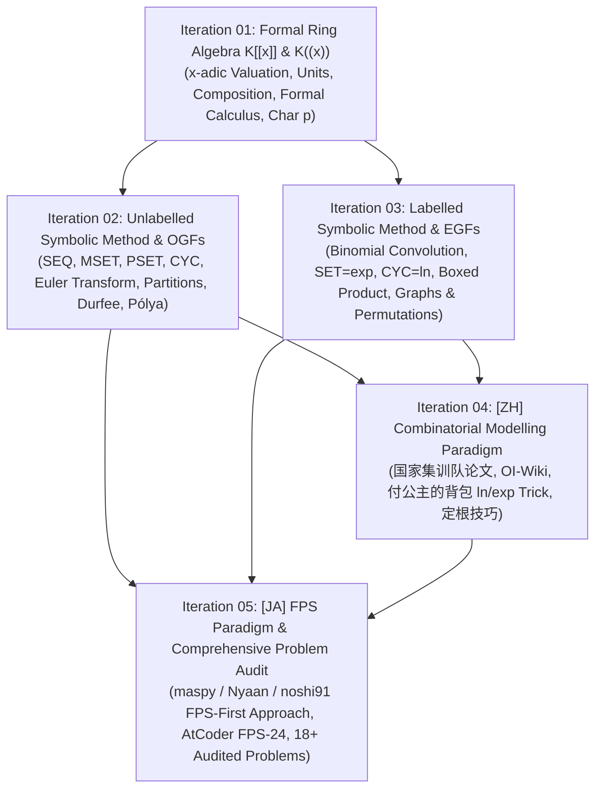
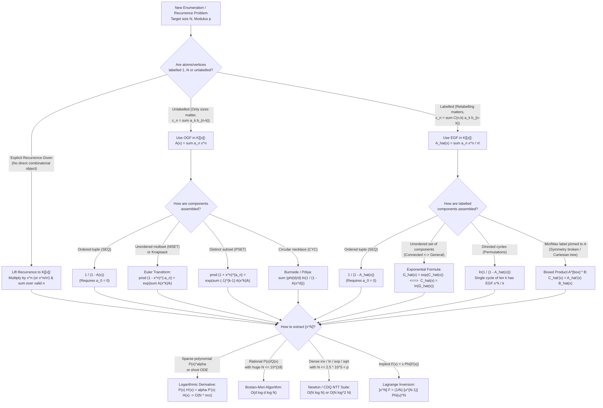

# Cohort 1 — Wave 1A (Iterations 01–05): Foundational Algebra, Unlabelled OGFs, Labelled EGFs, and Multilingual Combinatorial Modelling

> [!IMPORTANT]
> **Pedagogical & Mathematical Mandate**: This research monograph establishes the algebraic and combinatorial foundations of Formal Power Series (FPS) and Generating Functions (GF) for competitive programming and enumerative combinatorics. Every algebraic structure, symbolic operator, and transformation in this document is developed with **zero magic steps**: we explicitly document the *Concrete Combinatorial/Algebraic Object*, the *Diagnostic Signal* that tells a solver when to reach for the tool, a *Reverse-Engineering Scratchpad* showing how to discover the manipulation from first principles, a *Step-by-Step Annotated Derivation* with explicit domain/characteristic constraints, a *Hand-Checkable Toy Example ($n \le 4$)*, and *Failure Modes & Edge Cases*.

---

## Executive Overview & Architectural Map of Wave 1A

Generating functions act as a **bridge between discrete combinatorial specifications and continuous-looking formal algebra**. In competitive programming, a recurring barrier for learners is that editorials frequently present generating function solutions backwards: they state an unmotivated formal power series $F(x)$, apply a seemingly miraculous identity or differential operator, and extract $[x^n]F(x)$ via fast polynomial algorithms in $O(n \log n)$ time.

Wave 1A dismantles this barrier across five tightly integrated iterations:



1. **Iteration 01 — Foundational Algebra of Formal Power Series (`K[[x]]` and `K((x))`)**: Establishes the rigorous algebraic framework where infinite series are manipulated without analytic convergence requirements. Covers the $x$-adic valuation $\operatorname{val}(F)$, formal topology, invertibility criteria in $R[[x]]^\times$, zero divisors, the field of formal Laurent series $K((x))$, formal composition $F(G(x))$, formal calculus operators ($D = \frac{d}{dx}$, $\vartheta = x\frac{d}{dx}$, $\int_0^x$), and prime characteristic $p > 0$ obstructions.
2. **Iteration 02 — Unlabelled Symbolic Method & Ordinary Generating Functions (OGFs)**: Develops the Flajolet–Sedgewick dictionary translating unlabelled combinatorial constructions ($+, \times, \operatorname{SEQ}, \operatorname{MSET}, \operatorname{PSET}, \operatorname{CYC}$) directly into OGF equations. Provides dual derivations (combinatorial infinite product vs. logarithmic derivative divisor sum) of the Euler Transform, alongside integer partitions, Ferrers diagrams, Durfee square decompositions, Euler's Pentagonal Number Theorem, and Burnside/Pólya symmetry-reduced enumeration.
3. **Iteration 03 — Labelled Symbolic Method & Exponential Generating Functions (EGFs)**: Explains why relabelling-compatible Cartesian products induce binomial convolutions and therefore EGF multiplication. Covers labelled $\operatorname{SEQ}$, $\operatorname{SET}$ ($\exp$), $\operatorname{CYC}$ ($\ln \frac{1}{1-x}$), the pointing operator $\Theta = x\frac{d}{dx}$, and the **Boxed Product** ($A^{\square} * B$) for minimum/maximum label rooting when $\exp$ fails or symmetry is broken. Derives classical families including cycle-constrained permutations, involutions, connected labelled graphs, labelled bipartite graphs (via 2-coloured EGFs and $\frac{1}{2}\ln$), chord diagrams, and alternating permutations.
4. **Iteration 04 — `[ZH]` Combinatorial Modelling Deep-Dive**: Synthesizes the Chinese competitive programming literature (`国家集训队论文` by Elegia/吕欣, rqy/任清宇, picks/金策; OI-Wiki; `command_block`), providing a bilingual glossary, the $O(M \log M)$ bucketed $\ln/\exp$ subset-sum paradigm (`付公主的背包`), minimum-label rooting (`最小标号定根法`), and 2-coloured EGF square-root/halving subtleties.
5. **Iteration 05 — `[JA]` Combinatorial Modelling Deep-Dive & Master Problem Audit**: Synthesizes the Japanese FPS school (`maspy`, `Nyaan`, `noshi91`, `tatyam`, AtCoder `fps-24`), contrasting the "DP-first, FPS-second" philosophy with the Chinese symbolic-method tradition, followed by a rigorous **18-Problem Non-Template Audit** (with full constraints, diagnostic signals, derivations, and 3-tier hints), a **Rejected Template Problems Table**, and a **Master Multilingual Bibliography (`[EN]`, `[ZH]`, `[JA]`)**.

---

## Iteration 01: Foundational Algebra of Formal Power Series (`K[[x]]` and `K((x))`)

### 1.1 The Ring of Formal Power Series $R[[x]]$ vs. Polynomials $R[x]$

#### a. Concrete Combinatorial / Algebraic Object
Let $R$ be a commutative ring with multiplicative identity $1_R \neq 0_R$ (in competitive programming, typically $R = \mathbb{Q}$, $R = \mathbb{F}_p = \mathbb{Z}/p\mathbb{Z}$ for a prime $p$ such as $998244353$, or a composite modular ring $R = \mathbb{Z}/m\mathbb{Z}$).

A **formal power series** over $R$ is an infinite sequence of coefficients
$$F = (f_0, f_1, f_2, \dots, f_n, \dots) \in R^{\mathbb{N}}, \quad \mathbb{N} = \{0, 1, 2, \dots\}$$
written suggestively using an indeterminate symbol $x$ as
$$F(x) = \sum_{n=0}^{\infty} f_n x^n.$$
The set of all such infinite sequences forms the **ring of formal power series** $R[[x]]$ under two binary operations:
- **Pointwise Addition**:
  $$F(x) + G(x) = \sum_{n=0}^{\infty} (f_n + g_n) x^n$$
- **Cauchy Product (Discrete Convolution)**:
  $$F(x) \cdot G(x) = \sum_{n=0}^{\infty} \left( \sum_{k=0}^{n} f_k g_{n-k} \right) x^n.$$

The **polynomial ring** $R[x]$ is the subring of $R[[x]]$ consisting of sequences with **finite support** (i.e., there exists $N \ge 0$ such that $f_n = 0$ for all $n > N$).

To extract individual terms cleanly without subscript clutter, we define the **coefficient extraction operator** $[x^n] : R[[x]] \to R$ by
$$[x^n] \left( \sum_{k=0}^{\infty} f_k x^k \right) = f_n.$$
For any fixed $n \ge 0$, $[x^n]$ is an $R$-linear functional:
$$[x^n]\big(\alpha F(x) + \beta G(x)\big) = \alpha [x^n]F(x) + \beta [x^n]G(x) \quad \forall \alpha, \beta \in R,$$
and satisfies the **shift identity**:
$$[x^n]\big(x^k F(x)\big) = \begin{cases} [x^{n-k}] F(x) & \text{if } n \ge k, \\ 0 & \text{if } n < k. \end{cases}$$

#### b. The Diagnostic Signal
When should a competitive programmer lift a sequence $\{f_n\}_{n \ge 0}$ into the ring $R[[x]]$?
- **Signal 1 (Index-Sum Bilinearity)**: A recurrence or summation contains a term of the form $\sum_{k=0}^{n} f_k g_{n-k}$ or $\sum_{i+j=n} f_i g_j$, where the indices sum to $n$. This is the exact fingerprint of $[x^n](F(x)G(x))$.
- **Signal 2 (Shift-Invariant Recurrence)**: A linear or nonlinear recurrence relates $f_n$ to shifted terms $f_{n-1}, f_{n-2}, \dots$ with rules that are uniform for all $n \ge n_0$. Multiplying by $x^n$ and summing over $n$ collapses the entire infinite family of equations into a single algebraic equation in $R[[x]]$.

#### c. The Reverse-Engineering Scratchpad
Suppose we are given a recurrence such as $f_n = f_{n-1} + 2f_{n-2}$ for $n \ge 2$, with $f_0 = 1, f_1 = 1$. How do we systematically convert this into an equation in $R[[x]]$ without guessing?
```
[Scratchpad: Lifting a Recurrence to R[[x]]]
1. Define the target object: F(x) = sum_{n >= 0} f_n x^n.
2. Observe where the recurrence is valid: ONLY for n >= 2.
   (Never blindly apply the recurrence at n = 0 or n = 1!)
3. Multiply both sides of the valid recurrence by x^n and sum over n >= 2:
   sum_{n >= 2} f_n x^n = sum_{n >= 2} f_{n-1} x^n + 2 sum_{n >= 2} f_{n-2} x^n.
4. Express each sum in terms of F(x) by aligning the subscript of f with the exponent of x:
   - LHS: sum_{n >= 2} f_n x^n = F(x) - f_0 - f_1 x = F(x) - 1 - x.
   - First RHS term: factor out x^1 so the exponent matches the subscript (n-1):
     sum_{n >= 2} f_{n-1} x^n = x sum_{n >= 2} f_{n-1} x^{n-1} = x (F(x) - f_0) = x(F(x) - 1).
   - Second RHS term: factor out x^2 so the exponent matches (n-2):
     2 sum_{n >= 2} f_{n-2} x^n = 2 x^2 sum_{n >= 2} f_{n-2} x^{n-2} = 2 x^2 F(x).
5. Combine and collect F(x) on the left:
   F(x) - 1 - x = x F(x) - x + 2 x^2 F(x)
   ==> (1 - x - 2x^2) F(x) = 1.
```
Notice how every boundary term ($f_0 = 1, f_1 = 1$) was automatically accounted for by restricting the summation to $n \ge 2$ where the recurrence holds.

---

### 1.2 The $x$-Adic Valuation, Metric, and Formal Topology (Why Convergence Is Irrelevant)

#### a. Concrete Combinatorial / Algebraic Object
A frequent point of confusion for beginners trained in real or complex analysis is why we can write identities such as
$$\sum_{n=0}^{\infty} n! x^n \in \mathbb{Q}[[x]]$$
even though the analytic radius of convergence of $\sum_{n=0}^{\infty} n! z^n$ in $\mathbb{C}$ is $R = 0$ (it diverges for every $z \neq 0$).

In $R[[x]]$, $x$ is **not a number**; there is no evaluation map $x \mapsto z \in \mathbb{C}$. Instead, infinite sums and infinite products in $R[[x]]$ are governed by the **$x$-adic topology** (also called the *formal topology* or *Krull topology* for the ideal $(x) = xR[[x]]$).

For any non-zero series $F(x) = \sum_{n=0}^{\infty} f_n x^n \in R[[x]]$, its **$x$-adic valuation** (or **order**) $\operatorname{val}(F) \in \mathbb{N} \cup \{+\infty\}$ is the index of its first non-zero coefficient:
$$\operatorname{val}(F) = \begin{cases} \min\{n \ge 0 : [x^n]F(x) \neq 0\} & \text{if } F(x) \neq 0, \\ +\infty & \text{if } F(x) = 0. \end{cases}$$

The valuation satisfies two fundamental properties for all $F, G \in R[[x]]$:
1. **Strong Triangle Inequality (Ultrametric Property)**:
   $$\operatorname{val}(F + G) \ge \min\big(\operatorname{val}(F), \operatorname{val}(G)\big),$$
   with strict equality whenever $\operatorname{val}(F) \neq \operatorname{val}(G)$.
2. **Multiplicativity (Sub-additivity over general rings, exact additivity over integral domains)**:
   $$\operatorname{val}(F \cdot G) \ge \operatorname{val}(F) + \operatorname{val}(G),$$
   with exact equality $\operatorname{val}(F \cdot G) = \operatorname{val}(F) + \operatorname{val}(G)$ whenever $R$ is an integral domain (such as a field $K$).

Fixing any real base $0 < c < 1$ (conventionally $c = \frac{1}{2}$), the **$x$-adic metric** $d : R[[x]] \times R[[x]] \to \mathbb{R}_{\ge 0}$ is defined by:
$$d(F, G) = 2^{-\operatorname{val}(F - G)} \quad (\text{with } 2^{-\infty} = 0).$$
Under $d$, two formal power series are "close" if and only if they agree on a long prefix of initial coefficients: $d(F, G) \le 2^{-N} \iff [x^n]F(x) = [x^n]G(x)$ for all $0 \le n < N$.

#### b. The Diagnostic Signal
How do you check whether an **infinite sum** $\sum_{k=0}^{\infty} F_k(x)$ or an **infinite product** $\prod_{k=1}^{\infty} (1 + G_k(x))$ is legally defined in $R[[x]]$?
- **Signal for Infinite Sums**: Check whether $\lim_{k \to \infty} \operatorname{val}(F_k) = +\infty$. That is, for every target degree $n \ge 0$, are there **only finitely many** indices $k$ for which $[x^n]F_k(x) \neq 0$? If yes, the family $\{F_k\}_{k \ge 0}$ is **locally finite** (or *summable*), and $[x^n] \sum_{k=0}^{\infty} F_k(x)$ reduces to a finite sum in $R$.
- **Signal for Infinite Products**: Write the product as $\prod_{k=1}^{\infty} (1 + G_k(x))$. It converges in $R[[x]]$ if and only if $\operatorname{val}(G_k) \ge 1$ for all $k$ (or after omitting finitely many leading factors) and $\lim_{k \to \infty} \operatorname{val}(G_k) = +\infty$.

#### c. The Reverse-Engineering Scratchpad
Suppose we want to compute $[x^n] \prod_{k=1}^{\infty} (1 + x^k + x^{2k})$ up to $n = 10^5$. How does the $x$-adic valuation tell us how to truncate the infinite product without error?
```
[Scratchpad: Truncation via x-adic Valuation]
1. Write each factor as 1 + G_k(x), where G_k(x) = x^k + x^{2k}.
2. Compute the valuation of the perturbation: val(G_k) = k.
3. Since val(G_k) = k -> +infinity as k -> infinity, the infinite product converges in R[[x]].
4. Moreover, for any k > n, val(G_k) = k > n, which means:
   1 + G_k(x) === 1 (mod x^{n+1}).
5. Therefore, up to degree n, all factors with k > n multiply by 1 and cannot affect [x^0 ... x^n]:
   [x^m] prod_{k=1}^{infinity} (1 + x^k + x^{2k}) = [x^m] prod_{k=1}^{n} (1 + x^k + x^{2k})  for all 0 <= m <= n.
```

#### d. Step-by-Step Algebraic Derivation & Verbal Annotations
**Theorem 1.1 (Completeness of $R[[x]]$ and Criterion for Infinite Series)**.
1. *The metric space $(R[[x]], d)$ is a complete ultrametric space.*
   - **Proof**: Let $\{S_k(x)\}_{k \ge 0}$ be a Cauchy sequence in $(R[[x]], d)$. For every integer $n \ge 0$, choosing $\varepsilon = 2^{-(n+1)}$ yields an index $K(n)$ such that for all $k, j \ge K(n)$, $d(S_k, S_j) \le 2^{-(n+1)}$, which by definition of $d$ means $\operatorname{val}(S_k - S_j) \ge n + 1$.
   - Consequently, for each fixed degree $n$, the coefficient sequence $[x^n]S_0, [x^n]S_1, [x^n]S_2, \dots$ becomes **eventually constant** for all $k \ge K(n)$, stabilizing at some element $s_n = [x^n]S_{K(n)} \in R$.
   - Defining $S(x) = \sum_{n=0}^{\infty} s_n x^n \in R[[x]]$, we have $\operatorname{val}(S - S_k) \ge n + 1$ for all $k \ge \max_{0 \le m \le n} K(m)$, so $\lim_{k \to \infty} S_k(x) = S(x)$.
2. *In an ultrametric space, an infinite series $\sum_{k=0}^{\infty} F_k(x)$ converges if and only if its general term approaches zero: $\lim_{k \to \infty} F_k(x) = 0 \iff \lim_{k \to \infty} \operatorname{val}(F_k) = +\infty$.*
   - **Proof**: Since $S_{k} - S_{k-1} = F_k$, the ultrametric inequality gives
     $$d(S_m, S_l) = d\left(\sum_{k=l+1}^{m} F_k, 0\right) \le \max_{l < k \le m} d(F_k, 0) = \max_{l < k \le m} 2^{-\operatorname{val}(F_k)}.$$
     Thus $\{S_m\}$ is Cauchy if and only if $2^{-\operatorname{val}(F_k)} \to 0$, i.e., $\operatorname{val}(F_k) \to +\infty$.

#### e. Hand-Checkable Toy Example ($n \le 4$)
Let us verify the infinite product $P(x) = \prod_{k=1}^{\infty} (1 - x^k)^{-1}$ up to $x^4$ using $x$-adic truncation.
Since $1 + G_k(x) = (1 - x^k)^{-1} = 1 + x^k + x^{2k} + \dots$ has $\operatorname{val}(G_k) = k$, to compute $P(x) \bmod x^5$ we only need factors $k \in \{1, 2, 3, 4\}$, and each factor truncated modulo $x^5$:
- $k=1$: $1 + x + x^2 + x^3 + x^4 \pmod{x^5}$
- $k=2$: $1 + x^2 + x^4 \pmod{x^5}$
- $k=3$: $1 + x^3 \pmod{x^5}$
- $k=4$: $1 + x^4 \pmod{x^5}$

Multiplying step by step modulo $x^5$:
1. $(1 + x + x^2 + x^3 + x^4)(1 + x^2 + x^4) \equiv 1 + x + 2x^2 + 2x^3 + 3x^4 \pmod{x^5}$.
2. Multiply by $(1 + x^3)$: $(1 + x + 2x^2 + 2x^3 + 3x^4)(1 + x^3) \equiv 1 + x + 2x^2 + 3x^3 + 4x^4 \pmod{x^5}$.
3. Multiply by $(1 + x^4)$: $(1 + x + 2x^2 + 3x^3 + 4x^4)(1 + x^4) \equiv 1 + x + 2x^2 + 3x^3 + 5x^4 \pmod{x^5}$.

The coefficients $(1, 1, 2, 3, 5)$ match the partition numbers $p(0)=1, p(1)=1, p(2)=2, p(3)=3, p(4)=5$.

#### f. Failure Modes, Pitfalls & Edge Cases
> [!WARNING]
> **Pitfall 1.1 (Violating $\operatorname{val}(F_k) \to \infty$)**: Consider the expression $\sum_{k=0}^{\infty} (1 + x)^k$. Even though $(1+x)^k \in R[x]$, we have $\operatorname{val}((1+x)^k) = 0$ for all $k \ge 0$ because $[x^0](1+x)^k = 1 \neq 0$. Thus $[x^0] \sum_{k=0}^{\infty} (1+x)^k = \sum_{k=0}^{\infty} 1$, which does **not** converge in $R[[x]]$. Never expand $\frac{1}{1 - G(x)} = \sum_{k=0}^{\infty} G(x)^k$ unless $[x^0]G(x) = 0$ (i.e., $\operatorname{val}(G) \ge 1$).

---

### 1.3 Multiplicative Units, Zero Divisors, and the Field of Formal Laurent Series $K((x))$

#### a. Concrete Combinatorial / Algebraic Object
1. **Unit Group $R[[x]]^\times$**: An element $F(x) \in R[[x]]$ is a **unit** (multiplicatively invertible in $R[[x]]$) if there exists $G(x) \in R[[x]]$ such that $F(x)G(x) = 1$.
2. **Formal Laurent Series $K((x))$**: When $K$ is a field and $F(x) \neq 0$ has $\operatorname{val}(F) = v \ge 1$ (so $f_0 = 0$), $F(x)$ is **not** invertible in $K[[x]]$. To divide by $F(x)$, we pass to the **field of formal Laurent series** $K((x)) = \operatorname{Frac}(K[[x]]) = K[[x]][x^{-1}]$, whose elements are formal series with at most finitely many negative powers of $x$:
   $$L(x) = \sum_{n=v}^{\infty} a_n x^n, \quad v \in \mathbb{Z}, \quad a_n \in K.$$

#### b. The Diagnostic Signal
- **Signal for $R[[x]]$ Inversion**: You have derived a linear equation $A(x) F(x) = B(x)$ in $R[[x]]$ and want to write $F(x) = B(x) A(x)^{-1}$. Before calling a polynomial inverse subroutine (`poly_inv`), immediately check $[x^0]A(x)$:
  - Is $[x^0]A(x) \in R^\times$ (i.e., $[x^0]A(x) \not\equiv 0 \pmod p$ over $\mathbb{F}_p$, or $\gcd([x^0]A(x), m) = 1$ over $\mathbb{Z}/m\mathbb{Z}$)? If yes, $A(x)^{-1} \in R[[x]]$ exists and is unique.
- **Signal for Laurent Shift in $K((x))$**: If $[x^0]A(x) = 0$, find $v = \operatorname{val}(A) \ge 1$. For a solution $F(x) \in K[[x]]$ to exist without negative powers, $B(x)$ **must** satisfy $\operatorname{val}(B) \ge v$. Factor out $x^v$ from both sides: $(x^{-v} A(x)) F(x) = x^{-v} B(x)$, restoring a unit constant term $[x^0](x^{-v}A(x)) = [x^v]A(x) \neq 0$.

#### c. The Reverse-Engineering Scratchpad
How do we discover both the $O(n^2)$ coefficient recurrence and the $O(n \log n)$ Newton iteration for $B(x) = A(x)^{-1}$?
```
[Scratchpad: Discovering Multiplicative Inversion]
Goal: Find B(x) = sum_{n >= 0} b_n x^n such that A(x) B(x) = 1.

Method 1 (Coefficient-by-Coefficient Extraction):
1. At n = 0: [x^0](A(x)B(x)) = a_0 b_0 = 1.
   ==> This forces a_0 to be invertible in R, giving b_0 = a_0^{-1}.
2. At n >= 1: [x^n](A(x)B(x)) = sum_{k=0}^{n} a_k b_{n-k} = 0.
   Isolate the unknown b_n (which appears at k = 0, multiplied by a_0):
   a_0 b_n + sum_{k=1}^{n} a_k b_{n-k} = 0
   ==> b_n = -a_0^{-1} sum_{k=1}^{n} a_k b_{n-k}.

Method 2 (Quadratic Lifting / Newton's Method for Fast FFT Inversion):
1. Suppose we already know B_k(x) such that A(x) B_k(x) === 1 (mod x^{2^k}).
2. Then the residual error E(x) = 1 - A(x) B_k(x) has val(E) >= 2^k.
3. Square the error: E(x)^2 = (1 - A(x) B_k(x))^2 === 0 (mod x^{2^{k+1}}) because val(E^2) >= 2 * 2^k = 2^{k+1}.
4. Expand the square:
   1 - 2 A(x) B_k(x) + A(x)^2 B_k(x)^2 === 0 (mod x^{2^{k+1}})
   ==> A(x) * [ B_k(x) (2 - A(x) B_k(x)) ] === 1 (mod x^{2^{k+1}}).
5. Thus B_{k+1}(x) = B_k(x) (2 - A(x) B_k(x)) mod x^{2^{k+1}} doubles the number of correct coefficients!
```

#### d. Step-by-Step Algebraic Derivation & Verbal Annotations
**Theorem 1.2 (Characterization of Units, Zero Divisors, and Laurent Division)**.
1. **Unit Criterion**: *Let $R$ be a commutative ring. A series $A(x) = \sum_{n=0}^{\infty} a_n x^n \in R[[x]]$ belongs to $R[[x]]^\times$ if and only if $a_0 \in R^\times$.*
   - **Proof**: ($\Rightarrow$) If $A(x)B(x) = 1$, extracting $[x^0]$ yields $a_0 b_0 = 1_R$, so $a_0 \in R^\times$.
   - ($\Leftarrow$) If $a_0 \in R^\times$, we can either construct $b_n$ uniquely by induction via $b_0 = a_0^{-1}$ and $b_n = -a_0^{-1} \sum_{k=1}^n a_k b_{n-k}$, or factor $A(x) = a_0(1 - G(x))$ where $G(x) = -\sum_{n=1}^{\infty} a_0^{-1} a_n x^n$ satisfies $\operatorname{val}(G) \ge 1$. Since $\operatorname{val}(G^k) \ge k \to \infty$, the geometric series $\sum_{k=0}^{\infty} G(x)^k$ converges in $R[[x]]$ and satisfies $(1 - G(x))\sum_{k=0}^{\infty} G(x)^k = 1$. Multiplying by $a_0^{-1}$ gives $A(x)^{-1} = a_0^{-1} \sum_{k=0}^{\infty} G(x)^k$.
2. **Integral Domain Preservation vs. Zero Divisors**:
   - If $R$ is an integral domain, then $R[[x]]$ is an integral domain: for any $A, B \neq 0$ with $v = \operatorname{val}(A), w = \operatorname{val}(B)$, the first potentially non-zero term of $AB$ is $[x^{v+w}](AB) = a_v b_w \neq 0$, so $\operatorname{val}(AB) = v + w < \infty$.
   - If $R$ has zero divisors (e.g., $R = \mathbb{Z}/8\mathbb{Z}$), then $R[[x]]$ also has zero divisors. Furthermore, a polynomial can have a **polynomial** inverse if its higher coefficients are nilpotent! For example, in $(\mathbb{Z}/8\mathbb{Z})[[x]]$, $(1 - 2x)^{-1} = 1 + 2x + 4x^2$ is a finite polynomial of degree $2$ because $(2x)^3 = 8x^3 \equiv 0 \pmod 8$.
3. **Canonical Factorization in $K((x))$ and Precision Loss**:
   - Every non-zero $L(x) \in K((x))$ has a unique factorization $L(x) = x^v U(x)$ where $v = \operatorname{val}(L) \in \mathbb{Z}$ and $U(x) \in K[[x]]^\times$ has $[x^0]U(x) \neq 0$.
   - Consequently, $L(x)^{-1} = x^{-v} U(x)^{-1} \in K((x))$, proving that $K((x))$ is a field.
   - **Precision Loss Rule**: If $A(x)$ and $B(x)$ are known up to $O(x^N)$ (i.e., modulo $x^N$) and $\operatorname{val}(A) = v \ge 1$ with $\operatorname{val}(B) \ge v$, then $x^{-v} A(x)$ and $x^{-v} B(x)$ are known only up to **modulo $x^{N-v}$**. Therefore, computing $F(x) = B(x) / A(x)$ requires knowing $A(x)$ and $B(x)$ up to $x^{N+v}$ in order to recover $[x^0 \dots x^{N-1}]F(x)$!

#### e. Hand-Checkable Toy Example ($n \le 4$)
**Example 1 (Inversion in $\mathbb{Q}[[x]]$)**: Invert $A(x) = 1 - x - x^2$ up to $x^4$.
Here $a_0 = 1, a_1 = -1, a_2 = -1, a_3 = a_4 = 0$. Using $b_n = -\sum_{k=1}^n a_k b_{n-k} = b_{n-1} + b_{n-2}$:
- $b_0 = 1$
- $b_1 = b_0 = 1$
- $b_2 = b_1 + b_0 = 2$
- $b_3 = b_2 + b_1 = 3$
- $b_4 = b_3 + b_2 = 5$
Thus $(1 - x - x^2)^{-1} = 1 + x + 2x^2 + 3x^3 + 5x^4 + O(x^5)$ (the Fibonacci numbers).

**Example 2 (Laurent Shift & Precision Loss)**: Solve $A(x) F(x) = B(x) \bmod x^3$ where $A(x) = x^2 - x^3 + x^4 + O(x^5)$ and $B(x) = x^2 + 2x^3 - x^4 + O(x^5)$.
1. $\operatorname{val}(A) = 2$ and $\operatorname{val}(B) = 2$. Notice we known $A, B$ modulo $x^5$ ($N=5$).
2. Divide both by $x^2$: $\tilde{A}(x) = 1 - x + x^2 + O(x^3)$ and $\tilde{B}(x) = 1 + 2x - x^2 + O(x^3)$ (precision drops from $O(x^5)$ to $O(x^{5-2}) = O(x^3)$).
3. Invert $\tilde{A}(x) \bmod x^3$: since $G(x) = x - x^2$, $\tilde{A}(x)^{-1} = 1 + (x - x^2) + (x - x^2)^2 + O(x^3) = 1 + x + O(x^3)$.
4. Multiply: $F(x) = \tilde{B}(x)\tilde{A}(x)^{-1} = (1 + 2x - x^2)(1 + x) + O(x^3) = 1 + 3x + x^2 + O(x^3)$.
5. Check: $A(x)F(x) = (x^2 - x^3 + x^4)(1 + 3x + x^2) = x^2 + (3-1)x^3 + (1-3+1)x^4 + O(x^5) = x^2 + 2x^3 - x^4 + O(x^5) = B(x)$.

#### f. Failure Modes, Pitfalls & Edge Cases
> [!CAUTION]
> **Pitfall 1.2 (Silent Truncation Bug in Laurent Division)**: In competitive programming, if a problem asks for $[x^N] \frac{B(x)}{A(x)}$ where $\operatorname{val}(A) = v > 0$, allocating arrays of size $N+1$ for $A$ and $B$ before shifting will leave the top $v$ coefficients of $F(x)$ corrupted by zero-padding! Always compute $A(x)$ and $B(x)$ to degree $N + v$ before shifting down by $x^v$.

---

### 1.4 Formal Composition $F(G(x))$ and Compositional Inversion

#### a. Concrete Combinatorial / Algebraic Object
Given two formal power series $F(x) = \sum_{n=0}^{\infty} f_n x^n \in R[[x]]$ and $G(x) = \sum_{m=0}^{\infty} g_m x^m \in R[[x]]$, their **formal composition** $(F \circ G)(x) = F(G(x))$ is defined as the infinite series in $R[[x]]$:
$$F(G(x)) = \sum_{n=0}^{\infty} f_n G(x)^n.$$

When does this infinite sum converge in the $x$-adic topology of $R[[x]]$ for an *arbitrary* $F \in R[[x]]$?
By Theorem 1.1, $\sum_{n=0}^{\infty} f_n G(x)^n$ converges for all $F \in R[[x]]$ if and only if $\lim_{n \to \infty} \operatorname{val}(G(x)^n) = +\infty$, which requires:
$$\operatorname{val}(G) \ge 1 \iff [x^0]G(x) = g_0 = 0.$$
*(Exception: if $F(x) \in R[x]$ is a finite polynomial, $F(G(x))$ is a finite sum and is valid for any $G(x) \in R[[x]]$ regardless of $g_0$.)*

When $g_0 = 0$, writing $G(x)^n = \sum_{k=n}^{\infty} c_{n,k} x^k$, the coefficient of $x^k$ in $F(G(x))$ is a **finite sum** stopping at $n = k$:
$$[x^k] F(G(x)) = \sum_{n=0}^{k} f_n [x^k] G(x)^n.$$

Let $\mathfrak{m} = xR[[x]] = \{G \in R[[x]] : \operatorname{val}(G) \ge 1\}$ be the maximal ideal of series with zero constant term.
A series $G(x) = g_1 x + g_2 x^2 + \dots \in \mathfrak{m}$ has a **compositional inverse** $G^{\langle -1 \rangle}(x) \in \mathfrak{m}$ satisfying
$$G\big(G^{\langle -1 \rangle}(x)\big) = x \quad \text{and} \quad G^{\langle -1 \rangle}\big(G(x)\big) = x$$
if and only if $[x^1]G(x) = g_1 \in R^\times$ (i.e., $\operatorname{val}(G) = 1$ and the linear coefficient is a unit).

#### b. The Diagnostic Signal
- **Signal 1 (Nested Substitution in Combinatorics)**: Every "atom" $x$ inside an outer structure $F(x)$ is replaced by a non-empty inner structure $G(x)$ (where "non-empty" means $[x^0]G(x) = 0$). In the symbolic method, this corresponds to the substitution $F(G(x))$.
- **Signal 2 (Implicit Functional Equation $G(F(x)) = x$ or $F(x) = x \Phi(F(x))$)**: A recursive tree or walk specification defines $F(x)$ implicitly, which is really asking for the compositional inverse of $G(y) = \frac{y}{\Phi(y)}$.

#### c. The Reverse-Engineering Scratchpad
How do we check if a compositional equation $F(G(x)) = H(x)$ can be solved by composing on the right with $G^{\langle -1 \rangle}(x)$, and how do we compute $[x^0 \dots x^3] G^{\langle -1 \rangle}(x)$ by hand?
```
[Scratchpad: Compositional Inversion by Undetermined Coefficients]
Suppose G(x) = x + g_2 x^2 + g_3 x^3 + ... (with g_0 = 0, g_1 = 1).
We want H(x) = h_1 x + h_2 x^2 + h_3 x^3 + ... such that G(H(x)) = x.
Expand G(H(x)) modulo x^4:
  H(x)   = h_1 x + h_2 x^2 + h_3 x^3 + O(x^4)
  H(x)^2 = h_1^2 x^2 + 2 h_1 h_2 x^3 + O(x^4)
  H(x)^3 = h_1^3 x^3 + O(x^4)
Substitute into G(H(x)) = H(x) + g_2 H(x)^2 + g_3 H(x)^3 = x:
  - [x^1]: h_1 = 1.
  - [x^2]: h_2 + g_2 h_1^2 = 0  ==>  h_2 = -g_2.
  - [x^3]: h_3 + 2 g_2 h_1 h_2 + g_3 h_1^3 = 0  ==>  h_3 = 2 g_2^2 - g_3.
```

#### d. Step-by-Step Algebraic Derivation & Verbal Annotations
**Theorem 1.3 (Algebraic Properties & Algorithmic Complexity of Formal Composition)**.
1. **Ring Homomorphism Property**: For any fixed $G(x) \in \mathfrak{m}$, the right-composition map $\Phi_G : R[[x]] \to R[[x]]$ given by $\Phi_G(F) = F \circ G$ is a continuous $R$-algebra homomorphism:
   $$(F_1 + F_2) \circ G = (F_1 \circ G) + (F_2 \circ G), \quad (F_1 \cdot F_2) \circ G = (F_1 \circ G) \cdot (F_2 \circ G).$$
   *(Warning: Left-composition is NOT linear! $F \circ (G_1 + G_2) \neq (F \circ G_1) + (F \circ G_2)$ in general.)*
2. **Associativity & The Substitution Group**: For any $F \in R[[x]]$ and $G, H \in \mathfrak{m}$, $(F \circ G) \circ H = F \circ (G \circ H)$. Consequently, the set $\mathfrak{m}_1 = \{G \in R[[x]] : [x^0]G = 0, [x^1]G \in R^\times\}$ forms a non-abelian group under $\circ$ with identity $I(x) = x$.
3. **Algorithmic Landscape in Competitive Programming**:
   - **Brent–Kung Baby-Step Giant-Step (1978)**: Computes $F(G(x)) \bmod x^{n}$ in $O((n \log n)^{3/2})$ operations by splitting $F$ into $\sqrt{n}$ blocks of size $\sqrt{n}$.
   - **Kinoshita–Li Algorithm (2024, *FOCS 2024*)**: Computes $F(G(x)) \bmod x^n$ (and its transposed dual, *power projection*, hence also compositional inverse $G^{\langle -1 \rangle}(x) \bmod x^n$) in $O(n \log^2 n)$ arithmetic operations over any field supporting FFT, by reducing composition to bivariate Bostan–Mori rational function evaluation $[y^0]\frac{P(x,y)}{Q(x,y)}$.

#### e. Hand-Checkable Toy Example ($n \le 4$)
Compute $F(G(x)) \bmod x^5$ where $F(x) = \frac{1}{1-x} = 1 + x + x^2 + x^3 + x^4 + \dots$ and $G(x) = x + x^2$ (compositions of $n$ into parts of size $1$ and $2$):
- $n=0$: $f_0 G(x)^0 = 1$
- $n=1$: $f_1 G(x)^1 = x + x^2$
- $n=2$: $f_2 G(x)^2 = (x + x^2)^2 = x^2 + 2x^3 + x^4$
- $n=3$: $f_3 G(x)^3 = (x + x^2)^3 = x^3 + 3x^4 + O(x^5)$
- $n=4$: $f_4 G(x)^4 = (x + x^2)^4 = x^4 + O(x^5)$
Summing column by column gives:
$$F(G(x)) \equiv 1 + x + (1+1)x^2 + (2+1)x^3 + (1+3+1)x^4 = 1 + x + 2x^2 + 3x^3 + 5x^4 \pmod{x^5}.$$

#### f. Failure Modes, Pitfalls & Edge Cases
> [!WARNING]
> **Pitfall 1.3 (Non-Zero Constant Term in Composition)**: Consider $F(x) = \exp(x) = \sum_{n=0}^{\infty} \frac{x^n}{n!}$ and $G(x) = 1 + x$. In $\mathbb{Q}[[x]]$, $\exp(1+x)$ is **undefined** because $[x^0]G(x) = 1 \neq 0$, leading to $[x^0]\exp(1+x) = \sum_{n=0}^{\infty} \frac{1}{n!} = e \notin \mathbb{Q}$. Whenever an algebraic derivation produces $G(x) = c + \tilde{G}(x)$ with $c \neq 0$ and $\tilde{G}(0) = 0$, you must factor or shift the outer function symbolically (e.g., if $c$ can be absorbed as a scalar prefactor) before expanding in $K[[x]]$.

---

### 1.5 Formal Calculus Operators ($D = \frac{d}{dx}$, $\vartheta = x\frac{d}{dx}$, $\int_0^x$) and Characteristic $p > 0$ Obstructions

#### a. Concrete Combinatorial / Algebraic Object
Without using limits or $\varepsilon$-$\delta$ definitions, we define three linear operators on $R[[x]]$ (and $K[[x]]$):
1. **Formal Derivative $D = \frac{d}{dx} : R[[x]] \to R[[x]]$**:
   $$D\left(\sum_{n=0}^{\infty} f_n x^n\right) = F'(x) = \sum_{n=1}^{\infty} n f_n x^{n-1} = \sum_{n=0}^{\infty} (n+1) f_{n+1} x^n.$$
2. **Pointing / Degree / Euler Operator $\vartheta = x D = x\frac{d}{dx} : R[[x]] \to R[[x]]$**:
   $$\vartheta\left(\sum_{n=0}^{\infty} f_n x^n\right) = x F'(x) = \sum_{n=0}^{\infty} n f_n x^n.$$
   Notice that $\vartheta$ preserves the degree $x^n$ and multiplies the coefficient $f_n$ by its index $n$. Iterating $\vartheta$ $k$ times produces polynomial moments:
   $$\vartheta^k F(x) = \left(x \frac{d}{dx}\right)^k F(x) = \sum_{n=0}^{\infty} n^k f_n x^n.$$
3. **Formal Integral $\int_0^x : K[[x]] \to K[[x]]$** (defined when $2, 3, \dots$ are invertible in $K$):
   $$\int_0^x \left(\sum_{n=0}^{\infty} f_n t^n\right) dt = \sum_{n=0}^{\infty} \frac{f_n}{n+1} x^{n+1} = \sum_{n=1}^{\infty} \frac{f_{n-1}}{n} x^n.$$

These operators enable us to define the **formal logarithm** and **formal exponential** over a field $K$ of characteristic $0$ (or modulo $x^N$ over $\mathbb{F}_p$ with $p \ge N$):
- For $U(x) \in 1 + xK[[x]]$ (i.e., $[x^0]U(x) = 1$):
  $$\ln U(x) := \int_0^x \frac{U'(t)}{U(t)} dt = \sum_{k=1}^{\infty} \frac{(-1)^{k-1}}{k} (U(x) - 1)^k \in xK[[x]].$$
- For $G(x) \in xK[[x]]$ (i.e., $[x^0]G(x) = 0$):
  $$\exp G(x) := \sum_{k=0}^{\infty} \frac{G(x)^k}{k!} \in 1 + xK[[x]], \quad \text{satisfying } D(\exp G) = G' \exp G.$$
The maps $\ln : 1 + xK[[x]] \leftrightarrow xK[[x]] : \exp$ are mutually inverse group isomorphisms between the multiplicative subgroup $(1 + xK[[x]], \cdot)$ and the additive subgroup $(xK[[x]], +)$.

#### b. The Diagnostic Signal
- **Signal 1 (Index Multipliers $n f_n$ or $n^k f_n$)**: Whenever a recurrence contains $n f_n$, $(n+1)f_{n+1}$, or a sum weights each configuration of size $n$ by $n$ ("choose a distinguished root vertex/atom among the $n$ elements"), translate it immediately into $\vartheta F(x) = x F'(x)$ or $F'(x)$.
- **Signal 2 (Nonlinear Powers $F(x)^\alpha$, Infinite Products, or $\exp/\ln$)**: How do you compute $[x^n] P(x)^\alpha$ for a sparse polynomial $P(x)$ in $O(n \cdot \text{nnz}(P))$ time, or linearize $A(x) = \exp(B(x))$? Apply the **logarithmic derivative** $\frac{D(\cdot)}{(\cdot)}$! Taking $\ln$ and differentiating turns powers and products into linear sums:
  $$H(x) = P(x)^\alpha \implies \frac{H'(x)}{H(x)} = \alpha \frac{P'(x)}{P(x)} \implies P(x) H'(x) = \alpha P'(x) H(x).$$

#### c. The Reverse-Engineering Scratchpad
Suppose we want to compute $H(x) = P(x)^\alpha \bmod x^{N+1}$ where $P(x) = 1 + c_1 x + c_2 x^2$ is a short polynomial of degree $d=2$ and $\alpha \in K$ is any constant (possibly negative or fractional, or huge $\alpha \le 10^{18}$). Why is logarithmic differentiation better than binary exponentiation, and how do we derive the $O(N)$ recurrence?
```
[Scratchpad: Linearizing P(x)^alpha via Logarithmic Derivative]
1. Naive binary exponentiation takes O(N log N log alpha) or O(N log N) via exp(alpha * ln P(x)).
2. Instead, take the logarithmic derivative of H(x) = P(x)^alpha:
   H'(x) / H(x) = alpha * P'(x) / P(x).
3. Clear denominators to avoid division:
   P(x) H'(x) = alpha * P'(x) H(x).
4. Multiply by x so that both sides use the degree-preserving operator x D:
   P(x) (x H'(x)) = alpha * (x P'(x)) H(x).
5. Extract [x^n] on both sides (since deg P = d is small, each sum has only d+1 terms!):
   sum_{k=0}^{d} p_k * (n - k) h_{n-k} = alpha * sum_{k=1}^{d} k p_k * h_{n-k}.
6. Isolate the k = 0 term on the LHS, which is p_0 * n * h_n:
   p_0 * n * h_n = sum_{k=1}^{d} p_k * (alpha * k - (n - k)) h_{n-k}.
7. Divide by n * p_0 (valid for 1 <= n < p when p_0 != 0):
   h_n = (1 / (n * p_0)) * sum_{k=1}^{d} p_k * ((alpha + 1)k - n) h_{n-k}.
Result: O(d * N) = O(N) time and O(1) FFTs!
```

#### d. Step-by-Step Algebraic Derivation & Verbal Annotations
**Theorem 1.4 (Laws of Formal Calculus & Characteristic $p$ Obstructions)**.
1. **Algebraic Rules of $D$**: For all $F, G \in R[[x]]$ and $H \in \mathfrak{m}$:
   - *Leibniz Rule*: $D(F \cdot G) = (DF) \cdot G + F \cdot (DG)$ (verified on monomials $x^a \cdot x^b = x^{a+b}$ since $(a+b)x^{a+b-1} = a x^{a-1} x^b + x^a b x^{b-1}$ and extended by bilinearity and $x$-adic continuity).
   - *Chain Rule*: $D(F \circ H) = (DF \circ H) \cdot DH$.
   - *Quotient Rule*: For $G \in R[[x]]^\times$, $D(F / G) = \frac{(DF)G - F(DG)}{G^2}$.
2. **Exactness of $D$ and $\int_0^x$ in Characteristic $0$ vs. Characteristic $p > 0$**:
   - Over a field $K$ with $\operatorname{char}(K) = 0$:
     $$D\left(\int_0^x F(t)\,dt\right) = F(x), \quad \int_0^x (DF)(t)\,dt = F(x) - [x^0]F(x), \quad \text{and} \quad \ker D = K.$$
   - Over a field $K$ with $\operatorname{char}(K) = p > 0$ (such as $\mathbb{F}_p$):
     Since $p \cdot 1_K = 0$, differentiating $x^{kp}$ yields $D(x^{kp}) = kp x^{kp-1} = 0$ for every integer $k \ge 0$!
     Therefore, the kernel of $D$ is **not** just constants $K$, but the entire subring of $p$-th power series:
     $$\ker\left(D : \mathbb{F}_p[[x]] \to \mathbb{F}_p[[x]]\right) = \mathbb{F}_p[[x^p]] = \left\{\sum_{k=0}^{\infty} c_k x^{kp} : c_k \in \mathbb{F}_p\right\}.$$
     Dually, the formal integral $\int_0^x \sum_{n=0}^{\infty} f_n t^n \, dt = \sum_{n=0}^{\infty} \frac{f_n}{n+1} x^{n+1}$ is **undefined** at degree $n = kp - 1$ whenever $f_{kp-1} \neq 0$, because $n + 1 = kp \equiv 0 \pmod p$ has no multiplicative inverse in $\mathbb{F}_p$.
   - **Frobenius Endomorphism in $\mathbb{F}_p[[x]]$**: Instead of calculus at degrees $\ge p$, characteristic $p$ provides the **Frobenius identity**:
     $$\big(F(x)\big)^p = F(x^p) \quad \forall F(x) \in \mathbb{F}_p[[x]],$$
     because all multinomial cross-terms in $(\sum f_n x^n)^p$ are divisible by $p$, leaving $\sum f_n^p x^{np} = \sum f_n x^{np}$ by Fermat's Little Theorem ($f_n^p = f_n$ in $\mathbb{F}_p$).

#### e. Hand-Checkable Toy Example ($n \le 4$)
Use the logarithmic derivative recurrence $h_n = \frac{1}{n p_0} \sum_{k=1}^d p_k ((\alpha+1)k - n) h_{n-k}$ to compute $H(x) = (1 + 2x)^3 \bmod x^5$ (here $d=1, p_0 = 1, p_1 = 2, \alpha = 3$):
- $h_0 = p_0^3 = 1$.
- $n=1$: $h_1 = \frac{1}{1} \cdot 2 \cdot (4\cdot 1 - 1) h_0 = 6$.
- $n=2$: $h_2 = \frac{1}{2} \cdot 2 \cdot (4\cdot 1 - 2) h_1 = 1 \cdot 2 \cdot 6 = 12$.
- $n=3$: $h_3 = \frac{1}{3} \cdot 2 \cdot (4\cdot 1 - 3) h_2 = \frac{2}{3} \cdot 1 \cdot 12 = 8$.
- $n=4$: $h_4 = \frac{1}{4} \cdot 2 \cdot (4\cdot 1 - 4) h_3 = 0$.
Thus $H(x) = 1 + 6x + 12x^2 + 8x^3 + 0x^4$, matching $(1+2x)^3$ exactly.

#### f. Failure Modes, Pitfalls & Edge Cases
> [!CAUTION]
> **Pitfall 1.4 (Small Prime Characteristic $p \le N$ in $\exp$, $\ln$, and ODEs)**:
> Every standard polynomial library implementation of `poly_ln`, `poly_exp`, and `poly_pow` relies on $\int_0^x$ and divides by $1, 2, \dots, N$.
> - If the problem modulus is $p = 998244353$ and $N \le 5 \times 10^5$, then $N < p$, so $1, 2, \dots, N$ are all units in $\mathbb{F}_p$ and $\mathbb{F}_p[[x]] / (x^{N+1})$ behaves identically to characteristic $0$.
> - However, if a problem gives a **small prime modulus** $p \le N$ (e.g., $p = 3$ or $p = 10007$ with $N = 10^5$), `poly_ln` and `poly_exp` will divide by zero at $n = p$! In such cases:
>   1. For EGFs $F(x) = \sum \frac{a_n}{n!} x^n$, the factorial denominators $n!$ vanish at $n \ge p$; you cannot use EGFs directly modulo $p$ unless you work in the ring of Hurwitz series (retaining binomial convolution without dividing by $n!$) or lift to $\mathbb{Q}_p$.
>   2. For OGFs $(P(x))^K \bmod p$ with $p \le N$, decompose $K = \sum k_i p^i$ in base $p$ and use the **Frobenius identity** $P(x)^{p^i} \equiv P(x^{p^i}) \pmod p$.

---
## Iteration 02: Unlabelled Symbolic Method & Ordinary Generating Functions (OGFs)

### 2.1 Combinatorial Classes and the Flajolet–Sedgewick Unlabelled Dictionary

#### a. Concrete Combinatorial / Algebraic Object
In the Flajolet–Sedgewick symbolic method (*Analytic Combinatorics*, Chapter I), an **unlabelled combinatorial class** is a pair $(\mathcal{A}, |\cdot|)$ where $\mathcal{A}$ is a denumerable set of discrete objects and $|\cdot| : \mathcal{A} \to \mathbb{N}$ is a **size function** such that for every integer $n \ge 0$, the subset of objects of size $n$,
$$\mathcal{A}_n = \{\alpha \in \mathcal{A} : |\alpha| = n\}, \quad a_n = |\mathcal{A}_n| < \infty,$$
is finite.

The **Ordinary Generating Function (OGF)** of the unlabelled class $\mathcal{A}$ is the formal power series $A(x) \in \mathbb{Q}[[x]]$ (or $\mathbb{Z}[[x]]$) defined by summing $x^{|\alpha|}$ over every object $\alpha \in \mathcal{A}$:
$$A(x) = \sum_{\alpha \in \mathcal{A}} x^{|\alpha|} = \sum_{n=0}^{\infty} a_n x^n.$$

Why does the **Cartesian product** $\mathcal{C} = \mathcal{A} \times \mathcal{B} = \{(\alpha, \beta) : \alpha \in \mathcal{A}, \beta \in \mathcal{B}\}$ with additive size $|(\alpha, \beta)| = |\alpha| + |\beta|$ translate directly to the Cauchy product $C(x) = A(x) \cdot B(x)$?
Because the atoms of $\alpha$ and $\beta$ are **unlabelled** (indistinguishable except by their position within $\alpha$ or $\beta$), forming an ordered pair $(\alpha, \beta)$ of total size $n$ requires *no relabelling or interleaving of vertex labels*:
$$C(x) = \sum_{(\alpha, \beta) \in \mathcal{A} \times \mathcal{B}} x^{|\alpha| + |\beta|} = \left(\sum_{\alpha \in \mathcal{A}} x^{|\alpha|}\right) \left(\sum_{\beta \in \mathcal{B}} x^{|\beta|}\right) = A(x) B(x).$$

The complete **Unlabelled Symbolic Dictionary** translates set-theoretic constructions on classes into algebraic operations on their OGFs:

| Combinatorial Construction | Notation | Size / Validity Condition | OGF Translation in $K[[x]]$ |
| :--- | :--- | :--- | :--- |
| **Neutral Class** ($1$ object of size $0$) | $\mathcal{E} = \{\epsilon\}$ | $\|\epsilon\| = 0$ | $E(x) = 1$ |
| **Atomic Class** ($1$ object of size $1$) | $\mathcal{Z} = \{\zeta\}$ | $\|\zeta\| = 1$ | $Z(x) = x$ |
| **Disjoint Union** (either $\mathcal{A}$ or $\mathcal{B}$) | $\mathcal{C} = \mathcal{A} + \mathcal{B}$ | $\mathcal{A} \cap \mathcal{B} = \emptyset$ | $C(x) = A(x) + B(x)$ |
| **Cartesian Product** (ordered pair) | $\mathcal{C} = \mathcal{A} \times \mathcal{B}$ | $\|(\alpha, \beta)\| = \|\alpha\| + \|\beta\|$ | $C(x) = A(x) \cdot B(x)$ |
| **Sequence** (arbitrary finite tuple) | $\mathcal{C} = \operatorname{SEQ}(\mathcal{A})$ | $a_0 = [x^0]A(x) = 0$ | $C(x) = \frac{1}{1 - A(x)}$ |
| **$k$-Tuple** (sequence of length $k$) | $\mathcal{C} = \operatorname{SEQ}_k(\mathcal{A})$ | Any $A(x)$ | $C(x) = A(x)^k$ |
| **Powerset / Subset** (no repeated objects) | $\mathcal{C} = \operatorname{PSET}(\mathcal{A})$ | $a_0 = 0$ | $C(x) = \prod_{n \ge 1} (1 + x^n)^{a_n} = \exp\left(\sum_{k \ge 1} \frac{(-1)^{k-1}}{k} A(x^k)\right)$ |
| **Multiset** (unordered, repetitions allowed) | $\mathcal{C} = \operatorname{MSET}(\mathcal{A})$ | $a_0 = 0$ | $C(x) = \prod_{n \ge 1} (1 - x^n)^{-a_n} = \exp\left(\sum_{k \ge 1} \frac{A(x^k)}{k}\right)$ |
| **Directed Cycle** (up to cyclic rotation) | $\mathcal{C} = \operatorname{CYC}(\mathcal{A})$ | $a_0 = 0$ | $C(x) = \sum_{k \ge 1} \frac{\varphi(k)}{k} \ln \frac{1}{1 - A(x^k)}$ |

#### b. The Diagnostic Signal
How do you recognize which unlabelled operator applies to a problem statement?
- **Ordered vs. Unordered Components**:
  - If the order of components matters (e.g., tilings of a $1 \times n$ board, compositions of an integer $n = c_1 + c_2 + \dots + c_k$, ordered trees / plane trees where children of a vertex are ordered left-to-right), the construction is $\operatorname{SEQ}(\mathcal{A}) \implies \frac{1}{1 - A(x)}$.
  - If the order of components does **not** matter and identical components are indistinguishable (e.g., integer partitions, unlabelled non-plane rooted trees where subtrees of the root can be permuted freely, multisets of knapsack items), the construction is $\operatorname{MSET}(\mathcal{A})$ (if repetitions are allowed) or $\operatorname{PSET}(\mathcal{A})$ (if components must be pairwise distinct).
  - If components are arranged around a circle and two arrangements are identical iff one is a cyclic shift of the other, the construction is $\operatorname{CYC}(\mathcal{A})$.

---

### 2.2 Dual Derivations of the Euler Transform ($\operatorname{MSET}$)

#### a. Concrete Combinatorial / Algebraic Object
Given a class $\mathcal{A}$ with $a_0 = 0$ and OGF $A(x) = \sum_{n=1}^{\infty} a_n x^n$, the class $\mathcal{M} = \operatorname{MSET}(\mathcal{A})$ consists of all finite multisets of elements of $\mathcal{A}$. Its OGF $M(x) = \mathcal{E}(A)(x) = \sum_{n=0}^{\infty} m_n x^n$ is called the **Euler Transform** of $A(x)$:
$$M(x) = \prod_{n=1}^{\infty} \frac{1}{(1 - x^n)^{a_n}} = \exp\left(\sum_{k=1}^{\infty} \frac{A(x^k)}{k}\right).$$

#### b. The Diagnostic Signal
- **Signal 1 (Unlabelled Component Aggregation)**: You know the number $a_n$ of "connected" or "indecomposable" unlabelled structures of size $n$ (e.g., connected unlabelled graphs, irreducible polynomials over $\mathbb{F}_q$ of degree $n$, or unlabelled rooted trees of size $n$), and you want to count general structures of total size $N$ formed as a multiset of connected components.
- **Signal 2 (Knapsack / Coin Change with Indistinguishable Items of Identical Weight)**: There are $a_w$ distinct item types of weight $w$, and each item type can be chosen $0, 1, 2, \dots$ times (unbounded) or $0, 1$ times ($\operatorname{PSET}$).

#### c. The Reverse-Engineering Scratchpad
Why does taking the logarithm of $\prod_{n \ge 1} (1 - x^n)^{-a_n}$ reduce an infinite product of $N$ factors into an $O(N \log N)$ algorithm? Let us reconstruct the discovery step by step:
```
[Scratchpad: From Infinite Product to O(N log N) Harmonic Sum]
1. We want [x^0 ... x^N] of M(x) = prod_{n=1}^{N} (1 - x^n)^{-a_n}.
2. Multiplying N polynomials of degree N naively takes O(N^2) or O(N^2 log N).
3. To turn a product into a sum, apply the formal logarithm ln M(x):
   ln M(x) = sum_{n=1}^{N} -a_n ln(1 - x^n).
4. Expand -ln(1 - x^n) using its Maclaurin series sum_{k >= 1} (x^{nk}) / k:
   ln M(x) = sum_{n=1}^{N} a_n sum_{k=1}^{infinity} (1/k) x^{nk}.
5. Notice that for a fixed k, sum_{n >= 1} a_n (x^k)^n is simply A(x^k)!
   And in the coefficient of x^m, we only sum over pairs (n, k) with n * k = m.
6. How many pairs (n, k) satisfy n * k <= N?
   By the harmonic series, sum_{n=1}^{N} floor(N / n) = O(N log N)!
7. So we can populate the array L(x) = ln M(x) mod x^{N+1} in O(N log N) time using two nested loops
   (for n = 1..N, for k = 1..N/n: L[n*k] += a_n * inv[k]), and then call poly_exp(L) ONCE in O(N log N)!
```

#### d. Step-by-Step Algebraic Derivation & Verbal Annotations
We present **both** canonical derivations of the Euler Transform, as each yields a distinct algorithmic tool ($O(N \log N)$ via $\exp$ vs. $O(N^2)$ DP without FFT).

**Derivation 1 (Combinatorial Bijection $\to$ Infinite Product $\to$ Pólya Exponential Form)**:
1. Enumerate the elements of $\mathcal{A}$ as $\alpha_1, \alpha_2, \dots$. A multiset $\mu \in \operatorname{MSET}(\mathcal{A})$ is uniquely determined by choosing the multiplicity $c_i \in \{0, 1, 2, \dots\}$ of each $\alpha_i$ such that $\sum_i c_i < \infty$.
2. For a single element $\alpha \in \mathcal{A}$ of size $|\alpha| = n$, the OGF for choosing $\alpha$ any non-negative number of times $\operatorname{SEQ}(\{\alpha\})$ is
   $$1 + x^{|\alpha|} + x^{2|\alpha|} + \cdots = \frac{1}{1 - x^n}.$$
3. Since choices for distinct objects $\alpha \in \mathcal{A}$ are independent, by the infinite Cartesian product in the $x$-adic topology (valid because $a_0 = 0 \implies |\alpha| \ge 1$ and $a_n < \infty$):
   $$M(x) = \prod_{\alpha \in \mathcal{A}} \frac{1}{1 - x^{|\alpha|}} = \prod_{n=1}^{\infty} \left(\frac{1}{1 - x^n}\right)^{a_n}.$$
4. Applying $\ln : 1 + x\mathbb{Q}[[x]] \to x\mathbb{Q}[[x]]$ and interchanging summation via $x$-adic summability:
   $$\ln M(x) = \sum_{n=1}^{\infty} a_n \ln\left(\frac{1}{1 - x^n}\right) = \sum_{n=1}^{\infty} a_n \sum_{k=1}^{\infty} \frac{x^{nk}}{k} = \sum_{k=1}^{\infty} \frac{1}{k} \left(\sum_{n=1}^{\infty} a_n (x^k)^n\right) = \sum_{k=1}^{\infty} \frac{A(x^k)}{k}.$$
5. Exponentiating both sides gives $M(x) = \exp\left(\sum_{k=1}^{\infty} \frac{A(x^k)}{k}\right)$.

**Derivation 2 (Logarithmic Derivative $\to$ Divisor-Sum Recurrence)**:
1. Start from $\ln M(x) = -\sum_{d=1}^{\infty} a_d \ln(1 - x^d)$ and apply the pointing operator $\vartheta = x \frac{d}{dx}$:
   $$\frac{x M'(x)}{M(x)} = \vartheta \ln M(x) = \sum_{d=1}^{\infty} a_d \frac{d x^d}{1 - x^d} = \sum_{d=1}^{\infty} d a_d \sum_{k=1}^{\infty} x^{dk}.$$
2. Collect terms by the total exponent $k_{\text{tot}} = d k$:
   $$\frac{x M'(x)}{M(x)} = \sum_{k=1}^{\infty} c_k x^k, \quad \text{where } c_k = \sum_{d \mid k} d a_d.$$
3. Multiply both sides by $M(x)$ to obtain $x M'(x) = \left(\sum_{k=1}^{\infty} c_k x^k\right) M(x)$, and extract $[x^n]$ for $n \ge 1$:
   $$n m_n = \sum_{k=1}^{n} c_k m_{n-k} \iff m_n = \frac{1}{n} \sum_{k=1}^{n} \left(\sum_{d \mid k} d a_d\right) m_{n-k}, \quad m_0 = 1.$$

#### e. Hand-Checkable Toy Example ($n \le 4$)
Let us count **unlabelled non-plane rooted trees** $t_n$ on $n$ vertices for $n \le 4$.
An unlabelled rooted tree $T$ consists of a single root vertex $\mathcal{Z}$ (size $1$) attached to an unordered multiset of rooted subtrees $\operatorname{MSET}(\mathcal{T})$:
$$\mathcal{T} = \mathcal{Z} \times \operatorname{MSET}(\mathcal{T}) \implies T(x) = x \exp\left(\sum_{k=1}^{\infty} \frac{T(x^k)}{k}\right) = x \prod_{m=1}^{\infty} \frac{1}{(1 - x^m)^{t_m}}.$$
Using $M(x) = T(x)/x = \sum_{n \ge 0} t_{n+1} x^n$ and the divisor-sum recurrence $n m_n = \sum_{k=1}^n \left(\sum_{d \mid k} d t_d\right) m_{n-k}$ with $m_n = t_{n+1}$:
- $n=0$: $m_0 = t_1 = 1$ (single root vertex).
- $n=1$: $1 \cdot m_1 = (1 \cdot t_1) m_0 = 1 \cdot 1 = 1 \implies t_2 = m_1 = 1$. Also $c_1 = 1 \cdot t_1 = 1$.
- $n=2$: $c_2 = 1 \cdot t_1 + 2 \cdot t_2 = 1 + 2(1) = 3$. Then $2 m_2 = c_1 m_1 + c_2 m_0 = 1(1) + 3(1) = 4 \implies t_3 = m_2 = 2$ (a path of 3 vertices, or a root with 2 leaves).
- $n=3$: $c_3 = 1 \cdot t_1 + 3 \cdot t_3 = 1 + 3(2) = 7$. Then $3 m_3 = c_1 m_2 + c_2 m_1 + c_3 m_0 = 1(2) + 3(1) + 7(1) = 12 \implies t_4 = m_3 = 4$.
Thus $(t_1, t_2, t_3, t_4) = (1, 1, 2, 4)$ (OEIS A000081).

#### f. Failure Modes, Pitfalls & Edge Cases
> [!WARNING]
> **Pitfall 2.1 (Applying $\operatorname{MSET}$ when $a_0 > 0$)**: If $\mathcal{A}$ contains an object of size $0$ ($a_0 \ge 1$), then $\operatorname{MSET}(\mathcal{A})$ contains infinitely many multisets of size $0$ (by repeating the size-$0$ object arbitrarily many times), and $(1 - x^0)^{-a_0} = \frac{1}{0}$ blows up! Always strip the empty object before applying $\operatorname{MSET}$: write $\operatorname{MSET}(\mathcal{A}_+)$ where $\mathcal{A}_+ = \mathcal{A} \setminus \mathcal{A}_0$ has OGF $A(x) - a_0$.

---

### 2.3 Integer Partitions, Ferrers Diagrams, Durfee Squares, and Euler's Pentagonal Number Theorem

#### a. Concrete Combinatorial / Algebraic Object
An **integer partition** of $n \in \mathbb{N}$ is a non-increasing sequence of positive integers $\lambda = (\lambda_1 \ge \lambda_2 \ge \dots \ge \lambda_r \ge 1)$ such that $|\lambda| = \sum_{i=1}^r \lambda_i = n$.
In the symbolic method, the class $\mathcal{P}$ of all integer partitions is the multiset of positive integers $\mathcal{I} = \{1, 2, 3, \dots\}$ where $|k| = k$ (so $I(x) = \sum_{k=1}^{\infty} x^k = \frac{x}{1-x}$ and $i_k = 1$ for all $k \ge 1$):
$$\mathcal{P} = \operatorname{MSET}(\mathcal{I}) \implies P(x) = \sum_{n=0}^{\infty} p(n) x^n = \prod_{k=1}^{\infty} \frac{1}{1 - x^k}.$$

Restricted partition classes translate immediately by filtering the allowed parts or multiplicities:
1. **Parts in a subset $S \subseteq \mathbb{Z}_{\ge 1}$**: $P_S(x) = \prod_{k \in S} \frac{1}{1 - x^k}$.
2. **At most $K$ parts, vs. parts of size at most $K$**:
   Visualizing $\lambda$ as a **Ferrers diagram** (or **Young diagram**) with $\lambda_i$ boxes in row $i$, transposing rows and columns (**Ferrers conjugation** $\lambda \mapsto \lambda'$) gives a bijection between partitions of $n$ into *at most $K$ parts* and partitions of $n$ into *parts of size at most $K$*:
   $$P_{\le K\text{ parts}}(x) = P_{\text{parts } \le K}(x) = \prod_{k=1}^{K} \frac{1}{1 - x^k}.$$
   Subtracting $\prod_{k=1}^{K-1} (1 - x^k)^{-1}$ (or requiring the first column to have height exactly $K$, which uses $K$ boxes) gives partitions into **exactly $K$ parts**:
   $$P_{= K\text{ parts}}(x) = \frac{x^K}{\prod_{k=1}^{K} (1 - x^k)}.$$
3. **Distinct Parts vs. Odd Parts (Euler's Partition Identity)**:
   $$\operatorname{PSET}(\mathcal{I}) \implies P_{\text{distinct}}(x) = \prod_{k=1}^{\infty} (1 + x^k) = \prod_{k=1}^{\infty} \frac{1 - x^{2k}}{1 - x^k} = \prod_{m=1}^{\infty} \frac{1}{1 - x^{2m-1}} = P_{\text{odd}}(x),$$
   because every even factor $(1 - x^{2k})$ in the numerator cancels the even factor $(1 - x^{2k})$ in the denominator, leaving only odd denominators $1 - x^{2m-1}$!

#### b. The Diagnostic Signal
- **Signal 1 (Ferrers / Durfee Square Decomposition)**: A partition or knapsack problem has $N \le 10^5$ and cannot afford $O(N^2)$ DP, or mixes constraints on *both* the number of parts and the sizes of parts. Slicing the Ferrers diagram along its **Durfee square** (the largest $k \times k$ square fitting in the top-left corner of the diagram) reduces the summation to $k \le \sqrt{N}$ terms!
- **Signal 2 (Pentagonal Number Theorem)**: You need to compute $P(x) = \prod_{k=1}^{\infty} (1 - x^k)^{-1} \bmod x^{N+1}$ or invert/multiply by $\prod_{k=1}^{\infty} (1 - x^k)$. Because $\prod_{k=1}^{\infty} (1 - x^k)$ is sparse with only $O(\sqrt{N})$ non-zero terms (at generalized pentagonal numbers $\omega_m = \frac{m(3m \mp 1)}{2}$), its inverse $P(x)$ can be computed in $O(N \log N)$ via `poly_inv` or $O(N \sqrt{N})$ via direct recurrence!

#### c. The Reverse-Engineering Scratchpad
How do we discover both the Durfee square identity and Franklin's involution for the Pentagonal Number Theorem?
```
[Scratchpad 1: Slicing a Ferrers Diagram by its Durfee Square]
1. Let lambda be any Ferrers diagram. Let k >= 0 be the side length of the largest k x k square
   that fits inside lambda (i.e., lambda_k >= k, while lambda_{k+1} <= k).
2. Remove this k x k square (which has weight x^{k^2}). What remains of lambda?
   - To the RIGHT of the k x k square: a Ferrers diagram with at most k rows -> OGF: prod_{i=1}^k (1 - x^i)^{-1}.
   - BELOW the k x k square: a Ferrers diagram with columns of width at most k -> OGF: prod_{i=1}^k (1 - x^i)^{-1}.
3. Since the choices to the right and below are completely independent for a fixed k:
   prod_{m=1}^{infinity} (1 - x^m)^{-1} = sum_{k=0}^{infinity} x^{k^2} / (prod_{i=1}^{k} (1 - x^i))^2.

[Scratchpad 2: Franklin's Involution for prod_{k >= 1} (1 - x^k)]
1. Expanding prod_{k >= 1} (1 - x^k) counts partitions lambda into DISTINCT parts,
   weighted by (-1)^{number of parts r}.
2. To cancel (-1)^r against (-1)^{r+-1}, we want a size-preserving bijection that changes r by +-1!
3. Look at the smallest part s = lambda_r (bottom row) and the 45-degree diagonal d of the largest parts
   (the longest contiguous run lambda_1, lambda_2 = lambda_1 - 1, ..., lambda_d = lambda_1 - d + 1).
4. Operation A (if s <= d): remove the bottom row of size s and add 1 box to the end of each of the top s rows.
   This decreases the number of parts by 1 (flips sign!) and keepsdistinctness.
5. Operation B (if s > d): remove the last box from each of the top d rows and form a new bottom row of size d.
   This increases the number of parts by 1 (flips sign!).
6. When do BOTH Operation A and Operation B fail?
   Only when the bottom row s AND the 45-degree diagonal d OVERLAP (so r = d) and either:
   - s = m and r = m: rows are (2m-1, 2m-2, ..., m), total size m(3m-1)/2, sign (-1)^m; or
   - s = m+1 and r = m: rows are (2m, 2m-1, ..., m+1), total size m(3m+1)/2, sign (-1)^m.
```

#### d. Step-by-Step Algebraic Derivation & Verbal Annotations
**Theorem 2.1 (Durfee Identities & Euler's Pentagonal Number Theorem)**.
1. **Unconstrained Durfee Identity**:
   $$\prod_{m=1}^{\infty} \frac{1}{1 - x^m} = \sum_{k=0}^{\infty} \frac{x^{k^2}}{\prod_{i=1}^{k} (1 - x^i)^2}.$$
2. **Distinct-Parts Staircase Decomposition**:
   Every partition $\lambda = (\lambda_1 > \lambda_2 > \dots > \lambda_k \ge 1)$ into **exactly $k$ distinct parts** can be obtained uniquely by starting from the minimal staircase $(k, k-1, \dots, 2, 1)$ of size $\binom{k+1}{2} = \frac{k(k+1)}{2}$ and adding a partition with at most $k$ parts (equivalently, adding $c_i \ge 0$ to the first $i$ rows for $i=1,\dots,k$). Summing over $k \ge 0$ gives:
   $$\prod_{m=1}^{\infty} (1 + x^m) = \sum_{k=0}^{\infty} \frac{x^{k(k+1)/2}}{\prod_{i=1}^{k} (1 - x^i)}.$$
   Since $\frac{k(k+1)}{2} \le N \implies k \le \sqrt{2N}$, any problem counting distinct-part structures of size $N$ needs DP only up to $k = \lfloor \sqrt{2N} \rfloor$ parts!
3. **Euler's Pentagonal Number Theorem**:
   $$\prod_{k=1}^{\infty} (1 - x^k) = \sum_{m=-\infty}^{\infty} (-1)^m x^{m(3m-1)/2} = 1 - x - x^2 + x^5 + x^7 - x^{12} - x^{15} + x^{22} + x^{26} - \cdots$$
   Taking the multiplicative inverse gives Euler's $O(N\sqrt{N})$ recurrence for $p(n)$:
   $$p(n) = \sum_{m \ge 1} (-1)^{m-1} \Big( p\big(n - \tfrac{m(3m-1)}{2}\big) + p\big(n - \tfrac{m(3m+1)}{2}\big) \Big), \quad p(0) = 1.$$

#### e. Hand-Checkable Toy Example ($n \le 4$)
Verify the Pentagonal recurrence for $p(1), p(2), p(3), p(4)$ using generalized pentagonal numbers $\omega_1 = 1, \omega_{-1} = 2, \omega_2 = 5$:
- $p(0) = 1$
- $p(1) = p(1 - 1) = p(0) = 1$
- $p(2) = p(2 - 1) + p(2 - 2) = p(1) + p(0) = 1 + 1 = 2$
- $p(3) = p(3 - 1) + p(3 - 2) = p(2) + p(1) = 2 + 1 = 3$
- $p(4) = p(4 - 1) + p(4 - 2) = p(3) + p(2) = 3 + 2 = 5$
And at $n=5$ (where $\omega_2 = 5$ enters with sign $(-1)^{2-1} = -1$):
- $p(5) = p(4) + p(3) - p(0) = 5 + 3 - 1 = 7$.

#### f. Failure Modes, Pitfalls & Edge Cases
> [!WARNING]
> **Pitfall 2.2 (Sign Parity in Pentagonal Recurrence)**: In $\prod_{k \ge 1} (1 - x^k) = \sum_{m \in \mathbb{Z}} (-1)^m x^{m(3m-1)/2}$, the exponents $1, 2$ ($m = \pm 1$) have coefficient **$-1$**, and $5, 7$ ($m = \pm 2$) have coefficient **$+1$**. When rearranging $\left(\sum_{m} (-1)^m x^{\omega_m}\right) P(x) = 1$ to solve for $p(n)$, the signs flip: $p(n) = p(n-1) + p(n-2) - p(n-5) - p(n-7) + \cdots$ (coefficient $(-1)^{m-1}$). Mixing up $(-1)^m$ (for $\prod(1-x^k)$) and $(-1)^{m-1}$ (for the recurrence of $p(n)$) is a classic bug.

---

### 2.4 Symmetry-Reduced Unlabelled Enumeration: Burnside's Lemma & Pólya's $\operatorname{CYC}$ Operator

#### a. Concrete Combinatorial / Algebraic Object
Suppose we form a circular necklace of $k \ge 1$ components from an unlabelled class $\mathcal{A}$ (with $a_0 = 0$), where two $k$-tuples $(\alpha_0, \alpha_1, \dots, \alpha_{k-1})$ and $(\beta_0, \beta_1, \dots, \beta_{k-1})$ are considered equivalent if one is obtained from the other by a cyclic rotation $i \mapsto (i + r) \bmod k$ under the cyclic group $C_k = \langle \sigma \rangle$.
Let $\operatorname{CYC}_k(\mathcal{A})$ be the class of $k$-component necklaces, and $\operatorname{CYC}(\mathcal{A}) = \bigcup_{k=1}^{\infty} \operatorname{CYC}_k(\mathcal{A})$ be the class of all non-empty necklaces.

#### b. The Diagnostic Signal
- **Signal**: You are counting circular arrangements of unlabelled structures (e.g., necklaces of beads where each bead is itself a rooted tree or a composition of weight $w$, or unlabelled unrooted trees containing a cycle — i.e., unlabelled functional graphs / pseudotrees) where total weight is $N$.

#### c. The Reverse-Engineering Scratchpad
Why can't we simply write $\operatorname{CYC}_k(\mathcal{A})(x) = \frac{A(x)^k}{k}$?
```
[Scratchpad: Correcting Periodicity via Burnside's Lemma]
1. In a sequence (alpha_0, ..., alpha_{k-1}) in A^k, if all k components are identical (alpha, ..., alpha),
   its orbit under cyclic shift C_k has size 1, NOT size k! Dividing by k gives 1/k instead of 1.
2. Apply Burnside's Lemma (weighted by x^{total size}) to the action of C_k = {sigma^0, sigma^1, ..., sigma^{k-1}} on A^k:
   CYC_k(A)(x) = (1 / k) sum_{r=0}^{k-1} sum_{tuple fixed by sigma^r} x^{|tuple|}.
3. When is a k-tuple (alpha_0, ..., alpha_{k-1}) fixed by a shift of r steps (sigma^r)?
   The permutation sigma^r decomposes the k indices into g = gcd(k, r) disjoint cycles,
   each of length d = k / gcd(k, r).
4. For the tuple to be fixed by sigma^r, the components within each of the g cycles must be identical!
   Each cycle of length d is determined by choosing 1 object alpha in A, repeated d times,
   which contributes weight x^{d |alpha|}, so the OGF for one cycle is sum_{alpha in A} x^{d |alpha|} = A(x^d).
5. Across all g = k / d independent cycles, the fixed tuples have OGF (A(x^d))^{k/d}.
6. How many shifts r in {0, ..., k-1} have k / gcd(k, r) = d?
   Exactly phi(d) (Euler's totient function)!
7. Therefore:
   CYC_k(A)(x) = (1 / k) sum_{d | k} phi(d) (A(x^d))^{k/d}.
```

#### d. Step-by-Step Algebraic Derivation & Verbal Annotations
**Theorem 2.2 (OGF of $\operatorname{CYC}_k(\mathcal{A})$ and $\operatorname{CYC}(\mathcal{A})$)**.
Let $\mathcal{A}$ be an unlabelled class with $a_0 = 0$.
1. **Fixed-Length Cycles $\operatorname{CYC}_k(\mathcal{A})$**:
   $$\operatorname{CYC}_k(\mathcal{A})(x) = \frac{1}{k} \sum_{d \mid k} \varphi(d) \big(A(x^d)\big)^{k/d}.$$
2. **All Non-Empty Cycles $\operatorname{CYC}(\mathcal{A})$**:
   Summing over all $k \ge 1$ and substituting $k = d \cdot m$ (with $d \ge 1, m \ge 1$):
   $$\operatorname{CYC}(\mathcal{A})(x) = \sum_{k=1}^{\infty} \frac{1}{k} \sum_{d \mid k} \varphi(d) \big(A(x^d)\big)^{k/d} = \sum_{d=1}^{\infty} \frac{\varphi(d)}{d} \sum_{m=1}^{\infty} \frac{\big(A(x^d)\big)^m}{m} = \sum_{d=1}^{\infty} \frac{\varphi(d)}{d} \ln \frac{1}{1 - A(x^d)}.$$
3. **Connection to the Euler Transform via $\exp(\operatorname{CYC}) = \operatorname{MSET}$ vs. Lyndon Words**:
   Notice that if we stripped the totient correction and defined "aperiodic / prime cycles" (Lyndon words), a multiset of Lyndon words bijects with sequences $\frac{1}{1 - A(x)}$. Conversely, applying $\operatorname{MSET}$ to $\operatorname{CYC}(\mathcal{A})$ counts unlabelled functional graphs (permutations of unlabelled structures).

#### e. Hand-Checkable Toy Example ($n \le 4$)
Let $\mathcal{A}$ consist of two beads of weight $1$ (say, black and white, so $A(x) = 2x$). Count binary necklaces of size $n \le 4$ via $\operatorname{CYC}(\mathcal{A})(x) = \sum_{d=1}^4 \frac{\varphi(d)}{d} \ln \frac{1}{1 - 2x^d} \bmod x^5$:
- $d=1$ ($\frac{\varphi(1)}{1} = 1$): $\ln \frac{1}{1-2x} \equiv 2x + \frac{4}{2}x^2 + \frac{8}{3}x^3 + \frac{16}{4}x^4 = 2x + 2x^2 + \frac{8}{3}x^3 + 4x^4 \pmod{x^5}$
- $d=2$ ($\frac{\varphi(2)}{2} = \frac{1}{2}$): $\frac{1}{2}\ln \frac{1}{1-2x^2} \equiv \frac{1}{2}(2x^2 + \frac{4}{2}x^4) = x^2 + x^4 \pmod{x^5}$
- $d=3$ ($\frac{\varphi(3)}{3} = \frac{2}{3}$): $\frac{2}{3}\ln \frac{1}{1-2x^3} \equiv \frac{2}{3}(2x^3) = \frac{4}{3}x^3 \pmod{x^5}$
- $d=4$ ($\frac{\varphi(4)}{4} = \frac{2}{4} = \frac{1}{2}$): $\frac{1}{2}\ln \frac{1}{1-2x^4} \equiv \frac{1}{2}(2x^4) = x^4 \pmod{x^5}$
Summing over $d=1,2,3,4$:
$$\operatorname{CYC}(2x) \equiv 2x + (2+1)x^2 + \left(\frac{8}{3} + \frac{4}{3}\right)x^3 + (4 + 1 + 1)x^4 = 2x + 3x^2 + 4x^3 + 6x^4 \pmod{x^5},$$
which matches binary necklaces of lengths $1, 2, 3, 4$: $2, 3, 4, 6$.

#### f. Failure Modes, Pitfalls & Edge Cases
> [!WARNING]
> **Pitfall 2.3 (Confusing Directed Cycles $\operatorname{CYC}$ with Undirected Bracelets $\operatorname{DIH}$)**:
> $\operatorname{CYC}(\mathcal{A})$ divides only by cyclic rotations $C_k$. If a problem states that a cycle can also be **flipped/reflected** (dihedral group $D_k$, e.g., undirected cycle graphs or bracelets), the reflection term in Burnside's Lemma must be added! For reflections in $D_k$ (assuming $\mathcal{A}$ is symmetric under reflection):
> - If $k$ is odd, all $k$ reflections fix $1$ vertex and pair the remaining $k-1$ vertices into $\frac{k-1}{2}$ pairs, contributing $\frac{1}{2} A(x) A(x^2)^{(k-1)/2}$.
> - If $k$ is even, $\frac{k}{2}$ reflections fix $2$ opposite vertices and $\frac{k}{2}$ reflections fix $0$ vertices, contributing $\frac{1}{4}\big(A(x)^2 A(x^2)^{k/2-1} + A(x^2)^{k/2}\big)$.

---
## Iteration 03: Labelled Symbolic Method & Exponential Generating Functions (EGFs)

### 3.1 Labelled Classes, Binomial Convolution, and Why EGFs Work

#### a. Concrete Combinatorial / Algebraic Object
A **labelled combinatorial class** $\mathcal{A}$ is a collection of finite discrete structures where each object $\alpha \in \mathcal{A}_n$ of size $|\alpha| = n$ carries $n$ distinct vertex/atom labels canonically drawn from $[n] = \{1, 2, \dots, n\}$. Any order-preserving bijection $\rho : [n] \to L$ onto another $n$-element label set $L \subset \mathbb{Z}_{\ge 1}$ produces an isomorphic relabelled copy $\rho(\alpha)$.

Suppose we form a composite labelled object $\gamma \in \mathcal{C}_n$ by taking an ordered pair of a labelled object $\alpha \in \mathcal{A}_k$ and a labelled object $\beta \in \mathcal{B}_{n-k}$. Why can't we just pair $\alpha$ (labelled $[k]$) and $\beta$ (labelled $[n-k]$) directly? Because their label sets overlap!
To equip $\gamma$ with a valid label set $[n] = \{1, 2, \dots, n\}$, the **Labelled Product (Star Product)** $\mathcal{C} = \mathcal{A} \star \mathcal{B}$ must:
1. Choose a subset $L_1 \subseteq [n]$ of size $|L_1| = k$ for the $\mathcal{A}$-component (and give the complement $L_2 = [n] \setminus L_1$ of size $n-k$ to the $\mathcal{B}$-component) in $\binom{n}{k}$ ways;
2. Choose an internal structure $\alpha \in \mathcal{A}_k$ (relabelled canonically onto $L_1$) in $a_k$ ways, and $\beta \in \mathcal{B}_{n-k}$ (relabelled canonically onto $L_2$) in $b_{n-k}$ ways.

Summing over $0 \le k \le n$ produces the **binomial convolution**:
$$c_n = \sum_{k=0}^{n} \binom{n}{k} a_k b_{n-k} = \sum_{k=0}^{n} \frac{n!}{k! (n-k)!} a_k b_{n-k}.$$
Dividing both sides by $n!$ reveals how to diagonalize the binomial coefficient:
$$\frac{c_n}{n!} = \sum_{k=0}^{n} \left(\frac{a_k}{k!}\right) \left(\frac{b_{n-k}}{(n-k)!}\right).$$
Therefore, if we associate to $\mathcal{A}$ its **Exponential Generating Function (EGF)**
$$\widehat{A}(x) = \sum_{\alpha \in \mathcal{A}} \frac{x^{|\alpha|}}{|\alpha|!} = \sum_{n=0}^{\infty} a_n \frac{x^n}{n!} \in \mathbb{Q}[[x]],$$
then the labelled product $\mathcal{C} = \mathcal{A} \star \mathcal{B}$ translates into ordinary multiplication of EGFs: $\widehat{C}(x) = \widehat{A}(x) \cdot \widehat{B}(x)$!

Here is the complete **Labelled Symbolic Dictionary**:

| Labelled Combinatorial Construction | Notation | Validity Condition | EGF Translation in $K[[x]]$ |
| :--- | :--- | :--- | :--- |
| **Neutral Object** (size $0$, empty label set) | $\mathcal{E} = \{\epsilon\}$ | $\|\epsilon\| = 0$ | $\widehat{E}(x) = 1$ |
| **Labelled Atom** ($1$ vertex labelled $\{1\}$) | $\mathcal{Z} = \{\zeta\}$ | $\|\zeta\| = 1$ | $\widehat{Z}(x) = x$ |
| **Disjoint Union** | $\mathcal{C} = \mathcal{A} + \mathcal{B}$ | $\mathcal{A} \cap \mathcal{B} = \emptyset$ | $\widehat{C}(x) = \widehat{A}(x) + \widehat{B}(x)$ |
| **Labelled Product** (ordered pair + relabelling) | $\mathcal{C} = \mathcal{A} \star \mathcal{B}$ | None | $\widehat{C}(x) = \widehat{A}(x) \cdot \widehat{B}(x)$ |
| **Labelled $k$-Sequence** (ordered $k$-tuple) | $\mathcal{C} = \operatorname{SEQ}_k(\mathcal{A})$ | None | $\widehat{C}(x) = \widehat{A}(x)^k$ |
| **Labelled Sequence** (all ordered tuples) | $\mathcal{C} = \operatorname{SEQ}(\mathcal{A})$ | $a_0 = 0$ | $\widehat{C}(x) = \frac{1}{1 - \widehat{A}(x)}$ |
| **Labelled $k$-Set** (unordered set of $k$ parts) | $\mathcal{C} = \operatorname{SET}_k(\mathcal{A})$ | $a_0 = 0$ | $\widehat{C}(x) = \frac{\widehat{A}(x)^k}{k!}$ |
| **Labelled Set** (unordered set of parts) | $\mathcal{C} = \operatorname{SET}(\mathcal{A})$ | $a_0 = 0$ | $\widehat{C}(x) = \exp\big(\widehat{A}(x)\big)$ |
| **Labelled Directed Cycle** (necklaces of parts) | $\mathcal{C} = \operatorname{CYC}(\mathcal{A})$ | $a_0 = 0$ | $\widehat{C}(x) = \ln \frac{1}{1 - \widehat{A}(x)}$ |
| **Pointing** (distinguish $1$ of $n$ labels) | $\mathcal{C} = \Theta \mathcal{A}$ | None | $\widehat{C}(x) = x \widehat{A}'(x)$ |
| **Boxed Product** (min/max label forced in $\mathcal{A}$) | $\mathcal{C} = \mathcal{A}^{\square} \star \mathcal{B}$ | $a_0 = 0$ | $\widehat{C}(x) = \int_0^x \widehat{A}'(t) \widehat{B}(t) \, dt$ |

#### b. The Diagnostic Signal
- **When to use EGF instead of OGF**:
  - Vertices, elements, or positions carry **distinct labels $1, 2, \dots, n$**, and merging subproblems of sizes $k$ and $n-k$ requires choosing *which* $k$ labels out of $n$ belong to the first subproblem ($\binom{n}{k}$) or partitioning $[n]$ into blocks ($\binom{n}{k_1, k_2, \dots, k_m}$).
  - Notice why **Labelled $\operatorname{SET}$** ($\exp \widehat{A}(x)$) and **Labelled $\operatorname{CYC}$** ($\ln \frac{1}{1-\widehat{A}(x)}$) are vastly simpler than their unlabelled counterparts ($\prod (1-x^n)^{-a_n}$ and $\sum \frac{\varphi(d)}{d} \ln \frac{1}{1-A(x^d)}$): because the $n$ atoms carry **pairwise distinct labels** $\{1, \dots, n\}$, two non-empty components can *never* be identical (their label sets are disjoint!), and a cycle of $k$ components can *never* be periodic under rotation! Thus all $k!$ permutations of a $k$-set and all $k$ rotations of a $k$-cycle are strictly distinct.

---

### 3.2 The Exponential Formula ($\operatorname{SET} = \exp$) and Connected vs. General Structures

#### a. Concrete Combinatorial / Algebraic Object
Let $\mathcal{C}$ be a labelled class of "connected" (or "indecomposable") structures with $c_0 = 0$, and let $\mathcal{G} = \operatorname{SET}(\mathcal{C})$ be the class of all labelled structures whose connected components belong to $\mathcal{C}$.
Then their EGFs $\widehat{C}(x) = \sum_{n=1}^{\infty} c_n \frac{x^n}{n!}$ and $\widehat{G}(x) = \sum_{n=0}^{\infty} g_n \frac{x^n}{n!}$ (with $g_0 = 1$) satisfy the **Exponential Formula**:
$$\widehat{G}(x) = \exp\big(\widehat{C}(x)\big) \iff \widehat{C}(x) = \ln\big(\widehat{G}(x)\big).$$

#### b. The Diagnostic Signal
- **Forward Direction ($\widehat{G} = \exp \widehat{C}$, "Assemble Components into a Global Structure")**: You can easily count single connected components $c_n$ (e.g., cycles of length $\ge 3$, trees, paths, or cliques), and want to count global configurations on $[n]$ whose components are of this type.
- **Inverse Direction ($\widehat{C} = \ln \widehat{G}$, "Sieve Connected Configurations from All Configurations")**: It is easy to count *arbitrary* (possibly disconnected) configurations $g_n$ on $[n]$ (e.g., all graphs $g_n = 2^{\binom{n}{2}}$, all bipartite-coloured graphs, all Eulerian degree-even graphs $g_n = 2^{\binom{n-1}{2}}$), and the problem asks for **connected** ones $c_n$.

#### c. The Reverse-Engineering Scratchpad
Let us derive $\widehat{G}(x) = \exp(\widehat{C}(x))$ from two different angles: (1) unordered tuples divided by $k!$, and (2) tracking the connected component that contains vertex $1$.
```
[Scratchpad: Two Ways to Discover G(x) = exp(C(x))]

Viewpoint 1 (Symmetry Quotient of Ordered k-Tuples):
1. Suppose our structure on [n] has exactly k connected components (k >= 0).
2. If the k components were ORDERED (1st component, 2nd component, ..., k-th component),
   they would form a k-tuple in SEQ_k(C), whose EGF is (C_hat(x))^k.
3. Because all n vertex labels are distinct and c_0 = 0, the k components have pairwise disjoint,
   non-empty label sets. Thus, the k components are ALWAYS pairwise distinct!
4. Forgetting the order of the k components collapses exactly k! ordered k-tuples into 1 unordered set.
5. Summing over k >= 0 gives: G_hat(x) = sum_{k=0}^{infinity} (C_hat(x))^k / k! = exp(C_hat(x)).

Viewpoint 2 (Rooting at Vertex 1 / Differential Equation):
1. For n >= 1, look at the unique connected component that contains vertex 1.
2. Suppose this component has size k (1 <= k <= n).
3. To build it:
   - Choose the other k - 1 labels of this component from {2, 3, ..., n} in C(n-1, k-1) ways.
   - Choose a connected structure on those k labels in c_k ways.
   - Choose an arbitrary structure on the remaining n - k labels in g_{n-k} ways.
4. Sum over k = 1..n:
   g_n = sum_{k=1}^{n} C(n-1, k-1) c_k g_{n-k}.
5. Divide by (n-1)!:
   g_n / (n-1)! = sum_{k=1}^{n} (c_k / (k-1)!) * (g_{n-k} / (n-k)!).
6. Recognize that sum_{n >= 1} (g_n / (n-1)!) x^{n-1} is the formal derivative G_hat'(x)!
   Thus G_hat'(x) = C_hat'(x) G_hat(x)  ==>  G_hat'(x) / G_hat(x) = C_hat'(x)  ==>  ln G_hat(x) = C_hat(x).
```

#### d. Step-by-Step Algebraic Derivation & Verbal Annotations
Notice how Viewpoint 2 immediately gives an $O(N^2)$ recurrence to compute $c_n = n! [x^n] \ln \widehat{G}(x)$ (or $g_n = n! [x^n] \exp \widehat{C}(x)$) when $N \le 5000$ without needing NTT:
$$c_n = g_n - \sum_{k=1}^{n-1} \binom{n-1}{k-1} c_k g_{n-k} \quad (n \ge 1),$$
while for $N \le 2.5 \times 10^5$, calling `poly_ln` on $\widehat{G}(x) \bmod x^{N+1}$ solves the problem in $O(N \log N)$ time.

#### e. Hand-Checkable Toy Example ($n \le 4$)
Let us count **connected labelled undirected graphs** $c_n$ for $n = 1, 2, 3, 4$ from $g_n = 2^{\binom{n}{2}}$ ($g_0 = 1, g_1 = 1, g_2 = 2, g_3 = 8, g_4 = 64$):
- **Via the recurrence** $c_n = g_n - \sum_{k=1}^{n-1} \binom{n-1}{k-1} c_k g_{n-k}$:
  - $n=1$: $c_1 = g_1 = 1$.
  - $n=2$: $c_2 = g_2 - \binom{1}{0} c_1 g_1 = 2 - 1(1)(1) = 1$.
  - $n=3$: $c_3 = g_3 - \binom{2}{0} c_1 g_2 - \binom{2}{1} c_2 g_1 = 8 - 1(1)(2) - 2(1)(1) = 4$.
  - $n=4$: $c_4 = g_4 - \binom{3}{0} c_1 g_3 - \binom{3}{1} c_2 g_2 - \binom{3}{2} c_3 g_1 = 64 - 1(1)(8) - 3(1)(2) - 3(4)(1) = 64 - 8 - 6 - 12 = 38$.
- **Via EGF $\widehat{C}(x) = \ln \widehat{G}(x) \bmod x^5$**:
  $$\widehat{G}(x) = 1 + x + x^2 + \frac{4}{3} x^3 + \frac{8}{3} x^4 + O(x^5).$$
  Let $u = x + x^2 + \frac{4}{3}x^3 + \frac{8}{3}x^4$. Then $\ln(1+u) = u - \frac{u^2}{2} + \frac{u^3}{3} - \frac{u^4}{4}$:
  - $[x^1]\widehat{C} = 1 \implies c_1 = 1! \cdot 1 = 1$.
  - $[x^2]\widehat{C} = 1 - \frac{1}{2}(1) = \frac{1}{2} \implies c_2 = 2! \cdot \frac{1}{2} = 1$.
  - $[x^3]\widehat{C} = \frac{4}{3} - \frac{1}{2}(2) + \frac{1}{3}(1) = \frac{2}{3} \implies c_3 = 3! \cdot \frac{2}{3} = 4$.
  - $[x^4]\widehat{C} = \frac{8}{3} - \frac{1}{2}\left(2\cdot\frac{4}{3} + 1\right) + \frac{1}{3}(3) - \frac{1}{4}(1) = \frac{8}{3} - \frac{11}{6} + 1 - \frac{1}{4} = \frac{19}{12} \implies c_4 = 4! \cdot \frac{19}{12} = 38$.

---

### 3.3 The Pointing Operator ($\Theta = x\frac{d}{dx}$) and the Boxed Product ($\mathcal{A}^{\square} \star \mathcal{B}$)

#### a. Concrete Combinatorial / Algebraic Object
1. **Pointing Operator $\Theta \mathcal{A}$**: For a labelled class $\mathcal{A}$, an object of $\Theta \mathcal{A}$ of size $n$ is an object $\alpha \in \mathcal{A}_n$ together with a distinguished choice of one of its $n$ labelled vertices ($n$ choices). Hence $|\Theta \mathcal{A}_n| = n a_n$, and its EGF is:
   $$\widehat{\Theta A}(x) = \sum_{n=1}^{\infty} n a_n \frac{x^n}{n!} = x \sum_{n=1}^{\infty} a_n \frac{x^{n-1}}{(n-1)!} = x \widehat{A}'(x).$$
   Similarly, **removing the label-$1$ (or root) atom** from a non-empty class $\mathcal{A}$ leaves $n-1$ relabelled atoms, which shifts $a_n \mapsto a_{n+1}$ and corresponds to the **formal derivative**:
   $$\widehat{A}'(x) = \sum_{n=0}^{\infty} a_{n+1} \frac{x^n}{n!}.$$
2. **Boxed Product $\mathcal{C} = \mathcal{A}^{\square} \star \mathcal{B}$**: Given $\mathcal{A}$ with $a_0 = 0$ and $\mathcal{B}$, the boxed product $\mathcal{A}^{\square} \star \mathcal{B}$ is the subset of the labelled product $\mathcal{A} \star \mathcal{B}$ consisting of pairs $(\alpha, \beta)$ where the **smallest label $1$** (or equivalently, the **largest label $n$**) of the combined label set $[n]$ is constrained to lie inside $\alpha$:
   $$c_n = \sum_{k=1}^{n} \binom{n-1}{k-1} a_k b_{n-k} \iff \widehat{C}'(x) = \widehat{A}'(x) \widehat{B}(x) \iff \widehat{C}(x) = \int_0^x \widehat{A}'(t) \widehat{B}(t) \, dt.$$

#### b. The Diagnostic Signal
- **When to reach for the Boxed Product $\mathcal{A}^{\square} \star \mathcal{B}$**:
  - **Signal 1 (Order-Dependent Tree / Permutation Decomposition)**: You decompose a sequence or permutation at its **minimum** or **maximum** element (Cartesian tree decomposition), splitting into a left part and a right part. Because the minimum/maximum element is pinned to a specific component, $\binom{n}{k}$ becomes $\binom{n-1}{k-1}$, which translates into a **differential equation** on EGFs!
  - **Signal 2 (Breaking Symmetry when $\exp$ Fails)**: In directed graphs (such as DAGs or strongly connected components) or structures with a distinguished vertex $1$ (e.g., "connected component containing vertex $1$ has property $P$, while other components have property $Q$"), the components are not interchangeable. Pinning vertex $1$ to $\mathcal{A}$ gives $\widehat{C}'(x) = \widehat{A}'(x) \widehat{B}(x)$ directly.

#### c. The Reverse-Engineering Scratchpad
Let us use the Boxed Product to derive André's theorem for **alternating (up-down) permutations** $E_n$ (permutations $\pi_1 < \pi_2 > \pi_3 < \pi_4 > \cdots$ of $[n]$) without any guesswork!
```
[Scratchpad: Discovering André's EGF sec(x) + tan(x) via Boxed Product]
1. Actually, let's consider BOTH up-down permutations (pi_1 < pi_2 > pi_3 < ...) and down-up permutations
   (pi_1 > pi_2 < pi_3 > ...). By reversal pi_i |-> n + 1 - pi_i, there are E_n of each for n >= 2
   (while for n = 0 and n = 1, there is E_0 = 1 empty permutation and E_1 = 1 single-element permutation).
2. For any n >= 1, locate the MAXIMUM element n in an alternating permutation pi of [n].
   Because n is larger than both of its neighbours, at the position k where pi_k = n we MUST have
   pi_{k-1} < n > pi_{k+1}.
3. If we split at n (or if we sum over both up-down and down-up alternating permutations so that
   k can be any index 1 <= k <= n):
   - To the left of n is an alternating permutation of size k - 1 (ending with a 'down' step into n).
   - To the right of n is an alternating permutation of size n - k (starting with a 'down' step out of n).
   - Counting both up-down and down-up together gives 2 E_n for n >= 2 (and 2 E_1 = 2 if we double-count n=1).
4. Better yet, force the maximum element n to be at an EVEN index (or split ONLY up-down permutations):
   Wait: in an up-down permutation pi_1 < pi_2 > pi_3 < pi_4 > ..., the peaks are at EVEN indices 2, 4, ...
   Instead, split an up-down permutation at the MINIMUM element 1, or sum over all n >= 1:
   In the combined set of (up-down) U (down-up), for n >= 1 there are C(n-1, k-1) ways to choose the
   k - 1 labels to the left of the maximum n, E_{k-1} ways to form the unique valid alternating pattern on the left,
   and E_{n-k} ways on the right!
5. This gives for n >= 1:
   2 E_n = sum_{k=1}^{n} C(n-1, k-1) E_{k-1} E_{n-k}  (for n >= 2), and for n = 1 the RHS is E_0^2 = 1 while 2 E_1 = 2.
   So adding 1 at n = 1 (which is [x^0] of the derivative!):
   2 E_hat'(x) = 1 + (E_hat(x))^2,  with E_hat(0) = 1!
6. Solve the elementary ODE:
   2 E_hat' / (1 + E_hat^2) = 1  ==>  2 arctan(E_hat(x)) = x + pi/2  ==>  E_hat(x) = tan(x/2 + pi/4) = sec(x) + tan(x)!
```

#### d. Step-by-Step Algebraic Derivation & Verbal Annotations
**Theorem 3.1 (Boxed Product Formula and André's Theorem)**.
1. **Boxed Product Identity**: Let $\mathcal{A}$ ($a_0 = 0$) and $\mathcal{B}$ be labelled classes. Then $\mathcal{C} = \mathcal{A}^{\square} \star \mathcal{B}$ has EGF:
   $$\widehat{C}(x) = \int_0^x \widehat{A}'(t) \widehat{B}(t) \, dt.$$
   - **Proof**: Extracting $[x^n/n!]$ from $\int_0^x \widehat{A}'(t) \widehat{B}(t) \, dt$ is equivalent to extracting $[x^{n-1}/(n-1)!]$ from $\widehat{A}'(x) \widehat{B}(x) = \left(\sum_{k=1}^{\infty} a_k \frac{x^{k-1}}{(k-1)!}\right)\left(\sum_{j=0}^{\infty} b_j \frac{x^j}{j!}\right)$, which equals $\sum_{k=1}^n \binom{n-1}{k-1} a_k b_{n-k} = c_n$.
2. **André's Theorem (1879)**: The EGF of the Euler zigzag numbers $E_n$ (number of up-down permutations $\pi_1 < \pi_2 > \pi_3 < \dots$ of $[n]$) is:
   $$\widehat{E}(x) = \sum_{n=0}^{\infty} E_n \frac{x^n}{n!} = \sec x + \tan x = \frac{1 + \sin x}{\cos x}.$$
   In competitive programming over $\mathbb{F}_p[[x]]$, we do not need trigonometric functions: since $\sec x = (\cos x)^{-1}$ where $\cos x = \sum_{k \ge 0} (-1)^k \frac{x^{2k}}{(2k)!}$ and $\sin x = \sum_{k \ge 0} (-1)^k \frac{x^{2k+1}}{(2k+1)!}$, a single call to `poly_inv` on $\cos x \bmod x^{N+1}$ computes all $E_0, \dots, E_N$ in $O(N \log N)$ time!

#### e. Hand-Checkable Toy Example ($n \le 4$)
Compute $E_0, E_1, E_2, E_3, E_4$ via $\widehat{E}(x) = (1 + \sin x)(\cos x)^{-1} \bmod x^5$:
- $\cos x \equiv 1 - \frac{x^2}{2} + \frac{x^4}{24} \pmod{x^5}$
- $(\cos x)^{-1} \equiv 1 + \left(\frac{x^2}{2} - \frac{x^4}{24}\right) + \left(\frac{x^2}{2}\right)^2 = 1 + \frac{1}{2}x^2 + \frac{5}{24}x^4 \pmod{x^5}$
- $1 + \sin x \equiv 1 + x - \frac{1}{6}x^3 \pmod{x^5}$
- Multiply:
  $$\widehat{E}(x) \equiv \left(1 + x - \frac{1}{6}x^3\right)\left(1 + \frac{1}{2}x^2 + \frac{5}{24}x^4\right) \equiv 1 + x + \frac{1}{2}x^2 + \left(\frac{1}{2} - \frac{1}{6}\right)x^3 + \frac{5}{24}x^4 = 1 + x + \frac{1}{2}x^2 + \frac{1}{3}x^3 + \frac{5}{24}x^4 \pmod{x^5}.$$
Multiplying by $n!$ gives $(E_0, E_1, E_2, E_3, E_4) = (1, 1, 1, 2, 5)$. Let us hand-check $n=4$: the $5$ up-down permutations of $\{1,2,3,4\}$ are $(1,3,2,4)$, $(1,4,2,3)$, $(2,3,1,4)$, $(2,4,1,3)$, $(3,4,1,2)$.

#### f. Failure Modes, Pitfalls & Edge Cases
> [!WARNING]
> **Pitfall 3.1 (Base Case Discrepancy at $n=0, 1$ in Boxed Product ODEs)**: When setting up a differential equation $\widehat{F}'(x) = \Phi(\widehat{F}(x))$ via the boxed product, the combinatorics of splitting at the min/max element only applies for $n \ge 1$ (or $n \ge 2$). Always verify $[x^0]\widehat{F}'(x) = f_1$ and $[x^1]\widehat{F}'(x) = f_2$ explicitly by hand to ensure the constant term $1$ (from $f_1$) is not missing or double-counted!

---

### 3.4 Canonical Labelled Enumeration Families (Permutations, Graphs, Bipartite Graphs, Chord Diagrams)

#### a. Concrete Combinatorial / Algebraic Object & Derivations

##### Family 1: Permutations with Cycle-Length Constraints
Every permutation $\pi \in \mathfrak{S}_n$ decomposes uniquely into a set of disjoint directed cycles:
$$\mathcal{P} = \operatorname{SET}\big(\operatorname{CYC}(\mathcal{Z})\big).$$
Since there are $(k-1)!$ directed cycles on $k$ labelled vertices, the EGF of a single directed cycle of length $k$ is $\frac{(k-1)!}{k!} x^k = \frac{x^k}{k}$.
Therefore, for any allowed set of cycle lengths $S \subseteq \mathbb{Z}_{\ge 1}$, the EGF of permutations whose cycle lengths all belong to $S$ is:
$$\widehat{P}_S(x) = \exp\left(\sum_{k \in S} \frac{x^k}{k}\right).$$
- **All permutations ($S = \mathbb{Z}_{\ge 1}$)**: $\widehat{P}(x) = \exp\left(\sum_{k=1}^{\infty} \frac{x^k}{k}\right) = \exp\left(\ln \frac{1}{1-x}\right) = \frac{1}{1-x} = \sum_{n=0}^{\infty} n! \frac{x^n}{n!}$.
- **Derangements ($S = \mathbb{Z}_{\ge 2}$, no fixed points $p_i = i$)**:
  $$\widehat{D}(x) = \exp\left(\sum_{k=2}^{\infty} \frac{x^k}{k}\right) = \exp\left(\ln \frac{1}{1-x} - x\right) = \frac{e^{-x}}{1 - x} \implies D_n = n! \sum_{k=0}^{n} \frac{(-1)^k}{k!}.$$
- **No $1$-cycles or $2$-cycles ($S = \mathbb{Z}_{\ge 3}$, i.e., $p_{p_i} \neq i$ for all $i$, AtCoder `fps_24_l`)**:
  $$\widehat{P}_{\ge 3}(x) = \exp\left(\ln \frac{1}{1-x} - x - \frac{x^2}{2}\right) = \frac{\exp(-x - x^2/2)}{1 - x}.$$
- **Involutions ($S = \{1, 2\}$, i.e., $\pi^2 = \mathrm{id}$, or $r$-th roots of identity $S = \{d : d \mid r\}$)**:
  $$\widehat{I}(x) = \exp\left(x + \frac{x^2}{2}\right) \implies I_n = I_{n-1} + (n-1)I_{n-2} \quad (\text{via } \widehat{I}'(x) = (1+x)\widehat{I}(x)).$$

##### Family 2: Indecomposable (Connected) Permutations via Label-Order $\operatorname{SEQ}$ (`fps_24_k`)
What if a permutation $p = (p_1, \dots, p_n)$ is decomposed not by its functional graph cycles, but into **contiguous interval blocks** where $p$ maps $\{1, \dots, i\}$ to $\{1, \dots, i\}$?
Here the labels inside each block are **already canonically ordered** (the first block uses the smallest $k_1$ labels $\{1,\dots,k_1\}$, the second block uses the next $k_2$ labels $\{k_1+1,\dots,k_1+k_2\}$, etc.). There is **no** $\binom{n}{k}$ label choice!
Thus, this is an **OGF $\operatorname{SEQ}$** on the factorial series $F(x) = \sum_{n=1}^{\infty} n! x^n$:
$$1 + \sum_{n=1}^{\infty} n! x^n = \frac{1}{1 - I(x)} \implies I(x) = 1 - \frac{1}{1 + \sum_{n=1}^{\infty} n! x^n}.$$
> [!TIP]
> **Crucial Modelling Distinction**: Compare `fps_24_k` and `fps_24_l`:
> - When blocks partition $[n]$ into **contiguous value intervals** $\{1\dots k_1\}, \{k_1+1\dots k_1+k_2\}, \dots$, there is $1$ way to assign labels, so use **OGF** ($\operatorname{SEQ}$).
> - When blocks partition $[n]$ into **arbitrary disjoint subsets** of sizes $k_1, k_2, \dots$, there are $\binom{n}{k_1, k_2, \dots}$ ways to assign labels, so use **EGF** ($\operatorname{SET} = \exp$).

##### Family 3: Labelled Bipartite Graphs via 2-Coloured EGFs, Chirality Trick, and $\frac{1}{2}\ln$
Suppose we want to count **connected labelled bipartite graphs** (or all labelled bipartite graphs) on $n$ vertices.
A bipartite graph by itself does not come with a fixed 2-colouring: an isolated connected component has $2$ valid 2-colourings (swapping Black and White), so a graph with $c$ connected components has $2^c$ valid 2-colourings!
How do we untangle this $2^c$ factor?
```
[Scratchpad: Untangling Bipartite Graphs via 2-Colourings + (1/2) ln]
1. Instead of counting bipartite graphs directly, first count 2-COLOURED labelled graphs on [n]:
   each vertex is coloured Black (B) or White (W), and edges are only allowed between B and W.
2. If we choose k vertices to be Black (in C(n, k) ways) and n - k vertices to be White,
   there are k(n - k) possible edges between B and W, so 2^{k(n-k)} graphs:
   b^{(2)}_n = sum_{k=0}^{n} C(n, k) 2^{k(n-k)}.
3. How do we compute b^{(2)}_n for all n = 0..N in O(N log N) time?
   The exponent k(n - k) mixes k and n - k! Use the "Chirality / Square-Completion Identity":
   k(n - k) = C(n, 2) - C(k, 2) - C(n - k, 2).
   Substitute this into b^{(2)}_n / n!:
   b^{(2)}_n / n! = 2^{C(n, 2)} sum_{k=0}^{n} [ 2^{-C(k, 2)} / k! ] * [ 2^{-C(n-k, 2)} / (n-k)! ].
   This is a single polynomial squaring!
4. Now let B_2(x) = sum_{n >= 0} b^{(2)}_n x^n / n! be the EGF of 2-coloured graphs.
   By the Exponential Formula, C_2(x) = ln B_2(x) is the EGF of CONNECTED 2-coloured graphs!
5. Every connected bipartite graph has EXACTLY 2 proper 2-colourings (fix vertex 1's colour: 2 choices,
   and all other vertices in the connected component have their colours forced!).
6. Therefore, the EGF of connected bipartite graphs (uncoloured!) is simply HALF of C_2(x):
   C_bip(x) = (1 / 2) ln B_2(x)!
7. Finally, a general bipartite graph is a SET of connected bipartite graphs, so its EGF is:
   B_bip(x) = exp(C_bip(x)) = exp((1/2) ln B_2(x)) = sqrt(B_2(x))!
```

##### Family 4: Labelled Eulerian Graphs
An undirected graph is **Eulerian** if it is connected and every vertex has even degree.
How many labelled graphs on $[n]$ have **even degree at every vertex** (not necessarily connected)?
Fix vertex $n$: for any combination of edges among the first $n-1$ vertices ($2^{\binom{n-1}{2}}$ choices), the edges between $\{1, \dots, n-1\}$ and vertex $n$ are **uniquely forced** so that each of the first $n-1$ vertices achieves even degree (and since the sum of all degrees is even, vertex $n$ automatically has even degree too!).
Thus $e^{\text{all}}_n = 2^{\binom{n-1}{2}}$ for $n \ge 1$ ($e^{\text{all}}_0 = 1$), and the EGF of **connected Eulerian graphs** is simply:
$$\widehat{E}_{\text{conn}}(x) = \ln\left(1 + \sum_{n=1}^{\infty} 2^{\binom{n-1}{2}} \frac{x^n}{n!}\right).$$

#### e. Hand-Checkable Toy Example ($n \le 4$)
Let us verify **connected bipartite graphs** and **all bipartite graphs** for $n = 1, 2, 3$:
1. Compute $b^{(2)}_n = \sum_{k=0}^n \binom{n}{k} 2^{k(n-k)}$:
   - $b^{(2)}_0 = 1$
   - $b^{(2)}_1 = \binom{1}{0}2^0 + \binom{1}{1}2^0 = 2$
   - $b^{(2)}_2 = \binom{2}{0}2^0 + \binom{2}{1}2^1 + \binom{2}{2}2^0 = 1 + 4 + 1 = 6$
   - $b^{(2)}_3 = \binom{3}{0}2^0 + \binom{3}{1}2^2 + \binom{3}{2}2^2 + \binom{3}{3}2^0 = 1 + 12 + 12 + 1 = 26$.
2. Thus $\widehat{B}_2(x) = 1 + 2x + 3x^2 + \frac{13}{3}x^3 + O(x^4)$.
3. Compute $\widehat{C}_2(x) = \ln \widehat{B}_2(x) \bmod x^4$:
   $$\widehat{C}_2(x) = \left(2x + 3x^2 + \frac{13}{3}x^3\right) - \frac{1}{2}(4x^2 + 12x^3) + \frac{1}{3}(8x^3) + O(x^4) = 2x + x^2 + x^3 + O(x^4).$$
4. Divide by $2$: $\widehat{C}_{\text{bip}}(x) = \frac{1}{2}\widehat{C}_2(x) = x + \frac{1}{2}x^2 + \frac{1}{2}x^3 + O(x^4)$.
   Multiplying by $n!$ gives connected bipartite graphs: $c^{\text{bip}}_1 = 1$, $c^{\text{bip}}_2 = 1$, $c^{\text{bip}}_3 = 3! \cdot \frac{1}{2} = 3$ (the 3 paths of length 2 on 3 labelled vertices; only the triangle $K_3$ is excluded!).
5. Exponentiate $\widehat{B}_{\text{bip}}(x) = \exp(\widehat{C}_{\text{bip}}(x)) = 1 + x + x^2 + \frac{7}{6}x^3 + O(x^4)$, giving $b^{\text{bip}}_3 = 3! \cdot \frac{7}{6} = 7$ (all $8$ graphs on $3$ vertices except $K_3$).

#### f. Failure Modes, Pitfalls & Edge Cases
> [!CAUTION]
> **Pitfall 3.2 (Why $2^{\binom{n}{2}}$ Cannot Be Divided by $2^{\binom{n}{2}}$ Directly Without $2^{-\binom{k}{2}}$)**:
> When implementing $b^{(2)}_n = 2^{\binom{n}{2}} n! \sum_{k=0}^n \frac{2^{-\binom{k}{2}}}{k!} \frac{2^{-\binom{n-k}{2}}}{(n-k)!}$ modulo $p = 998244353$, remember that $\binom{n}{2}$ is in the **exponent** of $2$, so $\binom{n}{2}$ must be reduced modulo $\varphi(p) = p - 1 = 998244352$ (by Fermat's Little Theorem), **not** modulo $p$! Reducing the exponent $\binom{n}{2} \bmod p$ is a frequent contest bug when $n \ge 45000$.

---
## Iteration 04: `[ZH]` Combinatorial Modelling Deep-Dive

### 4.1 The Chinese Generating Function School & Pedagogical Lineage

In Chinese competitive programming (`算法竞赛 / OI`), Formal Power Series and Generating Functions underwent a dramatic revolution between 2014 and 2020, driven by the **Chinese National Team Papers (`国家集训队论文`)**, UOJ/LOJ community rounds, and comprehensive blog series on Luogu and Cnblogs.

Three foundational waves shaped the `[ZH]` pedagogy:
1. **The Operational Revolution (Jin Ce / `picks`, 2015)**: In *《生成函数的运算与组合计数问题》* (*Operations on Generating Functions and Combinatorial Enumeration Problems*), Jin Ce introduced Newton's method on formal power series alongside polynomial $\ln$, $\exp$, and $\sqrt{\cdot}$ to Chinese OI, showing that any combinatorial specification expressible via Flajolet–Sedgewick operators ($\operatorname{SEQ}, \operatorname{SET}, \operatorname{CYC}, \operatorname{MSET}$) can be solved mechanically in $O(N \log N)$ time.
2. **The Probabilistic & Differential Extension (Ren Qingyu / `rqy`, 2018; `command_block`, 2019–2021)**: Ren Qingyu's 2018 paper *《浅谈生成函数在掷骰子问题上的应用》* demonstrated how stopping-time expectations and variances reduce to evaluating $F'(1)$ and $F''(1) + F'(1) - F'(1)^2$ on Probability Generating Functions (PGFs). Simultaneously, `command_block`'s widely studied blog series (*《生成函数杂谈》*, *《多项式计数杂谈》*) popularized the **Minimum-Label Rooting Method (`最小标号法 / 定根法`)**—the Chinese operational equivalent of the Boxed Product $\mathcal{A}^{\square} \star \mathcal{B}$—to handle directed graphs, cacti, and block-cut trees where plain $\exp$ fails.
3. **The Algebraic & D-Finite Synthesis (Lü Xin / `Elegia`, 2019 & 2020; `EI` / `EntropyIncreaser`)**: Lü Xin's 2019 paper *《生成函数杂谈》* shifted focus away from black-box $O(N \log N)$ templates (`多项式全家桶`) toward **structural algebraic manipulation**: logarithmic derivatives, D-finite ODE extraction, Lagrange inversion, and bivariate generating functions, often reducing $O(N \log N)$ template-heavy problems to $O(N)$ recurrences.

---

### 4.2 Comprehensive `[ZH]` $\leftrightarrow$ `[EN]` Technical Glossary & Operator Mapping

| Chinese Term (`[ZH]`) | Pinyin / Literal Meaning | English Equivalent (`[EN]`) | Algebraic / Symbolic Form |
| :--- | :--- | :--- | :--- |
| **形式幂级数** | *Xíngshì Mìjíshù* | Formal Power Series (FPS) | $F(x) = \sum_{n \ge 0} f_n x^n \in R[[x]]$ |
| **普通生成函数 / 母函数** | *Pǔtōng Shēngchéng Hánshù* | Ordinary Generating Function (OGF) | $A(x) = \sum_{n \ge 0} a_n x^n$ |
| **指数生成函数** | *Zhǐshù Shēngchéng Hánshù* | Exponential Generating Function (EGF) | $\widehat{A}(x) = \sum_{n \ge 0} a_n \frac{x^n}{n!}$ |
| **无标号 / 有标号计数** | *Wúbiāohào / Yǒubiāohào Jìshù* | Unlabelled / Labelled Enumeration | OGF vs. EGF modelling |
| **二项卷积 / 舒尔积** | *Èrxiàng Juǎnjī* | Binomial Convolution | $c_n = \sum_{k=0}^n \binom{n}{k} a_k b_{n-k}$ |
| **欧拉变换 (Euler 变换)** | *Ōulā Biànhuàn* | Euler Transform ($\operatorname{MSET}$) | $\prod_{n \ge 1} (1 - x^n)^{-a_n} = \exp\left(\sum_{k \ge 1} \frac{A(x^k)}{k}\right)$ |
| **付公主的背包技巧** | *Fù Gōngzhǔ de Bèibāo Jìqiǎo* | Bucketed $\ln/\exp$ Knapsack Trick | $\ln \prod_i (1 - x^{w_i})^{-c_i} = \sum_w c_w \sum_k \frac{x^{wk}}{k}$ |
| **多项式全家桶** | *Duōxiàngshì Quánjiātǒng* | Polynomial Algorithm Suite | NTT, `inv`, `ln`, `exp`, `sqrt`, `pow` |
| **最小标号法 / 定根法** | *Zuìxiǎo Biāohào Fǎ / Dìnggēn Fǎ* | Min-Label Rooting / Boxed Product | $c_n = \sum_k \binom{n-1}{k-1} a_k b_{n-k} \iff \widehat{C}' = \widehat{A}' \widehat{B}$ |
| **二染色法 / 奇偶染色** | *Èr Rǎnsè Fǎ* | 2-Coloured EGF + $\frac{1}{2}\ln$ Method | $\widehat{C}_{\text{bip}}(x) = \frac{1}{2} \ln \widehat{B}_2(x)$ |
| **五边形数定理** | *Wǔbiānxíngshù Dìnglǐ* | Pentagonal Number Theorem | $\prod_{k \ge 1}(1-x^k) = \sum_{m \in \mathbb{Z}} (-1)^m x^{m(3m-1)/2}$ |
| **Ferrers 图像 / Durfee 正方形** | *Ferrers Túxiàng / Durfee* | Ferrers Diagram / Durfee Square | $\sum_{k \ge 0} \frac{x^{k^2}}{\prod_{i=1}^k (1 - x^i)^2}$ |
| **无标号无根树 / Otter 定理** | *Wúbiāohào Wúgēnshù* | Unlabelled Unrooted Trees / Dissimilarity | $U(x) = T(x) - \frac{1}{2}(T(x)^2 - T(x^2))$ |

---

### 4.3 Signature `[ZH]` Modelling Paradigms (With Zero-Magic Derivations)

#### Paradigm ZH-1: The Bucketed $\ln/\exp$ Subset-Sum & Knapsack Trick (`付公主的背包`, Luogu P4389 / AtCoder `fps_24_n`)

- **Concrete Combinatorial Object**: Given $m$ items with positive integer weights $w_1, w_2, \dots, w_m \in [1, N]$, where item $i$ can be chosen either:
  - *Unboundedly* ($0, 1, 2, \dots$ times): factor $(1 - x^{w_i})^{-1}$;
  - *At most once* ($0$ or $1$ time, 0-1 knapsack): factor $(1 + x^{w_i}) = \frac{1 - x^{2w_i}}{1 - x^{w_i}}$;
  - *Up to $c_i$ times* (bounded knapsack, AtCoder `fps_24_n`): factor $1 + x^{w_i} + \dots + x^{c_i w_i} = \frac{1 - x^{(c_i+1)w_i}}{1 - x^{w_i}}$.
  We wish to compute the OGF $F(x) \bmod x^{N+1}$ for all capacities $0, 1, \dots, N$ simultaneously in $O(N \log N)$ time.
- **The Diagnostic Signal**: A knapsack or partition problem asks for the number of ways to form weight $s$ for all $1 \le s \le N$ (or $s = N$) where $N, m \le 2.5 \times 10^5$. Naive DP is $O(mN)$ (TLE), and divide-and-conquer FFT on $\prod_{i=1}^m (1 + x^{w_i})$ is $O(N \log^2 N)$ only if the sum of degrees is $O(N)$—Wait: here the sum of degrees $\sum w_i$ can be $O(mN) = O(N^2)$!
- **The Reverse-Engineering Scratchpad**:
  ```
  [Scratchpad: Bypassing O(mN) Degree Sum via Bucketed ln/exp]
  1. Even though there are m items and sum(w_i) can be O(N^2), we ONLY care about F(x) mod x^{N+1}!
  2. Notice that every item factor (unbounded, 0-1, or bounded) is a ratio of binomials of the form (1 - x^d)^{+-1}!
     Specifically, for bounded knapsack prod_{i=1}^m (1 - x^{(c_i+1)w_i}) / (1 - x^{w_i}),
     group all factors with the same exponent d into a net multiplicity count cnt[d] (for 1 <= d <= N):
     F(x) === prod_{d=1}^{N} (1 - x^d)^{-cnt[d]} (mod x^{N+1}).
  3. Take the formal logarithm modulo x^{N+1}:
     ln F(x) = sum_{d=1}^{N} cnt[d] * ln(1 / (1 - x^d)) = sum_{d=1}^{N} cnt[d] * sum_{k=1}^{floor(N/d)} (1/k) x^{dk} (mod x^{N+1}).
  4. The inner loop runs floor(N/d) times for each d = 1..N, which takes O(N log N) total additions!
  5. Exponentiate once: F(x) = exp(ln F(x)) mod x^{N+1} in O(N log N) time!
  ```

#### Paradigm ZH-2: Otter's Dissimilarity Theorem for Unlabelled Unrooted Trees (`无标号无根树计数`, Luogu P5900)

- **Concrete Combinatorial Object**: Let $\mathcal{T}$ be the class of unlabelled rooted trees with OGF $T(x) = \sum_{n=1}^{\infty} t_n x^n$ satisfying $T(x) = x \exp\left(\sum_{k=1}^{\infty} \frac{T(x^k)}{k}\right)$, and let $\mathcal{U}$ be the class of **unlabelled unrooted trees** with OGF $U(x) = \sum_{n=1}^{\infty} u_n x^n$.
- **The Diagnostic Signal**: A problem asks for the number of isomorphism classes of **unrooted, unlabelled** trees (or graphs built from unrooted trees) on $n \le 2 \times 10^5$ vertices. Unlike labelled trees (where each unrooted tree on $n$ vertices has exactly $n$ distinct rootings, so $u_n = t_n / n$), an unlabelled tree can have **automorphisms** that make different vertices equivalent as roots!
- **The Reverse-Engineering Scratchpad**:
  ```
  [Scratchpad: Discovering Otter's Formula U(x) = T(x) - (1/2)(T(x)^2 - T(x^2))]
  1. For any unrooted tree tau in U, two vertices u, v give isomorphic rooted trees iff u and v
     belong to the same orbit under Aut(tau). Let V*(tau) be the number of vertex orbits (distinct ways to root tau at a vertex).
     Summing V*(tau) over all tau in U_n clearly counts all unlabelled rooted trees: sum_{tau} V*(tau) = t_n.
  2. Similarly, let E*(tau) be the number of edge orbits (distinct ways to orient/mark an edge of tau),
     and let E_sym(tau) in {0, 1} be the number of "symmetric edges" (an edge e = {u, v} whose two endpoints
     can be swapped by an automorphism of tau, i.e., splitting e yields two IDENTICAL rooted subtrees!).
  3. Crucial Topological Fact (Otter 1948 / Dissimilarity Theorem for Trees):
     In any tree tau, the subtree induced by the centroids/fixed elements of Aut(tau) is either a single vertex
     or a single symmetric edge. Passing to the quotient tree tau / Aut(tau) (which is itself a tree with
     V*(tau) vertices and E*(tau) - E_sym(tau) edges!) gives Euler's relation V - E = 1 on the quotient:
     V*(tau) - (E*(tau) - E_sym(tau)) = 1    for EVERY unrooted tree tau!
  4. Sum this identity over all unrooted trees tau:
     - sum_{tau} 1 = U(x).
     - sum_{tau} V*(tau) = T(x) (rooted trees).
     - What is E*(tau) - E_sym(tau)?
       An edge-rooted tree (orienting an edge u -> v) splits tau into an ordered pair of rooted subtrees (T_u, T_v).
       If T_u != T_v, forgetting the orientation of the edge pairs up (T_u, T_v) and (T_v, T_u) (2 choices -> 1 edge orbit).
       If T_u == T_v, the edge is symmetric (counted in E_sym), and (T_u, T_u) corresponds to T(x^2)!
       Thus: E*(tau) - E_sym(tau) = #{unordered pairs of DISTINCT rooted subtrees {T_1, T_2}}
       whose OGF is (1/2) (T(x)^2 - T(x^2))!
  5. Substitute into U(x) = sum V*(tau) - sum (E*(tau) - E_sym(tau)):
     U(x) = T(x) - (1/2) (T(x)^2 - T(x^2)).
  ```
- **Hand-Checkable Toy Example ($n \le 4$)**:
  We found earlier that $T(x) = x + x^2 + 2x^3 + 4x^4 + O(x^5)$.
  - $T(x)^2 = x^2 + 2x^3 + 5x^4 + O(x^5)$
  - $T(x^2) = x^2 + x^4 + O(x^5)$
  - $\frac{1}{2}(T(x)^2 - T(x^2)) = \frac{1}{2}(2x^3 + 4x^4) + O(x^5) = x^3 + 2x^4 + O(x^5)$
  - Subtracting from $T(x)$:
    $$U(x) = (x + x^2 + 2x^3 + 4x^4) - (x^3 + 2x^4) + O(x^5) = x + x^2 + x^3 + 2x^4 + O(x^5).$$
  Indeed, for $n=1,2,3$ there is $1$ unrooted tree each (point, edge, path $P_3$), and for $n=4$ there are $2$ unrooted trees (path $P_4$ and star $K_{1,3}$)!

---

## Iteration 05: `[JA]` Combinatorial Modelling Deep-Dive & Wave 1A Problem Audit

### 5.1 The Japanese FPS School (`maspy`, `Nyaan`, `noshi91`, `tatyam`, `opt`)

Whereas the Chinese `[ZH]` literature historically organized generating functions around the *Flajolet–Sedgewick Symbolic Method* and *Newton-Iteration Polynomial Templates (`多项式全家桶`)*, the Japanese `[JA]` competitive programming school—led by `maspy` (*maspyのHP: 多項式・形式的べき級数*), `Nyaan` (*Nyaan's Library*), `noshi91`, `tatyam`, and `opt` (*opt-cp.com*)—developed a distinct, remarkably pragmatic philosophy: **"FPS as an Algebraic Language for DP State Compression and Transition Rewriting"**.

In `maspy`'s 4-part series on FPS and the landmark 2025 AtCoder educational contest **`FPS 24: 24 Problems on Formal Power Series`**, a solver does not start by asking "Is this an unlabelled $\operatorname{MSET}$ or a labelled $\operatorname{CYC}$?". Instead, the `[JA]` workflow proceeds in three steps:
1. **Write the Naive DP or Summation**: Formulate the exact recurrence or summation $\mathrm{dp}[n]$ as you would for $N \le 3000$.
2. **Introduce $[x^n]$ Algebraically**: Replace array indexing $\mathrm{dp}[n]$ with coefficient extraction $[x^n] F(x)$, and rewrite transitions $\mathrm{dp}_{\text{new}}[n] = \sum_k w_k \mathrm{dp}_{\text{old}}[n-k]$ as polynomial multiplication $F_{\text{new}}(x) = W(x) F_{\text{old}}(x)$.
3. **Exploit Structural Sparsity Before Heavy Templates**: Before reaching for $O(N \log N)$ `poly_inv`, `poly_ln`, or `poly_exp`, check if $W(x)$ is a **sparse rational function** (e.g., $\frac{1 - x^{M+1}}{1 - x}$ or $(1 + x^a + x^b)^D$), which allows $O(N)$ prefix-sum/difference updates or $O(N \cdot \text{nnz})$ differential recurrences!

---

### 5.2 Comprehensive `[JA]` $\leftrightarrow$ `[EN]` Technical Glossary & Operator Mapping

| Japanese Term (`[JA]`) | Romaji / Reading | English Equivalent (`[EN]`) | Typical `[JA]` Usage & Context |
| :--- | :--- | :--- | :--- |
| **形式的べき級数 (FPS)** | *Keishikiteki Bekikyūsū* | Formal Power Series | Universal term for $K[[x]]$ manipulations |
| **母関数 / 生成関数** | *Bokansū / Seiseikansū* | Generating Function (GF) | OGF (`通常母関数`) & EGF (`指数型母関数`) |
| **畳み込み** | *Tatamikomi* | Convolution (Cauchy / Binomial) | NTT multiplication of coefficient arrays |
| **疎な多項式** | *So na Takōshiki* | Sparse Polynomial ($O(1)$ non-zero terms) | Enables $O(N)$ inv/ln/exp/pow without NTT |
| **既約分解** | *Kiyaku Bunkai* | Indecomposable / Connected Decomposition | $F = \frac{1}{1 - G}$ (`SEQ`) or $F = \exp G$ (`SET`) |
| **包除原理とFPS** | *Hōjo Genri to FPS* | Inclusion-Exclusion via FPS | Alternating block OGF $\frac{A_i x}{1 + A_i x}$ |
| **分割統治FFT** | *Bunkatsu Tōchi FFT* | Divide-and-Conquer FFT | $\prod_{i=1}^N P_i(x)$ or offline CDQ convolution |
| **オンライン畳み込み** | *Onrain Tatamikomi* | Online / Relaxed Convolution | Solving self-referential DP/EGFs term-by-term |
| **Bostan–Mori法** | *Bosutan–Mori Hō* | Bostan–Mori Algorithm | $[x^N] \frac{P(x)}{Q(x)}$ in $O(d \log d \log N)$ |

---

### 5.3 Signature `[JA]` Modelling Paradigms

#### Paradigm JA-1: Reversible DP Transitions via Sparse FPS Multiplication & Division (`fps_24_g` Coin)
- **Diagnostic Signal**: You maintain a knapsack/coin DP table over a sliding window of allowed item weights (or queries that dynamically insert and delete items).
- **Algebraic Insight**: Inserting an unbounded coin of weight $a$ multiplies the OGF $F(x)$ by $\frac{1}{1 - x^a}$ (implemented in $O(N)$ as forward prefix transitions `for i = a..N: dp[i] += dp[i-a]`). Deleting the coin of weight $a$ multiplies $F(x)$ by $(1 - x^a)$ (implemented in $O(N)$ as backward transitions `for i = N downto a: dp[i] -= dp[i-a]`). Because multiplication in $\mathbb{F}_p[[x]]$ is commutative and associative, additions and deletions can be performed in **any order** in $O(N)$ per update!

#### Paradigm JA-2: Inclusion-Exclusion on Adjacent-Distinct Sequences via Alternating Block OGFs (`fps_24_t` Colorful)
- **Diagnostic Signal**: Count sequences of length $T$ drawn from $C$ colour classes (where colour $i$ has $A_i$ distinct items) such that no two adjacent elements have the same colour (or no monochromatic run exceeds length $1$).
- **Reverse-Engineering Scratchpad**:
  ```
  [Scratchpad: Adjacency Forbidden -> Inclusion-Exclusion -> Rational OGF]
  1. Instead of tracking "which colour was used last" in DP (which takes O(C) states),
     apply Inclusion-Exclusion on the set of "violating adjacent pairs" where s_t and s_{t+1} share the same colour!
  2. Each chosen violating edge merges two adjacent positions of the same colour i into a connected monochromatic block,
     and contributes a weight of (-1)^1.
  3. Thus, a monochromatic block of colour i of length L >= 1 (formed by L elements of colour i glued by L - 1 violating edges)
     has A_i^L ways to choose the elements and weight (-1)^{L-1}!
  4. The OGF for a single monochromatic block of colour i is:
     B_i(x) = sum_{L=1}^{infinity} (-1)^{L-1} (A_i x)^L = A_i x / (1 + A_i x).
  5. Sum over all allowed colours i to get the OGF B(x) = sum_i A_i x / (1 + A_i x) of a single block,
     and apply SEQ to glue blocks in any order:
     Total OGF = 1 / (1 - sum_{i} A_i x / (1 + A_i x))!
  ```
  Notice that even if two adjacent blocks in $\operatorname{SEQ}$ happen to choose the **same** colour $i$, their contributions automatically cancel out across all ways of placing/omitting the violating edge between them!

---
### 5.4 Rigorous Competitive Programming Problem Audit (Wave 1A)

#### 5.4.1 Rejected Template Problems Table (Strict Template Exclusion)

In accordance with our curriculum quality mandate, bare polynomial algorithm implementation tasks that test only black-box FFT/NTT subroutines without combinatorial modelling or algebraic derivation are **explicitly excluded** from the problem set and logged below:

| Rejected Problem ID & Title | Judge & URL | Reason for Rejection |
| :--- | :--- | :--- |
| **Inv of Formal Power Series** | Library Checker (`https://judge.yosupo.jp/problem/inv_of_formal_power_series`) | Pure implementation template for $[x^0 \dots x^{N-1}] A(x)^{-1} \bmod 998244353$; zero combinatorial modelling. |
| **Log of Formal Power Series** | Library Checker (`https://judge.yosupo.jp/problem/log_of_formal_power_series`) | Pure implementation template for $\ln A(x) \bmod x^N$; tests only $\int A'(x) A(x)^{-1} dx$. |
| **Exp of Formal Power Series** | Library Checker (`https://judge.yosupo.jp/problem/exp_of_formal_power_series`) | Pure implementation template for $\exp A(x) \bmod x^N$; tests only Newton/CDQ `poly_exp`. |
| **Sqrt of Formal Power Series** | Library Checker (`https://judge.yosupo.jp/problem/sqrt_of_formal_power_series`) | Pure implementation template for $A(x)^{1/2} \bmod x^N$; tests only Tonelli–Shanks + Newton lifting. |
| **Pow of Formal Power Series** | Library Checker (`https://judge.yosupo.jp/problem/pow_of_formal_power_series`) | Pure implementation template for $A(x)^M \bmod x^N$; tests only valuation shift + $\exp(M \ln A)$. |
| **Composition of Formal Power Series** | Library Checker (`https://judge.yosupo.jp/problem/composition_of_formal_power_series`) | Pure implementation template for $F(G(x)) \bmod x^N$ (Kinoshita–Li / Brent–Kung). |
| **Partition Function** | Library Checker (`https://judge.yosupo.jp/problem/partition_function`) | Direct textbook call to invert $\prod_{k \ge 1}(1-x^k)$ via Pentagonal Number Theorem with no problem disguise. |
| **Luogu P4238 / P4725 / P4726 / P5205 / P5245** | Luogu (`https://www.luogu.com.cn/problem/P4238`, etc.) | `【模板】多项式乘法逆 / 对数函数 / 指数函数 / 开根 / 快速幂` — bare Chinese template drills. |

---

#### 5.4.2 Accepted Non-Template Problems (18 Audited Contest Problems)

##### Problem 1: AtCoder `fps_24_a` — Snacks (お菓子)
- **Judge & URL**: AtCoder (`https://atcoder.jp/contests/fps-24/tasks/fps_24_a`)
- **Difficulty Tier**: `Stepping Stone`
- **Mathematical Statement & Constraints**:
  On each of $D$ days, you choose one snack costing $1, 3, 4,$ or $6$ yen. Count the number of sequences of choices over $D$ days whose total cost is exactly $N$ yen, modulo $998244353$.
  - Constraints: $1 \le D \le 10^9$, $1 \le N \le 10^6$, Time Limit: $2.0\text{ s}$.
- **Diagnostic Signal & Modelling Bridge**:
  Ordered $D$-tuple of independent daily choices from $\{1, 3, 4, 6\}$ with total sum $N$ $\implies$ OGF $\operatorname{SEQ}_D(\mathcal{A})$ where $A(x) = x + x^3 + x^4 + x^6$. Since $N \le 10^6$ is large and $A(x)$ has only $4$ non-zero terms, $O(N \log N)$ FFT `poly_pow` is slower and heavier than the $O(N)$ logarithmic derivative recurrence (Section 1.5)!
- **Complete Derivation & Solution Sketch**:
  1. Factor out $x^D$: $[x^N](x + x^3 + x^4 + x^6)^D = [x^{N-D}](1 + x^2 + x^3 + x^5)^D$. If $N < D$, output $0$.
  2. Let $P(x) = 1 + x^2 + x^3 + x^5$ and $H(x) = P(x)^D = \sum_{n \ge 0} h_n x^n$.
  3. Taking the logarithmic derivative gives $P(x) H'(x) = D P'(x) H(x) \implies P(x) (x H'(x)) = D (x P'(x)) H(x)$.
  4. Extracting $[x^n]$ yields the $O(N)$ recurrence ($p_0 = 1, p_2 = 1, p_3 = 1, p_5 = 1$):
     $$n h_n = \sum_{k \in \{2, 3, 5\}} \big((D + 1)k - n\big) h_{n-k}, \quad h_0 = 1.$$
  5. Precompute modular inverses $1^{-1}, \dots, (N-D)^{-1} \bmod 998244353$ in $O(N)$ time and compute $h_{N-D}$ in $O(N)$ time and $O(N)$ space.
- **Progressive 3-Tier Hints**:
  - *Hint 1*: Factor $x$ out of each day's choice so the minimum daily cost becomes $0$. What polynomial power represents the answer?
  - *Hint 2*: Instead of computing $P(x)^D$ with FFT, differentiate $H(x) = P(x)^D$ and relate $H'(x)$ to $H(x)$.
  - *Hint 3*: Clear the denominator in $\frac{H'(x)}{H(x)} = D \frac{P'(x)}{P(x)}$ to obtain $P(x) H'(x) = D P'(x) H(x)$ and extract $[x^{n-1}]$.

---

##### Problem 2: AtCoder `fps_24_g` — Coin (硬貨)
- **Judge & URL**: AtCoder (`https://atcoder.jp/contests/fps-24/tasks/fps_24_g`)
- **Difficulty Tier**: `Stepping Stone`
- **Mathematical Statement & Constraints**:
  Given integers $N, M, L$, for each $m = 1, 2, \dots, M - L + 1$, find the number of ways to pay exactly $N$ yen using an unlimited supply of indistinguishable coins of denominations $m, m+1, \dots, m+L-1$, modulo $998244353$.
  - Constraints: $1 \le N, M \le 5000$, $1 \le L \le M$, Time Limit: $2.0\text{ s}$.
- **Diagnostic Signal & Modelling Bridge**:
  Unordered multiset of coins in a sliding window $[m, m+L-1]$ $\implies$ OGF $F_m(x) = \prod_{a=m}^{m+L-1} \frac{1}{1 - x^a}$. Advancing the window from $m$ to $m+1$ multiplies $F_m(x)$ by $(1 - x^m)$ (deleting coin $m$) and divides by $(1 - x^{m+L})$ (inserting coin $m+L$).
- **Complete Derivation & Solution Sketch**:
  1. Initialize `dp[0] = 1`, `dp[1..N] = 0`.
  2. Multiply by $(1 - x^a)^{-1}$ for $a \in [1, L]$: for $i = a \dots N$, `dp[i] += dp[i - a]`.
  3. Output `dp[N]`. Then for $m = 1 \dots M - L$:
     - Multiply by $(1 - x^m)$: for $i = N \text{ downto } m$, `dp[i] -= dp[i - m]`.
     - Multiply by $(1 - x^{m+L})^{-1}$: for $i = m+L \dots N$, `dp[i] += dp[i - (m+L)]`.
     - Output `dp[N]`.
  4. Total complexity: $O(NM)$ time and $O(N)$ space.
- **Progressive 3-Tier Hints**:
  - *Hint 1*: How is the OGF for window $[m+1, m+L]$ algebraically related to the OGF for window $[m, m+L-1]$?
  - *Hint 2*: Adding a coin of value $a$ multiplies the generating function by $\frac{1}{1-x^a}$. What operation corresponds to removing a coin of value $a$?
  - *Hint 3*: Multiplying by $(1 - x^a)$ updates $\mathrm{dp}_{\text{new}}[i] = \mathrm{dp}_{\text{old}}[i] - \mathrm{dp}_{\text{old}}[i-a]$ cleanly when iterated backwards from $N$ down to $a$.

---

##### Problem 3: AtCoder `fps_24_d` — Sequence 2 (数列 2)
- **Judge & URL**: AtCoder (`https://atcoder.jp/contests/fps-24/tasks/fps_24_d`)
- **Difficulty Tier**: `Stepping Stone`
- **Mathematical Statement & Constraints**:
  Count sequences of integers $A = (A_1, \dots, A_N)$ such that $0 \le A_1 \le A_2 \le \dots \le A_N \le M$ and $A_i \not\equiv A_{i+1} \pmod 2$ for all $1 \le i \le N-1$, modulo $998244353$.
  - Constraints: $1 \le N, M \le 2.5 \times 10^5$, Time Limit: $2.0\text{ s}$.
- **Diagnostic Signal & Modelling Bridge**:
  Constraints on adjacent differences $d_i = A_{i+1} - A_i$ with total sum $d_0 + d_1 + \dots + d_N = M$ (where $d_0 = A_1 \ge 0$ and $d_N = M - A_N \ge 0$) $\implies$ OGF Cartesian product of difference variables!
- **Complete Derivation & Solution Sketch**:
  1. Let $d_0 = A_1 \in \mathbb{N}$, $d_i = A_{i+1} - A_i \in \{1, 3, 5, \dots\}$ for $1 \le i \le N-1$, and $d_N = M - A_N \in \mathbb{N}$.
  2. The condition $0 \le A_1 \le \dots \le A_N \le M$ is equivalent to $d_0 + d_1 + \dots + d_N = M$.
  3. The OGF for $d_0$ (and $d_N$) is $\frac{1}{1-x}$, and the OGF for each odd difference $d_i$ ($1 \le i \le N-1$) is $x + x^3 + x^5 + \dots = \frac{x}{1 - x^2}$.
  4. Thus the answer is:
     $$[x^M] \frac{1}{(1-x)^2} \left(\frac{x}{1 - x^2}\right)^{N-1} = [x^{M - (N-1)}] (1 - x)^{-2} (1 - x^2)^{-(N-1)}.$$
  5. Expand $(1 - x^2)^{-(N-1)} = \sum_{k \ge 0} \binom{N - 2 + k}{k} x^{2k}$ and $(1 - x)^{-2} = \sum_{j \ge 0} (j + 1) x^j$ to compute $[x^{M-N+1}]$ in $O(M)$ time via a single loop!
- **Progressive 3-Tier Hints**:
  - *Hint 1*: Rewrite the sequence in terms of its non-negative differences $d_0 = A_1$, $d_i = A_{i+1} - A_i$, and $d_N = M - A_N$.
  - *Hint 2*: What is the generating function of a positive odd integer?
  - *Hint 3*: Combine the factors into $[x^{M-N+1}] (1-x)^{-2} (1-x^2)^{-(N-1)}$ and expand both factors using the negative binomial theorem in $O(M)$ time.

---

##### Problem 4: AtCoder `fps_24_k` — Permutation (順列 / Indecomposable Permutations)
- **Judge & URL**: AtCoder (`https://atcoder.jp/contests/fps-24/tasks/fps_24_k`)
- **Difficulty Tier**: `Stepping Stone`
- **Mathematical Statement & Constraints**:
  Given $N$, count permutations $p = (p_1, \dots, p_N)$ of $(1, \dots, N)$ such that $\max(p_1, \dots, p_i) \neq i$ for all $1 \le i \le N-1$, modulo $998244353$.
  - Constraints: $1 \le N \le 2.5 \times 10^5$, Time Limit: $2.0\text{ s}$.
- **Diagnostic Signal & Modelling Bridge**:
  The condition $\max(p_1, \dots, p_i) = i$ means $p$ maps $\{1, \dots, i\}$ to $\{1, \dots, i\}$, splitting the permutation into two independent contiguous value blocks! Thus, permutations with **no** such split for $1 \le i < N$ are precisely the **indecomposable components** under the OGF $\operatorname{SEQ}$ operator!
- **Complete Derivation & Solution Sketch**:
  1. Every non-empty permutation $p \in \mathfrak{S}_n$ decomposes uniquely into a sequence of $m \ge 1$ minimal contiguous prefix-closed blocks of lengths $k_1 + \dots + k_m = n$, where the $r$-th block is an order-isomorphic copy of an indecomposable permutation of length $k_r$.
  2. Since the label intervals are fixed contiguous ranges (no $\binom{n}{k}$ choice), this is an OGF $\operatorname{SEQ}$ relation:
     $$F(x) = 1 + \sum_{n=1}^{\infty} n! x^n = \frac{1}{1 - I(x)} \implies I(x) = 1 - \frac{1}{F(x)}.$$
  3. Notice that $F(x) = \sum_{n \ge 0} n! x^n$ has zero analytic radius of convergence in $\mathbb{C}$, yet is a unit in $\mathbb{F}_{998244353}[[x]]$ since $[x^0]F(x) = 1$!
  4. Compute $F(x)^{-1} \bmod x^{N+1}$ via `poly_inv` in $O(N \log N)$ time and output $-[x^N]F(x)^{-1} \bmod 998244353$.
- **Progressive 3-Tier Hints**:
  - *Hint 1*: What does it mean combinatorially if $i$ is the *first* index where $\max(p_1, \dots, p_i) = i$?
  - *Hint 2*: Any permutation is uniquely a sequence ($\operatorname{SEQ}$) of "indecomposable" permutations. Why do we use OGF instead of EGF here?
  - *Hint 3*: Write $F(x) = \sum_{n \ge 0} n! x^n = \frac{1}{1 - I(x)}$ and invert $F(x) \bmod x^{N+1}$.

---

##### Problem 5: AtCoder `fps_24_l` — Permutation 2 (順列 2)
- **Judge & URL**: AtCoder (`https://atcoder.jp/contests/fps-24/tasks/fps_24_l`)
- **Difficulty Tier**: `Stepping Stone`
- **Mathematical Statement & Constraints**:
  Given $N$, count permutations $p$ of $(1, \dots, N)$ such that $p_{p_i} \neq i$ for all $1 \le i \le N$, modulo $998244353$.
  - Constraints: $1 \le N \le 2.5 \times 10^5$, Time Limit: $2.0\text{ s}$.
- **Diagnostic Signal & Modelling Bridge**:
  $p_{p_i} \neq i$ means the cycle decomposition of $p$ contains **no cycles of length $1$ or $2$**. A permutation is a labelled $\operatorname{SET}$ of directed cycles $\operatorname{CYC}_{\ge 3}(\mathcal{Z})$.
- **Complete Derivation & Solution Sketch**:
  1. The EGF of a single directed cycle of length $k$ is $\frac{(k-1)!}{k!}x^k = \frac{x^k}{k}$.
  2. For cycles of length $k \ge 3$, the connected EGF is $\widehat{C}(x) = \sum_{k=3}^{\infty} \frac{x^k}{k} = \ln \frac{1}{1-x} - x - \frac{x^2}{2}$.
  3. By the Exponential Formula ($\operatorname{SET} = \exp$), the EGF of valid permutations is:
     $$\widehat{P}(x) = \exp\big(\widehat{C}(x)\big) = \frac{\exp(-x - x^2/2)}{1 - x}.$$
  4. Either call `poly_exp` in $O(N \log N)$ time, or differentiate $\widehat{P}(x)$ to obtain the linear ODE $(1-x)\widehat{P}'(x) = (1 - x - x^2)\widehat{P}(x)$ and solve in $O(N)$ time!
- **Progressive 3-Tier Hints**:
  - *Hint 1*: Translate $p_{p_i} \neq i$ into a condition on the cycle lengths of $p$.
  - *Hint 2*: What is the EGF of a single directed cycle of length $k$, and how does $\exp$ combine disjoint cycles?
  - *Hint 3*: Rewrite $\sum_{k \ge 3} \frac{x^k}{k} = -\ln(1-x) - x - \frac{x^2}{2}$ so that $\exp$ simplifies to $\frac{e^{-x - x^2/2}}{1-x}$.

---

##### Problem 6: Luogu P4389 — 付公主的背包 (Princess Fu's Knapsack) & AtCoder `fps_24_n` (Coin 2)
- **Judge & URL**: Luogu (`https://www.luogu.com.cn/problem/P4389`) / AtCoder (`https://atcoder.jp/contests/fps-24/tasks/fps_24_n`)
- **Difficulty Tier**: `Intermediate`
- **Mathematical Statement & Constraints**:
  - *Luogu P4389*: Given $n$ types of items with volumes $v_1, \dots, v_n$ (unlimited supply of each), for every capacity $s = 1, 2, \dots, m$, find the number of ways to fill a knapsack of volume $s$ modulo $998244353$. ($1 \le n, m \le 10^5$, $1 \le v_i \le m$).
  - *AtCoder `fps_24_n`*: Given $A_1, \dots, A_N$ coins of denominations $1, \dots, N$, find the number of ways to pay $N$ yen modulo $998244353$. ($1 \le N \le 2.5 \times 10^5$).
- **Diagnostic Signal & Modelling Bridge**:
  Product of $O(N)$ binomials $(1 - x^{v_i})^{-1}$ or $\frac{1 - x^{i(A_i+1)}}{1 - x^i}$ truncated modulo $x^{N+1}$ $\implies$ Bucketed $\ln/\exp$ Trick (Paradigm ZH-1).
- **Complete Derivation & Solution Sketch**:
  1. Express the OGF as $F(x) = \prod_{d=1}^N (1 - x^d)^{-c_d} \bmod x^{N+1}$, where $c_d$ is the net count of $(1 - x^d)^{-1}$ minus $(1 - x^d)^{+1}$ factors of degree $d \le N$.
  2. Compute $L(x) = \ln F(x) = \sum_{d=1}^N c_d \sum_{k=1}^{\lfloor N/d \rfloor} \frac{1}{k} x^{dk} \pmod{x^{N+1}}$ in $O(N \log N)$ time.
  3. Compute $F(x) = \exp(L(x)) \bmod x^{N+1}$ via a single `poly_exp` in $O(N \log N)$ time.
- **Progressive 3-Tier Hints**:
  - *Hint 1*: Write the generating function as a product of $(1 - x^d)^{\pm 1}$ factors and group identical values of $d$.
  - *Hint 2*: Take the formal logarithm $\ln F(x)$. What is the Maclaurin expansion of $-\ln(1 - x^d)$?
  - *Hint 3*: Sum over all $d$ and $k \le N/d$ in $O(N \log N)$ harmonic time, then apply `poly_exp` once.

---

##### Problem 7: AtCoder `fps_24_m` — Connected Graph & Luogu P4841 (`[集训队作业2013] 城市规划`)
- **Judge & URL**: AtCoder (`https://atcoder.jp/contests/fps-24/tasks/fps_24_m`) / Luogu (`https://www.luogu.com.cn/problem/P4841`)
- **Difficulty Tier**: `Intermediate`
- **Mathematical Statement & Constraints**:
  Count the number of simple connected undirected labelled graphs on $N$ vertices modulo $998244353$ (Luogu P4841 uses $1004535809$).
  - Constraints: $1 \le N \le 2.5 \times 10^5$ (`fps_24_m`), $N \le 1.3 \times 10^5$ (Luogu P4841).
- **Diagnostic Signal & Modelling Bridge**:
  Every simple undirected labelled graph is uniquely a labelled $\operatorname{SET}$ of connected graphs $\implies \widehat{G}(x) = \exp(\widehat{C}(x)) \iff \widehat{C}(x) = \ln \widehat{G}(x)$.
- **Complete Derivation & Solution Sketch**:
  1. For $n$ labelled vertices, there are $\binom{n}{2}$ potential edges, so $g_n = 2^{\binom{n}{2}}$ total graphs.
  2. Construct $\widehat{G}(x) = \sum_{n=0}^N 2^{\binom{n}{2} \bmod (p-1)} \frac{x^n}{n!} \bmod x^{N+1}$.
  3. Compute $\widehat{C}(x) = \ln \widehat{G}(x) \bmod x^{N+1}$ in $O(N \log N)$ time and output $N! [x^N]\widehat{C}(x) \bmod p$.
- **Progressive 3-Tier Hints**:
  - *Hint 1*: How many arbitrary (possibly disconnected) simple graphs exist on $n$ labelled vertices?
  - *Hint 2*: Relate the EGF of all graphs $\widehat{G}(x)$ to the EGF of connected graphs $\widehat{C}(x)$.
  - *Hint 3*: Apply `poly_ln` to $\widehat{G}(x)$ and multiply $[x^N]$ by $N!$. Remember to reduce $\binom{n}{2} \bmod (p-1)$ in the exponent of $2$.

---

##### Problem 8: Codeforces 438E — The Child and Binary Tree
- **Judge & URL**: Codeforces (`https://codeforces.com/problemset/problem/438/E`)
- **Difficulty Tier**: `Intermediate`
- **Mathematical Statement & Constraints**:
  Given a set of allowed positive integer vertex weights $\mathcal{C} = \{c_1, \dots, c_n\}$, for each total weight $s = 1, 2, \dots, m$, count the number of rooted ordered binary trees where every vertex has weight in $\mathcal{C}$ and the sum of vertex weights equals $s$, modulo $998244353$.
  - Constraints: $1 \le n, m \le 10^5$, $1 \le c_i \le 10^5$, Time Limit: $7.0\text{ s}$.
- **Diagnostic Signal & Modelling Bridge**:
  Unlabelled recursive specification $\mathcal{T} = \mathcal{E} + \mathcal{C} \times \mathcal{T} \times \mathcal{T}$ (a binary tree is either empty, or a root in $\mathcal{C}$ with an ordered pair of left and right subtrees) $\implies$ OGF quadratic equation $T(x) = 1 + C(x) T(x)^2$.
- **Complete Derivation & Solution Sketch**:
  1. Let $C(x) = \sum_{c \in \mathcal{C}} x^c$ (note $[x^0]C(x) = 0$). The symbolic equation gives $C(x) T(x)^2 - T(x) + 1 = 0$.
  2. Solving the quadratic equation formally: $T(x) = \frac{1 \mp \sqrt{1 - 4C(x)}}{2C(x)}$.
  3. Which sign is valid in $\mathbb{Q}[[x]]$? Since $T(0) = 1$ and $C(0) = 0$, the numerator $1 \mp \sqrt{1 - 4C(x)}$ must vanish at $x = 0$ so that dividing by $C(x)$ has no pole! Since $\sqrt{1 - 4C(0)} = 1$, we must choose the **minus** sign:
     $$T(x) = \frac{1 - \sqrt{1 - 4C(x)}}{2C(x)}.$$
  4. To avoid dividing by $C(x)$ (which has $\operatorname{val}(C) \ge 1$ and would require Laurent shifting), **rationalize the numerator**:
     $$T(x) = \frac{2}{1 + \sqrt{1 - 4C(x)}}.$$
     Now $1 + \sqrt{1 - 4C(x)}$ has constant term $2 \in \mathbb{F}_p^\times$, so one call to `poly_sqrt` followed by one call to `poly_inv` solves the problem in $O(m \log m)$ time!
- **Progressive 3-Tier Hints**:
  - *Hint 1*: Write the symbolic equation for a rooted binary tree $\mathcal{T}$ in terms of the empty tree $\mathcal{E}$ and the root weight class $\mathcal{C}$.
  - *Hint 2*: Solve $C(x)T(x)^2 - T(x) + 1 = 0$ using the quadratic formula. How does $T(0) = 1$ determine the sign of the square root?
  - *Hint 3*: Rationalize the numerator to write $T(x) = \frac{2}{1 + \sqrt{1 - 4C(x)}}$, avoiding any division by $C(x)$.

---

##### Problem 9: AtCoder ABC236-Ex — Distinct Multiples
- **Judge & URL**: AtCoder (`https://atcoder.jp/contests/abc236/tasks/abc236_h`)
- **Difficulty Tier**: `Intermediate`
- **Mathematical Statement & Constraints**:
  Given $N, M$ and $D_1, \dots, D_N$, count tuples $(x_1, \dots, x_N)$ such that $1 \le x_i \le M$, $D_i \mid x_i$, and $x_i \neq x_j$ for all $i \neq j$, modulo $998244353$.
  - Constraints: $1 \le N \le 16$, $1 \le M \le 10^{18}$, $1 \le D_i \le M$, Time Limit: $2.0\text{ s}$.
- **Diagnostic Signal & Modelling Bridge**:
  Pairwise distinct condition $\prod_{i < j} (1 - [x_i = x_j])$ expanded via inclusion-exclusion over connected components! What is the sum of $(-1)^{|E|}$ over all connected graphs on $k$ labelled vertices?
- **Complete Derivation & Solution Sketch**:
  1. Let $G(x) = \sum_{k=0}^{\infty} (-1)^k \binom{k}{2}$? Wait: for a fixed cluster of $k$ variables forced to be equal ($x_{i_1} = \dots = x_{i_k}$), in the inclusion-exclusion expansion of $\prod_{u < v} (1 - e_{uv})$, the sum of $(-1)^{|E|}$ over all **arbitrary** graphs on $k$ vertices is:
     $$g_k = \sum_{E} (-1)^{|E|} = (1 - 1)^{\binom{k}{2}} = \begin{cases} 1 & k \in \{0, 1\}, \\ 0 & k \ge 2. \end{cases}$$
  2. Therefore, the EGF of all $(-1)^{|E|}$-weighted graphs is simply $\widehat{G}(x) = 1 + x$!
  3. By the Exponential Formula $\widehat{G}(x) = \exp(\widehat{C}(x))$, the EGF of **connected** $(-1)^{|E|}$-weighted graphs on $k$ vertices is:
     $$\widehat{C}(x) = \ln(1 + x) = \sum_{k=1}^{\infty} (-1)^{k-1} \frac{x^k}{k} = \sum_{k=1}^{\infty} (-1)^{k-1}(k-1)! \frac{x^k}{k!}!$$
  4. This instantly proves that the inclusion-exclusion weight of a connected component of size $k$ is $c_k = (-1)^{k-1}(k-1)!$ without any Stirling number calculation!
  5. For each non-empty subset $S \subseteq [N]$, a connected component on $S$ has $\lfloor M / \operatorname{lcm}_{i \in S} D_i \rfloor \cdot (-1)^{|S|-1}(|S|-1)!$ weight. Combine over subsets via subset-convolution / $\exp$ in $O(3^N)$ or $O(N^2 2^N)$ time.
- **Progressive 3-Tier Hints**:
  - *Hint 1*: Apply inclusion-exclusion to the $\binom{N}{2}$ conditions $x_i = x_j$, grouping variables into connected components of equal values.
  - *Hint 2*: For a component of $k$ variables, we need $c_k = \sum_{G \text{ connected on } [k]} (-1)^{|E(G)|}$. What is the sum over *all* (possibly disconnected) graphs on $[k]$?
  - *Hint 3*: Since $g_0 = 1, g_1 = 1,$ and $g_k = (1-1)^{\binom{k}{2}} = 0$ for $k \ge 2$, we have $\widehat{G}(x) = 1 + x$, so $\widehat{C}(x) = \ln(1+x) \implies c_k = (-1)^{k-1}(k-1)!$.

---
##### Problem 10: AtCoder `fps_24_o` — Rooted Tree (根付き木)
- **Judge & URL**: AtCoder (`https://atcoder.jp/contests/fps-24/tasks/fps_24_o`)
- **Difficulty Tier**: `Advanced`
- **Mathematical Statement & Constraints**:
  Count labelled trees on $N$ vertices $\{1, 2, \dots, N\}$ rooted at vertex $1$ such that the number of children of every vertex $i \in \{1, \dots, N\}$ is either $0$ or a prime number, modulo $998244353$.
  - Constraints: $3 \le N \le 2.5 \times 10^5$, Time Limit: $2.0\text{ s}$.
- **Diagnostic Signal & Modelling Bridge**:
  In a labelled rooted tree, the children of any vertex form an **unordered set** of rooted subtrees whose sizes belongs to $\{0\} \cup \mathbb{P}$ (where $\mathbb{P} = \{2, 3, 5, 7, \dots\}$ is the set of primes). Replacing the "root is vertex $1$" constraint by counting over *all* $N$ possible root choices and dividing by $N$ at the end yields a clean EGF functional equation:
  $$\widehat{T}(x) = x \Phi\big(\widehat{T}(x)\big), \quad \Phi(u) = 1 + \sum_{p \in \mathbb{P}} \frac{u^p}{p!}.$$
- **Complete Derivation & Solution Sketch**:
  1. Let $t_n$ be the number of valid rooted trees on $[n]$ where the root can be *any* of the $n$ vertices. By symmetry among the $N$ labels, the number of trees rooted specifically at vertex $1$ is $\frac{t_N}{N} = (N-1)! [x^N] \widehat{T}(x)$.
  2. A rooted tree consists of a root atom $\mathcal{Z}$ (EGF $x$) together with a $\operatorname{SET}_k(\mathcal{T})$ of child subtrees where $k \in \{0\} \cup \mathbb{P}$. Thus:
     $$\widehat{T}(x) = x \left(1 + \sum_{p \in \mathbb{P},\, p < N} \frac{\widehat{T}(x)^p}{p!}\right) = x \Phi\big(\widehat{T}(x)\big).$$
  3. By the **Lagrange Inversion Formula** (or compositional inversion of $G(u) = \frac{u}{\Phi(u)}$):
     $$[x^N] \widehat{T}(x) = \frac{1}{N} [u^{N-1}] \Phi(u)^N.$$
  4. Therefore, the answer for trees rooted at $1$ is:
     $$\frac{N!}{N} [x^N] \widehat{T}(x) = \frac{(N-1)!}{N} [u^{N-1}] \left(1 + \sum_{p \in \mathbb{P},\, p < N} \frac{u^p}{p!}\right)^N.$$
  5. Sieve primes up to $N$ in $O(N)$ time, construct $\Phi(u) \bmod u^N$, and compute $\Phi(u)^N \bmod u^N$ via `poly_pow` ($\exp(N \ln \Phi(u))$) in $O(N \log N)$ time!
- **Progressive 3-Tier Hints**:
  - *Hint 1*: Forget that vertex $1$ must be the root—count rooted trees with *any* root first, and divide by $N$ by label symmetry.
  - *Hint 2*: If a vertex has $p$ children, the subtrees form an unordered set of $p$ labelled rooted trees, which has EGF $\frac{\widehat{T}(x)^p}{p!}$.
  - *Hint 3*: Write $\widehat{T}(x) = x \Phi(\widehat{T}(x))$ where $\Phi(u) = 1 + \sum_{p \text{ prime}} \frac{u^p}{p!}$ and apply Lagrange Inversion $[x^N]\widehat{T}(x) = \frac{1}{N}[u^{N-1}]\Phi(u)^N$.

---

##### Problem 11: AtCoder `fps_24_t` — Colorful (カラフル)
- **Judge & URL**: AtCoder (`https://atcoder.jp/contests/fps-24/tasks/fps_24_t`)
- **Difficulty Tier**: `Advanced`
- **Mathematical Statement & Constraints**:
  There are $N$ colours of vertices, with $A_i$ vertices of colour $i$ ($1 \le i \le N$). Two vertices are connected by an undirected edge iff they have **different** colours. Count walks of length $T$ starting and ending at a specific vertex $v_1$ of colour $1$, modulo $998244353$.
  - Constraints: $2 \le N \le 2.5 \times 10^5$, $1 \le T \le 10^{18}$, $1 \le A_i \le 998244353$, Time Limit: $2.0\text{ s}$.
- **Diagnostic Signal & Modelling Bridge**:
  Walk on a complete multipartite graph = sequence of vertices where adjacent vertices cannot share a colour $\implies$ Paradigm JA-2 (Inclusion-Exclusion on monochromatic blocks via alternating OGFs)! Note the edge case $A_1 \equiv 0 \pmod{998244353}$, which prevents dividing by $A_1$.
- **Complete Derivation & Solution Sketch**:
  1. Decompose any valid walk $v_1 \to \dots \to v_1$ of length $T$ at its visits to **colour $1$**:
     Each excursion between two consecutive visits to colour $1$ is a non-empty valid walk on colours $\{2, \dots, N\}$.
  2. Let $F(x)$ be the OGF of non-empty valid walks on colours $\{2, \dots, N\}$. By Paradigm JA-2 (inclusion-exclusion on adjacent same-colour transitions), each colour $i \in \{2, \dots, N\}$ has monochromatic block OGF $B_i(x) = \sum_{L \ge 1} (-1)^{L-1} (A_i x)^L = \frac{A_i x}{1 + A_i x}$.
  3. Gluing non-empty sequences of blocks gives:
     $$1 + F(x) = \frac{1}{1 - \sum_{i=2}^N \frac{A_i x}{1 + A_i x}} \implies F(x) = \frac{\sum_{i=2}^N \frac{A_i x}{1 + A_i x}}{1 - \sum_{i=2}^N \frac{A_i x}{1 + A_i x}}.$$
  4. Now assemble the full walk from $v_1$ back to $v_1$:
     - If $T = 1$, answer is $0$ (cannot stay at $v_1$).
     - For $T \ge 2$, the walk starts at $v_1$, makes an excursion $F(x)$ on colours $2\dots N$, then repeats (pick any of the $A_1$ vertices of colour $1$, followed by an excursion $F(x)$) $m \ge 0$ times, and finally steps into $v_1$ ($1$ choice, step weight $x$):
       $$\text{Ans} = [x^{T-1}] \frac{F(x)}{1 - A_1 x F(x)}.$$
  5. Compute $\sum_{i=2}^N \frac{A_i x}{1 + A_i x} = \frac{P(x)}{Q(x)}$ via divide-and-conquer FFT in $O(N \log^2 N)$ time, simplify $\frac{F(x)}{1 - A_1 x F(x)}$ into a single rational function of degree $N$, and extract $[x^{T-1}]$ via **Bostan–Mori** in $O(N \log N \log T)$ time!
- **Progressive 3-Tier Hints**:
  - *Hint 1*: First solve the subproblem of counting valid walks on colours $\{2, \dots, N\}$ where no two adjacent vertices have the same colour.
  - *Hint 2*: Use inclusion-exclusion on same-colour adjacent steps so that colour $i$ contributes blocks of OGF $\frac{A_i x}{1 + A_i x}$.
  - *Hint 3*: Combine the rational functions $\frac{A_i x}{1 + A_i x}$ via divide-and-conquer FFT and extract $[x^{T-1}]$ using Bostan–Mori.

---

##### Problem 12: 51Nod 1728 — 不动点 (Fixed Points of Iterated Endofunctions)
- **Judge & URL**: 51Nod (`https://www.51nod.com/Challenge/Problem.html#problemId=1728`)
- **Difficulty Tier**: `Advanced`
- **Mathematical Statement & Constraints**:
  Given $n$ and $k$ ($T \le 5 \times 10^4$ test cases after preprocessing, or $n, k \le 2 \times 10^3$ / $O(N \log N)$ per fixed $k$), count the number of functions $f : \{1, \dots, n\} \to \{1, \dots, n\}$ such that $f^{(k)}(x) = f^{(k+1)}(x)$ for all $x \in \{1, \dots, n\}$, modulo $998244353$.
- **Diagnostic Signal & Modelling Bridge**:
  A function $f : [n] \to [n]$ is a directed functional graph (each component is a directed cycle of rooted trees). The condition $f^{(k)}(x) = f^{(k+1)}(x)$ means every cycle has length $1$ (a fixed point / root) and every vertex is at distance $\le k$ from the root! Thus each component is a **labelled rooted tree of height $\le k$**, and $f$ is a **forest ($\operatorname{SET}$) of rooted trees of height $\le k$**.
- **Complete Derivation & Solution Sketch**:
  1. Let $\mathcal{F}_m$ be the class of labelled rooted trees of height $\le m$ (distance from any node to the root is $\le m$), with EGF $\widehat{F}_m(x)$.
  2. A tree of height $\le m$ consists of a root $\mathcal{Z}$ attached to a $\operatorname{SET}$ of subtrees of height $\le m-1$:
     $$\widehat{F}_0(x) = x, \quad \widehat{F}_m(x) = x \exp\big(\widehat{F}_{m-1}(x)\big) \quad (m \ge 1).$$
  3. A valid function $f$ is an unordered set of such trees of height $\le k$, so its EGF is:
     $$\widehat{G}_k(x) = \exp\big(\widehat{F}_k(x)\big) = \frac{\widehat{F}_{k+1}(x)}{x}.$$
  4. Thus the answer is $n! [x^n] \exp(\widehat{F}_k(x)) = \frac{n!}{(n+1)!} f_{k+1, n+1} = \frac{f_{k+1, n+1}}{n+1}$.
- **Progressive 3-Tier Hints**:
  - *Hint 1*: Interpret $f : [n] \to [n]$ as a directed graph where each vertex has out-degree $1$. What does $f^{(k)}(x) = f^{(k+1)}(x)$ forbid?
  - *Hint 2*: All cycles must have length $1$, and no node can be at depth $> k$ from its cycle root. Write the recurrence for the EGF $\widehat{F}_m(x)$ of rooted trees of depth $\le m$.
  - *Hint 3*: Use $\widehat{F}_m(x) = x \exp(\widehat{F}_{m-1}(x))$ and notice that the forest EGF $\exp(\widehat{F}_k(x))$ equals $\frac{\widehat{F}_{k+1}(x)}{x}$.

---

##### Problem 13: Codeforces 891E — Lust
- **Judge & URL**: Codeforces (`https://codeforces.com/problemset/problem/891/E`)
- **Difficulty Tier**: `Advanced`
- **Mathematical Statement & Constraints**:
  You are given an array $a_1, a_2, \dots, a_n$ and an integer $k$. In each of $k$ steps, an index $i \in \{1, \dots, n\}$ is chosen uniformly at random and $a_i$ is decremented by $1$. Find the expected value of $\prod_{i=1}^n a_i^{\text{initial}} - \prod_{i=1}^n a_i^{\text{final}}$ modulo $10^9 + 7$.
  - Constraints: $1 \le n \le 5000$, $1 \le k \le 10^9$, $0 \le a_i \le 10^9$, Time Limit: $2.0\text{ s}$.
- **Diagnostic Signal & Modelling Bridge**:
  If index $i$ is chosen $c_i$ times ($\sum_{i=1}^n c_i = k$), the probability of the tuple $(c_1, \dots, c_n)$ is $\frac{1}{n^k} \frac{k!}{c_1! \cdots c_n!}$—a **multinomial distribution**, which is the exact signature of an $n$-fold **EGF product**!
- **Complete Derivation & Solution Sketch**:
  1. We want to compute:
     $$\mathbb{E}\left[\prod_{i=1}^n (a_i - c_i)\right] = \frac{k!}{n^k} \sum_{c_1 + \dots + c_n = k} \prod_{i=1}^n \frac{a_i - c_i}{c_i!}.$$
  2. For a single element $a_i$, its EGF is:
     $$\sum_{c=0}^{\infty} (a_i - c) \frac{x^c}{c!} = a_i \sum_{c=0}^{\infty} \frac{x^c}{c!} - x \sum_{c=1}^{\infty} \frac{x^{c-1}}{(c-1)!} = (a_i - x) e^x!$$
  3. Multiplying across all $i = 1, \dots, n$ gives a dramatic simplification:
     $$\prod_{i=1}^n (a_i - x) e^x = e^{nx} \prod_{i=1}^n (a_i - x).$$
  4. Compute the degree-$n$ polynomial $P(x) = \prod_{i=1}^n (a_i - x) = \sum_{j=0}^n p_j x^j$ in $O(n^2)$ time.
  5. Extract $\frac{k!}{n^k} [x^k] \left(e^{nx} \sum_{j=0}^n p_j x^j\right) = \frac{k!}{n^k} \sum_{j=0}^{\min(n,k)} p_j \frac{n^{k-j}}{(k-j)!}$ in $O(n)$ time!
- **Progressive 3-Tier Hints**:
  - *Hint 1*: Write the expectation as a sum over all tuples $(c_1, \dots, c_n)$ with $c_1 + \dots + c_n = k$. Notice the multinomial coefficient $\frac{k!}{c_1! \cdots c_n!}$.
  - *Hint 2*: What is the closed form of the single-variable EGF $\sum_{c \ge 0} (a_i - c) \frac{x^c}{c!}$?
  - *Hint 3*: Factor $\prod_{i=1}^n (a_i - x) e^x = e^{nx} \prod_{i=1}^n (a_i - x)$ and expand the finite polynomial $\prod_{i=1}^n (a_i - x)$ in $O(n^2)$ time.

---

##### Problem 14: Luogu P5434 / LOJ 6538 — 有标号荒漠计数 (Labelled Desert / Cactus Graphs)
- **Judge & URL**: Luogu (`https://www.luogu.com.cn/problem/P5434`)
- **Difficulty Tier**: `Advanced`
- **Mathematical Statement & Constraints**:
  A **cactus** is a connected undirected simple graph in which every edge belongs to at most one simple cycle. A **desert** is a graph whose connected components are cacti. Count the number of labelled deserts on $N$ vertices modulo $998244353$.
  - Constraints: $1 \le N \le 10^5$, Time Limit: $1.0\text{ s}$.
- **Diagnostic Signal & Modelling Bridge**:
  A desert is a $\operatorname{SET}$ of cacti ($\widehat{D}(x) = \exp(\widehat{C}(x))$). Root a cactus at vertex $1$ to get $\widehat{T}(x) = x \widehat{C}'(x)$ (or $\widehat{C}(x)$ via $\frac{\widehat{T}(x)}{x}$): around the root vertex, its incident blocks (bridges and simple cycles of length $\ge 3$) form an unordered $\operatorname{SET}$!
- **Complete Derivation & Solution Sketch**:
  1. Let $\widehat{T}(x)$ be the EGF of vertex-rooted labelled cacti.
  2. Removing the root $r$ decomposes the cactus into an unordered $\operatorname{SET}$ of incident blocks attached to $r$:
     - An incident **bridge** attaches $r$ to $1$ rooted cactus: EGF $\widehat{T}(x)$.
     - An incident **simple cycle of length $k+1 \ge 3$** attaches $r$ to an undirected sequence of $k \ge 2$ rooted cacti. Since reversing the cycle gives the same undirected cycle, its EGF is $\frac{1}{2} \widehat{T}(x)^k$.
  3. Summing over a single block attached to $r$:
     $$\widehat{B}(x) = \widehat{T}(x) + \frac{1}{2} \sum_{k=2}^{\infty} \widehat{T}(x)^k = \widehat{T}(x) + \frac{\widehat{T}(x)^2}{2\big(1 - \widehat{T}(x)\big)} = \frac{2\widehat{T}(x) - \widehat{T}(x)^2}{2\big(1 - \widehat{T}(x)\big)}.$$
  4. Since $r$ has an arbitrary $\operatorname{SET}$ of such blocks:
     $$\widehat{T}(x) = x \exp\left(\frac{2\widehat{T}(x) - \widehat{T}(x)^2}{2\big(1 - \widehat{T}(x)\big)}\right).$$
  5. Solve for $\widehat{T}(x) \bmod x^{N+1}$ via Newton's method in $O(N \log N)$ time, divide $[x^n]\widehat{T}(x)$ by $n$ to obtain $\widehat{C}(x)$ (unrooted cacti), and compute $\widehat{D}(x) = \exp(\widehat{C}(x))$!
- **Progressive 3-Tier Hints**:
  - *Hint 1*: Root a cactus at a vertex $r$. What are the building blocks meeting at $r$?
  - *Hint 2*: A bridge attached to $r$ is a single rooted cactus $\widehat{T}(x)$, while a cycle of length $k+1 \ge 3$ through $r$ is a chain of $k \ge 2$ rooted cacti divided by $2$ for cycle reversal symmetry.
  - *Hint 3*: Solve $\widehat{T}(x) = x \exp\left(\frac{2\widehat{T}(x) - \widehat{T}(x)^2}{2(1 - \widehat{T}(x))}\right)$ via Newton's method, unroot by dividing $[x^n]\widehat{T}$ by $n$, and take $\exp$ to get deserts.

---

##### Problem 15: LOJ 6539 — 有标号连通二分图计数 (Labelled Connected Bipartite Graphs)
- **Judge & URL**: LibreOJ / Luogu (`https://loj.ac/p/6539`)
- **Difficulty Tier**: `Advanced`
- **Mathematical Statement & Constraints**:
  For each $n = 1, 2, \dots, N$, count the number of connected labelled bipartite graphs on $n$ vertices modulo $998244353$.
  - Constraints: $1 \le N \le 10^5$, Time Limit: $1.0\text{ s}$.
- **Diagnostic Signal & Modelling Bridge**:
  Connected bipartite graphs cannot be counted directly by $\ln$ because an arbitrary bipartite graph with $c$ components has $2^c$ 2-colourings. Instead, apply the **2-Coloured EGF + Chirality Convolution + $\frac{1}{2}\ln$** method (Section 3.4, Family 3).
- **Complete Derivation & Solution Sketch**:
  1. Using $k(n-k) = \binom{n}{2} - \binom{k}{2} - \binom{n-k}{2}$, compute the EGF $\widehat{B}_2(x) = \sum_{n=0}^N b^{(2)}_n \frac{x^n}{n!}$ of 2-coloured graphs via one NTT squaring of $A(x) = \sum_{k=0}^N \frac{2^{-\binom{k}{2}}}{k!} x^k$, then multiplying $[x^n]A(x)^2$ by $2^{\binom{n}{2}}$.
  2. Take the formal logarithm $\widehat{C}_2(x) = \ln \widehat{B}_2(x) \bmod x^{N+1}$ to get connected 2-coloured graphs.
  3. Since every connected bipartite graph has exactly $2$ proper 2-colourings, divide by $2$: $\widehat{C}_{\text{bip}}(x) = \frac{1}{2} \ln \widehat{B}_2(x)$ in $O(N \log N)$ time.
- **Progressive 3-Tier Hints**:
  - *Hint 1*: Count 2-coloured labelled graphs first (where each vertex is coloured Black or White, and edges only go between Black and White).
  - *Hint 2*: Rewrite $2^{k(n-k)} = 2^{\binom{n}{2}} 2^{-\binom{k}{2}} 2^{-\binom{n-k}{2}}$ so that $b^{(2)}_n$ becomes a single polynomial convolution.
  - *Hint 3*: Take $\ln \widehat{B}_2(x)$ to isolate connected 2-coloured graphs, then divide by $2$ since each connected bipartite graph has exactly $2$ valid 2-colourings.

---

##### Problem 16: Luogu P5900 — 无标号无根树计数 (Unlabelled Unrooted Trees)
- **Judge & URL**: Luogu (`https://www.luogu.com.cn/problem/P5900`)
- **Difficulty Tier**: `Mastery`
- **Mathematical Statement & Constraints**:
  Given $N$, find the number of non-isomorphic unlabelled unrooted trees on $N$ vertices modulo $998244353$.
  - Constraints: $1 \le N \le 2 \times 10^5$, Time Limit: $2.0\text{ s}$.
- **Diagnostic Signal & Modelling Bridge**:
  Unlabelled unrooted trees $\implies$ Euler Transform $T(x) = x \exp\left(\sum_{k \ge 1} \frac{T(x^k)}{k}\right)$ for unlabelled rooted trees (Section 2.2), followed by Otter's Dissimilarity Theorem $U(x) = T(x) - \frac{1}{2}(T(x)^2 - T(x^2))$ (Paradigm ZH-2).
- **Complete Derivation & Solution Sketch**:
  1. Solve $T(x) = x \exp\left(\sum_{k=1}^{\infty} \frac{T(x^k)}{k}\right) \bmod x^{N+1}$ using either:
     - **Newton's Method in $O(N \log N)$**: Since $T(x^k)$ for $k \ge 2$ only depends on $t_1, \dots, t_{\lfloor N/2 \rfloor}$ which are already known when lifting from precision $M$ to $2M$, write $G(T) = T - x \exp\left(T(x) + \sum_{k \ge 2} \frac{T(x^k)}{k}\right) = 0$ and update $T_{\text{new}} = T - \frac{T - x E}{1 - x E} = \frac{x E (1 - T)}{1 - x E}$ where $E = \exp\left(\sum_{k \ge 1} \frac{T(x^k)}{k}\right)$.
     - **CDQ Divide-and-Conquer FFT in $O(N \log^2 N)$**: Use the divisor-sum recurrence $n t_{n+1} = \sum_{k=1}^n \left(\sum_{d \mid k} d t_d\right) t_{n+1-k}$.
  2. Once $T(x) \bmod x^{N+1}$ is known, output $[x^N]\left(T(x) - \frac{1}{2}(T(x)^2 - T(x^2))\right) \bmod 998244353$.
- **Progressive 3-Tier Hints**:
  - *Hint 1*: First compute the OGF $T(x)$ of unlabelled *rooted* trees via the Euler transform $T(x) = x \exp\left(\sum_{k \ge 1} \frac{T(x^k)}{k}\right)$.
  - *Hint 2*: Notice that in Newton's method from degree $M$ to $2M$, all terms $T(x^k)$ for $k \ge 2$ are already completely known!
  - *Hint 3*: Apply Otter's theorem $U(x) = T(x) - \frac{1}{2}(T(x)^2 - T(x^2))$ to convert rooted trees to unrooted trees.

---

##### Problem 17: AtCoder `fps_24_s` — Game (ゲーム)
- **Judge & URL**: AtCoder (`https://atcoder.jp/contests/fps-24/tasks/fps_24_s`)
- **Difficulty Tier**: `Mastery`
- **Mathematical Statement & Constraints**:
  For a rooted tree on vertices $\{1, \dots, N\}$ rooted at $1$, two players play a normal-play game:
  - *Type 1*: A token starts at the root $1$; each turn, the current player moves the token to one of its children.
  - *Type 2*: Each turn, a player chooses a remaining vertex $v$ and deletes $v$ along with all its ancestors.
  Given $N \le 2.5 \times 10^5$ and the game type ($1$ or $2$), count how many of the $N^{N-2}$ labelled trees (rooted at $1$) are winning for the first player, modulo $998244353$.
- **Diagnostic Signal & Modelling Bridge**:
  - In *Type 1*, a root is losing ($F_0$) iff **all** its children are winning ($F_1$), so $\widehat{F}_0(x) = x \exp(\widehat{F}_1(x))$, while $\widehat{F}_0(x) + \widehat{F}_1(x) = \widehat{T}(x) = \sum_{n \ge 1} n^{n-1} \frac{x^n}{n!}$.
  - In *Type 2*, by classic game theory on trees, the second player wins iff the tree has a **perfect matching** (so bottom-up tree DP has two states: root unmatched $F_0(x) = x \exp(F_1(x))$ and root matched $F_1(x) = x F_0(x) \exp(F_0(x) + F_1(x)) = F_0(x)^2 \exp(F_0(x))$).
- **Complete Derivation & Solution Sketch**:
  1. For Type 1, substituting $\widehat{F}_1(x) = \widehat{T}(x) - \widehat{F}_0(x)$ into $\widehat{F}_0(x) = x \exp(\widehat{F}_1(x))$ gives:
     $$\widehat{F}_0(x) \exp\big(\widehat{F}_0(x)\big) = x \exp\big(\widehat{T}(x)\big) = \widehat{T}(x)$$
     (since $\widehat{T}(x) = x \exp(\widehat{T}(x))$!).
     Thus $\widehat{F}_0(x)$ satisfies $\widehat{F}_0(x) e^{\widehat{F}_0(x)} = \widehat{T}(x)$, which means $\widehat{F}_0\big(x e^x\big) = x$, or directly by online convolution / Newton's method on $\widehat{F}_0 e^{\widehat{F}_0} - \widehat{T} = 0$ in $O(N \log N)$ time!
  2. For Type 2, the tree has a perfect matching iff the second player wins. Since $\widehat{F}_0(x) = x \exp(\widehat{F}_1(x))$ and $\widehat{F}_1(x) = \widehat{F}_0(x)^2 \exp(\widehat{F}_0(x))$, eliminating $\widehat{F}_1(x)$ gives $\widehat{F}_0(x) = x \exp\big(\widehat{F}_0(x)^2 e^{\widehat{F}_0(x)}\big)$, solvable by Lagrange Inversion or Newton's method in $O(N \log N)$ time!
- **Progressive 3-Tier Hints**:
  - *Hint 1*: Formulate the winning/losing condition of the root in terms of the states of its child subtrees.
  - *Hint 2*: Translate "all children are in state $S$" into $x \exp(\widehat{S}(x))$ on EGFs.
  - *Hint 3*: For Type 1, combine $\widehat{F}_0 = x \exp(\widehat{T} - \widehat{F}_0)$ with $\widehat{T} = x \exp(\widehat{T})$ to get $\widehat{F}_0 \exp(\widehat{F}_0) = \widehat{T}$, and solve via Newton's method or online convolution.

---

##### Problem 18: AtCoder `fps_24_x` — Functional Square Root (関数的平方根)
- **Judge & URL**: AtCoder (`https://atcoder.jp/contests/fps-24/tasks/fps_24_x`)
- **Difficulty Tier**: `Mastery`
- **Mathematical Statement & Constraints**:
  Given a prime $p$ and a formal power series $F(x) = \sum_{n=1}^{N-1} f_n x^n \in \mathbb{F}_p[[x]] / (x^N)$ with $f_0 = 0$ and $f_1 = 1$, find $G(x) \in \mathbb{F}_p[[x]] / (x^N)$ such that $G(G(x)) \equiv F(x) \pmod{x^N}$, or determine if none exists ($p \ge 3$).
  - Constraints: $1 \le N \le 3000$ (or $N \le p$ vs $p$ small), $3 \le p < 998244353$ odd prime, Time Limit: $2.0\text{ s}$.
- **Diagnostic Signal & Modelling Bridge**:
  Compositional square root $G \circ G = F$ in $\mathfrak{m}_1 = \{x + c_2 x^2 + \dots\} \subset \mathbb{F}_p[[x]] / (x^N)$! Over characteristic $p$, the right-composition operator $\phi_F : h(x) \mapsto h(F(x))$ on $\mathbb{F}_p[x]/(x^N)$ is represented in the basis $1, x, \dots, x^{N-1}$ by an **upper-triangular matrix with all $1$s on the main diagonal** (since $F(x) = x + O(x^2)$)!
- **Complete Derivation & Solution Sketch**:
  1. Because $\phi_F - \mathrm{id}$ is strictly upper-triangular of size $N \times N$, we have $(\phi_F - \mathrm{id})^N = 0$.
  2. Choose $p^k \ge N$ (or $p$ when $N \le p$). In characteristic $p$, the Frobenius binomial identity gives:
     $$\phi_F^{p^k} - \mathrm{id} = (\phi_F - \mathrm{id})^{p^k} = 0 \implies F^{(p^k)}(x) \equiv x \pmod{x^N}!$$
  3. Thus the order of $F$ in the substitution group $(\mathfrak{m}_1 / (x^N), \circ)$ divides $p^k$ (an odd number since $p \ge 3$)!
  4. Since $2$ is invertible modulo $p^k$, the unique functional square root of $F$ under $\circ$ is simply the $\frac{p^k + 1}{2}$-th compositional power of $F$:
     $$G(x) \equiv F^{\left(\frac{p^k + 1}{2}\right)}(x) \pmod{x^N},$$
     computed via binary exponentiation under polynomial composition in $O(N \log^2 N \log(p^k))$ time!
- **Progressive 3-Tier Hints**:
  - *Hint 1*: Consider the linear map $\phi_F : h(x) \mapsto h(F(x))$ on polynomials modulo $x^N$. What does its matrix look like when $F(x) = x + f_2 x^2 + \dots$?
  - *Hint 2*: Since $\phi_F - I$ is nilpotent of index $\le N$, what is $(\phi_F - I)^{p^k}$ in characteristic $p$ for $p^k \ge N$?
  - *Hint 3*: Since $F^{(p^k)}(x) \equiv x \pmod{x^N}$ and $p$ is odd, compute $G(x) \equiv F^{((p^k+1)/2)}(x) \pmod{x^N}$ via binary composition exponentiation.

---

## 5.5 Master Multilingual Bibliography (`[EN]`, `[ZH]`, `[JA]`)

1. **`[EN]` Flajolet, Philippe & Sedgewick, Robert (2009)**. *Analytic Combinatorics*. Cambridge University Press. URL: `https://algo.inria.fr/flajolet/Publications/AnaCombi/anacombi.html`
   - *Unique Insight*: The definitive treatise on the Unlabelled and Labelled Symbolic Method (Chapters I–II), formalizing $\operatorname{SEQ}, \operatorname{MSET}, \operatorname{PSET}, \operatorname{CYC}$, the Pointing Operator $\Theta$, and the Boxed Product $\mathcal{A}^{\square} \star \mathcal{B}$.
2. **`[EN]` Wilf, Herbert S. (2006)**. *generatingfunctionology* (3rd ed.). A K Peters/CRC Press. URL: `https://www2.math.upenn.edu/~wilf/DownldGF.html`
   - *Unique Insight*: Pedagogical masterclass on lifting recurrences to OGFs/EGFs, the Exponential Formula $\exp(\widehat{C}(x))$ for connected graphs, and formal vs. analytic power series.
3. **`[EN]` Stanley, Richard P. (1999, 2011)**. *Enumerative Combinatorics*, Volumes 1 & 2. Cambridge University Press.
   - *Unique Insight*: Rigorous algebraic treatment of $K[[x]]$, $x$-adic valuation, compositions, integer partitions, Durfee squares, Franklin's involution, and exponential structures.
4. **`[EN]` Graham, Ronald L., Knuth, Donald E., & Patashnik, Oren (1994)**. *Concrete Mathematics* (2nd ed.). Addison-Wesley.
   - *Unique Insight*: Systematic operator calculus (shift $E$, difference $\Delta$, degree operator $\vartheta = xD$) and coefficient extraction rules.
5. **`[EN]` Kinoshita, Yasunori & Li, Baitian (2024)**. *Power Series Composition in Near-Linear Time*. IEEE 65th Annual Symposium on Foundations of Computer Science (FOCS 2024). URL: `https://arxiv.org/abs/2404.05177`
   - *Unique Insight*: Breakthrough $O(n \log^2 n)$ algorithm for formal composition $F(G(x)) \bmod x^n$ and power projection via bivariate Bostan–Mori recursion.
6. **`[ZH]` OI-Wiki Editorial Collective (2018–2026)**. *多项式与生成函数简介 / 普通生成函数 / 指数生成函数 / 整数拆分*. OI-Wiki. URLs: `https://oi-wiki.org/math/poly/intro/`, `https://oi-wiki.org/math/poly/ogf/`, `https://oi-wiki.org/math/poly/egf/`, `https://oi-wiki.org/math/combinatorics/partition/`
   - *Unique Insight*: Clean algebraic axiomatization of $R[[x]]$ for competitive programmers, dual proofs of $\exp(F(x))$, Ferrers/Durfee diagrams, and 51Nod 1728 / CF 891E walkthroughs.
7. **`[ZH]` Jin Ce (`picks` / 金策, 2015)**. *《生成函数的运算与组合计数问题》* (*Operations on Generating Functions and Combinatorial Enumeration Problems*). IOI 2015 Chinese National Training Team Paper (`2015年信息学奥林匹克中国国家集训队论文`).
   - *Unique Insight*: Introduced Newton-iteration polynomial operations (`inv`, `ln`, `exp`, `sqrt`) and symbolic combinatorial enumeration to Chinese OI.
8. **`[ZH]` Lü Xin (`Elegia` / 吕欣, 2019)**. *《生成函数杂谈》* (*Miscellanea on Generating Functions*). IOI 2019 Chinese National Training Team Paper (`2019年信息学奥林匹克中国国家集训队论文`).
   - *Unique Insight*: Develops logarithmic derivative linearization ($P(x)^\alpha$ in $O(n \cdot \text{nnz})$), D-finite recurrences, and structural algebraic reductions.
9. **`[ZH]` `command_block` (2019–2021)**. *《生成函数杂谈》 & 《多项式计数杂谈》*. Cnblogs / Luogu Blog. URL: `https://www.luogu.com.cn/blog/command-block/`
   - *Unique Insight*: Systematic exposition of the Minimum-Label Rooting Method (`定根法 / 最小标号技巧`), 2-coloured bipartite EGFs, labelled cacti, and Euler transforms.
10. **`[JA]` `maspy` (2019–2025)**. *多項式・形式的べき級数 (1)–(4) & FPS 24題 解説*. maspyのHP. URLs: `https://maspypy.com/fps-24`, `https://maspypy.com/category/formal-power-series`
    - *Unique Insight*: Defines the Japanese "DP-to-FPS" paradigm, covering sparse FPS operations, reversible DP updates (`fps_24_g`), inclusion-exclusion block OGFs (`fps_24_t`), online $\exp$ (`fps_24_s`), and characteristic-$p$ functional square roots (`fps_24_x`).
11. **`[JA]` `Nyaan`, `PCTprobability`, `noshi91`, & `maspy` (2025)**. *FPS 24: 24 Problems on Formal Power Series*. AtCoder Contest & Official Editorials. URL: `https://atcoder.jp/contests/fps-24`
    - *Unique Insight*: Curated 24-problem progression spanning OGFs, EGFs, sparse recurrences, rational generating functions, tree games, and functional equations.
12. **`[JA]` `Nyaan` (2020–2025)**. *Formal Power Series & Generating Function Library Documentation*. Nyaan's Library. URL: `https://nyaannyaan.github.io/library/`
    - *Unique Insight*: High-performance C++ implementations and mathematical notes on FPS operations, Euler transforms, partition functions, and fast kitamasa/Bostan–Mori.

---

## Appendix A: Diagnostic Decision Tree & Master Operator Reference (Iterations 01–05)

### A.1 End-to-End Combinatorial-to-Algebraic Decision Flowchart

When confronted with a new counting or recurrence problem in a contest, follow this systematic diagnostic tree to select the right generating function ring and operator without trial-and-error:



---

### A.2 Side-by-Side Comparison: Unlabelled (OGF) vs. Labelled (EGF) Operators

A recurring source of errors is applying an EGF formula to an unlabelled problem (or vice versa). The table below contrasts every operator side by side:

| Construction | Unlabelled OGF $A(x) = \sum_{n \ge 0} a_n x^n$ | Labelled EGF $\widehat{A}(x) = \sum_{n \ge 0} a_n \frac{x^n}{n!}$ | Why They Differ Algebraically |
| :--- | :--- | :--- | :--- |
| **Product of 2 parts** | $A(x) B(x) \implies \sum_{k=0}^n a_k b_{n-k}$ | $\widehat{A}(x) \widehat{B}(x) \implies \sum_{k=0}^n \binom{n}{k} a_k b_{n-k}$ | Labelled product chooses which $k$ of $n$ labels go to $\mathcal{A}$ in $\binom{n}{k}$ ways. |
| **$k$-Tuple ($\operatorname{SEQ}_k$)** | $A(x)^k$ | $\widehat{A}(x)^k$ | Same algebraic form in their respective rings! |
| **All Sequences ($\operatorname{SEQ}$)** | $\frac{1}{1 - A(x)}$ ($a_0 = 0$) | $\frac{1}{1 - \widehat{A}(x)}$ ($a_0 = 0$) | Same algebraic form; watch out for interval-ordered permutations (`fps_24_k`), which use OGF! |
| **Unordered $k$-Collection** | $[y^k] \prod_{n \ge 1} \frac{1}{(1 - y x^n)^{a_n}}$ | $\frac{\widehat{A}(x)^k}{k!}$ ($a_0 = 0$) | Unlabelled multisets allow identical copies; labelled sets have disjoint label sets, so all $k!$ orders are distinct. |
| **Unordered Collection ($\operatorname{MSET} / \operatorname{SET}$)** | $\exp\left(\sum_{k=1}^{\infty} \frac{A(x^k)}{k}\right)$ | $\exp\big(\widehat{A}(x)\big)$ | The $k \ge 2$ diagonal terms $\frac{A(x^k)}{k}$ in OGF account for repeating the exact same unlabelled object $k$ times. |
| **Distinct Collection ($\operatorname{PSET}$)** | $\exp\left(\sum_{k=1}^{\infty} \frac{(-1)^{k-1} A(x^k)}{k}\right)$ | $\exp\big(\widehat{A}(x)\big)$ | In EGF, distinctness is automatic because label sets are disjoint! |
| **Directed Cycle ($\operatorname{CYC}$)** | $\sum_{d=1}^{\infty} \frac{\varphi(d)}{d} \ln \frac{1}{1 - A(x^d)}$ | $\ln \frac{1}{1 - \widehat{A}(x)}$ | A labelled cycle can never be periodic under rotation because label $1$ is unique; an unlabelled cycle can have period $d \mid k$. |
| **Rooting / Pointing ($\Theta$)** | $x A'(x) = \sum_{n \ge 1} n a_n x^n$ (if all $n$ atoms are distinguishable by position) | $x \widehat{A}'(x) = \sum_{n \ge 1} n a_n \frac{x^n}{n!}$ | In unlabelled trees, rooting at a vertex does **not** multiply by $n$ due to symmetries; use Otter's theorem $U(x) = T(x) - \frac{1}{2}(T(x)^2 - T(x^2))$ instead! |

---

## Appendix B: Extended Worked Walkthroughs of Multi-Step Modelling Transformations

### B.1 Walkthrough 1: From Chord Diagrams & Involution Permutations to Differential Recurrences

#### Problem Context
Suppose we have $n$ labelled points $\{1, 2, \dots, n\}$ and want to pair some of them with non-incident edges (so each vertex has degree $0$ or $1$—equivalently, an **involution permutation** $\pi \in \mathfrak{S}_n$ satisfying $\pi^2 = \mathrm{id}$, or a partial matching on $n$ labelled vertices).
1. Find the EGF $\widehat{I}(x) = \sum_{n=0}^{\infty} I_n \frac{x^n}{n!}$.
2. Derive an $O(N)$ three-term linear recurrence for $I_n$ using formal calculus.
3. Now suppose every vertex must have degree **exactly $1$** or **$2$** (a disjoint union of edges, $2$-cycles, and simple cycles of length $\ge 3$). Find the EGF and $O(N)$ recurrence!

#### Step-by-Step Zero-Magic Derivation
1. **Connected Components of an Involution**:
   In a graph where every vertex has degree $\le 1$, each connected component is either:
   - An isolated vertex ($n = 1$, $1$ way): EGF $x$; or
   - A single edge on $2$ vertices ($n = 2$, $1$ way): EGF $\frac{x^2}{2!}$.
   Thus the connected EGF is $\widehat{C}(x) = x + \frac{x^2}{2}$.
2. **Global EGF via $\operatorname{SET} = \exp$**:
   $$\widehat{I}(x) = \exp\left(x + \frac{x^2}{2}\right).$$
3. **Linearizing via Formal Differentiation**:
   Apply $D = \frac{d}{dx}$ to both sides using the chain rule $D(\exp G) = G' \exp G$:
   $$\widehat{I}'(x) = (1 + x) \exp\left(x + \frac{x^2}{2}\right) = (1 + x) \widehat{I}(x).$$
   Extract $[x^{n-1} / (n-1)!]$ on both sides:
   - LHS: $[x^{n-1} / (n-1)!] \widehat{I}'(x) = I_n$.
   - RHS: $[x^{n-1} / (n-1)!] \widehat{I}(x) + [x^{n-1} / (n-1)!] x \widehat{I}(x) = I_{n-1} + (n-1) I_{n-2}$.
   Thus:
   $$I_n = I_{n-1} + (n-1) I_{n-2} \quad (n \ge 2), \quad I_0 = 1, \ I_1 = 1.$$
4. **Extension to 2-Regular Undirected Graphs (Every Vertex Degree Exactly $2$)**:
   In a simple undirected graph where every vertex has degree $2$, every connected component is an **undirected simple cycle of length $k \ge 3$**.
   - On $k \ge 3$ labelled vertices, there are $\frac{(k-1)!}{2}$ undirected cycles (since $(k-1)!$ directed cycles are paired up by orientation reversal).
   - Thus the connected EGF is:
     $$\widehat{C}_{2\text{-reg}}(x) = \sum_{k=3}^{\infty} \frac{(k-1)!}{2} \frac{x^k}{k!} = \frac{1}{2} \sum_{k=3}^{\infty} \frac{x^k}{k} = \frac{1}{2}\left(\ln \frac{1}{1 - x} - x - \frac{x^2}{2}\right).$$
   - Exponentiating gives the EGF of 2-regular simple labelled graphs:
     $$\widehat{G}_{2\text{-reg}}(x) = \exp\big(\widehat{C}_{2\text{-reg}}(x)\big) = \frac{\exp\left(-\frac{x}{2} - \frac{x^2}{4}\right)}{\sqrt{1 - x}}.$$
   - Taking the logarithmic derivative linearizes this immediately into an $O(N)$ recurrence! Specifically:
     $$\frac{\widehat{G}'(x)}{\widehat{G}(x)} = \widehat{C}'(x) = \frac{1}{2}\left(\frac{1}{1 - x} - 1 - x\right) = \frac{x^2}{2(1 - x)} \implies 2(1 - x) \widehat{G}'(x) = x^2 \widehat{G}(x).$$
     Extracting $[x^{n-1}/(n-1)!]$ yields:
     $$2 g_n - 2(n-1) g_{n-1} = (n-1)(n-2) g_{n-3} \implies g_n = (n-1) g_{n-1} + \binom{n-1}{2} g_{n-3}!$$

---

### B.2 Walkthrough 2: Extracting Moments (Expectation & Variance) via the Pointing Operator $\vartheta = x\frac{d}{dx}$

#### Problem Context
Suppose a combinatorial class $\mathcal{A}$ has OGF $A(x) = \sum_{n=0}^{\infty} a_n x^n$, or a discrete random variable $X \in \mathbb{N}$ has **Probability Generating Function (PGF)** $P(x) = \sum_{n=0}^{\infty} \mathbb{P}(X = n) x^n$ with $P(1) = 1$. How do we systematically extract $\mathbb{E}[X]$ and $\operatorname{Var}(X)$ using formal derivatives vs. the pointing operator $\vartheta = x\frac{d}{dx}$?

#### Step-by-Step Zero-Magic Derivation
1. **Using the Pointing Operator $\vartheta = x \frac{d}{dx}$**:
   - Apply $\vartheta$ once: $\vartheta P(x) = x P'(x) = \sum_{n=0}^{\infty} n \mathbb{P}(X = n) x^n$. Evaluating at $x = 1$ gives:
     $$\mathbb{E}[X] = (\vartheta P)(1) = P'(1).$$
   - Apply $\vartheta$ twice: $\vartheta^2 P(x) = x \frac{d}{dx}\big(x P'(x)\big) = x P'(x) + x^2 P''(x) = \sum_{n=0}^{\infty} n^2 \mathbb{P}(X = n) x^n$. Evaluating at $x = 1$ gives the second raw moment:
     $$\mathbb{E}[X^2] = (\vartheta^2 P)(1) = P'(1) + P''(1).$$
   - Subtracting $(\mathbb{E}[X])^2 = P'(1)^2$ yields the variance formula:
     $$\operatorname{Var}(X) = \mathbb{E}[X^2] - (\mathbb{E}[X])^2 = P''(1) + P'(1) - P'(1)^2.$$
2. **Expected Number of Components in $\operatorname{SET}(\mathcal{C})$ or $\operatorname{MSET}(\mathcal{A})$ (Bivariate Marking)**:
   Suppose we want the total number of connected components across all labelled graphs of size $n$ (or the expected number of cycles in a random permutation of $[n]$).
   - Introduce a second formal variable $y$ that marks each component with weight $y$:
     $$\widehat{G}(x, y) = \exp\big(y \widehat{C}(x)\big) = \sum_{k=0}^{\infty} y^k \frac{\widehat{C}(x)^k}{k!}.$$
   - Differentiate with respect to $y$ and set $y = 1$:
     $$\left.\frac{\partial}{\partial y} \widehat{G}(x, y)\right|_{y=1} = \left.\widehat{C}(x) \exp\big(y \widehat{C}(x)\big)\right|_{y=1} = \widehat{C}(x) \widehat{G}(x)!$$
   - Example (Harmonic Numbers as Expected Cycles in a Random Permutation):
     For permutations, $\widehat{C}(x) = \ln \frac{1}{1-x}$ and $\widehat{G}(x) = \frac{1}{1-x}$. Thus the EGF of total cycles across all $n!$ permutations is:
     $$\widehat{C}(x) \widehat{G}(x) = \frac{1}{1 - x} \ln \frac{1}{1 - x} = \sum_{n=1}^{\infty} \left(\sum_{k=1}^{n} \frac{1}{k}\right) x^n = \sum_{n=1}^{\infty} H_n x^n,$$
     proving in one line that the expected number of cycles in a uniformly random permutation of $[n]$ is $\frac{n! H_n}{n!} = H_n = \sum_{k=1}^n \frac{1}{k}$!
