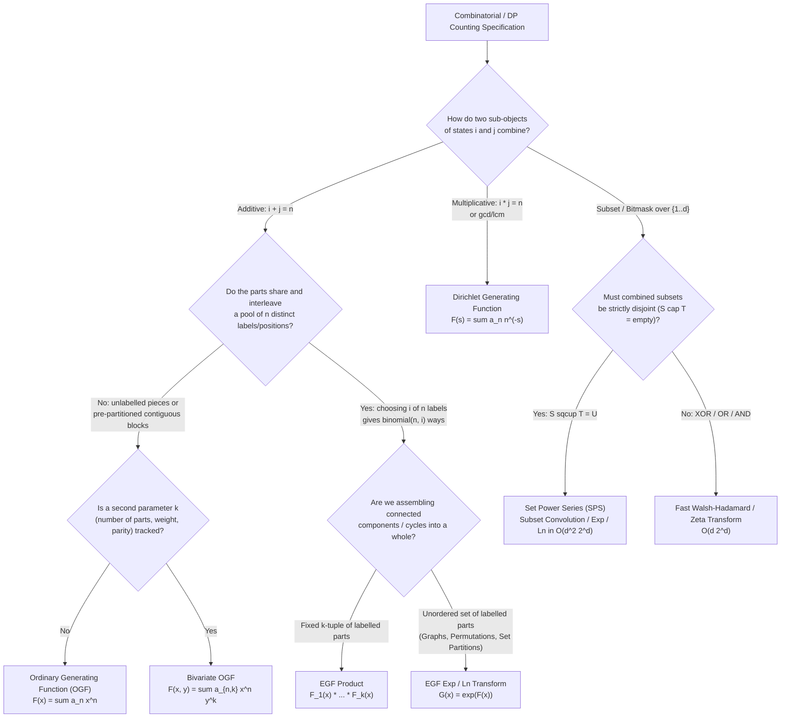

# Wave 1B (Iterations 06–10): Combinatorial-to-GF Modelling, Mechanical DP Conversion, Binomial Sum Untangling & Hidden Convolutions

> **Scope & Pedagogical Philosophy**: This research dossier covers **Iterations 06 through 10** of the Formal Power Series (FPS) and Generating Functions (GF) curriculum. Rather than treating generating functions as a collection of isolated algebraic tricks, we establish a **mechanical engineering pipeline** for competitive programmers:
> 1. **Iteration 06**: Diagnosing *which* generating function ring (OGF, EGF, Bivariate GF, Dirichlet GF, or Set Power Series) matches a combinatorial specification, including Prüfer-tree degree encodings and negative examples/false positives.
> 2. **Iteration 07**: Translating 1D, 2D, prefix-sum, rollback ("戻すDP"), cyclic modulo, and automaton/transfer-matrix Dynamic Programming transitions into closed-form polynomial and rational operations—with foolproof boundary-term engineering.
> 3. **Iteration 08**: Untangling single and multi-dimensional binomial and falling-factorial sums using the coefficient extraction operator $[x^n]$ ("Snake Oil" and Egorychev's Method of Coefficients) via a systematic **Binomial Kernel Dictionary**.
> 4. **Iteration 09**: Unmasking hidden convolutions—difference/cross-correlation convolutions via polynomial reversal, Chu-Vandermonde & upper-index binomial convolutions, and $k$-fold prefix-sum/difference operators $(1-x)^{\pm k}$.
> 5. **Iteration 10**: Multilingual literature synthesis (`[EN]`, `[ZH]`, `[JA]`), a rigorous **Accepted Problem Audit** (with 3-tier progressive hints and complete derivations), a **Rejected Template Problems Table**, and a **Master Wave 1B Bibliography**.

---

## Iteration 06: Combinatorial-to-GF Modelling Archetypes & Decision Matrix

### 6.1 The Fundamental Modelling Question: Why Does an Algebra Match a Counting Problem?

In competitive programming, a generating function is not an analytic function evaluated at complex numbers; it is a **data structure in a commutative ring** where the **addition** operation $+$ encodes **disjoint union of choices** (OR) and the **multiplication** operation $*$ encodes **combinatorial assembly of independent parts** (AND).

The fatal mistake many learners make is defaulting to an Ordinary Generating Function (OGF) $F(x) = \sum_{n \ge 0} a_n x^n$ for every problem. Which generating function ring you must choose is dictated **entirely by how two sub-objects of sizes $i$ and $j$ combine to form a composite object of size $n$**:

| Combinatorial Assembly Law | Index Combination Rule | Weight / Relabelling Multiplier | Canonical Generating Function Ring | Basis Element for Size/State $n$ |
| :--- | :--- | :--- | :--- | :--- |
| **Additive size, unlabelled / ordered slots** | $i + j = n$ | $1$ (no relabelling between parts) | **Ordinary GF (OGF)** $K[[x]]$ | $x^n$ |
| **Additive size, labelled atoms / interleaved positions** | $i + j = n$ | $\binom{n}{i} = \frac{n!}{i! j!}$ (choose which $i$ labels/slots go to part 1) | **Exponential GF (EGF)** $K[[x]]$ (Hurwitz/exp ring) | $\frac{x^n}{n!}$ |
| **Additive size + auxiliary statistic (count, cost, inversions)** | $i_1 + i_2 = n$, $k_1 + k_2 = k$ | $1$, $\binom{n}{i_1}$, or $q$-binomial | **Bivariate GF (BGF)** $K[y][[x]]$ or $K[[x, y]]$ | $x^n y^k$ or $\frac{x^n}{n!} y^k$ |
| **Multiplicative / Divisibility / GCD / LCM** | $i \cdot j = n$ | $1$ | **Dirichlet GF (DGF)** $\mathcal{D}(K)$ | $n^{-s}$ |
| **Bitwise Boolean (XOR, OR, AND) on $d$-bit masks** | $S \oplus T = U$, $S \cup T = U$, $S \cap T = U$ | $1$ | **Walsh / Mobius Ring** $K[x_1,\dots,x_d]/\langle x_r^2 - \dots \rangle$ | $x^S = \prod_{r \in S} x_r$ |
| **Disjoint Set Partition / Induced Subgraph Decomposition** | $S \cup T = U$ with $S \cap T = \emptyset$ | $[S \cap T = \emptyset]$ (zero if overlapping!) | **Set Power Series (SPS)** $K[x_1,\dots,x_d]/\langle x_1^2,\dots,x_d^2 \rangle$ | $x^S y^{|S|}$ |

---

### 6.2 Deep Dive into the Five Canonical Archetypes (Zero Magic Steps)

#### Archetype 1: Ordinary Generating Functions (OGF) — Unlabelled Multisets, Integer Partitions, and Ordered Sequences of Blocks

* **a. Concrete Combinatorial / Algebraic Object**:
  We have a sequence $\{a_n\}_{n \ge 0}$ counting objects of "size" (weight, length, sum) $n$, encoded in the formal power series ring $K[[x]]$ as:
  $$F(x) = \sum_{n=0}^{\infty} a_n x^n$$
  When we form an ordered pair $(o_1, o_2) \in \mathcal{A} \times \mathcal{B}$ whose total size is $\text{size}(o_1) + \text{size}(o_2) = n$, there is **no relabelling** between the internal atoms of $o_1$ and $o_2$: either the atoms are indistinguishable (e.g., identical coins/candies), or $o_1$ occupies the first $\text{size}(o_1)$ positions and $o_2$ occupies the remaining $\text{size}(o_2)$ positions in a fixed left-to-right order.

* **b. The Diagnostic Signal**:
  Look for these exact structural cues in a problem statement:
  1. **Sum constraint over independent variables**: $c_1 + c_2 + \dots + c_k = N$ where each $c_i \in S_i$ has weight/ways $a^{(i)}_{c_i}$.
  2. **Block concatenation**: Tiling a $1 \times N$ board or partitioning a string into contiguous blocks where a block of length $L$ has $w_L$ internal configurations.
  3. **Unlabelled multisets / Integer partitions**: Choosing $c_v$ copies of an item of weight $v$, contributing $v \cdot c_v$ to total weight $N$.

* **c. The Reverse-Engineering Scratchpad**:
  Suppose we want to count the number of ways to choose $c_i \in [0, a_i]$ candies for child $i \in \{1, \dots, K\}$ such that $c_1 + c_2 + \dots + c_K = N$.
  - What do we *want*? We want a sum over all valid tuples $(c_1, \dots, c_K)$ such that $\sum_{i=1}^K c_i = N$:
    $$\text{Ans} = \sum_{\substack{0 \le c_i \le a_i \\ c_1 + \dots + c_K = N}} 1$$
  - How do we convert an additive condition $c_1 + \dots + c_K = N$ into a multiplicative condition that separates the variables $c_1, \dots, c_K$?
  - By the law of exponents! $x^{c_1} \cdot x^{c_2} \cdots x^{c_K} = x^{c_1 + c_2 + \dots + c_K}$.
  - Therefore, if we attach $x^{c_i}$ to the choice of $c_i$ candies for child $i$, the product of sums automatically distributes into a sum over all tuples, and collecting the coefficient of $x^N$ isolates exactly those tuples whose sum is $N$.

* **d. Step-by-Step Algebraic Derivation & Verbal Annotations**:
  $$\begin{aligned}
  \text{Ans}(N) &= \sum_{c_1=0}^{a_1} \sum_{c_2=0}^{a_2} \cdots \sum_{c_K=0}^{a_K} [c_1 + c_2 + \dots + c_K = N] && \text{(Iverson bracket encoding sum constraint)} \\
  &= \sum_{c_1=0}^{a_1} \cdots \sum_{c_K=0}^{a_K} [x^N] x^{c_1 + c_2 + \dots + c_K} && \text{(Rewrite } [A=N] \text{ as } [x^N]x^A\text{)} \\
  &= [x^N] \sum_{c_1=0}^{a_1} x^{c_1} \sum_{c_2=0}^{a_2} x^{c_2} \cdots \sum_{c_K=0}^{a_K} x^{c_K} && \text{(Factor independent sums by linearity of } [x^N]\text{)} \\
  &= [x^N] \prod_{i=1}^{K} \left( \frac{1 - x^{a_i + 1}}{1 - x} \right) && \text{(Closed form of finite geometric series in } K[[x]]\text{)} \\
  &= [x^N] (1 - x)^{-K} \prod_{i=1}^{K} (1 - x^{a_i + 1}) && \text{(Group all denominators into } (1-x)^{-K}\text{)}
  \end{aligned}$$
  *Algebraic Validity Conditions*:
  - $1 - x$ is a unit in $K[[x]]$ because its constant term is $[x^0](1-x) = 1 \in K^\times$.
  - No characteristic restriction is needed for $(1-x)^{-K} = \sum_{m \ge 0} \binom{m+K-1}{K-1} x^m$ as long as binomial coefficients are computed in $\mathbb{Z}$ and reduced modulo $M$ (or vialucas/prime factorisation if $M$ is small prime).

* **e. Hand-Checkable Toy Example ($K=2, a_1=2, a_2=1, N=2$)**:
  - Valid tuples $(c_1, c_2)$ with $c_1 \in \{0,1,2\}, c_2 \in \{0,1\}$ and $c_1+c_2=2$: $(2,0)$ and $(1,1)$, so $\text{Ans}=2$.
  - Using the OGF formula:
    $$\prod_{i=1}^2 (1 - x^{a_i+1}) = (1 - x^3)(1 - x^2) = 1 - x^2 - x^3 + x^5$$
    $$(1-x)^{-2} = 1 + 2x + 3x^2 + 4x^3 + \dots$$
    $$[x^2] \left( (1 + 2x + 3x^2)(1 - x^2) \right) = [x^2](3x^2 - 1 \cdot x^2) = 3 - 1 = 2. \quad \checkmark$$

* **f. Failure Modes, Pitfalls & Edge Cases**:
  - **Infinite geometric series convergence**: If $a_i = \infty$, the factor is $(1-x)^{-1}$. If an item has weight $0$ ($x^0 = 1$) and can be chosen infinitely many times, $1 + x^0 + x^0 + \dots$ does **not** converge in the $(x)$-adic topology of $K[[x]]$! Every repeatable element in a sequence/multiset operator $\text{SEQ}(A) = (1-A(x))^{-1}$ MUST have $\operatorname{val}(A) \ge 1$ (i.e., $[x^0]A(x) = 0$, no zero-weight items).

---

#### Archetype 2: Exponential Generating Functions (EGF) — Labelled Structures, Frequency-Constrained Sequences, Permutations, and Prüfer Tree Degree Encodings

* **a. Concrete Combinatorial / Algebraic Object**:
  For a sequence $\{a_n\}_{n \ge 0}$ counting **labelled** structures on an $n$-element vertex/position set $\{1, 2, \dots, n\}$, its Exponential Generating Function in $K[[x]]$ (where $\operatorname{char}(K) = 0$ or $\operatorname{char}(K) = p > N$) is:
  $$\widehat{A}(x) = \sum_{n=0}^{\infty} a_n \frac{x^n}{n!}$$
  Multiplication of two EGFs $\widehat{A}(x)$ and $\widehat{B}(x)$ produces the **binomial convolution**:
  $$\widehat{C}(x) = \widehat{A}(x) \widehat{B}(x) \iff c_n = n! [x^n] \widehat{C}(x) = \sum_{k=0}^{n} \binom{n}{k} a_k b_{n-k}$$

* **b. The Diagnostic Signal**:
  Reach for an EGF immediately when you see ANY of the following four structures:
  1. **Alphabet Frequency Constraints in Strings/Sequences of Length $N$**: "Count strings of length $N$ over alphabet $\{1, \dots, K\}$ where character $i$ appears $c_i \in S_i$ times." (Why? A string of length $N$ is a **partition of the $N$ labelled positions $\{1, \dots, N\}$** into $K$ subsets of sizes $c_1, \dots, c_K$, which gives the multinomial coefficient $\frac{N!}{c_1! \cdots c_K!}$!)
  2. **Binomial Convolution in a Recurrence**: $dp[n] = \sum_{k} \binom{n}{k} f(k) dp[n-k]$ or $\binom{n-1}{k-1} f(k) dp[n-k]$ (putting atom $n$ in the first component of size $k$).
  3. **Connected vs. General Labelled Graphs / Permutation Cycle Decomposition**: A general labelled object is an **unordered set of connected components**, governed by the Exponential Formula $\widehat{G}(x) = \exp(\widehat{C}(x))$.
  4. **Prüfer Sequences & Labelled Trees by Vertex Degrees**: By Cayley's / Prüfer's theorem, the number of labelled trees on $N$ vertices with degrees $d_1, d_2, \dots, d_N \ge 1$ (where $\sum d_i = 2N-2$) is the multinomial coefficient:
     $$\frac{(N-2)!}{(d_1 - 1)! (d_2 - 1)! \cdots (d_N - 1)!} = (N-2)! [x^{N-2}] \prod_{i=1}^{N} \left( \sum_{d_i \in D_i} w(d_i) \frac{x^{d_i - 1}}{(d_i - 1)!} \right)$$

* **c. The Reverse-Engineering Scratchpad**:
  Suppose we want to count the number of labelled graphs on $N$ vertices where every connected component is a cycle of length $\ge 3$.
  - Let $c_n$ be the number of connected components (undirected cycles) on $n$ labelled vertices. For $n \ge 3$, there are $(n-1)!/2$ undirected cycles on $n$ vertices; for $n < 3$, $c_n = 0$.
  - How do we assemble a graph $G$ on $N$ vertices from $k$ connected components?
    1. Partition the $N$ vertex labels into an *ordered* $k$-tuple of non-empty subsets of sizes $n_1 + n_2 + \dots + n_k = N$: there are $\frac{N!}{n_1! n_2! \cdots n_k!}$ ways.
    2. Choose a cycle structure on each subset: $c_{n_1} c_{n_2} \cdots c_{n_k}$ ways.
    3. Because the $k$ connected components in a graph have **no inherent order among themselves**, our ordered $k$-tuple overcounts each graph by $k!$ (since all $k$ vertex sets are disjoint and non-empty, they are distinct).
  - Dividing by $k!$ and summing over all $k \ge 0$:
    $$g_N = \sum_{k=0}^{\infty} \frac{1}{k!} \sum_{n_1 + \dots + n_k = N} \frac{N!}{n_1! \cdots n_k!} c_{n_1} \cdots c_{n_k}$$
  - Divide both sides by $N!$:
    $$\frac{g_N}{N!} = [x^N] \sum_{k=0}^{\infty} \frac{1}{k!} \left( \sum_{n=1}^{\infty} c_n \frac{x^n}{n!} \right)^k = [x^N] \exp(\widehat{C}(x)).$$

* **d. Step-by-Step Algebraic Derivation & Verbal Annotations (The Exponential Formula & Cycle EGF)**:
  For undirected 2-regular graphs (collections of cycles of length $\ge 3$):
  $$\begin{aligned}
  \widehat{C}(x) &= \sum_{n=3}^{\infty} \frac{(n-1)!}{2} \frac{x^n}{n!} && \text{(EGF of a single undirected cycle of length } \ge 3\text{)} \\
  &= \frac{1}{2} \sum_{n=3}^{\infty} \frac{x^n}{n} && \text{(Cancel } (n-1)! \text{ against } n! = n(n-1)!\text{)} \\
  &= \frac{1}{2} \left( \ln \frac{1}{1-x} - x - \frac{x^2}{2} \right) && \text{(Recognize Maclaurin series } \ln\frac{1}{1-x} = \sum_{n \ge 1} \frac{x^n}{n}\text{)} \\
  \widehat{G}(x) &= \exp(\widehat{C}(x)) = \frac{\exp\left(-\frac{x}{2} - \frac{x^2}{4}\right)}{\sqrt{1-x}} && \text{(Apply } \exp\text{ to assemble unordered sets of cycles)}
  \end{aligned}$$
  *Algebraic Validity Conditions*:
  - For $\exp(\widehat{C}(x))$ and $\ln(1 + \widehat{H}(x))$ to be well-defined in $K[[x]]$, we MUST have $[x^0]\widehat{C}(x) = 0$ (an empty component of size $0$ cannot exist, otherwise you could add infinitely many empty components!).
  - Furthermore, dividing by $n!$ requires $1, 2, \dots, N$ to be invertible in $K$, so $\operatorname{char}(K) = 0$ or $p > N$.

* **e. Hand-Checkable Toy Example ($N=4$ for 2-regular undirected graphs)**:
  - On $N=4$ labelled vertices, a 2-regular graph with cycle lengths $\ge 3$ must be a single 4-cycle. There are $(4-1)!/2 = 3$ such graphs.
  - Using $\widehat{G}(x) = \exp\left(\frac{x^3}{6} + \frac{x^4}{8} + O(x^5)\right) = 1 + \frac{x^3}{6} + \frac{x^4}{8} + O(x^5)$:
    $$g_4 = 4! [x^4] \widehat{G}(x) = 24 \cdot \frac{1}{8} = 3. \quad \checkmark$$

* **f. Failure Modes, Pitfalls & Edge Cases**:
  - **Forgetting the $1/2$ for undirected cycles vs. directed permutation cycles**: In permutations, cycles are directed ($c_n = (n-1)!$, valid for $n \ge 1$), giving $\widehat{C}_{\text{perm}}(x) = \ln \frac{1}{1-x}$. In undirected graphs, cycles of length $\ge 3$ have 2 orientations ($c_n = (n-1)!/2$), a 2-cycle is a single edge, and a 1-cycle is a self-loop.
  - **Prüfer degree shift**: In Prüfer sequences, a vertex of degree $d_i$ appears $d_i - 1$ times in a sequence of length $N - 2$. Forgetting to shift $d_i \mapsto d_i - 1$ and $N \mapsto N - 2$ is the #1 bug in tree-counting problems.

---

#### Archetype 3: Bivariate Generating Functions (BGF) — Multi-Parameter Tracking & The Exp-with-Weight $y$ Pattern

* **a. Concrete Combinatorial / Algebraic Object**:
  A sequence $a_{n,k}$ indexed by two parameters (typically primary size $n$ and secondary statistic $k$ such as number of components, number of inversions, or weight) is represented in $K[y][[x]]$ or $K[[x, y]]$ as:
  $$F(x, y) = \sum_{n=0}^{\infty} \sum_{k=0}^{\infty} a_{n,k} x^n y^k \quad \text{(OGF-OGF)} \qquad \text{or} \qquad \widehat{F}(x, y) = \sum_{n=0}^{\infty} \sum_{k=0}^{\infty} a_{n,k} \frac{x^n}{n!} y^k \quad \text{(EGF-OGF)}$$
  Notice the **EGF-OGF** hybrid $\sum a_{n,k} \frac{x^n}{n!} y^k$: the vertices/positions $n$ are **labelled** (hence $x^n / n!$), while the components/edges $k$ are **unlabelled count statistics** (hence $y^k$ without $k!$).

* **b. The Diagnostic Signal**:
  1. "Count objects of size $n$ with **exactly $k$** parts / cycles / connected components / inversions."
  2. "Compute the **expected value** or **variance** of the number of components/cycles over all objects of size $n$." (By differentiating with respect to $y$ and setting $y=1$: $\sum_k k a_{n,k} = [x^n] \left.\frac{\partial F(x,y)}{\partial y}\right|_{y=1}$!)
  3. **Inclusion-Exclusion weights**: When an inclusion-exclusion weight $(-1)^k$ depends on the number of chosen violations $k$, setting $y = -1$ in $F(x, y)$ automatically evaluates the alternating sum $\sum_k (-1)^k a_{n,k}$!

* **c. The Reverse-Engineering Scratchpad**:
  Suppose we know the EGF $\widehat{C}(x)$ of a single connected component, and we want to count graphs on $n$ vertices with **exactly $k$** connected components.
  - Multiplying $\widehat{C}(x)$ by $y$ tags every single connected component with $y^1$.
  - When $k$ components combine, their $y$-tags multiply to $y^1 \cdots y^1 = y^k$.
  - Therefore, replacing $\widehat{C}(x)$ with $y \widehat{C}(x)$ in the Exponential Formula gives:
    $$\widehat{G}(x, y) = \exp(y \widehat{C}(x)) = \sum_{k=0}^{\infty} y^k \frac{\widehat{C}(x)^k}{k!}$$
  - Extracting $[y^k]$ immediately yields $\frac{\widehat{C}(x)^k}{k!}$, while differentiating with respect to $y$ at $y=1$ yields $\widehat{C}(x) \exp(\widehat{C}(x))$!

* **d. Step-by-Step Algebraic Derivation & Verbal Annotations (Unsigned Stirling Numbers of the First Kind $\begin{bmatrix} n \\ k \end{bmatrix}$)**:
  Let $\begin{bmatrix} n \\ k \end{bmatrix}$ be the number of permutations of $n$ elements with $k$ disjoint cycles.
  $$\begin{aligned}
  \widehat{C}(x) &= \sum_{n=1}^{\infty} (n-1)! \frac{x^n}{n!} = \ln \frac{1}{1-x} && \text{(EGF of a single directed cycle)} \\
  \widehat{G}(x, y) &= \exp\left( y \ln \frac{1}{1-x} \right) = (1 - x)^{-y} && \text{(BGF where } x \text{ is EGF for size, } y \text{ is OGF for cycle count)} \\
  &= \sum_{n=0}^{\infty} \binom{-y}{n} (-x)^n = \sum_{n=0}^{\infty} y(y+1)\cdots(y+n-1) \frac{x^n}{n!} && \text{(Newton's generalized binomial theorem)}
  \end{aligned}$$
  Comparing coefficients of $\frac{x^n}{n!} y^k$ on both sides proves both ways to compute $\begin{bmatrix} n \\ k \end{bmatrix}$:
  1. **Fixed $n$, all $k$ (Row GF)**: $\sum_{k=0}^n \begin{bmatrix} n \\ k \end{bmatrix} y^k = y^{\overline{n}} = y(y+1)\cdots(y+n-1)$, computable in $O(n \log^2 n)$ via divide-and-conquer FFT or $O(n \log n)$ via Taylor shift.
  2. **Fixed $k$, all $n \le N$ (Column GF)**: $\sum_{n=k}^{\infty} \begin{bmatrix} n \\ k \end{bmatrix} \frac{x^n}{n!} = \frac{1}{k!} \left(\ln \frac{1}{1-x}\right)^k$, computable in $O(N \log N)$ via polynomial $\ln$ and $\exp$!

* **e. Hand-Checkable Toy Example ($n=3, k=2$)**:
  - Row GF at $n=3$: $y(y+1)(y+2) = y^3 + 3y^2 + 2y^1 \implies [y^2] = 3$.
  - Column GF at $k=2$: $\frac{1}{2!}\left(x + \frac{x^2}{2} + \frac{x^3}{3} + \dots\right)^2 = \frac{1}{2}\left(x^2 + x^3 + \dots\right) \implies 3! [x^3] = 6 \cdot \frac{1}{2} = 3$. $\checkmark$

* **f. Failure Modes, Pitfalls & Edge Cases**:
  - **Confusing OGF-OGF with EGF-OGF**: Never apply $\exp$ to the unlabelled parameter $y$! If objects are unlabelled in size $x$ (like integer partitions), the multiset operator is the **Pólya / Euler product** $\prod_{n \ge 1} (1 - y x^n)^{-a_n} = \exp\left(\sum_{m \ge 1} \frac{y^m}{m} A(x^m)\right)$, NOT $\exp(y A(x))$.

---

#### Archetype 4: Dirichlet Generating Functions (DGF) — Multiplicative Number Theory & GCD/LCM Convolutions

* **a. Concrete Combinatorial / Algebraic Object**:
  A sequence $\{a_n\}_{n \ge 1}$ indexed by positive integers is encoded in the ring of formal Dirichlet series $\mathcal{D}(K)$ as:
  $$\tilde{A}(s) = \sum_{n=1}^{\infty} \frac{a_n}{n^s}$$
  Multiplication is the **Dirichlet convolution**:
  $$\tilde{C}(s) = \tilde{A}(s) \tilde{B}(s) \iff c_n = \sum_{d \mid n} a_d b_{n/d}$$

* **b. The Diagnostic Signal**:
  - Sums or recurrences indexed by **divisors** $\sum_{d \mid n} f(d) g(n/d)$, **multiples** $\sum_{n \mid m} f(m)$, **GCD** $\sum_{\gcd(i,j)=k}$, or **LCM** $\sum_{\operatorname{lcm}(i,j)=k}$.
  - DP where state transitions multiply indices: $dp[i + 1][u \cdot v] \gets dp[i][u] \cdot w(v)$ for $u \cdot v \le N$.

* **c. The Reverse-Engineering Scratchpad**:
  Why does $n^{-s}$ untangle divisor sums? Because $(d)^{-s} \cdot (n/d)^{-s} = (d \cdot (n/d))^{-s} = n^{-s}$. If we evaluate the Riemann zeta series $\zeta(s) = \sum_{n \ge 1} n^{-s}$ (representing the constant sequence $\mathbf{1}(n) = 1$), then multiplying $\tilde{A}(s) \cdot \zeta(s)$ produces the divisor prefix sum $b_n = \sum_{d \mid n} a_d$. Therefore, inverting $\zeta(s)$ gives the Möbius function $\zeta(s)^{-1} = \sum_{n \ge 1} \mu(n) n^{-s}$!

* **d. Step-by-Step Algebraic Derivation & Verbal Annotations**:
  By the Fundamental Theorem of Arithmetic, every $n \ge 1$ factors uniquely as $n = p_1^{e_1} p_2^{e_2} \cdots$, so $\mathcal{D}(K)$ is isomorphic to the ring of formal power series in countably many variables $x_p = p^{-s}$:
  $$\tilde{A}(s) = \sum_{n=1}^{\infty} a_n \prod_{p} x_p^{v_p(n)}$$
  *Complexity & Algorithmic Operations on prefixes $1 \dots N$*:
  - Naive Dirichlet multiplication $\tilde{A} * \tilde{B}$: $\sum_{d=1}^N \frac{N}{d} = O(N \log N)$.
  - Dirichlet prefix sum ($\times \zeta(s)$) or Möbius inversion ($\times \zeta(s)^{-1}$) via Prime Dirichlet Sieve (analogous to SOS DP over prime dimensions): $O(N \log \log N)$.
  - Dirichlet inverse, $\exp$, $\ln$, or $k$-th power on $1 \dots N$: $O(N \log N)$ cleanly by simple loops over $i=1 \dots N$ and its multiples $j = 2i, 3i, \dots \le N$!

* **e. Hand-Checkable Toy Example ($N=6$, Dirichlet inverse of $\mathbf{1}$)**:
  - $[1^{-s}]\zeta^{-1} = 1$.
  - For $n=2, 3, 5$ (primes): $\mu(p) = -\mu(1) = -1$.
  - For $n=4$: $\mu(4) = -(\mu(1) + \mu(2)) = -(1 - 1) = 0$.
  - For $n=6$: $\mu(6) = -(\mu(1) + \mu(2) + \mu(3)) = -(1 - 1 - 1) = 1$. $\checkmark$

* **f. Failure Modes, Pitfalls & Edge Cases**:
  - **Zero index $n=0$**: Dirichlet series start at $n=1$ ($1^{-s}$ is the multiplicative identity!). A term $0^{-s}$ does not exist. The unit condition for $\tilde{A}(s)^{-1}$ is $a_1 \in K^\times$, whereas for $\exp(\tilde{A}(s))$ and $\ln(1 + \tilde{A}(s))$ we require $a_1 = 0$.

---

#### Archetype 5: Set Power Series (SPS) — Subset Convolution, Exp/Ln on Induced Subgraphs, and Bitwise Rings

* **a. Concrete Combinatorial / Algebraic Object**:
  Given a ground set $V = \{1, 2, \dots, d\}$ (typically $d \le 20$), a sequence $\{f_S\}_{S \subseteq V}$ is encoded in the truncated multivariate polynomial ring:
  $$\mathcal{R}_{\text{SPS}} = K[x_1, x_2, \dots, x_d] / \langle x_1^2, x_2^2, \dots, x_d^2 \rangle, \qquad F(x) = \sum_{S \subseteq V} f_S x^S \quad \left(x^S := \prod_{i \in S} x_i\right)$$
  Why quotient by $x_i^2 = 0$? Because if two subsets $S, T \subseteq V$ overlap ($i \in S \cap T$), then $x^S \cdot x^T$ contains $x_i^2 = 0$ and **automatically vanishes**! Thus multiplication in $\mathcal{R}_{\text{SPS}}$ is the **Subset Convolution**:
  $$H(x) = F(x) G(x) \iff h_U = \sum_{\substack{S \cup T = U \\ S \cap T = \emptyset}} f_S g_T = \sum_{S \subseteq U} f_S g_{U \setminus S}$$

* **b. The Diagnostic Signal**:
  - Bitmask DP of the form $dp[U] = \sum_{S \subseteq U} f[S] \cdot dp[U \setminus S]$ ($O(3^d)$ naive submask enumeration).
  - Counting **connected** vs. **general** structures on **labelled vertex subsets $S \subseteq V$ where edges/weights depend on the specific vertices** (so vertices are NOT interchangeable, preventing standard univariate EGF!).

* **c. The Reverse-Engineering Scratchpad**:
  How do we compute multiplication in $K[x_1, \dots, x_d]/\langle x_1^2, \dots, x_d^2 \rangle$ faster than $O(3^d)$?
  - Notice that for any $S, T \subseteq V$, we always have $|S \cup T| \le |S| + |T|$, with equality **if and only if** $S \cap T = \emptyset$!
  - Therefore, if we introduce a placeholder variable $y$ tracking the popcount $|S|$ and apply the OR-Zeta Transform (SOS DP), a polynomial $F(x) = \sum_{S \subseteq V} f_S x^S y^{|S|}$ becomes, for each fixed mask $U$, a univariate polynomial in $y$ of degree $\le d$!
  - Multiplying two degree-$d$ polynomials in $y$ takes $O(d^2)$ operations per mask $U$, reducing $O(3^d)$ to $O(d^2 2^d)$! Even better, any univariate FPS operation ($\inv, \exp, \ln, \sqrt{\cdot}$, composition) lifts directly to Set Power Series in $O(d^2 2^d)$ by applying the operation to the degree-$d$ polynomials in $K[y]/\langle y^{d+1} \rangle$ at each point of the Zeta transform!

* **d. Step-by-Step Algebraic Derivation & Verbal Annotations**:
  Define the **Ranked Zeta Transform** $\hat{f}_U(y) \in K[y]/\langle y^{d+1} \rangle$ for each $U \subseteq V$:
  $$\hat{f}_U(y) = \sum_{S \subseteq U} f_S y^{|S|}$$
  Then for $H = F *_{\text{subset}} G$:
  $$\begin{aligned}
  h_U &= [y^{|U|}] \sum_{S \subseteq U} \sum_{T \subseteq U} [S \cup T = U] f_S g_T y^{|S| + |T|} && \text{(Since } |S|+|T| = |U| \text{ iff } S \cap T = \emptyset \text{ when } S \cup T = U\text{)} \\
  &= [y^{|U|}] \sum_{W \subseteq U} (-1)^{|U \setminus W|} \left(\sum_{S \subseteq W} f_S y^{|S|}\right)\left(\sum_{T \subseteq W} g_T y^{|T|}\right) && \text{(By Subset Möbius Inversion)} \\
  &= [y^{|U|}] \sum_{W \subseteq U} (-1)^{|U \setminus W|} \hat{f}_W(y) \hat{g}_W(y) && \text{(Pointwise product of degree-} d \text{ polynomials in } y\text{)}
  \end{aligned}$$

* **e. Hand-Checkable Toy Example ($d=2, V=\{1,2\}$)**:
  - Suppose $f_{\{1\}} = 2, f_{\{2\}} = 3, f_\emptyset = f_{\{1,2\}} = 0$. We want $H = \exp(F) = 1 + F + \frac{1}{2} F^2$.
  - Ranked Zeta polynomials $\hat{f}_U(y)$:
    - $\hat{f}_\emptyset(y) = 0$
    - $\hat{f}_{\{1\}}(y) = 2y$, $\hat{f}_{\{2\}}(y) = 3y$
    - $\hat{f}_{\{1,2\}}(y) = (2+3)y = 5y$.
  - Pointwise $\exp(\hat{f}_U(y)) \bmod y^3$:
    - For $U=\{1,2\}$: $\exp(5y) \bmod y^3 = 1 + 5y + \frac{25}{2}y^2$.
    - For $U=\{1\}$: $1 + 2y + 2y^2$; for $U=\{2\}$: $1 + 3y + \frac{9}{2}y^2$; for $U=\emptyset$: $1$.
  - Inverse Zeta (Möbius) at $U=\{1,2\}$ and extracting $[y^2]$:
    $$h_{\{1,2\}} = [y^2]\left( \left(1 + 5y + \frac{25}{2}y^2\right) - (1 + 2y + 2y^2) - \left(1 + 3y + \frac{9}{2}y^2\right) + 1 \right) = \frac{25}{2} - 2 - \frac{9}{2} = 6 = 2 \times 3. \quad \checkmark$$

* **f. Failure Modes, Pitfalls & Edge Cases**:
  - **Confusing OR-convolution with Subset Convolution**: If overlapping elements are allowed ($S \cup T = U$ without $S \cap T = \emptyset$), use standard SOS DP / Zeta transform in $O(d 2^d)$, NOT $O(d^2 2^d)$ subset convolution.

---

### 6.3 Catalogue of Negative Examples & False Positives (When a Modelling Choice Fails)

> [!WARNING]
> **Diagnostic Audit — Catching Modelling Mismatches Before Writing Code**:
> Below are the 5 most common "False Positive" traps where a problem *superficially* looks like one generating function archetype, but using it produces completely wrong answers or invalid algebra.

| Trap # | Problem Surface Clue | Naive (Wrong) GF Choice | Why It Fails Algebraically & Combinatorially | Correct Formulation |
| :--- | :--- | :--- | :--- | :--- |
| **1** | "Count sequences of length $N$ over $\{1,\dots,K\}$ where symbol $i$ appears $c_i \in S_i$ times ($\sum c_i = N$)." | **OGF**: $\prod_{i=1}^K \left(\sum_{c \in S_i} x^c\right)$ | OGF product $\prod x^{c_i} = x^{\sum c_i}$ only counts the **tuple of frequencies** $(c_1,\dots,c_K)$, completely missing the $\frac{N!}{c_1!\cdots c_K!}$ ways to interleave the symbols across the $N$ positions! | **EGF**: $N! [x^N] \prod_{i=1}^K \left(\sum_{c \in S_i} \frac{x^c}{c!}\right)$. |
| **2** | "Count connected graphs on a given input graph $G=(V,E)$ with $d \le 20$ vertices." | **Univariate EGF**: $\ln \sum_{n=0}^d 2^{\binom{n}{2}} \frac{x^n}{n!}$ | Univariate EGF assumes all vertices are symmetrical ($K_d$). When $G$ is a specific input graph, subgraph counts depend on the **exact vertex subset $S \subseteq V$**, not just $|S|$! | **Set Power Series (SPS)**: Take $\ln$ of $\sum_{S \subseteq V} 2^{|E(G[S])|} x^S$ in $K[x_1,\dots,x_d]/\langle x_i^2 \rangle$ in $O(d^2 2^d)$. |
| **3** | "Count sequences of positive and **zero** weights summing to $N$, using $(1 - A(x))^{-1}$." | **Unchecked OGF**: $(1 - A(x))^{-1}$ when $a_0 = [x^0]A(x) \ne 0$ | If $a_0 = 1$, then $1 - A(x)$ has constant term $1 - 1 = 0$, so it is **not invertible** in $K[[x]]$! Combinatorially, you can insert infinitely many weight-$0$ items without changing total weight $N$. | Separate weight-$0$ items first (if chosen a bounded number of times or as subsets $(1+x^0)^{a_0} = 2^{a_0}$), so $\operatorname{val}(A_{\ge 1}) \ge 1$. |
| **4** | "Count multisets of unlabelled objects of size $n$ using $\exp(A(x))$." | **EGF Exp on OGF**: $\exp(A(x))$ without dividing by $n!$ | $\exp(A(x)) = \sum \frac{A(x)^k}{k!}$ divides by $k!$ assuming all $k$ chosen parts are **distinct** (labelled). For unlabelled multisets where identical items can be repeated, $\frac{A(x)^k}{k!}$ fails on diagonals! | **Euler / Pólya Exp**: $\prod_{n \ge 1} (1 - x^n)^{-a_n} = \exp\left(\sum_{m=1}^{\infty} \frac{A(x^m)}{m}\right)$. |
| **5** | "Compute EGF $\exp(\widehat{A}(x))$ up to degree $N$ modulo a small prime $p \le N$ (e.g., $p=2$ or $p=998244353 < N$)." | **Standard EGF**: $\sum_{n=0}^N a_n \frac{x^n}{n!} \pmod p$ | For $n \ge p$, $n! \equiv 0 \pmod p$ is **not invertible** in $\mathbb{F}_p$! The Hurwitz ring over $\mathbb{F}_p$ is not isomorphic to $\mathbb{F}_p[[x]]$. | Use $O(N^2)$ binomial DP, Lucas' theorem / base-$p$ digit DP, or work in $O(N^2)$ without dividing by $n!$. |

---

## Iteration 07: Mechanical 1D/2D/Automaton DP-to-GF Conversion & Boundary Term Engineering

### 7.1 The 5-Step Mechanical Recipe for 1D Recurrences & Boundary-Term Engineering

When converting a recurrence relation for $\{a_n\}_{n \ge 0}$ into an equation for $F(x) = \sum_{n \ge 0} a_n x^n$, **90% of implementation bugs occur at the boundary $0 \le n < d$** where the general recurrence does not hold (or references negative indices $a_{-1}, a_{-2}$).

Rather than splitting sums at $n = d$ and manually tracking five shifted index sums, there are two **foolproof, bug-free engineering methods** used by top competitive programmers:
1. **The Iverson Bracket Global Equation Method** (preferred for algebraic derivations and inhomogeneous forcing terms $g(n)$).
2. **The Truncated Product Formula $P(x) = Q(x) F(x) \bmod x^d$** (preferred when writing code to recover the numerator polynomial $P(x)$ from initial DP terms $a_0, \dots, a_{d-1}$, as popularized by `maspy` and `ryuhe1`).

#### Method 7.1A: The Iverson Bracket Global Equation Recipe

* **a. Concrete Combinatorial / Algebraic Object**:
  A sequence $\{a_n\}_{n \in \mathbb{Z}}$ with support $a_n = 0$ for all $n < 0$, encoded as $F(x) = \sum_{n \ge 0} a_n x^n \in K[[x]]$, governed by a recurrence for $n \ge d$:
  $$a_n = \sum_{k=1}^{d} c_k a_{n-k} + g_n \quad (n \ge d)$$
  with prescribed initial values $a_0, a_1, \dots, a_{d-1}$.

* **b. The Diagnostic Signal**:
  Any 1D DP where $dp[n]$ depends on a linear combination of previous states $dp[n-k]$ (either fixed depth $d$ or full convolution $\sum_{k=1}^n c_k dp[n-k]$) plus an optional base/forcing term $g_n$.

* **c. The Reverse-Engineering Scratchpad**:
  Why is summing $\sum_{n=d}^{\infty} a_n x^n$ annoying? Because on the left-hand side you get $F(x) - a_0 - a_1 x - \dots - a_{d-1}x^{d-1}$, and on the right-hand side $\sum_{n=d}^{\infty} c_k a_{n-k} x^n = c_k x^k (F(x) - a_0 - \dots - a_{d-k-1} x^{d-k-1})$ has a *different* truncation point for every $k$!
  Instead:
  - Define $a_n = 0$ for all $n < 0$.
  - Write a **single equation valid for ALL $n \ge 0$** by adding a boundary correction term $\Delta_n$ supported only on $0 \le n < d$ using Iverson brackets $[n = r]$:
    $$a_n = \sum_{k=1}^{d} c_k a_{n-k} + g_n + \sum_{r=0}^{d-1} \delta_r [n = r] \quad (\forall n \ge 0)$$
  - Now multiply by $x^n$ and sum over **all $n \ge 0$**! Because $a_{n-k} = 0$ for $n < k$, every shifted sum $\sum_{n \ge 0} a_{n-k} x^n$ is **literally $x^k F(x)$ with zero missing terms**!

* **d. Step-by-Step Algebraic Derivation & Verbal Annotations**:
  $$\begin{aligned}
  a_n - \sum_{k=1}^{d} c_k a_{n-k} &= g_n + \sum_{r=0}^{d-1} \delta_r [n = r] && \text{(Global recurrence valid for all } n \ge 0\text{, with } a_{<0} := 0\text{)} \\
  \sum_{n=0}^{\infty} a_n x^n - \sum_{k=1}^{d} c_k x^k \sum_{n=0}^{\infty} a_{n-k} x^{n-k} &= \sum_{n=0}^{\infty} g_n x^n + \sum_{r=0}^{d-1} \delta_r x^r && \text{(Multiply by } x^n \text{ and sum over } n \ge 0\text{)} \\
  F(x) - \left(\sum_{k=1}^{d} c_k x^k\right) F(x) &= G(x) + \Delta(x) && \text{(Since } a_{n-k}=0 \text{ for } n < k\text{, } \sum_{n \ge 0} a_{n-k} x^{n-k} = F(x)\text{)} \\
  Q(x) F(x) &= G(x) + \Delta(x) && \text{(Where } Q(x) := 1 - \sum_{k=1}^{d} c_k x^k\text{)}
  \end{aligned}$$
  And what if $G(x) = 0$ (a homogeneous linear recurrence for $n \ge d$)? Then $Q(x) F(x) = \Delta(x)$ is a polynomial of degree $< d$! Therefore, we don't even need to solve for $\delta_r$ by hand—we simply compute the product of the known prefix $F_{<d}(x) = \sum_{n=0}^{d-1} a_n x^n$ with $Q(x)$ modulo $x^d$:
  $$P(x) = \Delta(x) = \left( Q(x) \cdot \sum_{n=0}^{d-1} a_n x^n \right) \bmod x^d, \qquad F(x) = \frac{P(x)}{Q(x)}.$$
  *Algebraic Validity Conditions*:
  - $Q(0) = 1 \in K^\times$, so $Q(x)$ is always a unit in $K[[x]]$.
  - Truncating at $x^d$ is exact because for all $n \ge d$, $[x^n](Q(x)F(x)) = a_n - \sum_{k=1}^d c_k a_{n-k} = 0$.

* **e. Hand-Checkable Toy Example ($a_0 = 1, a_1 = 3$, and $a_n = 2a_{n-1} + a_{n-2}$ for $n \ge 2$)**:
  - Here $d = 2$, $Q(x) = 1 - 2x - x^2$, and $F_{<2}(x) = 1 + 3x$.
  - Compute $P(x) = Q(x) F_{<2}(x) \bmod x^2$:
    $$(1 - 2x - x^2)(1 + 3x) \equiv 1 + (3 - 2)x = 1 + x \pmod{x^2}$$
  - Thus $F(x) = \frac{1 + x}{1 - 2x - x^2} = (1+x)(1 + (2x+x^2) + (2x+x^2)^2 + \dots) = 1 + 3x + 7x^2 + 17x^3 + \dots$
  - Check recurrence: $a_2 = 2(3) + 1 = 7$, $a_3 = 2(7) + 3 = 17$. $\checkmark$

* **f. Failure Modes, Pitfalls & Edge Cases (The Boundary Debugging Table)**:

| Common Mistake | Symptom in Output | Root Cause | Exact Fix |
| :--- | :--- | :--- | :--- |
| Setting $P(x) = \sum_{n=0}^{d-1} a_n x^n$ directly | Correct at $n=0$, wrong for all $n \ge 1$ | Forgot that $a_1 x$ in $F(x)$ also receives a contribution from $c_1 x \cdot a_0$! | Always compute $P(x) = (Q(x) \cdot F_{<d}(x)) \bmod x^d$. |
| Recurrence holds for $n \ge d+1$ instead of $n \ge d$ (e.g., $n=0$ or $n=1$ has a special base rule) | Off-by-one discrepancy starting at $a_d$ | Degree of boundary polynomial $\Delta(x)$ is $d$, not $d-1$. | Increase prefix length to $d' = \text{first index where recurrence holds}$, and take $\bmod x^{d'}$. |
| Semi-relaxed convolution $a_n = \sum_{k=1}^n c_k a_{n-k}$ for $n \ge 1$ with $a_0 = 1$ | $F(x) = C(x)F(x)$ gives $F(x) = 0$ | Forgot the Iverson bracket $+ [n=0]$ for the base case $a_0 = 1$! | Include $+ a_0 [n=0] \implies F(x) = C(x)F(x) + a_0 \implies F(x) = \frac{a_0}{1 - C(x)}$. |

---

### 7.2 Prefix-Sum DP, Rollback DP ("戻すDP"), and Cyclic Modulo DP

In Japanese competitive programming literature (`maspy`, `tatyam`, `noshi91`), translating standard knapsack/subset-sum DP transitions into polynomial multiplications and divisions is a cornerstone technique that unlocks two major capabilities: **commuting/reordering transitions** and **dynamically undoing transitions ("戻すDP")**.

#### Archetype 7.2A: Bounded Knapsack / Prefix-Sum Transition & Rollback DP ("戻すDP")

* **a. Concrete Combinatorial / Algebraic Object**:
  Consider a DP state $dp[i][j]$ representing the total weight/ways after processing items $1 \dots i$ with capacity/sum $j \in [0, W]$.
  Encode row $i$ as the polynomial $F_i(x) = \sum_{j=0}^{W} dp[i][j] x^j \in K[x]/\langle x^{W+1} \rangle$.

* **b. The Diagnostic Signal**:
  1. **0-1 Choice with weight $w_i$ and value $v_i$**: $dp[i][j] = dp[i-1][j] + v_i dp[i-1][j - w_i] \iff F_i(x) = (1 + v_i x^{w_i}) F_{i-1}(x)$.
  2. **Unbounded Choice with weight $w_i$**: $dp[i][j] = dp[i][j - w_i] + dp[i-1][j] \iff F_i(x) = \frac{1}{1 - v_i x^{w_i}} F_{i-1}(x)$.
  3. **Bounded Choice ($0 \le c_i \le a_i$ copies of weight $w_i$)**:
     $$dp[i][j] = \sum_{c=0}^{a_i} dp[i-1][j - c \cdot w_i] \iff F_i(x) = \frac{1 - x^{(a_i + 1) w_i}}{1 - x^{w_i}} F_{i-1}(x)$$
  4. **Item Removal / Rollback Queries ("戻すDP")**: "For each $i$, find the DP answer if item $i$ is excluded (or if items are dynamically inserted and deleted in a queue/online query stream)."

* **c. The Reverse-Engineering Scratchpad**:
  Why is the polynomial view of DP so much more powerful than a DP table?
  - In a traditional DP table, transitions are applied sequentially $F_0 \to F_1 \to \dots \to F_N$, which feels irreversible and order-dependent.
  - In $K[[x]]$, polynomial multiplication is **commutative, associative, and invertible** (whenever the constant term is $1$)!
  - **Insight 1 (Undo / "戻すDP")**: Since adding a 0-1 item multiplies by $(1 + v_i x^{w_i})$, **removing** that item is simply multiplying by $(1 + v_i x^{w_i})^{-1}$—which is literally running the **unbounded knapsack loop backwards / with a minus sign** in $O(W)$ time!
  - **Insight 2 (Grouping Denominators)**: In bounded knapsack ($w_i = 1$), each step multiplies by $(1 - x^{a_i+1})$ and divides by $(1 - x)$. By commutativity, we can do all $N$ divisions by $(1-x)$ together at the end as $(1-x)^{-N}$, or maintain a running polynomial in $O(W)$ per addition/removal!

* **d. Step-by-Step Algebraic Derivation & Verbal Annotations (O(W) Sparse Multiplication & Division Primitives)**:
  Let $F(x) = \sum_{j=0}^{W} f_j x^j \bmod x^{W+1}$.
  1. **Sparse Multiply by $(1 + c x^w)$ in $O(W)$** (0-1 Knapsack transition; iterate $j$ **downwards** from $W$ to $w$):
     $$f^{\text{new}}_j = f_j + c \cdot f_{j-w} \iff \text{\texttt{for (int j = W; j >= w; --j) f[j] += c * f[j - w];}}$$
  2. **Sparse Divide by $(1 + c x^w)$ in $O(W)$** (Undo 0-1 Knapsack / Unbounded Knapsack; since $F^{\text{old}}_j = F^{\text{new}}_j + c F^{\text{new}}_{j-w} \implies F^{\text{new}}_j = F^{\text{old}}_j - c F^{\text{new}}_{j-w}$, iterate $j$ **upwards** from $w$ to $W$!):
     $$f^{\text{new}}_j = f_j - c \cdot f^{\text{new}}_{j-w} \iff \text{\texttt{for (int j = w; j <= W; ++j) f[j] -= c * f[j - w];}}$$
  3. **Bounded Transition $\times \frac{1 - x^{(a+1)w}}{1 - x^w}$ in $O(W)$**:
     Apply Sparse Multiply by $(1 - x^{(a+1)w})$ ($c = -1$, shift $(a+1)w$), followed by Sparse Divide by $(1 - x^w)$ ($c = -1$, shift $w$)! To **undo** a bounded item, simply Sparse Multiply by $(1 - x^w)$ and Sparse Divide by $(1 - x^{(a+1)w})$!

* **e. Hand-Checkable Toy Example ($W=4$, add item $w=2$, then remove it)**:
  - Start with $F(x) = 1 + x + x^2 + x^3 + x^4 \pmod{x^5}$: array `[1, 1, 1, 1, 1]`.
  - Multiply by $(1 + x^2)$ (downward loop $j=4, 3, 2$):
    - $j=4: f[4] \gets 1 + f[2] = 2$
    - $j=3: f[3] \gets 1 + f[1] = 2$
    - $j=2: f[2] \gets 1 + f[0] = 2$
    - Result: `[1, 1, 2, 2, 2]`.
  - Divide by $(1 + x^2)$ (upward loop $j=2, 3, 4$):
    - $j=2: f[2] \gets 2 - f[0] = 1$
    - $j=3: f[3] \gets 2 - f[1] = 1$
    - $j=4: f[4] \gets 2 - f[2]_{\text{new}} = 2 - 1 = 1$
    - Result: `[1, 1, 1, 1, 1]`, recovering the exact state before insertion! $\checkmark$

* **f. Failure Modes, Pitfalls & Edge Cases**:
  - **Loop Direction Reversal**: In in-place DP arrays, downward loop = multiplication by $(1 + cx^w)$, upward loop = division by $(1 + cx^w)$. Swapping the loop direction turns bounded knapsack into $(1 - x^w) / (1 - x^{(a+1)w})$, a catastrophic bug!
  - **Dividing by $1 - x^0 = 0$**: If an item has weight $w = 0$, $1 + c x^0 = 1 + c$. You can only divide if $1 + c \not\equiv 0 \pmod p$ (by multiplying the whole array by $(1+c)^{-1}$), never via the shift loop.

#### Archetype 7.2B: Cyclic / Modulo DP in the Quotient Ring $K[x] / \langle x^M - 1 \rangle$

* **a. Concrete Combinatorial / Algebraic Object**:
  When a DP tracks a sum or walk position **modulo $M$**, the state space is $\mathbb{Z}/M\mathbb{Z}$, and the generating function lives in the cyclic group ring:
  $$K[\mathbb{Z}/M\mathbb{Z}] \cong K[x] / \langle x^M - 1 \rangle$$
  Here $x^i \cdot x^j = x^{(i+j) \bmod M}$.

* **b. The Diagnostic Signal**:
  - Digit DP or Subset Sum where we only care about the sum $\bmod M$ (e.g., AtCoder ABC 135 D `Digits Parade`).
  - Random walks on an $M$-cycle $\mathbb{Z}/M\mathbb{Z}$ for $T \le 10^{18}$ steps: transition polynomial $P(x) = \sum_{s} w_s x^{s \bmod M} \in K[x]/\langle x^M - 1 \rangle$, answer after $T$ steps is $[x^k] P(x)^T \bmod (x^M - 1)$, computable in $O(M \log M \log T)$!

---

### 7.3 2D DP to Bivariate GF, Differential Operators $y \frac{d}{dy}$, and 2D Walk Coordinate Decoupling

When a DP has two indices $dp[n][k]$, how do we eliminate the inner loop over $k$? We form the **Row Generating Function** $F_n(y) = \sum_{k} dp[n][k] y^k$ (or the full Bivariate GF $F(x, y) = \sum_{n,k} dp[n][k] x^n y^k$) and translate how $k$-indexed coefficients interact into **algebraic or differential operators on $F_{n-1}(y)$**.

#### Dictionary of 2D Row-to-Row Operators ($F_{n-1}(y) \mapsto F_n(y)$)

| 2D DP Term in Recurrence for $dp[n][k]$ | Effect on Monomial $y^k$ | Equivalent Operator on $F_{n-1}(y) = \sum_k dp[n-1][k] y^k$ |
| :--- | :--- | :--- |
| $dp[n-1][k]$ | $y^k \gets y^k$ | $1 \cdot F_{n-1}(y)$ |
| $dp[n-1][k - s]$ | $y^k \gets y^{k-s} \cdot y^s$ | $y^s F_{n-1}(y)$ |
| $dp[n-1][k + 1]$ | $y^k \gets y^{k+1} / y$ | $\frac{F_{n-1}(y) - F_{n-1}(0)}{y}$ |
| $k \cdot dp[n-1][k]$ | $k y^k = y \frac{d}{dy}(y^k)$ | $y \frac{d}{dy} F_{n-1}(y) = \vartheta_y F_{n-1}(y)$ |
| $(k + 1) \cdot dp[n-1][k + 1]$ | $(k+1) y^k = \frac{d}{dy}(y^{k+1})$ | $\frac{d}{dy} F_{n-1}(y)$ |
| $(n - k) \cdot dp[n-1][k - 1]$ | $(n - 1 - (k-1)) y^k$ | $y (n - 1 - y \frac{d}{dy}) F_{n-1}(y)$ |
| $\sum_{j=0}^{k} dp[n-1][j]$ (prefix sum in $k$) | $\sum_{k \ge j} y^k = \frac{y^j}{1-y}$ | $\frac{1}{1 - y} F_{n-1}(y)$ |

#### Archetype 7.3A: Differential Basis Change for $k$-Weighted Recurrences (`alpha1022` / Eulerian & Stirling Recurrences)

* **a. Concrete Combinatorial / Algebraic Object**:
  Consider the Eulerian number recurrence (counting permutations of $\{1,\dots,n\}$ with $k$ ascents) or its generalizations:
  $$dp[n][k] = (k + 1) dp[n-1][k] + (n - k) dp[n-1][k-1]$$
  Translated via the Operator Dictionary into a recurrence on the row polynomials $F_n(y) = \sum_{k=0}^n dp[n][k] y^k$:
  $$F_n(y) = (1 + (n-1)y) F_{n-1}(y) + y(1 - y) F'_{n-1}(y)$$

* **b. The Diagnostic Signal**:
  A 2D recurrence where $dp[n][k]$ is a linear combination of $dp[n-1][k-s]$ with **coefficients linear in $k$ and $n$**, and we need row $F_N(y)$ for large $N \le 2 \cdot 10^5$ when the initial row $F_0(y)$ is an arbitrary given polynomial (as in `alpha1022`'s *Yet Another Eulerian Number Problem*).

* **c. The Reverse-Engineering Scratchpad**:
  Why can't we just multiply $F_{n-1}(y)$ by a fixed polynomial at each step? Because of the derivative term $y(1-y) F'_{n-1}(y)$!
  How do we eliminate or diagonalize the operator $\mathcal{L}_n = (1 + (n-1)y) + y(1-y)\frac{d}{dy}$?
  - Let's test how $\mathcal{L}_n$ acts on powers of $(1-y)$ or via the substitution $F_n(y) = (1-y)^n G_n\left(\frac{y}{1-y}\right)$, or even simpler, inspect the action of $\mathcal{L}_n$ on the basis $(1-y)^k$ or via EGF in $x$!
  - Let's apply the product rule to $H_n(y) = (1-y)^{-n} F_n(y)$ or test how $\frac{d}{dy} \left( y (1-y)^{n-1} \dots \right)$ behaves:
    Notice that in $F_n(y) = (1 + (n-1)y) F_{n-1}(y) + y(1-y) F'_{n-1}(y)$, the coefficient $(n-1)y$ paired with $y(1-y)\frac{d}{dy}$ strongly suggests factoring out $(1-y)^n$!
  - Specifically, write $F_n(y) = (1-y)^{n+1} \sum_{m \ge 0} c_{n,m} y^m$:
    $$\begin{aligned}
    \mathcal{L}_n \left[ (1-y)^n y^m \right] &= (1 + (n-1)y)(1-y)^n y^m + y(1-y) \left[ -n(1-y)^{n-1} y^m + m(1-y)^n y^{m-1} \right] \\
    &= (1-y)^n y^m \left[ 1 + (n-1)y - ny + m(1-y) \right] \\
    &= (1-y)^n y^m (m+1)(1-y) = (m+1) (1-y)^{n+1} y^m!
    \end{aligned}$$
  - **EUREKA!** The messy differential operator $\mathcal{L}_n$ acts **diagonally** on the basis $\phi_{n,m}(y) = (1-y)^{n+1} y^m$, simply multiplying the $m$-th coefficient by $(m+1)$ at EVERY step $n \to n+1$!

* **d. Step-by-Step Algebraic Derivation & Verbal Annotations**:
  Given ANY initial polynomial $F_0(y)$ of degree $\le d$:
  1. Write $F_0(y) = (1-y)^1 \sum_{m=0}^{\infty} c_{0,m} y^m \iff \sum_{m=0}^{\infty} c_{0,m} y^m = \frac{F_0(y)}{1 - y}$.
  2. Each application of $\mathcal{L}_1, \mathcal{L}_2, \dots, \mathcal{L}_N$ multiplies the coefficient of $(1-y)^{n+1} y^m$ by $(m+1)$:
     $$c_{N, m} = (m + 1)^N c_{0, m}$$
  3. Reconstruct $F_N(y)$ by multiplying back by $(1-y)^{N+1}$:
     $$F_N(y) = (1-y)^{N+1} \sum_{m=0}^{\infty} (m+1)^N c_{0,m} y^m \bmod y^{N+d+1}.$$
  Every single step—dividing by $(1-y)$, pointwise multiplying the $m$-th coefficient by $(m+1)^N$, and multiplying by $(1-y)^{N+1}$—runs in **$O(N)$ linear time**!

* **e. Hand-Checkable Toy Example ($F_0(y) = 1$, standard Eulerian numbers for $N=3$)**:
  - $\frac{F_0(y)}{1-y} = \frac{1}{1-y} = \sum_{m \ge 0} 1 \cdot y^m$, so $c_{0,m} = 1$.
  - For $N=3$, $c_{3,m} = (m+1)^3$: series is $1 + 8y + 27y^2 + 64y^3 + \dots$
  - Multiply by $(1-y)^4 = 1 - 4y + 6y^2 - 4y^3 + y^4$:
    - $[y^0]F_3 = 1$
    - $[y^1]F_3 = 8 - 4(1) = 4$
    - $[y^2]F_3 = 27 - 4(8) + 6(1) = 1$
    - $[y^3]F_3 = 64 - 4(27) + 6(8) - 4(1) = 0$.
  - Thus $F_3(y) = 1 + 4y + y^2$, the exact Eulerian polynomial for $N=3$! $\checkmark$

* **f. Failure Modes, Pitfalls & Edge Cases**:
  - **Truncating before multiplying by $(1-y)^{N+1}$**: Since $\frac{F_0(y)}{1-y}$ is an infinite power series, we must compute its coefficients up to $y^N$ (requiring $O(N)$ terms), multiply coefficient $m$ by $(m+1)^N$, and then multiply by $(1-y)^{N+1} \bmod y^{N+1}$.

#### Archetype 7.3B: 2D Random Walk Decoupling (`ARC 012 D`, `FPS 24 H`, `FPS 24 V`)

* **a. Concrete Combinatorial / Algebraic Object**:
  A walk on $\mathbb{Z}^2$ starts at $(0,0)$ and takes $N$ steps. Each step adds $(\Delta x, \Delta y)$ from a step set $S$, represented by the bivariate Laurent polynomial $P(x, y) = \sum_{(\Delta x, \Delta y) \in S} w_{\Delta x, \Delta y} x^{\Delta x} y^{\Delta y}$. The number of walks ending at $(X, Y)$ after $N$ steps is $[x^X y^Y] P(x, y)^N$.

* **b. The Diagnostic Signal**:
  - **4-Directional Axial Walk** $S = \{(\pm 1, 0), (0, \pm 1)\}$: $P(x, y) = x + x^{-1} + y + y^{-1}$.
  - **8-Directional / King's Walk** $S = \{(\pm 1, 0), (0, \pm 1), (\pm 1, \pm 1)\}$ or general coupled 2D steps where $x$ and $y$ appear summed rather than factored.

* **c. The Reverse-Engineering Scratchpad**:
  Computing $[x^X y^Y] P(x, y)^N$ directly takes $O(N^2 \log N)$ because $P(x, y)$ is bivariate. How do we reduce a 2D walk to **1D convolutions**?
  - **Case 1 (Axial Walk $x + x^{-1} + y + y^{-1}$)**: Can we factor $x + x^{-1} + y + y^{-1}$ into a product of two terms?
    Multiply by $xy$: $x^2 y + y + x y^2 + x = xy(x+y) + 1(x+y) = (xy + 1)(x + y)$!
    Therefore:
    $$x + x^{-1} + y + y^{-1} = x^{-1} y^{-1} (xy + 1)(x + y) = (x^{1/2} y^{1/2} + x^{-1/2} y^{-1/2})(x^{1/2} y^{-1/2} + x^{-1/2} y^{1/2})$$
    Combinatorially, rotating coordinates to $(u, v) = (x+y, x-y)$ changes each axial step $(\pm 1, 0)$ or $(0, \pm 1)$ into $(\Delta u, \Delta v) \in \{ (+1, +1), (+1, -1), (-1, +1), (-1, -1) \}$—two **completely independent** 1D walks in $u$ and $v$!
  - **Case 2 (Coupled 2D Walk where $P(x,y) = A(x)B(y) - c$, e.g., $x + y + xy = (1+x)(1+y) - 1$)**:
    Even when $P(x,y)$ does NOT factor directly, if adding a constant $c$ makes it factor as $P(x,y) + c = A(x)B(y)$, then by the Binomial Theorem:
    $$P(x,y)^N = (A(x)B(y) - c)^N = \sum_{k=0}^{N} \binom{N}{k} (-c)^{N-k} A(x)^k B(y)^k$$
    Then $[x^X y^Y] P(x,y)^N = \sum_{k=0}^N \binom{N}{k} (-c)^{N-k} \left([x^X] A(x)^k\right) \left([y^Y] B(y)^k\right)$, decoupling $x$ and $y$ completely!

---

### 7.4 Automaton / Transfer Matrix DP to Rational Generating Functions

* **a. Concrete Combinatorial / Algebraic Object**:
  Let $M \in K^{d \times d}$ be the transition matrix of a finite automaton or profile DP with $d$ states, $u \in K^d$ be the initial state vector at step $0$, and $v \in K^d$ be the accepting weight vector. The sequence of accepted walk weights of length $n$ is $a_n = u^T M^n v$, and its OGF is the rational series:
  $$F(x) = \sum_{n=0}^{\infty} (u^T M^n v) x^n = u^T (I - xM)^{-1} v = \frac{P(x)}{Q(x)}$$
  where $Q(x) = \det(I - xM)$ has degree $\le d$ with $Q(0) = 1$, and $P(x) = u^T \operatorname{adj}(I - xM) v$ has degree $< d$.

* **b. The Diagnostic Signal**:
  - Counting walks of length $N \le 10^{18}$ on a graph/automaton with $d$ states.
  - Grid / Profile DP on a $W \times N$ board ($W \le 7, N \le 10^{18}$) or string pattern matching (Aho-Corasick / KMP automaton) avoiding forbidden substrings.

* **c. The Reverse-Engineering Scratchpad**:
  Matrix exponentiation $M^N$ costs $O(d^3 \log N)$, which TLEs when $d \in [150, 5000]$. How do we avoid $O(d^3)$?
  - By the Cayley-Hamilton theorem, $M$ satisfies its reversed characteristic polynomial $Q(x) = \det(I - xM) = 1 - c_1 x - \dots - c_d x^d$, so the scalar sequence $a_n = u^T M^n v$ satisfies a linear recurrence of order $\le d$!
  - **Scenario A ($M$ is dense, $d \le 500$)**: Compute the characteristic polynomial in $O(d^3)$ via Hessenberg reduction (ONLY ONCE, independent of $\log N$!), and first $d$ terms $a_0, \dots, a_{d-1}$ in $O(d^3)$, then extract $[x^N] \frac{P(x)}{Q(x)}$ in $O(d \log d \log N)$ using **Bostan-Mori**!
  - **Scenario B ($M$ is sparse with $E$ non-zeros, $d \le 5000$)**: We don't even need $\det(I - xM)$!
    1. Compute the first $2d$ scalar values $a_0, a_1, \dots, a_{2d-1}$ where $a_n = u^T (M^n v)$ by doing $2d$ sparse matrix-vector multiplications $v \gets Mv$ in $O(d \cdot E)$ time!
    2. Feed $a_0, \dots, a_{2d-1}$ into the **Berlekamp-Massey algorithm** in $O(d^2)$ time to discover the minimal recurrence polynomial $Q(x)$ of degree $L \le d$.
    3. Recover $P(x) = (Q(x) \cdot \sum_{n=0}^{L-1} a_n x^n) \bmod x^L$ in $O(d \log d)$.
    4. Extract $[x^N] \frac{P(x)}{Q(x)}$ via **Bostan-Mori** in $O(d \log d \log N)$!

* **d. Step-by-Step Algebraic Derivation & Verbal Annotations (The Bostan-Mori Algorithm `[JA]`/`[EN]`)**:
  To extract $[x^N] \frac{P(x)}{Q(x)}$ where $\deg P < \deg Q = d$:
  $$\begin{aligned}
  [x^N] \frac{P(x)}{Q(x)} &= [x^N] \frac{P(x) Q(-x)}{Q(x) Q(-x)} && \text{(Multiply numerator and denominator by } Q(-x)\text{)} \\
  &= [x^N] \frac{P(x) Q(-x)}{V(x^2)} && \text{(Since } Q(x)Q(-x) \text{ is an even polynomial } V(x^2)\text{)} \\
  &= \begin{cases}
  [x^{N/2}] \dfrac{U_{\text{even}}(x)}{V(x)} & \text{if } N \text{ is even} \\[8pt]
  [x^{(N-1)/2}] \dfrac{U_{\text{odd}}(x)}{V(x)} & \text{if } N \text{ is odd}
  \end{cases} && \text{(Split } P(x)Q(-x) = U_{\text{even}}(x^2) + x U_{\text{odd}}(x^2)\text{)}
  \end{aligned}$$
  At each halving step $N \gets \lfloor N/2 \rfloor$, we perform 2 polynomial multiplications of degree $d$ (or just **4 NTTs of length $2d$** by reusing the NTT of $Q(x)$ since the NTT of $Q(-x)$ is simply the bit-reversed/half-shifted array of the NTT of $Q(x)$!).

* **e. Hand-Checkable Toy Example (Fibonacci $a_0=0, a_1=1, Q(x)=1-x-x^2$, find $a_4$)**:
  - $P(x) = (1-x-x^2)(0 + x) \bmod x^2 = x$. We want $[x^4] \frac{x}{1-x-x^2}$.
  - Step 1 ($N=4$, even):
    - $Q(x)Q(-x) = (1-x-x^2)(1+x-x^2) = (1-x^2)^2 - x^2 = 1 - 3x^2 + x^4 \implies V(x) = 1 - 3x + x^2$.
    - $P(x)Q(-x) = x(1+x-x^2) = x^2 + x(1-x^2) \implies U_{\text{even}}(x) = x$.
    - Reduce to $[x^2] \frac{x}{1 - 3x + x^2}$.
  - Step 2 ($N=2$, even):
    - $V(x)V(-x) = (1-3x+x^2)(1+3x+x^2) = 1 - 7x^2 + x^4 \implies V_{\text{new}}(x) = 1 - 7x + x^2$.
    - $x V(-x) = x(1+3x+x^2) = 3x^2 + x(1+x^2) \implies U_{\text{even}}(x) = 3x$.
    - Reduce to $[x^1] \frac{3x}{1 - 7x + x^2}$.
  - Step 3 ($N=1$, odd):
    - $3x V_{\text{new}}(-x) = 3x(1+7x+x^2) = 21x^2 + x(3+3x^2) \implies U_{\text{odd}}(x) = 3 + 3x$.
    - Reduce to $[x^0] \frac{3+3x}{V_{\text{final}}(x)} = \frac{3}{1} = 3 = F_4$. $\checkmark$

* **f. Failure Modes, Pitfalls & Edge Cases**:
  - **When $\deg P \ge \deg Q$**: If a recurrence only starts holding at $n \ge d' > d$, $\deg P$ can exceed $\deg Q$. In Bostan-Mori, taking $U_{\text{even}}$ or $U_{\text{odd}}$ smoothly reduces $\deg P$ until $\deg P < \deg Q$, provided you do NOT truncate $P(x)Q(-x)$ at degree $d$!
  - **Berlekamp-Massey with Deterministic Vector $u, v$**: In rare cases where $u$ or $v$ is orthogonal to an eigenspace of $M$, $u^T M^n v$ satisfies a strictly smaller minimal polynomial, which is actually **even better** because we only care about the scalar sequence $a_n = u^T M^n v$ itself! (Only when finding the full matrix $\det(I-xM)$ do you need random vectors $u, v \in_R K^d$ via Wiedemann's algorithm).

---

## Iteration 08: Untangling Binomial & Falling-Factorial Sums via $[x^n]$ ("Snake Oil" & Egorychev's Method)

### 8.1 Two Dual Philosophies: Wilf's "Snake Oil" vs. Egorychev's Method of Coefficients

When confronted with a messy combinatorial sum $S(n) = \sum_{k} \text{Term}(n, k)$ involving binomial coefficients, powers, and factorials, traditional textbooks pull combinatorial stories or hypergeometric identities out of thin air. In competitive programming, we replace guesswork with **two complementary, mechanical algorithms** based on the coefficient extraction operator $[x^m]$:

1. **Wilf's "Snake Oil" Method (The External / Global GF Approach `[EN]`)**:
   - **Step 1**: Identify the **free parameter** in the problem (say $n$) and wrap the entire sum in an external generating function $F(x) = \sum_{n \ge 0} S(n) x^n$.
   - **Step 2**: Swap the outer sum $\sum_n$ inside the inner sum $\sum_k$: $F(x) = \sum_k \sum_n \text{Term}(n, k) x^n$.
   - **Step 3**: Evaluate the inner sum over $n$ in closed form (usually a simple power series like $x^k (1-x)^{-k-1}$), turning the outer sum over $k$ into a geometric series!
   - **Step 4**: Extract $[x^n] F(x)$ from the resulting closed-form series.

2. **Egorychev's Method of Coefficients (The Internal / Local $[x^m]$ Approach `[EN]`/`[ZH]`/`[JA]`)**:
   - **Step 1**: Leave $n$ fixed! Inside the summand $\sum_k \text{Term}(n, k)$, replace the factor that depends on $k$ in a complicated way with a coefficient extraction $[x^{f(n,k)}] G(x)^k H(x)$.
   - **Step 2**: Choose the representation so that the extraction target $[x^{f(n,k)}]$ becomes **independent of $k$** (by shifting $[x^{M - dk}] F(x) = [x^M] x^{dk} F(x)$).
   - **Step 3**: Pull $[x^M]$ outside the sum $\sum_k$: now $k$ only appears in the exponent of a simple power $(x^d G(x))^k$!
   - **Step 4**: Sum the geometric/binomial series over $k$ inside $[x^M]$ and extract the coefficient.

> [!IMPORTANT]
> **The Golden Rule of $[x^M]$ Untangling**:
> You can ONLY pull $[x^M]$ outside $\sum_k$ when the target exponent $M$ does **not** depend on $k$!
> Whenever you have $[x^{M - dk}] F(x)$, immediately apply the **Exponent Shift Rule**:
> $$[x^{M - dk}] F(x) = [x^M] \left( x^{dk} F(x) \right)$$
> Provided that as $k$ ranges over all integers where the rest of the summand is non-zero, the series properly encodes the boundary $M - dk < 0$ as $0$ (which holds automatically whenever $F(x) \in K[[x]]$ has no negative powers of $x$!).

---

### 8.2 The Master Binomial & Falling-Factorial Kernel Dictionary

Why do students get stuck deciding whether to rewrite $\binom{A}{B}$ as $[x^B](1+x)^A$ or $[x^B](1-x)^{-(A-B)-1}$? Because they haven't looked at **where the summation variable $k$ appears**!

Let $k$ be the summation index we want to eliminate. To sum over $k$ after pulling $[x^M]$ outside, every appearance of $k$ inside $[x^M](\dots)$ MUST be in the **exponent** of a series (like $x^k$, $(1+x)^k$, or $(1-x)^{-k}$). Therefore:
- In $[x^B](1+x)^A = [x^0] x^{-B} (1+x)^A$, both $A$ and $B$ end up in the exponent!
- In $[x^B](1-x)^{-(A-B)-1} = [x^0] x^{-B} (1-x)^{-(A-B)-1}$, the **lower index $B$** and the **difference $A - B$** end up in the exponent!

This gives us a deterministic decision table:

| Binomial / Factorial Factor | Where is the Summation Index $k$? | Optimal Kernel Replacement | Resulting Factor in $k$ After Shift to $[x^M]$ |
| :--- | :--- | :--- | :--- |
| $\binom{n}{k}$ | Lower index only ($k$) | $[x^k] (1+x)^n$ or $[x^{n-k}](1+x)^n$ | $[x^n] x^{n-k} (1+x)^n$ (pairs with another $[y^k]$ or $x^k$) |
| $\binom{k}{m}$ | Upper index only ($k$) | $[x^{k-m}] (1-x)^{-m-1} = [x^m] (1+x)^k$ | $[x^m] (1+x)^k$ (turns upper $k$ into power $(1+x)^k$!) |
| $\binom{n+k}{k}$ | Both, with **constant difference** $n$ | $[x^k] (1-x)^{-n-1}$ | Turns $\binom{n+k}{k}$ into $[x^k](1-x)^{-n-1}$! |
| $\binom{n-k}{m-k}$ | Both, with **constant difference** $n-m$ | $[x^{m-k}] (1-x)^{-(n-m)-1}$ | $[x^m] x^k (1-x)^{-(n-m)-1}$ (turns $k$ into $x^k$!) |
| $\binom{a + bk}{c + dk}$ ($c+dk$ bounded above by $M$) | Linear in both; $c+dk = M - e k$ | $[x^{c+dk}] (1+x)^{a+bk}$ | $[x^M] x^{ek} (1+x)^{a+bk} = [x^M] (1+x)^a \left(x^e (1+x)^b\right)^k$ |
| $\binom{a + bk}{c + dk}$ ($a-c+(b-d)k$ simpler) | Difference $(A-B)$ is simpler | $[x^{c+dk}] (1-x)^{-(a-c+(b-d)k)-1}$ | $[x^M] (1-x)^{-(a-c)-1} \left(x^e (1-x)^{-(b-d)}\right)^k$ |
| $(-1)^k \binom{n}{k}$ | Alternating binomial weight | $[x^{n-k}] (1 - x)^n$ (if paired with $x^k$) | Multiplying by $\sum_k (-1)^k \binom{n}{k} \leftrightarrow$ multiplying by $(1-x)^n$! |
| $k^{\underline{m}} = k(k-1)\cdots(k-m+1)$ | Falling factorial of $k$ | $m! \binom{k}{m} = m! [x^m] (1+x)^k$ | Replaces polynomial $k^{\underline{m}}$ with exponential $(1+x)^k$! |
| $k^m$ (ordinary power of $k$) | Ordinary power of $k$ | $m! [t^m] e^{k t}$ or $\sum_{j=0}^m \begin{Bmatrix} m \\ j \end{Bmatrix} k^{\underline{j}}$ | Replaces $k^m$ with exponential $(e^t)^k$ inside $m![t^m]$! |

#### The Formal Residue Substitution Rule (Egorychev Change of Variables)

What happens when, after rewriting our sum, the geometric series has base $x^e (1+x)^b$ instead of a single variable $u$? For instance, we have $\sum_{k \ge 0} f_k [x^{dk}] (1+x)^{a + bk}$. We want to set $u = \frac{x^d}{(1+x)^b}$ so that $[x^{dk}](1+x)^{bk}$ becomes $[u^k]$!

> [!TIP]
> **Theorem 8.1 (Lagrange / Egorychev Formal Residue Change of Variables `[EN]`)**:
> Let $g(x) \in K[[x]]$ be a formal power series with valuation $\operatorname{val}(g) = 1$ (i.e., $g(0) = 0$ and $g'(0) \in K^\times$), such as $g(x) = x (1+x)^{-b}$ or $g(x) = \frac{x}{1 - x}$. Then for any formal Laurent series $F(u) \in K((u))$ and any integer $m$:
> $$[u^m] F(u) = [x^m] F(g(x)) \cdot g'(x) \cdot \left(\frac{x}{g(x)}\right)^{m+1}$$
> Conversely, to convert an extraction in $x$ where $u = g(x) = x \phi(x)$ (with $\phi(0) \in K^\times$) into an extraction in $u$:
> $$[x^k] A(x) \phi(x)^k = [u^k] \left. \frac{A(x)}{1 - x \frac{\phi'(x)}{\phi(x)}} \right|_{x = g^{\langle -1 \rangle}(u)}$$
> And even simpler, if we are **summing over all $k \ge 0$** against another series $\sum_{k \ge 0} c_k u^k = C(u)$:
> $$\sum_{k=0}^{\infty} c_k [x^{m - k}] A(x) \phi(x)^k = [x^m] A(x) \sum_{k=0}^{\infty} c_k \left(x \phi(x)\right)^k = [x^m] A(x) C\left(x \phi(x)\right)!$$
> Look closely at that last line: **if you shift $[x^{dk}]$ into $[x^M] x^{M - dk}$ first, you DON'T EVEN NEED a residue change of variables!** You just substitute $u = x^d \phi(x)$ directly into the generating function $C(u) = \sum_{k \ge 0} c_k u^k$!

Let's see this insight in action across five complete, progressively deeper derivations.

---

### 8.3 Five Complete "Zero Magic Steps" Untangling Walkthroughs

#### Walkthrough 8.3.1: Coupled Linear-Index Sum via Snake Oil vs. Local $[x^n]$
**Target Sum**: Evaluate in closed form for $n \ge 0$:
$$S(n) = \sum_{k=0}^{n} \binom{n + k}{2k} 2^{n - k}$$

* **a. Concrete Combinatorial / Algebraic Object**:
  A finite hypergeometric sum over $k \in [0, n]$ where the summation variable $k$ appears in **both** the upper index ($n+k$, coefficient $+1$) and the lower index ($2k$, coefficient $+2$).

* **b. The Diagnostic Signal**:
  Notice that $(n + k) - 2k = n - k$! That means the **difference** between the upper and lower index of $\binom{n+k}{2k}$ is $n - k$, which decreases by $1$ as $k$ increases by $1$ (and is $< 0$ for $k > n$).

* **c. The Reverse-Engineering Scratchpad**:
  Let's compare both philosophies so we see why both work effortlessly:
  - **Approach 1 (Local $[x^n]$ via Kernel Dictionary)**:
    Look at the upper-minus-lower difference: $(n+k) - 2k = n - k$. By symmetry of binomial coefficients (for $0 \le k \le n$),
    $$\binom{n+k}{2k} = \binom{n+k}{n-k} = [x^{n-k}] (1 + x)^{n+k}$$
    Look at the extraction target: $[x^{n-k}]$! By the Exponent Shift Rule, $[x^{n-k}] (1+x)^{n+k} = [x^n] x^k (1+x)^{n+k}$. Now $n$ is fixed in $[x^n]$, and $k$ is purely in the exponent!
  - **Approach 2 (Global Snake Oil)**:
    Form $F(x) = \sum_{n \ge 0} S(n) x^n$. Swap $\sum_n$ inside $\sum_k$: for a fixed $k$, what is $\sum_{n \ge k} \binom{n+k}{2k} 2^{n-k} x^n$? Let $m = n - k \ge 0$; then $\binom{2k+m}{2k} = [t^m](1-t)^{-2k-1}$, so the sum over $m \ge 0$ is a standard negative binomial series!

* **d. Step-by-Step Algebraic Derivation & Verbal Annotations (Both Methods)**:
  **Method A (Local $[x^n]$ Extraction)**:
  $$\begin{aligned}
  S(n) &= \sum_{k=0}^{n} \binom{n+k}{n-k} 2^{n-k} && \text{(Symmetry } \binom{A}{B} = \binom{A}{A-B} \text{ valid since } n+k \ge 0\text{)} \\
  &= \sum_{k=0}^{\infty} [x^{n-k}] (1 + x)^{n+k} 2^{n-k} && \text{(Extend to } k > n \text{ since } [x^{n-k}] = 0 \text{ for } k > n\text{)} \\
  &= [x^n] 2^n (1 + x)^n \sum_{k=0}^{\infty} \left( \frac{x(1+x)}{2} \right)^k && \text{(Shift } [x^{n-k}] \to [x^n]x^k \text{ and pull } [x^n] \text{ outside)} \\
  &= [x^n] \frac{2^n (1 + x)^n}{1 - \frac{x(1+x)}{2}} = [x^n] \frac{2^{n+1} (1 + x)^n}{2 - x - x^2} && \text{(Sum geometric series in } K[[x]]\text{)} \\
  &= [x^n] (2 + 2x)^n \cdot \frac{2}{(1 - x)(2 + x)} && \text{(Factor denominator } 2 - x - x^2 = (1-x)(2+x)\text{)} \\
  &= [x^n] (2 + 2x)^n \cdot \frac{2}{3} \left( \frac{1}{1 - x} + \frac{1}{2 + x} \right) && \text{(Partial fractions: } \frac{2}{(1-x)(2+x)} = \frac{2/3}{1-x} + \frac{2/3}{2+x}\text{)}
  \end{aligned}$$
  Or even faster by Snake Oil (**Method B**):
  $$\begin{aligned}
  F(x) &= \sum_{n=0}^{\infty} x^n \sum_{k=0}^{n} \binom{n+k}{2k} 2^{n-k} = \sum_{k=0}^{\infty} x^k \sum_{m=0}^{\infty} \binom{2k+m}{2k} (2x)^m && \text{(Substitute } n = k + m\text{)} \\
  &= \sum_{k=0}^{\infty} \frac{x^k}{(1 - 2x)^{2k+1}} = \frac{1}{1 - 2x} \sum_{k=0}^{\infty} \left( \frac{x}{(1 - 2x)^2} \right)^k && \text{(Negative binomial series } \sum_m \binom{2k+m}{m} u^m = (1-u)^{-2k-1}\text{)} \\
  &= \frac{1 - 2x}{(1 - 2x)^2 - x} = \frac{1 - 2x}{1 - 5x + 4x^2} = \frac{1 - 2x}{(1 - 4x)(1 - x)} && \text{(Simplify rational function)} \\
  &= \frac{2/3}{1 - 4x} + \frac{1/3}{1 - x} \implies S(n) = [x^n] F(x) = \frac{2 \cdot 4^n + 1}{3} = \frac{2^{2n+1} + 1}{3}!
  \end{aligned}$$
  *Algebraic Validity Conditions*:
  - Extending $k$ to $\infty$ in Method A is valid because for $k > n$, $n - k < 0$, and $(1+x)^{n+k} \in K[x]$ has zero coefficient at negative powers of $x$.
  - $3$ must be invertible in $K$ ($\operatorname{char}(K) \ne 3$).

* **e. Hand-Checkable Toy Example ($n = 2$)**:
  - Direct sum for $n=2$:
    - $k=0$: $\binom{2}{0} 2^2 = 4$
    - $k=1$: $\binom{3}{2} 2^1 = 6$
    - $k=2$: $\binom{4}{4} 2^0 = 1$
    - Total $S(2) = 4 + 6 + 1 = 11$.
  - Closed form: $\frac{2^{2(2)+1} + 1}{3} = \frac{32 + 1}{3} = 11$. $\checkmark$

* **f. Failure Modes, Pitfalls & Edge Cases**:
  - **Symmetry trap $\binom{A}{B} = \binom{A}{A-B}$ when $A < 0$**: The symmetry $\binom{n}{k} = \binom{n}{n-k}$ ONLY holds for non-negative integers $n \ge 0$! Never apply $\binom{A}{B} = \binom{A}{A-B}$ if $A$ can be negative. Furthermore, if you DO NOT apply symmetry and write $\binom{n+k}{2k} = [x^{2k}](1+x)^{n+k}$, extending $k \to \infty$ is **INVALID** because $[x^{2k}](1+x)^{n+k}$ is non-zero for $k > n$ (Wait: for $k > n$, $2k > n+k$, so the polynomial $(1+x)^{n+k}$ has degree $n+k < 2k$, which means $[x^{2k}](1+x)^{n+k} = 0$ too!). However, $[x^{2k}]$ has $k$ in the extraction target, which cannot be shifted to $[x^n]$ without changing variables! Turning $\binom{n+k}{2k}$ into $\binom{n+k}{n-k} = [x^{n-k}](1+x)^{n+k}$ is what makes the exponent shift $[x^{n-k}] \to [x^n]x^k$ work immediately.

---

#### Walkthrough 8.3.2: Product of Two Coupled Binomials (Egorychev's Classic)
**Target Sum**: Evaluate for integers $n \ge m \ge 1$:
$$S(n, m) = \sum_{k=0}^{n} \binom{n + k}{m + 2k} \binom{2k}{k} \frac{(-1)^k}{k + 1}$$

* **a. Concrete Combinatorial / Algebraic Object**:
  A sum of products of $\binom{n+k}{m+2k}$ and the signed Catalan number $(-1)^k C_k = (-1)^k \frac{1}{k+1}\binom{2k}{k}$.

* **b. The Diagnostic Signal**:
  1. Look at the first binomial $\binom{n+k}{m+2k}$: its upper-minus-lower difference is $(n+k) - (m+2k) = n - m - k$!
  2. Look at the second factor $\frac{1}{k+1}\binom{2k}{k}$: that is the $k$-th **Catalan number** $C_k$, whose OGF we already know in closed form:
     $$C(u) = \sum_{k=0}^{\infty} \binom{2k}{k} \frac{u^k}{k+1} = \frac{1 - \sqrt{1 - 4u}}{2u}!$$

* **c. The Reverse-Engineering Scratchpad**:
  - Replace the first binomial using symmetry $\binom{n+k}{m+2k} = \binom{n+k}{n-m-k} = [x^{n-m-k}] (1 + x)^{n+k}$.
  - Shift the extraction target so it doesn't depend on $k$:
    $$[x^{n-m-k}] (1 + x)^{n+k} = [x^{n-m}] (1 + x)^n \left( x(1 + x) \right)^k$$
  - Pull $[x^{n-m}] (1+x)^n$ outside the sum over $k$! What remains inside the sum over $k$?
    $$\sum_{k=0}^{\infty} \binom{2k}{k} \frac{1}{k+1} \left( -x(1 + x) \right)^k = C(-x(1+x))!$$
  - What happens when you plug $u = -x(1+x)$ into $\sqrt{1 - 4u}$?
    $$1 - 4(-x(1+x)) = 1 + 4x + 4x^2 = (1 + 2x)^2!$$
    The square root **collapses into a linear polynomial $1 + 2x$**! That is why this problem works—and we didn't have to guess any identity!

* **d. Step-by-Step Algebraic Derivation & Verbal Annotations**:
  $$\begin{aligned}
  S(n, m) &= \sum_{k=0}^{\infty} \binom{n+k}{n-m-k} \binom{2k}{k} \frac{(-1)^k}{k+1} && \text{(Symmetry } \binom{n+k}{m+2k} = \binom{n+k}{n-m-k}\text{; zero for } k > n-m\text{)} \\
  &= \sum_{k=0}^{\infty} \left( [x^{n-m-k}] (1 + x)^{n+k} \right) C_k (-1)^k && \text{(Polynomial Binomial Kernel)} \\
  &= [x^{n-m}] (1 + x)^n \sum_{k=0}^{\infty} C_k \left( -x(1 + x) \right)^k && \text{(Shift } [x^{n-m-k}] \to [x^{n-m}]x^k \text{ and swap } [x^{n-m}] \text{ with } \sum_k\text{)} \\
  &= [x^{n-m}] (1 + x)^n \cdot \frac{1 - \sqrt{1 + 4x(1 + x)}}{-2x(1 + x)} && \text{(Substitute } u = -x(1+x) \text{ into Catalan OGF } C(u)\text{)} \\
  &= [x^{n-m}] (1 + x)^n \cdot \frac{1 - (1 + 2x)}{-2x(1 + x)} && \text{(Since } \sqrt{(1+2x)^2} = 1 + 2x \text{ in } K[[x]]\text{)} \\
  &= [x^{n-m}] (1 + x)^n \cdot \frac{1}{1 + x} = [x^{n-m}] (1 + x)^{n-1} && \text{(Cancel } -2x \text{ and } (1+x)\text{)} \\
  &= \binom{n - 1}{n - m} = \binom{n - 1}{m - 1}. && \text{(Extract coefficient)}
  \end{aligned}$$
  *Algebraic Validity Conditions*:
  - Requires $n + k \ge 0$ and $m + 2k \ge 0$ for the symmetry $\binom{n+k}{m+2k} = \binom{n+k}{n-m-k}$ to hold at all $k \ge 0$ (which holds whenever $n \ge m \ge 1$).
  - Note which branch of $\sqrt{1 + 4x + 4x^2}$ is valid in $K[[x]]$: since $C(0) = 1$, we must choose the branch with constant term $+1$, which is $+1 + 2x$.

* **e. Hand-Checkable Toy Example ($n = 3, m = 2$)**:
  - Direct sum for $n=3, m=2$:
    - $k=0$: $\binom{3}{2} \binom{0}{0} \frac{1}{1} = 3 \cdot 1 \cdot 1 = 3$.
    - $k=1$: $\binom{4}{4} \binom{2}{1} \frac{-1}{2} = 1 \cdot 2 \cdot \left(-\frac{1}{2}\right) = -1$.
    - $k \ge 2$: $\binom{3+k}{2+2k} = 0$.
    - Total $S(3, 2) = 3 - 1 = 2$.
  - Formula: $\binom{3-1}{2-1} = \binom{2}{1} = 2$. $\checkmark$

* **f. Failure Modes, Pitfalls & Edge Cases**:
  - **Edge case $m = 0$**: If $m = 0$, does the formula give $\binom{n-1}{-1} = 0$? Wait: let's check $n=1, m=0$ directly!
    - $k=0$: $\binom{1}{0} \cdot 1 = 1$.
    - $k=1$: $\binom{2}{2} \cdot 2 \cdot (-1/2) = -1$.
    - Total $S(1, 0) = 0$. What about $n=0, m=0$? Direct sum gives $S(0, 0) = \binom{0}{0} = 1$, whereas $\binom{-1}{-1}$ is ambiguous unless carefully defined! Why did our derivation fail at $n=0, m=0$? Because at $n=0, m=0$ and $k=1$, the upper-minus-lower difference is $n - m - k = -1 < 0$, while $m + 2k = 2 > n+k = 1$, so both $\binom{1}{2} = 0$ and $[x^{-1}](1+x)^1 = 0$, which still matches; at $n=0, m=0$, $[x^0](1+x)^{-1} = 1$, which actually *does* give $1$ if you stop at $[x^{n-m}](1+x)^{n-1} = \binom{n-1}{n-m}$ instead of rewriting $\binom{n-1}{n-m}$ as $\binom{n-1}{m-1}$!
    - **Lesson**: Keep the final answer in the form $\binom{n-1}{n-m}$ (where the lower index $n-m$ came directly from $[x^{n-m}]$), because $\binom{A}{B}$ is valid for negative $A$ via generalized binomial coefficients, whereas $\binom{A}{A-B}$ is ONLY valid for $A \ge 0$!

---

#### Walkthrough 8.3.3: Alternating Binomial Sum & Finite Difference Collapse
**Target Sum**: Evaluate for integers $n, m, r \ge 0$:
$$S(n, m, r) = \sum_{k=0}^{n} (-1)^k \binom{n}{k} \binom{k + r}{m}$$

* **a. Concrete Combinatorial / Algebraic Object**:
  An alternating binomial sum ($\sum_{k=0}^n (-1)^k \binom{n}{k} f(k)$) applied to a binomial coefficient $\binom{k+r}{m}$ of degree $m$ in $k$.

* **b. The Diagnostic Signal**:
  Whenever you see $\sum_{k=0}^n (-1)^k \binom{n}{k} f(k)$, recognize the **$n$-th Finite Difference / Binomial Inversion Kernel**! In $[x^m]$, $k$ sits in the **upper** index of $\binom{k+r}{m}$.

* **c. The Reverse-Engineering Scratchpad**:
  - Look up $\binom{k+r}{m}$ in our Kernel Dictionary (upper index contains $k$):
    $$\binom{k+r}{m} = [x^m] (1 + x)^{k + r}$$
  - Notice that $m$ does **not** depend on $k$! So we can pull $[x^m]$ outside the sum immediately without even shifting powers of $x$!

* **d. Step-by-Step Algebraic Derivation & Verbal Annotations**:
  $$\begin{aligned}
  S(n, m, r) &= \sum_{k=0}^{n} (-1)^k \binom{n}{k} [x^m] (1 + x)^{k + r} && \text{(Replace } \binom{k+r}{m} \text{ with } [x^m](1+x)^{k+r}\text{)} \\
  &= [x^m] (1 + x)^r \sum_{k=0}^{n} \binom{n}{k} \left( -(1 + x) \right)^k && \text{(Pull } [x^m](1+x)^r \text{ outside } \sum_k\text{)} \\
  &= [x^m] (1 + x)^r \left( 1 - (1 + x) \right)^n && \text{(Binomial theorem: } \sum_{k=0}^n \binom{n}{k} u^k = (1+u)^n\text{)} \\
  &= [x^m] (1 + x)^r (-x)^n && \text{(Since } 1 - (1+x) = -x\text{!)} \\
  &= (-1)^n [x^{m - n}] (1 + x)^r = (-1)^n \binom{r}{m - n}. && \text{(Shift } [x^m] x^n \to [x^{m-n}]\text{)}
  \end{aligned}$$
  *Corollary (Vanishing of Alternating Sums of Polynomials)*:
  If $m < n$, then $m - n < 0$, so $[x^{m-n}](1+x)^r = 0$! Because any polynomial $P(k)$ of degree $< n$ is a linear combination of $\binom{k}{0}, \binom{k}{1}, \dots, \binom{k}{n-1}$, this gives a 1-line proof that $\sum_{k=0}^n (-1)^k \binom{n}{k} P(k) = 0$ for all $\deg P < n$, and $(-1)^n n! [k^n]P(k)$ for $\deg P = n$!

* **e. Hand-Checkable Toy Example ($n=2, m=3, r=2$)**:
  - Direct sum:
    - $k=0$: $+1 \cdot \binom{2}{0} \binom{2}{3} = 0$
    - $k=1$: $-1 \cdot \binom{2}{1} \binom{3}{3} = -2$
    - $k=2$: $+1 \cdot \binom{2}{2} \binom{4}{3} = +4$
    - Total: $0 - 2 + 4 = 2$.
  - Formula: $(-1)^2 \binom{2}{3-2} = \binom{2}{1} = 2$. $\checkmark$

* **f. Failure Modes, Pitfalls & Edge Cases**:
  - If the upper index of the inner binomial is $r - k$ instead of $k + r$, i.e., $\sum_{k=0}^n (-1)^k \binom{n}{k} \binom{r-k}{m}$, do NOT write $\binom{r-k}{m} = [x^m](1+x)^{r-k}$ if $r - k$ can be negative unless you interpret $(1+x)^{r-k}$ as a power series in $K[[x]]$! In fact, in $K[[x]]$, generalized binomial coefficients $\binom{r-k}{m} = [x^m](1+x)^{r-k}$ hold for ALL $r - k \in \mathbb{Z}$, giving $[x^m](1+x)^r (1 - (1+x)^{-1})^n = [x^m] (1+x)^{r-n} (-x)^n = (-1)^n \binom{r-n}{m-n}$—unless the problem defines $\binom{A}{m} = 0$ for $A < 0$, in which case you must use the Negative Binomial Kernel $\binom{r-k}{m} = [x^{r-k-m}](1-x)^{-m-1}$ so that terms with $r - k < m$ automatically vanish!

---

#### Walkthrough 8.3.4: Untangling $k^m$ Power Sums Against Binomials (The EGF-Stirling Bridge)
**Target Sum**: Evaluate for $n, m \ge 0$ (where $N \le 10^9$ and $m \le 2 \cdot 10^5$, e.g., Codeforces 932E `Team Work`):
$$S(n, m) = \sum_{k=0}^{n} \binom{n}{k} k^m x^k$$

* **a. Concrete Combinatorial / Algebraic Object**:
  A binomial sum weighted by an ordinary power $k^m$, where $n$ is huge ($10^9$) and $m$ is moderate ($5000$ or $2 \cdot 10^5$).

* **b. The Diagnostic Signal**:
  Summing over $k \in [0, n]$ takes $O(n)$ time, which TLEs when $n = 10^9$. We need to turn a sum of length $n$ into a sum of length $m$! Why is $k^m$ hard to sum against $\binom{n}{k}$? Because $\binom{n}{k} = \frac{n!}{k!(n-k)!}$ has $k!$ in the denominator, which cancels **falling factorials** $k^{\underline{j}} = \frac{k!}{(k-j)!}$, NOT ordinary powers $k^m$!

* **c. The Reverse-Engineering Scratchpad**:
  We have two equivalent ways to linearize $k^m$:
  1. **Operator / EGF View**: Write $k^m = m! [t^m] e^{kt}$ in $K[[t]]$. Then $k$ moves into the exponent of $(x e^t)^k$, allowing the sum over $k$ to collapse by the Binomial Theorem into $(1 + x e^t)^n$!
  2. **Stirling Basis View**: Expand $e^{kt} = \left(1 + (e^t - 1)\right)^k = \sum_{j=0}^{\infty} \binom{k}{j} (e^t - 1)^j$. Since $\frac{(e^t - 1)^j}{j!} = \sum_{m \ge j} \begin{Bmatrix} m \\ j \end{Bmatrix} \frac{t^m}{m!}$, this is identical to expanding $k^m = \sum_{j=0}^m \begin{Bmatrix} m \\ j \end{Bmatrix} k^{\underline{j}}$!

* **d. Step-by-Step Algebraic Derivation & Verbal Annotations**:
  $$\begin{aligned}
  S(n, m) &= \sum_{k=0}^{n} \binom{n}{k} x^k \left( m! [t^m] e^{kt} \right) && \text{(Replace } k^m \text{ with } m! [t^m] e^{kt}\text{)} \\
  &= m! [t^m] \sum_{k=0}^{n} \binom{n}{k} \left( x e^t \right)^k && \text{(Pull } m! [t^m] \text{ outside } \sum_k\text{)} \\
  &= m! [t^m] \left( 1 + x e^t \right)^n && \text{(Collapse } \sum_{k=0}^n \text{ via Binomial Theorem)} \\
  &= m! [t^m] \left( (1 + x) + x (e^t - 1) \right)^n && \text{(Rewrite in powers of } (e^t - 1) \text{ since } \operatorname{val}(e^t - 1) = 1\text{!)} \\
  &= m! [t^m] \sum_{j=0}^{\min(n, m)} \binom{n}{j} (1 + x)^{n - j} x^j (e^t - 1)^j && \text{(Since } (e^t - 1)^j = O(t^j)\text{, terms with } j > m \text{ vanish at } [t^m]!\text{)} \\
  &= \sum_{j=0}^{\min(n, m)} \begin{Bmatrix} m \\ j \end{Bmatrix} n^{\underline{j}} x^j (1 + x)^{n - j}. && \text{(Since } m! [t^m] \frac{(e^t-1)^j}{j!} = \begin{Bmatrix} m \\ j \end{Bmatrix} \text{ and } j! \binom{n}{j} = n^{\underline{j}}\text{)}
  \end{aligned}$$
  Look at that key step: writing $1 + x e^t = (1 + x) + x(e^t - 1)$ expresses the series in powers of $u = e^t - 1$, which has **zero constant term** ($\operatorname{val}(e^t - 1) = 1$)! Therefore, when we raise it to the $n$-th power, any term $(e^t - 1)^j$ with $j > m$ has valuation $j > m$ and contributes **zero** to $[t^m]$, truncating a sum of $10^9$ terms down to $\min(n, m)$ terms!

* **e. Hand-Checkable Toy Example ($n=3, m=2, x=1$)**:
  - Direct sum $\sum_{k=0}^3 \binom{3}{k} k^2$: $0 + 3(1) + 3(4) + 1(9) = 24$.
  - Formula $\sum_{j=0}^2 \begin{Bmatrix} 2 \\ j \end{Bmatrix} 3^{\underline{j}} 2^{3-j}$:
    - $j=0$: $0 \cdot 1 \cdot 8 = 0$
    - $j=1$: $1 \cdot 3 \cdot 4 = 12$
    - $j=2$: $1 \cdot 6 \cdot 2 = 12$
    - Total: $12 + 12 = 24$. $\checkmark$

* **f. Failure Modes, Pitfalls & Edge Cases**:
  - **When $x = -1$**: If $x = -1$, then $1 + x = 0$, so $(1+x)^{n-j} = 0^{n-j}$ is $0$ for $j < n$ and $1$ for $j = n$! Never compute $(1+x)^n \cdot (1+x)^{-j}$ by modular inverse when $1 + x \equiv 0 \pmod p$.
  - **When $n < m$**: The upper limit of $j$ is $\min(n, m)$ because $n^{\underline{j}} = 0$ for $j > n$.

---

#### Walkthrough 8.3.5: Double Binomial Sum with Upper-Index Coupling
**Target Sum**: Evaluate for $n \ge 0$:
$$S(n) = \sum_{k=0}^{n} \binom{n + k}{k} \binom{2n - k}{n - k}$$

* **a. Concrete Combinatorial / Algebraic Object**:
  A convolution of two negative-binomial-type coefficients where $k$ and $n-k$ sum to $n$.

* **b. The Diagnostic Signal**:
  Look at the differences between upper and lower indices in both factors:
  - In $\binom{n+k}{k}$, the difference is $(n+k) - k = n$ (independent of $k$!).
  - In $\binom{2n-k}{n-k}$, the difference is $(2n-k) - (n-k) = n$ (ALSO independent of $k$!).

* **c. The Reverse-Engineering Scratchpad**:
  - By the Negative Binomial Kernel row in our Dictionary:
    $$\binom{n+k}{k} = [x^k] (1 - x)^{-n-1}, \qquad \binom{2n-k}{n-k} = [x^{n-k}] (1 - x)^{-n-1}$$
  - The sum over $k$ is literally a **Cauchy convolution** of $[x^k] A(x)$ and $[x^{n-k}] B(x)$!

* **d. Step-by-Step Algebraic Derivation & Verbal Annotations**:
  $$\begin{aligned}
  S(n) &= \sum_{k=0}^{n} \left( [x^k] (1 - x)^{-n-1} \right) \left( [x^{n-k}] (1 - x)^{-n-1} \right) && \text{(Apply Negative Binomial Kernel to both factors)} \\
  &= [x^n] \left( (1 - x)^{-n-1} \cdot (1 - x)^{-n-1} \right) && \text{(Cauchy product rule: } \sum_{k=0}^n ([x^k]A)([x^{n-k}]B) = [x^n](AB)\text{)} \\
  &= [x^n] (1 - x)^{-2n-2} = \binom{3n + 1}{n}. && \text{(Extract } [x^n] \text{ from negative binomial series)}
  \end{aligned}$$

* **e. Hand-Checkable Toy Example ($n=2$)**:
  - Direct sum for $n=2$:
    - $k=0$: $\binom{2}{0}\binom{4}{2} = 1 \cdot 6 = 6$
    - $k=1$: $\binom{3}{1}\binom{3}{1} = 3 \cdot 3 = 9$
    - $k=2$: $\binom{4}{2}\binom{2}{0} = 6 \cdot 1 = 6$
    - Total: $6 + 9 + 6 = 21$.
  - Formula: $\binom{3(2)+1}{2} = \binom{7}{2} = 21$. $\checkmark$

* **f. Failure Modes, Pitfalls & Edge Cases**:
  - Had you used the Polynomial Kernel $\binom{n+k}{k} = [x^k](1+x)^{n+k}$, the exponents $n+k$ and $2n-k$ would have depended on $k$, preventing Cauchy convolution! Always check whether the **upper index** or the **difference (upper minus lower)** is constant in $k$.

---

## Iteration 09: Hidden Convolutions, Difference/Correlation Convolutions, Vandermonde & Prefix/Difference Operators

### 9.1 Master Taxonomy of Disguised Convolutions

In many competitive programming problems, you derive a sum for each query or state $n \in [0, N]$ that takes $O(N)$ per state ($O(N^2)$ total), yet it does not immediately look like $\sum_{i+j=n} a_i b_j$. Unmasking a **hidden convolution** means algebraically refactoring the summand into the form $A(\text{index}_1) \cdot B(\text{index}_2)$ where $\text{index}_1 \pm \text{index}_2 = \text{target}(n)$.

| Convolution Type | Surface Sum Form | Index Invariant | Algebraic / Polynomial Refactoring | Target Coefficient in Product |
| :--- | :--- | :--- | :--- | :--- |
| **Cauchy (Standard)** | $\sum_{k=0}^{n} a_k b_{n-k}$ | $k + (n-k) = n$ | $A(x) B(x)$ | $[x^n] (A(x) B(x))$ |
| **Difference / Cross-Correlation** | $\sum_{j=0}^{M} a_{j+d} b_j$ or $\sum_{i - j = d} a_i b_j$ | $i - j = d \iff i + (M - j) = M + d$ | Reverse $B$: $B^{\text{rev}}(x) = \sum_{j=0}^M b_{M-j} x^j$ | $[x^{M + d}] (A(x) B^{\text{rev}}(x))$ |
| **Binomial / Hurwitz** | $\sum_{k=0}^{n} \binom{n}{k} a_k b_{n-k}$ | $k + (n-k) = n$ after pulling out $n!$ | Divide by factorials: $\frac{c_n}{n!} = \sum_{k=0}^n \frac{a_k}{k!} \frac{b_{n-k}}{(n-k)!}$ | $n! [x^n] (\widehat{A}(x) \widehat{B}(x))$ |
| **Falling-Factorial / Difference Binomial** | $\sum_{k=n}^{N} \binom{k}{n} a_k b_{k-n}$ | $k - (k-n) = n$ after pulling out $\frac{1}{n!}$ | $n! c_n = \sum_{k=n}^N (k! a_k) \cdot \frac{b_{k-n}}{(k-n)!}$ (Difference conv!) | $\frac{1}{n!} [x^{N - n}] \left( \tilde{A}^{\text{rev}}(x) \widehat{B}(x) \right)$ |
| **Affine / Strided Sum** | $\sum_{k} a_k b_{c n - d k}$ | $(dk) + (cn - dk) = cn$ | Stretch $A(x) \mapsto A(x^d) = \sum_k a_k x^{dk}$ | $[x^{cn}] (A(x^d) B(x))$ |
| **Upper-Index Binomial** | $\sum_{k=0}^{n} \binom{k}{a} \binom{n-k}{b}$ | $(k-a) + (n-k-b) = n-a-b$ | $(1-x)^{-a-1} (1-x)^{-b-1} = (1-x)^{-(a+b+2)}$ | $\binom{n + 1}{a + b + 1}$ |

---

### 9.2 Deep Dive: Difference / Cross-Correlation Convolution & Taylor Shift

#### Archetype 9.2A: Difference Convolution $\sum_{i - j = d} a_i b_j$ via Polynomial Reversal

* **a. Concrete Combinatorial / Algebraic Object**:
  Given two finite arrays $a_0, a_1, \dots, a_N$ and $b_0, b_1, \dots, b_M$, we want to compute the **cross-correlation** (or difference convolution) for all shifts $d \in [-M, N]$:
  $$c_d = \sum_{\substack{0 \le i \le N, \, 0 \le j \le M \\ i - j = d}} a_i b_j = \sum_{j = \max(0, -d)}^{\min(M, N - d)} a_{j + d} b_j$$

* **b. The Diagnostic Signal**:
  1. Both summation indices $i$ and $j$ **increase together** in the summand: $\sum_j a_{j+d} b_j$ or $\sum_k a_k b_{k-d}$.
  2. String matching with wildcards, cyclic shift inner products, or Sums over Upper-Index Binomials $\sum_{k=n}^N \binom{k}{n} a_k c^{k-n}$.

* **c. The Reverse-Engineering Scratchpad**:
  Why doesn't standard multiplication $A(x) B(x)$ work for $\sum_j a_{j+d} b_j$?
  - In $A(x) B(x) = \sum_{i, j} a_i b_j x^{i+j}$, the exponents **add** ($i + j$).
  - We want the indices to **subtract** ($i - j = d$). That corresponds to multiplying $A(x) = \sum_{i=0}^N a_i x^i$ by $B(x^{-1}) = \sum_{j=0}^M b_j x^{-j}$ in the Laurent polynomial ring $K[x, x^{-1}]$!
  - However, FFT/NTT routines only accept polynomials with **non-negative exponents** $x^0, x^1, \dots$!
  - How do we clear the negative exponents $x^{-M}, \dots, x^{-1}$ in $B(x^{-1})$? Multiply the entire polynomial $B(x^{-1})$ by $x^M$!
  - Define the **Reversed Polynomial** of $B$ of degree $M$:
    $$B^{\text{rev}}(x) := x^M B(x^{-1}) = \sum_{j=0}^{M} b_j x^{M - j} = \sum_{u=0}^{M} b_{M - u} x^u$$
  - Now every exponent $M - j$ lies in $[0, M]$, and when we multiply $A(x) \cdot B^{\text{rev}}(x)$, the exponent of $a_i b_j$ is $i + (M - j) = M + (i - j) = M + d$!

* **d. Step-by-Step Algebraic Derivation & Verbal Annotations**:
  $$\begin{aligned}
  A(x) \cdot B^{\text{rev}}(x) &= \left( \sum_{i=0}^{N} a_i x^i \right) \left( \sum_{j=0}^{M} b_j x^{M - j} \right) && \text{(Where } [x^u] B^{\text{rev}}(x) = b_{M - u} \text{ for } 0 \le u \le M\text{)} \\
  &= \sum_{i=0}^{N} \sum_{j=0}^{M} a_i b_j x^{M + i - j} && \text{(Distribute product in } K[x]\text{)} \\
  \implies [x^{M + d}] \left( A(x) B^{\text{rev}}(x) \right) &= \sum_{\substack{0 \le i \le N, \, 0 \le j \le M \\ i - j = d}} a_i b_j = c_d. && \text{(Extract coefficient at shifted index } M + d\text{)}
  \end{aligned}$$
  *Algebraic Validity Conditions*:
  - Both $A(x)$ and $B(x)$ must have **finite support** ($0 \le i \le N$ and $0 \le j \le M$). You cannot reverse an infinite formal power series!
  - The shift offset $M$ in $[x^{M+d}]$ is ALWAYS the reversal top index of $B^{\text{rev}}(x)$, i.e., if `B_rev[u] = b[M - u]`, then `c[d] = prod[M + d]`.

* **e. Hand-Checkable Toy Example ($N=2, M=2$, $a = [a_0, a_1, a_2]$, $b = [b_0, b_1, b_2]$)**:
  - $A(x) = a_0 + a_1 x + a_2 x^2$, $B^{\text{rev}}(x) = b_2 + b_1 x + b_0 x^2$ (here $M = 2$).
  - What is $[x^{2 + 1}](A(x) B^{\text{rev}}(x)) = [x^3](A(x) B^{\text{rev}}(x))$ (corresponding to $d = +1$)?
    $$[x^3](A B^{\text{rev}}) = a_1 b_0 + a_2 b_1 = \sum_{i - j = 1} a_i b_j = c_1. \quad \checkmark$$
  - What is $[x^{2 + 0}](A(x) B^{\text{rev}}(x)) = [x^2](A(x) B^{\text{rev}}(x))$ (corresponding to $d = 0$)?
    $$[x^2](A B^{\text{rev}}) = a_0 b_0 + a_1 b_1 + a_2 b_2 = \sum_{i - j = 0} a_i b_j = c_0. \quad \checkmark$$

* **f. Failure Modes, Pitfalls & Edge Cases**:
  - **Off-by-one between array size `B.size()` and max degree $M$**: If array `b` has length $L = M + 1$ (indices $0 \dots M$), reversing `b` puts `b[M - u]` at index `u` (where $M = L - 1$, NOT $L$!). Always verify $d=0$: `prod[M]` pairs `a[0]` with `B_rev[M] = b[0]`.
  - **Circular Wrap-Around in FFT/NTT**: The product $A(x) B^{\text{rev}}(x)$ has degree $N + M$. Your FFT length $2^K$ MUST satisfy $2^K \ge N + M + 1$; if you only allocate $2^K > \max(N, M)$, high terms wrap around and corrupt $c_d$!

---

#### Archetype 9.2B: Polynomial Taylor Shift $F(x + c)$ (`Aho-Steiglitz-Ullman 1975`)

* **a. Concrete Combinatorial / Algebraic Object**:
  Given the coefficients $f_0, f_1, \dots, f_N$ of a degree-$N$ polynomial $F(x) = \sum_{k=0}^N f_k x^k \in K[x]$ and a shift constant $c \in K$, compute all coefficients $g_0, g_1, \dots, g_N$ of the shifted polynomial:
  $$G(x) = F(x + c) = \sum_{n=0}^{N} g_n x^n$$

* **b. The Diagnostic Signal**:
  1. Expanding $\sum_{k=n}^N \binom{k}{n} f_k c^{k-n}$ for all $n \in [0, N]$ simultaneously.
  2. Divide-and-conquer or doubling algorithms for rising/falling factorials $x^{\overline{2n}} = x^{\overline{n}} (x + n)^{\overline{n}}$ (computing Stirling numbers of the first kind in $O(N \log N)$ time instead of $O(N \log^2 N)$!).
  3. Changing basis between powers of $x$ and powers of $(x - c)$ (e.g., expanding around $x = 1$ via $u = x - 1 \iff x = u + 1$).

* **c. The Reverse-Engineering Scratchpad**:
  Expand $F(x + c)$ by the Binomial Theorem:
  $$F(x + c) = \sum_{k=0}^{N} f_k (x + c)^k = \sum_{k=0}^{N} f_k \sum_{n=0}^{k} \binom{k}{n} c^{k - n} x^n = \sum_{n=0}^{N} x^n \sum_{k=n}^{N} \binom{k}{n} f_k c^{k - n}$$
  Look at the inner sum for $g_n$:
  $$g_n = \sum_{k=n}^{N} \frac{k!}{n! (k - n)!} f_k c^{k - n} \iff n! g_n = \sum_{k=n}^{N} \underbrace{(k! f_k)}_{a_k} \cdot \underbrace{\left( \frac{c^{k - n}}{(k - n)!} \right)}_{b_{k - n}}$$
  As $k$ runs from $n$ to $N$, the index of $a_k$ is $k$ and the index of $b_{k-n}$ is $k - n$. Their **difference** is $k - (k - n) = n$!
  This is a pure **Difference Convolution** of $a_k = k! f_k$ and $b_j = \frac{c^j}{j!}$!

* **d. Step-by-Step Algebraic Derivation & Verbal Annotations**:
  Define two degree-$N$ polynomials:
  $$A^{\text{rev}}(x) = \sum_{u=0}^{N} (N - u)! f_{N - u} x^u, \qquad B(x) = \sum_{j=0}^{N} \frac{c^j}{j!} x^j$$
  Multiply them in $O(N \log N)$ time via a single NTT:
  $$\begin{aligned}
  [x^{N - n}] \left( A^{\text{rev}}(x) B(x) \right) &= \sum_{\substack{0 \le u, j \le N \\ u + j = N - n}} (N - u)! f_{N - u} \frac{c^j}{j!} && \text{(Set } k = N - u \iff u = N - k\text{)} \\
  &= \sum_{k=n}^{N} (k! f_k) \frac{c^{k - n}}{(k - n)!} = n! g_n && \text{(Since } j = (N - n) - (N - k) = k - n\text{)} \\
  \implies g_n &= \frac{1}{n!} [x^{N - n}] \left( A^{\text{rev}}(x) B(x) \right). && \text{(Divide by } n!\text{ for each } 0 \le n \le N\text{)}
  \end{aligned}$$
  *Algebraic Validity Conditions*:
  - Dividing by $n!$ and $(k-n)!$ requires $1, 2, \dots, N$ to be invertible in $K$, i.e., $\operatorname{char}(K) = 0$ or $p > N$.

* **e. Hand-Checkable Toy Example ($F(x) = 1 + 2x + 3x^2, c = 1, N = 2$)**:
  - Expected: $F(x+1) = 1 + 2(x+1) + 3(x+1)^2 = 6 + 8x + 3x^2$.
  - Construct $a_k = k! f_k$: $a_0 = 1, a_1 = 2, a_2 = 6 \implies A^{\text{rev}}(x) = 6 + 2x + 1x^2$.
  - Construct $B(x) = \sum_{j=0}^2 \frac{1^j}{j!} x^j = 1 + x + \frac{1}{2} x^2$.
  - Product $A^{\text{rev}}(x) B(x) = (6 + 2x + x^2)(1 + x + \frac{1}{2} x^2) = 6 + 8x + 6x^2 + O(x^3)$.
  - Extract $g_n = \frac{1}{n!} [x^{2-n}](A^{\text{rev}} B)$:
    - $g_0 = \frac{1}{0!} [x^2] = 6$
    - $g_1 = \frac{1}{1!} [x^1] = 8$
    - $g_2 = \frac{1}{2!} [x^0] = \frac{6}{2} = 3$. $\checkmark$

* **f. Failure Modes, Pitfalls & Edge Cases**:
  - **When $c = 0$**: $0^0 = 1$ at $j = 0$, and $0^j = 0$ for $j \ge 1$. Always define $c^0 := 1$ even when $c = 0$.

---

### 9.3 Chu-Vandermonde, Signed Vandermonde & Upper-Index Binomial Convolutions

Almost every binomial convolution in competitive programming is a disguised instance of multiplying two binomial or negative-binomial power series! Rather than memorizing ten separate combinatorial identities, derive all of them from **three fundamental power-series multiplications**:

#### The Three Master Vandermonde Multiplications

1. **Lower-Index Chu-Vandermonde (Sum of Lower Indices is Constant)**:
   - **Identity**:
     $$\sum_{k = 0}^{n} \binom{r}{k} \binom{s}{n - k} = \binom{r + s}{n} \quad (\forall r, s \in K, \, n \in \mathbb{Z}_{\ge 0})$$
   - **1-Line Proof**: Compare $[x^n]$ on both sides of $(1 + x)^r (1 + x)^s = (1 + x)^{r + s}$.
   - **Difference-Index Corollary** (for non-negative integer $r \in \mathbb{Z}_{\ge 0}$):
     $$\sum_{k = 0}^{r} \binom{r}{k} \binom{s}{d + k} = \sum_{k = 0}^{r} \binom{r}{r - k} \binom{s}{d + k} = \binom{r + s}{r + d}$$
     *Diagnostic Signal*: When $k$ increases in BOTH lower indices ($\binom{r}{k}\binom{s}{d+k}$), flip the smaller upper-index binomial using symmetry $\binom{r}{k} = \binom{r}{r-k}$ so that $(r - k) + (d + k) = r + d$ becomes constant!

2. **Signed / Alternating Chu-Vandermonde (Parity Cancellation)**:
   - **Identity**:
     $$\sum_{k = 0}^{n} (-1)^k \binom{r}{k} \binom{r}{n - k} = \begin{cases} (-1)^{n/2} \binom{r}{n/2} & \text{if } n \text{ is even} \\ 0 & \text{if } n \text{ is odd} \end{cases}$$
   - **1-Line Proof**: Compare $[x^n]$ on both sides of $(1 - x)^r (1 + x)^r = (1 - x^2)^r = \sum_{m \ge 0} \binom{r}{m} (-1)^m x^{2m}$.
   - **More Generally**: For any $r, s$, $\sum_{k=0}^n (-1)^k \binom{r}{k} \binom{s}{n-k} = [x^n] (1 - x)^r (1 + x)^s$.

3. **Upper-Index Chu-Vandermonde (Sum of Upper Indices is Constant)**:
   - **Identity**: For integers $n, a, b \ge 0$,
     $$\sum_{k = 0}^{n} \binom{k}{a} \binom{n - k}{b} = \binom{n + 1}{a + b + 1}$$
   - **Diagnostic Signal**: The summation variable $k$ and $n-k$ sit in the **upper** indices, while the lower indices $a, b$ are constants!
   - **Step-by-Step Derivation**:
     By our Kernel Dictionary, $\binom{k}{a} = [x^{k - a}] (1 - x)^{-a - 1}$ and $\binom{n - k}{b} = [x^{n - k - b}] (1 - x)^{-b - 1}$.
     Since the extracted exponents $(k - a)$ and $(n - k - b)$ sum to $n - a - b$, Cauchy multiplication gives:
     $$\begin{aligned}
     \sum_{k = a}^{n - b} \binom{k}{a} \binom{n - k}{b} &= \sum_{k} \left( [x^{k - a}] (1 - x)^{-a - 1} \right) \left( [x^{n - k - b}] (1 - x)^{-b - 1} \right) \\
     &= [x^{n - a - b}] \left( (1 - x)^{-a - 1} (1 - x)^{-b - 1} \right) \\
     &= [x^{n - a - b}] (1 - x)^{-(a + b + 2)} = \binom{(n - a - b) + (a + b + 1)}{a + b + 1} = \binom{n + 1}{a + b + 1}!
     \end{aligned}$$
   - **Toy Example ($n=3, a=1, b=1$)**:
     - Direct sum: $k=1 \implies \binom{1}{1}\binom{2}{1} = 2$; $k=2 \implies \binom{2}{1}\binom{1}{1} = 2$; total $= 4$.
     - Formula: $\binom{3+1}{1+1+1} = \binom{4}{3} = 4$. $\checkmark$

---

### 9.4 $k$-Fold Prefix-Sum $(1 - x)^{-k}$ and Finite-Difference $(1 - x)^k$ Operators

* **a. Concrete Combinatorial / Algebraic Object**:
  Let $A(x) = \sum_{n=0}^{\infty} a_n x^n \in K[[x]]$.
  - Define the **Prefix-Sum Operator** $\Sigma$: $(\Sigma a)_n = \sum_{j=0}^{n} a_j \iff (\Sigma A)(x) = \frac{1}{1 - x} A(x)$.
  - Define the **Backward Difference Operator** $\nabla$: $(\nabla a)_n = a_n - a_{n-1}$ (with $a_{-1} := 0$) $\iff (\nabla A)(x) = (1 - x) A(x)$.
  Clearly $\Sigma$ and $\nabla$ are mutual inverses in $K[[x]]$: $\Sigma^k \leftrightarrow (1 - x)^{-k}$ and $\nabla^k \leftrightarrow (1 - x)^k$!

* **b. The Diagnostic Signal**:
  1. "Apply the prefix-sum operation $a_n \gets \sum_{j=0}^n a_j$ to an array of length $N$ repeatedly **$K \le 10^{18}$ times** modulo $998244353$."
  2. A sum of the form $b_n = \sum_{j=0}^n \binom{n - j + K - 1}{K - 1} a_j$ or $b_n = \sum_{j=0}^n (-1)^{n-j} \binom{K}{n-j} a_j$.

* **c. The Reverse-Engineering Scratchpad**:
  Doing $K$ prefix-sum passes naively takes $O(K N)$ time, which TLEs for large $K$.
  In $K[[x]]$, applying $K$ prefix sums is simply multiplying $A(x)$ by:
  $$(1 - x)^{-K} = \sum_{m=0}^{\infty} \binom{m + K - 1}{m} x^m$$
  Even when $K = 10^{18}$, we only need the coefficients of $(1 - x)^{-K} \bmod x^{N+1}$, which are $w_m = \binom{m + K - 1}{m} = \frac{K(K+1)\cdots(K+m-1)}{m!}$ for $m = 0, 1, \dots, N$!
  We can compute $w_0, \dots, w_N$ in $O(N)$ time via the recurrence $w_m = w_{m-1} \cdot \frac{(K \bmod p) + m - 1}{m} \pmod p$, and then convolve $A(x)$ with $W(x) = \sum_{m=0}^N w_m x^m$ in **$O(N \log N)$ time** using a single NTT—completely independent of $K$!

* **d. Step-by-Step Algebraic Derivation & Verbal Annotations**:
  For any integer $K \in \mathbb{Z}$ (positive for $K$ prefix sums, negative $K = -D$ for $D$ backward differences):
  $$\begin{aligned}
  A^{(K)}(x) &= (1 - x)^{-K} A(x) \bmod x^{N+1} && \text{(Operator representation in } K[[x]]/\langle x^{N+1}\rangle\text{)} \\
  w_m := [x^m] (1 - x)^{-K} &= (-1)^m \binom{-K}{m} = \binom{K + m - 1}{m} && \text{(Generalized binomial coefficient)} \\
  &= \prod_{j=1}^{m} \frac{K + j - 1}{j} && \text{(Computable in } O(N) \text{ for } 0 \le m \le N \text{ when } p > N\text{)} \\
  a^{(K)}_n &= \sum_{m=0}^{n} w_m a_{n - m}. && \text{(Single Cauchy convolution of length } N+1\text{)}
  \end{aligned}$$
  *Notice the Modular Periodicity in $K$*:
  Because $[x^m](1-x)^{-K} \bmod p$ only depends on $K \bmod p$ (for $m \le N < p$), $(1 - x)^{-p} \equiv 1 - x^p \equiv 1 \pmod{\langle p, x^{N+1}\rangle}$! Thus $p$ applications of prefix sums modulo $p$ shift the array by $p$ positions (which is zero for $N < p$).

* **e. Hand-Checkable Toy Example ($a = [1, 2, 3]$, $K = 2$ prefix sums, $N = 2$)**:
  - Pass 1: $[1, 3, 6]$. Pass 2: $[1, 4, 10]$.
  - Using $(1-x)^{-2} = 1 + 2x + 3x^2 + \dots$:
    - $a^{(2)}_0 = 1 \cdot 1 = 1$
    - $a^{(2)}_1 = 1 \cdot 2 + 2 \cdot 1 = 4$
    - $a^{(2)}_2 = 1 \cdot 3 + 2 \cdot 2 + 3 \cdot 1 = 10$. $\checkmark$

* **f. Failure Modes, Pitfalls & Edge Cases**:
  - **Large $K$ Overflow Before Modulo**: In $w_m = w_{m-1} \frac{(K \bmod p) + m - 1}{m} \pmod p$, reduce $K \bmod p$ **before** adding $m - 1$ and multiplying, otherwise $K \approx 10^{18}$ overflows 64-bit integers!
  - **Small Prime $p \le N$**: When $p \le N$ (e.g., $p = 2$), $m!$ is not invertible for $m \ge p$. Instead, use Lucas' Theorem / Freshman's Dream $(1 - x)^{-K} = \prod_{b \ge 0} (1 - x^{p^b})^{-K_b}$ or decompose $K$ in base $p$ to apply $O(\log K)$ sparse shifts in $O(N \log K)$ time!

---

## Iteration 10: Multilingual Literature Synthesis, Accepted Problem Audit, Rejected Template Table & Master Bibliography

### 10.1 Comparative Synthesis of `[EN]`, `[ZH]`, and `[JA]` Pedagogical Schools

Our multilingual survey across English (`[EN]`), Chinese (`[ZH]`), and Japanese (`[JA]`) competitive programming and mathematical literature reveals three distinct, highly complementary pedagogical traditions for Iterations 06–10:

| Dimension | `[EN]` School (Wilf, Flajolet-Sedgewick, Concrete Math, `zscoder`, `adamant`) | `[ZH]` School (China National Team Papers `国家集训队论文`: Elegia, command_block, alpha1022, EI, OI-Wiki) | `[JA]` School (`maspy`, `tatyam`, `noshi91`, `ryuhe1`, `hamamu`, AtCoder FPS-24) |
| :--- | :--- | :--- | :--- |
| **Core Entry Point** | Symbolic Method ($\text{SEQ}, \text{SET}, \text{CYC}$), Snake Oil global sum swapping, and Egorychev residue calculus. | Algebraic ring transformations, Stirling/Eulerian basis conversions, Prüfer/EGF graph enumeration, and ODE/D-finite reductions. | Mechanical translation of **existing DP loops** directly into polynomial operations (`*`, `/`, `mod x^M-1`) to optimize transitions. |
| **Signature Strength in Wave 1B** | **Iteration 08 (`[x^n]` Untangling)**: Egorychev's Method of Coefficients and Wilf's Snake Oil turn hypergeometric sum identities into routine coefficient extraction. | **Iteration 06 & 07 (EGF/BGF & Differential Operators)**: `command_block` and `alpha1022` systematize when to use OGF vs. EGF vs. SPS and how to diagonalize differential recurrences. | **Iteration 07 & 09 (DP-to-FPS & Rollback DP)**: `maspy`'s 3-part tutorial and `FPS 24題` demystify "戻すDP" (Rollback DP), boundary truncation $P = QF \bmod x^d$, and Bostan-Mori. |
| **How They Complement Each Other** | Provides the theoretical foundation for *why* generating function rings and residue substitutions work. | Provides the heavy algebraic machinery for multi-parameter graph/tree/permutation counting at IOI/NOI/CF-3000+ level. | Provides the cleanest, most pragmatic bridge from beginner/intermediate DP (`EDPC`, `ABC/ARC`) to polynomial thinking. |

---

### 10.2 Rigorous Competitive Programming Problem Audit (18 Curated Problems)

Below we audit **18 carefully selected, non-template contest problems** spanning all four difficulty tiers (`Stepping Stone`, `Intermediate`, `Advanced`, `Mastery`) and covering every technique in Iterations 06–09.

---

#### Tier 1: Stepping Stone Problems (Problems 1–4)

##### Problem 1: AtCoder Educational DP Contest (EDPC) M — Candies
- **Metadata**: AtCoder `dp_m` | **Tier**: `Stepping Stone` | **Sub-Topic**: Bounded Knapsack / Prefix-Sum DP to OGF & Grouping Denominators (Iter 06 & 07)
- **Direct URL**: `https://atcoder.jp/contests/dp/tasks/dp_m`
- **Mathematical Statement & Constraints**:
  Find the number of ways to distribute $K$ indistinguishable candies among $N$ distinguishable children such that child $i$ receives between $0$ and $a_i$ candies inclusive ($\sum_{i=1}^N c_i = K$, $0 \le c_i \le a_i$), modulo $10^9 + 7$.
  *Constraints*: $1 \le N \le 100$, $0 \le K \le 10^5$, $0 \le a_i \le K$. Target complexity: $O(NK)$ time, $O(K)$ space.
- **Diagnostic Signal & Modelling Bridge**:
  The candies are indistinguishable (unlabelled atoms) and their counts sum to $K$ ($c_1 + \dots + c_N = K$), which is the canonical diagnostic signal for an **OGF** where child $i$ contributes $\sum_{c=0}^{a_i} x^c = \frac{1 - x^{a_i+1}}{1 - x}$.
- **Progressive 3-Tier Hints**:
  - *Hint 1 (Diagnostic Nudge)*: Write the polynomial representing the valid choices for a single child $i$. How do you simplify $1 + x + x^2 + \dots + x^{a_i}$ into a fraction of two sparse polynomials?
  - *Hint 2 (GF Setup)*: Each transition multiplies the current DP polynomial $F_{i-1}(x)$ by $\frac{1 - x^{a_i+1}}{1 - x} \bmod x^{K+1}$. How many non-zero terms do the numerator and denominator have?
  - *Hint 3 (Algebraic Manipulation)*: Apply Sparse Multiply by $(1 - x^{a_i+1})$ ($f_j \gets f_j - f_{j - a_i - 1}$) and Sparse Divide by $(1 - x)$ (prefix sum $f_j \gets f_j + f_{j-1}$) in $O(K)$ per child, or multiply all $\prod_{i=1}^N (1 - x^{a_i+1})$ first and apply $(1-x)^{-N}$ at the end!
- **Complete Algebraic Derivation & Solution Sketch**:
  $$\text{Ans} = [x^K] \prod_{i=1}^{N} \left( \sum_{c=0}^{a_i} x^c \right) = [x^K] \prod_{i=1}^{N} \frac{1 - x^{a_i+1}}{1 - x}$$
  At step $i$, updating $F_i(x) = F_{i-1}(x) \cdot (1 - x)^{-1} \cdot (1 - x^{a_i+1}) \bmod x^{K+1}$ takes one upward prefix-sum pass ($\div (1-x)$) and one downward subtraction pass ($\times (1 - x^{a_i+1})$) in $O(K)$ time, giving $O(NK)$ total time. Even better, if $a_i$ are small or grouped, $\prod_{i=1}^N (1 - x^{a_i+1})$ can be computed via divide-and-conquer FFT in $O(K \log^2 K)$ and multiplied by $(1-x)^{-N} = \sum_{m \ge 0} \binom{m+N-1}{N-1} x^m$!

---

##### Problem 2: AtCoder Beginner Contest 321 F — #(subset sum = K) with Add and Erase
- **Metadata**: AtCoder `abc321_f` (also `FPS 24題` Problem G) | **Tier**: `Stepping Stone` | **Sub-Topic**: Rollback DP ("戻すDP") via Sparse Polynomial Division (Iter 07.2)
- **Direct URL**: `https://atcoder.jp/contests/abc321/tasks/abc321_f`
- **Mathematical Statement & Constraints**:
  Maintain a multiset $S$ of positive integers (initially empty) under $Q$ queries:
  - `+ x`: Insert a ball with integer $x$ into $S$.
  - `- x`: Remove one ball with integer $x$ from $S$ (guaranteed present).
  After each query, output the number of subsets of balls in $S$ whose values sum to $K$, modulo $998244353$.
  *Constraints*: $1 \le Q \le 5000$, $1 \le K \le 5000$, $1 \le x \le 5000$. Target complexity: $O(QK)$ time, $O(K)$ space.
- **Diagnostic Signal & Modelling Bridge**:
  Subset sum with **dynamic deletions** is the textbook trigger for **Rollback DP ("戻すDP")**. In $K[[t]]/\langle t^{K+1}\rangle$, the current multiset $S$ is represented by $F(t) = \prod_{v \in S} (1 + t^v) \bmod t^{K+1}$.
- **Progressive 3-Tier Hints**:
  - *Hint 1 (Diagnostic Nudge)*: What polynomial operation corresponds to adding a ball of weight $x$? Since polynomial multiplication is commutative and invertible, what operation corresponds to removing it?
  - *Hint 2 (GF Setup)*: Adding $x$ updates $F_{\text{new}}(t) = F_{\text{old}}(t) (1 + t^x) \bmod t^{K+1}$. Removing $x$ updates $F_{\text{new}}(t) = F_{\text{old}}(t) (1 + t^x)^{-1} \bmod t^{K+1}$.
  - *Hint 3 (Algebraic Manipulation)*: Since $F_{\text{old}}(t) = F_{\text{new}}(t)(1 + t^x)$, equating $[t^j]$ gives $f^{\text{new}}_j = f^{\text{old}}_j - f^{\text{new}}_{j-x}$. Thus deletion is a 2-line upward loop `for (int j = x; j <= K; ++j) dp[j] -= dp[j - x];`!
- **Complete Algebraic Derivation & Solution Sketch**:
  Since $[t^0](1 + t^x) = 1$ for all $x \ge 1$, $(1 + t^x)$ is a unit in $\mathbb{F}_{998244353}[[t]]$. Because $\mathbb{F}_p[[t]]/\langle t^{K+1}\rangle$ is a commutative ring, the order in which balls were added does not matter: dividing by $(1 + t^x)$ via the $O(K)$ upward loop removes the factor $(1 + t^x)$ regardless of when it was inserted. Total time: $O(QK)$.

---

##### Problem 3: AtCoder Regular Contest 028 D — 注文の多い高橋商店 (Takahashi's Store with Many Orders)
- **Metadata**: AtCoder `arc028_4` | **Tier**: `Stepping Stone` | **Sub-Topic**: Bounded Knapsack Rollback DP for Offline/Query Exclusion (Iter 07.2)
- **Direct URL**: `https://atcoder.jp/contests/arc028/tasks/arc028_4`
- **Mathematical Statement & Constraints**:
  There are $N$ types of items; type $i$ has $a_i$ identical copies. You are given $Q$ queries $(k_q, x_q)$: "If we MUST choose **exactly** $x_q$ copies of item type $k_q$, how many ways can we choose a total of $M$ items across all $N$ types?" Modulo $10^9 + 7$.
  *Constraints*: $1 \le N, M \le 2000$, $1 \le a_i \le M$, $1 \le Q \le 5 \cdot 10^5$. Target complexity: $O(NM + Q)$ time, $O(NM)$ space.
- **Diagnostic Signal & Modelling Bridge**:
  Fixing item $k_q$'s count to $x_q$ means we need the number of ways to choose $M - x_q$ items from all types **except $k_q$**! Re-running the DP without $k_q$ for each $k$ takes $O(N^2 M)$, which TLEs. Using **Rollback DP**, we precompute the total OGF $F(t) = \prod_{i=1}^N \frac{1 - t^{a_i+1}}{1 - t} \bmod t^{M+1}$ once in $O(NM)$, and for each $k \in \{1, \dots, N\}$, obtain $F^{(-k)}(t) = F(t) \cdot \frac{1 - t}{1 - t^{a_k+1}} \bmod t^{M+1}$ in $O(M)$ time!
- **Progressive 3-Tier Hints**:
  - *Hint 1 (Diagnostic Nudge)*: If item $k_q$ must be chosen $x_q$ times, how many items must be chosen from the remaining $N-1$ types?
  - *Hint 2 (GF Setup)*: Let $F(t) = \prod_{i=1}^N \frac{1 - t^{a_i+1}}{1 - t} \bmod t^{M+1}$. How do you obtain $F^{(-k)}(t) = \prod_{i \ne k} \frac{1 - t^{a_i+1}}{1 - t} \bmod t^{M+1}$ from $F(t)$ in $O(M)$ time?
  - *Hint 3 (Algebraic Manipulation)*: Multiply $F(t)$ by $(1 - t)$ ($O(M)$ difference) and divide by $(1 - t^{a_k+1})$ ($O(M)$ upward loop with step $a_k+1$) for each $k = 1 \dots N$. Answer query $(k_q, x_q)$ in $O(1)$ as $[t^{M - x_q}] F^{(-k_q)}(t)$.
- **Complete Algebraic Derivation & Solution Sketch**:
  Precompute $F(t) \bmod t^{M+1}$ in $O(NM)$. Then for each $k \in \{1, \dots, N\}$, compute row $F^{(-k)}(t) = F(t) (1 - t)(1 - t^{a_k+1})^{-1} \bmod t^{M+1}$ in $O(M)$ time and store it in an $N \times (M+1)$ table. Each of the $Q = 5 \cdot 10^5$ queries is then a single table lookup `ans = F_without[k][M - x]` in $O(1)$ time! Total complexity: $O(NM + Q)$.

---

##### Problem 4: AtCoder Beginner Contest 178 D — Redistribution
- **Metadata**: AtCoder `abc178_d` (also `FPS 24題` Problem A) | **Tier**: `Stepping Stone` | **Sub-Topic**: Ordered Compositions with Lower-Bound Constraints to OGF (Iter 06.2)
- **Direct URL**: `https://atcoder.jp/contests/abc178/tasks/abc178_d`
- **Mathematical Statement & Constraints**:
  Find the number of sequences of integers $A = (a_1, a_2, \dots, a_k)$ of any length $k \ge 1$ such that $a_i \ge 3$ for all $i$ and $\sum_{i=1}^k a_i = S$, modulo $10^9 + 7$.
  *Constraints*: $1 \le S \le 2000$ (solvable up to $S \le 10^7$ in $O(S)$ via closed form!).
- **Diagnostic Signal & Modelling Bridge**:
  Ordered sequences of positive blocks of size $\ge 3$ summing to $S$: the single-block OGF is $B(x) = x^3 + x^4 + \dots = \frac{x^3}{1 - x}$, and summing over all lengths $k \ge 1$ gives the $\text{SEQ}_{\ge 1}$ operator $\frac{B(x)}{1 - B(x)}$.
- **Progressive 3-Tier Hints**:
  - *Hint 1 (Diagnostic Nudge)*: What is the OGF $B(x)$ for a single integer $a_i \ge 3$?
  - *Hint 2 (GF Setup)*: For a fixed length $k$, the OGF is $B(x)^k = \left(\frac{x^3}{1-x}\right)^k$. What do you get when you either extract $[x^S] B(x)^k$ for each $k$ or sum $\sum_{k \ge 1} B(x)^k$?
  - *Hint 3 (Algebraic Manipulation)*: Extracting $[x^S] \sum_{k=1}^{\lfloor S/3 \rfloor} x^{3k} (1-x)^{-k} = \sum_{k=1}^{\lfloor S/3 \rfloor} [x^{S-3k}](1-x)^{-k} = \sum_{k=1}^{\lfloor S/3 \rfloor} \binom{S - 2k - 1}{k - 1}$, or via rational GF $\frac{x^3}{1 - x - x^3} \implies dp[n] = dp[n-1] + dp[n-3]$!
- **Complete Algebraic Derivation & Solution Sketch**:
  $$\text{Ans}(S) = [x^S] \sum_{k=1}^{\infty} \left(\frac{x^3}{1 - x}\right)^k = [x^S] \frac{x^3}{1 - x - x^3}$$
  Notice how the OGF gives **both** the $O(S)$ closed-form binomial sum $\sum_{k=1}^{\lfloor S/3 \rfloor} \binom{S - 2k - 1}{k - 1}$ (by expanding $(1-x)^{-k}$ before summing over $k$) AND the $O(S)$ 2-term linear recurrence $a_S = a_{S-1} + a_{S-3}$ (from denominator $1 - x - x^3$, which also runs in $O(\log S)$ via Bostan-Mori!).

---

#### Tier 2: Intermediate Problems (Problems 5–9)

##### Problem 5: Luogu P2290 / HNOI2004 — 树的计数 (Counting Trees) & Prüfer EGF Archetype
- **Metadata**: Luogu `P2290` (`[HNOI2004] 树的计数`) & `P4430` (`小猴打架`) | **Tier**: `Intermediate` | **Sub-Topic**: Prüfer Sequences & EGF Modelling for Labelled Trees (Iter 06.2)
- **Direct URL**: `https://www.luogu.com.cn/problem/P2290`
- **Mathematical Statement & Constraints**:
  Given the degrees $d_1, d_2, \dots, d_N$ of $N$ labelled vertices (or more generally in contest variants like CF 156D /AtCoder ABC 303 G / FPS24 M, allowed degree sets $D_i \subseteq \mathbb{Z}_{\ge 1}$ for each vertex $i$), count the number of labelled trees on $\{1, \dots, N\}$ satisfying the degree constraints.
  *Constraints*: $N \le 150$ in P2290; up to $N \le 2 \cdot 10^5$ when solved modulo $998244353$ with polynomial multiplication for $d_i \in D_i$.
- **Diagnostic Signal & Modelling Bridge**:
  Whenever a problem counts **labelled trees** with vertex degree weights or constraints $w_i(d_i)$, immediately invoke the **Prüfer-EGF Bridge**: in a Prüfer sequence of length $N - 2$, vertex $i$ appears $c_i = d_i - 1 \ge 0$ times, and the number of sequences with frequencies $(c_1, \dots, c_N)$ is the multinomial coefficient $\frac{(N-2)!}{c_1! \cdots c_N!}$.
- **Progressive 3-Tier Hints**:
  - *Hint 1 (Diagnostic Nudge)*: How does a labelled tree on $N$ vertices correspond bijectively to a sequence of length $N-2$ over alphabet $\{1, \dots, N\}$? How many times does a vertex of degree $d_i$ appear in this sequence?
  - *Hint 2 (GF Setup)*: Since a sequence of length $N-2$ with frequencies $c_i = d_i - 1$ can be arranged in $\frac{(N-2)!}{c_1! \cdots c_N!}$ ways, which generating function ring (OGF or EGF) automatically produces $\frac{1}{c_i!}$ per vertex?
  - *Hint 3 (Algebraic Manipulation)*: Assign each vertex $i$ the EGF $\widehat{P}_i(x) = \sum_{d \in D_i} w_i(d) \frac{x^{d-1}}{(d-1)!}$. Then the total weighted tree count is $(N-2)! [x^{N-2}] \prod_{i=1}^N \widehat{P}_i(x)$!
- **Complete Algebraic Derivation & Solution Sketch**:
  For $N = 1$, a tree has $1$ vertex of degree $0$ (handle $N=1$ separately since Prüfer sequences require $N \ge 2$). For $N \ge 2$:
  $$\text{Ans} = \sum_{\substack{d_i \in D_i, \, d_i \ge 1 \\ \sum (d_i - 1) = N - 2}} \frac{(N - 2)!}{(d_1 - 1)! \cdots (d_N - 1)!} \prod_{i=1}^{N} w_i(d_i) = (N - 2)! [x^{N - 2}] \prod_{i=1}^{N} \left( \sum_{d \in D_i} w_i(d) \frac{x^{d - 1}}{(d - 1)!} \right)$$
  When $D_i = \{d_i\}$ is fixed, this collapses to $\frac{(N-2)!}{(d_1-1)!\cdots(d_N-1)!}$; when $D_i$ is a set of allowed degrees (e.g., odd degrees only: $\widehat{P}_i(x) = \cosh(x)$, or bounded degrees $d_i \le K$: $\widehat{P}_i(x) = \sum_{c=0}^{K-1} \frac{x^c}{c!}$), divide-and-conquer NTT or polynomial $\exp/\ln$ evaluates $(N-2)! [x^{N-2}] \prod_{i=1}^N \widehat{P}_i(x)$ in $O(N \log^2 N)$ or $O(N \log N)$!

---

##### Problem 6: CEOI 2004 / POJ 3734 / Luogu P6078 — Sweet & Blocks (EGF vs. OGF Archetypes)
- **Metadata**: CEOI 2004 `Sweet` (Luogu `P6078`) & POJ `3734` `Blocks` | **Tier**: `Intermediate` | **Sub-Topic**: Frequency-Constrained Labelled Sequences via EGF vs. Unlabelled Jars via OGF (Iter 06.2 & 06.3)
- **Direct URL**: `https://www.luogu.com.cn/problem/P6078`
- **Mathematical Statement & Constraints**:
  - **Part A (POJ 3734 `Blocks` — Labelled Positions / EGF)**: Count the number of ways to color $N$ distinct blocks in a row using 4 colors (Red, Blue, Green, Yellow) such that Red and Green are each used an **even** number of times, modulo $10007$. ($N \le 10^9$).
  - **Part B (CEOI 2004 `Sweet` — Unlabelled Candies in Jars / OGF)**: You have $n \le 10$ jars; jar $i$ contains $m_i \le 10^7$ identical candies. Count the number of ways to eat between $a$ and $b$ candies in total ($0 \le a \le b \le 10^7$), modulo $2004$.
- **Diagnostic Signal & Modelling Bridge**:
  Comparing Parts A and B side by side illustrates Trap #1 from Section 6.3:
  - In Part A, the $N$ positions in the row are **labelled** ($1 \dots N$), so choosing $c_R, c_G, c_B, c_Y$ blocks of each color interleaves them in $\frac{N!}{c_R! c_G! c_B! c_Y!}$ ways $\implies$ **EGF**!
  - In Part B, eating $c_i$ candies from jar $i$ has **no interleaving order** (we only care about the tuple $(c_1, \dots, c_n)$) $\implies$ **OGF**!
- **Progressive 3-Tier Hints**:
  - *Hint 1 (Diagnostic Nudge)*: Why does coloring a sequence of $N$ cells require dividing by $c_i!$ while choosing $c_i$ candies from jar $i$ does not?
  - *Hint 2 (GF Setup)*: For Part A, what is the EGF of even counts $\sum_{k \ge 0} \frac{x^{2k}}{(2k)!}$ in terms of $e^x$ and $e^{-x}$? For Part B, how many terms are in the expanded product $\prod_{i=1}^n (1 - x^{m_i+1})$ since $n \le 10$?
  - *Hint 3 (Algebraic Manipulation)*: In Part A, $\widehat{F}(x) = \left(\frac{e^x + e^{-x}}{2}\right)^2 (e^x)^2 = \frac{e^{4x} + 2e^{2x} + 1}{4} \implies n![x^n]\widehat{F}(x) = 4^{n-1} + 2^{n-1}$. In Part B, expand $\prod_{i=1}^n (1 - x^{m_i+1})$ in $O(2^n)$ terms and multiply by $(1-x)^{-n-1}$ to get prefix sums up to $b$ and $a-1$!
- **Complete Algebraic Derivation & Solution Sketch**:
  - **Part A (EGF)**:
    $$\text{Ans}_A(N) = N! [x^N] \left( \frac{e^x + e^{-x}}{2} \right)^2 \left( e^x \right)^2 = N! [x^N] \frac{e^{4x} + 2e^{2x} + 1}{4} = \frac{4^N + 2 \cdot 2^N + [N=0]}{4}$$
  - **Part B (OGF)**:
    $$\sum_{k=0}^{B} [x^k] \prod_{i=1}^{n} \frac{1 - x^{m_i+1}}{1 - x} = [x^B] (1 - x)^{-(n+1)} \prod_{i=1}^{n} (1 - x^{m_i+1}) = \sum_{S \subseteq \{1,\dots,n\}} (-1)^{|S|} \binom{B - \sum_{i \in S}(m_i+1) + n}{n}.$$

---

##### Problem 7: AtCoder Grand Contest 001 E — BBQ Hard
- **Metadata**: AtCoder `agc001_e` | **Tier**: `Intermediate` | **Sub-Topic**: Untangling All-Pairs Binomial Sums $\sum_{i<j} \binom{A_i+B_i+A_j+B_j}{A_i+A_j}$ via 2D Grid DP / GF (Iter 07 & 08)
- **Direct URL**: `https://atcoder.jp/contests/agc001/tasks/agc001_e`
- **Mathematical Statement & Constraints**:
  Given $N$ skewered meat packets with parameters $(A_i, B_i)$, compute:
  $$S = \sum_{1 \le i < j \le N} \binom{A_i + B_i + A_j + B_j}{A_i + A_j} \pmod{10^9 + 7}$$
  *Constraints*: $2 \le N \le 2 \cdot 10^5$, $1 \le A_i, B_i \le 2000$. Target complexity: $O(N + (\max A)(\max B))$ time.
- **Diagnostic Signal & Modelling Bridge**:
  $N = 2 \cdot 10^5$ prevents $O(N^2)$ pairwise evaluation, but $A_i, B_i \le 2000$ are small! Notice how $A_i + A_j = A_i - (-A_j)$ and $B_i + B_j = B_i - (-B_j)$: in the bivariate GF $\sum_{x, y \ge 0} \binom{x+y}{x} u^x v^y = \frac{1}{1 - u - v}$, $\binom{(A_i+A_j)+(B_i+B_j)}{A_i+A_j}$ is the coefficient $[u^{A_i} v^{B_i}]$ of $u^{-A_j} v^{-B_j} (1 - u - v)^{-1}$, which combinatorially counts lattice paths from $(-A_j, -B_j)$ to $(A_i, B_i)$!
- **Progressive 3-Tier Hints**:
  - *Hint 1 (Diagnostic Nudge)*: Why can't we loop over all pairs $(i, j)$? Look at the constraints: $N = 2 \cdot 10^5$ is large, while $A_i, B_i \le 2000$ is small. How can we decouple $(A_i, B_i)$ from $(A_j, B_j)$ inside $\binom{(A_i+A_j)+(B_i+B_j)}{A_i+A_j}$?
  - *Hint 2 (GF Setup)*: Recall $\binom{X+Y}{X} = [u^X v^Y] \frac{1}{1 - u - v}$. If we sum over all $j$ first, what is $\sum_{j=1}^N [u^{A_i + A_j} v^{B_i + B_j}] \frac{1}{1 - u - v} = [u^{A_i} v^{B_i}] \frac{\sum_{j=1}^N u^{-A_j} v^{-B_j}}{1 - u - v}$?
  - *Hint 3 (Algebraic Manipulation)*: Multiplying the initial polynomial $P_0(u, v) = \sum_{j=1}^N u^{-A_j} v^{-B_j}$ by $(1 - u - v)^{-1}$ is literally the 2D prefix-sum / grid DP `dp[x][y] += dp[x-1][y] + dp[x][y-1]` on $[-2000, 2000]^2$! Subtract the $i=j$ diagonal $\binom{2A_i+2B_i}{2A_i}$ and divide by $2$.
- **Complete Algebraic Derivation & Solution Sketch**:
  $$\begin{aligned}
  \sum_{i=1}^{N} \sum_{j=1}^{N} \binom{A_i + A_j + B_i + B_j}{A_i + A_j} &= \sum_{i=1}^{N} \sum_{j=1}^{N} [u^{A_i + A_j} v^{B_i + B_j}] \frac{1}{1 - u - v} \\
  &= \sum_{i=1}^{N} [u^{A_i} v^{B_i}] \left( \frac{1}{1 - u - v} \sum_{j=1}^{N} u^{-A_j} v^{-B_j} \right)
  \end{aligned}$$
  Initialize `dp[-A_j][-B_j] += 1` for all $j = 1 \dots N$, then apply $(1 - u - v)^{-1}$ via `dp[x][y] += dp[x-1][y] + dp[x][y-1]` over $x, y \in [-2000, 2000]$ in $O((\max A)(\max B))$ time! Finally, sum `dp[A_i][B_i]`, subtract $\sum_{i=1}^N \binom{2A_i+2B_i}{2A_i}$, and multiply by $2^{-1} \pmod{10^9+7}$.

---

##### Problem 8: Codeforces 932E — Team Work
- **Metadata**: Codeforces `932E` | **Tier**: `Intermediate` | **Sub-Topic**: Untangling $\sum_{k=0}^N \binom{N}{k} k^K$ via EGF-Stirling Bridge (Iter 08.3.4)
- **Direct URL**: `https://codeforces.com/problemset/problem/932/E`
- **Mathematical Statement & Constraints**:
  Given $N$ and $K$, compute:
  $$S(N, K) = \sum_{m=1}^{N} \binom{N}{m} m^K \pmod{10^9 + 7}$$
  *Constraints*: $1 \le N \le 10^9$, $1 \le K \le 5000$ (or $K \le 2 \cdot 10^5$ with NTT). Target complexity: $O(K^2)$ or $O(K \log K)$.
- **Diagnostic Signal & Modelling Bridge**:
  This is the exact prototype of Walkthrough 8.3.4: a binomial sum of length $N \le 10^9$ weighted by $m^K$ ($K \le 5000$). We must convert the sum over $m \in [0, N]$ into a sum over $j \in [0, \min(N, K)]$ by writing $m^K = K! [t^K] e^{mt}$.
- **Progressive 3-Tier Hints**:
  - *Hint 1 (Diagnostic Nudge)*: Why can't you sum over $m$ directly? What happens if you replace $m^K$ with a linear combination of falling factorials $m^{\underline{j}}$ (or with $K! [t^K] e^{mt}$)?
  - *Hint 2 (GF Setup)*: Pull $K! [t^K]$ outside the sum over $m$ to obtain $K! [t^K] (1 + e^t)^N$. Why is it a bad idea to expand $(1 + e^t)^N$ as $\sum \binom{N}{m} e^{mt}$, and what happens if you instead write $1 + e^t = 2 + (e^t - 1)$?
  - *Hint 3 (Algebraic Manipulation)*: Since $e^t - 1 = t + \frac{t^2}{2!} + \dots$ has zero constant term, $(e^t - 1)^j$ starts at $t^j$ and contributes $0$ to $[t^K]$ for all $j > K$! Thus $(2 + (e^t - 1))^N$ truncates at $j = \min(N, K)$.
- **Complete Algebraic Derivation & Solution Sketch**:
  $$\begin{aligned}
  \sum_{m=0}^{N} \binom{N}{m} m^K &= K! [t^K] \sum_{m=0}^{N} \binom{N}{m} e^{mt} = K! [t^K] (2 + (e^t - 1))^N \\
  &= \sum_{j=0}^{\min(N, K)} \binom{N}{j} 2^{N - j} j! \cdot K! [t^K] \frac{(e^t - 1)^j}{j!} = \sum_{j=1}^{\min(N, K)} \begin{Bmatrix} K \\ j \end{Bmatrix} N^{\underline{j}} 2^{N - j}
  \end{aligned}$$
  Precomputing Stirling numbers of the second kind $\begin{Bmatrix} K \\ j \end{Bmatrix}$ up to $K = 5000$ via $\begin{Bmatrix} n \\ j \end{Bmatrix} = j \begin{Bmatrix} n-1 \\ j \end{Bmatrix} + \begin{Bmatrix} n-1 \\ j-1 \end{Bmatrix}$ takes $O(K^2)$ time (or $O(K \log K)$ via a single convolution $\sum_{i=0}^j \frac{(-1)^{j-i} i^K}{i! (j-i)!}$), solving $N = 10^9$ effortlessly!

---

##### Problem 9: AtCoder Regular Contest 012 D — Don't Step on the Mines! (2D Random Walk Decoupling)
- **Metadata**: AtCoder `arc012_4` (see also `FPS 24題` Problem H `Moves on Grid` & Problem V `Jump on Grid`) | **Tier**: `Intermediate` | **Sub-Topic**: 2D Random Walk Decoupling via Laurent Kernel Factorisation $(xy+1)(x+y)$ (Iter 07.3B)
- **Direct URL**: `https://atcoder.jp/contests/arc012/tasks/arc012_4`
- **Mathematical Statement & Constraints**:
  A piece starts at $(0, 0)$ on $\mathbb{Z}^2$ and takes $T$ steps; in each step it moves to one of the 4 axial neighbors $(x \pm 1, y)$ or $(x, y \pm 1)$. Count the number of walk sequences ending at $(X, Y)$ after $T$ steps (or in `arc012_4`, the product of ways over $N$ independent pieces modulo $p$).
  *Constraints*: $T \le 10^5$, $|X|, |Y| \le 10^5$.
- **Diagnostic Signal & Modelling Bridge**:
  A 4-directional walk has bivariate Laurent step polynomial $P(x, y) = x + x^{-1} + y + y^{-1}$. Factoring $P(x, y)$ decouples the 2D walk into two independent 1D binomial coefficients!
- **Progressive 3-Tier Hints**:
  - *Hint 1 (Diagnostic Nudge)*: Write the step generating function $P(x, y) = x + x^{-1} + y + y^{-1}$. Multiply by $xy$: can you factor $x^2 y + y + x y^2 + x$ by grouping?
  - *Hint 2 (GF Setup)*: $x + x^{-1} + y + y^{-1} = x^{-1} y^{-1} (xy + 1)(x + y)$. Raise both sides to the $T$-th power!
  - *Hint 3 (Algebraic Manipulation)*: $[x^X y^Y] x^{-T} y^{-T} (1 + xy)^T (x + y)^T = [x^{T+X} y^{T+Y}] \sum_{a=0}^T \binom{T}{a} x^a y^a \sum_{b=0}^T \binom{T}{b} x^b y^{T-b}$. Solve $a + b = T + X$ and $a + T - b = T + Y$!
- **Complete Algebraic Derivation & Solution Sketch**:
  $$\begin{aligned}
  [x^X y^Y] (x + x^{-1} + y + y^{-1})^T &= [x^{T + X} y^{T + Y}] (1 + xy)^T (x + y)^T \\
  &= [x^{T + X} y^{T + Y}] \left( \sum_{a=0}^{T} \binom{T}{a} x^a y^a \right) \left( \sum_{b=0}^{T} \binom{T}{b} x^b y^{T - b} \right)
  \end{aligned}$$
  Matching exponents of $x$ and $y$ requires:
  $$\begin{cases} a + b = T + X \\ a + T - b = T + Y \end{cases} \iff a = \frac{T + X + Y}{2}, \quad b = \frac{T + X - Y}{2}$$
  If $T + X + Y$ is odd or $|X| + |Y| > T$, the answer is $0$; otherwise it is the single product $\binom{T}{\frac{T+X+Y}{2}} \binom{T}{\frac{T+X-Y}{2}}$ in $O(1)$ time!

---

#### Tier 3: Advanced Problems (Problems 10–14)

##### Problem 10: AtCoder JSC 2019 Qualification F — Candy Retribution
- **Metadata**: AtCoder `jsc2019_qual_f` (`maspy` Featured Case Study) | **Tier**: `Advanced` | **Sub-Topic**: Symmetry + Inclusion-Exclusion + Negative Binomial Series & Harmonic Sieve (Iter 06 & 08)
- **Direct URL**: `https://atcoder.jp/contests/jsc2019-qual/tasks/jsc2019_qual_f`
- **Mathematical Statement & Constraints**:
  Count the number of sequences of non-negative integers $A = (A_1, \dots, A_N)$ of length $N$ such that:
  1. $L \le \sum_{i=1}^N A_i \le R$.
  2. When $A$ is sorted in non-increasing order $B_1 \ge B_2 \ge \dots \ge B_N$, we have $B_M = B_{M+1}$.
  Output the answer modulo $10^9 + 7$.
  *Constraints*: $1 \le M < N \le 3 \cdot 10^5$, $1 \le L \le R \le 3 \cdot 10^5$. Target complexity: $O((N + R) \log R)$ time.
- **Diagnostic Signal & Modelling Bridge**:
  Directly enforcing $B_M = B_{M+1}$ in sorted order is awkward, so consider the **complementary condition** $B_M > B_{M+1}$: there exists a threshold $q = B_{M+1} \ge 0$ such that **strictly $M$** elements of $A$ are $\ge q + 1$, and the remaining $N - M$ elements are $\le q$! Even better, how many elements can be $\ge q + 1$ for a given $q$? If we fix $q$ and choose which $M$ indices are $\ge q+1$ in $\binom{N}{M}$ ways, each of those $M$ elements is $(q+1) + c_i$ ($c_i \ge 0$) and each of the $N-M$ elements is $c_j \in [0, q]$!
- **Progressive 3-Tier Hints**:
  - *Hint 1 (Diagnostic Nudge)*: Instead of $B_M = B_{M+1}$, count sequences where $B_M > B_{M+1}$. If $B_{M+1} = q$, what are the exact ranges of the top $M$ elements and the bottom $N-M$ elements?
  - *Hint 2 (GF Setup)*: For a fixed $q \ge 0$ and chosen subset of $M$ positions ($\binom{N}{M}$ ways), the top $M$ elements have OGF $\left(\frac{x^{q+1}}{1-x}\right)^M$ and the bottom $N-M$ elements have OGF $\left(\frac{1 - x^{q+1}}{1 - x}\right)^{N-M}$. What is their product summed over $q \ge 0$?
  - *Hint 3 (Algebraic Manipulation)*: Summing $\binom{N}{M} \sum_{q=0}^R x^{M(q+1)} (1 - x^{q+1})^{N-M} (1 - x)^{-N}$ over $q$: expand $(1 - x^{q+1})^{N-M} = \sum_{k=0}^{N-M} (-1)^k \binom{N-M}{k} x^{(M+k)(q+1)}$. Notice that $(M+k)(q+1) \le R$ has only $O(R \log R)$ pairs $(k, q)$ by the harmonic series! Multiply the resulting polynomial by $(1-x)^{-(N+1)}$ to read off prefix sums at $R$ and $L-1$!
- **Complete Algebraic Derivation & Solution Sketch**:
  $$\begin{aligned}
  F_{\text{bad}}(x) &= \binom{N}{M} (1 - x)^{-N} \sum_{q=0}^{R} x^{M(q+1)} (1 - x^{q+1})^{N - M} \\
  &= \binom{N}{M} (1 - x)^{-N} \sum_{q=0}^{R} \sum_{k=0}^{N - M} (-1)^k \binom{N - M}{k} x^{(M + k)(q + 1)}
  \end{aligned}$$
  Since we only need $[x^s] F_{\text{bad}}(x)$ for $s \le R$, we only care about pairs $(k, q)$ with $(M + k)(q + 1) \le R$. The number of such pairs is bounded by $\sum_{m=M}^{R} \frac{R}{m} = O(R \log R)$! We accumulate the sparse polynomial $H(x) = \sum_{k, q} (-1)^k \binom{N-M}{k} x^{(M+k)(q+1)} \bmod x^{R+1}$ in $O(R \log R)$ time, and then extract $\sum_{s=0}^S [x^s] (1-x)^{-N} H(x) = [x^S] (1-x)^{-(N+1)} H(x) = \sum_{d=0}^S \binom{S - d + N}{N} [x^d]H(x)$ in $O(R)$ time—solving the problem without even needing FFT!

---

##### Problem 11: AtCoder Regular Contest 110 D — Binomial Coefficient is Fun
- **Metadata**: AtCoder `arc110_d` | **Tier**: `Advanced` | **Sub-Topic**: Multi-Variable Upper-Index Chu-Vandermonde Convolution (Iter 08.2 & 09.3)
- **Direct URL**: `https://atcoder.jp/contests/arc110/tasks/arc110_d`
- **Mathematical Statement & Constraints**:
  Given an array of non-negative integers $A = (A_1, A_2, \dots, A_N)$ and an integer $M$, compute over all sequences $B = (B_1, \dots, B_N)$ of non-negative integers with $\sum_{i=1}^N B_i \le M$:
  $$S = \sum_{\substack{B_1, \dots, B_N \ge 0 \\ B_1 + \dots + B_N \le M}} \prod_{i=1}^{N} \binom{B_i}{A_i} \pmod{10^9 + 7}$$
  *Constraints*: $1 \le N \le 2000$, $1 \le M \le 10^9$, $0 \le A_i \le 2000$. Target complexity: $O(N + \sum A_i)$ time!
- **Diagnostic Signal & Modelling Bridge**:
  The summation variables $B_1, \dots, B_N$ sit in the **upper** indices of $\binom{B_i}{A_i}$, and their sum is bounded by $\sum B_i \le M$. Consulting our **Binomial Kernel Dictionary** (Section 8.2), an upper-index variable $\binom{B_i}{A_i}$ is the coefficient $[x^{B_i}] \frac{x^{A_i}}{(1 - x)^{A_i + 1}}$!
- **Progressive 3-Tier Hints**:
  - *Hint 1 (Diagnostic Nudge)*: What is the ordinary generating function of the sequence $f_i(b) = \binom{b}{A_i}$ for $b = 0, 1, 2, \dots$?
  - *Hint 2 (GF Setup)*: Since $\sum_{b \ge 0} \binom{b}{A_i} x^b = \frac{x^{A_i}}{(1 - x)^{A_i + 1}}$, what is the generating function for afixed total sum $\sum_{i=1}^N B_i = K$? And how do you sum over all $K \le M$?
  - *Hint 3 (Algebraic Manipulation)*: Multiplying across $i = 1 \dots N$ and dividing by $(1 - x)$ for the prefix sum $\sum_{K=0}^M$ gives $[x^M] \frac{x^{\sum A_i}}{(1 - x)^{N + 1 + \sum A_i}} = \binom{M + N}{N + \sum A_i}$!
- **Complete Algebraic Derivation & Solution Sketch**:
  $$\begin{aligned}
  S &= \sum_{K=0}^{M} [x^K] \prod_{i=1}^{N} \left( \sum_{B_i=0}^{\infty} \binom{B_i}{A_i} x^{B_i} \right) && \text{(Cauchy product over } B_1 + \dots + B_N = K\text{)} \\
  &= [x^M] \frac{1}{1 - x} \prod_{i=1}^{N} \frac{x^{A_i}}{(1 - x)^{A_i + 1}} && \text{(Prefix sum operator } (1-x)^{-1} \text{ and Negative Binomial Kernel)} \\
  &= [x^{M - \sum A_i}] (1 - x)^{-(N + 1 + \sum A_i)} = \binom{M + N}{N + \sum_{i=1}^N A_i}. && \text{(Extract coefficient)}
  \end{aligned}$$
  Since $N + \sum A_i \le 2000 + 4 \cdot 10^6$, we compute $\binom{M+N}{N + \sum A_i} = \prod_{j=1}^{N + \sum A_i} \frac{M + N - j + 1}{j} \pmod{10^9 + 7}$ directly in $O(N + \sum A_i)$ time!

---

##### Problem 12: Codeforces 993E — Nikita and Order Statistics
- **Metadata**: Codeforces `993E` | **Tier**: `Advanced` | **Sub-Topic**: Difference / Cross-Correlation Convolution $\sum_{i - j = k} c_i c_j$ via Reversal & FFT (Iter 09.2A)
- **Direct URL**: `https://codeforces.com/problemset/problem/993/E`
- **Mathematical Statement & Constraints**:
  Given an array $a_1, a_2, \dots, a_N$ and a threshold $X$, for each $k \in \{0, 1, \dots, N\}$, count the number of contiguous subarrays $a[l \dots r]$ ($1 \le l \le r \le N$) that contain **exactly $k$** elements strictly less than $X$.
  *Constraints*: $1 \le N \le 2 \cdot 10^5$, $-10^9 \le a_i, X \le 10^9$. Target complexity: $O(N \log N)$ time using 64-bit precision FFT (or 2-prime NTT).
- **Diagnostic Signal & Modelling Bridge**:
  Replace each $a_i$ with $b_i = [a_i < X] \in \{0, 1\}$ and form prefix sums $P_r = \sum_{t=1}^r b_t$ for $0 \le r \le N$. A subarray $[l, r]$ has sum $k$ iff $P_r - P_{l-1} = k$. Let $c_v$ be the frequency of value $v$ in the prefix sum array $P_0, P_1, \dots, P_N$. Then for $k \ge 1$, the number of pairs $(r, l-1)$ with $P_r - P_{l-1} = k$ is:
  $$\text{Ans}(k) = \sum_{v - u = k} c_v c_u$$
  This is a textbook **Difference Convolution** of $c$ with itself!
- **Progressive 3-Tier Hints**:
  - *Hint 1 (Diagnostic Nudge)*: Convert the subarray sum into a difference of prefix sums $P_r - P_{l-1} = k$. How do you handle $k = 0$ (where $r > l - 1$ must be enforced) separately from $k \ge 1$?
  - *Hint 2 (GF Setup)*: For $k = 0$, $P_r = P_{l-1}$ with $l - 1 < r$, so each frequency $c_v$ contributes $\binom{c_v}{2}$. For $k \ge 1$, $P_r > P_{l-1}$ automatically implies $r > l - 1$ because $P$ is non-decreasing!
  - *Hint 3 (Algebraic Manipulation)*: Form $C(x) = \sum_{v=0}^N c_v x^v$ and $C^{\text{rev}}(x) = \sum_{u=0}^N c_{N-u} x^u$. Then for $k \ge 1$, $\text{Ans}(k) = [x^{N + k}] \left( C(x) C^{\text{rev}}(x) \right)$!
- **Complete Algebraic Derivation & Solution Sketch**:
  $$\text{Ans}(0) = \sum_{v=0}^{N} \binom{c_v}{2}, \qquad \text{Ans}(k) = \sum_{u=0}^{N - k} c_{u + k} c_u = [x^{N + k}] \left( C(x) \cdot x^N C(x^{-1}) \right) \quad (1 \le k \le N)$$
  Note that $\text{Ans}(k)$ can be up to $\binom{N+1}{2} \approx 2 \cdot 10^{10}$, which exceeds a single 32-bit NTT prime $998244353$, so either use `long double` / splitting FFT or 2-prime NTT (`998244353` and `1004535809`) with CRT.

---

##### Problem 13: AtCoder Grand Contest 005 F — Many Easy Problems
- **Metadata**: AtCoder `agc005_f` | **Tier**: `Advanced` | **Sub-Topic**: Tree Contribution Counting + Falling-Factorial Difference Convolution $\sum_{s=k}^N \binom{s}{k} a_s$ (Iter 09.1 & 09.2B)
- **Direct URL**: `https://atcoder.jp/contests/agc005/tasks/agc005_f`
- **Mathematical Statement & Constraints**:
  Given a tree $T$ on $N$ vertices, for a subset of vertices $S \subseteq V(T)$, let $f(S)$ be the number of vertices in the minimal connected subtree of $T$ spanning $S$. For **every** $k = 1, 2, \dots, N$, compute:
  $$\text{Ans}(k) = \sum_{\substack{S \subseteq V(T) \\ |S| = k}} f(S) \pmod{924844033}$$
  *Constraints*: $2 \le N \le 2 \cdot 10^5$, prime modulus $p = 924844033 = 441 \times 2^{21} + 1$ (primitive root $g = 5$). Target complexity: $O(N \log N)$.
- **Diagnostic Signal & Modelling Bridge**:
  By linearity of expectation / contribution counting, vertex $v$ belongs to the minimal subtree spanning $S$ iff $S$ is **not** completely contained within a single connected component of $T \setminus \{v\}$. Thus for a fixed $k$, vertex $v$ fails to be in the subtree in $\sum_{u \in \text{adj}(v)} \binom{\text{sz}(u)}{k}$ ways, where $\text{sz}(u)$ are the component sizes when $v$ is removed. Summing over all $v$ gives:
  $$\text{Ans}(k) = N \binom{N}{k} - \sum_{s=k}^{N - 1} c_s \binom{s}{k}$$
  where $c_s$ is the number of directed tree edges whose removal leaves a component of size $s$! Look at $\sum_{s=k}^{N-1} c_s \binom{s}{k}$: it is the exact **Falling-Factorial Difference Convolution** from our Taxonomy Table in Section 9.1!
- **Progressive 3-Tier Hints**:
  - *Hint 1 (Diagnostic Nudge)*: Instead of computing $f(S)$ for each $S$, count for each vertex $v$ how many subsets $S$ of size $k$ do **not** include $v$ in their spanning subtree.
  - *Hint 2 (GF Setup)*: Each undirected edge $e$ splits $T$ into two components of sizes $s_e$ and $N - s_e$. Let $c_s$ be the total count of component sizes equal to $s$ across all $2(N-1)$ directed edges. Then $\text{Ans}(k) = N \binom{N}{k} - \sum_{s=k}^{N-1} c_s \binom{s}{k}$.
  - *Hint 3 (Algebraic Manipulation)*: Expand $\binom{s}{k} = \frac{s!}{k! (s-k)!}$ so that $k! \sum_{s=k}^N c_s \binom{s}{k} = \sum_{s=k}^N (s! c_s) \cdot \frac{1}{(s - k)!}$, a Difference Convolution of $a_s = s! c_s$ and $b_j = \frac{1}{j!}$!
- **Complete Algebraic Derivation & Solution Sketch**:
  Run a single $O(N)$ DFS to compute subtree sizes $s_v$; for each edge, increment $c_{s_v}$ and $c_{N - s_v}$. Then:
  $$\sum_{s=k}^{N} c_s \binom{s}{k} = \frac{1}{k!} \sum_{s=k}^{N} (s! c_s) \frac{1}{(s - k)!} = \frac{1}{k!} [x^{N - k}] \left( \left(\sum_{u=0}^{N} (N - u)! c_{N - u} x^u\right) \left(\sum_{j=0}^{N} \frac{x^j}{j!}\right) \right)$$
  One NTT modulo $924844033$ computes the sum for all $k = 1 \dots N$ in $O(N \log N)$ time!

---

##### Problem 14: AtCoder Beginner Contest 276 G — Count Sequences
- **Metadata**: AtCoder `abc276_g` | **Tier**: `Advanced` | **Sub-Topic**: Adjacent Difference Encoding + Negative Binomial & Cyclic Step OGF (Iter 06 & 09)
- **Direct URL**: `https://atcoder.jp/contests/abc276/tasks/abc276_g`
- **Mathematical Statement & Constraints**:
  Count sequences of non-negative integers $A = (a_1, a_2, \dots, a_N)$ such that $0 \le a_1 \le a_2 \le \dots \le a_N \le M$ and $a_i \not\equiv a_{i+1} \pmod 3$ for all $1 \le i \le N - 1$, modulo $998244353$.
  *Constraints*: $1 \le N, M \le 10^7$. Target complexity: $O(N + M)$ time.
- **Diagnostic Signal & Modelling Bridge**:
  Whenever constraints are on **adjacent differences** $d_i = a_{i+1} - a_i$ and total bound $a_N = a_1 + \sum_{i=1}^{N-1} d_i \le M$, switch variables to $(a_1, d_1, \dots, d_{N-1}, d_N)$ where $d_N = M - a_N \ge 0$ so that $a_1 + d_1 + \dots + d_N = M$! Here $a_1 \ge 0, d_N \ge 0$ have OGF $\frac{1}{1-x}$, while each $d_i \ge 1$ with $d_i \not\equiv 0 \pmod 3$ has OGF $(x + x^2)(1 + x^3 + x^6 + \dots) = \frac{x + x^2}{1 - x^3}$!
- **Progressive 3-Tier Hints**:
  - *Hint 1 (Diagnostic Nudge)*: Rewrite the sequence in terms of its differences $d_0 = a_1 \ge 0$, $d_i = a_{i+1} - a_i$ ($1 \le i \le N-1$), and slack $d_N = M - a_N \ge 0$. What is $\sum_{i=0}^N d_i$?
  - *Hint 2 (GF Setup)*: What is the OGF of a single difference $d_i \ge 1$ with $d_i \bmod 3 \in \{1, 2\}$? And what is the OGF of $d_0, d_N \ge 0$?
  - *Hint 3 (Algebraic Manipulation)*: The answer is $[x^M] \frac{1}{(1-x)^2} \left(\frac{x + x^2}{1 - x^3}\right)^{N-1} = [x^{M - N + 1}] \frac{(1 + x)^{N-1}}{(1 - x)^2 (1 - x^3)^{N-1}}$. Write $\frac{1}{1-x} = \frac{1 + x + x^2}{1 - x^3}$ so the denominator becomes purely a function of $x^3$: $(1 - x^3)^{-(N+1)}$!
- **Complete Algebraic Derivation & Solution Sketch**:
  $$\begin{aligned}
  \text{Ans} &= [x^{M - N + 1}] \frac{(1 + x)^{N - 1}}{(1 - x)^2 (1 - x^3)^{N - 1}} \\
  &= [x^{M - N + 1}] \frac{(1 + x + x^2)^2 (1 + x)^{N - 1}}{(1 - x^3)^{N + 1}}
  \end{aligned}$$
  Since the numerator $(1 + x + x^2)^2 (1 + x)^{N - 1}$ can be expanded in $O(N)$ time from the binomial coefficients of $(1 + x)^{N - 1}$, and the denominator $(1 - x^3)^{-(N + 1)} = \sum_{k \ge 0} \binom{k + N}{N} x^{3k}$ has known coefficients in $O(M/3)$ time, a single $O(N + M)$ loop evaluates $[x^{M - N + 1}]$ without even needing NTT!

---

#### Tier 4: Mastery Problems (Problems 15–18)

##### Problem 15: AtCoder Beginner Contest 213 G — Connectivity 2 (Set Power Series $\ln / \exp$)
- **Metadata**: AtCoder `abc213_g` | **Tier**: `Mastery` | **Sub-Topic**: Connected vs. Disconnected Labelled Induced Subgraphs via Set Power Series (SPS) $\ln$ (Iter 06.2 Archetype 5 & Trap #2)
- **Direct URL**: `https://atcoder.jp/contests/abc213/tasks/abc213_g`
- **Mathematical Statement & Constraints**:
  Given an undirected graph $G = (V, E)$ on $N$ vertices $\{1, \dots, N\}$ with $M$ edges, for each vertex $k \in \{2, \dots, N\}$, count the number of spanning subgraphs $G' = (V, E')$ ($E' \subseteq E$) in which vertex $1$ and vertex $k$ are in the **same connected component**, modulo $998244353$.
  *Constraints*: $2 \le N \le 17$ (solvable up to $N \le 20$ in $O(N^2 2^N)$ via SPS $\ln$!), $0 \le M \le \binom{N}{2}$.
- **Diagnostic Signal & Modelling Bridge**:
  As highlighted in Trap #2 of Section 6.3, $G$ is a **specific input graph**, so vertices are NOT symmetric. On each subset $S \subseteq V$, let $g_S = 2^{|E(G[S])|}$ be the total number of subgraphs on $S$, and $c_S$ be the number of **connected** subgraphs on $S$. In the Set Power Series ring $\mathcal{R}_{\text{SPS}} = K[x_1, \dots, x_N]/\langle x_1^2, \dots, x_N^2 \rangle$:
  $$\sum_{S \subseteq V} g_S x^S = \exp\left( \sum_{\emptyset \ne S \subseteq V} c_S x^S \right) \iff \sum_{\emptyset \ne S \subseteq V} c_S x^S = \ln\left( \sum_{S \subseteq V} g_S x^S \right)$$
- **Progressive 3-Tier Hints**:
  - *Hint 1 (Diagnostic Nudge)*: Why can't we use a univariate EGF here? How does a general spanning subgraph on $V$ decompose into the connected component $S$ containing vertex $1$ ($1 \in S$) and an arbitrary subgraph on $V \setminus S$?
  - *Hint 2 (GF Setup)*: Let $c_S$ be the number of connected spanning subgraphs of the induced subgraph $G[S]$. Once $c_S$ is known for all $S$, the answer for vertex $k$ is simply $\sum_{\{1, k\} \subseteq S \subseteq V} c_S \cdot 2^{|E(G[V \setminus S])|}$!
  - *Hint 3 (Algebraic Manipulation)*: Compute $c_S$ for all $S \subseteq V$: either in $O(3^N)$ via $c_S = g_S - \sum_{1 \in T \subsetneq S} c_T g_{S \setminus T}$, or in $O(N^2 2^N)$ by taking the Ranked Zeta Transform of $G(x)$ and applying univariate $\ln$ (or $\exp^{-1}$ on $1$-rooted subsets) of degree $\le N$ at each of the $2^N$ masks!
- **Complete Algebraic Derivation & Solution Sketch**:
  Fix vertex $1$ as the root: a subgraph on $S$ ($1 \in S$) consists of the connected component $T$ containing $1$ ($1 \in T \subseteq S$) and any subgraph on $S \setminus T$. In the SPS ring over $V \setminus \{1\}$ ($N - 1$ variables), let $F_{\text{all}}(x) = \sum_{1 \in S} g_S x^{S \setminus \{1\}}$ and $F_{\text{sub}}(x) = \sum_{1 \notin U} g_U x^U$. Then:
  $$F_{\text{all}}(x) = F_{\text{conn}}(x) *_{\text{subset}} F_{\text{sub}}(x) \implies F_{\text{conn}}(x) = F_{\text{all}}(x) *_{\text{subset}} F_{\text{sub}}(x)^{-1}!$$
  Look at that simplification: by rooting at vertex $1$, we don't even need SPS $\ln$—a single **SPS polynomial division** $F_{\text{all}} / F_{\text{sub}}$ in $N - 1$ variables computes all $c_S$ ($1 \in S$) in $O(N^2 2^N)$ time!

---

##### Problem 16: Luogu P4389 — 付公主的背包 (Princess Fu's Knapsack)
- **Metadata**: Luogu `P4389` (see also Luogu `P3784` `[SDOI2017] 遗忘的集合`) | **Tier**: `Mastery` | **Sub-Topic**: Unbounded Multiset / Euler Product $\prod_{i=1}^N (1 - x^{v_i})^{-1}$ via $\ln + \exp$ Harmonic Sieve (Iter 06.3 Trap #4)
- **Direct URL**: `https://www.luogu.com.cn/problem/P4389`
- **Mathematical Statement & Constraints**:
  You have $N$ types of items; type $i$ has volume $v_i$ and an **infinite** supply. For every total volume $s = 1, 2, \dots, M$, compute the number of ways to fill a knapsack of volume $s$ (unordered multiset of items), modulo $998244353$.
  *Constraints*: $1 \le N, M \le 10^5$, $1 \le v_i \le M$. Target complexity: $O(M \log M)$ time.
- **Diagnostic Signal & Modelling Bridge**:
  We need all coefficients up to $x^M$ of the Euler product:
  $$F(x) = \prod_{i=1}^{N} \frac{1}{1 - x^{v_i}} \bmod x^{M+1}$$
  Multiplying $N = 10^5$ factors one by one takes $O(NM) = 10^{10}$ operations (TLE). How do we turn an $N$-fold product into a sum that we can evaluate in $O(M \log M)$? Take the **formal logarithm** $\ln F(x)$, combine identical $v_i$'s by frequency $cnt[v]$, expand $\ln \frac{1}{1 - x^v} = \sum_{k \ge 1} \frac{x^{kv}}{k}$ in $O(M \log M)$ harmonic time, and apply a single FPS $\exp$!
- **Progressive 3-Tier Hints**:
  - *Hint 1 (Diagnostic Nudge)*: Why does divide-and-conquer FFT fail here? (Because the degrees $v_i$ can all be $\approx M$, so the product tree does not have total degree $M$ unless truncated, and $N = 10^5$ truncations of size $M$ is too slow!). What algebraic operation converts a product $\prod_i$ into a sum $\sum_i$?
  - *Hint 2 (GF Setup)*: Take $\ln F(x) = \sum_{i=1}^N \ln \frac{1}{1 - x^{v_i}} = \sum_{v=1}^M \text{cnt}[v] \sum_{k=1}^{\lfloor M/v \rfloor} \frac{x^{kv}}{k} \bmod x^{M+1}$.
  - *Hint 3 (Algebraic Manipulation)*: Count the frequency $\text{cnt}[v]$ of each item volume $v \in [1, M]$. Iterate over $v = 1 \dots M$ and its multiples $kv \le M$ in $\sum_{v=1}^M \frac{M}{v} = O(M \log M)$ time to build $G(x) = \ln F(x) \bmod x^{M+1}$, then compute $F(x) = \exp(G(x)) \bmod x^{M+1}$ in $O(M \log M)$ time!
- **Complete Algebraic Derivation & Solution Sketch**:
  $$\begin{aligned}
  \ln F(x) &= \sum_{i=1}^{N} \ln\left( (1 - x^{v_i})^{-1} \right) = \sum_{v=1}^{M} \text{cnt}[v] \sum_{k=1}^{\infty} \frac{x^{k v}}{k} \\
  \implies [x^m] \ln F(x) &= \sum_{v \mid m} \text{cnt}[v] \cdot \frac{v}{m} \quad (1 \le m \le M)
  \end{aligned}$$
  Notice that in Luogu `P3784` (`[SDOI2017] 遗忘的集合`), the problem asks the **exact inverse question**: given $F(x) \bmod x^{M+1}$, reconstruct which volumes $v_i$ were in the knapsack! Taking $G(x) = \ln F(x) \bmod x^{M+1}$ and applying Möbius inversion (or sieve subtraction) on $m \cdot [x^m] G(x) = \sum_{v \mid m} v \cdot \text{cnt}[v]$ immediately recovers $\text{cnt}[v]$ for all $v = 1 \dots M$!

---

##### Problem 17: AtCoder AISing Programming Contest 2020 F — Two Snuke
- **Metadata**: AtCoder `aising2020_f` | **Tier**: `Mastery` | **Sub-Topic**: Alternating Difference Convolutions + Parity Decomposition + Bostan-Mori (Iter 07.4, 08 & 09)
- **Direct URL**: `https://atcoder.jp/contests/aising2020/tasks/aising2020_f`
- **Mathematical Statement & Constraints**:
  For a tuple of 10 non-negative integers $(s_1, s_2, \dots, s_5, n_1, n_2, \dots, n_5)$, we require $s_i \le n_i$ for each $1 \le i \le 5$, $\sum_{i=1}^5 (s_i + n_i) \le N$, and every $n_i - s_i$ is **odd**. For each valid tuple, its weight is $\prod_{i=1}^5 (n_i - s_i)$. Find the sum of weights over all valid tuples, modulo $10^9 + 7$.
  *Constraints*: $T \le 100$ test cases, $0 \le N \le 10^9$. Target complexity: $O(\log N)$ per testcase.
- **Diagnostic Signal & Modelling Bridge**:
  Notice that the 5 pairs $(s_i, n_i)$ are **completely independent** except that their total sum $\sum_{i=1}^5 (s_i + n_i) \le N$! Therefore, if we find the univariate OGF $A(x)$ for a **single** pair $(s, n)$ weighted by $(n - s)$ where $s \le n$ and $n - s$ is odd, the answer for $N$ is simply $[x^N] \frac{1}{1 - x} A(x)^5$!
- **Progressive 3-Tier Hints**:
  - *Hint 1 (Diagnostic Nudge)*: Change variables in a single pair $(s, n)$ to $s \ge 0$ and $d = n - s$ (where $d \ge 1$ is odd). In terms of $s$ and $d$, what is $s + n$?
  - *Hint 2 (GF Setup)*: Since $s + n = 2s + d$, the OGF for a single pair is $A(x) = \left(\sum_{s \ge 0} x^{2s}\right) \left(\sum_{d \ge 1 \text{ odd}} d \cdot x^d\right)$. What is the closed rational form of $A(x)$?
  - *Hint 3 (Algebraic Manipulation)*: $\sum_{s \ge 0} x^{2s} = \frac{1}{1 - x^2}$ and $\sum_{k \ge 0} (2k+1) x^{2k+1} = \frac{x(1 + x^2)}{(1 - x^2)^2}$, so $A(x) = \frac{x(1 + x^2)}{(1 - x^2)^3}$! Raising to the 5th power and multiplying by $(1-x)^{-1} = \frac{1+x}{1-x^2}$ gives $[x^N] \frac{x^5 (1 + x)(1 + x^2)^5}{(1 - x^2)^{16}}$, which evaluates in $O(1)$!
- **Complete Algebraic Derivation & Solution Sketch**:
  $$\begin{aligned}
  A(x) &= \left(\sum_{s=0}^{\infty} x^{2s}\right) \left(\sum_{k=0}^{\infty} (2k + 1) x^{2k + 1}\right) = \frac{1}{1 - x^2} \cdot \frac{x(1 + x^2)}{(1 - x^2)^2} = \frac{x(1 + x^2)}{(1 - x^2)^3} \\
  \text{Ans}(N) &= [x^N] \frac{1}{1 - x} A(x)^5 = [x^N] \frac{(1 + x) x^5 (1 + x^2)^5}{(1 - x^2)^{16}} \\
  &= [u^{\lfloor (N - 5)/2 \rfloor}] \frac{(1 + u)^5}{(1 - u)^{16}} \quad (\text{where } u = x^2\text{, picking } 1 \text{ or } x \text{ from } (1+x)\text{ by parity of } N - 5!)
  \end{aligned}$$
  Since $(1 + u)^5 = \sum_{j=0}^5 \binom{5}{j} u^j$ has only 6 terms, each test case is a sum of 6 binomial coefficients $\sum_{j=0}^5 \binom{5}{j} \binom{\lfloor(N-5)/2\rfloor - j + 15}{15}$ in $O(1)$ time!

---

##### Problem 18: Codeforces 623E — Transforming Sequence
- **Metadata**: Codeforces `623E` | **Tier**: `Mastery` | **Sub-Topic**: Scaled Binomial Convolution & Binary Exponentiation of EGFs $F_{a+b}(x) = F_a(2^b x) F_b(x)$ (Iter 06.2 & 09.1)
- **Direct URL**: `https://codeforces.com/problemset/problem/623/E`
- **Mathematical Statement & Constraints**:
  Count sequences of positive integers $a_1, a_2, \dots, a_N$ ($1 \le a_i < 2^K$) such that their bitwise OR strictly increases at each step:
  $$a_1 < (a_1 \mid a_2) < (a_1 \mid a_2 \mid a_3) < \dots < (a_1 \mid \dots \mid a_N) < 2^K$$
  Output the answer modulo $10^9 + 7$.
  *Constraints*: $1 \le N \le 10^{18}$, $1 \le K \le 3 \cdot 10^4$. Target complexity: $O(K \log K \log N)$.
- **Diagnostic Signal & Modelling Bridge**:
  First, the pigeonhole principle immediately kills $N > K$: since each step must set at least one new bit among $\{0, \dots, K-1\}$, if $N > K$ the answer is **$0$**!
  For $N \le K$, the $K$ bit positions are **labelled** ($0 \dots K-1$), which signals an **EGF**! Suppose the first $a$ elements have union of bits of size $j$, and the next $b$ elements add $k - j$ new bits: for each of the $j$ already-active bits, the next $b$ elements can independently set or not set that bit in $(2^b)^j$ ways!
- **Progressive 3-Tier Hints**:
  - *Hint 1 (Diagnostic Nudge)*: Why is the answer $0$ whenever $N > K$? For $N \le K$, let $dp[a][k]$ be the number of valid sequences of length $a$ using a specific subset of $k$ bits. How do two segments of lengths $a$ and $b$ combine?
  - *Hint 2 (GF Setup)*: To combine a valid sequence of length $a$ on $j$ bits with a valid sequence of length $b$ that activates $k - j$ *new* bits (and arbitrary values on the $j$ *old* bits), we have:
    $$dp[a + b][k] = \sum_{j=1}^{k} \binom{k}{j} \left( dp[a][j] \cdot 2^{b \cdot j} \right) dp[b][k - j]$$
  - *Hint 3 (Algebraic Manipulation)*: Define the EGF $\widehat{F}_a(x) = \sum_{k=0}^K dp[a][k] \frac{x^k}{k!}$. Then the recurrence becomes the **scaled EGF product** $\widehat{F}_{a+b}(x) = \widehat{F}_a(2^b x) \cdot \widehat{F}_b(x) \bmod x^{K+1}$, computable in $O(\log N)$ steps of MTT/3-prime NTT!
- **Complete Algebraic Derivation & Solution Sketch**:
  For $a = 1$, a single non-zero number on $k$ active bits must have all $k$ bits set ($k \ge 1$), so $dp[1][k] = 1$ for $k \ge 1$ and $dp[1][0] = 0$, giving $\widehat{F}_1(x) = e^x - 1$.
  Dividing the combination recurrence by $k!$:
  $$\frac{dp[a+b][k]}{k!} = \sum_{j=0}^{k} \left( \frac{dp[a][j] (2^b)^j}{j!} \right) \left( \frac{dp[b][k-j]}{(k-j)!} \right) \iff \widehat{F}_{a+b}(x) = \widehat{F}_a(2^b x) \widehat{F}_b(x) \bmod x^{K+1}$$
  Using binary exponentiation on $N \le K$ (where multiplying $\widehat{F}_a(x)$ and $\widehat{F}_b(x)$ simply scales the $j$-th coefficient of $\widehat{F}_a$ by $2^{bj}$ before convolving modulo $10^9 + 7$), we obtain $\widehat{F}_N(x) \bmod x^{K+1}$ in $O(K \log K \log N)$ time, and the final answer is $\sum_{k=N}^K \binom{K}{k} k! [x^k] \widehat{F}_N(x)$!

---

### 10.3 Rejected Template Problems Table (Strict Template Exclusion Log)

In accordance with our pedagogical mandate, bare polynomial/FPS library implementation templates are excluded from the Accepted Problem Audit and logged below for reference:

| Judge & Problem ID | Problem Title | Direct URL | Reason for Exclusion from Pedagogical Problem Bank |
| :--- | :--- | :--- | :--- |
| **Library Checker** `convolution_mod` | Convolution | `https://judge.yosupo.jp/problem/convolution_mod` | Pure NTT multiplication verification template; zero combinatorial modelling or DP conversion. |
| **Library Checker** `inv_of_formal_power_series` | Inv of Formal Power Series | `https://judge.yosupo.jp/problem/inv_of_formal_power_series` | Bare Newton-iteration $[x^n] F(x)^{-1}$ implementation template. |
| **Library Checker** `exp_of_formal_power_series` | Exp of Formal Power Series | `https://judge.yosupo.jp/problem/exp_of_formal_power_series` | Bare $\exp(F(x))$ template; contrast with Accepted Problem 16 (`P4389`) which motivates $\ln + \exp$ from knapsack. |
| **Library Checker** `kth_term_of_linearly_recurrent_sequence` | Kth Term of Linearly Recurrent Sequence | `https://judge.yosupo.jp/problem/kth_term_of_linearly_recurrent_sequence` | Bare Bostan-Mori template with recurrence coefficients already given as input. |
| **Library Checker** `polynomial_taylor_shift` | Polynomial Taylor Shift | `https://judge.yosupo.jp/problem/polynomial_taylor_shift` | Bare $F(x+c)$ template without combinatorial disguise. |
| **Library Checker** `subset_convolution` | Subset Convolution | `https://judge.yosupo.jp/problem/subset_convolution` | Bare $O(N^2 2^N)$ Ranked Zeta/Möbius template; contrast with Accepted Problem 15 (`abc213_g`). |
| **Luogu** `P4238` / `P4725` / `P4726` | `【模板】多项式乘法逆 / 对数函数 / 指数函数` | `https://www.luogu.com.cn/problem/P4238` | Explicit Luogu `【模板】` (template) problems testing raw black-box algebra without problem reduction. |
| **Luogu** `P4723` / `P5395` / `P6097` | `【模板】常系数齐次线性递推 / 第二类斯特林数·行 / 子集卷积` | `https://www.luogu.com.cn/problem/P4723` | Explicit Luogu `【模板】` (template) problems with no modelling bridge required. |

---

### 10.4 Master Wave 1B Annotated Bibliography (`[EN]`, `[ZH]`, `[JA]`)

#### English Sources (`[EN]`)
1. **[EN] Herbert S. Wilf (1994, 2nd Ed.; 2006, 3rd Ed.)**, *generatingfunctionology*, Academic Press / A K Peters. Free PDF: `https://www2.math.upenn.edu/~wilf/DownldGF.html`.
   - *Key Contribution to Wave 1B*: Chapter 1 (1D/2D recurrence conversion), Chapter 3 (Exponential Formula & connected graph archetypes), and Chapter 4.3 ("The Snake Oil Method" for global binomial sum untangling).
2. **[EN] G. P. Egorychev (1984)**, *Integral Representation and the Computation of Combinatorial Sums*, Translations of Mathematical Monographs, Vol. 59, American Mathematical Society.
   - *Key Contribution to Wave 1B*: The definitive mathematical reference for the **Method of Coefficients** ($[x^n]$ formal residue algebra, kernel replacement, and formal change-of-variables Theorem 8.1).
3. **[EN] Philippe Flajolet & Robert Sedgewick (2009)**, *Analytic Combinatorics*, Cambridge University Press. Free PDF: `https://algo.inria.fr/flajolet/Publications/AnaCombi/anacombi.html`.
   - *Key Contribution to Wave 1B*: Part A (Symbolic Method dictionary: $\text{SEQ}, \text{SET}, \text{CYC}, \text{MSET}$ operators for unlabelled OGFs vs. labelled EGFs and bivariate parameter tracking).
4. **[EN] Ronald L. Graham, Donald E. Knuth, & Oren Patashnik (1994, 2nd Ed.)**, *Concrete Mathematics: A Foundation for Computer Science*, Addison-Wesley.
   - *Key Contribution to Wave 1B*: Chapter 5 (Binomial Coefficients, Chu-Vandermonde, upper-index summation, parallel summation) and Chapter 6–7 (Stirling numbers, Eulerian numbers, and generating function manipulations).
5. **[EN] Alin Bostan & Ryuhei Mori (2021)**, *A Simple and Fast Algorithm for Computing the $N$-th Term of a Linearly Recurrent Sequence*, SIAM Symposium on Simplicity in Algorithms (SOSA 2021), pp. 118–132. `https://arxiv.org/abs/2008.08822`.
   - *Key Contribution to Wave 1B*: Introduces the Bostan-Mori algorithm $[x^N] P(x)/Q(x)$ in 4 NTTs per halving step and establishes the equivalence between rational generating functions and linear recurrences.
6. **[EN] `zscoder` (Sengxian / Z. S. Coder, 2016–2018)**, *Generating Functions in Competitive Programming (Part 1 & Part 2)*, Codeforces Blog. `https://codeforces.com/blog/entry/47764`.
   - *Key Contribution to Wave 1B*: Competitive programming walkthroughs of EGF connected graphs, Stirling reductions, and divide-and-conquer / Newton polynomial reductions.
7. **[EN] `adamant` (Alexander Kulkov, 2020)**, *Lecture Notes on Generating Functions & Formal Power Series in CP*, Codeforces Blog (`entry/77468`, `entry/77551`) & CP-Algorithms (`https://cp-algorithms.com/algebra/polynomial.html`).
   - *Key Contribution to Wave 1B*: Rigorous algebraic treatment of formal power series rings, Taylor shifts, and cross-correlation convolutions.

#### Chinese Sources (`[ZH]`)
8. **[ZH] OI-Wiki Contributors (2018–2026)**, *普通生成函数 (OGF), 指数生成函数 (EGF), 狄利克雷生成函数 (DGF)*, OI-Wiki. `https://oi-wiki.org/math/poly/ogf/` and `https://oi-wiki.org/math/poly/egf/`.
   - *Key Contribution to Wave 1B*: Clean worked derivations of `CEOI2004 Sweet`, `POJ 3734 Blocks`, `Luogu P4389 付公主的背包`, and permutation/graph EGF exp/ln templates.
9. **[ZH] `command_block` (2019–2021)**, *生成函数杂谈 (Miscellaneous Notes on Generating Functions)* & *多项式计数杂谈 (Polynomial Counting Notes)*, Cnblogs / Luogu Blog. `https://www.cnblogs.com/command-block/p/13460367.html`.
   - *Key Contribution to Wave 1B*: Comprehensive Chinese competitive programming compendium on translating DP recurrences to GF equations, Prüfer tree degree EGFs, and bivariate GF decoupling.
10. **[ZH] `Elegia` (Lü Xin / 吕欣, 2018–2020)**, *中国国家集训队论文 (Chinese IOI National Team Papers: Generating Functions, Set Power Series & Algebraic Combinatorics)*, NOI Collection.
    - *Key Contribution to Wave 1B*: Pioneered Set Power Series ($\mathcal{R}_{\text{SPS}}$ subset convolution, SPS $\exp/\ln$), ODE reductions of D-finite recurrences, and fast binomial sum algorithms in Chinese OI.
11. **[ZH] `alpha1022` (2020)**, *Yet Another Eulerian Number Problem —— 求解含微分的迭代列一例 (Solving Iterative Polynomial Sequences with Derivatives)*, Alpha1022's Blog. `https://alpha1022.me/articles/yet-another-eulerian-number-problem.htm`.
    - *Key Contribution to Wave 1B*: Derives the diagonalizing basis change $(1-y)^{n+1} y^m$ for 2D DP recurrences involving the differential operator $y(1-y)\frac{d}{dy}$ (Section 7.3A).

#### Japanese Sources (`[JA]`)
12. **[JA] `maspy` (2019–2025)**, *[多項式・形式的べき級数]（１）数え上げとの対応付け / （２）式変形による解法の導出 / （３）線形漸化式と形式的べき級数 / 高速に計算できるものたち / FPS 24題*, Maspy's HP & AtCoder. `https://maspypy.com/fps-24` and `https://atcoder.jp/contests/fps-24`.
    - *Key Contribution to Wave 1B*: The gold-standard Japanese pedagogical series showing how every standard DP loop (`EDPC M`, `ABC 135 D`, `ARC 028 D`, `JSC 2019 Qual F`) translates directly into sparse polynomial operations, boundary truncation $P = QF \bmod x^d$, and 2D walk decoupling.
13. **[JA] `tatyam` (2022)**, *【競プロer向け】母関数を習得しよう！ (Master Generating Functions for Competitive Programmers!)*, Tokyo Tech traP Blog. `https://trap.jp/post/1657/`.
    - *Key Contribution to Wave 1B*: Visualizes how DP tables map to polynomial coefficients, clarifies negative binomial series $(1-x)^{-N}$, and demonstrates "戻すDP" (Rollback DP) and bivariate inclusion-exclusion.
14. **[JA] Ryuhei Mori (`ryuhe1`, 2019)**, *線形漸化的数列のN項目の計算 (Computing the N-th Term of a Linearly Recurrent Sequence)*, Qiita. `https://qiita.com/ryuhe1/items/da5acbcce4ac1911f47a`.
    - *Key Contribution to Wave 1B*: Explains the exact equivalence between initial DP boundary terms $a_0, \dots, a_{d-1}$ and the numerator polynomial $P(x) = Q(x)A(x) \bmod x^d$ alongside Bostan-Mori.
15. **[JA] `hamamu` (2021–2024)**, *AtCoderで解ける形式的べき級数問題を集めました (Collection of Formal Power Series Problems Solvable on AtCoder)*, Qiita. `https://qiita.com/hamamu/items/05cdfd3a15ecab22119e`.
    - *Key Contribution to Wave 1B*: Taxonomizes 60+ AtCoder problems by difficulty and polynomial technique (convolution, $\inv$, $\exp/\ln$, Bostan-Mori, Taylor shift, and sparse DP).
16. **[JA] `noshi91` (2019–2023)**, *FPS による DP の高速化 / 戻す DP (Speeding up DP via FPS & Rollback DP)*, Hatena Blog. `https://noshi91.hatenablog.com/`.
    - *Key Contribution to Wave 1B*: Formalizes sparse multiplication and division $(1 \pm c x^w)^{\pm 1}$ as $O(W)$ primitives for dynamic DP state maintenance.
