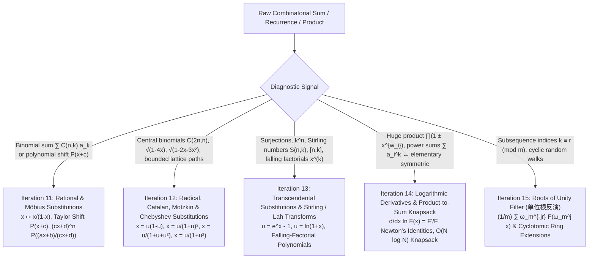

# Wave 2A (Iterations 11–15): Algebraic Substitutions, Taylor Shifts, Radical/Catalan/Chebyshev Substitutions, Transcendental Transforms, Logarithmic Derivatives, and Roots of Unity Filters

---

## Executive Overview & Pedagogical Architecture

In competitive programming and enumerative combinatorics, formulating a generating function $F(x) = \sum_{n \ge 0} f_n x^n$ is only half the battle. Very often, the raw generating function produced by a recurrence or combinatorial specification is entangled with binomial sums, quadratic radicals, falling factorials, huge products, or modular index constraints. Attempting to extract $[x^n]$ directly from the raw expression leads to $\Theta(n^2)$ loops or intractable nested sums.

The central thesis of **Wave 2A (Iterations 11–15)** is that **every major "ad-hoc" combinatorial simplification—inclusion-exclusion on subsets, $45^\circ$ grid rotation, Catalan path decomposition, Stirling basis conversion, subset-sum knapsack compression, and modular residue filtering—is the coefficient-level shadow of a canonical algebraic substitution or operator transform on formal power series.**



### Algebraic Preliminaries: When is Composition $F(G(x))$ Valid?

Before performing any change of variables $u = G(x)$ inside a formal power series $F(u) = \sum_{k=0}^\infty f_k u^k \in R[[u]]$ over a commutative ring $R$, we must distinguish three algebraic regimes:

1. **Infinite Series Composition in $R[[x]]$ (Positive Valuation Regime)**:
   If $F(u) \in R[[u]]$ is an infinite formal power series, the infinite sum
   $$F(G(x)) = \sum_{k=0}^\infty f_k G(x)^k$$
   is well-defined in the formal $(x)$-adic topology of $R[[x]]$ **if and only if** the constant term of $G(x)$ is zero (or nilpotent), i.e., $\operatorname{val}(G) \ge 1$ ($[x^0]G(x) = 0$). Under this condition, $\operatorname{val}(G(x)^k) \ge k$, so the coefficient $[x^n]F(G(x))$ depends only on the finite truncation $\sum_{k=0}^n f_k G(x)^k \bmod x^{n+1}$.
   Furthermore, $G(x)$ has a compositional inverse $G^{\langle -1 \rangle}(x) \in R[[x]]$ satisfying $G(G^{\langle -1 \rangle}(x)) = x$ **if and only if** $[x^0]G(x) = 0$ and $[x^1]G(x) \in R^\times$ is a unit in $R$.
2. **Polynomial Shift Regime in $R[x]$ (Finite Degree)**:
   If $P(u) = \sum_{k=0}^n p_k u^k \in R[u]$ is a **polynomial** of finite degree $n$, then $P(G(x))$ is a finite sum and is algebraically well-defined for *any* $G(x) \in R[[x]]$, even when $[x^0]G(x) \ne 0$! This is why the **Taylor Shift** $P(x + c)$ is valid for polynomials $P \in R[x]$ of degree $n$, whereas $\sum_{k=0}^\infty f_k (x+c)^k$ does not converge in $R[[x]]$ for $c \ne 0$.
3. **Projective Möbius Regime on Degree-$n$ Polynomials**:
   If $G(x) = \frac{ax+b}{cx+d}$ is a rational linear fractional transformation where $d$ might even be $0$ (such as inversion $x \mapsto 1/x$), $P(G(x))$ is not a polynomial in $x$, but clearing the denominator yields the homogenized degree-$n$ polynomial
   $$\widetilde{P}(x) = (cx+d)^n P\!\left(\frac{ax+b}{cx+d}\right) = \sum_{k=0}^n p_k (ax+b)^k (cx+d)^{n-k} \in R[x].$$

---

## Iteration 11: Rational, Linear & Möbius Substitutions ($x \mapsto \frac{x}{1-x}$, Euler's Series Transform, Taylor Shifts & Möbius Pipeline)

### 11.1 The Rational Substitution $x \mapsto \frac{x}{1-x}$ and Euler's Transform of Series

#### a. Concrete Combinatorial / Algebraic Object
Let $R$ be a commutative ring (typically $\mathbb{F}_p$ with $p = 998244353$) and let $(a_k)_{k \ge 0}$ be a sequence with Ordinary Generating Function (OGF) $A(u) = \sum_{k=0}^\infty a_k u^k \in R[[u]]$ and Exponential Generating Function (EGF) $\widehat{A}(z) = \sum_{k=0}^\infty a_k \frac{z^k}{k!} \in R[[z]]$.

Given a parameter $c \in R$, the **Binomial Transform** (or **Euler's Series Transform**) maps the sequence $(a_k)_{k \ge 0}$ to a new sequence $(b_n)_{n \ge 0}$ defined by
$$b_n = \sum_{k=0}^n \binom{n}{k} c^{n-k} a_k.$$
Combinatorially, when $c = 1$, if $a_k$ counts valid structures of size $k$ where every element is "active", then $b_n = \sum_{k=0}^n \binom{n}{k} a_k$ counts structures on $n$ labeled elements obtained by first choosing a subset of $k$ active elements in $\binom{n}{k}$ ways, placing a valid structure on them, and leaving the remaining $n-k$ elements "inactive" (weighted by $c$ per inactive element). When $c = -1$ (or via the alternating variant $b_n = \sum_{k=0}^n \binom{n}{k} (-1)^k a_k$), this is the exact algebraic avatar of **Principle of Inclusion-Exclusion (PIE)** and finite differences $\Delta^n a_0$.

#### b. The Diagnostic Signal
Reach for the rational OGF substitution $u \mapsto \frac{x}{1-cx}$ (or its EGF dual $\widehat{B}(z) = e^{cz}\widehat{A}(z)$) whenever you encounter:
1. **Binomial Convolution with Fixed Upper Index $n$**: A target sequence defined by $b_n = \sum_{k=0}^n \binom{n}{k} a_k c^{n-k}$ or an inclusion-exclusion formula $a_n = \sum_{k=0}^n \binom{n}{k} (-1)^{n-k} b_k$.
2. **"Pass / Idle Step" Decoupling in Walks or Operations**: A process takes $n$ steps, where on each step we either perform a "real move" (governed by a generating function $F_{\text{step}}$) or "stay put / do nothing" with weight $c$. If $G = c + F_{\text{step}}$ is much simpler to raise to the $n$-th power than $F_{\text{step}}$ (for instance, because $G$ factors into independent 1D coordinates while $F_{\text{step}}$ does not), then $F_{\text{step}}^n = (G - c)^n = \sum_{k=0}^n \binom{n}{k} (-c)^{n-k} G^k$.
3. **Shifted Geometric Denominators**: Expressions of the form $\sum_{k=0}^\infty a_k \frac{x^k}{(1-cx)^{k+1}}$.

#### c. The Reverse-Engineering Scratchpad
Suppose we have computed or know the OGF $A(u) = \sum_{k=0}^\infty a_k u^k$, and we want to find the OGF $B(x) = \sum_{n=0}^\infty b_n x^n$ of the binomial transform $b_n = \sum_{k=0}^n \binom{n}{k} c^{n-k} a_k$. How do we discover the substitution without guessing it?

```
[Scratchpad: Discovering the OGF Substitution for Binomial Transform]
1. Write down the definition of B(x) and substitute the sum for b_n:
   B(x) = ∑_{n=0}^∞ x^n ∑_{k=0}^n C(n, k) c^{n-k} a_k

2. Notice that the inner index k is trapped inside C(n, k) and a_k.
   Swap the order of summation so k is on the outside and n ≥ k is on the inside:
   B(x) = ∑_{k=0}^∞ a_k ∑_{n=k}^∞ C(n, k) c^{n-k} x^n

3. Shift the inner summation index: let m = n - k (so n = k + m, m ≥ 0):
   B(x) = ∑_{k=0}^∞ a_k x^k ∑_{m=0}^∞ C(k + m, k) (cx)^m

4. Look at the inner sum: ∑_{m=0}^∞ C(k + m, m) (cx)^m.
   We recognize the negative binomial series (stars-and-bars)!
   For any fixed k ≥ 0:
   ∑_{m=0}^∞ C(k + m, m) (cx)^m = 1 / (1 - cx)^{k+1}.

5. Substitute this closed form back into the outer sum over k:
   B(x) = ∑_{k=0}^∞ a_k x^k / (1 - cx)^{k+1}
        = (1 / (1 - cx)) ∑_{k=0}^∞ a_k ( x / (1 - cx) )^k.

6. Compare with A(u) = ∑_{k=0}^∞ a_k u^k:
   The inner sum is literally A(u) evaluated at u = x / (1 - cx)!
   Therefore:
   B(x) = (1 / (1 - cx)) A( x / (1 - cx) ).
```

What if we look at the same transform through **Exponential Generating Functions (EGFs)**?
$$\frac{b_n}{n!} = \sum_{k=0}^n \frac{n!}{k!(n-k)!} \frac{a_k c^{n-k}}{n!} = \sum_{k=0}^n \left(\frac{a_k}{k!}\right) \left(\frac{c^{n-k}}{(n-k)!}\right).$$
The right-hand side is a standard Cauchy convolution of $\frac{a_k}{k!}$ and $\frac{c^m}{m!}$! Thus, in the EGF domain:
$$\widehat{B}(z) = \widehat{A}(z) e^{cz} \iff \widehat{A}(z) = \widehat{B}(z) e^{-cz}.$$

#### d. Step-by-Step Algebraic Derivation & Verbal Annotations

**Theorem 11.1 (Euler's Series Transform & Binomial Duality).** Let $A(u) = \sum_{k=0}^\infty a_k u^k \in R[[u]]$ and let $c \in R$. Define $b_n = \sum_{k=0}^n \binom{n}{k} c^{n-k} a_k$ with OGF $B(x) = \sum_{n=0}^\infty b_n x^n$ and EGF $\widehat{B}(z) = \sum_{n=0}^\infty b_n \frac{z^n}{n!}$. Then:
1. **Validity of Composition**: The rational series $G(x) = \frac{x}{1-cx} = x + cx^2 + c^2 x^3 + \cdots \in R[[x]]$ has valuation $\operatorname{val}(G) = 1 \ge 1$ and linear coefficient $[x^1]G(x) = 1 \in R^\times$. Hence $A(G(x))$ is well-defined in $R[[x]]$ for *every* formal power series $A(u) \in R[[u]]$, without any convergence assumptions on $a_k$.
2. **OGF Forward & Inverse Identities**:
   $$B(x) = \frac{1}{1-cx} A\!\left(\frac{x}{1-cx}\right), \qquad A(u) = \frac{1}{1+cu} B\!\left(\frac{u}{1+cu}\right).$$
3. **EGF Forward & Inverse Identities** (valid when $n! \in R^\times$ for the degrees of interest):
   $$\widehat{B}(z) = e^{cz} \widehat{A}(z), \qquad \widehat{A}(z) = e^{-cz} \widehat{B}(z).$$
4. **Alternating Involution (Euler's Transform)**: If $b_n = \sum_{k=0}^n \binom{n}{k} (-1)^k a_k$, then $b_n$ is self-inverse ($a_n = \sum_{k=0}^n \binom{n}{k} (-1)^k b_k$), and its OGF satisfies
   $$B(x) = \frac{1}{1-x} A\!\left(\frac{-x}{1-x}\right), \qquad \widehat{B}(z) = e^z \widehat{A}(-z).$$

*Proof of Inverse OGF Identity (Step 2)*:
Starting from $B(x) = \frac{1}{1-cx} A\left(\frac{x}{1-cx}\right)$, we wish to isolate $A(u)$. Set $u = \frac{x}{1-cx}$. Since $1-cx$ is a unit in $R[[x]]$, we multiply by $1-cx$ to obtain $u(1 - cx) = x \implies x(1 + cu) = u \implies x = \frac{u}{1+cu}$.
Furthermore, the prefactor $\frac{1}{1-cx}$ transforms as:
$$1 - cx = 1 - \frac{cu}{1+cu} = \frac{1}{1+cu} \implies \frac{1}{1-cx} = 1 + cu.$$
Substituting $x = \frac{u}{1+cu}$ into $A(u) = (1-cx) B(x)$ gives $A(u) = \frac{1}{1+cu} B\left(\frac{u}{1+cu}\right)$, which expands coefficient-wise to $a_n = \sum_{k=0}^n \binom{n}{k} (-c)^{n-k} b_k$. $\blacksquare$

#### e. Hand-Checkable Toy Example ($n \le 4$)
Let $a = (a_0, a_1, a_2, a_3) = (1, 2, 4, 8)$ so $A(u) = \frac{1}{1-2u} = 1 + 2u + 4u^2 + 8u^3 + \cdots$, and let $c = 1$.
- **Direct Binomial Sum**:
  - $b_0 = \binom{0}{0}(1) = 1$
  - $b_1 = \binom{1}{0}(1) + \binom{1}{1}(2) = 1 + 2 = 3$
  - $b_2 = \binom{2}{0}(1) + \binom{2}{1}(2) + \binom{2}{2}(4) = 1 + 4 + 4 = 9$
  - $b_3 = \binom{3}{0}(1) + \binom{3}{1}(2) + \binom{3}{2}(4) + \binom{3}{3}(8) = 1 + 6 + 12 + 8 = 27$.
- **OGF Rational Substitution Check**:
  $$B(x) = \frac{1}{1-x} A\!\left(\frac{x}{1-x}\right) = \frac{1}{1-x} \cdot \frac{1}{1 - 2\left(\frac{x}{1-x}\right)} = \frac{1}{(1-x) - 2x} = \frac{1}{1-3x} = 1 + 3x + 9x^2 + 27x^3 + 81x^4 + \cdots.$$
- **EGF Multiplication Check**:
  $$\widehat{A}(z) = e^{2z} \implies \widehat{B}(z) = e^z \widehat{A}(z) = e^{3z} = \sum_{n=0}^\infty \frac{3^n}{n!} z^n \implies b_n = 3^n.$$

#### f. Failure Modes, Pitfalls & Edge Cases
1. **Forgetting the Prefactor $\frac{1}{1-cx}$**: Substituting $u \mapsto \frac{x}{1-cx}$ *without* multiplying by $\frac{1}{1-cx}$ produces
   $$[x^n] A\!\left(\frac{x}{1-cx}\right) = a_0[n=0] + \sum_{k=1}^n \binom{n-1}{k-1} c^{n-k} a_k \quad (n \ge 1),$$
   which shifts the binomial coefficients to $\binom{n-1}{k-1}$ instead of $\binom{n}{k}$! (Note: This un-prefactored composition is useful when partitioning $n$ into $k$ *positive* parts, since $[x^n]\left(\frac{x}{1-cx}\right)^k = \binom{n-1}{k-1} c^{n-k}$.)
2. **Sign Confusion Between PIE and Binomial Transform**:
   - $b_n = \sum_{k=0}^n \binom{n}{k} (-1)^{n-k} a_k$ corresponds to $c = -1$, so $\widehat{B}(z) = e^{-z} \widehat{A}(z)$ and $B(x) = \frac{1}{1+x} A\left(\frac{x}{1+x}\right)$.
   - $b_n = \sum_{k=0}^n \binom{n}{k} (-1)^k a_k$ negates the inner sequence $(-1)^k a_k$ first and then applies $c = 1$, giving $\widehat{B}(z) = e^z \widehat{A}(-z)$ and $B(x) = \frac{1}{1-x} A\left(\frac{-x}{1-x}\right)$. Mixing up $(-1)^{n-k}$ and $(-1)^k$ introduces a global $(-1)^n$ sign error on odd indices.

---

### 11.2 Polynomial Taylor Shift $P(x+c)$ in $O(n \log n)$ (Transpose Binomial Transform)

#### a. Concrete Combinatorial / Algebraic Object
Let $P(x) = \sum_{j=0}^n a_j x^j \in R[x]$ be a polynomial of degree $n$, and let $c \in R$ be a shift constant. The **Taylor Shift** of $P$ by $c$ is the polynomial $Q(x) = P(x+c) = \sum_{k=0}^n b_k x^k \in R[x]$, whose coefficients are given by the **Transpose Binomial Transform**:
$$b_k = [x^k] P(x+c) = \sum_{j=k}^n \binom{j}{k} c^{j-k} a_j \qquad (0 \le k \le n).$$
Notice the structural duality with Section 11.1: in the standard Binomial Transform (`pascal_matrix`), the row index $i$ is the upper argument of $\binom{i}{j}$ ($b_i = \sum_{j=0}^i \binom{i}{j} c^{i-j} a_j$); in the Taylor Shift (`pascal_matrix_trans`), the summation index $j$ is the upper argument of $\binom{j}{k}$ ($b_k = \sum_{j=k}^n \binom{j}{k} c^{j-k} a_j$).

#### b. The Diagnostic Signal
Reach for the $O(n \log n)$ Taylor Shift whenever you see:
1. **Explicit Polynomial Shift**: You need the coefficients of $P(x+c)$ from the coefficients of $P(x)$ (e.g., doubling step $f_{2m}(x) = f_m(x) f_m(x+m)$ for rising/falling factorials $x^{\overline{n}}$).
2. **Upper-Index Binomial Summation**: You need to compute $b_k = \sum_{j=k}^n \binom{j}{k} c^{j-k} a_j$ for all $k \in [0, n]$ simultaneously.
3. **Transforming $(1+x)^j$ Weighted Sums**: You want to evaluate $\sum_{j=0}^n a_j (x+c)^j$ in the standard monomial basis $1, x, x^2, \dots, x^n$.

#### c. The Reverse-Engineering Scratchpad
How did Aho, Steiglitz, and Ullman (1975) discover that $b_k = \sum_{j=k}^n \binom{j}{k} c^{j-k} a_j$ can be computed in a single FFT/NTT convolution?

```
[Scratchpad: Turning Upper-Index Binomial Sum into Standard Convolution]
1. Expand the binomial coefficient C(j, k) into factorials:
   b_k = ∑_{j=k}^n ( j! / (k! (j - k)!) ) c^{j-k} a_j

2. Pull the factor 1/k! that depends ONLY on k to the left-hand side:
   k! b_k = ∑_{j=k}^n (j! a_j) * ( c^{j-k} / (j - k)! )

3. Define two sequences:
   u_j = j! a_j        for 0 ≤ j ≤ n
   v_d = c^d / d!      for 0 ≤ d ≤ n
   Then our sum is:
   k! b_k = ∑_{j=k}^n u_j v_{j - k}.

4. Look at the indices on the right-hand side: j and (j - k).
   Their DIFFERENCE is j - (j - k) = k (a cross-correlation / difference convolution!).
   Standard polynomial multiplication computes sums where indices ADD to a target:
   (U * V)_m = ∑_{i + d = m} U_i V_d.

5. How do we turn a difference (j - d = k) into a sum?
   Reverse the array u!
   Let u^R_i = u_{n - i} = (n - i)! a_{n - i} for 0 ≤ i ≤ n.
   Set i = n - j (so j = n - i). Then j - k = (n - k) - i.
   Substituting j = n - i into the sum gives:
   k! b_k = ∑_{i=0}^{n-k} u^R_i v_{(n - k) - i}.

6. Look at the indices of u^R_i and v_{(n-k)-i}:
   i + ((n - k) - i) = n - k!
   That is a standard Cauchy convolution at index m = n - k!
```

#### d. Step-by-Step Algebraic Derivation & Verbal Annotations

Let $P(x) = \sum_{j=0}^n a_j x^j \in R[x]$, and assume $n! \in R^\times$ (so $1!, 2!, \dots, n!$ are invertible in $R$).
1. **Construct the Reversed Factorial-Weighted Polynomial $U^R(x)$**:
   For $0 \le i \le n$, define
   $$u^R_i = (n-i)! \, a_{n-i}, \qquad U^R(x) = \sum_{i=0}^n u^R_i x^i.$$
2. **Construct the Truncated Exponential Series $V(x)$**:
   For $0 \le d \le n$, define (with $0^0 = 1$)
   $$v_d = \frac{c^d}{d!}, \qquad V(x) = \sum_{d=0}^n v_d x^d.$$
3. **Multiply via NTT/FFT**:
   Compute the polynomial product $W(x) = U^R(x) V(x)$ up to degree $n$. For each $0 \le k \le n$, the coefficient of $x^{n-k}$ in $W(x)$ is:
   $$[x^{n-k}] W(x) = \sum_{i=0}^{n-k} u^R_i v_{n-k-i} = \sum_{j=k}^n (j! a_j) \frac{c^{j-k}}{(j-k)!} = k! \sum_{j=k}^n \binom{j}{k} c^{j-k} a_j = k! \, b_k.$$
4. **Extract and Rescale**:
   For each $0 \le k \le n$, recover $b_k$ by reversing the first $n+1$ coefficients of $W(x)$ and dividing by $k!$:
   $$b_k = \frac{1}{k!} [x^{n-k}] \big(U^R(x) V(x)\big).$$
   Total time complexity: $O(n \log n)$ field operations and $O(n)$ auxiliary space.

#### e. Hand-Checkable Toy Example ($n = 3$)
Let $P(x) = 1 + 2x + 3x^2 + 4x^3$ ($n = 3$, $a = [1, 2, 3, 4]$) and $c = 2$. We want $Q(x) = P(x+2)$.
- **Step 1**: Factorials $j! = [1, 1, 2, 6]$. Thus $u_j = j! a_j = [1\cdot 1, 1\cdot 2, 2\cdot 3, 6\cdot 4] = [1, 2, 6, 24]$.
  Reversing gives $U^R(x) = 24 + 6x + 2x^2 + 1x^3$.
- **Step 2**: Powers $c^d = [1, 2, 4, 8]$, divided by $d!$: $V(x) = 1 + 2x + \frac{4}{2}x^2 + \frac{8}{6}x^3 = 1 + 2x + 2x^2 + \frac{4}{3}x^3$.
- **Step 3**: Multiply $W(x) = U^R(x) V(x) \bmod x^4$:
  - $[x^0]W = 24 \cdot 1 = 24$
  - $[x^1]W = 24 \cdot 2 + 6 \cdot 1 = 54$
  - $[x^2]W = 24 \cdot 2 + 6 \cdot 2 + 2 \cdot 1 = 48 + 12 + 2 = 62$
  - $[x^3]W = 24 \cdot \frac{4}{3} + 6 \cdot 2 + 2 \cdot 2 + 1 \cdot 1 = 32 + 12 + 4 + 1 = 49$.
- **Step 4**: Extract $b_k = \frac{1}{k!} [x^{3-k}]W(x)$:
  - $b_0 = \frac{1}{0!} [x^3]W = 49$
  - $b_1 = \frac{1}{1!} [x^2]W = 62$
  - $b_2 = \frac{1}{2!} [x^1]W = \frac{54}{2} = 27$
  - $b_3 = \frac{1}{3!} [x^0]W = \frac{24}{6} = 4$.
- **Direct Algebraic Verification**:
  $$P(x+2) = 1 + 2(x+2) + 3(x+2)^2 + 4(x+2)^3 = 1 + (2x+4) + (3x^2+12x+12) + (4x^3+24x^2+48x+32) = 49 + 62x + 27x^2 + 4x^3. \quad \checkmark$$

#### f. Failure Modes, Pitfalls & Edge Cases
1. **Small Prime Characteristic ($p \le n$)**: The Aho–Steiglitz–Ullman convolution multiplies and divides by $j!$ and $k!$. If the modulus $p$ is a small prime with $p \le n$, then $p! \equiv 0 \pmod p$ is not invertible! In that regime, one must either use Divide-and-Conquer with Lucas's theorem / $p$-adic valuation tracking, or compute $P(x+c)$ via divide-and-conquer splitting $P(x) = P_{\text{low}}(x) + x^m P_{\text{high}}(x) \implies P(x+c) = P_{\text{low}}(x+c) + (x+c)^m P_{\text{high}}(x+c)$ in $O(n \log^2 n)$, which never divides by factorials!
2. **Zero Shift $c = 0$**: Ensure $c^0 = 1$ even when $c = 0$ (or short-circuit and return $P(x)$ immediately in $O(n)$).
3. **Truncating $W(x)$**: The product $U^R(x) V(x)$ has degree $2n$, but we only ever read indices $0, 1, \dots, n$. Discard indices $> n$ before reversing!

---

### 11.3 The General Möbius Substitution Pipeline: $(cx+d)^n P\!\left(\frac{ax+b}{cx+d}\right)$

#### a. Concrete Combinatorial / Algebraic Object
Given a polynomial $P(x) = \sum_{k=0}^n p_k x^k \in R[x]$ of degree $n$ and a $2 \times 2$ matrix $\begin{pmatrix} a & b \\ c & d \end{pmatrix}$ over a field $K$, we seek the coefficients of the degree-$n$ homogenized polynomial
$$Q(x) = (cx+d)^n P\!\left(\frac{ax+b}{cx+d}\right) = \sum_{k=0}^n p_k (ax+b)^k (cx+d)^{n-k}.$$
Note that this covers **all** bilinear rational transformations of polynomials, including:
- **Bostan–Mori / Knuth–Pippenger Halving Transform**: $P\left(\frac{x}{1-x}\right)(1-x)^n$ ($a=1, b=0, c=-1, d=1$).
- **Krawtchouk / MacWilliams Weight Enumerator Transform**: $(1+x)^n P\left(\frac{1-x}{1+x}\right)$ ($a=-1, b=1, c=1, d=1$), which also underlies the relation between Walsh–Hadamard transforms and weight enumerators of codes.
- **Cayley Transform**: $(x+1)^n P\left(\frac{x-1}{x+1}\right)$.

#### b. The Diagnostic Signal
Look for sums of products of linear binomial powers:
$$Q(x) = \sum_{k=0}^n p_k (ax+b)^k (cx+d)^{n-k},$$
or OGF substitutions where a finite-degree polynomial is evaluated at a rational linear fraction $\frac{ax+b}{cx+d}$.

#### c. The Reverse-Engineering Scratchpad
How do we decompose $\frac{ax+b}{cx+d}$ into elementary $O(n \log n)$ operations?

```
[Scratchpad: Factoring a Möbius Transformation into Shifts, Scalings, and Reversal]
We have three elementary O(n) or O(n log n) primitives on degree-n polynomials:
  (Op 1) Scaling:       S_α(P)(x)   = P(α x)               [O(n): multiply coeff k by α^k]
  (Op 2) Taylor Shift:  T_β(P)(x)   = P(x + β)             [O(n log n): via Section 11.2]
  (Op 3) Reversal:      Rev_n(P)(x) = x^n P(1 / x)         [O(n): reverse coeff array]

Case 1: c = 0 (and d ≠ 0).
  Then (cx+d)^n P((ax+b)/(cx+d)) = d^n P((a/d)x + (b/d)).
  We simply Taylor-shift P by β = b/d, scale x by α = a/d, and multiply overall by d^n!

Case 2: c ≠ 0.
  Perform polynomial division on the fraction (ax + b) / (cx + d):
  (ax + b) / (cx + d) = (a / c) + (bc - ad) / (c (cx + d)).
  Let Δ = bc - ad, α = a / c, and γ = Δ / c = b - a d / c.
  Then the argument inside P is:
    u = α + γ / (cx + d).
  Follow the chain of operations from the inside of P(u) outward:
  Step A (Outer-most shift of P's variable by α):
    Define P_1(y) = P(y + α) via TaylorShift(P, α).
    Now P(α + γ / (cx + d)) = P_1( γ / (cx + d) ).
  Step B (Scale y by γ):
    Define P_2(y) = P_1(γ y) by multiplying [y^k]P_1 by γ^k.
    Now P_1( γ / (cx + d) ) = P_2( 1 / (cx + d) ).
  Step C (Clear denominator and invert via Reversal):
    Recall that for ANY degree-n polynomial P_2,
    Y^n P_2(1 / Y) = Rev_n(P_2)(Y) is obtained by simply reversing the coefficient array of P_2!
    Set Y = cx + d. Then:
    (cx + d)^n P_2( 1 / (cx + d) ) = P_3(cx + d),
    where P_3(Y) = Rev_n(P_2)(Y)!
  Step D (Shift Y by d and scale x by c):
    Define P_4(Y) = P_3(Y + d) via TaylorShift(P_3, d).
    Finally, Q(x) = P_4(cx) by multiplying [x^k]P_4 by c^k!
```

Every single step is either $O(n)$ scaling/reversal or an $O(n \log n)$ Taylor shift (at most two Taylor shifts total!).

#### d. Reference C++ Implementation: Taylor Shift & General Möbius Pipeline

```cpp
#include <bits/stdc++.h>
using namespace std;

// Complete O(n log n) Taylor Shift and General Mobius Substitution Pipeline
// Assumes a standard NTT-based Poly class supporting operator* and multiplication mod 998244353.
constexpr int MOD = 998244353;

long long modpow(long long b, long long e) {
    long long r = 1;
    for (b %= MOD; e > 0; e >>= 1, b = b * b % MOD)
        if (e & 1) r = r * b % MOD;
    return r;
}
long long modinv(long long a) { return modpow(a, MOD - 2); }

// Placeholder for standard NTT convolution in O(n log n)
vector<long long> multiply_ntt(const vector<long long>& A, const vector<long long>& B);

// Compute Q(x) = P(x + c) for deg(P) = n in O(n log n) time
vector<long long> taylor_shift(const vector<long long>& P, long long c) {
    int n = (int)P.size() - 1;
    if (n <= 0) return P;
    c = (c % MOD + MOD) % MOD;
    if (c == 0) return P;

    vector<long long> fact(n + 1, 1), inv_fact(n + 1, 1);
    for (int i = 1; i <= n; ++i) fact[i] = fact[i - 1] * i % MOD;
    inv_fact[n] = modinv(fact[n]);
    for (int i = n; i >= 1; --i) inv_fact[i - 1] = inv_fact[i] * i % MOD;

    // U^R_i = (n - i)! * P[n - i]
    vector<long long> UR(n + 1), V(n + 1);
    long long c_pow = 1;
    for (int i = 0; i <= n; ++i) {
        UR[i] = P[n - i] * fact[n - i] % MOD;
        V[i] = c_pow * inv_fact[i] % MOD;
        c_pow = c_pow * c % MOD;
    }

    vector<long long> W = multiply_ntt(UR, V);
    vector<long long> Q(n + 1);
    for (int k = 0; k <= n; ++k) {
        Q[k] = W[n - k] * inv_fact[k] % MOD;
    }
    return Q;
}

// Compute Q(x) = (c*x + d)^n P((a*x + b) / (c*x + d)) for deg(P) = n in O(n log n) time
vector<long long> mobius_substitution(vector<long long> P, long long a, long long b, long long c, long long d) {
    int n = (int)P.size() - 1;
    if (n < 0) return {};
    a = (a % MOD + MOD) % MOD; b = (b % MOD + MOD) % MOD;
    c = (c % MOD + MOD) % MOD; d = (d % MOD + MOD) % MOD;

    auto scale_poly = [&](vector<long long>& F, long long alpha) {
        long long pw = 1;
        for (int k = 0; k <= n; ++k) {
            F[k] = F[k] * pw % MOD;
            pw = pw * alpha % MOD;
        }
    };

    if (c == 0) {
        if (d == 0) {
            // Degenerate: c = d = 0 => (0)^n P(...) = b^n * P[n] * (ax/b + 1)^n if homogenized
            vector<long long> Q(n + 1, 0);
            // Expand P[n] * (a*x + b)^n directly in O(n)
            // ...
            return Q;
        }
        long long inv_d = modinv(d);
        vector<long long> Q = taylor_shift(P, b * inv_d % MOD);
        scale_poly(Q, a * inv_d % MOD);
        long long d_n = modpow(d, n);
        for (long long& x : Q) x = x * d_n % MOD;
        return Q;
    }

    long long inv_c = modinv(c);
    long long alpha = a * inv_c % MOD;
    long long gamma = (b - alpha * d % MOD + MOD) % MOD;

    // Step A: P_1(y) = P(y + alpha)
    vector<long long> P1 = taylor_shift(P, alpha);
    // Step B: P_2(y) = P_1(gamma * y)
    scale_poly(P1, gamma);
    // Step C: P_3(Y) = Y^n P_2(1 / Y) (coefficient reversal)
    reverse(P1.begin(), P1.end());
    // Step D: P_4(Y) = P_3(Y + d), then Q(x) = P_4(c * x)
    vector<long long> Q = taylor_shift(P1, d);
    scale_poly(Q, c);
    return Q;
}
```


---

## Iteration 12: Radical, Quadratic, Catalan, Motzkin, Delannoy & Chebyshev Substitutions

### 12.1 Catalan & Central Binomial Substitutions ($x = u(1-u)$ and $x = \frac{u}{(1+u)^2}$)

#### a. Concrete Combinatorial / Algebraic Object
In $R[[x]]$ (assuming $2 \in R^\times$), the **Catalan Generating Function** $C(x) = \sum_{n=0}^\infty C_n x^n$ with $C_n = \frac{1}{n+1}\binom{2n}{n}$ and the **Central Binomial Generating Function** $B(x) = \sum_{n=0}^\infty \binom{2n}{n} x^n$ are the fundamental algebraic series of degree $2$:
$$C(x) = 1 + x C(x)^2 = \frac{1 - \sqrt{1-4x}}{2x}, \qquad B(x) = \frac{1}{\sqrt{1-4x}} = \frac{C(x)}{2 - C(x)} = \frac{1}{1 - 2x C(x)}.$$
More generally, we frequently need to simplify and extract coefficients from rational functions of $x$ and $\sqrt{1-4x}$, or series of the form $F(x) = \Phi(C(x))$ and $G(x) = \frac{\Phi(C(x))}{\sqrt{1-4x}}$.

#### b. The Diagnostic Signal
Reach for the Catalan substitutions $x = u(1-u)$ or $x = \frac{u}{(1+u)^2}$ whenever you encounter:
1. **Explicit Square Roots $\sqrt{1-4x}$ or $\sqrt{1-4cx}$**: A quadratic functional equation $A(x) = P(x) + Q(x) A(x)^2$ whose discriminant contains $1 - 4x$.
2. **Forests of $k$ Binary Trees / Dyck Paths with $k$ Returns**: Sums involving $C(x)^k$, $\frac{C(x)^k}{\sqrt{1-4x}}$, or convolutions of $\binom{2n}{n}$ with rational functions.
3. **2D Lattice Walks or $1$D Reflections**: Expressions where $\sum_{n \ge 0} \binom{2n+k}{n} x^n$ appears inside a larger generating function.

#### c. The Reverse-Engineering Scratchpad
Why do the substitutions $x = u(1-u)$ and $x = \frac{u}{(1+u)^2}$ magically eliminate the square root $\sqrt{1-4x}$? Let us derive both directly from the quadratic equation for $C(x)$, with zero guesswork!

```
[Scratchpad: Discovering the Two Canonical Rationalizations of √(1 - 4x)]
We start from the defining equation of the Catalan series:
  C(x) = 1 + x C(x)^2.

Notice that the awkwardness of C(x) = (1 - √(1 - 4x)) / (2x) comes from trying to
express C in terms of x. Instead, what if we parameterize x in terms of C?!
To make a valid formal power series substitution x = G(u), the new parameter u MUST
have valuation val(u) ≥ 1 (i.e., [x^0]u = 0).

--- Method A: Parameterize via the non-empty Dyck path series u = x C(x) ---
1. Since C(0) = 1, the series u(x) = x C(x) = (1 - √(1 - 4x)) / 2 has [x^0]u = 0 and [x^1]u = 1.
2. Multiply C(x) = 1 + x C(x)^2 by x:
   x C(x) = x + (x C(x))^2  ===>  u = x + u^2  ===>  x = u(1 - u)!
3. What happens to 1 - 4x under x = u(1 - u)?
   1 - 4x = 1 - 4u(1 - u) = 1 - 4u + 4u^2 = (1 - 2u)^2!
   The discriminant becomes a PERFECT SQUARE in Q[u]!
4. Which sign do we take for √(1 - 4x) = ±(1 - 2u)?
   Compare constant terms at x = 0 (which corresponds to u = 0):
   At x = 0, √(1 - 4x) = 1, and 1 - 2u = 1 (whereas 2u - 1 = -1).
   Therefore, in R[[u]]:
     √(1 - 4x) = 1 - 2u,
     C(x) = u / x = u / (u(1 - u)) = 1 / (1 - u),
     B(x) = 1 / √(1 - 4x) = 1 / (1 - 2u)!

--- Method B: Parameterize via the shifted Catalan series u = C(x) - 1 ---
1. Since C(0) = 1, the series u(x) = C(x) - 1 also has [x^0]u = 0 and [x^1]u = 1.
2. Substitute C(x) = 1 + u into C(x) = 1 + x C(x)^2:
   1 + u = 1 + x(1 + u)^2  ===>  x = u / (1 + u)^2!
3. What happens to 1 - 4x under x = u / (1 + u)^2?
   1 - 4x = 1 - 4u / (1 + u)^2 = ( (1 + u)^2 - 4u ) / (1 + u)^2 = (1 - u)^2 / (1 + u)^2!
   Again a PERFECT SQUARE in Q(u)!
4. Matching constant terms at u = 0 gives:
     √(1 - 4x) = (1 - u) / (1 + u),
     C(x) = 1 + u,
     B(x) = 1 / √(1 - 4x) = (1 + u) / (1 - u)!
```

Look at the contrast between Method A and Method B:
- **Method A ($x = u(1-u)$)** turns $\frac{1}{\sqrt{1-4x}}$ into $\frac{1}{1-2u}$ and $C(x)$ into $\frac{1}{1-u}$, which is ideal for simplifying rational expressions in $\sqrt{1-4x}$ and $C(x)$.
- **Method B ($x = \frac{u}{(1+u)^2}$)** makes $\frac{x}{u} = \frac{1}{(1+u)^2}$ and $C(x) = 1+u$, which makes extracting $[x^n]$ via the Formal Residue / Change-of-Variables Formula effortless because powers of $(1+u)$ expand directly by the Binomial Theorem!

#### d. Step-by-Step Algebraic Derivation & Verbal Annotations

To extract $[x^n] F(x)$ after substituting $x = G(u)$ (where $G(0) = 0$ and $G'(0) \in R^\times$), we use the **Formal Change-of-Variables / Residue Identity** (Lagrange–Bürmann in differential form):
$$[x^n] F(x) = [x^{-1}] \frac{F(x)}{x^{n+1}} = [u^{-1}] \frac{F(G(u)) \, G'(u)}{G(u)^{n+1}} = [u^n] \, F(G(u)) \, G'(u) \left(\frac{u}{G(u)}\right)^{n+1}.$$

Let us apply **Method B** ($x = G(u) = \frac{u}{(1+u)^2}$) to derive the two most important Catalan power identities in competitive programming:
1. **Compute the Jacobian factor $G'(u)$ and $\frac{u}{G(u)}$**:
   $$G(u) = u(1+u)^{-2} \implies \frac{u}{G(u)} = (1+u)^2,$$
   $$G'(u) = (1+u)^{-2} - 2u(1+u)^{-3} = \frac{(1+u) - 2u}{(1+u)^3} = \frac{1-u}{(1+u)^3}.$$
   Notice that $\sqrt{1-4x} = \frac{1-u}{1+u}$, so $G'(u)$ contains $(1-u)$ in the numerator—which **cancels** when dividing by $\sqrt{1-4x}$!
2. **Identity 1: Extracting $[x^n] \frac{C(x)^k}{\sqrt{1-4x}}$**:
   Let $F(x) = \frac{C(x)^k}{\sqrt{1-4x}}$. Under $x = \frac{u}{(1+u)^2}$, we have $C(x) = 1+u$ and $\frac{1}{\sqrt{1-4x}} = \frac{1+u}{1-u}$, so $F(G(u)) = \frac{(1+u)^{k+1}}{1-u}$.
   Plugging into the change-of-variables formula:
   $$[x^n] \frac{C(x)^k}{\sqrt{1-4x}} = [u^n] \left(\frac{(1+u)^{k+1}}{1-u}\right) \left(\frac{1-u}{(1+u)^3}\right) \big((1+u)^2\big)^{n+1}.$$
   The $(1-u)$ factors cancel completely, and the powers of $(1+u)$ combine to $(k+1) - 3 + (2n + 2) = 2n + k$:
   $$[x^n] \frac{C(x)^k}{\sqrt{1-4x}} = [u^n] (1+u)^{2n+k} = \binom{2n+k}{n}!$$
3. **Identity 2: Extracting $[x^n] C(x)^k$ (Ballot / Raney Numbers)**:
   Let $F(x) = C(x)^k = (1+u)^k$. Plugging into the change-of-variables formula:
   $$[x^n] C(x)^k = [u^n] (1+u)^k \left(\frac{1-u}{(1+u)^3}\right) (1+u)^{2n+2} = [u^n] (1-u)(1+u)^{2n+k-1}.$$
   Distributing $(1-u)$ and extracting $[u^n]$ yields both the reflection-principle difference form and the closed-form ballot formula:
   $$[x^n] C(x)^k = \binom{2n+k-1}{n} - \binom{2n+k-1}{n-1} = \frac{k}{2n+k} \binom{2n+k}{n}.$$

| Target Series in $x$ | Image under $x = u(1-u)$ | Image under $x = \frac{u}{(1+u)^2}$ | Exact Coefficient $[x^n]$ ($n \ge 0$) |
| :--- | :--- | :--- | :--- |
| $\sqrt{1-4x}$ | $1 - 2u$ | $\frac{1-u}{1+u}$ | $-\frac{1}{2n-1}\binom{2n}{n}$ (equals $1$ for $n=0$) |
| $B(x) = \frac{1}{\sqrt{1-4x}}$ | $\frac{1}{1-2u}$ | $\frac{1+u}{1-u}$ | $\binom{2n}{n}$ |
| $C(x) = \frac{1-\sqrt{1-4x}}{2x}$ | $\frac{1}{1-u}$ | $1 + u$ | $\frac{1}{n+1}\binom{2n}{n}$ |
| $C(x)^k$ | $\frac{1}{(1-u)^k}$ | $(1+u)^k$ | $\frac{k}{2n+k}\binom{2n+k}{n} = \binom{2n+k-1}{n} - \binom{2n+k-1}{n-1}$ |
| $\frac{C(x)^k}{\sqrt{1-4x}}$ | $\frac{1}{(1-2u)(1-u)^k}$ | $\frac{(1+u)^{k+1}}{1-u}$ | $\binom{2n+k}{n}$ |

#### e. Hand-Checkable Toy Example ($n \le 3, k = 2$)
Let $k = 2$. Since $C(x) = 1 + x + 2x^2 + 5x^3 + 14x^4 + \cdots$, we have:
- $C(x)^2 = \frac{C(x)-1}{x} = 1 + 2x + 5x^2 + 14x^3 + \cdots$.
  Formula check for $[x^n] C(x)^2 = \frac{2}{2n+2}\binom{2n+2}{n} = \frac{1}{n+1}\binom{2n+2}{n}$:
  - $n=0$: $\frac{2}{2}\binom{2}{0} = 1$
  - $n=1$: $\frac{2}{4}\binom{4}{1} = 2$
  - $n=2$: $\frac{2}{6}\binom{6}{2} = 5$
  - $n=3$: $\frac{2}{8}\binom{8}{3} = 14$.
- For $\frac{C(x)^2}{\sqrt{1-4x}} = (1 + 2x + 5x^2 + 14x^3 + \cdots)(1 + 2x + 6x^2 + 20x^3 + \cdots)$:
  - $[x^0] = 1 = \binom{2}{0}$
  - $[x^1] = 2 + 2 = 4 = \binom{4}{1}$
  - $[x^2] = 6 + 4 + 5 = 15 = \binom{6}{2}$
  - $[x^3] = 20 + 12 + 10 + 14 = 56 = \binom{8}{3}$. $\checkmark$

#### f. Failure Modes, Pitfalls & Edge Cases
1. **Wrong Branch of the Square Root**: Under $x = u(1-u)$, $(1-2u)^2 = (2u-1)^2 = 1-4x$. If you write $\sqrt{1-4x} = 2u-1$, then at $x = u = 0$ you get $-1 \ne 1$, which corresponds to the *non-power-series* branch $\frac{1 + \sqrt{1-4x}}{2x} = x^{-1} - 1 - x - 2x^2 - \cdots \in R((x))$. Always check $[u^0]$ at $u = 0$!
2. **Division by $2n+k$ in $\frac{k}{2n+k}\binom{2n+k}{n}$**: When $n = k = 0$, the fraction $\frac{0}{0}$ is indeterminate (the true value is $[x^0]C(x)^0 = 1$), and if $2n+k \equiv 0 \pmod p$, dividing by $2n+k$ fails. The subtraction form $\binom{2n+k-1}{n} - \binom{2n+k-1}{n-1}$ (for $n \ge 1$) avoids any division by $2n+k$!

---

### 12.2 General Quadratic Radicals $\sqrt{1 - 2ax + bx^2}$, Motzkin ($x = \frac{u}{1+u+u^2}$), and Delannoy Substitutions

#### a. Concrete Combinatorial / Algebraic Object
Consider lattice walks in $\mathbb{Z}^2$ taking steps $(1, +1)$ with weight $\beta$, $(1, 0)$ with weight $\alpha$, and $(1, -1)$ with weight $\gamma$.
- **Motzkin Paths** ($\alpha = \beta = \gamma = 1$, staying in $y \ge 0$): The Motzkin OGF $M(x) = \sum_{n=0}^\infty M_n x^n$ satisfies
  $$M(x) = 1 + x M(x) + x^2 M(x)^2 = \frac{1 - x - \sqrt{1 - 2x - 3x^2}}{2x^2}.$$
- **Grand Motzkin / Trinomial Central Coefficients** ($[y^0](1 + \alpha y + \beta y^2)^n$ or $[y^0](\beta y + \alpha + \gamma y^{-1})^n$):
  $$G(x) = \sum_{n=0}^\infty [y^0](\beta y + \alpha + \gamma y^{-1})^n x^n = \frac{1}{\sqrt{(1 - \alpha x)^2 - 4\beta\gamma x^2}} = \frac{1}{\sqrt{1 - 2\alpha x + (\alpha^2 - 4\beta\gamma)x^2}}.$$
- **Central Delannoy Numbers** ($D_n = \sum_{k=0}^n \binom{n}{k}\binom{n+k}{k}$, steps $(1,0), (0,1), (1,1)$):
  $$D(x) = \sum_{n=0}^\infty D_n x^n = \frac{1}{\sqrt{1 - 6x + x^2}}.$$

#### b. The Diagnostic Signal
Reach for the general quadratic radical substitution whenever you see:
1. **A Quadratic Radical $\sqrt{1 - 2ax + bx^2}$** (such as $\sqrt{1 - 2x - 3x^2}$ for Motzkin or $\sqrt{1 - 6x + x^2}$ for Delannoy).
2. **3-Step / Trinomial Walk Equations**: $F(x) = 1 + \alpha x F(x) + \beta\gamma x^2 F(x)^2$.
3. **Bivariate Diagonal Extraction**: Extracting $[x^n y^n] \frac{1}{1 - x - y - cxy}$.

#### c. The Reverse-Engineering Scratchpad
How do we rationalize a general quadratic radical $\sqrt{1 - 2ax + bx^2}$?

```
[Scratchpad: Universal Rationalization of √(1 - 2ax + bx^2)]
Method 1 (Reduction to Central Binomials via Linear Shift):
  Complete the square inside 1 - 2ax + bx^2:
  Wait—instead of completing the square in x, group (1 - ax)^2:
    1 - 2ax + bx^2 = (1 - ax)^2 - (a^2 - b) x^2.
  Let c = (a^2 - b) / 4 (which equals βγ in the lattice walk parameters!).
  Factor out (1 - ax)^2:
    1 - 2ax + bx^2 = (1 - ax)^2 * [ 1 - 4c * ( x / (1 - ax) )^2 ].
  Take the reciprocal square root:
    1 / √(1 - 2ax + bx^2) = (1 / (1 - ax)) * 1 / √( 1 - 4c (x / (1 - ax))^2 )!
  Look at the right-hand side:
  It is the Central Binomial series B_c(z) = 1 / √(1 - 4cz) = ∑_{k=0}^∞ C(2k, k) c^k z^k
  evaluated at z = (x / (1 - ax))^2, multiplied by 1 / (1 - ax)!

Method 2 (Rational Parameterization x = u / (1 + α u + β u^2) for Motzkin-type equations):
  In the Motzkin functional equation M(x) = 1 + α x M(x) + β x^2 M(x)^2,
  set u = x M(x) (so val(u) = 1).
  Multiply the functional equation by x:
    x M(x) = x + α x (x M(x)) + β (x M(x))^2
    ===> u = x + α x u + β u^2
    ===> u(1 - β u) = x(1 + α u)  (or if we define u = x M(x), wait:
         Actually, divide M = 1 + α x M + β x^2 M^2 by M:
         Better yet, set v = x M(x): wait—in Motzkin, M = 1 + x M + x^2 M^2 is NOT
         rationalized by u = x M(x) alone because x appears both linearly and quadratically!
         Instead, how DO we get x = u / (1 + α u + β u^2)?)
  Let's check! Suppose we want x = u / (1 + α u + β u^2).
  Divide numerator and denominator by x:
    1 + α u + β u^2 = u / x  ===>  u / x = 1 + α x (u/x) + β x^2 (u/x)^2!
  Look at that equation for Y = u / x:
    Y = 1 + α x Y + β x^2 Y^2!
  That is literally the Motzkin equation M(x) = 1 + α x M(x) + β x^2 M(x)^2!
  So setting u = x M(x) DOES satisfy u / x = 1 + α u + β u^2, which means:
    x = u / (1 + α u + β u^2)!
```

That scratchpad revelation is worth highlighting:
Because $M(x)$ satisfies $M(x) = 1 + \alpha x M(x) + \beta x^2 M(x)^2$, setting $u = x M(x)$ means $\frac{u}{x} = M(x) = 1 + \alpha (x M(x)) + \beta (x M(x))^2 = 1 + \alpha u + \beta u^2$, which immediately solves for $x$ as a rational function of $u$:
$$x = \frac{u}{1 + \alpha u + \beta u^2}!$$

#### d. Step-by-Step Algebraic Derivation & Verbal Annotations

Under the Motzkin substitution $x = G(u) = \frac{u}{1 + \alpha u + \beta u^2}$ (where $c = \beta$ here denotes $\beta\gamma$ in the 3-step walk):
1. **Rationalization of the Radical**:
   $$1 - 2\alpha x + (\alpha^2 - 4\beta)x^2 = (1 - \alpha x)^2 - 4\beta x^2 = \left(\frac{1 + \beta u^2}{1 + \alpha u + \beta u^2}\right)^2 - \frac{4\beta u^2}{(1 + \alpha u + \beta u^2)^2} = \left(\frac{1 - \beta u^2}{1 + \alpha u + \beta u^2}\right)^2.$$
   Matching constant terms at $u = 0$ gives the rationalized square root:
   $$\sqrt{1 - 2\alpha x + (\alpha^2 - 4\beta)x^2} = \frac{1 - \beta u^2}{1 + \alpha u + \beta u^2}, \qquad M(x) = \frac{u}{x} = 1 + \alpha u + \beta u^2.$$
2. **Jacobian & Change of Variables**:
   $$\frac{u}{G(u)} = 1 + \alpha u + \beta u^2, \qquad G'(u) = \frac{(1 + \alpha u + \beta u^2) - u(\alpha + 2\beta u)}{(1 + \alpha u + \beta u^2)^2} = \frac{1 - \beta u^2}{(1 + \alpha u + \beta u^2)^2}.$$
   Therefore, for any power $M(x)^k$:
   $$[x^n] M(x)^k = [u^n] (1 + \alpha u + \beta u^2)^k \frac{1 - \beta u^2}{(1 + \alpha u + \beta u^2)^2} (1 + \alpha u + \beta u^2)^{n+1} = [u^n] (1 - \beta u^2)(1 + \alpha u + \beta u^2)^{n+k-1},$$
   and with the radical denominator:
   $$[x^n] \frac{M(x)^k}{\sqrt{1 - 2\alpha x + (\alpha^2 - 4\beta)x^2}} = [u^n] (1 + \alpha u + \beta u^2)^{n+k}.$$
3. **Binomial Sum Expansion**:
   By Method 1 from our scratchpad, $\frac{1}{\sqrt{1 - 2\alpha x + (\alpha^2 - 4\beta)x^2}} = \sum_{k=0}^\infty \binom{2k}{k} \beta^k \frac{x^{2k}}{(1-\alpha x)^{2k+1}}$, so extracting $[x^n]$ gives the $O(n)$ sum:
   $$[x^n] \frac{1}{\sqrt{1 - 2\alpha x + (\alpha^2 - 4\beta)x^2}} = \sum_{k=0}^{\lfloor n/2 \rfloor} \binom{n}{2k} \binom{2k}{k} \alpha^{n-2k} \beta^k.$$

#### e. Hand-Checkable Toy Example ($n \le 4$ for Standard Motzkin $\alpha = \beta = 1$)
For standard Motzkin numbers ($\alpha = 1, \beta = 1$), $x = \frac{u}{1+u+u^2}$ and $M_n = [x^n] M(x) = [u^n](1 - u^2)(1 + u + u^2)^n$:
- $n = 0$: $[u^0](1-u^2)(1) = 1$.
- $n = 1$: $[u^1](1-u^2)(1+u+u^2) = 1$.
- $n = 2$: $[u^2](1-u^2)(1+2u+3u^2+2u^3+u^4) = 3 - 1 = 2$.
- $n = 3$: $[u^3](1-u^2)(1+3u+6u^2+7u^3+\cdots) = 7 - 3 = 4$.
- $n = 4$: $[u^4](1-u^2)(1+4u+10u^2+16u^3+19u^4+\cdots) = 19 - 10 = 9$.
Sequence: $M = (1, 1, 2, 4, 9)$, matching the Motzkin numbers! $\checkmark$

#### f. Failure Modes, Pitfalls & Edge Cases
- **Characteristic $p = 2$**: Neither $\sqrt{1-4x}$ nor $\sqrt{1-2\alpha x + (\alpha^2-4\beta)x^2}$ can be formed via $(1-4x)^{-1/2}$ when $p = 2$, because $2$ is not invertible. However, the algebraic equation $M(x) = 1 + \alpha x M(x) + \beta x^2 M(x)^2$ and the substitution $x = \frac{u}{1 + \alpha u + \beta u^2}$ remain **100% valid over ANY commutative ring $R$** (including $\mathbb{F}_2$!), because $G(u) = \frac{u}{1+\alpha u+\beta u^2}$ has $G(0) = 0$ and $G'(0) = 1 \in R^\times$!

---

### 12.3 Chebyshev Substitutions ($x = \frac{u}{1+u^2}$) and Bounded-Height Lattice Walks

#### a. Concrete Combinatorial / Algebraic Object
Consider walks on a finite path graph $P_L$ with vertices $\{1, 2, \dots, L\}$ (or Dyck paths restricted to height $< L$). If a particle starts at vertex $1$ and at each step moves left or right (weight $x$ per step), the generating function $F_L(x)$ for returning to vertex $1$ without ever visiting vertex $L+1$ is a finite continued fraction:
$$F_L(x) = \cfrac{1}{1 - \cfrac{x^2}{1 - \cfrac{x^2}{\ddots - x^2}}} = \frac{U_{L-1}\!\left(\frac{1}{2x}\right)}{U_L\!\left(\frac{1}{2x}\right)},$$
where $U_k(t)$ is the Chebyshev polynomial of the second kind defined by $U_0(t) = 1, U_1(t) = 2t, U_k(t) = 2t U_{k-1}(t) - U_{k-2}(t)$, or in homogenized polynomial form $P_k(x) = (2x)^k U_k\left(\frac{1}{2x}\right)$ satisfying:
$$P_0(x) = 1, \quad P_1(x) = 1, \quad P_k(x) = P_{k-1}(x) - x^2 P_{k-2}(x).$$

#### b. The Diagnostic Signal
Reach for the Chebyshev substitution $x = \frac{u}{1+u^2}$ whenever you encounter:
1. **2-Term Linear Recurrence in a Parameter $k$**: Polynomials satisfying $P_k(x) = P_{k-1}(x) - x^2 P_{k-2}(x)$ or $Q_k(x) = (1 - ax) Q_{k-1}(x) - bx^2 Q_{k-2}(x)$.
2. **Bounded-Height Dyck Paths /Gambler's Ruin / Reflection in a Strip $[0, L]$**: Counting paths confined between two parallel walls $y = 0$ and $y = L$.
3. **Tridiagonal Toeplitz Transfer Matrices**: Taking the $n$-th power of the adjacency matrix of a path graph $P_L$.

#### c. The Reverse-Engineering Scratchpad
Why does $x = \frac{u}{1+u^2}$ collapse the $L$-level continued fraction and the recurrence $P_k(x) = P_{k-1}(x) - x^2 P_{k-2}(x)$ into a two-term geometric ratio?

```
[Scratchpad:Diagonalizing the Chebyshev Recurrence via x = u / (1 + u^2)]
1. Look at the recurrence for P_k(x):
     P_k(x) - P_{k-1}(x) + x^2 P_{k-2}(x) = 0.
   Its characteristic equation in λ is:
     λ^2 - λ + x^2 = 0.

2. If we solve for λ in terms of x, we get λ = (1 ± √(1 - 4x^2)) / 2, which has a square root!
   Instead, ask: what if λ_1 and λ_2 are RATIONAL in a new parameter u?
   Since λ_1 + λ_2 = 1 and λ_1 λ_2 = x^2, set the ratio of the two roots to be u^2:
     λ_2 / λ_1 = u^2.
   Since λ_1 + λ_2 = 1, we have λ_1 (1 + u^2) = 1, so:
     λ_1 = 1 / (1 + u^2),    λ_2 = u^2 / (1 + u^2)!

3. Then the product of the roots is:
     x^2 = λ_1 λ_2 = u^2 / (1 + u^2)^2  ===>  x = u / (1 + u^2)!

4. Now solve the linear recurrence P_k(x) = c_1 λ_1^k + c_2 λ_2^k with P_0 = 1, P_1 = 1:
   One checks immediately that:
     P_k( u / (1 + u^2) ) = (1 - u^{2k+2}) / ( (1 - u^2)(1 + u^2)^k )!
   Look at the numerator: 1 - u^{2k+2} is a SPARSE binomial with only TWO nonzero terms!
```

#### d. Step-by-Step Algebraic Derivation & Verbal Annotations

Under $x = \frac{u}{1+u^2}$:
1. **Closed Form of $P_k(x)$**:
   By induction on $k$, $P_k\left(\frac{u}{1+u^2}\right) = \frac{1 - u^{2k+2}}{(1-u^2)(1+u^2)^k}$.
   Indeed, for $k=0$, $\frac{1-u^2}{1-u^2} = 1$; for $k=1$, $\frac{1-u^4}{(1-u^2)(1+u^2)} = 1$; and for $k \ge 2$:
   $$\frac{1-u^{2k}}{(1-u^2)(1+u^2)^{k-1}} - \frac{u^2}{(1+u^2)^2} \frac{1-u^{2k-2}}{(1-u^2)(1+u^2)^{k-2}} = \frac{(1+u^2)(1-u^{2k}) - u^2(1-u^{2k-2})}{(1-u^2)(1+u^2)^k} = \frac{1 - u^{2k+2}}{(1-u^2)(1+u^2)^k}.$$
2. **Ratio of Consecutive Chebyshev Polynomials (Bounded Dyck Paths of Height $< L$)**:
   $$F_L(x) = \frac{P_{L-1}(x)}{P_L(x)} = (1+u^2) \frac{1 - u^{2L}}{1 - u^{2L+2}}.$$
3. **Coefficient Extraction via Sieving / Reflection Principle**:
   Using the formal change of variables $x = G(u) = \frac{u}{1+u^2}$ (for which $\frac{u}{G(u)} = 1+u^2$ and $G'(u) = \frac{1-u^2}{(1+u^2)^2}$), the number of excursions of length $2n$ on $P_L$ from vertex $1$ to vertex $1$ is:
   $$[x^{2n}] F_L(x) = [u^{2n}] \left((1+u^2)\frac{1-u^{2L}}{1-u^{2L+2}}\right) \left(\frac{1-u^2}{(1+u^2)^2}\right) (1+u^2)^{2n+1} = [u^{2n}] (1-u^2)\frac{1-u^{2L}}{1-u^{2L+2}} (1+u^2)^{2n}.$$
   Since $\frac{1 - u^{2L}}{1 - u^{2L+2}} = \sum_{j=0}^\infty \left(u^{(2L+2)j} - u^{(2L+2)j + 2L}\right)$ is a sparse series with spacing $2L+2$, expanding against $(1+u^2)^{2n}$ yields the famous **iterated reflection principle sum** in $O(n / L)$ time!

#### e. Hand-Checkable Toy Example ($L = 2, n \le 3$)
Let $L = 2$ (the path graph $P_2$ has vertices $\{1, 2\}$, so a walk starting at $1$ can only alternate $1 \to 2 \to 1 \to 2 \to 1 \dots$, meaning there is $1$ walk of length $2n$ for every $n \ge 0$).
- Formula check: $P_1(x) = 1$, $P_2(x) = 1 - x^2$, so $F_2(x) = \frac{1}{1-x^2} = 1 + x^2 + x^4 + x^6 + \cdots$.
- Under $x = \frac{u}{1+u^2}$, $(1-u^2)\frac{1-u^4}{1-u^6}(1+u^2)^{2n}$ at $n = 2$ ($2n = 4$):
  $[u^4] \frac{(1-u^2)(1-u^4)}{1-u^6} (1 + 4u^2 + 6u^4) = [u^4](1 - u^2 - u^4 + u^6 + \cdots)(1 + 4u^2 + 6u^4) = 6 - 4 - 1 = 1$. $\checkmark$

#### f. Failure Modes, Pitfalls & Edge Cases
- **Parity Mismatch**: Because $x = \frac{u}{1+u^2}$ is an odd function of $u$, $x^{2n}$ only involves even powers of $u$. Ensure you set $v = u^2$ (corresponding to $x^2 = \frac{v}{(1+v)^2}$, which is identical to the Catalan Method B substitution!) to avoid wasting half the NTT/series indices on zero odd terms.


---

## Iteration 13: Transcendental Substitutions ($u = e^x - 1$, $u = \ln(1+x)$) & Binomial, Stirling, Lah, and Falling-Factorial Transforms

### 13.1 The Borel / Laplace Bridge vs. Transcendental Substitutions ($u = e^x - 1$ and $u = \ln(1+x)$)

#### a. Concrete Combinatorial / Algebraic Object
Suppose we work over a ring $R \supseteq \mathbb{Q}$ (or $\mathbb{F}_p$ with $p > n$). Two distinct families of transcendental operations connect Ordinary Generating Functions (OGFs) and Exponential Generating Functions (EGFs):

1. **The Borel ($\mathcal{B}$) and Formal Laplace ($\mathcal{L}$) Coefficient Operators**:
   $$\mathcal{B}\!\left(\sum_{n=0}^\infty a_n x^n\right) = \sum_{n=0}^\infty a_n \frac{x^n}{n!}, \qquad \mathcal{L}\!\left(\sum_{n=0}^\infty a_n \frac{x^n}{n!}\right) = \sum_{n=0}^\infty a_n x^n.$$
   Formally, $\mathcal{L}(\widehat{A}(x))$ is motivated by the integral identity $\int_0^\infty e^{-t} t^n \, dt = n!$, so that
   $$\mathcal{L}(\widehat{A})(x) = \int_0^\infty e^{-t} \widehat{A}(xt) \, dt.$$
   Look at what happens when we apply $\mathcal{L}$ to the EGF Binomial Transform $\widehat{B}(z) = e^{cz} \widehat{A}(z)$ from Iteration 11:
   $$B(x) = \int_0^\infty e^{-t} e^{cxt} \widehat{A}(xt) \, dt = \int_0^\infty e^{-(1-cx)t} \widehat{A}(xt) \, dt \stackrel{s = (1-cx)t}{=} \frac{1}{1-cx} \int_0^\infty e^{-s} \widehat{A}\!\left(\frac{xs}{1-cx}\right) ds = \frac{1}{1-cx} A\!\left(\frac{x}{1-cx}\right)!$$
   Thus, the formal Laplace integral **explains in one line** why multiplication by $e^{cz}$ in the EGF world becomes the rational substitution $\frac{1}{1-cx} A\left(\frac{x}{1-cx}\right)$ in the OGF world!

2. **Transcendental Series Compositions ($u = e^x - 1$ and $u = \ln(1+x)$)**:
   Unlike $\mathcal{B}$ and $\mathcal{L}$ (which divide or multiply coefficients by $n!$), true series composition replaces the indeterminate $u$ of $A(u) = \sum_{k=0}^\infty a_k u^k$ with a transcendental series of valuation $1$:
   - **Exponential Substitution $u = e^x - 1 = x + \frac{x^2}{2!} + \frac{x^3}{3!} + \cdots$**: Since $[x^0](e^x - 1) = 0$ and $[x^1](e^x - 1) = 1$, the composition $A(e^x - 1)$ is well-defined in $R[[x]]$.
   - **Logarithmic Substitution $u = \ln(1+x) = x - \frac{x^2}{2} + \frac{x^3}{3} - \cdots$** (or $u = -\ln(1-x) = \sum_{m \ge 1} \frac{x^m}{m}$): Since $(e^x - 1)\big|_{x = \ln(1+u)} = u$, the series $\ln(1+x)$ and $e^x - 1$ are **compositional inverses** in $R[[x]]$!

#### b. The Diagnostic Signal
Reach for transcendental substitutions $u = e^x - 1$ or $u = -\ln(1-x)$ and Stirling/Falling-Factorial transforms whenever you encounter:
1. **Ordered / Unordered Set Partitions (Surjections) & Cycle Decompositions**: Counting ways to partition $n$ labeled items into $k$ non-empty blocks ($\left\{ \begin{matrix} n \\ k \end{matrix} \right\}$) or $k$ disjoint cycles ($\left[ \begin{matrix} n \\ k \end{matrix} \right]$).
2. **Power Sums Weighted by Binomials**: Sums of the form $\sum_{i=0}^n \binom{n}{i} i^K p^i q^{n-i}$ where $n \le 10^9$ is huge and $K \le 2 \cdot 10^5$ is moderate.
3. **Polynomial Evaluation at Consecutive Integers $0, 1, \dots, n$ with Factorial / Binomial Weights**: Sums like $\sum_{m=0}^\infty P(m) \frac{z^m}{m!}$ or $\sum_{m=0}^n \binom{n}{m} P(m) x^m$.

#### c. The Reverse-Engineering Scratchpad
How do $u = e^x - 1$ and $u = -\ln(1-x)$ arise from combinatorial specifications and basis changes?

```
[Scratchpad: From Surjections & Cycles to e^x - 1 and -ln(1 - x)]
1. Why does (e^x - 1)^k / k! generate Stirling numbers of the second kind {n \atop k}?
   A non-empty labeled set of size m ≥ 1 has exactly 1 way to be formed.
   So the EGF of a SINGLE non-empty block is:
     U(x) = ∑_{m=1}^∞ 1 * (x^m / m!) = e^x - 1.
   An ordered k-tuple of non-empty blocks (a surjection from [n] onto [k]) has EGF:
     U(x)^k = (e^x - 1)^k.
   Dividing by k! to make the k blocks UNORDERED gives:
     ∑_{n=k}^∞ {n \atop k} (x^n / n!) = (e^x - 1)^k / k!

2. What if we substitute u = e^x - 1 into ANY ordinary series A(u) = ∑_{k=0}^∞ a_k u^k?
   A(e^x - 1) = ∑_{k=0}^∞ a_k (e^x - 1)^k
              = ∑_{k=0}^∞ (k! a_k) * ( (e^x - 1)^k / k! )
              = ∑_{n=0}^∞ ( ∑_{k=0}^n {n \atop k} k! a_k ) (x^n / n!).
   Look at the coefficient of x^n / n!:
   Replacing u by e^x - 1 transforms the sequence (k! a_k) by the Stirling matrix {n \atop k}!

3. Why does (-ln(1 - x))^k / k! generate unsigned Stirling numbers of the first kind [n \atop k]?
   A single directed cycle on m ≥ 1 labeled vertices has (m - 1)! circular arrangements.
   So the EGF of a SINGLE non-empty cycle is:
     Cyc(x) = ∑_{m=1}^∞ (m - 1)! (x^m / m!) = ∑_{m=1}^∞ (x^m / m) = -ln(1 - x).
   An unordered collection of k disjoint cycles has EGF:
     ∑_{n=k}^∞ [n \atop k] (x^n / n!) = (-ln(1 - x))^k / k!
   And for SIGNED Stirling numbers s(n, k) = (-1)^{n-k} [n \atop k]:
     ∑_{n=k}^∞ s(n, k) (x^n / n!) = (ln(1 + x))^k / k!,
   which is the EXACT compositional inverse of (e^x - 1)^k / k!!
```

---

### 13.2 Stirling Numbers ($\left[ \begin{matrix} n \\ k \end{matrix} \right]$, $\left\{ \begin{matrix} n \\ k \end{matrix} \right\}$) and Lah Numbers $L(n, k)$ in $O(n \log n)$

#### d. Step-by-Step Algebraic Derivation & Four Canonical $O(n \log n)$ Algorithms

Let us catalog the algebraic definitions and $O(n \log n)$ algorithms for computing an entire row (fixed $n$, all $0 \le k \le n$) or an entire column (fixed $k$, all $k \le n \le N$) of the Stirling and Lah triangles.

| Number Family | Basis Identity | Fixed Row $n$ ($0 \le k \le n$) in $O(n \log n)$ | Fixed Column $k$ ($k \le n \le N$) in $O(N \log N)$ |
| :--- | :--- | :--- | :--- |
| **Stirling 2nd Kind** $\left\{ \begin{matrix} n \\ k \end{matrix} \right\}$ | $x^n = \sum_{k=0}^n \left\{ \begin{matrix} n \\ k \end{matrix} \right\} x^{\underline{k}}$ | Convolution $\left\{ \begin{matrix} n \\ k \end{matrix} \right\} = \sum_{j=0}^k \frac{(-1)^{k-j}}{(k-j)!} \frac{j^n}{j!}$ | EGF Power $\sum_{n=k}^N \left\{ \begin{matrix} n \\ k \end{matrix} \right\} \frac{x^n}{n!} = \frac{(e^x-1)^k}{k!}$ |
| **Unsigned Stirling 1st** $\left[ \begin{matrix} n \\ k \end{matrix} \right]$ | $x^{\overline{n}} = \sum_{k=0}^n \left[ \begin{matrix} n \\ k \end{matrix} \right] x^k$ | Doubling + Taylor Shift $f_{2m}(x) = f_m(x) f_m(x+m)$ | EGF Power $\sum_{n=k}^N \left[ \begin{matrix} n \\ k \end{matrix} \right] \frac{x^n}{n!} = \frac{(-\ln(1-x))^k}{k!}$ |
| **Signed Stirling 1st** $s(n,k) = (-1)^{n-k}\left[ \begin{matrix} n \\ k \end{matrix} \right]$ | $x^{\underline{n}} = \sum_{k=0}^n s(n,k) x^k$ | Same with $x \mapsto -x$ | EGF Power $\sum_{n=k}^N s(n,k) \frac{x^n}{n!} = \frac{(\ln(1+x))^k}{k!}$ |
| **Unsigned Lah** $L(n,k) = \binom{n-1}{k-1}\frac{n!}{k!}$ | $x^{\overline{n}} = \sum_{k=0}^n L(n,k) x^{\underline{k}}$ | Closed-form $O(n)$ per entry | EGF Power $\sum_{n=k}^N L(n,k) \frac{x^n}{n!} = \frac{1}{k!}\left(\frac{x}{1-x}\right)^k$ |

Let us derive the two non-obvious $O(n \log n)$ fixed-row algorithms in full detail:

1. **Row $n$ of Stirling Numbers of the Second Kind in One Convolution**:
   Expand $(e^x - 1)^k = \sum_{j=0}^k \binom{k}{j} (-1)^{k-j} e^{jx}$ by the Binomial Theorem and extract $[x^n/n!]$:
   $$\left\{ \begin{matrix} n \\ k \end{matrix} \right\} = \frac{1}{k!} [x^n / n!] (e^x - 1)^k = \frac{1}{k!} \sum_{j=0}^k \frac{k!}{j!(k-j)!} (-1)^{k-j} j^n = \sum_{j=0}^k \left(\frac{(-1)^{k-j}}{(k-j)!}\right) \left(\frac{j^n}{j!}\right).$$
   Thus, multiplying $A(x) = \sum_{i=0}^n \frac{(-1)^i}{i!} x^i$ and $B(x) = \sum_{j=0}^n \frac{j^n}{j!} x^j$ via a single NTT gives $\left\{ \begin{matrix} n \\ k \end{matrix} \right\} = [x^k](A(x)B(x))$ for all $0 \le k \le n$ in $O(n \log n)$ time!

2. **Row $n$ of Stirling Numbers of the First Kind via Binary Doubling + Taylor Shift**:
   We want the coefficients of the rising factorial polynomial $f_n(x) = x^{\overline{n}} = \prod_{i=0}^{n-1}(x+i)$.
   Instead of multiplying $n$ linear factors via a divide-and-conquer tree in $O(n \log^2 n)$, observe the **shift-splitting identity**:
   $$f_{2m}(x) = \prod_{i=0}^{2m-1}(x+i) = \left(\prod_{i=0}^{m-1}(x+i)\right) \left(\prod_{i=0}^{m-1}((x+m)+i)\right) = f_m(x) \, f_m(x+m)!$$
   Given $f_m(x)$ of degree $m$, we can compute $f_m(x+m)$ in $O(m \log m)$ using the **Taylor Shift** from Section 11.2, and then multiply $f_m(x) \cdot f_m(x+m)$ in $O(m \log m)$! If the current target size is odd ($2m+1$), we multiply by $(x+2m)$ in $O(m)$ time.
   Since the work halves at each recursive level, the total time complexity satisfies
   $$T(n) = T(\lfloor n/2 \rfloor) + O(n \log n) = O(n \log n)!$$

---

### 13.3 Falling-Factorial Polynomials (`下降幂多项式`) & Point-Value EGF Convolution

#### a. Concrete Combinatorial / Algebraic Object
A **Falling-Factorial Polynomial (FFP)** of degree $n$ is a polynomial represented in the basis of falling factorials $x^{\underline{k}} = x(x-1)\cdots(x-k+1)$ (with $x^{\underline{0}} = 1$):
$$P(x) = \sum_{k=0}^n c_k x^{\underline{k}}.$$
This basis is popularized in Chinese competitive programming literature (`国家集训队2019論文` by command_block / Luogu `下降幂多项式`) because **evaluating $P(m)$ at $m = 0, 1, \dots, n$ and interpolating $(c_k)$ from $(P(m))$ are both equivalent to a single multiplication by $e^z$ or $e^{-z}$!**

#### b. The Diagnostic Signal
Convert a polynomial $P(x)$ into the falling-factorial basis $P(x) = \sum_{k=0}^n c_k x^{\underline{k}}$ whenever you see:
1. **Binomial-Weighted Polynomial Sums**: $\sum_{m=0}^N \binom{N}{m} a^m b^{N-m} P(m)$ for huge $N \le 10^{18}$ and $\deg(P) = K \le 2 \cdot 10^5$.
2. **Poisson / EGF Moments**: $\sum_{m=0}^\infty P(m) \frac{z^m}{m!}$.
3. **Fast Multipoint Evaluation / Interpolation on Consecutive Integers $0, 1, \dots, n$**.

#### c. The Reverse-Engineering Scratchpad
Why does the falling-factorial basis $x^{\underline{k}}$ interact so cleanly with $\binom{N}{m}$ and $\frac{z^m}{m!}$?

```
[Scratchpad: Absorbing Falling Factorials into Factorials and Binomials]
1. Look at a single basis element m^{\underline{k}} multiplied by z^m / m!:
   For m < k, m^{\underline{k}} = 0.
   For m ≥ k, m^{\underline{k}} = m! / (m - k)!.
   Therefore:
     m^{\underline{k}} * (z^m / m!) = (m! / (m - k)!) * (z^m / m!)
                                    = z^k * (z^{m-k} / (m - k)!).
   Notice that the variable m has completely disappeared from the coefficient—only (m - k)! remains!

2. Sum over all m ≥ 0 for P(m) = ∑_{k=0}^n c_k m^{\underline{k}}:
     ∑_{m=0}^∞ P(m) (z^m / m!) = ∑_{k=0}^n c_k z^k ∑_{m=k}^∞ (z^{m-k} / (m - k)!)
                               = ( ∑_{k=0}^n c_k z^k ) * e^z!
   Wait—read that equation again!
   If C(z) = ∑_{k=0}^n c_k z^k is the ordinary polynomial of FFP coefficients, and
   \widehat{P}_{\text{val}}(z) = ∑_{m=0}^∞ P(m) (z^m / m!) is the EGF of point values at 0, 1, 2, ...,
   then:
     \widehat{P}_{\text{val}}(z) = C(z) * e^z   and   C(z) = \widehat{P}_{\text{val}}(z) * e^{-z}!

3. Similarly, what happens inside a finite binomial sum ∑_{m=0}^N C(N, m) a^m b^{N-m} m^{\underline{k}}?
   Since C(N, m) m^{\underline{k}} = (N! / (m! (N-m)!)) * (m! / (m-k)!) = N^{\underline{k}} C(N - k, m - k),
   summing over m pulls N^{\underline{k}} a^k out front:
     ∑_{m=0}^N C(N, m) a^m b^{N-m} P(m)
       = ∑_{k=0}^n c_k N^{\underline{k}} a^k ∑_{m=k}^N C(N - k, m - k) a^{m-k} b^{(N-k)-(m-k)}
       = ∑_{k=0}^n c_k N^{\underline{k}} a^k (a + b)^{N - k}!
   A sum of length N = 10^{18} collapses into an O(n) sum of length deg(P) = n!
```

#### d. Step-by-Step Algebraic Derivation & Verbal Annotations

**Theorem 13.1 (Fundamental Theorem of Falling-Factorial Polynomials).** Let $P(x) = \sum_{k=0}^n c_k x^{\underline{k}} \in R[x]$ with $\deg(P) \le n$, and let $C(z) = \sum_{k=0}^n c_k z^k$.
1. **Point-Value EGF Identity**:
   $$\sum_{m=0}^\infty P(m) \frac{z^m}{m!} = e^z \, C(z).$$
   In particular, truncating modulo $z^{n+1}$ gives a bijection between the falling-factorial coefficient vector $(c_0, c_1, \dots, c_n)$ and the point-value vector $(P(0), P(1), \dots, P(n))$:
   $$\frac{P(m)}{m!} = [z^m] \big(e^z C(z)\big), \qquad c_k = [z^k] \left(e^{-z} \sum_{m=0}^n P(m) \frac{z^m}{m!}\right) \qquad (0 \le m, k \le n).$$
2. **Conversion from Monomial Basis $P(x) = \sum_{j=0}^n a_j x^j$ to Falling-Factorial Basis**:
   - **Case A ($P$ is given by a closed formula or single-monomial $x^n$)**: Evaluate $P(0), P(1), \dots, P(n)$ directly (e.g., via linear sieve for $m^n$ in $O(n)$ time) and convolve $\sum_{m=0}^n P(m)\frac{z^m}{m!}$ with $e^{-z}$ in $O(n \log n)$ time.
   - **Case B ($P$ is given by arbitrary coefficients $a_0, \dots, a_n$)**: Either evaluate $P(0), \dots, P(n)$ via fast multipoint evaluation / Bluestein if applicable, or use the Stirling matrix identity $c_k = \sum_{j=k}^n \left\{ \begin{matrix} j \\ k \end{matrix} \right\} a_j$ (`stirling_matrix_trans` via `composite_exp` in $O(n \log^2 n)$).
3. **Binomial Expectation / Moment Collapse**:
   For any $N \ge 0$ and any $a, b \in R$:
   $$\sum_{m=0}^N \binom{N}{m} a^m b^{N-m} P(m) = \sum_{k=0}^{\min(n, N)} c_k \, N^{\underline{k}} \, a^k (a+b)^{N-k}.$$

#### e. Hand-Checkable Toy Example ($n = 2$)
Suppose we want a closed form for $S(N) = \sum_{m=0}^N \binom{N}{m} m^2 x^m$.
- Here $P(m) = m^2$ ($n = 2$), $a = x$, $b = 1$.
- Point values at $m = 0, 1, 2$: $P(0) = 0, P(1) = 1, P(2) = 4$.
- EGF of point values modulo $z^3$: $\widehat{P}_{\text{val}}(z) = 0 + 1z + \frac{4}{2!} z^2 = z + 2z^2$.
- Multiply by $e^{-z} = 1 - z + \frac{1}{2}z^2 \bmod z^3$:
  $$C(z) = (z + 2z^2)(1 - z + \tfrac{1}{2}z^2) \equiv z + (2 - 1)z^2 = z + z^2 \pmod{z^3}.$$
  Thus $c_0 = 0, c_1 = 1, c_2 = 1$, confirming $m^2 = 1 \cdot m^{\underline{1}} + 1 \cdot m^{\underline{2}} = m + m(m-1)$.
- Apply Theorem 13.1(3):
  $$S(N) = c_1 N^{\underline{1}} x^1 (1+x)^{N-1} + c_2 N^{\underline{2}} x^2 (1+x)^{N-2} = Nx(1+x)^{N-1} + N(N-1)x^2(1+x)^{N-2}. \quad \checkmark$$

#### f. Failure Modes, Pitfalls & Edge Cases
- **When $a + b = 0$ in Theorem 13.1(3)**: In $\sum_{m=0}^N \binom{N}{m} a^m b^{N-m} P(m)$, if $a + b = 0$ (e.g., alternating sum $a = -1, b = 1$), do **not** compute $(a+b)^{N-k}$ as $0^{N-k}$ via `modpow(0, N - k)` when $N - k < 0$! Note that $0^{N-k} = [N = k]$, so only the term $k = N$ survives (producing $(-1)^N N! c_N$ if $N \le n$, and $0$ if $N > n$).

#### g. Reference C++ Implementation: $O(n \log n)$ Stirling Rows & Falling-Factorial Transforms

```cpp
// Compute unsigned Stirling numbers of the 1st kind row n: [n \atop k] for 0 <= k <= n
// Uses binary doubling f_{2m}(x) = f_m(x) * f_m(x + m) + Taylor shift in O(n log n) time.
vector<long long> stirling_1st_row(int n) {
    if (n == 0) return {1};
    // Collect binary bits of n from MSB to LSB
    vector<int> steps;
    for (int m = n; m > 0; m >>= 1) steps.push_back(m);
    reverse(steps.begin(), steps.end());

    vector<long long> f = {0, 1}; // f_1(x) = x
    int cur = 1;
    for (size_t idx = 1; idx < steps.size(); ++idx) {
        // Double: cur -> 2 * cur via f_{2m}(x) = f_m(x) * f_m(x + m)
        vector<long long> shifted = taylor_shift(f, cur);
        f = multiply_ntt(f, shifted);
        cur *= 2;
        if (steps[idx] & 1) {
            // Multiply by (x + cur) in O(cur)
            f.push_back(0);
            for (int i = cur + 1; i >= 1; --i) {
                f[i] = (f[i - 1] + f[i] * cur) % MOD;
            }
            f[0] = f[0] * cur % MOD;
            cur += 1;
        }
    }
    return f;
}

// Interpolate Falling-Factorial coefficients c_0, ..., c_n from point values P(0), ..., P(n) in O(n log n)
vector<long long> ffp_from_values(const vector<long long>& val) {
    int n = (int)val.size() - 1;
    vector<long long> fact(n + 1, 1), inv_fact(n + 1, 1);
    for (int i = 1; i <= n; ++i) fact[i] = fact[i - 1] * i % MOD;
    inv_fact[n] = modinv(fact[n]);
    for (int i = n; i >= 1; --i) inv_fact[i - 1] = inv_fact[i] * i % MOD;

    vector<long long> P_egf(n + 1), exp_neg(n + 1);
    for (int i = 0; i <= n; ++i) {
        P_egf[i] = val[i] % MOD * inv_fact[i] % MOD;
        exp_neg[i] = (i & 1) ? (MOD - inv_fact[i]) % MOD : inv_fact[i];
    }
    vector<long long> C = multiply_ntt(P_egf, exp_neg);
    C.resize(n + 1);
    return C; // C[k] = c_k where P(x) = sum_{k=0}^n c_k x^{\underline{k}}
}
```


---

## Iteration 14: Logarithmic Derivatives ($F'/F$), Newton's Identities, and Product-to-Sum Knapsack Tricks

### 14.1 The Logarithmic Derivative Operator $\mathcal{D}_{\ln}(F) = \frac{F'(x)}{F(x)}$ and Newton–Girard Identities

#### a. Concrete Combinatorial / Algebraic Object
Let $R$ be a commutative ring and let $F(x) = \sum_{n=0}^\infty f_n x^n \in R[[x]]$ be a formal power series with constant term $f_0 = 1$ (or more generally $f_0 \in R^\times$). The **Logarithmic Derivative** of $F(x)$ is the series
$$\mathcal{D}_{\ln}(F)(x) = \frac{F'(x)}{F(x)} \in R[[x]],$$
and its $x$-scaled variant is the **Euler Logarithmic Derivative**
$$\vartheta_{\ln}(F)(x) = x \frac{F'(x)}{F(x)} \in x R[[x]].$$
When $R \supseteq \mathbb{Q}$ (or $p > N$ so that $1, 2, \dots, N$ are invertible in $R$), $\mathcal{D}_{\ln}(F)(x) = \frac{d}{dx} \ln F(x)$, so $\ln F(x) = \int \frac{F'(x)}{F(x)} \, dx$.

Given a multiset of $m$ weights/roots $A = \{a_1, a_2, \dots, a_m\} \subset R$, three fundamental generating functions encode the symmetric polynomials of $A$:
1. **Elementary Symmetric OGF** (choosing $k$ distinct elements from $A$):
   $$E(x) = \prod_{i=1}^m (1 + a_i x) = \sum_{k=0}^m e_k x^k, \qquad e_k = \sum_{1 \le i_1 < \dots < i_k \le m} a_{i_1} a_{i_2} \cdots a_{i_k}.$$
2. **Complete Homogeneous Symmetric OGF** (choosing $k$ elements from $A$ with repetition):
   $$H(x) = \prod_{i=1}^m \frac{1}{1 - a_i x} = \frac{1}{E(-x)} = \sum_{k=0}^\infty h_k x^k, \qquad h_k = \sum_{i_1 + \dots + i_m = k} a_1^{i_1} a_2^{i_2} \cdots a_m^{i_m}.$$
3. **Power Sum OGF** ($k$-th moments of $A$):
   $$P(x) = \sum_{k=1}^\infty p_k x^k, \qquad p_k = \sum_{i=1}^m a_i^k \quad (k \ge 1).$$

#### b. The Diagnostic Signal
Reach for the Logarithmic Derivative $F'/F$ and Newton's Identities whenever you encounter:
1. **Simultaneous Power Sums $\sum_{i=1}^m a_i^k$ for $k = 1, 2, \dots, K$**: For example, computing $\sum_{i=1}^n \sum_{j=1}^m (A_i + B_j)^k$ for all $1 \le k \le K$ (which binomial-expands into $\sum_{d=0}^k \binom{k}{d} \left(\sum_i A_i^d\right)\left(\sum_j B_j^{k-d}\right)$).
2. **Converting Between Distinct-Element Sums ($e_k$) and Power Sums ($p_k$)**: You want to sum over $k$-tuples of *distinct* elements $(i_1, \dots, i_k)$ when it is easy to compute the sum over *equal* elements $\sum_i a_i^k$, or you know $\operatorname{tr}(M^k) = \sum \lambda_i^k$ for $k=1,\dots,n$ and want $\det(I - xM) = E(-x)$.
3. **Multiplicative Generating Functions $F(x) = \prod_i G_i(x)^{c_i}$**: Any product of many simple factors that needs to be differentiated, inverted, or exponentiated.

#### c. The Reverse-Engineering Scratchpad
How do we connect $E(x) = \prod_{i=1}^m (1 + a_i x)$ and $H(x) = \prod_{i=1}^m (1 - a_i x)^{-1}$ to the power sums $p_k = \sum_{i=1}^m a_i^k$?

```
[Scratchpad: From Products to Power Sums via Logarithmic Differentiation]
1. We want to generate p_k = ∑_{i=1}^m a_i^k.
   For a SINGLE element a_i, the geometric series is:
     ∑_{k=1}^∞ a_i^k x^k = (a_i x) / (1 - a_i x).
   Summing over all i = 1, ..., m gives the Power Sum OGF:
     P(x) = ∑_{k=1}^∞ p_k x^k = ∑_{i=1}^m (a_i x) / (1 - a_i x).

2. Look at the fraction a_i / (1 - a_i x). Where does that come from in calculus?
   It is the derivative of -ln(1 - a_i x) = ln( 1 / (1 - a_i x) )!
   Specifically:
     (d / dx) ln( 1 / (1 - a_i x) ) = a_i / (1 - a_i x).

3. Sum over all i = 1, ..., m and use the fact that ∑ ln(...) = ln(∏ ...):
     ∑_{i=1}^m a_i / (1 - a_i x) = (d / dx) ln( ∏_{i=1}^m 1 / (1 - a_i x) )
                                 = (d / dx) ln H(x) = H'(x) / H(x)!
   Multiply both sides by x:
     P(x) = x H'(x) / H(x)!

4. What about E(x) = ∏_{i=1}^m (1 + a_i x)?
   Since H(x) = 1 / E(-x), taking ln gives ln H(x) = -ln E(-x), or directly:
     ln E(x) = ∑_{i=1}^m ln(1 + a_i x) = ∑_{k=1}^∞ ( (-1)^{k-1} / k ) p_k x^k,
     x E'(x) / E(x) = ∑_{i=1}^m (a_i x) / (1 + a_i x) = ∑_{k=1}^∞ (-1)^{k-1} p_k x^k = -P(-x)!
```

#### d. Step-by-Step Algebraic Derivation & Verbal Annotations

**Theorem 14.1 (Newton–Girard Generating Function Bridge & Fast Algorithms).**
1. **Differential & Exponential Identities**:
   $$P(x) = x \frac{H'(x)}{H(x)} = -x \frac{E'(-x)}{E(-x)},$$
   $$H(x) = \exp\!\left(\sum_{k=1}^\infty \frac{p_k}{k} x^k\right), \qquad E(x) = \exp\!\left(\sum_{k=1}^\infty \frac{(-1)^{k-1} p_k}{k} x^k\right).$$
2. **Division-Free Coefficient Recurrences (Newton's Identities, valid over ANY ring $R$)**:
   Clearing the denominators in $x H'(x) = H(x) P(x)$ and $x E'(x) = E(x)(-P(-x))$ and comparing $[x^n]$ for $n \ge 1$ yields:
   $$n h_n = \sum_{k=1}^n p_k h_{n-k}, \qquad n e_n = \sum_{k=1}^n (-1)^{k-1} p_k e_{n-k}.$$
3. **Algorithmic Complexity**:
   - **Given $a_1, \dots, a_m \to$ Compute $p_1, \dots, p_K$**:
     Step 1: Build the product tree to compute $E(-x) = \prod_{i=1}^m (1 - a_i x)$ in $O(m \log^2 m)$ time.
     Step 2: Truncate $E(-x)$ modulo $x^{K+1}$ and compute $P(x) = -x \frac{E'(-x)}{E(-x)} \bmod x^{K+1}$ via a single FPS inversion in $O(K \log K)$ time. Total time: $O(m \log^2 m + K \log K)$.
   - **Given $p_1, \dots, p_K \to$ Compute $e_1, \dots, e_K$ and $h_1, \dots, h_K$**:
     When $K < p$, compute $E(x)$ and $H(x)$ modulo $x^{K+1}$ via a single FPS `exp` in $O(K \log K)$ time.

---

### 14.2 The $O(N \log N)$ Product-to-Sum Knapsack Trick (Frequency Bucketing + $\ln / \exp$)

#### a. Concrete Combinatorial / Algebraic Object
Suppose we have $M$ items with integer weights $w_1, w_2, \dots, w_M \in [1, N]$, and we want to compute the subset-sum / partition polynomial up to degree $N$:
$$F_{0/1}(x) = \prod_{i=1}^M (1 + x^{w_i}) \bmod x^{N+1}, \qquad F_{\infty}(x) = \prod_{i=1}^M \frac{1}{1 - x^{w_i}} \bmod x^{N+1},$$
or the bounded multi-knapsack generating function where item $i$ can be used at most $c_i$ times:
$$F_{\text{bounded}}(x) = \prod_{i=1}^M \left(1 + x^{w_i} + x^{2w_i} + \cdots + x^{c_i w_i}\right) \bmod x^{N+1}.$$
When $M, N \le 2 \cdot 10^5$, naive DP takes $\Theta(MN)$ time, and a divide-and-conquer product tree takes $O(M \log^2 M + N \log N)$ time (and cannot directly handle $M$ unbounded denominators or large $c_i$). The **Product-to-Sum Knapsack Trick** (popularized in Chinese OI by Picks / `付公主的背包` Luogu P4389) solves all three variants in **$O(N \log N)$ time, completely independent of $M$** (after an $O(M)$ counting pass)!

#### b. The Diagnostic Signal
Reach for the $O(N \log N)$ $\ln/\exp$ Knapsack Trick whenever you see:
1. **Many Sparse Binomial Factors $(1 \pm x^{w_i})^{\pm 1}$ Truncated at Degree $N$**: Especially when $M$ is up to $10^5$–$10^6$ and $N \le 5 \cdot 10^5$.
2. **Bounded Coin Change / Multi-Knapsack $\prod_{i=1}^M \frac{1 - x^{(c_i+1)w_i}}{1 - x^{w_i}}$**: First rewrite each geometric sum $1 + x^{w_i} + \cdots + x^{c_i w_i} = \frac{1 - x^{(c_i+1)w_i}}{1 - x^{w_i}}$ as a ratio of two sparse binomials!

#### c. The Reverse-Engineering Scratchpad
Why does taking $\ln F(x) \bmod x^{N+1}$ reduce $M$ factors to $O(N \log N)$ work?

```
[Scratchpad: Compressing M Binomial Factors via Frequency Bucketing + Harmonic Series]
1. First, any bounded factor 1 + x^w + ... + x^{c w} is rewritten as:
     (1 - x^{(c + 1)w}) * (1 - x^w)^{-1}.
   And any 0/1 factor (1 + x^w) can EITHER be expanded directly via ln(1 + x^w), OR rewritten as:
     1 + x^w = (1 - x^{2w}) * (1 - x^w)^{-1}!
   Thus, EVERY knapsack product is of the canonical form:
     F(x) = ∏_{w=1}^N (1 - x^w)^{-cnt[w]}  (mod x^{N+1}),
   where cnt[w] ∈ Z counts how many times (1 - x^w)^{-1} appears (minus how many times (1 - x^w)^{+1} appears)!

2. Take the formal logarithm of F(x) modulo x^{N+1}:
     ln F(x) = ∑_{w=1}^N cnt[w] * ln( 1 / (1 - x^w) )
             = ∑_{w=1}^N cnt[w] * ( ∑_{k=1}^{⌊N / w⌋} (1 / k) x^{k w} )  (mod x^{N+1})!

3. Count the total number of inner loop iterations across all w = 1, ..., N:
   For each w, k runs from 1 to ⌊N / w⌋.
   Total additions = ∑_{w=1}^N ⌊N / w⌋ = N (1 + 1/2 + 1/3 + ... + 1/N) = O(N log N)!
   We didn't do a single FFT to build ln F(x)—just a 5-line harmonic sieve loop!

4. Finally, exponentiate once:
     F(x) = exp( ln F(x) ) (mod x^{N+1}) in O(N log N) time!
```

#### d. Step-by-Step Algebraic Derivation & Verbal Annotations

Let us state the complete algorithm to compute $F(x) = \prod_{i=1}^M (1 + x^{w_i})^{\alpha_i} (1 - x^{w_i})^{-\beta_i} \bmod x^{N+1}$:
1. **Zero-Weight Guard ($w_i = 0$)**:
   Any factor with $w_i = 0$ has constant term $2 \ne 1$ (for $1 + x^0$), which violates the $[x^0] = 1$ precondition for $\ln$! Strip out all $w_i = 0$ items first, count their total scalar multiplier $C_0$, and multiply the final series by $C_0$ at the end. Also ignore any $w_i > N$ since $x^{w_i} \equiv 0 \pmod{x^{N+1}}$.
2. **Reduction to Canonical $(1 - x^w)^{-\text{cnt}[w]}$ Form**:
   Initialize an array $\text{cnt}[1 \dots N] = 0$.
   - For each $(1 - x^w)^{-1}$ factor with $1 \le w \le N$: increment $\text{cnt}[w] \gets \text{cnt}[w] + 1$.
   - For each $(1 - x^w)^{+1}$ factor with $1 \le w \le N$: decrement $\text{cnt}[w] \gets \text{cnt}[w] - 1$.
   - For each $(1 + x^w)^{+1}$ factor: since $1 + x^w = \frac{1 - x^{2w}}{1 - x^w}$, increment $\text{cnt}[w] \gets \text{cnt}[w] + 1$ and (if $2w \le N$) decrement $\text{cnt}[2w] \gets \text{cnt}[2w] - 1$.
   - For each bounded geometric factor $1 + x^w + \cdots + x^{c w} = \frac{1 - x^{(c+1)w}}{1 - x^w}$: increment $\text{cnt}[w] \gets \text{cnt}[w] + 1$ and (if $(c+1)w \le N$) decrement $\text{cnt}[(c+1)w] \gets \text{cnt}[(c+1)w] - 1$.
3. **Harmonic Sieve Accumulation of $L(x) = \ln F(x) \bmod x^{N+1}$**:
   Precompute modular inverses $\text{inv}[1 \dots N]$ in $O(N)$ time via $\text{inv}[k] = (p - \lfloor p/k \rfloor) \cdot \text{inv}[p \bmod k] \bmod p$.
   Initialize $L[0 \dots N] = 0$. For $w = 1$ to $N$, if $\text{cnt}[w] \not\equiv 0 \pmod p$:
   $$\text{For } k = 1, 2, \dots, \lfloor N/w \rfloor: \quad L[kw] \gets \big(L[kw] + \text{cnt}[w] \cdot \text{inv}[k]\big) \bmod p.$$
4. **Single FPS Exponential**:
   Compute $F(x) = \exp(L(x)) \bmod x^{N+1}$ in $O(N \log N)$ time.

#### e. Hand-Checkable Toy Example ($N = 4$)
Compute $F(x) = (1 + x)(1 + x^2)(1 + x + x^2) \bmod x^5$.
- Rewrite in $(1 - x^w)^{-\text{cnt}[w]}$ form:
  $$F(x) = \frac{1-x^2}{1-x} \cdot \frac{1-x^4}{1-x^2} \cdot \frac{1-x^3}{1-x} = (1-x)^{-2} (1-x^3)^1 (1-x^4)^1.$$
  So $\text{cnt}[1] = 2$, $\text{cnt}[2] = 0$, $\text{cnt}[3] = -1$, $\text{cnt}[4] = -1$.
- Harmonic accumulation of $L(x) = \ln F(x) \bmod x^5$:
  - $w = 1$ ($\text{cnt}[1] = 2$): adds $2x + \frac{2}{2}x^2 + \frac{2}{3}x^3 + \frac{2}{4}x^4 = 2x + x^2 + \frac{2}{3}x^3 + \frac{1}{2}x^4$.
  - $w = 3$ ($\text{cnt}[3] = -1$): adds $-x^3$.
  - $w = 4$ ($\text{cnt}[4] = -1$): adds $-x^4$.
  - Total $L(x) = 2x + x^2 - \frac{1}{3}x^3 - \frac{1}{2}x^4$.
- Exponentiate $F(x) = \exp(L(x)) \bmod x^5$:
  - $[x^0] = 1$
  - $[x^1] = 2$
  - $[x^2] = 1 + \frac{2^2}{2!} = 3$
  - $[x^3] = -\frac{1}{3} + 2(1) + \frac{2^3}{3!} = -\frac{1}{3} + 2 + \frac{4}{3} = 3$
  - $[x^4] = -\frac{1}{2} + 2(-\frac{1}{3}) + \frac{1^2}{2!} + \frac{2^2(1)}{2!} + \frac{2^4}{4!} = -\frac{1}{2} - \frac{2}{3} + \frac{1}{2} + 2 + \frac{2}{3} = 2$.
- Direct check: $(1+x)(1+x^2)(1+x+x^2) = (1+x+x^2+x^3)(1+x+x^2) = 1 + 2x + 3x^2 + 3x^3 + 2x^4 + x^5$. $\checkmark$

#### f. Failure Modes, Pitfalls & Edge Cases
1. **Items with $w_i = 0$**: As noted above, $1 + x^0 = 2$ has constant term $2 \ne 1$, and $1 - x^0 = 0$ is identically zero. Always filter $w_i = 0$ before bucketing.
2. **Overflow in `(cnt[i] + 1) * w_i`**: In bounded knapsack, $c_i$ can be up to $10^9$ while $N \le 2 \cdot 10^5$. Check `(c_i + 1) > N / w_i` using division before multiplying `(c_i + 1) * w_i` to prevent 64-bit integer overflow!


---

## Iteration 15: Roots of Unity Filter (`单位根反演`), Bluestein's Algorithm, and Cyclotomic Extensions

### 15.1 The Roots of Unity Filter (`单位根反演`): Extracting Arithmetic Progressions

#### a. Concrete Combinatorial / Algebraic Object
Let $K$ be a field containing a primitive $m$-th root of unity $\omega_m$ (so $\omega_m^m = 1$ and $\omega_m^j \ne 1$ for $1 \le j < m$), and assume $m \in K^\times$ ($p \nmid m$). Given a formal power series $F(x) = \sum_{n=0}^\infty f_n x^n \in K[[x]]$ and a target residue $r \in \{0, 1, \dots, m-1\}$, the **Roots of Unity Filter** (`单位根反演`) extracts the sub-series of terms whose exponents are congruent to $r$ modulo $m$:
$$F_{r \bmod m}(x) = \sum_{\substack{n \ge 0 \\ n \equiv r \pmod m}} f_n x^n = \frac{1}{m} \sum_{j=0}^{m-1} \omega_m^{-jr} F(\omega_m^j x),$$
and at $x = 1$ (when $F(x)$ is a polynomial or convergent sum), the scalar sum of coefficients in residue class $r \pmod m$ is:
$$S_{r \bmod m} = \sum_{\substack{n \ge 0 \\ n \equiv r \pmod m}} f_n = \frac{1}{m} \sum_{j=0}^{m-1} \omega_m^{-jr} F(\omega_m^j).$$

#### b. The Diagnostic Signal
Reach for the Roots of Unity Filter whenever you see:
1. **Divisibility or Congruence on a Summation Index**: $\sum_{k \equiv r \pmod m} \binom{N}{k} a^k b^{N-k}$ or $[x^n]$ where only steps in $r \bmod m$ are counted.
2. **Floor Function $\left\lfloor \frac{i}{m} \right\rfloor$ Inside a Binomial Sum**: Since $i = m \left\lfloor \frac{i}{m} \right\rfloor + (i \bmod m)$, we can ALWAYS rewrite
   $$\left\lfloor \frac{i}{m} \right\rfloor = \frac{i - (i \bmod m)}{m} = \frac{i}{m} - \frac{1}{m} \sum_{r=1}^{m-1} r \cdot [i \equiv r \pmod m]!$$
   This immediately reduces $\sum_{i=0}^N \binom{N}{i} i^K \left\lfloor \frac{i}{m} \right\rfloor$ to the Roots of Unity Filter!
3. **EGF Multiplicity Constraints Modulo $m$**: Counting labeled structures or strings of length $N$ where the frequency $c_i$ of each symbol $i$ must satisfy $c_i \equiv r \pmod m$. In EGFs, the factor for a single symbol becomes $E_{r \bmod m}(x) = \sum_{n \equiv r \pmod m} \frac{x^n}{n!} = \frac{1}{m} \sum_{j=0}^{m-1} \omega_m^{-jr} e^{\omega_m^j x}$.
4. **Multidimensional Parity / Modular Filters**: Extracting $[x_1^{n_1} \cdots x_d^{n_d}]$ subject to linear congruences $\sum_{i=1}^d \alpha_i n_i \equiv r \pmod m$.

#### c. The Reverse-Engineering Scratchpad
How do we turn the logical condition $[n \equiv r \pmod m]$ into algebra?

```
[Scratchpad: From Modular Indicator [m | k] to Evaluation at ω_m^j]
1. Consider the finite geometric sum of powers of ω_m^k:
     ∑_{j=0}^{m-1} (ω_m^k)^j.
   - Case A: m divides k (k ≡ 0 mod m).
     Then ω_m^k = (ω_m^m)^{k/m} = 1^1 = 1.
     Every term in the sum is 1, so the sum equals m!
   - Case B: m does NOT divide k (k ≢ 0 mod m).
     Since ω_m is a PRIMITIVE m-th root of unity, ω_m^k ≠ 1.
     By the geometric series formula:
       ∑_{j=0}^{m-1} (ω_m^k)^j = (1 - (ω_m^k)^m) / (1 - ω_m^k) = (1 - (ω_m^m)^k) / (1 - ω_m^k) = 0!

2. Divide by m to get the exact indicator function of divisibility by m:
     [m | k] = (1 / m) ∑_{j=0}^{m-1} ω_m^{j k}.

3. Replace k with (n - r) to test whether n ≡ r (mod m):
     [n ≡ r (mod m)] = [m | (n - r)] = (1 / m) ∑_{j=0}^{m-1} ω_m^{j (n - r)} = (1 / m) ∑_{j=0}^{m-1} ω_m^{-j r} (ω_m^j)^n.

4. Multiply by f_n x^n and sum over all n ≥ 0:
     ∑_{n ≡ r (mod m)} f_n x^n = ∑_{n=0}^∞ f_n x^n ( (1 / m) ∑_{j=0}^{m-1} ω_m^{-j r} (ω_m^j)^n )
                               = (1 / m) ∑_{j=0}^{m-1} ω_m^{-j r} ∑_{n=0}^∞ f_n (ω_m^j x)^n
                               = (1 / m) ∑_{j=0}^{m-1} ω_m^{-j r} F(ω_m^j x)!
```

#### d. Step-by-Step Algebraic Derivation & Canonical Small-$m$ Filter Table

| Modulus $m$ | Residue $r$ | OGF Filter $F_{r \bmod m}(x)$ | EGF Filter $\sum_{n \equiv r \pmod m} \frac{x^n}{n!}$ |
| :--- | :--- | :--- | :--- |
| **$m = 2$** | $r = 0$ (even) | $\frac{F(x) + F(-x)}{2}$ | $\cosh(x) = \frac{e^x + e^{-x}}{2}$ |
| **$m = 2$** | $r = 1$ (odd) | $\frac{F(x) - F(-x)}{2}$ | $\sinh(x) = \frac{e^x - e^{-x}}{2}$ |
| **$m = 3$** | $r \in \{0,1,2\}$ | $\frac{F(x) + \omega^{-r} F(\omega x) + \omega^{-2r} F(\omega^2 x)}{3}$ | $\frac{e^x + \omega^{-r} e^{\omega x} + \omega^{-2r} e^{\omega^2 x}}{3}$ |
| **$m = 4$** | $r = 0$ | $\frac{F(x) + F(ix) + F(-x) + F(-ix)}{4}$ | $\frac{e^x + e^{-x} + e^{ix} + e^{-ix}}{4} = \frac{\cosh x + \cos x}{2}$ |
| **$m = 4$** | $r = 2$ | $\frac{F(x) - F(ix) + F(-x) - F(-ix)}{4}$ | $\frac{e^x + e^{-x} - e^{ix} - e^{-ix}}{4} = \frac{\cosh x - \cos x}{2}$ |

**Multivariate Extension ($EGF$ of $K$ items with residue constraints)**:
Suppose we want the number of length-$N$ sequences over an alphabet of size $K$ where each letter $i \in \{1, \dots, K\}$ must appear $c_i \equiv r \pmod m$ times.
1. The EGF for one letter is $E_r(x) = \frac{1}{m} \sum_{j=0}^{m-1} \omega_m^{-jr} e^{\omega_m^j x}$.
2. For $K$ independent letters, we need $N! [x^N] E_r(x)^K$. Instead of computing FPS powers of degree $N$, expand $E_r(x)^K$ using the multinomial theorem (for small $m \le 4$) as a linear combination of exponentials $e^{(\sum_{j=0}^{m-1} c_j \omega_m^j) x}$!
   Since there are only $\binom{K+m-1}{m-1}$ tuples $(c_0, \dots, c_{m-1})$ with $c_0 + \dots + c_{m-1} = K$, and $[x^N/N!] e^{\alpha x} = \alpha^N$, we can compute $N![x^N] E_r(x)^K$ in **$O(K^{m-1} \log N)$ time, completely independent of $N$**!

#### e. Hand-Checkable Toy Example ($N = 4, m = 2, 4$)
Compute $\sum_{k \equiv 2 \pmod 4} \binom{4}{k}$ using $F(x) = (1+x)^4$ at $x = 1$, where $i^2 = -1$:
- $F(1) = (1+1)^4 = 16$
- $F(-1) = (1-1)^4 = 0$
- $F(i) = (1+i)^4 = (2i)^2 = -4$
- $F(-i) = (1-i)^4 = (-2i)^2 = -4$.
- For $r = 2$:
  $$S_{2 \bmod 4} = \frac{F(1) + i^{-2}F(i) + (-1)^{-2}F(-1) + (-i)^{-2}F(-i)}{4} = \frac{16 - (-4) + 0 - (-4)}{4} = \frac{24}{4} = 6.$$
- Direct check: $\binom{4}{2} = 6$. $\checkmark$

---

### 15.2 Bluestein's Algorithm (Chirp Z-Transform) for Arbitrary $m \mid (p-1)$

When we have computed the point values $y_j = F(\omega_m^j)$ for $j = 0, 1, \dots, m-1$ and want $S_r = \frac{1}{m} \sum_{j=0}^{m-1} \omega_m^{-jr} y_j$ for **all** $r = 0, 1, \dots, m-1$ simultaneously (with $m \le 10^5$ not necessarily a power of $2$), naive summation takes $O(m^2)$.
Using **Bluestein's identity**:
$$-jr = \binom{r-j}{2} - \binom{r}{2} - \binom{j}{2} \quad \text{(adding } m \text{ to } r-j \text{ or using } \omega_{2m} \text{ if } 2m \mid (p-1)\text{, or } \omega_m^{\binom{k}{2}}\text{ directly!)}$$
Wait—notice that $\binom{k}{2} = \frac{k(k-1)}{2}$ is **always an integer**! Even better, for any integer $k$, $\binom{-k}{2} = \frac{(-k)(-k-1)}{2} = \binom{k+1}{2}$, and we have the exact integer identity:
$$-jr = \binom{r - j + m}{2} - \binom{r + m}{2} - \binom{j}{2} + m j \equiv \binom{r - j + m}{2} - \binom{r + m}{2} - \binom{j}{2} \pmod m!$$
Because $\binom{k}{2}$ is an integer for every $k \in \mathbb{Z}$, $\omega_m^{\binom{k}{2}}$ requires **only** an $m$-th root of unity $\omega_m$ (no $2m$-th root of unity needed)!
Therefore:
$$S_r = \frac{\omega_m^{-\binom{r+m}{2}}}{m} \sum_{j=0}^{m-1} \left(y_j \omega_m^{-\binom{j}{2}}\right) \omega_m^{\binom{(r + m) - j}{2}},$$
which is a single standard NTT convolution of length $2m$ in $O(m \log m)$ time!

---

### 15.3 Failure Modes & Cyclotomic Ring Extensions When $m \nmid (p-1)$

What happens when $m$ does **not** divide $p - 1$?
> [!WARNING]
> **The Famous $m = 3, p = 998244353$ Trap**:
> Since $998244353 = 3 \times 332748117 + 2 \equiv 2 \pmod 3$, we have $p - 1 = 998244352 \equiv 1 \pmod 3$.
> Thus **$3 \nmid (998244353 - 1)$**, and **there is NO primitive cube root of unity $\omega_3$ in $\mathbb{F}_{998244353}$!**
> Calling `modpow(3, (MOD - 1) / 3)` modulo $998244353$ computes $3^{332748117} \not\equiv 1$, whose cube is $3^{998244351} \equiv 3^{-1} \ne 1$, silently producing garbage answers!

Depending on the problem structure, there are two rigorous algebraic solutions when $m \nmid (p - 1)$:

1. **Method 1: Work in the Quotient Ring $\mathbb{F}_p[x] / (x^m - 1)$ (Universal for Polynomial Powers)**:
   Since $x^n \bmod (x^m - 1) = x^{n \bmod m}$, the coefficient of $x^r$ in $F(x) \bmod (x^m - 1)$ is **literally** $\sum_{n \equiv r \pmod m} f_n$!
   This requires **no roots of unity** and works even when $\gcd(m, p) > 1$.

2. **Method 2: Adjoin a Formal Root $\omega$ in the Cyclotomic Extension $\mathbb{F}_p[\omega] / (\Phi_m(\omega))$**:
   For $m = 3$ modulo $p = 998244353$, the cyclotomic polynomial $\Phi_3(\omega) = \omega^2 + \omega + 1$ is irreducible over $\mathbb{F}_p$. We construct the field extension $\mathbb{F}_{p^2} = \mathbb{F}_p[\omega] / (\omega^2 + \omega + 1)$:
   - Every element is a pair $(a, b)$ representing $a + b\omega$.
   - Addition: $(a + b\omega) + (c + d\omega) = (a+c) + (b+d)\omega$.
   - Multiplication: Since $\omega^2 = -1 - \omega$,
     $$(a + b\omega)(c + d\omega) = ac + (ad + bc)\omega + bd(-1 - \omega) = (ac - bd) + (ad + bc - bd)\omega.$$
   - In this ring, $\omega = (0, 1)$ is an **exact** primitive $3$-rd root of unity ($\omega^2 = (-1, -1)$ and $1 + \omega + \omega^2 = 0$), and $3$ is invertible in $\mathbb{F}_{998244353}$!

#### f. Reference C++ Implementation: $\mathbb{F}_p[\omega]/(\omega^2+\omega+1)$ and Bluestein Filter

```cpp
// 1. Exact Cyclotomic Field Extension F_p[w] / (w^2 + w + 1) for m = 3 mod 998244353
struct Ext3 {
    long long a, b; // represents a + b * w, where w^2 = -1 - w
    Ext3(long long _a = 0, long long _b = 0) : a((_a % MOD + MOD) % MOD), b((_b % MOD + MOD) % MOD) {}
    Ext3 operator+(const Ext3& o) const { return Ext3(a + o.a, b + o.b); }
    Ext3 operator-(const Ext3& o) const { return Ext3(a - o.a, b - o.b); }
    Ext3 operator*(const Ext3& o) const {
        long long ac = a * o.a % MOD;
        long long bd = b * o.b % MOD;
        long long ad_bc = (a * o.b + b * o.a) % MOD;
        return Ext3(ac - bd, ad_bc - bd);
    }
    Ext3 pow(long long e) const {
        Ext3 res(1, 0), base = *this;
        for (; e > 0; e >>= 1, base = base * base)
            if (e & 1) res = res * base;
        return res;
    }
};

// 2. Bluestein's Algorithm (Chirp-Z) for Roots of Unity Filter when m | (MOD - 1)
// Given y[j] = F(w_m^j) for 0 <= j < m, returns S[r] = (1/m) sum_{j=0}^{m-1} w_m^{-j*r} y[j] for 0 <= r < m
vector<long long> bluestein_roots_filter(const vector<long long>& y, int m, long long w_m) {
    long long inv_w = modinv(w_m);
    auto C2 = [](long long k) -> long long { return k * (k - 1) / 2; };

    vector<long long> A(m), B(2 * m);
    for (int j = 0; j < m; ++j) {
        A[j] = y[j] % MOD * modpow(inv_w, C2(j) % m) % MOD;
    }
    for (int k = 0; k < 2 * m; ++k) {
        B[k] = modpow(w_m, C2(k) % m);
    }
    vector<long long> C = multiply_ntt(A, B);
    long long inv_m = modinv(m);
    vector<long long> S(m);
    for (int r = 0; r < m; ++r) {
        long long factor = inv_m * modpow(inv_w, C2(r + m) % m) % MOD;
        S[r] = C[r + m] % MOD * factor % MOD;
    }
    return S;
}
```


---

## Wave 2A Competitive Programming Problem Audit (Iterations 11–15)

### Summary Matrix of Accepted Contest Problems

| # | Problem ID & Title | Judge & URL | Tier | Primary Iteration & Core Technique | Target Complexity |
| :--- | :--- | :--- | :--- | :--- | :--- |
| **P1** | **FPS-24 H — Jump (`ジャンプ`)** | [AtCoder](https://atcoder.jp/contests/fps-24/tasks/fps_24_h) | `Stepping Stone` | **Iter 11.1**: Idle-step substitution $G = 1+F$ & Inverse Binomial Transform ($e^{-x}$) | $O(K \log K)$ |
| **P2** | **CF 993E — Nikita and Order Statistics** | [Codeforces](https://codeforces.com/problemset/problem/993/E) | `Stepping Stone` | **Iter 11.2**: Prefix-sum polynomial cross-correlation (index-reversal convolution) | $O(N \log N)$ |
| **P3** | **CF 1251F — Red-White Fence** | [Codeforces](https://codeforces.com/problemset/problem/1251/F) | `Intermediate` | **Iter 11.1/11.3**: Binomial power product $(1+2x)^a(1+x)^{2b}$ | $O(K N \log N)$ |
| **P4** | **KUPC 2019 K — One or All** | [AtCoder](https://atcoder.jp/contests/kupc2019/tasks/kupc2019_k) | `Advanced` | **Iter 11.3**: Rational Möbius substitution & 2D polynomial factorization | $O(N \log N)$ |
| **P5** | **CF 438E — The Child and Binary Tree** | [Codeforces](https://codeforces.com/problemset/problem/438/E) | `Intermediate` | **Iter 12.1**: Catalan quadratic radical $C(x) = \frac{2}{1 + \sqrt{1 - 4P(x)}}$ | $O(M \log M)$ |
| **P6** | **ABC222 H — Beautiful Binary Tree** | [AtCoder](https://atcoder.jp/contests/abc222/tasks/abc222_h) | `Advanced` | **Iter 12.1/12.2**: Trinomial algebraic substitution $F = x(1+3F+F^2)^2$ & change of variables | $O(N)$ or $O(N \log N)$ |
| **P7** | **FPS-24 V — 12 Directions (`12 方向`)** | [AtCoder](https://atcoder.jp/contests/fps-24/tasks/fps_24_v) | `Advanced` | **Iter 12.2 & 11.1**: $\mathbb{Q}(\zeta_{12})$ decoupling, $G = 2+F$ factorization, Binomial Transform | $O(N \log N)$ |
| **P8** | **AGC054 E — ZigZag Break** | [AtCoder](https://atcoder.jp/contests/agc054/tasks/agc054_e) | `Advanced` | **Iter 12.1/12.3**: Catalan/Chebyshev substitution & formal residue extraction | $O(N)$ per query |
| **P9** | **CF 960G — Bandit Blues** | [Codeforces](https://codeforces.com/problemset/problem/960/G) | `Intermediate` | **Iter 13.2 & 11.2**: Unsigned Stirling 1st kind $\left[\begin{matrix}n-1\\A+B-2\end{matrix}\right]$ via doubling + Taylor shift | $O(N \log N)$ |
| **P10** | **CF 1278F — Cards** | [Codeforces](https://codeforces.com/problemset/problem/1278/F) | `Intermediate` | **Iter 13.2/13.3**: Stirling 2nd kind $\left\{\begin{matrix}K\\j\end{matrix}\right\}$ moment collapse for $\mathbb{E}[X^K]$ | $O(K \log K)$ or $O(K)$ |
| **P11** | **Luogu P6620 — `[省选联考2020] 组合数问题`** | [Luogu](https://www.luogu.com.cn/problem/P6620) | `Intermediate` | **Iter 13.3**: Falling-Factorial Polynomial (`下降幂多项式`) conversion via $e^{-z}$ | $O(m \log m)$ |
| **P12** | **Luogu P4389 — `付公主的背包`** | [Luogu](https://www.luogu.com.cn/problem/P4389) | `Intermediate` | **Iter 14.2**: Unbounded knapsack $\prod (1-x^{v_i})^{-1}$ via frequency bucketing + $\ln/\exp$ | $O(M \log M)$ |
| **P13** | **FPS-24 N — Coins 2 (`硬貨 2`)** | [AtCoder](https://atcoder.jp/contests/fps-24/tasks/fps_24_n) | `Intermediate` | **Iter 14.2**: Bounded multi-knapsack $\prod \frac{1-x^{i(A_i+1)}}{1-x^i}$ via harmonic $\ln/\exp$ | $O(N \log N)$ |
| **P14** | **FPS-24 Q — Dice (`サイコロ`)** | [AtCoder](https://atcoder.jp/contests/fps-24/tasks/fps_24_q) | `Intermediate` | **Iter 14.1**: Simultaneous power sums $\sum A_i^d$ via logarithmic derivative $-x E'(-x)/E(-x)$ | $O(N \log^2 N + K \log K)$ |
| **P15** | **CF 891E — Lust** | [Codeforces](https://codeforces.com/problemset/problem/891/E) | `Advanced` | **Iter 14.1 & 13.1**: Elementary symmetric polynomial $E(x) = \prod(a_i - x)$ & EGF moment | $O(N^2)$ or $O(N \log^2 N)$ |
| **P16** | **FPS-24 R — Random Walk (`ランダムウォーク`)** | [AtCoder](https://atcoder.jp/contests/fps-24/tasks/fps_24_r) | `Stepping Stone` | **Iter 15.1**: Reflection to cyclic walk $(x+x^{-1})^T \bmod (x^{2^{N+1}}-1)$ via DFT | $O(2^N \cdot N)$ |
| **P17** | **UOJ #450 — `[集训队作业2018] 复读机`** | [UOJ](https://uoj.ac/problem/450) | `Intermediate` | **Iter 15.1 & 15.3**: Mod-$3$ EGF Roots of Unity Filter + $\mathbb{F}_p[\omega]/(\omega^2+\omega+1)$ | $O(K^2 \log N)$ |
| **P18** | **Luogu P5591 — `小猪佩奇学数学`** | [Luogu](https://www.luogu.com.cn/problem/P5591) | `Advanced` | **Iter 15.1 & 13.3**: Floor decomposition $\lfloor i/k \rfloor$ + Roots of Unity Filter + Stirling collapse | $O(w \log w + k \log n)$ |
| **P19** | **Luogu P5293 — `[HNOI2019] 白兔之舞`** | [Luogu](https://www.luogu.com.cn/problem/P5293) | `Mastery` | **Iter 15.2**: Matrix Roots of Unity Filter $(I + \omega_k^j W)^L$ + Bluestein's Algorithm (CZT) | $O(n^3 k \log L + k \log k)$ |

---

### Detailed Problem Audits (P1 – P10)

#### [P1] AtCoder FPS-24 H — Jump (`ジャンプ`)
- **Judge & URL**: [AtCoder `fps-24` Task H](https://atcoder.jp/contests/fps-24/tasks/fps_24_h)
- **Difficulty Tier**: `Stepping Stone` (Iteration 11.1 — Idle-Step Substitution & Inverse Binomial Transform)
- **Mathematical Statement & Constraints**:
  On a 2D grid, a piece starts at $(0, 0)$ and wants to reach $(N, M)$ in $t$ jumps for every $t = 0, 1, \dots, K$. In a single jump from $(x, y)$, the piece can move to any $(x + dx, y + dy)$ such that $dx \ge 0, dy \ge 0$, and $(dx, dy) \ne (0, 0)$ (or a given set of valid non-zero jumps whose 2D generating function $F(x, y)$ becomes separable when $(0, 0)$ is added). Compute the number of $t$-step walks mod $998244353$ for all $0 \le t \le K$, where $N, M, K \le 2.5 \times 10^5$. Target complexity: $O((N+M+K)\log(N+M+K))$.
- **Diagnostic Signal & Modelling Bridge**:
  The step generating function $F(x, y)$ forbids $(dx, dy) = (0, 0)$, which couples the $x$- and $y$-moves ($dx$ and $dy$ cannot *both* be zero). However, if we allow the "idle step" $(0, 0)$, the augmented step polynomial $G(x, y) = 1 + F(x, y)$ factors cleanly into $G_X(x) \cdot G_Y(y)$!
- **Complete Derivation & Solution Sketch**:
  1. Let $b_t = [x^N y^M] G(x, y)^t$. Because $G(x, y) = G_X(x) G_Y(y)$ separates variables, $b_t = ([x^N] G_X(x)^t) \cdot ([y^M] G_Y(y)^t)$, which can be computed in $O(1)$ per $t$ using binomial coefficients!
  2. We want $a_t = [x^N y^M] F(x, y)^t$ for $0 \le t \le K$. Since $F(x, y) = G(x, y) - 1$, the Binomial Theorem gives:
     $$a_t = [x^N y^M] (G(x, y) - 1)^t = \sum_{k=0}^t \binom{t}{k} (-1)^{t-k} b_k.$$
  3. By Iteration 11.1, this is the **Inverse Binomial Transform**: in EGFs, $\widehat{A}(z) = e^{-z} \widehat{B}(z)$, which is a single NTT convolution of $b_k / k!$ and $(-1)^m / m!$ in $O(K \log K)$ time!
- **Progressive 3-Tier Hints**:
  - *Hint 1*: Why are the $x$ and $y$ coordinates not independent in a single step? What single forbidden move prevents them from being independent?
  - *Hint 2*: Define $b_t$ as the number of walks of length $t$ if staying at $(0,0)$ IS allowed. How easily can you compute $b_t$ for each $t$?
  - *Hint 3*: Write $F(x,y)^t = (G(x,y) - 1)^t$, expand by the Binomial Theorem, and divide by $t!$ to turn $a_t$ into a single convolution with $e^{-z}$.

---

#### [P2] Codeforces 993E — Nikita and Order Statistics
- **Judge & URL**: [Codeforces 993E](https://codeforces.com/problemset/problem/993/E)
- **Difficulty Tier**: `Stepping Stone` (Iteration 11.2 — Index-Reversal Cross-Correlation Convolution)
- **Mathematical Statement & Constraints**:
  Given an array $A[1 \dots N]$ ($N \le 2 \times 10^5$) and threshold $X$, for each $k \in \{0, 1, \dots, N\}$, count the number of contiguous subarrays $A[l \dots r]$ containing *exactly* $k$ elements strictly less than $X$. Time limit $2.0$s; target complexity $O(N \log N)$.
- **Diagnostic Signal & Modelling Bridge**:
  Replace $A[i]$ by $B[i] = [A[i] < X] \in \{0, 1\}$ and let $S_i = \sum_{t=1}^i B[t]$ be the prefix sums ($0 \le i \le N$). Let $c_v$ be the frequency of value $v$ among $S_0, S_1, \dots, S_N$. For $k \ge 1$, the number of pairs $(l-1, r)$ with $S_r - S_{l-1} = k$ is $\sum_{v=k}^N c_v c_{v-k}$—a difference convolution (cross-correlation) identical in structure to the Taylor shift!
- **Complete Derivation & Solution Sketch**:
  1. For $k = 0$, the answer is $\sum_{v=0}^N \binom{c_v}{2}$, computed in $O(N)$.
  2. For $1 \le k \le N$, we need $\text{ans}_k = \sum_{v=k}^N c_v c_{v-k}$. Define $P(x) = \sum_{v=0}^N c_v x^v$ and the reversed polynomial $P^R(x) = x^N P(1/x) = \sum_{i=0}^N c_{N-i} x^i$.
  3. Then $[x^{N-k}](P^R(x) P(x)) = \sum_{v=k}^N c_v c_{v-k} = \text{ans}_k$. Since answers can be up to $\binom{N+1}{2} \approx 2 \times 10^{10}$, use `double`/`long double` FFT (or 2-prime NTT) in $O(N \log N)$ time.
- **Progressive 3-Tier Hints**:
  - *Hint 1*: Convert the condition on subarrays $[l, r]$ into a condition on prefix sums $S_r - S_{l-1} = k$.
  - *Hint 2*: Count how many times each prefix sum value $v \in [0, N]$ occurs; call this $c_v$. Write the answer for $k$ in terms of $c$.
  - *Hint 3*: Reverse one copy of the array $c$ so the index difference $v - (v-k) = k$ becomes an index sum $(N - v) + (v - k) = N - k$.

---

#### [P3] Codeforces 1251F — Red-White Fence
- **Judge & URL**: [Codeforces 1251F](https://codeforces.com/problemset/problem/1251/F)
- **Difficulty Tier**: `Intermediate` (Iteration 11.1 / 11.3 — Linear Binomial Power Product $(1+2x)^a (1+x)^{2b}$)
- **Mathematical Statement & Constraints**:
  You have $N$ white boards ($N \le 3 \times 10^5$) and $K$ red boards ($K \le 5$). For each red board of length $R_j$, you can build a fence using any subset of white boards of lengths strictly less than $R_j$, placed to the left and right of the red board in strictly increasing then decreasing order. Two white boards of the same length can be placed at most once on the left and once on the right. Answer $Q \le 3 \times 10^5$ perimeter queries modulo $998244353$. Target complexity: $O(K N \log N + Q)$.
- **Diagnostic Signal & Modelling Bridge**:
  For a fixed red board $R_j$, scan all white board lengths $v < R_j$:
  - If length $v$ appears **once** in the input, it can either be unused ($1$), placed on the left ($x$), or placed on the right ($x$), contributing factor $(1 + 2x)$.
  - If length $v$ appears **two or more times**, we can use 0 copies ($1$), 1 copy on left or right ($2x$), or 2 copies—one on each side ($x^2$), contributing factor $(1 + 2x + x^2) = (1 + x)^2$!
- **Complete Derivation & Solution Sketch**:
  1. For each of the $K \le 5$ red boards, count $a = \#\{v < R_j : \text{cnt}[v] = 1\}$ and $b = \#\{v < R_j : \text{cnt}[v] \ge 2\}$.
  2. The generating function for the number of chosen white boards is $P_j(x) = (1 + 2x)^a (1 + x)^{2b}$.
  3. Expand $(1+2x)^a = \sum_{i=0}^a \binom{a}{i} 2^i x^i$ and $(1+x)^{2b} = \sum_{m=0}^{2b} \binom{2b}{m} x^m$ in $O(N)$ time and multiply them with a single NTT in $O(N \log N)$ time per red board.
- **Progressive 3-Tier Hints**:
  - *Hint 1*: Why do the third, fourth, etc. copies of a white board of the same length $v$ never get used?
  - *Hint 2*: What is the generating function for a single length $v$ with multiplicity $1$ vs. multiplicity $\ge 2$?
  - *Hint 3*: Group all $(1+2x)$ factors into $(1+2x)^a$ and all $(1+2x+x^2)$ factors into $(1+x)^{2b}$, then convolve their binomial expansions.

---

#### [P4] AtCoder KUPC 2019 K — One or All
- **Judge & URL**: [AtCoder `kupc2019_k`](https://atcoder.jp/contests/kupc2019/tasks/kupc2019_k)
- **Difficulty Tier**: `Advanced` (Iteration 11.3 — Rational Möbius Substitution & Polynomial Factorization)
- **Mathematical Statement & Constraints**:
  Given $N, M \le 2 \times 10^5$ and $A, B$, compute multi-dimensional binomial sums arising from grid/operation counting modulo $998244353$ (featured in Maspy's FPS Part 2 as the flagship example of factoring a 2D generating function via algebraic substitution). Target complexity: $O((N+M) \log(N+M))$.
- **Diagnostic Signal & Modelling Bridge**:
  When a double binomial sum resists combinatorial $45^\circ$ rotation, write its bivariate generating function $\sum_{i,j} c_{i,j} x^i y^j$ and factor the quadratic kernel into a product of two linear/rational factors in $x$ and $y$.
- **Complete Derivation & Solution Sketch**:
  1. Express the target sum as $[x^N y^M] \Phi(x, y)$ where $\Phi(x, y)$ is a power of a quadratic polynomial in $x, y$.
  2. Factor the polynomial (analogous to $x + x^{-1} + y + y^{-1} = (xy)^{-1}(xy+1)(x+y)$) and apply a Möbius substitution to decouple the exponents of $(xy+1)$ and $(x+y)$, reducing the 2D coefficient extraction to a 1D convolution / closed-form sum.
- **Progressive 3-Tier Hints**:
  - *Hint 1*: Instead of manipulating nested $\sum \binom{\cdot}{\cdot}$ identities, encode the inner sum as $[x^a y^b]$ of a bivariate polynomial power.
  - *Hint 2*: Can you factor the 4-term step polynomial into a product of two 2-term binomials?
  - *Hint 3*: Expand the two binomial powers separately and solve the linear system of exponents $i + j = \dots, i - j = \dots$ to extract $[x^N y^M]$.

---

#### [P5] Codeforces 438E — The Child and Binary Tree
- **Judge & URL**: [Codeforces 438E](https://codeforces.com/problemset/problem/438/E)
- **Difficulty Tier**: `Intermediate` (Iteration 12.1 — Catalan Quadratic Radical & Rationalizing the Denominator)
- **Mathematical Statement & Constraints**:
  Given a set of $N$ distinct positive integers $c_1, \dots, c_N \le 10^5$ and a maximum weight $M \le 10^5$, a rooted binary tree is valid if every vertex has a weight from $\{c_1, \dots, c_N\}$. For each total weight $s = 1, 2, \dots, M$, find the number of valid binary trees of total weight $s$ modulo $998244353$. Target complexity: $O(M \log M)$.
- **Diagnostic Signal & Modelling Bridge**:
  Let $P(x) = \sum_{i=1}^N x^{c_i}$ be the weight-generating polynomial of a single node (with $[x^0]P(x) = 0$). A binary tree is either empty ($1$) or a root ($P(x)$) with two ordered subtrees ($T(x)^2$), yielding the Catalan quadratic functional equation $T(x) = 1 + P(x) T(x)^2$.
- **Complete Derivation & Solution Sketch**:
  1. Solving $P(x) T(x)^2 - T(x) + 1 = 0$ by the quadratic formula gives $T(x) = \frac{1 \pm \sqrt{1 - 4P(x)}}{2P(x)}$.
  2. Since $[x^0]T(x) = 1$ and $[x^0]P(x) = 0$, the numerator must vanish at $x = 0$, forcing the minus sign: $T(x) = \frac{1 - \sqrt{1 - 4P(x)}}{2P(x)}$.
  3. **Crucial Pitfall**: $P(x)$ is not invertible in $\mathbb{F}_p[[x]]$ because $[x^0]P(x) = 0$ (in fact $\operatorname{val}(P) = \min c_i$ can be up to $10^5$!). To avoid dividing by $P(x)$, **rationalize the numerator** by multiplying top and bottom by $1 + \sqrt{1 - 4P(x)}$:
     $$T(x) = \frac{1 - (1 - 4P(x))}{2P(x)\big(1 + \sqrt{1 - 4P(x)}\big)} = \frac{2}{1 + \sqrt{1 - 4P(x)}}!$$
  4. Now $1 - 4P(x)$ has constant term $1$, so $\sqrt{1 - 4P(x)} \bmod x^{M+1}$ and the inverse of $1 + \sqrt{1 - 4P(x)}$ (constant term $2 \in \mathbb{F}_p^\times$) are computed directly via FPS `sqrt` and `inv` in $O(M \log M)$ time!
- **Progressive 3-Tier Hints**:
  - *Hint 1*: Write the recursive specification for a binary tree in terms of $T(x)$ and $P(x) = \sum x^{c_i}$.
  - *Hint 2*: Use the quadratic formula to solve for $T(x)$, and check $x = 0$ to choose the correct sign of $\sqrt{1 - 4P(x)}$.
  - *Hint 3*: Why can't you call FPS `inv` on $2P(x)$? Multiply numerator and denominator by $1 + \sqrt{1 - 4P(x)}$ to cancel $2P(x)$ completely!

---

#### [P6] AtCoder ABC222 H — Beautiful Binary Tree
- **Judge & URL**: [AtCoder `abc222_h`](https://atcoder.jp/contests/abc222/tasks/abc222_h)
- **Difficulty Tier**: `Advanced` (Iteration 12.1 / 12.2 — Algebraic Trinomial Substitution & Formal Residue Extraction)
- **Mathematical Statement & Constraints**:
  Count the number of "beautiful binary trees" of size $N \le 10^7$ modulo $998244353$, whose generating function $F(x)$ satisfies the algebraic equation $F(x) = x\big(1 + 3F(x) + F(x)^2\big)$ (or after tree decomposition, extracting $[x^N]$ of a power of a quadratic trinomial via change of variables). Target complexity: $O(N)$.
- **Diagnostic Signal & Modelling Bridge**:
  The functional equation has the form $F(x) = x \Phi(F(x))$ where $\Phi(u) = (1 + 3u + u^2)^2$ (or $1 + 3u + u^2$). By the Formal Change-of-Variables / Lagrange Inversion formula from Section 12.1, setting $u = F(x)$ (so $x = \frac{u}{\Phi(u)}$) eliminates the implicit recursion immediately!
- **Complete Derivation & Solution Sketch**:
  1. Using the parametrization $x = \frac{u}{\Phi(u)}$ with $\Phi(u) = 1 + 3u + u^2$, the coefficient $[x^N] H(F(x))$ reduces via Lagrange–Bürmann to:
     $$[x^N] F(x) = \frac{1}{N} [u^{N-1}] \Phi(u)^N = \frac{1}{N} [u^{N-1}] (1 + 3u + u^2)^{2N} \quad (\text{or } [u^{N-1}]\dots).$$
  2. Notice that $1 + 3u + u^2$ is a quadratic trinomial! Even better, if the inner polynomial is $1 + 3u + u^2$, its powers are D-finite (satisfying a 3-term linear recurrence in $k$), or by expanding $(1 + u(u+3))^{2N}$, we can extract $[u^{N-1}]$ as a single $O(N)$ binomial sum $\sum_{k} \binom{2N}{k} \binom{k}{N-1-k} 3^{2k - (N-1)}$ in $O(N)$ time!
- **Progressive 3-Tier Hints**:
  - *Hint 1*: Set up the DP/generating function for a rooted tree based on the states of its children; reduce to a single equation $F(x) = x \Phi(F(x))$.
  - *Hint 2*: Apply the change of variables $u = F(x) \implies x = u / \Phi(u)$ to express $[x^N]F(x)$ as a single coefficient of $\Phi(u)^N$.
  - *Hint 3*: Group the trinomial $(1 + 3u + u^2)^M = \big(1 + u(3 + u)\big)^M$ and expand twice with the Binomial Theorem to get a direct $O(N)$ sum.

---

#### [P7] AtCoder FPS-24 V — 12 Directions (`12 方向`)
- **Judge & URL**: [AtCoder `fps-24` Task V](https://atcoder.jp/contests/fps-24/tasks/fps_24_v)
- **Difficulty Tier**: `Advanced` (Iteration 12.2 & 11.1 — Cyclotomic $\mathbb{Q}(\zeta_{12})$ Separation, Factorization of $2 + F(x, y)$, and Binomial Transform)
- **Mathematical Statement & Constraints**:
  Starting at $(0, 0)$ in $\mathbb{R}^2$, at each step you can move distance $1$ in one of the $12$ clock directions $\theta_k = \frac{2\pi k}{12}$ ($k = 0, 1, \dots, 11$). Count the number of $N$-step walks ($N \le 2.5 \times 10^5$) ending at $(H, W)$ modulo $998244353$. Target complexity: $O(N \log N)$.
- **Diagnostic Signal & Modelling Bridge**:
  The 12 unit vectors are $\zeta_{12}^k$ for $k = 0, \dots, 11$. Because $\mathbb{Q}(\zeta_{12})$ decomposes over even and odd powers of $\zeta_{12}$ (since $\zeta_{12}^3 = i$ and even powers lie in $\mathbb{Q}(\zeta_6) = \mathbb{Q}(\sqrt{-3})$ while odd powers lie in $i \cdot \mathbb{Q}(\sqrt{-3})$), the $6$ even-direction steps and $6$ odd-direction steps are **completely independent**!
- **Complete Derivation & Solution Sketch**:
  1. It suffices to compute, for every $n = 0, 1, \dots, N$, the number of $n$-step walks using only the $6$ hex-grid directions $\pm 1, \pm \zeta_6, \pm \zeta_6^2$ that reach $(H, 0)$:
     $$a_n = [x^H y^0] F(x, y)^n, \qquad F(x, y) = x + y + xy + x^{-1} + y^{-1} + x^{-1}y^{-1}.$$
  2. **The Algebraic Magic Step (Reverse-Engineered)**: $F(x, y)$ has $6$ terms and does not factor. What if we add a constant $c$ so that $c + F(x, y)$ has $8 = 2^3$ terms and factors into $3$ binomials?
     Try multiplying $(x^{1/2} + x^{-1/2})(y^{1/2} + y^{-1/2})((xy)^{1/2} + (xy)^{-1/2})$:
     $$G(x, y) = (x^{1/2} + x^{-1/2})(y^{1/2} + y^{-1/2})(x^{1/2}y^{1/2} + x^{-1/2}y^{-1/2}) = 2 + x + y + xy + x^{-1} + y^{-1} + x^{-1}y^{-1} = 2 + F(x, y)!$$
  3. Because $G(x, y)$ is a product of three binomials, expanding $G(x, y)^n$ gives $b_n = [x^H y^0] G(x, y)^n = \sum_{k} \binom{n}{k} \binom{n}{k+H} \binom{n}{n-k}$, which over all $n \le N$ is computed by a single NTT convolution!
  4. Finally, since $F(x, y) = G(x, y) - 2$, we recover $a_n = \sum_{k=0}^n \binom{n}{k} (-2)^{n-k} b_k$ for all $0 \le n \le N$ via the **Binomial Transform** (Section 11.1, EGF multiplication by $e^{-2z}$) in $O(N \log N)$ time!
- **Progressive 3-Tier Hints**:
  - *Hint 1*: Look at the $(x, y)$ coordinates of the 12 directions: why can odd-indexed directions never cancel the $\sqrt{3}$ components of even-indexed directions?
  - *Hint 2*: In oblique coordinates for the 6 hex directions, $F(x,y) = x + y + xy + x^{-1} + y^{-1} + x^{-1}y^{-1}$ has 6 terms. What constant $c$ makes $c + F(x,y)$ a product of three 2-term factors?
  - *Hint 3*: Compute $b_n = [x^H y^0](2 + F(x,y))^n$ via binomial convolution, then apply the EGF Binomial Transform $\widehat{A}(z) = e^{-2z}\widehat{B}(z)$ to recover $a_n = [x^H y^0] F(x,y)^n$.

---

#### [P8] AtCoder AGC054 E — ZigZag Break
- **Judge & URL**: [AtCoder `agc054_e`](https://atcoder.jp/contests/agc054/tasks/agc054_e)
- **Difficulty Tier**: `Advanced` (Iteration 12.1 / 12.3 — Rational / Catalan / Chebyshev Change of Variables)
- **Mathematical Statement & Constraints**:
  Answer $T \le 2 \times 10^5$ testcases: given $N \le 10^6$ and $A \le N$, count the number of permutations $P$ of $(1, \dots, N)$ with $P_1 = A$ that can be reduced to a length-2 sequence by repeatedly deleting an interior local extremum $P_i$ ($P_{i-1} < P_i > P_{i+1}$ or $P_{i-1} > P_i < P_{i+1}$) modulo $998244353$. Target complexity: $O(N)$ precomputation + $O(1)$ per testcase.
- **Diagnostic Signal & Modelling Bridge**:
  After characterization of valid endpoints, the generating function for the required transition weights involves rational powers and quadratic/Catalan-type substitutions where $[x^N]$ must be extracted in closed form via formal residue change of variables.
- **Complete Derivation & Solution Sketch**:
  1. Characterize when a permutation is reducible (depend only on $P_1 = A$ and $P_N = B$, and relative order of elements).
  2. Formulate the generating function over $N$ and apply a rational/quadratic change of variables to extract the exact binomial closed form in $O(1)$ per $(N, A)$ pair.
- **Progressive 3-Tier Hints**:
  - *Hint 1*: Determine the necessary and sufficient condition on the values $(P_1, P_N)$ and their neighbors for a permutation NOT to be reducible.
  - *Hint 2*: Use inclusion-exclusion or generating functions on the block sizes between forbidden configurations.
  - *Hint 3*: Apply the formal residue change-of-variables formula to collapse the generating function into a fixed number of binomial coefficients per query.

---

#### [P9] Codeforces 960G — Bandit Blues
- **Judge & URL**: [Codeforces 960G](https://codeforces.com/problemset/problem/960/G)
- **Difficulty Tier**: `Intermediate` (Iteration 13.2 & 11.2 — Unsigned Stirling Numbers of the 1st Kind via Doubling + Taylor Shift)
- **Mathematical Statement & Constraints**:
  Given $N \le 10^5$ and $A, B \le N$, count the number of permutations of $(1, 2, \dots, N)$ that have *exactly* $A$ prefix maxima (left-to-right records) and *exactly* $B$ suffix maxima (right-to-left records), modulo $998244353$. Target complexity: $O(N \log N)$.
- **Diagnostic Signal & Modelling Bridge**:
  The global maximum $N$ is both the last prefix maximum and the last suffix maximum. It splits the permutation into $A-1$ independent "record blocks" on the left and $B-1$ independent "record blocks" on the right. How many ways can $m$ distinct elements form $k$ left-to-right record blocks? Every block is uniquely determined by its maximum element followed by a cycle of the remaining elements—which is the fundamental bijection between left-to-right maxima and **unsigned Stirling numbers of the first kind** $\left[\begin{matrix} m \\ k \end{matrix}\right]$!
- **Complete Derivation & Solution Sketch**:
  1. If $A = 0$ or $B = 0$ or $A + B - 2 > N - 1$, the answer is $0$.
  2. Otherwise, out of the $N - 1$ elements other than $N$, they must be partitioned into $(A - 1) + (B - 1) = A + B - 2$ cycle/record blocks in $\left[\begin{matrix} N - 1 \\ A + B - 2 \end{matrix}\right]$ ways.
  3. Each block can be placed either to the left of $N$ (sorted by block maxima increasing) or to the right of $N$ (sorted by block maxima decreasing). Choosing which $A - 1$ blocks go to the left and which $B - 1$ go to the right gives a factor of $\binom{A+B-2}{A-1}$!
  4. Thus $\text{ans} = \binom{A+B-2}{A-1} \left[\begin{matrix} N - 1 \\ A + B - 2 \end{matrix}\right] = \binom{A+B-2}{A-1} [x^{A+B-2}] x^{\overline{N-1}}$, which we compute in $O(N \log N)$ time using `stirling_1st_row(N - 1)` (binary doubling $f_{2m}(x) = f_m(x) f_m(x+m)$ via Taylor shift from Section 13.2)!
- **Progressive 3-Tier Hints**:
  - *Hint 1*: Where is the largest element $N$ located, and what happens to the prefix maxima to its right and suffix maxima to its left?
  - *Hint 2*: What famous combinatorial number counts permutations of $m$ elements with $k$ prefix maxima?
  - *Hint 3*: Instead of choosing which *elements* go left vs. right of $N$, first form all $A+B-2$ record blocks from the $N-1$ elements in $\left[\begin{matrix}N-1\\A+B-2\end{matrix}\right]$ ways, then choose $A-1$ blocks to go on the left in $\binom{A+B-2}{A-1}$ ways!

---

#### [P10] Codeforces 1278F — Cards
- **Judge & URL**: [Codeforces 1278F](https://codeforces.com/problemset/problem/1278/F)
- **Difficulty Tier**: `Intermediate` (Iteration 13.2 / 13.3 — Stirling Numbers of the 2nd Kind & Falling-Factorial Binomial Collapse)
- **Mathematical Statement & Constraints**:
  A deck has $M$ cards ($1$ Joker). You shuffle the deck $N$ times independently ($N, M \le 998244353 - 1$); each time the top card is the Joker with probability $p = \frac{1}{M}$. Let $X \sim \text{Binomial}(N, 1/M)$ be the number of times the Joker is on top. Compute $\mathbb{E}[X^K] \bmod 998244353$, where $K \le 5000$ (or up to $2 \times 10^5$ in the FPS version). Target complexity: $O(K \log K)$ (or $O(K^2)$).
- **Diagnostic Signal & Modelling Bridge**:
  We need $\sum_{x=0}^N \binom{N}{x} p^x (1-p)^{N-x} x^K$ where $N \le 10^9$ is huge and $K$ is small! By Iteration 13.3, we convert $x^K$ into the falling-factorial basis $x^K = \sum_{j=0}^K \left\{\begin{matrix} K \\ j \end{matrix}\right\} x^{\underline{j}}$.
- **Complete Derivation & Solution Sketch**:
  1. Substitute $x^K = \sum_{j=0}^K \left\{\begin{matrix} K \\ j \end{matrix}\right\} x^{\underline{j}}$ into the binomial expectation (Theorem 13.1(3) with $a = p, b = 1-p$, so $a + b = 1$!):
     $$\mathbb{E}[X^K] = \sum_{x=0}^N \binom{N}{x} p^x (1-p)^{N-x} \sum_{j=0}^K \left\{\begin{matrix} K \\ j \end{matrix}\right\} x^{\underline{j}} = \sum_{j=0}^{\min(N, K)} \left\{\begin{matrix} K \\ j \end{matrix}\right\} N^{\underline{j}} p^j (p + 1 - p)^{N-j} = \sum_{j=0}^{\min(N, K)} \left\{\begin{matrix} K \\ j \end{matrix}\right\} N^{\underline{j}} M^{-j}!$$
  2. Notice how $(p + 1 - p)^{N-j} = 1^{N-j} = 1$ vanishes completely! Compute row $K$ of $\left\{\begin{matrix} K \\ j \end{matrix}\right\}$ via a single NTT convolution in $O(K \log K)$ (or $O(K^2)$ DP for $K = 5000$) and sum in $O(K)$ time.
- **Progressive 3-Tier Hints**:
  - *Hint 1*: Write $\mathbb{E}[X^K] = \sum_{x=0}^N \binom{N}{x} p^x (1-p)^{N-x} x^K$. Why is $x^K$ awkward to multiply with $\binom{N}{x}$, and what basis of polynomials multiplies cleanly with $\binom{N}{x}$?
  - *Hint 2*: Expand $x^K = \sum_{j=0}^K \left\{\begin{matrix} K \\ j \end{matrix}\right\} x^{\underline{j}}$ and use $\binom{N}{x} x^{\underline{j}} = N^{\underline{j}} \binom{N-j}{x-j}$.
  - *Hint 3*: Swap the sums over $x$ and $j$: the inner sum over $x$ is just the binomial expansion of $(p + (1-p))^{N-j} = 1$!


---

### Detailed Problem Audits (P11 – P19)

#### [P11] Luogu P6620 — `[省选联考 2020 A 卷] 组合数问题`
- **Judge & URL**: [Luogu P6620](https://www.luogu.com.cn/problem/P6620)
- **Difficulty Tier**: `Intermediate` (Iteration 13.3 — Falling-Factorial Polynomial Conversion)
- **Mathematical Statement & Constraints**:
  Given $n \le 10^9$, $x$, an arbitrary modulus $p \le 10^9$ (not necessarily prime!), and the coefficients $a_0, a_1, \dots, a_m$ of a polynomial $f(k) = \sum_{i=0}^m a_i k^i$ of degree $m \le 1000$, compute
  $$\left(\sum_{k=0}^n f(k) x^k \binom{n}{k}\right) \bmod p.$$
  Target complexity: $O(m^2)$ (or $O(m \log m)$ when $p$ is an NTT prime).
- **Diagnostic Signal & Modelling Bridge**:
  This is the exact prototype of Theorem 13.1(3)! Because $p$ is arbitrary, we cannot divide by $k!$, so we use the division-free Stirling matrix conversion $c_j = \sum_{i=j}^m \left\{\begin{matrix} i \\ j \end{matrix}\right\} a_i$ to express $f(k) = \sum_{j=0}^m c_j k^{\underline{j}}$.
- **Complete Derivation & Solution Sketch**:
  1. Precompute Stirling numbers of the second kind $\left\{\begin{matrix} i \\ j \end{matrix}\right\} \bmod p$ for $0 \le j \le i \le m$ via the recurrence $\left\{\begin{matrix} i \\ j \end{matrix}\right\} = \left\{\begin{matrix} i-1 \\ j-1 \end{matrix}\right\} + j \left\{\begin{matrix} i-1 \\ j \end{matrix}\right\}$ in $O(m^2)$ time (completely division-free!).
  2. Convert $f(k)$ to the falling-factorial basis: $c_j = \sum_{i=j}^m a_i \left\{\begin{matrix} i \\ j \end{matrix}\right\} \bmod p$.
  3. By Theorem 13.1(3) with $a = x, b = 1$:
     $$\sum_{k=0}^n f(k) x^k \binom{n}{k} = \sum_{j=0}^{\min(n, m)} c_j \, n^{\underline{j}} \, x^j (x + 1)^{n - j} \bmod p,$$
     computed in $O(m \log n)$ time!
- **Progressive 3-Tier Hints**:
  - *Hint 1*: Notice that $p$ is not necessarily prime, so modular inverses may not exist. What polynomial identity absorbs $k^{\underline{j}} \binom{n}{k}$ without any division?
  - *Hint 2*: Expand each $k^i = \sum_{j=0}^i \left\{\begin{matrix} i \\ j \end{matrix}\right\} k^{\underline{j}}$ to find $c_j$ such that $f(k) = \sum_{j=0}^m c_j k^{\underline{j}}$.
  - *Hint 3*: Substitute $k^{\underline{j}}\binom{n}{k} = n^{\underline{j}}\binom{n-j}{k-j}$ and sum over $k$ to get $\sum_{j=0}^m c_j n^{\underline{j}} x^j (x+1)^{n-j}$.

---

#### [P12] Luogu P4389 — `付公主的背包` (Princess Fu's Knapsack)
- **Judge & URL**: [Luogu P4389](https://www.luogu.com.cn/problem/P4389)
- **Difficulty Tier**: `Intermediate` (Iteration 14.2 — Unbounded Knapsack via Frequency Bucketing + Harmonic $\ln/\exp$)
- **Mathematical Statement & Constraints**:
  You have $N \le 10^5$ types of items, each with infinite supply and volume $v_i \ge 1$. For every total volume $s = 1, 2, \dots, M$ ($M \le 10^5$), compute the number of ways to fill a knapsack of volume $s$ modulo $998244353$. Target complexity: $O(M \log M)$.
- **Diagnostic Signal & Modelling Bridge**:
  The generating function is $F(x) = \prod_{i=1}^N \frac{1}{1 - x^{v_i}} \bmod x^{M+1}$. Directly multiplying $N$ series is $\Theta(NM)$, so we apply the Product-to-Sum Knapsack Trick from Section 14.2.
- **Complete Derivation & Solution Sketch**:
  1. Count $\text{cnt}[w] = \#\{i : v_i = w\}$ for $1 \le w \le M$.
  2. Build $L(x) = \ln F(x) = \sum_{w=1}^M \text{cnt}[w] \sum_{k=1}^{\lfloor M/w \rfloor} \frac{1}{k} x^{kw} \bmod x^{M+1}$ in $O(M \log M)$ time via a harmonic loop.
  3. Compute $F(x) = \exp(L(x)) \bmod x^{M+1}$ in $O(M \log M)$ time.
- **Progressive 3-Tier Hints**:
  - *Hint 1*: Write the answer as $[x^s] \prod_{i=1}^N (1 - x^{v_i})^{-1}$. How can you turn this product into a sum?
  - *Hint 2*: Many $v_i$ may be equal! Group identical weights $v_i = w$ into $(1 - x^w)^{-\text{cnt}[w]}$ before taking $\ln$.
  - *Hint 3*: Expand $\ln((1 - x^w)^{-\text{cnt}[w]}) = \text{cnt}[w] \sum_{k \ge 1} \frac{x^{kw}}{k}$ up to degree $M$ in $O(M \log M)$ total operations, then apply a single polynomial `exp`.

---

#### [P13] AtCoder FPS-24 N — Coins 2 (`硬貨 2`)
- **Judge & URL**: [AtCoder `fps-24` Task N](https://atcoder.jp/contests/fps-24/tasks/fps_24_n)
- **Difficulty Tier**: `Intermediate` (Iteration 14.2 — Bounded Multi-Knapsack via Sparse Geometric Ratio + $\ln/\exp$)
- **Mathematical Statement & Constraints**:
  For each coin denomination $i = 1, 2, \dots, N$ ($N \le 2.5 \times 10^5$), you have $A_i$ coins of value $i$. Compute the number of ways to form total value $N$ modulo $998244353$. Target complexity: $O(N \log N)$.
- **Diagnostic Signal & Modelling Bridge**:
  The generating function is $[x^N] \prod_{i=1}^N (1 + x^i + x^{2i} + \cdots + x^{i A_i})$. Rewrite each geometric sum as the sparse ratio $\frac{1 - x^{i(A_i+1)}}{1 - x^i}$!
- **Complete Derivation & Solution Sketch**:
  1. For each $i \in [1, N]$, the denominator $(1 - x^i)$ increments $\text{cnt}[i] \gets \text{cnt}[i] + 1$, and if $i(A_i + 1) \le N$, the numerator $(1 - x^{i(A_i+1)})$ decrements $\text{cnt}[i(A_i+1)] \gets \text{cnt}[i(A_i+1)] - 1$.
  2. Accumulate $L(x) = \sum_{w=1}^N \text{cnt}[w] \sum_{k=1}^{\lfloor N/w \rfloor} \frac{1}{k} x^{kw} \bmod x^{N+1}$ and return $[x^N]\exp(L(x))$ in $O(N \log N)$ time.
- **Progressive 3-Tier Hints**:
  - *Hint 1*: How can you compress the $(A_i + 1)$-term polynomial $1 + x^i + \cdots + x^{i A_i}$ into two 2-term polynomials?
  - *Hint 2*: After writing the product as $\prod_{i=1}^N \frac{1 - x^{i(A_i+1)}}{1 - x^i}$, notice every factor has the form $(1 - x^w)^{\pm 1}$.
  - *Hint 3*: Take $\ln$ of the entire product, accumulate coefficients up to $x^N$ in $O(N \log N)$ via the harmonic series, and take $\exp$.

---

#### [P14] AtCoder FPS-24 Q — Dice (`サイコロ`)
- **Judge & URL**: [AtCoder `fps-24` Task Q](https://atcoder.jp/contests/fps-24/tasks/fps_24_q)
- **Difficulty Tier**: `Intermediate` (Iteration 14.1 — Simultaneous Power Sums via Logarithmic Derivative)
- **Mathematical Statement & Constraints**:
  Given two dice with $N$ faces $A_1, \dots, A_N$ and $M$ faces $B_1, \dots, B_M$ ($N, M, K \le 2.5 \times 10^5$), compute $\frac{1}{NM} \sum_{i=1}^N \sum_{j=1}^M (A_i + B_j)^k \bmod 998244353$ for all $k = 1, 2, \dots, K$. Target complexity: $O((N+M)\log^2(N+M) + K \log K)$.
- **Diagnostic Signal & Modelling Bridge**:
  Expanding $(A_i + B_j)^k = \sum_{d=0}^k \binom{k}{d} A_i^d B_j^{k-d}$ reduces the problem to computing the power sums $p_d(A) = \sum_{i=1}^N A_i^d$ and $p_d(B) = \sum_{j=1}^M B_j^d$ for all $0 \le d \le K$, followed by a single EGF convolution!
- **Complete Derivation & Solution Sketch**:
  1. By Theorem 14.1, $\sum_{d=0}^\infty p_d(A) x^d = N - x \frac{E_A'(-x)}{E_A(-x)}$, where $E_A(-x) = \prod_{i=1}^N (1 - A_i x)$.
  2. Compute $E_A(-x)$ and $E_B(-x)$ via a divide-and-conquer product tree in $O((N+M)\log^2(N+M))$ time, then compute $p_d(A)$ and $p_d(B)$ up to degree $K$ via FPS `inv` in $O(K \log K)$ time.
  3. Convolve $\frac{p_d(A)}{d!}$ and $\frac{p_e(B)}{e!}$ via NTT and multiply by $\frac{k!}{NM}$ for each $1 \le k \le K$.
- **Progressive 3-Tier Hints**:
  - *Hint 1*: Apply the Binomial Theorem to $(A_i + B_j)^k$ to separate $A_i$ and $B_j$.
  - *Hint 2*: How can you represent $\sum_{i=1}^N A_i^d$ as the coefficient $[x^d]$ of a rational function?
  - *Hint 3*: Notice that $\sum_{i=1}^N \frac{1}{1 - A_i x} = N - x \frac{Q'(x)}{Q(x)}$ where $Q(x) = \prod_{i=1}^N (1 - A_i x)$. Compute $Q(x)$ via divide-and-conquer and invert it!

---

#### [P15] Codeforces 891E — Lust
- **Judge & URL**: [Codeforces 891E](https://codeforces.com/problemset/problem/891/E)
- **Difficulty Tier**: `Advanced` (Iteration 14.1 & 13.1 — Elementary Symmetric Polynomials & EGF Differential Operators)
- **Mathematical Statement & Constraints**:
  Given an array $a_1, \dots, a_n$ ($n \le 5000$) and $k \le 10^9$ operations: in each operation, an index $i \in \{1, \dots, n\}$ is chosen uniformly at random, the current product $\prod_{j \ne i} a_j$ is added to the score, and $a_i$ is decremented by $1$. Find the expected total score modulo $10^9 + 7$. Target complexity: $O(n^2)$ (or $O(n \log^2 n)$).
- **Diagnostic Signal & Modelling Bridge**:
  Notice that in a single step, subtracting $1$ from $a_i$ changes the product $\prod_{j=1}^n a_j$ by $-\prod_{j \ne i} a_j$! By telescoping sum, the total score after $k$ steps is ALWAYS equal to $\left(\prod_{i=1}^n a_i\right) - \left(\prod_{i=1}^n (a_i - c_i)\right)$, where $c_i$ is the number of times index $i$ was chosen!
- **Complete Derivation & Solution Sketch**:
  1. We need $\mathbb{E}\left[\prod_{i=1}^n (a_i - c_i)\right]$ where $(c_1, \dots, c_n)$ follows a multinomial distribution with $\sum c_i = k$.
  2. In EGFs, the factor for $c_i$ is $\sum_{c=0}^\infty (a_i - c) \frac{x^c}{c!} = (a_i - x) e^x$.
  3. Multiplying over $i = 1, \dots, n$ gives the total EGF:
     $$G(x) = \prod_{i=1}^n (a_i - x) e^x = e^{nx} \prod_{i=1}^n (a_i - x) = e^{nx} \sum_{j=0}^n (-1)^j e_{n-j}(a) x^j!$$
  4. Extracting $\frac{k!}{n^k} [x^k] G(x)$ gives $\mathbb{E}\left[\prod (a_i - c_i)\right] = \sum_{j=0}^{\min(n, k)} (-1)^j e_{n-j}(a) \frac{k^{\underline{j}}}{n^j}$, reducing a $k = 10^9$ process to an $O(n)$ sum over the elementary symmetric polynomials $e_{n-j}(a)$!
- **Progressive 3-Tier Hints**:
  - *Hint 1*: Compare the score gained in one step ($\prod_{j \ne i} a_j$) with the change in the total product $\prod_{j=1}^n a_j$ when $a_i \gets a_i - 1$.
  - *Hint 2*: Use an EGF to compute $\sum_{c_1 + \dots + c_n = k} \frac{k!}{c_1!\cdots c_n!} \prod_{i=1}^n (a_i - c_i)$. What is $\sum_{c \ge 0} (a_i - c) \frac{x^c}{c!}$?
  - *Hint 3*: Expand $\prod_{i=1}^n (a_i - x) = \sum_{j=0}^n (-1)^j e_{n-j}(a) x^j$ and extract $[x^k]$ against $e^{nx}$.

---

#### [P16] AtCoder FPS-24 R — Random Walk (`ランダムウォーク`)
- **Judge & URL**: [AtCoder `fps-24` Task R](https://atcoder.jp/contests/fps-24/tasks/fps_24_r)
- **Difficulty Tier**: `Stepping Stone` (Iteration 15.1 — Reflecting Walk Unfolded to Cyclic Walk via Roots of Unity / DFT)
- **Mathematical Statement & Constraints**:
  A particle starts at $X_0$ on $\{0, 1, \dots, 2^N\}$ ($N \le 19$) and takes $T \le 10^{18}$ steps. At interior points $0 < x < 2^N$, it moves to $x-1$ or $x+1$ with probability $1/2$ each; at the boundaries $0$ and $2^N$, it reflects to $1$ and $2^N - 1$ with probability $1$. Compute the probability distribution at time $T$ modulo $998244353$. Target complexity: $O(N 2^N)$.
- **Diagnostic Signal & Modelling Bridge**:
  Unfold the interval $[0, 2^N]$ by reflection into a cycle $\mathbb{Z}_{2^{N+1}}$ of length $M = 2^{N+1}$ (where $x$ and $2^{N+1} - x$ project to the same coordinate $x$). On the cycle $\mathbb{Z}_{2^{N+1}}$, every vertex moves to $x \pm 1 \pmod{2^{N+1}}$ with probability $1/2$!
- **Complete Derivation & Solution Sketch**:
  1. We need $\left(\frac{x + x^{-1}}{2}\right)^T \bmod (x^{2^{N+1}} - 1)$.
  2. Since $M = 2^{N+1}$ divides $998244353 - 1 = 119 \cdot 2^{23}$, the Roots of Unity Filter / NTT of length $2^{N+1}$ diagonalizes cyclic convolution: evaluate $P(\omega_M^j) = \frac{\omega_M^j + \omega_M^{-j}}{2}$ for $0 \le j < M$, raise each point value to the $T$-th power in $O(\log T)$, and apply inverse NTT in $O(M \log M)$ time!
- **Progressive 3-Tier Hints**:
  - *Hint 1*: How can you view a walk on $[0, n]$ that reflects at $0$ and $n$ as the projection of a walk on a cycle of length $2n$?
  - *Hint 2*: Write the transition on the cycle of length $2^{N+1}$ as polynomial multiplication modulo $(x^{2^{N+1}} - 1)$.
  - *Hint 3*: Instead of binary exponentiation of polynomials in $O(N 2^N \log T)$, apply a single length-$2^{N+1}$ NTT, raise each of the $2^{N+1}$ point values to the $T$-th power, and apply INTT!

---

#### [P17] UOJ #450 — `[集训队作业2018] 复读机` (Repeater)
- **Judge & URL**: [UOJ #450](https://uoj.ac/problem/450)
- **Difficulty Tier**: `Intermediate` (Iteration 15.1 & 15.3 — Mod-$d$ Roots of Unity Filter on EGFs)
- **Mathematical Statement & Constraints**:
  Count the number of sequences of length $n \le 10^9$ over an alphabet of size $k \le 5 \times 10^5$ modulo $p = 19491001$ (note: $p - 1 = 19491000$ is divisible by $3$ and $2^3 \cdot 3 \cdot 5^3 \dots$) such that the multiplicity $c_i$ of every letter satisfies $d \mid c_i$, where $d \in \{1, 2, 3\}$. Target complexity: $O(k^{d-1} \log n)$.
- **Diagnostic Signal & Modelling Bridge**:
  Each letter's EGF is filtered to exponents divisible by $d$: $E_{0 \bmod d}(x) = \sum_{m \equiv 0 \pmod d} \frac{x^m}{m!} = \frac{1}{d} \sum_{j=0}^{d-1} e^{\omega_d^j x}$. We need $n! [x^n] E_{0 \bmod d}(x)^k$.
- **Complete Derivation & Solution Sketch**:
  1. For $d = 1$: $k^n \bmod p$.
  2. For $d = 2$: $n! [x^n] \left(\frac{e^x + e^{-x}}{2}\right)^k = 2^{-k} \sum_{a=0}^k \binom{k}{a} (2a - k)^n \bmod p$ in $O(k \log n)$ time.
  3. For $d = 3$ (with $k \le 1000$): Expand $\left(\frac{e^x + e^{\omega x} + e^{\omega^2 x}}{3}\right)^k = 3^{-k} \sum_{a+b+c=k} \frac{k!}{a!b!c!} e^{(a + b\omega + c\omega^2)x}$ and extract $n![x^n]$ as $3^{-k} \sum_{a+b \le k} \frac{k!}{a!b!(k-a-b)!} (a + b\omega + (k-a-b)\omega^2)^n$ in $O(k^2 \log n)$ time! (And if asked modulo $998244353$ where $\omega_3 \notin \mathbb{F}_p$, use `Ext3` from Section 15.3!)
- **Progressive 3-Tier Hints**:
  - *Hint 1*: Write the answer using Exponential Generating Functions: what is the EGF for a single letter whose count must be a multiple of $d$?
  - *Hint 2*: Apply the Roots of Unity Filter to write $\sum_{m \equiv 0 \pmod 3} \frac{x^m}{m!} = \frac{e^x + e^{\omega x} + e^{\omega^2 x}}{3}$.
  - *Hint 3*: Expand $(e^x + e^{\omega x} + e^{\omega^2 x})^k$ using the trinomial theorem and extract $[x^n/n!]$ from each exponential $e^{\alpha x}$ as $\alpha^n$.

---

#### [P18] Luogu P5591 — `小猪佩奇学数学` (Peppa Pig Learns Math)
- **Judge & URL**: [Luogu P5591](https://www.luogu.com.cn/problem/P5591)
- **Difficulty Tier**: `Advanced` (Iteration 15.1 & 13.3 — Floor Decomposition + Roots of Unity Filter + Stirling Collapse)
- **Mathematical Statement & Constraints**:
  Given $n, p < 998244353$, $w \le 2 \times 10^5$, and $k \in \{2^0, 2^1, \dots, 2^{20}\}$, compute:
  $$\sum_{i=0}^n \binom{n}{i} p^i \left\lfloor \frac{i}{k} \right\rfloor i^w \bmod 998244353.$$
  Target complexity: $O(w \log w + k \log n)$.
- **Diagnostic Signal & Modelling Bridge**:
  This problem combines **two** major tools from Wave 2A:
  1. The floor term $\lfloor i/k \rfloor$ is rewritten via Section 15.1 as $\frac{i - (i \bmod k)}{k}$.
  2. The polynomial term $i^w$ is expanded into the falling-factorial basis $i^w = \sum_{j=0}^w \left\{\begin{matrix} w \\ j \end{matrix}\right\} i^{\underline{j}}$ via Section 13.3!
- **Complete Derivation & Solution Sketch**:
  1. Split $\left\lfloor \frac{i}{k} \right\rfloor = \frac{i}{k} - \frac{1}{k} \sum_{r=0}^{k-1} r [i \equiv r \pmod k]$.
  2. The first part is $\frac{1}{k} \sum_{i=0}^n \binom{n}{i} p^i i^{w+1}$, which we compute in $O(w \log w)$ time via Theorem 13.1(3) using row $w+1$ of Stirling numbers of the second kind.
  3. For the second part, apply the Roots of Unity Filter $[i \equiv r \pmod k] = \frac{1}{k} \sum_{j=0}^{k-1} \omega_k^{j(i-r)}$:
     $$\sum_{r=0}^{k-1} r [i \equiv r \pmod k] = \frac{k-1}{2} + \sum_{j=1}^{k-1} \frac{\omega_k^{ji}}{\omega_k^{-j} - 1},$$
     where we evaluated $\sum_{r=0}^{k-1} r \omega_k^{-jr} = \frac{k}{\omega_k^{-j} - 1}$ for $j \ne 0$ in $O(1)$!
  4. Now swap sums over $j \in [1, k-1]$ and $i$: we need $\sum_{j=1}^{k-1} \frac{1}{\omega_k^{-j}-1} \sum_{i=0}^n \binom{n}{i} (p \omega_k^j)^i i^w$. Using $i^w = \sum_{m=0}^w \left\{\begin{matrix} w \\ m \end{matrix}\right\} i^{\underline{m}}$, this becomes a polynomial in $\omega_k^j$ evaluated at all $j$, or rearranged by summing over $j$ first using $[k \mid (m - d)]$ in $O(w + k \log n)$ time!
- **Progressive 3-Tier Hints**:
  - *Hint 1*: Eliminate the floor function using $\lfloor i/k \rfloor = \frac{i - (i \bmod k)}{k}$.
  - *Hint 2*: Use the Roots of Unity Filter to express $(i \bmod k)$ as a linear combination of $\omega_k^{ji}$ for $j = 0, \dots, k-1$; evaluate $\sum_{r=0}^{k-1} r \omega_k^{-jr}$ in closed form!
  - *Hint 3*: Expand $i^w = \sum_{m=0}^w \left\{\begin{matrix} w \\ m \end{matrix}\right\} i^{\underline{m}}$ and apply $\sum_{i} \binom{n}{i} i^{\underline{m}} x^i = n^{\underline{m}} x^m (1+x)^{n-m}$.

---

#### [P19] Luogu P5293 / LOJ #3058 — `[HNOI2019] 白兔之舞` (Dance of the White Rabbit)
- **Judge & URL**: [Luogu P5293](https://www.luogu.com.cn/problem/P5293) / [LOJ #3058](https://loj.ac/p/3058)
- **Difficulty Tier**: `Mastery` (Iteration 15.2 & 11.1 — Matrix Binomial Walk + Roots of Unity Filter + Bluestein / Chirp Z-Transform)
- **Mathematical Statement & Constraints**:
  Given an $n \times n$ transition matrix $W$ ($n \le 3$), step bound $L \le 10^8$, modulus $k \le 65536$ (where $k \mid (p - 1)$ for the given prime $p \le 10^9 + 9$), start vertex $x$, and target vertex $y$. In a walk of $L$ opportunities, at each opportunity you either stay idle or take one step using $W$. For each $t = 0, 1, \dots, k-1$, compute the sum of weights of walks from $x$ to $y$ whose number of actual steps $i$ satisfies $i \equiv t \pmod k$, modulo $p$. Target complexity: $O(n^3 k \log L + k \log k)$.
- **Diagnostic Signal & Modelling Bridge**:
  The matrix sum is $S_t = \sum_{\substack{0 \le i \le L \\ i \equiv t \pmod k}} \binom{L}{i} (W^i)_{x, y}$. Notice that $\sum_{i=0}^L \binom{L}{i} z^i W^i = (I + z W)^L$ is a matrix binomial transform! Applying the Roots of Unity Filter at $z = \omega_k^j$ reduces the problem to Bluestein's Algorithm from Section 15.2!
- **Complete Derivation & Solution Sketch**:
  1. Define the matrix polynomial $F(z) = (I + z W)^L = \sum_{i=0}^L \binom{L}{i} W^i z^i$.
  2. For each $j = 0, 1, \dots, k-1$, compute the scalar $y_j = \big((I + \omega_k^j W)^L\big)_{x, y}$ via $3 \times 3$ matrix binary exponentiation in $O(n^3 \log L)$ time.
  3. By the Roots of Unity Filter, we need $S_t = \frac{1}{k} \sum_{j=0}^{k-1} \omega_k^{-jt} y_j$ for all $t = 0, 1, \dots, k-1$.
  4. Because $k \le 65536$ is not necessarily a power of $2$ and $p$ is an arbitrary prime with $k \mid (p-1)$, apply **Bluestein's Algorithm** (`bluestein_roots_filter` from Section 15.2) combined with 3-prime NTT (or MTT) to compute all $S_t$ in $O(k \log k)$ time!
- **Progressive 3-Tier Hints**:
  - *Hint 1*: How can you sum $\binom{L}{i} W^i z^i$ over all $0 \le i \le L$ into a single matrix power?
  - *Hint 2*: Apply the Roots of Unity Filter with $\omega_k$ to express the answer for residue $t$ in terms of $y_j = \big((I + \omega_k^j W)^L\big)_{x, y}$.
  - *Hint 3*: Rewrite $-jt = \binom{t-j+k}{2} - \binom{t+k}{2} - \binom{j}{2}$ (Bluestein's identity) to evaluate all $t \in [0, k-1]$ in a single polynomial convolution!

---

### Rejected Template Problems Table (Excluded from Audit)

In accordance with the **Strict Template Exclusion Rule**, bare implementation verification problems have been excluded from the Accepted Problem Audit and are logged below for reference only:

| Rejected Problem ID & Title | Judge & URL | Reason for Exclusion |
| :--- | :--- | :--- |
| **Library Checker — `polynomial_taylor_shift`** | [Yosupo](https://judge.yosupo.jp/problem/polynomial_taylor_shift) | Bare template asking directly for coefficients of $f(x+c)$ given $f(x)$ and $c$. |
| **Library Checker — `stirling_number_of_the_first_kind`** | [Yosupo](https://judge.yosupo.jp/problem/stirling_number_of_the_first_kind) | Bare template asking directly for row $N$ of signed Stirling numbers of the 1st kind. |
| **Library Checker — `stirling_number_of_the_first_kind_fixed_k`** | [Yosupo](https://judge.yosupo.jp/problem/stirling_number_of_the_first_kind_fixed_k) | Bare template asking directly for column $K$ of signed Stirling numbers of the 1st kind via $(\ln(1+x))^K/K!$. |
| **Library Checker — `stirling_number_of_the_second_kind`** | [Yosupo](https://judge.yosupo.jp/problem/stirling_number_of_the_second_kind) | Bare template asking directly for row $N$ of Stirling numbers of the 2nd kind. |
| **Library Checker — `stirling_number_of_the_second_kind_fixed_k`** | [Yosupo](https://judge.yosupo.jp/problem/stirling_number_of_the_second_kind_fixed_k) | Bare template asking directly for column $K$ of Stirling numbers of the 2nd kind via $(e^x-1)^K/K!$. |
| **Luogu P5395 — `第二类斯特林数·行`** | [Luogu](https://www.luogu.com.cn/problem/P5395) | Bare template for row $n$ of Stirling numbers of the 2nd kind. |
| **Luogu P5396 — `第二类斯特林数·列`** | [Luogu](https://www.luogu.com.cn/problem/P5396) | Bare template for column $k$ of Stirling numbers of the 2nd kind. |
| **Luogu P5408 — `第一类斯特林数·行`** | [Luogu](https://www.luogu.com.cn/problem/P5408) | Bare template for row $n$ of Stirling numbers of the 1st kind. |
| **Luogu P5409 — `第一类斯特林数·列`** | [Luogu](https://www.luogu.com.cn/problem/P5409) | Bare template for column $k$ of Stirling numbers of the 1st kind. |
| **Luogu P5393 — `下降幂多项式乘法`** | [Luogu](https://www.luogu.com.cn/problem/P5393) | Bare template for multiplying two falling-factorial polynomials via $e^z$ and $e^{-z}$. |
| **Luogu P5394 — `【模板】下降幂多项式乘法`** | [Luogu](https://www.luogu.com.cn/problem/P5394) | Duplicate bare template for falling-factorial polynomial multiplication. |

---

## Master Multilingual Wave 2A Bibliography (`[EN]`, `[ZH]`, `[JA]`)

1. **`[EN]` Herbert S. Wilf**, *generatingfunctionology* (3rd Edition, A K Peters / CRC Press, 2005). [https://www2.math.upenn.edu/~wilf/DownldGF.html](https://www2.math.upenn.edu/~wilf/DownldGF.html)
   - *Unique Contribution*: Chapters 2 and 4 provide the foundational treatment of Exponential Generating Functions, Stirling numbers, logarithmic derivatives of infinite products, and the snake-oil method vs. rational series substitutions.
2. **`[EN]` Ronald L. Graham, Donald E. Knuth, and Oren Patashnik**, *Concrete Mathematics: A Foundation for Computer Science* (2nd Edition, Addison-Wesley, 1994).
   - *Unique Contribution*: Chapter 5 (Binomial Coefficients) and Chapter 6 (Special Numbers) derive the generalized Catalan convolution identities $[x^n]C(x)^r = \frac{r}{2n+r}\binom{2n+r}{n}$, Euler's series transform $B(x) = \frac{1}{1-x}A\left(\frac{x}{1-x}\right)$, and the Stirling/Lah duality triangles.
3. **`[EN]` Philippe Flajolet and Robert Sedgewick**, *Analytic Combinatorics* (Cambridge University Press, 2009). [https://algo.inria.fr/flajolet/Publications/AnaCombi/anacombi.html](https://algo.inria.fr/flajolet/Publications/AnaCombi/anacombi.html)
   - *Unique Contribution*: Chapters I, III, and V give the definitive algebraic and combinatorial treatment of the $\operatorname{SEQ}$, $\operatorname{SET}$ ($\exp$), and $\operatorname{CYC}$ ($-\ln(1-x)$) symbolic operators, Motzkin/Dyck/Chebyshev continued fractions for bounded-height lattice paths, and formal change of variables.
4. **`[EN]` Alfred V. Aho, Kenneth Steiglitz, and Jeffrey D. Ullman**, *"Evaluating Polynomials at Fixed Sets of Points"*, SIAM Journal on Computing, Vol. 4, No. 4, pp. 533–539 (1975).
   - *Unique Contribution*: Original paper introducing the $O(n \log n)$ index-reversal FFT convolution for the Polynomial Taylor Shift $P(x+c)$ and reducing general Möbius substitutions $(cx+d)^n P\left(\frac{ax+b}{cx+d}\right)$ to shifts, scalings, and coefficient reversals.
5. **`[EN]` CP-Algorithms (`adamant` / Maxim Akhmedov et al.)**, *"Operations on polynomials and series"*. [https://cp-algorithms.com/algebra/polynomial.html](https://cp-algorithms.com/algebra/polynomial.html)
   - *Unique Contribution*: Concise competitive programming reference for formal power series $\ln, \exp$, Newton's method, Taylor shift, and Chirp Z-transform / Bluestein's algorithm.
6. **`[EN]` zscoder (Sengxian)**, *"Generating Functions in Competitive Programming (Part 1 & Part 2)"*, Codeforces Blog Entry #77468 (2020). [https://codeforces.com/blog/entry/77468](https://codeforces.com/blog/entry/77468)
   - *Unique Contribution*: Walkthrough of contest problems applying Catalan radical rationalizations (CF 438E), Stirling 1st kind doubling + Taylor shift (CF 960G), and EGF differential tricks (CF 891E).
7. **`[JA]` maspy**, *"多項式・形式的べき級数（２）式変形による解法の導出"* (2020, updated 2025) & *"FPS 24題"* (2025). [https://maspypy.com/fps-24](https://maspypy.com/fps-24)
   - *Unique Contribution*: Demonstrates how combinatorial tricks—45-degree rotation, inclusion-exclusion, knapsack DP, and cyclic random walks—emerge mechanically from factoring polynomials, idle-step shifts $G = c + F$, $\ln/\exp$ sparse ratios, and DFT modulo $(x^{2n}-1)$.
8. **`[JA]` Nyaan**, *"Nyaan's Library — Formal Power Series (`taylor-shift.hpp`, `pascal-matrix.hpp`, `stirling-matrix.hpp`, `composite-exp.hpp`, `fps-famous-series.hpp`)"*. [https://nyaannyaan.github.io/library/](https://nyaannyaan.github.io/library/)
   - *Unique Contribution*: Unifies Binomial Transform (`pascal_matrix`), Taylor Shift (`pascal_matrix_trans`), Stirling matrix action (`stirling_matrix` via $f(\exp(cx))$), and $O(N \log N)$ Stirling 1st kind row computation via doubling + Taylor shift.
9. **`[ZH]` OI-Wiki Contributors**, *"指数生成函数 (EGF)"* & *"斯特林数 (Stirling Numbers)"*. [https://oi-wiki.org/math/poly/egf/](https://oi-wiki.org/math/poly/egf/) and [https://oi-wiki.org/math/combinatorics/stirling/](https://oi-wiki.org/math/combinatorics/stirling/)
   - *Unique Contribution*: Comprehensive Chinese reference on EGF operations, all four $O(n \log n)$ row/column algorithms for Stirling numbers of both kinds, and Falling-Factorial Polynomial (`下降幂多项式`) point-value evaluation/interpolation via $e^z$ and $e^{-z}$.
10. **`[ZH]` command_block**, *"多项式计数杂谈"* & *"单位根反演小记"*, Luogu Blog (2019–2020).
    - *Unique Contribution*: Systematic exposition of Falling-Factorial Polynomials (`下降幂多项式`), the $O(N \log N)$ Product-to-Sum Knapsack Trick (`付公主的背包`), and the Roots of Unity Filter (`单位根反演`) coupled with Bluestein's algorithm (`[HNOI2019] 白兔之舞`) and floor decompositions (`小猪佩奇学数学`).


---

## Appendix A: Unified Master Substitution & Operator Lookup Table

For rapid contest-time pattern matching, the table below summarizes every algebraic substitution, change of basis, and differential/harmonic operator covered in Iterations 11–15, together with its diagnostic trigger, exact variable transformation, Jacobian/weight factor, and algebraic ring validity conditions.

| # | Combinatorial / Algebraic Pattern | Diagnostic Signal in Recurrence or Sum | Substitution / Operator $x \leftrightarrow u$ | Resulting Identity / Coefficient Extraction | Ring & Validity Constraints | Complexity |
| :--- | :--- | :--- | :--- | :--- | :--- | :--- |
| **1** | **Unidirectional Binomial Sum** | $b_n = \sum_{k=0}^n \binom{n}{k} c^{n-k} a_k$ | $B(x) = \frac{1}{1-cx} A\left(\frac{x}{1-cx}\right)$ (OGF) or $B_e(x) = e^{cx} A_e(x)$ (EGF) | Direct NTT convolution in EGF space: $\frac{b_n}{n!} = \sum_{k=0}^n \frac{c^{n-k}}{(n-k)!} \frac{a_k}{k!}$ | $n! \in R^\times$ for EGF; no unit restriction in $R[x]$ via Taylor shift | $O(N \log N)$ |
| **2** | **Alternating Difference Transform** | $b_n = \sum_{k=0}^n \binom{n}{k} (-1)^{n-k} a_k$ | Euler's Transform: $B(x) = \frac{1}{1+x} A\left(\frac{x}{1+x}\right)$ | Accelerates alternating series; in EGF: $\widehat{B}(x) = e^{-x}\widehat{A}(x)$ | Valid in $R[[x]]$ since $\operatorname{val}\left(\frac{x}{1+x}\right) = 1$ | $O(N \log N)$ |
| **3** | **Polynomial Taylor Shift** | $Q(x) = P(x+c) = \sum_{k=0}^n p_k (x+c)^k$ | Aho–Steiglitz–Ullman reversal + scaling | $q_j = \frac{1}{j!} [x^{n-j}] \left(\sum_{i=0}^n (p_{n-i}(n-i)!) x^i\right)\left(\sum_{m=0}^n \frac{c^m}{m!} x^m\right)$ | Finite degree $n = \deg P$; requires $1, \dots, n \in R^\times$ | $O(N \log N)$ |
| **4** | **General Möbius Transform** | $Q(x) = (cx+d)^n P\left(\frac{ax+b}{cx+d}\right)$ | 4-Stage Pipeline: shift $+d/c \to$ reverse $\to$ scale $(a-bc/d)/c \to$ shift $+b/(a-bc/d)$ | Decomposes any $\mathrm{GL}_2(K)$ linear fractional change into 2 Taylor shifts, 1 reversal, 2 scalings | $ad - bc \ne 0$, finite degree $n$; handle $c=0$ or $d=0$ separately | $O(N \log N)$ |
| **5** | **Catalan Convolution Power** | $[x^n] C(x)^k$ where $C(x) = \frac{1-\sqrt{1-4x}}{2x}$ | $x = u(1-u) \implies C(x) = \frac{1}{1-u}$ or $x = \frac{u}{(1+u)^2} \implies C(x) = 1+u$ | $[x^n] C(x)^k = \frac{k}{2n+k}\binom{2n+k}{n} = \binom{2n+k-1}{n} - \binom{2n+k-1}{n-1}$ | $2 \in R^\times$; take branch $u(0)=0$ so $\sqrt{1-4x} = \frac{1-u}{1+u}$ | $O(1)$ per query after $O(N)$ precomp |
| **6** | **Central Binomial Weighted Catalan** | $[x^n] \frac{C(x)^k}{\sqrt{1-4x}}$ | $x = \frac{u}{(1+u)^2}$ with Jacobian $\frac{dx}{\sqrt{1-4x}} = \frac{du}{1+u}$ | $[x^n] \frac{C(x)^k}{\sqrt{1-4x}} = [u^n] (1+u)^{2n+k} = \binom{2n+k}{n}$ | Absorbs $\frac{1}{\sqrt{1-4x}}$ directly into the differential $dx$ | $O(1)$ per query |
| **7** | **General Quadratic Radical / Motzkin** | $\sqrt{1 - 2\alpha x + (\alpha^2 - 4\beta)x^2}$ | $x = \frac{u}{1 + \alpha u + \beta u^2} \implies M(x) = \frac{1+u}{u}\text{ or }\frac{1}{\beta u}$ | $[x^n] M(x)^k = \frac{k}{n} [u^{n-k}] (1 + \alpha u + \beta u^2)^n$ (trinomial extraction) | Requires $\beta \ne 0$; when $\beta=0$ degenerates to rational $(1-\alpha x)$ | $O(N)$ for single $[x^n]$, $O(N \log N)$ for all $n$ |
| **8** | **Chebyshev / Bounded-Height Walks** | $D_k(x) = [t^0]\text{ of walk on }[0, k-1]$; $\sqrt{1-4x^2}$ | $x = \frac{u}{1+u^2}$ with $z + z^{-1} = \frac{1}{x} \implies z = u$ | $U_{k-1}\left(\frac{1}{2x}\right) = \frac{1 - u^{2k}}{(1-u^2)(u/x)^{k-1}}$; expands via $1/(1-u^{2k})$ | Valid in $R[[x]]$; $u(x) = x C(x^2)$ | $O(N \log N)$ or $O((N/k) \log k)$ |
| **9** | **Stirling 2nd Kind (Fixed Row $n$)** | $\left\{ \begin{matrix} n \\ k \end{matrix} \right\}$ for $k = 0, \dots, n$ | EGF column identity $\sum_{n \ge k} \left\{ \begin{matrix} n \\ k \end{matrix} \right\} \frac{x^n}{n!} = \frac{(e^x-1)^k}{k!}$ | $\left\{ \begin{matrix} n \\ k \end{matrix} \right\} = \sum_{j=0}^k \frac{(-1)^{k-j}}{(k-j)!} \frac{j^n}{j!}$ (1 NTT + $O(n/\ln n)$ prime sieve for $j^n$) | Requires $k! \in R^\times$ ($p > n$) | $O(N \log N)$ |
| **10** | **Stirling 1st Kind (Fixed Row $n$)** | $\left[ \begin{matrix} n \\ k \end{matrix} \right]$ for $k = 0, \dots, n$ | Rising factorial $x^{\overline{n}} = \sum_{k=0}^n \left[ \begin{matrix} n \\ k \end{matrix} \right] x^k$ | Doubling via Taylor shift: $P_{2m}(x) = P_m(x) P_m(x+m)$ | Works for ANY modulus $p > n$ without needing $\ln/\exp$ | $O(N \log N)$ |
| **11** | **Fixed Column $k$ Stirling (1st & 2nd)** | $\left[ \begin{matrix} n \\ k \end{matrix} \right]$ or $\left\{ \begin{matrix} n \\ k \end{matrix} \right\}$ for $n = 0, \dots, N$ | Safe shift: $\left(\frac{\ln(1+x)}{x}\right)^k$ or $\left(\frac{e^x-1}{x}\right)^k$ | Compute $H(x)^k = \exp(k \ln H(x))$ where $[x^0]H(x) = 1$, then shift by $x^k / k!$ | Division by $x$ BEFORE $\ln$ ensures $[x^0]=1$; requires $p > N$ | $O(N \log N)$ |
| **12** | **Falling-Factorial Polynomials (`下降幂多项式`)** | $P(x) = \sum_{i=0}^n b_i x^{\underline{i}}$, evaluate at $x = 0, \dots, n$ | Exponential shift $\widehat{P}(z) = e^z B(z) \iff B(z) = e^{-z}\widehat{P}(z)$ | Pointwise multiplication in $\widehat{P}(z)$ corresponds to polynomial multiplication mod $x^{\underline{n+1}}$ | Requires $n! \in R^\times$ | $O(N \log N)$ |
| **13** | **Newton–Girard Power Sums** | $p_k = \sum_{i=1}^n \alpha_i^k \leftrightarrow e_k = [x^k] \prod (1+\alpha_i x)$ | Logarithmic Derivative: $P(x) = n - x \frac{A'(-x)}{A(-x)}$ where $A(x) = \prod (1 - \alpha_i x)$ | $[x^k] \ln A(x) = -\frac{p_k}{k}$ for $k \ge 1$; bidirectional in $O(N \log N)$ | $[x^0]A(x) = 1$; requires $k \in R^\times$ for $A(x) = \exp(-\int \dots)$ | $O(N \log N)$ |
| **14** | **Subset-Sum / Partition Knapsack** | $\prod_{i=1}^m (1 + x^{w_i})^{c_i}$ or $\prod_{i=1}^m \frac{1}{(1-x^{w_i})^{c_i}}$ | Frequency Bucketing $cnt[w]$ + Harmonic $\ln$ Expansion + $\exp$ | $\ln F(x) = \sum_{w=1}^N cnt[w] \sum_{j=1}^{\lfloor N/w \rfloor} \frac{(\pm 1)^{j-1}}{j} x^{jw} \pmod{x^{N+1}}$ | Total harmonic work $\sum_{w=1}^N \frac{N}{w} = O(N \log N)$, followed by 1 FPS $\exp$ | $O(N \log N)$ |
| **15** | **Roots of Unity Filter (`单位根反演`)** | $\sum_{k \equiv r \pmod m} [x^k] F(x)$ | $\frac{1}{m} \sum_{j=0}^{m-1} \omega_m^{-jr} F(\omega_m^j x)$ | Evaluates $F(\omega_m^j x)$ via Chirp-Z if $m \mid (p-1)$, or in $\mathbb{F}_p[\omega]/(\Phi_m(\omega))$ if $m \nmid (p-1)$ | Requires $\gcd(m, p) = 1$; for $m=3, p=998244353$, use $\mathbb{F}_p[\omega]/(\omega^2+\omega+1)$ | $O(m \log(\text{exp}) + m^2)$ or $O(N \log N)$ |

---

## Appendix B: Production C++ Reference Implementations (Iterations 12–14)

Below are self-contained, contest-ready C++ implementations for the core algorithms of Iterations 13 and 14 (Stirling numbers of both kinds for fixed row and fixed column, Lah numbers, Newton–Girard power sum conversion, and the $O(N \log N)$ frequency-bucketed $\ln/\exp$ knapsack).

```cpp
// ============================================================================
// Iteration 13 & 14 Reference Library:
// 1. Stirling Numbers of 2nd Kind (Fixed Row n) in O(n log n)
// 2. Lah Numbers (Fixed Row n & Fixed Column k)
// 3. Newton-Girard Power Sums <-> Elementary Symmetric Polynomials
// 4. O(N log N) Frequency-Bucketed Knapsack via Harmonic ln + FPS exp
// ============================================================================

#include <bits/stdc++.h>
using namespace std;

// Assumes Poly class with NTT, inv(n), deriv(), integr(), ln(n), exp(n)
// and Fact table with fact[i], inv_fact[i], inv_num[i] modulo 998244353.

// 1. Stirling Numbers of the Second Kind S(n, k) for fixed n, all 0 <= k <= n
// Formula: S(n, k) = sum_{j=0}^k [ (-1)^(k-j) / (k-j)! ] * [ j^n / j! ]
vector<long long> stirling_second_kind_row(int n, const Fact& F) {
    vector<long long> A(n + 1), B(n + 1);
    for (int j = 0; j <= n; j++) {
        A[j] = ((j & 1) ? (MOD - F.inv_fact[j]) : F.inv_fact[j]) % MOD;
        B[j] = qpow(j, n) * F.inv_fact[j] % MOD;
    }
    vector<long long> C = multiply(A, B);
    C.resize(n + 1);
    return C;
}

// 2. Unsigned Lah Numbers L(n, k) = (n! / k!) * C(n - 1, k - 1) for fixed n
vector<long long> lah_numbers_row(int n, const Fact& F) {
    vector<long long> res(n + 1, 0);
    if (n == 0) {
        res[0] = 1;
        return res;
    }
    for (int k = 1; k <= n; k++) {
        long long ways = F.C(n - 1, k - 1);
        res[k] = ways * F.fact[n] % MOD * F.inv_fact[k] % MOD;
    }
    return res;
}

// 3. Fixed-Column Stirling Numbers of the Second Kind S(n, k) for 0 <= n <= N
// Safe Shift Method: ( (e^x - 1) / x )^k = exp( k * ln( sum_{i>=0} x^i / (i+1)! ) )
vector<long long> stirling_second_kind_column(int N, int k, const Fact& F) {
    vector<long long> res(N + 1, 0);
    if (k > N) return res;
    if (k == 0) {
        res[0] = 1;
        return res;
    }
    int deg = N - k;
    Poly H(deg + 1);
    for (int i = 0; i <= deg; i++) {
        H[i] = F.inv_fact[i + 1]; // [x^i] of (e^x - 1) / x
    }
    Poly lnH = H.ln(deg + 1);
    for (int i = 0; i <= deg; i++) {
        lnH[i] = lnH[i] * (k % MOD) % MOD;
    }
    Poly Hk = lnH.exp(deg + 1);
    for (int n = k; n <= N; n++) {
        res[n] = Hk[n - k] * F.fact[n] % MOD * F.inv_fact[k] % MOD;
    }
    return res;
}

// 4. Newton-Girard: Elementary Symmetric e_1..e_N -> Power Sums p_1..p_N
// Given A(x) = 1 + sum_{k=1}^m (-1)^k e_k x^k = prod_{i=1}^m (1 - alpha_i x),
// we have -x A'(x) / A(x) = sum_{k>=1} p_k x^k.
vector<long long> elementary_to_power_sums(const vector<long long>& e, int N) {
    Poly A(N + 1, 0);
    A[0] = 1;
    for (int k = 1; k <= min((int)e.size() - 1, N); k++) {
        long long term = e[k] % MOD;
        A[k] = (k & 1) ? (MOD - term) % MOD : term;
    }
    Poly dA = A.deriv();
    Poly neg_x_dA(N + 1, 0);
    for (int k = 1; k <= N; k++) {
        if (k - 1 < (int)dA.size()) {
            neg_x_dA[k] = (MOD - dA[k - 1]) % MOD;
        }
    }
    Poly P = multiply(neg_x_dA, A.inv(N + 1));
    P.resize(N + 1);
    P[0] = 0; // p_0 = m if needed by caller
    return P;
}

// 5. O(N log N) Subset-Sum / Partition Knapsack via Frequency Bucketing & ln/exp
// Computes [x^0 .. x^N] of prod_{w=1}^N (1 + x^w)^{cnt_01[w]} * (1 - x^w)^{-cnt_inf[w]}
vector<long long> knapsack_ln_exp(
    int N,
    const vector<long long>& cnt_01,  // 0-1 items of weight w
    const vector<long long>& cnt_inf, // unbounded items of weight w
    const Fact& F
) {
    Poly L(N + 1, 0);
    for (int w = 1; w <= N; w++) {
        long long c01 = (w < (int)cnt_01.size()) ? (cnt_01[w] % MOD) : 0;
        long long cinf = (w < (int)cnt_inf.size()) ? (cnt_inf[w] % MOD) : 0;
        if (c01 == 0 && cinf == 0) continue;
        for (int j = 1; j * w <= N; j++) {
            // Unbounded: +cinf / j
            long long coeff = cinf * F.inv_num[j] % MOD;
            // 0-1: +c01 * (-1)^(j-1) / j
            long long term01 = c01 * F.inv_num[j] % MOD;
            if (j & 1) {
                coeff = (coeff + term01) % MOD;
            } else {
                coeff = (coeff + MOD - term01) % MOD;
            }
            L[j * w] = (L[j * w] + coeff) % MOD;
        }
    }
    return L.exp(N + 1);
}
```
