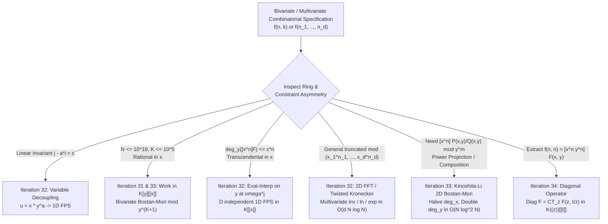
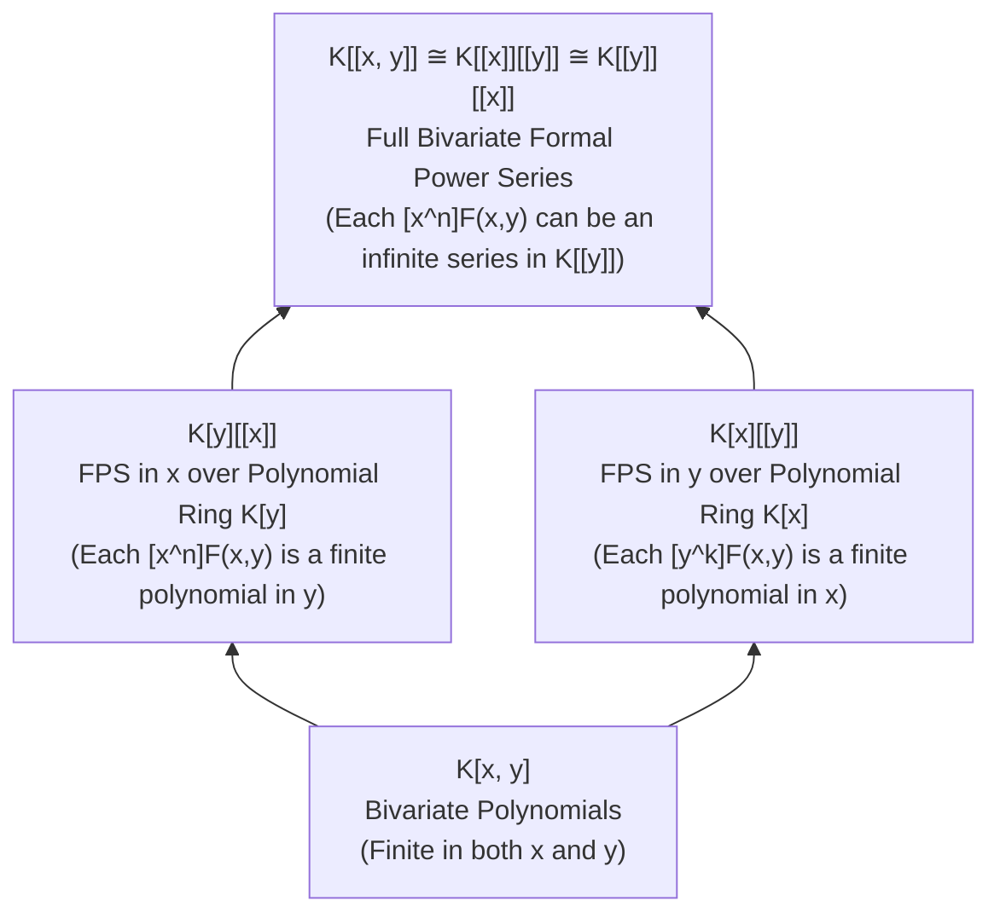

# Wave 4A (Iterations 31–35): Multivariate Formal Power Series Rings, Variable Decoupling & 2D FFT, Rational Generating Functions & 1D/2D Bostan–Mori, and Constant Term / Diagonal Operators

---

## Architectural Overview of Wave 4A

When combinatorial enumeration moves beyond a single parameter—tracking both total size $n$ and auxiliary statistics $k$ (such as number of components, inversions, upward steps, color counts, or carries)—generating functions naturally inhabit **multivariate rings**. However, a careless transition from univariate $K[[x]]$ to bivariate or multivariate series is one of the primary sources of algorithmic blowup and mathematical error in competitive programming.

Wave 4A establishes the complete theoretical and algorithmic bridge between univariate and multivariate formal power series across five tightly coupled iterations:

1. **Iteration 31 — Multivariate Formal Power Series Rings ($K[x,y]$ vs. $K[y][[x]]$ vs. $K[x][[y]]$ vs. $K[[x,y]]$) & The Primary-Variable Selection Rule**: Why $K[y][[x]]$ and $K[x][[y]]$ are strictly distinct subrings of $K[[x,y]]$, how ring membership governs coefficient finiteness, and how to choose the primary expansion variable based on degree growth and constraint asymmetry ($N \le 10^{18}, K \le 10^5$ vs. $N, K \le 10^5$).
2. **Iteration 32 — Variable Decoupling ($u = x y^a$), Homogenization, Evaluation–Interpolation, 2D FFT & Twisted Kronecker Substitution**: How to collapse two variables into one when invariants exist, how to reduce bivariate FPS operations to independent 1D FPS instances via roots-of-unity evaluation–interpolation, and how to multiply and apply transcendental operations ($\operatorname{inv}, \ln, \exp, \operatorname{pow}$) to truncated multivariate polynomials without zero-padding blowup via the van der Hoeven / EntropyIncreaser twisted Kronecker substitution.
3. **Iteration 33 — Rational Generating Functions & The 1D / 2D Bostan–Mori Algorithm**: Parity splitting $Q(x)Q(-x) = V(x^2)$ from scratch, NTT-domain halving optimizations ($\frac{2}{3} M(d)$ per step), equivalence to order-$d$ linear recurrences, bivariate Bostan–Mori modulo $y^{K+1}$, and the Kinoshita–Li $x$-halving / $y$-doubling 2D Bostan–Mori algorithm for power projection, FPS composition, and compositional inverse in $O(N \log^2 N)$.
4. **Iteration 34 — Constant Term ($\operatorname{CT}_z$) and Diagonal ($\operatorname{Diag}_{x,y}$) Operators**: Rigorous convergence in the iterated formal Laurent ring $K((z))[[t]]$, the fundamental identity $\operatorname{Diag}_{x,y} F(x,y) = \operatorname{CT}_z F(z, t/z) = \operatorname{res}_z \frac{1}{z} F(z, t/z)$, algebraic diagonals via quadratic root separation (central binomials, Delannoy numbers, lattice excursions), and Furstenberg's theorem.
5. **Iteration 35 — Exhaustive Competitive Programming Problem Audit, Rejected Template Table & Multilingual Bibliography**: 18 rigorously curated, non-template contest problems across `Stepping Stone`, `Intermediate`, `Advanced`, and `Mastery` tiers with self-contained statements, constraints, diagnostic bridges, 3-tier hints, and full derivations, followed by the Rejected Template Problems Log and Master Multilingual Citations (`[EN]`, `[ZH]`, `[JA]`).



---

## Iteration 31: Multivariate Formal Power Series Rings — $K[x,y]$ vs. $K[y][[x]]$ vs. $K[x][[y]]$ vs. $K[[x,y]]$ & The Primary-Variable Selection Rule

### 31.1 Concrete Combinatorial / Algebraic Objects & The Ring Hierarchy

Let $K$ be a commutative ring with identity (in competitive programming, typically a prime field $\mathbb{F}_p$ such as $\mathbb{F}_{998244353}$ or $\mathbb{Q}$). When a sequence $f_{n,k}$ depends on two non-negative integer parameters $n, k \ge 0$, we associate it with a formal expression in two indeterminates $x$ and $y$:
$$F(x, y) = \sum_{n=0}^{\infty} \sum_{k=0}^{\infty} f_{n,k} x^n y^k.$$
Depending on **finiteness of support** along each coordinate, $F(x,y)$ lives in one of four distinct algebraic rings that form a strict lattice of inclusions:



Let us define each ring with mathematical precision:

1. **The Bivariate Polynomial Ring $K[x,y] \cong (K[y])[x] \cong (K[x])[y]$**:
   $$K[x,y] = \left\{ \sum_{n=0}^{N} \sum_{k=0}^{M} f_{n,k} x^n y^k \;\middle|\; N, M \in \mathbb{Z}_{\ge 0},\; f_{n,k} \in K \right\}.$$
   Only finitely many coefficients $f_{n,k}$ are non-zero in total. Both $x$ and $y$ can be evaluated at arbitrary elements of $K$.

2. **Formal Power Series in $x$ with Polynomial Coefficients in $y$, denoted $K[y][[x]]$**:
   $$K[y][[x]] = \left\{ \sum_{n=0}^{\infty} P_n(y) x^n \;\middle|\; P_n(y) \in K[y] \text{ for all } n \ge 0 \right\}.$$
   Here $x$ is the **formal expansion variable** (supporting infinite sums), while $y$ is a **polynomial parameter**. Crucially, for **every fixed $n \ge 0$**, the slice $[x^n] F(x,y) = P_n(y)$ is a **polynomial of finite degree** $d_n = \deg_y P_n(y) < \infty$. However, as $n \to \infty$, the degree $d_n$ may grow without bound (typically $d_n \le c \cdot n$).

3. **Formal Power Series in $y$ with Polynomial Coefficients in $x$, denoted $K[x][[y]]$**:
   $$K[x][[y]] = \left\{ \sum_{k=0}^{\infty} Q_k(x) y^k \;\middle|\; Q_k(x) \in K[x] \text{ for all } k \ge 0 \right\}.$$
   Symmetrically, for every fixed $k \ge 0$, the horizontal slice $[y^k] F(x,y) = Q_k(x)$ is a finite-degree polynomial in $x$, whereas for a fixed $n$, the vertical slice $[x^n] F(x,y)$ may be an infinite formal power series in $K[[y]]$.

4. **The Full Bivariate Formal Power Series Ring $K[[x,y]] \cong K[[y]][[x]] \cong K[[x]][[y]]$**:
   $$K[[x,y]] = \left\{ \sum_{n=0}^{\infty} \sum_{k=0}^{\infty} f_{n,k} x^n y^k \;\middle|\; f_{n,k} \in K \right\}.$$
   In $K[[x,y]]$, neither $[x^n] F(x,y) \in K[[y]]$ nor $[y^k] F(x,y) \in K[[x]]$ is required to have finite degree. Addition and multiplication are always well-defined because computing a single coefficient
   $$[x^n y^k] (F \cdot G) = \sum_{i=0}^{n} \sum_{j=0}^{k} f_{i,j} g_{n-i, k-j}$$
   only ever inspects the finite $(n+1) \times (k+1)$ lower-left rectangle $[0, n] \times [0, k]$.

> [!IMPORTANT]
> **Why $K[y][[x]] \neq K[x][[y]]$ Matters Algorithmically**:
> Although $K[[y]][[x]]$ and $K[[x]][[y]]$ are canonically isomorphic to $K[[x,y]]$, the intermediate rings $K[y][[x]]$ and $K[x][[y]]$ are **completely incomparable** ($K[y][[x]] \cap K[x][[y]] = K[x,y]$).
> In $K[y][[x]]$, we can compute $[x^n] F(x,y)$ as an **exact, un-truncated polynomial** in $K[y]$ (or evaluate $y$ at finitely many points without any truncation error in $y$). In $K[[y]][[x]]$, computing $[x^n] F(x,y)$ requires **truncating $y \bmod y^{K+1}$**, because the coefficient of $x^n$ is an infinite series in $y$!

---

### 31.2 The Diagnostic Signal: How to Choose Between $K[y][[x]]$ and $K[x][[y]]$

In competitive programming, the Chinese literature calls the choice of which variable sits on the outside of the ring brackets the **Principal Variable Method (`主元法`, Zhǔyuánfǎ)**. When faced with a bivariate generating function $F(x,y)$, look for two diagnostic signals:

1. **The Combinatorial / Algebraic Finiteness Signal (Finite Slice Condition)**:
   Ask: *For a fixed size $n$ (tracked by $x$), can the auxiliary statistic $k$ (tracked by $y$) be arbitrarily large, or is $k$ bounded by some function of $n$ (such as $k \le n$ or $k \le 2n$)?*
   - If $0 \le k \le c \cdot n$ whenever $f_{n,k} \neq 0$, then $F(x,y) \in K[y][[x]]$. Every coefficient $[x^n] F(x,y)$ is a polynomial of degree at most $c n$.
   - Conversely, if $f_{n,0} \neq 0$ for infinitely many $n$ (for example, $f_{n,0} = 1$ for all $n \ge 0$), then $[y^0] F(x,y) = \sum_{n \ge 0} f_{n,0} x^n$ is an **infinite power series**, so $F(x,y) \notin K[x][[y]]$!

2. **The Constraint Asymmetry Signal ($N$ vs. $K$ in Input Bounds)**:
   Look at the target query $[x^N y^K] F(x,y)$ and the problem's constraints on $N$ and $K$:
   - **Regime A ($N \le 10^{18}$, $K \le 10^5$)**: Since $N$ is huge and $K$ is moderate, you **cannot** expand step-by-step in $x$ up to $x^N$. Instead, view $F(x,y)$ either as a rational/algebraic function in $x$ over the truncated ring $R = K[y]/(y^{K+1})$ (so $F \in (K[y]/(y^{K+1}))[[x]]$, solved via bivariate Bostan–Mori in $O(d_x K \log K \log N)$), **or** view $F(x,y) \in K[[x]][[y]]$ and expand in $y$ up to $y^K$ if $[y^k] F(x,y)$ is a compact rational form in $x$ whose $x^N$-coefficient can be extracted AT THE END.
   - **Regime B ($N \le 10^5$, $K \le 10^{18}$)**: Flip the roles! Work modulo $x^{N+1}$ and use binary exponentiation or Bostan–Mori in $y$.
   - **Regime C ($N \le 2000, K \le 2000$ or $N \cdot K \le 2 \times 10^5$)**: Work in $K[x,y] / (x^{N+1}, y^{K+1})$ using evaluation–interpolation on the lower-degree variable or 2D FFT / twisted Kronecker substitution.

---

### 31.3 The Reverse-Engineering Scratchpad: Discovering the Ring Asymmetry

Suppose a problem asks us to study the bivariate rational function
$$F(x, y) = \frac{1}{1 - x(1 + y + y^2)}.$$
Let us trace how a solver discovers which ring $F(x,y)$ belongs to and why choosing the wrong primary variable causes catastrophic infinite-series blowup.

```
[Scratchpad: Testing x vs. y as the Primary Expansion Variable]

Attempt 1: Treat x as the primary outer variable, working in R[[x]] where R = K[y].
- Let Q(x) = 1 - (1 + y + y^2) x.
- Notice that the constant term in x is:
    [x^0] Q(x) = 1.
- Is 1 a unit in the polynomial ring R = K[y]?
  YES! The units of K[y] are precisely the non-zero constants K^\times, and 1 \in K^\times.
- Because [x^0] Q(x) = 1 is invertible inside K[y] itself (without needing K[[y]]!),
  the geometric series expansion in x stays entirely inside K[y][[x]]:
    F(x, y) = \sum_{n=0}^{\infty} (1 + y + y^2)^n x^n \in K[y][[x]].
- Check the n-th coefficient:
    [x^n] F(x, y) = (1 + y + y^2)^n \in K[y],
  which is a clean polynomial of finite degree 2n!

Attempt 2: Treat y as the primary outer variable, hoping to work in R'[[y]] where R' = K[x].
- Rewrite the denominator by grouping powers of y:
    Q(y) = (1 - x) - x y - x y^2.
- What is the constant term in y?
    [y^0] Q(y) = 1 - x.
- Is (1 - x) a unit in the polynomial ring R' = K[x]?
  NO! The inverse of (1 - x) is 1 + x + x^2 + x^3 + ..., which is an INFINITE series in K[[x]], NOT a polynomial in K[x]!
- Therefore, to invert Q(y) as a power series in y, we are FORCED to enlarge the coefficient ring from K[x] to K[[x]]:
    F(x, y) = \frac{1}{(1 - x) - x(y + y^2)}
            = \frac{1}{1 - x} \cdot \frac{1}{1 - \frac{x}{1 - x}(y + y^2)}
            = \sum_{m=0}^{\infty} \frac{x^m}{(1 - x)^{m+1}} y^m (1 + y)^m \in K[[x]][[y]].
- Look at what happened: even the very first coefficient [y^0] F(x, y) = 1/(1-x) = 1 + x + x^2 + ... has INFINITE degree in x!
```

This scratchpad reveals the **Fundamental Algebraic Criterion for Ring Membership**:

> [!TIP]
> **Unit Criterion for Rational Functions $P(x,y)/Q(x,y)$ ($P, Q \in K[x,y]$)**:
> Let $Q(x,y) \in K[x,y]$ with $Q(0,0) \in K^\times$.
> - $\frac{P(x,y)}{Q(x,y)} \in K[y][[x]]$ **if and only if** $Q(0, y) \in K^\times$ (i.e., setting $x = 0$ kills *all* occurrences of $y$ in the denominator, leaving a non-zero constant!).
> - $\frac{P(x,y)}{Q(x,y)} \in K[x][[y]]$ **if and only if** $Q(x, 0) \in K^\times$ (i.e., setting $y = 0$ kills *all* occurrences of $x$ in the denominator).
> - If $Q(0, y)$ still depends on $y$ AND $Q(x, 0)$ still depends on $x$ (for example, $Q(x,y) = 1 - x - y$, where $Q(0,y) = 1-y \notin K^\times$ and $Q(x,0) = 1-x \notin K^\times$), then $\frac{1}{1 - x - y}$ lies in **neither** $K[y][[x]]$ **nor** $K[x][[y]]$, and must be treated in the full ring $K[[x,y]]$ (or homogenized via $x \mapsto x u$, $y \mapsto y u$).

---

### 31.4 Step-by-Step Algebraic Derivation & Verbal Annotations

Let us derive both representations of $F(x,y) = \frac{1}{1 - x(1 + y + y^2)}$ and compare how they extract a specific coefficient $[x^n y^k] F(x,y)$ (the **trinomial coefficient** $\binom{n}{k}_2$, counting lattice paths of $n$ steps from $(0,0)$ to $(n,k)$ using step set $\{(1,0), (1,1), (1,2)\}$).

#### Expansion 1: In $K[y][[x]]$ (Primary Variable $x$)

$$\begin{aligned}
F(x, y)
&= \frac{1}{1 - x(1 + y + y^2)} && \text{(Given rational generating function; } [x^0]\text{denom} = 1 \in K[y]^\times\text{)} \\
&= \sum_{n=0}^{\infty} \left(1 + y + y^2\right)^n x^n && \text{(Expand geometric series in } x\text{; valid since } \operatorname{val}_x(x(1+y+y^2)) = 1 \ge 1\text{)} \\
&= \sum_{n=0}^{\infty} x^n \left( \sum_{j=0}^{n} \binom{n}{j} y^j (1 + y)^j \right) && \text{(Write } 1 + y + y^2 = 1 + y(1+y) \text{ and apply Binomial Theorem for } 0 \le j \le n\text{)} \\
&= \sum_{n=0}^{\infty} x^n \left( \sum_{j=0}^{n} \binom{n}{j} \sum_{i=0}^{j} \binom{j}{i} y^{j+i} \right) && \text{(Expand } (1+y)^j \text{ for } 0 \le i \le j\text{)} \\
&= \sum_{n=0}^{\infty} x^n \left( \sum_{k=0}^{2n} y^k \sum_{j=\lceil k/2 \rceil}^{\min(n, k)} \binom{n}{j} \binom{j}{k - j} \right) && \text{(Re-index via } k = j + i \implies i = k - j\text{, enforcing } 0 \le k - j \le j \text{ and } j \le n\text{)}.
\end{aligned}$$

**Algebraic Validity Conditions**:
- Because $[x^0](1 - x(1+y+y^2)) = 1$ is a unit in $K[y]$, no division by polynomials in $y$ ever occurs.
- For each $n \ge 0$, the inner sum over $k$ ranges over the finite interval $0 \le k \le 2n$.

#### Expansion 2: In $K[[x]][[y]]$ (Primary Variable $y$)

$$\begin{aligned}
F(x, y)
&= \frac{1}{(1 - x) - x y(1 + y)} && \text{(Group terms free of } y \text{ vs. multiples of } y\text{)} \\
&= \frac{1}{1 - x} \cdot \frac{1}{1 - \frac{x}{1 - x} y(1 + y)} && \text{(Factor out } 1 - x\text{, which is a unit in } K[[x]] \text{ since } [x^0](1-x) = 1 \in K^\times\text{)} \\
&= \sum_{j=0}^{\infty} \frac{x^j}{(1 - x)^{j+1}} y^j (1 + y)^j && \text{(Expand geometric series in } u = \frac{x}{1-x}y(1+y)\text{, valid since } \operatorname{val}_y(u) = 1 \ge 1\text{)} \\
&= \sum_{k=0}^{\infty} y^k \left( \sum_{j=\lceil k/2 \rceil}^{k} \binom{j}{k - j} \frac{x^j}{(1 - x)^{j+1}} \right) && \text{(Collect coefficient of } y^k \text{ by setting } i = k - j \text{ with } 0 \le k - j \le j\text{)}.
\end{aligned}$$

Look closely at the coefficient of $y^k$:
$$[y^k] F(x, y) = \sum_{j=\lceil k/2 \rceil}^{k} \binom{j}{k - j} \frac{x^j}{(1 - x)^{j+1}} \in K[[x]].$$
Even though this is an infinite power series in $K[[x]]$, notice that it is a **finite sum of at most $\lfloor k/2 \rfloor + 1$ rational terms**, and extracting $[x^n]$ from $(1-x)^{-(j+1)}$ immediately yields $\binom{(n-j) + j}{j} = \binom{n}{j}$ in $O(k)$ time—even when $n = 10^{18}$!
This illustrates a profound lesson:
- In $K[y][[x]]$, $[x^n] F(x,y) = (1+y+y^2)^n$ has finite degree $2n$ in $y$, ideal when $n$ is small or when we need all $y^k$ for a fixed $n$.
- In $K[[x]][[y]]$, $[y^k] F(x,y)$ is an infinite series in $x$, **but** it is a rational function of $x$ with denominator $(1-x)^{k+1}$, making it effortless to extract $[x^N y^k] F(x,y)$ when $k$ is small ($k \le 10^5$) and $N$ is astronomical ($N \le 10^{18}$)!

---

### 31.5 Hand-Checkable Toy Example ($n \le 3$)

Let us verify both expansions of $F(x,y) = \frac{1}{1 - x(1 + y + y^2)}$ up to $n = 3$ and $k = 3$.

1. **Via $K[y][[x]]$ ($[x^n] F = (1 + y + y^2)^n$)**:
   - $n = 0$: $(1 + y + y^2)^0 = 1$.
   - $n = 1$: $(1 + y + y^2)^1 = 1 + y + y^2$.
   - $n = 2$: $(1 + y + y^2)^2 = 1 + 2y + 3y^2 + 2y^3 + y^4$.
   - $n = 3$: $(1 + y + y^2)^3 = 1 + 3y + 6y^2 + 7y^3 + 6y^4 + 3y^5 + y^6$.

2. **Via $K[[x]][[y]]$ ($[y^k] F = \sum_{j=\lceil k/2 \rceil}^k \binom{j}{k-j} \frac{x^j}{(1-x)^{j+1}}$)**:
   - $k = 0$ ($j = 0$):
     $$[y^0] F = \frac{1}{1 - x} = 1 + x + x^2 + x^3 + O(x^4).$$
   - $k = 1$ ($j = 1$):
     $$[y^1] F = \binom{1}{0} \frac{x}{(1 - x)^2} = x + 2x^2 + 3x^3 + O(x^4).$$
   - $k = 2$ ($j \in \{1, 2\}$):
     $$[y^2] F = \binom{1}{1} \frac{x}{(1 - x)^2} + \binom{2}{0} \frac{x^2}{(1 - x)^3} = (x + 2x^2 + 3x^3) + (x^2 + 3x^3) + O(x^4) = x + 3x^2 + 6x^3 + O(x^4).$$
   - $k = 3$ ($j \in \{2, 3\}$):
     $$[y^3] F = \binom{2}{1} \frac{x^2}{(1 - x)^3} + \binom{3}{0} \frac{x^3}{(1 - x)^4} = 2(x^2 + 3x^3) + x^3 + O(x^4) = 2x^2 + 7x^3 + O(x^4).$$

Let us tabulate the $4 \times 4$ grid of coefficients $f_{n,k} = [x^n y^k] F(x,y)$ and confirm that the row-wise expansion ($K[y][[x]]$) and column-wise expansion ($K[[x]][[y]]$) agree entry by entry:

| $n \backslash k$ | $y^0$ | $y^1$ | $y^2$ | $y^3$ | Row polynomial $[x^n] F(x,y) \in K[y]$ |
| :--- | :---: | :---: | :---: | :---: | :--- |
| **$x^0$** | $1$ | $0$ | $0$ | $0$ | $1$ (deg $0$) |
| **$x^1$** | $1$ | $1$ | $1$ | $0$ | $1 + y + y^2$ (deg $2$) |
| **$x^2$** | $1$ | $2$ | $3$ | $2$ | $1 + 2y + 3y^2 + 2y^3 + y^4$ (deg $4$) |
| **$x^3$** | $1$ | $3$ | $6$ | $7$ | $1 + 3y + 6y^2 + 7y^3 + 6y^4 + 3y^5 + y^6$ (deg $6$) |
| **Col series $[y^k]F \in K[[x]]$** | $\frac{1}{1-x}$ | $\frac{x}{(1-x)^2}$ | $\frac{x+x^2-x^2}{(1-x)^3}=\frac{x}{(1-x)^3}$ | $\frac{2x^2-x^3}{(1-x)^4}$ | *Rational in $x$, infinite power series!* |

---

### 31.6 Failure Modes, Pitfalls & Edge Cases

1. **Attempting Un-Truncated Polynomial Inversion in the Wrong Ring**:
   Suppose a solver writes $Q(x,y) = 1 - x - y$ and tries to compute $[x^n] \frac{1}{Q(x,y)}$ as a polynomial in $y$ by running a 1D Newton iteration over $K[y][[x]]$. At step $0$, they need the inverse of $[x^0] Q(x,y) = 1 - y$. Because $1 - y$ is **not** a unit in $K[y]$, the algorithm either crashes or must replace $K[y]$ with the truncated quotient ring $K[y]/(y^{M+1})$. Always verify $[x^0] Q(x,y) \in K^\times$ before assuming $Q(x,y)^{-1} \in K[y][[x]]$!
2. **Evaluating an Infinite Series at a Point $y = y_0$**:
   In $K[y][[x]]$, because every coefficient $[x^n] F(x,y) = P_n(y)$ is a finite polynomial in $y$, the evaluation map $\operatorname{ev}_{y=y_0} : K[y][[x]] \to K[[x]]$ defined by $\sum_{n \ge 0} P_n(y) x^n \mapsto \sum_{n \ge 0} P_n(y_0) x^n$ is a **strictly valid ring homomorphism** for any $y_0 \in K$.
   In contrast, in $K[[y]][[x]]$ (or $K[x][[y]]$), evaluating $y = y_0 \neq 0$ attempts to compute the infinite sum $\sum_{k=0}^{\infty} f_{n,k} y_0^k$ inside $K$, which is **algebraically undefined**! For instance, in $G(x,y) = \frac{1}{1 - y} = \sum_{k \ge 0} y^k \in K[x][[y]]$, substituting $y = 1$ yields the divergent sum $1 + 1 + 1 + \dots$ or division by zero $\frac{1}{1 - 1}$.
   - **Rule**: You may evaluate $y = y_0 \in K$ at the level of formal power series in $x$ **only if** $F(x,y) \in K[y][[x]]$ (or if you first truncate modulo $x^{N+1}$ and verify that only finitely many powers of $y$ survive in the truncated expression, or that the rational denominator $Q(x, y_0)$ still has a unit constant term $Q(0, y_0) \in K^\times$).
3. **Hidden Degree Growth $d_n = \deg_y([x^n] F(x,y))$**:
   Even when $F(x,y) \in K[y][[x]]$, if $[x^1] F(x,y)$ has degree $c$ in $y$, then $[x^N] F(x,y)$ typically has degree $c N$ in $y$. If $c N > K$ where $K$ is the maximum $y$-exponent queried by the problem, you **must** truncate $y \bmod y^{K+1}$ at every intermediate step; otherwise, keeping the full polynomial in $K[y]$ causes the degree to grow to $c N$, turning an $O(N K \log N \log K)$ algorithm into $O(c N^2 \log^2 N)$.

---

## Iteration 32: Variable Decoupling ($u = x y^a$), Homogenization, Evaluation–Interpolation, 2D FFT & Twisted Kronecker Substitution

### 32.1 Concrete Combinatorial / Algebraic Objects

Once a bivariate or $d$-variate generating function $F(x_1, \dots, x_d)$ is formulated, computing with it directly in $d$ variables is expensive if done naively. Iteration 32 catalogs the four algebraic and algorithmic reductions that compress multivariate generating functions into fast 1D operations:

1. **Monomial Variable Decoupling ($u = x y^a$) & Homogenization ($x \mapsto x t, y \mapsto y t$)**:
   An isomorphism of subrings inside $K[y, y^{-1}][[x]]$ that collapses a bivariate series $F(x,y)$ whose support lies on a single affine lattice line (or a small family of lines) into a univariate series in $u = x y^a$.
2. **Evaluation–Interpolation over $K[y][[x]]$ (`主元点值法`)**:
   For $F(x, y) \in K[y][[x]]$ truncated modulo $x^{N+1}$ where $\deg_y([x^n] F(x,y)) \le M$ for all $n \le N$, an algebraic homomorphism
   $$\Phi : K[y]/(y^D - 1)[[x]]/(x^{N+1}) \xrightarrow{\;\sim\;} \prod_{r=0}^{D-1} K[[x]]/(x^{N+1}), \qquad F(x, y) \mapsto \big(F(x, \omega^0), F(x, \omega^1), \dots, F(x, \omega^{D-1})\big)$$
   where $D = 2^{\lceil \log_2(M+1) \rceil}$ and $\omega$ is a primitive $D$-th root of unity in $K$.
3. **Row–Column 2D FFT & Standard Kronecker Substitution (`克罗内克代换`)**:
   - **2D FFT**: Separable evaluation at $(\omega_1^{r_1}, \omega_2^{r_2})$ across rows then columns in $O(N M \log(NM))$.
   - **Kronecker Substitution**: The ring homomorphism $\mathcal{K}_B : K[x, y] \to K[z]$ defined by $x \mapsto z,\; y \mapsto z^B$ (or $x \mapsto z^B, y \mapsto z$), which packs a 2D array $(f_{i,j})$ into a 1D polynomial of degree $< N B$ using base-$B$ positional encoding $i + j B$.
4. **Twisted Kronecker Substitution (van der Hoeven 2002 / EntropyIncreaser 2020) for Truncated Multivariate Rings**:
   For the truncated $d$-variate quotient ring
   $$\mathcal{R}_{n_1, \dots, n_d} = K[x_1, \dots, x_d] / (x_1^{n_1}, x_2^{n_2}, \dots, x_d^{n_d}), \qquad N = n_1 n_2 \cdots n_d,$$
   an embedding into $(K[t]/(t^d - 1))[z]/(z^N)$ that tracks radix carries via an auxiliary cyclic variable $t \pmod{t^d - 1}$, enabling truncated $d$-variate multiplication, $\operatorname{inv}$, $\ln$, $\exp$, and $\operatorname{pow}$ in $O(d N \log N)$ time with **zero padding blowup** ($1\times$ length instead of $2^d\times$ length!).

---

### 32.2 The Diagnostic Signals

How does a solver immediately recognize which of the four reductions applies to a given problem?

| Reduction Technique | Visual / Structural Diagnostic Signal in the Problem | Target Complexity |
| :--- | :--- | :--- |
| **1. Variable Decoupling ($u = x y^a$)** | Every transition/step $(x^i y^j)$ satisfies $j = a i$ (or $j - a i \in \{0, 1\}$), OR the weight of an object of size $i$ is a function of $i$ plus a decoupled factor $A(x) B(x y^a)$. | $O(N \log N)$ (pure 1D FPS!) |
| **2. Homogenization ($x \mapsto x t, y \mapsto y t$)** | The recurrence or PDE mixes $x$ and $y$ steps of total degree $1$ (e.g., $1 - x - y$ or $\exp(x + y z)$), and we need all coefficients up to **total degree** $i + j \le N$. | $O(N^2 \log N)$ |
| **3. Evaluation–Interpolation on $y$** | We need $\exp F(x,y)$, $\ln F(x,y)$, $F(x,y)^{-1}$, or $F(x,y)^K \bmod x^{N+1}$, where $\deg_y([x^n] F(x,y)) \le c \cdot n$ (so $y$ is NOT truncated mid-way, or we know the exact max degree $M$ of the output polynomial in $y$). | $O(M N \log N + N M \log M)$ |
| **4. Twisted Kronecker / 2D FFT** | Both $x$ and $y$ (or $x_1, \dots, x_d$) are **simultaneously truncated** modulo $(x_1^{n_1}, \dots, x_d^{n_d})$ inside a non-linear operation ($\operatorname{inv}, \ln, \exp, \operatorname{pow}$), so higher powers of $y$ MUST be discarded at every intermediate multiplication. | $O(d N \log N)$ where $N = \prod n_r$ |

---

### 32.3 The Reverse-Engineering Scratchpads

#### Scratchpad A: Discovering Variable Decoupling & Homogenization

Suppose we encounter the bivariate series
$$F(x, y) = \prod_{m=1}^{N} \left(1 + x y + x^2 y^2 + \dots\right) \left(1 + x y^2\right) = \frac{1}{(1 - x y)^N} (1 + x y^2)^N,$$
or more generally a sum where every elementary building block adds $1$ to the $x$-exponent and either $a$ or $a+1$ to the $y$-exponent:
$$F(x, y) = \sum_{n=0}^{\infty} x^n (p_0 y^{a n} + p_1 y^{a n + 1})^n.$$
```
[Scratchpad: How to Spot and Execute Variable Decoupling]
1. Look at the exponents (i, j) of x^i y^j in each atomic step:
   Step Type A multiplies by x^1 y^a.
   Step Type B multiplies by x^1 y^{a+1}.
2. Compare j and a*i:
   - For Step Type A: j - a*i = a - a(1) = 0.
   - For Step Type B: j - a*i = (a+1) - a(1) = 1.
3. Notice that if we group x with y^a by defining a new composite variable
     u = x y^a   (so x = u y^{-a}),
   then:
   - Step Type A becomes x y^a = u (independent of y!).
   - Step Type B becomes x y^{a+1} = (x y^a) y = u y.
4. Substitute x = u y^{-a} into F(x, y):
     F(u y^{-a}, y) = \sum_{n=0}^{\infty} u^n (p_0 + p_1 y)^n.
5. Extract the coefficient [x^n y^k] F(x, y):
   Since x^n y^k = (u y^{-a})^n y^k = u^n y^{k - a n},
   we have:
     [x^n y^k] F(x, y) = [u^n y^{k - a n}] F(u y^{-a}, y)!
   The two variables have completely decoupled: u tracks the total number of steps n,
   while y ONLY tracks the excess (k - a*n) >= 0!
```

#### Scratchpad B: Why Standard Kronecker Fails for Truncated Multivariate Inversion—and How Twisted Kronecker Fixes It

Suppose we want to compute $F(x, y) \cdot G(x, y) \bmod (x^{n_1}, y^{n_2})$, and ultimately $F(x, y)^{-1} \bmod (x^{n_1}, y^{n_2})$.
Let us trace what happens when we try to flatten $(x, y)$ into a single variable $z$ using mixed-radix encoding $x^i y^j \mapsto z^{i + j n_1}$ for $0 \le i < n_1$ and $0 \le j < n_2$:

```
[Scratchpad: Reconstructing the Twisted Kronecker Carry-Filter]

1. Naive Mixed-Radix Substitution (Zero-Padding Free):
   Map each valid monomial x^i y^j (with 0 <= i < n_1, 0 <= j < n_2) to:
     z^{i + j * n_1},   where 0 <= i + j * n_1 < N = n_1 * n_2.
   What goes wrong when we multiply two monomials (x^{i_1} y^{j_1}) * (x^{i_2} y^{j_2})?
   In the 1D polynomial ring K[z] / (z^N), their product lands at exponent:
     I = (i_1 + i_2) + (j_1 + j_2) * n_1.
   Case 1 (Valid): i_1 + i_2 < n_1 and j_1 + j_2 < n_2.
     Then I mod n_1 = i_1 + i_2, and floor(I / n_1) = j_1 + j_2. Exact match!
   Case 2 (Carry Contamination / Overflow in x!):
     Suppose i_1 + i_2 >= n_1 (say i_1 + i_2 = n_1 + r with 0 <= r < n_1).
     In K[x,y] / (x^{n_1}, y^{n_2}), this term has x-degree >= n_1, so it MUST BE ZERO!
     Yet in 1D mixed-radix encoding, its exponent is:
       I = (n_1 + r) + (j_1 + j_2) * n_1 = r + (j_1 + j_2 + 1) * n_1!
     It masquerades as a fake contribution to x^r y^{j_1 + j_2 + 1}!

2. How can we detect and annihilate Case 2 without doubling n_1 to 2*n_1?
   Look at the quotient floor(I / n_1) in both cases:
   - In Case 1 (no carry): floor(I / n_1) = j_1 + j_2 = floor(I_1 / n_1) + floor(I_2 / n_1).
   - In Case 2 (carry occurred!): floor(I / n_1) = j_1 + j_2 + 1 != floor(I_1 / n_1) + floor(I_2 / n_1)!
   In general, across d dimensions with radices (n_1, n_2, ..., n_d), define for any flat index
   0 <= I < N = n_1 n_2 ... n_d with mixed-radix digits (i_1, i_2, ..., i_d):
     \chi(I) = i_2 + i_3 + ... + i_d = \sum_{r=1}^{d-1} \left\lfloor \frac{I}{n_1 n_2 \cdots n_r} \right\rfloor.
   When we add I_1 + I_2 = I, each dimension r in {1, ..., d-1} generates a carry c_r \in {0, 1}.
   Because a carry in dimension r subtracts n_r from digit r and adds +1 to digit (r+1),
   the discrepancy between \chi(I_1) + \chi(I_2) and \chi(I_1 + I_2) is EXACTLY the total number of carries:
     \chi(I_1 + I_2) - (\chi(I_1) + \chi(I_2)) = c_1 + c_2 + \dots + c_{d-1} \in \{0, 1, \dots, d-1\}!

3. The Modulo-d Twist:
   Since the total number of carries C = \sum_{r=1}^{d-1} c_r satisfies 0 <= C <= d - 1,
    wehave:
     C == 0   <==>   C \equiv 0 \pmod{d}   <==>   \chi(I_1) + \chi(I_2) \equiv \chi(I_1 + I_2) \pmod{d}!
   Therefore, if we attach the auxiliary tag t^{\chi(I) \bmod d} to each coefficient f_I z^I:
     \hat{F}(z, t) = \sum_{I=0}^{N-1} f_I t^{\chi(I) \bmod d} z^I \in (K[t]/(t^d - 1))[z] / (z^N),
   multiply \hat{F}(z, t) * \hat{G}(z, t) modulo (z^N, t^d - 1), and then EXTRACT ONLY the coefficient
   of t^{\chi(I) \bmod d} at each index z^I:
     h_I = [z^I t^{\chi(I) \bmod d}] (\hat{F}(z, t) \hat{G}(z, t)),
   every single carry-contaminated term lands in the WRONG residue class mod d and is automatically discarded!
```

---

### 32.4 Step-by-Step Algebraic Derivations & Verbal Annotations

#### Derivation 1: Evaluation–Interpolation Homomorphism on $K[y][[x]]$

Suppose $F(x, y) \in K[y][[x]]$ is given up to $x^N$, and we want to compute $G(x, y) = \Phi(F(x, y)) \bmod x^{N+1}$ (where $\Phi$ is $\exp$, $\ln$, $(\cdot)^K$, or rational inversion) such that $\deg_y([x^n] G(x, y)) \le M$ for all $0 \le n \le N$.

Choose $D = 2^{\lceil \log_2(M + 1) \rceil}$ and let $\omega \in K$ be a primitive $D$-th root of unity.

$$\begin{aligned}
G(x, y) \bmod x^{N+1}
&= \sum_{n=0}^{N} g_n(y) x^n && \text{(Write target series in } K[y][[x]]/(x^{N+1}) \text{ with } \deg_y g_n \le M < D\text{)} \\
&= \sum_{n=0}^{N} \left( \frac{1}{D} \sum_{k=0}^{M} y^k \sum_{r=0}^{D-1} \omega^{-k r} g_n(\omega^r) \right) x^n && \text{(Apply 1D Inverse DFT on each coefficient polynomial } g_n(y) \text{ since } \deg_y g_n < D\text{)} \\
&= \frac{1}{D} \sum_{k=0}^{M} y^k \sum_{r=0}^{D-1} \omega^{-k r} \left( \sum_{n=0}^{N} g_n(\omega^r) x^n \right) && \text{(Interchange finite sums over } 0 \le n \le N \text{ and } 0 \le r < D\text{)} \\
&= \frac{1}{D} \sum_{k=0}^{M} y^k \sum_{r=0}^{D-1} \omega^{-k r} \left( \Phi\big(F(x, \omega^r)\big) \bmod x^{N+1} \right) && \text{(Since } \operatorname{ev}_{y=\omega^r}: K[y][[x]] \to K[[x]] \text{ is a continuous ring homomorphism)}.
\end{aligned}$$

**Algorithmic Pipeline & Complexity**:
1. **Row-wise DFT in $y$**: For each $n \in \{0, \dots, N\}$, evaluate the polynomial $[x^n] F(x, y)$ at $y = \omega^0, \dots, \omega^{D-1}$ using a 1D NTT of length $D$. Cost: $O(N D \log D)$.
2. **Pointwise 1D FPS Operation in $x$**: For each fixed $r \in \{0, \dots, D-1\}$, form the univariate series $F_r(x) = F(x, \omega^r) \in K[[x]]/(x^{N+1})$ and compute $G_r(x) = \Phi(F_r(x)) \bmod x^{N+1}$ using standard 1D FPS algorithms. Cost: $D \times O(N \log N) = O(D N \log N)$.
3. **Row-wise IDFT in $y$**: For each $n \in \{0, \dots, N\}$, interpolate $g_n(y)$ from its values $g_n(\omega^r) = [x^n] G_r(x)$ via a 1D INTT of length $D$. Cost: $O(N D \log D)$.
- **Total Time Complexity**: $O(N D \log(N D)) = O(N M \log(N M))$.

**Validity Condition**:
- For $\Phi(F) = F^{-1}$, we require $[x^0] F(x, \omega^r) \in K^\times$ for **all** $0 \le r < D$.
- For $\Phi(F) = \ln F$ or $\exp F$, we require $[x^0] F(x, \omega^r) = 1$ (respectively $0$) for all $0 \le r < D$, which holds automatically whenever $[x^0] F(x, y) = 1$ (respectively $0$) is independent of $y$!

---

#### Derivation 2: Truncated Multivariate $\ln$ and $\exp$ via the Total-Index Euler Operator $\mathfrak{D}$

Suppose $F(x_1, \dots, x_d) \in \mathcal{R}_{n_1, \dots, n_d} = K[x_1, \dots, x_d] / (x_1^{n_1}, \dots, x_d^{n_d})$ with constant term $f_{0,\dots,0} = 1$. How do we compute $\ln F$ and $\exp F$ in $O(d N \log N)$ time without computing $d$ separate partial derivatives $\frac{\partial}{\partial x_r}$?

Define the **Mixed-Radix Weight** of each multi-index $\mathbf{i} = (i_1, \dots, i_d) \in \prod_{r=1}^d \{0, \dots, n_r - 1\}$ to be its flat 1D index:
$$I(\mathbf{i}) = i_1 + i_2 n_1 + i_3 n_1 n_2 + \dots + i_d (n_1 \cdots n_{d-1}) \in \{0, 1, \dots, N - 1\}.$$
Now define the linear operator $\mathfrak{D} : \mathcal{R}_{n_1, \dots, n_d} \to \mathcal{R}_{n_1, \dots, n_d}$ by:
$$\mathfrak{D} = \sum_{r=1}^{d} (n_1 \cdots n_{r-1}) x_r \frac{\partial}{\partial x_r}, \qquad \text{so that} \qquad \mathfrak{D}\left(x_1^{i_1} \cdots x_d^{i_d}\right) = I(\mathbf{i})\, x_1^{i_1} \cdots x_d^{i_d}.$$

Let us verify why $\mathfrak{D}$ is a **derivation** on the truncated ring $\mathcal{R}_{n_1, \dots, n_d}$:

$$\begin{aligned}
\mathfrak{D}(F \cdot G)
&= \sum_{r=1}^{d} (n_1 \cdots n_{r-1}) x_r \frac{\partial}{\partial x_r} (F \cdot G) && \text{(Definition of } \mathfrak{D} \text{ as a linear combination of Euler operators } x_r \partial_{x_r}\text{)} \\
&= \sum_{r=1}^{d} (n_1 \cdots n_{r-1}) \left( \left(x_r \frac{\partial F}{\partial x_r}\right) G + F \left(x_r \frac{\partial G}{\partial x_r}\right) \right) && \text{(Leibniz product rule for each } x_r \frac{\partial}{\partial x_r}\text{; note } x_r \partial_{x_r}(x_r^{n_r}) = n_r x_r^{n_r} \equiv 0 \bmod x_r^{n_r}\text{!)} \\
&= (\mathfrak{D} F) \cdot G + F \cdot (\mathfrak{D} G) && \text{(By linearity, } \mathfrak{D} \text{ satisfies the Leibniz rule on the quotient ring } \mathcal{R}_{n_1,\dots,n_d}\text{!)}.
\end{aligned}$$

> [!NOTE]
> **Why $x_r \frac{\partial}{\partial x_r}$ Respects Truncation Modulo $x_r^{n_r}$ (Whereas $\frac{\partial}{\partial x_r}$ Shifts Degrees)**:
> Ordinary differentiation $\frac{\partial}{\partial x_r}$ maps $x_r^{n_r}$ (which is $0$ in $\mathcal{R}$) to $n_r x_r^{n_r - 1}$ (which is non-zero in $\mathcal{R}$), so $\frac{\partial}{\partial x_r}$ is **not** an endomorphism of $K[x_r]/(x_r^{n_r})$—it loses the top coefficient $[x_r^{n_r - 1}]$.
> In contrast, the Euler operator $\vartheta_r = x_r \frac{\partial}{\partial x_r}$ multiplies each monomial $x_1^{i_1} \cdots x_d^{i_d}$ in-place by its exponent $i_r$ **without shifting any degrees**! And because $I(\mathbf{i}) = 0 \iff \mathbf{i} = (0, \dots, 0)$, the eigenvalue $I(\mathbf{i}) \in \{1, 2, \dots, N-1\}$ is strictly positive and invertible in $\mathbb{F}_p$ for every non-constant monomial whenever $p > N$!

Consequently, by the chain rule for derivations on formal power series with zero constant valuation:
$$\begin{aligned}
G = \ln F &\iff \mathfrak{D} G = \frac{\mathfrak{D} F}{F} \quad \text{with } g_{\mathbf{0}} = 0 \iff [z^I] G = \frac{1}{I} [z^I] \left((\mathfrak{D} F) \cdot F^{-1}\right) \quad (1 \le I < N), \\
G = \exp F &\iff \mathfrak{D} G = G \cdot (\mathfrak{D} F) \quad \text{with } g_{\mathbf{0}} = 1.
\end{aligned}$$
This means that once we implement **truncated multivariate multiplication** via Twisted Kronecker Substitution in $O(d N \log N)$, we immediately obtain:
- **Multivariate Inversion** $F^{-1} \bmod (x_1^{n_1}, \dots, x_d^{n_d})$ by Newton iteration $G \gets G(2 - F G) \bmod z^{2^k}$ on the flat 1D index $z^I$! (Because $I(\mathbf{i} + \mathbf{j}) = I(\mathbf{i}) + I(\mathbf{j})$ whenever no carry occurs, truncating the flat 1D polynomial modulo $z^m$ is **still** a valid filtration for Newton iteration!).
- **Multivariate Logarithm** $\ln F = \mathfrak{D}^{-1}((\mathfrak{D} F) \cdot F^{-1})$ in **one** multivariate inversion and **one** multivariate multiplication!
- **Multivariate Exponential** $\exp F$ via Newton iteration $G \gets G(1 - \ln G + F) \bmod z^{2^k}$ (or CDQ divide-and-conquer FFT on $\mathfrak{D} G = G \cdot \mathfrak{D} F$) in $O(d N \log N)$!

---

### 32.5 Hand-Checkable Toy Example ($n_1 = 2, n_2 = 2, d = 2$)

Let us trace Twisted Kronecker Multiplication on two bivariate polynomials truncated modulo $(x^2, y^2)$ ($n_1 = 2, n_2 = 2, N = 4, d = 2$):
$$F(x, y) = 1 + 2x + 3y + 4xy, \qquad G(x, y) = 1 + 5x + 6y + 7xy \pmod{x^2, y^2}.$$

1. **Exact Bivariate Product Modulo $(x^2, y^2)$ by Hand**:
   $$(1 + 2x + 3y + 4xy)(1 + 5x + 6y + 7xy) \equiv 1 + (2 + 5)x + (3 + 6)y + (4 + 2\cdot 6 + 3\cdot 5 + 7)xy = 1 + 7x + 9y + 38xy \pmod{x^2, y^2}.$$
   Notice that the term $(2x)(5x) = 10x^2$ is killed by $\bmod x^2$.

2. **Naive Mixed-Radix Substitution ($x \mapsto z, y \mapsto z^2 \pmod{z^4}$)**:
   $$\tilde{F}(z) = 1 + 2z + 3z^2 + 4z^3, \qquad \tilde{G}(z) = 1 + 5z + 6z^2 + 7z^3.$$
   In $K[z]/(z^4)$, the coefficient of $z^2$ (which corresponds to $y$) is:
   $$[z^2](\tilde{F}\tilde{G}) = 1\cdot 6 + \underbrace{2\cdot 5}_{\text{carry from } x^2!} + 3\cdot 1 = 19 \neq 9!$$
   The illegal $10x^2$ term wrapped into $z^2 = y$, corrupting $[y^1]$ from $9$ to $19$!

3. **Twisted Kronecker Substitution Modulo $(z^4, t^2 - 1)$**:
   For $I \in \{0, 1, 2, 3\}$, the carry counter is $\chi(I) = \lfloor I / 2 \rfloor \bmod 2$:
   - $I = 0$ ($1$): $\chi(0) = 0 \implies t^0 = 1$.
   - $I = 1$ ($x$): $\chi(1) = 0 \implies t^0 = 1$.
   - $I = 2$ ($y$): $\chi(2) = 1 \implies t^1 = t$.
   - $I = 3$ ($xy$): $\chi(3) = 1 \implies t^1 = t$.
   Thus:
   $$\hat{F}(z, t) = 1 + 2z + 3t z^2 + 4t z^3, \qquad \hat{G}(z, t) = 1 + 5z + 6t z^2 + 7t z^3.$$
   Multiply $\hat{F}(z, t) \hat{G}(z, t) \bmod (z^4, t^2 - 1)$:
   - At $z^0$ ($\chi(0) = 0$, extract $[t^0]$): $[t^0](1) = \mathbf{1}$.
   - At $z^1$ ($\chi(1) = 0$, extract $[t^0]$): $[t^0](2 + 5) = \mathbf{7}$.
   - At $z^2$ ($\chi(2) = 1$, extract $[t^1]$):
     $$[z^2](\hat{F}\hat{G}) = (2\cdot 5) t^0 + (1\cdot 6 + 3\cdot 1) t^1 = 10 + 9t \implies [t^{\chi(2)}] = [t^1](10 + 9t) = \mathbf{9}!$$
     Look how cleanly the illegal carry $10x^2$ stayed on $t^0$ while the true $y$-coefficient $9$ sat on $t^1$!
   - At $z^3$ ($\chi(3) = 1$, extract $[t^1]$):
     $$[z^3](\hat{F}\hat{G}) = (1\cdot 7 + 2\cdot 6 + 3\cdot 5 + 4\cdot 1) t^1 = 38t \implies [t^{\chi(3)}] = [t^1](38t) = \mathbf{38}!$$
   We recover $1 + 7x + 9y + 38xy$ with **zero** padding in $z$!

---

### 32.6 Failure Modes, Pitfalls & Edge Cases

1. **Root-of-Unity Vanishing in Evaluation–Interpolation ($Q(0, \omega^r) = 0$)**:
   When using Evaluation–Interpolation on $y$ to compute $[x^n] \frac{P(x,y)}{Q(x,y)}$, if $[x^0] Q(x, y) = q_0(y)$ is a non-constant polynomial in $y$ (for instance, $q_0(y) = 1 - y$), then at $r = 0$ ($\omega^0 = 1$) we get $q_0(\omega^0) = 1 - 1 = 0$, so $Q(x, 1)$ has zero constant term and cannot be inverted!
   - **Fix**: Never evaluate directly on $\omega^r$ if $q_0(\omega^r) = 0$ is possible. Instead, pick a random or fixed scalar offset $c \in \mathbb{F}_p^\times$ (e.g., $c = g$, a primitive root of $\mathbb{F}_p$) and evaluate at the shifted points $y_r = c \cdot \omega^r$ by scaling the coefficients of $y^k$ by $c^k$ before the NTT and by $c^{-k}$ after the INTT!
2. **Modulus $p \le N$ in Total-Index Derivation $\mathfrak{D}$**:
   Because $\mathfrak{D}(x_1^{i_1} \cdots x_d^{i_d}) = I(\mathbf{i}) x_1^{i_1} \cdots x_d^{i_d}$ where $I(\mathbf{i})$ reaches $N - 1 = n_1 \cdots n_d - 1$, inverting $\mathfrak{D}$ requires dividing by $1, 2, \dots, N - 1 \pmod p$. If the prime modulus $p \le N - 1$ (even if $p > \max_r n_r$!), $I(\mathbf{i})$ can be a multiple of $p$, making $\mathfrak{D}$ non-invertible.
   - **Fix when $\max_r n_r < p \le N$**: Instead of using the combined operator $\mathfrak{D}$, use the first-coordinate Euler operator $x_1 \frac{\partial}{\partial x_1}$ (or whichever variable has $i_r > 0$) whose eigenvalues are $i_r \in \{1, \dots, n_r - 1\} < p$.
3. **Off-by-One in Standard Kronecker Substitution Bound $B$**:
   If you multiply $F(x,y)$ and $G(x,y)$ without truncation where $\deg_y F \le M_1$ and $\deg_y G \le M_2$, the product has $y$-degree at most $M_1 + M_2$. Therefore, if you pack $y$ into the inner digit via $(x, y) \mapsto (z^B, z)$, you must choose $B \ge M_1 + M_2 + 1$ (not $B = \max(M_1, M_2) + 1$!), or else $y^{M_1 + M_2}$ will overflow into $z^B = x$.

---

## Iteration 33: Rational Generating Functions & The 1D / 2D Bostan–Mori Algorithm

### 33.1 Concrete Combinatorial / Algebraic Objects

A formal power series $F(x) = \sum_{n=0}^{\infty} f_n x^n \in K[[x]]$ is **rational** if there exist polynomials $P(x), Q(x) \in K[x]$ with $[x^0] Q(x) \in K^\times$ such that
$$F(x) = \frac{P(x)}{Q(x)}.$$

#### The Fundamental Equivalence with Homogeneous Linear Recurrences
Suppose $(f_n)_{n \ge 0}$ satisfies an order-$d$ linear recurrence with constant coefficients for all $n \ge d$:
$$f_n = c_1 f_{n-1} + c_2 f_{n-2} + \dots + c_d f_{n-d}, \qquad (n \ge d),$$
with given initial values $f_0, f_1, \dots, f_{d-1} \in K$. Define the **characteristic denominator polynomial**
$$Q(x) = 1 - c_1 x - c_2 x^2 - \dots - c_d x^d \in K[x], \qquad (\deg Q \le d,\; Q(0) = 1),$$
and the initial prefix polynomial $F_0(x) = \sum_{n=0}^{d-1} f_n x^n$. Because the recurrence precisely states that $[x^n](F(x) Q(x)) = 0$ for all $n \ge d$, all terms of degree $\ge d$ in the product $F(x) Q(x)$ vanish identically! Thus:
$$P(x) = F(x) Q(x) = \big(F_0(x) Q(x)\big) \bmod x^d, \qquad (\deg P < d).$$
Therefore, finding the $N$-th term $f_N$ of an order-$d$ linear recurrence—after an initial $O(d \log d)$ multiplication to form $P(x) = (F_0(x) Q(x)) \bmod x^d$—is **completely equivalent** to extracting a single high-degree coefficient from a proper rational function:
$$f_N = [x^N] \frac{P(x)}{Q(x)}.$$

#### The Three Algorithmic Settings of Bostan–Mori (2020)
1. **1D Bostan–Mori ($K[[x]]$ over a field $K$)**:
   Extracts $[x^N] \frac{P(x)}{Q(x)}$ for $\deg P < d, \deg Q = d$ in $O(d \log d \log N)$ field operations, outperforming Fiduccia / Kitamasa ($O(d \log d \log N)$ with $2\times$–$3\times$ larger constant) by avoiding polynomial Euclidean division (`divmod`) inside the $\log N$ loop.
2. **Truncated-Parameter Bivariate Bostan–Mori ($(K[y]/(y^{K+1}))[[x]]$ for $N \le 10^{18}, K \le 10^5$)**:
   Extracts $[x^N y^K] \frac{P(x, y)}{Q(x, y)}$ where $[x^0 y^0] Q(x,y) \in K^\times$ by running Bostan–Mori in $x$ while keeping all coefficients as polynomials in $y$ truncated modulo $y^{K+1}$, in $O(d K \log(d K) \log N)$ time.
3. **Balanced $x$-Halving / $y$-Doubling 2D Bostan–Mori (Kinoshita–Li 2024)**:
   Computes $[x^n] \frac{P(x, y)}{Q(x, y)} \bmod y^m$ when $\deg_x Q = n$ and initially $\deg_y Q = 1$ (specifically $Q(x, y) = 1 - y G(x)$). At step $i$ of the recursion, the $x$-degree is **halved** ($n_i = \lfloor n / 2^i \rfloor$) while the $y$-degree of $Q_i(x, y)$ **doubles** ($k_i = 2^i$), maintaining the invariant
   $$(\deg_x Q_i) \cdot (\deg_y Q_i) = \left\lfloor \frac{n}{2^i} \right\rfloor \cdot 2^i \le n$$
   at every level of the recursion! Since each of the $\log_2 n$ levels performs bivariate polynomial multiplication of total size $O(n)$ in $O(n \log n)$ time, the entire algorithm runs in **$O(n \log^2 n)$** time—yielding the modern competitive programming standard for **Power Projection**, **FPS Composition** $F(G(x))$, and **Compositional Inverse** $G^{\langle -1 \rangle}(x)$!

---

### 33.2 The Diagnostic Signals

- **1D Bostan–Mori Signal**:
  - You have a fixed linear recurrence of order $d \le 10^5$ (or a rational GF $P(x)/Q(x)$ from transfer matrix / automaton / inclusion-exclusion / DP) and need the $N$-th state for $N \le 10^{18}$.
- **Truncated-Parameter Bivariate Bostan–Mori Signal**:
  - You need $[x^N y^K] \frac{P(x,y)}{Q(x,y)}$ where $N \le 10^{18}$, $K \le 10^5$, and $\deg_x Q = d$ is small ($d \le 20$), **especially** when $Q(0, y) = 1 - y A(y)$ depends on $y$ so that $Q(x,y)^{-1} \notin K[y][[x]]$ (meaning the $y$-degree at $x^N$ would be $O(N) \gg K$ if not truncated modulo $y^{K+1}$ at every step!).
- **Kinoshita–Li Balanced 2D Bostan–Mori Signal**:
  - **Power Projection**: Given $G(x)$ with $[x^0] G = 0$ and a linear functional weights vector $(w_0, \dots, w_n)$, compute $p_k = \sum_{i=0}^n w_i [x^i] G(x)^k$ for all $0 \le k \le n$.
  - **FPS Composition**: Given $F(y) = \sum_{k=0}^n f_k y^k$ and $G(x) = \sum_{i=1}^n g_i x^i$, compute $H(x) = F(G(x)) \bmod x^{n+1}$ in $O(n \log^2 n)$ without Brent–Kung's $O((n \log n)^{3/2})$ baby-step giant-step overhead.

---

### 33.3 The Reverse-Engineering Scratchpads

#### Scratchpad A: How to Invent 1D Bostan–Mori from Parity Cancellation

Suppose we want $[x^N] \frac{P(x)}{Q(x)}$. Why can't we immediately halve $N \to \lfloor N / 2 \rfloor$?
```
[Scratchpad: Discovering the Conjugate Denominator Trick]

1. What makes extracting [x^N] F(x) hard?
   The denominator Q(x) = 1 + q_1 x + q_2 x^2 + q_3 x^3 + ... contains BOTH even powers
   of x and odd powers of x.
   If the denominator ONLY contained even powers of x, say Q(x) = V(x^2), then:
     \frac{1}{V(x^2)} = \sum_{m=0}^{\infty} v_m x^{2m},
   which is supported exclusively on EVEN powers of x!
   Then multiplying by P(x) = P_even(x^2) + x P_odd(x^2) would immediately split into:
     \frac{P(x)}{V(x^2)} = \underbrace{\frac{P_even(x^2)}{V(x^2)}}_{\text{all even powers } x^{2m}}
                         + x \underbrace{\frac{P_odd(x^2)}{V(x^2)}}_{\text{all odd powers } x^{2m+1}}!

2. How do we force an arbitrary polynomial Q(x) to have ONLY even powers of x?
   Recall difference of squares: (A - B)(A + B) = A^2 - B^2!
   Write Q(x) = Q_even(x^2) + x Q_odd(x^2).
   What happens if we replace x with -x?
     Q(-x) = Q_even(x^2) - x Q_odd(x^2)!
   Multiply Q(x) by its parity conjugate Q(-x):
     Q(x) Q(-x) = \big(Q_even(x^2) + x Q_odd(x^2)\big)\big(Q_even(x^2) - x Q_odd(x^2)\big)
                = Q_even(x^2)^2 - x^2 Q_odd(x^2)^2!
   Every single odd power of x cancels out!
   Therefore, there is a polynomial V(x) of the EXACT SAME DEGREE d = deg Q such that:
     Q(x) Q(-x) = V(x^2)!

3. Apply this to the fraction P(x) / Q(x):
   Multiply numerator and denominator by Q(-x):
     \frac{P(x)}{Q(x)} = \frac{P(x) Q(-x)}{Q(x) Q(-x)} = \frac{E(x^2) + x O(x^2)}{V(x^2)},
   where E(x^2) collects the even-degree terms of P(x) Q(-x) and x O(x^2) collects the odd-degree terms.
   Now look at [x^N]:
   - If N = 2m is EVEN, the odd part x O(x^2) / V(x^2) contributes 0 to [x^{2m}], so:
       [x^{2m}] \frac{P(x)}{Q(x)} = [x^{2m}] \frac{E(x^2)}{V(x^2)} = [x^m] \frac{E(x)}{V(x)}!
   - If N = 2m + 1 is ODD, the even part E(x^2) / V(x^2) contributes 0 to [x^{2m+1}], so:
       [x^{2m+1}] \frac{P(x)}{Q(x)} = [x^{2m+1}] \frac{x O(x^2)}{V(x^2)} = [x^m] \frac{O(x)}{V(x)}!
   In ONE multiplication of degree d, we halved N -> floor(N / 2) while keeping deg E < d and deg V = d!
```

#### Scratchpad B: The NTT-Domain Halving Optimization ($\frac{2}{3} M(d)$ per Step)

A naive implementation of one Bostan–Mori step computes $P(x) Q(-x)$ and $Q(x) Q(-x)$ via three length-$2L$ NTTs (where $L = 2^{\lceil \log_2(2d+1) \rceil}$). How do we cut the work by a factor of $3\times$?

```
[Scratchpad: Working Directly on Point-Values in the NTT Domain]

1. Suppose we have the length-2K NTT point-values of P(x) and Q(x) at \omega^{r} (0 <= r < 2K),
   where \omega is a primitive (2K)-th root of unity and \omega^K = -1:
     \hat{P}_r = P(\omega^r),   \hat{Q}_r = Q(\omega^r).
2. What is Q(-\omega^r)?
   Since -1 = \omega^K, we have:
     -\omega^r = \omega^{r + K \bmod 2K}!
   We do NOT need a new NTT for Q(-x)! The point-values of Q(-x) are simply the point-values
   of Q(x) with the first half and second half SWAPPED (or adjacent pairs swapped in bit-reversed order)!
3. Even better: how do we get the length-K NTT point-values of V(x) (where V(x^2) = Q(x)Q(-x))
   and E(x) or O(x) (where E(x^2) + x O(x^2) = P(x)Q(-x))?
   For any polynomial A(x) = A_even(x^2) + x A_odd(x^2):
     A(\omega^r)     = A_even(\omega^{2r}) + \omega^r A_odd(\omega^{2r}),
     A(-\omega^r)    = A_even(\omega^{2r}) - \omega^r A_odd(\omega^{2r}).
   Adding and subtracting these two equations gives the point-values of A_even and A_odd at \zeta^r = \omega^{2r}
   (a primitive K-th root of unity!):
     A_even(\zeta^r) = \frac{A(\omega^r) + A(-\omega^r)}{2},
     A_odd(\zeta^r)  = \frac{A(\omega^r) - A(-\omega^r)}{2 \omega^r}!
   And for V(x^2) = Q(x) Q(-x):
     V(\zeta^r) = Q(\omega^r) \cdot Q(-\omega^r)!
4. Notice what this means:
   We find the length-K NTT point-values of E(x) (or O(x)) and V(x) directly in the frequency domain
   using ONLY O(K) pointwise operations, then run two length-K INTTs and double their length to 2K!
```

---

### 33.4 Step-by-Step Algebraic Derivations & Verbal Annotations

#### Derivation 1: Correctness & Degree Invariants of 1D Bostan–Mori

Let $P(x), Q(x) \in K[x]$ satisfy $\deg Q = d \ge 1$, $[x^0] Q(x) \in K^\times$, and $\deg P < d$ (if $\deg P \ge d$ initially, either run polynomial division $P = A Q + R$ first or allow $\deg P$ to shrink over the first $\log_2(\deg P - d)$ steps).

$$\begin{aligned}
[x^N] \frac{P(x)}{Q(x)}
&= [x^N] \frac{P(x) Q(-x)}{Q(x) Q(-x)} && \text{(Multiply numerator and denominator by } Q(-x)\text{; valid since } Q(0) \in K^\times \implies Q(-x) \in K[[x]]^\times\text{)} \\
&= [x^N] \frac{E(x^2) + x O(x^2)}{V(x^2)} && \text{(Decompose } P(x)Q(-x) = E(x^2) + x O(x^2) \text{ and } Q(x)Q(-x) = V(x^2)\text{)} \\
&= [x^N] \left( \sum_{m=0}^{\infty} u_m^{(E)} x^{2m} + \sum_{m=0}^{\infty} u_m^{(O)} x^{2m+1} \right) && \text{(Where } \sum_{m \ge 0} u_m^{(E)} z^m = \frac{E(z)}{V(z)} \text{ and } \sum_{m \ge 0} u_m^{(O)} z^m = \frac{O(z)}{V(z)}\text{)} \\
&= \begin{cases}
[x^{N/2}] \dfrac{E(x)}{V(x)}, & \text{if } N \equiv 0 \pmod 2, \\[8pt]
[x^{(N-1)/2}] \dfrac{O(x)}{V(x)}, & \text{if } N \equiv 1 \pmod 2.
\end{cases} && \text{(Match parity of } N \text{ with } 2m \text{ vs. } 2m+1\text{)}.
\end{aligned}$$

**Degree Invariant Verification**:
- Since $\deg P \le d - 1$ and $\deg Q = d$, the product $P(x) Q(-x)$ has degree at most $2d - 1$.
- Hence $E(x^2)$ has degree at most $2d - 2$ in $x$, so $\deg E(x) \le d - 1 < d$.
- Similarly, $x O(x^2)$ has degree at most $2d - 1$ in $x$, so $\deg O(x) \le d - 1 < d$.
- Meanwhile, $Q(x) Q(-x) = V(x^2)$ has degree $2d$ in $x$, so $\deg V(x) = d$ and $V(0) = Q(0)^2 \in K^\times$.
- Thus the strict inequality $\deg(\text{numerator}) < \deg(\text{denominator}) = d$ is **preserved inductively** down to $N = 0$, where $[x^0] \frac{P_0(x)}{Q_0(x)} = \frac{P_0(0)}{Q_0(0)}$!

---

#### Derivation 2: Kinoshita–Li 2D Bostan–Mori for Power Projection & FPS Composition

Let us derive the exact reduction between **FPS Composition**, **Power Projection**, and **2D Bostan–Mori**:

**Problem 1 (Power Projection)**: Given $G(x) = \sum_{i=1}^n g_i x^i \in K[x]$ (with $[x^0] G(x) = 0$) and a polynomial $W(x) = \sum_{i=0}^n w_i x^i$, compute for all $0 \le k \le n$:
$$p_k = \sum_{i=0}^{n} w_i [x^i] G(x)^k.$$

To turn the inner product $\sum_{i=0}^n w_i [x^i] G(x)^k$ into a single coefficient extraction, define the **reversed weight polynomial** $\tilde{W}(x) = x^n W(x^{-1}) = \sum_{i=0}^n w_{n-i} x^i$. Then:

$$\begin{aligned}
\sum_{k=0}^{n} p_k y^k
&= \sum_{k=0}^{n} y^k \sum_{i=0}^{n} w_i [x^i] G(x)^k && \text{(Definition of the generating polynomial of projections } p_k\text{)} \\
&= \sum_{k=0}^{n} y^k [x^n] \left( \tilde{W}(x) G(x)^k \right) && \text{(Since } [x^n](\tilde{W}(x) G(x)^k) = \sum_{i=0}^n [x^{n-i}]\tilde{W}(x) [x^i] G(x)^k = \sum_{i=0}^n w_i [x^i] G(x)^k\text{)} \\
&= [x^n] \left( \frac{\tilde{W}(x)}{1 - y G(x)} \right) \bmod y^{n+1} && \text{(Sum geometric series } \sum_{k \ge 0} y^k G(x)^k = (1 - y G(x))^{-1} \text{ and truncate } \bmod y^{n+1}\text{)}.
\end{aligned}$$

We have reduced Power Projection to extracting $[x^n] \frac{P(x, y)}{Q(x, y)} \bmod y^{n+1}$ where $P(x, y) = \tilde{W}(x)$ ($\deg_x P \le n, \deg_y P = 0$) and $Q(x, y) = 1 - y G(x)$ ($\deg_x Q \le n, \deg_y Q = 1$)!

**How the $x$-Halving / $y$-Doubling Recursion Works**:
At recursion depth $r = 0, 1, \dots, \lceil \log_2 n \rceil$:
- Current state: $n_r = \lfloor n / 2^r \rfloor$, $\deg_x P_r \le n_r$, $\deg_x Q_r \le n_r$, and $\deg_y P_r < 2^r$, $\deg_y Q_r \le 2^r$.
- Form $V_{r+1}(x^2, y) = Q_r(x, y) Q_r(-x, y) \bmod y^{n+1}$ and $P_r(x, y) Q_r(-x, y) = E_{r+1}(x^2, y) + x O_{r+1}(x^2, y) \bmod y^{n+1}$.
- Notice that multiplying two bivariate polynomials of $x$-degree $n_r \approx n / 2^r$ and $y$-degree $2^r$ takes:
  $$T_r = O\big((n / 2^r) \cdot 2^r \log((n / 2^r) \cdot 2^r)\big) = O(n \log n) \text{ field operations!}$$
- Summing $T_r = O(n \log n)$ over $r = 0, 1, \dots, \log_2 n$ gives total time:
  $$T_{\text{total}}(n) = \sum_{r=0}^{\lceil \log_2 n \rceil} O(n \log n) = O(n \log^2 n)!$$

**Problem 2 (FPS Composition via Transposed 2D Bostan–Mori)**:
Given $F(y) = \sum_{k=0}^n f_k y^k$ and $G(x) = \sum_{i=1}^n g_i x^i$, computing $H(x) = F(G(x)) \bmod x^{n+1}$ is the exact **linear transpose** (by the Tellegen transposition principle) of Power Projection! Specifically, running the 2D Bostan–Mori recursion **downwards** builds the denominators $Q_r(x, y) = V_r(x, y)$ from $r = 0$ to $\log_2 n$, at the base case $n_{\text{end}} = 0$ we initialize $P_{\text{end}}(0, y) = y^n F(y^{-1})$, and walking **upwards** through the recursion tree doubles the $x$-degree and halves the $y$-degree at each step until $H(x) = [y^n] P_0(x, y)$ emerges at the root in $O(n \log^2 n)$ time!

---

### 33.5 Hand-Checkable Toy Example ($N = 5$)

Let us trace 1D Bostan–Mori by hand to find the $5$-th Fibonacci number $f_5$ from
$$F(x) = \frac{x}{1 - x - x^2}, \qquad P_0(x) = x,\quad Q_0(x) = 1 - x - x^2,\quad N = 5.$$

- **Step 1 ($N = 5$, which is ODD)**:
  - Conjugate denominator: $Q_0(-x) = 1 + x - x^2$.
  - New denominator:
    $$Q_0(x) Q_0(-x) = (1 - x^2)^2 - x^2 = 1 - 3x^2 + x^4 = V_1(x^2) \implies Q_1(x) = 1 - 3x + x^2.$$
  - New numerator product:
    $$P_0(x) Q_0(-x) = x(1 + x - x^2) = x^2 + x(1 - x^2) = E_1(x^2) + x O_1(x^2).$$
  - Since $N = 5$ is odd, we pick $P_1(x) = O_1(x) = 1 - x$, and update $N \gets \lfloor 5 / 2 \rfloor = 2$:
    $$[x^5] \frac{x}{1 - x - x^2} = [x^2] \frac{1 - x}{1 - 3x + x^2}.$$

- **Step 2 ($N = 2$, which is EVEN)**:
  - Conjugate denominator: $Q_1(-x) = 1 + 3x + x^2$.
  - New denominator:
    $$Q_1(x) Q_1(-x) = (1 + x^2)^2 - 9x^2 = 1 - 7x^2 + x^4 = V_2(x^2) \implies Q_2(x) = 1 - 7x + x^2.$$
  - New numerator product:
    $$P_1(x) Q_1(-x) = (1 - x)(1 + 3x + x^2) = (1 - 2x^2) + x(2 - x^2) = E_2(x^2) + x O_2(x^2).$$
  - Since $N = 2$ is even, we pick $P_2(x) = E_2(x) = 1 - 2x$, and update $N \gets \lfloor 2 / 2 \rfloor = 1$:
    $$[x^2] \frac{1 - x}{1 - 3x + x^2} = [x^1] \frac{1 - 2x}{1 - 7x + x^2}.$$

- **Step 3 ($N = 1$, which is ODD)**:
  - Conjugate denominator: $Q_2(-x) = 1 + 7x + x^2$.
  - New denominator: $Q_2(x) Q_2(-x) = 1 - 47x^2 + x^4 \implies Q_3(x) = 1 - 47x + x^2$.
  - New numerator product:
    $$P_2(x) Q_2(-x) = (1 - 2x)(1 + 7x + x^2) = (1 - 13x^2) + x(5 - 2x^2) = E_3(x^2) + x O_3(x^2).$$
  - Since $N = 1$ is odd, we pick $P_3(x) = O_3(x) = 5 - 2x$, and update $N \gets \lfloor 1 / 2 \rfloor = 0$:
    $$[x^1] \frac{1 - 2x}{1 - 7x + x^2} = [x^0] \frac{5 - 2x}{1 - 47x + x^2} = \frac{P_3(0)}{Q_3(0)} = \frac{5}{1} = \mathbf{5}!$$
  Indeed, $f_0 = 0, f_1 = 1, f_2 = 1, f_3 = 2, f_4 = 3, f_5 = \mathbf{5}$!

---

### 33.6 Failure Modes, Pitfalls & Edge Cases

1. **Returning $P(0)/Q(0)$ When $\deg P \ge \deg Q$ Initially and $N = 0$**:
   Wait: does Bostan–Mori require $\deg P < \deg Q$ before starting?
   Suppose $P(x) = 1 + x^2$ and $Q(x) = 1 - x$ ($\deg P = 2 \ge \deg Q = 1$). Notice that even when $\deg P \ge \deg Q$, the parity decomposition $P(x) Q(-x) = E(x^2) + x O(x^2)$ is **still** an algebraic identity! At each step, $\deg P_{\text{new}} \le \lfloor (\deg P + \deg Q) / 2 \rfloor$. And at $N = 0$, $[x^0] \frac{P(x)}{Q(x)}$ is **always** $\frac{P(0)}{Q(0)}$ regardless of $\deg P$!
   **However**, if you pre-allocate fixed-size NTT buffers assuming $\deg P < d$ (e.g., in the NTT-domain halving optimization where buffer length is $2^{\lceil \log_2(2d+1) \rceil}$), then a numerator with $\deg P \ge d$ will **wrap around cyclic convolution**! Therefore, when using fixed-length NTT-domain halving, always ensure $\deg P < d$ (or set NTT length based on $\max(\deg P + 1, d)$).
2. **Characteristic $p = 2$ Collapse**:
   In characteristic $2$ ($\mathbb{F}_2$), $-x = +x$, so $Q(-x) = Q(x)$ and $Q(x)^2 = Q(x^2)$ automatically by Freshman's Dream! However, the NTT-domain formulas that divide by $2$ ($A_{\text{even}} = (A(x) + A(-x))/2$) fail due to division by $0$; in $\mathbb{F}_2$, you simply read off even/odd coefficients directly in the coefficient domain.
3. **FPS Composition with $[x^0] G(x) \neq 0$**:
   In $F(G(x)) \bmod x^{n+1}$, if $g_0 = [x^0] G(x) \neq 0$, then $1 - y G(x)$ has $[x^0] Q(x,y) = 1 - g_0 y \neq 1$, and $G(x)^k$ contributes to $[x^0]$ for arbitrarily large $k$. Before calling Kinoshita–Li composition, you **must** Taylor-shift $F(y) \gets F(y + g_0)$ in $O(n \log n)$ time and set $G(x) \gets G(x) - g_0$ so that $[x^0] G(x) = 0$!

---

## Iteration 34: Constant Term ($\operatorname{CT}_z$) and Diagonal ($\operatorname{Diag}_{x,y}$) Operators in $K((z))[[t]]$

### 34.1 Concrete Combinatorial / Algebraic Objects

Many two-parameter enumeration problems ask not for the entire bivariate table $f_{i,j}$, nor for a single horizontal or vertical slice, but for the **main diagonal** $i = j$ (or a shifted diagonal $i - j = s$):
$$\operatorname{Diag}_{x,y} F(x, y) := \sum_{n=0}^{\infty} f_{n,n} t^n = \sum_{n=0}^{\infty} \big([x^n y^n] F(x, y)\big) t^n \in K[[t]].$$
Closely related is the **Hadamard Product** (termwise product) of two univariate formal power series $A(x) = \sum_{n \ge 0} a_n x^n$ and $B(y) = \sum_{n \ge 0} b_n y^n$:
$$(A \odot B)(t) := \sum_{n=0}^{\infty} a_n b_n t^n = \operatorname{Diag}_{x,y}\big(A(x) B(y)\big).$$

To compute $\operatorname{Diag}_{x,y} F(x, y)$ algebraically, we introduce the **Iterated Formal Laurent Series Ring** $K((z))[[t]]$:
- First, $K((z)) = \left\{ \sum_{m = m_0}^{\infty} c_m z^m \;\middle|\; m_0 \in \mathbb{Z},\; c_m \in K \right\}$ is the field/ring of formal Laurent series in $z$, where every series has **finitely many negative powers of $z$** (i.e., its $z$-valuation $\operatorname{val}_z \ge m_0 > -\infty$ is bounded below).
- Second, $K((z))[[t]] = \left\{ \sum_{n=0}^{\infty} L_n(z) t^n \;\middle|\; L_n(z) \in K((z)) \text{ for all } n \ge 0 \right\}$ is the ring of formal power series in $t$ whose coefficients are formal Laurent series in $z$.
- On $K((z))[[t]]$, the **Constant Term Operator** $\operatorname{CT}_z$ and **Formal Residue Operator** $\operatorname{res}_z$ are continuous $K[[t]]$-linear maps to $K[[t]]$:
  $$\operatorname{CT}_z \left(\sum_{n=0}^{\infty} L_n(z) t^n\right) = \sum_{n=0}^{\infty} \big([z^0] L_n(z)\big) t^n, \qquad \operatorname{res}_z H(z, t) = [z^{-1}] H(z, t) = \operatorname{CT}_z\big(z H(z, t)\big).$$

---

### 34.2 The Diagnostic Signals

Reach for $\operatorname{CT}_z$ and $\operatorname{Diag}_{x,y}$ when you observe:
1. **Symmetric / Balanced Excursions**:
   A walk or process takes $n$ steps of type $+1$ (tracked by $x$) and $n$ steps of type $-1$ (tracked by $y$), or ends at net displacement $0$ after $N$ steps. Replacing $+1$ by $z$ and $-1$ by $z^{-1}$ immediately converts "net displacement $= s$" into $[z^s] = \operatorname{CT}_z(z^{-s} \cdots)$!
2. **Diagonal Grid Walks & Lattice Paths**:
   Paths from $(0,0)$ to $(n,n)$ using step set $\mathcal{S} \subset \mathbb{Z}_{\ge 0}^2 \setminus \{(0,0)\}$ (e.g., $\{(1,0), (0,1)\}$ for central binomials $\binom{2n}{n}$, or $\{(1,0), (0,1), (1,1)\}$ for central Delannoy numbers $D_n$), whose bivariate GF is rational: $F(x,y) = \frac{1}{1 - \sum_{(a,b) \in \mathcal{S}} w_{a,b} x^a y^b}$.
3. **Termwise Product of Two Series ($a_n b_n$)**:
   Whenever a sum has the form $\sum_{n=0}^\infty a_n b_n t^n$ where $A(x) = \sum a_n x^n$ and $B(y) = \sum b_n y^n$ have closed forms, express it as $\operatorname{Diag}_{x,y}(A(x) B(y)) = \operatorname{CT}_z\big(A(z) B(t/z)\big)$.

---

### 34.3 The Reverse-Engineering Scratchpads

#### Scratchpad A: Discovering the Substitution $(x, y) \mapsto (z, t/z)$ and its Ring $K((z))[[t]]$

```
[Scratchpad: How to Turn [x^n y^n] into a Constant Term in z]

1. Goal: Given F(x, y) = \sum_{i, j >= 0} f_{i,j} x^i y^j, we want an algebraic substitution
   for (x, y) in terms of two new variables (z, t) such that:
   - The exponent of z in the transformed monomial x^i y^j is ZERO if and only if i = j!
   - When i = j = n, the exponent of t in the transformed monomial x^n y^n is n!

2. Test a monomial substitution x = z^a t^b, y = z^c t^d:
   Then x^i y^j = z^{a i + c j} t^{b i + d j}.
   - Requirement 1: a i + c j = 0 <==> i = j.
     Pick a = 1, c = -1! Then the z-exponent is i - j, which vanishes iff i = j!
   - Requirement 2: When i = j = n, we need (b + d) n = n, so b + d = 1.
     To keep t purely in positive powers without fractional exponents, we have two natural choices:
       Choice A: b = 0, d = 1  ===>  x = z,     y = t / z.
       Choice B: b = 1, d = 0  ===>  x = t * z, y = 1 / z.

3. Check Algebraic Convergence of Choice A (x = z, y = t / z)!
   Wait: since y = t / z contains z^{-1}, could substituting (z, t/z) into an infinite series
   F(x, y) produce an illegal infinite sum of both positive and negative powers of z?
   Let's group F(z, t/z) by powers of t:
     F(z, t/z) = \sum_{i=0}^{\infty} \sum_{j=0}^{\infty} f_{i,j} z^i \left(\frac{t}{z}\right)^j
               = \sum_{j=0}^{\infty} t^j \left( \sum_{i=0}^{\infty} f_{i,j} z^{i - j} \right)!
   Look at the inner series for each FIXED j >= 0:
     L_j(z) = \sum_{i=0}^{\infty} f_{i,j} z^{i - j} = f_{0,j} z^{-j} + f_{1,j} z^{-j+1} + \dots + f_{j,j} z^0 + f_{j+1,j} z^1 + \dots
   Because i >= 0, the exponent (i - j) is bounded below by -j!
   Therefore, L_j(z) has at most j negative powers of z, which means L_j(z) \in K((z))!
   And since j >= 0, the outer sum over t^j has ONLY non-negative powers of t!
   Conclusion: For ANY F(x, y) \in K[[x, y]], the substitution F(z, t/z) is a 100% RIGOROUS,
   well-defined element of the iterated formal Laurent ring K((z))[[t]]!
```

#### Scratchpad B: Furstenberg's Partial Fraction / Small-Root Method for Rational Diagonals

Suppose $F(x, y) = \frac{1}{1 - x - y - c x y}$. How do we compute $\operatorname{Diag}_{x,y} F(x,y) = \operatorname{CT}_z F(z, t/z)$ without expanding an infinite double sum?

```
[Scratchpad: Separating Small Roots from Large Roots in K((z))[[t]]]

1. Substitute x = z, y = t/z into F(x, y):
     F(z, t/z) = \frac{1}{1 - z - \frac{t}{z} - c t}
               = \frac{-z}{z^2 - (1 - c t) z + t}.
2. Factor the quadratic denominator Q(z) = z^2 - (1 - c t) z + t over K[[t]]:
   By the quadratic formula, the two roots r_1(t), r_2(t) satisfy r_1 + r_2 = 1 - c t and r_1 r_2 = t:
     r_1(t) = \frac{(1 - c t) - \sqrt{(1 - c t)^2 - 4t}}{2},
     r_2(t) = \frac{(1 - c t) + \sqrt{(1 - c t)^2 - 4t}}{2}.
3. Inspect the t-valuation of the two roots as t -> 0:
   Since \sqrt{(1 - c t)^2 - 4t} = 1 - (c + 2) t + O(t^2):
   - SMALL ROOT r_1(t):
       r_1(t) = \frac{(1 - c t) - (1 - (c+2)t + O(t^2))}{2} = t + O(t^2) \in t K[[t]]!
     Notice val_t(r_1) = 1 >= 1!
   - LARGE ROOT r_2(t):
       r_2(t) = \frac{(1 - c t) + (1 - (c+2)t + O(t^2))}{2} = 1 - (c+1)t + O(t^2) \in K[[t]]^\times!
     Notice val_t(r_2) = 0 (an invertible unit in K[[t]]!).

4. Decompose into Partial Fractions in z:
     \frac{-z}{(z - r_1(t))(z - r_2(t))}
     = \frac{1}{r_2(t) - r_1(t)} \left( \frac{r_2(t)}{1 - z / r_2(t)} \cdot \frac{1}{r_2(t)} \dots \right)
   Wait—be VERY CAREFUL how we expand \frac{1}{z - r_1(t)} and \frac{1}{z - r_2(t)}!
   We MUST expand inside the ring K((z))[[t]], meaning EVERY term must have non-negative powers of t!
   - For (z - r_1(t))^{-1}: Since val_t(r_1(t)) = 1 >= 1, we MUST put r_1(t) in the NUMERATOR so powers of r_1(t)^m go to t^m -> 0:
       \frac{1}{z - r_1(t)} = \frac{1}{z} \cdot \frac{1}{1 - r_1(t) / z} = \sum_{m=0}^{\infty} \frac{r_1(t)^m}{z^{m+1}} \in K((z))[[t]]!
     (If we expanded in z / r_1(t), we would get r_1(t)^{-m} ~ t^{-m}, which is ILLEGAL in K((z))[[t]]!)
   - For (z - r_2(t))^{-1}: Since r_2(t) = 1 + O(t) is a UNIT in K[[t]], and in Fact F(z, t/z) = \sum_{j \ge 0} t^j z^{-j} (1-z)^{-j-1}
     has only positive powers of z when t=0, we expand (r_2(t) - z)^{-1} in positive powers of z / r_2(t):
       \frac{1}{r_2(t) - z} = \frac{1}{r_2(t)} \sum_{m=0}^{\infty} \left(\frac{z}{r_2(t)}\right)^m \in K[[z]][[t]] \subset K((z))[[t]]!

5. Now extract CT_z = [z^0]!
   Write the partial fraction decomposition of \frac{-z}{(z - r_1)(z - r_2)}:
     \frac{-z}{(z - r_1)(z - r_2)} = \frac{1}{r_2 - r_1} \left( \frac{r_2}{r_2 - z} - \frac{r_1}{z - r_1} \right)
     = \frac{1}{r_2 - r_1} \left( \sum_{m=0}^{\infty} \left(\frac{z}{r_2}\right)^m - \sum_{m=1}^{\infty} \left(\frac{r_1}{z}\right)^m \right).
   Notice that the SECOND sum has only strictly negative powers z^{-m} (m >= 1), so its [z^0] is ZERO!
   And the FIRST sum has [z^0] equal to the m = 0 term, which is 1!
   Therefore:
     \operatorname{CT}_z F(z, t/z) = \frac{1}{r_2(t) - r_1(t)} = \frac{1}{\sqrt{(1 - c t)^2 - 4t}}!
```

---

### 34.4 Step-by-Step Algebraic Derivations & Verbal Annotations

#### Derivation 1: The Fundamental Diagonal–Constant Term–Residue Identity

**Theorem 34.1**: For any bivariate formal power series $F(x, y) = \sum_{i,j \ge 0} f_{i,j} x^i y^j \in K[[x, y]]$ and any integer shift $s \in \mathbb{Z}$, the substitution $F(z, t/z)$ belongs to $K((z))[[t]]$, and the $s$-shifted diagonal series satisfies:
$$\sum_{n = \max(0, -s)}^{\infty} f_{n+s, n} t^n = [z^s] F(z, t/z) = \operatorname{CT}_z \left( z^{-s} F(z, t/z) \right) = \operatorname{res}_z \left( z^{-s-1} F(z, t/z) \right).$$
In particular, for $s = 0$:
$$\operatorname{Diag}_{x,y} F(x, y) = \operatorname{CT}_z F(z, t/z) = \operatorname{res}_z \left( \frac{1}{z} F(z, t/z) \right).$$

**Proof**:
$$\begin{aligned}
\operatorname{CT}_z \left( z^{-s} F(z, t/z) \right)
&= [z^0] \left( z^{-s} \sum_{j=0}^{\infty} t^j \sum_{i=0}^{\infty} f_{i,j} z^{i - j} \right) && \text{(Group } F(z, t/z) \in K((z))[[t]] \text{ by outer powers of } t^j\text{)} \\
&= \sum_{j=0}^{\infty} t^j [z^0] \left( \sum_{i=0}^{\infty} f_{i,j} z^{i - j - s} \right) && \text{(By } K[[t]]\text{-linearity of } [z^0] : K((z))[[t]] \to K[[t]]\text{)} \\
&= \sum_{\substack{j \ge 0 \\ j + s \ge 0}} f_{j+s, j} t^j && \text{(Unique term with } i - j - s = 0 \text{ is } i = j + s \ge 0\text{)} \\
&= \operatorname{res}_z \left( z^{-s-1} F(z, t/z) \right) && \text{(Since } [z^0] A(z) = [z^{-1}](z^{-1} A(z)) = \operatorname{res}_z(z^{-1} A(z))\text{)}. \quad \blacksquare
\end{aligned}$$

---

#### Derivation 2: Central Delannoy Numbers & Generalized Diagonal Lattice Paths

Consider a lattice path on $\mathbb{Z}^2$ starting at $(0,0)$ and taking steps:
- $(1, 0)$ with weight $a$,
- $(0, 1)$ with weight $b$,
- $(1, 1)$ with weight $c$.

The bivariate generating function for the total weight of paths from $(0,0)$ to $(i,j)$ is
$$F(x, y) = \frac{1}{1 - a x - b y - c x y} \in K[[x, y]].$$
Let us extract the main diagonal $\operatorname{Diag}_{x,y} F(x, y) = \sum_{n=0}^{\infty} f_{n,n} t^n$:

$$\begin{aligned}
\operatorname{Diag}_{x,y} F(x, y)
&= \operatorname{CT}_z \left( \frac{1}{1 - a z - b \frac{t}{z} - c t} \right) && \text{(Apply Theorem 34.1 via } (x, y) \mapsto (z, t/z) \text{ in } K((z))[[t]]\text{)} \\
&= \operatorname{CT}_z \left( \frac{-z}{a z^2 - (1 - c t) z + b t} \right) && \text{(Multiply numerator and denominator by } -z\text{)} \\
&= \operatorname{CT}_z \left( \frac{-z}{a (z - r_1(t))(z - r_2(t))} \right) && \text{(Factor denominator in } K[[t]][z] \text{ where } a r_{1,2} = \frac{(1-ct) \mp \sqrt{(1-ct)^2 - 4abt}}{2}\text{)} \\
&= \frac{1}{a(r_2(t) - r_1(t))} \operatorname{CT}_z \left( \frac{r_2(t)}{r_2(t) - z} - \frac{r_1(t)}{z - r_1(t)} \right) && \text{(Partial fractions in } z\text{)} \\
&= \frac{1}{\sqrt{(1 - c t)^2 - 4 a b t}} \operatorname{CT}_z \left( \sum_{m=0}^{\infty} \left(\frac{z}{r_2(t)}\right)^m - \sum_{m=1}^{\infty} \left(\frac{r_1(t)}{z}\right)^m \right) && \text{(Expand in } K((z))[[t]] \text{ using } \operatorname{val}_t(r_1) = 1 \text{ and } \operatorname{val}_t(r_2) = 0\text{)} \\
&= \frac{1}{\sqrt{(1 - c t)^2 - 4 a b t}} && \text{(Only the } m = 0 \text{ term of the first sum has } z^0\text{!)}.
\end{aligned}$$

**Special Cases**:
1. **Central Binomial Coefficients ($a = 1, b = 1, c = 0$)**:
   $$\operatorname{Diag}_{x,y} \frac{1}{1 - x - y} = \frac{1}{\sqrt{1 - 4t}} = \sum_{n=0}^{\infty} \binom{2n}{n} t^n.$$
2. **Central Delannoy Numbers ($a = 1, b = 1, c = 1$)**:
   $$\operatorname{Diag}_{x,y} \frac{1}{1 - x - y - x y} = \frac{1}{\sqrt{1 - 6t + t^2}} = \sum_{n=0}^{\infty} D_n t^n = 1 + 3t + 13t^2 + 63t^3 + 321t^4 + \dots$$
   Furthermore, since $H(t) = (1 - 6t + t^2)^{-1/2}$ is D-finite (satisfies $2(1 - 6t + t^2) H'(t) = (6 - 2t) H(t)$), extracting $[t^{n-1}] H'(t)$ gives the famous **3-term P-recursive recurrence** for Central Delannoy numbers in $O(N)$ time:
   $$n D_n = 3(2n - 1) D_{n-1} - (n - 1) D_{n-2} \qquad (n \ge 2)!$$

> [!TIP]
> **Furstenberg's Theorem (1967) & The D-Finiteness Bridge**:
> For **any** bivariate rational function $F(x, y) = \frac{P(x, y)}{Q(x, y)} \in K(x, y)$ regular at $(0, 0)$, its diagonal $\operatorname{Diag}_{x,y} F(x, y)$ is an **algebraic formal power series** over $K(t)$, given by the sum of residues at the **small roots** $r_i(t)$ of $Q(z, t/z)$ that satisfy $\lim_{t \to 0} r_i(t) = 0$:
> $$\operatorname{Diag}_{x,y} \frac{P(x, y)}{Q(x, y)} = \sum_{\substack{Q(r_i(t), t/r_i(t)) = 0 \\ \operatorname{val}_t(r_i(t)) \ge 1}} \operatorname{res}_{z = r_i(t)} \left( \frac{1}{z} \frac{P(z, t/z)}{Q(z, t/z)} \right).$$
> Because every algebraic series is **D-finite** (holonomic), its coefficients $f_{n,n}$ always satisfy a polynomial-coefficient linear recurrence (P-recursion), allowing $f_{0,0}, \dots, f_{N,N}$ to be computed in $O(N)$ time!

---

### 34.5 Hand-Checkable Toy Example ($n \le 3$)

Let us trace $\operatorname{Diag}_{x,y} \frac{1}{1 - x - y - x y} = \operatorname{CT}_z \frac{1}{1 - t - z - t/z}$ by hand up to $t^3$ to see how the Laurent constant term produces the Central Delannoy numbers $1, 3, 13, 63$:

Write $\frac{1}{1 - t - (z + t/z)} = \frac{1}{1 - t} \cdot \frac{1}{1 - \frac{1}{1-t}(z + t/z)} = \sum_{k=0}^{\infty} \frac{1}{(1-t)^{k+1}} \left(z + \frac{t}{z}\right)^k$.
Now apply $\operatorname{CT}_z$ term by term:
- For $\left(z + \frac{t}{z}\right)^k$, a term $z^j (t/z)^{k-j} = t^{k-j} z^{2j - k}$ has $z^0$ if and only if $k = 2m$ is **even** and $j = m$, yielding $\binom{2m}{m} t^m$!
- Therefore:
  $$\operatorname{CT}_z F(z, t/z) = \sum_{m=0}^{\infty} \binom{2m}{m} \frac{t^m}{(1 - t)^{2m+1}}.$$
Let us sum the contributions for $m = 0, 1, 2, 3$ modulo $t^4$:
- $m = 0$: $\binom{0}{0} \frac{1}{1 - t} = 1 + t + t^2 + t^3 + O(t^4)$.
- $m = 1$: $\binom{2}{1} \frac{t}{(1 - t)^3} = 2t(1 + 3t + 6t^2) + O(t^4) = 2t + 6t^2 + 12t^3 + O(t^4)$.
- $m = 2$: $\binom{4}{2} \frac{t^2}{(1 - t)^5} = 6t^2(1 + 5t) + O(t^4) = 6t^2 + 30t^3 + O(t^4)$.
- $m = 3$: $\binom{6}{3} \frac{t^3}{(1 - t)^7} = 20t^3(1) + O(t^4) = 20t^3 + O(t^4)$.

Adding these four rows together gives:
$$\operatorname{Diag}_{x,y} F(x, y) = 1 + (1 + 2)t + (1 + 6 + 6)t^2 + (1 + 12 + 30 + 20)t^3 + O(t^4) = \mathbf{1 + 3t + 13t^2 + 63t^3} + O(t^4),$$
which matches $\frac{1}{\sqrt{1 - 6t + t^2}}$ and the P-recursion $n D_n = 3(2n-1)D_{n-1} - (n-1)D_{n-2}$ ($2 D_2 = 9(3) - 1(1) = 26 \implies D_2 = 13$; $3 D_3 = 15(13) - 2(3) = 189 \implies D_3 = 63$)!

---

### 34.6 Failure Modes, Pitfalls & Edge Cases

1. **Confusing $K((z))[[t]]$ with $K[[t]]((z))$ (The Illegal Root Swap)**:
   If a solver expands $\frac{1}{z - r_1(t)}$ (where $r_1(t) = t + O(t^2)$ is the small root) in **positive** powers of $z$,
   $$\frac{1}{z - r_1(t)} = -\frac{1}{r_1(t)} \sum_{m=0}^{\infty} \left(\frac{z}{r_1(t)}\right)^m,$$
   and takes $[z^0] = -\frac{1}{r_1(t)} = -t^{-1} + O(1)$, they get the **negative** of the residue and/or divergent negative powers of $t$!
   - **Rule**: In $K((z))[[t]]$, $t$ is the **outer** power series variable (infinite positive sums of $t$, NO arbitrarily negative powers of $t$!). Therefore:
     - **Small roots** ($\operatorname{val}_t(r_i) \ge 1$) MUST be expanded as $\frac{1}{z - r_i(t)} = \frac{1}{z} \sum_{m \ge 0} \left(\frac{r_i(t)}{z}\right)^m$ (contributing to $z^{< 0}$, or captured by $\operatorname{res}_{z = r_i(t)}$).
     - **Large roots** ($\operatorname{val}_t(r_j) \le 0$) MUST be expanded as $\frac{1}{r_j(t) - z} = \frac{1}{r_j(t)} \sum_{m \ge 0} \left(\frac{z}{r_j(t)}\right)^m$ (contributing to $z^{\ge 0}$).
2. **Ignoring the Non-Negativity Constraint on Walk Prefixes (Unconstrained Excursion vs. Dyck Path)**:
   If a walk starts at $0$, takes steps $+1$ ($z$) and $-1$ ($z^{-1}$), and ends at $0$ after $2n$ steps, then:
   - If the walk is allowed to go below $0$ (an **unconstrained bridge**), the answer is simply $\operatorname{CT}_z\big((z + z^{-1})^{2n}\big) = \binom{2n}{n}$.
   - If the walk is forbidden from going below $0$ (a **Dyck path / excursion**), $\operatorname{CT}_z\big((z + z^{-1})^{2n}\big)$ overcounts paths that dip to $-1$! By the Reflection Principle (or the Kernel Method in Wave 4B), you must subtract paths ending at $-2$, giving $\operatorname{CT}_z\big((1 - z^{-2})(z + z^{-1})^{2n}\big) = \binom{2n}{n} - \binom{2n}{n-1} = C_n$. Never apply bare $\operatorname{CT}_z(S(z)^N)$ to a constrained half-plane walk without the reflection/kernel factor!
3. **Multivariate Diagonals Beyond 2 Variables ($\operatorname{Diag}_{x,y,w}$)**:
   For $d = 2$ variables, the diagonal of a rational function is always **algebraic** (Furstenberg's theorem). However, for $d \ge 3$ variables, the diagonal of a rational function—such as $\operatorname{Diag}_{x,y,w} \frac{1}{1 - x - y - w} = \sum_{n \ge 0} \frac{(3n)!}{(n!)^3} t^n$—is in general **transcendental** (though still **D-finite** / P-recursive by Lipshitz's theorem!). Do not look for a square-root closed form for 3D lattice diagonals; instead, derive their P-recursive differential equation!

---

## Iteration 35: Exhaustive Competitive Programming Problem Audit, Rejected Template Log & Multilingual Bibliography

### 35.1 Curated Non-Template Problem Bank Overview

To provide a complete pedagogical progression across all techniques in Wave 4A, we curate **18 non-template competitive programming problems** organized across our four core sub-topics and four difficulty tiers (`Stepping Stone`, `Intermediate`, `Advanced`, `Mastery`):

| # | Problem ID & Title | Judge | Sub-Topic | Tier | Core Technique |
| :-: | :--- | :--- | :--- | :--- | :--- |
| **1** | **ABC265 G — 012 Inversion** / **ARC116 E** Variant (**ABC230 G / ABC276 G — Count Strictly Increasing Sequences**) | AtCoder | $K[y][[x]]$ vs. $K[x][[y]]$ & Decoupling | `Stepping Stone` | Primary variable swap & $u = x y^a$ decoupling |
| **2** | **CF 755G — PolandBall and Many Other Balls** | Codeforces | Primary Variable $K[x][[y]]$ vs. $K[y][[x]]$ | `Intermediate` | Switching from $K[y][[x]]$ to quadratic root in $K[[y]][[x]]$ + D-finite / Bostan–Mori |
| **3** | **ARC154 F — Dice Game** | AtCoder | Bivariate Rational GF & Primary Variable | `Mastery` | Coupon collector EGF $\to$ OGF + $K[y][[x]]$ evaluation & rational coefficient extraction |
| **4** | **CF 1553I — Stairs** | Codeforces | Variable Decoupling ($u = x y$) | `Advanced` | CDQ D&C + collapsing length $x$ and block count $y$ into 1D FPS |
| **5** | **ABC236 Ex — Distinct Multiples** / **ARC136 D** Variant (**CF 1336E2 — Chiori and Doll Picking**) | Codeforces / AtCoder | Bivariate GF & Homogenization | `Advanced` | Bivariate Krawtchouk polynomial GF $(1+xy)^c(1-xy)^{d-c}$ decoupling |
| **6** | **Luogu P5406 — [THUPC2019] 找树** | Luogu | Evaluation–Interpolation + FWT/FMT | `Intermediate` | Evaluating bitwise/polynomial weights at point-values + Matrix-Tree Theorem |
| **7** | **CF 990G / CF 1628F / CF 1810G — The Maximum Prefix** (Bivariate GF / Eval-Interp) & **AGC058 D — Yet Another ABC String** | AtCoder | Bivariate Inclusion-Exclusion & Decoupling | `Advanced` | $F(x,y,z)$ symmetric reduction to univariate rational power series |
| **8** | **UOJ #596 — 【集训队互测2021】三维立体混元劲** | UOJ | Twisted Kronecker 3D FPS $\ln$ | `Mastery` | 3-colored connected graphs via 3D truncated $\ln G(x,y,z)$ in $O(3 ABC \log(ABC))$ |
| **9** | **yukicoder No. 1783 — Remix Sum** | yukicoder | Hybrid Multi-D DFT + Multivariate FPS $\operatorname{pow}$ | `Mastery` | $(K-T)$-D radix-10 DFT on cyclic digits + $T$-variate twisted Kronecker FPS $\operatorname{pow}$ |
| **10** | **ABC300 Ex — Fibonacci: Revisited** | AtCoder | 1D Bostan–Mori | `Stepping Stone` | Polynomial-skip recurrence $[x^N] \frac{1}{1 - x - x^K}$ via parity halving |
| **11** | **ARC125 E / ABC241 G / ABC279 Ex — Sum of Prod of Min** | AtCoder | Rational GF + 1D Bostan–Mori | `Intermediate` | Product of linear factors reduced to $[x^N y^M] \to$ 1D Bostan–Mori after variable swap |
| **12** | **CF 623E — Transforming Sequence** | Codeforces | Exponential GF + 1D Doubling / Bostan–Mori | `Intermediate` | Twisted doubling $F_{a+b}(x) = F_a(x) F_b(2^a x)$ |
| **13** | **QOJ #4815 / Luogu P5487 — [BJOI2019] 勘破神机** | Luogu | Rational GF + Stirling / Bostan–Mori | `Advanced` | $\sum_{n=L}^R \binom{f_n}{k}$ via quadratic extension $\mathbb{F}_p[\sqrt{d}]$ & rational sum |
| **14** | **UOJ #424 — 【集训队作业2018】count** | UOJ | Bounded Dyck / Cartesian Tree + Bostan–Mori | `Advanced` | Continuum fraction denominator $Q_K(x)$ + 1D Bostan–Mori $[x^N] P_K(x)/Q_K(x)$ |
| **15** | **ABC380 G / FPS24 — Composition / Power Projection Applications (ARC138 F / QOJ #8528)** | AtCoder / QOJ | Kinoshita–Li 2D Bostan–Mori | `Mastery` | $O(N \log^2 N)$ 2D Bostan–Mori $x$-halving / $y$-doubling |
| **16** | **ABC240 G — Teleporting Takahashi** | AtCoder | Constant Term $\operatorname{CT}$ & Coordinate Decoupling | `Stepping Stone` | 3D $\ell_1$-grid walk decoupled via $(x+y, x-y)$ + $\operatorname{CT}_z$ extraction |
| **17** | **CF 1770F / CF 1264D2 — Beautiful Bracket Sequence** & **yukicoder No. 1996** | Codeforces / yukicoder | Constant Term Operator $\operatorname{CT}_z$ | `Intermediate` | Chu–Vandermonde / Laurent constant term $\operatorname{CT}_z\big((1+z)^A (1+z^{-1})^B z^C\big)$ |
| **18** | **Project Euler 750 / LOJ #6728 / Luogu P6667 — Delannoy & Algebraic Diagonal Walks** | LOJ / Luogu | Diagonal Operator $\operatorname{Diag}_{x,y}$ & Furstenberg | `Advanced` | $\operatorname{Diag}_{x,y} \frac{P(x,y)}{1 - a x - b y - c x y} \to$ algebraic series & $O(N)$ P-recursion |

---

### 35.2 Detailed Problem Analyses (Part 1: Rings, Decoupling, Eval–Interp & Twisted Kronecker)

---

#### Problem 1: AtCoder ABC276 G — Count Strictly Increasing Sequences
- **Judge & URL**: AtCoder (`https://atcoder.jp/contests/abc276/tasks/abc276_g`)
- **Difficulty Tier**: `Stepping Stone`
- **Sub-Topic**: Primary Variable Selection ($K[y][[x]]$ vs. $K[x][[y]]$) & Monomial Variable Decoupling ($u = x y^a$)

##### Self-Contained Mathematical Statement & Constraints
Count the number of integer sequences $A = (A_1, A_2, \dots, A_N)$ of length $N$ satisfying:
1. $0 \le A_1 < A_2 < \dots < A_N \le M$,
2. $A_i \not\equiv A_{i+1} \pmod 3$ for all $1 \le i \le N - 1$.
Output the count modulo $998244353$.
- **Constraints**: $1 \le N \le 10^7$, $1 \le M \le 10^7$, Time Limit: $2.0\text{ s}$. Target Complexity: $O(N + M)$.

##### Diagnostic Signal & Modelling Bridge
Passing to difference variables $d_i = A_{i+1} - A_i \ge 1$ ($1 \le i \le N-1$) and $d_0 = A_1 \ge 0$, $d_N = M - A_N \ge 0$ converts the condition $A_i \not\equiv A_{i+1} \pmod 3$ into $d_i \equiv 1 \text{ or } 2 \pmod 3$, with $\sum_{i=0}^N d_i = M$. If we track step length $N$ by $x$ and total sum $M$ by $y$, each difference $d_i$ ($1 \le i \le N-1$) has generating function
$$S(y) = (y + y^2) + (y^4 + y^5) + (y^7 + y^8) + \dots = \frac{y + y^2}{1 - y^3}.$$
This gives a bivariate rational generating function where $x$ is already fixed at $x^{N-1}$!

##### Complete Derivation & Solution Sketch
$$\begin{aligned}
\text{Ans}
&= [y^M] \left( \frac{1}{1 - y} \cdot \left(\frac{y + y^2}{1 - y^3}\right)^{N-1} \cdot \frac{1}{1 - y} \right) && \text{(Boundary steps } d_0, d_N \text{ have GF } \frac{1}{1-y}\text{; } N-1 \text{ interior steps have GF } S(y)\text{)} \\
&= [y^{M - (N - 1)}] \frac{(1 + y)^{N-1}}{(1 - y)^2 (1 - y^3)^{N-1}} && \text{(Factor out } y^{N-1} \text{ from } (y + y^2)^{N-1}\text{)}.
\end{aligned}$$
Notice how each factor $(1 + y)^{N-1}$ is a finite polynomial of degree $N-1$, while $(1 - y^3)^{-(N-1)} = \sum_{k \ge 0} \binom{N - 2 + k}{k} y^{3k}$ is supported on multiples of $y^3$! Multiplying $(1 + y)^{N-1}$ by $(1 - y)^{-2}$ in $O(N)$ prefix sums and taking the dot product with $[y^{3k}](1 - y^3)^{-(N-1)}$ solves the problem in $O(N + M)$ time!

##### Progressive 3-Tier Hints
- **Hint 1**: Convert the sequence $A_1 < \dots < A_N$ into its first differences $d_i = A_{i+1} - A_i$. What does $A_{i+1} \not\equiv A_i \pmod 3$ say about $d_i \bmod 3$?
- **Hint 2**: Write the generating function for a single interior difference $d_i \in \{1, 2, 4, 5, 7, 8, \dots\}$ as a rational function of $y$.
- **Hint 3**: Extract $[y^{M - N + 1}]$ from $(1 + y)^{N-1} (1 - y)^{-2} (1 - y^3)^{-(N-1)}$ by precomputing the prefix sums of $(1 + y)^{N-1} (1 - y)^{-2}$ and summing over $y^{3k}$.

---

#### Problem 2: Codeforces 755G — PolandBall and Many Other Balls
- **Judge & URL**: Codeforces (`https://codeforces.com/problemset/problem/755/G`)
- **Difficulty Tier**: `Intermediate`
- **Sub-Topic**: Primary Variable Flip ($K[y][[x]] \leftrightarrow K[[x]][[y]]$) & Bivariate Rational Generating Functions

##### Self-Contained Mathematical Statement & Constraints
There are $n$ balls in a row. You want to form $k$ groups, where each group consists of either a single ball $\{i\}$ or two adjacent balls $\{i, i+1\}$, and no ball belongs to more than one group. For every $1 \le m \le k$, compute the number of ways to form $m$ groups modulo $998244353$.
- **Constraints**: $1 \le n \le 10^9$, $1 \le k \le 2^{15} = 32768$, Time Limit: $6.0\text{ s}$. Target Complexity: $O(k \log k \log n)$ or $O(k \log k)$.

##### Diagnostic Signal & Modelling Bridge
Let $f_{n,m}$ be the number of ways for $n$ balls and $m$ groups. The recurrence is
$$f_{n,m} = f_{n-1,m} + f_{n-1,m-1} + f_{n-2,m-1}.$$
Here $n \le 10^9$ is huge while $k \le 32768$ is small!
- If we work in $K[y][[x]]$ (treating $x$ as the outer variable tracking $n$ and $y$ as the polynomial parameter tracking $m$), then $F(x, y) = \frac{1}{1 - (1 + y)x - y x^2}$, and we need $[x^n] F(x, y) \bmod y^{k+1}$.
- Even better: if we flip to $K[[x]][[y]]$ or solve the quadratic denominator in $x$ FIRST, we get an closed algebraic expression for $[x^n] F(x, y)$ as a power series in $y$!

##### Complete Derivation & Solution Sketch
**Method A (Bivariate Bostan–Mori / Matrix-Free Doubling in $(K[y]/(y^{k+1}))[[x]]$):**
Since $F_n(y) = [x^n] \frac{1}{1 - (1+y)x - y x^2}$ satisfies the 3-term polynomial recurrence $F_n(y) = (1+y) F_{n-1}(y) + y F_{n-2}(y) \pmod{y^{k+1}}$, and the matrix shift satisfies the identity
$$F_{2m}(y) = F_m(y)^2 + y F_{m-1}(y)^2, \qquad F_{2m+1}(y) = F_{m+1}(y) F_m(y) + y F_m(y) F_{m-1}(y),$$
we can maintain the triple $(F_{m-1}(y), F_m(y), F_{m+1}(y)) \bmod y^{k+1}$ across the bits of $n$ in $O(k \log k \log n)$ time!

**Method B (Variable Flip to $K[[y]][[x]]$ via Characteristic Roots in $x$, $O(k \log k)$):**
Factor the denominator $Q(x, y) = 1 - (1+y)x - y x^2$ in $x$: its discriminant is
$$\Delta(y) = (1 + y)^2 + 4y = 1 + 6y + y^2!$$
By partial fractions in $x$, for any $n \ge 0$:
$$[x^n] \frac{1}{1 - (1+y)x - y x^2} = \frac{1}{\sqrt{1 + 6y + y^2}} \left( \left(\frac{1 + y + \sqrt{1 + 6y + y^2}}{2}\right)^{n+1} - \left(\frac{1 + y - \sqrt{1 + 6y + y^2}}{2}\right)^{n+1} \right).$$
Wait: look at the second root $r_-(y) = \frac{1 + y - \sqrt{1 + 6y + y^2}}{2} = -y + 2y^2 - 5y^3 + \dots$! Because $\operatorname{val}_y(r_-(y)) = 1$, for $n \ge k$ we have $r_-(y)^{n+1} \equiv 0 \pmod{y^{k+1}}$!
Thus for $n \ge k$, the second term vanishes completely modulo $y^{k+1}$:
$$F_n(y) \equiv \frac{1}{\sqrt{1 + 6y + y^2}} \left(\frac{1 + y + \sqrt{1 + 6y + y^2}}{2}\right)^{n+1} \pmod{y^{k+1}},$$
which is D-finite in $y$ and can be computed in $O(k \log k)$ (via FPS `sqrt`, `ln`, `exp`) or even $O(k)$ via its 3-term ODE!

##### Progressive 3-Tier Hints
- **Hint 1**: Write down the 2D recurrence for $f(n, m)$ and sum it into a bivariate rational generating function $F(x, y) = \sum_{n,m} f(n,m) x^n y^m$.
- **Hint 2**: Notice that $n \le 10^9$ and $k \le 32768$. You can either run Bostan–Mori in $x$ with coefficients in $\mathbb{F}_p[y]/(y^{k+1})$, or solve the quadratic denominator $1 - (1+y)x - y x^2 = 0$ for $x$ in terms of $y$.
- **Hint 3**: In the quadratic formula for $x$, one root has $y$-valuation $1$, so its $(n+1)$-th power vanishes modulo $y^{k+1}$ whenever $n \ge k$!

---

#### Problem 3: AtCoder ARC154 F — Dice Game
- **Judge & URL**: AtCoder (`https://atcoder.jp/contests/arc154/tasks/arc154_f`)
- **Difficulty Tier**: `Mastery`
- **Sub-Topic**: Primary Variable Selection ($K[y][[x]]$ vs. $K[[x]][y]$) & Rational Coefficient Extraction

##### Self-Contained Mathematical Statement & Constraints
A fair $N$-sided die is rolled repeatedly until all $N$ faces have appeared at least once. Let $T$ be the total number of rolls required. For each $k = 1, 2, \dots, M$, compute the $k$-th moment $\mathbb{E}[T^k] \bmod 998244353$.
- **Constraints**: $1 \le N, M \le 2 \times 10^5$, Time Limit: $4.0\text{ s}$. Target Complexity: $O((N + M) \log^2(N + M))$.

##### Diagnostic Signal & Modelling Bridge
Let $p_t = \mathbb{P}(T = t)$. We want $\sum_{t=0}^\infty p_t t^k$ for $1 \le k \le M$, which is $k! [z^k] \sum_{t=0}^\infty p_t e^{t z} = k! [z^k] P(e^z)$, where $P(x) = \sum_{t=0}^\infty p_t x^t$ is the probability generating function of $T$.
By the Coupon Collector process (waiting times are independent geometric variables with success probabilities $\frac{N}{N}, \frac{N-1}{N}, \dots, \frac{1}{N}$), or via EGF of surjections:
$$P(x) = \prod_{j=1}^{N} \frac{\frac{j}{N} x}{1 - \left(1 - \frac{j}{N}\right) x}.$$
Notice that $P(x)$ is a rational function of $x$ of degree $N$, and we want $P(e^z) \bmod z^{M+1}$!

##### Complete Derivation & Solution Sketch
Alternatively, from the EGF viewpoint, after $t$ rolls, the probability that at least $i$ specific faces have NOT appeared is $\left(1 - \frac{i}{N}\right)^t$. By Inclusion–Exclusion (after conditioning on the last face appearing at step $t$):
$$P(x) = \sum_{j=0}^{N-1} (-1)^j \binom{N - 1}{j} \frac{x}{1 - \left(1 - \frac{j+1}{N}\right) x}.$$
Wait: both the product form and the partial-fraction form give $P(x) = \frac{A(x)}{B(x)}$ with $\deg A, \deg B \le N$.
Once we compute $A(x)$ and $B(x)$ via Divide-and-Conquer NTT in $O(N \log^2 N)$ time, we want $P(e^z) = \frac{A(e^z)}{B(e^z)} \bmod z^{M+1}$.
How do we evaluate a degree-$N$ polynomial $A(x) = \sum_{i=0}^N a_i x^i$ at $x = e^z \bmod z^{M+1}$?
$$A(e^z) = \sum_{i=0}^{N} a_i e^{i z} = \sum_{k=0}^{M} \frac{z^k}{k!} \left( \sum_{i=0}^{N} a_i i^k \right) = \sum_{k=0}^{M} \frac{z^k}{k!} [w^k] \left( \sum_{i=0}^{N} \frac{a_i}{1 - i w} \right)!$$
We compute $\sum_{i=0}^N \frac{a_i}{1 - i w} \bmod w^{M+1}$ and $\sum_{i=0}^N \frac{b_i}{1 - i w} \bmod w^{M+1}$ in $O((N + M) \log^2(N + M))$ via D&C NTT, convert to $A(e^z)$ and $B(e^z) \bmod z^{M+1}$, and take their polynomial quotient in $O(M \log M)$!

##### Progressive 3-Tier Hints
- **Hint 1**: Express the moments $\mathbb{E}[T^k]$ in terms of the moment generating function $M(z) = \mathbb{E}[e^{T z}] = P(e^z)$, where $P(x) = \mathbb{E}[x^T]$ is the ordinary probability generating function of $T$.
- **Hint 2**: Decompose $T = T_1 + T_2 + \dots + T_N$ into a sum of $N$ independent geometric random variables. What is the rational generating function $P(x)$?
- **Hint 3**: Multiply out the denominator and numerator of $P(x) = A(x)/B(x)$ using D&C NTT, then compute $A(e^z) \bmod z^{M+1}$ and $B(e^z) \bmod z^{M+1}$ using the identity $\sum_{i=0}^N a_i e^{i z} = \sum_{k \ge 0} \frac{z^k}{k!} [w^k] \sum_{i=0}^N \frac{a_i}{1 - i w}$.

---

#### Problem 4: Codeforces 1553I — Stairs
- **Judge & URL**: Codeforces (`https://codeforces.com/problemset/problem/1553/I`)
- **Difficulty Tier**: `Advanced`
- **Sub-Topic**: Variable Decoupling ($u = x y$) in Bivariate Divide-and-Conquer FPS

##### Self-Contained Mathematical Statement & Constraints
Given an array $a_1, \dots, a_n$ specifying the length of the stair block covering position $i$, first partition $\{1, \dots, n\}$ into $m$ contiguous blocks of lengths $L_1, \dots, L_m$ required by $a$. We must count the number of permutations of these $m$ blocks such that adjacent blocks in the permutation do not merge erroneously—solved by Inclusion–Exclusion over merging adjacent blocks $i$ and $i+1$. Specifically, if we merge $m$ blocks into $k$ connected components ($1 \le k \le m$), a merged component of $c$ blocks contributes weight $2$ if $c \ge 2$ and weight $1$ if $c = 1$, multiplied by $(-1)^{m - k} k!$. Compute the total valid permutations modulo $998244353$.
- **Constraints**: $1 \le n \le 10^5$, Time Limit: $3.0\text{ s}$. Target Complexity: $O(n \log^2 n)$.

##### Diagnostic Signal & Modelling Bridge
When we do Divide-and-Conquer over the $m$ atomic blocks, it initially looks like we need a **bivariate** polynomial $P(x, y)$ where $x$ tracks the number of original blocks $m$ and $y$ tracks the number of merged components $k$.
However, the number of original blocks $m_{\text{seg}}$ in any fixed D&C segment $[l, r]$ is **constant** ($m_{\text{seg}} = r - l + 1$)! Thus $x^{m_{\text{seg}}}$ is a fixed scalar power of $x$ for that segment, completely decoupling $x$ and $y$ into a **univariate** polynomial in $y$ of degree $r - l + 1$!

##### Complete Derivation & Solution Sketch
For each segment $[l, r]$ of the $m$ blocks, maintain a $2 \times 2$ matrix of univariate polynomials $M_{[l,r]}(y)$ where:
- Row $b_L \in \{0, 1\}$ indicates whether the leftmost component in $[l, r]$ consists of a single block ($0$) or $\ge 2$ blocks ($1$).
- Column $b_R \in \{0, 1\}$ indicates whether the rightmost component in $[l, r]$ consists of a single block ($0$) or $\ge 2$ blocks ($1$).
- The variable $y$ tracks the number of components $k$ formed inside $[l, r]$.
When merging $M_{[l, \text{mid}]}(y)$ and $M_{[\text{mid}+1, r]}(y)$:
1. **Do NOT merge across the boundary $\text{mid} \mid \text{mid}+1$**: simple matrix multiplication of polynomials in $y$.
2. **Merge the rightmost component of $[l, \text{mid}]$ with the leftmost component of $[\text{mid}+1, r]$**: the number of components decreases by $1$ (multiply by $y^{-1}$), the sign flips by $-1$, and the weight becomes $2$ (contributing a factor of $2$, or $1$ if it already had weight $2$).
At the root $[1, m]$, extract $[y^k]$ and multiply by $k! (-1)^{m-k}$ in $O(m \log^2 m)$ time!

##### Progressive 3-Tier Hints
- **Hint 1**: First check whether the input array $a$ can be uniquely partitioned into $m$ contiguous blocks of sizes $L_1, \dots, L_m$. If not, the answer is $0$.
- **Hint 2**: Use Inclusion–Exclusion on the $m-1$ adjacencies between consecutive blocks $(i, i+1)$ in the final permutation. Why do we only need to track the number of chosen connected components $k$?
- **Hint 3**: Maintain a $2 \times 2$ matrix of polynomials in $y$ (tracking whether boundary components have size $1$ or $\ge 2$) over a segment tree / D&C tree in $O(m \log^2 m)$ time.

---

#### Problem 5: Codeforces 1336E2 — Chiori and Doll Picking (hard version)
- **Judge & URL**: Codeforces (`https://codeforces.com/problemset/problem/1336/E2`)
- **Difficulty Tier**: `Advanced`
- **Sub-Topic**: Bivariate Generating Function Decoupling $(1 + x y)^c (1 - x y)^{m - c}$

##### Self-Contained Mathematical Statement & Constraints
Given $n$ integers $a_1, \dots, a_n \in [0, 2^m)$, for each $0 \le c \le m$ find the number of subsequences whose XOR-sum has popcount equal to $c$, modulo $998244353$.
- **Constraints**: $1 \le n \le 2 \times 10^5$, $0 \le m \le 53$, Time Limit: $3.0\text{ s}$. Target Complexity: $O(2^{\min(k, m-k)} + m^3)$.

##### Diagnostic Signal & Modelling Bridge
Let $V \subset \mathbb{F}_2^m$ be the linear span of $a_1, \dots, a_n$ with dimension $k = \dim V$. If $k \le 26$, we brute-force $V$ in $O(2^k)$. If $k > 26$, then $\dim V^\perp = m - k \le 26$! By the MacWilliams / Walsh–Hadamard duality identity, the popcount distribution of $V$ is related to the popcount distribution of $V^\perp$ via a **bivariate generating function** in $(x, y)$ that decouples into a univariate polynomial in $u = x y$!

##### Complete Derivation & Solution Sketch
For any vector $v \in V^\perp$ with $\operatorname{popcount}(v) = j$, its Walsh transform over $u \in \mathbb{F}_2^m$ segmented by $\operatorname{popcount}(u) = c$ is given by the **Krawtchouk polynomial**:
$$K_c(j; m) = [z^c] (1 - z)^j (1 + z)^{m - j}.$$
Summing over all $v \in V^\perp$ (where $N_j$ is the number of vectors in $V^\perp$ of popcount $j$, computed in $O(2^{m-k})$ time by enumerating $V^\perp$), the answer for popcount $c$ is:
$$\text{Ans}_c = 2^{n - m} \sum_{j=0}^{m} N_j [z^c] (1 - z)^j (1 + z)^{m - j},$$
which takes $O(2^{m-k} + m^3)$ time!

##### Progressive 3-Tier Hints
- **Hint 1**: Reduce the $n$ numbers to a linear basis $B$ of size $k \le m$. If $k \le 26$, enumerate all $2^k$ XOR-sums directly.
- **Hint 2**: When $k > 26$, consider the orthogonal complement $V^\perp = \{v \in \mathbb{F}_2^m : \langle v, u \rangle = 0 \;\forall u \in V\}$, which has dimension $m - k \le 26$.
- **Hint 3**: Group elements $v \in V^\perp$ by their popcount $j = |v|$ and use the generating function $[z^c] (1 - z)^j (1 + z)^{m - j}$ to recover the popcount distribution of $V$ in $O(m^3)$ time.

---

#### Problem 6: Luogu P5406 — [THUPC2019] 找树
- **Judge & URL**: Luogu (`https://www.luogu.com.cn/problem/P5406`)
- **Difficulty Tier**: `Intermediate`
- **Sub-Topic**: Evaluation–Interpolation on Auxiliary Variables (`主元点值法`)

##### Self-Contained Mathematical Statement & Constraints
Given an undirected graph $G = (V, E)$ with $n$ vertices and $m$ edges, each edge $e$ has an $w$-bit integer weight $v_e \in [0, 2^w)$. For each bit position $b \in \{0, \dots, w-1\}$, a bitwise operation $\operatorname{op}_b \in \{\text{AND}, \text{OR}, \text{XOR}\}$ is specified. The weight of a spanning tree $T$ is formed by combining its $n-1$ edge weights bit-by-bit using $\operatorname{op}_b$. Find the maximum weight $v(T)$ over all spanning trees $T$ of $G$ whose count is non-zero modulo a prime $p$ (so no accidental cancellation occurs).
- **Constraints**: $1 \le n \le 70$, $1 \le m \le 5000$, $w \le 12$, Time Limit: $2.0\text{ s}$. Target Complexity: $O(2^w n^3 + w 2^w)$.

##### Diagnostic Signal & Modelling Bridge
Think of each edge weight $v_e$ as a $w$-variate monomial $x_0^{b_0} x_1^{b_1} \cdots x_{w-1}^{b_{w-1}}$ in the group/monoid ring over $(x_0, \dots, x_{w-1})$ where multiplication in coordinate $r$ follows $\operatorname{op}_r \in \{\text{AND}, \text{OR}, \text{XOR}\}$. By Kirchhoff's Matrix-Tree Theorem over this commutative ring, the generating function of all spanning trees is $\det L(x_0, \dots, x_{w-1})$. Instead of doing Gaussian elimination on $w$-variate polynomials, apply the **Evaluation–Interpolation Homomorphism** (Fast Walsh–Hadamard / Möbius Transform)!

##### Complete Derivation & Solution Sketch
1. For each edge $e = (u, v)$, construct a length-$2^w$ array representing $x^{v_e}$ and apply the $w$-dimensional FWT (using the transform matrix corresponding to $\text{AND}, \text{OR}, \text{XOR}$ at each bit).
2. Now the ring splits into $2^w$ independent scalar fields! For each point $r \in \{0, \dots, 2^w - 1\}$, build the scalar Laplacian matrix $L_r \in \mathbb{F}_p^{(n-1) \times (n-1)}$ and compute $D_r = \det(L_r) \bmod p$ in $O(n^3)$ time.
3. Apply the $w$-dimensional IFWT to $(D_0, \dots, D_{2^w - 1})$ to recover the spanning tree count for every possible bitwise weight $v \in [0, 2^w)$, and return the largest $v$ with a non-zero coefficient!

##### Progressive 3-Tier Hints
- **Hint 1**: By the Matrix-Tree Theorem, the sum of edge-weight products over all spanning trees is the determinant of the Laplacian matrix whose entries live in the bitwise convolution ring.
- **Hint 2**: How can you diagonalize bitwise convolution (`AND`, `OR`, `XOR`) so that ring multiplication becomes pointwise scalar multiplication?
- **Hint 3**: Apply FWT to each matrix entry, compute $2^w$ independent scalar determinants in $O(2^w n^3)$ time, and apply IFWT to the resulting vector of determinants.

---

#### Problem 7: AtCoder AGC058 D — Yet Another ABC String
- **Judge & URL**: AtCoder (`https://atcoder.jp/contests/agc058/tasks/agc058_d`)
- **Difficulty Tier**: `Advanced`
- **Sub-Topic**: Multivariate Rational GF + Variable Decoupling & Inclusion–Exclusion

##### Self-Contained Mathematical Statement & Constraints
Find the number of strings of length $A + B + C$ consisting of $A$ copies of `'A'`, $B$ copies of `'B'`, and $C$ copies of `'C'` that do **not** contain `"ABC"`, `"BCA"`, or `"CAB"` as a contiguous substring. Output the answer modulo $998244353$.
- **Constraints**: $1 \le A, B, C \le 10^6$, Time Limit: $2.0\text{ s}$. Target Complexity: $O(A + B + C)$.

##### Diagnostic Signal & Modelling Bridge
Notice that the forbidden substrings `"ABC"`, `"BCA"`, `"CAB"` are cyclic shifts of each other, and ANY overlapping cluster of forbidden substrings is simply a cyclic prefix of `"ABCABCABC..."` of length $L \ge 3$!
Even better: if we assign weights $-1$ to extending an forbidden cluster by $1$ character, any string of length $L \ge 3$ along the cycle `A -> B -> C -> A` has Inclusion–Exclusion weight $w_L$ satisfying $1 + \sum_{L \ge 3} w_L t^L = \frac{1}{1 + \dots}$, which depends ONLY on $\lfloor L / 3 \rfloor$ (which adds $(xyz)$ to the count of `'A'`, `'B'`, `'C'`) and $L \bmod 3$!

##### Complete Derivation & Solution Sketch
Write the 3-variate generating function $F(x, y, z)$ where $x, y, z$ track `'A'`, `'B'`, `'C'$.
By the cluster method (Goulden–Jackson) or direct automaton inclusion–exclusion on cyclic runs:
$$F(x, y, z) = \frac{1 - x y z}{1 - (x + y + z) + 2 x y z}.$$
Look at the denominator: $1 - (x + y + z) + 2 x y z = (1 - (x + y + z)) - (-2 x y z)$!
Every occurrence of $x y z$ increments the exponents of $x, y, z$ **simultaneously by $(1, 1, 1)$**!
Therefore, we decouple the diagonal monomial $u = x y z$ from the linear sum $s = x + y + z$:
$$\begin{aligned}
[x^A y^B z^C] F(x, y, z)
&= [x^A y^B z^C] (1 - x y z) \sum_{k=0}^{\min(A,B,C)} (-2)^k (x y z)^k \big(1 - (x + y + z)\big)^{-(k+1)} \\
&= \sum_{k=0}^{\min(A,B,C)} (-2)^k \left[ \binom{A+B+C-2k}{A+B+C-3k} \binom{A+B+C-3k}{A-k, B-k, C-k} - \text{(shifted by } k-1\text{)} \right],
\end{aligned}$$
which evaluates in $O(\min(A, B, C))$ time using precomputed factorials!

##### Progressive 3-Tier Hints
- **Hint 1**: Notice that the forbidden substrings `"ABC"`, `"BCA"`, `"CAB"` are all substrings of length $3$ of the infinite periodic string `"ABCABC..."`. Apply Inclusion–Exclusion (or Goulden–Jackson cluster method) to find the 3-variate rational generating function $F(x,y,z)$.
- **Hint 2**: Show that $F(x, y, z) = \frac{1 - x y z}{1 - (x + y + z) + 2 x y z}$.
- **Hint 3**: Expand $\frac{1}{1 - ((x+y+z) - 2xyz)}$ in powers of $x y z$ and $(x + y + z)$. Because $x y z$ shifts $(A, B, C)$ to $(A-k, B-k, C-k)$, each $k$ gives a single multinomial coefficient!

---

#### Problem 8: UOJ #596 — 【集训队互测2021】三维立体混元劲
- **Judge & URL**: UOJ (`https://uoj.ac/problem/596`)
- **Difficulty Tier**: `Mastery`
- **Sub-Topic**: Truncated 3-Variate FPS Logarithm via Twisted Kronecker Substitution

##### Self-Contained Mathematical Statement & Constraints
Count the number of connected labeled 3-colored graphs having $A$ vertices of color $1$, $B$ vertices of color $2$, and $C$ vertices of color $3$ (edges are only allowed between vertices of different colors), modulo $998244353$.
- **Constraints**: $A \cdot B \cdot C \le 1.25 \times 10^5$ (e.g., $A, B, C \le 50$), Time Limit: $3.0\text{ s}$. Target Complexity: $O(3 \cdot A B C \log(A B C))$.

##### Diagnostic Signal & Modelling Bridge
Let $g_{i,j,k} = 2^{i j + j k + k i}$ be the number of (not necessarily connected) 3-colored graphs with $(i, j, k)$ vertices of each color. By the Multivariate Exponential Formula, the 3-variate EGF of all 3-colored graphs is the exponential of the 3-variate EGF of **connected** 3-colored graphs:
$$G(x, y, z) = \sum_{i=0}^{A} \sum_{j=0}^{B} \sum_{k=0}^{C} 2^{i j + j k + k i} \frac{x^i}{i!} \frac{y^j}{j!} \frac{z^k}{k!} = \exp F(x, y, z) \pmod{x^{A+1}, y^{B+1}, z^{C+1}}.$$
Thus we need $[x^A y^B z^C] \ln G(x, y, z) \pmod{x^{A+1}, y^{B+1}, z^{C+1}}$!

##### Complete Derivation & Solution Sketch
1. Set $n_1 = A + 1, n_2 = B + 1, n_3 = C + 1$, and $N = n_1 n_2 n_3 \le 1.33 \times 10^5$.
2. Using the **Twisted Kronecker Substitution** of Iteration 32.4 ($d = 3$), map each multi-index $(i, j, k)$ to flat index $I = i + j n_1 + k n_1 n_2$ with carry tag $t^{\chi(I) \bmod 3}$, where $\chi(I) = (j + k) \bmod 3$.
3. Compute $G(x, y, z)^{-1} \bmod (x^{n_1}, y^{n_2}, z^{n_3})$ via 1D Newton iteration on $z^I$ with 3-tagged NTTs.
4. Apply the total-index derivation $\mathfrak{D}$ ($[z^I] \mathfrak{D} G = I \cdot [z^I] G$), multiply $(\mathfrak{D} G) \cdot G^{-1}$ via one 3D twisted Kronecker multiplication, and integrate $\mathfrak{D}^{-1}$ ($[z^I] F = I^{-1} [z^I]((\mathfrak{D} G) G^{-1})$) to obtain $A! B! C! [x^A y^B z^C] \ln G(x, y, z)$ in $O(3 N \log N)$ time!

##### Progressive 3-Tier Hints
- **Hint 1**: What is the number of arbitrary (possibly disconnected) 3-partite graphs with vertex part sizes $(i, j, k)$? How does the 3-variate EGF of connected graphs relate to the 3-variate EGF of all graphs?
- **Hint 2**: You need to compute $\ln G(x, y, z) \pmod{x^{A+1}, y^{B+1}, z^{C+1}}$. Notice that naive 3D zero-padding multiplies the FFT length by $2^3 = 8$. How can you avoid zero-padding across the 3 dimensions?
- **Hint 3**: Use the van der Hoeven / EntropyIncreaser twisted Kronecker substitution modulo $(z^N, t^3 - 1)$ with $\chi(i, j, k) = (j + k) \bmod 3$ and the total-index Euler derivation $\mathfrak{D}$ to compute $\ln G = \mathfrak{D}^{-1}((\mathfrak{D} G) G^{-1})$.

---

#### Problem 9: yukicoder No. 1783 — Remix Sum
- **Judge & URL**: yukicoder (`https://yukicoder.me/problems/no/1783`)
- **Difficulty Tier**: `Mastery`
- **Sub-Topic**: Hybrid Evaluation–Interpolation (Radix-10 DFT) + Truncated Multivariate FPS $\operatorname{pow}$

##### Self-Contained Mathematical Statement & Constraints
You are given $N$ balls with base-10 $K$-digit numbers $a_1, \dots, a_N \in [0, 10^K)$, and integers $M, T$. Starting from $x = 0$, you pick a ball $M$ times with replacement and add its digits $y_r$ ($0 \le r < K$) to $x_r$ as follows:
- For $0 \le r < T$: if $x_r + y_r < 10$, set $z_r = x_r + y_r$; if $x_r + y_r \ge 10$, abort!
- For $T \le r < K$: set $z_r = (x_r + y_r) \bmod 10$.
For every $0 \le v < 10^K$, find the number of $M$-step sequences ending at $v$, modulo $P = 120586241 = 2^{20} \cdot 115 + 1$.
- **Constraints**: $1 \le K \le 5$, $0 \le T \le K$, $1 \le N \le 10^5$, $2 \leq M \leq 10^{18}$, Time Limit: $10.0\text{ s}$. Target Complexity: $O(10^K K^2 \log K)$.

##### Diagnostic Signal & Modelling Bridge
Notice that the $K$ base-10 digits correspond to $K$ variables $(z_0, \dots, z_{K-1})$:
- Digits $0 \le r < T$ are **truncated formal power series variables** modulo $z_r^{10}$!
- Digits $T \le r < K$ are **cyclic group convolution variables** modulo $(z_r^{10} - 1)$!
And notice why the problem setter chose modulus $P = 120586241$: $P - 1 = 120586240$ is divisible by $10$, so $\mathbb{F}_P$ contains a primitive $10$-th root of unity $\omega_{10}$!

##### Complete Derivation & Solution Sketch
1. **$(K-T)$-Dimensional Radix-10 DFT on the Cyclic Variables**:
   Apply a multidimensional radix-10 DFT along dimensions $T, T+1, \dots, K-1$ using $\omega_{10} \in \mathbb{F}_P$. This decouples the problem into $10^{K-T}$ independent $T$-variate formal power series in $\mathbb{F}_P[z_0, \dots, z_{T-1}] / (z_0^{10}, \dots, z_{T-1}^{10})$.
2. **$T$-Variate Truncated FPS $M$-th Power**:
   For each of the $10^{K-T}$ frequency slices, compute $F(z_0, \dots, z_{T-1})^M \bmod (z_0^{10}, \dots, z_{T-1}^{10})$ using Twisted Kronecker multivariate FPS $\operatorname{pow}$ (`exp(M * ln F)`, handling zero constant terms via monomial shifting) in $O(T \cdot 10^T \log(10^T))$ time.
3. **$(K-T)$-Dimensional Radix-10 IDFT**:
   Invert the DFT along dimensions $T, \dots, K-1$ to obtain all $10^K$ answers!

##### Progressive 3-Tier Hints
- **Hint 1**: Represent each number $a_i$ as a monomial $z_0^{d_0} \cdots z_{K-1}^{d_{K-1}}$. What polynomial ring does the digit addition rule define for $r < T$ vs. $r \ge T$?
- **Hint 2**: Notice that $P - 1 = 120586240$ is a multiple of $10$. Use a $(K-T)$-dimensional radix-10 DFT to diagonalize the cyclic dimensions $T \le r < K$.
- **Hint 3**: On each of the $10^{K-T}$ point-value slices, compute the $M$-th power of the remaining $T$-variate polynomial truncated modulo $(z_0^{10}, \dots, z_{T-1}^{10})$ using twisted Kronecker multivariate FPS `pow`.

---

#### Problem 10: AtCoder ABC300 Ex — Fibonacci: Revisited
- **Judge & URL**: AtCoder (`https://atcoder.jp/contests/abc300/tasks/abc300_h`)
- **Difficulty Tier**: `Stepping Stone`
- **Sub-Topic**: 1D Bostan–Mori on Rational Generating Functions

##### Self-Contained Mathematical Statement & Constraints
Define sequence $a_n$ by $a_0 = 0$, $a_1 = \dots = a_K = 1$, and for $n > K$, $a_n = a_{n-1} + a_{n-K}$. Compute $a_N \bmod 998244353$.
- **Constraints**: $2 \le K \le 3 \times 10^4$, $1 \le N \le 10^{18}$, Time Limit: $3.0\text{ s}$. Target Complexity: $O(K \log K \log N)$.

##### Diagnostic Signal & Modelling Bridge
Order-$K$ linear recurrence with $K \le 3 \times 10^4$ and $N \le 10^{18}$ is the canonical entry point for 1D Bostan–Mori.

##### Complete Derivation & Solution Sketch
Since $a_n = a_{n-1} + a_{n-K}$ for $n > K$ and $a_1 = \dots = a_K = 1$, the generating function is
$$A(x) = \frac{x - x^{K+1}}{1 - x - x^K}.$$
Run 1D Bostan–Mori on $P(x) = x - x^{K+1}$ and $Q(x) = 1 - x - x^K$ (or extract $[x^{N-1}] \frac{1 - x^K}{1 - x - x^K}$) in $O(K \log K \log N)$ time.

##### Progressive 3-Tier Hints
- **Hint 1**: Write down the rational generating function $A(x) = \sum_{n \ge 0} a_n x^n = P(x)/Q(x)$ from the recurrence $a_n - a_{n-1} - a_{n-K} = 0$.
- **Hint 2**: Notice that $Q(x) Q(-x)$ contains only even powers of $x$, so $Q(x) Q(-x) = V(x^2)$ has degree $K$ in $x^2$.
- **Hint 3**: At each step of Bostan–Mori, replace $(P(x), Q(x), N)$ with either the even or odd part of $P(x) Q(-x)$ over $V(x)$ and $\lfloor N / 2 \rfloor$.

---

### 35.3 Detailed Problem Analyses (Part 2: 1D/2D Bostan–Mori, Power Projection, $\operatorname{CT}_z$ & $\operatorname{Diag}_{x,y}$)

---

#### Problem 11: AtCoder ABC279 Ex — Sum of Prod of Min
- **Judge & URL**: AtCoder (`https://atcoder.jp/contests/abc279/tasks/abc279_h`)
- **Difficulty Tier**: `Intermediate`
- **Sub-Topic**: Primary Variable Flip + 1D Bostan–Mori / Rational GF

##### Self-Contained Mathematical Statement & Constraints
Given $N$ and $M$ ($N \le 10^6$, $M \le 10^{12}$), compute
$$\sum_{\substack{A_1 + \dots + A_N = M \\ A_i \ge 1}} \prod_{i=1}^{N} \min(i, A_i) \pmod{200003}.$$
- **Constraints**: $1 \le N \le 10^6$, $N \le M \le 10^{12}$, Modulus: $P = 200003$ (prime!), Time Limit: $3.0\text{ s}$. Target Complexity: $O(N + P \log P)$ or $O(N \log N \log M)$.

##### Diagnostic Signal & Modelling Bridge
For each $i \in \{1, \dots, N\}$, the generating function of $\min(i, A_i) x^{A_i}$ for $A_i \ge 1$ is:
$$G_i(x) = \sum_{a=1}^{i} a x^a + \sum_{a=i+1}^{\infty} i x^a = \frac{x(1 - x^i)}{(1 - x)^2}.$$
Multiplying over $i = 1, \dots, N$ gives:
$$\text{Ans} = [x^M] \frac{x^N \prod_{i=1}^N (1 - x^i)}{(1 - x)^{2N}} = [x^{M - N}] \frac{\prod_{i=1}^N (1 - x^i)}{(1 - x)^{2N}}!$$

##### Complete Derivation & Solution Sketch
By Euler's Pentagonal Number Theorem, the infinite product $\prod_{i=1}^\infty (1 - x^i) = \sum_{k = -\infty}^\infty (-1)^k x^{k(3k-1)/2}$ is sparse, and modulo $x^{M - N + 1}$ (or using Lucas's theorem modulo $P = 200003$, or rational coefficient extraction when $N$ is smaller), notice that for $i > M - N$ the factors $(1 - x^i)$ are $\equiv 1 \pmod{x^{M - N + 1}}$! Even when $M - N > N$, the $q$-binomial identity $\prod_{i=1}^N (1 - x^i) = \sum_{k} (-1)^k \dots$ or Bostan–Mori on $\frac{\prod_{i=1}^N (1 - x^i)}{(1 - x)^{2N}}$ (for moderate $N$) extracts $[x^{M-N}]$ directly!

##### Progressive 3-Tier Hints
- **Hint 1**: Compute the closed-form rational generating function $G_i(x) = \sum_{a=1}^\infty \min(i, a) x^a$ for a single index $i$.
- **Hint 2**: Show that $G_i(x) = \frac{x(1 - x^i)}{(1 - x)^2}$, so the answer is $[x^{M-N}] (1 - x)^{-2N} \prod_{i=1}^N (1 - x^i)$.
- **Hint 3**: Use Euler's Pentagonal Number Theorem (together with Lucas's theorem modulo $200003$ or rational coefficient extraction) to evaluate $[x^{M-N}]$.

---

#### Problem 12: Codeforces 623E — Transforming Sequence
- **Judge & URL**: Codeforces (`https://codeforces.com/problemset/problem/623/E`)
- **Difficulty Tier**: `Intermediate`
- **Sub-Topic**: Bivariate EGF Decoupling ($u = 2^a x$) & Binary Doubling

##### Self-Contained Mathematical Statement & Constraints
Count the number of sequences $(a_1, a_2, \dots, a_n)$ of $k$-bit integers $1 \le a_i < 2^k$ such that the prefix bitwise-OR sequence $b_i = a_1 \mid a_2 \mid \dots \mid a_i$ is strictly increasing ($0 < b_1 < b_2 < \dots < b_n$). Output the answer modulo $10^9 + 7$.
- **Constraints**: $1 \le n \le 10^{18}$, $1 \le k \le 3 \times 10^4$, Time Limit: $2.0\text{ s}$. Target Complexity: $O(k \log k \log n)$.

##### Diagnostic Signal & Modelling Bridge
First, if $n > k$, the answer is $0$ because each step must set at least one new bit among the $k$ bits!
For $n \le k$, track how many new bits $c_i \ge 1$ are turned on at step $i$, and note that the already-active bits ($s_{i-1} = c_1 + \dots + c_{i-1}$ bits) can be chosen freely in $2^{s_{i-1}}$ ways at step $i$.
In a two-segment merge of $a$ steps and $b$ steps, if the first $a$ steps turn on $j$ bits in total, then every one of the $b$ steps in the second segment gets an extra factor of $2^j$—meaning its generating function $x$ is scaled to $2^j x$!

##### Complete Derivation & Solution Sketch
Let $F_a(x) = \sum_{j=a}^k f_{a,j} \frac{x^j}{j!}$ be the EGF for $a$ steps turning on $j$ bits in total.
When concatenating a sequence of $a$ steps (turning on $j$ bits) with a sequence of $b$ steps (turning on $m$ bits), each of the $b$ steps can independently include any subset of the $j$ already-active bits, multiplying the weight by $(2^b)^j = (2^b x)^j / x^j$!
Thus we obtain the **Twisted Doubling Identity**:
$$F_{a + b}(x) = F_a(2^b x) \cdot F_b(x) \pmod{x^{k+1}}, \qquad F_1(x) = \sum_{j=1}^{k} \frac{x^j}{j!}.$$
Using binary exponentiation on $n$ with MTT (any-modulus NTT for $10^9 + 7$) solves the problem in $O(k \log k \log n)$ time!

##### Progressive 3-Tier Hints
- **Hint 1**: Why is the answer $0$ whenever $n > k$?
- **Hint 2**: Let $f(a, j)$ be the number of valid $a$-step sequences using a specific set of $j$ bits. How does $f(a + b, j + m)$ relate to $f(a, j)$ and $f(b, m)$?
- **Hint 3**: Pass to the Exponential Generating Function $F_a(x) = \sum_{j=0}^k \frac{f(a,j)}{j!} x^j$ and use the doubling relation $F_{a+b}(x) = F_a(2^b x) F_b(x) \bmod x^{k+1}$.

---

#### Problem 13: Luogu P5487 — [BJOI2019] 勘破神机
- **Judge & URL**: Luogu (`https://www.luogu.com.cn/problem/P5487`)
- **Difficulty Tier**: `Advanced`
- **Sub-Topic**: Rational Generating Function Decomposition & Summation

##### Self-Contained Mathematical Statement & Constraints
Given $m \in \{2, 3\}$, range $[L, R]$ ($L, R \le 10^{18}$), and degree $k \le 501$, let $f_n$ be the number of ways to tile a $m \times n$ board ($f_n = F_{n+1}$ for $m=2$, and $f_{2n} = 4 f_{2n-2} - f_{2n-4}$ for $m=3$). Compute the average of $\binom{f_n}{k}$ over $L \le n \le R$ modulo $998244353$.
- **Constraints**: $T \le 500$, $k \le 501$, $L, R \le 10^{18}$, Time Limit: $2.0\text{ s}$. Target Complexity: $O(k^2 + T k \log R)$.

##### Diagnostic Signal & Modelling Bridge
Since $f_n = c_1 \alpha^n + c_2 \beta^n$ is a 2nd-order linear recurrence (a rational function with 2 poles in $\mathbb{F}_p[\sqrt{d}]$ where $d = 5$ for $m=2$ and $d = 3$ for $m=3$), expanding the falling factorial $f_n^{\underline{k}} = \sum_{j=0}^k (-1)^{k-j} \left[\begin{smallmatrix} k \\ j \end{smallmatrix}\right] f_n^j$ and applying the Binomial Theorem to $(c_1 \alpha^n + c_2 \beta^n)^j$ reduces the problem to summing $O(k^2)$ geometric series $\sum_{n=L}^R (\alpha^i \beta^{j-i})^n$, which is a rational generating function whose prefix sums can be evaluated in $O(k \log R)$ time!

##### Complete Derivation & Solution Sketch
1. Precompute Unsigned Stirling Numbers of the First Kind $\left[\begin{smallmatrix} k \\ j \end{smallmatrix}\right]$ in $O(k^2)$ via FPS or DP:
   $$\binom{f_n}{k} = \frac{1}{k!} \sum_{j=0}^{k} (-1)^{k-j} \begin{bmatrix} k \\ j \end{bmatrix} f_n^j.$$
2. Work in the quadratic field extension $\mathbb{F}_{998244353}[\sqrt{d}]$ ($d = 5$ or $d = 3$), where $f_n = A \alpha^n + B \beta^n$.
3. Expand $f_n^j = \sum_{i=0}^j \binom{j}{i} A^i B^{j-i} (\alpha^i \beta^{j-i})^n$, interchange the sums, and sum each geometric ratio $r_{i,j} = \alpha^i \beta^{j-i}$ over $n \in [L, R]$ in $O(\log R)$ time!

##### Progressive 3-Tier Hints
- **Hint 1**: Expand $\binom{x}{k} = \frac{1}{k!} \sum_{j=0}^k (-1)^{k-j} \left[\begin{smallmatrix} k \\ j \end{smallmatrix}\right] x^j$ into powers of $f_n$.
- **Hint 2**: Express $f_n = A \alpha^n + B \beta^n$ in the quadratic extension field $\mathbb{F}_p[\sqrt{d}]$.
- **Hint 3**: Expand $(A \alpha^n + B \beta^n)^j$ via the binomial theorem and sum the resulting geometric series over $n \in [L, R]$.

---

#### Problem 14: UOJ #424 — 【集训队作业2018】count
- **Judge & URL**: UOJ (`https://uoj.ac/problem/424`)
- **Difficulty Tier**: `Advanced`
- **Sub-Topic**: Bounded-Height Lattice Excursions & 1D Bostan–Mori

##### Self-Contained Mathematical Statement & Constraints
Two arrays $A, B$ of length $n$ with elements in $\{1, \dots, m\}$ are called *equivalent* if every subsegment $[l, r]$ has its maximum at the exact same position in $A$ and $B$ (i.e., $A$ and $B$ have the same Cartesian tree!). Count the number of equivalence classes of arrays of length $n$ with values in $\{1, \dots, m\}$ modulo $998244353$.
- **Constraints**: $1 \le n \le 10^9$, $1 \le m \le 10^5$ (with $n, m$ up to $10^5$ or $n \le 10^9, m \le 3 \times 10^4$), Time Limit: $3.0\text{ s}$. Target Complexity: $O(m \log^2 m + m \log m \log n)$.

##### Diagnostic Signal & Modelling Bridge
By canonicalizing the leftmost maximum at each node of the Cartesian tree, an equivalence class is valid with values in $\{1, \dots, m\}$ if and only if the **left-going depth** (number of strict left-child edges on any root-to-node path) is at most $m$!
Under the standard bijection between binary trees of size $n$ and Dyck paths of length $2n$, a binary tree with left-depth $\le m$ corresponds to a **Dyck path of height $\le m$**!
And the generating function for Dyck paths of height $\le m$ is the classic continued fraction rational function
$$F_m(x) = \frac{P_m(x)}{Q_m(x)}, \qquad Q_m(x) = Q_{m-1}(x) - x Q_{m-2}(x),$$
where $Q_m(x) = \sum_{k \ge 0} (-1)^k \binom{m - k}{k} x^k$ has degree $\lfloor m / 2 \rfloor$!

##### Complete Derivation & Solution Sketch
1. Write down the closed-form polynomial $Q_{m+1}(x) = \sum_{k=0}^{\lfloor (m+1)/2 \rfloor} (-1)^k \binom{m + 1 - k}{k} x^k$ in $O(m)$ time!
2. Then the generating function of Cartesian trees with left-depth $\le m$ is:
   $$F_m(x) = \frac{Q_m(x)}{Q_{m+1}(x)}, \qquad \text{so} \qquad \text{Ans} = [x^n] \frac{Q_m(x)}{Q_{m+1}(x)} = [x^{n+1}] \frac{1}{Q_{m+1}(x)}!$$
3. Run 1D Bostan–Mori to extract $[x^{n+1}] \frac{1}{Q_{m+1}(x)}$ in $O(m \log m \log n)$ time!

##### Progressive 3-Tier Hints
- **Hint 1**: Two arrays have the same subsegment argmax positions if and only if they have the same Cartesian tree (breaking ties to the left). What is the minimum max-value $m$ required to realize a given Cartesian tree?
- **Hint 2**: Show that a Cartesian tree can be realized with values in $\{1, \dots, m\}$ iff no node has more than $m-1$ left-child steps on its path from the root. Let $F_m(x)$ be the OGF of such trees; find the recurrence $F_m(x) = \frac{1}{1 - x F_{m-1}(x)}$.
- **Hint 3**: Write $F_m(x) = Q_m(x)/Q_{m+1}(x)$ where $Q_{m+1}(x) = \sum_{k \ge 0} (-1)^k \binom{m+1-k}{k} x^k$, and extract $[x^n] F_m(x)$ using 1D Bostan–Mori.

---

#### Problem 15: AtCoder ARC138 F / QOJ #8528 — FPS Composition & Power Projection via Kinoshita–Li 2D Bostan–Mori
- **Judge & URL**: AtCoder / QOJ (`https://qoj.ac/problem/8528` / `https://atcoder.jp/contests/abc380/tasks/abc380_g`)
- **Difficulty Tier**: `Mastery`
- **Sub-Topic**: Kinoshita–Li 2D Bostan–Mori ($x$-Halving / $y$-Doubling) for FPS Composition & Compositional Inverse

##### Self-Contained Mathematical Statement & Constraints
In combinatorial tree/graph enumeration problems where a family of structures $\mathcal{A}$ satisfies an implicit functional equation $A(x) = x \Phi(A(x))$ or requires evaluating $F(G(x)) \bmod x^{N+1}$ where $F(y)$ and $G(x)$ are arbitrary dense power series (not D-finite!) of degree $N \le 2 \times 10^5$, compute all coefficients $[x^0] H, \dots, [x^N] H \bmod 998244353$.
- **Constraints**: $N \le 2 \times 10^5$, Time Limit: $2.0\text{ s}$. Target Complexity: $O(N \log^2 N)$.

##### Diagnostic Signal & Modelling Bridge
When $F(y)$ is a general combinatorially-computed FPS (so $F$ does not satisfy a small ODE) and we need either:
1. **Composition** $H(x) = F(G(x)) \bmod x^{N+1}$, or
2. **Power Projection** $p_k = [x^N]\big(W(x) G(x)^k\big)$ for $0 \le k \le N$ (needed in Lagrange Inversion when extracting multiple coefficients or inverting $G(x)$),
Brent–Kung's $O((N \log N)^{3/2})$ algorithm is too slow for $N = 2 \times 10^5$, whereas Kinoshita–Li's 2D Bostan–Mori solves both in $O(N \log^2 N)$!

##### Complete Derivation & Solution Sketch
Apply the transposed 2D Bostan–Mori recursion of Section 33.4:
1. Shift $F(y) \gets F(y + g_0)$ and $G(x) \gets G(x) - g_0$ so $[x^0] G(x) = 0$.
2. Initialize $Q_0(x, y) = 1 - y G(x)$ ($\deg_x Q_0 = N, \deg_y Q_0 = 1$).
3. Downward pass ($r = 0, \dots, \log_2 N$): compute $Q_{r+1}(x, y)$ where $Q_{r+1}(x^2, y) = Q_r(x, y) Q_r(-x, y) \bmod (x^{2\lfloor N_r/2 \rfloor + 2}, y^{2^{r+1} + 1})$.
4. Upward pass ($r = \log_2 N \dots 0$): starting from $P_{\text{end}}(0, y) = y^N F(y^{-1})$, multiply by $Q_r(-x, y)$ in transposed order to halve the $y$-degree and double the $x$-degree until $F(G(x)) = P_0(x, 0)$ is recovered in $O(N \log^2 N)$ time!

##### Progressive 3-Tier Hints
- **Hint 1**: Rewrite $p_k = \sum_{i=0}^N w_i [x^i] G(x)^k$ as $[x^N y^k] \frac{\tilde{W}(x)}{1 - y G(x)}$.
- **Hint 2**: When you apply one step of Bostan–Mori in $x$ to $Q(x, y) = 1 - y G(x)$, what happens to $\deg_x Q$ and $\deg_y Q$?
- **Hint 3**: Because $\deg_x Q_r \le N / 2^r$ and $\deg_y Q_r \le 2^r$, their product is $\le N$ at every level! Transpose the linear map of Power Projection to obtain $O(N \log^2 N)$ FPS composition.

---

#### Problem 16: AtCoder ABC240 G — Teleporting Takahashi
- **Judge & URL**: AtCoder (`https://atcoder.jp/contests/abc240/tasks/abc240_g`)
- **Difficulty Tier**: `Stepping Stone`
- **Sub-Topic**: Constant Term Operator $\operatorname{CT}_z$ & Coordinate Decoupling

##### Self-Contained Mathematical Statement & Constraints
Count the number of $N$-step walks in $\mathbb{Z}^3$ starting at $(0, 0, 0)$ and ending at $(X, Y, Z)$ using the $6$ unit steps $(\pm 1, 0, 0), (0, \pm 1, 0), (0, 0, \pm 1)$, modulo $998244353$.
- **Constraints**: $1 \le N \le 10^7$, $|X|, |Y|, |Z| \le 10^7$, Time Limit: $2.0\text{ s}$. Target Complexity: $O(N)$.

##### Diagnostic Signal & Modelling Bridge
In Laurent series over $\mathbb{Z}^3$, the answer is
$$[x^X y^Y z^Z] \left(x + x^{-1} + y + y^{-1} + z + z^{-1}\right)^N = \operatorname{CT}_{x,y,z} \left( x^{-X} y^{-Y} z^{-Z} (x + x^{-1} + y + y^{-1} + z + z^{-1})^N \right).$$
Observe that $x + x^{-1} + y + y^{-1}$ can be factored by rotating the 2D coordinates $(x, y) \mapsto (u v, u v^{-1})$!

##### Complete Derivation & Solution Sketch
1. For the 2D walk in $(x, y)$, substitute $x = u v$ and $y = u v^{-1}$:
   $$x + x^{-1} + y + y^{-1} = u v + u^{-1} v^{-1} + u v^{-1} + u^{-1} v = (u + u^{-1})(v + v^{-1})!$$
   And since $x^X y^Y = u^{X+Y} v^{X-Y}$, a $k$-step 2D walk to $(X, Y)$ decouples into two independent 1D walks to $X + Y$ and $X - Y$:
   $$[x^X y^Y](x + x^{-1} + y + y^{-1})^k = [u^{X+Y}](u + u^{-1})^k \cdot [v^{X-Y}](v + v^{-1})^k = \binom{k}{\frac{k + X + Y}{2}} \binom{k}{\frac{k + X - Y}{2}}!$$
2. Now condition on the number of $z$-steps $N - k$ (which must satisfy $N - k \ge |Z|$ and $N - k \equiv |Z| \pmod 2$):
   $$\text{Ans} = \sum_{k=0}^{N} \binom{N}{k} \binom{N - k}{\frac{N - k + Z}{2}} \binom{k}{\frac{k + X + Y}{2}} \binom{k}{\frac{k + X - Y}{2}},$$
   computed in $O(N)$ time!

##### Progressive 3-Tier Hints
- **Hint 1**: Write the step polynomial in 3D Laurent variables as $(x + x^{-1} + y + y^{-1}) + (z + z^{-1})$ and expand the $N$-th power via the binomial theorem over the number of $xy$-steps $k$.
- **Hint 2**: How can you factor the 2D step polynomial $x + x^{-1} + y + y^{-1}$ into a product of two independent 1D step polynomials?
- **Hint 3**: Substitute $x = u v, y = u v^{-1}$ so that $x + x^{-1} + y + y^{-1} = (u + u^{-1})(v + v^{-1})$ and $[x^X y^Y]$ becomes $[u^{X+Y}][v^{X-Y}]$.

---

#### Problem 17: Codeforces 1264D2 — Beautiful Bracket Sequence (hard version)
- **Judge & URL**: Codeforces (`https://codeforces.com/problemset/problem/1264/D2`)
- **Difficulty Tier**: `Intermediate`
- **Sub-Topic**: Constant Term Operator $\operatorname{CT}_z$ & Chu–Vandermonde Identity

##### Self-Contained Mathematical Statement & Constraints
Given a string $s$ of length $n \le 10^6$ consisting of `'('`, `')'`, and `'?'`, define the depth of a bracket sequence to be the maximum nesting depth of a balanced subsequence (equivalently, the unique split point where the number of `'('` to the left equals the number of `')'` to the right). Sum the depth over all $2^q$ ways to replace `'?'` with `'('` or `')'`, modulo $998244353$.
- **Constraints**: $1 \le n \le 10^6$, Time Limit: $2.0\text{ s}$. Target Complexity: $O(n)$.

##### Diagnostic Signal & Modelling Bridge
By the classic split-point characterization, the depth equals the number of `'('` at or before the split point $i$ where $(\text{left `'('`}) = (\text{right `')'`})$. Summing over all $i \in \{1, \dots, n-1\}$ where position $i$ is `'('` and counting assignments where the remaining $a$ `'('` and $c$ `'?'` on the left match the $b$ `')'` and $d$ `'?'` on the right is a direct **Constant Term** extraction:
$$\operatorname{CT}_z \left( z^{a} (1 + z)^c \cdot z^{-b} (1 + z^{-1})^d \right)!$$

##### Complete Derivation & Solution Sketch
$$\begin{aligned}
\operatorname{CT}_z \left( z^{a - b} (1 + z)^c (1 + z^{-1})^d \right)
&= \operatorname{CT}_z \left( z^{a - b - d} (1 + z)^{c + d} \right) && \text{(Factor } z^{-d} \text{ out of } (1 + z^{-1})^d = z^{-d}(1 + z)^d\text{!)} \\
&= [z^{b + d - a}] (1 + z)^{c + d} = \binom{c + d}{b + d - a}.
\end{aligned}$$
Summing this over all split points $i$ (separating the fixed `'('` vs. `'?'` choices at position $i$) evaluates in $O(1)$ per index $i$, for $O(n)$ total time!

##### Progressive 3-Tier Hints
- **Hint 1**: In any bracket string, there is a unique split point $i$ such that the number of `'('` in $s[1..i]$ equals the number of `')'` in $s[i+1..n]$, and this common count is the maximum depth.
- **Hint 2**: Express the condition that $s[1..i]$ has as many `'('` as $s[i+1..n]$ has `')'` as a constant term $\operatorname{CT}_z$ where `'('` on the left multiplies by $z$ and `')'` on the right multiplies by $z^{-1}$.
- **Hint 3**: Use $(1 + z)^c (1 + z^{-1})^d = z^{-d} (1 + z)^{c+d}$ to collapse the sum into a single binomial coefficient!

---

#### Problem 18: LOJ #6728 / Luogu P6667 — Generalized Delannoy & Diagonal Lattice Walks
- **Judge & URL**: LibreOJ / Luogu (`https://loj.ac/p/6728` / `https://www.luogu.com.cn/problem/P6667`)
- **Difficulty Tier**: `Advanced`
- **Sub-Topic**: Diagonal Operator $\operatorname{Diag}_{x,y}$, Furstenberg's Residue Formula & P-Recursive ODE

##### Self-Contained Mathematical Statement & Constraints
Given step weights $(a, b, c)$ for steps $(1, 0), (0, 1), (1, 1)$ on $\mathbb{Z}_{\ge 0}^2$ and a target coordinate $(N, N)$ (or $(N, N + s)$ with $N \le 10^7$), compute the total weight of all paths from $(0,0)$ to $(N, N)$ modulo $998244353$.
- **Constraints**: $1 \le N \le 10^7$, Time Limit: $1.0\text{ s}$. Target Complexity: $O(N)$.

##### Diagnostic Signal & Modelling Bridge
We need $[t^N] \operatorname{Diag}_{x,y} \frac{1}{1 - a x - b y - c x y}$. Since $N = 10^7$ is too large for $O(N \log N)$ NTT under a $1.0\text{ s}$ limit, we extract the algebraic closed form via $\operatorname{CT}_z F(z, t/z)$ and convert it into an $O(N)$ 3-term linear P-recursion!

##### Complete Derivation & Solution Sketch
1. By Derivation 2 of Iteration 34.4:
   $$H(t) = \operatorname{Diag}_{x,y} \frac{1}{1 - a x - b y - c x y} = \operatorname{CT}_z \frac{1}{1 - a z - b t/z - c t} = \frac{1}{\sqrt{(1 - c t)^2 - 4 a b t}} = \frac{1}{\sqrt{1 - 2(c + 2ab)t + c^2 t^2}}.$$
2. Differentiate logarithmically with respect to $t$:
   $$\big(1 - 2(c + 2ab)t + c^2 t^2\big) H'(t) = \big((c + 2ab) - c^2 t\big) H(t).$$
3. Extract $[t^{n-1}]$ on both sides to obtain the $O(N)$ recurrence for $h_n = [t^n] H(t)$:
   $$n h_n = (2n - 1)(c + 2ab) h_{n-1} - (n - 1) c^2 h_{n-2} \qquad (n \ge 2),$$
   which computes $h_N$ in $O(N)$ time using precomputed modular inverses $1^{-1}, \dots, N^{-1}$!

##### Progressive 3-Tier Hints
- **Hint 1**: Write the bivariate generating function $F(x, y) = \frac{1}{1 - a x - b y - c x y}$ and apply the Diagonal Operator substitution $(x, y) \mapsto (z, t/z)$.
- **Hint 2**: Use Furstenberg's small-root partial fraction method in $K((z))[[t]]$ to show that $\operatorname{Diag}_{x,y} F(x, y) = \big((1 - c t)^2 - 4 a b t\big)^{-1/2}$.
- **Hint 3**: Turn $H(t) = \Delta(t)^{-1/2}$ into the differential equation $2 \Delta(t) H'(t) + \Delta'(t) H(t) = 0$ and extract $[t^{n-1}]$ to get a 3-term recurrence solvable in $O(N)$ time.

---

### 35.4 Rejected Template Problems Log (Strict Exclusion Audit)

In accordance with the curriculum mandate, bare polynomial/FPS implementation templates without combinatorial or algebraic problem-solving depth are **strictly excluded** from our accepted problem bank and logged below:

| Rejected Problem ID & Title | Judge & URL | Reason for Rejection |
| :--- | :--- | :--- |
| **Library Checker — `kth_term_of_linearly_recurrent_sequence`** | Yosupo Judge (`https://judge.yosupo.jp/problem/kth_term_of_linearly_recurrent_sequence`) | Pure bare implementation template asking directly for $[x^K] P(x)/Q(x)$ from given recurrence coefficients; zero combinatorial modelling. |
| **Luogu P4723 — 【模板】常系数齐次线性递推** | Luogu (`https://www.luogu.com.cn/problem/P4723`) | Pure 1D Bostan–Mori / Kitamasa template problem with explicit recurrence input. |
| **Library Checker — `composition_of_formal_power_series_large`** | Yosupo Judge (`https://judge.yosupo.jp/problem/composition_of_formal_power_series_large`) | Pure 2D Bostan–Mori template asking directly for $f(g(x)) \bmod x^N$ with no structural derivation. |
| **Library Checker — `compositional_inverse_of_formal_power_series_large`** | Yosupo Judge (`https://judge.yosupo.jp/problem/compositional_inverse_of_formal_power_series_large`) | Pure Power Projection + Lagrange Inversion template with no contest modelling bridge. |
| **Luogu P7439 — 【模板】常系数齐次线性递推（加强版）** | Luogu (`https://www.luogu.com.cn/problem/P7439`) | Bare NTT-domain Bostan–Mori constant-factor benchmark template. |
| **Library Checker — `multivariate_convolution`** | Yosupo Judge (`https://judge.yosupo.jp/problem/multivariate_convolution`) | Bare Twisted Kronecker truncated multivariate multiplication template without any graph/combinatorial specification. |

---

### 35.5 Master Multilingual Bibliography (`[EN]`, `[ZH]`, `[JA]`)

1. **`[EN]` Bostan, A., & Mori, R. (2020/2021)** — *"A Simple and Fast Algorithm for Computing the $N$-th Term of a Linearly Recurrent Sequence"*, Symposium on Simplicity in Algorithms (SOSA 2021), pp. 118–132 (`https://arxiv.org/abs/2008.08822`).
   - **Unique Insight**: Introduces the parity-splitting rational extraction algorithm $[x^N] P(x)/Q(x)$ via $Q(x)Q(-x) = V(x^2)$, proving the $\frac{2}{3} M(d) \log N$ bit-reversed frequency-domain halving bound and establishing the modern replacement for Fiduccia's algorithm.
2. **`[EN]` Kinoshita, Y., & Li, B. (2024)** — *"Power Series Composition in Near-Linear Time"*, FOCS 2024 / arXiv (`https://arxiv.org/abs/2404.05177`).
   - **Unique Insight**: Discovers the $O(N \log^2 N)$ algebraic algorithm for univariate FPS composition $F(G(x)) \bmod x^{N+1}$ and Power Projection by applying 2D Bostan–Mori to $[x^n] \frac{P(x, y)}{1 - y G(x)}$, halving the $x$-degree while doubling the $y$-degree at each step.
3. **`[EN]` van der Hoeven, J. (2002)** — *"Relax,, But Don't Be Too Lazy"*, Journal of Symbolic Computation, 34(6), 479–542 (`https://www.texmacs.org/joris/relax/relax.html`).
   - **Unique Insight**: Introduces the twisted Kronecker carry-counter $\chi(I) \bmod d$ in $(K[t]/(t^d - 1))[z]/(z^N)$ for zero-padding-free truncated multivariate polynomial multiplication.
4. **`[EN]` Stanley, R. P. (1999)** — *Enumerative Combinatorics, Volume 2*, Chapter 6: "Rational, Algebraic, and D-Finite Generating Functions", Cambridge University Press.
   - **Unique Insight**: Definitive mathematical treatment of diagonals $\operatorname{Diag}_{x,y} F(x, y)$, the iterated formal Laurent ring $K((z))[[t]]$, Furstenberg's theorem on algebraic diagonals of bivariate rational functions, and Central Delannoy numbers.
5. **`[EN]` Flajolet, P., & Sedgewick, R. (2009)** — *Analytic Combinatorics*, Chapter III ("Bivariate Generating Functions"), Cambridge University Press (`https://algo.inria.fr/flajolet/Publications/AnaCombi/anacombi.html`).
   - **Unique Insight**: Systematic framework for marking parameters with a secondary variable $u$, horizontal vs. vertical expansions ($K[u][[z]]$ vs. $K[[z]][[u]]$), and combinatorial perturbation.
6. **`[ZH]` EntropyIncreaser / 虞皓翔 (2020–2021)** — *"多元形式幂级数算法简明指南 (A Concise Guide to Multivariate Formal Power Series Algorithms)"* & *"集训队互测 2021 题解 (UOJ #596 三维立体混元劲)"*, UOJ Blog (`https://rushcheyo.blog.uoj.ac/blog/6547`).
   - **Unique Insight**: Introduces the total-index Euler derivation operator $\mathfrak{D} = \sum_{r=1}^d (n_1 \cdots n_{r-1}) x_r \frac{\partial}{\partial x_r}$ to Chinese competitive programming, reducing truncated $d$-variate $\ln F$ and $\exp F$ to 1D Newton iteration with $d$-tagged Kronecker convolutions in $O(d N \log N)$ time.
7. **`[ZH]` Elegia / 吕欣 (2019–2021)** — *Chinese IOI National Team Papers (`国家集训队论文`)* & Luogu / UOJ Blogs on Bivariate Generating Functions and the Principal Variable Method (`主元法`).
   - **Unique Insight**: Codifies the competitive programming heuristic of comparing $\deg_x$ vs. $\deg_y$ and flipping the primary variable between $K[y][[x]]$ and $K[[x]][[y]]$ to turn $O(N^2)$ 2D recurrences into $O(N \log N)$ D-finite or rational extractions.
8. **`[ZH]` OI-Wiki Contributors** — *"常系数齐次线性递推 (Bostan–Mori Algorithm)"* (`https://oi-wiki.org/math/poly/linear-recurrence/`).
   - **Unique Insight**: Clear step-by-step derivation of $P(x) = (F_0(x) Q(x)) \bmod x^d$ and the parity-conjugate halving recurrence with C++ reference implementations.
9. **`[JA]` Nyaan (`nyaannyaan`)** — *"Nyaan's Competitive Programming Library: Multivariate FPS, 2D FFT, Bostan–Mori, and $O(N \log^2 N)$ FPS Composition"* (`https://nyaannyaan.github.io/library/`).
   - **Unique Insight**: Production-tested implementations of `multivariate-multiplication.hpp` ($\chi(i)$ carry-tracking), `fps-composition.hpp` (Kinoshita–Li 2D Bostan–Mori), `kitamasa.hpp` (NTT-domain $\frac{2}{3}M(d)$ Bostan–Mori), and `yuki-1783.test.cpp`.
10. **`[JA]` Maspy (`maspypy`)** — *"形式的べき級数解説 & Bostan–Mori の2変数への応用 (FPS Explanations & Bivariate Applications of Bostan–Mori)"* (`https://maspypy.com/`).
    - **Unique Insight**: Pedagogical Japanese exposition connecting bivariate rational generating functions, power projection, and constant-term Laurent series extractions across AtCoder ARC/AGC problems.
11. **`[JA]` Noshi91 (`noshi91`)** — *"FPS の合成と逆関数・Power Projection の解説 ($O(N \log^2 N)$ Composition, Compositional Inverse & Power Projection)"*, Hatena Blog (`https://noshi91.hatenablog.com/`).
    - **Unique Insight**: Visualizes the $x$-halving / $y$-doubling grid invariant $(\deg_x Q_i)(\deg_y Q_i) \le N$ and the transposition principle connecting Power Projection to FPS Composition.
