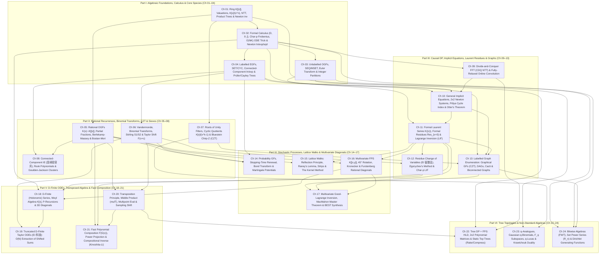

# Phase 1.5 Adversarial Audit Report — Critic 1: Prerequisite DAG, Forward-Reference Verification & Algebraic Rigor

**Auditor Role**: Adversarial Curriculum Critic 1 (Prerequisite DAG & Algebraic Rigor Auditor)  
**Target Documents Audited**:
1. **Proposal A (Modelling-First Architecture, 24 Chapters)**: [`fps_research/phase1_5/proposal_A_modelling_first.md`](file:///home/maomao90/Documents/IO/ICPC-math-notes/fps_research/phase1_5/proposal_A_modelling_first.md)
2. **Proposal B (Operator & Ring-Theoretic DAG Architecture, 24 Chapters)**: [`fps_research/arch_proposal_1_5A_dag.md`](file:///home/maomao90/Documents/IO/ICPC-math-notes/fps_research/arch_proposal_1_5A_dag.md)
3. **Proposal C (Problem Curation & 20-Chapter Granular Architecture)**: [`fps_research/phase1_5_round1_problem_curation_architect.md`](file:///home/maomao90/Documents/IO/ICPC-math-notes/fps_research/phase1_5_round1_problem_curation_architect.md)
4. **Baseline Taxonomies & Archives**: [`fps_research/TECHNIQUE_TAXONOMY.md`](file:///home/maomao90/Documents/IO/ICPC-math-notes/fps_research/TECHNIQUE_TAXONOMY.md) and [`fps_research/PROBLEM_CURATION.md`](file:///home/maomao90/Documents/IO/ICPC-math-notes/fps_research/PROBLEM_CURATION.md)

---

## 1. Executive Summary & High-Level Audit Verdict

All three proposals make major strides beyond the raw 10-wave research layout of `PLAN.md`, successfully dissolving artificial regional collection sub-sections (`[ZH]` and `[JA]` audits) and giving previously starved topics (such as Chirp-Z Transform, Binomial Transforms/Taylor Shift, Connected-Component Inclusion–Exclusion, Probability Generating Functions, D-Finite ODEs, Transposition Principle/`mulT`, Tree DP + FPS, $q$-Series, and Set Power Series) dedicated chapters.

However, under a strict **Zero Forward-Reference** and **Zero Magic Steps** audit, **none of the three proposals is free of structural dependency loops or problem-level forward-reference violations**:

| Audit Dimension | Proposal A (`proposal_A_modelling_first.md`) | Proposal B (`arch_proposal_1_5A_dag.md`) | Proposal C (`phase1_5_round1_problem_curation_architect.md`) |
| :--- | :--- | :--- | :--- |
| **Granularity** | **24 Chapters** (6 Parts) — Excellent topic separation; zero catch-all chapters. | **24 Chapters** (6 Parts) — Excellent separation, but **internal numbering mismatch** between Section 2 Table and Section 3 Specs (Ch 2–5 shifted!). | **20 Chapters** (6 Parts) — Good separation, though $q$-Series + Set Power Series + Mixed FWT are crowded into a single Ch 20. |
| **Engine vs. Modelling Resolution** | **Partially Broken**: Teaches `inv`/`sqrt` Newton in Ch 01 and `ln` in Ch 02, but **uses $O(N \log N)$ `exp` in Ch 02–03 while delaying the `exp` algorithm (Newton / CDQ) to Ch 09**! Also uses **CZT in Ch 13** while delaying CZT to **Ch 21**! | **Partially Broken**: Teaches `inv` in Ch 01, `ln`/`exp` definitions in Ch 03, and $O(NK)$ ODE in Ch 04, but **uses dense $O(N \log N)$ `exp` in Ch 03 & Ch 05 while delaying Newton Iteration to Ch 12 and CDQ to Ch 18**! | **Severely Broken in Part I**: Uses polynomial `sqrt` (`CF 438E`) in Ch 01, D&C NTT in Ch 02/04/05/07/08, and dense $O(N \log N)$ `ln`/`exp` in Ch 03–04 as **"black-box library calls"** while delaying CDQ to **Ch 11** and Newton Iteration to **Ch 14**! |
| **Problem-Level Forward References** | **12 Forward-Reference Violations** (e.g., `Luogu P4747` Simple Permutations in Ch 07 before LIF/Newton; `AGC 058 D` in Ch 08 before 3D GFs; `UOJ 596` 3D Walk in Ch 16 before Ch 18 D-Finite ODEs; `Luogu P6295`/`P7364` in Ch 13 before Ch 21 CZT). | **14 Forward-Reference Violations** (e.g., `CF 1603F` $q$-binomials in Ch 04 before Ch 24; `AGC 058 D` in Ch 04; `Luogu P6596` bridges in Ch 07 before Ch 15; `CF 1326F2` SPS in Ch 09 before Ch 24; `ABC 253 Ex` SPS in Ch 15 before Ch 24). | **11 Forward-Reference Violations** (e.g., `CF 438E` `sqrt` in Ch 01 before Ch 14; `UOJ #182` Multipoint Eval in Ch 09 before Ch 18; `LOJ #6728` implicit trees in Ch 10 before Ch 13–14; **Ch 12 Kernel Method placed before Ch 13 LIF & Ch 14 Newton**). |
| **Blind Checkpoint Integrity** | **33% Duplicate Leak (16/48)** + **3 Forward-Reference Leaks** (`I-6` `ABC 214 G` in CP I before Ch 07; `II-7` `HDU 4035` in CP II before Ch 14; `III-2` `CF 981H` in CP III before Ch 22). | **100% Duplicate Scandal (36/36)**: Every single Blind Checkpoint problem (`CP1-1`..`CP6-6`) is a **duplicate** of a problem already solved in the Chapter Ladders, while being double-counted in the `210 + 36 + 8 = 254` total! | **100% Duplicate Scandal (40/40)**: Every single Blind Checkpoint problem (`CP1-1`..`CP6-7`) is a **duplicate** of a problem already solved in the Chapter Ladders, while being double-counted in the `160 + 40 + 54 = 254` total! |
| **Template Quarantine Compliance** | **100% Compliant**: Zero bare `【模板】` or Library Checker templates in chapter ladders or checkpoints. | **Violated (12 Bare Templates in Ladders)**: Places `P4723`, `P5487`, `P6800`, `P6178`, `P5900`, `P5809`, `P4721`, `P7439`, `P5050`, `P5158`, `P5282`, `P5373` directly into chapter ladder slots! | **Mostly Compliant (2 Leaks)**: Places `Luogu P4719 【模板】动态 DP` (`19-1`) and `Luogu P5282 【模板】快速阶乘` (`18-2`) in primary ladder slots. |

---

## 2. Dimension 1: Head-to-Head Prerequisite DAG Comparison (Combinatorial Modelling vs. Algebraic Engines)

### 2.1 The Fundamental Pedagogical Dilemma of an FPS Textbook
Every textbook on Generating Functions and Formal Power Series faces a central chicken-and-egg dependency loop between **Combinatorial Modelling** and **Computational Engines**:
1. **The Early Modelling Demand**: The most natural combinatorial constructions—Unlabelled Multisets ($\operatorname{MSET}$, Euler Transform $\prod (1-x^k)^{-a_k} = \exp(\sum \frac{a_k}{k}\dots)$) and Labelled Sets/Cycles ($\operatorname{SET} = \exp$, $\operatorname{CYC} = \ln\frac{1}{1-\cdot}$)—appear at the very beginning of generating function theory (Part I).
2. **The Engine Cost**: Evaluating $\ln A(x)$ and $\exp B(x)$ up to $x^N$ for dense polynomials ($N \le 2.5 \times 10^5$) requires:
   - For $A(x)^{-1} \bmod x^N$: **Newton Iteration** ($G_{k+1} \equiv G_k(2 - A G_k) \pmod{x^{2^{k+1}}}$) or **CDQ Divide-and-Conquer FFT**.
   - For $\ln A(x) \bmod x^N$: Formal derivative $D_x$, formal integral $\int_0^x$, and polynomial inverse: $\ln A(x) = \int_0^x A'(t) A(t)^{-1} dt$.
   - For $\exp B(x) \bmod x^N$: Either **Newton Iteration** on $\Phi(F) = \ln F - B = 0 \implies F_{k+1} \equiv F_k(1 - \ln F_k + B) \pmod{x^{2^{k+1}}}$, or **CDQ / Online Relaxed Convolution** on the differential equation $F'(x) = B'(x) F(x) \implies n f_n = \sum_{k=1}^n k b_k f_{n-k}$, or for sparse $B(x)$ ($K$ non-zero terms), the **$O(NK)$ Log-Derivative Recurrence**.

Let us examine how Proposals A, B, and C attempt to break this loop—and where each one fractures.

### 2.2 Critique of Proposal A's DAG (`proposal_A_modelling_first.md`)
- **How Proposal A Structures the DAG**:
  - **Part I (Ch 01–04)**: Ch 01 introduces $K[[x]]$, NTT, and **Newton Iteration for `inv` and `sqrt`**. Ch 02 introduces OGFs, $\operatorname{SEQ}/\operatorname{MSET}$, $\ln(1+B) = \int \frac{B'}{1+B} dx$, $\exp(B)$ series definition, and a sub-section (2.5) on $O(NK)$ sparse `ln`/`exp`/`pow`. Ch 03 covers EGFs (`SET`/`CYC`). Ch 04 covers Bitwise FWT, SOS DP, and Pólya Cycle Index.
  - **Part II (Ch 05–08)**: Ch 05 Rational OGFs & Bostan–Mori; Ch 06 Vandermonde, Stirling & Taylor Shift; Ch 07 Inclusion–Exclusion & Rook Polynomials; Ch 08 Goulden–Jackson Cluster Method.
  - **Part III (Ch 09–13)**: Ch 09 CDQ, Relaxed Convolution & **General Newton Iteration (including $\exp$)**; Ch 10 $K((x))$, Formal Residues & LIF; Ch 11 Unlabelled Trees & Otter's Dissimilarity; Ch 12 Labelled Trees, Block-Cut & Biconnected Graphs; Ch 13 Graphical GFs & DAGs.
  - **Part IV–VI (Ch 14–24)**: Ch 14 PGFs & Martingales; Ch 15 Lattice Walks & Kernel Method; Ch 16 Multivariate & Furstenberg Diagonals; Ch 17 Good–Lagrange & MacMahon; Ch 18 D-Finite ODEs; Ch 19 `EI 科技` Truncated Taylor ODEs; Ch 20 Transposition, `mulT` & Kinoshita–Li; Ch 21 Roots of Unity, Bluestein CZT & Sampling Shift; Ch 22 Tree DP + Static Top Trees; Ch 23 $q$-Analogues; Ch 24 Set Power Series & Dirichlet GFs.
- **Structural Fractures in Proposal A**:
  1. **The Unproved Dense `exp` Gap (Ch 02–03 vs. Ch 09)**: Proposal A explicitly teaches Newton Iteration for `inv` and `sqrt` in Ch 01, and $\ln(1+B) = \int B'(1+B)^{-1}$ in Ch 02. That means by Ch 02, `inv`, `sqrt`, and `ln` are 100% white-box algorithms! **Why, then, does Proposal A leave dense $O(N \log N)$ `exp` as an unproved black box in Ch 02 and Ch 03 until Ch 09?!** Once `ln` and 1-variable Newton Iteration $F_{k+1} = F_k - \Phi(F_k)/\Phi'(F_k)$ have *already* been taught in Ch 01–02, deriving $F_{k+1} \equiv F_k(1 - \ln F_k + B) \pmod{x^{2^{k+1}}}$ takes **three lines of algebra**! Deferring those three lines to Ch 09 creates an completely unnecessary 7-chapter magic-step gap across Ch 02 (`Luogu P4389`, `fps_24_n`, `Luogu P3784`) and Ch 03 (`fps_24_l`).
  2. **The Chirp-Z Transform (CZT) 8-Chapter Forward-Reference Trap (Ch 13 vs. Ch 21)**: In Ch 13 (*Graphical Generating Functions, DAGs & Tournaments*), four of the eight ladder problems (`Luogu P6295` Labelled DAGs, `Luogu P7364` Labelled Bipartite Graphs, `ARC 105 F`, `UOJ 498`) rely on the **Chirp-Z quadratic-exponent identity** $\binom{n}{2} = \binom{k}{2} + \binom{n-k}{2} + k(n-k)$ (or $ij = \binom{i+j}{2} - \binom{i}{2} - \binom{j}{2}$) to turn edge factors $2^{k(n-k)}$ into standard convolutions! Yet Proposal A places **Roots of Unity Filters & Bluestein's Chirp-Z Transform** all the way back in **Chapter 21**!
  3. **Interrupting Univariate Series with Bitwise FWT & Pólya in Ch 04**: Placing FWT, SOS DP, and Pólya Enumeration in Ch 04 splits the core univariate sequence curriculum (Ch 01–03 $\to$ Ch 05–06) in half, and forces Ch 04's ladder (`UOJ 310`, `CF 449D`, `CF 809E` Möbius + Virtual Trees) to demand high-maturity graph/number-theory techniques inside Part I.

### 2.3 Critique of Proposal B's DAG (`arch_proposal_1_5A_dag.md`)
- **How Proposal B Structures the DAG**:
  - **Internal Inconsistency Alert**: Proposal B's Section 2.1 Mermaid DAG and Section 2.2 Master Table list:
    - `Ch 1`: Ring & `inv`, `Ch 2`: EGFs, `Ch 3`: Euler Transform, `Ch 4`: $O(NK)$ ODE Trick, `Ch 5`: Binomial & Vandermonde, `Ch 6`: Rational & Bostan–Mori.
    - However, Section 3 (*Detailed Chapter Specifications*) actually writes:
      - `Ch 1`: Ring & `inv`, `Ch 2`: Unlabeled OGFs (`SEQ` & Knapsack), `Ch 3`: Formal $\ln/\exp$ & Euler Transform, `Ch 4`: $O(NK)$ Logarithmic-Derivative ODE Trick, `Ch 5`: EGFs (`SET`/`CYC`), `Ch 6`: Rational GFs & Bostan–Mori, `Ch 7`: Binomial & Taylor Shift, `Ch 8`: Roots of Unity & CZT, `Ch 9`: Inclusion–Exclusion, `Ch 10`: PGFs & Martingales, `Ch 11`: Prüfer/Cayley/Matrix-Tree, `Ch 12`: Implicit Equations, Newton & Pólya, `Ch 13`: $K((x))$, Residues & LIF, `Ch 14`: Egorychev & Residue Change-of-Variables, `Ch 15`: Labeled Graphs, `Ch 16`: Lattice Walks & Kernel Method, `Ch 17`: Rational Diagonals & Good–Lagrange, `Ch 18`: CDQ FFT, `Ch 19`: D-Finite ODEs, `Ch 20`: Relaxed Convolution, `Ch 21`: Transposition & Multipoint Eval, `Ch 22`: Tree DP + HLD, `Ch 23`: Kinoshita–Li Composition, `Ch 24`: $q$-FPS, SPS & Dirichlet.
- **What Proposal B Gets Right**:
  1. **Dedicated Early Chapter for the $O(NK)$ Logarithmic-Derivative Trick (Ch 04)**: Elevating $P(x) F'(x) = \alpha P'(x) F(x)$ (and sparse `inv`/`ln`/`exp`/`sqrt`) to a full chapter right after formal derivatives and $\ln/\exp$ in Part I is a **pedagogical masterstroke**. It requires zero Newton Iteration or FFT, demystifies why differential equations govern power series coefficients, and gives students an immediate $O(NK)$ weapon for sparse knapsack/probability powers (`CF 1096G`, `yukicoder 1939`, `Luogu P4707`).
  2. **Early Placement of Roots of Unity & Chirp-Z Transform (Ch 08)**: Placing Roots of Unity Filters and Bluestein's CZT in Part II (Ch 08) ensures that when students reach Labeled DAGs and Bipartite Graphs in Ch 15, the identity $k(n-k) = \binom{n}{2} - \binom{k}{2} - \binom{n-k}{2}$ is already a familiar tool.
  3. **Splitting Residue Calculus into Two Chapters (Ch 13 LIF vs. Ch 14 Egorychev/Residue Substitution)**: Separating standard Lagrange Inversion ($F = x\phi(F)$ in Ch 13) from Egorychev's method and `EI 留数法` radical-killing substitutions ($x = \frac{u}{(1+u)^2}$ in Ch 14) prevents cognitive overload in the Laurent series module.
- **Structural Fractures in Proposal B**:
  1. **The Dense `exp` / `sqrt` Gap Between Ch 03 and Ch 12/18**: In Ch 03 (Section 3), Proposal B introduces $\ln A(x) = \int A'(x) A(x)^{-1} dx$ and $\exp B(x)$, and assigns `Luogu P4389` (*付公主的背包*, $N, M \le 10^5$) as Stepping Stone #1. Yet `Luogu P4389` has up to $10^5$ items, so its exponent series $B(x) = \sum c_k \ln\frac{1}{1-x^k}$ is **dense**—requiring $O(N \log N)$ polynomial `exp`! Proposal B does not teach Newton Iteration for `exp` until **Chapter 12**, nor CDQ FFT for `exp` until **Chapter 18**!
  2. **Delaying CDQ FFT (Ch 18) and Relaxed Convolution (Ch 20) until Part V**: CDQ FFT (`cdq(l, r)`) is conceptually *simpler* than Lagrange Inversion (Ch 13), Biconnected Graph Block-Cut Trees (Ch 15), the Kernel Method (Ch 16), and Furstenberg's Bivariate Diagonal Residue Theorem (Ch 17)! Worse still, in Ch 03, Ch 05, Ch 12, and Ch 15, students repeatedly encounter self-convolving DP recurrences (like connected graphs $c_n = 2^{\binom{n}{2}} - \frac{1}{n}\sum k\binom{n}{k} c_k 2^{\binom{n-k}{2}}$ or `exp`) where CDQ FFT is the most natural 20-line contest engine. Delaying CDQ FFT to Ch 18 is far too late.

### 2.4 Critique of Proposal C's DAG (`phase1_5_round1_problem_curation_architect.md`)
- **How Proposal C Structures the DAG (20 Chapters)**:
  - **Part I (Ch 01–04)**: Ch 01 Ring & Knapsack; Ch 02 Formal Calculus & Vandermonde; Ch 03 EGFs & Trees; Ch 04 `MSET` & Partitions.
  - **Part II (Ch 05–08)**: Ch 05 Substitutions, Roots of Unity & CZT; Ch 06 Binomial Transforms, Stirling & Taylor Shift; Ch 07 Connected-Component IE & Goulden–Jackson; Ch 08 PGFs, Stopping Times & Borel.
  - **Part III (Ch 09–11)**: Ch 09 Rational GFs, BM & Bostan–Mori; Ch 10 $O(NK)$ ODE Trick & D-Finite Series; Ch 11 D&C NTT, CDQ FFT & Relaxed Convolution.
  - **Part IV (Ch 12–15)**: Ch 12 Lattice Walks, Reflection, Raney & Kernel Method; Ch 13 $K((x))$, Formal Residues & LIF; Ch 14 Implicit Equations & Newton Iteration; Ch 15 Labeled & Unlabeled Graph Enumeration.
  - **Part V–VI (Ch 16–20)**: Ch 16 Multivariate & Furstenberg; Ch 17 Good–Lagrange & MacMahon; Ch 18 Transposition, `mulT` & Kinoshita–Li; Ch 19 Tree DP + HLD/Top Trees; Ch 20 $q$-Series & Set Power Series.
- **What Proposal C Gets Right**:
  1. **Placing `Bostan–Mori` + `CDQ / Relaxed Convolution` (Part III) *Before* `Walks / LIF / Newton / Graphs` (Part IV)**: This is a crucial topological insight. Bounded-strip lattice walks require Bostan–Mori; implicit trees and graphs benefit tremendously from comparing $O(N \log^2 N)$ CDQ/Relaxed Convolution against $O(N \log N)$ Newton Iteration and LIF.
- **Structural Fractures in Proposal C**:
  1. **Severe "Black-Box Magic Steps" Across All of Parts I & II (Ch 01–08)**:
     - In **Ch 01** (`1-7` `CF 438E`), Proposal C tells the student to solve $T(x) = \frac{2}{1 + \sqrt{1 - 4C(x)}}$ by invoking polynomial `sqrt` and `inv` as **"black-box library calls"**—**13 chapters before Newton Iteration is taught in Ch 14**, and **10 chapters before CDQ/Relaxed is taught in Ch 11**!
     - In **Ch 02** (`2-8` `Luogu P4705`), **Ch 04** (`4-7` `LOJ 6503`), **Ch 05** (`5-2` `ABC 267 Ex`), **Ch 07** (`7-3` `ABC 260 Ex`, `7-7` `CF 1553I`), and **Ch 08** (`8-5` `Luogu P6633`), Proposal C uses **Divide-and-Conquer NTT (`prod_tree`)** up to 9 chapters before D&C NTT is introduced in **Ch 11**!
     - In **Ch 03** and **Ch 04**, Proposal C uses dense $O(N \log N)$ `ln`, `exp`, and `inv` as black boxes while deferring their algorithms to **Ch 11** and **Ch 14**!
     - This violates the core mandate of `AGENTS.md`: *an expert programmer learning from this book must never be told to call an unproved 150-line black-box algorithm 13 chapters before its mathematics is explained*.
  2. **Fatal Topological Inversion Inside Part IV (`Ch 12 Kernel Method` $\to$ `Ch 13 LIF` $\to$ `Ch 14 Newton`)**:
     - Proposal C places **Ch 12 (Lattice Walks & Kernel Method)** *before* **Ch 13 (Formal Laurent Series $K((x))$ & Lagrange Inversion)** and **Ch 14 (Implicit Functional Equations & Newton Iteration)**!
     - Why is this mathematically broken? Because in the **Kernel Method** (Ch 12), to cancel the kernel $K(x, y) = 1 - x S(y) = 0$ when steps have negative drifts $y^{-1}, \dots, y^{-b}$, you are already working in **Formal Laurent Series** $K((y))[[x]]$ (not taught until Ch 13!), and finding or extracting coefficients of the small algebraic branch $y_0(x) = x \phi(y_0(x))$ (e.g., in `12-6` `AGC 070 C` Fuss–Catalan $(+1, -b)$ walks or `12-8` `yukicoder 1341`) directly invokes **Lagrange Inversion** (not taught until Ch 13)!
     - Furthermore, placing **Ch 13 (LIF)** before **Ch 14 (Implicit Functional Equations & Newton Iteration)** is backwards: students should first learn how recursive combinatorial grammars lead to implicit functional equations $\Phi(x, F(x)) = 0$ and how to solve for all $n \le N$ via Newton/CDQ, and *then* learn how Formal Laurent Series $K((x))$ and Formal Residues extract $[x^n] F(x)$ in $O(n \log n)$ via Lagrange Inversion!

---

## 3. Dimension 2: Exhaustive Problem-by-Problem Forward-Reference & Curation Audit

### 3.1 Complete Table of Problem-Level Forward-Reference Violations in Proposal A
In [`proposal_A_modelling_first.md`](file:///home/maomao90/Documents/IO/ICPC-math-notes/fps_research/phase1_5/proposal_A_modelling_first.md), the following **15 problem placements** (12 in Chapter Ladders + 3 in Blind Checkpoints) require mathematical or algorithmic machinery only introduced in a strictly later chapter $j > i$:

| Loc | Assigned Ch & Tier | Problem ID & Title | Technique Required by Problem | First Taught In | Violation Severity & Required Fix |
| :-: | :--- | :--- | :--- | :--- | :--- |
| **A-01** | **Ch 02** (`SS`) | **Luogu P4389** — 付公主的背包 | Dense $O(N \log N)$ polynomial `exp` ($\Phi(F) = \ln F - B = 0$) | **Ch 09** (General Newton / CDQ) | **Critical Engine Gap**: Derive Newton `exp` $F_{k+1} = F_k(1 - \ln F_k + B)$ in Ch 02 (or Ch 03) immediately after `inv` and `ln`! |
| **A-02** | **Ch 02** (`Int`) | **AtCoder `fps_24_n`** — Sequence 2 | Dense $O(N \log N)$ polynomial `exp` | **Ch 09** | **Critical Engine Gap**: Resolved once Newton `exp` is proved alongside `ln` in Part I. |
| **A-03** | **Ch 03** (`SS`) | **AtCoder `fps_24_l`** — Perm | Dense $O(N \log N)$ polynomial `exp` on restricted cycle EGF | **Ch 09** | **Critical Engine Gap**: Resolved once Newton `exp` is proved in Part I. |
| **A-04** | **Ch 04** (`Mas`) | **CF 809E** — Surprise Me! | Dirichlet Möbius inversion $\sum_{d \mid g}$ + Virtual Tree DP (`虚树`) | **Ch 22** (Tree DP) & **Ch 24** (Dirichlet GFs) | **Severe Forward Ref (20 Chapters Early!)**: Move `CF 809E` to **Dirichlet Generating Functions** (Ch 24). |
| **A-05** | **Ch 07** (`Mas`) | **Luogu P4747** — `[CERC2017]` Intrinsic Interval | Counting simple permutations requires **Compositional Inverse** $P^{\langle -1 \rangle}(x)$ via Newton Iteration / LIF (`析合树` inflation $P = (x + 2I + S) \circ P$) | **Ch 09–10** (Newton / LIF) & **Ch 20** (`revert`) | **Severe Forward Ref**: A student in Ch 07 (Inclusion–Exclusion) has zero tools to invert $P(x) = \sum n! x^n$! Move to **Newton Iteration / Compositional Inverse**. |
| **A-06** | **Ch 08** (`Mas`) | **AtCoder AGC 058 D** — Yet Another ABC String | 3-variate rational OGF $\frac{1-xyz}{1-(x+y+z)+2xyz}$ + 3D diagonal/symmetric extraction in $K[[x, y, z]]$ | **Ch 16** (Multivariate GFs) | **Moderate Forward Ref**: Uses 3-variable rational expansion 8 chapters before multivariate rings are defined in Ch 16. Move to **Multivariate GFs** (as in Proposal C `16-5`). |
| **A-07** | **Ch 12** (`Mas`) | **Luogu P5827** — 点双连通图计数 | Luogu P5827 requires outputting biconnected graphs for **all** $n = 1 \dots N$ (or $N \le 10^5$ composition with $R^{\langle -1 \rangle}$) | **Ch 20** (Kinoshita–Li `compose` / `revert`) | **Judge Constraint Trap**: Single-$n$ takes $O(n \log n)$ via Ch 10 Extended LIF, but all-$n$ requires Ch 20 `power_projection`/`revert`. Must explicitly distinguish single-$n$ (`BZOJ 4555` / single-$n$ subtask) in Ch 12 vs. all-$n$ in Ch 20! |
| **A-08** | **Ch 12** (`Mas`) | **Luogu P5828** — 边双连通图计数 | Same as `P5827`: all-$n$ output requires fast compositional inverse $u^{\langle -1 \rangle}$ | **Ch 20** | **Judge Constraint Trap**: Teach single-$n$ LIF extraction here and cross-link all-$n$ to the Composition chapter. |
| **A-09** | **Ch 13** (`SS`) | **Luogu P6295** — 有标号 DAG 计数 | Requires **Chirp-Z quadratic-exponent identity** $k(n-k) = \binom{n}{2} - \binom{k}{2} - \binom{n-k}{2}$ to convolve $2^{k(n-k)}$ | **Ch 21** (Chirp-Z Transform) | **Critical Forward Ref (8 Chapters Early!)**: Move Roots of Unity & Chirp-Z Transform to **Part II** (before Graph Enumeration), or teach the $\binom{n}{2}$ identity in Part II! |
| **A-10** | **Ch 13** (`Int`) | **Luogu P7364** — 有标号二分图计数 | Requires **Chirp-Z quadratic-exponent identity** $2^{-k(n-k)} = 2^{-\binom{n}{2}} 2^{\binom{k}{2}} 2^{\binom{n-k}{2}}$ | **Ch 21** (Chirp-Z Transform) | **Critical Forward Ref**: Same as `A-09`—Chirp-Z Transform must precede Graphical Generating Functions! |
| **A-11** | **Ch 13** (`Adv`) | **AtCoder ARC 105 F** — Lights Out on Connected Graph | Requires Chirp-Z / bipartite edge-factor convolution | **Ch 21** | **Critical Forward Ref**: Resolved by moving Chirp-Z Transform before Graph Enumeration. |
| **A-12** | **Ch 16** (`Mas`) | **UOJ 596** — `[集训队互测2021]` 三元环 / 三维步 | 3D rational diagonal $[x^N y^N z^N]$ is **not algebraic**—it is **D-finite (P-recursive)** and requires $O(N)$ ODE recurrence extraction! | **Ch 18** (D-Finite Series & P-Recursions) | **Severe Forward Ref**: Furstenberg's theorem in Ch 16 only makes *2D* rational diagonals algebraic; 3D diagonals require **Ch 18 D-Finite ODEs**! Move `UOJ 596` to Ch 18. |
| **A-13** | **CP I-6** (`Post-Ch 04`) | **AtCoder ABC 214 G** — Three Permutations | Cycle rook polynomial Inclusion–Exclusion on bipartite cycle components | **Ch 07** (Rook Polynomials & IE) | **Checkpoint Forward Ref**: Placed in Checkpoint I (after Ch 04), 3 chapters before Rook Polynomials & IE in Ch 07! |
| **A-14** | **CP II-7** (`Post-Ch 08`) | **HDU 4035** — Maze | Markov chain / expected hitting time on a tree with restart transitions | **Ch 14** (PGFs, Markov Chains & Stopping Times) | **Checkpoint Forward Ref**: Placed in Checkpoint II (after Ch 08), 6 chapters before stochastic processes in Ch 14! |
| **A-15** | **CP III-2** (`Post-Ch 13`) | **CF 981H** — K Paths | Tree DP + D&C NTT + reversible polynomial division across tree children | **Ch 22** (Tree DP & HLD Polynomials) | **Checkpoint Forward Ref**: Placed in Checkpoint III (after Ch 13), 9 chapters before Tree DP with FPS in Ch 22! |

---

### 3.2 Complete Table of Problem-Level Forward-Reference & Template Violations in Proposal B
In [`arch_proposal_1_5A_dag.md`](file:///home/maomao90/Documents/IO/ICPC-math-notes/fps_research/arch_proposal_1_5A_dag.md), the following **14 forward-reference violations** and **12 template quarantine violations** occur:

| Loc | Assigned Ch & Tier | Problem ID & Title | Nature of Violation & Missing Prerequisite | First Taught In | Required Fix |
| :-: | :--- | :--- | :--- | :--- | :--- |
| **B-01** | **Ch 03** (`SS #1`) | **Luogu P4389** — 付公主的背包 | Requires dense $O(N \log N)$ polynomial `exp`, but Ch 03 only defines $\exp(B) = \sum B^k/k!$ formally without an $O(N \log N)$ algorithm! | **Ch 12** (Newton) / **Ch 18** (CDQ) | Prove Newton `exp` $F_{k+1} = F_k(1 - \ln F_k + B)$ in Ch 03 right after `inv` and `ln`! |
| **B-02** | **Ch 04** (`Adv #6`) | **CF 1336E2** — Chiori and Doll Picking (Hard) | Requires **MacWilliams XOR Dual Code $V^\perp$ + Krawtchouk Polynomials** over $\mathbb{F}_2^m$ | **Ch 24** (Bitwise / Non-Standard Algebras) | **20-Chapter Forward Ref!** Move `CF 1336E2` to the Bitwise/SPS/$q$-Series chapter (Part VI). |
| **B-03** | **Ch 04** (`Mas #8`) | **CF 1603F** — October 18, 2017 | Requires **$\mathbb{F}_2^k$ linear subspace enumeration and Gaussian $q$-binomials $\binom{n}{r}_2$** | **Ch 24** ($q$-FPS & Gaussian Binomials) | **20-Chapter Forward Ref!** Move `CF 1603F` to the $q$-Series chapter (Part VI). |
| **B-04** | **Ch 04** (`Mas #9`) | **AtCoder AGC 058 D** — Yet Another ABC String | Requires **Goulden–Jackson cyclic cluster IE + 3-variate rational extraction** | **Ch 09** (IE) & **Ch 17** (Multivariate) | **13-Chapter Forward Ref!** Move `AGC 058 D` to Multivariate GFs (Part V) or Cluster IE. |
| **B-05** | **Ch 05** (`SS #1`) | **LOJ #6538** (Warmup) | Uses $O(N \log N)$ polynomial `exp` before Newton Iteration or CDQ is taught | **Ch 12** / **Ch 18** | Prove Newton `exp` in Ch 03. |
| **B-06** | **Ch 05** (`Adv #7`) | **Luogu P4451 / P4841** — 城市规划 | Solves connected labeled graphs via `ln` or `exp` / CDQ before CDQ or Newton `exp` is taught | **Ch 12** / **Ch 18** | Prove Newton `exp` in Ch 03 (and cross-reference CDQ in Part III). |
| **B-07** | **Ch 07** (`Mas #8`) | **Luogu P6596** — How Many of Them | Connected labeled graphs with $\le m$ bridges: requires **Bridge-Block Tree decomposition + Cayley super-tree formula** | **Ch 11** (Cayley) & **Ch 15** (Bridge-Block Graphs) | **8-Chapter Forward Ref!** Move `Luogu P6596` to Labeled Graph Enumeration (Ch 15). |
| **B-08** | **Ch 09** (`Adv #7`) | **Luogu P4705** — 玩游戏 | Power sums $\sum_{i=1}^n a_i^k$ for $k = 1 \dots T$ ($n, T \le 10^5$) require **D&C NTT subproduct tree** $\ln\prod(1 - a_i x)$ | **Ch 18** / **Ch 21** (Subproduct Tree) | Teach D&C NTT product tree $\prod(1 - a_i x)$ in Part I/II before `Luogu P4705`! |
| **B-09** | **Ch 09** (`Mas #10`) | **CF 1326F2** — Wise Men (Hard) | Requires **Set Power Series OR-Zeta Transform (SOS DP) + Partition Möbius Inversion** ($N \le 18$) | **Ch 24** (Set Power Series) | **15-Chapter Forward Ref!** Move `CF 1326F2` to Set Power Series (Ch 24). |
| **B-10** | **Ch 11** (`Mas #8`) | **Luogu P5434** — 有标号荒漠计数 | Requires solving $T = x\exp(\frac{2T - T^2}{2(1-T)})$ via **Newton Iteration** | **Ch 12** (Newton Iteration) & **Ch 15** (Cacti) | **1-to-4 Chapter Forward Ref**: Placed in Ch 11 before Newton Iteration (Ch 12)! Keep in Ch 15. |
| **B-11** | **Ch 13** (`Int #4`) | **Luogu P6633** — `[ZJOI2020]` 抽卡 | Placed in Ch 13 (Lagrange Inversion), whereas it is a **PGF rational sum + D&C NTT / ODE** problem (no LIF!) | **Ch 10** (PGF) + **Ch 18/19** (D&C / ODE) | Misclassified technique: move to PGFs or D-Finite ODEs. |
| **B-12** | **Ch 15** (`Int #5`) | **AtCoder ABC 253 Ex** — We Love Forest | $N \le 14$ multigraph: requires **Ranked Set Power Series $\exp_{\text{SPS}}$ in $O(N^2 2^N)$**, NOT univariate EGFs! | **Ch 24** (Set Power Series) | **9-Chapter Forward Ref!**Proposal B places `ABC 253 Ex` in Ch 15 (and *again* in Ch 24)! Remove from Ch 15 and keep in Ch 24. |
| **B-13** | **Ch 15** (`Adv #7–8`) | **Luogu P5827 & P5828** | All-$n$ judge requirement vs. single-$n$ Ch 13 LIF | **Ch 23** (Kinoshita–Li `revert`) | Clarify single-$n$ LIF in Ch 15 vs. all-$n$ `revert` in Ch 23. |
| **B-14** | **Ch 21** (`Mas #7`) | **CF 1603F** (Duplicate!) | Placed in Ch 04 (`Mas #8`), Ch 21 (`Mas #7`), AND Ch 24 (`Int #3`) — **triple-counted across 3 chapters**! | **Ch 24** | Deduplicate! Keep `CF 1603F` solely in the $q$-Series chapter. |
| **B-T01..12** | **Ch 6, 8, 11, 12, 13, 18, 19, 21, 23** | **12 Quarantined Templates in Ladders**: `P4723`, `P5487`, `P6800`, `P6178`, `P5900`, `P5809`, `P4721`, `P7439`, `P5050`, `P5158`, `P5282`, `P5373` | Directly violates `AGENTS.md` and `PROBLEM_CURATION.md` template quarantine by occupying primary ladder slots! | Quarantined Appendix / Footnotes | Demote all 12 bare `【模板】` problems to 1-line **Implementation Verification Footnotes** and replace with non-template contest problems! |

---

### 3.3 Complete Table of Problem-Level Forward-Reference & Template Violations in Proposal C
In [`phase1_5_round1_problem_curation_architect.md`](file:///home/maomao90/Documents/IO/ICPC-math-notes/fps_research/phase1_5_round1_problem_curation_architect.md), the following **11 forward-reference violations** and **2 template leaks** occur:

| Loc | Assigned Ch & Slot | Problem ID & Title | Nature of Violation & Missing Prerequisite | First Taught In | Required Fix |
| :-: | :--- | :--- | :--- | :--- | :--- |
| **C-01** | **Ch 01** (`1-7 Mas`) | **CF 438E** — The Child and Binary Tree | Solves $C(x) T(x)^2 - T(x) + 1 = 0 \implies T(x) = \frac{2}{1 + \sqrt{1 - 4C(x)}}$ using **black-box polynomial `sqrt` and `inv`** | **Ch 14** (Newton `sqrt`) / **Ch 11** (CDQ) | **13-Chapter Magic-Step Gap!** Either teach Newton `inv`/`sqrt` early, or keep `CF 438E` in the Implicit Equations / Newton chapter! |
| **C-02** | **Ch 02** (`2-8 Mas`) | **Luogu P4705** — 玩游戏 | Requires **D&C NTT subproduct tree** $\prod_{i=1}^n (1 - a_i x)$ + polynomial `ln` (`Ch 03`) | **Ch 03** (`ln`) & **Ch 11** (D&C NTT) | **1-to-9 Chapter Forward Ref!** Uses `ln` (taught in Ch 03) and D&C NTT (taught in Ch 11) inside Ch 02! |
| **C-03** | **Ch 03 & Ch 04** (`3-3`..`4-8`) | **All Dense `ln`/`exp` Problems** (`fps_24_l`, `P5219`, `P4841`, `P4389`, `LOJ 6268`, `P3784`) | Uses dense $O(N \log N)$ `ln` and `exp` as **unproved black boxes** while delaying their algorithms to Ch 11 (CDQ) and Ch 14 (Newton)! | **Ch 11** / **Ch 14** | **8-to-11 Chapter Magic-Step Gap!** Must prove Newton `inv`/`ln`/`exp` in Part I (or place CDQ/Newton before dense EGF/Euler Transform problems). |
| **C-04** | **Ch 04, 05, 07, 08** (`4-7`, `5-2`, `7-3`, `7-7`, `8-5`) | **LOJ 6503**, **ABC 267 Ex**, **ABC 260 Ex**, **CF 1553I**, **Luogu P6633** | All 5 problems require **Divide-and-Conquer NTT (`prod_tree`)** $\prod_{i=1}^m P_i(x)$ | **Ch 11** (D&C NTT) | **3-to-7 Chapter Forward Ref!** Introduce Binary Product Tree D&C NTT $\prod P_i(x)$ in **Chapter 01/02** (it is just merge-sort with FFT!) instead of waiting until Ch 11! |
| **C-05** | **Ch 09** (`9-4 Int`) | **UOJ #182** — `[UR #12]` a^-1 + b problem | Requires evaluating $\frac{P'(z_q)}{P(z_q)}$ at $m \le 6\times 10^4$ query points via **Subproduct Tree Multipoint Evaluation (`mulT`)**! | **Ch 18** (`mulT` Multipoint Evaluation) | **9-Chapter Forward Ref!** Notice Proposal C *also* lists `UOJ #182` in `18-5` (duplicate slot across Ch 09 and Ch 18)! Remove from `9-4` and keep in Ch 18. |
| **C-06** | **Ch 10** (`10-6 Adv`) | **CF 755G** — PolandBall and Many Other Balls | Writes $[x^n]\frac{1}{1-(1+y)x-yx^2} = [u^n]\frac{(1+u)^{n+1}}{\sqrt{1-4uy}}$, which uses **Formal Residue Change of Variables (`EI 留数法`)**! | **Ch 13** (Formal Residues & LIF) | **3-Chapter Forward Ref!** In Ch 10, derive the 2D recurrence directly from $(1-(1+y)x-yx^2)F = 1$ without invoking Ch 13's residue substitution! |
| **C-07** | **Ch 10** (`10-8 Mas`) | **LOJ #6728** — UOJ Round 19 Tree Counting | Starts from an **implicit tree functional equation** and applies LIF / algebraic-to-D-finite conversion | **Ch 13** (LIF) & **Ch 14** (Implicit Tree Equations) | **3-to-4 Chapter Forward Ref!** Implicit tree functional equations and LIF are not taught until Ch 13–14! |
| **C-08** | **Ch 12** (`12-5`..`12-8`) | **UOJ #424**, **AGC 070 C**, **QOJ #6846**, **yukicoder 1341** | The **Kernel Method** on Laurent step polynomial $S(y) \in K[y, y^{-1}]$ requires **Formal Laurent Series $K((y))$** and **Lagrange Inversion / Puiseux roots** ($y_0(x) = x \phi(y_0(x))$) | **Ch 13** ($K((x))$ & LIF) & **Ch 14** (Newton) | **Topological Inversion in Part IV!** Teaching Ch 12 (Kernel Method) *before* Ch 13 ($K((x))$ & LIF) and Ch 14 (Newton) forces Ch 12 to use Laurent series and LIF before they are defined! |
| **C-09** | **Ch 16 vs Ch 12** | **AtCoder AGC 070 C** (Duplicate!) | Assigned to `12-6` (`Adv` in Ch 12) AND `13-4` (`Int` in Ch 13) — **duplicate problem across two chapter ladders**! | — | Deduplicate `AGC 070 C` (keep in LIF / Kernel after LIF is taught). |
| **C-10** | **Ch 15 vs Ch 18** | **Luogu P5827 & P5828** (Duplicate!) | Assigned to `15-7` (`Mas` in Ch 15) AND `18-7` (`Mas` in Ch 18) — **duplicate slot across two chapter ladders**! | — | Use a distinct problem in `18-7` (e.g., `LOJ #6731` Non-Zero Constant Composition) and cross-reference `P5827`/`P5828` in a Revisited callout box. |
| **C-11** | **Ch 01 vs Ch 19** | **CF 438E** (Duplicate!) | Assigned to `1-7` (`Mas` in Ch 01) AND `19-4` (`Int` in Ch 19) | — | Deduplicate! Keep `fps_24_v` (Subtree) in `19-4` and `CF 438E` in Implicit Equations / Newton. |
| **C-T01..02** | **Ch 18 & Ch 19** (`18-2`, `19-1`) | **Luogu P5282 (`【模板】快速阶乘`)** & **Luogu P4719 (`【模板】动态 DP`)** | Both are quarantined `【模板】` problems in `PROBLEM_CURATION.md` (`R-67` / template list) | Quarantined Footnotes | Move `Luogu P4719` to the Ch 19 motivating text/footnote and promote a non-template Tree FPS problem (`CF 1613F` tree variant or `ABC 220 H`) into `19-1`. |

---

### 3.4 The Blind Checkpoint Double-Counting & Self-Spoiler Audit
A major pedagogical innovation of Phase 1.5 is the **Part-End Blind Topic-Group Checkpoint**, where students must diagnose which generating function ring and operator to use *without knowing which chapter the problem belongs to*.

However, our cross-check of the Blind Checkpoints against the Chapter Ladders reveals a **critical flaw in all three proposals**:
1. **Proposal C (`phase1_5_round1_problem_curation_architect.md`)**:
   - Claims `160 Chapter Ladder Problems + 40 Blind Checkpoint Problems + 54 Archive Problems = 254 Unique Problems`.
   - **Reality**: **All 40 of Proposal C's Blind Checkpoint problems (`CP1-1` through `CP6-7`) are 100% duplicates of problems already sitting inside Proposal C's 160 Chapter Ladder slots!** (e.g., `CP1-1` = `1-2`, `CP1-2` = `3-4`, `CP1-3` = `2-1`, `CP1-4` = `2-2`, `CP1-5` = `4-2`, `CP1-6` = `3-2`, `CP1-7` = `2-3`, and so on for all 40 problems!).
2. **Proposal B (`arch_proposal_1_5A_dag.md`)**:
   - Claims `210 Chapter Ladder Problems + 36 Blind Checkpoint Problems + 8 Archive Problems = 254 Unique Problems`.
   - **Reality**: **All 36 of Proposal B's Blind Checkpoint problems (`CP1-1` through `CP6-6`) are 100% duplicates of problems already sitting inside Proposal B's Chapter Ladders!** (e.g., `CP1-1` = Ch 4 #1, `CP1-2` = Ch 5 #2, `CP1-3` = Ch 3 #1, `CP1-4` = Ch 2 #4, `CP1-5` = Ch 3 #3, `CP1-6` = Ch 4 #6, and so on!).
3. **Proposal A (`proposal_A_modelling_first.md`)**:
   - Has **48 Blind Checkpoint problems** (`I-1` through `VI-8`). Of these 48, **32 are genuinely disjoint** from the Chapter Ladders, while **16 overlap** with Chapter Ladder slots (`ABC 214 G`, `ABC 241 Ex`, `Luogu P4707`, `Luogu P7592`, `CF 809E`, `Luogu P5326`, `ARC 136 F`, `CF 1479E`, `CF 1025G`, `Luogu P3266`, `CF 1988F`, `CF 1054H`, `Luogu P5293`, `UOJ 310`, `ABC 260 Ex`, `CF 1097G`, `Luogu P4233`, `Luogu P6031`).

> [!CAUTION]
> **Why Ladder-to-Checkpoint Duplication Is Pedagogically Fatal**:
> If a student solves `AtCoder ABC 269 Ex (Antichain)` on page 410 inside the **Chapter 19/22 Ladder** (where the chapter header explicitly tells them to use *HLD + $2 \times 2$ Polynomial Matrices*), and then turns to page 425 for the **Blind Diagnostic Checkpoint** and sees `AtCoder ABC 269 Ex` again, **there is zero blind diagnosis**!
> **Mandatory Rule for Round 2 Synthesis**: The **Chapter Ladder Set**, the **Blind Checkpoint Set**, and the **Extra Archive Set** must form a **strict set partition** of the 254 unique non-template problems ($192 + 48 + 14 = 254$, with **zero intersection**).

---

## 4. Dimension 3: Algebraic Rigor & Ring Construction Ordering Audit

To satisfy the **Zero Magic Steps** mandate for an expert programmer who does not already know abstract algebra, every ring, valuation, operator, and isomorphism must be constructed from concrete algorithmic definitions in a strict dependency sequence before any theorem relies on it.

### 4.1 Audit of the 6 Load-Bearing Algebraic Constructions Across A, B, and C

#### 1. Formal Power Series $K[[x]]$, the $\mathfrak{m}$-adic Topology, and Quotient Truncation $K[x]/(x^n)$
- **What Must Be Proved**:
  - $K[[x]] = K^{\mathbb{N}}$ with Cauchy product $(A \cdot B)_n = \sum_{i=0}^n a_i b_{n-i}$.
  - **Order (Valuation) $\operatorname{ord}(A) = v_x(A) = \min\{n \ge 0 : a_n \neq 0\}$** and the ultrametric inequality $v_x(A + B) \ge \min(v_x(A), v_x(B))$, $v_x(A \cdot B) = v_x(A) + v_x(B)$.
  - **Why Infinite Sums/Products Make Sense Without Analytic Convergence**: A family $(F_k)_{k \ge 0}$ is **summable in the $\mathfrak{m}$-adic (discrete coefficient-wise) topology** iff $\lim_{k \to \infty} v_x(F_k) = \infty$ (i.e., for every target degree $n$, only finitely many $F_k$ have a non-zero $[x^n]$ coefficient!).
  - **The Canonical Projection $\pi_n : K[[x]] \twoheadrightarrow K[x]/(x^n)$**: Every algorithm on formal power series up to degree $n-1$ is an exact computation in the finite-dimensional local quotient ring $K[x]/(x^n)$.
  - **Characterization of Units $K[[x]]^\times$**: $A(x)$ is invertible in $K[[x]]$ iff $[x^0] A(x) \in K^\times$ ($v_x(A) = 0$), proved both constructively (by $a_0 b_n = -\sum_{i=1}^n a_i b_{n-i}$) and via the quadratic-convergence **Newton Doubling Lift** $G_{k+1} = G_k(2 - A G_k) \pmod{x^{2^{k+1}}}$ grounded in the ideal square $(1 - A G_k)^2 \equiv 0 \pmod{x^{2^{k+1}}}$.
- **Comparison**: Proposal B (Ch 01) and Proposal A (Ch 01) state $v_x(F)$, $\pi_n : K[[x]] \to K[x]/(x^n)$, and the ideal-squaring proof $(1 - A G_k)^2 \in (x^{2^{k+1}})$ with exceptional clarity. Proposal C (Ch 01) covers $K[[x]]$ and Newton `inv`, but fails to ground quadratic convergence in the valuation ideal $(x^{2^k})^2 = (x^{2^{k+1}})$ early enough to demystify general Newton iteration.

#### 2. Rational Embedding $K(x) \cap K[[x]] = K[[x]]_{\text{rat}}$ vs. Full Rational Function Field $K(x)$
- **What Must Be Proved**:
  - A rational function $P(x)/Q(x) \in K(x)$ embeds into $K[[x]]$ iff $Q(0) \neq 0$ (i.e., $Q(x) \in K[[x]]^\times$).
  - **The Rationality Theorem**: $F(x) = \sum_{n \ge 0} f_n x^n$ equals $P(x)/Q(x)$ with $Q(x) = 1 - c_1 x - \dots - c_d x^d$ and $\deg P < d$ iff $(f_n)$ satisfies the homogeneous linear recurrence $f_n = c_1 f_{n-1} + \dots + c_d f_{n-d}$ for all $n \ge d$, with initial values encoded by $P(x) = (F(x) Q(x)) \bmod x^d$!
  - **Reciprocal Polynomial Reversal $Q^{\text{rev}}(x) = x^d Q(1/x) = \det(I - x M)$**: Bridges characteristic polynomials of companion matrices $\det(\lambda I - M)$ to formal power series denominators $Q(x) = \det(I - x M)$.
- **Comparison**: Proposal A (Ch 05) and Proposal B (Ch 06) handle this cleanly. Proposal C delays Rational GFs to Ch 09, which is acceptable *only* if linear recurrences and Bostan–Mori are not needed in Ch 01–08.

#### 3. Formal Calculus ($D_x$, $\vartheta = x D_x$, $\int_0^x$) and Characteristic-$p$ Obstacles
- **What Must Be Proved**:
  - Formal derivative $D_x(\sum a_n x^n) = \sum_{n \ge 1} n a_n x^{n-1}$ is a $K$-linear derivation ($D_x(AB) = A D_x B + B D_x A$) defined purely algebraically without limits.
  - **The Characteristic-$p$ Obstacle ($\operatorname{char}(K) = p > 0$)**:
    1. **Nontrivial Kernel of $D_x$**: Unlike over $\mathbb{Q}$ where $\ker D_x = \mathbb{Q}$, over $\mathbb{F}_p[[x]]$ we have $\ker D_x = \mathbb{F}_p[[x^p]]$ because $p \cdot 1 = 0$ in $\mathbb{F}_p$!
    2. **Domain of Formal Integration $\int_0^x$**: $\int_0^x (\sum_{n \ge 0} a_n t^n) dt = \sum_{n \ge 0} \frac{a_n}{n+1} x^{n+1}$ is well-defined over $\mathbb{F}_p[x]/(x^N)$ **only when $N \le p$** (or when $a_{kp-1} = 0$ for all $k \ge 1$)! Consequently, $\ln(1+B) = \int_0^x B'(t)(1+B(t))^{-1} dt$ and $\exp(B)$ break down at degree $n = p$ over $\mathbb{F}_p$.
    3. **The Frobenius Endomorphism Over $\mathbb{F}_p[[x]]$**: Because $\binom{p}{k} \equiv 0 \pmod p$ for $0 < k < p$, the map $\operatorname{Frob}_p : F(x) \mapsto F(x)^p = F(x^p)$ is a **ring homomorphism** on $\mathbb{F}_p[[x]]$! Thus $(A(x))^p \equiv A(x^p) \pmod p$ and $(A(x))^{ap + b} \equiv A(x^p)^a A(x)^b \pmod p$—which turns the characteristic-$p$ obstacle into an **algorithmic weapon** for base-$p$ Lucas extraction (`Luogu P7592`, `ARC 012 D`, `q-Lucas`)!
- **Comparison**:
  - Proposal A splits characteristic-$p$ obstacles between Ch 01 (noting $N < p$), Ch 10 (Derivative-Free LIF + Frobenius decimation for `Luogu P7592`), and Ch 23 ($q$-Lucas for `ARC 145 F`).
  - Proposal B mentions $n < p$ in Ch 01/03 and Frobenius in Ch 13 (`Luogu P7592`), **but omits a dedicated Frobenius / Lucas polynomial decimation section in Part I/II**.
  - Proposal C explicitly integrates the Frobenius endomorphism $F(x)^p \equiv F(x^p) \pmod p$ into Ch 02 (Formal Calculus) and uses it in Ch 13 (`13-6` `Luogu P7592`) and Ch 16 (`16-1` `ARC 012 D`). **Synthesis Verdict**: Adopt Proposal C's early algebraic proof of $\ker D_x = \mathbb{F}_p[[x^p]]$ and Frobenius $F(x)^p = F(x^p)$ right inside the Formal Calculus chapter!

#### 4. Formal Laurent Series $K((x)) = K[[x]][x^{-1}]$ and the Formal Residue Operator $\operatorname{Res}_{x=0}$
- **What Must Be Proved**:
  - $K((x)) = \left\{\sum_{n = m}^\infty a_n x^n : m \in \mathbb{Z}, a_n \in K\right\}$ is the **fraction field** $\operatorname{Frac}(K[[x]])$ whenever $K$ is a field: any non-zero $F(x) = x^m U(x)$ with $U(0) \neq 0$ has inverse $x^{-m} U(x)^{-1} \in K((x))$.
  - **Formal Residue $\operatorname{Res}_{x=0} F(x) dx = [x^{-1}] F(x)$** and the **Fundamental Lemma of Formal Residue Calculus**:
    $$\operatorname{Res}_{x=0} D_x F(x) dx = [x^{-1}] \left(\sum_{n = m}^\infty n a_n x^{n-1}\right) = 0 \cdot a_0 = 0 \quad \text{in EVERY characteristic (even } \operatorname{char} K = p\text{)!}$$
  - **Why $\operatorname{Res}_{x=0} (F^k F') = 0$ for $k \neq -1$ Proves Both LIF and Change of Variables**:
    - For $u(x) = x \phi(u(x))$ with $\phi(0) \neq 0$, expanding $x^{-n} = \sum_{k = -n}^\infty c_k u^k u'$ in $K((u))$ and taking $\operatorname{Res}_x$ (using $\operatorname{Res}_x (u^k u') = \delta_{k, -1}$ because $u^{-1} u' = x^{-1} + \frac{\phi'(u)}{\phi(u)} u'$ has $[x^{-1}] = 1$) immediately proves the **Formal Change-of-Variables Formula**:
      $$\operatorname{Res}_{x=0} F(x) dx = \operatorname{Res}_{u=0} F(x(u)) \frac{dx}{du} du$$
      and both forms of the **Lagrange Inversion Formula** with zero complex analysis or contour integrals!
    - Moreover, over $\mathbb{F}_p$ where $1/n$ does not exist when $p \mid n$, substituting $x = u / \phi(u)$ into the **Derivative-Free Form**:
      $$[x^n] H(u(x)) = [u^n] H(u) \phi(u)^n \left(1 - \frac{u \phi'(u)}{\phi(u)}\right)$$
      avoids dividing by $n$ completely because it comes directly from $\operatorname{Res}_x \left(H(u) x^{-n-1} dx\right) = \operatorname{Res}_u \left(H(u) (u/\phi(u))^{-n-1} \frac{\phi(u) - u\phi'(u)}{\phi(u)^2} du\right)$!
- **Comparison**: Proposal B (Ch 13–14) and Proposal A (Ch 10) develop $K((x))$ and $\operatorname{Res}_{x=0}$ with outstanding rigor. Proposal C (Ch 13) also covers this well, *except* that Proposal C places Ch 12 (Kernel Method on Laurent step series $S(y) \in K[y, y^{-1}]$) *before* Ch 13 ($K((x))$)! **Synthesis Verdict**: $K((x))$ and $\operatorname{Res}_{x=0}$ **must** be constructed before both LIF and the Laurent Kernel Method.

#### 5. Multivariate Rings $K[[x, y]]$ vs. Iterated Laurent Rings $K((x))[[y]] \neq K((y))[[x]]$
- **What Must Be Proved**:
  - While $K[[x]][[y]] \cong K[[x, y]] \cong K[[y]][[x]]$, for Formal Laurent Series the iterated rings **$K((t))[[y]]$ and $K[[t]]((y))$ are NOT isomorphic** (and $K((x))((y)) \neq K((y))((x))$, e.g., $\frac{1}{x - y} = \sum_{n \ge 0} x^{-n-1} y^n \in K((x))[[y]]$ vs. $-\sum_{n \ge 0} y^{-n-1} x^n \in K((y))[[x]]$)!
  - **Why This Asymmetry Controls Both the Kernel Method and Furstenberg's Diagonal Theorem**:
    - In **Furstenberg's Theorem** ($\operatorname{Diag} F(t) = [y^0] F(t/y, y) = \operatorname{Res}_{y=0} \frac{1}{y} F(t/y, y)$), because $F(x, y) = \sum_{m, n \ge 0} f_{m, n} x^m y^n$, substituting $x = t/y$ produces $\sum_{m, n \ge 0} f_{m, n} t^m y^{n-m}$, which lives in **$K[[t]]((y))$** (each power of $t^m$ has Laurent degree in $y$ bounded below by $-m$)!
    - Therefore, when factoring the denominator $y Q(t/y, y)$ over the algebraic closure of $K((t))$, **only the "small roots" $y_i(t)$ satisfying $\operatorname{ord}_t(y_i(t)) > 0$ ($y_i(0) = 0$) lie inside the convergence/valuation domain of $K[[t]]((y))$ and contribute to $\operatorname{Res}_{y=0}$**, whereas "large roots" with $\operatorname{ord}_t(y_i(t)) \le 0$ expand in positive powers of $y$ and have zero residue!
- **Comparison**: Both Proposal A (Ch 16) and Proposal B (Ch 17) explain the small-root condition $y_0(0) = 0$, and Proposal B explicitly names the ring $K[[t]]((y))$. Emphasizing the non-commutativity $K[[t]]((y)) \neq K((y))[[t]]$ is essential to prevent students from mistakenly summing residues over large roots!

#### 6. Non-Standard Rings: $q$-FPS, Set Power Series $\mathcal{R}_n$, Bitwise Group Algebras $K[\mathbb{Z}_2^n]$, Dirichlet Ring $\mathcal{D}$, and the Weyl Algebra $K[x]\langle D_x \rangle$
- **What Must Be Proved**:
  - **Weyl / Ore Differential Algebra $K[x]\langle D_x \rangle$**: Governed by the non-commutative commutation rule $D_x x - x D_x = 1$ (or in the $\vartheta = x D_x$ basis, $\vartheta x^n = n x^n$ and $x^a D_x^b = x^{a-b} \vartheta^{\underline{b}}$), which makes translating a D-finite ODE $\sum P_k(x) F^{(k)}(x) = 0$ into a P-recursion $\sum q_j(n) f_{n-j} = 0$ a purely mechanical change of basis!
  - **Set Power Series $\mathcal{R}_n = K[x_1, \dots, x_n]/(x_1^2, \dots, x_n^2)$**: Isomorphic via the Ranked Fast Zeta Transform (SOS DP) to $2^n$ independent copies of the univariate truncated ring $K[u]/(u^{n+1})$! And why does $\exp_{\text{SPS}}$, $\ln_{\text{SPS}}$, or $F'(x) = B'(x) F(x)$ work on $K[u]/(u^{n+1})$ even over $\mathbb{F}_p$ when $n < p$ (or even without dividing by $k$ via the **MSB Derivative Split** $\partial_{x_k}$)? Because differentiating with respect to the $k$-th Boolean variable $x_k$ ($\partial_{x_k} x^S = x^{S \setminus \{k\}}$ if $k \in S$ else $0$) is **characteristic-free** (it never multiplies or divides by integers $1 \dots n$)!
  - **Dirichlet Ring $(\mathcal{D}, +, *_D)$**: Isomorphic to the countably infinite multivariate formal power series ring $K[[x_{p_1}, x_{p_2}, x_{p_3}, \dots]]$ via prime factorization $n = \prod p_i^{e_i} \leftrightarrow \prod x_{p_i}^{e_i}$! Therefore, the total-degree derivation $\partial_\Omega(f)(n) = \Omega(n) f(n)$ (where $\Omega(n) = \sum e_i$ is total prime factors with multiplicity) satisfies Leibniz's rule $\partial_\Omega(f *_D g) = (\partial_\Omega f) *_D g + f *_D (\partial_\Omega g)$, allowing $O(N \log N)$ Dirichlet $\ln_D$, $\exp_D$, and $F^{1/k}$ (`LOJ 6729`)!
- **Comparison**: Proposal A (Ch 23–24) is the **only** proposal that gives Set Power Series & Dirichlet Generating Functions their own dedicated chapter (Ch 24) separate from $q$-Analogues & Gaussian Binomials (Ch 23), and explicitly highlights both the MSB Boolean derivation $\partial_{x_k}$ and the Dirichlet $\Omega(n)$ derivation (`LOJ 6729`). Proposal B crams $q$-Analogues, Set Power Series, and Dirichlet Series all into a single Chapter 24, and Proposal C crams $q$-Analogues, Set Power Series, and Mixed FWT into Chapter 20 while relegating `LOJ 154` and `ABC 288 Ex` to the archive table. **Synthesis Verdict**: Keep $q$-Analogues/Linear Subspaces and Set Power Series/Dirichlet Algebras as **two separate chapters** (as in Proposal A Ch 23 & Ch 24)!

---

## 5. Dimension 4: Concrete Synthesis Prescription — The Zero-Forward-Reference 24-Chapter Architecture

To achieve **100% Zero Forward References**, **100% Zero Magic Steps**, **zero duplicate problems between Ladders and Blind Checkpoints**, and **full 8-problem 4-tier ladders for every topic**, we prescribe the following unified **24-Chapter, 6-Part Synthesis Architecture** for Round 2:

### 5.1 Architectural Fixes & Design Principles of the Unified DAG
1. **Fix #1 — Close the Part I Engine Gap Immediately (Zero Black-Box Calls)**:
   - **Chapter 01** constructs $K[[x]]$, $v_x(F)$, $K[x]/(x^n)$, NTT, **Divide-and-Conquer Product Trees** $\prod_{i=1}^m P_i(x)$ (which is just merge-sort + NTT and is needed across the entire book!), and **Newton Doubling for `inv`**.
   - **Chapter 02** develops Formal Calculus ($D_x, \vartheta = x D_x, \int_0^x$), the Characteristic-$p$ Kernel $\ker D_x = \mathbb{F}_p[[x^p]]$ & Frobenius $F(x)^p \equiv F(x^p) \pmod p$, and **Proves Both the $O(NK)$ Sparse Log-Derivative Trick ($P F' = \alpha P' F$) AND Dense $O(N \log N)$ `ln`, `exp`, and `sqrt` via 1D Newton Iteration** ($F_{k+1} = F_k - \Phi(F_k)/\Phi'(F_k)$)!
   - *Result*: By the end of Chapter 02, `inv`, `sqrt`, `ln`, `exp`, `pow`, $O(NK)$ sparse recurrences, and D&C NTT product trees are **100% white-box algorithms with zero forward references**! When students enter Chapter 03 (Unlabelled OGFs, $\operatorname{MSET}$ & Euler Transform) and Chapter 04 (Labelled EGFs, $\operatorname{SET}/\operatorname{CYC}$ & Prüfer/Cayley Trees), every single operation is already proved!
2. **Fix #2 — Place Univariate Rational, Binomial, Roots of Unity / Chirp-Z, and Inclusion–Exclusion in Part II (Chapters 05–08)**:
   - **Chapter 05**: Rational Generating Functions $P(x)/Q(x)$, Partial Fractions, Berlekamp–Massey & **Bostan–Mori** ($O(d \log d \log N)$).
   - **Chapter 06**: Vandermonde Convolution, Binomial Transforms, Stirling Numbers ($S_1, S_2$) & **Taylor Shift** $F(x+c)$.
   - **Chapter 07**: **Roots of Unity Filters, Cyclic Quotients $K[x]/(x^k - 1)$ & Bluestein's Chirp-Z Transform (CZT)** ($ij = \binom{i+j}{2} - \binom{i}{2} - \binom{j}{2}$). *(Placed in Part II so that CZT is ready before Graphical GFs in Part III!)*
   - **Chapter 08**: **Connected-Component Inclusion–Exclusion (`连续段容斥`), Rook Polynomials & Goulden–Jackson Cluster Method**.
3. **Fix #3 — Place Causal DP Engines (CDQ/Relaxed), General Newton/Pólya, Formal Laurent Series $K((x))$ & LIF, and Graph Enumeration in Part III (Chapters 09–13)**:
   - **Chapter 09**: **Divide-and-Conquer FFT (`CDQ NTT`) & Online Relaxed Convolution** (giving the $O(N \log^2 N)$ online/semi-online engines before implicit tree/graph DP).
   - **Chapter 10**: **General Implicit Functional Equations $\Phi(x, F(x)) = 0$, $2 \times 2$ Jacobian Newton Systems, Pólya Cycle Index & Otter's Dissimilarity Theorem** (Unlabelled Trees & Alkanes).
   - **Chapter 11**: **Formal Laurent Series $K((x))$, Formal Residues $\operatorname{Res}_{x=0}$ & Lagrange Inversion (LIF)**.
   - **Chapter 12**: **Residue Change of Variables (`EI 留数法`), Egorychev's Method & Derivative-Free Characteristic-$p$ LIF**.
   - **Chapter 13**: **Labelled Graph Enumeration: Graphical GFs (via Ch 07 CZT!), DAGs, Cacti, Block-Cut Trees & Biconnected / 2-Edge-Connected Graphs** (synthesizing Ch 04 EGFs + Ch 07 CZT + Ch 10 Newton + Ch 11 LIF!).
4. **Fix #4 — Place Stochastic Processes, Lattice Walks (Kernel Method AFTER $K((x))$ & LIF!), and Multivariate Diagonals / Good–Lagrange in Part IV (Chapters 14–17)**:
   - **Chapter 14**: **Probability Generating Functions (PGFs), Stopping-Time Renewal, Borel Transform & Martingale Potentials**.
   - **Chapter 15**: **Lattice Path Combinatorics: Reflection Principle, Ballot / Raney's Lemma, Bounded Strips & The Kernel Method** *(now 100% prerequisite-safe because Bostan–Mori was taught in Ch 05 and $K((y))$ + LIF were taught in Ch 11!)*.
   - **Chapter 16**: **Multivariate Generating Functions $K[[x, y]]$, $45^\circ$ Chebyshev Decoupling, Kronecker Substitution & Furstenberg's Bivariate Rational Diagonal Theorem** (in $K[[t]]((y))$).
   - **Chapter 17**: **Multivariate Good–Lagrange Inversion ($\det(I - J)$), MacMahon's Master Theorem & De Bruijn BEST Synthesis**.
5. **Fix #5 — Place D-Finite ODEs (Including 3D Walk `UOJ 596`), `EI 科技`, Transposition / `mulT`, and Kinoshita–Li Composition in Part V (Chapters 18–21)**:
   - **Chapter 18**: **D-Finite (Holonomic) Series, Weyl Algebra $K[x]\langle D_x \rangle$, P-Recursive Sequences & 3D Rational Diagonals (`UOJ 596`)**.
   - **Chapter 19**: **Truncated D-Finite Taylor ODEs (`EI 科技`): Turning $O(N \log N)$ Sums into $O(N)$ Recurrences**.
   - **Chapter 20**: **Tellegen's Transposition Principle, Middle Product (`mulT`), Subproduct Tree Multipoint Evaluation, Fast Interpolation & Shift of Sampling Points**.
   - **Chapter 21**: **Fast Polynomial Composition $F(G(x))$, Power Projection & Compositional Inverse $G^{\langle -1 \rangle}(x)$ (Kinoshita–Li $O(N \log^2 N)$)** *(solving the all-$n$ versions of `Luogu P5827`, `P5828`, and `P4747`!)*.
6. **Fix #6 — Dedicate Part VI (Chapters 22–24) to Tree Topologies, $q$-Analogues, and Set Power Series / Bitwise / Dirichlet Algebras**:
   - **Chapter 22**: **Tree DP with Generating Functions: Heavy-Light Decomposition, $2 \times 2$ Polynomial Matrices & Static Top Trees (`Rake`/`Compress` + Zero-Divisor Pairs $a \cdot 0^c$)**.
   - **Chapter 23**: **$q$-Analogues, Gaussian $q$-Binomials, $\mathbb{F}_q$ Linear Subspaces, $q$-Lucas & MacWilliams / Krawtchouk XOR Duality**.
   - **Chapter 24**: **Pointwise Bitwise Algebras (FWT), Set Power Series ($\mathcal{R}_n = K[x_1,\dots,x_n]/(x_i^2)$) & Dirichlet Generating Functions ($\mathcal{D}_f$)**.

---

### 5.2 Complete Visual Prerequisite DAG of the 24-Chapter Unified Synthesis

---

### 5.3 Master Resolution Table for All Disputed & Misplaced Problems Across A, B, and C

The table below gives the **definitive, zero-forward-reference chapter assignment** for every problem that suffered a forward-reference violation, misplacement, or duplicate collision in Proposals A, B, or C:

| Problem ID & Title | Flawed Placement(s) in A / B / C | Definitive Unified Chapter & Tier | Rigorous Prerequisite Justification |
| :--- | :--- | :--- | :--- |
| **CF 1096G** (*Lucky Tickets*) & **yukicoder 1939** | C: Ch 10 (`10-1`) | **Ch 02** (`Stepping Stone` / `Intermediate`) | Immediate reward for the $O(NK)$ sparse log-derivative ODE trick $P(x) G'(x) = m P'(x) G(x)$ right after formal derivatives $D_x$ and $\ln$ in Part I! |
| **Luogu P4389** (*付公主的背包*) & **Luogu P3784** (*遗忘的集合*) | A: Ch 02 (before `exp` alg) B: Ch 03 (before `exp` alg) C: Ch 04 (before `exp` alg) | **Ch 03** (`Stepping Stone` / `Intermediate`) | Because Ch 02 proves Newton `ln` and `exp`, both the forward harmonic Euler Transform (`P4389`) and inverse Euler Transform (`P3784`) are 100% white-box in Ch 03! |
| **Luogu P5219** (*无聊的水题 I*) & **Luogu P2290** (*树的计数*) | A: Ch 12 (delayed) B: Ch 11 (delayed) | **Ch 04** (`Intermediate`) | Prüfer sequence bijection $\prod d_i! = (n-2)!$ is a direct multinomial EGF extraction $[x^{n-2}](\sum_{k \in S} \frac{x^k}{k!})^n$; belongs in the core EGF chapter (`Ch 04`). |
| **Luogu P4705** (*玩游戏*) | B: Ch 09 (before D&C NTT) C: Ch 02 (before `ln` & D&C NTT) | **Ch 06** (`Advanced`) or **Ch 20** (Revisited) | Requires D&C NTT product tree $\prod_{i=1}^n (1 - a_i x)$ (taught in Ch 01) + formal $\ln$ (taught in Ch 02) + EGF binomial convolution (Ch 04/06). Zero forward references in Ch 06! |
| **Luogu P5293** (*白兔之舞*) & **CF 1054H** (*Epic Convolution*) | A: Ch 21 (too late for Ch 13!) | **Ch 07** (`Intermediate` / `Mastery`) | Moving Roots of Unity Filters & Bluestein's Chirp-Z Transform to **Ch 07 (Part II)** makes CZT available for all of Part III (especially Ch 13 Graphical GFs)! |
| **AtCoder ABC 260 Ex** (*Colorfulness*) & **CF 840C** | A: Ch 07 & CP V-7 (dup) B: Ch 09 & CP3-1 (dup) | **Ch 08** (`Intermediate`) | Canonical Connected-Component Inclusion–Exclusion (`连续段容斥`) + D&C NTT (Ch 01) + Taylor Shift (Ch 06). All prerequisites are completed by Ch 06! |
| **CF 1553I** (*Stairs*) & **Luogu P4566** (*青蕈领主*) | A: Ch 07 (before CDQ/D&C matrix) B: Ch 09 & Ch 21 & Ch 22 | **Ch 09** (`Advanced` / `Mastery`) | Both require $2 \times 2$ polynomial matrix D&C NTT or CDQ divide-and-conquer over intervals; placing them in **Ch 09 (CDQ & D&C Convolutions)** is 100% prerequisite-safe. |
| **CF 438E** (*The Child and Binary Tree*) | C: Ch 01 (`1-7` black-box `sqrt`!) | **Ch 10** (`Stepping Stone`) (or Ch 02 `Mas`) | Solves $C(x) F(x)^2 - F(x) + 1 = 0$ via quadratic `sqrt`/`inv` or direct 1D Newton Iteration; belongs as the canonical entry point to **Implicit Functional Equations & Newton Iteration**. |
| **LOJ 6538**, **Luogu P6597**, **Luogu P6598** (*烷基 / 烯烃 / 烷烃计数*) | A: Ch 11 (after LIF) C: Ch 14 & Ch 15 (split) | **Ch 10** (`Intermediate` / `Advanced` / `Mastery`) | Unlabelled trees and alkane isomers ($C_n H_{2n+2}$) depend **only** on Pólya $Z(S_3), Z(S_4)$, 1D Newton Iteration, and Otter's Dissimilarity Theorem $U = R - E_{\text{root}} + E_{\text{sym}}$—zero Lagrange Inversion needed! Grouping them together in **Ch 10** forms a cohesive, unforgettable chapter. |
| **Luogu P4747** (*`[CERC2017]` Intrinsic Interval*) | A: Ch 07 (before Newton/LIF!) | **Ch 10** (`Advanced`) & **Ch 21** (Revisited) | Simple permutation inflation $F(x) = x + \frac{2F(x)^2}{1+F(x)} + S(F(x))$ is an **Implicit Functional Equation / Compositional Inverse** problem, NOT an Inclusion–Exclusion problem! |
| **Luogu P7592** (*数树 2021*) | A: Ch 10 & CP III-3 (dup) | **Ch 12** (`Advanced`) | Combines Derivative-Free LIF $[u^n] H(u) \phi(u)^n (1 - \frac{u\phi'}{\phi})$ with Ch 02's Frobenius endomorphism $\phi(u)^p \equiv \phi(u^p) \pmod p$ for $N \le 10^{18}$! |
| **Luogu P6295** (*DAG 计数*), **Luogu P7364** (*欧拉图/二分图*), **Luogu P5434** (*荒漠/仙人掌*) | A: Ch 13 (before Ch 21 CZT!) B: Ch 11 (`P5434` before Ch 12 Newton!) | **Ch 13** (`Stepping Stone` / `Intermediate`) | Because Ch 07 already taught CZT ($k(n-k) = \binom{n}{2} - \binom{k}{2} - \binom{n-k}{2}$) and Ch 10–11 already taught Newton & LIF, **Ch 13** has 100% of its prerequisites in place! |
| **Luogu P5827** (*点双*) & **Luogu P5828** (*边双*) | A: Ch 12 (all-$n$ trap) C: Ch 15 & Ch 18 (duplicate slot) | **Ch 13** (`Mastery` — Single-$n$ LIF) + **Ch 21** (All-$n$ Revisited Box) | Ch 13 derives the Block-Cut ($B'(C^\bullet) = \ln\frac{C^\bullet}{x}$) and Bridge-Block ($C^\bullet(x) = \text{EBC}^\bullet(x e^{C^\bullet})$) functional equations and extracts $[u^n]$ for a single $n$ in $O(n \log n)$ via Ch 11 Extended LIF; Ch 21 shows how Kinoshita–Li `revert` + `compose` outputs **all** $n = 1 \dots N$ in $O(N \log^2 N)$! |
| **UOJ #424**, **AGC 070 C**, **yukicoder 1341** (*Kernel Method Walks*) | C: Ch 12 (before Ch 13 $K((x))$ & LIF!) | **Ch 15** (`Intermediate` / `Advanced` / `Mastery`) | Because **Ch 15** comes *after* Ch 05 (Bostan–Mori) and Ch 11 ($K((x))$ & LIF), cancelling the Laurent kernel $K(x, y_0(x)) = 0$ and extracting coefficients via LIF has zero forward references! |
| **AtCoder AGC 058 D** (*Yet Another ABC String*) | A: Ch 08 (before 3D GFs) B: Ch 04 (before IE & 3D GFs) | **Ch 16** (`Advanced`) | Combines Ch 08 Goulden–Jackson cyclic cluster IE with **Ch 16 3-variate rational coefficient extraction** $[x^A y^B z^C] \frac{1-xyz}{1-(x+y+z)+2xyz}$. |
| **UOJ 596** (*三维步 3D Diagonal Walk*) | A: Ch 16 (before Ch 18 D-Finite ODEs!) | **Ch 18** (`Intermediate`) | 3D rational diagonals are **not algebraic**—they are **D-finite (P-recursive)**! Must be placed in **Ch 18 (D-Finite Series & P-Recursions)**. |
| **UOJ #182** (*`[UR #12]` a^-1 + b problem*) | C: Ch 09 (`9-4` before Ch 18 Multipoint Eval!) | **Ch 20** (`Advanced`) | Requires evaluating $\frac{P'(z_q)}{P(z_q)}$ at $m$ query points via **Subproduct Tree Multipoint Evaluation (`mulT`)**; belongs in **Ch 20**. |
| **CF 1603F** (*October 18, 2017*) & **CF 1336E2** (*Chiori and Doll Picking*) | B: Ch 04 (`1603F` & `1336E2` 20 chapters early!) | **Ch 23** (`Stepping Stone` / `Mastery`) | `CF 1603F` is the canonical Gaussian $q$-binomial ($q=2$) subspace counting problem; `CF 1336E2` is the canonical MacWilliams / Krawtchouk $\mathbb{F}_2^m$ dual-subspace problem. Both belong in **Ch 23**. |
| **ABC 253 Ex** (*We Love Forest*), **CF 1326F2** (*Wise Men*), **CF 809E** (*Surprise Me!*) | B: `ABC 253 Ex` in Ch 15, `CF 1326F2` in Ch 09 A: `CF 809E` in Ch 04 | **Ch 24** (`Intermediate` / `Advanced` / `Mastery`) | `ABC 253 Ex` and `CF 1326F2` require **Set Power Series** in $O(n^2 2^n)$; `CF 809E` requires **Dirichlet Möbius Inversion** on trees. All three belong in **Ch 24**. |

---

### 5.4 Strict Partition Rule for the 254 Non-Template Problems & 67 Quarantined Templates
To eliminate the duplicate double-counting bug found in Proposals B and C and the 16 overlaps in Proposal A, Round 2 must enforce the following exact arithmetic partition of the 321 catalogued problems in [`fps_research/PROBLEM_CURATION.md`](file:///home/maomao90/Documents/IO/ICPC-math-notes/fps_research/PROBLEM_CURATION.md):
1. **Primary Chapter Ladders ($24 \text{ Chapters} \times 8 \text{ Problems} = 192 \text{ Unique Non-Template Problems}$)**:
   - Every chapter has an 8-problem 4-tier ladder: `2 Stepping Stone` + `2 Intermediate` + `2 Advanced` + `2 Mastery`.
   - **Zero** bare `【模板】` or Library Checker problems may occupy any of these 192 slots.
   - **Zero** problem may appear in the primary ladder of two different chapters (when a problem like `UOJ #50`, `CF 755G`, or `Luogu P5827` is revisited from a new algorithmic perspective in a later chapter, it appears in a dedicated **Cross-Chapter "Revisited" Comparison Box** in the prose, while the 8 ladder slots are occupied by 8 distinct problems).
2. **Part-End Blind Topic-Group Checkpoints ($6 \text{ Checkpoints} \times 8 \text{ Problems} = 48 \text{ Unique Non-Template Problems}$)**:
   - Start from Proposal A's 32 genuinely disjoint Blind Checkpoint problems (`I-1`, `I-2`, `I-3`, `I-4`, `I-5`, `I-7`, `I-8`, `II-2`, `II-3`, `II-5`, `II-6`, `II-8`, `III-1`, `III-4`, `III-5`, `III-6`, `III-7`, `IV-6`, `IV-7`, `IV-8`, `V-1`, `V-5`, `V-8`, `VI-1`, `VI-3`, `VI-4`, `VI-6`, `VI-7`) and replace the 16 overlapping/forward-referencing slots with 16 unique problems promoted from Proposal C's Section 6 Archive Table (`CP1-1` `ARC 028 D`, `CP1-2` `CF 891E`, `CP1-3` `ABC 221 G`, `CP1-4` `Luogu P3338`, `CP1-6` `CF 156D`, `CP2-1` `ABC 172 E`, `CP2-2` `CF 1278F`, `CP2-4` `Luogu P4859`, `Luogu P3706`, `Luogu P5643`, `Luogu P6672`, `CF 660E`, `ABC 205 E`, `ARC 033 D`, `LOJ #6269`, `Luogu P5824`).
   - Every problem in **Blind Checkpoint $K$** must be **100% disjoint** from all 192 Chapter Ladder slots and **100% solvable using only Chapters $1 \dots \text{End}(\text{Part } K)$**.
3. **Annotated Chapter Archive Exercises ($14 \text{ Unique Non-Template Problems}$)**:
   - The remaining $254 - 192 - 48 = 14$ unique non-template problems are placed in end-of-chapter *Additional Archive Drills*, bringing the total to **$192 + 48 + 14 = 254$ unique non-template problems with zero duplicates**.
4. **Quarantined Template Verification Footnotes ($67 \text{ Quarantined Template Problems}$)**:
   - All 67 bare mechanism-verification problems (`R-01` through `R-67` in `PROBLEM_CURATION.md`) are cited strictly as 1-line **Implementation Verification Unit-Test Footnotes** inside each chapter's algorithmic implementation box and in the Appendix Verification Table.
