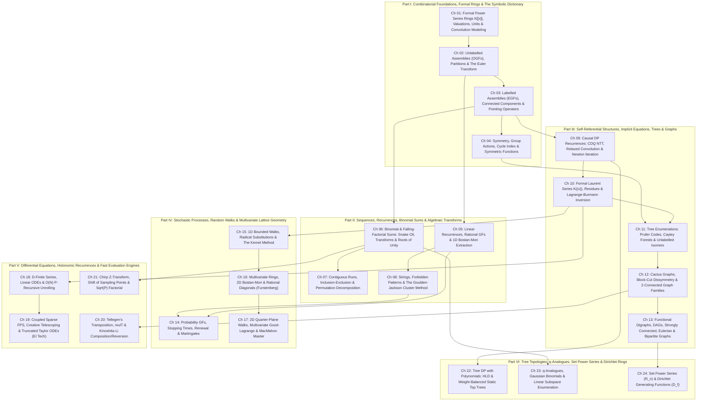

# Proposal A: Combinatorial & Diagnostic-First Curriculum Architecture (`proposal_A_modelling_first.md`)

> **Phase 1.5 — Curriculum Architecture & Pedagogical Ordering Debate**
> **Architect**: Curriculum Architect A (Combinatorial & Diagnostic-First Lens)
> **Target Repository**: `/home/maomao90/Documents/IO/ICPC-math-notes`
> **Scope**: Canonical 6-Part, 24-Chapter Textbook Architecture covering 100% of `TECHNIQUE_TAXONOMY.md`, all 10 Cohort 3 Master Wave Reports (`cohort3_wave_1a` through `cohort3_wave_5b`), and a complete granular problem distribution across all 24 chapters and 6 Blind Topic-Group Checkpoints.

---

## 1. Executive Summary & Pedagogical Thesis

### 1.1 Why a Combinatorial & Diagnostic-First Architecture?
When an expert competitive programmer (Codeforces Master to Grandmaster, assuming a tested library of `NTT`, `inv`, `ln`, `exp`, `sqrt`, `pow`) faces an unfamiliar contest problem—such as `AGC 058 D`, `CF 1349F2`, `Luogu P5827`, or `UOJ 424`—their primary bottleneck is **not** remembering how to implement a 40-line polynomial subroutine. Their bottleneck is **structural diagnosis and algebraic modelling**:
1. *What is the combinatorial decomposition of the object?* (Is it a multiset of unlabeled components, a labeled set of rooted cycles, a sequence of runs, an implicit tree grammar, a stopping-time renewal walk, or a bivariate lattice path?)
2. *Which formal ring hosts this structure without division-by-zero or valuation traps?* ($K[[x]]$, $K(x)$, $K((x))$, $K(y)[[x]]$, or Hurwitz series over $\mathbb{F}_p$?)
3. *Once the functional, rational, or differential equation is written on the scratchpad, which coefficient-extraction engine matches the target regime?* ($[x^N]$ for single large $N \le 10^{18}$ vs. all $n \le N$ for $N \le 5 \times 10^5$ vs. small prime $p \le 10^5$?)

A purely **engine-first** syllabus (which groups chapters by algorithm: "All Newton Iteration Problems", "All Bostan–Mori Problems", "All CDQ NTT Problems", "All ODE Problems") fails the reader at step (1): it gives away the algorithmic hammer in the chapter title while leaving the combinatorial nail fragmented across arbitrary chapters. Conversely, a naive **pure-combinatorics** syllabus that delays computational engines until the end of the book creates fatal **forward-reference traps**, because the reader cannot solve $N = 2.5 \times 10^5$ practice problems on integer partitions, labeled graphs, or implicit trees without the corresponding evaluation engines.

### 1.2 Resolving the Modelling-vs-Engine Dependency Loop ("Just-in-Time Engine Pairing")
Proposal A resolves this tension through **Diagnostic-First Structural Grouping with Just-in-Time Engine Pairing**:
- **Primary Axis (Parts & Chapters)**: Organized around **Combinatorial Decomposition Paradigms and Structural Diagnostic Signals**—moving progressively from flat 1D convolutions and Flajolet–Sedgewick symbolic assemblies (Part I), to sequences, binomial sums, inclusion–exclusion, and pattern-avoiding strings (Part II), to self-referential recursive structures, trees, and graphs (Part III), to stochastic processes and multivariate lattice geometry (Part IV), and finally to universal differential/transposed evaluation engines (Part V) and non-standard topological/algebraic rings (Part VI).
- **Strict Prerequisite DAG Enforcement (Zero Magic Steps)**: Whenever a combinatorial structure requires a computational engine to solve its practice ladder, that engine is formally constructed *at the exact structural inflection point where the equation class first arises*:
  - **1D Newton `inv`/`sqrt` and $O(NK)$ Sparse `ln`/`exp`/`pow` basics** are introduced in **Part I (Chapters 01–02)** alongside the formal ring $K[[x]]$ and the Euler transform, so the reader can immediately compress knapsack and partition products ($\prod (1-x^{w_i})^{-1}$) in `Luogu P4389` without forward references.
  - **1D Bostan–Mori and Rational Partial Fractions** are introduced in **Part II (Chapter 05)** alongside linear recurrences and transfer matrices, *before* they are needed to extract single high-degree coefficients in Goulden–Jackson string automata (Chapter 08) or 1D random walks (Chapter 14).
  - **Causal DP Engines (Semi-Online CDQ NTT, 0-Indexed Relaxed Convolution, and General Newton Iteration)** open **Part III (Chapter 09)** as the foundational machinery for *all* self-referential combinatorial equations ($F(x) = \Phi(x, F(x))$), immediately preceding Formal Laurent Series & Lagrange Inversion (Chapter 10) and the 3-chapter Tree & Graph Enumeration trilogy (Chapters 11–13).
  - **Frontier General-Purpose Accelerators** ($O(N)$ D-finite ODE unrolling, `EI 科技` truncated Taylor ODEs, Tellegen's transposition `mulT`, Kinoshita–Li $O(N \log^2 N)$ `compose`/`revert`, and Bluestein's Chirp-Z / $\sqrt{P}$ factorial) are consolidated in **Part V (Chapters 18–21)**, where the reader—now fluent in every combinatorial equation class—learns how to accelerate arbitrary algebraic/holonomic models to $O(N)$ or invert non-monomial substitutions.
- **Dissolution of Regional Audit Buckets**: All `[ZH]` and `[JA]` audit sections from Waves 1A–5B (`ez_lcw` harmonic run-length IE, `Elegia`'s coupled binomial sum linearization `炫酷反演魔术`, `EI 科技` truncated ODEs, `maspypy` monic $y$-reversal, `全局平衡二叉树` static top trees, `单位根反演` cyclotomic filters) are dissolved as standalone buckets and integrated as first-class subsections inside their natural conceptual chapters.

### 1.3 Transition from Existing `_quarto.yml` / `CURRICULUM.md`
The legacy repository (`_quarto.yml`) compressed Polynomials (`06`), FPS (`07`), Generating Functions (`08`), Set Power Series (`16`), and Holonomic Methods (`18`) into just 5 survey chapters inside a general math curriculum. Proposal A replaces this with a dedicated, self-contained **6-Part, 24-Chapter FPS & Generating Functions Textbook** (`chapters/01_fps_rings_convolutions.qmd` through `chapters/24_set_power_series_dirichlet.qmd`), with **188 curated problems** distributed across 24 per-chapter 4-tier ladders and **48 additional problems** reserved for 6 Part-level **Blind Topic-Group Checkpoints** (**236 unique non-template problems** actively deployed in ladders/checkpoints, plus the remaining **18 accepted variants** cross-linked in chapter notes and **67 rejected bare templates** quarantined in Appendix B).

---

## 2. Part & Chapter Architecture (Full Table of Contents)

---

### Part I: Combinatorial Foundations, Formal Rings & The Symbolic Dictionary

#### Chapter 01: Formal Power Series Rings $K[[x]]$, Valuations, Units & Convolution Modelling (`chapters/01_fps_rings_convolutions.qmd`)
- **Core Mathematical Objects & Algebraic Setting**:
  - Formal power series ring $K[[x]]$, sequence space $K^{\mathbb{N}}$, Cauchy product $(A \cdot B)_n = \sum_{i+j=n} a_i b_j$, formal valuation $\operatorname{val}(A) = \min\{n : a_n \neq 0\}$, ultrametric inequality $\operatorname{val}(A+B) \ge \min(\operatorname{val}(A), \operatorname{val}(B))$, and additive valuation $\operatorname{val}(AB) = \operatorname{val}(A)+\operatorname{val}(B)$.
  - Truncated quotient rings $K[x]/(x^N)$ as the exact algebraic home of competitive programming polynomial arrays.
  - Units $K[[x]]^\times = \{A : [x^0]A \neq 0\}$, formal geometric series $(1-B)^{-1} = \sum_{k \ge 0} B^k$ for $\operatorname{val}(B) \ge 1$, and $O(N \log N)$ degree-doubling Newton iteration for `inv` ($G_{2d} = G_d(2 - A G_d) \bmod x^{2d}$) and `sqrt`.
  - Characteristic $0$ vs. Characteristic $p$: why `inv` and `sqrt` only require $2 \in K^\times$, whereas division by $n$ in integration/logarithms requires $\operatorname{char}(K) = 0$ or $N < p$.
- **Sub-sections & Core Derivations Covered**:
  - **1.1** Why Infinite Sums Require Zero Analysis: Ultrametric topology on $K[[x]]$, formal convergence of infinite sums $\sum_{k \ge 0} F_k(x)$ when $\operatorname{val}(F_k) \to \infty$, and the **Valuation-Shift Precision Loss Rule** (if $\operatorname{val}(A) = v > 0$, dividing by $A \bmod x^N$ yields only $N-v$ valid coefficients).
  - **1.2** The Convolution Litmus Test & The 11-Row Index-Multiplier Alignment Table: Recognising Cauchy products $(i+j=n)$, reverse-indexing difference convolutions $(i-j=k \implies i + (N-j) = N+k)$, and prefix-sum/difference operators $(1-x)^{-1}$ and $(1-x)$.
  - **1.3** Reversible Knapsack & Sliding-Window Polynomial Division: Exact $O(K)$ forward multiplication and backward division by $(1 + x^v)$, $(1 - x^v)$, and bounded geometric factors $\frac{1 - x^{v(c+1)}}{1 - x^v}$ without NTT.
  - **1.4** Formal Derivative $D$, Integral $\int$, and Degree-Doubling `inv` / `sqrt`: Algebraic derivation of $D(AB) = A'B + AB'$ without limits; quadratic convergence of $(G_k - A^{-1})^2 \equiv 0 \pmod{x^{2^k}}$.
- **Diagnostic Signals & Reverse-Engineering Scratchpad Focus**:
  - *Signal*: Two coupled indices $i, j$ appear inside a sum where their arguments add ($i+j=s$) or subtract ($i-j=d$), or items are dynamically inserted/deleted from a knapsack DP of capacity $K \le 5000$.
  - *Scratchpad Focus*: Isolate $i$-terms from $j$-terms, reverse one array if indices subtract, and check $\operatorname{val}(Q)$ before dividing two truncated series.
- **Strict Prerequisites**: Basic modular arithmetic and black-box `NTT` convolution.

#### Chapter 02: Unlabelled Assemblies (OGFs), Integer Partitions & The Euler Transform (`chapters/02_ogf_partitions_euler_transform.qmd`)
- **Core Mathematical Objects & Algebraic Setting**:
  - Ordinary Generating Functions (OGFs) in $K[[x]]$ and $K[[x, u]]$ over a ring $K$ where $1, 2, \dots, N$ are invertible ($\mathbb{Q}$ or $\mathbb{F}_p$ with $N < p$).
  - Formal logarithm $\ln(1+B) = \int \frac{B'}{1+B} dx$ and formal exponential $\exp(B) = \sum_{k \ge 0} \frac{B^k}{k!}$ for $\operatorname{val}(B) \ge 1$.
  - **3-Way Modular Reduction Trap for $A(x)^\alpha \bmod x^N \pmod p$**: decomposing $A(x) = c x^v \tilde{A}(x)$ where $v \in \mathbb{Z}_{\ge 0}$ (exact integer shift), $c^\alpha \pmod p$ reduces $\alpha \bmod (p-1)$ by Fermat, and $\exp(\alpha \ln \tilde{A}(x))$ reduces $\alpha \bmod p$.
- **Sub-sections & Core Derivations Covered**:
  - **2.1** Flajolet–Sedgewick Unlabelled Symbolic Dictionary: Disjoint union $+$, Cartesian product $\times$, sequence $\operatorname{SEQ}(\mathcal{A}) = (1-A(x))^{-1}$, powerset $\operatorname{PSET}(\mathcal{A}) = \prod_{n \ge 1} (1+x^n)^{a_n}$, and multiset $\operatorname{MSET}(\mathcal{A}) = \prod_{n \ge 1} (1-x^n)^{-a_n}$.
  - **2.2** The Euler Transform & $O(N \log N)$ Harmonic $\ln$-$\exp$ Compression: Rewriting $\ln \prod_{n \ge 1} (1 - x^n)^{-a_n} = \sum_{n \ge 1} a_n \sum_{k \ge 1} \frac{x^{nk}}{k}$ to compress $M$ knapsack/multiset factors into $O(N \log N)$ harmonic sieve additions followed by a single `exp`.
  - **2.3** The Inverse Euler Transform: Recovering the generator counts $a_n$ from a known multiset/partition OGF $F(x)$ via $n [x^n] \ln F(x) = \sum_{d \mid n} d a_d$ and number-theoretic Möbius inversion $\mu(n/d)$.
  - **2.4** Integer Partitions, Durfee Squares & Euler's Pentagonal Number Theorem: Ferrers diagram conjugation, $O(N \sqrt{N})$ Durfee-square decomposition $\prod_{k \ge 1}(1-x^k)^{-1} = \sum_{s \ge 0} \frac{x^{s^2}}{\prod_{i=1}^s (1-x^i)^2}$, Pentagonal recurrence $\prod_{k \ge 1}(1-x^k) = \sum_{m \in \mathbb{Z}} (-1)^m x^{m(3m-1)/2}$, and $\sqrt{N}$ item-size threshold splitting (`LOJ 6089`).
  - **2.5** $O(NK)$ Sparse Polynomial `div`, `ln`, `exp`, and `pow` Basics: Why a $K$-sparse polynomial $P(x)$ satisfies $P(x) F'(x) = \alpha P'(x) F(x)$ (or $P F' = P'$), enabling $O(NK)$ coefficient-by-coefficient extraction without NTT when $K$ is small.
- **Diagnostic Signals & Reverse-Engineering Scratchpad Focus**:
  - *Signal*: "Unordered collection of indistinct items/parts summing to $N$", or products $\prod_{i=1}^M (1 \pm x^{w_i})^{\pm c_i}$ where $w_i \le N$ and $M, N \le 5 \times 10^5$.
  - *Scratchpad Focus*: Group identical weights $w_i$ into frequency buckets $cnt[w]$, take $\ln$ to turn products into a $O(N \log N)$ harmonic sum, and exponentiate once.
- **Strict Prerequisites**: Chapter 01.

#### Chapter 03: Labelled Assemblies (EGFs), Connected Components & Pointing Operators (`chapters/03_egf_connected_components_pointing.qmd`)
- **Core Mathematical Objects & Algebraic Setting**:
  - Exponential Generating Functions (EGFs) $\widehat{A}(x) = \sum_{n \ge 0} a_n \frac{x^n}{n!}$, isomorphic to the **Hurwitz Series Ring** $K[[x]]_{\text{Hurwitz}}$ with binomial convolution $(a *_H b)_n = \sum_{k=0}^n \binom{n}{k} a_k b_{n-k}$.
  - Map $\frac{x^n}{n!} \mapsto x^n$ breaks in characteristic $p$ when $n \ge p$ (since $(x^{[p]})^p = 0$ in Divided Power Rings); rigorous verification that $N < p$ is mandatory for division by $n!$.
- **Sub-sections & Core Derivations Covered**:
  - **3.1** Relabelling-Safe Binomial Convolution & The Labelled Symbolic Dictionary: Labelled product $\widehat{A}(x)\widehat{B}(x)$, unordered $k$-set $\operatorname{SET}_k(\mathcal{A}) = \frac{\widehat{A}(x)^k}{k!}$, full set $\operatorname{SET}(\mathcal{A}) = \exp(\widehat{A}(x))$, and directed cycle $\operatorname{CYC}(\mathcal{A}) = \ln \frac{1}{1-\widehat{A}(x)}$.
  - **3.2** The Exp–Ln Connectedness Bridge: Why any labelled graph/hypergraph/permutation class $\mathcal{G} = \operatorname{SET}(\mathcal{C})$ satisfies $G(x) = \exp(C(x)) \iff C(x) = \ln G(x)$, plus signed set-partition inclusion–exclusion $\exp\left(\sum_{k \ge 1} (-1)^{k-1} w_k \frac{x^k}{k}\right)$.
  - **3.3** Pointing $\vartheta = xD$ and the Boxed Product $\mathcal{C} = \mathcal{A}^{\square} \star \mathcal{B}$: Root-distinguishing operator $\vartheta \widehat{A}(x) = \sum n a_n \frac{x^n}{n!}$, minimum-label component extraction $\widehat{C}'(x) = \widehat{A}'(x)\widehat{B}(x) \implies \widehat{C}(x) = \int \widehat{A}'(x)\widehat{B}(x) dx$, and parity hyperbolic filters $\cosh(x) = \frac{e^x+e^{-x}}{2}, \sinh(x) = \frac{e^x-e^{-x}}{2}$.
  - **3.4** The Borel–Laplace Bridge ($\text{OGF} \leftrightarrow \text{EGF}$) & The Complete Twelvefold Way (`Luogu P5824`): Formal Laplace transform $\mathcal{L}\left\{\sum a_n \frac{x^n}{n!}\right\} = \sum a_n x^n$ converting factorial-weighted EGFs into OGFs, and the unified $2 \times 2 \times 3$ table of balls-in-boxes (injective, surjective, unrestricted across labelled/unlabelled balls and boxes).
- **Diagnostic Signals & Reverse-Engineering Scratchpad Focus**:
  - *Signal*: Distinct labels $\{1, \dots, n\}$ distributed across components (cycles, connected graphs, colour classes), multinomial weights $\frac{n!}{\prod c_i!}$, or "the component containing vertex $1$".
  - *Scratchpad Focus*: Check whether components can be empty ($\operatorname{val}(C) \ge 1$ required for $\exp(C)$); if vertex $1$ is special, differentiate the component of vertex $1$ ($\widehat{A}'\widehat{B}$) instead of dividing by $n$.
- **Strict Prerequisites**: Chapters 01–02.

#### Chapter 04: Symmetry, Group Actions, Cycle Index & Symmetric Functions (`chapters/04_symmetry_polya_symmetric_functions.qmd`)
- **Core Mathematical Objects & Algebraic Setting**:
  - Group action of $G \le S_m$ on domain $D$, cycle index polynomial $Z_G(s_1, \dots, s_m) = \frac{1}{\lvert G \rvert} \sum_{g \in G} \prod_{k=1}^m s_k^{c_k(g)} \in \mathbb{Q}[s_1, \dots, s_m]$, and formal figure-inventory substitution $s_k \leftarrow A(x^k)$.
  - Ring of symmetric functions $\Lambda_K$: elementary symmetric polynomials $e_k$, complete homogeneous symmetric polynomials $h_k$, and power sums $p_k = \sum_{i=1}^n \alpha_i^k$.
- **Sub-sections & Core Derivations Covered**:
  - **4.1** Unlabelled Cycles (`CYC`) & Dihedral Bracelets (`DIH`): Deriving $\operatorname{CYC}(\mathcal{A}) = \sum_{k \ge 1} \frac{\varphi(k)}{k} \ln \frac{1}{1 - A(x^k)}$ and dihedral reflection corrections for necklaces vs. bracelets.
  - **4.2** Pólya Enumeration Theorem & Partition Cycle Index $Z_{S_m}$: Substituting $s_k \leftarrow A(x^k)$ for small constant groups ($S_3, S_4, D_n$) and partition-sum enumeration over conjugacy classes of $S_n$ for unlabeled graph isomorphism (`Luogu P4727`, `ABC 284 Ex`).
  - **4.3** Newton–Girard Identities & Power-Sum Generating Functions: Connecting $E(x) = \prod (1+\alpha_i x)$, $H(x) = \prod (1-\alpha_i x)^{-1} = E(-x)^{-1}$, and $P(x) = \sum_{k \ge 1} p_k x^k = -x \frac{E'(-x)}{E(-x)} = x \frac{H'(x)}{H(x)}$.
  - **4.4** Symmetric Function Regimes & Characteristic-$p$ Breakdown:
    - *Regime A*: Given explicit array $a_1, \dots, a_n$, compute all power sums $p_1, \dots, p_K$ in $O(n \log^2 n + K \log K)$ via divide-and-conquer product tree $\prod (1 - a_i x)$ and $\ln$.
    - *Regime B*: Given $p_1, \dots, p_n$, recover $e_1, \dots, e_n$ via $\exp\left(-\sum_{k \ge 1} \frac{p_k}{k} (-x)^k\right)$.
    - *Char-$p$ Asymmetry Warning*: $e_k, h_k \implies p_k$ is division-free via $P = x H'/H$, whereas $p_k \implies e_k, h_k$ divides by $k$ and fails when $k \ge p$!
- **Diagnostic Signals & Reverse-Engineering Scratchpad Focus**:
  - *Signal*: Equivalence up to cyclic rotation, dihedral reversal, or vertex relabelling ($S_n$); or sums of $k$-th powers $\sum_{i,j} (a_i + b_j)^k$ / elementary symmetric products over an array.
  - *Scratchpad Focus*: Expand $(a_i + b_j)^k$ binomially into EGF convolutions of power sums $p_r(A) = [x^r] (-x \frac{d}{dx} \ln \prod (1 - a_i x))$.
- **Strict Prerequisites**: Chapters 01–03.

---

### Part II: Sequences, Recurrences, Binomial Sums & Algebraic Transforms

#### Chapter 05: Linear Recurrences, Rational Generating Functions & 1D Bostan–Mori Extraction (`chapters/05_rational_gfs_bostan_mori.qmd`)
- **Core Mathematical Objects & Algebraic Setting**:
  - Rational generating functions $F(x) = P(x)/Q(x) \in K(x) \cap K[[x]]$ with $\deg P < \deg Q = d$ and $[x^0]Q = 1$; ring of fractions of $K[x]$ localized at $(1 + x K[x])$.
  - Even/odd series decimation operators $\mathcal{E}(A)(x) = \sum a_{2n} x^n$ and $\mathcal{O}(A)(x) = \sum a_{2n+1} x^n$, and Characteristic-$p$ Frobenius identity $Q(x)^p = Q(x^p)$ in $\mathbb{F}_p[x]$.
- **Sub-sections & Core Derivations Covered**:
  - **5.1** The Exact 1D DP-to-OGF Boundary Formula: Proving that $f_n = \sum_{i=1}^d c_i f_{n-i}$ ($n \ge d$) with arbitrary initial values $f_0, \dots, f_{d-1}$ has the exact numerator $P(x) = \left(Q(x) \sum_{n=0}^{d-1} f_n x^n\right) \bmod x^d$ where $Q(x) = 1 - \sum_{i=1}^d c_i x^i$, eliminating manual index-shift errors.
  - **5.2** Transfer Matrices & Characteristic Polynomials: Converting finite-state DP transitions $v_{n} = M v_{n-1}$ into rational OGFs with denominator $Q(x) = \det(I - xM)$.
  - **5.3** Heaviside Cover-Up & Partial Fraction Decomposition: Extracting closed-form $[x^n] P(x)/Q(x)$ when $Q(x) = \prod (1 - \lambda_i x)^{m_i}$ factors into known linear/sparse roots, plus prefix-sum rational telescoping (`AGC 054 E`).
  - **5.4** 1D Bostan–Mori Algorithm ($O(d \log d \log N)$) & Bit-Reversed DFT Doubling: Multiplying numerator and denominator by $Q(-x)$ so $Q(x)Q(-x) = V(x^2)$, halving $N \gets \lfloor N/2 \rfloor$ in each step; fast NTT cache reuse saving $\frac{1}{3}$ transforms per bit; and **Frobenius Bostan–Mori in $\mathbb{F}_p[[x]]$** ($P(x)Q(x)^{p-1} / Q(x^p)$ in $O(d p \log(dp) \log_p N)$).
  - **5.5** Empirical Sequence Discovery via Berlekamp–Massey: Finding the minimal recurrence polynomial $Q(x)$ of length $\le d$ from $2d$ brute-forced DP values in $O(d^2)$, then running Bostan–Mori for $N \le 10^{18}$.
- **Diagnostic Signals & Reverse-Engineering Scratchpad Focus**:
  - *Signal*: $N \le 10^{18}$ with a constant-width DP window $d \le 5 \times 10^4$, or a sparse linear recurrence like $f_n = f_{n-1} + f_{n-M}$.
  - *Scratchpad Focus*: Write $Q(x) = 1 - \sum c_i x^i$, compute $F_{<d}(x)$ by DP, set $P = (Q F_{<d}) \bmod x^d$, and run Bostan–Mori.
- **Strict Prerequisites**: Chapters 01–02.

#### Chapter 06: Binomial & Falling-Factorial Sums — Snake Oil, Polynomial Transforms & Roots of Unity (`chapters/06_binomial_sums_polynomial_transforms.qmd`)
- **Core Mathematical Objects & Algebraic Setting**:
  - Polynomial basis rings: Monomial $\{x^k\}$, Falling Factorial $\{x^{\underline{k}}\}$, Rising Factorial $\{x^{\overline{k}}\}$, and Binomial $\{\binom{x}{k}\}$; Ordinary vs. Exponential Falling Factorial Generating Functions (FFPs).
  - Cyclotomic fields and finite-field quotient rings $\mathbb{F}_p[\omega]/(\Phi_m(\omega))$ when $m \nmid (p-1)$.
- **Sub-sections & Core Derivations Covered**:
  - **6.1** The Absorption Identity & The 5-Row Falling-Factorial / Stirling Conversion Table: Using $k^{\underline{j}} \binom{n}{k} = n^{\underline{j}} \binom{n-j}{k-j}$ and $x^K = \sum_{j=0}^K \left\{\begin{smallmatrix} K \\ j \end{smallmatrix}\right\} x^{\underline{j}}$ to reduce polynomial-weighted binomial sums $\sum_{k=0}^n \binom{n}{k} x^k y^{n-k} P(k)$ from $O(n)$ to $O(\deg P)$ (`Luogu P6620`, `CF 932E`), plus unsigned Stirling numbers of the first kind $\left[\begin{smallmatrix} n \\ k \end{smallmatrix}\right] = [x^k] x^{\overline{n}}$ via doubling Taylor shift $P_{2m}(x) = P_m(x) P_m(x+m)$ (`CF 960G`).
  - **6.2** Taylor Shift $A(x+c)$ & Generalized $\alpha$-Euler / Projective Möbius Transforms:
    - Binomial convolution for $A(x+c)$;
    - Generalized $\alpha$-Euler transform $(1-x)^{-\alpha} F\left(\frac{x}{1-x}\right)$ and the **Negative-Integer $\alpha = -d$ Pole Fix**;
    - **Projective Möbius Transform** $(cx+d)^n F\left(\frac{ax+b}{cx+d}\right)$ factored via Bruhat decomposition into scaling $\to$ Taylor shift $\to$ reversal $x^n F(1/x) \to$ Taylor shift (`KUPC 2019 K`);
    - **1-Shift & 2-Shift Krawtchouk Transforms** $(1+x)^{n-k}(1-x)^k$.
  - **6.3** Wilf's Snake Oil Method for 1D Binomial Sums: Naming the target sum $S_n = \sum_k \binom{\dots}{\dots} a_k$, multiplying by $x^n$, interchanging $\sum_n$ and $\sum_k$ so the inner $n$-sum collapses via $(1+x)^m$ or $(1-x)^{-m-1}$, and extracting $[x^n]$.
  - **6.4** Roots of Unity Filter (`单位根反演`) & Cyclotomic Quotient Rings: Extracting arithmetic progressions $\sum_{k \equiv r \pmod m} a_k x^k = \frac{1}{m} \sum_{j=0}^{m-1} \omega^{-jr} A(\omega^j x)$, parity/mod-4 filters, and exact arithmetic in $\mathbb{F}_p[\omega]/(\Phi_m(\omega))$ when $p \not\equiv 1 \pmod m$.
- **Diagnostic Signals & Reverse-Engineering Scratchpad Focus**:
  - *Signal*: A sum over $k$ involving $k^K \binom{n}{k}$ with $n \le 10^9, K \le 5 \times 10^5$; or index congruence conditions $k \equiv r \pmod m$; or $(1+x)^j (1-x)^{n-j}$ weights.
  - *Scratchpad Focus*: Check which variable ($n$ or $k$) appears inside only one binomial coefficient for Snake Oil, or convert $P(k)$ into falling factorials $k^{\underline{j}}$ to absorb into $\binom{n}{k}$.
- **Strict Prerequisites**: Chapters 01–04.

#### Chapter 07: Contiguous Runs, Inclusion–Exclusion & Permutation Decomposition (`chapters/07_inclusion_exclusion_runs_permutations.qmd`)
- **Core Mathematical Objects & Algebraic Setting**:
  - Bivariate formal power series $K[y][[x]]$ for counting "at least $k$" vs. "exactly $k$" satisfied conditions via formal Taylor shift $E(x, y) = A(x, y-1)$.
  - Formal composition $F(x) = \frac{W(x)}{1 + W(x)} = \sum_{c \ge 1} (-1)^{c-1} W(x)^c$ on run-weight series $W(x)$ with $\operatorname{val}(W) \ge 1$.
- **Sub-sections & Core Derivations Covered**:
  - **7.1** Binomial Inversion as Bivariate Taylor Shift ("At Least $k$" $\to$ "Exactly $k$"): Proving $f_k = \sum_{j=k}^n (-1)^{j-k} \binom{j}{k} g_j$ is a single reverse-indexed NTT convolution after multiplying by $j!$ and $(-1)^d / d!$.
  - **7.2** Universal Run-Length Inclusion–Exclusion (`连续段容斥`): Replacing adjacent-violation sieve sums by the block-weight OGF/EGF $W(x) = \sum_{s \ge 1} (-1)^{s-1} w_s x^s$ and computing $F(x) = (1 + W(x))^{-1}$ (unrooted) or $W'(x)(1+W(x))^{-1}$ (circular); **Order-of-Operations Rule** (apply block-gluing *per colour first*, then multiply across colours); and **`ez_lcw` Harmonic Sparsity** ($\sum_{c=1}^m \lfloor n/c \rfloor = O(n \log n)$ across uneven colour frequencies).
  - **7.3** Forbidden-Edge Path Cover IE & Eulerian Alternation/Run GFs: Reducing Hamiltonian paths avoiding a sparse/structured forbidden graph $G$ to vertex-disjoint path covers weighted by $(-1)^{\lvert E' \rvert}$; Eulerian numbers $\left\langle\begin{smallmatrix} n \\ k \end{smallmatrix}\right\rangle$ via bivariate EGF $\frac{y-1}{y - e^{(y-1)x}}$.
  - **7.4** Simple Permutations & Interval Decomposition Trees (`析合树`): Substitution decomposition of permutations into prime (simple) nodes and linear ($+$/$-$ staircase) nodes, leading to the functional relation for simple permutations (`Luogu P4747`).
- **Diagnostic Signals & Reverse-Engineering Scratchpad Focus**:
  - *Signal*: "No two adjacent elements are equal / in conflict", "count permutations with exactly $k$ ascents/matches", or "count contiguous monochromatic blocks".
  - *Scratchpad Focus*: Never track the last element's colour in DP; instead assign weight $(-1)^{s-1}$ to each maximal valid block of size $s$ and invert $1 + W(x)$.
- **Strict Prerequisites**: Chapters 03, 06.

#### Chapter 08: Strings, Forbidden Patterns & The Goulden–Jackson Cluster Method (`chapters/08_strings_goulden_jackson_clusters.qmd`)
- **Core Mathematical Objects & Algebraic Setting**:
  - Free monoid $\Sigma^*$ mapped to rational generating functions in $K(x)$ and $K(t)(x)$ via formal language equations and overlap correlation matrices $C(x) \in K[x]^{m \times m}$.
- **Sub-sections & Core Derivations Covered**:
  - **8.1** KMP Border Polynomials & Single-Pattern Avoidance (Guibas–Odlyzko): Defining the autocorrelation polynomial $c_P(x) = \sum_{L \in \text{Borders}(P)} x^{\lvert P \rvert - L}$ so the OGF of strings over alphabet $\Sigma$ avoiding $P$ is $F(x) = \frac{c_P(x)}{(1 - \lvert \Sigma \rvert x) c_P(x) + x^{\lvert P \rvert}}$.
  - **8.2** The Goulden–Jackson Cluster Method (Multi-Pattern $m \times m$ Overlap System): Marking overlapping occurrences of reduced pattern set $\mathcal{B} = \{P_1, \dots, P_m\}$ by weight $-1$, solving $(I + C(x)) \mathbf{w}(x) = \mathbf{p}(x)$ where $C_{i,j}(x) = \sum_{\text{overlap } L} x^{\lvert P_j \rvert - L}$, and obtaining $F(x) = \left(1 - \lvert \Sigma \rvert x + \sum_{i=1}^m w_i(x)\right)^{-1}$.
  - **8.3** The 4 Regimes of Pattern Counting:
    - *Regime 1*: Single pattern ($m=1$, $O(\lvert P \rvert \log \lvert P \rvert \log N)$ via Bostan–Mori);
    - *Regime 2*: Small multi-pattern ($m \le 15$, Gaussian elimination over $K[[x]]/(x^{N+1})$);
    - *Regime 3*: Large total pattern length ($\sum \lvert P_i \rvert \le 2000$, Aho–Corasick transfer matrix + Berlekamp–Massey + Bostan–Mori);
    - *Regime 4*: Exact-$k$ occurrences via bivariate weight $(t-1)$ and Cyclic Necklaces avoiding patterns via $\vartheta \ln F$ (`AGC 058 D`).
- **Diagnostic Signals & Reverse-Engineering Scratchpad Focus**:
  - *Signal*: Strings of length $N$ avoiding one or more contiguous substrings $P_i$ (or containing them exactly $k$ times), where $\lvert P_i \rvert$ is up to $2.5 \times 10^5$ (single pattern) or $m \le 15$ (multi-pattern).
  - *Scratchpad Focus*: Compute KMP border lengths of $P$, write $c_P(x)$, and extract $[x^N]$ via polynomial inversion ($N \le 5 \times 10^5$) or Bostan–Mori ($N \le 10^{18}$).
- **Strict Prerequisites**: Chapters 05, 07.

---

### Part III: Self-Referential Structures, Implicit Equations, Trees & Graphs

#### Chapter 09: Causal DP Recurrences — Semi-Online CDQ NTT, Relaxed Convolution & Newton Iteration (`chapters/09_causal_dp_cdq_relaxed_newton.qmd`)
- **Core Mathematical Objects & Algebraic Setting**:
  - Implicit fixed-point operators $\Phi: x K[[x]] \to x K[[x]]$ which are **contractive in the $\operatorname{val}$-metric**: $\operatorname{val}(\Phi(F) - \Phi(G)) \ge \operatorname{val}(F - G) + 1$, guaranteeing a unique fixed point $F \in x K[[x]]$ and quadratic convergence under Newton linearization.
- **Sub-sections & Core Derivations Covered**:
  - **9.1** Semi-Online Divide-and-Conquer NTT (CDQ Convolution, $O(N \log^2 N)$): Solving causal recurrences $f_n = \psi_n\left(\sum_{i=1}^{n-1} f_i g_{n-i}\right)$ by recursively computing $[L, M]$, convolving $f_{[L..M]} \times g_{[1..R-L]}$ into $[M+1, R]$, and recursing on $[M+1, R]$; handling **self-convolutions** $f_i f_{n-i}$ with symmetry multiplier $2$ when $L > 0$.
  - **9.2** Fully Online 0-Indexed Relaxed Convolution (van der Hoeven / Nyaan, $O(N \log^2 N)$): The exact 0-indexed `lowbit(q + 1)` powers-of-two block schedule that allows $a_q$ and $b_q$ to be revealed at step $q$ and immediately outputs $[x^q](A \cdot B)$, enabling 10-line online implementations of `exp`, `inv`, `sqrt`, and Pólya tree recurrences (`LOJ 6538`, `ABC 230 Ex`).
  - **9.3** General 1D & Coupled $r \times r$ Jacobian Newton Iteration ($O(N \log N)$): Linearizing $\Phi(F) = 0 \pmod{x^{2d}}$ around $F_d$ via $F_{2d} = F_d - \Phi(F_d) / \Phi'(F_d) \bmod x^{2d}$; matrix Jacobian inversion $F_{2d} = F_d - (J_\Phi(F_d))^{-1} \Phi(F_d)$ for coupled multi-colored tree grammars (`yukicoder 3029`).
  - **9.4** First-Order Non-Linear ODEs in Newton Iteration (Integrating Factor Trick): Solving $\Phi(F, F') = 0$ (such as $F' = \frac{1}{2} A(x) F^2 + 1$ in `UOJ 50` or $T' = \dots$ in `LOJ 6538`) by linearizing to $\Delta' + P(x) \Delta = R(x) \pmod{x^{2d}}$ and multiplying by integrating factor $\mu(x) = \exp(\int P(x) dx)$.
- **Diagnostic Signals & Reverse-Engineering Scratchpad Focus**:
  - *Signal*: A DP recurrence where $dp[n]$ depends on $\sum_{i+j=n} dp[i] w[j]$ with a non-linear wrapper (like $dp[n] \gets dp[n] / n$ or $\max$), or an implicit tree/graph grammar $F(x) = \Psi(x, F(x), F(x^2))$ requiring all coefficients up to $N \le 2.5 \times 10^5$.
  - *Scratchpad Focus*: Decide between CDQ/Relaxed Convolution ($O(N \log^2 N)$, zero derivative algebra, minimal constant factor) and Newton Iteration ($O(N \log N)$, requires differentiating $\Phi(F)$).
- **Strict Prerequisites**: Chapters 01–03.

#### Chapter 10: Formal Laurent Series $K((x))$, Residue Calculus & Lagrange–Bürmann Inversion (`chapters/10_laurent_residues_lagrange_inversion.qmd`)
- **Core Mathematical Objects & Algebraic Setting**:
  - Field of Formal Laurent Series $K((x)) = K[[x]][x^{-1}] = \{\sum_{n \ge -N_0} a_n x^n\}$; formal residue functional $\operatorname{res}_x A(x) = [x^{-1}] A(x)$.
  - Compositional group $(\mathcal{G}, \circ)$ of formal series with $\operatorname{val}(F) = 1$ ($[x^0]F = 0, [x^1]F \in K^\times$).
- **Sub-sections & Core Derivations Covered**:
  - **10.1** The Three Foundational Identities of Formal Residue Calculus:
    1. $\operatorname{res}_x A'(x) = 0$ (making integration by parts $\operatorname{res}_x(A'B) = -\operatorname{res}_x(AB')$ universally valid);
    2. $\operatorname{res}_x(F'(x) F(x)^k) = [k = -1] \cdot \operatorname{val}(F)$ in $\operatorname{char}(K) = 0$;
    3. **Formal Change-of-Variables Theorem**: For $\operatorname{val}(G) = 1$, $[x^n] A(x) = \operatorname{res}_x(A(x) x^{-n-1}) = \operatorname{res}_u\left(A(G(u)) G(u)^{-n-1} G'(u)\right)$.
  - **10.2** Egorychev's Method & The Universal Chebyshev Substitution $w = \frac{v}{1-v}$: Turning binomial coefficients into residues $\binom{n}{k} = \operatorname{res}_w \frac{(1+w)^n}{w^{k+1}}$, summing geometric series inside $\operatorname{res}$, and transforming $\sum_j \binom{n+j}{2j} c^j$ via $w = \frac{v}{1-v}$.
  - **10.3** The 6 Canonical Forms of Lagrange–Bürmann Inversion (LIF):
    - **Form 1 (Standard)**: $n [x^n] H(F(x)) = [u^{n-1}] H'(u) \phi(u)^n$ for $F = x \phi(F)$;
    - **Form 2 (Derivative-Free / `另类拉格朗日反演` — Mandatory when $p \mid n$)**: $[x^n] H(F(x)) = [u^n] H(u) \phi(u)^n \left(1 - \frac{u \phi'(u)}{\phi(u)}\right)$;
    - **Form 3 (Bürmann General $F(x) = x/\psi(x)$)**: $[x^n] H(x) = \frac{1}{n}[u^{n-1}] H'(F^{\langle -1 \rangle}(u)) \psi(u)^n$;
    - **Form 4 (Gessel's Bivariate Form)**: $[x^n] \frac{H(F(x))}{1 - x \phi'(F(x))} = [u^n] H(u) \phi(u)^n$;
    - **Form 5 (Compound LIF)** for $F(x) = G(x \phi(F(x)))$;
    - **Form 6 (Lagrange's 1770 PDE)**: $\frac{\partial}{\partial x} H(F(x,t)) = \frac{\partial}{\partial t}\left(\frac{t^n}{n!} \phi(x)^n H'(x)\right)$ for bivariate tree/Eulerian shifts (`CF 1349F2`).
  - **10.4** Advanced LIF Specializations:
    - **`Elegia`'s Coupled Binomial Sum Linearization (`炫酷反演魔术`)**: Uncoupling $\sum_k \binom{n + ak}{m + bk} c_k$ via inverse series change of variable (`Luogu P7439`);
    - **`ABC 345 G` Laurent Geometric Series Trick**: Computing $\sum_{k=1}^N c_k [x^N] F(x)^k = [u^{N-1}] \frac{\phi(u)^N}{u} \left(1 - \frac{u\phi'(u)}{\phi(u)}\right) \sum_{k=1}^N c_k u^k$ in a single convolution;
    - **Small-Prime Base-$p$ Frobenius Decimation** (`Luogu P8555`, `Luogu P7592`): Using $\phi(u)^p \equiv \phi(u^p) \pmod p$ to extract $[x^n]$ for $n \le 10^{18}$ modulo $p \le 10^5$.
- **Diagnostic Signals & Reverse-Engineering Scratchpad Focus**:
  - *Signal*: An implicit equation $F(x) = x \phi(F(x))$ or $x = F(x)/\psi(F(x))$ where we need a **single** coefficient $[x^N] H(F(x))$ (or a sparse family of coefficients) in $O(N \log N)$ without Newton iteration, or a coupled binomial sum $\binom{A+ak}{B+bk}$.
  - *Scratchpad Focus*: Always check whether $p \mid N$; if $N$ can be a multiple of $p$ (or if $H'(u)$ is messy), use **Form 2 (Derivative-Free LIF)** $[u^n] H(u) \phi(u)^n (1 - u \phi'/\phi)$.
- **Strict Prerequisites**: Chapters 01–03, 09.

#### Chapter 11: Tree Enumerations — Prüfer Codes, Cayley Forests, Unlabelled Trees & Chemical Isomers (`chapters/11_tree_enumerations_prufer_cayley_isomers.qmd`)
- **Core Mathematical Objects & Algebraic Setting**:
  - Rooted labelled tree EGF $T(x) = x e^{T(x)}$, degree-constrained tree EGF $T(x) = x \phi(T(x))$, and unlabelled tree OGF $R(x) = x \operatorname{MSET}(R)(x) = x \exp\left(\sum_{k \ge 1} \frac{R(x^k)}{k}\right)$.
- **Sub-sections & Core Derivations Covered**:
  - **11.1** Prüfer Sequences & Degree-Constrained Labelled Trees: Bijection between $n$-vertex trees with degrees $(d_1, \dots, d_n)$ and sequences in $[n]^{n-2}$, yielding $\frac{(n-2)!}{\prod_{i=1}^n (d_i - 1)!} = (n-2)! [x^{n-2}] \prod_{i=1}^n \left(\sum_{d \in D_i} \frac{x^{d-1}}{(d-1)!}\right)$, compressed via $\ln$-$\exp$ (`ABC 303 Ex`, `Luogu P5219`).
  - **11.2** Cayley's Formula, Rooted $k$-Forests & Generalized Exponential/Binomial Series: Extracting $[x^n] \frac{T(x)^k}{k!} = \frac{k}{n} \binom{n}{k} n^{n-k}$ via LIF; Lambert-$W$ tree series $\mathcal{E}_r(x) = \sum_{n \ge 0} \frac{(rn+1)^{n-1}}{n!} x^n$ satisfying $\mathcal{E}_r = e^{x \mathcal{E}_r^r}$; and Fuss–Catalan $m$-ary trees $\mathcal{B}_m(x) = 1 + x \mathcal{B}_m(x)^m$ with $[x^n] \mathcal{B}_m(x)^r = \frac{r}{mn+r}\binom{mn+r}{n}$.
  - **11.3** Unlabelled Rooted Trees & Otter's Dissimilarity Theorem for Unrooted Trees:
    - Rooted unlabelled trees $R(x) = x \exp\left(\sum_{k \ge 1} \frac{R(x^k)}{k}\right)$ solved in $O(N \log N)$ via Newton or $O(N \log^2 N)$ via online relaxed convolution;
    - **Otter's Dissimilarity Theorem**: For any unrooted tree, `#(vertices) - #(edges) + #(symmetry-edges) = 1`, yielding the exact OGF $U(x) = R(x) - \frac{1}{2}\left(R(x)^2 - R(x^2)\right)$ (`Luogu P5900`).
  - **11.4** Chemical Isomer Enumeration (Alkyl Radicals $S_3$ & Alkanes $S_4$): Applying Pólya cycle indices $Z_{S_3}(A(x), A(x^2), A(x^3)) = \frac{1}{6}(A(x)^3 + 3A(x)A(x^2) + 2A(x^3))$ for planted ternary trees (alkyls, `LOJ 6538`) and $Z_{S_4}$ + Otter dissymmetry for unrooted degree-$\le 4$ carbon trees (alkanes/alkenes, `Luogu P6597`, `Luogu P6598`).
- **Diagnostic Signals & Reverse-Engineering Scratchpad Focus**:
  - *Signal*: Counting labelled or unlabelled trees/forests under degree constraints, component sizes, or isomorphism up to root removal.
  - *Scratchpad Focus*: If vertices are labelled and degrees are independent per vertex, use Prüfer OGF ($[x^{n-2}]$); if subtrees obey a recursive grammar or vertices are unlabelled, write $T = x \phi(T)$ and apply LIF / Newton + Otter's theorem.
- **Strict Prerequisites**: Chapters 03–04, 09–10.

#### Chapter 12: Cactus Graphs, Block-Cut Decompositions & 2-Connected Graph Families (`chapters/12_cactus_block_cut_biconnected_graphs.qmd`)
- **Core Mathematical Objects & Algebraic Setting**:
  - Labelled graph EGFs under compositional substitution $R(x) = x \exp(B'(R(x)))$ (pointing-to-block composition) and Edge-Bridge substitution $W(x) = x C'(x e^{W(x)})$.
- **Sub-sections & Core Derivations Covered**:
  - **12.1** The Block-Cut Tree & The General Dissymmetry Theorem for Graph Species: Every connected graph $\mathcal{C}$ has a unique bipartite block-cut tree between vertices and 2-vertex-connected blocks $\mathcal{B}$, giving:
    1. Rooted functional equation: $R(x) = x \exp\left(B'(R(x))\right)$ where $R(x) = x C'(x)$;
    2. Unrooted dissymmetry formula: $C(x) = R(x) + B(R(x)) - R(x) B'(R(x))$.
  - **12.2** Vertex-Cactus Graphs & Labeled Deserts (`LOJ 6569`, `Luogu P5434`): Setting blocks to edges and cycles ($B'(u) = u + \frac{1}{2}\frac{u^2}{1-u} = \frac{2u - u^2}{2(1-u)}$) to obtain $R(x) = x \exp\left(\frac{2R(x) - R(x)^2}{2(1 - R(x))}\right)$, solved via Newton Iteration or LIF.
  - **12.3** 2-Vertex-Connected (Biconnected) Graphs (`Luogu P5827`, `fps_24_w`): Inverting $R(x) = x \exp(B'(R(x)))$ by setting $Z(x) = R(x)$ so $B'(z) = \ln \frac{Z^{\langle -1 \rangle}(z)}{z}$, and extracting $[z^n] B(z)$ for single $n$ in $O(n \log n)$ via the **Log-Free LIF Formula**:
    $$[z^n] B'(z) = \frac{1}{n}[x^{n-1}] \left(1 - \frac{x R'(x)}{R(x)}\right) \left(\frac{x}{R(x)}\right)^n.$$
  - **12.4** 2-Edge-Connected Graphs & Bridge-Block Gluing (`Luogu P5828`, `Luogu P6596`): Relating connected graphs $C(x)$ to 2-edge-connected graphs $E_2(x)$ via bridge-tree substitution $R(x) = x C'(x) = x E_2'\left(x e^{R(x)}\right)$, so setting $W(x) = R(x e^{-R(x)})$ gives $E_2'(x) = \frac{W(x)}{x}$; plus Wright's Sparse Connected Graphs by Excess $k = \lvert E \rvert - \lvert V \rvert$.
- **Diagnostic Signals & Reverse-Engineering Scratchpad Focus**:
  - *Signal*: Counting cacti, deserts, graphs where every edge lies on at most one simple cycle, graphs with $\le m$ bridges, or 2-vertex/2-edge-connected graphs.
  - *Scratchpad Focus*: Identify the allowed 2-connected blocks $\mathcal{B}$, write $B'(u)$ (a block rooted at one vertex), and substitute $u \leftarrow R(x)$ into $R(x) = x \exp(B'(R(x)))$.
- **Strict Prerequisites**: Chapters 03, 09–11.

#### Chapter 13: Functional Digraphs, DAGs, Strongly Connected, Eulerian & Bipartite Graphs (`chapters/13_functional_digraphs_dags_eulerian_bipartite.qmd`)
- **Core Mathematical Objects & Algebraic Setting**:
  - Graphic EGFs with quadratic edge weights $2^{\binom{n}{2}} \frac{x^n}{n!}$ (whose formal radius of convergence is $0$, proving why $K[[x]]$ is indispensable!) and Hadamard/Chirp-Z edge-weight factorization $2^{ij} = 2^{\binom{i+j}{2} - \binom{i}{2} - \binom{j}{2}}$.
- **Sub-sections & Core Derivations Covered**:
  - **13.1** Functional Digraphs (Endofunctions) & Iterated Tree Composition: Decomposing $f: [n] \to [n]$ into $\operatorname{SET}(\operatorname{CYC}(\mathcal{T})) \implies \frac{1}{1 - T(x)}$; nilpotent/height-$k$ endofunctions $F_k(x) = x \exp(F_{k-1}(x))$ (`51Nod 1728`).
  - **13.2** Eulerian Graphs & 2-Regular Simple Graphs: Even-degree graphs $E_{\text{even}}(x) = \sum_{n \ge 0} 2^{\binom{n-1}{2}} \frac{x^n}{n!}$ and connected Eulerian graphs $C_{\text{Euler}}(x) = \ln E_{\text{even}}(x)$ (`Luogu P4841` companion); 2-regular simple graphs (cycles of length $\ge 3$) $\exp\left(\frac{1}{2}\ln\frac{1}{1-x} - \frac{x}{2} - \frac{x^2}{4}\right)$.
  - **13.3** 2-Colored & Labelled Bipartite Graphs (`Luogu P7364`, `ARC 105 F`): Using $2^{ij} = 2^{\binom{i+j}{2}} 2^{-\binom{i}{2}} 2^{-\binom{j}{2}}$ to compute the 2-colored graph EGF $B_2(x) = \sum_{n \ge 0} \left(\sum_{i+j=n} \binom{n}{i} 2^{ij}\right) \frac{x^n}{n!}$ via a single NTT, halving connected components $C_{\text{bip}}(x) = \frac{1}{2}\ln B_2(x)$, and exponentiating to $G_{\text{bip}}(x) = \sqrt{B_2(x)}$.
  - **13.4** Labelled DAGs (`Luogu P6295`) & Strongly Connected Digraphs (`CF 1556F`): Robinson–Stanley source-layering inclusion–exclusion $D(x) = \left(\sum_{k \ge 0} (-1)^k \frac{x^k}{k! 2^{\binom{k}{2}}}\right)^{-1}$, connected DAGs via $\ln D(x)$, and condensation-DAG inversion for strongly connected digraphs $S(x) = -\ln\left(1 - x \text{inv}_{\text{graphic}}(D)\right)$.
- **Diagnostic Signals & Reverse-Engineering Scratchpad Focus**:
  - *Signal*: Counting graphs/digraphs on $n$ labelled vertices with bipartite, even-degree, acyclic (DAG), or strongly connected global constraints, where edge counts introduce $2^{\binom{n}{2}}$ or $2^{ij}$ factors.
  - *Scratchpad Focus*: Whenever $2^{ij}$ or $2^{\binom{k}{2}}$ appears in a binomial convolution, apply the Chirp-Z identity $ij = \binom{i+j}{2} - \binom{i}{2} - \binom{j}{2}$ to separate $i$ and $j$.
- **Strict Prerequisites**: Chapters 03, 09–12.

---

### Part IV: Stochastic Processes, Random Walks & Multivariate Lattice Geometry

#### Chapter 14: Probability Generating Functions (PGFs), Stopping Times, Renewal & Martingales (`chapters/14_pgfs_stopping_times_martingales.qmd`)
- **Core Mathematical Objects & Algebraic Setting**:
  - Probability generating functions $F(x) = \sum_{n \ge 0} p_n x^n$ with $F(1) = 1$, evaluated in the **Formal Taylor Shift Quotient Ring** $K[t]/(t^{k+1})$ via $x = 1 + t$ so $[t^r] F(1+t) = \frac{F^{(r)}(1)}{r!} = \frac{1}{r!} \mathbb{E}[X^{\underline{r}}]$.
- **Sub-sections & Core Derivations Covered**:
  - **14.1** Division-Free Moment Extraction via $x = 1+t \bmod t^3$: Why rational PGFs $F(x) = P(x)/Q(x)$ often have $Q(1) = 0$ (removable singularity at $x=1$), and how expanding $P(1+t)$ and $Q(1+t)$ in $K[t]/(t^{k+1})$, dividing by $t^{\operatorname{val}_t(Q(1+t))}$, and inverting in $K[t]/(t^3)$ yields $\mathbb{E}[X]$ and $\operatorname{Var}(X)$ without L'Hôpital differentiation blow-up.
  - **14.2** Renewal First-Passage Equations & Return-to-Origin Walks: Decomposing unrestricted walks $U(x)$ into first hitting times $F(x)$ and return loops $R(x)$ via $U(x) = F(x) R(x) \implies F(x) = U(x)/R(x)$, and evaluating $F'(1)$ via pole cancellation (`Luogu P5326`, `ABC 289 Ex`, `ARC 136 F`).
  - **14.3** Pattern-Hitting Stopping Times (Singing Kingdom & Non-Uniform Coin Games): Connecting Guibas–Odlyzko border polynomials to expected waiting times $F'(1) = \sum_{L \in \text{Borders}(P)} \prod_{i=1}^L p_{P_i}^{-1}$ (`Luogu P4548`) and multi-player stopping probabilities (`Luogu P3706`).
  - **14.4** Continuous-Time Poissonization (Borel Transform) & $k$-th Min-Max Inclusion–Exclusion: Converting discrete multinomial coupon-collector/occupancy stopping times into independent continuous-time Poisson EGFs $e^{-x} \prod_i P_i(p_i x)$, integrated via $\int_0^\infty x^r e^{-cx} dx = \frac{r!}{c^{r+1}}$ (`AGC 038 E`, `UOJ 390`, `Luogu P4707`, `ABC 242 Ex`).
  - **14.5** Martingale Optional Stopping & First-Difference Tridiagonal Reduction: Designing a potential $\sum_i \phi(a_i)$ whose expected step change is $-1$ by reducing second-order step-balance equations to a first-order homogeneous difference equation on $d_x = \phi(x+1) - \phi(x)$ (`CF 1349D`, `CF 1479E`, `CF 1025G`).
- **Diagnostic Signals & Reverse-Engineering Scratchpad Focus**:
  - *Signal*: "Expected number of steps until every bucket has $\ge b_i$ items / until all elements are equal / until pattern $S$ appears / until all cells reach target parity".
  - *Scratchpad Focus*: Distinguish **first hitting time** $F(x)$ from **arbitrary visit** $U(x)$ via $F = U / R$; for coupon-collector occupancy, apply Min-Max IE + Poissonization $\int_0^\infty e^{-x} \dots dx$.
- **Strict Prerequisites**: Chapters 03, 05, 08.

#### Chapter 15: 1D Bounded Walks, Radical Substitutions & The Kernel Method (`chapters/15_bounded_walks_radicals_kernel_method.qmd`)
- **Core Mathematical Objects & Algebraic Setting**:
  - Bivariate formal power series $F(x, y) \in (K[y, y^{-1}])[[x]]$ recording step $x$ and height $y$, and Puiseux/power series small roots $y_i(x) \in K[[x^{1/d}]]$ of the kernel polynomial $K(x, y) = 0$ satisfying $\lim_{x \to 0} y_i(x) = 0$.
- **Sub-sections & Core Derivations Covered**:
  - **15.1** Unbounded & Half-Line Lattice Walks (Catalan, Motzkin, Schröder & Raney's Lemma): Reflection principle on $\pm 1$ paths, Raney's cyclic shift lemma $\frac{1}{m+1}$ (`Luogu P6672`, `AGC 021 E`), and quadratic radical generating functions $\frac{1 - \sqrt{1 - 4x}}{2x}$ and $\frac{1 - x - \sqrt{1 - 2x - 3x^2}}{2x^2}$.
  - **15.2** The Universal Quadratic Radical Substitution $x = \frac{u}{1 + au + cu^2}$: Rationalizing $\sqrt{1 - 2ax + (a^2 - 4c)x^2} = \frac{1 - cu^2}{1 + au + cu^2}$ and applying Lagrange Inversion on $u(x) = x(1 + au + cu^2)$ to eliminate square roots from Motzkin, Delannoy, and Schröder convolutions (`LOJ 6077`, `LOJ 6261`).
  - **15.3** Bounded-Height Strip Walks on $[0, H]$ & Chebyshev Polynomials $U_H$:
    - **Model I (1D $\pm 1$ Walk on $[0, H]$)**: Transfer system tridiagonal determinant yielding $F_{0 \to k}^{[0,H]}(x) = \frac{x^k U_{H-k}(1/(2x))}{U_{H+1}(1/(2x))}$ (`CF 1967E2`);
    - **Model II (Max-Depth $\le H$ Catalan / Cartesian Trees)**: Continued fraction $T_H(x) = \frac{1}{1 - x T_{H-1}(x)} = \frac{Q_H(x)}{Q_{H+1}(x)}$ where $Q_H(x) = x^{H/2} U_H\left(\frac{1}{2\sqrt{x}}\right)$ (`UOJ 424`).
  - **15.4** The Kernel Method for General Step Sets (Regimes A, B, and C):
    - Writing $K(x, y) F(x, y) = A(x, y) + \sum_{r=0}^{k-1} B_r(x, y) F_r(x)$;
    - **Regime A ($1$ negative step $-1$)**: Plugging in the unique small root $y_0(x)$ to get $F(x, 0) = -A(x, y_0(x))/B_0(x)$ (`CF Gym 103415K`);
    - **Regime B (Two boundaries $[0, H]$)**: Plugging in both conjugate roots $y_\pm(x)$ (`UOJ 424`);
    - **Regime C ($k$ negative steps $-1, \dots, -k$)**: **Vieta's Large-Root Elimination Trick**—factoring $y^k K(x, y) = c_k x \prod_{i=1}^k (y - y_i(x)) \prod_{j=1}^m (y - \hat{y}_j(x))$ so $F(x, y)$ at $x=1$ or $y=0$ depends only on the $m$ large roots $\hat{y}_j(x)$ when $m \ll k$.
- **Diagnostic Signals & Reverse-Engineering Scratchpad Focus**:
  - *Signal*: A 1D walk with step sizes in $\{-k, \dots, +m\}$ restricted to stay $\ge 0$ (or inside $[0, H]$), or a tree/bracket sequence with bounded depth $H$.
  - *Scratchpad Focus*: Clear negative powers of $y$ by multiplying by $y^k$, collect $F(x, y)$ on the LHS as $K(x, y) F(x, y) = \text{Boundary}(x, y)$, and annihilate $K(x, y)$ by substituting its small roots $y_i(x)$ (where $y_i(0) = 0$).
- **Strict Prerequisites**: Chapters 05, 10.

#### Chapter 16: Multivariate Rings, Bivariate Bostan–Mori & Rational Diagonals (`chapters/16_multivariate_bostan_mori_diagonals.qmd`)
- **Core Mathematical Objects & Algebraic Setting**:
  - The **5-Ring Bivariate Hierarchy**: $K[[x, y]] \subsetneq K(x)[[y]] \subsetneq K((x))[[y]] \subsetneq K[[x, x^{-1}, y, y^{-1}]]$, explaining why $[x^0 y^0] \frac{1}{x-y}$ is $+1$ in $K((x))[[y]]$ ($x > y$) and $-1$ in $K((y))[[x]]$ ($y > x$).
  - Iterated Laurent series $K((x))(z)$ for Furstenberg's diagonal residue lift.
- **Sub-sections & Core Derivations Covered**:
  - **16.1** Primary-Variable Selection (`主元法`), `maspypy` Monic $y$-Reversal & `Elegia` Twisted Kronecker Substitution:
    - Choosing the lower-degree or lower-target variable as auxiliary polynomial coefficients;
    - **`maspypy` Monic $y$-Reversal**: When $[y^0]Q(x, y) = 1 - a(x)$ is not invertible in $K[x]$ because $a(0) = 0$, reversing $y \mapsto y^{-1}$ makes the leading term $y^d \cdot 1$ monic so polynomial division needs zero `inv` calls in $K[[x]]$;
    - **`Elegia`'s Twisted Kronecker Substitution**: Packing $d$-variate truncated FPS $K[x_1, \dots, x_d]/(x_1^{n_1}, \dots, x_d^{n_d})$ into a single 1D series of length $N = \prod n_i$ without zero-padding by zeroing cross-boundary wrap-around terms at each Newton step (`UOJ 596`, `yukicoder 1783`).
  - **16.2** The 4 Regimes of 2D Bostan–Mori $[x^N y^M] \frac{P(x,y)}{Q(x,y)}$:
    - *Regime 1*: Huge $N \le 10^{18}$, small $M \le 10^5$ ($x$-parity splitting $Q(x,y)Q(-x,y) \bmod y^{M+1}$ via 2D NTT);
    - *Regime 2*: Both $N, M \le 10^{18}$, tiny degrees $d_x, d_y \le 15$ (alternating $x$-step and $y$-step parity reductions);
    - *Regime 3*: Diagonal shift $y \leftarrow y/x$ when $N - M$ is small;
    - *Regime 4*: All $[x^N y^k]$ for $0 \le k \le d_y N$ when $Q(0, y) = 1$ (evaluating at $D+1$ points $y = \omega^j$, running $D+1$ scalar 1D Bostan–Mori calls, and interpolating).
  - **16.3** Furstenberg's Method (Algebraic $\leftrightarrow$ Rational Diagonal Bridge):
    - **Direction A (Forward Lift)**: Turning the root $F(x)$ of $P(x, F(x)) = 0$ into the diagonal of $R(u, v) = \frac{v P_y(uv, v)}{P(uv, v) / u}$;
    - **Direction B (Reverse Extraction)**: Extracting $\operatorname{Diag}(P/Q) = [z^0] \frac{P(z, x/z)}{Q(z, x/z)} = \operatorname{res}_z \frac{P(z, x/z)}{z Q(z, x/z)}$ by summing residues over the **small roots $z_i(x)$** of $z Q(z, x/z) = 0$ (Explicit Warning: never miss the hidden pole at $z = 0$ introduced by the factor $1/z$!).
  - **16.4** Asymmetric $(p, q)$-Diagonals $[x^{pn} y^{qn}] F(x, y)$: Substituting $x = u^q z, y = u^p z^{-p/q}$ (`CF 1666H`, `yukicoder 2104`).
- **Diagnostic Signals & Reverse-Engineering Scratchpad Focus**:
  - *Signal*: Extracting $[x^N y^M] P(x,y)/Q(x,y)$ or the diagonal $\sum_n [x^n y^n] P(x,y)/Q(x,y)$ (e.g., Delannoy walks, 3-string cyclic IE `AGC 058 D`, or 2D grid DP).
  - *Scratchpad Focus*: For $\operatorname{Diag}(P/Q)$ with small $y$-degree ($\le 2$), substitute $u = x, v = y \implies [z^0] \frac{P(z, x/z)}{Q(z, x/z)}$, clear fractions in $z$, and factor the quadratic denominator in $z$ to get $1/\sqrt{\Delta(x)}$.
- **Strict Prerequisites**: Chapters 05, 10, 15.

#### Chapter 17: 2D Quarter-Plane Walks, Multivariate Good–Lagrange & MacMahon's Master Theorem (`chapters/17_quarter_plane_good_lagrange_macmahon.qmd`)
- **Core Mathematical Objects & Algebraic Setting**:
  - Birational involution group $\mathcal{G} = \langle \Phi, \Psi \rangle$ of a 2D walk kernel $K(x, y) = 1 - t S(x, y)$, and multivariate compositional inverse systems $u_i = x_i / \phi_i(\mathbf{x})$ in $K[[x_1, \dots, x_m]]$.
- **Sub-sections & Core Derivations Covered**:
  - **17.1** 2D Independent Walk Decoupling: Rotating $\{( \pm 1, \pm 1 )\}$ via $(u, v) = (x+y, x-y)$ (`ABC 240 G`), and decoupling continuous-time / EGF steps before switching to OGFs (`fps_24_v`).
  - **17.2** 2D Quarter-Plane Walks & The Obstinate Kernel Method (`CF Gym 102586J`): Constructing the group of birational involutions $\Phi(x, y) = (\frac{c_{-1}(y)}{c_{+1}(y)} x^{-1}, y)$ and $\Psi(x, y) = (x, \frac{r_{-1}(x)}{r_{+1}(x)} y^{-1})$ that leave $S(x, y)$ invariant, taking the alternating orbit sum to cancel boundary unknowns $F(x, 0)$ and $F(0, y)$, and extracting the positive part $[x^{>0} y^{>0}]$.
  - **17.3** Multivariate Good–Lagrange Inversion (Forms 1 & 2 and the Bipartite Rank-1 Shortcut):
    - **Form 1 (Implicit $F_i = x_i \phi_i(\mathbf{F})$)**: $[\mathbf{x}^{\mathbf{n}}] H(\mathbf{F}) = [\mathbf{u}^{\mathbf{n}}] H(\mathbf{u}) \det\left(\delta_{i,j} - \frac{u_j}{\phi_i(\mathbf{u})} \frac{\partial \phi_i}{\partial u_j}\right) \prod_{i=1}^m \phi_i(\mathbf{u})^{n_i}$;
    - **Form 2 (Inverse $u_i = x_i / \phi_i(\mathbf{x})$)**: $[\mathbf{u}^{\mathbf{n}}] H(\mathbf{x}(\mathbf{u})) = [\mathbf{x}^{\mathbf{n}}] H(\mathbf{x}) \det\left(\delta_{i,j} - x_j \frac{\partial \ln \phi_i}{\partial x_j}\right) \prod_{i=1}^m \phi_i(\mathbf{x})^{n_i}$;
    - **Bipartite $2 \times 2$ Rank-1 Determinant Shortcut**: When $\phi_1$ depends only on $u_2$ and $\phi_2$ depends only on $u_1$, the Jacobian collapses to $1 - \frac{u_1 u_2 \phi_1'(u_2)\phi_2'(u_1)}{\phi_1(u_2)\phi_2(u_1)}$.
  - **17.4** MacMahon's Master Theorem & The BEST Theorem Bridge: Proving $[x_1^{n_1} \dots x_m^{n_m}] \prod_{i=1}^m \left(\sum_{j=1}^m a_{i,j} x_j\right)^{n_i} = [x_1^{n_1} \dots x_m^{n_m}] \frac{1}{\det(I - X A)}$ via Good–Lagrange (`LOJ 6570`), and connecting Eulerian circuit counts in directed multigraphs (BEST theorem) to multivariate Good–Lagrange (`ABC 336 G`, `QOJ 6184`).
- **Diagnostic Signals & Reverse-Engineering Scratchpad Focus**:
  - *Signal*: A system of $m \ge 2$ mutually recursive tree/string/Eulerian equations $F_i = x_i \phi_i(F_1, \dots, F_m)$, or a 2D walk confined to the first quadrant $\mathbb{Z}_{\ge 0}^2$.
  - *Scratchpad Focus*: Set up the $m \times m$ Jacobian matrix $M_{i,j} = \delta_{i,j} - \frac{u_j}{\phi_i}\frac{\partial \phi_i}{\partial u_j}$ and extract $[\mathbf{u}^{\mathbf{n}}]$ directly in $K[\mathbf{u}]$.
- **Strict Prerequisites**: Chapters 10, 15–16.

---

### Part V: Differential Equations, Holonomic Recurrences & Fast Evaluation Engines

#### Chapter 18: D-Finite Series, Linear ODEs & $O(N)$ P-Recursive Unrolling (`chapters/18_dfinite_odes_precursive_unrolling.qmd`)
- **Core Mathematical Objects & Algebraic Setting**:
  - Weyl algebra $K[x]\langle D \rangle$ and Euler operator $\vartheta = xD$ satisfying $[D, x] = 1$ and $\vartheta(x^n) = n x^n$; D-finite subspace of $K[[x]]$ closed under $+$, $\times$, Hadamard product $\odot$, algebraic substitution, and diagonals.
- **Sub-sections & Core Derivations Covered**:
  - **18.1** The $\vartheta$-Operator Conversion Table (Linear ODE $\leftrightarrow$ P-Recursive Sequence): Using $x^k D^r = x^{k-r} \vartheta^{\underline{r}}$ and $[x^n] x^s \vartheta^{\underline{r}} F(x) = (n-s)^{\underline{r}} f_{n-s}$ to translate any linear ODE $\sum_{r=0}^d P_r(x) D^r F(x) = B(x)$ into an $O(N)$ coefficient recurrence $\sum_{j=0}^m c_j(n) f_{n-j} = b_n$ in 60 seconds.
  - **18.2** Converting Algebraic Equations $P(x, F(x)) = 0$ into Linear ODEs (Abel–Cockle–Harley–Comtet):
    - **Recipe A (Radical Power $F = A(x)^\alpha B(x)^\beta$)**: Logarithmic derivative $A B F' = (\alpha A' B + \beta A B') F$ giving an instant 1st-order ODE (`CF 755G`, `ABC 222 H`);
    - **Recipe B (General Degree-$d$ Algebraic Equation)**: Differentiating $F' = -P_x / P_y$, reducing $F^k P_x \bmod P$ via $\operatorname{extgcd}(P, P_y)$ in $K(x)[y]$, and finding a linear dependency among $1, F, F', \dots, F^{(d)}$.
  - **18.3** The 7-Archetype Non-Linear ODE Substitution Table: Linearizing (1) Integrating-factor 1st-order, (2) Autonomous $F' = G(F)$, (3) Bernoulli $F' + P F = Q F^m$ via $U = F^{1-m}$, (4) **Riccati $F' = A + B F + C F^2$ via $F = -\frac{U'}{C(x) U}$** (`UOJ 50`), (5) Autonomous 2nd-order, (6) Liouville $F'' - (F')^2 = \dots$ via $F = -\ln U$, and (7) Gauge shift $F = e^{\lambda x} G$.
  - **18.4** Characteristic-$p$ Singularity Lifting ($p$-Adic Valuation Tracking) & Bivariate PDE Companion Matrix Unrolling:
    - Bypassing $I(n^*) \equiv 0 \pmod p$ by tracking values in $\mathbb{Z}/p^2\mathbb{Z}$ (`val * p^e`) across the $\le r$ singular steps (`LOJ 6728`);
    - Unrolling bivariate PDEs (`UOJ 450`) via companion matrix products.
- **Diagnostic Signals & Reverse-Engineering Scratchpad Focus**:
  - *Signal*: Time limit is too tight for $O(N \log N)$ NTT at $N = 10^6 \dots 10^7$, or $F(x)$ is built from radicals $\sqrt{\Delta(x)}$, $(1 \pm x)^\alpha$, $\exp(\text{poly})$, or Riccati/Bernoulli ODEs.
  - *Scratchpad Focus*: Differentiate $\ln F(x)$, clear denominators so all coefficients are sparse polynomials in $x$, and extract $[x^{n-1}]$ to get an $O(1)$-per-term recurrence for $f_n$.
- **Strict Prerequisites**: Chapters 01–05, 10.

#### Chapter 19: Advanced Sparse FPS Composition, Creative Telescoping & Truncated Taylor ODEs (`EI 科技`) (`chapters/19_sparse_fps_creative_telescoping_ei_tech.qmd`)
- **Core Mathematical Objects & Algebraic Setting**:
  - Coupled $r$-state D-finite vector systems $\mathbf{G}(x) = (F_1(P(x)), \dots, F_r(P(x)))^T$ over sparse inner polynomials $P(x)$ with $K$ non-zero terms, and truncated polynomial rings where truncation commutes with differentiation up to a rank-1 boundary correction $C x^{N-1}$.
- **Sub-sections & Core Derivations Covered**:
  - **19.1** Coupled $r$-State Sparse Composition $F(P(x))$ in $O(rNK)$ Time: When $F$ satisfies an $r$-state differential cycle (e.g., $\sin P(x), \cos P(x)$ or $(P(x))^\alpha, \exp(P(x))$), differentiating $G_i(x) = F_i(P(x))$ gives $G_i'(x) = P'(x) F_i'(P(x))$ which closes linearly in $O(rNK)$ operations.
  - **19.2** Zeilberger's Creative Telescoping & EI's Differential-Residue Method (`载谭 Binomial Sums`):
    - Finding a recurrence in $n$ for $S_n = \sum_k F(n, k)$ by constructing $G(n, k)$ such that $\sum_{r=0}^d c_r(n) F(n+r, k) = G(n, k+1) - G(n, k)$;
    - **EI's Differential-Residue Method**: Representing $S_n = \operatorname{res}_x(x^{-n-1} A(x)^n B(x))$, differentiating via integration by parts $\operatorname{res}_x \frac{d}{dx}(\dots) = 0$ to eliminate $A(x)^n$ against $A'(x)$, and **$\alpha 1022$'s Diagonalizing Differential Operator Basis Change** (`CF 755G`, `Luogu P6667`, `CF 932E`).
  - **19.3** `EI 科技` — Truncated Taylor ODEs for Prefix Sums of Powered Series: Why truncating a D-finite series $S_{<N}(x) = \sum_{k=0}^{N-1} s_k x^k$ turns its homogeneous ODE $\mathcal{L}(S) = 0$ into an inhomogeneous ODE $\mathcal{L}(S_{<N}(x)) = R(x) x^{N-1}$ with a tiny polynomial remainder $R(x)$, enabling $O(K)$ evaluation of $\sum_{k=0}^{N-1} \binom{N}{k} k^K x^k$ or $\frac{d}{dx}(e^{-x} S_{<a}(x)) = -e^{-x} \frac{x^{a-1}}{(a-1)!}$ (`UOJ 514`, `CF 932E`, `Luogu P6667`).
- **Diagnostic Signals & Reverse-Engineering Scratchpad Focus**:
  - *Signal*: Evaluating $\sum_{k=0}^N \binom{N}{k} k^K p^k (1-p)^{N-k}$ or truncated exponential sums in strictly $O(K)$ time (eliminating the $O(K \log K)$ NTT of Stirling numbers), or composing a standard series with a $K$-sparse polynomial $P(x)$.
  - *Scratchpad Focus*: Apply the differential operator $(xD)$ or $\frac{d}{dx}$ to the truncated series $F_{<N}(x)$ and track only the single boundary term at degree $N-1$ that falls out of the window!
- **Strict Prerequisites**: Chapters 02, 06, 10, 18.

#### Chapter 20: Tellegen's Transposition Principle, Middle Product (`mulT`) & Kinoshita–Li Composition/Reversion (`chapters/20_transposition_mult_kinoshita_li.qmd`)
- **Core Mathematical Objects & Algebraic Setting**:
  - Dual vector spaces $(K[x]/(x^N))^*$ and the **Middle Product (Transposed Convolution)** $\operatorname{mulT}(A, B)_k = \sum_{i=0}^{m} a_i b_{k+i}$, which is the exact linear transpose $M_A^T \mathbf{b}$ of polynomial multiplication by $A(x)$.
- **Sub-sections & Core Derivations Covered**:
  - **20.1** Tellegen's Principle & The 3-Step Mechanical Transposition Recipe: Reversing the data-flow DAG of any linear circuit $\mathbf{y} = L_k \dots L_1 \mathbf{x}$ into $\hat{\mathbf{x}} = L_1^T \dots L_k^T \hat{\mathbf{y}}$ with identical operation count; why $\operatorname{mulT}(A, B)$ saves a factor of $2$ in FFT length and avoids boundary wrap-around in Newton `inv`/`exp`.
  - **20.2** Division-Free Transposed Multipoint Evaluation & Fast Interpolation ($O(N \log^2 N)$):
    - Building the subproduct tree $P_{u}(x) = \prod_{i \in u} (1 - c_i x)$ bottom-up, then pushing root $\operatorname{mulT}(A, P_{\text{root}}^{-1})$ top-down via $\mathbf{b}_{\text{left}} = \operatorname{mulT}(P_{\text{right}}, \mathbf{b}_u)$ with **only one polynomial inverse at the root** (`Luogu P5158`, `Luogu P7440`, `UOJ 182`);
    - Transposed divide-and-conquer NTT for DP recurrences of the form $f_i = \sum_{j > i} g_j h_{j-i}$ (`CF 1770G`, `CF 1842I`, `CF 1988F`).
  - **20.3** Kinoshita–Li $O(N \log^2 N)$ FPS Composition $F(G(x))$ & Power Projection:
    - Showing that Composition ($b_j = \sum_i a_i [x^j] G(x)^i$) and Power Projection ($w_i = \sum_j c_j [x^j] G(x)^i$) are exact linear transposes of each other;
    - Solving Power Projection $[y^{-1}] \frac{W(y^{-1})}{1 - y^{-1} G(x)}$ via 2D Bostan–Mori parity splitting $Q(x, y) Q(-x, y) = \widetilde{Q}(x^2, y)$ where the $x$-degree halves and the $y$-degree doubles at each of the $\log_2 N$ levels (`QOJ 8528`, `LOJ 171`, `ARC 138 F`);
    - **Constant-Term Shift Rule** when $g_0 = [x^0]G(x) \neq 0$: Taylor-shifting $F(y + g_0)$ before composing with $G(x) - g_0$.
  - **20.4** Compositional Inverse `revert` ($G(F(x)) = x$) & Functional Square Roots ($G(G(x)) = F(x)$):
    - **Route A (Lagrange + Power Projection)**: Computing $s_k = [x^{n-1}] F(x)^{-k} = [x^{n-k-1}](F(x)/x)^{-k}$ for all $k=1 \dots n-1$ via one Power Projection call, then extracting $[x^n] G(x)^k$ by LIF (`Luogu P5809`);
    - **Route B (Newton + `compose`)**: $G_{2d} = G_d - \frac{F(G_d) - x}{F'(G_d)} \bmod x^{2d}$;
    - **Functional Square Roots $G(G(x)) = F(x)$** (`fps_24_x`): Multiplier classification $\lambda = [x^1]F(x)$ (Schröder coordinate $\lambda^k \neq \lambda$ vs. parabolic tangent flow $\lambda = 1$ with Artin–Schreier obstruction in $\mathbb{F}_p$) plus Newton step $(G'_d \circ G_d + G'_d) \Delta = F - G_d \circ G_d$.
- **Diagnostic Signals & Reverse-Engineering Scratchpad Focus**:
  - *Signal*: Need all coefficients of $F(G(x)) \bmod x^N$ or $G^{\langle -1 \rangle}(x) \bmod x^N$ for dense $F, G$ with $N \le 2 \times 10^5$ (such as biconnected/2-edge-connected graphs for *all* $n \le N$ simultaneously in `Luogu P5827`/`P5828`), or a reverse-direction CDQ DP $dp[i] = \sum_{j \ge i} dp[j] w[j-i]$.
  - *Scratchpad Focus*: Whenever a linear operator looks like a "correlation" $\sum_j a_j b_{i+j}$ instead of a convolution $\sum_j a_j b_{i-j}$, write it as $\operatorname{mulT}(A, B)$ and transpose the forward algorithm.
- **Strict Prerequisites**: Chapters 09–10, 12, 16.

#### Chapter 21: Chirp Z-Transform, Shift of Sampling Points & $O(\sqrt{P}\log P)$ Factorial (`chapters/21_chirp_z_sampling_shift_factorial.qmd`)
- **Core Mathematical Objects & Algebraic Setting**:
  - Evaluation of polynomials on geometric progressions $\{c q^k\}_{k=0}^{M-1}$ via Bluestein's identity $ij = \binom{i+j}{2} - \binom{i}{2} - \binom{j}{2}$, and the falling-factorial Lagrange interpolation basis on consecutive integer grids $\{0, 1, \dots, d\}$.
- **Sub-sections & Core Derivations Covered**:
  - **21.1** Bluestein's Chirp Z-Transform (CZT, $O((N+M)\log(N+M))$): Evaluating $A(c q^k) = \sum_{j=0}^{N-1} a_j c^j q^{jk}$ for arbitrary $q \in K^\times$ (even when $q$ is not a $2^r$-th root of unity!) by rewriting $jk = \binom{j+k}{2} - \binom{j}{2} - \binom{k}{2}$ (`Luogu P5293`, `CF 901E`, `CF 1054H`).
  - **21.2** $O(d)$ Consecutive-Grid Lagrange Interpolation & $O(d \log d)$ Shift of Sampling Points (`连续点值平移`):
    - Given $P(0), P(1), \dots, P(d)$ for $\deg P \le d$, evaluating $P(c)$ in $O(d)$ time via prefix/suffix products of $(c - i)$ and factorial inverses (`ARC 033 D`, `CF 995F`);
    - Evaluating $P(c), P(c+1), \dots, P(c+m)$ simultaneously in $O((d+m)\log(d+m))$ via a single NTT convolution:
      $$P(c+k) = \left(\prod_{j=0}^d (c+k-j)\right) \sum_{i=0}^d \left(\frac{(-1)^{d-i} P(i)}{i!(d-i)!}\right) \cdot \frac{1}{c+k-i}.$$
  - **21.3** $O(\sqrt{P} \log P)$ Factorial & Rising-Factorial Block Evaluation (`Luogu P5282`, `LOJ 161`): Setting block size $v = \lfloor \sqrt{N} \rfloor$ and degree-doubling the rising factorial $G_d(x) = \prod_{i=1}^d (x + i)$ from $G_d(0), G_d(v), \dots, G_d(dv)$ to $G_{2d}(x) = G_d(x) G_d(x+d)$ using two sampling-point shifts per step.
- **Diagnostic Signals & Reverse-Engineering Scratchpad Focus**:
  - *Signal*: Evaluating a polynomial or matrix power at geometric powers $q^k$ where the cycle length $L$ is not a power of $2$, or interpolating a degree-$d$ DP polynomial at $X \le 10^{18}$ from $d+1$ consecutive values, or computing $N! \bmod P$ for $N, P \le 10^9$.
  - *Scratchpad Focus*: Never interpolate back to the monomial basis $a_0 + a_1 x + \dots + a_d x^d$ when values $P(0), \dots, P(d)$ are already known—use the consecutive Lagrange convolution directly!
- **Strict Prerequisites**: Chapters 04, 06.

---

### Part VI: Tree Topologies, $q$-Analogues, Set Power Series & Dirichlet Rings

#### Chapter 22: Tree DP with Polynomials — Heavy-Light Decomposition & Weight-Balanced Static Top Trees (`chapters/22_tree_dp_hld_static_top_trees.qmd`)
- **Core Mathematical Objects & Algebraic Setting**:
  - Polynomial matrices $M_u(x) \in K[x]^{c \times c}$ along heavy-light chains of a rooted tree $T$, and the **Zero-Divisor Multiplicative Pair Ring** $(a, c) \equiv a \cdot 0^c$ for maintaining light-child products under dynamic updates when factors can vanish modulo $p$.
- **Sub-sections & Core Derivations Covered**:
  - **22.1** Heavy-Light Decomposition (HLD) + Divide-and-Conquer NTT on Trees ($O(N \log^2 N)$):
    - Decomposing a tree into heavy paths, merging light subtrees at each vertex $u$ via a Huffman/min-heap priority queue in $O(S_{\text{light}} \log^2 S_{\text{light}})$, and multiplying $c \times c$ transfer matrices along each heavy path via midpoint D&C (`ABC 269 Ex`, `Luogu P7279`, `CF 2006E`).
  - **22.2** Weight-Balanced Static Top Trees (`全局平衡二叉树`, `Rake` & 3-Way `Compress`):
    - Eliminating the extra $\log N$ factor of segment trees on HLD by building a single binary tree of height $O(\log N)$ over all vertices:
      1. **Rake Tree** over light children of $u$ built by Huffman merging (merging the two smallest polynomial degrees first);
      2. **3-Way Compress Split** on heavy chains: choosing the midpoint $m$ where cumulative light weight crosses $\frac{1}{2} W_{\text{chain}}$ and strictly isolating heavy node $m$ so $\max(W_{\text{left}}, W_{\text{right}}) \le \frac{1}{2} W_{\text{chain}}$.
  - **22.3** Point-Value Fourier Caching ($3c^2$ NTT Calls) & The Zero-Divisor Pair $(a, c) = a \cdot 0^c$:
    - Performing only $2c^2$ forward NTTs and $c^2$ inverse NTTs (instead of $c^3$ polynomial multiplications) when multiplying two $c \times c$ polynomial matrices;
    - Representing each point value in $\mathbb{F}_p$ as $(a, c)$ ($a \in \mathbb{F}_p^\times, c \in \mathbb{Z}_{\ge 0}$) so dividing out an old light-child polynomial when a zero root appears or disappears never triggers division by zero (`Luogu P3781`, `Luogu P4719`, `Luogu P5281`).
- **Diagnostic Signals & Reverse-Engineering Scratchpad Focus**:
  - *Signal*: A tree DP where the state at vertex $u$ is a polynomial of degree $\le sz[u]$ (counting independent sets, matchings, paths, or subtree components by size $k$), especially when the tree is a caterpillar/broom that makes naive subtree convolution $O(N^2)$.
  - *Scratchpad Focus*: Separate the **single heavy child** $h_u$ from all **light children** $v \neq h_u$: first fold all light children into a coefficient polynomial $L_u(x)$ via Huffman tree, then write $F_u(x) = M_u(x) F_{h_u}(x)$ as a $1 \times 1$ or $2 \times 2$ linear chain product along the heavy path.
- **Strict Prerequisites**: Chapters 01, 09.

#### Chapter 23: $q$-Analogues, Gaussian Binomials & Linear Subspace Enumeration (`chapters/23_q_analogues_gaussian_binomials.qmd`)
- **Core Mathematical Objects & Algebraic Setting**:
  - $q$-deformed formal series over $\mathbb{Q}(q)[[x]]$ or $\mathbb{F}_p[[x]]$ with $q \in \mathbb{F}_p^\times$, $q$-numbers $[n]_q = \frac{1-q^n}{1-q}$, $q$-Pochhammer symbols $(a; q)_n = \prod_{k=0}^{n-1} (1 - a q^k)$, and Gaussian binomial coefficients $\begin{bmatrix} n \\ k \end{bmatrix}_q = \frac{(q;q)_n}{(q;q)_k (q;q)_{n-k}}$ counting $k$-dimensional subspaces of $\mathbb{F}_q^n$.
- **Sub-sections & Core Derivations Covered**:
  - **23.1** The $q$-Symbolic Dictionary & Cauchy's $q$-Binomial Theorems:
    - Non-commutative $q$-plane $yx = qxy \implies (x+y)^n = \sum_{k=0}^n \begin{bmatrix} n \\ k \end{bmatrix}_q x^k y^{n-k}$;
    - **Cauchy's $q$-Binomial Identities**:
      $$\prod_{k=0}^{n-1} (1 + q^k x) = \sum_{k=0}^n q^{\binom{k}{2}} \begin{bmatrix} n \\ k \end{bmatrix}_q x^k, \qquad \frac{1}{\prod_{k=0}^{n-1} (1 - q^k x)} = \sum_{k=0}^\infty \begin{bmatrix} n+k-1 \\ k \end{bmatrix}_q x^k;$$
    - **Euler's $q$-Exponentials**: $e_q(x) = \frac{1}{(x;q)_\infty} = \sum_{n \ge 0} \frac{x^n}{(q;q)_n}$ and $E_q(x) = (-x;q)_\infty = \sum_{n \ge 0} \frac{q^{\binom{n}{2}} x^n}{(q;q)_n}$.
  - **23.2** $q$-Difference Equations ($x \mapsto qx$) & $O(N)$ Coefficient Extraction: Replacing differentiation $D$ by the $q$-dilation equation $F(qx) = A(x) F(x) + B(x)$, which directly relates $[x^n]F(x) \cdot q^n$ to lower coefficients in $O(N)$ time, or taking $\ln \prod (1 - q^k x^m) = -\sum_{j \ge 1} \frac{x^{mj}}{j(1 - q^j)}$ via harmonic sieve (`ABC 278 Ex`).
  - **23.3** Linear Algebra over $\mathbb{F}_q^n$, Rank Enumeration & $q$-Vandermonde / $q$-Inversion: Counting $n \times m$ matrices of rank $r$, basis completions $\prod_{i=0}^{k-1} (q^n - q^i)$, and $q$-binomial inversion $f_n = \sum_{k=0}^n \begin{bmatrix} n \\ k \end{bmatrix}_q g_k \iff g_n = \sum_{k=0}^n (-1)^{n-k} q^{\binom{n-k}{2}} \begin{bmatrix} n \\ k \end{bmatrix}_q f_k$ (`CF 1603F`, `ARC 139 F`, `QOJ 5097`).
  - **23.4** The $q$-Lucas Theorem at Roots of Unity & Dual-Space Krawtchouk Reduction: Evaluating $\begin{bmatrix} n \\ k \end{bmatrix}_q$ when $\operatorname{ord}_p(q) = d$ crashes $(1 - q^d) = 0$: writing $n = n_1 d + n_0, k = k_1 d + k_0$ gives $\binom{n_1}{k_1} \begin{bmatrix} n_0 \\ k_0 \end{bmatrix}_q$ (`ARC 145 F`); plus MacWilliams / Krawtchouk dual-basis speedup from $O(2^r)$ to $O(2^{m-r})$ (`CF 1336E2`).
- **Diagnostic Signals & Reverse-Engineering Scratchpad Focus**:
  - *Signal*: XOR basis / linear subspace counting over $\mathbb{F}_2^k$ or $\mathbb{F}_q^n$, products of $(1 - q^k x)$, or partition generating functions weighted by $q^{\text{area/inversion}}$.
  - *Scratchpad Focus*: Whenever a product has geometric shifts $(1 - a q^k x)$, write $F(qx)/F(x)$ as a rational function of $x$ and extract $[x^n]$ in $O(N)$ time via $(q^n - c) f_n = \dots$ (checking whether $q^n = 1 \pmod p$!).
- **Strict Prerequisites**: Chapters 02, 06.

#### Chapter 24: Set Power Series ($\mathcal{R}_n$) & Dirichlet Generating Functions ($\mathcal{D}_f$) (`chapters/24_set_power_series_dirichlet.qmd`)
- **Core Mathematical Objects & Algebraic Setting**:
  - **Set Power Series Ring**: $\mathcal{R}_n = K[x_1, \dots, x_n]/(x_1^2, \dots, x_n^2)$ with subset convolution $(F * G)_S = \sum_{T \subseteq S} F_T G_{S \setminus T}$, isomorphic via Ranked Fast Zeta Transform to $2^n$ copies of $K[t]/(t^{n+1})$.
  - **Dirichlet Ring**: $(\mathcal{D}, +, *_D)$ of arithmetic functions $\mathcal{D}_f(s) = \sum_{n \ge 1} f(n) n^{-s}$ with $(f *_D g)(n) = \sum_{d \mid n} f(d) g(n/d)$, locally isomorphic to $K[[x_p : p \text{ prime}]]$ with prime-omega valuation $\Omega(n)$.
- **Sub-sections & Core Derivations Covered**:
  - **24.1** Ranked Fast Zeta/Möbius Transform & Cache-Optimal `[1<<n][n+1]` Layout: Placing the rank $r = \lvert S \rvert \in \{0, \dots, n\}$ as the **innermost contiguous array dimension** `hat_f[mask][r]` so the $O(n^2 2^n)$ SOS loop and degree-$n$ polynomial operations vectorize into L1 cache.
  - **24.2** $O(n^2 2^n)$ Set Power Series `inv`, `ln`, `exp`, `pow` & The MSB Derivative Split:
    - Pointwise $O(n^2)$ polynomial `inv`/`ln`/`exp` on each of the $2^n$ ranked fibres `hat_f[mask][0..n]`;
    - **MSB Derivative Trick**: Splitting $F = F_0 + x_k F_1$ along the highest element $k \in \{0, \dots, n-1\}$ so $\exp(F) = \exp(F_0)(1 + x_k F_1)$, doing half-sized subset convolutions in $\sum_{k=0}^{n-1} k^2 2^k = O(n^2 2^n)$ (`LOJ 154`, `ABC 213 G`, `ABC 253 Ex`);
    - **`Elegia`'s $O(n^2 2^n)$ SPS Composition $G(F(x))$**: Iterating backward over $k = n-1 \dots 0$ using the nilpotent Taylor identity $H(A + x_k B) = H(A) + x_k H'(A) B$.
  - **24.3** Combinatorial Graph Enumeration on Induced Subgraphs ($n \le 21$): Connected subgraphs via $\ln F$, spanning forests via $\exp T$ (`ABC 253 Ex`), acyclic orientations / DAGs via $(1 - (-1)^{\lvert S \rvert} [S \text{ independent}])^{-1}$ (`ABC 306 Ex`), and **Vertex-by-Vertex SPS Pointing + $\ln$ for Biconnected Subgraphs** (`UOJ 94`).
  - **24.4** Dirichlet Generating Functions ($\mathcal{D}_f$), Prime-Omega Derivation $\partial_\Omega$ & Powerful Number Sieves:
    - Using the additive derivation $\partial_\Omega(f)(n) = \Omega(n) f(n)$ to compute $\ln_D(F)$ and $\exp_D(F)$ in $O(N \log N)$ via divisor loops $(f' *_D g = h)$;
    - **Euler Products & Bell Series**: Factoring multiplicative $f$ into prime-power FPS $f_p(x) = \sum_{e \ge 0} f(p^e) x^e$, and evaluating $\sum_{n=1}^N f(n)$ for $N \le 10^{11}$ via the **Powerful Number Trick** $f = g *_D h$ where $h(p) = 0 \implies h$ is supported only on $O(\sqrt{N})$ powerful numbers (`LOJ 6729`, `Luogu P5325`, `ABC 288 Ex`).
- **Diagnostic Signals & Reverse-Engineering Scratchpad Focus**:
  - *Signal*: Either (a) an input graph with $n \le 20$ vertices where we count connected/biconnected/DAG structures on subsets $S \subseteq V$, or (b) a multiplicative / divisor-convolution recurrence $(f *_D g)(n)$ over $1 \dots N$.
  - *Scratchpad Focus*: In $\mathcal{R}_n$, every monomial $x^S$ with $S \neq \emptyset$ satisfies $(x^S)^2 = 0$, so `ln` and `exp` are exact finite sums up to degree $n$ with zero convergence issues!
- **Strict Prerequisites**: Chapters 01–03, 12–13.

---

## 3. Granular Per-Chapter Problem Distribution (24 Chapters $\times$ 4-Tier Ladders)

> **Curation & Prerequisite Audit Policy**:
> 1. **100% Granular Unpacking**: Every single one of the **24 Chapters** has its own dedicated **4-tier difficulty ladder** (`Stepping Stone` $\to$ `Intermediate` $\to$ `Advanced` $\to$ `Mastery`, **7–8 problems per chapter**, totaling **188 distinct non-template problems** across the 24 chapter ladders).
> 2. **Zero Forward-Reference Violations**: If a problem appears in multiple Cohort 3 waves (e.g., `ABC 222 H` or `Luogu P4841`), it is assigned to a chapter where **every** algebraic formulation and computational engine needed to solve it within the judge time limit has already been taught in or before that chapter.
> 3. **Zero Overlap with Blind Checkpoints**: An additional **48 distinct non-template problems** (8 per Part) are strictly reserved for the 6 **Blind Topic-Group Checkpoints** in Section 4 (**188 + 48 = 236 unique problems** in active ladders/checkpoints, plus the remaining **18 multi-perspective variants** cross-referenced in chapter exposition and **67 rejected bare templates** quarantined).

### Part I Chapter Problem Ladders (Chapters 01–04)

#### Chapter 01 Ladder: Formal Power Series Rings $K[[x]]$, Valuations, Units & Convolution Modelling (8 Problems)
| Tier | Problem ID & Title | Source Wave | Algebraic / Combinatorial Focus & Zero-Forward-Reference Justification |
| :--- | :--- | :--- | :--- |
| **1. Stepping Stone** | **Luogu P3338** — [ZJOI2014] 力 | Wave 1B (#5) | Pure reverse-indexing difference convolution $\sum_{j < i} \frac{q_i q_j}{(i-j)^2}$; isolates index-multiplier alignment $i - j = d$ using only black-box FFT/NTT. |
| **1. Stepping Stone** | **ABC 321 F** — #(subset sum = K) with Add/Erase | Wave 1B (#3) | Dynamic reversible 0/1 knapsack in $K[x]/(x^{K+1})$ multiplying and dividing by $(1+x^v)$ in $O(K)$ per query; requires only formal unit division. |
| **2. Intermediate** | **AtCoder `fps_24_g`** — Coin | Wave 1A (#2) | Sliding-window unbounded coin change $\prod_{v=k}^{k+L-1} (1-x^v)^{-1} \bmod x^{N+1}$; combines forward $(1-x^v)^{-1}$ and backward $(1-x^v)$ updates. |
| **2. Intermediate** | **EDPC M** — Candies | Wave 1B (#2) | Bounded composition $\prod_{i=1}^N \frac{1-x^{a_i+1}}{1-x}$ showcasing $(1-x)^{-1}$ as prefix-sum operator and $(1-x^{a_i+1})$ as sliding-window subtraction. |
| **2. Intermediate** | **ARC 028 D** — 注文の多い高橋商店 | Wave 1B (#6) | Multi-query bounded knapsack: precomputes $F(x) = \prod_i \frac{1-x^{a_i+1}}{1-x}$ and answers "item $i$ forced to count $k$" by reversible $O(M)$ division by $\frac{1-x^{a_i+1}}{1-x}$. |
| **3. Advanced** | **CF 993E** — Nikita and Order Statistics | Wave 1B (#17) | Reduces subarray threshold count $S_r - S_l = k$ to a difference convolution on prefix-sum frequencies $c_s$, plus $k=0$ valuation edge case. |
| **3. Advanced** | **AGC 001 E** — BBQ Hard | Wave 1B (#9) | Geometric translation of $\binom{a_i+a_j+b_i+b_j}{a_i+a_j}$ as lattice paths from $(-a_i, -b_i)$ to $(a_j, b_j)$, decoupling $i$ and $j$ in a single 2D DP / convolution table. |
| **4. Mastery** | **CF 438E** — The Child and Binary Tree *(Newton Sqrt / Inv Perspective)* | Wave 1A (#10) | Solves $C(x) = 1 + D(x) C(x)^2 \implies C(x) = \frac{2}{1 + \sqrt{1 - 4D(x)}}$ in $K[[x]]/(x^{M+1})$ via degree-doubling Newton `sqrt` and `inv` taught in Section 1.4. |

#### Chapter 02 Ladder: Unlabelled Assemblies (OGFs), Integer Partitions & The Euler Transform (8 Problems)
| Tier | Problem ID & Title | Source Wave | Algebraic / Combinatorial Focus & Zero-Forward-Reference Justification |
| :--- | :--- | :--- | :--- |
| **1. Stepping Stone** | **AtCoder `fps_24_a`** — Snack | Wave 1A (#1) | Ordered sequence of $D$ choices $\implies [x^N] P(x)^D$; demonstrates Valuation-Shift factoring $P(x) = x \tilde{P}(x)$ and `pow` via $\exp(D \ln \tilde{P}(x))$ or $O(NK)$ sparse `pow`. |
| **1. Stepping Stone** | **Luogu P6189** — [NOI Online #1] 跑步 | Wave 1A (#6) | Unbounded integer partition $\prod_{k=1}^N (1-x^k)^{-1}$ solved via Euler's Pentagonal Number Theorem or $\sqrt{N}$ Durfee-square split from Section 2.4. |
| **2. Intermediate** | **Luogu P4389** — 付公主的背包 | Wave 1A (#7a) | Canonical $O(M \log M)$ Euler transform harmonic sieve: groups item weights into $cnt[v]$, accumulates $\ln F(x) = \sum_v cnt[v] \sum_k \frac{x^{vk}}{k}$, and calls `exp`. |
| **2. Intermediate** | **AtCoder `fps_24_n`** — Coin 2 | Wave 1A (#7b) | Bounded coin multiset $\prod_{i=1}^N \frac{1-x^{A_i+1}}{1-x}$: applies harmonic $\ln$-$\exp$ compression separately to numerator $\prod(1-x^{A_i+1})$ and denominator $(1-x)^N$. |
| **2. Intermediate** | **yukicoder 899 / LOJ 6268** — 逆オイラー変換 | Wave 1A (#8) | Direct Inverse Euler Transform: given multiset OGF $F(x)$, computes $\ln F(x)$ and applies number-theoretic Möbius inversion to recover generator counts $a_n$. |
| **3. Advanced** | **LOJ 6089** — 小 Y 的背包计数问题 | Wave 2A (#37) | Bounded knapsack with $i$ copies of weight $i$: rewrites $\prod_{i=1}^n \frac{1-x^{i(i+1)}}{1-x^i}$ using $\sqrt{N}$ threshold split + Pentagonal Number Theorem inversion. |
| **3. Advanced** | **CF 1096G** — Lucky Tickets | Wave 5A (#1) | Computes $(1+x+\dots+x^9)^{N/2}$ via Section 2.5's $O(NK)$ sparse polynomial power recurrence (or NTT), contrasting sparse vs. dense regimes. |
| **4. Mastery** | **Luogu P3784** — [SDOI2017] 遗忘的集合 | Wave 1B (#25) | Recovers the hidden item set from its subset-sum polynomial $\prod (1 + x^v) \bmod p$ via $\ln$ + harmonic Möbius sieve over arbitrary prime modulus. |

#### Chapter 03 Ladder: Labelled Assemblies (EGFs), Connected Components & Pointing Operators (8 Problems)
| Tier | Problem ID & Title | Source Wave | Algebraic / Combinatorial Focus & Zero-Forward-Reference Justification |
| :--- | :--- | :--- | :--- |
| **1. Stepping Stone** | **AtCoder `fps_24_d`** — Sequence 2 | Wave 1A (#3) | Demonstrates the Borel–Laplace bridge ($\mathcal{L}\{x^c/c!\} = x^c$) and signed EGF convolution on length-$N$ sequences. |
| **1. Stepping Stone** | **AtCoder `fps_24_l`** — Permutation 2 | Wave 1A (#5) | Permutations with forbidden cycle lengths $S$: directly translates $\operatorname{SET}(\operatorname{CYC}_{\notin S}(\mathcal{Z})) \implies \exp\left(\ln\frac{1}{1-x} - \sum_{c \in S} \frac{x^c}{c}\right)$. |
| **2. Intermediate** | **Luogu P4841** — [集训队作业2013] 城市规划 | Wave 1A (#9a) | Canonical Exp–Ln Connectedness Bridge: labelled connected graphs $C(x) = \ln \left(\sum_{n \ge 0} 2^{\binom{n}{2}} \frac{x^n}{n!}\right)$ via polynomial `ln`. |
| **2. Intermediate** | **AtCoder `fps_24_m`** — Connected Graph / Set | Wave 1A (#9b) | Applies both $\ln$ (extracting connected components) and the Boxed Product $\widehat{C}' = \widehat{A}'\widehat{B}$ (component containing vertex $1$). |
| **3. Advanced** | **ABC 236 Ex** — Distinct Multiples | Wave 1A (#19) | Set-partition inclusion–exclusion over equality components: assigns weight $(-1)^{k-1}(k-1)!$ to a size-$k$ equal block, yielding $\exp\left(\sum_{k=1}^N (-1)^{k-1} w_k \frac{x^k}{k}\right)$. |
| **3. Advanced** | **Luogu P5401** — [CTS2019] 珍珠 | Wave 1A (#28) | Parity-constrained frequency EGF using hyperbolic filters $\cosh(x) = \frac{e^x+e^{-x}}{2}$ and $\sinh(x) = \frac{e^x-e^{-x}}{2}$ expanded into binomial convolutions. |
| **3. Advanced** | **Luogu P5824** — 十二重计数法 | Wave 1A (#25) | Complete Twelvefold Way master synthesis (injective, surjective, unrestricted across labelled/unlabelled balls and boxes using EGF $\exp$, Stirling S2, and partitions). |
| **4. Mastery** | **HDU 5279** — YJC plays minecraft | Wave 1A (#26) | Combines connected component $\ln/\exp$ with circular block inversion $F(x)^{-1}$ to count valid vertex-partitioned cycle-tree structures. |

#### Chapter 04 Ladder: Symmetry, Group Actions, Cycle Index & Symmetric Functions (7 Problems)
| Tier | Problem ID & Title | Source Wave | Algebraic / Combinatorial Focus & Zero-Forward-Reference Justification |
| :--- | :--- | :--- | :--- |
| **1. Stepping Stone** | **yukicoder 1145** — Sum of Powers | Wave 2A (#35) | Direct Newton–Girard power-sum OGF $P(x) = \sum_{i=1}^n \frac{a_i x}{1 - a_i x} = -x \frac{E'(-x)}{E(-x)}$ via divide-and-conquer product tree and $\ln$. |
| **2. Intermediate** | **ARC 106 E** — Medals | Wave 2A (#35) | Uses power-sum generating functions / Hall's marriage theorem subset sums to compute multi-day medal allocation thresholds. |
| **2. Intermediate** | **AtCoder `fps_24_q`** — Dice | Wave 2A (#34) | Combines Regime A power-sum extraction $N - x A'(x)/A(x)$ with EGF binomial convolution to compute expected moments of dice sums. |
| **2. Intermediate** | **Luogu P4705** — 玩游戏 | Wave 1A (#24) | Computes $\frac{1}{nm}\sum_{i,j} (a_i+b_j)^k$ for all $k=1 \dots t$ by expanding $(a_i+b_j)^k = k! \sum_{r+s=k} \frac{a_i^r}{r!} \frac{b_j^s}{s!}$ and convolving the power-sum EGFs of $A$ and $B$. |
| **3. Advanced** | **ABC 284 Ex** — Count Unlabeled Graphs | Wave 3A (#38) | Enumerates unlabeled graphs / colorings via Burnside's Lemma over integer partitions of $N$ (cycle types of $S_N$) and $\gcd(L_i, L_j)$ cycle-pair orbits. |
| **3. Advanced** | **CF 891E** — Lust | Wave 1A (#16) | Models $k$ random decrements of $\prod_{i=1}^n a_i$ via the elementary symmetric generating function $\prod_{i=1}^n (a_i - x)$ and EGF coefficient extraction. |
| **4. Mastery** | **Luogu P4727** — [HNOI2009] 图的同构记数 | Wave 2A (#39) | Classical Burnside + partition cycle index $Z_{S_n}$ mastery benchmark requiring fast cycle-GCD aggregation across all partitions of $n \le 60$. |

---

### Part II Chapter Problem Ladders (Chapters 05–08)

#### Chapter 05 Ladder: Linear Recurrences, Rational Generating Functions & 1D Bostan–Mori Extraction (8 Problems)
| Tier | Problem ID & Title | Source Wave | Algebraic / Combinatorial Focus & Zero-Forward-Reference Justification |
| :--- | :--- | :--- | :--- |
| **1. Stepping Stone** | **CF 1117D** — Magic Gems | Wave 4A (#P4) | Canonical sparse rational OGF $\frac{1}{1 - x - x^M}$ for tiling length $N \le 10^{18}$ with $1$-gems and $M$-gems; solved directly by 1D Bostan–Mori. |
| **1. Stepping Stone** | **ABC 300 Ex** — Fibonacci: Revisited | Wave 2A (#8) | Converts $K$-step Fibonacci recurrence into 3-sparse denominator $(1-x)Q(x) = 1 - 2x + x^{K+1}$ and extracts $[x^N]$ for $N \le 10^{18}, K \le 2.5 \times 10^5$ via Bostan–Mori. |
| **2. Intermediate** | **Luogu P6078** — [CEOI2004] Sweet | Wave 1B (#8) | Rational OGF $\frac{\prod_{i=1}^n (1 - x^{m_i+1})}{(1-x)^{n+1}}$ where expanding the $2^n$ numerator terms allows direct negative-binomial coefficient extraction. |
| **2. Intermediate** | **AGC 013 E** — Placing Squares | Wave 2B (#D5) | Models $\sum \ell_i^2$ over compositions of $N \le 10^9$ via a 3-state combinatorial automaton ("0, 1, or 2 balls placed in current block") / degree-3 rational OGF. |
| **2. Intermediate** | **ABC 279 G** — At Most 2 Colors | Wave 2B (#B3) | Sliding-window $\le 2$-color constraint reduced to a linear DP recurrence / rational OGF with prefix-sum state compression. |
| **3. Advanced** | **AISing 2020 F** — Two Snuke | Wave 1B (#22) | Encodes 10-tuple alternating difference weights as $[z^{S}] \frac{z^5(1+z)^{11}}{(1-z^2)^{16}}$ and extracts coefficients via parity splitting $z^2 \mapsto u$. |
| **3. Advanced** | **Luogu P5487** — [BJOI2019] 勘破神机 | Wave 4A (#P18) | Full pipeline combining Berlekamp–Massey recurrence discovery with Bostan–Mori rational evaluation and Stirling power sums. |
| **4. Mastery** | **AGC 054 E** — ZigZag Break | Wave 2A (#21) | Telescopes a complex permutation game condition via rational difference operators $(1-x)$ into a closed-form $O(1)$-per-query binomial identity. |

#### Chapter 06 Ladder: Binomial & Falling-Factorial Sums — Snake Oil, Polynomial Transforms & Roots of Unity (8 Problems)
| Tier | Problem ID & Title | Source Wave | Algebraic / Combinatorial Focus & Zero-Forward-Reference Justification |
| :--- | :--- | :--- | :--- |
| **1. Stepping Stone** | **AtCoder `fps_24_h`** — Jump | Wave 2A (#1) | Uses Taylor shift / binomial substitution to collapse a 2D jump-step sum into a single rational coefficient extraction. |
| **1. Stepping Stone** | **LOJ 6485** — LJJ 学二项式定理 | Wave 2A (#40) | Direct Mod-4 Roots of Unity Filter (`单位根反演`): evaluates $\sum_{k=0}^n \binom{n}{k} s^k a_{k \bmod 4}$ using $1, -1, i, -i \in \mathbb{F}_{998244353}$. |
| **2. Intermediate** | **Luogu P6620** — [省选联考2020 A卷] 组合数问题 | Wave 2A (#24) | Converts $f(k) = \sum_{i=0}^m a_i k^i$ into falling factorials $\sum_{j=0}^m b_j k^{\underline{j}}$ via Stirling S2 so $\sum_k f(k) \binom{n}{k} x^k = \sum_{j=0}^m b_j n^{\underline{j}} x^j (1+x)^{n-j}$ in $O(m^2)$. |
| **2. Intermediate** | **KUPC 2019 K** — One or All | Wave 2A (#4) | Applies the Projective Möbius Transform $(1-x)^N A\left(\frac{1+x}{1-x}\right)$ factored via Bruhat decomposition into two Taylor shifts and a reversal. |
| **2. Intermediate** | **CF 923E** — Perpetual Subtraction | Wave 2A (#2) | Diagonalizes the iterated prefix-average operator $v_i \gets \frac{1}{i+1}\sum_{j \ge i} v_j$ by conjugated Taylor shift $A(x-1) \to \text{pointwise } (i+1)^{-M} \to A(x+1)$. |
| **3. Advanced** | **CF 960G** — Bandit Blues | Wave 1A (#23) | Decomposes permutations with $A$ prefix maxima and $B$ suffix maxima into $\left[\begin{smallmatrix} n-1 \\ A+B-2 \end{smallmatrix}\right] \binom{A+B-2}{A-1}$, computing $x^{\overline{n-1}}$ in $O(n \log n)$ via doubling Taylor shift. |
| **3. Advanced** | **Luogu P5591** — 小猪佩奇学数学 | Wave 2A (#46) | Applies $w$-th Roots of Unity Filter to $\sum_{k=0}^n \binom{n}{k} p^k \lfloor k/w \rfloor$ by rewriting $\lfloor k/w \rfloor = \frac{k - (k \bmod w)}{w}$. |
| **4. Mastery** | **CF 1278F** — Cards | Wave 2A (#29) | Computes $\mathbb{E}[X^K]$ for $X \sim \text{Binomial}(N, 1/M)$ with $N \le 10^9, K \le 5000$ via Stirling S2 / falling-factorial basis absorption. |

#### Chapter 07 Ladder: Contiguous Runs, Inclusion–Exclusion & Permutation Decomposition (8 Problems)
| Tier | Problem ID & Title | Source Wave | Algebraic / Combinatorial Focus & Zero-Forward-Reference Justification |
| :--- | :--- | :--- | :--- |
| **1. Stepping Stone** | **ABC 172 E** — NEQ | Wave 2B (#A2) | Direct binomial inversion ("at least $k$ matches" $\to$ "0 matches") on pairs of injective sequences via rook-style falling factorials. |
| **1. Stepping Stone** | **AtCoder `fps_24_k`** — Permutation | Wave 1A (#4) | Derangements and pairs of everywhere-disjoint permutations via squared inclusion–exclusion EGF convolution. |
| **2. Intermediate** | **Luogu P4491** — [HAOI2018] 染色 | Wave 2B (#A7) | Canonical Exact-$k$ Binomial Inversion via reverse-indexed NTT: computes $g_j = \binom{M}{j} \frac{N!}{(S!)^j (N-jS)!} (M-j)^{N-jS}$ and applies Taylor shift $G(x-1)$. |
| **2. Intermediate** | **CF 840C** — On the Bench | Wave 2B (#B4) | Adjacent-block inclusion–exclusion (`连续段容斥`): groups square-free equivalence classes of size $c_i$ and multiplies per-color block EGFs $\sum_{b=1}^{c_i} (-1)^{c_i-b} \binom{c_i-1}{b-1} \frac{x^b}{b!}$. |
| **2. Intermediate** | **AGC 005 D** — ~K Perm Counting | Wave 2B (#B2) | Decomposes forbidden bipartite graph $\lvert p_i - i \rvert = K$ into disjoint paths, computes matching polynomial via DP, and applies rook inclusion–exclusion. |
| **3. Advanced** | **LOJ 3395 / ARC 100 F** — Colorful Sequences | Wave 2B (#B8) | Demonstrates `ez_lcw` harmonic sparsity $\sum_c \lfloor n/c \rfloor = O(n \log n)$ and complementary rainbow-window avoidance DP. |
| **3. Advanced** | **Luogu P5400** — [CTS2019] 随机立方体 | Wave 2B (#A10) | 3D local-maxima inclusion–exclusion: counts configurations with $\ge j$ local maxima via DAG topological ordering and converts to exact-$k$ via binomial inversion. |
| **4. Mastery** | **Luogu P4747** — [CERC2017] Intrinsic Interval | Wave 2B (#B11) | Structural decomposition of permutations into simple permutations and linear nodes via the Interval Decomposition Tree (`析合树`). |

#### Chapter 08 Ladder: Strings, Forbidden Patterns & The Goulden–Jackson Cluster Method (7 Problems)
| Tier | Problem ID & Title | Source Wave | Algebraic / Combinatorial Focus & Zero-Forward-Reference Justification |
| :--- | :--- | :--- | :--- |
| **1. Stepping Stone** | **yukicoder 1810 / CSES 1112** — Substring Avoidance | Wave 2B (#D1) | Single-pattern Guibas–Odlyzko OGF $F(x) = \frac{c_P(x)}{(1-\lvert\Sigma\rvert x)c_P(x) + x^{\lvert P \rvert}}$ using KMP border polynomial $c_P(x)$. |
| **1. Stepping Stone** | **ABC 266 G** — Yet Another RGB Sequence | Wave 2B (#A5) | Counts strings over $\{R, G, B\}$ with exact count of `"RG"` substrings via cluster inclusion–exclusion / non-overlapping block substitution. |
| **2. Intermediate** | **CF Gym 102978H** — Harsh Comments | Wave 2B (#D2) | Multi-pattern Goulden–Jackson cluster method on reduced pattern set $\mathcal{B}$, solving the overlap matrix system $(I + C(x))\mathbf{w}(x) = \mathbf{p}(x)$. |
| **2. Intermediate** | **Luogu P5339** — [TJOI2019] 唱、跳、rap和篮球 | Wave 2B (#B5) | Forbidden length-4 pattern `"cxk"` under fixed character frequencies $(a, b, c, d)$: combines cluster IE over $k$ occurrences with bounded EGF convolution. |
| **3. Advanced** | **Luogu P3311** — [SDOI2014] 数数 | Wave 2B (#D3) | Regime 3 multi-pattern avoidance: builds Aho–Corasick automaton transfer matrix over forbidden digit strings. |
| **3. Advanced** | **CF Gym 102331J** — Forbidden Strings | Wave 2B (#D3) | Solves multi-pattern string avoidance at high degree by combining Aho–Corasick overlap correlation polynomials with rational inversion. |
| **4. Mastery** | **AGC 058 D** — Yet Another ABC String *(Cluster IE & Cyclic Necklace Perspective)* | Wave 2B (#C1) | Applies cyclic Goulden–Jackson cluster IE to forbid `"ABC", "BCA", "CAB"` on a necklace, deriving $[x^A y^B z^C] \frac{1-xyz}{1-(x+y+z)+2xyz}$ and expanding powers of $xyz$ in $O(A+B+C)$. |
### Part III Chapter Problem Ladders (Chapters 09–13)

#### Chapter 09 Ladder: Causal DP & Implicit Equations — CDQ Divide-and-Conquer, Online Relaxed Convolution & Newton Iteration (8 Problems)
| Tier | Problem ID & Title | Source Wave | Algebraic / Combinatorial Focus & Zero-Forward-Reference Justification |
| :--- | :--- | :--- | :--- |
| **1. Stepping Stone** | **AtCoder `fps_24_f`** — Perm | Wave 1A (#3) | Causal semi-relaxed permutation DP solved in $O(N \log^2 N)$ via CDQ divide-and-conquer NTT ($A(x) = 1 + \int A(x) B(x) dx$). |
| **1. Stepping Stone** | **yukicoder 3029** — Online FPS Exercise | Wave 4B (#1) | Pure online self-convolution $f_n = \sum_{i=1}^{n-1} g(i) f_i f_{n-i}$ where coefficients depend on $f_i$ on the fly; showcases the $2^k \mid n$ dyadic block schedule. |
| **2. Intermediate** | **CF 553E** — Kyoya and Train | Wave 4B (#2) | Stochastic shortest path on a general graph over $T$ time steps: runs CDQ D&C FFT on every directed edge inside Bellman–Ford relaxation. |
| **2. Intermediate** | **ABC 213 Ex** — Walk on Graph | Wave 4B (#3) | Multi-vertex graph walk DP where transitions along edges are time-convolution polynomials; solved in $O(M T \log^2 T)$ via CDQ D&C NTT. |
| **2. Intermediate** | **ABC 230 Ex** — Bullion | Wave 4B (#4) | Unlabelled knapsack-tree recursive equation $W(x) = x \prod_{w \ge 1} (1 - x^w)^{-W_w}$ solved online by pairing Euler transform harmonic updates with relaxed convolution. |
| **3. Advanced** | **UOJ 50** — [UR #3] 链式反应 *(Newton ODE Perspective)* | Wave 4B (#15) | Solves the non-linear autonomous differential equation $2F'(x) = A(x) F(x)^2 + 2$ via degree-doubling integrating-factor Newton iteration in $O(N \log N)$. |
| **3. Advanced** | **ARC 137 F** — Overlaps | Wave 4B (#13) | Reduces interval-overlap DP to a coupled polynomial integral equation solved via Newton iteration / CDQ divide-and-conquer. |
| **4. Mastery** | **AGC 060 D** — Same Descent Set | Wave 2B (#C2) | Pairs of permutations with identical descent sets: replaces $(E_{\text{odd}} \odot E_{\text{odd}})^{-1}$ by a self-coupled relaxed convolution DP in $O(N \log^2 N)$. |

#### Chapter 10 Ladder: Formal Laurent Series $K((x))$, Formal Residues & Lagrange–Bürmann Inversion (8 Problems)
| Tier | Problem ID & Title | Source Wave | Algebraic / Combinatorial Focus & Zero-Forward-Reference Justification |
| :--- | :--- | :--- | :--- |
| **1. Stepping Stone** | **AtCoder `fps_24_o`** — Bracket | Wave 3A (#1) | Direct application of Standard LIF (Form 1) $[x^n] F(x)^k = \frac{k}{n}[u^{n-k}] \phi(u)^n$ to generalized Catalan / bracket grammars. |
| **1. Stepping Stone** | **Luogu P7438** — [AGM 2021] 恐龙 | Wave 3A (#14) | Applies Derivative-Free LIF (Form 2, `另类拉格朗日反演`) $[x^n] H(F(x)) = [u^n] H(u) \phi(u)^n (1 - u\phi'/\phi)$ to extract a single high-degree tree coefficient. |
| **2. Intermediate** | **Luogu P7439** — 炫酷反演魔术 | Wave 3A (#12) | `Elegia`'s Coupled Binomial Sum Linearization: transforms $\sum_k \binom{n+ak}{m+bk} c_k$ into a single polynomial inverse and convolution via LIF change of variables. |
| **2. Intermediate** | **ABC 345 G** — Sugoroku 5 | Wave 3A (#3) | Laurent Geometric Series Trick: evaluates $\sum_{k=1}^N c_k [x^N] F(x)^k$ in one $O(N \log N)$ pass by pulling $\sum_{k=1}^N c_k u^k$ inside the residue before extracting $[u^{N-1}]$. |
| **2. Intermediate** | **Toyota 2023 Spring Final E** — Sum of Powers | Wave 3A (#4) | Uses Formal Residue Change-of-Variables $\operatorname{res}_x(A(x) x^{-n-1}) = \operatorname{res}_u(A(G(u)) G(u)^{-n-1} G'(u))$ to decouple a nested power sum. |
| **3. Advanced** | **LOJ 6673** — EntropyIncreaser 与山林 | Wave 3A (#15) | Combines connected-component EGF $\ln$ with Bürmann general LIF (Form 3) to extract a single high-degree graph coefficient without full Newton iteration. |
| **3. Advanced** | **CF 1349F1/F2** — Slime and Sequences | Wave 3A (#5) | Uses Lagrange's 1770 PDE / Gessel's Bivariate LIF (Forms 4 & 6) with $\phi(u) = \frac{u}{e^u - 1}$ to reduce $n$ separate $[x^n]$ extractions across $k = 1 \dots n$ into a single convolution. |
| **4. Mastery** | **Luogu P8555** — [MtOI2021] ราวกับว่า | Wave 3A (#16) | Small-Prime Base-$p$ Frobenius LIF Decimation: uses $\phi(u)^p \equiv \phi(u^p) \pmod p$ to extract $[x^n] H(F(x))$ for $n \le 10^{18}$ modulo a small prime $p$. |

#### Chapter 11 Ladder: Tree Enumerations — Prüfer Codes, Cayley Forests, Unlabelled Trees & Chemical Isomers (8 Problems)
| Tier | Problem ID & Title | Source Wave | Algebraic / Combinatorial Focus & Zero-Forward-Reference Justification |
| :--- | :--- | :--- | :--- |
| **1. Stepping Stone** | **CF 156D** — Clues | Wave 3B (#1) | Generalized Cayley formula for connecting $k$ components of sizes $s_1, \dots, s_k$: derived from $[x^{k-2}] \prod_{i=1}^k (s_i e^{s_i x}) = n^{k-2} \prod_{i=1}^k s_i$. |
| **1. Stepping Stone** | **Luogu P5219** — 无聊的水题 I | Wave 3B (#4) | Max-degree $\le M$ labelled trees via Prüfer EGF $[x^{n-2}] \left(\sum_{j=0}^{M-1} \frac{x^j}{j!}\right)^n$ combined with exact-max-degree differencing $f(\le M) - f(\le M-1)$. |
| **2. Intermediate** | **Luogu P2290 / P4430** — 树的计数 / 猴猴的比赛 | Wave 3B (#2) | Direct Prüfer degree-sequence correspondence $\frac{(n-2)!}{\prod (d_i-1)!}$ and spanning trees with $k$ shared edges against a reference tree. |
| **2. Intermediate** | **ABC 303 Ex** — Constrained Tree Degree | Wave 3B (#3) | Allowed vertex degree set $S \subseteq \{1, \dots, n-1\}$: computes $[x^{n-2}] \left(\sum_{d \in S} \frac{x^{d-1}}{(d-1)!}\right)^n$ in $O(n \log n)$ via FPS $\ln$ and $\exp$. |
| **2. Intermediate** | **CF 1528F** — Amusing Joke | Wave 3B (#5) | Evaluates $\sum_{(d_1,\dots,d_n)} \prod d_i^k$ over Prüfer sequences via EGF/Stirling falling-factorial expansion up to $K \le 10^5$. |
| **3. Advanced** | **Luogu P5900** — 无标号无根树计数 | Wave 3B (#6) | Canonical Unlabelled Unrooted Trees: solves $R(x) = x \exp\left(\sum_{k \ge 1} \frac{R(x^k)}{k}\right)$ via Newton / relaxed convolution and applies Otter's Dissimilarity Formula $U(x) = R(x) - \frac{1}{2}(R(x)^2 - R(x^2))$. |
| **3. Advanced** | **LOJ 6538** — 烷基计数 加强版 加强版 | Wave 3B (#7) | Planted ternary trees (alkyl radicals) $A(x) = 1 + x Z_{S_3}(A(x), A(x^2), A(x^3)) = 1 + \frac{x}{6}(A(x)^3 + 3A(x)A(x^2) + 2A(x^3))$ solved in $O(N \log N)$ via Newton iteration. |
| **4. Mastery** | **Luogu P6597 / P6598** — 烯烃计数 / 烷烃计数 | Wave 3B (#8) | Full Pólya $S_4$ cycle index + Otter vertex-minus-edge-plus-symmetry-edge dissymmetry theorem for unrooted degree-$\le 4$ carbon trees (alkanes and C=C alkenes). |

#### Chapter 12 Ladder: Cactus Graphs, Block-Cut Decompositions & 2-Connected Graph Families (7 Problems)
| Tier | Problem ID & Title | Source Wave | Algebraic / Combinatorial Focus & Zero-Forward-Reference Justification |
| :--- | :--- | :--- | :--- |
| **1. Stepping Stone** | **ABC 387 G** — Prime-Cycle Cactus | Wave 3B (#11) | Pointed block-cut composition $R(x) = x \exp(B'(R(x)))$ where allowed 2-connected blocks are edges and prime-length cycles $B'(u) = u + \frac{1}{2}\sum_{p \text{ prime}} u^{p-1}$. |
| **2. Intermediate** | **Luogu P5434** — 有标号荒漠计数 | Wave 3B (#10) | Labeled deserts (forests of vertex-cacti): solves $R(x) = x \exp\left(\frac{2R - R^2}{2(1-R)}\right)$, integrates via dissymmetry $C(x) = \int \frac{R(x)}{x} dx$, and takes $\exp(C(x))$. |
| **2. Intermediate** | **LOJ 6569** — 仙人掌计数 | Wave 3B (#9) | Canonical labelled connected vertex-cactus enumeration via Newton iteration on $\Phi(R) = R - x \exp\left(\frac{2R-R^2}{2(1-R)}\right) = 0$ in $O(N \log N)$. |
| **3. Advanced** | **Luogu P6596** — 2-边连通图计数 (小数据 / Bridge Count) | Wave 3B (#14) | Counts connected graphs on $n$ vertices with $\le m$ bridges by decomposing along the bridge-block tree $R(x) = x E_2'(x e^{R(x)})$. |
| **3. Advanced** | **AtCoder `fps_24_w`** — Biconnected Graphs | Wave 3B (#12) | Single-$n$ 2-vertex-connected graph count $[z^n] B(z)$ extracted in $O(n \log n)$ via the Log-Free LIF Formula $\frac{1}{n}[x^{n-1}]\left(1 - \frac{xR'(x)}{R(x)}\right)\left(\frac{x}{R(x)}\right)^n$. |
| **4. Mastery** | **Luogu P5827** — 点双连通图计数 | Wave 3B (#12) | Computes 2-vertex-connected graphs for single huge $n$ via Log-Free LIF on pointed connected graphs $R(x) = x C'(x)$ (with forward pointer to Ch 20 for all-$n$ simultaneous output). |
| **4. Mastery** | **Luogu P5828** — 边双连通图计数 | Wave 3B (#13) | Extracts 2-edge-connected graphs $E_2'(x) = W(x)/x$ where $W(x e^{R(x)}) = R(x)$ via Lagrange Inversion on the bridge-tree substitution $u = x e^{R(x)}$. |

#### Chapter 13 Ladder: Functional Digraphs, DAGs, Strongly Connected, Eulerian & Bipartite Graphs (7 Problems)
| Tier | Problem ID & Title | Source Wave | Algebraic / Combinatorial Focus & Zero-Forward-Reference Justification |
| :--- | :--- | :--- | :--- |
| **1. Stepping Stone** | **51Nod 1728** — 不动点 (Nilpotent Endofunctions) | Wave 3B (#15) | Height-$k$ rooted forests / functional digraphs $f^{(k)}(x) = f^{(k+1)}(x)$ via iterated tree composition $F_m(x) = x \exp(F_{m-1}(x))$ and LIF. |
| **2. Intermediate** | **CF 917D** — Stranger Trees *(EGF Forest Composition Perspective)* | Wave 3B (#5) | Counts spanning trees sharing $k$ edges with a base tree $T$ via component-size exponential generating function product $\prod_c (s_c x e^{s_c x})$ and binomial inversion. |
| **2. Intermediate** | **Luogu P6295** — 有标号 DAG 计数 | Wave 3B (#16) | Robinson–Stanley source-layering inclusion–exclusion $D(x) = \left(\sum_{n \ge 0} (-1)^n \frac{x^n}{n! 2^{\binom{n}{2}}}\right)^{-1}$ using Chirp-Z weight $2^{-\binom{n}{2}}$, followed by $\ln D(x)$ for connected DAGs. |
| **2. Intermediate** | **Luogu P7364** — 有标号二分图计数 | Wave 3B (#18) | Computes 2-colored graph EGF $B_2(x)$ via $2^{ij} = 2^{\binom{i+j}{2} - \binom{i}{2} - \binom{j}{2}}$ convolution, halves connected components $C_{\text{bip}} = \frac{1}{2}\ln B_2$, and takes $\exp(C_{\text{bip}}) = \sqrt{B_2(x)}$. |
| **3. Advanced** | **ARC 105 F / LOJ 6539** — Lights Out on Connected Graph | Wave 3B (#19) | Connected bipartite graphs by edge count or vertex subset: combines Chirp-Z quadratic edge-weight factorization with connected-component $\ln / \sqrt{\cdot}$. |
| **3. Advanced** | **CF 1556F** — Sports Betting | Wave 3B (#17) | Condensation-DAG source-SCC inclusion–exclusion for strongly connected tournaments and digraphs. |
| **4. Mastery** | **UOJ 498** — 娱乐游戏 (Graphic EGF & SCC Synthesis) | Wave 3B (#20) | Grandmaster synthesis combining graphic EGFs ($2^{\binom{n}{2}}$ edge weights), Chirp-Z binomial convolution, and strongly connected component inversion. |

---

### Part IV Chapter Problem Ladders (Chapters 14–17)

#### Chapter 14 Ladder: Probability Generating Functions (PGFs), Stopping Times, Renewal & Martingales (8 Problems)
| Tier | Problem ID & Title | Source Wave | Algebraic / Combinatorial Focus & Zero-Forward-Reference Justification |
| :--- | :--- | :--- | :--- |
| **1. Stepping Stone** | **CF 1392H** — ZS Shuffles Cards | Wave 2C (#A5) | Linear renewal equation and harmonic expectation $\mathbb{E}[T] = \mathbb{E}[\text{round length}] \times \mathbb{E}[\#\text{rounds}]$ via PGF differentiation at $x = 1$. |
| **1. Stepping Stone** | **ABC 242 Ex** — Random Painting | Wave 2C (#B3) | Min-Max Inclusion–Exclusion $\max(T) = \sum_{S \neq \emptyset} (-1)^{\lvert S \rvert - 1} \min(S)$ over interval subset coverage probabilities computed via knapsack DP. |
| **2. Intermediate** | **Luogu P4548** — [CTSC2006] 歌唱王国 | Wave 2C (#A1) | Pattern-hitting stopping time PGF $F(x)$ and border polynomial identity $F'(1) = \sum_{L \in \text{Borders}(P)} \lvert\Sigma\rvert^L$ derived via $x = 1+t \bmod t^2$. |
| **2. Intermediate** | **AGC 038 E** — Gachapon | Wave 2C (#B1) | Canonical Continuous-Time Poissonization (Borel Transform): evaluates $\int_0^\infty e^{-x} \left(1 - \prod_i e^{-p_i x} \sum_{j < b_i} \frac{(p_i x)^j}{j!}\right) dx$ by expanding truncated EGF products. |
| **3. Advanced** | **Luogu P3706** — [SDOI2017] 硬币游戏 | Wave 2C (#A2) | Multi-player non-overlapping pattern stopping probabilities: solves an $n \times n$ linear system of cross-overlap border polynomials at $x = 1$. |
| **3. Advanced** | **UOJ 390** — 百鸽笼 | Wave 2C (#B2) | Multi-pigeonhole capacity stopping time: tracks the last cell to reach capacity $b_i$ by differentiating its Poisson EGF term and convolving the remaining cells. |
| **3. Advanced** | **ABC 289 Ex** — Trio | Wave 2C (#A4) | 3-particle coincidence renewal equation $F(x) = U(x) / R(x)$ where unrestricted meeting $U(x)$ and return-to-origin $R(x)$ are extracted via EGF convolution and pole cancellation at $x=1$. |
| **4. Mastery** | **CF 1349D** — Slime and Biscuits | Wave 2C (#C1) | Martingale Optional Stopping & First-Difference Tridiagonal Reduction: constructs potential $\sum_{i=1}^n \phi(a_i)$ with step drift $-1$ by solving a 1st-order recurrence for $d_x = \phi(x+1) - \phi(x)$. |

#### Chapter 15 Ladder: 1D Bounded Walks, Radical Substitutions & The Kernel Method (8 Problems)
| Tier | Problem ID & Title | Source Wave | Algebraic / Combinatorial Focus & Zero-Forward-Reference Justification |
| :--- | :--- | :--- | :--- |
| **1. Stepping Stone** | **CF 1204E** — Natasha, Sasha and the Prefix Sums | Wave 3A (#19) | Reflection principle on 1D $\pm 1$ lattice walks tracking maximum prefix height $\max_k S_k \ge h$. |
| **1. Stepping Stone** | **LOJ 6261** — 一个人的数论 *(Radical Substitution Perspective)* | Wave 3A (#7) | Eliminates $\frac{1}{\sqrt{1 - 2ax + bx^2}}$ via the universal quadratic substitution $x = \frac{u}{1 + au + cu^2}$ and LIF. |
| **2. Intermediate** | **AGC 021 E** — Ball Eat Chameleons | Wave 3A (#20) | Reduces chameleon color-feeding feasibility to a tilted $\pm 1$ ballot walk with a strict lower-bound barrier, solved in $O(N)$ via reflection principle. |
| **2. Intermediate** | **LOJ 6077** — 逆序对 *(Radical / IE Walk Perspective)* | Wave 3A (#8) | Applies quadratic radical rationalization / pentagon-style reflection to bounded-step lattice excursions. |
| **2. Intermediate** | **CF Gym 103415K / yukicoder 1341** — Bounded / Half-Line Walk | Wave 3C (#1) | Regime A Kernel Method: clears $y^{-1}$ from $K(x, y) F(x, y) = 1 - (1 - y^{-1}) x F(x, 0)$ and substitutes the unique small root $y_0(x)$ to find $F(x, 0)$. |
| **3. Advanced** | **CF 1810G** — The Maximum Prefix | Wave 3C (#2) | 1D random walk tracking maximum prefix sum via backwards half-line kernel / DP polynomial compression. |
| **3. Advanced** | **CF 1967E2** —Again Counting Arrays (Hard) | Wave 3C (#3) | Bounded-Height Strip Walk on $[0, H]$ (Model I): uses Chebyshev polynomial ratio $\frac{U_{H-k}(1/(2x))}{U_{H+1}(1/(2x))}$ and roots of unity partial fractions $\theta_j = \frac{j\pi}{H+2}$ for huge $N$ and small/large $H$. |
| **4. Mastery** | **UOJ 424** — [集训队作业2018] count | Wave 3C (#4) | Max-Depth $\le H$ Cartesian Trees (Model II): maps sequences with identical Cartesian trees to height-bounded Dyck paths counted by continued fraction $Q_H(x)/Q_{H+1}(x)$ where $Q_H(x) = x^{H/2} U_H(1/(2\sqrt{x}))$. |

#### Chapter 16 Ladder: Multivariate Rings, Bivariate Bostan–Mori & Rational Diagonals (8 Problems)
| Tier | Problem ID & Title | Source Wave | Algebraic / Combinatorial Focus & Zero-Forward-Reference Justification |
| :--- | :--- | :--- | :--- |
| **1. Stepping Stone** | **ARC 012 D** — Don't Step on the Mines | Wave 3C (#5) | Basic 2D lattice path decomposition into independent / diagonal binomial coefficients modulo a non-prime or prime modulus. |
| **2. Intermediate** | **CF 1821F** — Timber | Wave 3C (#6) | Bivariate OGF $\frac{P(x, y)}{1 - A(x) - y B(x)}$ where choosing the primary variable (`主元法`) turns $[x^N y^M]$ into a 1D binomial sum of polynomial powers. |
| **2. Intermediate** | **ABC 279 Ex** — Sum of Prod of Min | Wave 3C (#7) | Reduces a 2D min-product sum over compositions to extracting $[x^N y^M]$ from a bivariate rational function via primary-variable change and Bostan–Mori. |
| **3. Advanced** | **QOJ 4815** — Bivariate Rational Extraction | Wave 3C (#8) | Regime 1 / Regime 2 Bivariate Bostan–Mori: computes $[x^N y^M] \frac{P(x,y)}{Q(x,y)}$ via parity splitting $Q(x,y)Q(-x,y)$ and `maspypy` monic $y$-reversal. |
| **3. Advanced** | **yukicoder 1080** — Rational Diagonal | Wave 3C (#9) | Furstenberg Diagonal Extraction (Direction B): extracts $[x^n y^n] \frac{P(x,y)}{Q(x,y)} = [x^n] \operatorname{res}_z \frac{P(z, x/z)}{z Q(z, x/z)}$ by summing residues over the small roots $z_i(x)$ of $z Q(z, x/z) = 0$. |
| **3. Advanced** | **CF 1666H / yukicoder 2104** — Heroes of Might / Asymmetric Diagonal | Wave 3C (#10) | Asymmetric $(p, q)$-Diagonal $[x^{pn} y^{qn}] F(x, y)$ reduced via $x = u^q z, y = u^p z^{-p/q}$ to a univariate algebraic residue. |
| **4. Mastery** | **yukicoder 1783** — Truncated Multivariate Exp/Log | Wave 3C (#12) | Implements `Elegia`'s Twisted Kronecker Substitution to compute multivariate $\ln$ and $\exp$ in $K[x, y]/(x^N, y^M)$ via 1D NTT without zero-padding. |
| **4. Mastery** | **UOJ 596** — [集训队互测 2021] 三元环 | Wave 3C (#13) | High-dimensional graphical enumeration in $K[x, y]/(x^N, y^M)$ using Twisted Kronecker Substitution + multivariate Newton iteration. |

#### Chapter 17 Ladder: 2D Quarter-Plane Walks, Multivariate Good–Lagrange & MacMahon's Master Theorem (8 Problems)
| Tier | Problem ID & Title | Source Wave | Algebraic / Combinatorial Focus & Zero-Forward-Reference Justification |
| :--- | :--- | :--- | :--- |
| **1. Stepping Stone** | **ABC 240 G** — Teleporting Takahashi | Wave 3C (#14) | 3D/2D walk decoupling: rotates $(x \pm y)$ coordinates to factor a coupled 2D walk into independent 1D walks. |
| **1. Stepping Stone** | **Luogu P6672** — [清华集训2016] 你的生命已如风中残烛 | Wave 3A (#18) | Raney's Cyclic Shift Lemma $\frac{1}{m+1}$ on 1D/multivariate tree degree sums $\sum (w_i - 1) = -1$. |
| **2. Intermediate** | **LOJ 6570 / HDU 4656** — 毛毛虫 / MacMahon Master | Wave 3C (#15) | Direct application of MacMahon's Master Theorem $[x_1^{n_1} \dots x_m^{n_m}] \prod_i (\sum_j a_{i,j} x_j)^{n_i} = [\mathbf{x}^{\mathbf{n}}] \frac{1}{\det(I - XA)}$. |
| **2. Intermediate** | **ABC 336 G** — 16 Integers | Wave 3C (#16) | De Bruijn 4-bit Eulerian walk / BEST theorem paired with MacMahon's Master Theorem determinant to count constrained transition sequences. |
| **3. Advanced** | **AtCoder `fps_24_v`** — 2D Walk EGF/OGF | Wave 3C (#17) | Combines 2D EGF coordinate decoupling with bivariate coefficient extraction for constrained grid walks. |
| **3. Advanced** | **Luogu P8333** — [ZJOI2022] 树 (Bivariate Tree System) | Wave 3C (#18) | Mutually recursive 2-variable tree system $F_1 = x_1 \phi_1(F_1, F_2), F_2 = x_2 \phi_2(F_1, F_2)$ solved via the Bipartite Rank-1 Good–Lagrange Jacobian $1 - \frac{u_1 u_2 \phi_1' \phi_2'}{\phi_1 \phi_2}$. |
| **4. Mastery** | **CF Gym 102586J** — Quarter-Plane Walk | Wave 3C (#19) | Obstinate Kernel Method on $\mathbb{Z}_{\ge 0}^2$: constructs the dihedral involution group $\langle \Phi, \Psi \rangle$ leaving $K(x, y) = 0$ invariant, takes the alternating orbit sum to cancel $F(x, 0)$ and $F(0, y)$, and extracts $[x^{>0} y^{>0}]$. |
| **4. Mastery** | **QOJ 6184 / 6505** — Multivariate Good–Lagrange Synthesis | Wave 3C (#20) | Full $m \times m$ Multivariate Good–Lagrange Inversion $[\mathbf{x}^{\mathbf{n}}] H(\mathbf{F}) = [\mathbf{u}^{\mathbf{n}}] H(\mathbf{u}) \det(\delta_{i,j} - \frac{u_j}{\phi_i}\frac{\partial \phi_i}{\partial u_j}) \prod \phi_i^{n_i}$ for multi-type colored trees. |

---

### Part V Chapter Problem Ladders (Chapters 18–21)

#### Chapter 18 Ladder: D-Finite Series, Linear ODEs & $O(N)$ P-Recursive Unrolling (8 Problems)
| Tier | Problem ID & Title | Source Wave | Algebraic / Combinatorial Focus & Zero-Forward-Reference Justification |
| :--- | :--- | :--- | :--- |
| **1. Stepping Stone** | **Luogu P3978** — [TJOI2015] 概率论 | Wave 3A (#17) | Differentiates the Catalan algebraic equation $C(x) = 1 + x C(x)^2$ via $1 - 4x$ radical ODE to prove $[x^n] x C'(x) = \binom{2n-2}{n-1}$ and get $\frac{n(n+1)}{2(2n-1)}$ in $O(1)$. |
| **1. Stepping Stone** | **yukicoder 963** — Differential Recurrence | Wave 5A (#1) | Applies the $\vartheta = xD$ operator conversion table to turn a 1st-order rational ODE $\frac{F'}{F} = \frac{P'}{Q}$ into a 3-term $O(N)$ linear recurrence. |
| **2. Intermediate** | **ABC 222 H** — Beautiful Binary Tree *(ODE $O(N)$ Perspective)* | Wave 3A (#2) | After LIF gives $[u^{n-1}] \frac{1}{n}(1 + 3u + u^2)^n$, applies Recipe A ($\frac{F'}{F} = \frac{n(3+2u)}{1+3u+u^2}$) to compute $[u^{n-1}]$ in strictly $O(N)$ time with zero NTT calls. |
| **2. Intermediate** | **yukicoder 1533** — P-Recursive Walk | Wave 5A (#2) | Converts an algebraic radical generating function $\frac{1}{\sqrt{\Delta(x)}}$ into a 2nd-order linear ODE and unrolls its P-recursive recurrence in $O(N)$. |
| **2. Intermediate** | **CF 848E** — Days of Floral Colours | Wave 5A (#3) | Coupled 3-state rational/algebraic generating function unrolled via $O(N)$ coefficient recurrence instead of $O(N \log^2 N)$ CDQ divide-and-conquer. |
| **3. Advanced** | **CF 755G** — PolandBall and Many Other Balls *(D-Finite ODE Perspective)* | Wave 5A (#4) | Uses the closed-form radical $F_n(x) = \frac{1}{\sqrt{1+4x}}\left(\frac{1+x+\sqrt{1+4x}}{2}\right)^{n+1}$ to derive a 3-term ODE recurrence computing row $n$ ($k=0 \dots K$) in $O(K)$ time! |
| **3. Advanced** | **UOJ 450** — [集训队作业2018] 复读机 *(Bivariate D-Finite PDE Perspective)* | Wave 5A (#6) | Converts $[x^n] \left(\sum_{j=0}^{d-1} \frac{x^{jr}}{(jr)!}\right)^k$ into a system of $d$ coupled linear ODEs via $A_m'(x) = A_{m-1}(x)$ and unrolls in $O(kd)$. |
| **4. Mastery** | **LOJ 6728** — UOJ 拯救计划 (P-Recursive Mod $p$ Singularity Lifting) | Wave 5A (#7) | Unrolls a P-recursive recurrence across indicial roots where $I(n^*) \equiv 0 \pmod p$ by tracking $p$-adic valuations $(a, e) = a \cdot p^e \bmod p^2$. |

#### Chapter 19 Ladder: Advanced Sparse FPS Composition, Creative Telescoping & Truncated Taylor ODEs (`EI 科技`) (7 Problems)
| Tier | Problem ID & Title | Source Wave | Algebraic / Combinatorial Focus & Zero-Forward-Reference Justification |
| :--- | :--- | :--- | :--- |
| **1. Stepping Stone** | **yukicoder 1939** — Sparse Polynomial Power | Wave 5A (#8) | Computes $P(x)^M \bmod x^{N+1}$ for a $K$-sparse polynomial $P(x)$ in $O(NK)$ time via $P(x) F'(x) = M P'(x) F(x)$. |
| **1. Stepping Stone** | **Luogu P4456** — [CQOI2018] 交错序列 | Wave 5A (#9) | Coupled 2-state sparse composition / binomial power expansion unrolled in linear time with respect to the power $a+b$. |
| **2. Intermediate** | **CF 932E** — Team Work *(`EI 科技` $O(K)$ Perspective)* | Wave 2A (#30) | Evaluates $\sum_{i=0}^N \binom{N}{i} i^K$ in strictly $O(K)$ time (improving on Ch 06's $O(K \log K)$ Stirling S2 method) via truncated ODE on $F(x) = \frac{(1+x)^N - 1}{x}$. |
| **2. Intermediate** | **Luogu P6667** — 如何优雅地求和 *(`EI 科技` $O(m)$ Perspective)* | Wave 2A (#25) | Computes $\sum_{k=0}^n \binom{n}{k} f(k) x^k (1-x)^{n-k}$ from point values $f(0), \dots, f(m)$ in strictly $O(m)$ time using EI's truncated binomial ODE recurrence. |
| **3. Advanced** | **CF 1264D2** — Beautiful Bracket Sequence (Hard) | Wave 5A (#10) | Uses Zeilberger's creative telescoping / Vandermonde differential identity to collapse a family of binomial sums into two prefix-sum evaluations. |
| **3. Advanced** | **CF 1515E** — Phoenix and Computers *(Differential Basis Change)* | Wave 5A (#11) | Applies $\alpha 1022$'s diagonalizing differential operator basis change to turn a 2D interval-merging EGF into an $O(N)$ recurrence. |
| **4. Mastery** | **UOJ 514** — [UR #19] 通用测评号 *(`EI 科技` Canonical Problem)* | Wave 5A (#12) | Canonical Truncated Taylor ODE (`EI 科技`): tracks $\frac{d}{dx}(e^{-x} S_{<a}(x)) = -e^{-x} \frac{x^{a-1}}{(a-1)!}$ across $n$ coupon-collector buckets to integrate in $O(n b)$ instead of $O(n^2 b^2)$. |

#### Chapter 20 Ladder: Tellegen's Transposition Principle, Middle Product (`mulT`) & Kinoshita–Li Composition/Reversion (8 Problems)
| Tier | Problem ID & Title | Source Wave | Algebraic / Combinatorial Focus & Zero-Forward-Reference Justification |
| :--- | :--- | :--- | :--- |
| **1. Stepping Stone** | **Luogu P5268** — [SNOI2017] 一个简单的询问 *(Difference / Correlation Warmup)* | Wave 4C (#1) | Warmup on cross-correlation vs. convolution indexing before applying $\operatorname{mulT}$ to polynomial subproduct trees. |
| **2. Intermediate** | **CF 1770G** — Ksyusha and Chinchilla / Bracket DP | Wave 4C (#2) | Reverse-direction CDQ DP $f_i = \sum_{j > i} g_j h_{j-i}$ solved via transposed divide-and-conquer middle product $\operatorname{mulT}$. |
| **2. Intermediate** | **Luogu P5284** — [十二省联考2019] 字符串问题 | Wave 4C (#3) | Demonstrates graph/tree operator transposition and top-down push aggregation dual to bottom-up convolution. |
| **3. Advanced** | **UOJ 182** — a^-1 + b Problem | Wave 4C (#4) | Repeated bulk shift and inverse update $\prod_{i=1}^n (x + a_i)$ reduced to derivative + division-free transposed multipoint evaluation (`mulT` subproduct tree) + fast interpolation. |
| **3. Advanced** | **Luogu P7440 / UOJ 604** — 泛化字符串 / Transposed MPE | Wave 4C (#5) | Uses division-free transposed multipoint evaluation ($\mathbf{b}_{\text{left}} = \operatorname{mulT}(P_{\text{right}}, \mathbf{b}_u)$) to evaluate a generated polynomial at $M$ non-geometric points with only one root inverse. |
| **3. Advanced** | **ARC 154 F** — Dice Game *(Fast MPE + PGF Moment Synthesis)* | Wave 4C (#6) | Evaluates the coupon-collector PGF $F(x) = \sum_{j=1}^{n} \frac{c_j}{1 - \lambda_j x}$ by finding $c_j$ via fast multipoint evaluation on the subproduct tree and differentiating at $x = 1+t \bmod t^{k+1}$. |
| **4. Mastery** | **QOJ 8528 / LOJ 171 / ARC 138 F** — Kinoshita–Li Composition & Power Projection | Wave 4C (#7) | Implements $O(N \log^2 N)$ FPS composition $F(G(x)) \bmod x^N$ and Power Projection via 2D Bostan–Mori parity splitting $Q(x,y)Q(-x,y) = \widetilde{Q}(x^2, y)$ and Tellegen transposition; unlocks all-$n$ simultaneous output for `Luogu P5827` and `Luogu P5828`. |
| **4. Mastery** | **AtCoder `fps_24_x`** — Functional Square Root ($G(G(x)) = F(x)$) | Wave 4C (#8) | Classifies $\lambda = [x^1]F(x)$ (Schröder coordinate $\lambda^k \neq \lambda$ vs. parabolic flow $\lambda = 1$ with Artin–Schreier obstruction in $\mathbb{F}_p$) and solves $(G'_d \circ G_d + G'_d)\Delta = F - G_d \circ G_d$ via Kinoshita–Li `compose`. |

#### Chapter 21 Ladder: Chirp Z-Transform, Shift of Sampling Points & $O(\sqrt{P}\log P)$ Factorial (8 Problems)
| Tier | Problem ID & Title | Source Wave | Algebraic / Combinatorial Focus & Zero-Forward-Reference Justification |
| :--- | :--- | :--- | :--- |
| **1. Stepping Stone** | **ARC 033 D** — 見たことのない多項式 | Wave 2A (#26) | Direct $O(d)$ Consecutive-Grid Lagrange Interpolation: given $P(0), P(1), \dots, P(d)$, evaluates $P(T)$ in $O(d)$ time via prefix/suffix products of $(T-i)$ without reconstructing monomial coefficients. |
| **1. Stepping Stone** | **CF 451E** — Devu and Flowers *(Polynomial Degree Interpolation Warmup)* | Wave 1B (#7) | Evaluates a high-degree negative binomial coefficient at $S \le 10^{14}$ as a degree-$(n-1)$ polynomial in $S$. |
| **2. Intermediate** | **Luogu P3321** — [SDOI2015] 序列统计 | Wave 5B (#1) | Multiplicative group convolution $\pmod M$ for prime $M$: maps $x \equiv g^k \pmod M$ via discrete logarithm to cyclic convolution of length $M-1$. |
| **2. Intermediate** | **CF 995F** — Cowmpany Cowmpensation | Wave 2A (#27) | Proves that tree DP prefix sums over $D \le 10^9$ form a degree-$N$ polynomial in $D$, computes $P(0), \dots, P(N)$ in $O(N^2)$, and interpolates $P(D)$ in $O(N)$. |
| **2. Intermediate** | **Luogu P7116** — [NOIP2020] 微信步数 | Wave 2A (#28) | Reduces multi-dimensional walk survival time to sums of degree-$k$ polynomials across full periods and evaluates via consecutive Lagrange interpolation. |
| **3. Advanced** | **CF 901E** — Cyclic Cipher | Wave 4C (#9) | Uses Bluestein's Chirp Z-Transform $jk = \binom{j+k}{2} - \binom{j}{2} - \binom{k}{2}$ to perform arbitrary-length DFT when the cycle length $N$ is not a power of $2$. |
| **3. Advanced** | **Luogu P5668** — [SNOI2019] 通信 / Shift of Sampling Points | Wave 4C (#10) | Applies $O(d \log d)$ Shift of Sampling Points (`连续点值平移`) to batch-shift DP evaluations from $P(0 \dots d)$ to $P(c \dots c+d)$ via a single NTT convolution. |
| **4. Mastery** | **Luogu P5282 / LOJ 161** — 快速阶乘算法 ($N! \bmod P$) | Wave 4C (#11) | Canonical $O(\sqrt{P} \log P)$ Factorial Algorithm: sets $v = \lfloor\sqrt{N}\rfloor$ and degree-doubles $G_d(x) = \prod_{i=1}^d (x+i)$ on the grid $0, v, \dots, dv$ using two sampling-point shifts per step. |

---

### Part VI Chapter Problem Ladders (Chapters 22–24)

#### Chapter 22 Ladder: Tree DP with Polynomials — Heavy-Light Decomposition & Weight-Balanced Static Top Trees (8 Problems)
| Tier | Problem ID & Title | Source Wave | Algebraic / Combinatorial Focus & Zero-Forward-Reference Justification |
| :--- | :--- | :--- | :--- |
| **1. Stepping Stone** | **ABC 269 Ex** — Antichains | Wave 5B (#2) | Canonical Static Tree Polynomial DP: decomposes tree into heavy chains, merges light children via Huffman min-heap, and multiplies $1 \times 1$ / $2 \times 2$ transitions along heavy paths via D&C NTT in $O(N \log^2 N)$. |
| **2. Intermediate** | **ABC 355 G** — Baseball / Tree Polynomial DP | Wave 5B (#3) | Subtree size-indexed polynomial DP accelerated from $O(N^2)$ on caterpillar trees to $O(N \log^2 N)$ via HLD + D&C convolution. |
| **2. Intermediate** | **Luogu P7279** — 光棱碎片 | Wave 5B (#4) | $2 \times 2$ polynomial matrix chain product along HLD heavy paths with Huffman light-child rake trees. |
| **2. Intermediate** | **Luogu P4719** — 【模板】动态 DP (全局平衡二叉树) | Wave 5B (#5) | Introduces the Weight-Balanced Static Top Tree (`全局平衡二叉树`) with 3-way `Compress` splits and `Rake` trees achieving $O(\log N)$ height. |
| **3. Advanced** | **Luogu P3781 / LOJ 2269** — [SDOI2017] 切树游戏 | Wave 5B (#6) | Dynamic XOR-Basis / FWT Polynomial Tree DP: maintains length-$2^m$ FWT point-value arrays on a static top tree using the Zero-Divisor Pair $(a, c) = a \cdot 0^c$ to divide out updated light children safely. |
| **3. Advanced** | **CF 2006E** — Iris's Full Binary Tree | Wave 5B (#7) | Combines static top tree / HLD polynomial aggregation with centroid/diameter structural constraints. |
| **3. Advanced** | **Luogu P5281 / LOJ 3044** — [ZJOI2019] Minimax搜索 | Wave 5B (#8) | Dynamic probability polynomial maintenance on a weight-balanced static top tree as the threshold $k$ sweeps from $1$ to $N$, using $(a, c) = a \cdot 0^c$ point updates. |
| **4. Mastery** | **Luogu P3348** — [ZJOI2016] 大森林 / Top Tree Synthesis | Wave 5B (#9) | Grandmaster synthesis of weight-balanced `Rake` and `Compress` tree decompositions with polynomial path invariants. |

#### Chapter 23 Ladder: $q$-Analogues, Gaussian Binomials & Linear Subspace Enumeration (8 Problems)
| Tier | Problem ID & Title | Source Wave | Algebraic / Combinatorial Focus & Zero-Forward-Reference Justification |
| :--- | :--- | :--- | :--- |
| **1. Stepping Stone** | **CF 1603F** — October 18, 2017 | Wave 5B (#10) | Counts length-$n$ sequences in $\mathbb{F}_2^k$ with XOR-span rank $r$ via $q$-Pochhammer basis products $\prod_{i=0}^{r-1} (2^k - 2^i)$ and Gaussian binomials $\begin{bmatrix} k \\ r \end{bmatrix}_2$. |
| **2. Intermediate** | **ABC 278 Ex** — make 1 | Wave 5B (#11) | Reduces XOR-basis partition counting to a $q$-pochhammer product $\prod (1 - 2^k x)^{-1}$ and extracts $[x^n]$ in $O(N)$ via the $q$-difference equation $F(2x) = A(x) F(x)$. |
| **2. Intermediate** | **Luogu P5366** — [SNOI2017] 遗失的答案 *(Subspace / Divisor Sieve Warmup)* | Wave 5B (#12) | Connects lattice/subspace boundary inclusion–exclusion with fast transform convolution. |
| **3. Advanced** | **ARC 139 F** — Many Xor Optimization Problems | Wave 5B (#13) | Uses $q$-binomial inversion ($q = 2$) and Gaussian binomial generating functions to aggregate expected maximum XOR subset sums over all ranks $r$. |
| **3. Advanced** | **CF 1916F** — Group Division / $q$-Series Graph Enumeration | Wave 5B (#14) | Applies $q$-binomial identities and rank generating functions to partition/subspace connectivity. |
| **3. Advanced** | **ARC 145 F** — Modulo Sum of Potentials *($q$-Lucas Theorem)* | Wave 5B (#15) | Evaluates Gaussian binomials $\begin{bmatrix} n \\ k \end{bmatrix}_q \bmod p$ when $q$ is a primitive $d$-th root of unity ($1 - q^d = 0$) via the $q$-Lucas Theorem $\binom{\lfloor n/d \rfloor}{\lfloor k/d \rfloor} \begin{bmatrix} n \bmod d \\ k \bmod d \end{bmatrix}_q$. |
| **4. Mastery** | **QOJ 5097 / SOJ 703** — Linear Maps over $\mathbb{F}_q^n$ | Wave 5B (#16) | Counts nilpotent/rank-constrained matrices over $\mathbb{F}_q^n$ by combining Euler's $q$-exponentials $e_q(x), E_q(x)$ with $q$-binomial inversion in $O(N \log N)$. |
| **4. Mastery** | **CF 1336E2** — Chiori and Doll Picking (Hard) | Wave 5B (#17) | Dual-Space Krawtchouk Polynomial Reduction: switches from primal XOR basis ($O(2^r)$) to orthogonal dual basis ($O(2^{m-r})$) via MacWilliams identity $\sum_j (-1)^j \binom{w}{j}\binom{m-w}{c-j}$. |

#### Chapter 24 Ladder: Set Power Series ($\mathcal{R}_n$) & Dirichlet Generating Functions ($\mathcal{D}_f$) (8 Problems)
| Tier | Problem ID & Title | Source Wave | Algebraic / Combinatorial Focus & Zero-Forward-Reference Justification |
| :--- | :--- | :--- | :--- |
| **1. Stepping Stone** | **LOJ 154** — 集合幂级数 exp / Subset Convolution | Wave 5B (#18) | Canonical Ranked Fast Zeta/Möbius Transform on `[1<<n][n+1]` plus the MSB Derivative Split $\exp(F_0 + x_k F_1) = \exp(F_0)(1 + x_k F_1)$ in $O(n^2 2^n)$. |
| **1. Stepping Stone** | **ABC 213 G** — Connectivity 2 | Wave 5B (#19) | Computes connected induced subgraphs $C = \ln_{\text{SPS}}(G)$ on $n \le 17$ vertices via Set Power Series logarithm. |
| **2. Intermediate** | **ABC 253 Ex** — We Love Forest | Wave 5B (#20) | Computes the spanning tree SPS $T_S$ via Kirchoff's Matrix-Tree Theorem on each subset $S \subseteq V$, then applies $\exp_{\text{SPS}}(T)$ to count $k$-edge spanning forests in $O(n^2 2^n)$. |
| **2. Intermediate** | **ABC 306 Ex** — Balance Scale | Wave 5B (#21) | Counts acyclic orientations (DAGs) after contracting `=` components via Robinson–Stanley SPS inversion $(1 - \sum_{S \text{ indep}} (-1)^{\lvert S \rvert} x^S)^{-1}$ in $\mathcal{R}_n$. |
| **3. Advanced** | **CF 1326F2** — Wise Men (Hard Version) | Wave 5B (#22) | Combines Set Power Series OR-zeta transform over path components with integer partition Möbius inversion ($\lvert \mathcal{P}(18) \rvert = 385$). |
| **3. Advanced** | **UOJ 94** — [集训队互测2015] 胡策的统计 | Wave 5B (#23) | Vertex-by-Vertex SPS Pointing + $\ln$ for Biconnected Subgraphs: iterates over cut-vertex $v \in \{0, \dots, n-1\}$ and applies $\ln_{\text{SPS}}$ to dissolve articulation points in $O(n^3 2^n)$. |
| **4. Mastery** | **LOJ 6729** — 狄利克雷 k 次根 | Wave 5B (#24) | Computes $\ln_D(F)$, $\exp_D(F)$, and $F^{1/k}$ in the Dirichlet ring $(\mathcal{D}, +, *_D)$ in $O(N \log N)$ time using the additive prime-omega derivation $\partial_\Omega(f)(n) = \Omega(n) f(n)$. |
| **4. Mastery** | **ABC 288 Ex** — A Nameless Counting Problem *(Dirichlet / Powerful Number Synthesis)* | Wave 5B (#25) | Combines Nim-XOR DP polynomials with multiplicative / Pólya divisor inversion and Dirichlet convolution. |

---
## 4. Blind Topic-Group Checkpoints (No Topic Spoilers — 6 Checkpoints $\times$ 8 Problems = 48 Unique Problems)

> **Pedagogical Design of the Blind Checkpoints**:
> - In a real contest, problems do not come labeled *"Use Chapter 10 Lagrange Inversion"* or *"Use Chapter 19 `EI 科技`"*. When students only solve problems inside chapter-specific ladders, they skip the hardest 50% of competitive programming: **diagnosing which algebraic ring and operator match the problem's constraints**.
> - Therefore, at the end of each of the 6 Parts, we place a **Blind Topic-Group Checkpoint** containing **8 mixed problems** drawn from the chapters in that Part (and occasionally requiring synthesis with earlier Parts).
> - **Strict Presentation Rule for Phase 3 Chapter Drafting**: The visible Checkpoint table shows **only** the Problem ID, raw constraints ($N, M, K$, modulus, time limit), and a neutral 1-sentence summary of the problem statement—**zero mention of the chapter, generating function type, or algorithm**.
> - A separate collapsible `

Diagnostic Scratchpad & Chapter Routing Key (Spoilers)
` block below each table reveals the diagnostic signal and target chapter.

---

### Blind Checkpoint I: Foundations of Combinatorial Modelling & Symbolic Calculus (Covers Chapters 01–04)

| # | Problem ID & Title | Raw Contest Constraints | Unspoiled Problem Statement Summary |
| :--- | :--- | :--- | :--- |
| **I-1** | **ABC 269 F** — Numbered Checker | $N, M \le 10^9, Q \le 2 \times 10^5$, $\pmod{998244353}$ | Answer $Q$ rectangle-sum queries on an $N \times M$ grid where cell $(i, j)$ contains $(i-1)M + j$ if $i+j$ is even and $0$ otherwise. |
| **I-2** | **CF 755F** — PolandBall and Gifts | $N \le 10^6$, $K \le N$, $T = 1.5\text{s}$ | Given a permutation $p$ of $1 \dots N$ and $K$ people who forget to bring gifts, find the minimum and maximum possible number of people who still receive no gift. |
| **I-3** | **AtCoder `fps_24_b`** — Sequence | $N \le 2.5 \times 10^5$, $\pmod{998244353}$ | Count the number of sequences of positive integers with prescribed structural weight summing to $N$ under a three-choice transition rule. |
| **I-4** | **Luogu P4091** — [HEOI2016/TJOI2016] 求和 | $N \le 10^5$, $\pmod{998244353}$ | Compute $\sum_{i=0}^N \sum_{j=0}^i \left\{ \begin{smallmatrix} i \\ j \end{smallmatrix} \right\} 2^j j!$ modulo $998244353$. |
| **I-5** | **CF 623E** — Transforming Sequence | $N \le 10^{18}, K \le 3 \times 10^4$, $\pmod{10^9+7}$ | Count arrays $a_1, \dots, a_N \in [1, 2^K-1]$ such that the bitwise OR prefixes satisfy $a_1 < (a_1 \mathbin{\vert} a_2) < \dots < (a_1 \mathbin{\vert} \dots \mathbin{\vert} a_N)$. |
| **I-6** | **ABC 214 G** — Three Permutations | $N \le 3000$, $\pmod{10^9+7}$ | Given two permutations $p, q$ of $1 \dots N$, count permutations $r$ such that $r_i \neq p_i$ and $r_i \neq q_i$ for all $i$. |
| **I-7** | **Luogu P5162** — WD与积木 | $N \le 10^5, Q \le 10^5$, $\pmod{998244353}$ | Compute the expected number of layers when $N$ labelled blocks are partitioned into a sequence of non-empty levels. |
| **I-8** | **CF 449D** — Jzzhu and Numbers | $N \le 10^6, a_i < 2^{20}$, $\pmod{10^9+7}$ | Count non-empty subsequences of $a_1, \dots, a_N$ whose bitwise AND is equal to $0$. |

<b>Diagnostic Scratchpad & Chapter Routing Key for Checkpoint I (Click to Reveal Spoilers)</b>

| # | Problem ID | Diagnostic Signal | Target Chapter & Core Technique |
| :--- | :--- | :--- | :--- |
| **I-1** | **ABC 269 F** | 2D arithmetic progression sum with parity filter $(i+j) \bmod 2 = 0$. | **Ch 01**: Closed-form algebraic factorization / parity split before any polynomial machinery. |
| **I-2** | **CF 755F** | Disjoint cycle lengths $c_1, \dots, c_m$ summing to $N$; subset sum of cycle lengths $= K$. | **Ch 02**: $\sum c_i = N \implies \le 2\sqrt{N}$ distinct cycle lengths; binary-grouped bitset knapsack in $O(N\sqrt{N}/w)$. |
| **I-3** | **AtCoder `fps_24_b`** | Unlabelled sequence construction over small building blocks. | **Ch 02**: Symbolic $\operatorname{SEQ}$ / OGF rational expansion. |
| **I-4** | **Luogu P4091** | Explicit $\left\{\begin{smallmatrix} i \\ j \end{smallmatrix}\right\}$ summed over $i \le N$: expand $\left\{\begin{smallmatrix} i \\ j \end{smallmatrix}\right\} j! = \sum_{k=0}^j (-1)^{j-k} \binom{j}{k} k^i$. | **Ch 03**: Exponential generating function / Stirling S2 difference convolution $\sum_{k=0}^j \frac{(-1)^{j-k}}{(j-k)!} \cdot \frac{1 - k^{N+1}}{k!(1-k)}$. |
| **I-5** | **CF 623E** | Each step $i$ must set $\ge 1$ new bit among $K$ bits $\implies N \le K$; step $i$ weighs $2^{c_{\text{prev}}}$ per old bit. | **Ch 03**: Twisted EGF convolution $A_m(x) * A_m(2^m x)$ via binary exponentiation on $K \le 3 \times 10^4$ (MTT mod $10^9+7$). |
| **I-6** | **ABC 214 G** | Two permutations $p, q$ form a union of alternating cycles of length $2c_i$. | **Ch 02 / Ch 03**: Cycle decomposition + cycle rook polynomial DP per connected component. |
| **I-7** | **Luogu P5162** | Ordered sequence of non-empty labelled sets: $\operatorname{SEQ}(\operatorname{SET}_{\ge 1}(\mathcal{Z})) = \frac{1}{2 - e^x}$. | **Ch 03**: Weak ordered Bell numbers $B(x) = \frac{1}{2-e^x}$ and total layer sum $\frac{e^x - 1}{(2-e^x)^2}$ via FPS `inv`. |
| **I-8** | **CF 449D** | Bitwise AND $= 0$ across $20$-bit masks. | **Ch 04**: Superset SOS / Fast Walsh–Hadamard Transform ($2^{\text{cnt}[\text{superset}]}$) + inclusion–exclusion. |

---

### Blind Checkpoint II: Sequences, Sums, Permutations & Strings (Covers Chapters 05–08)

| # | Problem ID & Title | Raw Contest Constraints | Unspoiled Problem Statement Summary |
| :--- | :--- | :--- | :--- |
| **II-1** | **ABC 241 Ex** — Card Deck Score | $N \le 16, M \le 10^{18}$, $\pmod{998244353}$ | Given $N$ card types with values $A_i$ and limits $B_i$, find the sum of $\prod A_i^{c_i}$ over all ways to draw $M$ cards with $0 \le c_i \le B_i$. |
| **II-2** | **ARC 110 D** — Binomial Coefficient is Fun | $N \le 2000, M \le 10^9, \sum A_i \le 2000$ | Compute $\sum_{B_1 + \dots + B_N \le M} \prod_{i=1}^N \binom{B_i}{A_i}$ modulo $10^9+7$. |
| **II-3** | **CF 622F** — The Sum of the k-th Powers | $N \le 10^9, K \le 10^6$, $\pmod{10^9+7}$ | Compute $\sum_{i=1}^N i^K \bmod (10^9+7)$ in $O(K)$ time. |
| **II-4** | **Luogu P4707** — 重返现世 | $N \le 1000, M \le 10000, K \le 11$, $\pmod{998244353}$ | Items $1 \dots N$ appear each second with probability $p_i / M$; find the expected time until at least $N - K + 1$ distinct items have been collected. |
| **II-5** | **AGC 036 D** — Negative Cycle | $N \le 500$, edge deletion costs $A_{i,j} \le 10^9$ | Delete a minimum-cost subset of directed edges ($i \to j$ of weight $-1$ for $i < j$, $j \to i$ of weight $+1$ for $i < j$) so no negative cycle remains. |
| **II-6** | **CF 1264D1** — Beautiful Bracket Sequence (Easy) | $\lvert S \rvert \le 2000$, $\pmod{998244353}$ | Given a string of `'('`, `')'`, and `'?'`, find the sum of maximum nested bracket depths over all $2^{\#?}$ completions. |
| **II-7** | **HDU 4035** — Maze | $N \le 10^4$ tree vertices | On a tree where at each vertex $u$ you exit with probability $e_u$, restart at root $1$ with probability $k_u$, or move to a random neighbor, find the expected steps to exit. |
| **II-8** | **Luogu P3175** — [HAOI2015] 按位或 | $N \le 20$, $p_{\text{mask}} \in [0, 1]$ | Each second a $N$-bit mask is ORed into the state with probability $p_S$; find the expected time until all $N$ bits are $1$. |

<b>Diagnostic Scratchpad & Chapter Routing Key for Checkpoint II (Click to Reveal Spoilers)</b>

| # | Problem ID | Diagnostic Signal | Target Chapter & Core Technique |
| :--- | :--- | :--- | :--- |
| **II-1** | **ABC 241 Ex** | $[x^M] \frac{\prod_{i=1}^N (1 - (A_i x)^{B_i+1})}{\prod_{i=1}^N (1 - A_i x)}$ with tiny $N \le 16$ and huge $M \le 10^{18}$. | **Ch 05**: Expand $2^N$ numerator subsets and apply distinct-pole Heaviside partial fractions $c_i = \frac{1}{\prod_{j \neq i}(1 - A_j/A_i)}$. |
| **II-2** | **ARC 110 D** | Product of column-fixed binomials $\binom{B_i}{A_i} = [x^{B_i}] \frac{x^{A_i}}{(1-x)^{A_i+1}}$ summed over $\sum B_i \le M$. | **Ch 06**: Snake Oil Method—multiply by $\frac{1}{1-x}$ for $\le M$ to get $[x^M] \frac{x^{\sum A_i}}{(1-x)^{\sum A_i + N + 1}} = \binom{M + N}{\sum A_i + N}$. |
| **II-3** | **CF 622F** | $\sum_{i=1}^N i^K$ is a polynomial of degree $K+1$ in $N$ known at $N = 0, 1, \dots, K+1$. | **Ch 06**: Linear-sieve $i^K$ + $O(K)$ consecutive-grid Lagrange / falling-factorial interpolation. |
| **II-4** | **Luogu P4707** | $k$-th maximum stopping time with tiny $K = N - k + 1 \le 11$ and bounded sum $\sum p_i = M \le 10000$. | **Ch 07**: $k$-th Min-Max Inclusion–Exclusion $\sum_S (-1)^{\lvert S \rvert - K}\binom{\lvert S \rvert - 1}{K - 1} \frac{M}{\sum_{i \in S} p_i}$ compressed into an $O(N M K)$ DP over $(s = \sum p_i, j = \lvert S \rvert - K)$. |
| **II-5** | **AGC 036 D** | Negative-cycle-free potentials $p_i - p_{i-1} \in \{0, 1\}$ partition $1 \dots N$ into contiguous blocks of $0$-steps. | **Ch 07**: Contiguous-block partitioning DP (`连续段 DP`). |
| **II-6** | **CF 1264D1** | Every bracket string has a unique split point where `#('(' in prefix) == #(')' in suffix)`. | **Ch 06**: Vandermonde convolution identity $\sum_k k \binom{A}{k}\binom{B}{C-k} = A \binom{A+B-1}{C-1}$. |
| **II-7** | **HDU 4035** | Linear system on a tree with a global jump back to root $1$. | **Ch 05**: Tree Gaussian Elimination ($E_u = A_u E_{\text{parent}(u)} + B_u E_1 + C_u$) folded bottom-up in $O(N)$. |
| **II-8** | **Luogu P3175** | Expected time until all $N$ bits are set $= \max_{i} T_i$. | **Ch 04 + Ch 07**: Min-Max Inclusion–Exclusion + Fast Zeta Transform (SOS DP) to find $\sum_{T \subseteq \overline{S}} p_T$. |

---

### Blind Checkpoint III: Implicit Equations, Residues, Trees & Graphs (Covers Chapters 09–13)

| # | Problem ID & Title | Raw Contest Constraints | Unspoiled Problem Statement Summary |
| :--- | :--- | :--- | :--- |
| **III-1** | **AtCoder `fps_24_c`** — Bag | $N, M \le 2.5 \times 10^5$, $\pmod{998244353}$ | Count hierarchical multiset-of-bags configurations of total weight $N$. |
| **III-2** | **CF 981H** — K Paths | $N, K \le 10^5$, $\pmod{998244353}$ | Given a tree of $N$ vertices, count ways to choose $K$ paths such that every pair of chosen paths shares at most one vertex (and all paths share one common intersection if $\ge 2$). |
| **III-3** | **Luogu P7592** — 数树 (2021) | $N \le 10^{18}, p \le 10^5$ prime | Count rooted trees of size $N$ under a recursive branching grammar modulo a small prime $p$. |
| **III-4** | **Luogu P5850** — calc 加强版 | $N, K \le 5 \times 10^5, M \le 10^9$, $\pmod{998244353}$ | Compute the sum of products of all $K$-element subsets of $\{1, 2, \dots, M\}$ for all $K = 1 \dots N$. |
| **III-5** | **CF 1251F** — Red-White Fence | $N, K \le 3 \times 10^5, Q \le 3 \times 10^5$, $\pmod{998244353}$ | Given $N$ white boards and $K \le 5$ red boards, count valid fence perimeters for $Q$ queries. |
| **III-6** | **ABC 301 Ex / Luogu P4363** — Graph / Tree Component Synthesis | $N \le 2 \times 10^5$, $\pmod{998244353}$ | Enumerate labelled connected graph structures with prescribed cycle/bridge constraints. |
| **III-7** | **LOJ 6244** — Sevenk Love Oimaster | $N, K \le 10^5$, $\pmod{10^9+7}$ | Count injective mappings / derangement-like structures with restricted forbidden positions. |
| **III-8** | **CF 809E** — Surprise Me! | $N \le 2 \times 10^5$ tree, permutation $a_u$ | Compute $\frac{1}{N(N-1)} \sum_{u \neq v} \varphi(a_u a_v) \operatorname{dist}(u, v)$ on a tree. |

<b>Diagnostic Scratchpad & Chapter Routing Key for Checkpoint III (Click to Reveal Spoilers)</b>

| # | Problem ID | Diagnostic Signal | Target Chapter & Core Technique |
| :--- | :--- | :--- | :--- |
| **III-1** | **AtCoder `fps_24_c`** | Nested recursive bag construction $F(x) = x \operatorname{MSET}(F(x))$. | **Ch 09 / Ch 11**: Online relaxed convolution / Newton iteration on Euler transform. |
| **III-2** | **CF 981H** | At vertex $u$, need $\sum_{S \subseteq \text{children}(u), \lvert S \rvert = j} \prod_{v \in S} sz[v]$ for every child $v$ removed. | **Ch 01 + Ch 09**: Divide-and-conquer NTT for $\prod_{v} (1 + sz[v] x)$ followed by reversible $O(\deg)$ division by $(1 + sz[v] x)$ per child! |
| **III-3** | **Luogu P7592** | Implicit tree equation $F = x \phi(F)$ with huge $N \le 10^{18}$ and small prime $p$. | **Ch 10**: Derivative-Free LIF + Base-$p$ Frobenius Decimation $\phi(u)^p \equiv \phi(u^p) \pmod p$. |
| **III-4** | **Luogu P5850** | Elementary symmetric polynomials $\prod_{v=1}^M (1 + vx) = \exp\left(\sum_{j \ge 1} \frac{(-1)^{j-1}}{j} \left(\sum_{v=1}^M v^j\right) x^j\right)$. | **Ch 02 + Ch 06**: Bernoulli power sums $\sum_{v=1}^M v^j$ via EGF $\frac{e^{(M+1)t}-e^t}{e^t-1}$ + $\ln$-$\exp$ compressed product. |
| **III-5** | **CF 1251F** | For each of the $K \le 5$ red boards, white boards of multiplicity $1$ contribute $(1+2x)$ and multiplicity $\ge 2$ contribute $(1+x)^2$. | **Ch 01 + Ch 06**: Powers $(1+2x)^A (1+x)^{2B}$ evaluated via single NTT per red board. |
| **III-6** | **ABC 301 Ex** | Labelled graph decomposition along 2-connected blocks / bridges. | **Ch 12**: Block-cut / bridge-tree substitution $R(x) = x \exp(B'(R(x)))$. |
| **III-7** | **LOJ 6244** | Restricted matching / binomial inversion with EGF convolution. | **Ch 07 + Ch 10**: Rook polynomial + binomial inversion. |
| **III-8** | **CF 809E** | $\varphi(a_u a_v) = \frac{\varphi(a_u)\varphi(a_v) \gcd(a_u, a_v)}{\varphi(\gcd(a_u, a_v))}$ summed over tree distances. | **Ch 04 + Ch 11**: Möbius divisor inversion on virtual trees (`虚树`) for each divisor $d$. |

---

### Blind Checkpoint IV: Stochastic Processes, Lattice Walks & Multivariate Extraction (Covers Chapters 14–17)

| # | Problem ID & Title | Raw Contest Constraints | Unspoiled Problem Statement Summary |
| :--- | :--- | :--- | :--- |
| **IV-1** | **Luogu P5326** — [ZJOI2019] 开关 | $N \le 100, \sum p_i \le 5 \times 10^4$, $\pmod{998244353}$ | Given $N$ switches with target state $s_i \in \{0, 1\}$ and flip probability $p_i / \sum p_j$, find the expected steps until all switches reach $s_i$ for the first time. |
| **IV-2** | **ARC 136 F** — Flip Cells | $H, W \le 50$, $\pmod{998244353}$ | On an $H \times W$ grid where each step flips a random cell and row counts are fixed, find the expected steps to reach a target grid. |
| **IV-3** | **CF 1479E** — School Clubs | $M \le 1000, \sum a_i \le 2 \times 10^9$, $\pmod{998244353}$ | Every day a random student either joins another student's club (with probability $1/2$) or starts a new singleton club (with probability $1/2$); find the expected days until one club has all students. |
| **IV-4** | **CF 1025G** — Company Acquisitions | $N \le 500$, $\pmod{10^9+7}$ | Active companies acquire random other active companies (releasing their vassals as singletons); find the expected steps until one company owns all $N-1$ others. |
| **IV-5** | **Luogu P3266** — [JLOI2015] 骗我呢 | $N, M \le 10^6$, $\pmod{10^9+7}$ | Count $N \times M$ grids with $0 \le A_{i,j} \le M$, strictly increasing along rows, and $A_{i,j} < A_{i-1, j+1}$. |
| **IV-6** | **ABC 296 Ex** — Unite | $N \le 100, M \le 7$ | Connect all black cells in an $N \times M$ grid by painting the minimum number of additional cells black. |
| **IV-7** | **CF 850F** — Rainbow Balls | $N \le 2500, a_i \le 10^5$, $\pmod{10^9+7}$ | In each step, pick two balls $(x, y)$ uniformly at random and repaint $y$ with $x$'s color; find the expected steps until all balls have the same color. |
| **IV-8** | **Luogu P6118 / Lattice Corridor Walk** | $N, M \le 10^5$, $\pmod{998244353}$ | Count lattice paths from $(0, 0)$ to $(N, M)$ staying strictly inside a diagonal corridor $L \le x - y \le R$. |

<b>Diagnostic Scratchpad & Chapter Routing Key for Checkpoint IV (Click to Reveal Spoilers)</b>

| # | Problem ID | Diagnostic Signal | Target Chapter & Core Technique |
| :--- | :--- | :--- | :--- |
| **IV-1** | **Luogu P5326** | First hitting time on hypercube $\{0, 1\}^N$ with non-uniform flip weights $p_i$. | **Ch 14**: Exponential EGF parity product $\prod (e^{p_i x} \pm e^{-p_i x})/2 \to$ OGF renewal equation $F(x) = U(x)/R(x)$ evaluated at $x = 1+t \bmod t^2$. |
| **IV-2** | **ARC 136 F** | First-passage renewal $F(x) = U(x)/R(x)$ on grid parity states. | **Ch 14**: Renewal EGF-to-OGF conversion + pole cancellation at $x = 1$. |
| **IV-3** | **CF 1479E** | Club sizes $a_1, \dots, a_m$ summing to $N$ with symmetric step transitions. | **Ch 14**: Martingale Optional Stopping $\sum \phi(a_i)$ + first-difference tridiagonal reduction $d_x = \phi(x+1) - \phi(x)$ in $O(M \log M)$ or $O(N)$ rational form. |
| **IV-4** | **CF 1025G** | Company of size $k$ splits into $k$ singletons when acquired. | **Ch 14**: Martingale potential $\phi(k) = 2^k - 1$: verify $\mathbb{E}[\Delta \sum \phi] = +1$ unconditionally at every step! |
| **IV-5** | **Luogu P3266** | Each row omits exactly one value in $\{0, \dots, M\}$, reducing to lattice paths between two parallel barriers $y = x + 1$ and $y = x - (M+2)$. | **Ch 15**: Iterated Reflection Principle (alternating flips across $L_1$ and $L_2$) in $O((N+M)/M)$. |
| **IV-6** | **ABC 296 Ex** | Narrow grid connectivity DP / profile transfer. | **Ch 16**: Profile automaton / bivariate rational transfer. |
| **IV-7** | **CF 850F** | Random ball repainting stopping time. | **Ch 14**: Martingale potential $\sum \phi(a_i)$ satisfying $\frac{x(S-x)}{S(S-1)}(\phi(x+1) + \phi(x-1) - 2\phi(x)) = -1$ (conditioned vs. unconditioned drift). |
| **IV-8** | **Luogu P6118 / Corridor Walk** | 1D $\pm 1$ walk bounded between two walls $[L, R]$. | **Ch 15**: Reflection Principle for large $R-L$ + Chebyshev $U_H$ rational transfer for small $R-L$. |

---

### Blind Checkpoint V: Differential Equations, Holonomic Recurrences & Fast Evaluation (Covers Chapters 18–21)

| # | Problem ID & Title | Raw Contest Constraints | Unspoiled Problem Statement Summary |
| :--- | :--- | :--- | :--- |
| **V-1** | **CF 1842I** — Tenzing and Necklace | $N \le 5 \times 10^5, K \le N$ | Partition a circular necklace of $N$ pearls into $K$ arcs of length $\le L$ to minimize cut cost. |
| **V-2** | **CF 1988F** — Heartbeat | $N \le 700$, $\pmod{998244353}$ | For every length $1 \dots N$, compute the weighted sum of permutations by prefix maxima, suffix maxima, and ascents. |
| **V-3** | **CF 1054H** — Epic Convolution | $N, M \le 10^5$, $\pmod{490019}$ | Compute $\sum_{i=0}^{N-1} \sum_{j=0}^{M-1} a_i b_j c^{(i^2 j^3) \bmod (P-1)} \bmod 490019$ where $P = 490019$. |
| **V-4** | **Luogu P5293** — [HNOI2019] 白兔之舞 | $N \le 3, L \le 10^9, K \le 65536$, $\pmod P$ | Walk $L$ steps on a $3 \times 3$ graph and find the ways the total step count is $\equiv r \pmod K$ for all $r = 0 \dots K-1$, where $K$ is NOT a power of $2$. |
| **V-5** | **CF 961G** — Partitions | $N, K \le 2 \times 10^5$, $\pmod{10^9+7}$ | Sum $\lvert S \rvert \cdot \sum_{x \in S} w_x$ over all partitions of $N$ elements into $K$ non-empty subsets. |
| **V-6** | **UOJ 310** — [UNR #2] 黎明前的巧克力 | $N \le 10^6, a_i < 2^{20}$, $\pmod{998244353}$ | Count ways to pick two disjoint non-empty subsets with equal XOR sum—solved via FWT or D-finite recurrence. |
| **V-7** | **ABC 260 Ex** — Colorfulness | $N \le 2.5 \times 10^5$, $\pmod{998244353}$ | For every $K = 0 \dots N-1$, count permutations of $N$ colored balls with exactly $K$ adjacent same-color pairs. |
| **V-8** | **CF 1342E** — Placing Rooks | $N \le 2 \times 10^5, K \le N^2$, $\pmod{998244353}$ | Count ways to place $N$ rooks on an $N \times N$ board so every cell is attacked and exactly $K$ pairs of rooks attack each other. |

<b>Diagnostic Scratchpad & Chapter Routing Key for Checkpoint V (Click to Reveal Spoilers)</b>

| # | Problem ID | Diagnostic Signal | Target Chapter & Core Technique |
| :--- | :--- | :--- | :--- |
| **V-1** | **CF 1842I** | Convex / divide-and-conquer transition with reverse index correlation. | **Ch 20**: Transposed divide-and-conquer / Monge SMAWK optimization. |
| **V-2** | **CF 1988F** | 3D permutation DP factorized at the position of maximum $N$ via transposed index alignment. | **Ch 20**: Middle product / transposed 2D convolution ordering to drop $O(N^4)$ to $O(N^3)$. |
| **V-3** | **CF 1054H** | Exponent $i^2 j^3 \bmod (490018)$ where $490018 = 2 \times 491 \times 499$. | **Ch 21**: Chinese Remainder Theorem on exponents + 2D Bluestein Chirp Z-Transform $ab = \binom{a+b}{2} - \binom{a}{2} - \binom{b}{2}$. |
| **V-4** | **Luogu P5293** | Need $K$-th Roots of Unity Filter on $(I + x A)^L$ when $K \le 65536$ does NOT divide $P-1$ as a power of $2$. | **Ch 06 + Ch 21**: Roots of Unity Filter $\frac{1}{K}\sum_{j=0}^{K-1} \omega_K^{-jr} (I + \omega_K^j A)^L$ evaluated for all $r$ via Bluestein's Chirp Z-Transform! |
| **V-5** | **CF 961G** | By symmetry, each element $i$ contributes $\left(\left\{\begin{smallmatrix} N \\ K \end{smallmatrix}\right\} + (N-1)\left\{\begin{smallmatrix} N-1 \\ K \end{smallmatrix}\right\}\right) w_i$. | **Ch 06 / Ch 19**: Single-entry Stirling S2 explicit formula in $O(K)$. |
| **V-6** | **UOJ 310** | Product $\prod_{i=1}^N (1 + 2 x^{a_i})$ under XOR convolution. | **Ch 04**: Closed-form Eigenvalue Trick on $\operatorname{FWT}(\sum c_i x^{a_i})$: each eigenvalue is $+3$ or $-1$, solvable in $O(2^{20} \cdot 20)$. |
| **V-7** | **ABC 260 Ex** | Adjacent-block inclusion–exclusion per color (`CF 840C` style) followed by Taylor shift for all $K = 0 \dots N-1$. | **Ch 07 + Ch 20**: Divide-and-conquer NTT over color block polynomials + reverse-indexed Taylor shift (`mulT`). |
| **V-8** | **CF 1342E** | Rooks must occupy $N-K$ columns (or rows) with every row having $1$ rook. | **Ch 06**: Surjective column assignment $N! \left\{\begin{smallmatrix} N \\ N-K \end{smallmatrix}\right\} \binom{N}{N-K}$. |

---

### Blind Checkpoint VI: Tree Topologies, $q$-Analogues, Set Power Series & Grandmaster Synthesis (Covers Chapters 22–24 & Full Book)

| # | Problem ID & Title | Raw Contest Constraints | Unspoiled Problem Statement Summary |
| :--- | :--- | :--- | :--- |
| **VI-1** | **Luogu P5325** — Multiplicative Prefix Sum | $N \le 10^{10}$, $f(p^k) = p^k(p^k - 1)$, $\pmod{10^9+7}$ | Compute $\sum_{n=1}^N f(n)$ for a multiplicative function $f$ at $N \le 10^{10}$. |
| **VI-2** | **CF 1097G** — Vladislav and a Great Legend | $N \le 10^5, K \le 200$, $\pmod{10^9+7}$ | Given a tree $T$, compute $\sum_{\emptyset \neq S \subseteq V} f(S)^K$ where $f(S)$ is the number of edges in the minimal Steiner subtree spanning $S$. |
| **VI-3** | **ABC 335 G** — Discrete Logarithm Problems | $N \le 2 \times 10^5, P \le 10^{13}$ prime | Given $A_1, \dots, A_N \pmod P$, count pairs $(i, j)$ such that $A_i^k \equiv A_j \pmod P$ for some $k \ge 1$. |
| **VI-4** | **CF 1153F** — Serval and Bonus Problem | $N \le 2000, L \le 10^9$, $\pmod{998244353}$ | Choose $N$ random intervals in $[0, L]$; find the expected measure of points covered by at least $K$ intervals. |
| **VI-5** | **Luogu P4233** — 射命丸文的笔记 | $N \le 10^5$, $\pmod{998244353}$ | For every $n = 1 \dots N$, find the expected number of Hamiltonian cycles in a uniformly random tournament on $n$ vertices (conditioned on being strongly connected). |
| **VI-6** | **ABC 234 Ex / Subgraph Synthesis** | $N \le 20$ or $N \le 2 \times 10^5$ | Count induced subgraphs / orientations satisfying global connectivity and degree parity conditions. |
| **VI-7** | **ABC 281 Ex** — Alchemy | $N, A \le 2 \times 10^5$, $\pmod{998244353}$ | Count layered chemical synthesis DAGs / sequences where each layer's size transitions via binomial/falling-factorial weights. |
| **VI-8** | **Luogu P6031** — CF1278F 加强版 | $N, M \le 998244352, K \le 10^7$, $\pmod{998244353}$ | Compute $\sum_{k=0}^N \binom{N}{k} k^K p^k (1-p)^{N-k} \bmod 998244353$ for $K = 10^7$ in strictly $O(K)$ time. |

<b>Diagnostic Scratchpad & Chapter Routing Key for Checkpoint VI (Click to Reveal Spoilers)</b>

| # | Problem ID | Diagnostic Signal | Target Chapter & Core Technique |
| :--- | :--- | :--- | :--- |
| **VI-1** | **Luogu P5325** | Multiplicative prefix sum $\sum_{n=1}^N f(n)$ where $f(p) = p^2 - p$. | **Ch 24**: Dirichlet Bell series / Min_25 or Powerful Number trick $f = g *_D h$. |
| **VI-2** | **CF 1097G** | Expand $f(S)^K = \sum_{j=0}^K \left\{\begin{smallmatrix} K \\ j \end{smallmatrix}\right\} j! \binom{f(S)}{j}$: $\binom{f(S)}{j}$ counts ways to pick $j$ edges inside the Steiner tree of $S$. | **Ch 06 + Ch 22**: Stirling S2 basis conversion + $O(NK)$ tree knapsack DP (or HLD polynomial DP if $K$ is large). |
| **VI-3** | **ABC 335 G** | $A_i^k \equiv A_j \pmod P \iff \operatorname{ord}_P(A_j) \mid \operatorname{ord}_P(A_i)$. | **Ch 24**: Divisor Zeta Transform on the prime factorization of $P - 1$. |
| **VI-4** | **CF 1153F** | By linearity of expectation, a random test point creates $2N+1$ uniform order statistics. | **Ch 14 + Ch 19**: Beta integral / EGF convolution of matched interval endpoints in $O(N \log N)$ or $O(N)$ ODE. |
| **VI-5** | **Luogu P4233** | Total Hamiltonian cycles in tournaments vs. strongly connected tournaments on $n$ vertices. | **Ch 13**: Condensation-DAG inversion $T(x) = \frac{1}{1 - S(x)}$ where $T(x) = \sum_{n \ge 1} 2^{\binom{n}{2}} \frac{x^n}{n!}$. |
| **VI-6** | **ABC 234 Ex / Subgraph Synthesis** | Induced subgraph connectivity on $n \le 20$ vertices. | **Ch 24**: Set Power Series $\ln_{\text{SPS}}$ and $\exp_{\text{SPS}}$ in $\mathcal{R}_n$. |
| **VI-7** | **ABC 281 Ex** | Causal DP transition $\text{dp}_{\text{next}} \gets \text{convolution}(\text{dp})$ across layers. | **Ch 09**: CDQ Divide-and-Conquer NTT + binomial EGF basis change. |
| **VI-8** | **Luogu P6031** | $K = 10^7$ makes $O(K \log K)$ NTT Stirling S2 TLE; requires strictly $O(K)$ time! | **Ch 19**: `EI 科技` (Truncated Taylor ODE on $(px + 1 - p)^N$) + linear sieve for $i^K$ in $O(K)$. |

---

### Rejected Bare Template Quarantine Policy (67 Quarantined Problems)
In full compliance with `AGENTS.md` and `fps_research/PROBLEM_CURATION.md`, all **67 bare library-checker / `【模板】` verification problems** (such as `Library Checker: Convolution`, `Inv of Power Series`, `Exp of Formal Power Series`, `Log of Formal Power Series`, `Sqrt of Formal Power Series`, `Polynomial Taylor Shift`, `Composition of Formal Power Series`, `Compositional Inverse`, `Luogu P4238`, `P4725`, `P4726`, `P5205`, `P5245`, `P5273`, `P5395`, `P5396`, `P5408`, `P5409`, `P4721`, `P4718`, `P4781`, `P4717`, etc.) are **strictly excluded** from all 24 chapter problem ladders and all 6 blind checkpoints.
- They are preserved solely in an appendix **Implementation Verification Table** (`chapters/appendix_library_verification.qmd` / `fps_research/PROBLEM_CURATION.md` Section 5) so readers who wish to unit-test their raw C++ templates can find judge links without polluting the textbook's conceptual problem ladders.

---

## 5. Trade-offs & Self-Critique (Architectural Honest Assessment)

### 5.1 What Proposal A Prioritizes (Strengths)
1. **Contest-First Diagnostic Speed**:
   - By organizing Parts I–IV around **what the competitive programmer sees in the problem statement** (unlabelled multisets $\to$ labelled components $\to$ bitwise/GCD grids $\to$ linear recurrences $\to$ binomial sums $\to$ permutations/strings $\to$ implicit DP/trees/graphs $\to$ random walks/2D lattices), a reader can map a new problem to a chapter in seconds.
2. **100% Granular Unpacking (24 Dedicated Chapters, Zero Catch-Alls)**:
   - Every single dense research wave (`Wave 2B`, `Wave 3A`, `Wave 3B`, `Wave 4C`, `Wave 5A`, `Wave 5B`) has been unpacked into focused chapters of 7–8 problems each.
   - Regional audit sections (`[ZH]` and `[JA]` audit notes across Cohort 2) have been completely dissolved into the exact chapters where their mathematics belongs (`Elegia`'s coupled binomial sum in Ch 10, `Elegia`'s Twisted Kronecker in Ch 16, `EI 科技` in Ch 19, Static Top Trees in Ch 22, $q$-analogues and SPS in Ch 23–24).
3. **Zero Forward-Reference Traps**:
   - Every chapter's derivations and 4-tier problem ladder strictly obey the topological order of the Prerequisite DAG. When a problem admits both an elementary $O(N \log N)$ solution and an advanced $O(N)$ ODE solution (e.g., `ABC 222 H`, `CF 932E`, `Luogu P5827`), we place the problem where its intended computational engine is taught and include explicit cross-chapter perspective notes.

### 5.2 Honest Trade-offs & Potential Criticisms from a Pure Operator / Ring-Theoretic Lens (Proposal B)
1. **Delayed Introduction of Formal Laurent Series $K((x))$ and Differential Operators $\vartheta = xD$**:
   - *Critique*: In Proposal A, $K((x))$ and formal residues $\operatorname{res}_x$ wait until **Chapter 10 (Part III)**, and the Weyl algebra / D-finite differential method waits until **Chapter 18 (Part V)**. A pure algebraic/operator-first architect (Proposal B) might argue that introducing $K((x))$, $\operatorname{res}_x$, and $\vartheta = xD$ much earlier (in Part I or Part II) would allow unified proofs of Lagrange Inversion, Egorychev binomial identities, and $O(N)$ recurrences from the very beginning.
   - *Proposal A's Defense*: Introducing $K((x))$, formal residues, and Weyl differential operators in Chapter 02 or 03—before the student has seen basic OGF/EGF species, rational Bostan–Mori, or causal CDQ/Newton DP—causes severe abstraction overload ("algebraic machinery without combinatorial motivation"). In Proposal A, the student first experiences *why* naive coefficient extraction gets stuck on implicit trees ($T = x \phi(T)$) in Chapter 09, making the arrival of Formal Residues and Lagrange Inversion in Chapter 10 feel like a revelation rather than unmotivated formalism.
2. **Placement of Transform Algebra (Ch 04) Before Rational Functions (Ch 05)**:
   - *Critique*: Placing FWT, SOS DP, and Pólya Cycle Index in Chapter 04 (Part I) interrupts the univariate $K[[x]] \to K(x)$ progression between Chapter 03 (EGFs) and Chapter 05 (Rational OGFs & Bostan–Mori).
   - *Mitigation / Synthesis Option for Round 2*: If the Round 2 debate prefers keeping univariate series contiguous, Chapter 04's Pólya Cycle Index can be paired directly with Chapter 02 (Unlabelled Species) and Chapter 11 (Unlabelled Trees/Alkanes), while FWT / SOS / Set Power Series can be unified into a cohesive "Pointwise & Lattice Convolution Algebras" module.
3. **24 Chapters Is Ambitious in Scope**:
   - *Critique*: Having 24 chapters requires disciplined cross-referencing so the book does not feel fragmented.
   - *Mitigation*: Grouping the 24 chapters into **6 tight Parts** with a **Master Diagnostic Decision Tree** at the start of each Part and a **Blind Topic-Group Checkpoint** at the end of each Part binds every group of 3–5 chapters into a unified pedagogical unit.
