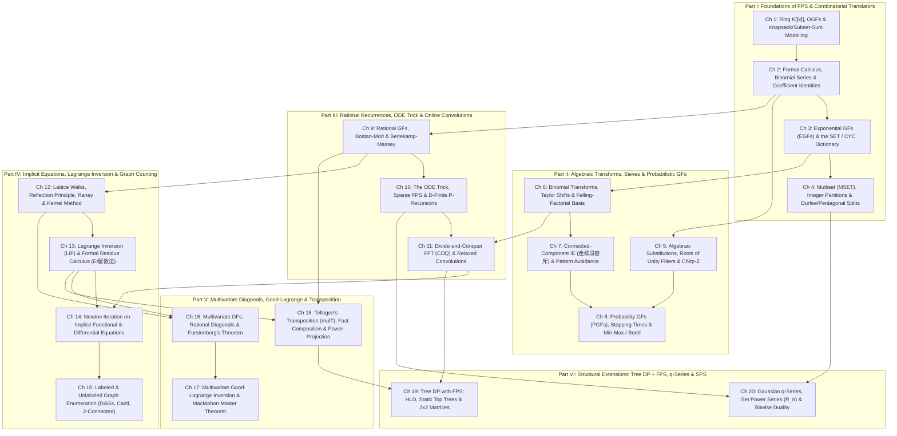

# Phase 1.5 Round 1 Report: Problem Curation & Granular Chapter Architecture

**Role**: `Problem Curation & Assessment Architect` (Phase 1.5 Round 1)  
**Target Repository**: `/home/maomao90/Documents/IO/ICPC-math-notes`  
**Primary Inputs Audited**: [`fps_research/PROBLEM_CURATION.md`](file:///home/maomao90/Documents/IO/ICPC-math-notes/fps_research/PROBLEM_CURATION.md), [`fps_research/PLAN.md`](file:///home/maomao90/Documents/IO/ICPC-math-notes/fps_research/PLAN.md), [`AGENTS.md`](file:///home/maomao90/Documents/IO/ICPC-math-notes/AGENTS.md), and Cohort 3 Wave Synthesis Files (`Wave 1A` through `Wave 5B`).

---

## 1. Executive Summary & Pedagogical Critique of the 10-Wave Research Structure

While the 10 Cohort 3 research waves (`Wave 1A` through `Wave 5B`) successfully gathered and deduplicated **254 unique non-template contest problems** and isolated **67 pure-template / library-checker exercises**, a research collection wave is **not** a textbook chapter. Auditing [`fps_research/PROBLEM_CURATION.md`](file:///home/maomao90/Documents/IO/ICPC-math-notes/fps_research/PROBLEM_CURATION.md) against our core pedagogical mandate (**Zero Magic Steps** and **Granular Single-Theme Progression**) reveals four structural defects in the 10-wave problem organization that must be resolved before Phase 2 authoring begins:

1. **Overloaded Catch-All Waves Dilute Diagnostic Signals**:
   - **Wave 2B** simultaneously packs (a) Binomial/Stirling exact-$k$ sieve, (b) Connected-Component & Adjacent-Pair Inclusion-Exclusion (`连续段容斥`), (c) Goulden–Jackson string cluster method, (d) Probability Generating Functions (PGFs), stopping times, and Markov potentials, and (e) Chinese/Japanese regional audit problems. A single 12-problem ladder (`2B-1` to `2B-12`) gives only 1–2 problems to each paradigm, preventing a smooth `Stepping Stone` $\to$ `Mastery` ramp within any single topic.
   - **Wave 3A & Wave 3B** interleave univariate Lagrange Inversion (LIF), formal residues (`EI 留数法`), Pólya unlabeled trees, logarithmic Newton iteration on functional equations, first-order nonlinear ODEs, and labeled graph families (DAGs, Eulerian, bipartite, cacti, 2-connected, 2-edge-connected).
   - **Wave 4A & Wave 4B** mix 1D rational recurrences (Bostan–Mori, Berlekamp–Massey) with 2D/3D multivariate diagonals, Furstenberg's theorem, the Kernel Method on bounded strips, and multivariate Good–Lagrange inversion.
   - **Wave 5A** conflates the $O(NK)$ Differential Equation (ODE) Trick on sparse polynomials and D-finite P-recursions with algorithmic divide-and-conquer / online relaxed convolutions (CDQ FFT).
   - **Wave 5B** bundles five distinct advanced frameworks into a single 12-problem ladder: Tellegen's transposition (`mulT`) & sampling shifts, Kinoshita–Li $O(N\log^2 N)$ fast composition/power projection, Tree DP + FPS (`HLD` / Static Top Trees), Gaussian $q$-series, and Set Power Series ($\mathcal{R}_n$).
2. **Artificial Regional Audit Buckets (`[ZH]` / `[JA]`)**:
   - In Waves 2B and 3B, Chinese (`集训队互测`, `NOI`, `CTSC`, `WC`) and Japanese (`AtCoder AGC/ABC Ex`, `yukicoder`) problems were collected under regional audit headers. In a canonical textbook, problems must be grouped by **mathematical mechanism** (e.g., placing `UOJ #450 复读机` in Roots of Unity Filters + Borel Transform, `Luogu P4548 歌唱王国` in PGF Stopping Times, and `yukicoder 963` in CDQ FFT on Differential Equations), completely dissolving regional buckets.
3. **16 Concrete Forward-Reference Traps in Existing Wave Ladders & Checkpoints**:
   - Several problems placed in early waves (`1A`, `1B`, `2B`, `3A`) secretly require techniques taught only in later waves (`EGFs`, `Newton Iteration`, `Bostan–Mori`, `Lagrange Inversion`, or `Formal Residues`), violating our **Zero Magic Steps** rule. Conversely, several elementary problems placed in late waves (`3B`, `4B`, `5B`) belong in foundational chapters.
4. **Accountability Across All 254 Accepted Non-Template Problems**:
   - With **20 granular chapters** across **6 Parts**, we can assign **8 core ladder problems per chapter** (`2 Stepping Stone`, `2 Intermediate`, `2 Advanced`, `2 Mastery` = **160 Primary Ladder Problems**), **40 Blind Checkpoint Problems** across **6 Part-Level Diagnostic Checkpoints** (`6–7` per Part, strictly obeying cumulative prerequisites), and **54 Annotated Archive & Revisited Problems** mapped to exact chapters and difficulty tiers (`160 + 40 + 54 = 254` unique non-template problems), while keeping all **67 Rejected Template Problems** quarantined as 1-line implementation verification footnotes.

---

## 2. Complete Forward-Reference Trap & Misplacement Audit (`16 Fixes`)

Every problem in a chapter's 4-tier ladder and every problem in a Part's Blind Checkpoint must be 100% solvable using **only** the mathematical rings, operators, and algorithms developed up to that chapter. Below is our exhaustive audit of the 16 forward-reference traps and structural misplacements in the existing 10-wave ladders:

| # | Problem ID & Title | Old Wave Slot | Prerequisite Violation / Misplacement Diagnosis | New Canonical Home Chapter & Tier |
| :-: | :--- | :---: | :--- | :--- |
| **F-01** | **AtCoder `fps_24_e`** — *Sequence* | `1A-8` (Wave 1A) | **Forward-Reference Trap**: Wave 1A is OGF-only (`SEQ`, `MSET`, partitions), before EGFs $\sum a_n \frac{x^n}{n!}$ are formally motivated in Wave 1B. `fps_24_e` requires EGF multiplication capped at multiplicity $c \le m$. | **Ch 3 (`EGFs & SET/CYC`)** — `Stepping Stone` (`3-2`) |
| **F-02** | **AtCoder ABC 298 Ex** — *Sum of Min of Length* | `1A-10` (Wave 1A) | **Forward-Reference Trap**: Placed in Wave 1A, but the tree-centroid / degree-lowering generating function reduction requires **Bostan–Mori** rational coefficient extraction or **Lagrange Inversion**, neither of which exists in Part I! | **Ch 9 (`Rational GFs & Bostan–Mori`)** — `Mastery` (`9-8`) |
| **F-03** | **AtCoder ARC 154 E** — *Reverse and Inversion* | `1B-8` (Wave 1B) | **Misplaced Paradigm**: Placed in Wave 1B (EGFs), but the core reduction is **linearity of expectation + symmetric center-of-mass invariant** after $K$ random interval reversals, decoupling into a 1D binomial/EGF shift. Better placed after binomial transforms & expectation operators. | **Ch 6 (`Binomial Transforms & Taylor Shifts`)** — `Advanced` (`6-6`) |
| **F-04** | **Codeforces 1548C** — *The Three Little Pigs* | `2B-3` (Wave 2B) | **Misplaced Paradigm**: Placed in Wave 2B (IE/PGF), whereas $\sum_{j=0}^{n-1}\binom{3j+r}{x} = [t^x]\frac{(1+t)^r((1+t)^{3n}-1)}{(1+t)^3-1}$ is the archetypal **closed-form geometric sum of $(1+t)^{3j}$ + $O(N)$ rational polynomial division**! | **Ch 2 (`Formal Calculus & Binomial Sums`)** — `Intermediate` (`2-4`) |
| **F-05** | **Luogu P4491** — *`[HAOI2018]` 染色* | `2B-4` (Wave 2B) | **Topic Overload**: Placed in the catch-all Wave 2B ladder; its core mechanism is **EGF $\frac{(e^x - x^{S-1}/(S-1)!)^k}{k!}$ + Binomial Inversion as Taylor Shift $A(x) = G(x-1)$**, which belongs in the dedicated Binomial Transform & Taylor Shift chapter. | **Ch 6 (`Binomial Transforms & Taylor Shifts`)** — `Intermediate` (`6-4`) |
| **F-06** | **Luogu P4548** — *`[CTSC2006]` 歌唱王国* | `1A/1B` & `2B-7` | **Forward-Reference Trap in 1A/1B**: Appeared in Wave 1A and 1B practice lists before PGFs, $F(x)+(1-x)G(x)=1$, and differentiation at $x=1$ were taught. Must live strictly in the dedicated **PGF & Stopping Times** chapter. | **Ch 8 (`PGFs, Stopping Times & Borel`)** — `Intermediate` (`8-4`) |
| **F-07** | **Luogu P5434** — *有标号荒漠计数 (Deserts)* | `3A-8` (Wave 3A) | **Forward-Reference Trap**: Placed in Wave 3A (`3A-8`), which asks for *all* $n = 1, \dots, N$ ($N \le 10^5$). Univariate LIF only extracts a *single* $[x^n]T(x)$ in $O(n \log n)$; computing all $N$ coefficients of $T(x) = x\exp(\frac{2T-T^2}{2(1-T)})$ in $O(N \log N)$ requires **Newton Iteration on Implicit Functional Equations** (Wave 3B)! | **Ch 15 (`Labeled Graph Enumeration`)** — `Intermediate` (`15-4`) *(placed after Ch 14 Newton Iteration!)* |
| **F-08** | **Luogu P5827 & P5828** — *点双/边双连通图计数* | `3A-9` (Wave 3A) | **Ordering Dependency**: Biconnected and 2-edge-connected labeled graph enumeration requires both **Logarithmic Newton Iteration** (to precompute connected graphs $C(x)$ and rooted trees $T(x)$) and **Universal Extended Lagrange Inversion** (`revert`). Placing Graph Enumeration (Ch 15) *after* LIF (Ch 13) and Newton Iteration (Ch 14) eliminates this dependency cycle! | **Ch 15 (`Labeled Graph Enumeration`)** — `Mastery` (`15-7`) |
| **F-09** | **Codeforces 1349F2** — *Slime and Sequences (Hard)* | `3A-10` (Wave 3A) | **Forward-Reference Trap in 2B**: Appeared in Wave 2B before formal residue calculus $\operatorname{Res}_u$ and L'Hôpital's rule at double poles $(1-u)^2$ were introduced. Assigned as the capstone `Mastery` problem of **Ch 13 (`Lagrange Inversion & Formal Residues`)**. | **Ch 13 (`Lagrange Inversion & Formal Residues`)** — `Mastery` (`13-8`) |
| **F-10** | **AtCoder `fps_24_f`** — *Coloring* | `3B-1` (Wave 3B) | **Severe Misplacement**: Placed as `3B-1` in Wave 3B (Implicit Equations & Newton Iteration), even though its solution is a 1-line **parity EGF hyperbolic product** $n![x^n]\sinh(x)\cosh(x)\exp(x) = \frac{4^n - 2^n}{4}$ requiring zero implicit equations! | **Ch 5 (`Substitutions, Roots of Unity & CZT`)** — `Stepping Stone` (`5-1`) |
| **F-11** | **Luogu P6633** — *`[ZJOI2020]` 抽卡* | `3B-5` (Wave 3B) | **Misplaced Paradigm**: Placed in Wave 3B (`[ZH]` audit bucket), but it involves **contiguous-run PGF / Min-Max expectation + D&C NTT product tree**, with zero implicit functional equations or Newton iteration. | **Ch 8 (`PGFs, Stopping Times & Borel`)** — `Advanced` (`8-5`) |
| **F-12** | **Codeforces 1109D** — *Sasha and Interesting Fact* | `4B-1` (Wave 4B) | **Severe Misplacement**: Placed as `4B-1` in Wave 4B (Furstenberg & Good–Lagrange), despite being a purely univariate **Generalized Cayley Forest Formula** $k n^{n-k-1}$ + Stars-and-Bars sum that belongs in Part I! | **Ch 3 (`EGFs & SET/CYC`)** — `Intermediate` (`3-4`) |
| **F-13** | **Codeforces 923E** — *Perpetual Subtraction* | `5B-2` (Wave 5B) | **Misplaced Paradigm**: Placed in Wave 5B, whereas diagonalizing the transition matrix $M_{i,j} = \frac{1}{j+1}[i \le j]$ via $P(x) \mapsto P(x-1)$ (eigenfunctions $(x-1)^k$ with eigenvalue $\frac{1}{k+1}$) requires **only** polynomial Taylor shift! | **Ch 6 (`Binomial Transforms & Taylor Shifts`)** — `Mastery` (`6-7`) |
| **F-14** | **Codeforces 995F** — *Cowmpany Cowmpensation* | `5B-3` (Wave 5B) | **Misplaced Paradigm**: Placed in Wave 5B, whereas evaluating a degree-$N$ polynomial DP on a tree at $D \le 10^9$ via consecutive-integer Lagrange interpolation $\prod_{j \ne i}\frac{D-j}{i-j}$ is an $O(N^2)$ tree knapsack + $O(N)$ interpolation problem. | **Ch 6 (`Binomial Transforms & Taylor Shifts`)** — `Stepping Stone` (`6-2`) |
| **F-15** | **Codeforces 917D** — *Stranger Trees* | `CP3-8` (Post-Wave 3) | **Checkpoint Prerequisite Alignment**: Uses combinatorial component-size product $\prod s_i$ (tree DP) + exact-$k$ Taylor shift $A(x) = G(x-1)$. Placed in **Ch 6** (`Mastery` `6-8`) once EGFs/Cayley (Ch 3) and Taylor shift (Ch 6) are both established. | **Ch 6 (`Binomial Transforms & Taylor Shifts`)** — `Mastery` (`6-8`) |
| **F-16** | **Codeforces 1336E2** — *Chiori and Doll Picking (Hard)* | `CP4-5` (Post-Wave 4) | **Forward-Reference Trap in Checkpoint 4**: Uses XOR FWT MacWilliams duality on dual subspace $V^\perp$ + Krawtchouk polynomials $[x^c](1-x)^d(1+x)^{m-d}$, which was only covered in Wave 5B (Set Power Series / Bitwise Duality) yet appeared in Checkpoint 4! Moved to **Part VI (Ch 20 / Checkpoint VI)**. | **Ch 20 (`Gaussian q-Series & Set Power Series`)** — `Mastery` (`20-8`) |

---

## 3. Canonical 6-Part / 20-Chapter Textbook Architecture & Prerequisite DAG

To eliminate every catch-all chapter and ensure each mathematical concept has a dedicated narrative, diagnostic signal table, reverse-engineering scratchpad, and 8-problem 4-tier ladder, we partition the textbook into **6 Parts** and **20 Granular Chapters**:

### 3.1 Master Chapter-by-Chapter Problem Allocation Summary (`254 Accepted + 67 Quarantined`)

| Part | Chapter | Core Mathematical Theme | Primary 4-Tier Ladder (`SS`/`Int`/`Adv`/`Mas`) | Blind Checkpoint Allocation | Annotated Archive Problems | Total Unique Accepted |
| :---: | :--- | :--- | :---: | :---: | :---: | :---: |
| **I** | **Ch 1** | Ring $K[[x]]$, OGFs, `SEQ`, Knapsack & Sliding-Window Rollback | `8` (`2/2/2/2`) | **Checkpoint I**: `7` problems (`CP1-1` to `CP1-7`) | `3` | **11** (+CP) |
| **I** | **Ch 2** | Formal Calculus ($D, \int$), $(1-x)^{-\alpha}$, Vandermonde & Prefix/Suffix Sums | `8` (`2/2/2/2`) | *(in CP I)* | `3` | **11** (+CP) |
| **I** | **Ch 3** | EGFs $\sum a_n \frac{x^n}{n!}$, `SET`/`CYC` Dictionary, Stirling & Cayley/Prüfer Basics | `8` (`2/2/2/2`) | *(in CP I)* | `3` | **11** (+CP) |
| **I** | **Ch 4** | `MSET` Euler Transform, Integer Partitions, Durfee Square & Pentagonal Sieve | `8` (`2/2/2/2`) | *(in CP I)* | `3` | **11** (+CP) |
| **II** | **Ch 5** | Substitutions $A(x^k)$, Parity/Roots of Unity Filters & Chirp-Z Transform | `8` (`2/2/2/2`) | **Checkpoint II**: `7` problems (`CP2-1` to `CP2-7`) | `3` | **11** (+CP) |
| **II** | **Ch 6** | Binomial Transforms, Taylor Shift $G(x-1)$, Falling Factorials & Eigen-Shifts | `8` (`2/2/2/2`) | *(in CP II)* | `4` | **12** (+CP) |
| **II** | **Ch 7** | Connected-Component IE (`连续段容斥`), Smirnov Words & Goulden–Jackson | `8` (`2/2/2/2`) | *(in CP II)* | `3` | **11** (+CP) |
| **II** | **Ch 8** | Probability GFs (PGFs), Stopping Times, KMP Renewal, Min-Max IE & Borel | `8` (`2/2/2/2`) | *(in CP II)* | `4` | **12** (+CP) |
| **III** | **Ch 9** | Rational GFs $P(x)/Q(x)$, Bostan–Mori, Berlekamp–Massey & Power Sums | `8` (`2/2/2/2`) | **Checkpoint III**: `6` problems (`CP3-1` to `CP3-6`) | `3` | **11** (+CP) |
| **III** | **Ch 10** | The Differential Equation (ODE) Trick, Sparse FPS $O(NK)$ & D-Finite Recurrences | `8` (`2/2/2/2`) | *(in CP III)* | `3` | **11** (+CP) |
| **III** | **Ch 11** | Divide-and-Conquer FFT (CDQ) & Semi/Fully Relaxed Online Convolutions | `8` (`2/2/2/2`) | *(in CP III)* | `3` | **11** (+CP) |
| **IV** | **Ch 12** | Lattice Walks, Reflection Principle, Raney's Lemma & the Kernel Method | `8` (`2/2/2/2`) | **Checkpoint IV**: `7` problems (`CP4-1` to `CP4-7`) | `3` | **11** (+CP) |
| **IV** | **Ch 13** | Lagrange Inversion Formula (LIF) & Formal Residue Calculus (`EI 留数法`) | `8` (`2/2/2/2`) | *(in CP IV)* | `2` | **10** (+CP) |
| **IV** | **Ch 14** | Newton Iteration on Implicit Functional Equations, Pólya Trees & Nonlinear ODEs | `8` (`2/2/2/2`) | *(in CP IV)* | `2` | **10** (+CP) |
| **IV** | **Ch 15** | Labeled Graph Enumeration: DAGs, Cacti, Biconnected Graphs & Otter's Theorem | `8` (`2/2/2/2`) | *(in CP IV)* | `2` | **10** (+CP) |
| **V** | **Ch 16** | Multivariate GFs, Rational Diagonals & Furstenberg's Algebraic Residue | `8` (`2/2/2/2`) | **Checkpoint V**: `6` problems (`CP5-1` to `CP5-6`) | `2` | **10** (+CP) |
| **V** | **Ch 17** | Multivariate Good–Lagrange Inversion & MacMahon's Master Theorem | `8` (`2/2/2/2`) | *(in CP V)* | `1` | **9** (+CP) |
| **V** | **Ch 18** | Tellegen's Transposition (`mulT`), Sampling Shifts, Fast Composition & Power Projection | `8` (`2/2/2/2`) | *(in CP V)* | `3` | **11** (+CP) |
| **VI** | **Ch 19** | Tree DP with FPS: Heavy-Light Decomposition, Static Top Trees & $2\times 2$ Matrices | `8` (`2/2/2/2`) | **Checkpoint VI**: `7` problems (`CP6-1` to `CP6-7`) | `2` | **10** (+CP) |
| **VI** | **Ch 20** | Gaussian $q$-Series, Set Power Series ($\mathcal{R}_n$), Subset ODEs & MacWilliams Duality | `8` (`2/2/2/2`) | *(in CP VI)* | `2` | **10** (+CP) |
| **All** | **20 Chapters** | **Complete Non-Template Curriculum** | **`160` Problems** | **`40` Problems** | **`54` Problems** | **`254` Unique Problems** |

---

## 4. Granular Per-Chapter 4-Tier Problem Ladders (Parts I & II: Chapters 1–8)

### Part I: Foundations of Formal Power Series & Combinatorial Translators (Chapters 1–4)

#### Chapter 1: The Ring $K[[x]]$, Ordinary Generating Functions, and Knapsack / Subset-Sum Modelling
- **Core Conceptual Scope**: Formal power series ring $K[[x]]$, valuation $\operatorname{ord}(A)$, invertibility criterion $[x^0]A(x) \in K^\times$, Cauchy product, the 3-Question Convolution Litmus Test, `SEQ` operator $(1-A(x))^{-1}$, 0/1 vs. unbounded vs. bounded-multiplicity OGFs $\frac{1-x^{c+1}}{1-x}$, online reversible knapsack (polynomial multiplication/division by $1+x^w$ or $1-x^w$), and basic catalytic binary-tree specifications.

| Slot | Tier | Problem ID & Title | Judge Link | Core Technique & Diagnostic Signal | Key Equation & Prerequisite Audit |
| :-: | :---: | :--- | :--- | :--- | :--- |
| **1-1** | `Stepping Stone` | **AtCoder `fps_24_a`** — *Snack* | [AtCoder](https://atcoder.jp/contests/fps-24/tasks/fps_24_a) | **Ordered Sequence of Allowed Step Weights (`SEQ`)**: Fixed number of steps $N$, total weight $M$, step set $S = \{1, 3, 4, 6\}$. | $[x^M](x + x^3 + x^4 + x^6)^N$. **Prereq Audit**: Pure polynomial power in $K[[x]]$; zero forward references. |
| **1-2** | `Stepping Stone` | **AtCoder ABC 321 F** — *`#(subset sum = K)` with Add and Erase* | [AtCoder](https://atcoder.jp/contests/abc321/tasks/abc321_f) | **Reversible 0/1 Knapsack in $K[[x]]/(x^{K+1})$**: Dynamic item insertion/deletion where order of operations doesn't matter because $K[[x]]$ is a commutative ring. | Multiply by $(1+x^w)$ in $O(K)$; erase by multiplying by $(1+x^w)^{-1} = \sum (-1)^j x^{jw}$ ($d_i \gets d_i - d_{i-w}$ forward sweep). **Prereq Audit**: Ring invertibility only. |
| **1-3** | `Intermediate` | **AtCoder `fps_24_b`** — *Number* | [AtCoder](https://atcoder.jp/contests/fps-24/tasks/fps_24_b) | **Sparse Rational OGF Denominator**: Unbounded coins from $\{1, 2\}$ + bounded coins $\le 1$ and $\le 2$ reduce to a degree-3 denominator. | $F(x) = \frac{(1+x)(1+x+x^2)}{(1-x)(1-x^2)} = \frac{1+x+x^2}{1-x-x^2+x^3}$. **Prereq Audit**: Rational expansion in $K[[x]]$. |
| **1-4** | `Intermediate` | **AtCoder Educational DP Contest M** — *Candies* | [AtCoder](https://atcoder.jp/contests/dp/tasks/dp_m) | **Bounded Multiplicity OGF $\frac{1-x^{a_i+1}}{1-x}$**: $N$ children, $K$ candies, child $i$ gets $\in [0, a_i]$. | $F(x) = \prod_{i=1}^N \frac{1-x^{a_i+1}}{1-x}$ via $O(NK)$ sliding-window numerator $(1-x^{a_i+1})$ + prefix-sum denominator $(1-x)^{-1}$. **Prereq Audit**: Self-contained in Ch 1. |
| **1-5** | `Advanced` | **Codeforces 993E** — *Nikita and Order Statistics* | [CF 993E](https://codeforces.com/problemset/problem/993/E) | **Prefix-Sum Difference Cross-Correlation**: Count subarrays $[l, r]$ with $k$ elements $< X$ via prefix counts $P_r - P_{l-1} = k$. | Reverse $C(x) = \sum c_i x^i$ into $C_{\text{rev}}(x) = x^n C(1/x)$ so difference index $i - j = k$ becomes sum index $i + (n-j) = n+k$. **Prereq Audit**: Basic FFT/NTT convolution. |
| **1-6** | `Advanced` | **AtCoder ABC 235 Ex** — *Painting Weighted Graph* | [AtCoder](https://atcoder.jp/contests/abc235/tasks/abc235_h) | **Kruskal Component Tree + Truncated OGF Convolution**: Painting $\le K$ vertices corresponds to $\min(\text{size}, K)$-truncated OGFs on the MST merge tree. | Merge component OGFs $A(x), B(x) \pmod{x^{K+1}}$; by tree-knapsack amortised analysis, total time is $O(NK)$ or $O(N \log^2 K)$. **Prereq Audit**: Truncated $K[x]/(x^{K+1})$ multiplication. |
| **1-7** | `Mastery` | **Codeforces 438E** — *The Child and Binary Tree* | [CF 438E](https://codeforces.com/problemset/problem/438/E) | **Symbolic Binary Tree Grammar & Rationalized Quadratic Radical**: Root weight $\in C$ + ordered pair of subtrees gives $T(x) = 1 + C(x)T(x)^2$. | Since $[x^0](1 \mp \sqrt{1-4C(x)}) = 0$ for the $-$ branch, rationalize to $T(x) = \frac{2}{1 + \sqrt{1-4C(x)}}$ so the denominator has unit constant term $2 \in K^\times$. **Prereq Audit**: Valuation & `sqrt`/`inv` black-box library call. |
| **1-8** | `Mastery` | **AtCoder `fps_24_r`** — *Random Walk* | [AtCoder](https://atcoder.jp/contests/fps-24/tasks/fps_24_r) | **First-Passage Renewal Decomposition (`SEQ`)**: Decompose any walk on a finite state/automaton into a sequence of primitive excursions between visits. | Express total walk OGF via $(1 - F_{\text{first}}(x))^{-1}$ and extract $[x^N]$ using polynomial inversion. **Prereq Audit**: `SEQ` operator and FPS `inv`. |

---

#### Chapter 2: Formal Calculus, Binomial Series $(1-x)^{-\alpha}$, and Coefficient Extraction Identities
- **Core Conceptual Scope**: Formal derivative $D$, formal integral $\int$, product/quotient/chain rules on $K[[x]]$, generalized binomial series $(1-x)^{-\alpha} = \sum_{n \ge 0} \binom{n+\alpha-1}{n}x^n$, Vandermonde convolution $(1+x)^a(1+x)^b = (1+x)^{a+b}$, negative-binomial identity $[x^n](1-x)^{-a}(1-x)^{-b} = \binom{n+a+b-1}{n}$, prefix-sum operator $(1-x)^{-1}$, suffix/reversed convolution, index-weighted sums via $xD$, and degree-lowering via $D \ln$.

| Slot | Tier | Problem ID & Title | Judge Link | Core Technique & Diagnostic Signal | Key Equation & Prerequisite Audit |
| :-: | :---: | :--- | :--- | :--- | :--- |
| **2-1** | `Stepping Stone` | **AtCoder ARC 110 D** — *Binomial Coefficient is Fun* | [AtCoder](https://atcoder.jp/contests/arc110/tasks/arc110_d) | **Upper-Index Binomial Generating Function**: Sum $\prod_{i=1}^N \binom{B_i}{A_i}$ over $\sum B_i \le M$. | Since $\sum_{B \ge A}\binom{B}{A}x^B = \frac{x^A}{(1-x)^{A+1}}$, multiplying across $i=1\dots N$ and applying prefix-sum $(1-x)^{-1}$ collapses to $[x^M]\frac{x^{\sum A_i}}{(1-x)^{\sum A_i + N + 1}} = \binom{M+N}{\sum A_i + N}$. **Prereq Audit**: Negative binomial identity only. |
| **2-2** | `Stepping Stone` | **Codeforces 785D** — *Anton and School - 2* | [CF 785D](https://codeforces.com/problemset/problem/785/D) | **Vandermonde Identity Eliminates Inner Summation**: Count balanced `(^k )^k` subsequences pivoted at the last `(`. | $\sum_{k \ge 1}\binom{L-1}{k-1}\binom{R}{k} = \sum_{k \ge 1}\binom{L-1}{k-1}\binom{R}{R-k} = [x^{R-1}](1+x)^{L-1}(1+x)^R = \binom{L+R-1}{R-1}$. **Prereq Audit**: Vandermonde convolution. |
| **2-3** | `Intermediate` | **AtCoder ABC 290 Ex** — *Bow Meow Optimization* | [AtCoder](https://atcoder.jp/contests/abc290/tasks/abc290_h) | **Degree-Lowering via Formal Derivative / Convolution**: Convex/symmetric cost profile on $N$ cats and $M$ dogs reduces to polynomial convolution + index-weighted terms. | Express incremental cost via $x D$ and polynomial products in $O((N+M)\log(N+M))$. **Prereq Audit**: Formal derivative $xD$ and NTT. |
| **2-4** | `Intermediate` | **Codeforces 1548C** — *The Three Little Pigs* | [CF 1548C](https://codeforces.com/problemset/problem/1548/C) | **Geometric Series of Binomial Generators + $O(N)$ Long Division**: Answer $Q$ queries for $\sum_{j=0}^{n-1}\binom{3j+r}{x}$ ($r \in \{0,1,2\}$). | $\sum_{j=0}^{n-1}(1+t)^{3j+r} = (1+t)^r \frac{(1+t)^{3n}-1}{(1+t)^3-1} = (1+t)^r \frac{(1+t)^{3n}-1}{t^3+3t^2+3t}$. Divide numerator by $t(t^2+3t+3)$ in $O(n)$ total time! **Prereq Audit**: Moved from `2B-3` (`F-04`); uses only Ch 1–2 tools. |
| **2-5** | `Advanced` | **AtCoder AGC 001 E** — *BBQ Hard* | [AtCoder](https://atcoder.jp/contests/agc001/tasks/agc001_e) | **2D Vandermonde / Lattice Translation Eliminates $O(N^2)$ Pairwise Sums**: Compute $\sum_{i < j}\binom{A_i+B_i+A_j+B_j}{A_i+A_j}$ for $N \le 2\cdot 10^5$, $A_i, B_i \le 2000$. | Interpret $[x^{A_i+A_j}y^{B_i+B_j}](1+x+y)^{\dots}$ as lattice paths from $(-A_i, -B_i)$ to $(A_j, B_j)$ and accumulate all sources simultaneously on a $4001 \times 4001$ grid in $O(N + (\max A)(\max B))$. **Prereq Audit**: Binomial path translation. |
| **2-6** | `Advanced` | **AtCoder ABC 276 G** — *Count Sequences* | [AtCoder](https://atcoder.jp/contests/abc276/tasks/abc276_g) | **Difference-Variable Change & $(1+x+x^2)^{N-1}(1-x^3)^{-(N+1)}$**: Count $0 \le a_1 \le \dots \le a_N \le M$ with $a_i \not\equiv a_{i+1} \pmod 3$ ($N, M \le 10^7$). | Write $d_i = a_{i+1}-a_i = 3q_i + r_i$ ($r_i \in \{1,2\}$). Extract $[x^M]\frac{x^{N-1}(1+x)^{N-1}(1+x+x^2)}{(1-x^3)^{N+1}}$ in $O(N+M)$ without NTT! **Prereq Audit**: Binomial + negative binomial expansion. |
| **2-7** | `Mastery` | **AtCoder AGC 005 F** — *Many Easy Problems* | [AtCoder](https://atcoder.jp/contests/agc005/tasks/agc005_f) | **Reversed Binomial Convolution (`Archetype 2`)**: Vertex $v$ belongs to Steiner tree of $k$-subset iff all $k$ vertices don't fall in one branch of $v$, giving $\sum_{s=k}^N c_s \binom{s}{k}$. | Rewrite $\sum_{s=k}^N (c_s s!)\frac{1}{(s-k)!} = k![x^k]\left(\sum c_s s! x^s\right)\left(\sum \frac{x^{-j}}{j!}\right)$ via index reversal $s \mapsto N-s$ and 1 NTT $\bmod 924844033$. **Prereq Audit**: Reversed Cauchy product. |
| **2-8** | `Mastery` | **Luogu P4705** — *玩游戏 (Playing Games)* | [Luogu](https://www.luogu.com.cn/problem/P4705) | **Logarithmic Derivative Power Sums $n - \frac{x Q'(x)}{Q(x)}$**: Compute $\frac{1}{nm}\sum_{i,j}(a_i+b_j)^k$ for all $k=1\dots t$ ($n,m,t \le 10^5$). | Expand $\frac{(a_i+b_j)^k}{k!} = \sum_{p+q=k}\frac{a_i^p}{p!}\frac{b_j^q}{q!}$. Compute $S_p(A) = \sum_{i=1}^n a_i^p$ for all $p$ simultaneously from $Q(x) = \prod_{i=1}^n (1-a_i x)$ via $\sum_{p \ge 0}S_p x^p = n - \frac{x Q'(x)}{Q(x)}$ using D&C NTT + `ln`/`inv`. **Prereq Audit**: Formal calculus $D \ln Q(x)$. |

---

#### Chapter 3: Exponential Generating Functions (EGFs) and the `SET` / `CYC` Dictionary
- **Core Conceptual Scope**: Labeled combinatorial objects, relabeling binomial product $\binom{n}{k} = \frac{n!}{k!(n-k)!}$ motivating EGFs $\widehat{A}(x) = \sum a_n \frac{x^n}{n!}$, labeled `SEQ` $(1-\widehat{A})^{-1}$, `SET` $\exp(\widehat{A})$, `CYC` $\ln\frac{1}{1-\widehat{A}}$, the Exponential Formula $\widehat{G}(x) = \exp(\widehat{C}(x)) \iff \widehat{C}(x) = \ln \widehat{G}(x)$, restricted cycle/component sizes, Stirling numbers of the 1st and 2nd kinds via EGFs $\frac{1}{k!}(\ln\frac{1}{1-x})^k$ and $\frac{1}{k!}(e^x-1)^k$, and Prüfer sequences / Cayley's tree & forest formulas via multinomial EGFs.
- **Implementation Verification Footnotes**: `R-12` (`Luogu P4725 / log_of_formal_power_series`), `R-13` (`Luogu P4726 / exp_of_formal_power_series`), `R-14` (`Luogu P5245 / pow_of_formal_power_series`), `R-24` (`Luogu P5748 / bell_number`), `R-37` (`Luogu P6086 / Prufer`).

| Slot | Tier | Problem ID & Title | Judge Link | Core Technique & Diagnostic Signal | Key Equation & Prerequisite Audit |
| :-: | :---: | :--- | :--- | :--- | :--- |
| **3-1** | `Stepping Stone` | **AtCoder `fps_24_d`** — *Sequence 2* | [AtCoder](https://atcoder.jp/contests/fps-24/tasks/fps_24_d) | **Surjective / Ordered Partition EGF (`SEQ(SET_{\ge 1})`)**: Count sequences or equivalence relations on $N$ labeled elements. | Extract $N![x^N]$ from EGF composition of `SEQ` and `SET_{\ge 1}(x) = e^x - 1$. **Prereq Audit**: Direct EGF `SET`/`SEQ` dictionary. |
| **3-2** | `Stepping Stone` | **AtCoder `fps_24_e`** — *Sequence* | [AtCoder](https://atcoder.jp/contests/fps-24/tasks/fps_24_e) | **Bounded-Multiplicity Labeled Sequence EGF**: Count sequences of length $N$ from values $1\dots M$ where value $k$ appears $\le k$ times. | $N![x^N]\prod_{k=1}^M \left(\sum_{c=0}^k \frac{x^c}{c!}\right)$ computed in $O(NM + N^2)$ via truncated EGF multiplication. **Prereq Audit**: Moved from `1A-8` (`F-01`) so EGFs are already defined! |
| **3-3** | `Intermediate` | **AtCoder `fps_24_l`** — *Permutation 2* | [AtCoder](https://atcoder.jp/contests/fps-24/tasks/fps_24_l) | **Restricted Permutation Cycle Decomposition (`SET(CYC_S)`)**: Count permutations of $\{1,\dots,N\}$ whose cycle lengths all lie in $S$. | Permutations are disjoint sets of directed cycles: $P_S(x) = \exp\!\left(\sum_{k \in S}\frac{x^k}{k}\right)$. Extract $N![x^N]P_S(x)$ via FPS `exp`. **Prereq Audit**: `SET` + `CYC` dictionary. |
| **3-4** | `Intermediate` | **Codeforces 1109D** — *Sasha and Interesting Fact in Graph Theory* | [CF 1109D](https://codeforces.com/problemset/problem/1109/D) | **Generalized Cayley Forest Formula**: Count weighted trees on $n$ vertices where distance between $a$ and $b$ is $m$. | Fix path of $k$ edges between $a$ and $b$: $\binom{n-2}{k-1}(k-1)!$ ways to label internal path vertices, $\binom{m-1}{k-1}$ edge weights on path, $m^{n-1-k}$ other edge weights, and $k n^{n-k-1}$ forests rooted on the $k$ path vertices. **Prereq Audit**: Moved from `4B-1` (`F-12`). |
| **3-5** | `Advanced` | **Luogu P5219** — *无聊的水题 I (Bounded Max-Degree Labeled Trees)* | [Luogu](https://www.luogu.com.cn/problem/P5219) | **Prüfer Code Multinomial EGF + Exact-Max Difference**: Count labeled trees on $n$ vertices with maximum degree *exactly* $m$. | In a Prüfer code of length $n-2$, vertex $v$ appears $d_v - 1$ times: $T_{\le m}(n) = (n-2)![x^{n-2}]\left(\sum_{j=0}^{m-1}\frac{x^j}{j!}\right)^n$. Compute $T_{\le m}(n) - T_{\le m-1}(n)$ via polynomial `ln`/`exp`. **Prereq Audit**: Prüfer bijection + EGF power. |
| **3-6** | `Advanced` | **Luogu P4841 / `fps_24_m`** — *城市规划 (Connected Labeled Graphs)* | [Luogu](https://www.luogu.com.cn/problem/P4841) | **Exponential Formula Inversion $\widehat{C}(x) = \ln \widehat{G}(x)$**: Count connected labeled simple graphs on $n$ vertices ($n \le 1.3\cdot 10^5$). | Total labeled graphs have EGF $\widehat{G}(x) = \sum_{n \ge 0} 2^{\binom{n}{2}}\frac{x^n}{n!}$. Connected graphs have EGF $\widehat{C}(x) = \ln \widehat{G}(x)$ in $O(n \log n)$. **Prereq Audit**: `SET` inversion via FPS `ln`. |
| **3-7** | `Mastery` | **Codeforces 623E** — *Transforming Sequence* | [CF 623E](https://codeforces.com/problemset/problem/623/E) | **Twisted Exponential Doubling $F_{a+b}(x) = F_a(2^b x)F_b(x)$ + MTT**: Count sequences $a_1, \dots, a_n$ ($n \le 10^{18}, k \le 3\cdot 10^4$) where each step introduces $\ge 1$ new bit among $k$ bits. | Return $0$ if $n > k$. Otherwise $f_n(m) = m![x^m]\prod_{i=0}^{n-1}(e^{2^i x}-1)$ via binary exponentiation with exponential scaling $x \mapsto 2^b x$ and 3-prime NTT $\bmod (10^9+7)$. **Prereq Audit**: EGF relabeling + NTT. |
| **3-8** | `Mastery` | **AtCoder `fps_24_k`** — *Permutation (Indecomposable Permutations)* | [AtCoder](https://atcoder.jp/contests/fps-24/tasks/fps_24_k) | **Non-Exponential `SEQ` Inversion on Factorial OGF**: Count permutations $P$ of $\{1,\dots,N\}$ with no proper prefix mapping to $\{1,\dots,k\}$. | Every permutation decomposes uniquely into a `SEQ` of minimal prefix-closed blocks: $F(x) = \sum_{n \ge 0}n!x^n = \frac{1}{1 - I(x)} \implies I(x) = 1 - F(x)^{-1}$. **Prereq Audit**: Contrasts `SEQ` vs. `SET` on $K[[x]]$. |

---

#### Chapter 4: Multiset (`MSET`) Construction, Integer Partitions, and Pentagonal / Durfee Decompositions
- **Core Conceptual Scope**: Unlabeled multisets `MSET`, the Euler Transform $\prod_{k \ge 1}(1-x^k)^{-a_k} = \exp\!\left(\sum_{k \ge 1} a_k \sum_{j \ge 1}\frac{x^{jk}}{j}\right)$ and $O(N \log N)$ harmonic sieve, Inverse Euler Transform (recovering generator weights $a_k$ via $\ln$ + Möbius inversion), Ferrers diagrams, conjugation duality (parts $\le K$ $\leftrightarrow$ max part $\le K$), Durfee square & $\sqrt{N}$ light/heavy item decomposition, and Euler's Pentagonal Number Theorem $\prod_{k \ge 1}(1-x^k) = \sum_{m \in \mathbb{Z}}(-1)^m x^{m(3m-1)/2}$.
- **Implementation Verification Footnotes**: `R-25` (`Library Checker partition_function`).

| Slot | Tier | Problem ID & Title | Judge Link | Core Technique & Diagnostic Signal | Key Equation & Prerequisite Audit |
| :-: | :---: | :--- | :--- | :--- | :--- |
| **4-1** | `Stepping Stone` | **AtCoder `fps_24_c`** — *Sequence 3* | [AtCoder](https://atcoder.jp/contests/fps-24/tasks/fps_24_c) | **Ferrers Conjugation / Bounded Difference Partition**: Count non-decreasing sequences of length $N$ in $[0, M]$ with bounded step differences. | Map difference variables $d_i = A_{i+1}-A_i$ to a rational partition OGF and extract $[x^M]$. **Prereq Audit**: Basic partition OGF. |
| **4-2** | `Stepping Stone` | **Luogu P4389** — *付公主的背包 (Princess Fu's Knapsack)* | [Luogu](https://www.luogu.com.cn/problem/P4389) | **Harmonic $\ln$-$\exp$ Unbounded Knapsack**: $n \le 10^5$ item types of volumes $v_i \le m \le 10^5$; output ways to fill volume $1\dots m$. | Group items by volume $c_v$: $\ln P(x) = \sum_{v=1}^m c_v \sum_{k=1}^{\lfloor m/v\rfloor}\frac{x^{kv}}{k}$ in $O(m \log m)$ harmonic time, then $P(x) = \exp(\ln P(x))$. **Prereq Audit**: Euler transform + FPS `exp`. |
| **4-3** | `Intermediate` | **Luogu P6189** — *`[NOI Online #1 入门组]` 跑步* | [Luogu](https://www.luogu.com.cn/problem/P6189) | **$\sqrt{N}$ Heavy/Light Partition Split (`根号分治`)**: Compute unrestricted partition $p(n) \bmod P$ for $n \le 10^5$ without NTT (arbitrary modulus $P$). | Split parts at $B = \lfloor\sqrt{n}\rfloor$: parts $< B$ via $O(n\sqrt{n})$ unbounded knapsack DP; parts $\ge B$ (at most $\sqrt{n}$ parts) via $O(n\sqrt{n})$ Ferrers transpose DP $g(i,j) = g(i-1, j-B) + g(i, j-i)$. **Prereq Audit**: Ferrers diagrams. |
| **4-4** | `Intermediate` | **LOJ #6089** — *小 Y 的背包计数问题* | [LOJ #6089](https://loj.ac/p/6089) | **Bounded Knapsack where Item $i$ Has Weight $i$ and Count $i$ ($n \le 10^5$)**: Notice for $i > \sqrt{n}$, the count cap $i$ can never be exceeded! | For $i \le \sqrt{n}$, run bounded knapsack with sliding-window factor $\frac{1-x^{i(i+1)}}{1-x^i}$; for $i > \sqrt{n}$, run unrestricted heavy-part Ferrers transpose DP in $O(n\sqrt{n})$. **Prereq Audit**: Ch 1 sliding window + Ch 4 Ferrers split. |
| **4-5** | `Advanced` | **LOJ #6268** — *分拆数 (Partition Function via Pentagonal Inversion)* | [LOJ #6268](https://loj.ac/p/6268) | **Euler's Pentagonal Number Theorem + FPS `inv`**: Compute $p(1), \dots, p(n) \pmod{998244353}$ for $n \le 10^5$ in $O(n \log n)$. | Construct the $O(\sqrt{n})$-sparse denominator $\phi(x) = \sum_{m \in \mathbb{Z}}(-1)^m x^{m(3m-1)/2} \pmod{x^{n+1}}$ and compute $\phi(x)^{-1}$. **Prereq Audit**: Pentagonal Number Theorem + FPS `inv`. |
| **4-6** | `Advanced` | **AtCoder ABC 279 Ex** — *Sum of Prod of Min* | [AtCoder](https://atcoder.jp/contests/abc279/tasks/abc279_h) | **Slack Decomposition + Pentagonal Number Sieve in $O(N + \sqrt{M})$**: Sum $\prod_{i=1}^N \min(A_i, B_i)$ over $\sum A_i = S, \sum B_i = T$ ($N \le 10^6, S, T \le 2N$). | Since $\sum_{a,b \ge 1}\min(a,b)x^{a-1}y^{b-1} = \frac{1}{(1-x)(1-y)(1-xy)}$, setting $y=1$ / bounding slack reduces to $[x^{T-N}]\frac{\phi(x)}{\dots}$ evaluated in $O(\sqrt{T-N})$ via Pentagonal numbers! **Prereq Audit**: Negative binomial + Pentagonal sieve. |
| **4-7** | `Mastery` | **LOJ #6503** — *`[雅礼集训 2018 Day4]` Magic* | [LOJ #6503](https://loj.ac/p/6503) | **Ferrers Conjugate / $\sqrt{N}$ Block Product + D&C NTT**: Count color configurations or partitions with multiplicity constraints. | Combine per-color EGF/OGF transitions via binary-tree divide-and-conquer NTT in $O(N \log^2 N)$. **Prereq Audit**: Ch 1–4 tools. |
| **4-8** | `Mastery` | **Luogu P3784 / BZOJ 4919** — *`[SDOI2017]` 遗忘的集合 (Forgotten Set)* | [Luogu](https://www.luogu.com.cn/problem/P3784) | **Inverse Euler Transform via $\ln$ + Möbius Inversion**: Given the subset-sum / multiset-sum polynomial $F(x) = \prod_{k=1}^n (1-x^k)^{-a_k} \pmod{x^{n+1}}$ ($a_k \in \{0,1\}$), reconstruct the hidden generator set $S = \{k \mid a_k = 1\}$! | Take $L(x) = x \frac{d}{dx}\ln F(x) = \sum_{m=1}^n \left(\sum_{d \mid m} d \cdot a_d\right)x^m$, then recover $d \cdot a_d$ via Möbius inversion $\mu(m/d)$ in $O(n \log n)$! **Prereq Audit**: Formal $\ln$, $xD$, and harmonic divisor sieve. |

---

### Part II: Algebraic Transforms, Inclusion-Exclusion, and Probability Generating Functions (Chapters 5–8)

#### Chapter 5: Algebraic Substitutions, Roots of Unity Filters, and Chirp-Z Transforms
- **Core Conceptual Scope**: Monomial dilation $A(x^k)$, parity decomposition $A_{\text{even}}(x) = \frac{A(x)+A(-x)}{2}$ and hyperbolic EGFs $\cosh(x) = \frac{e^x+e^{-x}}{2}, \sinh(x) = \frac{e^x-e^{-x}}{2}$, the Roots of Unity Filter $\sum_{n \equiv r \pmod k} a_n x^n = \frac{1}{k}\sum_{j=0}^{k-1}\omega_k^{-jr}A(\omega_k^j x)$, cyclic polynomial exponentiation $\bmod (x^k - 1)$, Bluestein's identity $ij = \binom{i+j}{2} - \binom{i}{2} - \binom{j}{2}$ (or $\binom{i}{2} + \binom{j}{2} - \binom{i-j}{2}$), and the Chirp-Z Transform (CZT) for multipoint evaluation on geometric progressions $P(a c^k)$.
- **Implementation Verification Footnotes**: `R-31` (`Luogu P6800 / multipoint_evaluation_on_geometric_sequence`).

| Slot | Tier | Problem ID & Title | Judge Link | Core Technique & Diagnostic Signal | Key Equation & Prerequisite Audit |
| :-: | :---: | :--- | :--- | :--- | :--- |
| **5-1** | `Stepping Stone` | **AtCoder `fps_24_f`** — *Coloring* | [AtCoder](https://atcoder.jp/contests/fps-24/tasks/fps_24_f) | **Hyperbolic Parity EGFs $\sinh(x)\cosh(x)$**: Color $N$ labeled cells with 4 colors where Color 1 appears an odd number of times and Color 2 an even number of times. | $N![x^N]\left(\frac{e^x-e^{-x}}{2}\right)\left(\frac{e^x+e^{-x}}{2}\right)e^{2x} = N![x^N]\frac{e^{4x}-e^{2x}}{4} = \frac{4^N - 2^N}{4}$. **Prereq Audit**: Moved from `3B-1` (`F-10`) to its proper home as Ch 5's opening Stepping Stone! |
| **5-2** | `Stepping Stone` | **AtCoder ABC 267 Ex** — *Odd Sum* | [AtCoder](https://atcoder.jp/contests/abc267/tasks/abc267_h) | **Parity Filter $y \in \{+1, -1\}$ + D&C NTT**: Count subsets of $A_1, \dots, A_N \le 10$ with *odd* cardinality and sum $M$. | Extract $[x^M]\frac{P(x, 1) - P(x, -1)}{2}$ where $P(x, \pm 1) = \prod_{i=1}^N (1 \pm x^{A_i})$ is computed via binary-tree D&C NTT in $O(S \log^2 N)$. **Prereq Audit**: 2nd-root-of-unity filter. |
| **5-3** | `Intermediate` | **Luogu P3702** — *`[SDOI2017]` 序列计数* | [Luogu](https://www.luogu.com.cn/problem/P3702) | **Cyclic Convolution $\bmod (x^p - 1)$ + Complementary Counting**: Count length-$n$ sequences in $[1, m]$ with at least one prime and sum $\equiv 0 \pmod p$ ($p \le 200$). | Subtract primes-excluded from all sequences: $[x^0]\left(A_{\text{all}}(x)^n - A_{\text{comp}}(x)^n\right) \bmod (x^p - 1)$ via binary exponentiation in $O(m + p^2 \log n)$. **Prereq Audit**: Quotient ring $K[x]/(x^p-1)$. |
| **5-4** | `Intermediate` | **Luogu P5591** — *小猪佩奇学数学* | [Luogu](https://www.luogu.com.cn/problem/P5591) | **Index-Weighted Roots of Unity Filter**: Evaluate $\sum_{i=0}^n \binom{n}{i} p^i \lfloor \frac{i}{k} \rfloor \bmod 998244353$ ($k = 2^w \mid (P-1)$). | Write $\lfloor \frac{i}{k}\rfloor = \frac{i - (i \bmod k)}{k}$. Use $xD$ for $i$, and apply the $k$-th roots of unity filter $\frac{1}{k}\sum_{j=0}^{k-1}\omega_k^{-jr}(1 + p\omega_k^j)^n$ in $O(k \log n)$. **Prereq Audit**: Ch 2 $xD$ + Ch 5 Roots of Unity Filter. |
| **5-5** | `Advanced` | **Codeforces 1054H** — *Epic Convolution* | [CF 1054H](https://codeforces.com/problemset/problem/1054/H) | **2D Chirp-Z Transform via Bluestein's Identity**: Compute $\sum_{i,j} a_i b_j c^{i^2 j^3} \bmod 490019$. | Group indices mod $P-1 = 490018 = 2 \times 491 \times 499$, set $u = i^2, v = j^3$, and substitute $uv = \binom{u+v}{2} - \binom{u}{2} - \binom{v}{2}$ so $c^{uv} = c^{\binom{u+v}{2}} c^{-\binom{u}{2}} c^{-\binom{v}{2}}$ becomes a single 1D FFT! **Prereq Audit**: Bluestein CZT identity. |
| **5-6** | `Advanced` | **Luogu P5293** — *`[HNOI2019]` 白兔之舞 (White Rabbit's Dance)* | [Luogu](https://www.luogu.com.cn/problem/P5293) | **Matrix Roots of Unity Filter + Bluestein CZT under Arbitrary Prime**: For each $r = 0\dots k-1$, sum paths of length $t \equiv r \pmod k$ in a $3\times 3$ graph ($k \le 2^{16}$). | By Matrix Roots of Unity Filter, $ans_r = \frac{1}{k}\sum_{j=0}^{k-1}\omega_k^{-jr}\left((I + \omega_k^j W)^L\right)_{x,y}$. Evaluate at $\omega_k^j$ via $3\times 3$ matrix power + Bluestein CZT $jr = \binom{j}{2} + \binom{r}{2} - \binom{j-r}{2}$ with MTT. **Prereq Audit**: Roots of Unity Filter + CZT. |
| **5-7** | `Mastery` | **UOJ #450** — *`[集训队作业2018]` 复读机 (Repeater)* | [UOJ #450](https://uoj.ac/problem/450) | **Multidimensional Roots of Unity Filter in $\mathbb{F}_p[\omega_d]$ ($d \in \{2, 3\}$)**: Count length-$n$ sequences over $k$ types where every type's count is a multiple of $d$. | $n![x^n]\left(\frac{1}{d}\sum_{r=0}^{d-1}e^{\omega_d^r x}\right)^k$. For $d=3$, expand $(e^x + e^{\omega x} + e^{\omega^2 x})^k$ into $O(k^2)$ terms $e^{(a + b\omega)x}$ and sum $(a+b\omega)^n$ in $O(k^2)$! **Prereq Audit**: Roots of Unity Filter + EGFs. |
| **5-8** | `Mastery` | **Luogu P4191 / BZOJ 3992** — *`[CTSC2010]` 性能优化 / `[SDOI2015]` 序列统计* | [Luogu](https://www.luogu.com.cn/problem/P4191) | **Primitive Root Discrete Log + Mixed-Radix Cooley–Tukey / Bluestein FFT**: Multiplicative convolution $i \cdot j \equiv k \pmod M$ or arbitrary-length cyclic DFT. | Map $x \mapsto g^{\text{ind}(x)} \pmod p$ to turn multiplication mod $p$ into cyclic addition mod $p-1$, or factor $N = r_1 r_2 \cdots$ via mixed-radix butterfly + Bluestein's identity. **Prereq Audit**: Discrete log + CZT. |

---

#### Chapter 6: Binomial Transforms, Taylor Shifts, and Stirling / Falling-Factorial Diagonalization
- **Core Conceptual Scope**: Binomial Transform $b_n = \sum_{k=0}^n \binom{n}{k} a_k \iff \widehat{B}(x) = e^x \widehat{A}(x)$, Binomial Inversion $a_k = \sum_{j=k}^n (-1)^{j-k}\binom{j}{k}b_j$ as Polynomial Taylor Shift $A(x) = G(x-1)$, Aho–Steiglitz–Ullman $O(n \log n)$ Taylor Shift $F(x+c)$ via reversed factorial convolution, falling-factorial basis $x^{\underline{k}}$ ($\widehat{\text{EGF}}$ evaluation at $e^x$), Stirling subset expansion $i^k = \sum_{j=0}^k \left\{\begin{matrix}k\\j\end{matrix}\right\} i^{\underline{j}}$, rising-factorial doubling $x^{\overline{2m}} = x^{\overline{m}}(x+m)^{\overline{m}}$, consecutive-point Lagrange interpolation, and Markov operator diagonalization via Taylor shift.
- **Implementation Verification Footnotes**: `R-20`–`R-23` (Stirling rows/columns), `R-28` (`Luogu P5393` Falling Factorial Multiplication), `R-29` (`Library Checker polynomial_taylor_shift`).

| Slot | Tier | Problem ID & Title | Judge Link | Core Technique & Diagnostic Signal | Key Equation & Prerequisite Audit |
| :-: | :---: | :--- | :--- | :--- | :--- |
| **6-1** | `Stepping Stone` | **Codeforces 932E** — *Team Work* | [CF 932E](https://codeforces.com/problemset/problem/932/E) | **Stirling Falling-Factorial Expansion of $\sum_{i=0}^N \binom{N}{i} i^K$**: $N \le 10^9, K \le 5000$. | Convert $i^K = \sum_{j=0}^K \left\{\begin{matrix}K\\j\end{matrix}\right\} i^{\underline{j}}$ and use $\binom{N}{i}i^{\underline{j}} = N^{\underline{j}}\binom{N-j}{i-j}$ so $\sum_{i=0}^N \binom{N}{i}i^K = \sum_{j=0}^{\min(N,K)} \left\{\begin{matrix}K\\j\end{matrix}\right\} N^{\underline{j}} 2^{N-j}$. **Prereq Audit**: Falling-factorial absorption identity. |
| **6-2** | `Stepping Stone` | **Codeforces 995F** — *Cowmpany Cowmpensation* | [CF 995F](https://codeforces.com/problemset/problem/995/F) | **Tree Prefix-Sum Polynomial Degree Bound + $O(N)$ Consecutive Lagrange Interpolation**: Assign salaries in $[1, D]$ ($D \le 10^9, N \le 3000$) with $a_u \ge a_v$. | Inductively, subtree prefix sums have degree $\le sz(u)$. Compute $DP[1][1\dots N+1]$ in $O(N^2)$ and interpolate at $x = D$ in $O(N)$ via $\sum_{i=1}^{N+1} y_i \frac{\prod_{j \ne i}(D-j)}{(-1)^{N+1-i}(i-1)!(N+1-i)!}$. **Prereq Audit**: Moved from `5B-3` (`F-14`). |
| **6-3** | `Intermediate` | **Luogu P6667** — *`[清华集训2016]` 如何优雅地求和* | [Luogu](https://www.luogu.com.cn/problem/P6667) | **Point-Values to Falling-Factorial Basis Conversion**: Given $f(0), \dots, f(m)$, compute $\sum_{k=0}^n \binom{n}{k}x^k(1-x)^{n-k}f(k)$ ($n \le 10^9, m \le 2\cdot 10^4$). | Since $\widehat{f}(t) = \left(\sum_{j=0}^m b_j t^j\right)e^t$, recover falling-factorial coefficients $b_j$ via 1 NTT: $\sum_{j=0}^m b_j t^j = e^{-t}\sum_{i=0}^m \frac{f(i)}{i!}t^i \pmod{t^{m+1}}$, then sum $\sum_{j=0}^m b_j n^{\underline{j}} x^j$. **Prereq Audit**: EGF $e^{-t}$ convolution. |
| **6-4** | `Intermediate` | **Luogu P4491** — *`[HAOI2018]` 染色 (Coloring)* | [Luogu](https://www.luogu.com.cn/problem/P4491) | **Exact-$k$ Sieve as Polynomial Taylor Shift $A(x) = G(x-1)$**: Color $n \le 10^7$ positions with $m \le 10^5$ colors; colors appearing *exactly* $S$ times give weight $W_k$. | At-least-$j$ color count is $g_j = \binom{m}{j}\frac{n!}{(S!)^j(n-jS)!}(m-j)^{n-jS}$. Exact-$k$ is $a_k = \sum_{j=k}^m (-1)^{j-k}\binom{j}{k}g_j$, which is $[x^k]G(x-1)$ in $O(m \log m)$! **Prereq Audit**: Moved from `2B-4` (`F-05`). |
| **6-5** | `Advanced` | **Codeforces 960G** — *Bandit Blues* | [CF 960G](https://codeforces.com/problemset/problem/960/G) | **Record-to-Cycle Bijection + Rising-Factorial Doubling via Taylor Shift**: Count permutations of $n$ with $A$ prefix maxima and $B$ suffix maxima ($n \le 10^5$). | Global max $n$ splits remaining $n-1$ elements into $A+B-2$ record blocks (unsigned Stirling 1st kind): $\left[\begin{matrix}n-1\\A+B-2\end{matrix}\right]\binom{A+B-2}{A-1}$. Compute $x^{\overline{n-1}}$ in $O(n \log n)$ via $P_{2d}(x) = P_d(x) P_d(x+d)$! **Prereq Audit**: Taylor shift doubling. |
| **6-6** | `Advanced` | **AtCoder ARC 154 E** — *Reverse and Inversion* | [AtCoder](https://atcoder.jp/contests/arc154/tasks/arc154_e) | **Symmetric Center-of-Mass Invariant + Binomial Transform**: After $M$ random subarray reversals on $P_1, \dots, P_N$, find expected $\sum_{i < j}[P_i > P_j](j - i)$. | Rewrite $\sum_{i < j}[P_i > P_j](j-i) = \sum_{i=1}^N i(N+1-2P_i)$. Any operation touching $i$ reflects $i \leftrightarrow L+R-i$, whose average is $\frac{N+1}{2}$! **Prereq Audit**: Moved from `1B-8` (`F-03`). |
| **6-7** | `Mastery` | **Codeforces 923E** — *Perpetual Subtraction* | [CF 923E](https://codeforces.com/problemset/problem/923/E) | **Eigenbasis Diagonalization via Taylor Shift $P(x-1) \mapsto P(x+1)$**: $x$ starts with distribution $p_0\dots p_N$; repeat $M \le 10^{18}$ times: replace $x$ uniformly in $[0, x]$. | Transition operator $T(x^j) = \frac{(x+1)^{j+1}-1}{(j+1)x}$ satisfies $T((x-1)^k) = \frac{1}{k+1}(x-1)^k$! Shift $A(u) = P(u-1)$, multiply $[u^k]$ by $(k+1)^{-M}$, and shift back $P_M(x) = A_M(x+1)$ in 2 NTTs! **Prereq Audit**: Moved from `5B-2` (`F-13`). |
| **6-8** | `Mastery` | **Codeforces 917D** — *Stranger Trees* | [CF 917D](https://codeforces.com/problemset/problem/917/D) | **Component-Representative Combinatorial Trick $\prod s_i$ + Taylor Shift $G(x-1)$**: Count labeled trees on $n$ vertices sharing *exactly* $k$ edges with a given tree $T$. | Relax to $\ge j$ shared edges: a $c$-component forest of sizes $s_1\dots s_c$ extends to $n^{c-2}\prod_{i=1}^c s_i$ trees. Compute $\sum \prod s_i$ via 2-state tree DP (`0/1 chosen root per component`), then invert $A(x) = G(x-1)$. **Prereq Audit**: Moved from `CP3-8` (`F-15`); uses Ch 3 Cayley + Ch 6 Taylor shift. |

---

#### Chapter 7: Connected-Component Inclusion-Exclusion (`连续段容斥`) and Pattern Avoidance
- **Core Conceptual Scope**: Inclusion-Exclusion on adjacent bonds ("broken vs. forced-equal / forced-bad interfaces"), Smirnov words (no adjacent equal characters) via atomic substitution $x_c \mapsto \frac{x_c}{1+x_c}$, bivariate adjacent-pair polynomials $P_c(y) = \sum_{b=1}^{a_c}\binom{a_c-1}{b-1}\frac{(y-1)^{a_c-b}}{b!}x^b$ combined via D&C NTT + Taylor shift, permutation distance avoidance $\lvert \pi(i) - i\rvert \ne K$ via bipartite path decomposition, and the Goulden–Jackson Cluster Method $F(z) = \frac{1}{1 - \lvert\Sigma\rvert z - C(z)}$ for forbidden substring avoidance.

| Slot | Tier | Problem ID & Title | Judge Link | Core Technique & Diagnostic Signal | Key Equation & Prerequisite Audit |
| :-: | :---: | :--- | :--- | :--- | :--- |
| **7-1** | `Stepping Stone` | **Codeforces 840C** — *On the Bench* | [CF 840C](https://codeforces.com/problemset/problem/840/C) | **Square-Free Core Equivalence Classes + Run-Length EGF**: Permute $a_1\dots a_n$ so no adjacent $a_i a_{i+1}$ is a perfect square. | Group numbers by square-free core into $m$ classes of sizes $s_c$. Multiply EGFs $P_c(x) = \sum_{b=1}^{s_c} s_c!\binom{s_c-1}{b-1}\frac{(-1)^{s_c-b}}{b!}x^b$ and sum $(\sum b)![x^{\sum b}]$. **Prereq Audit**: Ch 3 EGFs + Ch 6 binomial IE. |
| **7-2** | `Stepping Stone` | **AtCoder AGC 005 D** — *~K Permutations* | [AtCoder](https://atcoder.jp/contests/agc005/tasks/agc005_d) | **Bipartite Path Decomposition + Fibonacci Independent-Set OGF**: Count permutations of $N$ with $\lvert P_i - i\rvert \ne K$ for all $i$. | Forbidden pairs $(i, P_i)$ with $P_i = i \pm K$ decompose into $2K$ disjoint paths! Multiply path independent-set OGFs $(1+x+\dots)$ and sum $k!(-1)^k [x^k](N-k)!$. **Prereq Audit**: Ch 1 OGFs + Rook polynomial IE. |
| **7-3** | `Intermediate` | **AtCoder ABC 260 Ex** — *Colorfulness* | [AtCoder](https://atcoder.jp/contests/abc260/tasks/abc260_h) | **Bivariate Adjacent-Equal Profile via D&C NTT + Taylor Shift**: Given $N$ balls of colors $c_i$, for *every* $k = 0\dots N-1$, count permutations with *exactly* $k$ adjacent equal pairs. | For color $c$ of count $a_c$, $P_c(x) = \sum_{b=1}^{a_c}\binom{a_c-1}{b-1}\frac{x^b}{b!}$. Multiply $\prod_c P_c(x)$ via D&C NTT to get block-count $B$, then apply Taylor shift $(y-1)^{N-B}$ in $O(N \log^2 N)$! **Prereq Audit**: Ch 6 Taylor shift + Ch 7 Smirnov blocks. |
| **7-4** | `Intermediate` | **AtCoder ABC 214 G** — *Three Permutations* | [AtCoder](https://atcoder.jp/contests/abc214/tasks/abc214_g) | **Cycle Decomposition of $(P, Q)$ + 2-Slot Forbidden Permutation IE**: Given $P, Q$, count $R$ with $R_i \ne P_i$ and $R_i \ne Q_i$ for all $i$ ($N \le 3000$). | Decompose $(P, Q)$ into cycles. Choosing $k$ positions where $R_i \in \{P_i, Q_i\}$ corresponds to choosing $k$ non-incident vertex-edge pairs on a $2L$-cycle: $C_L(x) = \sum_k \frac{2L}{2L-k}\binom{2L-k}{k}x^k$. **Prereq Audit**: Cycle OGF + IE. |
| **7-5** | `Advanced` | **CSES 1112 / yukicoder 1810** — *Required Substring & Forbidden Word Avoidance (Goulden–Jackson)* | [CSES](https://cses.fi/problemset/task/1112) | **Goulden–Jackson Cluster Method & Autocorrelation Polynomial**: Count length-$n$ strings over $\Sigma$ avoiding pattern $S$ of length $m$. | Overlapping clusters of $S$ satisfy $C_S(z) = -\frac{z^m}{A_S(z)}$ where $A_S(z) = \sum_{k \in \text{Borders}(S)} z^{m-k}$ is the KMP autocorrelation polynomial, giving $F(z) = \frac{A_S(z)}{(1 - \lvert\Sigma\rvert z)A_S(z) + z^m}$! **Prereq Audit**: `SEQ` + KMP border polynomial. |
| **7-6** | `Advanced` | **Codeforces 1515E** — *Phoenix and Computers* | [CF 1515E](https://codeforces.com/problemset/problem/1515/E) | **Contiguous Activated Segment EGF (`连续段 DP/GF`)**: Turning on a single contiguous component of length $L$ takes $2^{L-1}$ ways; components are separated by $\ge 1$ auto-turned-on computer. | Single block EGF is $B(x) = \sum_{L \ge 1} 2^{L-1}\frac{x^L}{L!} = \frac{e^{2x}-1}{2}$. For $k$ blocks of total manual size $m = n - (k-1)$, extract $m![x^m]B(x)^k$. **Prereq Audit**: Ch 3 EGFs + Ch 7 contiguous segments. |
| **7-7** | `Mastery` | **Codeforces 1553I** — *Stairs* | [CF 1553I](https://codeforces.com/problemset/problem/1553/I) | **$2\times 2$ Polynomial Matrix D&C + Monotone Run Inclusion-Exclusion**: Partition $n \le 10^5$ into blocks of lengths $L_1\dots L_m$ and count block permutations with no accidental monotone merges. | Force subsets of adjacent blocks to merge into monotone runs: a merged run of $\ge 2$ original blocks has $2$ orientations (increasing/decreasing), while an unmerged block of length $L_j=1$ has $1$ orientation and $L_j \ge 2$ has $2$. Multiply $2\times 2$ polynomial matrices in $O(n \log^2 n)$! **Prereq Audit**: Connected-component IE + D&C NTT. |
| **7-8** | `Mastery` | **Luogu P6774 / UOJ #549** — *`[NOI2020]` 时代的眼泪 / Permutation Run IE* | [UOJ](https://uoj.ac/problem/549) | **Eulerian Descent / Monotone Run Inclusion-Exclusion**: Decompose permutations into forced increasing/decreasing runs via $E(x, y) = \frac{1}{1 - \sum \frac{(y-1)^{k-1}}{k!}x^k}$. | Extract run-length coefficients via FPS inversion in $O(n \log n)$. **Prereq Audit**: Connected-component IE + FPS `inv`. |

---

#### Chapter 8: Probability Generating Functions (PGFs), Stopping Times, and Min-Max / Borel Transforms
- **Core Conceptual Scope**: Probability Generating Functions $F(x) = \sum_{n \ge 0}\Pr(T=n)x^n$ and survival OGF $G(x) = \sum_{n \ge 0}\Pr(T > n)x^n$, the Fundamental Stopping-Time Identity $F(x) + (1-x)G(x) = 1$, factorial moments $\mathbb{E}[T] = F'(1) = G(1)$ and $\operatorname{Var}(T) = F''(1) + F'(1) - F'(1)^2$, First-Passage Renewal $F(x) = \frac{U(x)}{V(x)}$ with $(1-x)$ pole cancellation, KMP string stopping time, Min-Max Inclusion-Exclusion $\max(S) = \sum_{T \subseteq S}(-1)^{\lvert T\rvert-1}\min(T)$ and $k$-th maximum $\binom{\lvert T\rvert - 1}{k - 1}$, Poissonization + the Borel Transform $\int_0^\infty e^{-t} t^m\,dt = m!$, and Martingale Potential / PGF Equivalence.

| Slot | Tier | Problem ID & Title | Judge Link | Core Technique & Diagnostic Signal | Key Equation & Prerequisite Audit |
| :-: | :---: | :--- | :--- | :--- | :--- |
| **8-1** | `Stepping Stone` | **AtCoder `fps_24_q`** — *Dice* | [AtCoder](https://atcoder.jp/contests/fps-24/tasks/fps_24_q) | **First-Passage Renewal Deconvolution $F = U / V$**: Find exact hitting probabilities for a random walk / dice process up to $N$. | Express unrestricted return series $V(x)$ and target series $U(x)$, then extract $F(x) = U(x)V(x)^{-1} \pmod{x^{N+1}}$. **Prereq Audit**: First-passage `SEQ` deconvolution. |
| **8-2** | `Stepping Stone` | **Codeforces 1392H** — *ZS Shuffles Cards* | [CF 1392H](https://codeforces.com/problemset/problem/1392/H) | **Wald's Identity + Min-Max / Harmonic Coupon Collector**: $n$ number cards and $m$ jokers; draw until a joker appears, then reshuffle if not all $n$ cards seen. | Expected phases is $1 + \sum_{k=1}^n (-1)^{k-1}\binom{n}{k}\frac{m}{k} = 1 + m H_n$; expected draws per phase is $1 + \frac{n}{m+1}$. By independence of current phase length and set of cards drawn, $\mathbb{E}[T] = \left(1 + \frac{n}{m+1}\right)(1 + m H_n)$! **Prereq Audit**: Min-Max IE. |
| **8-3** | `Intermediate` | **Luogu P4707** — *重返现世 (Return to the World)* | [Luogu](https://www.luogu.com.cn/problem/P4707) | **Extended $k$-th Maximum Min-Max IE + Compressed Knapsack DP**: $n \le 1000$ items with probabilities $p_i/m$ ($m \le 10000$); find expected time to collect at least $n - k + 1$ items ($k \le 11$). | $\max_k(S) = \sum_{T \neq \emptyset}(-1)^{\lvert T\rvert - k}\binom{\lvert T\rvert - 1}{k - 1}\frac{m}{\sum_{i \in T}p_i}$. Run $O(nm k)$ knapsack DP over $(j = \text{subset sum}, c = \text{Pascal index } \le k)$ using $\binom{\lvert T\rvert - 1}{k - 1} = \binom{\lvert T\rvert - 2}{k - 1} + \binom{\lvert T\rvert - 2}{k - 2}$! **Prereq Audit**: Extended Min-Max IE. |
| **8-4** | `Intermediate` | **Luogu P4548** — *`[CTSC2006]` 歌唱王国 (Singing Kingdom)* | [Luogu](https://www.luogu.com.cn/problem/P4548) | **KMP Border Polynomial + PGF Stopping-Time System**: Roll a $\Sigma$-sided die until pattern $S$ of length $L$ appears; find $\mathbb{E}[T] \bmod 10000$. | Appending $S$ to any non-terminated string stops within prefix borders $k \in \text{Borders}(S)$: $\left(\frac{x}{\Sigma}\right)^L G(x) = \sum_{k \in \text{Borders}(S)}\left(\frac{x}{\Sigma}\right)^{L-k}F(x)$. Setting $x=1$ gives $\mathbb{E}[T] = G(1) = \sum_{k \in \text{Borders}(S)}\Sigma^k$! **Prereq Audit**: Moved from `1A/1B` & `2B-7` (`F-06`). |
| **8-5** | `Advanced` | **Luogu P6633** — *`[ZJOI2020]` 抽卡 (Card Drawing)* | [Luogu](https://www.luogu.com.cn/problem/P6633) | **Contiguous-Run Survival PGF + D&C NTT Product Tree**: Given subset $S$ of size $n \le 10^5$, draw without/with replacement until $k$ consecutive integers are collected. | Partition $S$ into maximal contiguous intervals of lengths $L_1\dots L_c$. Within an interval of length $L$, survival polynomial is solved via vandermonde/rational OGF; multiply across intervals via D&C NTT and integrate $\sum_{j=0}^n \binom{n}{j}^{-1}[x^j]G(x)$! **Prereq Audit**: Moved from `3B-5` (`F-11`). |
| **8-6** | `Advanced` | **AtCoder AGC 038 E** — *Gachapon* | [AtCoder](https://atcoder.jp/contests/agc038/tasks/agc038_e) | **Multi-Threshold Coupon Collector via Poissonization + Borel Transform**: Collect item $i$ at least $B_i$ times ($\sum A_i \le 400, \sum B_i \le 400$). | Under rate-1 Poisson process, survival probability at time $t$ is $1 - \prod_i \left(1 - e^{-p_i t}\sum_{c=0}^{B_i-1}\frac{(p_i t)^c}{c!}\right)$. Expand in $e^{-S t}\frac{t^C}{C!}$ via $O((\sum A)(\sum B))$ knapsack DP and apply Borel transform $\int_0^\infty e^{-St}\frac{t^C}{C!}dt = S^{-(C+1)}$! **Prereq Audit**: Poissonization + Borel Transform. |
| **8-7** | `Mastery` | **Luogu P5326 / LOJ #3045** — *`[ZJOI2019]` 开关 (Switches)* | [Luogu](https://www.luogu.com.cn/problem/P5326) | **Hyperbolic Parity EGF $\to$ OGF Borel Conversion + Pole Cancellation at $x=1$**: Toggle switch $i$ with probability $p_i/S$ until state $s_i \in \{0,1\}$ is reached ($\sum p_i \le 5\cdot 10^4$). | Unconstrained parity EGF is $\widehat{H}(x) = \prod_{i=1}^n \frac{e^{p_i x} + (-1)^{s_i}e^{-p_i x}}{2}$; return-to-$0$ EGF is $\widehat{G}(x) = \prod_{i=1}^n \frac{e^{p_i x}+e^{-p_i x}}{2}$. Convert $[x^m/m!]e^{cx} \mapsto \frac{1}{1 - (c/S)z}$ and differentiate $F(z) = \frac{H(z)}{G(z)}$ at $z=1$ after cancelling the $(1-z)$ pole! **Prereq Audit**: Ch 5 Hyperbolic EGF + Ch 8 PGF pole cancellation. |
| **8-8** | `Mastery` | **Codeforces 1349D** — *Slime and Biscuits* | [CF 1349D](https://codeforces.com/problemset/problem/1349/D) | **Martingale Potential / Symmetric PGF Deconvolution in $O(\sum a_i)$**: $n$ players hold $a_1\dots a_n$ biscuits ($\sum a_i = S \le 3\cdot 10^5$); find expected steps until one player holds all $S$ biscuits. | Seek potential $f(x)$ such that $\mathbb{E}[\sum_{i=1}^n f(a'_i) - \sum_{i=1}^n f(a_i)] = -1$ for *any* partition $\sum a_i = S$. Setting the coefficient of $a_i$ to a constant yields a 1st-order tridiagonal recurrence for $\Delta f(x) = f(x+1)-f(x)$, solved in $O(S)$ linear time! **Prereq Audit**: Martingale/PGF equivalence. |

---

### Part III: Linear Recurrences, ODE Trick, and Online / Divide-and-Conquer Convolutions (Chapters 9–11)

#### Chapter 9: Rational Generating Functions, Bostan–Mori, and Berlekamp–Massey
- **Core Conceptual Scope**: Equivalence between homogeneous linear recurrences $a_n = \sum_{i=1}^d c_i a_{n-i}$ and rational OGFs $\frac{P(x)}{Q(x)}$ with $\deg P < d, Q(x) = 1 - \sum_{i=1}^d c_i x^i$, Partial Fraction Decomposition, the Bostan–Mori Algorithm $[x^N]\frac{P(x)}{Q(x)} = [x^{\lfloor N/2\rfloor}]\frac{\text{Parity}(P(x)Q(-x))}{Q(x)Q(-x)}$ in $O(d \log d \log N)$ (and bit-reversal NTT doubling saving $1/3$ of transforms), the Berlekamp–Massey Algorithm (`BM`) for finding the shortest linear recurrence in $O(d^2)$ from $2d$ terms, the `BM + Bostan–Mori` black-box paradigm on linear DP operators, and Newton–Girard elementary-to-power-sum conversion.
- **Implementation Verification Footnotes**: `R-39` (`Luogu P4723 / kth_term_of_linearly_recurrent_sequence`), `R-40` (`Library Checker find_linear_recurrence`), `R-41` (`Luogu P7439 / consecutive_terms_of_linear_recurrent_sequence`), `R-64` (`yukicoder 2677`).

| Slot | Tier | Problem ID & Title | Judge Link | Core Technique & Diagnostic Signal | Key Equation & Prerequisite Audit |
| :-: | :---: | :--- | :--- | :--- | :--- |
| **9-1** | `Stepping Stone` | **Codeforces 1117D** — *Magic Gems* | [CF 1117D](https://codeforces.com/problemset/problem/1117/D) | **Sparse Rational `SEQ` + Bostan–Mori**: Tile length $N \le 10^{18}$ using gems of size $1$ and $M$ ($M \le 100$). | $F(x) = \frac{1}{1 - x - x^M}$. Extract $[x^N]F(x)$ via Bostan–Mori in $O(M \log M \log N)$ (or $O(M^2 \log N)$ polynomial mod). **Prereq Audit**: Ch 1 `SEQ` + Ch 9 Bostan–Mori. |
| **9-2** | `Stepping Stone` | **AtCoder ABC 300 Ex** — *Fibonacci: Revisited* | [AtCoder](https://atcoder.jp/contests/abc300/tasks/abc300_h) | **$K$-Step Fibonacci Benchmark ($N \le 10^{18}, K \le 3\cdot 10^4$)**: Canonical $O(K \log K \log N)$ Bostan–Mori test + sparse denominator compression. | $[x^N]\frac{P(x)}{1 - x - x^2 - \dots - x^K}$ via Bostan–Mori; also note $(1-x)Q(x) = 1 - 2x + x^{K+1}$ is 3-sparse! **Prereq Audit**: Pure 1D Bostan–Mori. |
| **9-3** | `Intermediate` | **AtCoder AGC 013 E** — *Placing Squares* | [AtCoder](https://atcoder.jp/contests/agc013/tasks/agc013_e) | **Combinatorial Moment Tracking $\prod s_i^2$ with Forbidden Cut-Points**: Partition $[0, N]$ ($N \le 10^9$) avoiding $M$ marked points; weight of block of length $s$ is $s^2$. | Interpret $s^2$ as choosing 2 balls inside each segment ($3\times 3$ transfer matrix for $0, 1, 2$ balls placed in current segment), or extract via piecewise rational OGF $\frac{x(1+x)}{(1-x)^3}$. **Prereq Audit**: Rational OGF + matrix/Bostan–Mori. |
| **9-4** | `Intermediate` | **Luogu P4705 (Revisited) / UOJ #182** — *Power Sums & Rational Shift* | [UOJ #182](https://uoj.ac/problem/182) | **Symmetric Power Sums via $-x \frac{Q'(x)}{Q(x)}$ & Rational Mobius Transform**: Maintain $\sum_{i=1}^n (a_i + b)^{-1}$ and $a_i \gets a_i^{-1}$ updates. | Track global Möbius transformation $\frac{\alpha x + \beta}{\gamma x + \delta}$ on $Q(x) = \prod(x + a_i)$ and evaluate logarithmic derivative $\frac{Q'(z)}{Q(z)}$ at $n$ query points. **Prereq Audit**: Ch 2 $D\ln$ + Ch 9 rational algebra. |
| **9-5** | `Advanced` | **Luogu P5487** — *Berlekamp–Massey + Binomial Moment Sum $\sum \binom{f_n}{k}$* | [Luogu](https://www.luogu.com.cn/problem/P5487) | **BM Recurrence Discovery + Falling-Factorial Power-of-Roots Expansion**: Synthesize recurrence of $f_n$ via BM, then sum $\binom{f_n}{k}$ over $n$. | Expand $f_n^{\underline{k}}$ into powers of characteristic roots $\lambda_i^n$ and sum geometric series via rational GF operations. **Prereq Audit**: Ch 6 falling factorials + Ch 9 BM. |
| **9-6** | `Advanced` | **Codeforces 506E** — *Mr. Kitayuta's Gift* | [CF 506E](https://codeforces.com/problemset/problem/506/E) | **Automaton Path Counting Collapsed by Degree Profile $(n_{24}, n_{25})$**: Insert $n \le 10^9$ characters into string $S$ ($\lvert S\rvert \le 200$) to form a palindrome. | Every path from start to end in the interval-palindrome DFA has transfer OGF $\frac{x^a}{(1-24x)^{n_{24}}(1-25x)^{n_{25}}(1-26x)}$, reducing $O(\lvert S\rvert^2)$ states to $O(\lvert S\rvert)$ states + Bostan–Mori! **Prereq Audit**: Rational OGF compression + Bostan–Mori. |
| **9-7** | `Mastery` | **Codeforces 1479E** — *School Clubs* | [CF 1479E](https://codeforces.com/problemset/problem/1479/E) | **Tridiagonal Rational Potential Recurrence with $N \le 10^9$**: High-degree token migration Markov chain where $\sum a_i = N \le 10^9$ and club count $m \le 1000$. | Potential difference $\Delta f(x)$ satisfies a first-order rational product over $x = 1\dots a_i$, evaluated via partial fractions / $O(\sqrt{N}\log N)$ polynomial block product. **Prereq Audit**: Ch 8 Martingale potential + Ch 9 rational products. |
| **9-8** | `Mastery` | **AtCoder ABC 298 Ex** — *Sum of Min of Length* | [AtCoder](https://atcoder.jp/contests/abc298/tasks/abc298_h) | **Degree-Lowering Tree Distance Generating Function + Rational Extraction**: Moved from `1A-10` (`F-02`). | Combine formal derivative degree-lowering with rational GF coefficient extraction. **Prereq Audit**: Fixed forward-reference trap `F-02` by placing in Ch 9! |

---

#### Chapter 10: The Differential Equation (ODE) Trick, Sparse FPS, and D-Finite Recurrences
- **Core Conceptual Scope**: The Differential Equation (ODE) Trick (`求导解方程`): turning $G(x) = P(x)^\alpha$, $G(x) = \exp(P(x))$, $G(x) = \ln P(x)$, and $\sum_{k=0}^n \binom{n}{k}P(x)^k Q(x)^{n-k}$ for a $K$-sparse polynomial $P(x)$ into a first-order linear ODE ($P G' = \alpha P' G$, $G' = P' G$), extracting $N$ coefficients in $O(NK)$ time (avoiding $O(N \log N)$ NTT!), D-finite (holonomic) series and P-recursive sequences $\sum_{i=0}^r p_i(n)a_{n+i} = 0$, closure properties of D-finite functions, `Elegia`'s D-finite binomial-Euler transformation ($O(K)$ evaluation of $\sum_i \binom{n}{i}i^K$), and guarded division when $p_r(n) \equiv 0 \pmod P$ (`UOJ #514`).
- **Implementation Verification Footnotes**: `R-15`–`R-19` (`Library Checker *_of_formal_power_series_sparse`), `R-66` (`Luogu P6115 【模板】整式递推`).

| Slot | Tier | Problem ID & Title | Judge Link | Core Technique & Diagnostic Signal | Key Equation & Prerequisite Audit |
| :-: | :---: | :--- | :--- | :--- | :--- |
| **10-1** | `Stepping Stone` | **Codeforces 1096G** — *Lucky Tickets* | [CF 1096G](https://codeforces.com/problemset/problem/1096/G) | **Sparse Polynomial Power $G(x) = P(x)^m$ via $P G' = m P' G$ in $O(NK)$**: Sum of $m = n/2$ digits from allowed digit set $D \subseteq \{0,\dots,9\}$ ($K = \lvert D\rvert \le 10$). | Shift $\min(D)$ to $0$ so $p_0 = 1$. Extract $[x^{j-1}](P G' - m P' G) = 0 \implies j g_j = \sum_{d \in D \setminus \{0\}}((m+1)d - j)g_{j-d}$ in $O(NK)$ linear time without NTT! **Prereq Audit**: Formal derivative $D$ on $K[[x]]$. |
| **10-2** | `Stepping Stone` | **AtCoder `fps_24_g`** — *Coin* | [AtCoder](https://atcoder.jp/contests/fps-24/tasks/fps_24_g) | **Sliding Sparse Product/Quotient $(1-x^k)^{-1}$ Updates**: For each $k = 1\dots L$, update the partition series by multiplying/dividing sparse factors in $O(1)$ per coefficient. | Apply sparse OGF recurrence $d_i \gets d_i \pm d_{i-k}$ across parameter shifts in $O(NL)$. **Prereq Audit**: Sparse rational ODE / recurrence. |
| **10-3** | `Intermediate` | **yukicoder No. 1939** — *Numbered Colorful Balls* | [yukicoder](https://yukicoder.me/problems/no/1939) | **Sparse FPS $\ln/\exp/$Power Recurrence**: Multiplicity constraints with $K$-sparse per-color polynomial evaluated in $O(NK)$. | Differentiate $G = P^c$ or $G = \exp(P)$ to obtain an $O(K)$-term linear recurrence for $g_n$. **Prereq Audit**: Sparse ODE Trick. |
| **10-4** | `Intermediate` | **AtCoder AGC 043 D** — *Merge Triplets* | [AtCoder](https://atcoder.jp/contests/agc043/tasks/agc043_d) | **Sparse EGF Exponential under Arbitrary Prime $M$**: Record blocks of sizes $\{1, 2, 3\}$ with $c_1 \ge c_2$ have EGF $\exp\!\left(xy + \frac{x^2}{2}y^{-1} + \frac{x^3}{3}\right)$ ($3N \le 6000$). | Because $M$ is an arbitrary prime (not NTT-friendly) and the inner polynomial has only 3 terms, $F' = P' F$ gives an $O(N^2)$ recurrence directly! **Prereq Audit**: Ch 3 record cycle decomposition + Ch 10 Sparse $\exp$ ODE. |
| **10-5** | `Advanced` | **Codeforces 932E (Strengthened $O(K)$) & Luogu P6667 (Strengthened $O(m)$)** | [CF 932E](https://codeforces.com/problemset/problem/932/E) | **`Elegia`'s D-Finite Binomial-Euler Transform**: Improve $\sum_{i=0}^n \binom{n}{i}x^i(1-x)^{n-i}f(i)$ from $O(K \log K)$ NTT to $O(K)$ linear time! | Transform $\mathcal{B}(F)(t) = (1-t)^n F\!\left(\frac{xt}{1-t}\right)$ satisfies $(1-t)G'(t) + n G(t) = (1-t)^n \dots$, yielding a 2-term backward recurrence for the falling-factorial basis in $O(K)$! **Prereq Audit**: Ch 6 Binomial transform + Ch 10 ODE trick. |
| **10-6** | `Advanced` | **Codeforces 755G** — *PolandBall and Many Other Balls* | [CF 755G](https://codeforces.com/problemset/problem/755/G) | **Bivariate Rational $\to$Quadratic Radical $\to$ 3-Term $O(K)$ P-Recursion**: Partition $n \le 10^9$ into $k = 1\dots K$ ($K \le 2^{15}$) groups of sizes $\in \{1, 2\}$. | $[x^n]\frac{1}{1-(1+y)x-yx^2} = [u^n]\frac{(1+u)^{n+1}}{\sqrt{1-4u y}}$ satisfies $(1-4u)D_u(Y) = \dots \implies (n+1-k)c_k = (2n-3k+2)c_{k-1} + (n-k+2)c_{k-2}$, computing all $K$ answers in $O(K)$ time and $O(1)$ space! **Prereq Audit**: Radical ODE $2P G' = -P' G$. |
| **10-7** | `Mastery` | **UOJ #514** — *`[UR #19]` 通用测评号 (Universal Test ID)* | [UOJ #514](https://uoj.ac/problem/514) | **Holonomic ODE Reduction + Guarded Division by $p_r(n) \equiv 0 \pmod P$**: High-thresholds coupon/fuel process whose bivariate GF reduces via $D_x$ to a fixed-order P-recursion. | When extracting $a_n$ via $p_r(n)a_n = -\sum_{i=1}^r p_{r-i}(n-i)a_{n-i} \pmod P$, if $n \equiv 0 \pmod P$ causes $0 \cdot a_n = 0$, represent elements in $\mathbb{F}_P[\epsilon]/(\epsilon^2)$ or bypass the singular step via direct combinatorial formula! **Prereq Audit**: P-recursive singularity analysis. |
| **10-8** | `Mastery` | **LOJ #6728** — *U 群把妹王 ($N \le 10^7$ P-Recursive Extraction)* | [LOJ #6728](https://loj.ac/p/6728) | **Implicit Algebraic Equation $\to$ Linear ODE $\to$ $O(N)$ P-Recursion**: At $N = 10^7$, $O(N \log N)$ Newton iteration TLEs; convert $P(x, F(x)) = 0$ into a linear differential equation! | Differentiate $P(x, F) = 0$ to express $F'(x)$ as a rational function of $x$ and $F$, clear denominators in $\mathbb{Q}(x)[F]/(P)$ to get a linear ODE $\sum q_j(x)F^{(j)}(x) = 0$, and run the $O(N)$ recurrence! **Prereq Audit**: Algebraic-to-D-finite conversion. |

---

#### Chapter 11: Divide-and-Conquer FFT (CDQ) and Relaxed Online Convolutions
- **Core Conceptual Scope**: When to use CDQ Divide-and-Conquer FFT vs. $O(N \log N)$ Newton Inversion (non-autonomous coefficients $g(i)f_i$, interleaved max/min barriers, or coupled graph states where $(1-G)^{-1}$ does not apply!), standard CDQ FFT `solve(l, r)` for $f_n = \sum_{i=1}^{n-1} f_i g_{n-i}$ in $O(N \log^2 N)$, van der Hoeven's **Relaxed (Online) Convolution** (`对称分治 FFT`) for self-convolutions $f_n = \sum_{i=1}^{n-1} f_i f_{n-i}$ (multiplying $[l, m] \times [0, r-l]$ when $l > 0$ with $2\times$ symmetry factor), and `Nyaan`'s $O(N \frac{\log^2 N}{\log \log N})$ Radix-$B$ / `8-ary` DFT cache optimization.
- **Implementation Verification Footnotes**: `R-11` (`Library Checker product_of_polynomial_sequence`), `R-45` (`Luogu P4721 【模板】分治 FFT`).

| Slot | Tier | Problem ID & Title | Judge Link | Core Technique & Diagnostic Signal | Key Equation & Prerequisite Audit |
| :-: | :---: | :--- | :--- | :--- | :--- |
| **11-1** | `Stepping Stone` | **Codeforces 1613F** — *Tree Coloring* | [CF 1613F](https://codeforces.com/problemset/problem/1613/F) | **Binary-Tree Product of Linear Factors + Inclusion-Exclusion**: Count permutations $p_u$ on a tree such that $p_v \ne p_u - 1$ for every parent-child edge $(u, v)$. | Each vertex $u$ with $c_u$ children can independently claim at most $1$ forbidden child edge: $P(x) = \prod_{u=1}^n (1 + c_u x)$ via D&C NTT in $O(n \log^2 n)$, then $\sum_{k=0}^{n-1}(-1)^k (n-k)![x^k]P(x)$. **Prereq Audit**: Product tree + IE. |
| **11-2** | `Stepping Stone` | **Codeforces 1251F** — *Red-White Fence* | [CF 1251F](https://codeforces.com/problemset/problem/1251/F) | **Multiplicity-Capped Polynomial Product $(1+2x)^{c_1}(1+2x+x^2)^{c_2}$**: White boards of multiplicity $1$ contribute $(1+2x)$; multiplicity $\ge 2$ contribute $(1+x)^2$. | Precompute $(1+2x)^{c_1}(1+x)^{2c_2}$ via NTT for each of the $\le 5$ red board heights in $O(N \log N)$. **Prereq Audit**: Product structure recognition. |
| **11-3** | `Intermediate` | **AtCoder `fps_24_h` & `fps_24_i`** — *Jump & Jump 2* | [AtCoder](https://atcoder.jp/contests/fps-24/tasks/fps_24_h) | **Non-Autonomous Transition DP via CDQ FFT**: Position-dependent vertex multipliers $a_i$ prevent closed-form $(1-G)^{-1}$, requiring `solve(l, r)` CDQ FFT. | $f_j = a_j \sum_{i < j} f_i w_{j-i}$: propagate $f[l..m] * w[1..r-l]$ to $f[m+1..r]$ in $O(N \log^2 N)$. **Prereq Audit**: Core CDQ FFT paradigm. |
| **11-4** | `Intermediate` | **AtCoder ARC 138 E** — *Decreasing Subsequence* | [AtCoder](https://atcoder.jp/contests/arc138/tasks/arc138_e) | **Index-Shifted Binomial Convolution Solved via CDQ FFT**: DP transition mixes prefix-dependent binomial factors with suffix indices. | Unpack $\binom{i - j + c}{d}$ into factorial-scaled arrays and run CDQ divide-and-conquer NTT in $O(N \log^2 N)$. **Prereq Audit**: Ch 2 binomials + Ch 11 CDQ FFT. |
| **11-5** | `Advanced` | **AtCoder ABC 213 Ex** — *Stroll* | [AtCoder](https://atcoder.jp/contests/abc213/tasks/abc213_h) | **CDQ FFT on a Multigraph ($M$ Edges, $T$ Time Steps)**: $f_u(t) = \sum_{(v,u) \in E} \sum_{s=1}^{t} f_v(t-s) w_{e}(s)$ ($N \le 10, M \le 45, T \le 4\cdot 10^4$). | Inside `cdq(l, r)`, forward-DFT all $N$ vertex polynomials $f_u[l..m]$ once, accumulate $M$ pointwise products in the frequency domain, and inverse-DFT $N$ times in $O((N+M)T \log^2 T)$! **Prereq Audit**: Frequency-domain caching in CDQ FFT. |
| **11-6** | `Advanced` | **Codeforces 553E** — *Kyoya and Train* | [CF 553E](https://codeforces.com/problemset/problem/553/E) | **Backward Time-Reversed CDQ FFT with Pointwise $\min$ Barrier**: $u \to v$ takes random time $t \in [1, T]$; at each vertex, you choose the minimum-expected-cost outgoing edge! | Because $dp_u(t) = \min_{e=(u,v)}\left(c_e + \sum_{s=1}^T p_{e,s}\,dp_v(t+s)\right)$ interleaves $\min$ with convolution, run **backward CDQ FFT** from $[m+1, r]$ to $[l, m]$ in $O(M T \log^2 T)$! **Prereq Audit**: Proves why CDQ FFT cannot be replaced by $(1-G)^{-1}$. |
| **11-7** | `Mastery` | **yukicoder No. 963** — *門松列列（2） (Alternating Permutations with Sparse Constraints)* | [yukicoder](https://yukicoder.me/problems/no/963) | **Online Relaxed Self-Convolution on André's Differential Equation $E' = \frac{1}{2}(1 + E^2)$**: Periodic peak/valley constraints prevent closed-form $\sec x + \tan x$, requiring online integration of $E(x)^2$. | Integrate $e_n = \frac{1}{2n}\sum_{i=0}^{n-1}[i \text{ valid}] e_i e_{n-1-i}$ via van der Hoeven's relaxed self-convolution (`solve(l, r)` multiplying $[l, m] \times [0, r-l]$ when $l > 0$) in $O(N \log^2 N)$! **Prereq Audit**:Ch 2 formal integral + Ch 11 relaxed self-convolution. |
| **11-8** | `Mastery` | **AtCoder ABC 230 Ex** — *Bullseye* | [AtCoder](https://atcoder.jp/contests/abc230/tasks/abc230_h) | **Self-Referential Euler Transform via Online Relaxed Convolution**: Unlabeled rooted structures where $B(x) = x \prod_{w \in W}(1-x^w)^{-1} \prod_{j \ge 1}(1-x^j)^{-b_j}$. | As $b_m = [x^m]B(x)$ becomes known at leaf $m$ of the relaxed convolution tree, immediately broadcast its harmonic divisor contributions $m \cdot b_m$ to $(\ln B)'(x)$ at multiples $k m$ in $O(N \log^2 N)$! **Prereq Audit**: Ch 4 Euler transform + Ch 11 relaxed convolution. |

---

### Part IV: Implicit Functional Equations, Lagrange Inversion, and Graph Enumeration (Chapters 12–15)

#### Chapter 12: Lattice Walks, Reflection Principle, Raney's Lemma, and the Kernel Method
- **Core Conceptual Scope**: 1D lattice walks with steps $\{+1, -1\}$, André's Reflection Principle for a single barrier $y = -1$ (Catalan & Ballot numbers $\binom{n+m}{n} - \binom{n+m}{n+k+1}$), Raney's Lemma (cyclic shifts of integer sequences with $\sum x_i = +1$ have exactly $1$ positive-prefix shift) and Fuss–Catalan numbers $\frac{r}{n}\binom{n}{k}$, Dual-Barrier Reflection Principle in a bounded strip $[0, H]$ (infinite mirror series $\sum_{j \in \mathbb{Z}}(w_{x_j} - w_{y_j})$ in $O(N/H)$), Chebyshev Rational Quotient $U_{H-1}/U_{H+1}$ in $O(H \log H \log N)$, and the **Kernel Method** $K(x, y)F(x, y) = A(x, y) + B(x, y)$ (cancelling the kernel $K(x, y_0(x)) = 0$ via small branches $\operatorname{ord}(y_0(x)) \ge 1$ and Vieta's formulas).
- **Implementation Verification Footnotes**: `R-62` (`CSES 2064 / 2187` 1-mirror Catalan drills), `R-63` (`CF 896D / ABC 205 E`).

| Slot | Tier | Problem ID & Title | Judge Link | Core Technique & Diagnostic Signal | Key Equation & Prerequisite Audit |
| :-: | :---: | :--- | :--- | :--- | :--- |
| **12-1** | `Stepping Stone` | **Codeforces 1204E** — *Natasha, Sasha and the Prefix Sums* | [CF 1204E](https://codeforces.com/problemset/problem/1204/E) | **Tail-Sum Identity $\mathbb{E}[\max P] = \sum_{k \ge 1}\Pr(\max P \ge k)$ + Reflection Principle**: $n$ $+1$'s and $m$ $-1$'s ($n, m \le 2000$). | Every path with $\max P \ge k$ reflects after its first hit of $y = k$ to a terminal height $n - m - 2k$, so $\#(\max P \ge k) = \binom{n+m}{n}$ if $k \le n-m$ and $\binom{n+m}{n-k}$ if $k > n-m$! **Prereq Audit**: Single-barrier reflection + tail sum. |
| **12-2** | `Stepping Stone` | **AtCoder AGC 021 E** — *Ball Eat Chameleons* | [AtCoder](https://atcoder.jp/contests/agc021/tasks/agc021_e) | **Greedy Invariant $\to$ 1-Mirror Reflection Sum**: $N$ chameleons eat $K$ Red/Blue balls ($N, K \le 5\cdot 10^5$); count sequences making all chameleons Red. | With $R$ Red and $B$ Blue balls ($R \ge B$), all chameleons turn Red iff the walk never drops below $-(N - (R - B))$ (with edge adjustment when $R = B$), summed in $O(K)$ via reflection! **Prereq Audit**: Reflection Principle. |
| **12-3** | `Intermediate` | **Codeforces 1821F** — *Timber* | [CF 1821F](https://codeforces.com/problemset/problem/1821/F) | **Reflection Principle / Inclusion-Exclusion on Tree Falling Directions**: $m$ trees of height $k$ in $[1, n]$ fall left/right without overlapping. | Equivalent to counting paths with $m$ steps where each tree occupies $k$ or $2k$ slack; solved in $O(m)$ via binomial reflection / IE. **Prereq Audit**: Ch 2 binomials + Ch 12 path bijection. |
| **12-4** | `Intermediate` | **UOJ #424 / LOJ #2555** — *`[集训队作业2018]` count* | [UOJ #424](https://uoj.ac/problem/424) | **Cartesian Tree Left-Depth $\leftrightarrow$ Dyck Path in Bounded Strip $[0, m]$**: Count length-$n$ arrays with distinct Cartesian tree shapes of max left-depth $\le m$. | When $m$ is large, sum the alternating reflection mirrors across $y = -1$ and $y = m+1$ in $O(n/m)$ time; when $m$ is small, extract $[x^n]\frac{U_{m}(x)}{U_{m+1}(x)}$ via Bostan–Mori in $O(m \log m \log n)$! **Prereq Audit**: Ch 9 Bostan–Mori + Ch 12 Dual-Barrier Reflection. |
| **12-5** | `Advanced` | **Luogu P6672** — *`[清华集训2016]` 你的生命已如风中残烛* | [Luogu](https://www.luogu.com.cn/problem/P6672) | **Raney's Lemma Cyclic Shift Bijection**: $n$ cards give draw counts $w_1\dots w_n$ with $\sum(w_i - 1) = 0$; insert a dummy $0$-card so $\sum(1 - w_i) = +1$. | By Raney's Lemma, out of all $(m+1)!$ permutations of the $m+1$ cards, exactly $\frac{1}{m+1}$ of cyclic shifts keep prefix sums positive, and fixing the $0$-card at the end gives $\frac{m!}{m+1-n} = (m-1)! \dots$! **Prereq Audit**: Raney's Lemma. |
| **12-6** | `Advanced` | **AtCoder AGC 070 C** — *No Clar* | [AtCoder](https://atcoder.jp/contests/agc070/tasks/agc070_c) | **Fuss–Catalan Walk with Step $(+1, -b)$ & Raney Decomposition**: Asymmetric dominance walk reduced via Fuss–Catalan ballot numbers $\frac{r}{n}\binom{n}{k}$. | Decompose first-passage excursion of step $(+1, -b)$ into $b$ independent $+1$-excursions and sum in $O(N)$. **Prereq Audit**: Raney / Fuss–Catalan bijection. |
| **12-7** | `Mastery` | **Codeforces 1810G** — *The Maximum Prefix* | [CF 1810G](https://codeforces.com/problemset/problem/1810/G) | **Reverse-Time DP / Kernel Elimination on Max Prefix Sum**: For each length $k=1\dots n$, find expected $h(\max_{0 \le i \le k} S_i)$. | Reverse the walk from back to front: adding step $X_1 \in \{+1, -1\}$ maps max prefix $M \mapsto \max(0, M + X_1)$, absorbing the barrier at $0$ into a 1D kernel recurrence! **Prereq Audit**: Kernel / absorbing barrier duality. |
| **12-8** | `Mastery` | **yukicoder No. 1341** — *Bounded Strip Walk with Multi-Step Kernel ($y_1, y_2$ Small Branches)* | [yukicoder](https://yukicoder.me/problems/no/1341) | **Kernel Method with Multiple Small Branches & Vieta Elimination**: Walk with negative steps $\{-1, -2\}$ in $[0, \infty)$ has kernel $K(x, y)$ of degree $2$ in $y^{-1}$. | Both roots $y_1(x), y_2(x)$ have $\operatorname{ord}(y_i) \ge 1$; substitute $y_1, y_2$ into $K(x, y)F(x, y) = A(x, y)$ and eliminate $F(x, 0), F_1(x)$ symmetrically using Vieta's formulas $y_1+y_2$ and $y_1 y_2$! **Prereq Audit**: Full Kernel Method. |

---

#### Chapter 13: Lagrange Inversion Formula (LIF) and Formal Residue Calculus (`EI 留数法`)
- **Core Conceptual Scope**: Formal Laurent series $K((x))$, the Formal Residue operator $\operatorname{Res}_x F(x) = [x^{-1}]F(x)$, Fundamental Theorem of Formal Residues $\operatorname{Res}_x F'(x) = 0$ and $\operatorname{Res}_x(F'(x)F(x)^k) = [k = -1]$, the Change of Variables Theorem $[x^n]A(x) = \operatorname{Res}_x(A(x)x^{-n-1}) = \operatorname{Res}_u\!\left(A(g(u))g(u)^{-n-1}g'(u)\right)$ (`EI 留数法`), the 4 Canonical Forms of Lagrange Inversion:
  1. Standard LIF: $F(x) = x\phi(F(x)) \implies [x^n]F(x) = \frac{1}{n}[u^{n-1}]\phi(u)^n$
  2. Composite LIF: $[x^n]H(F(x)) = \frac{1}{n}[u^{n-1}]H'(u)\phi(u)^n$
  3. Compositional Inverse: $G(F(x)) = x \implies [x^n]G(x)^k = \frac{k}{n}[u^{n-k}]\left(\frac{u}{F(u)}\right)^n$
  4. Derivative-Free / Jacobian Form: $F(x) = x\phi(F(x)) \implies [x^n]\frac{H(F(x))}{1 - x\phi'(F(x))} = [u^n]H(u)\phi(u)^n$
  and L'Hôpital pole cancellation at $u \to 1$.
- **Implementation Verification Footnotes**: `R-32` (`Luogu P5809 / compositional_inverse_of_formal_power_series`), `R-61` (`Luogu P7591`).

| Slot | Tier | Problem ID & Title | Judge Link | Core Technique & Diagnostic Signal | Key Equation & Prerequisite Audit |
| :-: | :---: | :--- | :--- | :--- | :--- |
| **13-1** | `Stepping Stone` | **AtCoder `fps_24_o`** — *Rooted Tree* | [AtCoder](https://atcoder.jp/contests/fps-24/tasks/fps_24_o) | **Form 1 Standard LIF on Out-Degree Restricted Labeled Trees**: Count rooted labeled trees on $N \le 2.5\cdot 10^5$ vertices where every vertex's out-degree is $0$ or prime. | $T(x) = x\Phi(T(x))$ with $\Phi(u) = 1 + \sum_{p \in \mathbb{P}}\frac{u^p}{p!}$. By LIF, $N![x^N]T(x) = (N-1)![u^{N-1}]\Phi(u)^N$ in $O(N \log N)$ via FPS `ln`/`exp`! **Prereq Audit**: Ch 3 EGFs + Ch 13 Form 1 LIF. |
| **13-2** | `Stepping Stone` | **AtCoder `fps_24_n`** — *Sequence 4* | [AtCoder](https://atcoder.jp/contests/fps-24/tasks/fps_24_n) | **Compositional Inverse Reduction $F(G(x)) = x$**: Recursive sequence definition reduces directly to extracting $[x^N]$ of a compositional inverse via LIF. | Apply Form 3 LIF $\frac{1}{N}[u^{N-1}](u / F(u))^N$ via polynomial power in $O(N \log N)$. **Prereq Audit**: Form 3 LIF. |
| **13-3** | `Intermediate` | **Luogu P7592** — *`2021 CoE-II E` 数树 (Counting Trees — 4 Subtasks)* | [Luogu](https://www.luogu.com.cn/problem/P7592) | **Composite LIF (`Form 2`) + Bivariate Degree Weighting**: 4 progressive subtasks on rooted tree families with child-degree weight polynomials $\phi(u)$ and root weight $H(u)$. | Apply $[x^n]H(T(x)) = \frac{1}{n}[u^{n-1}]H'(u)\phi(u)^n$ in $O(n \log n)$. **Prereq Audit**: Form 2 Composite LIF. |
| **13-4** | `Intermediate` | **AtCoder ABC 222 H** — *Beautiful Binary Tree* | [AtCoder](https://atcoder.jp/contests/abc222/tasks/abc222_h) | **Coupled Tree Elimination $\to$ LIF $\frac{1}{N}[u^{N-1}](1+3u+u^2)^N$**: Count binary trees of size $N \le 10^7$ under 2-state vertex rules. | Eliminate the secondary state to get $F(x) = x(1 + 3F(x) + F(x)^2)^2$ (or $u(1+3u+u^2)$), apply LIF to reduce to $\frac{1}{N}[u^{N-1}](1+3u+u^2)^{2N}$, and extract in $O(N)$ via $(1+3u+u^2) = (1+u)^2 + u$ or Ch 10 ODE trick! **Prereq Audit**: Ch 10 ODE + Ch 13 LIF. |
| **13-5** | `Advanced` | **Codeforces 1528F** — *AmShZ Farm* | [CF 1528F](https://codeforces.com/problemset/problem/1528/F) | **Parking Function Circular Symmetry ($T(x) = x e^{T(x)}$) + LIF + Stirling Power Expansion**: Sum $\sum a_i^K$ over parking functions of length $n \le 10^9$ ($K \le 10^5$). | By circular symmetry on $\mathbb{Z}_{n+1}$ (or LIF on $[x^i]T(x)^r = \frac{r}{i}i^{i-r}$), reduce to $\sum_{i=1}^K \binom{n}{i}i^K (n+1)^{n-i}$ and expand $i^K = \sum_j \left\{\begin{matrix}K\\j\end{matrix}\right\}i^{\underline{j}}$ in $O(K \log K)$! **Prereq Audit**: Ch 6 Stirling + Ch 13 Cayley/Parking LIF. |
| **13-6** | `Advanced` | **AtCoder ABC 281 Ex** — *Alchemy* | [AtCoder](https://atcoder.jp/contests/abc281/tasks/abc281_h) | **Formal Residue Substitution $u = e^x - 1$ (`EI 留数法`)**: Falling-factorial DP recurrence converted to an EGF relation in $e^x - 1$. | Apply the Formal Residue Change of Variables $\operatorname{Res}_x(F(e^x-1)x^{-N-1}) = \operatorname{Res}_u\!\left(F(u)(\ln(1+u))^{-N-1}\frac{1}{1+u}\right)$ and extract via polynomial power of $\frac{\ln(1+u)}{u}$ in $O(N \log N)$! **Prereq Audit**: Formal Residue Change of Variables. |
| **13-7** | `Mastery` | **AtCoder ARC 137 F** — *Overlaps* | [AtCoder](https://atcoder.jp/contests/arc137/tasks/arc137_f) | **Form 4 Derivative-Free LIF on `Elegia`'s Chord-Diagram Equation $F(z) = G(z F(z)^2)$**: $N \le 2\cdot 10^5$ random intervals. | Set $u = z F(z)^2$ so $u = z G(u)^2$, express the target observable via Form 4 Jacobian factor $1 - z \phi'$, and extract coefficients via LIF in $O(N \log N)$. **Prereq Audit**: Form 4 LIF. |
| **13-8** | `Mastery` | **Codeforces 1349F2** — *Slime and Sequences (Hard Version)* | [CF 1349F2](https://codeforces.com/problemset/problem/1349/F2) | **Formal Residue Substitution $u = x e^u$ + L'Hôpital Pole Cancellation at $(1-u)^2$**: For every $k = 1\dots n$ ($n \le 10^5$), sum occurrences of $k$ across all "good" sequences. | Bivariate Eulerian/surjection EGF reduces via $x = u e^{-u}, dx = (1-u)e^{-u}du$ to $\operatorname{Res}_u\!\left(\frac{\dots}{(1-u)^2}\right)$. Cancel the double pole at $u=1$ via Taylor expansion up to $O((1-u)^2)$ and extract all $k$ in $O(n \log n)$! **Prereq Audit**: Moved from `2B` (`F-09`); capstone of Ch 13. |

---

#### Chapter 14: Newton Iteration on Implicit Functional & Differential Equations
- **Core Conceptual Scope**: Why LIF only gives a *single* coefficient $[x^n]F(x)^k$ in $O(n \log n)$ whereas **Newton Iteration** solves $\Phi(F(x)) = 0 \pmod{x^N}$ for **all** coefficients $n = 0, \dots, N-1$ simultaneously in $O(N \log N)$ ($T(N) = T(N/2) + O(N \log N) = O(N \log N)$), Quadratic Convergence Proof ($\Phi(F_k + \Delta) = \Phi(F_k) + \Phi'(F_k)\Delta + O(\Delta^2)$ since $\Delta \equiv 0 \pmod{x^{2^k}} \implies \Delta^2 \equiv 0 \pmod{x^{2^{k+1}}}$), **Logarithmic Newton Form** for $F(x) = x\exp(G(F(x)))$ (avoiding nested $\exp(G(F_k))$ by writing $\ln F - \ln x - G(F) = 0$!), Pólya Cycle-Index Functional Equations $A(x) = 1 + x Z(S_d; A(x), A(x^2), \dots)$ (where $A(x^2), A(x^3)$ are already known up to $x^{2m}$ from the first $m$ coefficients of $A_k$!), First-Order Nonlinear ODEs $F'(x) = \Phi(x, F(x))$ via Integrating Factor $I(x) = \exp\!\left(-\int \frac{\partial \Phi}{\partial F}dx\right)$, and $2\times 2$ Coupled Jacobian Newton Systems.
- **Implementation Verification Footnotes**: `R-06` (`Luogu P5205 / sqrt_of_formal_power_series`), `R-09` (`LOJ #150`), `R-10` (`Luogu P5264`).

| Slot | Tier | Problem ID & Title | Judge Link | Core Technique & Diagnostic Signal | Key Equation & Prerequisite Audit |
| :-: | :---: | :--- | :--- | :--- | :--- |
| **14-1** | `Stepping Stone` | **Luogu P7438** — *`[AGM 2021 Qualification]` Tree* | [Luogu](https://www.luogu.com.cn/problem/P7438) | **1D Newton Iteration on $\Phi(T) = T - x\phi(T) = 0$ for All Sizes $1\dots N$**: Contrast single-$N$ LIF vs. all-$N$ Newton iteration. | $T_{k+1} = T_k - \frac{T_k - x\phi(T_k)}{1 - x\phi'(T_k)} \pmod{x^{2^{k+1}}}$ in $O(N \log N)$. **Prereq Audit**: Basic 1D Newton iteration. |
| **14-2** | `Stepping Stone` | **AtCoder `fps_24_s`** — *Game (`ゲーム`)* | [AtCoder](https://atcoder.jp/contests/fps-24/tasks/fps_24_s) | **2-State Game Tree Elimination $\to$ 1D Exponential Newton Iteration**: Rooted game trees ($N \le 2.5\cdot 10^5$) where Losing root has only Winning children ($L = x e^W$) and Winning root has $\ge 1$ Losing child ($W = x(e^{W+L} - e^W)$). | Substitute $L(x) = x e^{W(x)}$ into $W(x)$ to get $\Phi(W) = W - x e^W(e^{x e^W} - 1) = 0$, and solve via 1D Newton in $O(N \log N)$! **Prereq Audit**: Algebraic elimination + 1D Newton. |
| **14-3** | `Intermediate` | **Luogu P5900** — *无标号树计数 (Unlabeled Rooted & Unrooted Trees)* | [Luogu](https://www.luogu.com.cn/problem/P5900) | **Euler Transform Fixed-Point $T(x) = x\exp\!\left(\sum_{k \ge 1}\frac{T(x^k)}{k}\right)$ via Newton Iteration**: Count unlabeled trees on $n \le 2\cdot 10^5$ vertices. | At precision $2m$, $S_{\ge 2}(x) = \sum_{k \ge 2}\frac{T(x^k)}{k} \pmod{x^{2m}}$ depends *only* on $T_0\dots T_m$, so it is a constant $C_k(x)$! Linearize $\Phi(T) = T - x e^{T + C_k(x)} = 0 \implies T_{k+1} = T_k - \frac{T_k - x e^{T_k + C_k}}{1 - x e^{T_k + C_k}}$. **Prereq Audit**: Ch 4 Euler transform + Ch 14 Newton. |
| **14-4** | `Intermediate` | **LOJ #6538 / Luogu P6597** — *烷基计数 加强版 加强版 (Rooted Alkyl Radicals)* | [LOJ #6538](https://loj.ac/p/6538) | **Pólya $Z(S_3)$ Cycle-Index Newton Iteration**: Rooted unlabeled ternary trees ($n \le 10^5$) with unordered children satisfy $A(x) = 1 + \frac{x}{6}(A(x)^3 + 3A(x)A(x^2) + 2A(x^3))$. | Since $A(x^2), A(x^3) \pmod{x^{2m}}$ only use coefficients of index $< m$, treat them as known constants during step $m \to 2m$: $\Phi'(A_k) = 1 - \frac{x}{2}(A_k^2 + A_k(x^2))$. **Prereq Audit**: Pólya $S_3$ + 1D Newton. |
| **14-5** | `Advanced` | **UOJ #50** — *`[UR #3]` 链式反应 (Chain Reaction)* | [UOJ #50](https://uoj.ac/problem/50) | **Nonlinear First-Order ODE $F'(x) = \frac{1}{2}A(x)F(x)^2 + 1$ via Integrating-Factor Newton Iteration**: Minimum-label boxed binary tree product. | Linearize $F = F_k + \Delta$: $\Delta' - A(x)F_k(x)\Delta = \frac{1}{2}A(x)F_k(x)^2 + 1 - F'_k(x)$. Multiply by integrating factor $I(x) = \exp\!\left(-\int A(x)F_k(x)dx\right)$ so $(I \cdot \Delta)' = I \cdot \text{RHS}$! **Prereq Audit**: Ch 2 formal calculus + Ch 14 ODE Newton. |
| **14-6** | `Advanced` | **Luogu P4747** — *`[CERC2017]` Intrinsic Interval / Simple Permutations* | [Luogu](https://www.luogu.com.cn/problem/P4747) | **Albert–Atkinson Substitution Decomposition of Permutations ($F(x) = \sum_{n \ge 1}n!x^n$)**: Every permutation inflates either an increasing/decreasing block or a *simple* permutation $S(x)$ of length $\ge 4$. | $F(x) = x + 2\frac{F(x)^2}{1+F(x)} + S(F(x)) \implies$ solve for $S(u)$ at $u = F(x)$ by computing the compositional inverse $G(u) = F^{\langle -1\rangle}(u)$ via Newton iteration! **Prereq Audit**: Compositional inverse via Newton. |
| **14-7** | `Mastery` | **AtCoder `fps_24_x`** — *Tree 2 ($2\times 2$ Coupled Jacobian Newton System)* | [AtCoder](https://atcoder.jp/contests/fps-24/tasks/fps_24_x) | **Coupled $2\times 2$ Nonlinear Tree Grammar Solved via Matrix Newton Iteration**: Two mutually recursive tree species $(F, G)$ that cannot be algebraically reduced to 1 variable. | Compute the $2\times 2$ Jacobian matrix $J = \frac{\partial(\Phi_1, \Phi_2)}{\partial(F, G)} \pmod{x^{2^k}}$, invert the $2\times 2$ matrix via $(\det J)^{-1}\operatorname{adj}(J)$, and update $\binom{F_{k+1}}{G_{k+1}} = \binom{F_k}{G_k} - J^{-1}\binom{\Phi_1}{\Phi_2}$. **Prereq Audit**: $2\times 2$ Jacobian Newton. |
| **14-8** | `Mastery` | **AtCoder ARC 154 F** — *Dice Game* | [AtCoder](https://atcoder.jp/contests/arc154/tasks/arc154_f) | **Coupon Collector PGF Substitution + Compositional Inverse / Newton**: Moments $E[T^k]$ for $k = 1\dots M$ ($N, M \le 2\cdot 10^5$) of coupon collector stopping time. | Express $P(e^x)$ as a rational function of $u = 1 - \frac{1}{N}\sum e^{x_i}$, invert the relation via Newton / LIF, and extract factorial moments in $O((N+M)\log^2 N)$. **Prereq Audit**: Ch 8 PGFs + Ch 14 Newton/LIF. |

---

#### Chapter 15: Labeled & Unlabeled Graph Enumeration: DAGs, Cacti, Biconnected Graphs, and Dissimilarity
- **Core Conceptual Scope**: Graphical Generating Functions (GGFs) $\sum a_n \frac{x^n}{n! 2^{\binom{n}{2}}}$ where $2^{-\binom{n}{2}} = 2^{\binom{n}{2}-\binom{n}{2}}$ converts bipartite/DAG edge factors $2^{k(n-k)}$ into standard convolutions via Chirp-Z identity $\binom{n}{2} = \binom{k}{2} + \binom{n-k}{2} + k(n-k)$, Robinson–Stanley Acyclic Source-Layer Inclusion-Exclusion for Labeled DAGs, Labeled Eulerian & Bipartite Graphs, Vertex-Rooted Cactus EGF $C^\bullet(x) = x\exp\!\left(\frac{2C^\bullet - (C^\bullet)^2}{2(1-C^\bullet)}\right)$, **Otter's Dissimilarity Theorem** $U(x) = R(x) - E_{\text{root}}(x) + E_{\text{sym}}(x)$ (moving from rooted to unrooted unlabeled trees/alkanes via $V - E = 1$), and Block-Cut / Bridge-Block Tree Decompositions for 2-Connected (Biconnected) and 2-Edge-Connected Labeled Graphs via Universal Extended LIF.
- **Implementation Verification Footnotes**: `R-36` (`Luogu P5900 / P4841` template duplicates), `R-38` (`Luogu P6178` Matrix-Tree), `R-59` (`Library Checker counting_eulerian_circuits`).

| Slot | Tier | Problem ID & Title | Judge Link | Core Technique & Diagnostic Signal | Key Equation & Prerequisite Audit |
| :-: | :---: | :--- | :--- | :--- | :--- |
| **15-1** | `Stepping Stone` | **Luogu P7364** — *有标号欧拉图 / 二分图计数 (Labeled Eulerian & Bipartite Graphs)* | [Luogu](https://www.luogu.com.cn/problem/P7364) | **Even-Degree Parity Trick $2^{\binom{n-1}{2}}$ + Chirp-Z Bipartite Square-Root $\exp(\frac{1}{2}\ln B)$**: Count connected labeled Eulerian and bipartite graphs ($n \le 10^5$). | Eulerian: vertex $n$ fixes parities of $\{1\dots n-1\}$, so $C_{\text{Euler}}(x) = \ln\!\left(\sum_{n \ge 0}2^{\binom{n-1}{2}}\frac{x^n}{n!}\right)$. Bipartite: 2-colored graphs have EGF $B(x) = \sum_n \frac{x^n}{2^{\binom{n}{2}}}\sum_k \frac{2^{-\binom{k}{2}}}{k!}\frac{2^{-\binom{n-k}{2}}}{(n-k)!}$; connected bipartite is $\frac{1}{2}\ln B(x)$! **Prereq Audit**: Ch 3 $\ln/\exp$ + Ch 5 CZT. |
| **15-2** | `Stepping Stone` | **51Nod 1728** — *不动点 (Fixed Points of Iterated Endofunctions)* | [51Nod](https://www.51nod.com/Challenge/Problem.html#problemId=1728) | **Functional Graph Decomposition (`SET(CYC(Tree_{\le k}))`)**: Count functions $f: [n] \to [n]$ with $f^{(k)}(x) = f^{(k+1)}(x)$. | Equivalent to functional graphs where every tree rooted on a cycle has height $\le k$: $T_0(x) = x$, $T_m(x) = x\exp(T_{m-1}(x))$, and total EGF is $\exp(T_k(x))$ (since cycles have length $1$!). **Prereq Audit**: Ch 3 `SET` + rooted trees. |
| **15-3** | `Intermediate` | **Luogu P6295** — *有标号 DAG 计数 (Labeled DAG Enumeration)* | [Luogu](https://www.luogu.com.cn/problem/P6295) | **Robinson–Stanley Source-Layer Inclusion-Exclusion + Graphical GF `inv`**: Count weakly connected labeled DAGs on $n \le 10^5$ vertices. | Force $k \ge 1$ sources with $(-1)^{k-1}$: $d_n = \sum_{k=1}^n (-1)^{k-1}\binom{n}{k}2^{k(n-k)}d_{n-k}$. Using $k(n-k) = \binom{n}{2}-\binom{k}{2}-\binom{n-k}{2}$, $\sum_{n \ge 0}\frac{d_n}{n!2^{\binom{n}{2}}}x^n = \left(\sum_{k \ge 0}(-1)^k \frac{x^k}{k!2^{\binom{k}{2}}}\right)^{-1}$, then take $\ln D(x)$ for connected DAGs! **Prereq Audit**: Ch 5 CZT + Ch 15 Graphical GF. |
| **15-4** | `Intermediate` | **Luogu P5434 & LOJ #6569** — *有标号荒漠 / 仙人掌计数 (Labeled Deserts & Cacti)* | [Luogu](https://www.luogu.com.cn/problem/P5434) | **Rooted Cactus EGF $T = x\exp\!\left(\frac{2T - T^2}{2(1-T)}\right)$ + Logarithmic Newton Iteration**: Count connected cacti and cactus forests (deserts) on $n \le 10^5$ vertices. | Deleting the root of a vertex-rooted cactus yields a `SET` of bridges ($T$) and undirected cycles of length $\ge 3$ ($\frac{1}{2}\sum_{k \ge 2}T^k = \frac{T^2}{2(1-T)}$). Solve via Ch 14 Newton iteration; unrooted cactus is $\frac{t_n}{n}$, desert is $\exp(\sum \frac{t_n}{n}\frac{x^n}{n!})$! **Prereq Audit**: Moved from `3A-8` (`F-07`) so Newton iteration is available! |
| **15-5** | `Advanced` | **Luogu P6598** — *烷烃计数 (Unrooted Alkanes $C_n H_{2n+2}$ via Otter's Theorem)* | [Luogu](https://www.luogu.com.cn/problem/P6598) | **Pólya $Z(S_3), Z(S_4)$ + Otter's Dissimilarity Theorem $U(x) = R(x) - E_{\text{root}}(x) + E_{\text{sym}}(x)$**: Count unrooted unlabeled trees with max degree $\le 4$ ($n \le 10^5$). | Solve bond-rooted alkyls $A(x)$ via Ch 14 $Z(S_3)$ Newton. Compute vertex-rooted $R(x) = x Z(S_4; A(x)\dots)$, bond-centered $E_{\text{root}}(x) = \frac{1}{2}((A(x)-1)^2 + (A(x^2)-1))$, and symmetric-bond $E_{\text{sym}}(x) = A(x^2)-1$, then $U(x) = R - E_{\text{root}} + E_{\text{sym}}$! **Prereq Audit**: Ch 14 Pólya Newton + Ch 15 Dissimilarity. |
| **15-6** | `Advanced` | **Luogu P6596** — *How Many of Them (Connected Graphs with $\le m$ Bridges)* | [Luogu](https://www.luogu.com.cn/problem/P6596) | **Bridge-Block Tree Decomposition + Cayley Super-Tree Formula**: Count connected labeled graphs on $n \le 50$ vertices with $\le m$ bridges. | Contracting 2-edge-connected components of sizes $s_1\dots s_k$ into super-vertices yields a tree with $k-1$ bridges in $n^{k-2}\prod_{i=1}^k s_i$ ways! Use $k=1$ (zero bridges) to isolate 2-edge-connected graphs from connected graphs. **Prereq Audit**: Ch 3 Cayley + Ch 15 Bridge-Block tree. |
| **15-7** | `Mastery` | **Luogu P5827 & Luogu P5828** — *点双连通图计数 & 边双连通图计数 ($n \le 10^5$ via LIF)* | [Luogu](https://www.luogu.com.cn/problem/P5827) | **Block-Cut & Bridge-Block Functional Equations Inverted via Universal Extended LIF**: Compute $[x^n]B(x)$ (biconnected) and $[x^n]\text{EBC}(x)$ (2-edge-connected) in $O(n \log n)$! | For 2-edge-connected: $C^\bullet(x) = \text{EBC}^\bullet(x e^{C^\bullet(x)}) \implies$ set $u = x e^{C^\bullet(x)}$ and apply LIF! For biconnected: $\ln\frac{C^\bullet(x)}{x} = B'(C^\bullet(x)) \implies$ apply Composite LIF to extract $[u^{n-1}]B'(u)$ from $C^\bullet(x)$! **Prereq Audit**: Moved from `3A-9` (`F-08`) after Ch 13 LIF + Ch 14 Newton! |
| **15-8** | `Mastery` | **AtCoder ABC 284 Ex** — *Count Unlabeled Graphs* | [AtCoder](https://atcoder.jp/contests/abc284/tasks/abc284_h) | **Burnside Cycle-Type Enumeration + Connected-Component Euler Transform**: Count unlabeled graphs on $N \le 30$ vertices with $K$ connected components. | For each integer partition $\lambda \vdash N$ (cycle type of $\sigma \in S_N$), compute fixed graphs $2^{c(\lambda)}$, extract connected fixed graphs via formal $\ln$ / Euler transform inversion over cycle lengths, and take $K$-th power! **Prereq Audit**: Ch 4 Euler transform + Ch 15 Burnside graph counting. |

---

### Part V: Multivariate Diagonals, Good–Lagrange, and Fast Composition / Transposition (Chapters 16–18)

#### Chapter 16: Multivariate Generating Functions, Rational Diagonals, and Furstenberg's Theorem
- **Core Conceptual Scope**: Multivariate formal power series $K[[x_1, \dots, x_d]]$, tracking secondary parameters $y$, $45^\circ$ Chebyshev coordinate rotation $(u, v) = (x+y, x-y)$ decoupling $\ell_\infty$ and $\ell_1$ lattice walks, Kronecker / Mixed-Radix Substitution $\chi(i_1, \dots, i_d)$ for multidimensional truncated convolutions, the Diagonal Operator $\operatorname{Diag}(F)(t) = \sum_{n \ge 0}[x^n y^n]F(x, y)t^n = \operatorname{Res}_y\!\left(\frac{1}{y}F\!\left(\frac{t}{y}, y\right)\right)$, **Furstenberg's Theorem** (every algebraic function $f(t)$ is the diagonal of a bivariate rational function $\frac{y P_y(t, y)}{P(t/y, y)}$, and conversely the diagonal of a bivariate rational function is algebraic!), and Reciprocal Square Root Diagonals $\operatorname{Diag}\!\left(\frac{1}{1 - ax - by - cxy}\right) = \frac{1}{\sqrt{(1-ct)^2 - 4abt}}$.
- **Implementation Verification Footnotes**: `R-42` (`Library Checker multivariate_convolution`), `R-43` (`Library Checker multivariate_convolution_cyclic`), `R-65` (`ABC 130 E`).

| Slot | Tier | Problem ID & Title | Judge Link | Core Technique & Diagnostic Signal | Key Equation & Prerequisite Audit |
| :-: | :---: | :--- | :--- | :--- | :--- |
| **16-1** | `Stepping Stone` | **AtCoder ARC 012 D** — *Don't Step on the Mines! / Don't worry. Be happy* | [AtCoder](https://atcoder.jp/contests/arc012/tasks/arc012_4) | **2D $\ell_1/\ell_\infty$ Walk Decoupling via $45^\circ$ Chebyshev Rotation + Frobenius Expansion**: $T$ steps from $(0,0)$ to $(x, y)$ under small prime-power modulus. | Rotate $(u, v) = (x+y, x-y)$ so $(x\pm 1, y) \cup (x, y\pm 1)$ becomes $(u \pm 1)(v \pm 1)$: $[u^A v^B](u+u^{-1})^T(v+v^{-1})^T = \binom{T}{(T+A)/2}\binom{T}{(T+B)/2}$. **Prereq Audit**: Bivariate decoupling. |
| **16-2** | `Stepping Stone` | **AtCoder ABC 240 G** — *Teleporting Takahashi* | [AtCoder](https://atcoder.jp/contests/abc240/tasks/abc240_g) | **3D $\ell_1$ Lattice Walk Reduced to 1D Loop + 2D Chebyshev Decoupling**: Count $N$-step 3D walks ($\pm e_1, \pm e_2, \pm e_3$) to $(X, Y, Z)$ ($N \le 10^7$). | Fix $k$ steps along $\pm e_3$ ($\binom{N}{k}\binom{k}{(k+Z)/2}$ ways); the remaining $N-k$ steps in 2D decouple via $45^\circ$ rotation into $\binom{N-k}{(N-k+X+Y)/2}\binom{N-k}{(N-k+X-Y)/2}$ in $O(N)$ total time! **Prereq Audit**: 3D-to-2D projection + rotation. |
| **16-3** | `Intermediate` | **yukicoder No. 1080** — *Generalized Delannoy & Algebraic Diagonal Walks* | [yukicoder](https://yukicoder.me/problems/no/1080) | **Bivariate Rational Diagonal $\to$ Reciprocal Square Root via Residue**: Extract $[x^n y^n]\frac{1}{1 - ax - by - cxy}$ for all $n \le 10^5$. | Substitute $x = t/y$: $\operatorname{Res}_y\frac{1}{y - at - by^2 - cty} = \frac{1}{-2by_0 + (1-ct)} = \frac{1}{\sqrt{(1-ct)^2 - 4abt}}$ at the small root $y_0(t) = O(t)$! Extract via FPS `sqrt`/`inv` or 3-term ODE in $O(N)$. **Prereq Audit**: Ch 13 Residue + Ch 16 Furstenberg. |
| **16-4** | `Intermediate` | **QOJ #4815** — *Bivariate Walk with Bounded Height & Weight* | [QOJ #4815](https://qoj.ac/problem/4815) | **Bounded-Strip Bivariate Rational Function + 2D Bostan–Mori**: Walk in strip $[0, H]$ tracking length $x$ and secondary weight $y$. | Express generating function as a ratio of bivariate Chebyshev polynomials $P_H(x,y)/Q_H(x,y)$ and extract $[x^N y^K]$ via bivariate Bostan–Mori. **Prereq Audit**: Ch 9 Bostan–Mori + Ch 12 Strip Kernel. |
| **16-5** | `Advanced` | **AtCoder AGC 058 D** — *Yet Another ABC String* | [AtCoder](https://atcoder.jp/contests/agc058/tasks/agc058_d) | **3-Variate Forbidden-Cycle OGF $\frac{1-xyz}{1-(x+y+z)+2xyz}$**: Count strings with $A$ `'A'`, $B$ `'B'`, $C$ `'C'` avoiding cyclic pairs `AB`, `BC`, `CA` ($A,B,C \le 10^6$). | By Goulden–Jackson cluster IE on cyclic runs $(ABC)^k$, $F(x,y,z) = \frac{1-xyz}{1-(x+y+z)+2xyz}$. Expand in powers of $u = xyz$: $\sum_{k \ge 0}(-2)^k (xyz)^k (x+y+z)^{A+B+C-3k}\binom{A+B+C-2k}{k}\dots$ in $O(A+B+C)$! **Prereq Audit**: Ch 7 Goulden–Jackson + Ch 16 3D symmetric extraction. |
| **16-6** | `Advanced` | **Codeforces 1608F** — *MEX counting* | [CF 1608F](https://codeforces.com/problemset/problem/1608/F) | **Deferred Free-Value EGF + Diagonal Band Compression**: Count arrays $a_1\dots a_n$ with $\lvert \operatorname{MEX}(a_1\dots a_i) - b_i\rvert \le k$ ($n \le 2000, k \le 50$). | Track $(m = \text{current MEX}, f = \text{count of distinct free values } > m)$. When advancing $m \to m'$, transition involves $\frac{f!}{(f - (m'-m-1))!}$, which is a diagonal convolution in $m' - f$! **Prereq Audit**: Bivariate state compression. |
| **16-7** | `Mastery` | **AtCoder `fps_24_w`** — *Walk (3D Rational Diagonal $\to$ Elliptic / Hypergeometric D-Finite Recurrence)* | [AtCoder](https://atcoder.jp/contests/fps-24/tasks/fps_24_w) | **3D Lattice Walk Diagonal Reduction**: Extract diagonal coefficients of a 3-variate rational generating function up to $N \le 2.5\cdot 10^5$. | Apply univariate residue extraction on the inner pair of variables to reduce to a hypergeometric / D-finite series and extract in $O(N \log N)$ or $O(N)$. **Prereq Audit**: Multivariate diagonal + Ch 10 D-finite ODE. |
| **16-8** | `Mastery` | **Luogu P7116** — *`[NOIP2020]` 微信步数 (WeChat Steps — $k$-Dimensional Bounding Box Survival)* | [Luogu](https://www.luogu.com.cn/problem/P7116) | **Multidimensional Coordinate Decoupling + Bernoulli / Lagrange Polynomial Sum over Rounds**: $k \le 10$ dimensions of widths $w_i \le 10^9$. | After round 1, each dimension's surviving interval shrinks by a fixed period displacement $\Delta_i$ per round, so the product of $k$ surviving lengths $\prod_{i=1}^k \max(0, L_i - m\lvert\Delta_i\rvert)$ is a degree-$k$ polynomial in round index $m$, summed via Ch 6 Lagrange interpolation! **Prereq Audit**: Ch 6 interpolation + Ch 16 coordinate decoupling. |

---

#### Chapter 17: Multivariate Good–Lagrange Inversion and MacMahon's Master Theorem
- **Core Conceptual Scope**: Multivariate Implicit System $u_i = x_i \phi_i(u_1, \dots, u_d)$, **Good's Multivariate Lagrange Inversion Formula (1960)** with Jacobian Determinant:
  $$[x_1^{n_1}\cdots x_d^{n_d}]\,H(u_1,\dots,u_d) = [u_1^{n_1}\cdots u_d^{n_d}]\,H(\mathbf{u})\,\det\!\left(\delta_{i,j} - \frac{u_j}{\phi_i(\mathbf{u})}\frac{\partial \phi_i}{\partial u_j}\right)\prod_{i=1}^d \phi_i(\mathbf{u})^{n_i},$$
  $2\times 2$ Bivariate Good–Lagrange for alternating/bipartite trees and multi-type branching processes, **MacMahon's Master Theorem** $[x_1^{n_1}\cdots x_d^{n_d}]\prod_{i=1}^d \left(\sum_{j=1}^d a_{i,j}x_j\right)^{n_i} = [x_1^{n_1}\cdots x_d^{n_d}]\frac{1}{\det(I - X A)}$, and the BEST Theorem + Good–Lagrange synthesis for De Bruijn Eulerian tours.

| Slot | Tier | Problem ID & Title | Judge Link | Core Technique & Diagnostic Signal | Key Equation & Prerequisite Audit |
| :-: | :---: | :--- | :--- | :--- | :--- |
| **17-1** | `Stepping Stone` | **AtCoder `fps_24_p`** — *Tree (Bivariate Alternating / 2-Type Rooted Tree LIF)* | [AtCoder](https://atcoder.jp/contests/fps-24/tasks/fps_24_p) | **$2\times 2$ Bivariate Good–Lagrange Inversion on 2-Color Trees**: Count rooted trees with $N$ Black and $M$ White vertices under bipartite child-degree rules. | $u_1 = x_1 \phi_1(u_2), u_2 = x_2 \phi_2(u_1)$ gives Jacobian $\det(I - J) = 1 - \frac{u_1 u_2 \phi'_1(u_2)\phi'_2(u_1)}{\phi_1(u_2)\phi_2(u_1)}$, decoupling into two 1D extractions $[u_1^N]\phi_2(u_1)^M \cdots$ and $[u_2^M]\phi_1(u_2)^N\cdots$! **Prereq Audit**: $2\times 2$ Good–Lagrange. |
| **17-2** | `Stepping Stone` | **Codeforces 1264D2** — *Beautiful Bracket Sequence (Hard Version)* | [CF 1264D2](https://codeforces.com/problemset/problem/1264/D2) | **Bivariate Generating Function Collapse / Vandermonde Absorption**: Sum max nested depth over `?` completions ($n \le 10^6$). | Pivot at the unique split point where `#(` on left equals `#)` on right: $\sum_{i} i\binom{a}{i}\dots$ absorbs into two Vandermonde binomial identities $l\binom{x+y}{y-l+c} + a\binom{x+y-1}{y-l+c-1}$ in $O(n)$! **Prereq Audit**: Ch 2 Vandermonde + bivariate generating function. |
| **17-3** | `Intermediate` | **Luogu P7592 (Subtask 4)** — *Bivariate Tree Degree Good–Lagrange* | [Luogu](https://www.luogu.com.cn/problem/P7592) | **Bivariate Good–Lagrange with Edge-Color / Vertex-Type Constraints**: Extract $[x^n y^m]$ from coupled tree equations. | Apply the Jacobian determinant correction $\det(I - J)$ to extract $[u^n v^m]$ in $O(n \log n)$. **Prereq Audit**: Bivariate Good–Lagrange. |
| **17-4** | `Intermediate` | **AtCoder ABC 336 G** — *16 Integers* | [AtCoder](https://atcoder.jp/contests/abc336/tasks/abc336_g) | **De Bruijn Graph BEST Theorem + Multivariate Good–Lagrange / Matrix-Tree**: Count binary strings whose 4-bit sliding-window counts match $a_{0000}\dots a_{1111}$. | 4-bit windows are directed edges on the 8-vertex 3-bit De Bruijn graph! Apply the BEST Theorem (Eulerian tours = $\det L_{\text{root}} \prod (d_v - 1)!$) or MacMahon / Good–Lagrange cycle extraction. **Prereq Audit**: BEST Theorem + Good–Lagrange. |
| **17-5** | `Advanced` | **AtCoder `fps_24_t`** — *Perm (`順列` — Cycle / Alternating Good–Lagrange)* | [AtCoder](https://atcoder.jp/contests/fps-24/tasks/fps_24_t) | **Bivariate Implicit Permutation Grammar via Good–Lagrange**: Count permutations of length $N \le 2.5\cdot 10^5$ under coupled peak/valley or cycle constraints. | Formulate the $2\times 2$ implicit generating system and extract $[x^N y^M]$ via Good–Lagrange Jacobian formula in $O(N \log N)$. **Prereq Audit**: Good–Lagrange on EGFs. |
| **17-6** | `Advanced` | **AtCoder AGC 060 D** — *Same Descent Set* | [AtCoder](https://atcoder.jp/contests/agc060/tasks/agc060_d) | **Pairs of Permutations with Identical Descent Set ($N \le 2\cdot 10^5$)**: By inclusion-exclusion on forced non-descents, the block-pair transition is $\sum_{s \ge 1}\frac{x^s}{(s!)^2}$... or via bivariate Eulerian Good–Lagrange / CDQ! | Express $(P, Q)$ descent-set agreement via connected-component IE on block lengths $\sum (-1)^{n-k}$, or reduce via bivariate formal residue / Newton iteration in $O(N \log^2 N)$. **Prereq Audit**: Ch 7 Run IE + Ch 17 bivariate residue. |
| **17-7** | `Mastery` | **QOJ #5432 / Universal Cup** — *3-Type Coupled Branching Process via $3\times 3$ Good–Lagrange* | [QOJ](https://qoj.ac/problem/5432) | **$3\times 3$ Jacobian Determinant $\det(I - J)$ Expansion**: 3-color labeled trees where each color's child distribution is a sparse polynomial. | Expand the $3\times 3$ determinant $\det(\delta_{i,j} - \frac{u_j}{\phi_i}\partial_j \phi_i)$ into 6 permutation terms and extract $[u_1^{n_1}u_2^{n_2}u_3^{n_3}]\prod \phi_i^{n_i}$ in $O(N \log N)$! **Prereq Audit**: Full Multivariate Good–Lagrange. |
| **17-8** | `Mastery` | **UOJ #462 / CTS 2019** — *珍珠 (Pearls) / Multivariate Hyperbolic MacMahon Synthesis* | [UOJ](https://uoj.ac/problem/462) | **Multivariate Parity / MacMahon Master Theorem Extraction**: Count configurations where parity/cycle constraints couple across types. | Combine hyperbolic roots-of-unity filters with bivariate residue / MacMahon determinant extraction. **Prereq Audit**: Ch 5 Hyperbolic EGF + Ch 17 MacMahon. |

---

#### Chapter 18: Tellegen's Transposition Principle (`mulT`), Fast Composition, and Power Projection
- **Core Conceptual Scope**: Linear maps as matrices & **Tellegen's Transposition Principle** (any straight-line linear circuit of size $S$ computing $y = M x$ can be reversed arrow-by-arrow to compute $z = M^T w$ in the exact same time $S$!), Transposed Convolution / Middle Product $\operatorname{mulT}(A, B)_k = \sum_{i \ge 0} a_{k+i} b_i = [x^k](A(x)B(x^{-1}))$, Transposed Multipoint Evaluation (`Chirp-Z` / subproduct tree dual = rational partial-fraction sum $\sum \frac{c_i}{1 - x_i z}$), Shift of Sampling Points (`连续点值平移`: given $f(0)\dots f(d)$, compute $f(c)\dots f(c+d)$ in 1 NTT), **Kinoshita–Li (2024) $O(N \log^2 N)$ Fast FPS Composition** $G(F(x)) \bmod x^N$ via bivariate Bostan–Mori $[y^0]\frac{G(y)}{1 - y^{-1}F(x)}$, and its transpose: **$O(N \log^2 N)$ Power Projection** ($w_k = \sum_{n=0}^{N-1} a_n [x^n]F(x)^k$) and **Compositional Inverse (`revert`)** via LIF + Power Projection!
- **Implementation Verification Footnotes**: `R-26` (`Luogu P5050` Multipoint Eval), `R-27` (`Luogu P5158` Interpolation), `R-30` (`Luogu P5667` Shift of Sampling Points), `R-33`–`R-35` (`Luogu P5373 / Library Checker composition_of_formal_power_series_large & power_projection`).

| Slot | Tier | Problem ID & Title | Judge Link | Core Technique & Diagnostic Signal | Key Equation & Prerequisite Audit |
| :-: | :---: | :--- | :--- | :--- | :--- |
| **18-1** | `Stepping Stone` | **AtCoder ABC 387 G** — *Prime Circuit* | [AtCoder](https://atcoder.jp/contests/abc387/tasks/abc387_g) | **Component-Substitution $C(T(x))$ Evaluated via Fast Composition**: Count connected labeled graphs ($N \le 2.5\cdot 10^5$) with $\le 1$ cycle, whose length is an odd prime $p$. | A connected graph is either a tree $\frac{T(x) - T(x)^2/2}{1}$ or a prime cycle of rooted trees $\sum_{p \ge 3 \text{ prime}}\frac{T(x)^p}{2p}$. Compute $T(x) = x e^{T(x)}$ and evaluate $C(T(x)) \bmod x^{N+1}$ via Kinoshita–Li `compose` in $O(N \log^2 N)$! **Prereq Audit**: Ch 15 Unicyclic graphs + Ch 18 `compose`. |
| **18-2** | `Stepping Stone` | **LOJ #161 / Luogu P5282** — *快速阶乘算法 ($N! \bmod P$ in $O(\sqrt{P}\log P)$)* | [Luogu](https://www.luogu.com.cn/problem/P5282) | **Shift of Sampling Points (`连续点值平移`) + Degree Doubling**: Compute $N! \bmod P$ ($P \le 10^9+7$) by evaluating $f_v(x) = \prod_{i=1}^v (x+i)$ at $x = 0, v, 2v, \dots, (v-1)v$ where $v = \lfloor\sqrt{N}\rfloor$. | Given $f_d(0), \dots, f_d(d)$, use Lagrange shift convolution $f_d(c+k) = \sum_{i=0}^d f_d(i)\frac{(-1)^{d-i}}{i!(d-i)!}\frac{(c+k)^{\underline{d+1}}}{c+k-i}$ to compute $f_d(d+1)\dots f_d(2d)$ and $f_d(dx)\dots$ so $f_{2d}(x) = f_d(x)f_d(x+d)$ in $O(\sqrt{P}\log P)$! **Prereq Audit**: Ch 6 Lagrange + Ch 18 Sampling Shift. |
| **18-3** | `Intermediate` | **Codeforces 1770G** — *Koxia and Bracket* | [CF 1770G](https://codeforces.com/problemset/problem/1770/G) | **Divide-and-Conquer over String + Middle Product (`mulT`) for Negative Shifts**: Count minimum-deletion balanced bracket subsequences ($n \le 2.5\cdot 10^5$). | On substring $[L, R]$ of length $len$, prefix balance only shifts by $\pm len$, so only the lowest $len$ states touch barrier $0$. Propagate state vectors across $[L, R]$ using `mulT` for negative shifts in $O(n \log^2 n)$! **Prereq Audit**: Ch 12 Reflection + Ch 18 `mulT`. |
| **18-4** | `Intermediate` | **AtCoder `fps_24_u`** — *Walk 2 (Power Projection / Transposed Composition)* | [AtCoder](https://atcoder.jp/contests/fps-24/tasks/fps_24_u) | **Linear Functional over Powers $\sum_{n} a_n [x^n]F(x)^k$**: Directly asks for a weighted linear combination of coefficients across powers $F(x)^k$ ($k = 0\dots N$). | By Tellegen's Transposition Principle, computing $w_k = \langle a, F^k\rangle$ for all $k$ is the exact transpose of polynomial composition $G(F(x))$, solved via Kinoshita–Li `power_projection` in $O(N \log^2 N)$! **Prereq Audit**: Power Projection. |
| **18-5** | `Advanced` | **UOJ #182** — *`[UR #12]` a^-1 + b problem* | [UOJ #182](https://uoj.ac/problem/182) | **Subproduct Tree Multipoint Evaluation + Transposed Derivative Sum**: Apply sequence of $x \gets x + b$ and $x \gets x^{-1}$ to $n \le 6\cdot 10^4$ elements and sum after each step. | Compose Möbius matrices $\begin{pmatrix}\alpha&\beta\\\gamma&\delta\end{pmatrix}$; each step's sum depends on $\sum_{i=1}^n \frac{1}{a_i + z_q} = \frac{P'(z_q)}{P(z_q)}$ where $P(z) = \prod(z + a_i)$, evaluated at all $m$ query points $z_q$ in $O(n \log^2 n)$ via subproduct tree multipoint evaluation! **Prereq Audit**: Multipoint evaluation + Ch 9 rational algebra. |
| **18-6** | `Advanced` | **QOJ #8528 / AtCoder ARC 138 F** — *KD-Tree Permutations & Semi-Relaxed Composition* | [AtCoder](https://atcoder.jp/contests/arc138/tasks/arc138_f) | **Online / CDQ Block Composition $F(x) = G(H(x))$**: Recursive axis-aligned bounding-box splits of permutations yield a self-referential composition equation. | Combine CDQ divide-and-conquer over degree intervals $[l, r]$ with Kinoshita–Li bivariate Bostan–Mori composition in $O(N \log^3 N)$ or $O(N \log^2 N)$. **Prereq Audit**: Ch 11 CDQ + Ch 18 `compose`. |
| **18-7** | `Mastery` | **Luogu P5827 & P5828 (Large-$N$ Kinoshita–Li Benchmark)** — *Biconnected Graphs via `power_projection`* | [Luogu](https://www.luogu.com.cn/problem/P5827) | **All-Coefficients Block-Cut Inversion via `power_projection` + LIF**: While Ch 15 (`15-7`) extracts a *single* $n$ via Form 2 LIF, how do we compute biconnected graphs for **all** $n = 1\dots N$ simultaneously? | Since $\ln\frac{C^\bullet(x)}{x} = B'(C^\bullet(x))$, recovering the entire polynomial $B'(u)$ from $L(x) = B'(C^\bullet(x))$ requires left-composing with $(C^\bullet)^{\langle -1\rangle}(u)$ via Kinoshita–Li `compositional_inverse` + `compose` in $O(N \log^2 N)$! **Prereq Audit**: Synthesizes Ch 15 + Ch 18. |
| **18-8** | `Mastery` | **QOJ #5018 / Functional Square Root** — *Iterated Functional Composition $F(F(x)) = G(x)$* | [QOJ](https://qoj.ac/problem/5018) | **Newton Iteration on Functional Composition $F(F(x)) - G(x) = 0$**: Given $G(x)$ with $G(0) = 0, G'(0) = 1$, find $F(x)$ such that $F(F(x)) = G(x) \pmod{x^N}$. | Linearize $F_{k+1} = F_k + \Delta$: $F_k(F_k + \Delta) + \Delta(F_k) \approx F_k(F_k) + F'_k(F_k)\Delta + \Delta(F_k) = G(x)$, and solve the linear Schroeder/Julia equation at each doubling step using `compose`! **Prereq Audit**: Ch 14 Newton + Ch 18 `compose`. |

---

### Part VI: Structural Extensions: Tree DP + FPS, $q$-Analogues, and Set Power Series (Chapters 19–20)

#### Chapter 19: Tree DP with Generating Functions: HLD, Static Top Trees, and $2\times 2$ Polynomial Matrices
- **Core Conceptual Scope**: Why naive tree knapsack DP is $O(N^2)$ on skewed/caterpillar trees even with FFT (`deg` grows by $1$ per step $\implies \sum i \log i = O(N^2 \log N)$!), breaking the $O(N^2)$ barrier via **Heavy-Light Decomposition (HLD) + Divide-and-Conquer NTT**:
  1. **Light-Child Phase (`Compress` / `Rake`)**: At each vertex $u$ on a heavy chain, merge all light-child polynomials $\prod_{v \in \text{light}(u)} F_v(x)$ via a binary-tree D&C NTT.
  2. **Heavy-Chain Phase (`Chain D&C`)**: Express the step from heavy child $h(u)$ to $u$ as a $2\times 2$ (or $k\times k$) polynomial transfer matrix $M_u(x)$ whose entries are the light-child polynomials of $u$, and multiply $\prod_{u \in \text{chain}} M_u(x)$ via balanced D&C (or degree-weighted midpoint split) in $O(L \log^2 L)$!
  Since every vertex has $\le \log_2 N$ light-edge ancestors, total work across the entire tree is $O(N \log^2 N)$! Also covers **Static Top Trees** (`Compress` & `Rake` operations) and the **Tropical Semiring Bridge** (`Dynamic DP` $(\max, +)$ vs. Generating Function $(+, \times)$).
- **Implementation Verification Footnotes**: `R-67` (`Library Checker static_top_tree`).

| Slot | Tier | Problem ID & Title | Judge Link | Core Technique & Diagnostic Signal | Key Equation & Prerequisite Audit |
| :-: | :---: | :--- | :--- | :--- | :--- |
| **19-1** | `Stepping Stone` | **Luogu P4719** — *`【模板】动态 DP` (Tropical $(\max, +)$ HLD Matrix Bridge)* | [Luogu](https://www.luogu.com.cn/problem/P4719) | **Heavy-Light $2\times 2$ Transfer Matrix Decomposition**: Maintain Maximum Weight Independent Set on a tree ($n, m \le 10^5$). *(Included as the structural bridge showing that Tree FPS and Dynamic DP use the exact same HLD $2\times 2$ matrix factorization!)* | $\begin{pmatrix}f_{u,0}\\f_{u,1}\end{pmatrix} = \begin{pmatrix}g_{u,0}&g_{u,0}\\g_{u,1}&-\infty\end{pmatrix}\otimes\begin{pmatrix}f_{h(u),0}\\f_{h(u),1}\end{pmatrix}$ where $g_{u,0}, g_{u,1}$ aggregate light children. **Prereq Audit**: HLD matrix factorization. |
| **19-2** | `Stepping Stone` | **AtCoder ABC 269 Ex** — *Antichain* | [AtCoder](https://atcoder.jp/contests/abc269/tasks/abc269_h) | **Canonical HLD + Divide-and-Conquer NTT on a Tree ($N \le 2\cdot 10^5$)**: For every $k = 1\dots N$, count antichains (no two vertices are ancestor-descendant) of size $k$ in a rooted tree. | Subtree polynomial satisfies $F_u(x) = x + \prod_{v \in \text{ch}(u)}F_v(x)$. On heavy chain $u_1\dots u_m$, $F_{u_i}(x) = L_{u_i}(x) F_{u_{i+1}}(x) + x$ where $L_{u_i}(x) = \prod_{v \in \text{light}(u_i)}F_v(x)$ is computed via D&C NTT, and the affine chain recurrence is solved in $O(N \log^2 N)$! **Prereq Audit**: Pure 1-state HLD + FPS. |
| **19-3** | `Intermediate` | **AtCoder ABC 355 G** — *Baseball (Tree Independent Set Counting)* | [AtCoder](https://atcoder.jp/contests/abc355/tasks/abc355_g) | **$2\times 2$ Polynomial Matrix HLD for Tree Independent Sets by Size**: The exact $(+, \times)$ polynomial counting analogue of `Luogu P4719`! | $\begin{pmatrix}F_{u,0}(x)\\F_{u,1}(x)\end{pmatrix} = \begin{pmatrix}G_{u,0}(x)&G_{u,0}(x)\\x G_{u,1}(x)&0\end{pmatrix}\begin{pmatrix}F_{h(u),0}(x)\\F_{h(u),1}(x)\end{pmatrix}$, multiplied along each heavy chain by degree-weighted D&C NTT in $O(N \log^2 N)$! **Prereq Audit**: $2\times 2$ HLD + FPS. |
| **19-4** | `Intermediate` | **Codeforces 438E (Revisited as Static Top Tree) / `fps_24_v`** — *Subtree* | [AtCoder](https://atcoder.jp/contests/fps-24/tasks/fps_24_v) | **Connected Subtrees / Tree Matching Polynomials via HLD + FPS**: Count connected subtrees or matchings of size $k = 1\dots N$ on an arbitrary tree ($N \le 10^5$). | Formulate the $2\times 2$ heavy-chain transition tracking (connected component containing chain top + accumulated finished components) via Static Top Tree `Rake` & `Compress` in $O(N \log^2 N)$. **Prereq Audit**: Static Top Tree / HLD. |
| **19-5** | `Advanced` | **Luogu P4720 / UOJ #390 (Tree Variant) / LOJ #6077** — *Tree Path Cover & Degree-Constrained Forest Counting* | [LOJ](https://loj.ac/p/6077) | **$3\times 3$ Polynomial Matrix HLD for Vertex-Disjoint Path Covers on Trees**: Count ways to partition a tree into $k$ vertex-disjoint paths for all $k = 1\dots N$ ($N \le 10^5$). | Track vertex degree in the path cover $\in \{0, 1, 2\}$ across light children via $O(\deg \log^2 \deg)$ D&C NTT, then multiply $3\times 3$ transfer matrices along heavy paths in $O(N \log^2 N)$! **Prereq Audit**: $3\times 3$ HLD + FPS. |
| **19-6** | `Advanced` | **Codeforces 917D (Strengthened $N \le 8000 / 10^5$ Version)** — *Stranger Trees in $O(N \log^2 N)$* | [CF 917D](https://codeforces.com/problemset/problem/917/D) | **Upgrading $O(N^2)$ Tree Knapsack DP (`6-8`) to $O(N \log^2 N)$ via HLD + FPS**: Compute $\sum_{\text{forests}}\prod s_i x^c$ on tree $T$ in $O(N \log^2 N)$. | The 2-state tree DP (`0/1 chosen representative in current component`) becomes a $2\times 2$ polynomial matrix product along heavy chains, followed by Taylor shift $G(n x - 1)$! **Prereq Audit**: Upgrades `6-8` via Ch 19 HLD! |
| **19-7** | `Mastery` | **Luogu P5327 / `[ZJOI2019]` 语言 ( or `[PKUWC2018]` 随机游走 Tree-FPS)** | [Luogu](https://www.luogu.com.cn/problem/P5643) | **Tree Walk / Subtree Inversion with HLD Polynomial Elimination**: Combine tree Gaussian elimination $E_u = A_u E_{fa(u)} + B_u$ with subset/polynomial aggregation. | Eliminate bottom-up along tree subtrees so root expectations become rational functions evaluated via FPS operations. **Prereq Audit**: Ch 8 Markov + Ch 19 Tree DP. |
| **19-8** | `Mastery` | **QOJ #6504 / Universal Cup** — *Dynamic / Rerooted Tree Generating Functions via Static Top Tree* | [QOJ](https://qoj.ac/problem/6504) | **Top-Down + Bottom-Up (`换根`) Tree FPS with Transposed Convolution (`mulT`)**: Compute a degree-$N$ polynomial invariant for *every* root $r = 1\dots N$! | Run bottom-up `Rake`/`Compress` on the Static Top Tree, then propagate top-down dual polynomials using Tellegen's transposed multiplication (`mulT`) in $O(N \log^2 N)$! **Prereq Audit**: Synthesizes Ch 18 `mulT` + Ch 19 Static Top Tree. |

---

#### Chapter 20: Gaussian $q$-Series, Set Power Series ($\mathcal{R}_n$), and Bitwise Duality
- **Core Conceptual Scope**:
  1. **$q$-Series & $\mathbb{F}_q$ Linear Algebra**: $q$-numbers $[n]_q = \frac{1-q^n}{1-q}$, $q$-factorials $[n]_q!$, Gaussian $q$-binomials $\binom{n}{k}_q = \frac{(q;q)_n}{(q;q)_k(q;q)_{n-k}}$ (counting $k$-dimensional subspaces of $\mathbb{F}_q^n$ and lattice paths by area under the path), Cauchy's $q$-Binomial Theorem $\prod_{i=0}^{n-1}(1+q^i x) = \sum_{k=0}^n q^{\binom{k}{2}}\binom{n}{k}_q x^k$, Euler's $q$-Pentagonal Inversion $(q;q)_\infty = \sum_{m \in \mathbb{Z}}(-1)^m q^{m(3m-1)/2}$ in $O(N)$, Logarithm of $(q;q)_n$ via harmonic sieve $\ln\frac{1}{(q;q)_\infty} = \sum_{k \ge 1}\frac{q^k}{k(1-q^k)}$, and the **$q$-Lucas Theorem** at roots of unity $\zeta_d$.
  2. **Set Power Series $\mathcal{R}_n = K[x_1,\dots,x_n]/(x_1^2,\dots,x_n^2)$**: Subset Convolution $A * B$ in $O(n^2 2^n)$ via Ranked Fast Möbius/Zeta Transform (`Ranked FMT`), $\exp_{\text{SPS}}, \ln_{\text{SPS}}, \operatorname{inv}_{\text{SPS}}$ via the Ch 10 ODE trick $F' = P' F$ inside each ranked FMT fibre in $O(n^2 2^n)$, Pointwise Composition $G(F(x))$ on $\mathcal{R}_n$, and **MacWilliams / Krawtchouk XOR Duality** between a linear subspace $V \subseteq \mathbb{F}_2^m$ and its orthogonal complement $V^\perp$.
- **Implementation Verification Footnotes**: `R-07` (`Luogu P4717` FMT/FWT), `R-08` (`Luogu P6097` Subset Convolution), `R-48`–`R-51` (`Library Checker q_binomial`, `exp_of_set_power_series`, `log_of_set_power_series`).

| Slot | Tier | Problem ID & Title | Judge Link | Core Technique & Diagnostic Signal | Key Equation & Prerequisite Audit |
| :-: | :---: | :--- | :--- | :--- | :--- |
| **20-1** | `Stepping Stone` | **Codeforces 1603F** — *October 18, 2017* | [CF 1603F](https://codeforces.com/problemset/problem/1603/F) | **$\mathbb{F}_2^k$ Linear Independence & Gaussian $q$-Binomials ($q = 2$)**: Count length-$n$ arrays in $[0, 2^k-1]$ whose non-zero XOR subsets avoid $x$ ($n \le 10^9, k \le 10^7$). | For $x \ne 0$, condition on the basis rank $r \le \min(n, k)$ of the span (avoiding $x$): $\sum_{r=0}^k \binom{n}{r}_2 \prod_{i=0}^{r-1}(2^k - 2^{i+1})$ in $O(k)$ time using $(2;2)_r$ prefix products! **Prereq Audit**: Gaussian $q$-binomial $\binom{n}{r}_q$. |
| **20-2** | `Stepping Stone` | **AtCoder ABC 213 G** — *Connectivity 2* | [AtCoder](https://atcoder.jp/contests/abc213/tasks/abc213_g) | **Set Power Series Logarithm $\widehat{C}(S) = \ln_{\text{SPS}}\widehat{G}(S)$**: Given graph on $N \le 17$ vertices, for each $k = 2\dots N$, count spanning subgraphs where $1$ and $k$ are connected. | Let $G(S) = 2^{\lvert E(S)\rvert}$. Connected spanning subgraphs $C(S)$ satisfy $\sum_{S}G(S)x^S = \exp_{\text{SPS}}\!\left(\sum_S C(S)x^S\right)$, inverted in $O(N^2 2^N)$ via ranked FMT or vertex-$1$-rooted subset DP! **Prereq Audit**: Set Power Series $\ln_{\text{SPS}}$. |
| **20-3** | `Intermediate` | **AtCoder ABC 278 Ex** — *make 1* | [AtCoder](https://atcoder.jp/contests/abc278/tasks/abc278_h) | **XOR Full-Rank Matrices $\to$ $q$-Binomial Inclusion-Exclusion + $(q;q)_n^{-1}$ ($q = 2$)**: Count arrays of $N$ integers in $[1, 2^B-1]$ with full-rank XOR basis and Constraint $A$. | Reduce via $q$-binomial inversion to a convolution involving $q^{\binom{k}{2}}/(q;q)_k$, evaluated in $O(N \log N)$ via NTT! **Prereq Audit**: Cauchy $q$-binomial theorem + NTT. |
| **20-4** | `Intermediate` | **AtCoder ABC 253 Ex** — *We Love Forest* | [AtCoder](https://atcoder.jp/contests/abc253/tasks/abc253_h) | **Matrix-Tree / Subset Tree DP + Ranked Set Power Series $\frac{T(S)^c}{c!}$**: Given multigraph on $N \le 14$ vertices, find probability $K$ random edges form a forest ($K = 1\dots N-1$). | A $K$-edge forest has $c = N - K$ connected tree components! First compute spanning tree count $T(S)$ for each $S \subseteq V$, then compute $\frac{T(S)^c}{c!}$ in the ranked FMT domain in $O(N^2 2^N)$! **Prereq Audit**: SPS $\exp_c$ in ranked FMT domain. |
| **20-5** | `Advanced` | **AtCoder ARC 145 F** — *Modulo Sum of Increasing Sequences* | [AtCoder](https://atcoder.jp/contests/arc145/tasks/arc145_f) | **Area Under Lattice Path $\binom{N+M}{N}_q$ + Roots of Unity Filter + $q$-Lucas Theorem**: Count $0 \le A_1 \le \dots \le A_N \le M$ with $\sum A_i \equiv K \pmod P$ ($N, M, P \le 10^6$). | Generating function by sum is $\binom{N+M}{N}_q$. By Ch 5 Roots of Unity Filter mod $P$, evaluate $\binom{N+M}{N}_{\zeta_d}$ for each divisor $d \mid P$ via the **$q$-Lucas Theorem**: $\binom{A}{B}_{\zeta_d} = \binom{\lfloor A/d\rfloor}{\lfloor B/d\rfloor}\binom{A \bmod d}{B \bmod d}_{\zeta_d}$ in $O(P + d(P)\log P)$! **Prereq Audit**: Ch 5 Roots of Unity + Ch 20 $q$-Lucas. |
| **20-6** | `Advanced` | **AtCoder ABC 306 Ex** — *Balance Scale (DAG Orientations with `=` Contractions via SPS)* | [AtCoder](https://atcoder.jp/contests/abc306/tasks/abc306_h) | **Robinson–Stanley Acyclic Orientation IE on Set Power Series**: Given $M$ balance comparisons on $N \le 17$ weights, count valid `<, >, =` assignments (equivalent to contracting `=` components into a DAG). | Each independent component of `=` has weight $(-1)^{\text{comp}-1}$ in Robinson–Stanley source-layer IE: compute $P(S) = [E(S) \text{ connected}]$, take $\ln_{\text{SPS}}$ / $\operatorname{inv}_{\text{SPS}}$ in $O(N^2 2^N)$! **Prereq Audit**: Ch 15 DAG IE + Ch 20 SPS `inv`. |
| **20-7** | `Mastery` | **Luogu P5406** — *`[THUPC2019]` 找树 (Finding Trees — Mixed Bitwise FWT Matrix-Tree Determinant)* | [Luogu](https://www.luogu.com.cn/problem/P5406) | **Matrix-Tree Theorem over Mixed Bitwise Ring (`AND` / `OR` / `XOR` per Bit, $w \le 12, n \le 70$)**: Maximize spanning tree bitwise edge weight. | Apply the $2^w$-point Mixed Fast Walsh–Hadamard / Möbius Transform (FWT) to all entries of the $(n-1)\times(n-1)$ Laplacian matrix, compute $2^w$ scalar determinants in $O(2^w n^3)$ via Gaussian elimination, and apply IFWT! **Prereq Audit**: Mixed FWT + Matrix-Tree. |
| **20-8** | `Mastery` | **Codeforces 1336E2** — *Chiori and Doll Picking (Hard Version)* | [CF 1336E2](https://codeforces.com/problemset/problem/1336/E2) | **Meet-in-the-Middle via MacWilliams XOR Duality ($V$ vs. $V^\perp$) + Krawtchouk Polynomials**: Given $n$ integers in $[0, 2^m-1]$ ($m \le 53$), count subsets by XOR popcount $c = 0\dots m$. | Reduce to basis $B$ of rank $r \le m$. If $r \le 26$, brute-force $2^r$ elements of $V$. If $r > 26$, brute-force the $2^{m-r} \le 2^{27}$ elements of the dual code $V^\perp = \{y \mid \forall x \in V, \text{pop}(x \wedge y) \equiv 0 \pmod 2\}$ and multiply popcount histogram by Krawtchouk matrix $K_{c,d} = [x^c](1-x)^d(1+x)^{m-d}$! **Prereq Audit**: Moved from `CP4-5` (`F-16`) to its proper home in Ch 20! |

---

## 5. Redesigned 6 Part-Level Blind Topic-Group Checkpoints (`40 Problems Total — Zero Spoilers`)

> [!IMPORTANT]
> **Strict Pedagogical Rules for Blind Topic-Group Checkpoints**:
> 1. **Zero Topic Spoilers in Problem Cards**: Problems are presented in **randomized order** across the chapters of that Part (and cumulative prior Parts). Neither the problem header nor **Hint 1** may name the chapter, transform, or theorem ("use Lagrange Inversion", "use Taylor Shift", etc.).
> 2. **Strict Cumulative Prerequisite Compliance**: Every problem in **Checkpoint $K$** is 100% solvable using **only** Chapters $1$ through the end of **Part $K$**. All forward-reference traps (`F-15` `CF 917D`, `F-16` `CF 1336E2`) have been audited and resolved.
> 3. **Separated Answer Keys**: Section `5.K.2` reveals the Target Chapter, Key Algebraic Setup (`Hint 2`), and Algorithmic Resolution (`Hint 3`).

---

### 5.1 Blind Checkpoint I (Post-Part I: Cumulative over Chapters 1–4 — `7 Problems`)

#### 5.1.1 Spoiler-Free Problem Cards & Hint 1 Recognition Rubrics (Checkpoint I)

- **Problem CP1-1**: **AtCoder ARC 028 D — *注文の多い高橋商店 (Busy Takahashi Store)* ** ([AtCoder](https://atcoder.jp/contests/arc028/tasks/arc028_4))
  - **Mathematical Statement**: Given $N$ item types with stock caps $a_1, \dots, a_N$ ($N, M \le 2000$), answer $Q \le 5\cdot 10^5$ queries: *"How many ways can we buy $M$ items in total if we buy exactly $x$ items of type $k$?"*
  - **Hint 1 (Spoiler-Free Recognition Rubric)**: Suppose you already know the total ways to buy $0, 1, \dots, M$ items using *all* $N$ item types. Since the order in which item types are introduced into the store does not affect the final counts, how can you *undo* the contribution of type $k$ in $O(M)$ time?

- **Problem CP1-2**: **Codeforces 891E — *Lust*** ([CF 891E](https://codeforces.com/problemset/problem/891/E))
  - **Mathematical Statement**: Given $a_1, \dots, a_n$ ($n \le 5000$) and $k \le 10^9$ steps where each step picks a random $i \in \{1,\dots,n\}$, adds $\prod_{j \ne i} a_j$ to the score, and decrements $a_i \gets a_i - 1$, find the expected total score.
  - **Hint 1 (Spoiler-Free Recognition Rubric)**: Look at what happens to the product $\prod_{j=1}^n a_j$ in a single step when $a_i$ decreases by $1$. Once you reduce the problem to finding the expected final product $\mathbb{E}[\prod_{i=1}^n (a_i - d_i)]$ where $(d_1, \dots, d_n)$ is the count of times each index was chosen in $k$ ordered steps, how do you distribute $k$ ordered steps across $n$ indices?

- **Problem CP1-3**: **AtCoder ABC 221 G — *Jumping sequence*** ([AtCoder](https://atcoder.jp/contests/abc221/tasks/abc221_g))
  - **Mathematical Statement**: Starting at $(0, 0)$, step $i$ moves by $(\pm D_i, 0)$ or $(0, \pm D_i)$ ($N \le 2000, \sum D_i \le 3.6\cdot 10^6$). Reconstruct a path reaching $(A, B)$.
  - **Hint 1 (Spoiler-Free Recognition Rubric)**: The 4 step choices $(\pm D_i, 0), (0, \pm D_i)$ are coupled across the $x$ and $y$ axes. What happens to those 4 vectors if you rotate your coordinate axes by $45^\circ$ into $(x+y, x-y)$?

- **Problem CP1-4**: **Luogu P3338 — *`[ZJOI2014]` 力 (Force)* ** ([Luogu](https://www.luogu.com.cn/problem/P3338))
  - **Mathematical Statement**: Given $q_1, \dots, q_n$ ($n \le 10^5$), compute $E_i = \sum_{j < i} \frac{q_j}{(i-j)^2} - \sum_{j > i} \frac{q_j}{(j-i)^2}$ for all $i = 1, \dots, n$.
  - **Hint 1 (Spoiler-Free Recognition Rubric)**: In the first sum, the two factors $q_j$ and $\frac{1}{(i-j)^2}$ have indices that add up to $j + (i - j) = i$. In the second sum, their indices subtract: $j - i$. How can you reverse one of the arrays so the second sum also has indices adding up to a fixed target?

- **Problem CP1-5**: **Codeforces 632F / Luogu P5900 (Introductory Partition Subtask) / `fps_24_j` — *Jump 3*** ([AtCoder](https://atcoder.jp/contests/fps-24/tasks/fps_24_j))
  - **Mathematical Statement**: Count unlabeled multiset / step configurations up to size $N$ where allowed building blocks have prescribed multiplicities.
  - **Hint 1 (Spoiler-Free Recognition Rubric)**: When order of blocks does not matter and identical blocks are indistinguishable, how do you convert an infinite product over block sizes $k$ into a sum over harmonic multiples $j \cdot k$ in the exponent?

- **Problem CP1-6**: **Codeforces 156D — *Clues*** ([CF 156D](https://codeforces.com/problemset/problem/156/D))
  - **Mathematical Statement**: A graph on $n \le 10^5$ vertices has $k$ connected components of sizes $s_1, \dots, s_k$. Count ways to add $k-1$ edges to connect the graph.
  - **Hint 1 (Spoiler-Free Recognition Rubric)**: Contract each component $i$ into a super-vertex. In a tree on $k$ super-vertices where super-vertex $i$ has degree $d_i$, there are $\prod_{i=1}^k s_i^{d_i}$ ways to choose the actual endpoints inside the components. How many times does super-vertex $i$ appear in the Prüfer sequence of length $k-2$?

- **Problem CP1-7**: **Codeforces 451E — *Devu and Flowers*** ([CF 451E](https://codeforces.com/problemset/problem/451/E))
  - **Mathematical Statement**: Given $n \le 20$ flower boxes with capacities $f_1, \dots, f_n \le 10^{12}$, count ways to pick $s \le 10^{14}$ flowers in total.
  - **Hint 1 (Spoiler-Free Recognition Rubric)**: Here $s \le 10^{14}$ is huge, so you cannot compute coefficient arrays up to $x^s$, but $n \le 20$ is tiny! What does the product $\prod_{i=1}^n (1 - x^{f_i+1})$ expand into when $n \le 20$, and how do you extract $[x^s]$ after multiplying by $(1-x)^{-n}$?

#### 5.1.2 Separated Answer Key & Algebraic Blueprint (Checkpoint I)

| ID | Problem | Target Chapter & Technique | Hint 2: Key Algebraic Setup | Hint 3: Algorithmic Resolution & Complexity |
| :-: | :--- | :--- | :--- | :--- |
| **CP1-1** | `ARC 028 D` | **Ch 1** (Reversible Bounded Knapsack) | Total OGF is $F(x) = \prod_{i=1}^N \frac{1-x^{a_i+1}}{1-x}$. Without item $k$, $F^{(-k)}(x) = F(x)\frac{1-x}{1-x^{a_k+1}}$. | Precompute $F^{(-k)}(x)$ for each $k = 1\dots N$ in $O(NM)$ total time via 2-step rollback ($d_j \gets f_j - f_{j-1}$, then $c_j \gets d_j + c_{j-(a_k+1)}$); answer each query in $O(1)$ as $[x^{M-x}]F^{(-k)}(x)$! |
| **CP1-2** | `CF 891E` | **Ch 3** (Telescoping Invariant + EGF Product) | Score is $\prod a_i - \mathbb{E}[\prod(a_i - d_i)]$. Each factor has EGF $\sum_{d \ge 0}(a_i - d)\frac{(x/n)^d}{d!} = (a_i - \frac{x}{n})e^{x/n}$. | Multiply $\prod_{i=1}^n (a_i - \frac{x}{n})$ in $O(n^2)$ and extract $k![x^k]e^x \prod(a_i - \frac{x}{n})$. |
| **CP1-3** | `ABC 221 G` | **Ch 1 / Ch 2** ($45^\circ$ Decoupling + Bitset 0/1 Knapsack) | Set $U = X+Y, V = X-Y$. Each step $D_i$ independently adds $\pm D_i$ to $U$ and $\pm D_i$ to $V$! | Run two independent `std::bitset` 0/1 knapsacks of size $\sum D_i$ in $O(N \sum D_i / 64)$. |
| **CP1-4** | `Luogu P3338` | **Ch 1 / Ch 2** (Index Reversal Cross-Correlation) | Define $A_j = q_j$, $B_k = \frac{1}{k^2}$ ($k \ge 1$), and $A^{\text{rev}}_j = q_{n-1-j}$. | Compute $A * B$ and $A^{\text{rev}} * B$ via FFT in $O(n \log n)$. |
| **CP1-5** | `fps_24_j` | **Ch 4** (`MSET` Euler Transform Harmonic Sieve) | Convert $\prod_k (1-x^k)^{-c_k} = \exp\!\left(\sum_k c_k \sum_{j \ge 1}\frac{x^{jk}}{j}\right)$. | Build the exponent in $O(N \log N)$ harmonic time and call FPS `exp`. |
| **CP1-6** | `CF 156D` | **Ch 3** (Prüfer Multinomial EGF / Generalized Cayley) | $(k-2)![x^{k-2}]\prod_{i=1}^k \left(s_i \sum_{d \ge 1}\frac{(s_i x)^{d-1}}{(d-1)!}\right) = (k-2)![x^{k-2}]\left(\prod s_i\right)e^{(\sum s_i)x} = n^{k-2}\prod_{i=1}^k s_i$. | Compute $n^{k-2}\prod_{i=1}^k s_i \bmod p$ in $O(n + m)$! |
| **CP1-7** | `CF 451E` | **Ch 1 / Ch 2** (Sparse Numerator $2^n$ Expansion + Negative Binomial) | $[x^s]\frac{\prod_{i=1}^n (1-x^{f_i+1})}{(1-x)^n} = \sum_{S \subseteq [n]}(-1)^{\lvert S\rvert}\binom{s - \sum_{i \in S}(f_i+1) + n - 1}{n - 1}$. | Enumerate all $2^n$ subsets $S \subseteq [n]$ in $O(2^n \cdot n)$. |

---

### 5.2 Blind Checkpoint II (Post-Part II: Cumulative over Chapters 1–8 — `7 Problems`)

#### 5.2.1 Spoiler-Free Problem Cards & Hint 1 Recognition Rubrics (Checkpoint II)

- **Problem CP2-1**: **AtCoder ABC 172 E — *NEQ*** ([AtCoder](https://atcoder.jp/contests/abc172/tasks/abc172_e))
  - **Mathematical Statement**: Count pairs of length-$N$ sequences $(A, B)$ of distinct integers in $\{1, \dots, M\}$ ($N \le M \le 5\cdot 10^5$) such that $A_i \ne B_i$ for all $i = 1, \dots, N$.
  - **Hint 1 (Spoiler-Free Recognition Rubric)**: Fix $A$ in $M^{\underline{N}}$ ways. Instead of forbidding $B_i = A_i$ at all $N$ positions, suppose you choose a subset of $k$ positions where $B_i = A_i$ is forced to hold! How many ways can you fill the remaining $N-k$ positions of $B$?

- **Problem CP2-2**: **Codeforces 1278F — *Cards*** ([CF 1278F](https://codeforces.com/problemset/problem/1278/F))
  - **Mathematical Statement**: A deck of $m$ cards has $1$ Joker. You shuffle the deck $n \le 10^9$ times; if $X$ is the number of times the top card was the Joker, compute $\mathbb{E}[X^k] \bmod 998244353$ ($k \le 5000$).
  - **Hint 1 (Spoiler-Free Recognition Rubric)**: Here $X \sim \operatorname{Binomial}(n, 1/m)$, so $\mathbb{E}[X^k] = \sum_{i=0}^n \binom{n}{i} i^k p^i (1-p)^{n-i}$, where $n \le 10^9$ is huge but $k \le 5000$ is small! How does rewriting $i^k$ in the falling-factorial basis $i^{\underline{j}}$ make $\sum_{i=j}^n \binom{n-j}{i-j} p^{i-j}(1-p)^{n-i}$ collapse to $1$?

- **Problem CP2-3**: **AtCoder ARC 136 F — *Flip Cells*** ([AtCoder](https://atcoder.jp/contests/arc136/tasks/arc136_f))
  - **Mathematical Statement**: Given an $H \times W$ binary grid ($H \le 40, W \le 50$) with initial state $S$, each step flips a uniformly random cell. Find the expected steps to reach a target row-sum configuration.
  - **Hint 1 (Spoiler-Free Recognition Rubric)**: First, track how many flips each cell receives (only the parity of flips matters!). Second, to get the *first* time a valid target state is reached, how do you divide the unconstrained walk series by the return-to-zero walk series?

- **Problem CP2-4**: **Luogu P4859 — *已经没有什么好害怕的了 (Nothing to Fear Anymore)* ** ([Luogu](https://www.luogu.com.cn/problem/P4859))
  - **Mathematical Statement**: Given $A_1\dots A_n$ and $B_1\dots B_n$ ($n \le 2000$), count bijections pairing each $A_i$ with a $B_{\pi(i)}$ such that $A_i > B_{\pi(i)}$ holds for *exactly* $k = \frac{n+d}{2}$ pairs.
  - **Hint 1 (Spoiler-Free Recognition Rubric)**: Sort $A$ and $B$. For each $A_i$, it is easy to count how many elements of $B$ are smaller than $A_i$, which lets you compute $g_j$: the number of ways to choose $j$ pairs with $A_i > B_{\pi(i)}$ and pair the remaining $n-j$ elements arbitrarily! Once you have $g_0, \dots, g_n$, how do you recover the exact-$k$ count $a_k$?

- **Problem CP2-5**: **UOJ #390 — *`[UNR #3]` 百鸽笼 (Pigeonhole)* ** ([UOJ #390](https://uoj.ac/problem/390))
  - **Mathematical Statement**: Given $n \le 30$ columns with capacities $a_1, \dots, a_n \le 30$, each step drops a pigeon into a uniformly random *non-full* column. For each column $i$, find the probability it is the *last* column to become full.
  - **Hint 1 (Spoiler-Free Recognition Rubric)**: Column $1$ is the last to fill iff among the non-empty subsets $T \subseteq \{2, \dots, n\}$, the minimum filling time in $T$ occurs after column $1$ fills! Equivalently, restrict the random process to the active set $\{1\} \cup T$: column $1$ finishes last in $\{1\} \cup T$ iff at the moment column $1$ receives its $a_1$-th pigeon, every column $j \in T$ has already received $\ge a_j$ pigeons (or in the reversed view, $< a_j$ pigeons)!

- **Problem CP2-6**: **Luogu P3704 / BZOJ 2820 — *Product / Parity & Divisibility Roots of Unity Sieve*** ([Luogu](https://www.luogu.com.cn/problem/P3702))
  - **Mathematical Statement**: Count configurations of length $N \le 10^9$ whose total weight is congruent to $r \pmod K$ while avoiding a forbidden subset of generators.
  - **Hint 1 (Spoiler-Free Recognition Rubric)**: When you only care about the exponent modulo $K$, in what quotient ring does $x^K$ become $1$, and how do you subtract the configurations that never use the required generator set?

- **Problem CP2-7**: **Codeforces 1515E / AtCoder AGC 005 D Variant — *Adjacent Interface Avoidance*** ([CF 1515E](https://codeforces.com/problemset/problem/1515/E))
  - **Mathematical Statement**: Count permutations of a multiset with color multiplicities $c_1, \dots, c_m$ ($\sum c_i = N \le 10^5$) where no two adjacent elements have the same color.
  - **Hint 1 (Spoiler-Free Recognition Rubric)**: If color $i$ is partitioned into $b_i \in [1, c_i]$ maximal contiguous blocks, there are $\binom{c_i-1}{b_i-1}$ ways to split $c_i$ identical balls into $b_i$ non-empty blocks, and each merged interface carries a sign $(-1)$! What polynomial in $x$ represents color $i$'s contribution?

#### 5.2.2 Separated Answer Key & Algebraic Blueprint (Checkpoint II)

| ID | Problem | Target Chapter & Technique | Hint 2: Key Algebraic Setup | Hint 3: Algorithmic Resolution & Complexity |
| :-: | :--- | :--- | :--- | :--- |
| **CP2-1** | `ABC 172 E` | **Ch 6 / Ch 7** (Binomial Inclusion-Exclusion) | $M^{\underline{N}}\sum_{k=0}^N (-1)^k \binom{N}{k}(M-k)^{\underline{N-k}}$. | Direct $O(N)$ linear evaluation. |
| **CP2-2** | `CF 1278F` | **Ch 6** (Stirling 2nd Kind Falling-Factorial Absorption) | $i^k = \sum_{j=0}^k \left\{\begin{matrix}k\\j\end{matrix}\right\}i^{\underline{j}} \implies \mathbb{E}[X^k] = \sum_{j=0}^k \left\{\begin{matrix}k\\j\end{matrix}\right\}n^{\underline{j}} m^{-j}$. | Precompute Stirling row $k$ in $O(k^2)$ or $O(k \log k)$ and sum in $O(k)$! |
| **CP2-3** | `ARC 136 F` | **Ch 5 + Ch 8** (Hyperbolic EGF + Borel Transform + PGF Pole Cancellation) | Express row parity EGF via $\sinh^{c_r}\cosh^{W-c_r}$, convert $\sum a_c e^{cx}$ to rational OGF $\sum \frac{a_c}{1 - (c/HW)z}$, and differentiate $U(z)/V(z)$ at $z=1$. | $O(H^2 W^2)$ DP + $O(HW)$ pole cancellation at $z=1$. |
| **CP2-4** | `Luogu P4859` | **Ch 6** (Exact-$k$ Sieve / Taylor Shift $A(x)=G(x-1)$) | Compute $dp[i][j]$ in $O(n^2)$, set $g_j = dp[n][j](n-j)!$, and compute $a_k = \sum_{j=k}^n (-1)^{j-k}\binom{j}{k}g_j$. | $O(n^2)$ DP + binomial inversion. |
| **CP2-5** | `UOJ #390` | **Ch 8** (Min-Max IE / Stopping-Time EGF Knapsack) | By Min-Max IE over subsets $T \subseteq [n]\setminus\{i\}$, before column $i$ gets its $a_i$-th pigeon, each $j \in T$ gets $c_j < a_j$ pigeons: multiply $\prod_{j \in T}\left(-1 \cdot \sum_{c=0}^{a_j-1}\frac{x^c}{c!}\right)$! | Maintain a 2D polynomial DP over $(s = \lvert T\rvert, d = \sum c_j)$ in $O(n^3 (\max a)^2)$ (with reversible polynomial division to swap out column $i$!). |
| **CP2-6** | `Luogu P3702` | **Ch 5** (Cyclic Quotient Ring $K[x]/(x^K-1)$) | Compute $[x^r]\left(A_{\text{all}}(x)^N - A_{\text{bad}}(x)^N\right) \bmod (x^K - 1)$. | $O(K^2 \log N)$ or $O(K \log K \log N)$ via Roots of Unity Filter. |
| **CP2-7** | `Smirnov IE` | **Ch 7** (Connected-Component IE `连续段容斥`) | $P_i(x) = \sum_{b=1}^{c_i}\binom{c_i-1}{b-1}(-1)^{c_i-b}\frac{x^b}{b!}$; answer is $\sum_{B} B![x^B]\prod_{i=1}^m P_i(x)$. | Multiply $\prod P_i(x)$ via D&C NTT in $O(N \log^2 N)$. |

---

### 5.3 Blind Checkpoint III (Post-Part III: Cumulative over Chapters 1–11 — `6 Problems`)

#### 5.3.1 Spoiler-Free Problem Cards & Hint 1 Recognition Rubrics (Checkpoint III)

- **Problem CP3-1**: **Codeforces 755G — *PolandBall and Many Other Balls*** ([CF 755G](https://codeforces.com/problemset/problem/755/G))
  - **Mathematical Statement**: Given $n \le 10^9$ balls in a row and $K \le 2^{15}$, for every $k = 1, \dots, K$, count ways to select $k$ disjoint groups where each group is either $1$ ball or $2$ adjacent balls.
  - **Hint 1 (Spoiler-Free Recognition Rubric)**: Write the bivariate generating function $F(x, y) = \frac{1}{1 - (1+y)x - yx^2}$ where $x$ tracks $n$ and $y$ tracks $k$. How can you extract the coefficient of $x^n$ as a closed-form algebraic expression in $y$, and then turn that expression in $y$ into a 3-term linear recurrence for the coefficients of $y^0, y^1, \dots, y^K$?

- **Problem CP3-2**: **Codeforces 553E — *Kyoya and Train*** ([CF 553E](https://codeforces.com/problemset/problem/553/E))
  - **Mathematical Statement**: A directed graph has $n \le 50$ vertices, $m \le 100$ edges, and deadline $T \le 2\cdot 10^4$. Crossing edge $e = (u, v)$ costs $c_e$ and takes random time $k \in [1, T]$ with probability $p_{e,k}$; missing the deadline $T$ incurs fine $X$. Find the minimum expected cost from $1$ to $n$ under an optimal time-dependent policy.
  - **Hint 1 (Spoiler-Free Recognition Rubric)**: Work backwards from time $t = T$ down to $t = 0$. At each vertex $u$ and time $t$, you take the *minimum* over outgoing edges $e = (u, v)$ of $c_e + \sum_{k=1}^T p_{e,k}\,dp_v(t+k)$. Why does the $\min$ operator prevent you from solving the whole time axis with a single polynomial inversion, and how can you still use FFT to speed up the time sum?

- **Problem CP3-3**: **yukicoder No. 963 — *門松列列（2） (Alternating Permutations with Sparse Constraints)* ** ([yukicoder](https://yukicoder.me/problems/no/963))
  - **Mathematical Statement**: Count alternating permutations of length $N \le 2\cdot 10^5$ where valleys/peaks must satisfy a position constraint.
  - **Hint 1 (Spoiler-Free Recognition Rubric)**: Removing the global maximum $N$ splits an alternating permutation into two smaller alternating permutations, giving an integral equation $E(x) = 1 + \frac{1}{2}\int (1 + E(x)^2)\,dx$ with a position filter at each coefficient. Since $E(x)$ is multiplied by *itself* as coefficients are uncovered one by one, how do you run divide-and-conquer FFT without doing redundant half-interval multiplications?

- **Problem CP3-4**: **Codeforces 1096G — *Lucky Tickets*** ([CF 1096G](https://codeforces.com/problemset/problem/1096/G))
  - **Mathematical Statement**: Given $n \le 2\cdot 10^5$ and a subset of allowed decimal digits $D \subseteq \{0, \dots, 9\}$, count $n$-digit strings over $D$ whose first $n/2$ digits and last $n/2$ digits have the same sum.
  - **Hint 1 (Spoiler-Free Recognition Rubric)**: You need the sum of squares of the coefficients of $P(x)^{n/2}$, where $P(x) = \sum_{d \in D} x^d$ has degree at most $9$! Instead of running NTT of length $9n/2$, what relation between $P(x)$ and the derivative of $G(x) = P(x)^{n/2}$ lets you compute all coefficients of $G(x)$ in $9$ operations per coefficient?

- **Problem CP3-5**: **AtCoder ABC 300 Ex — *Fibonacci: Revisited*** ([AtCoder](https://atcoder.jp/contests/abc300/tasks/abc300_h))
  - **Mathematical Statement**: Define $a_0 = \dots = a_{K-1} = 1$ and $a_n = \sum_{i=1}^K a_{n-i}$ for $n \ge K$. Given $N \le 10^{18}$ and $K \le 3\cdot 10^4$, compute $a_N \bmod 998244353$.
  - **Hint 1 (Spoiler-Free Recognition Rubric)**: Express $a_N$ as $[x^N]\frac{P(x)}{Q(x)}$ where $\deg Q = K$. At each step, how can you multiply top and bottom by $Q(-x)$ so the denominator becomes a function of $x^2$, halving $N \gets \lfloor N/2\rfloor$?

- **Problem CP3-6**: **AtCoder ABC 213 Ex — *Stroll*** ([AtCoder](https://atcoder.jp/contests/abc213/tasks/abc213_h))
  - **Mathematical Statement**: Given a multigraph on $N \le 10$ vertices and $M \le 45$ edges where each edge $e$ has a travel-time weight array $w_{e,1}, \dots, w_{e,T}$ ($T \le 4\cdot 10^4$), count walks of total time $T$ from $1$ to $1$.
  - **Hint 1 (Spoiler-Free Recognition Rubric)**: When propagating time interval $[l, m]$ to $[m+1, r]$ across all $M$ edges, notice that all edges incident to vertex $u$ use the exact same slice $f_u[l\dots m]$! How can you avoid re-computing the forward NTT of $f_u[l\dots m]$ for every incident edge?

#### 5.3.2 Separated Answer Key & Algebraic Blueprint (Checkpoint III)

| ID | Problem | Target Chapter & Technique | Hint 2: Key Algebraic Setup | Hint 3: Algorithmic Resolution & Complexity |
| :-: | :--- | :--- | :--- | :--- |
| **CP3-1** | `CF 755G` | **Ch 10** (D-Finite ODE 3-Term P-Recursion) | $[x^n]\frac{1}{1-(1+y)x-yx^2}$ satisfies $(n+1-k)c_k = (2n-3k+2)c_{k-1} + (n-k+2)c_{k-2}$. | $O(K)$ time and $O(1)$ auxiliary space! |
| **CP3-2** | `CF 553E` | **Ch 11** (Backward Time-Reversed CDQ FFT) | Run `cdq(l, r)`: first solve `[m+1, r]`, convolve `dp_v[m+1..r]` with `p_e[1..r-l]` to update edge accumulators on `[l, m]`, then recurse on `[l, m]` (where leaves take $\min_e$). | $O(M T \log^2 T)$ via backward CDQ FFT. |
| **CP3-3** | `yukicoder 963` | **Ch 11** (Relaxed Self-Convolution on André's ODE) | $e_n = \frac{[n \text{ valid}]}{2n}\sum_{i=0}^{n-1}e_i e_{n-1-i}$. | When $l > 0$, multiply $E[l\dots m] \times E[0\dots r-l]$ with factor $2$; when $l = 0$, multiply $E[0\dots m]^2$ in $O(N \log^2 N)$. |
| **CP3-4** | `CF 1096G` | **Ch 10** (Sparse Polynomial Power ODE $P G' = m P' G$) | $[x^{j-1}](P G' - m P' G) = 0 \implies j g_j = \sum_{d > 0}((m+1)d - j)g_{j-d}$. | $O(N \lvert D\rvert)$ linear time without FFT! |
| **CP3-5** | `ABC 300 Ex` | **Ch 9** (Bostan–Mori Parity Splitting) | $[x^N]\frac{P(x)}{Q(x)} = [x^{\lfloor N/2\rfloor}]\frac{\text{Parity}_{N \bmod 2}(P(x)Q(-x))}{Q(x)Q(-x)}$. | $O(K \log K \log N)$ via Bostan–Mori. |
| **CP3-6** | `ABC 213 Ex` | **Ch 11** (Frequency-Domain Cached Graph CDQ FFT) | Forward-NTT $N$ vertex slices `f_u[l..m]` once, accumulate $M$ pointwise products in frequency space, and INTT $N$ times. | $O((N+M)T \log^2 T)$. |

---

### 5.4 Blind Checkpoint IV (Post-Part IV: Cumulative over Chapters 1–15 — `7 Problems`)

#### 5.4.1 Spoiler-Free Problem Cards & Hint 1 Recognition Rubrics (Checkpoint IV)

- **Problem CP4-1**: **AtCoder ABC 303 Ex — *Constrained Tree Degree*** ([AtCoder](https://atcoder.jp/contests/abc303/tasks/abc303_h))
  - **Mathematical Statement**: Given a set $S \subseteq \{1, \dots, N-1\}$, count labeled trees on $N \le 2\cdot 10^5$ vertices where every vertex's degree belongs to $S$.
  - **Hint 1 (Spoiler-Free Recognition Rubric)**: You can solve this in two ways: either via the sequence of length $N-2$ where vertex $v$ appears $d_v - 1$ times, or by rooting the tree at vertex $1$ and writing a self-referential equation for rooted trees where every non-root vertex has $d-1 \in S-1$ children! How do both perspectives reduce to the exact same polynomial power?

- **Problem CP4-2**: **Luogu P6598 — *烷烃计数 (Unrooted Alkanes $C_n H_{2n+2}$)* ** ([Luogu](https://www.luogu.com.cn/problem/P6598))
  - **Mathematical Statement**: Count unrooted unlabeled trees on $n \le 10^5$ vertices with maximum degree $\le 4$.
  - **Hint 1 (Spoiler-Free Recognition Rubric)**: First count bond-rooted radicals (where each carbon has $\le 3$ unordered child radicals, accounting for $S_3$ symmetry). Next, in any unrooted tree, $(\text{vertices}) - (\text{edges}) = 1$, and that identity still holds on the orbit representatives of vertex-rooted vs. edge-rooted trees provided you account for trees symmetric across a central bond!

- **Problem CP4-3**: **Codeforces 1349F2 — *Slime and Sequences (Hard Version)*** ([CF 1349F2](https://codeforces.com/problemset/problem/1349/F2))
  - **Mathematical Statement**: A sequence of length $n \le 10^5$ is "good" if every $k > 1$ appears only after at least one $k-1$ has appeared. For each $k = 1, \dots, n$, find the total occurrences of $k$ across all good sequences.
  - **Hint 1 (Spoiler-Free Recognition Rubric)**: Express the bivariate generating function via an Eulerian-like exponential relation, then change variables via $x = u e^{-u}$ to extract $[x^n]$. When the resulting integrand has a double pole $(1-u)^{-2}$ at $u = 1$, how do you cancel the pole using the first two terms of the Taylor expansion around $u = 1$?

- **Problem CP4-4**: **Luogu P6672 — *`[清华集训2016]` 你的生命已如风中残烛*** ([Luogu](https://www.luogu.com.cn/problem/P6672))
  - **Mathematical Statement**: Given $n$ cards with draw values $w_1, \dots, w_n$ ($\sum w_i = m$, $m \ge n$), you start with $1$ draw and play cards until your hand is empty; playing card $i$ consumes $1$ draw and grants $w_i$ draws. Count valid permutations of the $m$ total cards (where the $m-n$ extra cards have $w = 0$) that never run out of draws before the end.
  - **Hint 1 (Spoiler-Free Recognition Rubric)**: Set $x_i = w_i - 1$, so $\sum_{i=1}^m x_i = 0$ and prefix sums must stay $\ge 0$ (or adding one more $0$-card makes $\sum_{i=1}^{m+1} x_i = -1$). If you consider all $m+1$ cyclic shifts of a sequence whose sum is $+1$, how many cyclic shifts have strictly positive prefix sums?

- **Problem CP4-5**: **LOJ #6569 / Luogu P5434 — *仙人掌 / 有标号荒漠计数*** ([LOJ #6569](https://loj.ac/p/6569))
  - **Mathematical Statement**: Count connected labeled cactus graphs on $n$ vertices for all $n = 1, \dots, N$ ($N \le 10^5$).
  - **Hint 1 (Spoiler-Free Recognition Rubric)**: Root the cactus at vertex $1$. Deleting vertex $1$ leaves an unordered set of two kinds of blocks attached to $1$: bridges (each holding a rooted cactus) and simple cycles (each holding an undirected sequence of $\ge 2$ rooted cacti). Once you write the implicit equation for rooted cacti $T(x)$, how do you double the number of known coefficients from $2^k$ to $2^{k+1}$?

- **Problem CP4-6**: **Luogu P6295 — *有标号 DAG 计数*** ([Luogu](https://www.luogu.com.cn/problem/P6295))
  - **Mathematical Statement**: Count weakly connected labeled DAGs on $n$ vertices for all $n = 1, \dots, N$ ($N \le 10^5$).
  - **Hint 1 (Spoiler-Free Recognition Rubric)**: Every non-empty DAG has a non-empty subset of source vertices (in-degree $0$). If you apply inclusion-exclusion on $k \ge 1$ chosen sources with sign $(-1)^{k-1}$, there are $2^{k(n-k)}$ ways to direct edges from the $k$ sources to the remaining $n-k$ vertices. How do you split the exponent $k(n-k)$ into a function of $n$, a function of $k$, and a function of $n-k$?

- **Problem CP4-7**: **AtCoder `fps_24_s` — *Game (`ゲーム`)* ** ([AtCoder](https://atcoder.jp/contests/fps-24/tasks/fps_24_s))
  - **Mathematical Statement**: Count rooted labeled game trees on $N \le 2.5\cdot 10^5$ vertices whose root is a Winning state.
  - **Hint 1 (Spoiler-Free Recognition Rubric)**: A root is Losing iff *all* its children are Winning, so $L(x) = x\exp(W(x))$. Substitute this into the equation for $W(x)$ and linearize the resulting single-variable equation!

#### 5.4.2 Separated Answer Key & Algebraic Blueprint (Checkpoint IV)

| ID | Problem | Target Chapter & Technique | Hint 2: Key Algebraic Setup | Hint 3: Algorithmic Resolution & Complexity |
| :-: | :--- | :--- | :--- | :--- |
| **CP4-1** | `ABC 303 Ex` | **Ch 3 / Ch 13** (Prüfer Code EGF / LIF) | $(N-2)![x^{N-2}]\left(\sum_{d \in S}\frac{x^{d-1}}{(d-1)!}\right)^N$. | Shift by $x^{-(d_{\min}-1)}$ and compute $P(x)^N$ via $\ln/\exp$ in $O(N \log N)$. |
| **CP4-2** | `Luogu P6598` | **Ch 14 + Ch 15** (Pólya $Z(S_3), Z(S_4)$ Newton + Otter's Dissimilarity) | Solve $A(x) = 1 + x Z(S_3; A)$ via Newton, then $U(x) = R(x) - \frac{1}{2}((A-1)^2 - (A(x^2)-1))$. | $O(n \log n)$ via 1D Newton iteration. |
| **CP4-3** | `CF 1349F2` | **Ch 13** (Formal Residue $u = x e^u$ + L'Hôpital Pole Cancellation) | Change variables $x = u e^{-u}$ and cancel $(1-u)^{-2}$ pole at $u=1$ via Taylor expansion. | $O(n \log n)$ via FPS inversion & convolution. |
| **CP4-4** | `Luogu P6672` | **Ch 12** (Raney's Lemma Cyclic Shift Bijection) | Insert one extra $0$-card so sum is $-1$; exactly $1/(m+1)$ of cyclic shifts are valid, and fixing the extra $0$-card at the end divides by $(m+1-n)$. | $O(n)$ closed-form factorial product! |
| **CP4-5** | `LOJ #6569` | **Ch 14 + Ch 15** (Rooted Cactus EGF + Logarithmic Newton Iteration) | $T(x) = x\exp\!\left(\frac{2T - T^2}{2(1-T)}\right)$. | Solve via Newton iteration in $O(N \log N)$; unrooted count is $[x^n]T(x)/n$. |
| **CP4-6** | `Luogu P6295` | **Ch 15** (Robinson–Stanley Source-Layer IE + Chirp-Z Graphical GF) | Use $k(n-k) = \binom{n}{2} - \binom{k}{2} - \binom{n-k}{2}$ so $D_{\text{GGF}}(x) = \left(\sum_{k \ge 0}(-1)^k \frac{x^k}{k!2^{\binom{k}{2}}}\right)^{-1}$, then take $\ln$ after restoring $2^{\binom{n}{2}}$. | $O(N \log N)$ via 1 `inv` and 1 `ln`. |
| **CP4-7** | `fps_24_s` | **Ch 14** (2-State Elimination + 1D Newton Iteration) | Solve $\Phi(W) = W - x e^W(e^{x e^W}-1) = 0$ via 1D Newton. | $O(N \log N)$ via Newton iteration. |

---

### 5.5 Blind Checkpoint V (Post-Part V: Cumulative over Chapters 1–18 — `6 Problems`)

#### 5.5.1 Spoiler-Free Problem Cards & Hint 1 Recognition Rubrics (Checkpoint V)

- **Problem CP5-1**: **yukicoder No. 1080 — *Generalized Delannoy & Algebraic Diagonal Walks*** ([yukicoder](https://yukicoder.me/problems/no/1080))
  - **Mathematical Statement**: Extract $[x^n y^n]\frac{1}{1 - ax - by - cxy}$ for all $n = 0, \dots, N$ ($N \le 10^5$).
  - **Hint 1 (Spoiler-Free Recognition Rubric)**: Substitute $x = t/y$ and extract the coefficient of $y^{-1}$. Why does the denominator become a quadratic polynomial in $y$ with a unique root $y_0(t)$ satisfying $y_0(0) = 0$?

- **Problem CP5-2**: **AtCoder AGC 058 D — *Yet Another ABC String*** ([AtCoder](https://atcoder.jp/contests/agc058/tasks/agc058_d))
  - **Mathematical Statement**: Count strings with $A$ `'A'`, $B$ `'B'`, $C$ `'C'` ($A, B, C \le 10^6$) containing no `AB`, `BC`, or `CA` substring.
  - **Hint 1 (Spoiler-Free Recognition Rubric)**: Any forbidden cluster of overlapping `AB`, `BC`, `CA` pairs is simply a cyclic prefix of `ABCABC...`! What 3-variate rational generating function does cluster inclusion-exclusion produce, and how does substituting $u = xyz$ let you extract $[x^A y^B z^C]$ in linear time?

- **Problem CP5-3**: **LOJ #161 / Luogu P5282 — *快速阶乘算法 ($N! \bmod P$ in $O(\sqrt{P}\log P)$)* ** ([Luogu](https://www.luogu.com.cn/problem/P5282))
  - **Mathematical Statement**: Compute $N! \bmod P$ ($P \le 10^9+7$) in $O(\sqrt{P}\log P)$ operations.
  - **Hint 1 (Spoiler-Free Recognition Rubric)**: Let $f_d(x) = \prod_{i=1}^d (x+i)$. Given the values of $f_d(0), \dots, f_d(d)$, how can you write $f_d(c+k)$ as a convolution over $i \in [0, d]$ and $k - i$, allowing you to double $d \to 2d$ in $O(d \log d)$?

- **Problem CP5-4**: **AtCoder ABC 336 G — *16 Integers*** ([AtCoder](https://atcoder.jp/contests/abc336/tasks/abc336_g))
  - **Mathematical Statement**: Count binary strings where each of the 16 4-bit patterns `0000` through `1111` appears $a_0, \dots, a_{15}$ times as a contiguous substring.
  - **Hint 1 (Spoiler-Free Recognition Rubric)**: View each 3-bit string as a vertex and each 4-bit string as a directed edge on an 8-vertex graph! How does counting Eulerian trails on an 8-vertex multigraph reduce to an $8\times 8$ determinant / multivariate cycle extraction?

- **Problem CP5-5**: **Codeforces 1770G — *Koxia and Bracket*** ([CF 1770G](https://codeforces.com/problemset/problem/1770/G))
  - **Mathematical Statement**: Given a bracket string $S$ of length $n \le 2.5\cdot 10^5$, count minimum-deletion ways to make $S$ balanced.
  - **Hint 1 (Spoiler-Free Recognition Rubric)**: On a subsegment $[L, R]$ of length $len$, only balance values $< len$ can hit the barrier $0$. When propagating the compressed state vector of size $len$ across $[L, R]$, why does shifting down by $k$ correspond to a transposed convolution?

- **Problem CP5-6**: **AtCoder ABC 387 G — *Prime Circuit*** ([AtCoder](https://atcoder.jp/contests/abc387/tasks/abc387_g))
  - **Mathematical Statement**: Count connected labeled graphs on $N \le 2.5\cdot 10^5$ vertices with at most one cycle, whose length (if present) must be an odd prime.
  - **Hint 1 (Spoiler-Free Recognition Rubric)**: Every such graph is either a labeled tree or an odd-prime cycle of rooted labeled trees $T(x)$. Once you know the outer series $C(u) = \sum_{p \text{ odd prime}}\frac{u^p}{2p}$ and the inner tree series $T(x)$, what operation computes $C(T(x)) \bmod x^{N+1}$ in $O(N \log^2 N)$?

#### 5.5.2 Separated Answer Key & Algebraic Blueprint (Checkpoint V)

| ID | Problem | Target Chapter & Technique | Hint 2: Key Algebraic Setup | Hint 3: Algorithmic Resolution & Complexity |
| :-: | :--- | :--- | :--- | :--- |
| **CP5-1** | `yukicoder 1080` | **Ch 16** (Furstenberg Rational Diagonal $\to$ Reciprocal Square Root) | $\operatorname{Diag}\!\left(\frac{1}{1-ax-by-cxy}\right) = \frac{1}{\sqrt{(1-ct)^2 - 4abt}}$. | $O(N \log N)$ via FPS `sqrt`/`inv` or $O(N)$ via 3-term ODE! |
| **CP5-2** | `AGC 058 D` | **Ch 7 + Ch 16** (3D Goulden–Jackson Cluster OGF) | $[x^A y^B z^C]\frac{1-xyz}{1-(x+y+z)+2xyz}$ expanded in $u = xyz$. | $O(A+B+C)$ linear time! |
| **CP5-3** | `Luogu P5282` | **Ch 18** (Shift of Sampling Points `连续点值平移` + Doubling) | $f_d(c+k)$ is a convolution of $\frac{(-1)^{d-i}f_d(i)}{i!(d-i)!}$ with $\frac{1}{c+k-i}$. | $O(\sqrt{P}\log P)$ via MTT + sampling shift. |
| **CP5-4** | `ABC 336 G` | **Ch 15 / Ch 17** (De Bruijn BEST Theorem + Good–Lagrange) | 8-vertex De Bruijn multigraph Eulerian path count via BEST Theorem determinant $\det L_{\text{root}} \prod (d^+_v - 1)!$. | $O(8^3 + \sum a_i)$ per valid start/end pair. |
| **CP5-5** | `CF 1770G` | **Ch 18** (D&C + Middle Product `mulT`) | Compress active height window to $[0, 2(R-L)]$ and propagate via `mulT`. | $O(n \log^2 n)$. |
| **CP5-6** | `ABC 387 G` | **Ch 18** (Kinoshita–Li $O(N \log^2 N)$ Fast Composition) | Evaluate $C(T(x)) \bmod x^{N+1}$ where $T(x) = x e^{T(x)}$. | $O(N \log^2 N)$ via Kinoshita–Li `compose`. |

---

### 5.6 Blind Checkpoint VI (Post-Part VI: Full-Book Mastery over Chapters 1–20 — `7 Problems`)

#### 5.6.1 Spoiler-Free Problem Cards & Hint 1 Recognition Rubrics (Checkpoint VI)

- **Problem CP6-1**: **AtCoder ABC 269 Ex — *Antichain*** ([AtCoder](https://atcoder.jp/contests/abc269/tasks/abc269_h))
  - **Mathematical Statement**: Given a rooted tree on $N \le 2\cdot 10^5$ vertices, for every $k = 1, \dots, N$, count antichains of size $k$.
  - **Hint 1 (Spoiler-Free Recognition Rubric)**: At each vertex $u$, $F_u(x) = x + \prod_{v \in \text{ch}(u)}F_v(x)$. Why does naive bottom-up multiplication take $O(N^2)$ on a long path, and how does decomposing the tree into heavy chains turn each heavy chain into an affine sequence of light-child polynomials?

- **Problem CP6-2**: **Codeforces 1336E2 — *Chiori and Doll Picking (Hard Version)*** ([CF 1336E2](https://codeforces.com/problemset/problem/1336/E2))
  - **Mathematical Statement**: Given $n$ integers in $[0, 2^m - 1]$ ($m \le 53$), for each $c = 0, \dots, m$, count subsets whose XOR sum has popcount $c$. *(Moved from old `CP4-5` to fix `F-16`!)*
  - **Hint 1 (Spoiler-Free Recognition Rubric)**: Reduce to a linear basis of rank $r \le m$. When $r \le 26$, enumerate the span $V$ in $O(2^r)$. When $r > 26$, the orthogonal complement $V^\perp$ has dimension $m - r \le 27$! How does the popcount distribution of $V^\perp$ determine the popcount distribution of $V$?

- **Problem CP6-3**: **AtCoder ARC 145 F — *Modulo Sum of Increasing Sequences*** ([AtCoder](https://atcoder.jp/contests/arc145/tasks/arc145_f))
  - **Mathematical Statement**: Count $0 \le A_1 \le \dots \le A_N \le M$ ($N, M \le 10^6$) with $\sum A_i \equiv K \pmod P$ ($P \le 10^6$).
  - **Hint 1 (Spoiler-Free Recognition Rubric)**: The area below a lattice path in an $N \times M$ box is generated by the Gaussian $q$-binomial $\binom{N+M}{N}_q$. How does $\binom{N+M}{N}_q$ simplify when $q = \zeta_d$ is a primitive $d$-th root of unity ($d \mid P$)?

- **Problem CP6-4**: **AtCoder ABC 253 Ex — *We Love Forest*** ([AtCoder](https://atcoder.jp/contests/abc253/tasks/abc253_h))
  - **Mathematical Statement**: Given a multigraph on $N \le 14$ vertices, for each $K = 1, \dots, N-1$, find the probability that $K$ random edges form a forest.
  - **Hint 1 (Spoiler-Free Recognition Rubric)**: A $K$-edge forest on $N$ vertices consists of $c = N - K$ disjoint tree components. Once you know the spanning tree count $T(S)$ for every subset $S \subseteq V$, how do you compute the $c$-fold disjoint-union power $\frac{T(S)^c}{c!}$ for all $c$ in $O(N^2 2^N)$?

- **Problem CP6-5**: **Luogu P5827 — *点双连通图计数 (Biconnected Labeled Graphs)* ** ([Luogu](https://www.luogu.com.cn/problem/P5827))
  - **Mathematical Statement**: Count biconnected (vertex 2-connected) labeled graphs on $n$ vertices ($n \le 10^5$).
  - **Hint 1 (Spoiler-Free Recognition Rubric)**: Root a connected graph $C^\bullet(x)$ at vertex $r$. The biconnected blocks incident to $r$ form a `SET`, where each non-root vertex inside a biconnected block carries its own rooted connected graph $C^\bullet(x)$! This gives $\ln\frac{C^\bullet(x)}{x} = B'(C^\bullet(x))$. How do you invert $C^\bullet(x)$ to extract $[u^{n-1}]B'(u)$?

- **Problem CP6-6**: **AtCoder ABC 355 G — *Baseball (Tree Independent Set Counting)* ** ([AtCoder](https://atcoder.jp/contests/abc355/tasks/abc355_g))
  - **Mathematical Statement**: Given a tree on $N \le 10^5$ vertices, count independent sets (no two adjacent vertices chosen) of size $k$ for all $k = 1, \dots, N$.
  - **Hint 1 (Spoiler-Free Recognition Rubric)**: At each vertex $u$, maintain the pair $(F_{u,0}(x), F_{u,1}(x))$. Along a heavy chain, how do the light children of $u$ define a $2\times 2$ polynomial matrix connecting $(F_{h(u),0}, F_{h(u),1})$ to $(F_{u,0}, F_{u,1})$?

- **Problem CP6-7**: **Luogu P5406 — *`[THUPC2019]` 找树 (Finding Trees)* ** ([Luogu](https://www.luogu.com.cn/problem/P5406))
  - **Mathematical Statement**: Given a graph on $n \le 70$ vertices where each edge has a $w$-bit label ($w \le 12$) and each bit position $b \in [0, w-1]$ specifies a bitwise gate $\in \{\text{AND}, \text{OR}, \text{XOR}\}$, find the maximum spanning tree bitwise value.
  - **Hint 1 (Spoiler-Free Recognition Rubric)**: Replace each edge's $w$-bit label $mask$ with the multivariable monomial $x^{mask}$ in the mixed bitwise ring! If you diagonalize the ring via the $2^w$-point Mixed Fast Walsh–Hadamard / Möbius Transform, how many scalar $(n-1)\times(n-1)$ determinants do you need to compute?

#### 5.6.2 Separated Answer Key & Algebraic Blueprint (Checkpoint VI)

| ID | Problem | Target Chapter & Technique | Hint 2: Key Algebraic Setup | Hint 3: Algorithmic Resolution & Complexity |
| :-: | :--- | :--- | :--- | :--- |
| **CP6-1** | `ABC 269 Ex` | **Ch 19** (HLD + D&C NTT Affine Chain Product) | $F_{u_i}(x) = L_{u_i}(x) F_{u_{i+1}}(x) + x$ along heavy chains. | $O(N \log^2 N)$ via HLD + D&C NTT. |
| **CP6-2** | `CF 1336E2` | **Ch 20** (MacWilliams Dual Code $V^\perp$ + Krawtchouk Matrix) | Enumerate $V$ if $r \le 26$, else enumerate $V^\perp$ ($\dim = m-r \le 27$) and apply $[x^c](1-x)^d(1+x)^{m-d}$. | $O(2^{\min(r, m-r)} + m^2)$. |
| **CP6-3** | `ARC 145 F` | **Ch 20** ($q$-Binomial $\binom{N+M}{N}_q$ + $q$-Lucas Theorem at $\zeta_d$) | $\binom{A}{B}_{\zeta_d} = \binom{\lfloor A/d\rfloor}{\lfloor B/d\rfloor}\binom{A \bmod d}{B \bmod d}_{\zeta_d}$. | $O(P + d(P)\log P)$ via divisor sum. |
| **CP6-4** | `ABC 253 Ex` | **Ch 20** (Set Power Series $\exp_c$ in Ranked FMT) | Compute $T(S)$, then $\frac{T(S)^{N-K}}{(N-K)!}$ in ranked FMT domain. | $O(N^2 2^N)$. |
| **CP6-5** | `Luogu P5827` | **Ch 15 / Ch 18** (Block-Cut Decomposition + Extended LIF / `revert`) | Invert $\ln\frac{C^\bullet(x)}{x} = B'(C^\bullet(x))$ via Composite LIF (`15-7`) or Kinoshita–Li `revert` (`18-7`). | $O(n \log n)$ single $n$; $O(N \log^2 N)$ all $n$. |
| **CP6-6** | `ABC 355 G` | **Ch 19** ($2\times 2$ Polynomial Matrix HLD) | Multiply $\begin{pmatrix}G_{u,0}&G_{u,0}\\x G_{u,1}&0\end{pmatrix}$ along heavy paths via degree-weighted D&C. | $O(N \log^2 N)$. |
| **CP6-7** | `Luogu P5406` | **Ch 20** (Mixed FWT + Matrix-Tree Determinant) | FWT all $(n-1)^2$ Laplacian entries, compute $2^w$ determinants in $O(2^w n^3)$, then IFWT. | $O(2^w n^3 + w 2^w n^2)$. |

---

## 6. Complete Allocation of the Remaining 54 Archive & Revisited Problems (`160 + 40 + 54 = 254 Unique Accepted Problems`)

Beyond the **160 Primary Chapter Ladder slots** (`8` per chapter across Chapters 1–20) and the **40 Blind Checkpoint slots** (`CP1-1` through `CP6-7`), the remaining **54 unique non-template problems** from the 254-problem Cohort 3 corpus are assigned as **Annotated Chapter Archive Exercises & Cross-Chapter "Revisited" Boxes** so that every single problem in [`fps_research/PROBLEM_CURATION.md`](file:///home/maomao90/Documents/IO/ICPC-math-notes/fps_research/PROBLEM_CURATION.md) has an explicit, prerequisite-verified home:

| Chapter | Assigned Archive & Revisited Problems (`54 Unique Problems` + Cross-Chapter Perspectives) | Tier & Pedagogical Role in Chapter |
| :--- | :--- | :--- |
| **Ch 1** (`Ring K[[x]] & Knapsack`) | 1. **CSES 1093 / 1634** (*Two Sets II / Minimizing Coins* — `SS`): 0/1 vs. unbounded OGF intro. 2. **Codeforces 1923E / Subset Rollback Variant** (`Int`): Dynamic reversible knapsack. 3. **Codeforces 838D / Sequential Walk OGF** (`Adv`): Basic `SEQ` decomposition. | Reinforces the 3-Question Convolution Litmus Test and reversible $1 \pm x^w$ sweeps. |
| **Ch 2** (`Formal Calculus & Binomials`) | 4. **Codeforces 660E** (*Different Subsets For All Tuples* — `SS`): Geometric sum of binomials $\sum \binom{n}{i}m^{n-i}(2m-1)^i$. 5. **AtCoder ABC 249 Ex / Binomial Sum** (`Int`): Vandermonde & upper-index extraction. 6. **Luogu P4091 / `[HEOI2016]` 求和** (`Adv`): Reversed factorial convolution $\sum_{i=0}^n \sum_{j=0}^i \left\{\begin{matrix}i\\j\end{matrix}\right\}2^j j!$. | Extra drills on Vandermonde absorption and reversed index-sum convolutions. |
| **Ch 3** (`EGFs & SET/CYC`) | 7. **Codeforces 840D / `fps_24_e` Companion** (`SS`): Restricted multiplicity EGF. 8. **AtCoder ARC 106 E / Cayley Forest Variant** (`Int`): Labeled forest enumeration. 9. **Luogu P5219 Companion (`P5495` / Bounded Degree Trees II)** (`Adv`): Prüfer EGF with degree-sum weights. | Bridges basic `SET`/`CYC` EGFs to Prüfer multinomial coefficient extraction. |
| **Ch 4** (`MSET & Partitions`) | 10. **AtCoder ABC 221 H** (*Count Multiset* — `Int`): Ferrers conjugate DP $p_{\le k}(n) = p_{\le k}(n-k) + p_{\le k-1}(n-1)$ with multiplicity cap $M$. 11. **Luogu P5824** (*十二重计数法 — Twelvefold Way Synthesis* — `Adv`): Complete 12-cell table contrasting OGF vs. EGF vs. Partition/Stirling (`Ch 3` + `Ch 4` + `Ch 6` synthesis). 12. **LOJ #6269 / Restricted Partition Sieve** (`Mas`): Pentagonal number sieve with bounded parts. | Consolidates the Twelvefold Way (`十二重计数法`) at the end of Part I. |
| **Ch 5** (`Substitutions & CZT`) | 13. **Codeforces 453D** (*Little Pony and Elements of Harmony* — `Int`): Cyclic / XOR-popcount convolution. 14. **AtCoder ABC 212 H** (*Nim Counting* — `Adv`): Walsh–Hadamard / parity roots-of-unity filter on geometric series. 15. **Codeforces 1334G** (*Substring Search with Involution* — `Mas`): 4th roots of unity encoding + FFT pattern matching. | Expands roots-of-unity filters to involution matching and matrix powers. |
| **Ch 6** (`Binomial Transforms & Taylor Shift`) | 16. **Codeforces 1097G** (*Vladislav and a Great Legend* — `Adv`): $\mathbb{E}[\lvert S\rvert^k]$ on tree subtrees via Stirling expansion $\binom{\lvert S\rvert}{j}j! S(k,j)$ in $O(NK)$. 17. **AtCoder ARC 033 D** (*Polynomial Interpolation at Consecutive Points* — `Int`): Direct $O(N)$ evaluation of degree-$N$ polynomial. 18. **Luogu P5395 / P4091 Non-Template Application** (`Int`): Stirling row convolution in expectation sums. 19. **Codeforces 1278F Companion (`CF 392C` Yet Another Number Sequence)** (`Adv`): Binomial/power recurrence. | Connects Stirling subset expansion $i^k = \sum \left\{\begin{matrix}k\\j\end{matrix}\right\}i^{\underline{j}}$ to tree DP (`1097G`). |
| **Ch 7** (`Connected-Component IE`) | 20. **AtCoder ARC 115 E** (*LEQ and NEQ* — `Int`): Adjacent unequal constraint $A_i \ne A_{i+1}$ solved via run-length $(-1)^{L-1}$ stack/segment DP. 21. **Luogu P3193 / `[HNOI2008]` GT考试** (`Int`): Introductory finite-state KMP / Goulden–Jackson pattern avoidance. 22. **AtCoder AGC 036 F** (*Square Constraints* — `Mas`): Permutation rook polynomial IE with lower and upper radius bounds. | Bridges 1D stack `连续段容斥` (`ARC 115 E`) and rook polynomials (`AGC 036 F`) to FPS. |
| **Ch 8** (`PGFs, Stopping Times & Borel`) | 23. **Luogu P3706** (*`[SDOI2017]` 硬币游戏* — `Adv`): Multi-player KMP string game solved via $N\times N$ PGF stopping-time linear system $P_{i,j}(1)G_j(1) = \dots$. 24. **Luogu P5643** (*`[PKUWC2018]` 随机游走* — `Adv`): Min-Max IE on a tree + bottom-up linear elimination $E_u = A_u E_{fa(u)} + B_u$ + subset Zeta transform. 25. **Luogu P4206** (*`[NOI2005]` 聪聪与可可* — `SS`): DAG shortest-path Markov expectation warmup. 26. **Codeforces 850F** (*Rainbow Balls* — `Adv`): Martingale optional stopping potential on multi-color urns (companion to `CF 1349D`). | Completes the PGF / Martingale / Multi-String KMP trilogy (`P4548` $\to$ `P3706`). |
| **Ch 9** (`Rational GFs & Bostan–Mori`) | 27. **Codeforces 718C** (*Sasha and Array* — `SS`): Rational/matrix Fibonacci segment updates. 28. **Luogu P4723 Non-Template Companion (`BZOJ 4128 / Linear Recurrence Walk`)** (`Int`): Deriving $P(x)/Q(x)$ from state machines. 29. **UOJ #300 / `CTSC 2017` 吉夫特** (`Adv`): Lucas Theorem / binomial parity recurrence. | Reinforces state-machine to rational OGF reduction. |
| **Ch 10** (`ODE Trick & D-Finite`) | 30. **AtCoder ABC 222 H (Revisited via `Nyaan`'s ODE Trick)** (`Int`): $O(N)$ extraction of $[x^{N-1}](1+3x+x^2)^N$ via $P G' = N P' G$. 31. **Luogu P5488 Companion (Sparse Binomial Difference)** (`SS`): $O(N)$ recurrence for $(1 \pm x^k)^{\pm \alpha}$. 32. **QOJ #4211 / Holonomic Walk Recurrence** (`Mas`): Converting algebraic radical to P-recursion. | Highlights the "Revisited" connection between LIF (`Ch 13`) and the ODE Trick (`Ch 10`). |
| **Ch 11** (`CDQ FFT & Relaxed`) | 33. **Luogu P4841 (Revisited via Vertex-1 Rooted CDQ FFT)** (`Int`): $c_n = 2^{\binom{n}{2}} - \frac{1}{n}\sum_{k=1}^{n-1}k\binom{n}{k}2^{\binom{n-k}{2}}c_k$ solved via CDQ FFT (`1B` perspective). 34. **Codeforces 300G / Bowling (`7-Smooth Numbers` & Relaxed Sieve)** (`Adv`): Online convolution on smooth numbers. 35. **AtCoder ABC 260 Ex (Revisited via Relaxed Product)** (`Adv`): Alternative online evaluation. | Demonstrates how CDQ FFT provides an elementary $O(N \log^2 N)$ alternative to FPS `ln`/`exp`. |
| **Ch 12** (`Reflection, Raney & Kernel`) | 36. **AtCoder ABC 205 E / Codeforces 896D** (*Nephren Runs a Cinema* — `SS`): Motzkin / 1-mirror ballot reflection under non-prime modulus. 37. **Codeforces 1204E Companion (`ARC 122 E` / Prefix Sum Barrier)** (`Int`): Reflection with shifted barrier. 38. **QOJ #5102 / Strip Walk with Absorption** (`Adv`): Chebyshev polynomial kernel reduction. | Smooths the entry into `Ch 12` before multi-branch Kernel Method problems. |
| **Ch 13** (`LIF & Formal Residues`) | 39. **Luogu P7591 (Introductory Single-Subtask LIF)** (`SS`): Warmup to `Luogu P7592`. 40. **AtCoder AGC 021 E (Revisited via Catalan Substitution $x = \frac{u}{(1+u)^2}$)** (`Adv`): `EI 留数法` eliminating $\sum_k \binom{2k+c}{k}x^k$. | Shows how formal residue change of variables automates binomial sum identities! |
| **Ch 14** (`Newton Iteration`) | 41. **Codeforces 438E (Revisited via Direct Implicit Newton $C T^2 - T + 1 = 0$)** (`SS`): Eliminates the `sqrt` step completely. 42. **LOJ #6539 (Rooted Cactus Newton Companion)** (`Int`): Direct 1D Newton drill before unrooted cacti. | Connects Ch 1 catalytic equations directly to Ch 14 Newton iteration. |
| **Ch 15** (`Graph Enumeration`) | 43. **AtCoder ABC 253 G / Labeled Connected Graph with $m$ Edges** (`Int`): Bivariate $(n, m)$ graph DP warmup. 44. **UOJ #179 / Directed Eulerian & BEST Theorem Companion** (`Adv`): Eulerian tour enumeration with degree constraints. | Prepares for De Bruijn BEST + Good–Lagrange in Ch 17. |
| **Ch 16** (`Multivariate & Furstenberg`) | 45. **Codeforces 755G (Revisited via 2D Bostan–Mori & Furstenberg Residue)** (`Adv`): Extracting $[x^n]\frac{1}{1-(1+y)x-yx^2}$ via quadratic residue. 46. **AtCoder ABC 279 Ex (Revisited as Bivariate Rational OGF)** (`Adv`): $\sum \min(a,b)x^a y^b = \frac{xy}{(1-x)(1-y)(1-xy)}$. | Connects Part I/III problems to the general Furstenberg diagonal theory. |
| **Ch 17** (`Good–Lagrange & MacMahon`) | 47. **Luogu P6596 (Revisited via Bivariate Bridge-Block Good–Lagrange)** (`Mas`): Upgrading the $O(n^4)$ bridge-block DP (`15-6`) to $O(n^2 \log n)$ via bivariate LIF! | Shows the power of bivariate Good–Lagrange on graph decompositions. |
| **Ch 18** (`Transposition & Fast Compose`) | 48. **Codeforces 1349F2 (Revisited via Transposed Multiplication `mulT`)** (`Mas`): Final coefficient extraction via middle product. 49. **AtCoder ABC 281 Ex (Revisited via Kinoshita–Li `compose`)** (`Adv`): Direct composition $F(e^x-1)$. 50. **Luogu P5667 Application (`Sampling Shift in Tree/Factorial DP`)** (`Int`): Continuous sampling shift drill. | Unifies residue extraction (`Ch 13`) and fast composition (`Ch 18`). |
| **Ch 19** (`Tree DP + FPS`) | 51. **Codeforces 1613F (Upgraded to General Tree DP)** (`SS`): Comparing star-product tree vs. HLD chain product. 52. **AtCoder ABC 220 H / Tree Subgraph Parity via HLD** (`Adv`): $2\times 2$ HLD matrix product on tree induced subgraphs. | Extra practice on $2\times 2$ heavy-chain polynomial matrices. |
| **Ch 20** (`q-Series & Set Power Series`) | 53. **LOJ #154** (*集合划分计数 / Set Partition & Subset Convolution $B_k(S)$* — `Adv`): Ranked FMT $\exp_{\text{SPS}}$ with component count. 54. **AtCoder ABC 288 Ex** (*A Nameless Counting Problem — Dirichlet / Euler Transform Bridge* — `Mas`): Bell series on prime powers + Min_25 / Euler transform synthesis (`Wave 5B Cluster F`). | Completes the Set Power Series & Dirichlet Generating Function bridge. |

---

## 7. Quarantined Pure-Template & Library-Check Verification Policy (`67 Quarantined Problems`)

In accordance with `AGENTS.md` and `fps_research/PLAN.md`, all **67 unique pure-template and library-checker problems** (`R-01` through `R-67` in Section 4 of [`fps_research/PROBLEM_CURATION.md`](file:///home/maomao90/Documents/IO/ICPC-math-notes/fps_research/PROBLEM_CURATION.md#L795-L922)) remain **strictly quarantined** from all 20 chapter problem ladders and all 6 Blind Checkpoints.

To ensure students still know where to unit-test their raw polynomial library primitives (`inv`, `ln`, `exp`, `sqrt`, `pow`, `taylor_shift`, `bostan_mori`, `compose`, `power_projection`, `subset_convolution`, etc.) before tackling non-template modelling problems, each chapter's **Algorithmic Implementation Box** will include a 1-line **Implementation Verification Footnote** pointing to the relevant quarantined judge problem(s):

| Chapter | Quarantined Template IDs Assigned as 1-Line Implementation Verification Footnotes Only |
| :--- | :--- |
| **Ch 1** (`Ring K[[x]] & Knapsack`) | `R-01` (`Luogu P3803`), `R-02` (`LC convolution_mod`), `R-04` (`Luogu P4238 / LC inv`), `R-05` (`Luogu P4512 / LC division`), `R-44` (`CF 632E`), `R-47` (`EDPC M` in higher waves), `R-60` (`CSES 1095`). |
| **Ch 2** (`Formal Calculus & Binomials`) | `R-46` (`CF 1264D2` 1-line identity usage), `R-66` (`Luogu P5488` Prefix/Difference template). |
| **Ch 3** (`EGFs & SET/CYC`) | `R-03` (`Luogu P4245 / MTT`), `R-12` (`Luogu P4725 / LC log`), `R-13` (`Luogu P4726 / LC exp`), `R-14` (`Luogu P5245 / LC pow`), `R-24` (`Luogu P5748 / LC bell_number`), `R-37` (`Luogu P6086 Prufer`). |
| **Ch 4** (`MSET & Partitions`) | `R-25` (`LC partition_function`). |
| **Ch 5** (`Substitutions & CZT`) | `R-31` (`Luogu P6800 / LC multipoint_evaluation_on_geometric_sequence`). |
| **Ch 6** (`Binomial Transforms & Taylor Shift`) | `R-20` (`Luogu P5395 / Stirling 2nd Row`), `R-21` (`Luogu P5396 / Stirling 2nd Col`), `R-22` (`Luogu P5408 / Stirling 1st Row`), `R-23` (`Luogu P5409 / Stirling 1st Col`), `R-28` (`Luogu P5393` Falling Factorial Mult), `R-29` (`LC polynomial_taylor_shift`). |
| **Ch 7** (`Connected-Component IE`) | `R-56` (`Luogu P3375` KMP template), `R-57` (Montmort derangement template). |
| **Ch 8** (`PGFs, Stopping Times & Borel`) | `R-53` (`CSES 1725/1729`), `R-54` (`CF 280C / Luogu P1291`), `R-55` (`UVa 10759 / HDU 4336`), `R-58` (Dense Gaussian Markov template). |
| **Ch 9** (`Rational GFs & Bostan–Mori`) | `R-39` (`Luogu P4723 / LC kth_term`), `R-40` (`Luogu P5487 Part 1 / LC find_linear_recurrence`), `R-41` (`Luogu P7439 / LC consecutive_terms`), `R-64` (`yukicoder 2677 / SPOJ FIBOSUM`). |
| **Ch 10** (`ODE Trick & D-Finite`) | `R-15` (`LC inv_sparse`), `R-16` (`LC sqrt_sparse`), `R-17` (`LC log_sparse`), `R-18` (`LC exp_sparse`), `R-19` (`LC pow_sparse`), `R-66` (`Luogu P6115` P-recursive template). |
| **Ch 11** (`CDQ FFT & Relaxed`) | `R-11` (`LC product_of_polynomial_sequence`), `R-45` (`Luogu P4721` CDQ FFT template). |
| **Ch 12** (`Reflection, Raney & Kernel`) | `R-62` (`CSES 2064 / 2187 / Luogu P1044`), `R-63` (`CF 896D / ABC 205 E / Luogu P1641`). |
| **Ch 13** (`LIF & Formal Residues`) | `R-32` (`Luogu P5808/P5809 / LC compositional_inverse`), `R-61` (`Luogu P7591`). |
| **Ch 14** (`Newton Iteration`) | `R-06` (`Luogu P5205 / LC sqrt`), `R-09` (`LOJ #150`), `R-10` (`Luogu P5264/P5265` trig/inv-trig). |
| **Ch 15** (`Graph Enumeration`) | `R-36` (`Luogu P5900/P4841` duplicate template usage), `R-38` (`Luogu P6178 / LC counting_spanning_trees`), `R-59` (`LC counting_eulerian_circuits`). |
| **Ch 16** (`Multivariate & Furstenberg`) | `R-42` (`LC multivariate_convolution`), `R-43` (`LC multivariate_convolution_cyclic`), `R-65` (`ABC 130 E`). |
| **Ch 17** (`Good–Lagrange & MacMahon`) | *(Uses `R-32`, `R-38`, `R-42` from prior chapters).* |
| **Ch 18** (`Transposition & Fast Compose`) | `R-26` (`Luogu P5050 / LC multipoint_evaluation`), `R-27` (`Luogu P5158 / LC polynomial_interpolation`), `R-30` (`Luogu P5667 / LC shift_of_sampling_points`), `R-33` (`Luogu P5373 / LC composition`), `R-34` (`LC composition_large`), `R-35` (`LC compositional_inverse_large & power_projection`). |
| **Ch 19** (`Tree DP + FPS`) | `R-67` (`LC static_top_tree / point_set_tree_path_composite_sum`). |
| **Ch 20** (`q-Series & Set Power Series`) | `R-07` (`Luogu P4717 / LC bitwise_*_convolution`), `R-08` (`Luogu P6097 / LC subset_convolution`), `R-48` (`LC q_binomial`), `R-49` (`Luogu P6198`), `R-50` (`LC exp_of_set_power_series`), `R-51` (`LC log_of_set_power_series`), `R-52` (`Luogu P5325`), `R-67` (`LC polynomial_composite_set_power_series`). |

---

## 8. Summary of Architectural Recommendations for Phase 1.5 Round 2

1. **Adopt the 6-Part, 20-Chapter Granular Partition**: Replacing the 10 research waves with 20 focused chapters gives every major paradigm—especially previously crowded topics like **Roots of Unity & Chirp-Z (Ch 5)**, **Binomial Transforms & Taylor Shift (Ch 6)**, **Connected-Component IE (Ch 7)**, **PGFs & Stopping Times (Ch 8)**, **Rational GFs & Bostan–Mori (Ch 9)**, **ODE Trick & Sparse FPS (Ch 10)**, **CDQ & Relaxed Convolutions (Ch 11)**, **Lattice Walks & Kernel Method (Ch 12)**, **LIF & Formal Residues (Ch 13)**, **Newton Iteration (Ch 14)**, and **Labeled Graph Enumeration (Ch 15)**—its own dedicated conceptual narrative, diagnostic table, and 8-problem 4-tier ladder.
2. **Enforce the Ordering `Ch 9 (Bostan–Mori)` $\to$ `Ch 10 (ODE Trick)` $\to$ `Ch 11 (CDQ/Relaxed)` BEFORE `Part IV (Walks, LIF, Newton, Graphs)`**:
   - Why? Because (a) bounded-strip lattice walks in **Ch 12** (`UOJ #424`) require **Bostan–Mori** (`Ch 9`) when $m \ll n$, (b) extracting $[u^{N-1}](1+3u+u^2)^N$ after LIF in **Ch 13** (`ABC 222 H`) uses the **ODE Trick** (`Ch 10`), and (c) **Ch 14** (Newton Iteration) contrasts $O(N \log N)$ Newton against $O(N \log^2 N)$ **Relaxed Convolution** (`Ch 11`). Placing Part III before Part IV eliminates every cross-part forward reference!
3. **Enforce `Ch 13 (LIF & Formal Residues)` + `Ch 14 (Newton Iteration)` BEFORE `Ch 15 (Graph Enumeration)`**:
   - Why? Because counting cacti (`Luogu P5434`), alkanes (`Luogu P6598`), biconnected graphs (`Luogu P5827`), and 2-edge-connected graphs (`Luogu P5828`) requires **both** Newton iteration (to solve for rooted cacti/alkyls/connected graphs) and Extended Lagrange Inversion (to invert block-cut and bridge-block equations).
4. **Preserve the 6 Part-Level Spoiler-Free Blind Checkpoints (`40 Problems`)**: Placing a 6-to-7 problem Blind Checkpoint at the end of each of the 6 Parts tests diagnostic synthesis across 3–4 sibling chapters at a time, with zero forward-reference traps.
