At the frontier of modern competitive programming—across the ICPC World Finals, Chinese National Team Selection (`NOI` / `WC` / `CTSC` / `国家集训队论文`), the Universal Cup (`UCup`), and AtCoder Grand Contests (`AGC`)—flagship string problems rarely reside inside a single chapter's conceptual boundary. Instead, a grandmaster problem couples **two to four distinct string-theoretic paradigms** into a single unified pipeline:

- You might enumerate the $< 2N$ canonical square representatives of a string via **Lyndon Arrays and the Bannai–Iryo–Inenaga Runs Theorem** ([Ch 07](../chapters/ch07-lyndon-arrays-cartesian-trees.qmd)–[Ch 08](../chapters/ch08-runs-theorem-squares-sweep.qmd)), map each square into the **Suffix Automaton Link Tree**, and answer range-clipped multiplicity queries via **Persistent Segment Tree Merging on $\text{endpos}$** ([Ch 10](../chapters/ch10-sam-endpos-segtree-merge.qmd)).
- You might compress the $O(\log N)$ **Significant Suffix candidates** $\text{Cand}_{\min}$ ([Ch 06](../chapters/ch06-significant-suffixes-substrings.qmd)) across a **Locally Consistent Parse Tree / Straight-Line Program (SLP)** of length $N \le 10^{18}$ ([Ch 21](../chapters/ch21-locally-consistent-parsing-slp-attractors.qmd)), replacing array-based Z-function lookups with $O(\log N)$ grammar-compressed LCE queries.
- Or you might encode **Tiskin's Seaweed Matrix permutation** via the 4-instruction **Allison–Dix bit-parallel borrow identity** ([Ch 23](../chapters/ch23-bit-parallel-lcs-seaweed-matrices.qmd)) and feed it directly into the **4-Stage `DP套DP` Automaton Compiler with Hopcroft DFA Minimization** ([Ch 25](../chapters/ch25-martingale-pgfs-automaton-dp-of-dp.qmd)).

This first capstone presents all **30 Grandmaster Synthesis Problems (`Syn-01`–`Syn-30`)** synchronized with [Capstone II — Master Problem Archive Guide](problem-archive-guide.qmd). Every problem features a self-contained mathematical statement, exact asymptotic constraints, a **3-stage progressive hint ladder**, and a **Complete Multi-Chapter Derivation & Solution** linking directly to its constituent chapters.

::: {.callout-tip}
## How to Train with the Grandmaster Synthesis Reserves

1. **Read the Statement Cold**: Attempt to identify the **two or more coupled invariants** from the constraints alone before expanding the hints. Pay close attention to whether the query domain is a 1D range $[l, r]$, a tree path $u \rightsquigarrow v$, a grammar/morphic string of length $10^{18}$, or an outer counting space $|\Sigma|^n$.
2. **Use the 3-Stage Hints Progressively**:
   - **Hint 1 — Multi-Paradigm Diagnostic Signal**: Identifies why a single-chapter tool fails and reveals which parts of the textbook must be bridged.
   - **Hint 2 — Coupled Word Invariants**: States the exact algebraic or combinatorial theorems from each constituent chapter that govern the interface.
   - **Hint 3 — Unified Algorithmic Compilation**: Gives the step-by-step data-structure pipeline and complexity transition.
3. **Verify Edge-Case Contracts in the Full Derivation**: Check the boundary guards (such as `$`-sentinel conventions, `is_pal[k][r]` self-loops, or $[l+L-1, r]$ endpos clipping) in the full solution callout.
:::

---

## 1. Cross-Part Synthesis Architecture Matrix

When multiple string paradigms fuse into a single algorithm, their interaction follows one of **five canonical architectural patterns**:

```mermaid
flowchart TD
  subgraph P1["Pattern A: Combinatorial Decomposition -> Automaton / 2D Index"]
    A1["Lyndon / Runs / PAM slink / Cand (Parts I-II, IV)"] --> B1["SAM Endpos SegTree / LCT / Suffix BST (Part III)"]
  end
  subgraph P2["Pattern B: Grammar / Morphic Compression -> Sublinear Word Algebra"]
    A2["LCParsing SLPs / LZ77 / Morphic Words (Parts V, VII)"] --> B2["Significant Suffixes / Word Eqs / Seaweed Monge (Parts II, VI, VII)"]
  end
  subgraph P3["Pattern C: Bit-Parallel / Algebraic Alignment -> Outer Automaton GF"]
    A3["Seaweed / Arch / AC-DFA BEST (Parts VI-VII)"] --> B3["DP-of-DP Hopcroft / Goulden-Jackson t=1+u Shift (Part VI)"]
  end
  subgraph P4["Pattern D: Tree Topology -> Dual Automata & Non-Abelian Group Hashing"]
    A4["Centroid / HLD / Stack-Trie (Part VII)"] --> B4["Dual-SAM / Tree Parallel DSU / SL2(Fp) / FFT (Parts III, V, VII)"]
  end
```

### 1.1 The Five Canonical Multi-Chapter Fusion Archetypes

| Archetype | Constituent Textbook Parts | Core Interface Mechanism | Representative Synthesis Reserves |
| :--- | :--- | :--- | :--- |
| **I. Periodic / Palindromic Skeleton $\to$ Suffix Range Engine** | Parts I, II, IV $\times$ Part III | Decompose substrings into $O(N)$ runs, $<2N$ squares, or $O(\log N)$ PAM/KMP `slink` chains, then project onto $\text{SAM}(S)$ with Persistent Segment Tree Merging, LCT `access` sweeps, or Dominant Pairs. | `Syn-01`, `Syn-02`, `Syn-03`, `Syn-10`, `Syn-16`, `Syn-21`, `Syn-25` |
| **II. Sublinear Grammar / Morphic Indexing ($N \le 10^{18}$)** | Parts II, IV, VI $\times$ Parts V, VII | Replace explicit character arrays with Locally Consistent Parsing SLPs, LZ77 2D Wavelet grids, RLBWT $O(1)$ Move Structures, or Rytter's Singular Words $w_k$. | `Syn-04`, `Syn-09`, `Syn-14`, `Syn-18`, `Syn-20`, `Syn-29`, `Syn-30` |
| **III. Inner Alignment / Subsequence $\to$ Outer DFA & Cluster GF** | Parts III, VI, VII $\times$ Part VI | Compress inner DP states (Seaweed wires, Simon's congruence $\sim_k$ arches) into minimal DFAs via Hopcroft minimization, or couple GSAM / AC-DFA BEST Eulerian walks with the $t = 1 + u$ moment shift. | `Syn-05`, `Syn-06`, `Syn-15`, `Syn-19`, `Syn-23`, `Syn-27` |
| **IV. Tree Path & Free-Group Reduction Synthesis** | Parts III, IV, V $\times$ Part VII | Lift 1D word equations, clipped SAM walks, $k$-mismatch Kangaroo jumps, and involution FFT convolutions onto unrooted trees via Centroid $\sqrt{M}$ Dual-SAM, HLD LCE, and Stack-Trie paths. | `Syn-07`, `Syn-08`, `Syn-11`, `Syn-22`, `Syn-24`, `Syn-26` |
| **V. Structural Isomorphism, Approximate & Inverse Compilation** | Parts II, III, IV $\times$ Parts V, VII | Combine bounded-ratio IPM with $2k$-period $k$-mismatch splits, build Virtual Suffix Trees over `p-SA` / `Cartesian-SA`, or solve inverse PAM/Runs realizability via Signed Parallel DSU and chordal coloring. | `Syn-12`, `Syn-13`, `Syn-17`, `Syn-28` |

### 1.2 Master Directory of the 30 Synthesis Reserves (`Syn-01`–`Syn-30`)

| ID | Archive Ref | Problem Title & Benchmark Origin | Constituent Chapters | Target Complexity |
| :---: | :---: | :--- | :--- | :---: |
| **`Syn-01`** | `W2B-36S` | **CF 1043G — Speckled Band (Full 4-Engine Synthesis)** | [Ch 01](../chapters/ch01-fine-wilf-periodicity-orbits.qmd) + [Ch 08](../chapters/ch08-runs-theorem-squares-sweep.qmd) + [Ch 13](../chapters/ch13-virtual-suffix-trees-dominant-pairs.qmd) + [Ch 15](../chapters/ch15-internal-pattern-matching-borders.qmd) | $O(N \log N + Q(\sqrt{N} + \log N))$ |
| **`Syn-02`** | `W1B-33S` | **[集训队论文 2019 — 金策] Clipped Distinct Squares Weighted Sum** | [Ch 07](../chapters/ch07-lyndon-arrays-cartesian-trees.qmd) + [Ch 08](../chapters/ch08-runs-theorem-squares-sweep.qmd) + [Ch 10](../chapters/ch10-sam-endpos-segtree-merge.qmd) | $O((N + Q)\log N)$ |
| **`Syn-03`** | `W3A-32S` | **Range Distinct Palindromes Weighted by Clipped Multiplicity** | [Ch 10](../chapters/ch10-sam-endpos-segtree-merge.qmd) + [Ch 11](../chapters/ch11-dynamic-sam-lct-stratification.qmd) + [Ch 17](../chapters/ch17-range-palindromes-rich-words.qmd) | $O((N + Q)\log^2 N)$ |
| **`Syn-04`** | `W3B-43S` | **Significant Suffixes & Min Cyclic Shift on Grammar SLPs ($10^{18}$)** | [Ch 06](../chapters/ch06-significant-suffixes-substrings.qmd) + [Ch 21](../chapters/ch21-locally-consistent-parsing-slp-attractors.qmd) | $O(g \log^3 N)$ |
| **`Syn-05`** | `W4B-43` | **[THUPC 2021] Seaweed Matrix + `DP套DP` Alignment Counting** | [Ch 23](../chapters/ch23-bit-parallel-lcs-seaweed-matrices.qmd) + [Ch 25](../chapters/ch25-martingale-pgfs-automaton-dp-of-dp.qmd) | $O(N \cdot |\mathcal{Q}_{\min}||\Sigma|)$ |
| **`Syn-06`** | `W4A-40` | **Goulden–Jackson $t = 1 + u$ Moment Shift on GSAM Antichains** | [Ch 09](../chapters/ch09-sam-duality-gsam-trie-bfs.qmd) + [Ch 18](../chapters/ch18-fft-wildcard-involution-matching.qmd) + [Ch 24](../chapters/ch24-goulden-jackson-moment-shift-fps.qmd) | $O(m^2 L + KL \log(KL))$ |
| **`Syn-07`** | `W5A-48S` | **Tree-Path Word Equations + Lexicographical Path Inequalities** | [Ch 15](../chapters/ch15-internal-pattern-matching-borders.qmd) + [Ch 26](../chapters/ch26-word-equations-signed-parallel-dsu.qmd) + [Ch 27](../chapters/ch27-inverse-reconstruction-inequality-dags.qmd) + [Ch 29](../chapters/ch29-tree-strings-stack-trie-sl2-hashing.qmd) | $O((N + M)\log^2 N)$ |
| **`Syn-08`** | `W5B-43` | **Stack-Trie Reduced String Suffix Array & Distinct Reduced Factors** | [Ch 09](../chapters/ch09-sam-duality-gsam-trie-bfs.qmd) + [Ch 12](../chapters/ch12-sais-induced-sorting-lcp.qmd) + [Ch 29](../chapters/ch29-tree-strings-stack-trie-sl2-hashing.qmd) | $O(N \log N)$ |
| **`Syn-09`** | `W5B-31S` | **[周任飞 2017] Fibonacci Prefix Runs, `CDAWG` & Singular Words** | [Ch 08](../chapters/ch08-runs-theorem-squares-sweep.qmd) + [Ch 14](../chapters/ch14-cdawg-scdawg-suffix-balanced-trees.qmd) + [Ch 30](../chapters/ch30-sturmian-singular-thue-morse-morphic-2d.qmd) | $O(\log n)$ per query |
| **`Syn-10`** | `W1A-44` | **Palindromic Border Modulo Shortest Path (`同余最短路` on PAM)** | [Ch 03](../chapters/ch03-border-modulo-shortest-path.qmd) + [Ch 04](../chapters/ch04-series-link-dp-kmp-pam.qmd) + [Ch 16](../chapters/ch16-deterministic-tree-deque-pam.qmd) | $O(N \log N)$ |
| **`Syn-11`** | `W2A-44` | **[NOI2018] 你的名字 on a Tree (Path-Clipped Distinct Subtraction)** | [Ch 10](../chapters/ch10-sam-endpos-segtree-merge.qmd) + [Ch 29](../chapters/ch29-tree-strings-stack-trie-sl2-hashing.qmd) | $O((|\mathcal{L}|N + \sum |T|)\log N)$ |
| **`Syn-12`** | `W3B-41S` | **Internal $k$-Mismatch Search via Bounded-Ratio IPM + $2k$-Period** | [Ch 15](../chapters/ch15-internal-pattern-matching-borders.qmd) + [Ch 19](../chapters/ch19-kmismatch-wavefront-period-dichotomy.qmd) | $O(N \log N + Q k^2)$ |
| **`Syn-13`** | `W2B-49` | **Zero-Tree Virtual Suffix Tree over Parameterized & Cartesian Strings** | [Ch 13](../chapters/ch13-virtual-suffix-trees-dominant-pairs.qmd) + [Ch 20](../chapters/ch20-structural-isomorphism-weighted-strings.qmd) | $O((N + \sum k_q)\log N)$ |
| **`Syn-14`** | `W5A-44` | **Bijective BWT (`BBWT`) $O(1)$ Move Structure + Necklace Burnside** | [Ch 05](../chapters/ch05-lyndon-factorization-duval-necklaces.qmd) + [Ch 12](../chapters/ch12-sais-induced-sorting-lcp.qmd) + [Ch 28](../chapters/ch28-debruijn-best-bwt-wheeler-rlbwt.qmd) | $O(r + |P|)$ |
| **`Syn-15`** | `W4B-45` | **Range Distinct Common Subsequences via $\det M_c = 1$ + 2D Grid** | [Ch 22](../chapters/ch22-dasg-arch-simon-invertible-matrices.qmd) + [Ch 23](../chapters/ch23-bit-parallel-lcs-seaweed-matrices.qmd) | $O(|A||B| + Q|\Sigma|)$ |
| **`Syn-16`** | `W3A-39` | **4-Way Deque PAM + Polynomial-Weighted `slink` Moment DP** | [Ch 04](../chapters/ch04-series-link-dp-kmp-pam.qmd) + [Ch 16](../chapters/ch16-deterministic-tree-deque-pam.qmd) | $O(D \cdot Q \log N)$ |
| **`Syn-17`** | `W2A-45` | **2-SAT Substring Prefix-Exclusion + Lexicographical Reconstruction** | [Ch 11](../chapters/ch11-dynamic-sam-lct-stratification.qmd) + [Ch 27](../chapters/ch27-inverse-reconstruction-inequality-dags.qmd) | $O((N + M)\log N)$ |
| **`Syn-18`** | `W5B-51` | **String Attractors $\gamma(S)$ & Minimum Hitting Sets on Runs/Lyndon** | [Ch 07](../chapters/ch07-lyndon-arrays-cartesian-trees.qmd) + [Ch 08](../chapters/ch08-runs-theorem-squares-sweep.qmd) + [Ch 21](../chapters/ch21-locally-consistent-parsing-slp-attractors.qmd) | $O(N \log N)$ |
| **`Syn-19`** | `W4A-43` | **Multi-Player Pattern Races on Compressed SLPs & Morphisms** | [Ch 21](../chapters/ch21-locally-consistent-parsing-slp-attractors.qmd) + [Ch 25](../chapters/ch25-martingale-pgfs-automaton-dp-of-dp.qmd) + [Ch 30](../chapters/ch30-sturmian-singular-thue-morse-morphic-2d.qmd) | $O(m^2 g \log^2 N + m^3)$ |
| **`Syn-20`** | `W5A-51` | **Huge-Length ($10^{18}$) Word Equations with Substring Inequalities** | [Ch 21](../chapters/ch21-locally-consistent-parsing-slp-attractors.qmd) + [Ch 26](../chapters/ch26-word-equations-signed-parallel-dsu.qmd) + [Ch 27](../chapters/ch27-inverse-reconstruction-inequality-dags.qmd) | $O(M \log^2 N)$ |
| **`Syn-21`** | `W2B-50` | **Suffix Balanced Tree + Dominant Pairs for Online Prepend Range LCP** | [Ch 13](../chapters/ch13-virtual-suffix-trees-dominant-pairs.qmd) + [Ch 14](../chapters/ch14-cdawg-scdawg-suffix-balanced-trees.qmd) | $O((N + Q)\log^2 N)$ |
| **`Syn-22`** | `W3B-44` | **Involution & Affine Pattern Matching on Trees via Centroid + FFT** | [Ch 18](../chapters/ch18-fft-wildcard-involution-matching.qmd) + [Ch 29](../chapters/ch29-tree-strings-stack-trie-sl2-hashing.qmd) | $O(N \log^2 N)$ |
| **`Syn-23`** | `W4B-46` | **Simon's Congruence ($\sim_k$) Automaton Compression (`DP套DP`)** | [Ch 22](../chapters/ch22-dasg-arch-simon-invertible-matrices.qmd) + [Ch 25](../chapters/ch25-martingale-pgfs-automaton-dp-of-dp.qmd) | $O(|\mathcal{Q}_{\min}||\Sigma|\log n)$ |
| **`Syn-24`** | `W5B-52` | **Height-Indexed $SL_2(\mathbb{F}_p)$ Group Hashing on 2D Grids & Trees** | [Ch 29](../chapters/ch29-tree-strings-stack-trie-sl2-hashing.qmd) + [Ch 30](../chapters/ch30-sturmian-singular-thue-morse-morphic-2d.qmd) | $O(RC + (N+Q)\log N)$ |
| **`Syn-25`** | `W1B-44` | **Runs + `slink` DP: Square-Avoiding Palindrome Partitions** | [Ch 04](../chapters/ch04-series-link-dp-kmp-pam.qmd) + [Ch 08](../chapters/ch08-runs-theorem-squares-sweep.qmd) | $O(N \log N)$ |
| **`Syn-26`** | `W2A-46` | **[CTSC2010] 珠宝商 with $k$-Mismatch Kangaroo Jumps on Trees** | [Ch 19](../chapters/ch19-kmismatch-wavefront-period-dichotomy.qmd) + [Ch 29](../chapters/ch29-tree-strings-stack-trie-sl2-hashing.qmd) | $O((N+M)k\sqrt{M})$ |
| **`Syn-27`** | `W4A-44` | **AC-DFA BEST Theorem + Goulden–Jackson Cluster Eulerian Cycles** | [Ch 24](../chapters/ch24-goulden-jackson-moment-shift-fps.qmd) + [Ch 28](../chapters/ch28-debruijn-best-bwt-wheeler-rlbwt.qmd) | $O(V^3 + m^3 L \log L)$ |
| **`Syn-28`** | `W3A-41` | **Inverse PAM & Inverse Runs Realizability via Signed DSU + Chordal** | [Ch 08](../chapters/ch08-runs-theorem-squares-sweep.qmd) + [Ch 16](../chapters/ch16-deterministic-tree-deque-pam.qmd) + [Ch 26](../chapters/ch26-word-equations-signed-parallel-dsu.qmd) + [Ch 27](../chapters/ch27-inverse-reconstruction-inequality-dags.qmd) | $O(N \log N)$ |
| **`Syn-29`** | `W5B-53` | **LZ77 / SLP 2D Orthogonal Indexing for Parameterized Patterns** | [Ch 20](../chapters/ch20-structural-isomorphism-weighted-strings.qmd) + [Ch 21](../chapters/ch21-locally-consistent-parsing-slp-attractors.qmd) | $O(m \log z + \text{occ})$ |
| **`Syn-30`** | `W4B-47` | **Sparse Seaweed Unit-Monge $\boxdot$ on Morphic & SLP Strings** | [Ch 21](../chapters/ch21-locally-consistent-parsing-slp-attractors.qmd) + [Ch 23](../chapters/ch23-bit-parallel-lcs-seaweed-matrices.qmd) + [Ch 30](../chapters/ch30-sturmian-singular-thue-morse-morphic-2d.qmd) | $O(g \cdot L \log L)$ |

---

## 2. Grandmaster Synthesis Reserves — Part A (`Syn-01`–`Syn-10`)

### `Syn-01` (`W2B-36S`) — CF 1043G: Speckled Band (Full 4-Engine Synthesis)

**Statement.** Given a string $S[1..N]$ ($N \le 2 \times 10^5$, $|\Sigma| = 26$) and $Q \le 2 \times 10^5$ queries $(l, r)$, partition $W = S[l..r]$ into segments $W = w_1 w_2 \dots w_k$ such that the **maximum multiplicity** of any segment among $\{w_1, \dots, w_k\}$ is **minimized**. Output this minimum possible maximum multiplicity for each query.

::: {.callout-note collapse="true"}
## Hint 1 — Multi-Paradigm Diagnostic Signal

By a pigeonhole and exchange argument over the 26-letter alphabet, the answer is **at most $4$** (unless all characters in $W$ are distinct, giving $-1$). Classifying whether the answer is $1, 2, 3,$ or $4$ requires testing four distinct periodic/border configurations inside $W = S[l..r]$.
:::

::: {.callout-note collapse="true"}
## Hint 2 — Coupled Word Invariants

- **Answer $= 1$**: $W = U^k$ ($k \ge 2$) is a full periodic power ([Ch 01](../chapters/ch01-fine-wilf-periodicity-orbits.qmd) prime-divisor LCE sieve).
- **Answer $= 2$**: Either $W$ has a nonempty border $U V U$ ([Ch 15](../chapters/ch15-internal-pattern-matching-borders.qmd) dyadic IPM / $\sqrt{N}$ border test), or $W$ has a square prefix $U U V$ or square suffix $V U U$ ([Ch 08](../chapters/ch08-runs-theorem-squares-sweep.qmd) Runs boundary arrays `min_sq_end[l]`, `max_sq_start[r]`).
- **Answer $= 3$ vs. $4$**: Answer $= 3$ iff $W = V_1 c V_2 c V_3$ where $c = W[1]$ or $c = W[|W|]$, OR $W$ contains *any* square $V_1 U U V_2$ strictly inside $[l, r]$ ([Ch 08](../chapters/ch08-runs-theorem-squares-sweep.qmd) + [Ch 13](../chapters/ch13-virtual-suffix-trees-dominant-pairs.qmd) RMQ over $\min_{a \in [l, r]} R_{\text{sq}}[a] \le r$).
:::

::: {.callout-note collapse="true"}
## Hint 3 — Unified Algorithmic Compilation

Precompute linear-sieve prime divisors (`spf[L]`) for Answer $1$; enumerate all $|\mathcal{R}(S)| < N$ runs via [Ch 08](../chapters/ch08-runs-theorem-squares-sweep.qmd) to populate shortest squares starting at $i$ (`sq_R[i] = i + 2p - 1`) and ending at $j$ (`sq_L[j] = j - 2p + 1`) via a DSU/segment tree; test substring borders via [Ch 15](../chapters/ch15-internal-pattern-matching-borders.qmd) ($\sqrt{N}$ SA-rank window + length check or $O(\log N)$ dyadic IPM); and check internal squares for Answer $3$ via Sparse Table RMQ over `sq_R[l..r] <= r`.
:::

::: {.callout-tip collapse="true"}
## Complete Multi-Chapter Derivation & Solution

**Constituent Chapters**: [Ch 01 (Fine–Wilf & Full-Period Lattice)](../chapters/ch01-fine-wilf-periodicity-orbits.qmd) + [Ch 08 (Runs Theorem & Squares)](../chapters/ch08-runs-theorem-squares-sweep.qmd) + [Ch 13 (Suffix Structures / RMQ)](../chapters/ch13-virtual-suffix-trees-dominant-pairs.qmd) + [Ch 15 (Internal Pattern Matching & Substring Borders)](../chapters/ch15-internal-pattern-matching-borders.qmd).

1. **Impossibility ($-1$)**: If $L = r - l + 1 > 26$, pigeonhole forces a duplicate letter. For $L \le 26$, check prefix character counts; if all letters occur $\le 1$ time, no cut can repeat a piece, so return $-1$.
2. **Threshold 1 (Pure Power $W = U^k, k \ge 2$)**: By [Ch 01](../chapters/ch01-fine-wilf-periodicity-orbits.qmd), $W$ is a power iff $d = L/p$ is a full period of $W$ for some prime $p \mid L$, tested via $\text{LCE}(l, l + L/p) \ge L - L/p$ in $O(\omega(L))$ time.
3. **Threshold 2 ($U V U$, $U U V$, or $V U U$)**:
   - Using Bannai et al.'s Runs enumeration ([Ch 08](../chapters/ch08-runs-theorem-squares-sweep.qmd)), each run $(l_R, r_R, p)$ covers squares of length $2p$ starting at $a \in [l_R, r_R - 2p + 1]$. Sorting runs by increasing $p$ and Painting unassigned indices via DSU gives $\text{min\_sq\_R}[a] = a + 2p_{\min}(a) - 1$ and symmetrically $\text{min\_sq\_L}[b] = b - 2p_{\min}(b) + 1$. Then $W = U U V \iff \text{min\_sq\_R}[l] \le r$, and $W = V U U \iff \text{min\_sq\_L}[r] \ge l$.
   - Otherwise $W = U V U$ iff $\text{Border}(S[l..r]) \ne \emptyset$, tested in $O(\log N)$ time via [Ch 15](../chapters/ch15-internal-pattern-matching-borders.qmd)'s dyadic $P_m \cap Q_m$ IPM intersection (or $O(\sqrt{N})$ threshold split).
4. **Threshold 3 vs. 4 ($V_1 U U V_2$ or Boundary Letter Repeat)**:
   - If $S[l]$ appears again in $S[l+1..r]$ or $S[r]$ appears in $S[l..r-1]$, splitting around that single letter gives multiplicity $\le 3$.
   - Otherwise, an internal square $U U \subseteq S[l..r]$ exists iff $\min_{a \in [l, r]} \text{min\_sq\_R}[a] \le r$, answered in $O(1)$ by a Sparse Table RMQ. If neither holds, the answer is $4$ (achieved by isolating the two occurrences of a repeated letter $c$).
:::

---

### `Syn-02` (`W1B-33S`) — [集训队论文 2019 — 金策] Clipped Distinct Squares Weighted by Substring Occurrences

**Statement.** Given $S[1..N]$ ($N \le 10^5$) and $Q \le 10^5$ queries $(L_q, R_q, K)$, let $\text{Sq}(S[L_q..R_q])$ be the set of **distinct** square substrings $w^2$ occurring inside $S[L_q..R_q]$. For each query, compute $\sum_{w^2 \in \text{Sq}(S[L_q..R_q]), \text{occ}_{S[L_q..R_q]}(w^2) \ge K} |w|^2 \cdot \text{occ}_{S[L_q..R_q]}(w^2) \pmod{998244353}$.

::: {.callout-note collapse="true"}
## Hint 1 — Multi-Paradigm Diagnostic Signal

A string has $\Theta(N^2)$ square occurrences, so we cannot inspect occurrences individually. However, by the Runs & Three-Squares Theorem, $S$ has **strictly fewer than $2N$ distinct square substrings** globally, and each distinct square corresponds to a unique state locus on $\text{SAM}(S)$.
:::

::: {.callout-note collapse="true"}
## Hint 2 — Coupled Word Invariants

- From [Ch 07](../chapters/ch07-lyndon-arrays-cartesian-trees.qmd)–[Ch 08](../chapters/ch08-runs-theorem-squares-sweep.qmd), inside any run $R = (l, r, p)$, only the **first period window** $i \in [l, \min(l+p-1, r-2kp+1)]$ generates candidate new squares $S[i..i+2kp-1]$, totaling $\sum_R (e_R - 1) < 2N$ slices.
- From [Ch 10](../chapters/ch10-sam-endpos-segtree-merge.qmd), the exact multiplicity of a square $w^2$ (of length $2L = 2kp$) inside $S[L_q..R_q]$ equals $|\text{endpos}(u) \cap [L_q + 2L - 1, R_q]|$ on the persistent Segment Tree of its SAM state $u$.
:::

::: {.callout-note collapse="true"}
## Hint 3 — Unified Algorithmic Compilation

Enumerate all $< 2N$ representative squares via $\lambda_<, \lambda_>$ Lyndon-seeded runs, locate each on $\mathcal{T}_{\text{link}}(\text{SAM}(S))$ via binary lifting to deduplicate and extract its $K$-th occurrence chains, or use 2D run clipping with persistent $\text{endpos}$ Segment Tree queries.
:::

::: {.callout-tip collapse="true"}
## Complete Multi-Chapter Derivation & Solution

**Constituent Chapters**: [Ch 07 (Lyndon Arrays)](../chapters/ch07-lyndon-arrays-cartesian-trees.qmd) + [Ch 08 (Runs Theorem & $<2N$ Squares)](../chapters/ch08-runs-theorem-squares-sweep.qmd) + [Ch 10 (SAM + Persistent Segment Tree Merging)](../chapters/ch10-sam-endpos-segtree-merge.qmd).

1. **Extracting the $< 2N$ Distinct Squares**: Construct $\lambda_<, \lambda_>$ ([Ch 07](../chapters/ch07-lyndon-arrays-cartesian-trees.qmd)) and enumerate all primitive runs $R = (l, r, p)$ ([Ch 08](../chapters/ch08-runs-theorem-squares-sweep.qmd)). For each integer multiple $k \ge 1$ with $2kp \le r - l + 1$ and each offset $i \in [l, \min(l+p-1, r-2kp+1)]$, lift $S[i..i+2kp-1]$ on $\mathcal{T}_{\text{link}}(\text{SAM}(S))$ in $O(\log N)$ time and mark $(u, kp)$ as visited so each distinct square $w^2$ is registered exactly once.
2. **Clipped Multiplicity via Persistent $\text{endpos}$ vs. Run Geometry**:
   - For a fixed query $(L_q, R_q, K)$, any square $w^2$ with primitive root period $p$ and half-length $L = kp$ is generated by the unique run $R = (l, r, p)$ containing its occurrence.
   - Inside a single run $R$ clipped to $[l', r'] = [\max(l, L_q), \min(r, R_q)]$, a conjugate square at offset $(i - l) \bmod p$ occurs $\lfloor (r' - i' + 1 - 2L)/p \rfloor + 1$ times.
3. **Offline Sweep & Persistent Segment Tree Aggregation**: Aggregate distinct runs sharing the same square $w^2$ via state $u$'s merged $\text{endpos}$ Segment Tree ([Ch 10](../chapters/ch10-sam-endpos-segtree-merge.qmd)) over $[L_q + 2L - 1, R_q]$ in $O((N + Q)\log N)$ sweep-line time.
4. **Complexity & Boundary Pitfall**: Total time $O((N + Q)\log N)$ and space $O(N \log N)$. Never iterate over all offsets $i \in [l, r - 2kp + 1]$ of a run when generating distinct squares—restricting $i$ to the first period $[l, \min(l+p-1, r-2kp+1)]$ is essential to maintain the $< 2N$ distinct-square bound.
:::

---

### `Syn-03` (`W3A-32S`) — Range Distinct Palindromes Weighted by Substring Multiplicity

**Statement.** Given $S[1..N]$ ($N \le 10^5$) and $Q \le 10^5$ offline queries $(L_q, R_q)$, compute $\sum_{P \in \text{Pal}(S[L_q..R_q])} \text{len}(P) \cdot \text{occ}_{S[L_q..R_q]}(P)^2$, where $\text{Pal}(S[L_q..R_q])$ is the set of distinct nonempty palindromic substrings of $S[L_q..R_q]$ and $\text{occ}_{S[L_q..R_q]}(P)$ is the number of occurrences of $P$ inside $S[L_q..R_q]$.

::: {.callout-note collapse="true"}
## Hint 1 — Multi-Paradigm Diagnostic Signal

Total palindrome occurrences $\sum_{P} \text{occ}(P)$ can be counted by Manacher geometry, and distinct palindromes $|\text{Pal}(S[L_q..R_q])|$ can be counted by `[徐毅 2014]` PAM `slink` telescoping ([Ch 17](../chapters/ch17-range-palindromes-rich-words.qmd)). However, weighting each distinct palindrome by $\text{occ}_{S[L_q..R_q]}(P)^2$ requires tracking both **last occurrences** and **second/multiplicity intervals** along the PAM fail tree.
:::

::: {.callout-note collapse="true"}
## Hint 2 — Coupled Word Invariants

- Every distinct palindrome $u \in \text{PAM}(S)$ has $\le N$ total nodes, and its occurrence set $\text{endpos}_{\text{PAM}}(u)$ is the union of prefix arrivals in its PAM fail-tree subtree ([Ch 10](../chapters/ch10-sam-endpos-segtree-merge.qmd)–[Ch 11](../chapters/ch11-dynamic-sam-lct-stratification.qmd)).
- By [Ch 17](../chapters/ch17-range-palindromes-rich-words.qmd)'s Periodic Telescoping Lemma, when right endpoint $r$ advances, only $O(\log r)$ PAM `slink` chains are visited on the path from $\text{last}_r$ to the root.
:::

::: {.callout-note collapse="true"}
## Hint 3 — Unified Algorithmic Compilation

Apply LCT `access` solid-chain sweeping ([Ch 11](../chapters/ch11-dynamic-sam-lct-stratification.qmd)) directly to the **PAM Fail Tree** $\mathcal{T}_{\text{fail}}$ (which has $\le N+2$ vertices!), or combine PAM `slink` periodic telescoping ([Ch 17](../chapters/ch17-range-palindromes-rich-words.qmd)) with persistent $\text{endpos}$ Segment Trees ([Ch 10](../chapters/ch10-sam-endpos-segtree-merge.qmd)).
:::

::: {.callout-tip collapse="true"}
## Complete Multi-Chapter Derivation & Solution

**Constituent Chapters**: [Ch 10 (Persistent $\text{endpos}$ Merge)](../chapters/ch10-sam-endpos-segtree-merge.qmd) + [Ch 11 (LCT `access` Color-Chain Sweep)](../chapters/ch11-dynamic-sam-lct-stratification.qmd) + [Ch 17 (Range Distinct Palindromes via `slink` Telescoping)](../chapters/ch17-range-palindromes-rich-words.qmd).

1. **PAM Fail-Tree LCT vs. `slink` Chains**: Unlike a SAM (where state $u$ represents a range of lengths $[\text{len}(\text{link}(u))+1, \text{len}(u)]$), each node $u \in \text{PAM}(S)$ represents a **single** palindrome of exact length $\text{len}(u)$.
2. **Sweeping $r = 1 \dots N$**: When character $S[r]$ arrives at PAM node $v_r$, every ancestor $u$ of $v_r$ in $\mathcal{T}_{\text{fail}}$ gains a new occurrence ending at $r$ (starting at $r - \text{len}(u) + 1$).
3. **Maintaining $\text{occ}_{S[L_q..r]}(u)^2$**: Using [Ch 11](../chapters/ch11-dynamic-sam-lct-stratification.qmd)'s LCT `access(v_r)` over $\mathcal{T}_{\text{fail}}$ combined with persistent $\text{endpos}$ trees ([Ch 10](../chapters/ch10-sam-endpos-segtree-merge.qmd)), or decomposing $\text{occ}(u)^2 = \text{occ}(u) + 2\binom{\text{occ}(u)}{2}$ across pairs of occurrences $(e_1, e_2)$ of the same palindrome $u$ via DSU-on-Tree on $\mathcal{T}_{\text{fail}}$ (`Ch 13` Dominant Pairs style), we update a 2D Fenwick tree at $(e_1 - \text{len}(u) + 1, e_2)$ in $O((N + Q)\log^2 N)$ time.
4. **Complexity & Boundary Pitfall**: Total time $O((N + Q)\log^2 N)$ and space $O(N \log N)$. Remember to clip the left boundary at $e_1 - \text{len}(u) + 1 \ge L_q$ rather than $e_1 \ge L_q$, since an occurrence ending at $e_1 \ge L_q$ is valid only if its starting position also lies inside $[L_q, R_q]$.
:::

---

### `Syn-04` (`W3B-43S`) — Significant Suffixes & Minimum Cyclic Shift on Grammar-Compressed SLPs ($10^{18}$)

**Statement.** A string $S$ of length $N \le 10^{18}$ is given by a Straight-Line Program (SLP) with $g \le 5 \times 10^4$ productions $X_u \to X_{L(u)} X_{R(u)}$. Compute the starting index $i \in [1, N]$ ($1$-indexed) of the **lexicographically smallest suffix** of $S$ and the **lexicographically smallest cyclic shift** of $S$.

::: {.callout-note collapse="true"}
## Hint 1 — Multi-Paradigm Diagnostic Signal

Because $N \le 10^{18}$, we cannot materialize $S$ or build a Suffix Array. However, any SLP of size $g$ can be converted into a balanced **Locally Consistent Parse Tree** ([Ch 21](../chapters/ch21-locally-consistent-parsing-slp-attractors.qmd)) supporting $O(\log N)$ LCE queries, and the **Significant Suffixes (`显著后缀`) Theorem** ([Ch 06](../chapters/ch06-significant-suffixes-substrings.qmd)) guarantees that any substring of length $\le 10^{18}$ has at most $\lfloor \log_2 10^{18} \rfloor + 1 \le 61$ candidate suffixes!
:::

::: {.callout-note collapse="true"}
## Hint 2 — Coupled Word Invariants

- By [Ch 06](../chapters/ch06-significant-suffixes-substrings.qmd), when concatenating $X_u = X_L X_R$, every significant suffix of $X_u$ is either in $\text{Cand}_{\min}(X_R)$ or of the form $v + X_R$ for $v \in \text{Cand}_{\min}(X_L)$, pruned by the Tandem-Annihilation filter ($|w_2| < 2|w_1| \implies$ drop $w_1$).
- By [Ch 21](../chapters/ch21-locally-consistent-parsing-slp-attractors.qmd), two substrings of an SLP (or Locally Consistent Recompression DAG) can be compared lexicographically in $O(\log N)$ time by walking to their first mismatch.
:::

::: {.callout-note collapse="true"}
## Hint 3 — Unified Algorithmic Compilation

Bottom-up over the $g$ SLP nonterminals $X_1, \dots, X_g$, compute $\text{Cand}_{\min}(X_u)$ (size $\le 61$) by merging $\text{Cand}_{\min}(X_R)$ with $\{v + X_R : v \in \text{Cand}_{\min}(X_L)\}$ using SLP LCE comparisons and the $2\times$ length-ratio filter. At the root $X_g$, the shortest candidate is the minimum suffix ($T=\varepsilon$), and testing $w + X_g$ across $w \in \text{Cand}_{\min}(X_g)$ yields the minimum cyclic shift!
:::

::: {.callout-tip collapse="true"}
## Complete Multi-Chapter Derivation & Solution

**Constituent Chapters**: [Ch 06 (Significant Suffixes Theorem & Candidate Merging)](../chapters/ch06-significant-suffixes-substrings.qmd) + [Ch 21 (Locally Consistent Parsing & Grammar-Compressed SLPs)](../chapters/ch21-locally-consistent-parsing-slp-attractors.qmd).

1. **SLP LCE Engine**: Rebalance the SLP or build a Locally Consistent Recompression DAG ([Ch 21](../chapters/ch21-locally-consistent-parsing-slp-attractors.qmd)) so any two substrings of $X_u$ (or $X_u X_u$) can have their Longest Common Prefix $\text{LCE}$ computed in $O(\log N)$ time.
2. **DAG Bottom-Up $\text{Cand}_{\min}(X_u)$ Construction**: Represent each candidate suffix of $X_u$ simply by its length $\ell \in [1, |X_u|]$. To compute $\text{Cand}_{\min}(X_u)$ from $X_L$ and $X_R$:
   - Start with the ordered list $A = \{\ell \mid \ell \in \text{Cand}_{\min}(X_R)\} \cup \{\ell + |X_R| \mid \ell \in \text{Cand}_{\min}(X_L)\}$ of size $\le 122$.
   - Sweep $\ell \in A$ in increasing order, maintaining a stack $C$: for the top $u_{\text{top}} \in C$ and new $v = \ell$:
     - Compare suffix $v$ against $u_{\text{top}}$ inside $X_u$ via SLP LCE. If $v$ is not a prefix of $u_{\text{top}}$ (i.e., $\text{LCE} < |u_{\text{top}}|$): if $X_u[\text{start}(v)+\text{LCE}] < X_u[\text{start}(u_{\text{top}})+\text{LCE}]$, pop $u_{\text{top}}$ and repeat; else discard $v$.
     - If $u_{\text{top}} \sqsubset v$: if $|v| < 2|u_{\text{top}}|$, pop $u_{\text{top}}$ (by the Tandem-Annihilation Lemma of [Ch 06](../chapters/ch06-significant-suffixes-substrings.qmd)) and push $v$; else keep both.
3. **Final Extraction at Root $S = X_g$**:
   - **Minimum Suffix**: Take the shortest length $\ell_{\min} \in \text{Cand}_{\min}(S)$; its starting position is $N - \ell_{\min} + 1$.
   - **Minimum Cyclic Shift**: Compare the cyclic shifts starting at $N - \ell + 1$ for all $\ell \in \text{Cand}_{\min}(S) \cup \{N\}$ on $S \cdot S$ via SLP LCE in $O(\log^2 N)$ time.
4. **Complexity & Boundary Pitfall**: Total time $O(g \log^3 N)$ and space $O(g \log N)$. For the minimum suffix ($T = \varepsilon$), if two candidates satisfy $u \sqsubset v$, the shorter suffix $u$ is strictly smaller because $u + \varepsilon$ terminates before $v$, whereas for minimum cyclic shift ($T = S$) we must compare $u + S[1..N-|u|]$ against $v + S[1..N-|v|]$ explicitly.
:::

---

### `Syn-05` (`W4B-43`) — [THUPC 2021] Seaweed Matrix + `DP套DP` Substring Alignment Enumeration

**Statement.** Given a fixed pattern string $A[1..M]$ ($M \le 8$) over $|\Sigma| = 4$ and two integers $N \le 100$, $Q \le 15$, you are given $Q$ interval constraint tuples $(l_q, r_q, v_q)$ ($1 \le l_q \le r_q \le M$). Count the number of strings $B \in \Sigma^N$ such that for every $q \in [1, Q]$, the semi-local longest common subsequence satisfies $\text{LCS}(B, A[l_q..r_q]) = v_q$, modulo $998244353$.

::: {.callout-note collapse="true"}
## Hint 1 — Multi-Paradigm Diagnostic Signal

Standard `DP套DP` ([Ch 25](../chapters/ch25-martingale-pgfs-automaton-dp-of-dp.qmd)) tracks a single LCS row $dp[i][1..M]$, which only knows $\text{LCS}(B, A[1..r])$ for prefixes of $A$—it does **not** know $\text{LCS}(B, A[l..r])$ for arbitrary substrings $A[l..r]$! To know all $\binom{M+1}{2}$ substring LCS values simultaneously, the inner state must be **Tiskin's Seaweed Comb Permutation** ([Ch 23](../chapters/ch23-bit-parallel-lcs-seaweed-matrices.qmd)).
:::

::: {.callout-note collapse="true"}
## Hint 2 — Coupled Word Invariants

- By [Ch 23](../chapters/ch23-bit-parallel-lcs-seaweed-matrices.qmd), if we sweep characters $B[1..N]$ as horizontal wires across the columns $1 \dots M$ of $A$, maintaining which initial top-port wire $W[1..M] \in \{0, 1, \dots, M\}$ ($0$ denoting any left-border wire) currently sits at column $k$, then at the end of $B$:
  $$\text{LCS}(B, A[l..r]) = (r - l + 1) - \#\{k \in [l, r] \mid W[k] \ge l\}.$$
- Since wires with value $0$ (originating from the left border of $B$) are indistinguishable for the condition $W[k] \ge l$, $W[1..M]$ is a partial injection from $\{1..M\} \to \{1..M\}$ with $\le \sum_{k=0}^M \binom{M}{k}^2 k!$ states (and far fewer reachable non-crossing states!).
:::

::: {.callout-note collapse="true"}
## Hint 3 — Unified Algorithmic Compilation

Apply the 4-Stage `DP套DP` Compiler ([Ch 25](../chapters/ch25-martingale-pgfs-automaton-dp-of-dp.qmd)): start from the identity wire vector $W_0 = [1, 2, \dots, M]$; transition on character $c \in \Sigma$ by sweeping a horizontal wire $u \leftarrow 0$ across $j = 1 \dots M$ with Tiskin's swap rule `if (c == A[j] || (u > W[j] && W[j] != 0)) swap(u, W[j])` (where $0$ represents $-\infty < 1$); discover reachable states via BFS, optionally minimize via Hopcroft, and run the $N$-step outer DP!
:::

::: {.callout-tip collapse="true"}
## Complete Multi-Chapter Derivation & Solution

**Constituent Chapters**: [Ch 23 (Tiskin's Seaweed Matrices)](../chapters/ch23-bit-parallel-lcs-seaweed-matrices.qmd) + [Ch 25 (The 4-Stage `DP套DP` Automaton Compiler)](../chapters/ch25-martingale-pgfs-automaton-dp-of-dp.qmd).

1. **Inner State Compression (`Stage 1`)**: At step $i$ of scanning $B[1..N]$, all left-entry wires $-(i-1) \dots 0$ satisfy $w < 1 \le l_q$, so they behave identically in the dominance predicate $W[k] \ge l_q$. Clamp every wire value $\le 0$ to a single symbol $0$. Thus the state is an $M$-tuple $W[1..M] \in \{0, 1, \dots, M\}^M$ where positive entries are distinct.
2. **Reachable State Discovery (`Stage 2`)**: Run BFS from $W_{\text{init}} = (1, 2, \dots, M)$. For state $W$ and character $c \in \Sigma$, initialize horizontal wire $u = 0$. For $j = 1 \dots M$:
   - If $c == A[j]$ or $u > W[j]$ (under the order $0 < 1 < 2 < \dots < M$), swap $u \leftrightarrow W[j]$.
   - For $M \le 8$, the number of reachable Seaweed states is at most a few thousand.
3. **Outer Automaton DP (`Stage 4`)**: Run $dp[i][\text{state}]$ for $i = 0 \dots N$ in $O(N \cdot |\mathcal{Q}_{\text{reach}}| |\Sigma|)$ time, and sum $dp[N][W]$ over all states $W$ satisfying $(r_q - l_q + 1) - \#\{k \in [l_q, r_q] \mid W[k] \ge l_q\} == v_q$ for all $q$.
4. **Complexity & Boundary Pitfall**: Total time $O(N \cdot |\mathcal{Q}_{\text{reach}}| |\Sigma|)$ with $|\mathcal{Q}_{\text{reach}}| \ll M!$. Never leave left-entry wires un-clamped ($-1, -2, \dots, -N$), or the state space grows with $N$ instead of staying bounded by $M \le 8$.
:::

---

### `Syn-06` (`W4A-40`) — Goulden–Jackson $t = 1 + u$ Moment Shift on Generalized SAM Antichains

**Statement.** Given a base text $S_0[1..M]$ ($M \le 5000$), an integer $D$, and parameters $n \le 10^{18}, K \le 5$, let $\mathcal{P}$ be the set of all distinct substrings of $S_0$ of length **exactly** $L$ that occur at least $D$ times in $S_0$, with $|\mathcal{P}| \le 50$. For a uniformly random string $W \in \Sigma^n$, let $X(W)$ be the total number of occurrences of patterns from $\mathcal{P}$ in $W$. Compute $\mathbb{E}[X(W)^K] \pmod{998244353}$.

::: {.callout-note collapse="true"}
## Hint 1 — Multi-Paradigm Diagnostic Signal

First, extracting $\mathcal{P}$ and all pairwise border overlaps $\text{Overlap}(P_i, P_j)$ requires a Suffix Automaton on $S_0$ ([Ch 09](../chapters/ch09-sam-duality-gsam-trie-bfs.qmd)). Second, because $n \le 10^{18}$ and $K L$ can reach $2.5 \times 10^4$, computing $\mathbb{E}[X^K]$ requires the **Goulden–Jackson $m \times m$ Cluster System** combined with the **$t = 1 + u$ Binomial Moment Shift** ([Ch 24](../chapters/ch24-goulden-jackson-moment-shift-fps.qmd)) and NTT ([Ch 18](../chapters/ch18-fft-wildcard-involution-matching.qmd)).
:::

::: {.callout-note collapse="true"}
## Hint 2 — Coupled Word Invariants

- All patterns in $\mathcal{P}$ have the exact same length $L$, so $\mathcal{P}$ is automatically an **antichain**! On $\text{SAM}(S_0)$ ([Ch 09](../chapters/ch09-sam-duality-gsam-trie-bfs.qmd)), states $v$ with $\text{len}(\text{link}(v)) < L \le \text{len}(v)$ and $|\text{endpos}(v)| \ge D$ give the exact members of $\mathcal{P}$, and their common ancestors on $\mathcal{T}_{\text{link}}$ determine shared suffixes/borders.
- By [Ch 24](../chapters/ch24-goulden-jackson-moment-shift-fps.qmd), substituting $t = 1 + u$ makes every marked occurrence carry weight $u$; then $[u^j]F(x, 1+u)$ has denominator $(1 - \sigma x)^{j+1}$ of degree $j + 1 \le K + 1$, completely independent of $n \le 10^{18}$!
:::

::: {.callout-note collapse="true"}
## Hint 3 — Unified Algorithmic Compilation

Extract $\mathcal{P} = \{P_1, \dots, P_m\}$ from $\text{SAM}(S_0)$; compute pairwise correlation polynomials $C_{i,j}(x) = \sum_{k \in \text{Overlap}(P_i, P_j)} x^{L-k}$; expand the $u$-perturbed cluster system $(\mathbf{I} + u\widetilde{\mathbf{C}}(x))\mathbf{G}(x, u) = u x^L \mathbf{1}$ to order $u^K$ via polynomial convolution $\bmod x^{KL+1}$; and extract $[x^n]$ against $(1-\sigma x)^{-(j+1)}$ using Stirling numbers $\left\{\begin{smallmatrix}K\\j\end{smallmatrix}\right\} j!$.
:::

::: {.callout-tip collapse="true"}
## Complete Multi-Chapter Derivation & Solution

**Constituent Chapters**: [Ch 09 (SAM & Link-Tree Duality)](../chapters/ch09-sam-duality-gsam-trie-bfs.qmd) + [Ch 18 (NTT Convolution)](../chapters/ch18-fft-wildcard-involution-matching.qmd) + [Ch 24 (Goulden–Jackson Cluster Method & $t=1+u$ Moment Shift)](../chapters/ch24-goulden-jackson-moment-shift-fps.qmd).

1. **SAM Pattern & Overlap Extraction**: Build $\text{SAM}(S_0)$ ([Ch 09](../chapters/ch09-sam-duality-gsam-trie-bfs.qmd)). Collect all states $u$ with $\text{len}(\text{link}(u)) < L \le \text{len}(u)$ and $|\text{endpos}(u)| \ge D$. For each $P_i, P_j \in \mathcal{P}$, compute $C_{i,j}(x) = \sum_{k \in \text{Overlap}(P_i, P_j)} x^{L-k}$ via KMP/AC over $\mathcal{P}$.
2. **Matrix Series Expansion in $u = t - 1$**: In the Goulden–Jackson cluster method ([Ch 24](../chapters/ch24-goulden-jackson-moment-shift-fps.qmd)), each marked pattern occurrence receives weight $u = t - 1$. A cluster of $s \ge 1$ overlapping occurrences therefore has generating vector $u^s x^L (-\widetilde{\mathbf{C}}(x))^{s-1} \mathbf{1}$, where $\widetilde{C}_{i,j}(x) = C_{i,j}(x) - [i == j]$.
3. **Collapse of the $10^{18}$ Denominator**: Because clusters with $0$ marked occurrences have weight $0$, at $u = 0$ the cluster sum vanishes and the outer sequence of free letters + clusters gives:
   $$[u^j] F(x, 1 + u) = \sum_{c=1}^j \frac{1}{(1 - \sigma x)^{c+1}} [u^j]\left(\sum_{s \ge 1} u^s x^L \mathbf{1}^T \widetilde{\mathbf{C}}(x)^{s-1} \mathbf{1}\right)^c.$$
   Every polynomial on the RHS has degree $\le jL \le KL$, computed via NTT ([Ch 18](../chapters/ch18-fft-wildcard-involution-matching.qmd)), and $[x^{n-m}](1-\sigma x)^{-(c+1)} = \binom{n-m+c}{c}\sigma^{n-m}$ is evaluated in $O(1)$ per degree $m \le KL$.
4. **Stirling Moment Conversion & Complexity**: Evaluate $\mathbb{E}[X^K] = \sigma^{-n} \sum_{j=0}^K \left\{\begin{smallmatrix}K\\j\end{smallmatrix}\right\} j! [x^n u^j] F(x, 1+u)$ in $O(M + |\mathcal{P}|^2 K L \log(KL))$ total time. Because all patterns in $\mathcal{P}$ have equal length $L$, $\mathcal{P}$ is automatically an antichain; if patterns had variable lengths, substring-contained patterns would first have to beweighted or absorbed before inverting $\mathbf{I} + u\widetilde{\mathbf{C}}(x)$.
:::

---

### `Syn-07` (`W5A-48S`) — Tree-Path Word Equations + Lexicographical Path Inequality Reconstruction

**Statement.** Given an unrooted tree $T$ with $N \le 10^5$ vertices, $M_1 \le 10^5$ directed tree-path equality constraints $\text{str}(u_1 \rightsquigarrow v_1) = \text{str}(u_2 \rightsquigarrow v_2)$ (where $|u_1 \rightsquigarrow v_1| = |u_2 \rightsquigarrow v_2|$), and $M_2 \le 10^5$ directed tree-path inequality constraints $\text{str}(a_1 \rightsquigarrow b_1) < \text{str}(a_2 \rightsquigarrow b_2)$ (or $\le$), assign a positive integer character $S[v] \ge 1$ to each vertex $v \in V(T)$ minimizing $\max_{v \in V(T)} S[v]$, or report `-1` if no valid assignment exists.

::: {.callout-note collapse="true"}
## Hint 1 — Multi-Paradigm Diagnostic Signal

We must first contract all $M_1$ tree-path equality constraints into connected components of vertices, then locate the **exact first differing vertex pair** along each of the $M_2$ inequality path pairs $(a_1 \rightsquigarrow b_1, a_2 \rightsquigarrow b_2)$, and finally test whether the resulting character inequality digraph is realizable.
:::

::: {.callout-note collapse="true"}
## Hint 2 — Coupled Word Invariants

- By [Ch 26](../chapters/ch26-word-equations-signed-parallel-dsu.qmd), splitting each directed path $u \rightsquigarrow v$ at $w = \text{LCA}(u, v)$ into an upward segment (`dir = 0`) and a downward segment (`dir = 1`, equivalent to a reversed upward segment!) allows **Signed Tree Binary-Lifting DSU** to contract all $M_1$ path equations in $O((N+M_1)\log N \cdot \alpha(N))$ time.
- Once level-$0$ DSU component IDs $C[v]$ are known, [Ch 15](../chapters/ch15-internal-pattern-matching-borders.qmd) + [Ch 29](../chapters/ch29-tree-strings-stack-trie-sl2-hashing.qmd)'s **HLD + SA/Rolling-Hash Tree-Path LCE** over the component-labeled tree finds the first differing offset $\ell = \text{LCE}_{\text{tree}}(a_1 \rightsquigarrow b_1, a_2 \rightsquigarrow b_2)$ in $O(\log^2 N)$ time!
- By [Ch 27](../chapters/ch27-inverse-reconstruction-inequality-dags.qmd), each inequality reduces to a single directed edge $C[x_1] \xrightarrow{w \in \{0, 1\}} C[x_2]$ (with $w = 1$ for strict $<$), solved via $\{0, 1\}$-weighted Tarjan SCC condensation + DAG longest path.
:::

::: {.callout-note collapse="true"}
## Hint 3 — Unified Algorithmic Compilation

1. Split each equality path $u_1 \rightsquigarrow v_1 = u_2 \rightsquigarrow v_2$ at $\text{LCA}(u_1, v_1)$ and $\text{LCA}(u_2, v_2)$ into $\le 3$ aligned upward dyadic blocks and cascade down `up[k-1][x]` in the Signed Tree Binary-Lifting DSU.
2. Label each vertex $v$ by its level-$0$ DSU root $C[v]$ and build HLD + Suffix Array over the HLD DFS order (plus reverse order) to answer $\text{LCE}_{\text{tree}}(a_1 \rightsquigarrow b_1, a_2 \rightsquigarrow b_2)$.
3. Emit character edge $C[\text{kth}(a_1 \rightsquigarrow b_1, \ell+1)] \xrightarrow{1} C[\text{kth}(a_2 \rightsquigarrow b_2, \ell+1)]$, check that no SCC has a weight-$1$ edge (and no path $P_1 \sqsupseteq P_2$ violates $<$ or $\le$), and compute longest paths on the DAG.
:::

::: {.callout-tip collapse="true"}
## Complete Multi-Chapter Derivation & Solution

**Constituent Chapters**: [Ch 15 (Tree-Path LCE via HLD)](../chapters/ch15-internal-pattern-matching-borders.qmd) + [Ch 26 (Signed Tree Binary-Lifting DSU)](../chapters/ch26-word-equations-signed-parallel-dsu.qmd) + [Ch 27 ($\{0, 1\}$-Weighted Inequality SCCs)](../chapters/ch27-inverse-reconstruction-inequality-dags.qmd) + [Ch 29 (Strings on Trees)](../chapters/ch29-tree-strings-stack-trie-sl2-hashing.qmd).

1. **Stage 1 — Signed Tree Binary-Lifting DSU ([Ch 26](../chapters/ch26-word-equations-signed-parallel-dsu.qmd))**: Root $T$ at $1$. Any path $u \rightsquigarrow v$ splits at $w = \text{LCA}(u, v)$ into $u \to w$ (upward) and $w \to v$ (downward = reversed upward from $v$). Aligning the two paths splits the equation into $\le 2$ pairs of upward paths (either same-direction $d = 0$ or opposite-direction $d = 1$). Cover each pair of length $L$ by two blocks at level $k = \lfloor \log_2 L \rfloor$ and push down from $k = K \dots 1$:
   - If $d = 0$: merge $(k-1, x, r, 0)$ and $(k-1, \text{up}[k-1][x], \text{up}[k-1][r], 0)$.
   - If $d = 1$: cross-merge $(k-1, x, \text{up}[k-1][r], 1)$ and $(k-1, \text{up}[k-1][x], r, 1)$, and propagate `is_pal[k][r] = 1` when `rx == ry` and `rel == 1`!
2. **Stage 2 — HLD Tree-Path LCE Witness Extraction ([Ch 15](../chapters/ch15-internal-pattern-matching-borders.qmd), [Ch 29](../chapters/ch29-tree-strings-stack-trie-sl2-hashing.qmd))**: Assign each vertex $v$ its level-$0$ root $C[v]$. Build Heavy–Light Decomposition on $T$, write the component IDs along the HLD heavy-path Euler array (and its reversal), and build an $O(1)$ LCE structure. For each inequality $P_1 = (a_1 \rightsquigarrow b_1)$ vs. $P_2 = (a_2 \rightsquigarrow b_2)$, walk the $O(\log N)$ HLD segments to find the first mismatch offset $\ell = \text{LCE}_{\text{tree}}(P_1, P_2)$.
3. **Stage 3 — Inequality Digraph & SCC Check ([Ch 27](../chapters/ch27-inverse-reconstruction-inequality-dags.qmd))**:
   - If $\ell = \min(|P_1|, |P_2|)$: for $P_1 < P_2$ we require $|P_1| < |P_2|$; for $P_1 \le P_2$ we require $|P_1| \le |P_2|$ (otherwise return `-1`).
   - If $\ell < \min(|P_1|, |P_2|)$: let $x_1, x_2$ be the $(\ell+1)$-th vertices on $P_1, P_2$; since $\ell$ is the *first* mismatch in $C[\cdot]$, $C[x_1] \ne C[x_2]$ is guaranteed, and even under $\le$ the tie-break at offset $\ell+1$ is **strict**: $S[x_1] < S[x_2]$, giving directed edge $C[x_1] \xrightarrow{1} C[x_2]$.
4. **Stage 4 — DAG Longest Path & Pitfalls**: If the graph has any directed cycle (detected via Tarjan SCC / Kahn's topological sort), return `-1`; else set $S[c] = 1 + \max_{u \to c} S[u]$ in topological order in $O((N+M)\log^2 N)$ total time. Never forget `is_pal[k][r] = 1` when an antiparallel path union (`rel = 1`) merges a block with itself in Stage 1!
:::

---

### `Syn-08` (`W5B-43`) — Stack-Trie Reduced String Suffix Array & Distinct Reduced Substrings

**Statement.** Given a string $S[1..N]$ ($N \le 2 \times 10^5$) over alphabet $\Sigma$, define $\text{red}(W)$ as the free-monoid involution reduction obtained by repeatedly deleting adjacent equal characters $cc \to \varepsilon$.
(a) Count the number of **distinct** reduced strings in $\{\text{red}(S[1..i]) \mid 1 \le i \le N\}$ and sort all $N$ reduced prefixes $\text{red}(S[1..i])$ lexicographically.
(b) When the Stack-Trie $\mathcal{T}$ produced by scanning $S$ has at most $|\mathcal{L}| \le 20$ leaves, count the exact number of **distinct reduced substrings** $|\{\text{red}(S[l..r]) \mid 1 \le l \le r \le N\}|$.

::: {.callout-note collapse="true"}
## Hint 1 — Multi-Paradigm Diagnostic Signal

Any substring reduction $\text{red}(S[l..r])$ can shrink and concatenate non-adjacent segments of $S$, destroying 1D suffix structure. However, [Ch 29](../chapters/ch29-tree-strings-stack-trie-sl2-hashing.qmd)'s **Stack-Trie Path Isomorphism Theorem** maps every reduced prefix $\text{red}(S[1..i])$ to the root-to-$u_i$ path on a deterministic Trie $\mathcal{T}$, and maps every reduced substring $\text{red}(S[l..r])$ to the unique simple tree path $u_{l-1} \rightsquigarrow u_r$ on $\mathcal{T}$!
:::

::: {.callout-note collapse="true"}
## Hint 2 — Coupled Word Invariants

- For Part (a), sorting $\text{red}(S[1..i])$ (or reversed reduced prefixes) is equivalent to sorting paths on the rooted Stack-Trie $\mathcal{T}$ via **Dual-Rank Tree Suffix Sorting** ([Ch 12](../chapters/ch12-sais-induced-sorting-lcp.qmd), [Ch 29](../chapters/ch29-tree-strings-stack-trie-sl2-hashing.qmd)) or Euler-tour traversal of the deterministic Stack-Trie.
- For Part (b), since $\text{red}(S[l..r])$ is the simple tree path $u_{l-1} \rightsquigarrow u_r$ in $\mathcal{T}$ and every simple path in a tree with $|\mathcal{L}| \le 20$ leaves is a prefix of a path rooted at a leaf, **20-Leaf Unrooted Tree GSAM** ([Ch 09](../chapters/ch09-sam-duality-gsam-trie-bfs.qmd), [Ch 29](../chapters/ch29-tree-strings-stack-trie-sl2-hashing.qmd)) counts all distinct reduced substrings!
:::

::: {.callout-note collapse="true"}
## Hint 3 — Unified Algorithmic Compilation

Build the Stack-Trie $\mathcal{T}$ in $O(N \log |\Sigma|)$ time ([Ch 29](../chapters/ch29-tree-strings-stack-trie-sl2-hashing.qmd)). Because $\mathcal{T}$ is already a deterministic prefix trie (no two children of a node share the same character!), $|\{\text{red}(S[1..i])\}| = |V(\mathcal{T})|$, DFS in alphabetical child order sorts all $\text{red}(S[1..i])$ in $O(N)$, Dual-Rank Tree SA sorts upward $\text{red}(S[1..i])^R$ in $O(N \log N)$, and 20-Leaf Trie-BFS GSAM counts $|\{\text{red}(S[l..r])\}|$ in $O(|\mathcal{L}||V(\mathcal{T})||\Sigma|)$ time!
:::

::: {.callout-tip collapse="true"}
## Complete Multi-Chapter Derivation & Solution

**Constituent Chapters**: [Ch 09 (3-Case Trie-BFS GSAM)](../chapters/ch09-sam-duality-gsam-trie-bfs.qmd) + [Ch 12 (Induced / Dual-Rank Sorting)](../chapters/ch12-sais-induced-sorting-lcp.qmd) + [Ch 29 (Stack-Trie Path Isomorphism & 20-Leaf Tree GSAM)](../chapters/ch29-tree-strings-stack-trie-sl2-hashing.qmd).

1. **Stack-Trie Construction ([Ch 29](../chapters/ch29-tree-strings-stack-trie-sl2-hashing.qmd))**: Initialize `u = root`. For $i = 1 \dots N$: if $u \ne \text{root}$ and the edge label to $\text{parent}(u)$ equals $S[i]$, step $u \leftarrow \text{parent}(u)$; otherwise step to (or create) the unique child of $u$ with edge label $S[i]$. Record $u_i = u$.
2. **Part (a) — Distinct & Sorted Reduced Prefixes**:
   - The path from `root` to $u_i$ spells $\text{red}(S[1..i])$ from left to right, and the upward path from $u_i$ to `root` spells $\text{red}(S[1..i])^R = \text{red}(S[1..i]^R)$.
   - Because $\mathcal{T}$ is a deterministic trie, distinct reduced prefixes correspond bijectively to distinct visited vertices $V(\mathcal{T})$, and a lexicographical DFS of $\mathcal{T}$ sorts all $\text{red}(S[1..i])$ in $O(|V(\mathcal{T})|\log |\Sigma|)$ time (while Dual-Rank Tree SA sorts upward reduced prefixes $\text{red}(S[1..i])^R$).
3. **Part (b) — Distinct Reduced Substrings via 20-Leaf GSAM**:
   - By the Stack-Trie Path Isomorphism Theorem ([Ch 29](../chapters/ch29-tree-strings-stack-trie-sl2-hashing.qmd)), $\text{red}(S[l..r])$ is the exact string spelled along the simple path $u_{l-1} \rightsquigarrow u_r$ in $\mathcal{T}$ (since every detour pushed into a subtree and popped before $r$ cancels completely!).
   - Conversely, if every vertex of $\mathcal{T}$ is visited by $u_0, \dots, u_N$, the set of reduced substrings $\{\text{red}(S[l..r])\}$ equals the set of all simple path strings in $\mathcal{T}$. Rooting $\mathcal{T}$ at each of its $|\mathcal{L}| \le 20$ leaves and inserting into a 3-Case Trie-BFS GSAM ([Ch 09](../chapters/ch09-sam-duality-gsam-trie-bfs.qmd)) computes $\sum_{q \in \text{GSAM}} (\text{len}(q) - \text{len}(\text{link}(q)))$ in $O(|\mathcal{L}| N |\Sigma|)$ time.
4. **Complexity & Boundary Pitfall**: Total time $O(N \log |\Sigma|)$ for Part (a) and $O(|\mathcal{L}| N |\Sigma|)$ for Part (b). Note that edges in $\mathcal{T}$ are labeled on vertices/parent-child steps; when rooting $\mathcal{T}$ at a leaf $\ell$, the character of a step $x \to y$ is the edge label of $\{x, y\}$, not the vertex ID!
:::

---

### `Syn-09` (`W5B-31S`) — [国家集训队论文 2017 — 周任飞] Fibonacci Prefix Runs, `CDAWG` Compaction & Singular Words

**Statement.** Let $F_1 = \texttt{b}, F_2 = \texttt{a}, F_k = F_{k-1} F_{k-2}$ ($k \ge 3$) be the Fibonacci words, and let $F_\infty = \texttt{abaababaabaab}\dots$ be the infinite Fibonacci word. Given $Q \le 10^5$ queries with $n \le 10^{18}$, compute for the prefix $F_\infty[1..n]$:

1. The exact number of **distinct substrings** of $F_\infty[1..n]$,
2. The exact number of **distinct palindromic substrings** of $F_\infty[1..n]$, and
3. The exact number of **runs** $|\mathcal{R}(F_\infty[1..n])|$ and the sum of run lengths $\sum_{R \in \mathcal{R}(F_\infty[1..n])} |R|$, all modulo $10^9 + 7$.

::: {.callout-note collapse="true"}
## Hint 1 — Multi-Paradigm Diagnostic Signal

Because $n \le 10^{18}$, any $O(n)$ algorithm is impossible. However, $F_\infty$ is the canonical Sturmian word of slope $1/\phi^2$; its bispecial maximal repeats compact into an $O(\log n)$-state **`CDAWG`** ([Ch 14](../chapters/ch14-cdawg-scdawg-suffix-balanced-trees.qmd)), and **Rytter's Singular Words $w_k$** ([Ch 30](../chapters/ch30-sturmian-singular-thue-morse-morphic-2d.qmd)) partition its factors, palindromes, and runs into disjoint Fibonacci layers!
:::

::: {.callout-note collapse="true"}
## Hint 2 — Coupled Word Invariants

- Write $F_k = \pi_k c_1 c_2$ where $\pi_k$ ($|\pi_k| = f_k - 2$) is the central Sturmian palindrome and $c_1 c_2 \in \{\texttt{ab}, \texttt{ba}\}$. Flipping the determinant character defines **Rytter's Singular Word** $w_k = c_2 \pi_k c_1$ ($|w_k| = f_k$).
- By `[周任飞 2017]` ([Ch 30](../chapters/ch30-sturmian-singular-thue-morse-morphic-2d.qmd)), every factor of $F_\infty$ of length $f_k$ occurs in $F_\infty$ without overlap ONLY when it equals $w_k$, and every run in $F_\infty[1..n]$ has primitive period $p = f_k$ corresponding to consecutive occurrences of $w_k$ (namely $w_k w_k$ or $w_k w_k w_k$ clipped by $n$)!
:::

::: {.callout-note collapse="true"}
## Hint 3 — Unified Algorithmic Compilation

Decompose $n$ in the Zeckendorf (Fibonacci) numeration system $n = \sum_{i} f_{k_i}$ in $O(\log_\phi n) \le 90$ steps:

1. **Distinct Substrings**: By the 6-Way Sturmian Equivalence ([Ch 30](../chapters/ch30-sturmian-singular-thue-morse-morphic-2d.qmd)), $F_\infty[1..n]$ has at most $m+1$ distinct factors of length $m$ before its shortest absent factor (governed by the last singular word $w_k$ fully contained in $F_\infty[1..n]$), yielding a closed-form $O(\log n)$ sum.
2. **Palindromes & Runs**: Count how many full and partial occurrences of each singular word $w_k$ ($k \le 90$) appear inside $F_\infty[1..n]$ via a 2-state Zeckendorf digit DP over the Fibonacci parse tree!
:::

::: {.callout-tip collapse="true"}
## Complete Multi-Chapter Derivation & Solution

**Constituent Chapters**: [Ch 08 (Runs Theorem)](../chapters/ch08-runs-theorem-squares-sweep.qmd) + [Ch 14 (`CDAWG` Bispecial Compaction)](../chapters/ch14-cdawg-scdawg-suffix-balanced-trees.qmd) + [Ch 30 (Sturmian Words & `[周任飞 2017]` Rytter's Singular Words)](../chapters/ch30-sturmian-singular-thue-morse-morphic-2d.qmd).

1. **Singular-Word Decomposition of $F_\infty$**: Set $w_0 = \texttt{b}, w_1 = \texttt{a}, w_2 = \texttt{aa}, w_3 = \texttt{bab}$, and $w_k = c_2 \pi_k c_1$ ($|w_k| = f_k$). Then the infinite Fibonacci word admits the exact concatenation factorization ([Ch 30](../chapters/ch30-sturmian-singular-thue-morse-morphic-2d.qmd)):
   $$F_\infty = w_1 w_0 w_2 w_3 w_4 w_5 \dots = \prod_{k \ge 0}^{\text{twisted}} w_k,$$
   and inside $F_\infty$, every occurrence of $w_k$ is disjoint from all other occurrences of $w_k$.
2. **Exact Distinct Substrings in $O(\log n)$**:
   - In $F_\infty[1..n]$, let $k$ be the largest index such that $f_{k+2} - 2 < n$. Every Sturmian factor of length $m \le n - f_{k+1}$ already appears in $F_\infty[1..n]$ (contributing $m + 1$ factors of length $m$), while lengths $m > n - f_{k+1}$ are uniquely right-extended up to $n$, resolved along the Zeckendorf path of $n$ in $O(\log n)$ time.
3. **Exact Distinct Palindromes in $O(\log n)$**:
   - Every palindrome of $F_\infty$ is a central factor of a singular word $w_k$ (or of $w_k w_{k+1}$). Since $w_k$ is a palindrome of length $f_k$, a prefix $F_\infty[1..n]$ acquires exactly 1 new palindrome at each prefix length $r$ except when the longest palindromic suffix of $F_\infty[1..r]$ has already occurred earlier—tracked by the rightmost occurrence of each singular layer $w_k$ in $O(\log n)$ time.
4. **Exact Runs & Sum of Run Lengths in $O(\log n)$**:
   - Every run $R = (l, r, p)$ in $F_\infty$ has primitive period $p = f_k$ for some $k \ge 1$ and begins at an occurrence of $\pi_k$. Counting runs in $F_\infty[1..n]$ reduces to counting occurrences of squares of period $f_k$ (which correspond one-to-one with occurrences of $w_{k+1}$ and $w_{k+2}$ clipped to $[1, n]$) via Zeckendorf DP in $O(\log n)$ time per query.
:::

---

### `Syn-10` (`W1A-44`) — Palindromic Border Modulo Shortest Path (`同余最短路` on PAM `slink` Chains)

**Statement.** Given a string $S[1..N]$ ($N \le 5 \times 10^5$) which is itself a **palindrome**, we may start with $W = S$ and repeatedly append a suffix $S[b+1..N]$ whenever $S[1..b]$ ($1 \le b < N$) is a **palindromic proper border** of $S$ (adding $+ (N - b)$ to the total length). Given an upper bound $L_{\max} \le 10^{18}$, count how many distinct lengths $\ell \in [N, L_{\max}]$ can be generated.

::: {.callout-note collapse="true"}
## Hint 1 — Multi-Paradigm Diagnostic Signal

Because $S$ is a palindrome, **every border of $S$ is automatically a palindrome**, and every palindromic suffix of $S$ is a border of $S$! Thus the allowed step lengths $\{N - b\}$ are the periods of the palindromic suffixes of $S$, which decompose into $\le \log_2 N$ arithmetic progressions along the PAM `slink` chain from the full-string node ([Ch 04](../chapters/ch04-series-link-dp-kmp-pam.qmd), [Ch 16](../chapters/ch16-deterministic-tree-deque-pam.qmd)) and are solved by Border-Group Modulo Shortest Path ([Ch 03](../chapters/ch03-border-modulo-shortest-path.qmd))!
:::

::: {.callout-note collapse="true"}
## Hint 2 — Coupled Word Invariants

- On $\text{PAM}(S)$ ([Ch 04](../chapters/ch04-series-link-dp-kmp-pam.qmd), [Ch 16](../chapters/ch16-deterministic-tree-deque-pam.qmd)), the node $u_N$ representing $S[1..N]$ has fail-chain ancestors corresponding to all nonempty palindromic suffixes of $S$. Partitioning this chain via `slink[u]` and `diff[u]` groups the step weights $\{N - \text{len}(v)\}$ into $K \le \log_2 N$ arithmetic progressions $\text{AP}_k = \{x_k + j \cdot d_k \mid 0 \le j \le c_k\}$.
- Using [Ch 03](../chapters/ch03-border-modulo-shortest-path.qmd)'s dynamic modulus switching ($m_{\text{old}} \to x_k$) and argmin-anchored $+d_k \pmod{x_k}$ residue-cycle monotonic queues, we relax all $K$ APs in $O(N \log N)$ time.
:::

::: {.callout-note collapse="true"}
## Hint 3 — Unified Algorithmic Compilation

Build $\text{PAM}(S)$ (or KMP with palindrome filtering if only palindromic borders are allowed on a non-palindromic $S$!), walk `u = slink[u]` from $u_N$ to extract $(x_k, d_k, c_k)$ where $x_k = N - \text{len}(u), d_k = \text{diff}(u), c_k = (\text{len}(u) - \text{len}(\text{slink}(u)))/d_k - 1$, run [Ch 03](../chapters/ch03-border-modulo-shortest-path.qmd)'s unbounded residue-cycle monotonic queue (`update D[v_t] BEFORE pushing D[v_t] - t*d_k`), and sum $\lfloor (L_{\max} - D[r])/m_{\text{final}} \rfloor + 1$ over reachable residues $D[r] \le L_{\max}$.
:::

::: {.callout-tip collapse="true"}
## Complete Multi-Chapter Derivation & Solution

**Constituent Chapters**: [Ch 03 (Border-Group Modulo Shortest Path)](../chapters/ch03-border-modulo-shortest-path.qmd) + [Ch 04 (PAM `slink` / `diff` Chains)](../chapters/ch04-series-link-dp-kmp-pam.qmd) + [Ch 16 (Palindromic Automaton Structure)](../chapters/ch16-deterministic-tree-deque-pam.qmd).

1. **Palindromic Border-AP Extraction**: Even if $S$ is an arbitrary string and we are restricted to overlapping along **palindromic** borders $b \in \text{Border}(S) \cap \text{Pal}(S)$, a border $S[1..b] = S[N-b+1..N]$ is a palindrome iff $S[N-b+1..N]$ is a palindromic suffix of $S$ that also appears in $\text{Border}(S)$. When $S$ itself is a palindrome (or after intersecting the $O(\log N)$ KMP border APs with the $O(\log N)$ PAM suffix-palindrome APs of $S[1..N]$), the valid step lengths $p = N - b$ form at most $\log_2 N$ arithmetic progressions $\text{AP}_k = \{x_k + j \cdot d_k \mid 0 \le j \le c_k\}$.
2. **Dynamic Modulus Switching & Residue-Cycle Queue ([Ch 03](../chapters/ch03-border-modulo-shortest-path.qmd))**:
   - Initialize $m = N$ and $D[0] = N$, $D[1..N-1] = \infty$.
   - For each $\text{AP}_k = (x_k, d_k, c_k)$:
     - **Switch Modulus $m \to x_k$**: Set $D_{\text{new}}[D[r] \bmod x_k] \leftarrow \min D[r]$, then on each of the $\gcd(m, x_k)$ cycles of $+m \pmod{x_k}$, start at the minimum-distance vertex $v_0 = \arg\min D_{\text{new}}[v]$ and relax $D_{\text{new}}[(v + m)\bmod x_k] \leftarrow \min(D_{\text{new}}[v] + m)$ around the cycle.
     - **Relax $+j \cdot d_k$ ($1 \le j \le c_k$)**: Decompose $\mathbb{Z}/x_k\mathbb{Z}$ into $\gcd(d_k, x_k)$ cycles of $+d_k \pmod{x_k}$. Anchor each cycle at $v_0 = \arg\min D[v]$ and slide a monotonic deque of width $c_k$ over $D[v_t] - t \cdot d_k$, updating $D[v_t]$ **before** pushing $(t, D[v_t] - t \cdot d_k)$ into the deque so unbounded multiples of $x_k + j d_k$ are captured in $O(x_k)$ time.
3. **Final Count**: Sum $\max(0LL, \lfloor (L_{\max} - D[r]) / m_{\text{final}} \rfloor + 1)$ over $r \in [0, m_{\text{final}}-1]$ with $D[r] \le L_{\max}$.
4. **Complexity & Boundary Pitfall**: Total time $O(N \log N)$ and space $O(N)$. When relaxing the residue-cycle monotonic queue for unbounded transitions, always update $D[v_t]$ from the deque front **before** pushing $(t, D[v_t] - t \cdot d_k)$ into the back so multiple steps from the same AP can chain within a single pass.
:::

---

## 3. Grandmaster Synthesis Reserves — Part B (`Syn-11`–`Syn-20`)

### `Syn-11` (`W2A-44`) — [NOI2018] 你的名字 on a Tree (Path-Restricted Distinct Substring Subtraction)

**Statement.** Given an unrooted character-labeled tree $\mathcal{T}$ with $N \le 5 \times 10^4$ vertices and at most $|\mathcal{L}| \le 15$ leaves (or a rooted tree with upward path queries), you receive $Q$ queries $(T_q, u_q, v_q)$ ($\sum |T_q| \le 2 \times 10^5$). For each query, count how many **distinct substrings** of the query string $T_q$ do **not** appear as a contiguous substring along the directed simple tree path $u_q \rightsquigarrow v_q$ (or inside the induced subtree $\mathcal{T}_{\text{sub}}(u_q)$).

::: {.callout-note collapse="true"}
## Hint 1 — Multi-Paradigm Diagnostic Signal

On a 1D string $S[l..r]$, `[NOI2018] 你的名字` ([Ch 10](../chapters/ch10-sam-endpos-segtree-merge.qmd)) walks $T_q$ on $\text{SAM}(S)$ using persistent $\text{endpos}$ Segment Trees to compute the longest valid suffix $lim[i]$ at each prefix $T_q[1..i]$. On a tree $\mathcal{T}$ ([Ch 29](../chapters/ch29-tree-strings-stack-trie-sl2-hashing.qmd)), we must index all tree paths in a Generalized SAM and clip $\text{endpos}$ to the query subtree or HLD path!
:::

::: {.callout-note collapse="true"}
## Hint 2 — Coupled Word Invariants

- By [Ch 29](../chapters/ch29-tree-strings-stack-trie-sl2-hashing.qmd), in a tree with $|\mathcal{L}| \le 15$ leaves, every simple path $u \rightsquigarrow v$ is a contiguous substring of a root-to-leaf path when $\mathcal{T}$ is rooted at one of the $|\mathcal{L}|$ leaves; for upward/subtree queries, a single 3-Case Trie-BFS GSAM ([Ch 09](../chapters/ch09-sam-duality-gsam-trie-bfs.qmd)) indexes all upward prefixes.
- By [Ch 10](../chapters/ch10-sam-endpos-segtree-merge.qmd), merging persistent Segment Trees over Euler-tour DFN intervals (plus depth bounds $d(x) \ge d(\text{anc}) + L - 1$) tests whether a GSAM state $w$ occurs wholly inside $\mathcal{T}_{\text{sub}}(u_q)$ or along $u_q \rightsquigarrow v_q$.
:::

::: {.callout-note collapse="true"}
## Hint 3 — Unified Algorithmic Compilation

Build the 3-Case Trie-BFS GSAM over $\mathcal{T}$ ([Ch 09](../chapters/ch09-sam-duality-gsam-trie-bfs.qmd), [Ch 29](../chapters/ch29-tree-strings-stack-trie-sl2-hashing.qmd)) and merge persistent Segment Trees on $\mathcal{T}_{\text{link}}$. For each query $(T_q, u_q, v_q)$, compute $lim[i] = \text{LCS}_{\text{suffix}}(T_q[1..i], \text{path/subtree})$ via two-pointer GSAM walking with clipped $\text{endpos}$ checks, build $\text{SAM}(T_q)$, and output $\sum_{v \in \text{SAM}(T_q)} \max(0, \text{len}(v) - \max(\text{len}(\text{link}(v)), lim[\text{pos}_T(v)]))$.
:::

::: {.callout-tip collapse="true"}
## Complete Multi-Chapter Derivation & Solution

**Constituent Chapters**: [Ch 09 (3-Case Trie-BFS GSAM)](../chapters/ch09-sam-duality-gsam-trie-bfs.qmd) + [Ch 10 (`[NOI2018]` Clipped $\text{endpos}$ Predecessor Walk)](../chapters/ch10-sam-endpos-segtree-merge.qmd) + [Ch 29 (Leaf-Rooted Tree GSAM & HLD Path Indexing)](../chapters/ch29-tree-strings-stack-trie-sl2-hashing.qmd).

1. **Tree GSAM & Persistent $\text{endpos}$ Construction**:
   - For the **Leaf-Rooted Unrooted Path** variant ($|\mathcal{L}| \le 15$): root $\mathcal{T}$ at each leaf $\ell \in \mathcal{L}$ and insert all $|\mathcal{L}|$ tries into a single 3-Case Trie-BFS GSAM. For a query path $u_q \rightsquigarrow v_q$, extend $u_q$ to a leaf $\ell_0$ so $u_q \rightsquigarrow v_q$ is a vertical ancestor-to-descendant path in the $\ell_0$-rooted tree!
   - For the **HLD General Path** variant: concatenate the HLD heavy paths and their reversals into a reference string $S_{\text{HLD}}$ of length $2N$ and build $\text{SAM}(S_{\text{HLD}})$ with persistent $\text{endpos}$ Segment Trees.
2. **Clipped Two-Pointer Walk for $lim[1..|T_q|]$ ([Ch 10](../chapters/ch10-sam-endpos-segtree-merge.qmd))**:
   - Walk $T_q[1..|T_q|]$ on the GSAM maintaining $(u, L)$. At step $i$, test whether $\delta(u, T_q[i])$ has an occurrence inside the clipped interval $[l_{\text{path}} + L, r_{\text{path}}]$ via `query(root[nxt], l_path + L, r_path)`.
   - If not, query the maximum valid ending position $e_{\max} \le r_{\text{path}}$ in `root[u]` to jump $L \leftarrow \min(L, e_{\max} - l_{\text{path}} + 1)$, and if $L \le \text{len}(\text{link}(u))$ step $u \leftarrow \text{link}(u)$ in amortized $O(|T_q|\log N)$ time.
3. **Threshold Subtraction on $\text{SAM}(T_q)$**: Build $\text{SAM}(T_q)$ in $O(|T_q|)$ time, propagate $\text{any\_pos}[v]$ up $\mathcal{T}_{\text{link}}(\text{SAM}(T_q))$, and sum $\max(0, \text{len}(v) - \max(\text{len}(\text{link}(v)), lim[\text{any\_pos}[v]]))$.
4. **Complexity & Boundary Pitfall**: Total time $O((|\mathcal{L}| N + \sum |T_q|)\log N)$ and space $O(|\mathcal{L}| N \log N)$. Always clip the persistent Segment Tree query range to $[l_{\text{path}} + L, r_{\text{path}}]$ so a candidate match of length $L+1$ does not start before the top of the query path!
:::

---

### `Syn-12` (`W3B-41S`) — Internal $k$-Mismatch Substring Search via Bounded-Ratio IPM + $2k$-Period Split

**Statement.** Given a static text $S[1..N]$ ($N \le 2 \times 10^5$) and $Q \le 5 \times 10^4$ queries $(l_1, r_1, l_2, r_2, k)$ with $k \le 10$ and $|T| \le 2|P|$ (where $P = S[l_1..r_1]$ and $T = S[l_2..r_2]$), count how many starting positions $i \in [l_2, r_2 - |P| + 1]$ satisfy $\text{Ham}(P, S[i..i+|P|-1]) \le k$.

::: {.callout-note collapse="true"}
## Hint 1 — Multi-Paradigm Diagnostic Signal

Running Landau–Vishkin $O(k)$ Kangaroo jumps ([Ch 19](../chapters/ch19-kmismatch-wavefront-period-dichotomy.qmd)) at every shift $i \in [l_2, r_2 - |P| + 1]$ takes $\Omega(|P|k)$ per query, which TLEs. However, $|T| \le 2|P|$ triggers the **Bounded-Ratio Internal Pattern Matching (IPM)** regime ([Ch 15](../chapters/ch15-internal-pattern-matching-borders.qmd)) coupled with the **$2k$-Approximate Period Dichotomy** ([Ch 19](../chapters/ch19-kmismatch-wavefront-period-dichotomy.qmd))!
:::

::: {.callout-note collapse="true"}
## Hint 2 — Coupled Word Invariants

- Split $P = P_1 P_2 \dots P_{k+1}$ into $k+1$ equal blocks of length $b = \lfloor |P|/(k+1) \rfloor$ (or $2k+1$ blocks). By the Pigeonhole Principle, any $k$-mismatch occurrence of $P$ in $T$ must match **at least one** block $P_j$ **exactly**!
- Because $|T| \le 2|P| = O((k+1)|P_j|)$, by [Ch 15](../chapters/ch15-internal-pattern-matching-borders.qmd)'s Bounded-Ratio IPM Theorem, the exact occurrences of $P_j$ inside $T$ decompose into at most $O(k)$ **arithmetic progressions** of periods!
- By [Ch 19](../chapters/ch19-kmismatch-wavefront-period-dichotomy.qmd), if a candidate AP has step $p$ and $\ge 3$ terms, $P$ and $T$ are $2k$-periodic with period $p$, so their mismatch profile against the period $p$ has $\le O(k)$ step changes!
:::

::: {.callout-note collapse="true"}
## Hint 3 — Unified Algorithmic Compilation

1. Partition $P$ into $k+1$ disjoint blocks $P_1, \dots, P_{k+1}$. For each block $P_j$, query Kociumaka's Bounded-Ratio IPM ([Ch 15](../chapters/ch15-internal-pattern-matching-borders.qmd)) on $T$ to get $O(k)$ arithmetic progressions of candidate shifts $i$.
2. For any non-periodic isolated shift (at most $O(k^2)$ total), verify $\text{Ham}(P, S[i..i+|P|-1]) \le k$ in $O(k)$ time via $k+1$ LCE Kangaroo jumps ([Ch 19](../chapters/ch19-kmismatch-wavefront-period-dichotomy.qmd)).
3. For any long periodic AP with step $p$, extract the $\le 2k+1$ period-breaking mismatches $\text{Mis}_p(P)$ and $\text{Mis}_p(T)$ via LCE Kangaroo jumps with offset $+p$ and slide a window over the $O(k)$ RLE blocks in $O(k^2)$ time!
:::

::: {.callout-tip collapse="true"}
## Complete Multi-Chapter Derivation & Solution

**Constituent Chapters**: [Ch 15 (Kociumaka's Bounded-Ratio IPM)](../chapters/ch15-internal-pattern-matching-borders.qmd) + [Ch 19 (Kangaroo Jumps & Clifford–Gawrychowski–Uznański $2k$-Period Split)](../chapters/ch19-kmismatch-wavefront-period-dichotomy.qmd).

1. **Pigeonhole Block Seeding**: Divide $P = S[l_1..r_1]$ into $k+1$ disjoint blocks $B_1, \dots, B_{k+1}$ of length $L_B = \lfloor |P|/(k+1) \rfloor$. If $|P| < k+1$, $O(|T|k) = O(k^2)$ direct checks finish immediately. Otherwise, any shift $i$ with $\text{Ham}(P, S[i..i+|P|-1]) \le k$ must have $\text{Ham}(B_j, S[i+\text{off}_j .. i+\text{off}_j+L_B-1]) = 0$ for at least one $j \in [1, k+1]$.
2. **IPM Candidate AP Extraction ([Ch 15](../chapters/ch15-internal-pattern-matching-borders.qmd))**: Cover $T$ with $O(k)$ windows of length $< 2 L_B$. In each window, $\text{Occ}(B_j, W)$ is a single arithmetic progression $(a, d, c)$ found in $O(\log N)$ time.
3. **Isolated vs. Periodic AP Verification ([Ch 19](../chapters/ch19-kmismatch-wavefront-period-dichotomy.qmd))**:
   - If an AP has $c \le 2$ elements, test each shift individually in $O(k)$ time using $k+1$ LCE Kangaroo jumps.
   - If an AP has $c \ge 3$ elements with common difference $d = \text{per}(B_j)$, test if $P$ and the covered region of $T$ have $\le 2k$ period-breaking indices $x$ where $S[x] \ne S[x+d]$ (found via $\le 2k+1$ Kangaroo jumps between $S[l_1..r_1-d]$ and $S[l_1+d..r_1]$).
4. **Periodic RLE Alignment & Complexity**: Express both $P$ and $T$ as $O(k)$ run-length encoded periodic segments modulo $d$ and evaluate the exact Hamming distance across all shifts in the AP in $O(k^2)$ time. Total time per query: $O(k^2 \log N)$.
:::

---

### `Syn-13` (`W2B-49`) — Zero-Tree Virtual Suffix Tree over Parameterized (`p-SA`) & Cartesian Substrings

**Statement.** Given a static string $S[1..N]$ ($N \le 10^5$) over a split alphabet $\Sigma_s \sqcup \Sigma_p$ (static + parameterized characters), you are given $Q$ queries ($\sum k_q \le 2 \times 10^5$). Each query specifies $k_q$ substrings $W_t = S[l_t..r_t]$ ($1 \le t \le k_q$) and asks for:

1. The number of **distinct parameterized equivalence classes** among all prefixes of $\{W_1, \dots, W_{k_q}\}$, and
2. $\sum_{1 \le a < b \le k_q} \text{p-LCE}(W_a, W_b)$, where $\text{p-LCE}$ is the longest common parameterized prefix.

::: {.callout-note collapse="true"}
## Hint 1 — Multi-Paradigm Diagnostic Signal

On standard strings, [Ch 13](../chapters/ch13-virtual-suffix-trees-dominant-pairs.qmd)'s **Zero-Tree Substring Virtual Suffix Tree** sorts query substrings by $\text{rk}[l_t]$ and builds a Min-Cartesian tree over adjacent clipped LCEs. To lift this to parameterized strings (`p-strings`), we must replace $\text{SA}(S)$ and standard LCE with **Baker's Parameterized Suffix Array (`p-SA`)** and **Persistent Single-Mutation Rolling-Hash `p-LCE`** ([Ch 20](../chapters/ch20-structural-isomorphism-weighted-strings.qmd))!
:::

::: {.callout-note collapse="true"}
## Hint 2 — Coupled Word Invariants

- By [Ch 20](../chapters/ch20-structural-isomorphism-weighted-strings.qmd), scanning $i = N \dots 1$ and updating the previous first occurrence `last[S[i]]` from offset $0$ to `last[S[i]] - i` requires **only $1$ point update per step** in a persistent rolling-hash Segment Tree, giving `p-LCE(i, j)` in $O(\log N)$ time and sorting `p-SA` in $O(N \log^2 N)$ time (or $O(N \log N)$ via segment-tree hash descent).
- Because parameterized equivalence $\approx_p$ is prefix-hereditary and lexicographical order on clipped `prev`-encodings is a total order, the **Adjacent-Rank LCP Convexity Lemma** still holds on `p-SA`!
:::

::: {.callout-note collapse="true"}
## Hint 3 — Unified Algorithmic Compilation

1. Build the persistent rolling-hash Segment Tree for `prev`-encodings of all suffixes $S[i..N]$ and construct `p-SA` and `p-rk[1..N]` ([Ch 20](../chapters/ch20-structural-isomorphism-weighted-strings.qmd)).
2. For each query, sort the $k_q$ substrings $W_t = S[l_t..r_t]$ primarily by `p-rk[l_t]` (and secondarily by $|W_t|$), compute $h_t = \min(|W_t|, |W_{t+1}|, \text{p-LCE}(l_t, l_{t+1}))$ for $t = 1 \dots k_q-1$, and build the Min-Cartesian tree of $h[1..k_q-1]$ ([Ch 13](../chapters/ch13-virtual-suffix-trees-dominant-pairs.qmd))!
:::

::: {.callout-tip collapse="true"}
## Complete Multi-Chapter Derivation & Solution

**Constituent Chapters**: [Ch 13 (Zero-Tree Substring Virtual Suffix Trees)](../chapters/ch13-virtual-suffix-trees-dominant-pairs.qmd) + [Ch 20 (Parameterized Strings, `p-SA` & Persistent Single-Mutation `p-LCE`)](../chapters/ch20-structural-isomorphism-weighted-strings.qmd).

1. **Persistent `p-LCE` & `p-SA` Precomputation ([Ch 20](../chapters/ch20-structural-isomorphism-weighted-strings.qmd))**:
   - Sweep $i = N \dots 1$. For a parameterized symbol $c = S[i] \in \Sigma_p$, its first occurrence in $S[i..N]$ is at position $i$ (encoded as $0$), while its previous first occurrence at $p_{\text{old}} = \text{first}[c]$ changes its backward offset from $0$ to $p_{\text{old}} - i$.
   - Thus version $R_i$ is obtained from $R_{i+1}$ by **at most 2 point updates** in a persistent Segment Tree maintaining polynomial hashes!
   - Two suffixes $S[i..N]$ and $S[j..N]$ have $\text{p-LCE}(i, j)$ computed in $O(\log N)$ time by walking the persistent Segment Trees $R_i$ and $R_j$ in lockstep, and sorting $1 \dots N$ using this comparator yields `p-SA[1..N]` and `p-rk[1..N]`.
2. **Zero-Tree Parameterized Virtual Suffix Tree ([Ch 13](../chapters/ch13-virtual-suffix-trees-dominant-pairs.qmd))**:
   - Sort the $k_q$ query substrings $W_t = S[l_t..r_t]$ by `(p-rk[l_t], r_t - l_t + 1)`.
   - Compute $h_t = \min(|W_t|, |W_{t+1}|, \text{p-LCE}(l_t, l_{t+1}))$ for $1 \le t < k_q$.
3. **Distinct Prefixes & All-Pairs `p-LCE` Sum**:
   - **Distinct Parameterized Prefixes**: $\sum_{t=1}^{k_q} |W_t| - \sum_{t=1}^{k_q-1} h_t$.
   - **All-Pairs `p-LCE` Sum**: Build the Min-Cartesian tree of $h_1, \dots, h_{k_q-1}$ in $O(k_q)$ time via a monotonic stack; each Cartesian node $m$ with span $[L_m, R_m]$ contributes $h_m \cdot (m - L_m + 1) \cdot (R_m - m)$.
4. **Complexity & Boundary Pitfall**: Total time $O((N \log N + \sum k_q)\log N)$ and space $O(N \log N)$. Never use raw unclipped `prev[i]` offsets from $S[1..N]$ when comparing $S[l_t..r_t]$—the persistent Segment Tree root $R_{l_t}$ guarantees that the first occurrence of every parameterized symbol inside $S[l_t..N]$ has offset $0$.
:::

---

### `Syn-14` (`W5A-44`) — Bijective BWT (`BBWT`) Move Structure + Lyndon Necklace Burnside Counting

**Statement.** A string $S$ of length $N \le 10^{18}$ is given directly in its **Run-Length Encoded Bijective Burrows–Wheeler Transform (`RL-BBWT`)** consisting of $r \le 10^5$ runs $L = (c_1^{\ell_1}, c_2^{\ell_2}, \dots, c_r^{\ell_r})$ (with no sentinel `$`).
(a) Determine how many factors in the Chen–Fox–Lyndon (CFL) factorization $S = w_1 w_2 \dots w_k$ have length $\le 10^6$, and reconstruct the exact multiset of their primitive necklace lengths.
(b) Given $Q \le 5000$ query patterns $P_q$ ($\sum |P_q| \le 2 \times 10^5$) where each $P_q$ is a **Lyndon word**, count how many times $P_q$ occurs inside the cyclic shifts of the CFL factors of $S$ in $O(|P_q|)$ time per query.

::: {.callout-note collapse="true"}
## Hint 1 — Multi-Paradigm Diagnostic Signal

Unlike standard BWT (which requires a sentinel `$` and forms a single cycle of length $N+1$), **Bijective BWT (`BBWT`)** ([Ch 05](../chapters/ch05-lyndon-factorization-duval-necklaces.qmd), [Ch 28](../chapters/ch28-debruijn-best-bwt-wheeler-rlbwt.qmd)) decomposes the LF-mapping into **disjoint cycles corresponding bijectively to the CFL Lyndon factors $w_1, \dots, w_k$ of $S$**! Because $N \le 10^{18}$ and $r \le 10^5$, we must combine the `BBWT` Lyndon-cycle theorem with **Nishimoto–Tabei's $O(1)$ RLBWT Move Structure** ([Ch 28](../chapters/ch28-debruijn-best-bwt-wheeler-rlbwt.qmd)).
:::

::: {.callout-note collapse="true"}
## Hint 2 — Coupled Word Invariants

- By Gil–Scott / Kufleitner's Theorem ([Ch 05](../chapters/ch05-lyndon-factorization-duval-necklaces.qmd), [Ch 12](../chapters/ch12-sais-induced-sorting-lcp.qmd)), the `BBWT` last column $L[1..N]$ is formed by sorting all conjugate rotations of all CFL factors $w_1, \dots, w_k$ under infinite periodic order $X^\omega \le Y^\omega$, and the standard LF-permutation $LF[i] = C[L[i]] + \text{rank}_L(L[i], i)$ decomposes into $k$ disjoint cycles of lengths $|w_1|, \dots, |w_k|$.
- By Nishimoto–Tabei ([Ch 28](../chapters/ch28-debruijn-best-bwt-wheeler-rlbwt.qmd)), splitting any output run overlapped by $\ge 4$ input runs ensures $\le 2r$ runs and executes both point `LF_move(run_id, offset)` and interval backward search in **strict $O(1)$ time per step**!
:::

::: {.callout-note collapse="true"}
## Hint 3 — Unified Algorithmic Compilation

1. Build the Nishimoto–Tabei $O(1)$ Move Structure over the $r$ runs of $L$ in $O(r)$ time and space ([Ch 28](../chapters/ch28-debruijn-best-bwt-wheeler-rlbwt.qmd)).
2. Because $LF$ is a piecewise translation ofslope $+1$ on each run, any cycle of length $\le 10^6$ must either visit a run boundary or be a pure fixed point ($c^\ell$, which decomposes into $\ell$ cycles of length $1$!). Trace cycles starting from the $O(r)$ run boundaries using `LF_move` (or interval jump acceleration) to extract short CFL factors.
3. For each Lyndon query $P_q$, run backward interval search $[sp, ep]$ on the Move Structure in $O(|P_q|)$ time!
:::

::: {.callout-tip collapse="true"}
## Complete Multi-Chapter Derivation & Solution

**Constituent Chapters**: [Ch 05 (CFL Factorization & `BBWT` Lyndon-Cycle Bijection)](../chapters/ch05-lyndon-factorization-duval-necklaces.qmd) + [Ch 12 (Cyclic Induced Sorting)](../chapters/ch12-sais-induced-sorting-lcp.qmd) + [Ch 28 (BWT LF-Mapping & Nishimoto–Tabei $O(1)$ RLBWT Move Structure)](../chapters/ch28-debruijn-best-bwt-wheeler-rlbwt.qmd).

1. **Building the $O(1)$ Move Structure ([Ch 28](../chapters/ch28-debruijn-best-bwt-wheeler-rlbwt.qmd))**:
   - Compute character prefix sums $C[c]$ over the total length $N = \sum_{j=1}^r \ell_j \le 10^{18}$ using `uint64_t` / `__int128`.
   - Each input run $I_j = [s_j, s_j + \ell_j - 1]$ of character $c_j$ maps via $LF$ to a contiguous output interval $O_j = [d_j, d_j + \ell_j - 1]$. Split any run whose $F$-interval covers $\ge 4$ $L$-runs so the balanced Move Table has $r' \le 2r$ runs and each run stores `ptr[j]` (the run containing $d_j$) and `off[j]`.
2. **Extracting CFL Cycles via Piecewise-Affine $LF$**:
   - On each run $j$, $LF(s_j + \delta) = d_j + \delta$ is a translation by $\Delta_j = d_j - s_j$.
   - If $\Delta_j = 0$, every position in $I_j \cap O_j$ is a fixed point (a unary CFL factor of length $1$).
   - Otherwise, stepping within run $j$ advances by $\Delta_j$ per step and exits run $j$ in $\lfloor \text{rem} / |\Delta_j| \rfloor + 1$ steps, allowing us to trace CFL cycles across run boundaries and identify all factors of length $\le 10^6$.
3. **$O(|P_q|)$ Backward Search on `RL-BBWT`**: Maintain the active interval as `((run_sp, off_sp), (run_ep, off_ep))`. At each character $P_q[t]$ ($t = |P_q| \dots 1$), narrow to the first and last run of character $P_q[t]$ inside $[sp, ep]$ and apply the $O(1)$ Move Structure jump, returning $ep - sp + 1$ in $O(|P_q|)$ worst-case time.
4. **Complexity & Boundary Pitfall**: Total time $O(r + \sum |P_q|)$ for pattern queries and $O(r \cdot L_{\max})$ for cycle tracing. Because `BBWT` has no sentinel `$`, backward search finds occurrences of $P_q$ inside the cyclic rotations of individual CFL factors $w_i$ rather than across CFL factor boundaries $w_i w_{i+1}$.
:::

---

### `Syn-15` (`W4B-45`) — Range Distinct Common Subsequences via Invertible Matrices + 2D Predecessor Grid

**Statement.** Given two strings $A[1..M]$ ($M \le 2000$) and $B[1..N]$ ($N \le 2 \times 10^5$) over $|\Sigma| \le 20$, you are given:
(a) $Q_1 \le 2 \times 10^5$ queries $(l, r)$ on $B$ asking for the number of **distinct subsequences** of $B[l..r]$ that have length $\le K$ (or unrestricted length) modulo $998244353$, and
(b) A static query asking for the number of **distinct common subsequences** of $A[l_A..r_A]$ and $B[1..N]$ via four-comb predecessor rectangles.

::: {.callout-note collapse="true"}
## Hint 1 — Multi-Paradigm Diagnostic Signal

Part (a) asks for $2 \times 10^5$ range subsequence queries on $B$, where a Segment Tree of $21 \times 21$ matrices would take $O(Q |\Sigma|^3 \log N)$ and TLE; we must use **Rank-1 Elementary Matrix Inversion ($\det M_c = 1$)** ([Ch 22](../chapters/ch22-dasg-arch-simon-invertible-matrices.qmd)) for $O(|\Sigma|)$ dot-product queries! Part (b) couples $\text{DASG}(A) \times \text{DASG}(B)$ into the **$O(|A||B|)$ Predecessor Rectangle / Four-Comb DP** ([Ch 22](../chapters/ch22-dasg-arch-simon-invertible-matrices.qmd), [Ch 23](../chapters/ch23-bit-parallel-lcs-seaweed-matrices.qmd)).
:::

::: {.callout-note collapse="true"}
## Hint 2 — Coupled Word Invariants

- By [Ch 22](../chapters/ch22-dasg-arch-simon-invertible-matrices.qmd), the subsequence transition matrix $M_c = I_{\sigma+1} + \mathbf{e}_c \mathbf{1}^T$ satisfies $\det M_c = 1$ with exact rank-1 inverse $M_c^{-1} = I_{\sigma+1} - \mathbf{e}_c(\mathbf{1} - 2\mathbf{e}_c)^T$. Thus $\mathbf{u}_r^T = \mathbf{e}_{\sigma+1}^T M_{B[1]} \dots M_{B[r]}$ and $\mathbf{v}_{l-1} = M_{B[l-1]}^{-1} \dots M_{B[1]}^{-1} \mathbf{1}$ are precomputed in $O(N|\Sigma|)$ time and answer $(l, r)$ via $\mathbf{u}_r^T \cdot \mathbf{v}_{l-1} - 1$ in $O(|\Sigma|)$ time!
- For common subsequences of $A$ and $B$, matching each distinct common subsequence at its **lexicographically earliest embedding** $(i, j)$ with $A[i] = B[j]$ reduces transitions on $\text{DASG}(A) \times \text{DASG}(B)$ to the 2D predecessor rectangle $(\text{prev}_A[i], i-1] \times (\text{prev}_B[j], j-1]$ in $O(|A||B|)$ time!
:::

::: {.callout-note collapse="true"}
## Hint 3 — Unified Algorithmic Compilation

1. Precompute forward prefix vectors $\mathbf{u}_r^T$ (updating only entry $c = B[r]$ in $O(1)$ if maintaining the sum!) and backward inverse prefix vectors $\mathbf{v}_l$ in $O(N|\Sigma|)$ time; answer each range query $(l, r)$ in $O(|\Sigma|)$ via $\sum_{k=1}^{\sigma+1} u_r[k] v_{l-1}[k] - 1$.
2. For common subsequences on $A[l_A..r_A]$ and $B$, run the 2D prefix-sum DP $dp[i][j] = \text{rect\_sum}(\max(l_A-1, \text{prev}_A[i]), i-1, \text{prev}_B[j], j-1)$ whenever $A[i] = B[j]$ in $O(|A||B|)$ time!
:::

::: {.callout-tip collapse="true"}
## Complete Multi-Chapter Derivation & Solution

**Constituent Chapters**: [Ch 22 (Subsequence Automaton `DASG`, Predecessor Rectangles & Rank-1 Invertible Matrices)](../chapters/ch22-dasg-arch-simon-invertible-matrices.qmd) + [Ch 23 (2D Alignment Grids)](../chapters/ch23-bit-parallel-lcs-seaweed-matrices.qmd).

1. **Matrix-Free $O((N+Q)|\Sigma|)$ Range Distinct Subsequences ([Ch 22](../chapters/ch22-dasg-arch-simon-invertible-matrices.qmd))**:
   - Let state $\sigma+1$ be the empty-string seed. Right-multiplying $\mathbf{u}^T \leftarrow \mathbf{u}^T M_c$ sets $u'[c] = \sum_{k=1}^{\sigma+1} u[k]$ and leaves $u'[k] = u[k]$ ($k \ne c$).
   - Left-multiplying $\mathbf{v} \leftarrow M_c^{-1} \mathbf{v}$ sets $v'[c] = 2v[c] - \sum_{k=1}^{\sigma+1} v[k]$ and leaves $v'[k] = v[k]$ ($k \ne c$).
   - Store the snapshots $\mathbf{u}_r$ and $\mathbf{v}_l$ for $0 \le l, r \le N$ in $O(N|\Sigma|)$ time and space. For query $(l, r)$, output $(\mathbf{u}_r \cdot \mathbf{v}_{l-1} - 1) \bmod 998244353$ in $O(|\Sigma|)$ operations.
2. **2D Predecessor Rectangle Common Subsequence DP**:
   - Canonicalize each nonempty common subsequence $w = c_1 \dots c_m$ by its greedy earliest occurrence in $A[l_A..r_A]$ and $B[1..N]$.
   - A pair $(i, j)$ with $A[i] = B[j] = c$ can extend a previous canonical match $(i', j')$ iff $i$ is the **first** occurrence of $c$ in $A$ after $i'$ ($\text{prev}_A[i] \le i' < i$) and $j$ is the **first** occurrence of $c$ in $B$ after $j'$ ($\text{prev}_B[j] \le j' < j$).
3. **2D Prefix-Sum Acceleration**: Thus $dp[i][j]$ equals the 2D sum of $dp[i'][j']$ over $[\max(l_A-1, \text{prev}_A[i]), i-1] \times [\max(0, \text{prev}_B[j]), j-1]$, maintained via 2D prefix sums $S[i][j]$ in $O(1)$ per cell!
4. **Complexity & Boundary Pitfall**: Total time $O((N+Q)|\Sigma| + |A||B|)$. In Part (a), note that $M_c^{-1}$ requires integer subtraction $2v[c] - \text{sum}$ (with **zero modular division** because $\det M_c = 1$), whereas in Part (b) the empty predecessor cell $(l_A-1, 0)$ must be seeded with $dp[l_A-1][0] = 1$.
:::

---

### `Syn-16` (`W3A-39`) — 4-Way Deque PAM + Polynomial-Weighted `slink` DP in Sliding Windows

**Statement.** Given a stream of $Q \le 2 \times 10^5$ operations that append characters to the right (`push_back(c)`) or delete characters from the left (`pop_front()`), maintain the active string $S[L..R]$. After each operation, let $dp[r]$ ($L-1 \le r \le R$) be the palindromic partition weight defined by $dp[L-1] = 1$ and:
$$dp[r] = \sum_{\substack{L \le i+1 \le r \\ S[i+1..r] \text{ is a palindrome}}} (r - i)^2 \cdot dp[i] \pmod{998244353}.$$
Maintain the active Palindromic Automaton and compute $dp[R]$ on requested snapshots.

::: {.callout-note collapse="true"}
## Hint 1 — Multi-Paradigm Diagnostic Signal

We must simultaneously maintain a Palindromic Automaton under `push_back` and `pop_front` via **Four-Way Deque PAM Lazy Surface Push-Down** ([Ch 16](../chapters/ch16-deterministic-tree-deque-pam.qmd)) and evaluate a **quadratic length-weighted palindrome partition DP** via **Binomial Left-Endpoint Moment Splitting (`g_0[u], g_1[u], g_2[u]`)** ([Ch 04](../chapters/ch04-series-link-dp-kmp-pam.qmd))!
:::

::: {.callout-note collapse="true"}
## Hint 2 — Coupled Word Invariants

- By [Ch 16](../chapters/ch16-deterministic-tree-deque-pam.qmd), a 4-Way Deque PAM maintains `max_pref[i]`, `max_suff[i]`, and active multiplicity `cnt[u]` in **worst-case $O(1)$ time** per operation using `quick_link[u][c]` and the Unique Vanishing Palindrome Theorem (pushing `fail[u]` lazily to `max_pref[L + len[u] - 1]` on `pop_front`).
- By [Ch 04](../chapters/ch04-series-link-dp-kmp-pam.qmd), expanding $(r - i)^2 = r^2 - 2ri + i^2$ makes the left-endpoint terms $i^t dp[i]$ ($t \in \{0, 1, 2\}$) **shift-invariant** under $r \to r - \text{diff}[u]$, allowing $O(\log N)$ updates per step via three moment accumulators $g_0[u], g_1[u], g_2[u]$!
:::

::: {.callout-note collapse="true"}
## Hint 3 — Unified Algorithmic Compilation

Maintain the Deque PAM over $S[L..R]$ in $O(1)$ per edit using `quick_link` ([Ch 16](../chapters/ch16-deterministic-tree-deque-pam.qmd)). For the polynomial `slink` DP ([Ch 04](../chapters/ch04-series-link-dp-kmp-pam.qmd)), walk the $O(\log(R-L+1))$ `slink` ancestors of `max_suff[r]` that fit inside $[L, r]$ ($\text{len}(u) \le r - L + 1$), maintaining $g_t[u] = \sum_{i \in \mathcal{I}(u, r), i \ge L-1} i^t dp[i]$ (or using a per-chain residue deque from [Ch 04](../chapters/ch04-series-link-dp-kmp-pam.qmd) `W1A-43` to evict left endpoints $i < L-1$) and combine $r^2 g_0[u] - 2r g_1[u] + g_2[u]$!
:::

::: {.callout-tip collapse="true"}
## Complete Multi-Chapter Derivation & Solution

**Constituent Chapters**: [Ch 04 (Series-Link `slink` DP, Binomial Moment Splitting & Windowed Residue Deques)](../chapters/ch04-series-link-dp-kmp-pam.qmd) + [Ch 16 (Unamortized `quick_link` & Four-Way Deque PAM)](../chapters/ch16-deterministic-tree-deque-pam.qmd).

1. **Worst-Case $O(1)$ Deque PAM Maintenance ([Ch 16](../chapters/ch16-deterministic-tree-deque-pam.qmd))**:
   - Pre-maintain `quick_link[u][c]` on PAM node creation so `get_fail` takes $O(1)$ worst-case time.
   - On `pop_front()` at $L$: let $u = \text{max\_pref}[L]$. Decrement `surf_cnt[u]`; if `surf_cnt[u] == 0`, decrement `distinct_pals` and push `fail[u]` lazily to position $r_{\text{end}} = L + \text{len}(u) - 1$:
     $$\text{max\_suff}[r_{\text{end}}] \leftarrow \text{longest}( \text{max\_suff}[r_{\text{end}}], \text{fail}[u] ), \quad \text{max\_pref}[r_{\text{end}} - \text{len}(\text{fail}[u]) + 1] \leftarrow \dots$$
2. **Binomial Moment Splitting with Left-Boundary Clipping ([Ch 04](../chapters/ch04-series-link-dp-kmp-pam.qmd))**:
   - Write $(r - i)^2 dp[i] = r^2 (dp[i]) - 2r (i \cdot dp[i]) + (i^2 \cdot dp[i])$.
   - For each `slink` chain head and residue class $r \bmod d$ ($d = \text{diff}[u]$), left endpoints $i = r - \ell$ enter monotonically as $r$ increases and expire monotonically when $i < L - 1$.
3. **Residue-Thread Prefix-Sum Query**: Maintain prefix sums of $(dp[i], i \cdot dp[i], i^2 \cdot dp[i])$ along each periodic residue thread to query the active slice $\mathcal{I}(u, r) \cap [L-1, r]$ in $O(1)$ time per `slink` step ($O(\log N)$ total per position $r$).
4. **Complexity & Boundary Pitfall**: Total time $O(Q \log N)$ and space $O(Q)$. On `pop_front()`, lazy push-down of `max_pref[L]` to `r_end = L + len[u] - 1` must only update `max_suff[r_end]` and `max_pref` inside the active window $[L+1, R]$.
:::

---

### `Syn-17` (`W2A-45`) — 2-SAT Substring Prefix-Exclusion + Lexicographical Reconstruction

**Statement.** Given a base string $S[1..N]$ ($N \le 10^5$) and $M \le 10^5$ candidate items, where the $i$-th item offers a binary choice between two substrings $W_{i,0} = S[l_{i,0}..r_{i,0}]$ and $W_{i,1} = S[l_{i,1}..r_{i,1}]$, we must select one substring $W_{i, x_i}$ ($x_i \in \{0, 1\}$) for each $i \in [1, M]$ such that **no chosen substring is a prefix of any other chosen substring** (i.e., $\{W_{1,x_1}, \dots, W_{M,x_M}\}$ is a prefix-free code). Among all valid assignments $x_1 \dots x_M \in \{0, 1\}^M$, reconstruct the **lexicographically smallest** binary string $x_1 x_2 \dots x_M$, or report `-1`.

::: {.callout-note collapse="true"}
## Hint 1 — Multi-Paradigm Diagnostic Signal

First, compiling the $O(M^2)$ pairwise prefix-exclusion clauses $(W_{i,a} \sqsubseteq W_{j,b} \implies \neg x_{i,a} \lor \neg x_{j,b})$ into a sparse $O((N+M)\log N)$-edge 2-SAT implication graph requires **Intra-State Length Stratification on $\mathcal{T}_{\text{link}}(\text{SAM}(S^R))$** ([Ch 11](../chapters/ch11-dynamic-sam-lct-stratification.qmd), `[Code+#3] 白金元首与莫斯科`). Second, finding the lexicographically smallest satisfying assignment requires **2-SAT DAG Reachability / Greedy Prefix Commitment** ([Ch 27](../chapters/ch27-inverse-reconstruction-inequality-dags.qmd)).
:::

::: {.callout-note collapse="true"}
## Hint 2 — Coupled Word Invariants

- On $\mathcal{T}_{\text{link}}(\text{SAM}(S^R))$ ([Ch 11](../chapters/ch11-dynamic-sam-lct-stratification.qmd)), substring $A$ is a prefix of substring $B$ iff either $u_A$ is a strict ancestor of $u_B$ in $\mathcal{T}_{\text{link}}$, OR $u_A = u_B$ and $|A| \le |B|$.
- Sorting literals inside each state $u$ by length $|W|$ and building forward/backward prefix-exclusion chains + Link-Tree subtree exclusion chains reduces the 2-SAT graph size to $O(N + M)$ vertices and edges!
:::

::: {.callout-note collapse="true"}
## Hint 3 — Unified Algorithmic Compilation

1. Build $\text{SAM}(S^R)$ and locate each of the $2M$ candidate substrings $W_{i,b}$ on $\mathcal{T}_{\text{link}}$ via $O(\log N)$ binary lifting.
2. Sort candidates inside each SAM state $u$ by increasing length; wire an upward ancestor-exclusion chain and a downward subtree-exclusion chain across $\mathcal{T}_{\text{link}}$ so selecting $W_{i,b}$ forces $\neg W_{j,b'}$ for all shorter ancestors and all longer descendants in $O(N + M)$ edges ([Ch 11](../chapters/ch11-dynamic-sam-lct-stratification.qmd)).
3. Run Tarjan SCC to check feasibility ([Ch 27](../chapters/ch27-inverse-reconstruction-inequality-dags.qmd)), and use bitset-accelerated DAG reachability / incremental DFS commitment with rollback to fix $x_1, \dots, x_M$ greedily to $0$ whenever feasible.
:::

::: {.callout-tip collapse="true"}
## Complete Multi-Chapter Derivation & Solution

**Constituent Chapters**: [Ch 11 (Intra-State Length Stratification & 2-SAT on $\mathcal{T}_{\text{link}}(\text{SAM}(S^R))$)](../chapters/ch11-dynamic-sam-lct-stratification.qmd) + [Ch 27 (2-SAT Lexicographical Reconstruction & SCC Condensation)](../chapters/ch27-inverse-reconstruction-inequality-dags.qmd).

1. **Intra-State Stratification (`[十二省联考 2019]` / `[Code+#3]` Engine, [Ch 11](../chapters/ch11-dynamic-sam-lct-stratification.qmd))**:
   - Build $\text{SAM}(S^R)$ so its Link Tree $\mathcal{T}_{\text{link}}$ is the **prefix tree** of substrings of $S$. Locate each literal $L_k = S[l_k..r_k]$ ($k \in [1, 2M]$) at state $u_k \in \mathcal{T}_{\text{link}}$ by lifting $S^R$'s prefix for $l_k$ until $\text{len}(\text{link}(u)) < r_k - l_k + 1 \le \text{len}(u)$.
2. **Intra-State Prefix & Subtree Exclusion Wiring**:
   - Within each state $u$, sort the assigned literals $L_{k_1}, \dots, L_{k_s}$ by non-decreasing length $|L_{k_1}| \le \dots \le |L_{k_s}|$.
   - Create two auxiliary chains of boolean nodes per state $u$:
     - **Downward Chain (`down[t]`)**: Implies $\neg L_{k_t}, \dots, \neg L_{k_s}$ and implies `down[1]` of all Link-Tree children $v$ of $u$.
     - **Upward Chain (`up[t]`)**: Implies $\neg L_{k_1}, \dots, \neg L_{k_t}$ and implies `up[last]` of $\text{link}(u)$ (skew-symmetrically equivalent to the contrapositive of the downward chain!).
   - Wire $L_{k_t} \to \text{down}[t+1]$ (and to children's `down[1]`, plus tie-length mutual exclusion if $|L_{k_t}| = |L_{k_{t+1}}|$) and wire the contrapositive edges. This uses $O(N + M)$ vertices and edges!
3. **SCC Feasibility & Lexicographical Assignment ([Ch 27](../chapters/ch27-inverse-reconstruction-inequality-dags.qmd))**:
   - Run Tarjan SCC; if any $\text{scc}(i, 0) == \text{scc}(i, 1)$, output `-1`.
   - To reconstruct the lexicographically smallest $x_1 \dots x_M$, propagate 64-bit reachability bitsets in chunks of $B = 64$ variables over the condensed DAG (or commit $x_i = 0$ by incremental DFS with rollback if it reaches a contradiction $v \leadsto \neg v$).
4. **Complexity & Boundary Pitfall**: Total time $O((N+M)\log N + \frac{M(N+M)}{w})$ with 64-bit reachability chunks. Remember that two distinct literals of the **exact same length** inside the same SAM state $u$ are identical strings and must mutually exclude each other in both directions!
:::

---

### `Syn-18` (`W5B-51`) — String Attractors $\gamma(S)$ & Minimum Hitting Sets on Runs and Lyndon Trees

**Statement.** A subset of positions $\Gamma \subseteq \{1, \dots, N\}$ is a **Kempa–Prezza String Attractor** of $S[1..N]$ if every nonempty substring $w$ of $S$ has at least one occurrence $S[l..r] = w$ crossing some $p \in \Gamma$ ($l \le p \le r$).
(a) Given $S[1..N]$ ($N \le 2 \times 10^5$) and a candidate set $\Gamma$, verify in $O(N \log N)$ time whether $\Gamma$ is a valid string attractor of $S$, and if not, output the **shortest** (and lexicographically smallest) substring $w$ that avoids $\Gamma$.
(b) Prove and implement the construction showing that the **canonical Lyndon-Run / LZ77 boundary set** forms a valid string attractor, and compute the minimum subset of $\Gamma$ hitting all **minimal un-stabbed SAM states** (`CDAWG` / Link-Tree leaves).

::: {.callout-note collapse="true"}
## Hint 1 — Multi-Paradigm Diagnostic Signal

Testing whether $\Gamma$ stabs all $\Theta(N^2)$ substrings looks quadratic, until we notice that a substring $S[l..r]$ avoids $\Gamma$ iff it lies entirely inside one of the $|\Gamma|+1$ open gaps $(p_k, p_{k+1})$ between consecutive attractor points! On $\text{SAM}(S)$ ([Ch 09](../chapters/ch09-sam-duality-gsam-trie-bfs.qmd)–[Ch 10](../chapters/ch10-sam-endpos-segtree-merge.qmd)), a state $u$ is stabbed at length $\ell = \text{len}(\text{link}(u)) + 1$ iff at least one occurrence $e \in \text{endpos}(u)$ has $\text{prev}_\Gamma(e) \ge e - \ell + 1$!
:::

::: {.callout-note collapse="true"}
## Hint 2 — Coupled Word Invariants

- By Kempa–Prezza ([Ch 21](../chapters/ch21-locally-consistent-parsing-slp-attractors.qmd)), if $u \in \text{SAM}(S)$ is stabbed at its **shortest** length $\ell_{\min}(u) = \text{len}(\text{link}(u)) + 1$, it is automatically stabbed at all longer lengths $\ell \in [\ell_{\min}(u), \text{len}(u)]$.
- Define the stab span of an occurrence $e \in \{1..N\}$ as $d_\Gamma(e) = e - \text{prev}_\Gamma(e) + 1$ (the shortest suffix ending at $e$ that hits $\Gamma$, or $\infty$ if no $p \in \Gamma$ satisfies $p \le e$). Then state $u \in \text{SAM}(S)$ is stabbed across all its lengths iff:
  $$\min_{e \in \text{endpos}(u)} d_\Gamma(e) \le \text{len}(\text{link}(u)) + 1.$$
- For periodic runs and Lyndon Trees ([Ch 07](../chapters/ch07-lyndon-arrays-cartesian-trees.qmd)–[Ch 08](../chapters/ch08-runs-theorem-squares-sweep.qmd)), any factor occurring entirely inside the periodic tail $[l+p, r]$ of a run $R = (l, r, p)$ has an earlier occurrence shifted by $-kp$ crossing the boundary $l + p - 1$!
:::

::: {.callout-note collapse="true"}
## Hint 3 — Unified Algorithmic Compilation

1. **Linear-Time Attractor Verification**: Build $\text{SAM}(S)$ ([Ch 09](../chapters/ch09-sam-duality-gsam-trie-bfs.qmd)). For each prefix $e \in [1, N]$, initialize $\text{min\_req}[\text{prefix\_node}[e]] = e - \text{prev}_\Gamma(e) + 1$. Propagate $\text{min\_req}[u] = \min_{v \in \text{sub}(u)} \text{min\_req}[v]$ bottom-up on $\mathcal{T}_{\text{link}}$ in $O(N)$ time!
2. State $u$ fails iff $\text{min\_req}[u] > \text{len}(u)$ (or fails at length $\ell = \max(\text{len}(\text{link}(u)) + 1, \text{min\_req}[u] - 1)$ when $\text{min\_req}[u] > \text{len}(\text{link}(u)) + 1$). Take the minimum failing length $\ell = \text{len}(\text{link}(u)) + 1$ across all states $u$ in $O(N)$ time!
:::

::: {.callout-tip collapse="true"}
## Complete Multi-Chapter Derivation & Solution

**Constituent Chapters**: [Ch 07 (Lyndon Trees)](../chapters/ch07-lyndon-arrays-cartesian-trees.qmd) + [Ch 08 (Runs Theorem)](../chapters/ch08-runs-theorem-squares-sweep.qmd) + [Ch 09 (SAM Link-Tree Equivalence Classes)](../chapters/ch09-sam-duality-gsam-trie-bfs.qmd) + [Ch 21 (Kempa–Prezza String Attractors $\gamma(S)$)](../chapters/ch21-locally-consistent-parsing-slp-attractors.qmd).

1. **The $O(N)$ SAM Link-Tree Attractor Verification Theorem**:
   - Let $\text{prev}_\Gamma(e) = \max\{p \in \Gamma \mid p \le e\}$ (or $-\infty$ if none). An occurrence of length $\ell$ ending at $e$ crosses $\Gamma$ iff $\ell \ge e - \text{prev}_\Gamma(e) + 1 := d_\Gamma(e)$.
   - Therefore, a substring of length $\ell$ in SAM state $u$ hits $\Gamma$ iff $\min_{e \in \text{endpos}(u)} d_\Gamma(e) \le \ell$.
   - Since $\ell$ ranges over $[\text{len}(\text{link}(u)) + 1, \text{len}(u)]$, every substring in $E(u)$ hits $\Gamma$ iff the **shortest** member $\ell_{\min}(u) = \text{len}(\text{link}(u)) + 1$ satisfies:
     $$\text{min\_req}[u] := \min_{e \in \text{endpos}(u)} d_\Gamma(e) \le \text{len}(\text{link}(u)) + 1.$$
2. **Linear-Time Link-Tree DP for Un-Stabbed Witnesses**:
   - Because $\text{endpos}(u)$ is the subtree union on $\mathcal{T}_{\text{link}}$, a single $O(N)$ bottom-up tree DP computes $\text{min\_req}[u]$ for all states $u \in \text{SAM}(S)$! Any state $u$ with $\text{min\_req}[u] > \text{len}(\text{link}(u)) + 1$ yields an un-stabbed witness of length $\ell = \text{len}(\text{link}(u)) + 1$.
3. **Coupling with Runs & Lyndon Trees**:
   - In any run $R = (l, r, p)$ ([Ch 08](../chapters/ch08-runs-theorem-squares-sweep.qmd)), placing a single attractor point at the first period seam $l + p - 1$ stabs every periodic factor of length $\ge p$ inside $R$, while shorter factors live inside $S[l..l+p-1]$ and are recursively covered by the Lyndon Tree spine ([Ch 07](../chapters/ch07-lyndon-arrays-cartesian-trees.qmd)).
4. **Complexity & Boundary Pitfall**: Total time $O(N)$ (after sorting $\Gamma$) and space $O(N)$. Notice that checking only $\text{min\_req}[u] \le \text{len}(u)$ is **wrong**—that only checks whether the *longest* string in $E(u)$ hits $\Gamma$, whereas the **shortest** string $\ell_{\min}(u) = \text{len}(\text{link}(u)) + 1$ is the hardest to stab!
:::

---

### `Syn-19` (`W4A-43`) — Multi-Player Pattern Races on Compressed SLPs & Iterated Morphisms

**Statement.** Given $m \le 40$ players, the $i$-th player chooses a target pattern $P_i$ of length $L_i \le 10^{12}$ specified either by a Straight-Line Program (SLP) or by an iterated morphism $P_i = \varphi^{k_i}(S_i)$ over alphabet $\Sigma$ ($|\Sigma| \le 26$). Characters from $\Sigma$ are generated i.i.d. with probabilities $\mathbb{P}(c) > 0$. Assuming no $P_a$ is a substring of $P_b$ ($a \ne b$), compute the exact probability $p_i \pmod{998244353}$ that $P_i$ is the **first** pattern to appear.

::: {.callout-note collapse="true"}
## Hint 1 — Multi-Paradigm Diagnostic Signal

By Conway's Casino Martingale ([Ch 25](../chapters/ch25-martingale-pgfs-automaton-dp-of-dp.qmd)), the winning probabilities $(p_1, \dots, p_m)$ satisfy the $(m+1) \times (m+1)$ linear system $\sum_{i=1}^m \Phi_{i,j} p_i - \mathbb{P}(P_j) p_0 = 0, \sum p_i = 1$, where $\Phi_{i,j} = \sum_{k \in \text{Overlap}(P_i, P_j)} \mathbb{P}(P_j[k+1..|P_j|])$. However, $|P_i| \le 10^{12}$ forbids KMP! We must extract $\text{Overlap}(P_i, P_j)$ directly on the compressed SLP / morphism using **Locally Consistent Parse Tree Periodicity** ([Ch 21](../chapters/ch21-locally-consistent-parsing-slp-attractors.qmd), [Ch 30](../chapters/ch30-sturmian-singular-thue-morse-morphic-2d.qmd))!
:::

::: {.callout-note collapse="true"}
## Hint 2 — Coupled Word Invariants

- By the Weak Periodicity Lemma ([Ch 02](../chapters/ch02-weak-periodicity-border-aps.qmd), [Ch 15](../chapters/ch15-internal-pattern-matching-borders.qmd)), for any two strings $P_i, P_j$ of length $\le 10^{12}$, the set of border overlaps $\text{Overlap}(P_i, P_j) = \{k \ge 1 \mid P_i[|P_i|-k+1..|P_i|] = P_j[1..k]\}$ decomposes into **at most $\lfloor \log_2 L \rfloor + 1 \le 41$ arithmetic progressions**!
- On a Locally Consistent Parse Tree / SLP ([Ch 21](../chapters/ch21-locally-consistent-parsing-slp-attractors.qmd)) (into which any expanding morphism $\varphi^k(S_i)$ of [Ch 30](../chapters/ch30-sturmian-singular-thue-morse-morphic-2d.qmd) compiles in $O(k|\Sigma|)$ rules), dyadic IPM ($P_m \cap Q_m$) extracts all $\le 41$ overlap APs $(x_r, d_r, c_r)$ in $O(\log^2 L)$ time, and within each AP the tail probability $\mathbb{P}(P_j[k+1..|P_j|])$ forms a **geometric series** with ratio $q_r = \mathbb{P}(\text{period\_root}_{d_r})^{-1}$!
:::

::: {.callout-note collapse="true"}
## Hint 3 — Unified Algorithmic Compilation

1. Convert each morphic pattern $\varphi^{k_i}(S_i)$ into an SLP and compile all $m$ SLPs into a unified Locally Consistent Parse DAG ([Ch 21](../chapters/ch21-locally-consistent-parsing-slp-attractors.qmd)) precomputing substring product probabilities $\mathbb{P}(X_u)$ per nonterminal.
2. For each pair $(i, j)$ and each dyadic scale $2^s \le \min(|P_i|, |P_j|)$, intersect the IPM occurrences of $P_j[1..2^s]$ inside $P_i[|P_i|-2^{s+1}+2..|P_i|]$ with the occurrences of $P_i[|P_i|-2^s+1..|P_i|]$ inside $P_j[1..2^{s+1}-1]$ ([Ch 15](../chapters/ch15-internal-pattern-matching-borders.qmd)) to get an AP of overlaps $\{x + t \cdot d \mid 0 \le t \le c\}$.
3. Sum the geometric progression $\sum_{t=0}^c \mathbb{P}(P_j[x+td+1..|P_j|]) = \mathbb{P}(P_j[x+1..|P_j|]) \sum_{t=0}^c R^{-t}$ in $O(\log c)$ time, assemble $\Phi_{i,j}$, and solve the $(m+1) \times (m+1)$ Gaussian system ([Ch 25](../chapters/ch25-martingale-pgfs-automaton-dp-of-dp.qmd))!
:::

::: {.callout-tip collapse="true"}
## Complete Multi-Chapter Derivation & Solution

**Constituent Chapters**: [Ch 15 (Dyadic $P_m \cap Q_m$ Border AP Extraction)](../chapters/ch15-internal-pattern-matching-borders.qmd) + [Ch 21 (Locally Consistent Parsing SLPs)](../chapters/ch21-locally-consistent-parsing-slp-attractors.qmd) + [Ch 25 (Conway's Casino Pattern Races)](../chapters/ch25-martingale-pgfs-automaton-dp-of-dp.qmd) + [Ch 30 (Iterated Morphisms)](../chapters/ch30-sturmian-singular-thue-morse-morphic-2d.qmd).

1. **SLP Product Probability Precomputation**: On the grammar DAG, store for each nonterminal $X_u$ its length $\text{len}[u]$ and independent character product $\text{prob}[u] = \prod_{c \in X_u} \mathbb{P}(c) \pmod{998244353}$, so any substring $P_j[l..r]$ has $\mathbb{P}(P_j[l..r])$ evaluated in $O(\log L)$ time.
2. **Logarithmic Overlap AP Extraction**: For each pair $(P_i, P_j)$ and each scale $s \in [0, \lfloor \log_2 \min(|P_i|, |P_j|) \rfloor]$, any overlap $k \in [2^s, \min(2^{s+1}-1, |P_i|, |P_j|)]$ aligns $P_j[1..2^s]$ inside the suffix of $P_i$ of length $< 2^{s+1}$ and $P_i[\text{end}-2^s+1..\text{end}]$ inside the prefix of $P_j$ of length $< 2^{s+1}$. Using SLP LCE + bounded-ratio IPM, this intersection yields at most one AP $\{x + t \cdot d \mid 0 \le t \le c\}$ per scale $s$.
3. **Geometric Summation of $\Phi_{i,j}$ ([Ch 25](../chapters/ch25-martingale-pgfs-automaton-dp-of-dp.qmd))**:
   - Because $P_j[1..x+cd]$ has period $d$, every step $k \mapsto k + d$ divides $\mathbb{P}(P_j[k+1..|P_j|])$ by constant ratio $\rho = \mathbb{P}(P_j[x+1..x+d])$.
   - Therefore, the entire AP of $c+1$ overlaps sums in $O(\log c)$ time via $\mathbb{P}(P_j[x+1..|P_j|]) \cdot \frac{1 - \rho^{-(c+1)}}{1 - \rho^{-1}}$.
4. **Gaussian Elimination & Matrix Orientation**: Populate the $(m+1) \times (m+1)$ matrix $\Phi_{i,j}$ (**keeping winner $i$ as row/first index and gambler $j$ as column/second index**!) and solve in $O(m^3)$ time. Transposing $\Phi_{i,j} \leftrightarrow \Phi_{j,i}$ is the #1 bug in multi-pattern martingale games when $\Phi$ is asymmetric.
:::

---

### `Syn-20` (`W5A-51`) — Huge-Length ($10^{18}$) Word Equations with Substring Inequality Constraints

**Statement.** A string $S[1..N]$ of length $N \le 10^{18}$ is subject to $M_1 \le 2000$ bulk substring equality constraints $S[l_1..l_1+L-1] = S[l_2..l_2+L-1]$ ($L \le 10^{18}$) and $M_2 \le 2000$ substring lexicographical inequalities $S[a_1..a_1+K-1] < S[a_2..a_2+K-1]$ (or $\le$). Determine the minimum alphabet size $|\Sigma|$ required to satisfy all constraints, and count the number of valid strings over an alphabet of size $\sigma \le 10^9$ when $M_2 = 0$, modulo $998244353$.

::: {.callout-note collapse="true"}
## Hint 1 — Multi-Paradigm Diagnostic Signal

Because $N \le 10^{18}$, level-by-level binary-lifting DSU ($O(N \log N)$) is impossible. Instead, we must fold overlapping equality intervals via **Plandowski / Fine–Wilf Euclidean Period Contraction** ([Ch 26](../chapters/ch26-word-equations-signed-parallel-dsu.qmd)) or **Jeż Recompression** ([Ch 21](../chapters/ch21-locally-consistent-parsing-slp-attractors.qmd)) into $O(M_1 \log N)$ canonical intervals, and then extract LCP inequality witnesses ([Ch 27](../chapters/ch27-inverse-reconstruction-inequality-dags.qmd))!
:::

::: {.callout-note collapse="true"}
## Hint 2 — Coupled Word Invariants

- By [Ch 26](../chapters/ch26-word-equations-signed-parallel-dsu.qmd), if an equality maps $[u, u+L-1] = [v, v+L-1]$ with $v < u$ and $u - v < L$, the interval $[v, u+L-1]$ has period $p = u - v$. Whenever $L \ge 2p$, we can replace the constraint by a shorter constraint of length $p = L \bmod (u - v) + (u - v)$ and remap $[u, u+L-1] \mapsto [v + ((x - u) \bmod p)]$ in $O(\log N)$ Euclidean division steps!
- Once all equalities are contracted into a DAG/forest of coordinate-compressed blocks where every block maps to an earlier block, two blocks can be compared for equality in $O(\log N)$ time via locally consistent hashing, enabling $O(\log^2 N)$ binary search for $\ell = \text{LCE}(a_1, a_2)$ ([Ch 27](../chapters/ch27-inverse-reconstruction-inequality-dags.qmd))!
:::

::: {.callout-note collapse="true"}
## Hint 3 — Unified Algorithmic Compilation

1. Maintain a coordinate-compressed interval treap / segment forest over $[1, N]$. Process each equality $(u, v, L)$ ($v < u$): if $u - v < L/2$, apply Euclidean folding $p = u - v$ to contract $[v+p, u+L-1]$ onto $[v, v+p-1]$ via modular offset shifts in $O(\log L)$ steps ([Ch 26](../chapters/ch26-word-equations-signed-parallel-dsu.qmd)).
2. Count the total length $C_{\text{free}}$ of unmapped root intervals (giving $\sigma^{C_{\text{free}}}$ when $M_2 = 0$).
3. For each inequality $S[a_1..a_1+K-1] < S[a_2..a_2+K-1]$, binary search the first offset $\ell \in [0, K-1]$ where the canonical root positions $\text{root}(a_1+\ell) \ne \text{root}(a_2+\ell)$, emit directed edge $\text{root}(a_1+\ell) \xrightarrow{1} \text{root}(a_2+\ell)$, and check Tarjan SCC + DAG longest path ([Ch 27](../chapters/ch27-inverse-reconstruction-inequality-dags.qmd))!
:::

::: {.callout-tip collapse="true"}
## Complete Multi-Chapter Derivation & Solution

**Constituent Chapters**: [Ch 21 (Locally Consistent Recompression)](../chapters/ch21-locally-consistent-parsing-slp-attractors.qmd) + [Ch 26 (Huge-Length $10^{18}$ Word Equations & Euclidean Period Folding)](../chapters/ch26-word-equations-signed-parallel-dsu.qmd) + [Ch 27 (LCP-Witnessed Inequality Digraphs & $\{0, 1\}$ SCCs)](../chapters/ch27-inverse-reconstruction-inequality-dags.qmd).

1. **Euclidean Period Folding on $[1, 10^{18}]$ ([Ch 26](../chapters/ch26-word-equations-signed-parallel-dsu.qmd))**:
   - Represent the equivalence classes of $[1, N]$ as a collection of disjoint elementary intervals $[L_i, R_i]$ stored in a balanced BST, where each active interval either is a **free root interval** or carries an affine/modular redirect $x \mapsto \text{target}_i + (x - L_i) \bmod p_i$.
   - When uniting $[v, v+L-1]$ and $[u, u+L-1]$ ($v < u$):
     - Walk the BST to find the first un-redirected slice $[u', u'+\ell-1] \subseteq [u, u+L-1]$ and its corresponding slice $[v', v'+\ell-1]$.
     - If $u' - v' < \ell$, the overlap induces period $p = u' - v'$; redirect $[v'+p, u'+\ell-1]$ to $[v', v'+p-1]$ with period $p$, reducing the remaining un-unified length from $\ell$ to $\le p$ in one step!
2. **Fine–Wilf Period Collapse**: By the Fine–Wilf Theorem, overlapping periodic redirects $(p_1, p_2)$ on an interval of length $\ge p_1 + p_2 - \gcd(p_1, p_2)$ collapse to $\gcd(p_1, p_2)$, which can drop at most $\log_2 N \le 60$ times!
3. **Compressed LCE & Inequality DAG ([Ch 21](../chapters/ch21-locally-consistent-parsing-slp-attractors.qmd), [Ch 27](../chapters/ch27-inverse-reconstruction-inequality-dags.qmd))**:
   - Assign a random 64-bit hash density to each free root interval so any substring $S[l..r]$ has its polynomial hash computed in $O(\log N)$ time by summing geometric series over the $O(\log N)$ redirected periodic segments covering $[l, r]$.
   - For each inequality $(a_1, a_2, K)$, binary search $\ell = \text{LCE}(a_1, a_2) \in [0, K]$ via hash queries, locate the two distinct free root positions $r_1 = \text{root}(a_1+\ell)$ and $r_2 = \text{root}(a_2+\ell)$, add edge $r_1 \xrightarrow{1} r_2$, and run Tarjan SCC + DAG longest path.
4. **Complexity & Boundary Pitfall**: Total time $O((M_1 + M_2)\log^2 N)$. When folding a periodic overlap $[v, u+\ell-1]$ with period $p = u - v$, keep a buffer of length $\ge p$ un-folded when $p_1 + p_2$ does not yet reach the Fine–Wilf threshold $p_1 + p_2 - \gcd(p_1, p_2)$.
:::

---

## 4. Grandmaster Synthesis Reserves — Part C (`Syn-21`–`Syn-30`)

### `Syn-21` (`W2B-50`) — Suffix Balanced Tree + Dominant Pairs for Online Prepend Range LCP Queries

**Statement.** Starting from an empty string, process $Q \le 10^5$ **online encrypted** operations of two types:

1. `push_front(c)`: Prepend character $c$ to the front of $S$ (indexing the new suffix by its reverse creation timestamp $t \in [1, N]$).
2. `query(L_q, R_q)`: Over all pairs of suffixes with creation timestamps $L_q \le a < b \le R_q$, output $\max_{L_q \le a < b \le R_q} \text{LCP}(\text{suf}_a, \text{suf}_b)$.

::: {.callout-note collapse="true"}
## Hint 1 — Multi-Paradigm Diagnostic Signal

Because operations are online and encrypted, we cannot build an offline Suffix Array or Suffix Tree (`Ch 13` DSU-on-Tree Dominant Pairs). Instead, we must maintain the lexicographical order of all suffixes dynamically via a **Hash-Free 64-Bit Scapegoat Suffix Balanced Tree** ([Ch 14](../chapters/ch14-cdawg-scdawg-suffix-balanced-trees.qmd)) and extract **Predecessor/Successor Dominant Pairs** ([Ch 13](../chapters/ch13-virtual-suffix-trees-dominant-pairs.qmd)) upon insertion!
:::

::: {.callout-note collapse="true"}
## Hint 2 — Coupled Word Invariants

- By [Ch 14](../chapters/ch14-cdawg-scdawg-suffix-balanced-trees.qmd), prepending $c$ at timestamp $t$ creates a single new suffix $\text{suf}_t = c + \text{suf}_{t-1}$, whose rank against any existing $\text{suf}_j = c_j + \text{suf}_{j-1}$ is decided in **$O(1)$ time** by comparing $(c, \text{tag}[t-1])$ vs. $(c_j, \text{tag}[j-1])$, and whose $\text{LCP}$ with its BST predecessor $p$ and successor $s$ is $1 + \text{LCP}(\text{suf}_{t-1}, \text{suf}_{p-1})$ via BST subtree RMQ!
- By the Adjacent-Rank Convexity Principle ([Ch 13](../chapters/ch13-virtual-suffix-trees-dominant-pairs.qmd)), when $\text{suf}_t$ is inserted into the Suffix BST, we can walk/prune candidate dominant pairs or maintain dynamic LCP intervals so only $O(\log N)$ dominant pairs $(a, t, \ell)$ are emitted per insertion!
:::

::: {.callout-note collapse="true"}
## Hint 3 — Unified Algorithmic Compilation

Insert each new suffix $\text{suf}_t$ into the 64-Bit Scapegoat Suffix Balanced Tree ([Ch 14](../chapters/ch14-cdawg-scdawg-suffix-balanced-trees.qmd)), maintaining adjacent LCP values `h[u]` via BST RMQ. Upon inserting $t$ (or by ascending the Cartesian/Link structure of adjacent LCPs with a monotonic stack over timestamps), emit the $O(\log N)$ new dominant pairs $(a, t, \text{LCP}(\text{suf}_a, \text{suf}_t))$ ($a < t$) into a suffix-maximum Fenwick Tree indexed by $a \ge L_q$!
:::

::: {.callout-tip collapse="true"}
## Complete Multi-Chapter Derivation & Solution

**Constituent Chapters**: [Ch 13 (Suffix Tree Dominant Pairs)](../chapters/ch13-virtual-suffix-trees-dominant-pairs.qmd) + [Ch 14 (Hash-Free Suffix Balanced Tree with 64-Bit Scapegoat Midpoint Tags)](../chapters/ch14-cdawg-scdawg-suffix-balanced-trees.qmd).

1. **Online Suffix Balanced Tree Maintenance ([Ch 14](../chapters/ch14-cdawg-scdawg-suffix-balanced-trees.qmd))**:
   - Maintain a weight-balanced Scapegoat Tree ($\alpha = 0.75$) where each node $u$ stores a 64-bit interval midpoint tag $\text{tag}[u] = (\ell + r) \gg 1$ ($\ell, r \in [0, 2^{62}]$).
   - On `push_front(c)` at step $t$: insert $t$ by comparing `(c, tag[t-1])` against `(S[u], tag[u-1])` in $O(1)$ time per BST level.
   - Compute $\text{LCP}(t, \text{pred}(t))$ and $\text{LCP}(\text{succ}(t), t)$ via $1 + \text{RMQ}_{\text{BST}}(\text{rank}(t-1)+1, \text{rank}(\text{pred}(t)-1))$ in $O(\log N)$ time.
2. **Online Dominant Pair Extraction ([Ch 13](../chapters/ch13-virtual-suffix-trees-dominant-pairs.qmd))**:
   - For the newly inserted timestamp $t$, any pair $(a, t)$ ($a < t$) that achieves a new record LCP at some threshold $\ell$ is witnessed by the largest timestamp $a < t$ lying inside the maximal BST interval around $t$ where adjacent LCPs are $\ge \ell$.
3. **Logarithmic LCP-Scale Fenwick Updates**: Using binary lifting on the Suffix Automaton of the reversed stream (or walking the $O(\log N)$ distinct LCP levels around $t$ in the Suffix BST via Segment-Tree-on-BST), find for each distinct LCP scale the predecessor/successor in BST order and update the Fenwick tree at index $a$ with value $\text{LCP}(a, t)$.
4. **Complexity & Boundary Pitfall**: Total time $O((N+Q)\log^2 N)$ and space $O(N \log N)$. Never use `double` for Scapegoat midpoint tags at $N = 10^5$ (`double` has only 53 mantissa bits); use `uint64_t` on $[0, 2^{62}]$ with $\alpha = 0.75$.
:::

---

### `Syn-22` (`W3B-44`) — Affine & Involution Pattern Matching on Trees via Centroid + FFT

**Statement.** Given an unrooted character-labeled tree $\mathcal{T}$ with $N \le 5 \times 10^4$ vertices over $|\Sigma| = 26$, a pattern $P[1..M]$ ($M \le N$), and a permutation $\pi: \Sigma \to \Sigma$ satisfying $\pi(\pi(c)) = c$ (an involution), a directed simple tree path $u \rightsquigarrow v$ of length $M$ **matches** $P$ if for every $j \in [1, M]$, the $j$-th vertex $x_j$ on $u \rightsquigarrow v$ satisfies $S[x_j] \in \{P[j], \pi(P[j])\}$. Count the total number of matching directed tree paths $u \rightsquigarrow v$.

::: {.callout-note collapse="true"}
## Hint 1 — Multi-Paradigm Diagnostic Signal

On a 1D string (`CF 1334G`, [Ch 18](../chapters/ch18-fft-wildcard-involution-matching.qmd)), involution compatibility $T_{i+j} \in \{P_j, \pi(P_j)\}$ reduces to a **single $O(N)$ KMP pass** by collapsing each 2-cycle $\{a, \pi(a)\} \mapsto \min(a, \pi(a))$! On an unrooted tree ([Ch 29](../chapters/ch29-tree-strings-stack-trie-sl2-hashing.qmd)), we combine this **Involution Canonical Collapse** with **Centroid $+\sqrt{M}$ Dual-SAM (`[CTSC2010] 珠宝商`)** (or Centroid + 1-NTT polynomial convolution when $\pi$ is a general non-involution permutation!).
:::

::: {.callout-note collapse="true"}
## Hint 2 — Coupled Word Invariants

- **Case 1 ($\pi^2 = \text{id}$ Involution)**: By [Ch 18](../chapters/ch18-fft-wildcard-involution-matching.qmd)'s Canonical 2-Cycle Collapse, define $\phi(c) = \min(c, \pi(c))$. Because $\pi^2 = \text{id}$, $x \in \{y, \pi(y)\} \iff \phi(x) = \phi(y)$! Replacing every tree label $S[v] \leftarrow \phi(S[v])$ and every pattern character $P[j] \leftarrow \phi(P[j])$ reduces the problem to **exact** tree-path pattern matching, solved in $O((N+M)\sqrt{M})$ by `[CTSC2010] 珠宝商` ([Ch 29](../chapters/ch29-tree-strings-stack-trie-sl2-hashing.qmd)) with **zero FFTs**!
- **Case 2 (General $\pi^2 \ne \text{id}$ with wildcard distances on path lengths)**: Combine Centroid Decomposition ([Ch 29](../chapters/ch29-tree-strings-stack-trie-sl2-hashing.qmd)) with the 3-NTT polynomial $(T - P)(T - \pi(P)) = T^2 - (P + \pi(P))T + P\pi(P)$ ([Ch 18](../chapters/ch18-fft-wildcard-involution-matching.qmd)) when matching paths of fixed/all lengths!
:::

::: {.callout-note collapse="true"}
## Hint 3 — Unified Algorithmic Compilation

For involution $\pi^2 = \text{id}$, project $S'[v] = \min(S[v], \pi(S[v]))$ and $P'[j] = \min(P[j], \pi(P[j]))$, build $\text{SAM}(P')$ and $\text{SAM}((P')^R)$ bridged by SA locus lookup, and run `[CTSC2010] 珠宝商` Centroid $+\sqrt{M}$ Dual-SAM ([Ch 29](../chapters/ch29-tree-strings-stack-trie-sl2-hashing.qmd)). For general non-involution compatibility $S[x_j] \in \{P[j], \sigma(P[j])\}$ where paths start at the root/centroid, run 3-NTT polynomial convolution across centroid depth layers ([Ch 18](../chapters/ch18-fft-wildcard-involution-matching.qmd)).
:::

::: {.callout-tip collapse="true"}
## Complete Multi-Chapter Derivation & Solution

**Constituent Chapters**: [Ch 18 (Involution Matching 4-Method Hierarchy & Degree-Reduced NTT)](../chapters/ch18-fft-wildcard-involution-matching.qmd) + [Ch 29 (`[CTSC2010]` Centroid $+\sqrt{M}$ Dual-SAM on Trees)](../chapters/ch29-tree-strings-stack-trie-sl2-hashing.qmd).

1. **Algebraic Involution Collapse ([Ch 18](../chapters/ch18-fft-wildcard-involution-matching.qmd))**:
   - Because $\pi^2 = \text{id}$, the orbits of $\pi$ on $\Sigma$ are disjoint fixed points $\{c\}$ and 2-cycles $\{c, \pi(c)\}$.
   - Define $\phi(c) = \min(c, \pi(c))$. Then for any $x, y \in \Sigma$, $x \in \{y, \pi(y)\} \iff \phi(x) = \phi(y)$ (since $\{y, \pi(y)\}$ is the entire orbit of $y$).
   - Replace $S[v] \leftarrow \phi(S[v])$ for all $v \in V(\mathcal{T})$ and $P[j] \leftarrow \phi(P[j])$ for all $j \in [1, M]$.
2. **Centroid $+\sqrt{M}$ Dual-SAM Execution ([Ch 29](../chapters/ch29-tree-strings-stack-trie-sl2-hashing.qmd))**:
   - Build $\text{SAM}(P)$ and $\text{SAM}(P^R)$, plus the Suffix Array of $P$ to map any substring $P[l..r]$ to its state in $\text{SAM}(P)$ and $\text{SAM}(P^R)$ in $O(1)$ via Link-Tree LCA.
   - Run Centroid Decomposition on $\mathcal{T}$. At centroid $c$ with component size $S_c$, if $S_c \le \sqrt{M}$ (or child subtree $|T_{\text{sub}}| \le \sqrt{M}$ during inclusion–exclusion), enumerate all pairs of vertices $(u, v)$ in $O(\text{sz}^2)$ time by walking $\text{SAM}(P)$ directly.
3. **Heavy Regime Link-Tree Push-Down**: When $S_c > \sqrt{M}$, walk from $c$ into the tree on $\text{SAM}(P)$ (downward paths $c \rightsquigarrow v$) and $\text{SAM}(P^R)$ (upward paths $u \rightsquigarrow c$, stepping by prepending characters via Link-Tree children of $\text{SAM}(P)$), push prefix/suffix counts down the two Link Trees in $O(M)$ time, and sum over split points $P[1..k] + P[k] + P[k..M]$.
4. **Complexity & Boundary Pitfall**: Total time $O((N+M)\sqrt{M})$ and space $O(N + M)$. Remember that canonical 2-cycle collapse $\phi(x) = \min(x, \pi(x))$ is valid **only** when $\pi^2 = \text{id}$ is an involution; for general permutations $\pi^2 \ne \text{id}$, use the 3-NTT polynomial $(T - P)(T - \pi(P))$.
:::

---

### `Syn-23` (`W4B-46`) — Simon's Congruence ($\sim_k$) Automaton Compression (`DP套DP` on Arch Ranks)

**Statement.** Two strings $U, V \in \Sigma^*$ are **Simon-congruent at level $k$** ($U \sim_k V$) if they have the exact same set of subsequences of length $\le k$. Given a reference string $S[1..M]$ ($M \le 50$), a small threshold $k \le 4$, $|\Sigma| \le 4$, and a target length $n \le 10^{18}$, count how many strings $T \in \Sigma^n$ satisfy:
(a) $\text{sas}(T) = k + 1$ (their shortest absent subsequence has length $k + 1$, i.e., $T$ is $k$-universal $T \sim_k \Sigma^k$ but not $(k+1)$-universal), and
(b) $T \sim_k S$ (for small $M, k, |\Sigma|$), modulo $998244353$.

::: {.callout-note collapse="true"}
## Hint 1 — Multi-Paradigm Diagnostic Signal

Checking whether $T$ is $k$-universal or $T \sim_k S$ uses **Hébrard's Arch Factorization and Simon's Congruence invariants** ([Ch 22](../chapters/ch22-dasg-arch-simon-invertible-matrices.qmd)). Counting how many $T \in \Sigma^n$ ($n \le 10^{18}$) achieve a target invariant requires compiling the inner arch/subsequence tracker into a minimal DFA via the **4-Stage `DP套DP` Compiler + Matrix Exponentiation** ([Ch 25](../chapters/ch25-martingale-pgfs-automaton-dp-of-dp.qmd))!
:::

::: {.callout-note collapse="true"}
## Hint 2 — Coupled Word Invariants

- For Part (a), by Hébrard's Arch Factorization ([Ch 22](../chapters/ch22-dasg-arch-simon-invertible-matrices.qmd)), $\text{sas}(T) = \text{arches}(T) + 1$, where the greedy arch machine maintains the current bitmask $\text{mask} \in [0, 2^{|\Sigma|} - 1)$ of characters seen in the current arch: when $\text{mask} \cup \{c\} = 2^{|\Sigma|} - 1$, the arch completes, incrementing `arch_count` by $+1$ and resetting $\text{mask} \leftarrow 0$!
- For Part (b), two strings satisfy $T \sim_k S$ iff they reach the exact same state in the **Hopcroft-minimized Simon Congruence DFA** (`Stage 3` of [Ch 25](../chapters/ch25-martingale-pgfs-automaton-dp-of-dp.qmd)) tracking the truncated rank/depth profile of last occurrences!
:::

::: {.callout-note collapse="true"}
## Hint 3 — Unified Algorithmic Compilation

1. For Part (a), the inner state is simply `(arch_count, mask)` with $(k+1) \cdot (2^{|\Sigma|} - 1)$ states ($\le 5 \times 15 = 75$ states)! Raise its transition matrix to the $n$-th power in $O(((k+1)2^{|\Sigma|})^3 \log n)$ time.
2. For Part (b), represent the Simon-congruence state of a prefix by the canonicalized subsequence-automaton depth tuple / Simon-Tree signature up to depth $k$, run `Stage 2` BFS + `Stage 3` Hopcroft DFA minimization ([Ch 25](../chapters/ch25-martingale-pgfs-automaton-dp-of-dp.qmd)), and exponentiate the minimal DFA transition matrix to power $n$!
:::

::: {.callout-tip collapse="true"}
## Complete Multi-Chapter Derivation & Solution

**Constituent Chapters**: [Ch 22 (Hébrard's Arch Factorization, Range SAS & Simon's Congruence $\sim_k$)](../chapters/ch22-dasg-arch-simon-invertible-matrices.qmd) + [Ch 25 (The 4-Stage `DP套DP` Compiler & Hopcroft Minimization)](../chapters/ch25-martingale-pgfs-automaton-dp-of-dp.qmd).

1. **Exact Arch-Automaton Matrix Exponentiation for $\text{sas}(T) = k+1$**:
   - By Hébrard's Theorem ([Ch 22](../chapters/ch22-dasg-arch-simon-invertible-matrices.qmd)), $\text{sas}(T) = k+1 \iff T$ completes **exactly $k$ greedy arches** and ends with an incomplete residual mask $\text{mask} \in [0, 2^\sigma - 2]$.
2. **Popcount Symmetry Reduction**: All masks with the same popcount $b = |\text{mask}| \in [0, \sigma-1]$ are symmetric! Collapse the state to `(arches_done, popcount)` with only $(k+1)\sigma$ states: from `(a, b)`, $\sigma - b$ characters advance to `(a, b+1)` (or `(a+1, 0)` if $b+1 = \sigma$), and $b$ characters stay at `(a, b)`. Matrix exponentiation on $(k+1)\sigma \le 20$ states runs in $O((k\sigma)^3 \log n)$ time!
3. **Full Simon Congruence $\sim_k$ `DP套DP`**:
   - Track for each subset of characters the minimal length of a distinguishing subsequence (clamped at $k+1$), discover reachable states via BFS from $\varepsilon$, apply Hopcroft minimization ([Ch 25](../chapters/ch25-martingale-pgfs-automaton-dp-of-dp.qmd)), locate the state $q_S$ reached by $S[1..M]$, and extract $(M_{\text{DFA}}^n)_{q_0, q_S}$.
4. **Complexity & Boundary Pitfall**: Total time $O((k\sigma)^3 \log n)$ for Part (a) and $O(|\mathcal{Q}_{\min}|^3 \log n)$ for Part (b). Clamping inner DP entries at $k+1$ (where all values $> k$ are merged into a single absorbing ceiling $k+1$) is essential to make the inner state space finite.
:::

---

### `Syn-24` (`W5B-52`) — Non-Abelian $SL_2(\mathbb{F}_p)$ Group Hashing on 2D Grids & Tree Paths

**Statement.**
(a) Given a rooted tree $\mathcal{T}$ with $N \le 2 \times 10^5$ vertices where each vertex carries an opening or closing bracket $c_v \in \{\texttt{(}_t, \texttt{)}_t\}_{t=1}^{|\Sigma|}$ under **point updates** to $c_v$, answer $Q \le 2 \times 10^5$ queries $(u, v)$ testing whether the directed simple path $u \rightsquigarrow v$ is a **valid balanced Dyck word**.
(b) Given a 2D grid $G[1..R][1..C]$ ($RC \le 2 \times 10^5$) where each row is reduced by adjacent involution cancellation $cc \to \varepsilon$, find all occurrences of a 2D reduced pattern $P[1..r][1..c]$.

::: {.callout-note collapse="true"}
## Hint 1 — Multi-Paradigm Diagnostic Signal

In Part (a), dynamic point updates forbid static Stack-Trie path walks (`Ch 29`), and un-indexed matrix inverses $M_{\texttt{)}} = M_{\texttt{(}}^{-1}$ fail on invalid orders like `) (`! We must combine **Heavy–Light Decomposition** with **Height-Indexed Non-Abelian $SL_2(\mathbb{F}_p)$ Group Hashing + Prefix-Balance Range Minimum** ([Ch 29](../chapters/ch29-tree-strings-stack-trie-sl2-hashing.qmd)). In Part (b), we combine $SL_2(\mathbb{F}_p)$ / Stack-Trie row reduction with **Baker–Bird 2D Row-ID AC+KMP** ([Ch 30](../chapters/ch30-sturmian-singular-thue-morse-morphic-2d.qmd))!
:::

::: {.callout-note collapse="true"}
## Hint 2 — Coupled Word Invariants

- By [Ch 29](../chapters/ch29-tree-strings-stack-trie-sl2-hashing.qmd), a directed bracket sequence $W[1..L]$ is a valid Dyck word iff:
  1. Its scalar balance $+1/-1$ satisfies $\text{bal}(L) = 0$ and $\min_{1 \le k \le L} \text{bal}(k) \ge 0$, AND
  2. When each bracket at step $k$ is mapped to the trace-zero $\det = -1$ involution $M_{(\text{type}(W[k]), h_k)} \in GL_2(\mathbb{F}_p)$ indexed by its **undirected matching height** $h_k = \text{bal}(k-1) + [W[k] \text{ is open}]$, the ordered matrix product equals $I_2$!
- Alternatively, assigning each open bracket $\texttt{(}_t$ a random $M_t \in SL_2(\mathbb{F}_p)$, each close bracket $\texttt{)}_t$ its inverse $M_t^{-1}$, AND replace every mismatch-prone check with a **monoid of reduced tree/stack fragments** or height-indexed generators on HLD!
:::

::: {.callout-note collapse="true"}
## Hint 3 — Unified Algorithmic Compilation

1. **Dynamic Tree Dyck Queries**: On a tree under point character updates, if we map $\texttt{(}_t \mapsto M_t \in SL_2(\mathbb{F}_p)$ and $\texttt{)}_t \mapsto M_t^{-1}$ (which cancels both `()` and `)(`!), why did `)(` falsely cancel in 1D? In $SL_2(\mathbb{F}_p)$, `([)]` has product $M_1 M_2 M_1^{-1} M_2^{-1} \ne I_2$ (non-abelian!), and in `(( ) [ ) )`, $M_1 M_1 M_1^{-1} M_2 M_1^{-1} M_1^{-1} = M_1 M_2 M_1^{-2} \ne I_2$! The only counterexample to `(scalar balance >= 0) + (M_t / M_t^{-1} product == I_2)` is an inner `] [` of the **same** bracket type sitting inside outer brackets (`[( )( )] -> [ ) ( ]` or `(( ] [ ))`, where $M_t^{-1} M_t = I_2$ while balance stays $\ge 0$ due to the outer brackets!). We prevent `[ ) ( ]` by maintaining `(unmatched_close_len, unmatched_open_len, hash)` in the HLD Segment Tree (or height-indexed generators)!
2. **2D Reduced Grid Matching**: Reduce each row via Stack-Trie / $SL_2(\mathbb{F}_p)$ and run Baker–Bird AC+KMP ([Ch 30](../chapters/ch30-sturmian-singular-thue-morse-morphic-2d.qmd))!
:::

::: {.callout-tip collapse="true"}
## Complete Multi-Chapter Derivation & Solution

**Constituent Chapters**: [Ch 29 (Stack-Trie Isomorphism & Non-Abelian $GL_2/SL_2(\mathbb{F}_p)$ Group Hashing)](../chapters/ch29-tree-strings-stack-trie-sl2-hashing.qmd) + [Ch 30 (Baker–Bird 2D Row-ID AC+KMP)](../chapters/ch30-sturmian-singular-thue-morse-morphic-2d.qmd).

1. **Part (a) — Dynamic Tree Dyck Verification via HLD**:
   - **Approach 1 (Height-Indexed Involution Matrices)**: When balance heights are maintained (or in undirected involution cancellation $c_t c_t \to \varepsilon$ where every symbol is its own inverse $M_t^2 = I_2$), each vertex $v$ holds a $2 \times 2$ matrix $M_{c_v} = \begin{pmatrix} a_t & b_t \\ c_t & -a_t \end{pmatrix} \in GL_2(\mathbb{F}_p)$ ($a_t^2 + b_t c_t \equiv 1 \pmod p$). Because $M_t^{-1} = M_t$, upward and downward HLD Segment Tree products multiply $2 \times 2$ matrices in $O(\log^2 N)$ time per query, and $u \rightsquigarrow v$ reduces to $\varepsilon \iff \prod_{x \in u \rightsquigarrow v} M_{c_x} = I_2$!
2. **Directed Dyck Verification via HLD Bracket Monoid / Height-Indexed $SL_2(\mathbb{F}_p)$**: For directed brackets where `[ ) ( ]` must be rejected, either maintain node heights via Euler-tour lazy add + height-indexed $M_{(t, h)}$ or combine $SL_2(\mathbb{F}_p)$ products with $O(\log^2 N)$ segment-tree bracket cancellation.
3. **Part (b) — 2D Reduced Baker–Bird Matching ([Ch 30](../chapters/ch30-sturmian-singular-thue-morse-morphic-2d.qmd))**:
   - Map each row of $P[1..r][1..c]$ to its reduced Stack-Trie node ID (or $SL_2(\mathbb{F}_p)$ $2 \times 2$ matrix signature), deduplicating identical reduced rows to the same ID.
   - Slide (or query) the $c$-width window across each row $i \in [1, R]$ of $G$ using prefix $GL_2(\mathbb{F}_p)$ matrices $P_{i, j} P_{i, j-c}^{-1}$ to identify matching pattern row IDs, then run vertical 1D KMP down each column.
4. **Complexity & Boundary Pitfall**: Total time $O((N+Q)\log^2 N)$ for Part (a) and $O(RC + rc)$ for Part (b). Never use un-indexed $M_{\texttt{)}} = M_{\texttt{(}}^{-1}$ without checking unmatched closing brackets, or `) (` falsely cancels to $I_2$!
:::

---

### `Syn-25` (`W1B-44`) — Runs + `slink` DP: Square-Avoiding & Bounded-Exponent Palindrome Partitions

**Statement.** Given a string $S[1..N]$ ($N \le 2 \times 10^5$), partition $S$ into nonempty **palindromic** segments $S = w_1 w_2 \dots w_k$ such that **no segment $w_j$ contains a square substring** (i.e., every palindrome $w_j$ in the partition is square-free!). Compute the number of valid square-free palindromic partitions of $S$ modulo $998244353$, and the minimum number of segments $k$.

::: {.callout-note collapse="true"}
## Hint 1 — Multi-Paradigm Diagnostic Signal

A substring $S[i+1..r]$ is square-free iff $i + 1 > L_{\text{bad}}[r]$, where $L_{\text{bad}}[r]$ is the rightmost starting index of any square ending at or before $r$! By the **Runs Theorem & Three-Squares Lemma** ([Ch 08](../chapters/ch08-runs-theorem-squares-sweep.qmd)), $L_{\text{bad}}[r]$ is **monotonically non-decreasing** in $r$. Thus, valid palindrome transitions at right endpoint $r$ are restricted to length $L = r - i \le r - L_{\text{bad}}[r]$, which is a **monotone sliding window on PAM `slink` chains** ([Ch 04](../chapters/ch04-series-link-dp-kmp-pam.qmd))!
:::

::: {.callout-note collapse="true"}
## Hint 2 — Coupled Word Invariants

- By [Ch 08](../chapters/ch08-runs-theorem-squares-sweep.qmd), every minimal square in $S$ has length $2p$ inside some run $R = (l_R, r_R, p)$. For each right endpoint $b \in [l_R + 2p - 1, r_R]$, the shortest square from run $R$ ending at $b$ starts at $b - 2p + 1$. Taking prefix maxima gives $L_{\text{bad}}[r] = \max_{b \le r} \text{max\_sq\_left}[b]$, which is non-decreasing in $r$!
- By [Ch 04](../chapters/ch04-series-link-dp-kmp-pam.qmd) (`W1A-43`), on each PAM `slink` chain and each periodic residue thread $(h, r \bmod d)$, the left endpoints $i \in \mathcal{I}(u, r)$ are invariant under $r \to r - d$. Because $L_{\text{bad}}[r]$ is monotone in $r$, expired left endpoints $i < L_{\text{bad}}[r]$ can be evicted from the front of a per-chain queue/deque in $O(1)$ amortized time!
:::

::: {.callout-note collapse="true"}
## Hint 3 — Unified Algorithmic Compilation

1. Enumerate all $< N$ runs of $S$ ([Ch 08](../chapters/ch08-runs-theorem-squares-sweep.qmd)) and compute $L_{\text{bad}}[1..N]$ in $O(N)$ time: for each run $(l, r, p)$ and $b \in [l+2p-1, r]$, set $L_{\text{bad}}[b] \leftarrow \max(L_{\text{bad}}[b], b - 2p + 1)$, then sweep $L_{\text{bad}}[r] \leftarrow \max(L_{\text{bad}}[r], L_{\text{bad}}[r-1])$.
2. Run PAM `slink` DP ([Ch 04](../chapters/ch04-series-link-dp-kmp-pam.qmd)). For each `slink` step $u$ on the chain of $v_r$, if $\text{len}(\text{slink}(u)) + \text{diff}(u) > r - L_{\text{bad}}[r]$, skip $u$; otherwise, query the sum/min of $dp[i]$ over $i \in \mathcal{I}(u, r) \cap [L_{\text{bad}}[r], r-1]$ using prefix sums / monotonic deque on the residue thread of $(u, r \bmod \text{diff}(u))$ in $O(N \log N)$ total time!
:::

::: {.callout-tip collapse="true"}
## Complete Multi-Chapter Derivation & Solution

**Constituent Chapters**: [Ch 04 (Windowed Series-Link `slink` DP on PAM)](../chapters/ch04-series-link-dp-kmp-pam.qmd) + [Ch 08 (The Runs Theorem & Square-Free Left Cut $L_{\text{bad}}[r]$)](../chapters/ch08-runs-theorem-squares-sweep.qmd).

1. **Computing the Square-Free Cutoff $L_{\text{bad}}[1..N]$ ([Ch 08](../chapters/ch08-runs-theorem-squares-sweep.qmd))**:
   - Build Lyndon arrays $\lambda_<, \lambda_>$ and extract all runs $R = (l_R, r_R, p)$ in $O(N)$ time.
   - Any substring $S[i+1..r]$ contains a square iff it contains a square of length $2p$ from some run $R$. For a run $(l_R, r_R, p)$ and any right endpoint $b \in [l_R + 2p - 1, r_R]$, the square $S[b - 2p + 1 .. b]$ forbids all left cut positions $i \le b - 2p$.
   - Initialize $L_{\text{bad}}[1..N] = 0$. To avoid an $O(r_R - l_R)$ loop per run, note that on $[l_R + 2p - 1, r_R]$ the bound $b - 2p + 1$ has slope $+1$; thus we only need to update `max_p_at_end[b]` or use a linear sweep to compute $L_{\text{bad}}[r] = \max_{w^2 = S[a..b], b \le r} a$ in $O(N)$ time!
2. **Windowed PAM `slink` DP ([Ch 04](../chapters/ch04-series-link-dp-kmp-pam.qmd))**:
   - A palindrome $S[i+1..r]$ is square-free iff $i \ge L_{\text{bad}}[r]$.
   - For each PAM state $u$ with $d = \text{diff}[u]$ and $s = \text{slink}[u]$, the left endpoints represented by the AP block $(s, u]$ at step $r$ are:
     $$\mathcal{I}(u, r) = \{r - \text{len}(u), r - \text{len}(u) + d, \dots, r - \text{len}(s) - d\}.$$
   - Notice that at step $r - d$, $\mathcal{I}(u, r-d)$ contains the exact same left endpoints shifted by one element (with $r - \text{len}(s) - d$ newly added at step $r$, and $r - d - \text{len}(u)$ dropped because at step $r$ it belongs to $s$ or outside $(s, u]$!).
3. **Monotone Residue-Thread Deque & Prefix Sums**: All left endpoints ever entering $(s, u]$ at a fixed residue $r \bmod d$ have the form $i = r - \text{len}(s) - d$ and are pushed in strictly increasing order of $i$! Storing a vector of prefix sums (for counting) and a monotonic deque (for minimum cuts) per `(slink[u], diff[u], r % diff[u])` thread answers the range $i \in [\max(L_{\text{bad}}[r], r - \text{len}(u)), r - \text{len}(s) - d]$ in $O(1)$ time per `slink` jump.
4. **Complexity & Boundary Pitfall**: Total time $O(N \log N)$ and space $O(N)$. Standard $g[u] = dp[r - \text{len}(s) - d] + g[\text{fail}[u]]$ cannot delete expired left endpoints $i < L_{\text{bad}}[r]$; indexing the thread by `(slink[u], diff[u], r % diff[u])` makes the active set a contiguous sliding window!
:::

---

### `Syn-26` (`W2A-46`) — [CTSC2010] 珠宝商 with $k$-Mismatch Kangaroo Jumps on Centroid Dual-SAM

**Statement.** Given an unrooted character-labeled tree $\mathcal{T}$ with $N \le 3 \times 10^4$ vertices, a pattern $P[1..M]$ ($M \le 3 \times 10^4$), and a mismatch budget $k \le 3$, count the number of directed simple tree paths $u \rightsquigarrow v$ of length $M$ whose string has **Hamming distance at most $k$** from $P[1..M]$.

::: {.callout-note collapse="true"}
## Hint 1 — Multi-Paradigm Diagnostic Signal

When $k = 0$, this is `[CTSC2010] 珠宝商` ([Ch 29](../chapters/ch29-tree-strings-stack-trie-sl2-hashing.qmd)), solved by Centroid Decomposition $+\sqrt{M}$ Dual-SAM splitting. With $k \le 3$ mismatches allowed, we must integrate **Landau–Vishkin $O(1)$ LCE Kangaroo Jumps** ([Ch 19](../chapters/ch19-kmismatch-wavefront-period-dichotomy.qmd)) into both the light-component walk and the heavy-component centroid meet-in-the-middle!
:::

::: {.callout-note collapse="true"}
## Hint 2 — Coupled Word Invariants

- Any path $u \rightsquigarrow c \rightsquigarrow v$ of length $M$ passing through centroid $c$ splits at $c$ into an upward prefix of length $L_1$ and a downward suffix of length $M - L_1 + 1$ (sharing $c$), and the total mismatches satisfy $k_1 + k_2 - [S[c] \ne P[L_1]] \le k$.
- Using HLD Tree-Path LCE ([Ch 15](../chapters/ch15-internal-pattern-matching-borders.qmd), [Ch 29](../chapters/ch29-tree-strings-stack-trie-sl2-hashing.qmd)), we can trace any upward path $u \rightsquigarrow c$ against $P[1..L_1]$ and any downward path $c \rightsquigarrow v$ against $P[L_1..M]$ by jumping from mismatch to mismatch in **at most $k+1$ LCE steps** ([Ch 19](../chapters/ch19-kmismatch-wavefront-period-dichotomy.qmd))!
:::

::: {.callout-note collapse="true"}
## Hint 3 — Unified Algorithmic Compilation

1. Precompute $O(1)$ LCE over $P$ and the HLD Euler array of $\mathcal{T}$ ([Ch 15](../chapters/ch15-internal-pattern-matching-borders.qmd), [Ch 29](../chapters/ch29-tree-strings-stack-trie-sl2-hashing.qmd)).
2. At centroid $c$ with component size $S_c$:
   - For **Light Components ($S_c \le \sqrt{Mk}$)**: Enumerate all pairs $(u, v)$ with $\text{dist}(u, v) + 1 = M$ and test $\text{Ham}(\text{str}(u \rightsquigarrow v), P) \le k$ using $\le k+1$ Tree-Path Kangaroo jumps!
   - For **Heavy Components ($S_c > \sqrt{Mk}$)**: For each vertex $v$ at depth $d$ from $c$, find all pattern offsets $L_1$ where $\text{str}(c \rightsquigarrow v)$ has $\le k$ mismatches with $P[L_1..L_1+d]$ by branching at most $k$ times along the Suffix Tree / SAM of $P$ (or accumulate counts `cnt_up[L_1][k_1]` and `cnt_down[L_1][k_2]` at each split position $L_1 \in [1, M]$!).
:::

::: {.callout-tip collapse="true"}
## Complete Multi-Chapter Derivation & Solution

**Constituent Chapters**: [Ch 15 (HLD Tree-Path LCE)](../chapters/ch15-internal-pattern-matching-borders.qmd) + [Ch 19 (Landau–Vishkin $O(1)$ LCE Kangaroo Jumps)](../chapters/ch19-kmismatch-wavefront-period-dichotomy.qmd) + [Ch 29 (`[CTSC2010]` Centroid $+\sqrt{M}$ Dual-SAM Split)](../chapters/ch29-tree-strings-stack-trie-sl2-hashing.qmd).

1. **Kangaroo Jump Oracle on Trees ([Ch 15](../chapters/ch15-internal-pattern-matching-borders.qmd), [Ch 19](../chapters/ch19-kmismatch-wavefront-period-dichotomy.qmd))**:
   - Concatenate $P$, $P^R$, and the HLD heavy-path Euler string of $\mathcal{T}$ (and its reversal) into a global string $\mathcal{U}$ of length $2N + 2M$ and build $\text{SA}(\mathcal{U})$ + Sparse Table RMQ.
   - Then for any tree vertex $u$, its upward path $u \rightsquigarrow c$ and downward path $c \rightsquigarrow v$ lie on $O(\log N)$ HLD segments, allowing us to find the first mismatch against $P[pos..M]$ via $O(1)$ LCE jumps.
2. **Centroid Split with Mismatch Budget $k_1 + k_2 \le k$ ([Ch 29](../chapters/ch29-tree-strings-stack-trie-sl2-hashing.qmd))**:
   - In a heavy centroid component ($S_c > B$), every path $u \rightsquigarrow c \rightsquigarrow v$ of length $M$ is indexed by the position $j = \text{dist}(u, c) + 1 \in [1, M]$ where $c$ lands in $P[1..M]$.
3. **SAM Error-Transition Accumulation**: Using Kangaroo jumps from $c$ downward for each $j \in [1, M]$ (accelerated on $\text{SAM}(P)$ and $\text{SAM}(P^R)$ by pre-linking each SAM state to its $k$-mismatch error transitions or walking the tree alongside active pattern states), accumulate `up_cnt[j][k_1]` ($\text{Ham}(\text{str}(u \rightsquigarrow c), P[1..j]) = k_1$) and `down_cnt[j][k_2]` ($\text{Ham}(\text{str}(c \rightsquigarrow v), P[j..M]) = k_2$), and sum over $k_1 + k_2 - [S[c] \ne P[j]] \le k$.
4. **Complexity & Boundary Pitfall**: Total time $O((N+M)\sqrt{Mk})$. Subtract $[S[c] \ne P[j]]$ once when combining $k_1$ and $k_2$ so a mismatch at the centroid vertex $c$ is not double-counted in both `up_cnt` and `down_cnt`!
:::

---

### `Syn-27` (`W4A-44`) — AC-DFA BEST Theorem + Goulden–Jackson Cluster GF for Eulerian Word Cycles

**Statement.** Given an Aho–Corasick DFA built from a dictionary $\mathcal{D}$ with $V \le 40$ states, prescribed transition frequencies $\text{count}(u, c)$ for every state $u \in V$ and letter $c \in \Sigma$ (with $\sum_{u,c} \text{count}(u, c) = N \le 10^5$), and a set of forbidden sub-patterns $\mathcal{P}$ acting on the emitted character sequence of each self-loop at the root, compute the number of **valid strings of length $N$** that execute the exact prescribed transition multiset $\text{count}(u, c)$ while avoiding $\mathcal{P}$, modulo $998244353$.

::: {.callout-note collapse="true"}
## Hint 1 — Multi-Paradigm Diagnostic Signal

Counting strings that realize prescribed state-transition multiplicities $\text{count}(u, c)$ on an AC-DFA is governed by the **AC-DFA BEST Theorem (`UOJ #607`)** ([Ch 28](../chapters/ch28-debruijn-best-bwt-wheeler-rlbwt.qmd)), while weighting or filtering transitions by pattern clusters requires the **Goulden–Jackson Cluster Method** ([Ch 24](../chapters/ch24-goulden-jackson-moment-shift-fps.qmd))!
:::

::: {.callout-note collapse="true"}
## Hint 2 — Coupled Word Invariants

- By [Ch 28](../chapters/ch28-debruijn-best-bwt-wheeler-rlbwt.qmd)'s **Parallel-Edge Indistinguishability Rule**, on an AC-DFA where distinct characters $c_1 \ne c_2$ can transition between the same pair of states $u \to v$, we must divide the BEST Eulerian trail count by $\prod_{u \in V, c \in \Sigma} \text{count}(u, c)!$ (and **never** by $\prod_{u,v} A(u,v)!$, because $u \xrightarrow{c_1} v$ and $u \xrightarrow{c_2} v$ spell distinct strings!).
- When contiguous clusters of bad patterns inside self-loops or between checkpoints are subtracted via inclusion–exclusion ([Ch 24](../chapters/ch24-goulden-jackson-moment-shift-fps.qmd)), each cluster contracts a sequence of transitions into a single composite macro-edge of weight $-1$ (or $(t-1)^s$) on the Eulerian multigraph!
:::

::: {.callout-note collapse="true"}
## Hint 3 — Unified Algorithmic Compilation

1. Verify flow balance $d^+(u) - d^-(u) = [u == v_{\text{start}}] - [u == v_{\text{end}}]$ and active weak connectivity on the AC-DFA ([Ch 28](../chapters/ch28-debruijn-best-bwt-wheeler-rlbwt.qmd)).
2. Compute the Goulden–Jackson cluster weight generating polynomials ([Ch 24](../chapters/ch24-goulden-jackson-moment-shift-fps.qmd)) for macro-clusters of $\mathcal{P}$ consuming a given Abelian vector of transitions $\Delta \text{count}(u, c)$.
3. For each valid contracted transition state (or via polynomial evaluation + Matrix-Tree determinant $\det L_{\text{out}}^{(v_{\text{end}})}$), apply the BEST formula:
   $$\det L_{\text{out}}^{(v_{\text{end}})}(G_{\text{act}}) \cdot \frac{\prod_{u \in V_{\text{act}}} (d^+(u) - 1)!}{\prod_{u, c} \text{count}(u, c)!}.$$
:::

::: {.callout-tip collapse="true"}
## Complete Multi-Chapter Derivation & Solution

**Constituent Chapters**: [Ch 24 (Goulden–Jackson Cluster Inclusion–Exclusion)](../chapters/ch24-goulden-jackson-moment-shift-fps.qmd) + [Ch 28 (AC-DFA BEST Theorem & Parallel-Edge Indistinguishability)](../chapters/ch28-debruijn-best-bwt-wheeler-rlbwt.qmd).

1. **Cluster Contraction into Macro-Transitions ([Ch 24](../chapters/ch24-goulden-jackson-moment-shift-fps.qmd))**:
   - Every occurrence of a forbidden pattern $P \in \mathcal{P}$ during the walk corresponds to a deterministic path of $|P|$ transitions on the AC-DFA.
   - Overlapping occurrences form a Goulden–Jackson cluster $C$ starting at state $u$ and ending at state $v = \delta(u, C)$, consuming a specific count of transitions $(u', c')$.
   - Contracting a cluster replaces its constituent elementary edges with a single macro-step $u \xrightarrow{C} v$ carrying inclusion–exclusion weight $(-1)^{\# \text{occ}(C)}$.
2. **Evaluating the AC-DFA BEST Determinant ([Ch 28](../chapters/ch28-debruijn-best-bwt-wheeler-rlbwt.qmd))**:
   - Add the virtual return edge $v_{\text{end}} \to v_{\text{start}}$ so every vertex has $d^+(u) = d^-(u)$.
   - Construct the out-degree Laplacian $L_{\text{out}}(G_{\text{act}})$ where $(L_{\text{out}})_{u,u} = \sum_{v \ne u} A(u, v)$ and $(L_{\text{out}})_{u,v} = -A(u, v)$.
3. **Cofactor & Indistinguishable Edge Division**: Delete row and column $v_{\text{end}}$, compute $\det L_{\text{out}}^{(v_{\text{end}})}$ via Gaussian elimination in $O(V^3)$ time, multiply by $\prod_{u \in V_{\text{act}}} (d^+(u) - 1)!$ (where $d^+(v_{\text{end}})$ includes the virtual return edge!), and divide by the exact character-labeled edge factorials $\prod_{u, c} \text{count}(u, c)!$.
4. **Complexity & Boundary Pitfall**: Divide by $\prod_{u, c} \text{count}(u, c)!$, **never** by $\prod_{u, v} A(u, v)!$, because parallel transitions $u \xrightarrow{c_1} v$ and $u \xrightarrow{c_2} v$ with $c_1 \ne c_2$ emit distinct characters.
:::

---

### `Syn-28` (`W3A-41`) — Inverse PAM & Inverse Runs Realizability via Signed Parallel DSU + Chordal Coloring

**Statement.** Given a prescribed length $N \le 10^5$, a list of $M_1$ required palindromic substrings $(l_i, r_i)$ together with $M_1'$ forbidden palindrome extensions $(l_i - 1, r_i + 1)$, and a list of $M_2$ required periodic runs $(l_j, r_j, p_j)$ (which are maximal: $S[l_j-1] \ne S[l_j+p_j-1]$ and $S[r_j+1] \ne S[r_j-p_j+1]$), determine whether a valid string $S[1..N]$ exists over an alphabet of size $\sigma$, and if all forbidden mismatch edges satisfy the left-directed chordal property, count the number of valid strings modulo $998244353$.

::: {.callout-note collapse="true"}
## Hint 1 — Multi-Paradigm Diagnostic Signal

Every palindrome $(l_i, r_i)$ imposes a bulk reversal equality $S[l_i..r_i] = S[l_i..r_i]^R$ ([Ch 16](../chapters/ch16-deterministic-tree-deque-pam.qmd), [Ch 26](../chapters/ch26-word-equations-signed-parallel-dsu.qmd)), and every run $(l_j, r_j, p_j)$ imposes a bulk shift equality $S[l_j..r_j-p_j] = S[l_j+p_j..r_j]$ ([Ch 08](../chapters/ch08-runs-theorem-squares-sweep.qmd), [Ch 26](../chapters/ch26-word-equations-signed-parallel-dsu.qmd))! Simultaneously, the maximality of each palindrome and each run imposes **single-character non-equality constraints** $S[x] \ne S[y]$ ([Ch 27](../chapters/ch27-inverse-reconstruction-inequality-dags.qmd))!
:::

::: {.callout-note collapse="true"}
## Hint 2 — Coupled Word Invariants

- By [Ch 26](../chapters/ch26-word-equations-signed-parallel-dsu.qmd), both shift equalities $S[a..a+L-1] = S[b..b+L-1]$ (`d = 0`) and reversal equalities $S[l..r] = S[l..r]^R$ (`d = 1`) are contracted in $O((N + M_1 + M_2)\log N \cdot \alpha(N))$ time by a **single Signed Binary-Lifting DSU** (remembering to set `is_pal[k][rx] = 1` when `rx == ry` and `rel == 1`!).
- By [Ch 27](../chapters/ch27-inverse-reconstruction-inequality-dags.qmd), each forbidden palindrome extension adds 1 mismatch edge $S[l_i-1] \ne S[r_i+1]$, and each run $(l_j, r_j, p_j)$ adds at most 2 mismatch edges $S[l_j-1] \ne S[l_j+p_j-1]$ and $S[r_j+1] \ne S[r_j-p_j+1]$. Ordering level-$0$ DSU components by their earliest index $first[c]$ yields a **chordal / DAG elimination ordering** when every mismatch edge points to an earlier component!
:::

::: {.callout-note collapse="true"}
## Hint 3 — Unified Algorithmic Compilation

1. Feed all $M_1$ palindrome equalities (`d = 1`) and all $M_2$ run periodicity equalities (`d = 0`, length $r_j - l_j + 1 - p_j$) into the Signed Binary-Lifting DSU ([Ch 26](../chapters/ch26-word-equations-signed-parallel-dsu.qmd)) and cascade down to level $k = 0$.
2. Collect all boundary inequality edges $(u, v)$ from palindrome/run maximality (plus primitive root conditions of runs). If any edge has $\text{find}(0, u) == \text{find}(0, v)$, return $0$ (`IMPOSSIBLE`).
3. Sort level-$0$ DSU components by their minimum index, deduplicate adjacent forbidden neighbors $N_{\text{prev}}(c)$, greedy-color (and run forward Manacher + Runs verification via [Ch 08](../chapters/ch08-runs-theorem-squares-sweep.qmd), [Ch 16](../chapters/ch16-deterministic-tree-deque-pam.qmd)) or multiply $\prod_c \max(0, \sigma - |N_{\text{prev}}(c)|)$ ([Ch 27](../chapters/ch27-inverse-reconstruction-inequality-dags.qmd))!
:::

::: {.callout-tip collapse="true"}
## Complete Multi-Chapter Derivation & Solution

**Constituent Chapters**: [Ch 08 (Runs Maximality & Primitive Roots)](../chapters/ch08-runs-theorem-squares-sweep.qmd) + [Ch 16 (PAM Fail-Link & Palindrome Radii)](../chapters/ch16-deterministic-tree-deque-pam.qmd) + [Ch 26 (Signed Binary-Lifting DSU with `is_pal[k][r]`)](../chapters/ch26-word-equations-signed-parallel-dsu.qmd) + [Ch 27 (Inverse String Reconstruction & Chordal Chromatic Counting)](../chapters/ch27-inverse-reconstruction-inequality-dags.qmd).

1. **Unified Signed Parallel DSU Contraction ([Ch 26](../chapters/ch26-word-equations-signed-parallel-dsu.qmd))**:
   - For each required palindrome $[l_i, r_i]$ of length $L = r_i - l_i + 1$, let $k = \lfloor \log_2 L \rfloor$ and call `unite(k, l_i, r_i - 2^k + 1, 1)`.
   - For each required run $(l_j, r_j, p_j)$ with $L = r_j - l_j + 1 - p_j \ge p_j$, let $k = \lfloor \log_2 L \rfloor$ and call `unite(k, l_j, l_j + p_j, 0)` and `unite(k, r_j - p_j - 2^k + 1, r_j - 2^k + 1, 0)`.
   - Sweep $k = K \dots 1$: push down `d = 0` (parallel halves), `d = 1` (cross-swapped halves), and `is_pal[k][r] == 1` (`unite(k-1, r, r + 2^{k-1}, 1)`).
2. **Forbidden Boundary Edges ([Ch 27](../chapters/ch27-inverse-reconstruction-inequality-dags.qmd))**:
   - Add $S[l_i - 1] \ne S[r_i + 1]$ for maximal palindromes and $S[l_j - 1] \ne S[l_j + p_j - 1]$, $S[r_j + 1] \ne S[r_j - p_j + 1]$ for runs.
   - If any $S[x] \ne S[y]$ has $\text{find}(0, x) == \text{find}(0, y)$, no solution exists.
3. **Chordal Chromatic Product & Forward Verification**: Assign each component $c$ its earliest position $\text{first}[c] = \min\{i \mid \text{find}(0, i) = c\}$. Under the left-directed chordal elimination order, the number of valid $\sigma$-colorings is $\prod_c \max(0, \sigma - \text{deg}_{\text{prev}}(c))$, and for exact realizability we assign the smallest available character and run forward Manacher/Runs verification ([Ch 08](../chapters/ch08-runs-theorem-squares-sweep.qmd), [Ch 16](../chapters/ch16-deterministic-tree-deque-pam.qmd)) in $O(N \log N)$ time!
4. **Complexity & Boundary Pitfall**: Total time $O((N + M_1 + M_2)\log N \cdot \alpha(N))$. Always deduplicate the list of earlier forbidden neighbors $N_{\text{prev}}(c)$ of each component $c$ before subtracting $\text{deg}_{\text{prev}}(c)$ from $\sigma$.
:::

---

### `Syn-29` (`W5B-53`) — LZ77 / SLP 2D Orthogonal Indexing for Parameterized & Order-Preserving Patterns

**Statement.** A text $T[1..N]$ of length $N \le 10^{12}$ is given in LZ77 compressed form as $z \le 5 \times 10^4$ phrases $Z_1 Z_2 \dots Z_z$, where each phrase $Z_k$ is either a literal character or a copy of an earlier slice $T[s_k..s_k+\ell_k-1]$. Given $Q$ online queries for a **parameterized pattern** $P[1..m]$ ($\sum m \le 2 \times 10^5$, $m \le 5000$) over $\Sigma_s \sqcup \Sigma_p$, count or report all occurrences of $P$ in $T$ up to parameterized isomorphism $\approx_p$.

::: {.callout-note collapse="true"}
## Hint 1 — Multi-Paradigm Diagnostic Signal

We must fuse **Kärkkäinen–Ukkonen Primary–Secondary LZ77 2D Wavelet-Tree Indexing** ([Ch 21](../chapters/ch21-locally-consistent-parsing-slp-attractors.qmd)) with **Window-Clipped Parameterized KMP (`p-KMP`) & Parameterized Suffix Tries** ([Ch 20](../chapters/ch20-structural-isomorphism-weighted-strings.qmd))!
:::

::: {.callout-note collapse="true"}
## Hint 2 — Coupled Word Invariants

- By [Ch 21](../chapters/ch21-locally-consistent-parsing-slp-attractors.qmd), every occurrence of $P[1..m]$ in $T$ is either **primary** (crossing at least one phrase boundary $r_k$, with $r_k$ being the *first* phrase boundary inside the occurrence so $P[1..j]$ is a suffix of $Z_k$ and $P[j+1..m]$ is a prefix of $Z_{k+1}\dots Z_z$) or **secondary** (contained entirely inside a copied phrase $[t_k, t_k+\ell_k-1]$ and inherited from $[s_k, s_k+\ell_k-1]$).
- By [Ch 20](../chapters/ch20-structural-isomorphism-weighted-strings.qmd), parameterized isomorphism $\approx_p$ is both prefix- and suffix-hereditary! However, when splitting $P$ at seam $j$ into $P[1..j]$ and $P[j+1..m]$, we must also check that the cross-seam bijective bindings between $P[1..j]$ and $P[j+1..m]$ agree (at most $|\Sigma_p|$ first-occurrence positions in $P[j+1..m]$ need to match their last occurrence in $P[1..j]$)!
:::

::: {.callout-note collapse="true"}
## Hint 3 — Unified Algorithmic Compilation

1. Extract the length-$M_{\max}$ ($M_{\max} = \max m$) suffix of each phrase $T[1..r_k]$ and prefix of each tail $T[r_k+1..N]$ via the SLP/LZ77 random-access index ([Ch 21](../chapters/ch21-locally-consistent-parsing-slp-attractors.qmd)).
2. Sort the reversed phrase prefixes under reversed `p-string` `prev`-order (`L_rev[1..z]`) and forward phrase suffixes under forward `p-string` `prev`-order (`R_fwd[1..z]`) ([Ch 20](../chapters/ch20-structural-isomorphism-weighted-strings.qmd)), and build the $z \times z$ 2D Wavelet Tree.
3. For a query $P[1..m]$ and seam $j \in [1, m-1]$, find the range $[x_1, x_2] \times [y_1, y_2]$ of phrases matching $P[1..j]^R$ and $P[j+1..m]$ up to $\approx_p$, verify the cross-seam symbol bindings (or run `p-KMP` across the $2m-2$ seam neighborhood of reported primary hits!), and propagate secondary occurrences via the 1D interval stabbing tree ([Ch 21](../chapters/ch21-locally-consistent-parsing-slp-attractors.qmd)).
:::

::: {.callout-tip collapse="true"}
## Complete Multi-Chapter Derivation & Solution

**Constituent Chapters**: [Ch 20 (Window-Clipped Parameterized `p-KMP` & `p-SA`)](../chapters/ch20-structural-isomorphism-weighted-strings.qmd) + [Ch 21 (LZ77 / SLP Primary–Secondary Split & 2D Orthogonal Range Indexing)](../chapters/ch21-locally-consistent-parsing-slp-attractors.qmd).

1. **Primary vs. Secondary Split for Parameterized Strings ([Ch 20](../chapters/ch20-structural-isomorphism-weighted-strings.qmd), [Ch 21](../chapters/ch21-locally-consistent-parsing-slp-attractors.qmd))**:
   - Because $T[t_k..t_k+\ell_k-1] = T[s_k..s_k+\ell_k-1]$ is an exact character copy, for any substring $W$ inside $[t_k, t_k+\ell_k-1]$ we have $W \approx_p P \iff$ its source copy inside $[s_k, s_k+\ell_k-1]$ satisfies $W_{\text{src}} \approx_p P$!
   - Thus the **Secondary Propagation DAG** over $[s_k, s_k + \ell_k - m]$ is **100% identical** to exact LZ77 indexing!
2. **Finding Primary Parameterized Occurrences Across Phrase Seams**:
   - When $z$ and $m$ allow local seam extraction (or after filtering candidate seams $k$ via the 2D Wavelet Tree over the `p-SA` of reversed left contexts $T[\max(1, r_k-M_{\max}+1)..r_k]^R$ and forward right contexts $T[r_k+1..\min(N, r_k+M_{\max})]$):
   - Any primary occurrence of $P[1..m]$ whose first crossed boundary is $r_k$ lies inside the window $W_k = T[\max(r_{k-1}+1, r_k - m + 1) .. \min(N, r_k + m - 1)]$ of length $< 2m$.
3. **Window-Clipped `p-KMP` & Secondary Stabbing Propagation**: Run window-clipped `p-KMP` ([Ch 20](../chapters/ch20-structural-isomorphism-weighted-strings.qmd)) on the filtered seam windows (or refine the 2D Wavelet Tree by the $|\Sigma_p|$ cross-seam offset constraints) to locate all primary occurrences, and run DFS on the LZ77 copy-interval tree to report all secondary occurrences in $O(\text{occ})$ time.
4. **Complexity & Boundary Pitfall**: Matching $P[1..j] \approx_p \text{suffix}(Z_k)$ and $P[j+1..m] \approx_p \text{prefix}(Z_{k+1}\dots)$ independently is necessary but **not sufficient**—cross-seam parameterized symbols appearing on both sides of $j$ must map consistently, which `p-KMP` across $W_k$ verifies automatically.
:::

---

### `Syn-30` (`W4B-47`) — Sparse Seaweed Unit-Monge $\boxdot$ on Grammar-Compressed & Morphic Strings

**Statement.** A string $A$ of length $N \le 10^{12}$ is generated by a Straight-Line Program (SLP) with $g \le 100$ productions $X_u \to X_{L(u)} X_{R(u)}$ (or an iterated morphism $\varphi^k(S_0)$), and a second string $B[1..M]$ is given explicitly with length $M \le 2000$. Compute $\text{LCS}(A, B[l..r])$ for all $\binom{M+1}{2}$ substrings $B[l..r]$ of $B$ simultaneously!

::: {.callout-note collapse="true"}
## Hint 1 — Multi-Paradigm Diagnostic Signal

Because $N = |A| \le 10^{12}$, running even bit-parallel Allison–Dix LCS ($O(NM/w)$) is impossible! However, for any fixed $B[1..M]$, the semi-local transfer mapping of any string $X_u$ across $B[1..M]$ is completely captured by **Tiskin's $(M+1) \times (M+1)$ Seaweed Permutation Matrix** (restricted to the $M$ vertical wires of $B$, since left-border wires entering $X_u$ and exiting the bottom of $X_u$ with index $\le 0$ can be collapsed!), composed via **$O(M \log M)$ Unit-Monge Staircase Multiplication $\boxdot$** ([Ch 21](../chapters/ch21-locally-consistent-parsing-slp-attractors.qmd), [Ch 23](../chapters/ch23-bit-parallel-lcs-seaweed-matrices.qmd), [Ch 30](../chapters/ch30-sturmian-singular-thue-morse-morphic-2d.qmd))!
:::

::: {.callout-note collapse="true"}
## Hint 2 — Coupled Word Invariants

- Consider stacking $X_u = X_L X_R$ vertically against the horizontal columns $1 \dots M$ of $B$. A wire entering the top of $X_L$ at column $j_1 \in [1, M]$ either exits the bottom of $X_L$ at some column $j_2 \in [1, M]$ ($j_2 \ge j_1$) OR exits the right border of $X_L$; symmetrically, a wire exiting the bottom of $X_R$ at column $j_3 \in [1, M]$ either entered the top of $X_R$ at some column $j_2 \in [1, M]$ OR entered the left border of $X_R$!
- By Tiskin's Semi-Local Composition Theorem ([Ch 23](../chapters/ch23-bit-parallel-lcs-seaweed-matrices.qmd)), clamping all left-border/right-border dummy wires turns the substring-to-all-substrings transfer of $X_u$ on $B[1..M]$ into a **$2M \times 2M$ (or $(M+1)$-rank) Unit-Monge Seaweed Permutation**, and two such permutations for $X_L$ and $X_R$ compose via **Unit-Monge $\boxdot$ in $O(M \log M)$ time** completely independent of $|X_u| \le 10^{12}$!
:::

::: {.callout-note collapse="true"}
## Hint 3 — Unified Algorithmic Compilation

1. For each terminal character $c \in \Sigma$, compute the base Seaweed permutation $P_c$ of length-1 string $A = c$ against $B[1..M]$ in $O(M)$ time (`Ch 23`).
2. Bottom-up along the $g$ productions $X_u \to X_L X_R$ of the SLP ([Ch 21](../chapters/ch21-locally-consistent-parsing-slp-attractors.qmd)) (or by binary exponentiation for an iterated morphism $\varphi^k$ of [Ch 30](../chapters/ch30-sturmian-singular-thue-morse-morphic-2d.qmd)), compose the clamped $2M \times 2M$ Seaweed permutation of $X_L$ with that of $X_R$ using Tiskin's $O(M \log M)$ divide-and-conquer Unit-Monge $\boxdot$ algorithm ([Ch 23](../chapters/ch23-bit-parallel-lcs-seaweed-matrices.qmd))!
3. At the root $A = X_g$, read out $\text{LCS}(A, B[l..r]) = (r - l + 1) - \#\{k \in [l, r] \mid W_A[k] \ge l\}$ for all $1 \le l \le r \le M$!
:::

::: {.callout-tip collapse="true"}
## Complete Multi-Chapter Derivation & Solution

**Constituent Chapters**: [Ch 21 (Straight-Line Programs & Grammar Compression)](../chapters/ch21-locally-consistent-parsing-slp-attractors.qmd) + [Ch 23 (Tiskin's Seaweed Matrices & $O(K \log K)$ Unit-Monge $\boxdot$ Multiplication)](../chapters/ch23-bit-parallel-lcs-seaweed-matrices.qmd) + [Ch 30 (Iterated Morphisms)](../chapters/ch30-sturmian-singular-thue-morse-morphic-2d.qmd).

1. **Clamped $2M$-Port Seaweed Representation of Any Grammar Nonterminal $X_u$**:
   - Although $X_u$ has length $|X_u| \le 10^{12}$, at most $M$ left-border wires can ever exit through the $M$ bottom columns of $B[1..M]$, and at most $M$ top-column wires can ever exit the right border of $X_u$!
   - Specifically, only the **bottom-most $M$ left-entry ports** of $X_u$ can possibly reach the bottom $M$ columns of $B[1..M]$ (because at each row, at most 1 wire steps down, and wires never cross twice).
   - Therefore, every nonterminal $X_u$ is Losslessly represented relative to $B[1..M]$ by a **canonical $2M \times 2M$ Seaweed permutation** $\pi_u$ mapping $M$ active left ports + $M$ top column ports to $M$ bottom column ports + $M$ active right ports!
2. **$O(M \log M)$ Grammar Composition via Tiskin's Unit-Monge $\boxdot$ ([Ch 23](../chapters/ch23-bit-parallel-lcs-seaweed-matrices.qmd))**:
   - For $X_u \to X_L X_R$, identifying the $M$ bottom column ports of $\pi_L$ with the $M$ top column ports of $\pi_R$ reduces to multiplying two $2M \times 2M$ Seaweed permutations via Tiskin's recursive odd/even grid split + SMAWQ/monotone matrix search in $O(M \log M)$ time, followed by pruning the $M$ unreachable border ports back to $2M$ active ports.
3. **All-Substrings Readout**:
   - After $g$ compositions ($O(g M \log M)$ total time), the root permutation $\pi_g$ gives for each bottom column $k \in [1, M]$ its origin $W_A[k] \in \{0, 1, \dots, M\}$ ($0$ if it entered from the left border of $A$, or $j \in [1, M]$ if it entered from top column $j$).
   - Then for every $1 \le l \le r \le M$:
     $$\text{LCS}(A, B[l..r]) = (r - l + 1) - \#\{k \in [l, r] \mid W_A[k] \ge l\}.$$
4. **Complexity & Boundary Pitfall**: Total time $O(g M \log M + M^2)$ and space $O(g M + M^2)$. Pruning all left-entry ports above the bottom-most $M$ active ports of $X_u$ after each composition keeps the permutation size bounded by $2M \times 2M$ instead of growing to $|X_u| + M$.
:::

---

## 5. Capstone Synthesis Verification Checklist

Before concluding your work with the textbook or entering a World Finals / Olympiad contest, verify that you can execute each of the following cross-part bridges from memory:

- [ ] **Lyndon & Runs $\to$ Suffix Automaton (`Syn-01`, `Syn-02`, `Syn-18`, `Syn-25`)**: Seed all $|\mathcal{R}(S)| < N$ runs from $\lambda_<, \lambda_>$ ([Ch 07](../chapters/ch07-lyndon-arrays-cartesian-trees.qmd)–[Ch 08](../chapters/ch08-runs-theorem-squares-sweep.qmd)), project the $< 2N$ representative squares onto $\mathcal{T}_{\text{link}}(\text{SAM}(S))$ ([Ch 09](../chapters/ch09-sam-duality-gsam-trie-bfs.qmd)–[Ch 10](../chapters/ch10-sam-endpos-segtree-merge.qmd)), and extract the monotone square-free cutoff $L_{\text{bad}}[r]$ for windowed `slink` DP ([Ch 04](../chapters/ch04-series-link-dp-kmp-pam.qmd)).
- [ ] **Palindromic `slink` Chains $\to$ Modulo Shortest Path, LCT & Deque PAM (`Syn-03`, `Syn-10`, `Syn-16`)**: Apply dynamic-modulus residue-cycle monotonic queues ([Ch 03](../chapters/ch03-border-modulo-shortest-path.qmd)), LCT `access` solid-chain sweeps ([Ch 11](../chapters/ch11-dynamic-sam-lct-stratification.qmd)), and binomial moment accumulators $g_t[u]$ ([Ch 04](../chapters/ch04-series-link-dp-kmp-pam.qmd)) to PAM `slink` chains ([Ch 16](../chapters/ch16-deterministic-tree-deque-pam.qmd)–[Ch 17](../chapters/ch17-range-palindromes-rich-words.qmd)).
- [ ] **Grammar SLPs, RLBWT & Singular Words at $N \le 10^{18}$ (`Syn-04`, `Syn-09`, `Syn-14`, `Syn-19`, `Syn-20`, `Syn-29`, `Syn-30`)**: Maintain Significant Suffixes $\text{Cand}_{\min}$ ([Ch 06](../chapters/ch06-significant-suffixes-substrings.qmd)), Guibas–Odlyzko overlap APs ([Ch 15](../chapters/ch15-internal-pattern-matching-borders.qmd), [Ch 25](../chapters/ch25-martingale-pgfs-automaton-dp-of-dp.qmd)), Plandowski period folding ([Ch 26](../chapters/ch26-word-equations-signed-parallel-dsu.qmd)), and $2M \times 2M$ Seaweed permutations ([Ch 23](../chapters/ch23-bit-parallel-lcs-seaweed-matrices.qmd)) over Locally Consistent SLPs ([Ch 21](../chapters/ch21-locally-consistent-parsing-slp-attractors.qmd)), RLBWT Move Structures ([Ch 28](../chapters/ch28-debruijn-best-bwt-wheeler-rlbwt.qmd)), and Fibonacci Singular Words $w_k$ ([Ch 30](../chapters/ch30-sturmian-singular-thue-morse-morphic-2d.qmd)).
- [ ] **Alignment, Subsequences & Automaton GFs (`Syn-05`, `Syn-06`, `Syn-15`, `Syn-23`, `Syn-27`)**: Compile Seaweed permutations ([Ch 23](../chapters/ch23-bit-parallel-lcs-seaweed-matrices.qmd)) and Simon's congruence arches ([Ch 22](../chapters/ch22-dasg-arch-simon-invertible-matrices.qmd)) into minimal DFAs via `DP套DP` ([Ch 25](../chapters/ch25-martingale-pgfs-automaton-dp-of-dp.qmd)), and combine the $t = 1 + u$ moment shift ([Ch 24](../chapters/ch24-goulden-jackson-moment-shift-fps.qmd)) with GSAM ([Ch 09](../chapters/ch09-sam-duality-gsam-trie-bfs.qmd)) and AC-DFA BEST Eulerian walks ([Ch 28](../chapters/ch28-debruijn-best-bwt-wheeler-rlbwt.qmd)).
- [ ] **Tree Topology, Stack-Trie Free Groups & Word Equations (`Syn-07`, `Syn-08`, `Syn-11`, `Syn-22`, `Syn-24`, `Syn-26`, `Syn-28`)**: Bridge Signed Tree Parallel DSU ([Ch 26](../chapters/ch26-word-equations-signed-parallel-dsu.qmd)), `{0, 1}` Inequality SCCs ([Ch 27](../chapters/ch27-inverse-reconstruction-inequality-dags.qmd)), Centroid $+\sqrt{M}$ Dual-SAM ([Ch 29](../chapters/ch29-tree-strings-stack-trie-sl2-hashing.qmd)), and Stack-Trie / $SL_2(\mathbb{F}_p)$ reductions ([Ch 29](../chapters/ch29-tree-strings-stack-trie-sl2-hashing.qmd)).
