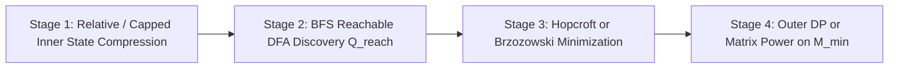

::: {.callout-important title="Prerequisites, Assumed Library & Learning Objectives"}
- **Assumed Library Primitives**: $O(N)$ KMP prefix function ($\pi[1..N]$), $O(\sum |P_i| \cdot |\Sigma|)$ Aho–Corasick (AC) automaton construction, $O(m^3)$ Gaussian elimination over $\mathbb{F}_p$ or `double`, and the **4-instruction Allison–Dix Bit-Parallel LCS update** from [Chapter 23: Bit-Parallel Alignment & Seaweed Matrices](ch23-bit-parallel-lcs-seaweed-matrices.qmd).
- **Strict Prerequisite Chapters**: [Chapter 23: Bit-Parallel Alignment (`Allison–Dix` & `Myers`) & Seaweed Matrices](ch23-bit-parallel-lcs-seaweed-matrices.qmd) and [Chapter 24: The Goulden–Jackson Cluster Method & Moment Shift FPS](ch24-goulden-jackson-moment-shift-fps.qmd).
- **Assigned Technique IDs**: `T-4A-04` (String Probability Generating Functions, Conway's Casino Martingale & Multi-Player Pattern Races), `T-4A-05` (Automaton DP, the 4-Stage `DP套DP` Compiler, Myhill–Nerode / Hopcroft / Brzozowski Minimization & Binary-Grouped Dynamic AC).
- **Learning Objectives**:
  1. Prove the single-pattern expected stopping time $\mathbb{E}[T_S] = \sum_{k \in \operatorname{Borders}^+(S)} \mathbb{P}(S[1..k])^{-1}$ (`[CTSC2006] 歌唱王国`) and exact variance $\operatorname{Var}(T_S)$ (`T-4A-04`) via **both** PGF derivatives $F'(1), F''(1)$ and **Doob's Optional Stopping Theorem on Conway's Casino Martingale**, and derive the **$k$-th Occurrence Renewal Identity** $\mathbb{E}[T_{S, k}^{\text{overlap}}] = \mathbb{E}[T_{S, 1}] + \frac{k - 1}{\mathbb{P}(S)}$.
  2. Formulate the $(m+1) \times (m+1)$ **Multi-Player Pattern Race Linear System** (`[SDOI2017] 硬币游戏`), its **Division-Free Form** $\Phi_{i,j} = \sum_{k \in \operatorname{Overlap}^+(P_i, P_j)} \mathbb{P}(P_j[k+1..|P_j|])$ (`[JSOI2009] 有趣的游戏`) when zero-probability letters $p_c = 0$ exist, and **Conditional Seed-Prefix Racing** ($\Omega_{S_0, P_j}$) when a prefix $S_0$ is already on the tape.
  3. Execute the **4-Stage `DP套DP` Compiler Pipeline** (`T-4A-05`): (Stage 1) relative/capped inner state compression (using `Ch 23`'s Allison–Dix difference bitmask $\Delta f \in \{0, 1\}^K$ for `[TJOI2018] 游园会`, patience-sorting LIS masks for `HDU 4352`, or capped meld matrices for `[ZJOI2019] 麻将`), (Stage 2) BFS reachability discovery, (Stage 3) **Hopcroft Partition Refinement** or **Brzozowski's Double-Reversal Minimization** $\operatorname{det}(\operatorname{rev}(\operatorname{det}(\operatorname{rev}(\mathcal{A}))))$, and (Stage 4) Outer DP / Matrix Exponentiation.
  4. Dynamize static Aho–Corasick automata online via **Bentley–Saxe Binary Grouping (`二进制分组`)** (`CF 710F`) in $O\bigl((\sum |P| + \sum |T|) \log M\bigr)$ total time.
:::

---

## 1. String Probability Generating Functions (`PGFs`) & Conway's Casino Martingale (`T-4A-04`)

### 1.1 The Diagnostic Signal: Why Markov Chain Gaussian Elimination Fails on Long Patterns

Suppose characters $c \in \Sigma$ are generated independently at each step $t = 1, 2, \dots$ with probability $p_c > 0$ ($\sum_{c \in \Sigma} p_c = 1$), and write $\mathbb{P}(U) = \prod_{r=1}^{|U|} p_{U[r]}$ for the probability of a fixed word $U \in \Sigma^*$ ($\mathbb{P}(U) = \sigma^{-|U|}$ in the uniform case). Given a target pattern $S[1..L]$ (or an antichain of $m$ competing patterns $\mathcal{P} = \{P_1, \dots, P_m\}$), let $T = \min_i T_{P_i}$ be the stopping time (first step $n$) when any pattern $P_i \in \mathcal{P}$ appears as a suffix of the generated stream.

Why does standard Markov chain state elimination fail?

- Building the Aho–Corasick or KMP Markov chain creates $V = \Theta\bigl(\sum_{i=1}^m |P_i|\bigr)$ states. When $L = 10^5$ (`[CTSC2006] 歌唱王国`) or $m = 300, L = 300$ (`[SDOI2017] 硬币游戏`, where $V \approx 9 \times 10^4$), solving a $V \times V$ linear system in $O(V^3)$ time is completely intractable; even worse, computing the **variance** $\operatorname{Var}(T_S)$ via state-by-state second moments is algebraically error-prone.

By bridging [Chapter 24's Guibas–Odlyzko End-Tagged System](ch24-goulden-jackson-moment-shift-fps.qmd) with **Probability Generating Functions (`PGFs`)** and **Conway's Casino Martingale (`康威赌博`)**, we collapse single-pattern expectation and variance to **$O(L)$ border sums**, and $m$-pattern races to an **$(m+1) \times (m+1)$ linear system**!

---

### 1.2 The Combinatorial & Probabilistic Word Invariant: Stopping-Time PGFs, Survival Series & Conway's Betting Syndicate

Let us define the two generating functions and the martingale betting process that govern stopping time $T = \min_{i=1}^m T_{P_i}$:

- **First-Hit PGFs $F_i(z)$ and Survival PGF $G(z)$**: Let $f_{i, n} = \mathbb{P}(T = n \text{ and } P_i \text{ wins at step } n)$ and $g_n = \mathbb{P}(T > n)$. Their generating functions are:
  $$F_i(z) = \sum_{n \ge 0} f_{i, n} z^n, \qquad F(z) = \sum_{i=1}^m F_i(z) = \sum_{n \ge 0} \mathbb{P}(T = n) z^n, \qquad G(z) = \sum_{n \ge 0} \mathbb{P}(T > n) z^n.$$
- **Conway's $P_j$-Betting Syndicate (`康威赌场`)**: Fix a target pattern $P_j$ of length $L_j = |P_j|$. Before each step $t = 1, 2, \dots$, a new gambler enters the casino with initial capital $\$1$ and bets their entire fortune that the stream starting at step $t$ will spell $P_j[1..L_j]$:
  - On their $r$-th consecutive step in the casino ($1 \le r \le L_j$), if the drawn character equals $P_j[r]$ (an event of probability $p_{P_j[r]}$), the house multiplies the gambler's current fortune by the fair odds $p_{P_j[r]}^{-1}$, so a gambler who matches the prefix $P_j[1..k]$ holds exact fortune $\mathbb{P}(P_j[1..k])^{-1}$ ($\sigma^k$ in the uniform case).
  - If the drawn character mismatches $P_j[r]$, the gambler loses their stake and leaves with $\$0$.
  Because every single bet is fair ($\mathbb{E}[\text{next wealth} \mid \mathcal{F}_{t-1}] = p_c \cdot (p_c^{-1} W) + (1 - p_c) \cdot 0 = W$), the **net casino profit** of the entire $P_j$-syndicate after $t$ steps—defined as $M_t^{(j)} = (\text{total fortune held by active } P_j\text{-gamblers at time } t) - t$ (since $t$ gamblers have invested $\$1$ each)—is a **martingale** with $M_0^{(j)} = 0$!

```
Stream stops on P_i = ababa (L = 5, uniform binary sigma = 2):
Step t:    1     2     3     4     5
Stream:  [ a     b     a     b     a ]
Gambler 1 (t=1): matches P_i[1..5] = "ababa" -> Fortune = 2^5 = 32
Gambler 2 (t=2): mismatches P_i[1] = 'a' at 'b' -> Fortune = 0
Gambler 3 (t=3): matches P_i[1..3] = "aba"   -> Fortune = 2^3 = 8
Gambler 4 (t=4): mismatches P_i[1] = 'a' at 'b' -> Fortune = 0
Gambler 5 (t=5): matches P_i[1..1] = "a"     -> Fortune = 2^1 = 2
Total Terminal Wealth at T_S: 2^5 + 2^3 + 2^1 = 42 = E[T_S]!
```

Look at which $P_j$-gamblers are still alive at the exact moment $T$ when pattern $P_i$ completes at the end of the tape: a gambler who entered $k$ steps ago ($1 \le k \le \min(|P_i|, |P_j|)$) has survived all $k$ steps if and only if the last $k$ characters of $P_i$ match the first $k$ characters of $P_j$—that is, **$k \in \operatorname{Overlap}^+(P_i, P_j)$**! Defining the **Conway Payoff Constant** $\Omega_{P_i, P_j}$ as the total terminal wealth of the $P_j$-syndicate when the game stops on $P_i$:
$$\Omega_{P_i, P_j} = \sum_{k \in \operatorname{Overlap}^+(P_i, P_j)} \frac{1}{\mathbb{P}\bigl(P_j[1..k]\bigr)} \quad \left(= \sum_{k \in \operatorname{Overlap}^+(P_i, P_j)} \sigma^k \text{ in the uniform case}\right). \tag{25.1}$$

---

### 1.3 Dual Proofs of Single-Pattern Expectation, Variance & $k$-th Occurrence Renewal

::: {.callout-note title="Theorem 25.1 (Single-Pattern Expectation, Variance & $k$-th Occurrence Renewal Identity)"}
Let $S \in \Sigma^L$ be a pattern over an alphabet with character probabilities $p_c > 0$ ($\mathbb{P}(S) > 0$), and let $\operatorname{Borders}^+(S) = \operatorname{Border}(S) \cup \{L\} = \operatorname{Overlap}^+(S, S)$.

1. **Expected Waiting Time (`[CTSC2006] 歌唱王国`, Li 1980)**:
   $$\boxed{\mathbb{E}[T_S] = \Omega_{S, S} = \sum_{k \in \operatorname{Borders}^+(S)} \frac{1}{\mathbb{P}\bigl(S[1..k]\bigr)} \quad \left(= \sum_{k \in \operatorname{Borders}^+(S)} \sigma^k \text{ for uniform } \Sigma\right).} \tag{25.2}$$
2. **Exact Stopping-Time Variance**:
   $$\boxed{\operatorname{Var}(T_S) = \bigl(\mathbb{E}[T_S]\bigr)^2 + \mathbb{E}[T_S] - 2 \sum_{k \in \operatorname{Borders}^+(S)} \frac{k}{\mathbb{P}\bigl(S[1..k]\bigr)}.} \tag{25.3}$$
3. **The $k$-th Overlapping Occurrence Renewal Identity**: Let $T_{S, k}^{\text{overlap}}$ be the step at which the $k$-th (possibly overlapping) occurrence of $S$ completes. Then every inter-occurrence waiting time $\Delta T_r = T_{S, r+1}^{\text{overlap}} - T_{S, r}^{\text{overlap}}$ has expectation **$\frac{1}{\mathbb{P}(S)}$**, so:
   $$\boxed{\mathbb{E}\bigl[T_{S, k}^{\text{overlap}}\bigr] = \mathbb{E}[T_{S, 1}] + \frac{k - 1}{\mathbb{P}(S)} = \sum_{b \in \operatorname{Border}(S) \setminus \{0\}} \frac{1}{\mathbb{P}\bigl(S[1..b]\bigr)} + \frac{k}{\mathbb{P}(S)}.} \tag{25.4}$$
:::

#### Dual Proof of Theorem 25.1 (PGF Calculus vs. Doob's Optional Stopping Theorem)

- **Method 1 (PGF Derivative Calculus on Guibas–Odlyzko)**:
  Weighting each character $c$ by $p_c z$ in Chapter 24's Guibas–Odlyzko system (24.4) replaces $\sigma x$ by $\sum_{c \in \Sigma} p_c z = z$ and $x^{|P_j|}$ by $\mathbb{P}(P_j) z^{|P_j|}$. Dividing the overlap equation by $\mathbb{P}(P_j)$ gives the **Fundamental PGF System**:
  $$(1 - z) G(z) + \sum_{i=1}^m F_i(z) = 1, \qquad G(z) z^{|P_j|} = \sum_{i=1}^m F_i(z) \sum_{k \in \operatorname{Overlap}^+(P_i, P_j)} \frac{z^{|P_j| - k}}{\mathbb{P}\bigl(P_j[1..k]\bigr)}. \tag{25.5}$$
  For a single pattern $S$ ($m = 1, L = |S|$), define the weighted autocorrelation polynomial $H_S(z) = \sum_{k \in \operatorname{Borders}^+(S)} \frac{z^{L - k}}{\mathbb{P}(S[1..k])}$, so (25.5) reads:
  $$(1 - z) G(z) + F(z) = 1, \qquad G(z) z^L = F(z) H_S(z). \tag{25.6}$$
  Since $\mathbb{P}(S) > 0$, $T_S < \infty$ almost surely ($F(1) = 1$) and $\mathbb{P}(T_S > n)$ decays exponentially, so $G(z)$ and $F(z)$ are analytic in a disk $|z| < 1 + \varepsilon$.
  - *First Moment*: Differentiating $(1 - z)G(z) + F(z) = 1$ at $z = 1$ gives $-G(1) + F'(1) = 0 \implies \mathbb{E}[T_S] = F'(1) = G(1)$. Evaluating $G(z) z^L = F(z) H_S(z)$ at $z = 1$ immediately yields $\mathbb{E}[T_S] = G(1) = 1 \cdot H_S(1) = \sum_{k \in \operatorname{Borders}^+(S)} \mathbb{P}(S[1..k])^{-1}$!
  - *Second Moment & Variance*: Differentiating $(1 - z)G(z) + F(z) = 1$ twice at $z = 1$ gives $-2 G'(1) + F''(1) = 0 \implies \mathbb{E}[T_S(T_S - 1)] = F''(1) = 2 G'(1)$. Next, differentiate $G(z) z^L = F(z) H_S(z)$ at $z = 1$:
    $$G'(1) + L \, G(1) = F'(1) H_S(1) + F(1) H_S'(1) \implies G'(1) = \bigl(\mathbb{E}[T_S]\bigr)^2 - L \, \mathbb{E}[T_S] + \sum_{k \in \operatorname{Borders}^+(S)} \frac{L - k}{\mathbb{P}\bigl(S[1..k]\bigr)}.$$
    Since $L \, \mathbb{E}[T_S] = \sum_{k \in \operatorname{Borders}^+(S)} \frac{L}{\mathbb{P}(S[1..k])}$, the $L$ terms cancel! Multiplying $G'(1)$ by $2$ gives $F''(1) = 2(\mathbb{E}[T_S])^2 - 2\sum_{k \in \operatorname{Borders}^+(S)} \frac{k}{\mathbb{P}(S[1..k])}$, and substituting into $\operatorname{Var}(T_S) = F''(1) + F'(1) - (F'(1))^2$ proves (25.3).
- **Method 2 (Conway's Casino Martingale & Optional Stopping)**:
  In Conway's $S$-betting syndicate, at each step $t \le T_S$ at most $L$ gamblers are active, so $|M_t - M_{t-1}|$ is uniformly bounded and $\mathbb{E}[T_S] < \infty$. By **Doob's Optional Stopping Theorem**, $\mathbb{E}[M_{T_S}] = M_0 = 0$. At step $T_S$, the terminal wealth of the syndicate is deterministically $\Omega_{S, S}$ while the total investment is $T_S$, so $\mathbb{E}[\Omega_{S, S} - T_S] = 0 \implies \mathbb{E}[T_S] = \Omega_{S, S}$!
- **Proof of (3) ($k$-th Occurrence Renewal Identity)**:
  At the exact step $T_{S, 1}$ when the $1$-st occurrence of $S$ finishes, the gambler who entered at $T_{S, 1} - L + 1$ cashes out their full match $\mathbb{P}(S)^{-1}$ and leaves, while all gamblers corresponding to **proper borders** $b \in \operatorname{Border}(S) \setminus \{0\}$ remain alive on the tape with total initial fortune $W_{\text{proper}} = \Omega_{S, S} - \mathbb{P}(S)^{-1}$! Starting the martingale $M_t - M_{T_{S, 1}}$ from initial wealth $W_{\text{proper}}$ until the next occurrence $T_{S, 2}$ gives $\mathbb{E}[\Omega_{S, S} - (T_{S, 2} - T_{S, 1})] = W_{\text{proper}} \implies \mathbb{E}[T_{S, 2} - T_{S, 1}] = \Omega_{S, S} - W_{\text{proper}} = \mathbb{P}(S)^{-1}$. Summing over $k - 1$ renewals yields (25.4). $\blacksquare$

---

## 2. Multi-Player Pattern Races, Division-Free Systems & Seed Prefixes (`T-4A-04`)

### 2.1 The $(m+1) \times (m+1)$ Pattern Race System & Division-Free Normalization

Now suppose $m$ players choose an antichain of competing patterns $\mathcal{P} = \{P_1, \dots, P_m\}$ (`[SDOI2017] 硬币游戏`), and let $\pi_i = F_i(1) = \mathbb{P}(P_i \text{ appears first})$ be Player $i$'s winning probability.

Evaluating the Fundamental PGF System (25.5) at $z = 1$—or equivalently applying Doob's Optional Stopping Theorem $\mathbb{E}[M_T^{(j)}] = 0$ to each of the $m$ betting syndicates $j \in \{1, \dots, m\}$, where Syndicate $j$ receives terminal payout $\Omega_{P_i, P_j}$ with probability $\pi_i$—yields an **$(m+1) \times (m+1)$ linear system** for the $m + 1$ unknowns $(\pi_1, \dots, \pi_m, \mathbb{E}[T])$:
$$\boxed{\sum_{i=1}^m \pi_i \, \Omega_{P_i, P_j} - \mathbb{E}[T] = 0 \quad \forall j \in \{1, \dots, m\}, \qquad \sum_{i=1}^m \pi_i = 1.} \tag{25.7}$$

What if some letters have probability $p_c = 0$ (`[JSOI2009] 有趣的游戏`), or $|P_j| = 10^5$ so $\sigma^k$ overflows `double`? Multiply the $j$-th equation of (25.7) by $\mathbb{P}(P_j)$! Because $\mathbb{P}(P_j) / \mathbb{P}(P_j[1..k]) = \mathbb{P}(P_j[k+1..|P_j|])$, all divisions disappear:

::: {.callout-important title="Theorem 25.2 (Division-Free Pattern Race System & Conditional Seed-Prefix Shift)"}
Let $\mathcal{P} = \{P_1, \dots, P_m\}$ be an antichain of patterns with $\text{at least one } \mathbb{P}(P_i) > 0$.

1. **Division-Free Pattern Race System**: Define the tail-probability overlap coefficient $\Phi_{i, j} = \mathbb{P}(P_j) \Omega_{P_i, P_j} = \sum_{k \in \operatorname{Overlap}^+(P_i, P_j)} \mathbb{P}\bigl(P_j[k+1..|P_j|]\bigr) \in [0, 2]$. Then $(\pi_1, \dots, \pi_m, \mathbb{E}[T])$ satisfies:
   $$\boxed{\sum_{i=1}^m \pi_i \, \Phi_{i, j} - \mathbb{P}(P_j)\mathbb{E}[T] = 0 \quad \forall j \in \{1, \dots, m\}, \qquad \sum_{i=1}^m \pi_i = 1.} \tag{25.8}$$
2. **Conditional Racing from an Initial Seed Prefix $S_0$ (`已知初始前缀的康威赌博`)**: Suppose a word $S_0 \in \Sigma^*$ (containing no $P_i \in \mathcal{P}$) is already written on the tape at $t = 0$. Then gamblers who matched a suffix of $S_0$ against a prefix of $P_j$ already hold initial fortune $\Omega_{S_0, P_j} = \sum_{k \in \operatorname{Overlap}^+(S_0, P_j)} \mathbb{P}(P_j[1..k])^{-1}$ at $t = 0$, shifting the right-hand side of (25.7) and (25.8) to:
   $$\boxed{\sum_{i=1}^m \pi_i \, \Omega_{P_i, P_j} - \mathbb{E}[T \mid S_0] = \Omega_{S_0, P_j}, \qquad \sum_{i=1}^m \pi_i \, \Phi_{i, j} - \mathbb{P}(P_j)\mathbb{E}[T \mid S_0] = \Phi_{S_0, P_j},} \tag{25.9}$$
   where $\Phi_{S_0, P_j} = \sum_{k \in \operatorname{Overlap}^+(S_0, P_j)} \mathbb{P}(P_j[k+1..|P_j|])$.
:::

---

### 2.2 Hand-Checked Trace: Two Penney's Game Paradoxes (`HHT` vs. `THH` & `HTH` vs. `HTT`)

Why is $\Omega_{P_i, P_j}$ asymmetric ($\Omega_{P_i, P_j} \ne \Omega_{P_j, P_i}$), and how can two patterns with the same solo expectation have a $3:1$ race advantage—or two patterns with *different* solo expectations tie $1:1$? Let us trace Equation (25.7) for uniform coin flips ($\sigma = 2$):

| Matchup $(P_1 \text{ vs. } P_2)$ | Solo $\mathbb{E}[T_{P_1}], \mathbb{E}[T_{P_2}]$ | Payoff Matrix $\begin{bmatrix} \Omega_{1,1} & \Omega_{1,2} \\ \Omega_{2,1} & \Omega_{2,2} \end{bmatrix}$ | Conway System $\Omega^T \boldsymbol{\pi} = \mathbb{E}[T]\mathbf{1}$ | Winning Probabilities $(\pi_1, \pi_2)$ & $\mathbb{E}[T]$ |
| :---: | :---: | :---: | :--- | :---: |
| $\texttt{HHT}$ vs. $\texttt{THH}$ | $8$ vs. $8$ | $\begin{bmatrix} 8 & 2^1 = 2 \\ 2^1+2^2 = 6 & 8 \end{bmatrix}$ | $\begin{cases} 8\pi_1 + 6\pi_2 = \mathbb{E}[T] \\ 2\pi_1 + 8\pi_2 = \mathbb{E}[T] \end{cases}$ | $\boldsymbol{\pi_1 = \frac{1}{4},\; \pi_2 = \frac{3}{4}}$, $\mathbb{E}[T] = \frac{13}{2}$ |
| $\texttt{HTH}$ vs. $\texttt{HTT}$ | $10$ vs. $8$ | $\begin{bmatrix} 2^3+2^1 = 10 & 2^1 = 2 \\ 0 & 2^3 = 8 \end{bmatrix}$ | $\begin{cases} 10\pi_1 + 0\pi_2 = \mathbb{E}[T] \\ 2\pi_1 + 8\pi_2 = \mathbb{E}[T] \end{cases}$ | $\boldsymbol{\pi_1 = \frac{1}{2},\; \pi_2 = \frac{1}{2}}$, $\mathbb{E}[T] = 5$ |

- Look closely at the indices in the $j$-th equation $\sum_{i=1}^m \pi_i \Omega_{P_i, P_j} = \mathbb{E}[T]$: **$i$ is the winning pattern that stops the game (on the left of the overlap), while $j$ is the betting syndicate (on the right of the overlap)**! In $\texttt{HTH}$ vs. $\texttt{HTT}$, even though $\texttt{HTH}$ takes longer alone ($10 > 8$), whenever $\texttt{HTH}$ wins, the $\texttt{HTT}$-syndicate holds $\$2$ ($\Omega_{1, 2} = 2$), reducing $\texttt{HTH}$'s net lead from $10$ to $10 - 2 = 8 = \Omega_{2,2} - \Omega_{2,1}$, forcing an exact $50\%$–$50\%$ tie!

---

## 3. Automaton DP & The 4-Stage `DP套DP` Compiler (`T-4A-05`)

### 3.1 The Diagnostic Signal: Counting Outer Strings by the Output of an Inner DP

In a **`DP套DP` (`DP of DP` / `自動機上のDP`)** problem, we are given an inner dynamic programming algorithm $\mathcal{A}(T)$ that processes a string $T = T[1..N]$ character-by-character from left to right:
$$s_0 \xrightarrow{T[1]} s_1 \xrightarrow{T[2]} s_2 \xrightarrow{\cdots} s_N, \qquad \text{output}(T) = g(s_N),$$
and the **outer problem** asks us to **count how many strings $T \in \Sigma^N$** produce each possible output value $g(s_N) = c$!

If we naively use the raw inner DP table $s_i$ as the state of our outer counting DP `outer_dp[i][s_i]`, the number of raw inner states is astronomical (for example, in `[TJOI2018] 游园会` where $\mathcal{A}(T) = \operatorname{LCS}(S, T)$ for $|S| = K \le 15$, a raw inner DP row $f[0..K] \in \{0, \dots, K\}^{K+1}$ has $16^{16} = 2^{64}$ states!).

**The 4-Stage `DP套DP` Compiler Pipeline** turns any left-to-right inner DP into a compact minimal Deterministic Finite Automaton (DFA) before running the outer DP:



---

### 3.2 Stage 1 & Stage 2: Inner State Compression & Reachable BFS Discovery

1. **Stage 1A — Monotonic Difference Bitmasks (`Allison–Dix` Kernel from `Ch 23`)**:
   When the inner DP computes $\operatorname{LCS}(S[1..K], T)$ (`[BZOJ 3864] Hero meet devil`, `[TJOI2018] 游园会`), the inner row $f[0..K]$ satisfies $f[0] = 0$ and the horizontal monotonicity invariant $f[j] - f[j-1] \in \{0, 1\}$! Thus $f[0..K]$ is uniquely encoded by a **$K$-bit mask** $V = \sum_{j=1}^K (f[j] - f[j-1]) 2^{j-1} \in [0, 2^K)$ with $f[K] = \operatorname{popcount}(V)$. Better yet, by **[Theorem 23.1 (Allison–Dix 4-Instruction Borrow Identity)](ch23-bit-parallel-lcs-seaweed-matrices.qmd)**, transitioning from mask $V$ on character $c \in \Sigma$ with character match mask $M_c$ takes **$O(1)$ bitwise instructions** without unpacking $f[0..K]$:
   $$\boxed{\operatorname{trans}(V, c) = X \mathbin{\&} \sim(X - Y), \qquad X = V \mid M_c, \quad Y = \bigl((V \ll 1) \mid 1\bigr) \mathbin{\&} (2^K - 1).} \tag{25.10}$$
2. **Stage 1B — Patience-Sorting Subset Masks & Capped Value Matrices**:
   - *Digit LIS (`HDU 4352`)*: The patience-sorting tails array of a digit sequence over $\{0..9\}$ is strictly increasing, so it is a subset of $\{0..9\}$ encoded by a **10-bit mask** $M \in [0, 2^{10})$ with $\operatorname{LIS} = \operatorname{popcount}(M)$!
   - *Mahjong Winning Hand Checker (`[ZJOI2019] 麻将`)*: The inner DP checks whether a hand has $4$ melds + $1$ pair (or $7$ distinct pairs) by tracking two $3 \times 3$ matrices $f_0[j][k], f_1[j][k]$ (max completed melds with $0$ or $1$ pair given $j$ and $k$ open sequences). **Clamping** all meld entries at $\min(\text{val}, 4)$, pair counts at $\min(p, 7)$, and merging all winning hands into a single absorbing state $\top$ bounds the reachable state space to **only $2092$ states**!
3. **Stage 2 — Automated BFS Reachability Discovery**:
   For complex inner states (like Mahjong matrices or Edit-Distance strips $\Delta_j \in \{-1, 0, 1\}$), never allocate an array over all syntactic tuples. Instead, start a BFS queue from the initial inner state $q_0$, use a hash map `id[State]` to assign contiguous integer indices $0, 1, \dots, |Q_{\text{reach}}| - 1$ only to **reachable** states, and populate `trans[u][c]`.

---

### 3.3 Stage 3: Myhill–Nerode Quotienting via Hopcroft vs. Brzozowski Minimization

Often, Stage 2's reachable inner DP states $Q_{\text{reach}}$ still contain redundant distinctions: two different inner DP tables $u \ne v$ may produce the **exact same final output** $g(\delta^*(u, w)) = g(\delta^*(v, w))$ for every future suffix $w \in \Sigma^*$! By the **Myhill–Nerode Theorem**, quotienting $Q_{\text{reach}}$ by suffix indistinguishability yields the unique minimal DFA $\mathcal{M}_{\min}$. We have two algorithmic engines for Stage 3:

::: {.callout-note title="Theorem 25.3 (Hopcroft Partition Refinement vs. Brzozowski's Double-Reversal Minimization)"}
Let $\mathcal{A} = (Q_{\text{reach}}, \Sigma, \delta, q_0, \operatorname{out})$ be a reachable deterministic inner-DP automaton.

1. **Hopcroft's Partition Refinement**: Initialize partition $\Pi_0$ by grouping states $u \in Q_{\text{reach}}$ with identical immediate output $\operatorname{out}(u)$. Repeatedly replace each block $B \in \Pi_t$ by sub-blocks of states sharing the same transition signature $\bigl(\Pi_t(\delta(u, c))\bigr)_{c \in \Sigma}$ until $\Pi_{t+1} = \Pi_t$. The resulting quotient $\mathcal{M}_{\min} = Q_{\text{reach}} / \Pi_{\infty}$ is the unique minimal DFA.
2. **Brzozowski's Algebraic Double-Reversal Theorem (1962)**: For any NFA or DFA $\mathcal{A}$ with accepting set $F$, let $\operatorname{rev}(\mathcal{A})$ reverse all directed edges and swap initial and accepting states, and let $\operatorname{det}(\mathcal{B})$ be the reachable subset construction from the initial state set of $\mathcal{B}$. Then:
   $$\boxed{\mathcal{M}_{\min} \cong \operatorname{det}\Bigl(\operatorname{rev}\bigl(\operatorname{det}(\operatorname{rev}(\mathcal{A}))\bigr)\Bigr)!} \tag{25.11}$$
:::

#### Hand-Checked Hopcroft Minimization Trace (6 Inner States $\to$ 2 Minimal Nerode States)
Consider a 6-state reachable inner DP automaton $Q_{\text{reach}} = \{q_0, q_1, q_2, q_3, q_4, q_5\}$ over $\Sigma = \{\texttt{0}, \texttt{1}\}$ with accepting states $F = \{q_3, q_4, q_5\}$ ($\Pi_0 = \{B_0 = \{q_0, q_1, q_2\},\; B_1 = \{q_3, q_4, q_5\}\}$):

| Inner State $u$ | $\delta(u, \texttt{0})$ | $\delta(u, \texttt{1})$ | Initial Class $\Pi_0(u)$ | Signature $\bigl(\Pi_0(\delta(u, \texttt{0})),\, \Pi_0(\delta(u, \texttt{1}))\bigr)$ |
| :---: | :---: | :---: | :---: | :---: |
| $q_0, q_1, q_2$ | $q_1, q_2, q_2 \in B_0$ | $q_3, q_4, q_5 \in B_1$ | $B_0$ (Reject) | $(B_0,\; B_1)$ for all $u \in B_0$ |
| $q_3, q_4, q_5$ | $q_1, q_2, q_2 \in B_0$ | $q_3, q_4, q_5 \in B_1$ | $B_1$ (Accept) | $(B_0,\; B_1)$ for all $u \in B_1$ |

In a single pass, every state in $B_0$ has transition signature $(B_0, B_1)$ and every state in $B_1$ has signature $(B_0, B_1)$, so $\Pi_1 = \Pi_0$ stabilizes immediately and collapses the 6-state inner DP to a **2-state minimal DFA**!

---

## 4. Bentley–Saxe Binary Grouping of Dynamic AC Automata & Contracts (`T-4A-05`)

### 4.1 Dynamizing Static Aho–Corasick via Binary Grouping (`二进制分组`, `CF 710F`)

What if patterns are inserted and deleted **online** interspersed with text occurrence queries $\sum_{P \in \mathcal{D}} \operatorname{occ}_P(T)$ (`CF 710F — String Set Queries`, $\sum |P| + \sum |T| \le 3 \times 10^5$)?

- **Why Dynamic `fail`-Link Updates Fail**: Inserting a single new pattern into an Aho–Corasick automaton can redirect `fail` pointers across an entire subtree of existing states, costing $\Omega(\sum |P|)$ per insertion if rebuilt naively.
- **The Bentley–Saxe Binary Grouping Invariant**: The query function $\operatorname{ans}(T, \mathcal{D}) = \sum_{P \in \mathcal{D}} \operatorname{occ}_P(T)$ is **additive over disjoint dictionary blocks**! Maintain two independent binary-grouped collections—$\mathcal{I}$ for inserted patterns and $\mathcal{D}_{\text{del}}$ for deleted patterns:
  1. Each collection stores at most $\lfloor \log_2 M \rfloor + 1$ immutable Aho–Corasick automata whose pattern counts $2^{k_1} > 2^{k_2} > \dots$ are distinct powers of $2$.
  2. **Insert($P$)**: Create a block of size $2^0 = 1$ containing $\{P\}$. While the last two blocks have equal size $2^k$, merge their pattern lists into a single block of size $2^{k+1}$ and rebuild its AC automaton from scratch! Since each pattern participates in at most $\log_2 M$ merges, total build time across all insertions is **$O\bigl(\sum |P| \cdot |\Sigma| \log M\bigr)$**.
  3. **Query($T$)**: Walk $T$ across each of the $\le \log_2 M$ blocks in $\mathcal{I}$ (adding `cnt[u]`) and each of the $\le \log_2 M$ blocks in $\mathcal{D}_{\text{del}}$ (subtracting `cnt[u]`) in **$O(|T| \log M)$** time!

---

### 4.2 Reverse-Engineering Scratchpad & Non-Standard Implementation Contracts: Pattern Race Solver & 4-Stage `DP套DP` Compiler

```cpp
// Non-Standard Kernel 1: Division-Free Multi-Player Pattern Race Solver (Theorem 25.2)
// Solves [SDOI2017] Coin Game / [JSOI2009] Funny Game in O(m^2 L + m^3) without division by p_c.
vector<double> solve_pattern_race(const vector<string>& P, const vector<double>& prob_char) {
    int m = P.size();
    // Assume A[0..m][0..m+1] is an (m+1) x (m+2) augmented matrix for (pi_1..pi_m, E[T])
    vector<vector<double>> A(m + 1, vector<double>(m + 2, 0.0));
    for (int j = 0; j < m; ++j) {
        int L = P[j].size();
        vector<double> suf_prob(L + 1, 1.0);
        for (int k = L - 1; k >= 0; --k)
            suf_prob[k] = suf_prob[k + 1] * prob_char[(unsigned char)P[j][k]];
        // KMP on P[j] to find overlaps with each P[i]
        vector<int> pi(L, 0);
        for (int r = 1; r < L; ++r) {
            int k = pi[r - 1];
            while (k > 0 && P[j][k] != P[j][r]) k = pi[k - 1];
            if (P[j][k] == P[j][r]) ++k;
            pi[r] = k;
        }
        for (int i = 0; i < m; ++i) {
            int k = 0;
            for (char c : P[i]) {
                while (k > 0 && (k == L || P[j][k] != c)) k = pi[k - 1];
                if (P[j][k] == c) ++k;
            }
            // Walk all k in Overlap^+(P_i, P_j) and accumulate P(P_j[k+1..L]) = suf_prob[k]
            for (int cur = k; cur > 0; cur = pi[cur - 1])
                A[j][i] += suf_prob[cur];
        }
        A[j][m] = -suf_prob[0]; // -P(P_j) * E[T]
    }
    for (int i = 0; i < m; ++i) A[m][i] = 1.0;
    A[m][m + 1] = 1.0; // sum_i pi_i = 1
    // Call standard Gaussian elimination on A (omitted; returns first m entries)
    return gaussian_elimination(A);
}

// Non-Standard Kernel 2: Generic Stage 2 + Stage 3 Hopcroft Minimization for DP of DP
struct MinimizedDFA {
    int num_classes, start_class;
    vector<vector<int>> trans;
    vector<int> class_out;
};
MinimizedDFA minimize_inner_dfa(const vector<vector<int>>& raw_trans, const vector<int>& raw_out, int sigma) {
    int V = raw_trans.size();
    vector<int> cls(V);
    map<int, int> out_map;
    for (int u = 0; u < V; ++u) {
        if (!out_map.count(raw_out[u])) out_map[raw_out[u]] = out_map.size();
        cls[u] = out_map[raw_out[u]];
    }
    int C = out_map.size();
    while (true) {
        map<vector<int>, int> sig_map;
        vector<int> next_cls(V);
        for (int u = 0; u < V; ++u) {
            vector<int> sig(sigma + 1);
            sig[0] = cls[u];
            for (int c = 0; c < sigma; ++c) sig[c + 1] = cls[raw_trans[u][c]];
            if (!sig_map.count(sig)) sig_map[sig] = sig_map.size();
            next_cls[u] = sig_map[sig];
        }
        if ((int)sig_map.size() == C) break;
        cls = move(next_cls);
        C = sig_map.size();
    }
    MinimizedDFA M{C, cls[0], vector<vector<int>>(C, vector<int>(sigma)), vector<int>(C)};
    for (int u = 0; u < V; ++u) {
        M.class_out[cls[u]] = raw_out[u];
        for (int c = 0; c < sigma; ++c) M.trans[cls[u]][c] = cls[raw_trans[u][c]];
    }
    return M;
}
```

---

### 4.3 Boundary Pitfalls & Broken-Invariant Counterexamples (`BP-25-01`–`BP-25-03` / `BP-4A-04`–`BP-4A-06`)

::: {.callout-warning title="Three Classic Martingale & Automaton DP Failure Modes (BP-25-01–BP-25-03 / BP-4A-04–BP-4A-06)"}
1. **The Transposed Overlap Matrix Bug ($\Omega_{P_i, P_j} \ne \Omega_{P_j, P_i}$, `BP-25-01` / `BP-4A-04`)**: In Equation (25.7), the coefficient of $\pi_i$ in the $j$-th syndicate equation is $\Omega_{P_i, P_j}$ (where **winner $P_i$'s suffix** matches **gambler $P_j$'s prefix**). Transposing $i$ and $j$ on $P_1 = \texttt{HHT}, P_2 = \texttt{THH}$ swaps $\Omega_{1,2} = 2$ and $\Omega_{2,1} = 6$, outputting the inverted probabilities $(\frac{3}{4}, \frac{1}{4})$ instead of $(\frac{1}{4}, \frac{3}{4})$!
2. **The Unpropagated `bad[u] |= bad[fail[u]]` AC Bug (`BP-25-02` / `BP-4A-05`)**: When building an Aho–Corasick DFA for avoidance or pattern races, a state $u$ is terminal (`bad[u] = true`) not only if $u$ is the end of a pattern $P_i$, but also if **any ancestor on its `fail`-tree path** is the end of a shorter pattern $P_r \subset P_i$! Always execute `bad[u] |= bad[fail[u]]` in BFS order inside `build_ac()`.
3. **The Unclamped `DP套DP` State Explosion (`BP-25-03` / `BP-4A-06`)**: In Stage 1 of `DP套DP`, any inner DP coordinate that can exceed the acceptance threshold (such as meld counts $> 4$ in `[ZJOI2019] 麻将` or stack ones $> 2$ in `AGC 022 E`) **must be clamped** (`min(val, CAP)`) and all accepting states merged before inserting into the Stage 2 BFS hash map; otherwise BFS fails to terminate or discovers $10^6+$ redundant states.
:::

---

## 5. Curated 4-Tier Smooth Difficulty Ladder (9 Non-Template Problems)

### Tier 1 — Stepping Stone (`W4A-02`, `W4A-05`)

#### Problem 25.1 (`W4A-02`) — `[CTSC2006] 歌唱王国 (Luogu P4548 — Singing Kingdom)`

- **Mathematical Statement**: An alphabet has $\sigma \le 10^5$ characters. Across $T \le 50$ queries, each query gives a target string $S[1..L]$ ($L \le 10^5$). At each step, a uniformly random character in $\{1, \dots, \sigma\}$ is appended until $S$ appears as a contiguous suffix. Compute the expected stopping time $\mathbb{E}[T_S] \bmod 10^4$ (padded to 4 digits with leading zeros).
- **Constraints**: $\sigma \le 10^5$, $T \le 50$, $L \le 10^5$, time limit $1.0\text{ s}$.

::: {.callout-note collapse="true" title="Hint 1 — Diagnostic Signal"}
With $L = 10^5$ per query and $50$ queries, we need an $O(L)$ algorithm. Why do all non-border prefix states cancel out when we compute $\mathbb{E}[T_S]$?
:::

::: {.callout-note collapse="true" title="Hint 2 — Combinatorial Word Invariant"}
By **Theorem 25.1(1)** (Conway's Casino Martingale / PGF Derivative $F'(1) = G(1)$), the gamblers still alive at step $T_S$ are in exact bijection with the non-empty borders $k \in \operatorname{Borders}^+(S) = \operatorname{Border}(S) \setminus \{0\} \cup \{L\}$, and the $k$-th gambler holds fortune $\sigma^k$.
:::

::: {.callout-note collapse="true" title="Hint 3 — Algorithmic Assembly"}
Run KMP on $S[1..L]$ to get $\pi[1..L]$ in $O(L)$ time, precompute powers $\sigma^k \bmod 10^4$, and sum $\sigma^k$ along the border chain $k = L, \pi[L], \pi[\pi[L]], \dots > 0$.
:::

::: {.callout-tip collapse="true" title="Full Derivation & Solution (`W4A-02`)"}
1. **Diagnostic Signal**: $L \le 10^5$ rules out $O(L^3)$ Gaussian elimination on the KMP Markov chain.
2. **Combinatorial Word Invariant**:
   - By Equation (25.2), $\mathbb{E}[T_S] = \sum_{k \in \operatorname{Borders}^+(S)} \sigma^k$.
   - Every border length $k \in \operatorname{Borders}^+(S)$ is visited exactly once by iterating $k \gets \pi[k]$ starting from $k = L$ while $k > 0$.
3. **Algorithmic Compilation**:
   - Build $\pi[1..L]$ in $O(L)$ time.
   - Initialize `ans = 0`; for `int k = L; k > 0; k = pi[k]`, add `pow_mod(sigma, k, 10000)` to `ans`, and print with `%04d`. Time: $O(L)$ per testcase.
4. **Broken-Invariant Counterexample**: Forgetting the full match $k = L$ (which contributes $\sigma^L$, the dominant term!) or stopping at $\pi[L]$ instead of starting at $L$.
:::

---

#### Problem 25.2 (`W4A-05`) — `[JSOI2007] 文本生成器 (Luogu P4052 — Text Generator)`

- **Mathematical Statement**: Given $m \le 60$ uppercase words $P_1, \dots, P_m \in \{\texttt{A}..\texttt{Z}\}^+$ of length $|P_i| \le 100$ and target length $N \le 100$, count how many strings $W \in \{\texttt{A}..\texttt{Z}\}^N$ contain **at least one** of the $m$ words as a contiguous substring, modulo $10007$.
- **Constraints**: $m \le 60$, $|P_i| \le 100$, $N \le 100$, time limit $1.0\text{ s}$.

::: {.callout-note collapse="true" title="Hint 1 — Diagnostic Signal"}
Tracking which subset of the $60$ words has appeared requires $2^{60}$ states. How do we reduce "at least one $P_i$ appears" to a single boolean flag per Aho–Corasick node?
:::

::: {.callout-note collapse="true" title="Hint 2 — Combinatorial Word Invariant"}
By complementation, $\#\{\text{readable texts}\} = 26^N - \#\{\mathcal{P}\text{-avoiding texts}\}$. On the Aho–Corasick DFA, a prefix avoids $\mathcal{P}$ if and only if every visited state $u$ has `bad[u] == false`, where `bad[u] = own_bad[u] | bad[fail[u]]`.
:::

::: {.callout-note collapse="true" title="Hint 3 — Algorithmic Assembly"}
Build the Aho–Corasick trie-graph on $\mathcal{P}$ ($\le 6001$ nodes), propagate `bad[u] |= bad[fail[u]]` in BFS order, run $O(N \cdot |Q| \cdot 26)$ DP over safe states (`!bad[v]`), and subtract $\sum_u dp[N][u]$ from $26^N \bmod 10007$.
:::

::: {.callout-tip collapse="true" title="Full Derivation & Solution (`W4A-05`)"}
1. **Diagnostic Signal**: Complement counting eliminates the $2^m$ subset mask over matched patterns.
2. **Combinatorial Word Invariant**:
   - Let $Q_{\text{safe}} = \{u \in Q_{\text{AC}} \mid \neg \text{bad}[u]\}$. A word $W[1..N]$ avoids all $P_i \in \mathcal{P}$ iff its unique walk $q_0 \xrightarrow{W[1]} u_1 \xrightarrow{\cdots} u_N$ in the deterministic AC trie-graph stays entirely inside $Q_{\text{safe}}$.
3. **Algorithmic Compilation**:
   - Insert $P_1, \dots, P_m$ into the Trie, setting `bad[end(P_i)] = true`.
   - In the AC BFS queue, for each popped node $u$, set `bad[u] |= bad[fail[u]]` (`BP-4A-05`) and wire `tr[u][c] = tr[fail[u]][c]` for missing children.
   - Run $dp[step][u]$ for $step = 0 \dots N-1$ and $u \in Q_{\text{safe}}$, then return $(26^N - \sum_{u \in Q_{\text{safe}}} dp[N][u]) \bmod 10007$.
4. **Broken-Invariant Counterexample (`BP-4A-05`)**: If $P_1 = \texttt{ABCD}$ and $P_2 = \texttt{BC}$, forgetting `bad[u] |= bad[fail[u]]` leaves the node for prefix $\texttt{ABC}$ with `bad = false`, falsely counting words containing $\texttt{ABC}$ as safe!
:::

---

### Tier 2 — Intermediate (`W4A-14`, `W4A-19`)

#### Problem 25.3 (`W4A-14`) — `CF 710F — String Set Queries (Binary-Grouped Dynamic Aho–Corasick)`

- **Mathematical Statement**: Process $M \le 3 \times 10^5$ **online** operations of three types: (1) insert a string $P$ into dictionary $\mathcal{D}$, (2) delete an existing string $P$ from $\mathcal{D}$, and (3) given a query text $T$, output $\sum_{P \in \mathcal{D}} \operatorname{occ}_P(T)$. All queries are interactive (`fflush(stdout)` required after each Type 3 query).
- **Constraints**: $M \le 3 \times 10^5$, $\sum |P| + \sum |T| \le 3 \times 10^5$, time limit $3.0\text{ s}$.

::: {.callout-note collapse="true" title="Hint 1 — Diagnostic Signal"}
Because operations are forced online, we cannot use offline Trie + Fenwick Euler tour (`CF 1207G`), and rebuilding a single AC automaton on each insertion takes $O(M \sum |P|)$ time.
:::

::: {.callout-note collapse="true" title="Hint 2 — Combinatorial Word Invariant"}
Apply Section 4.1's **Bentley–Saxe Binary Grouping (`二进制分组`)**! Maintain two binary-grouped AC collections `Ins` and `Del`, where each collection holds at most $\lceil \log_2 M \rceil$ immutable AC automata of distinct power-of-$2$ pattern counts $2^{k_1} > 2^{k_2} > \dots$.
:::

::: {.callout-note collapse="true" title="Hint 3 — Algorithmic Assembly"}
When inserting $P$ into `Ins` (or `Del`), push a new block `{P}` of size $1$. While the top two blocks on the stack have the same number of patterns, pop both, concatenate their pattern vectors, and build a fresh AC automaton on their union (propagating `cnt[u] += cnt[fail[u]]` in BFS order). Answer Type 3 queries as `Ins.query(T) - Del.query(T)`.
:::

::: {.callout-tip collapse="true" title="Full Derivation & Solution (`W4A-14`)"}
1. **Diagnostic Signal**: Online dictionary insertions/deletions with linear occurrence queries.
2. **Combinatorial Word Invariant**:
   - For any disjoint partition $\mathcal{D} = \bigsqcup_{r} \mathcal{B}_r$, $\sum_{P \in \mathcal{D}} \operatorname{occ}_P(T) = \sum_r \sum_{P \in \mathcal{B}_r} \operatorname{occ}_P(T)$.
   - In a binary-grouped stack of blocks, a block of $2^k$ patterns is created only when two blocks of $2^{k-1}$ patterns merge. Thus each character of $P$ is inserted into an AC automaton at most $\lfloor \log_2 M \rfloor + 1 \le 19$ times!
3. **Algorithmic Compilation**:
   - Define `struct DynamicAC` holding a stack of blocks; each block stores `vector<string> pats` and its compiled AC `tr` and `cnt` arrays.
   - On `add(string s)`, push `{s}` and merge equal-size top blocks via `build_ac()`.
   - On `query(string t)`, sum `block.query(t)` over all $\le 19$ blocks in `Ins` minus `Del`.
   - Total time: $O\bigl(26 \sum |P| \log M + \sum |T| \log M\bigr)$.
4. **Broken-Invariant Counterexample**: Building blocks by *total character length* powers of $2$ instead of *pattern count* (or doubling capacity thresholds) works only if you merge whenever two top blocks are within the same size bucket; strict power-of-2 pattern count (`pats_a.size() == pats_b.size()`) is the simplest bug-free invariant.
:::

---

#### Problem 25.4 (`W4A-19`) — `CF Gym 102538 / Extended [CTSC2006] — Stopping-Time Variance Var(T_S) & k-th Occurrence Waiting Time`

- **Mathematical Statement**: Given a pattern $S[1..L]$ ($L \le 10^6$) over an alphabet $\Sigma$ with rational character probabilities $p_c > 0$ ($\sum_{c \in \Sigma} p_c = 1$) and an integer $k \ge 1$, compute modulo $998244353$: (a) the expected time $\mathbb{E}[T_{S, k}^{\text{overlap}}]$ until the $k$-th (possibly overlapping) occurrence of $S$, and (b) the exact variance $\operatorname{Var}(T_{S, 1})$ of the first occurrence of $S$.
- **Constraints**: $1 \le L \le 10^6$, $1 \le k \le 10^{18}$, time limit $2.0\text{ s}$.

::: {.callout-note collapse="true" title="Hint 1 — Diagnostic Signal"}
For $L = 10^6$, we must compute both $\mathbb{E}[T_{S, k}^{\text{overlap}}]$ and $\operatorname{Var}(T_{S, 1})$ in a single $O(L)$ pass over the KMP border chain of $S$.
:::

::: {.callout-note collapse="true" title="Hint 2 — Combinatorial Word Invariant"}
By **Theorem 25.1(2)–(3)** (Equations 25.3–25.4), $\mathbb{E}[T_{S, k}^{\text{overlap}}] = \mathbb{E}[T_{S, 1}] + (k - 1)\mathbb{P}(S)^{-1}$ because all proper borders $b \in \operatorname{Border}(S) \setminus \{0\}$ survive as active gamblers when an occurrence of $S$ completes, and $\operatorname{Var}(T_{S, 1}) = (\mathbb{E}[T_{S, 1}])^2 + \mathbb{E}[T_{S, 1}] - 2\sum_{r \in \operatorname{Borders}^+(S)} r \, \mathbb{P}(S[1..r])^{-1}$.
:::

::: {.callout-note collapse="true" title="Hint 3 — Algorithmic Assembly"}
Precompute the inverse prefix probabilities $I[r] = \mathbb{P}(S[1..r])^{-1} = \prod_{i=1}^r p_{S[i]}^{-1} \bmod 998244353$ for $1 \le r \le L$, build KMP $\pi[1..L]$, and traverse $r = L, \pi[L], \dots > 0$ accumulating $E_1 = \sum I[r]$ and $S_1 = \sum r \cdot I[r]$ in $O(L)$ time!
:::

::: {.callout-tip collapse="true" title="Full Derivation & Solution (`W4A-19`)"}
1. **Diagnostic Signal**: Second-moment extraction and $k$-th overlapping renewal on a length-$10^6$ pattern.
2. **Combinatorial Word Invariant**:
   - Let $I[r] = \mathbb{P}(S[1..r])^{-1}$. By Theorem 25.1:
     $$\mathbb{E}[T_{S, 1}] = \sum_{r \in \operatorname{Borders}^+(S)} I[r], \qquad \mathbb{E}\bigl[T_{S, k}^{\text{overlap}}\bigr] = \mathbb{E}[T_{S, 1}] + (k - 1) I[L],$$
     $$\operatorname{Var}(T_{S, 1}) = \bigl(\mathbb{E}[T_{S, 1}]\bigr)^2 + \mathbb{E}[T_{S, 1}] - 2 \sum_{r \in \operatorname{Borders}^+(S)} r \cdot I[r].$$
3. **Algorithmic Compilation**:
   - Compute $I[1..L]$ and $\pi[1..L]$ in $O(L)$ time.
   - Loop `for (int r = L; r > 0; r = pi[r])` to sum `E1 += I[r]` and `S1 += Mint(r) * I[r]`.
   - Output `E1 + Mint((k - 1) % MOD) * I[L]` and `E1 * E1 + E1 - Mint(2) * S1`. Time: $O(L)$.
4. **Broken-Invariant Counterexample**: Confusing $F''(1) = \mathbb{E}[T_S(T_S - 1)]$ with $\mathbb{E}[T_S^2]$ omits the $+\mathbb{E}[T_{S, 1}]$ term in $\operatorname{Var}(T_{S, 1})$.
:::

---

### Tier 3 — Advanced (`W4A-09`, `W4A-27`, `W4A-30`)

#### Problem 25.5 (`W4A-09`) — `[SDOI2017] 硬币游戏 (Luogu P3706 — Multi-Player Coin Game)`

- **Mathematical Statement**: $m \le 300$ players each choose a distinct binary string $P_i \in \{\texttt{H}, \texttt{T}\}^L$ of equal length $L \le 300$. A fair coin is tossed repeatedly until one of the $m$ strings appears as a contiguous suffix of the toss sequence; that player wins and the game ends. Compute each player's winning probability $\pi_1, \dots, \pi_m$ to $10^{-6}$ precision.
- **Constraints**: $1 \le m, L \le 300$, time limit $1.0\text{ s}$.

::: {.callout-note collapse="true" title="Hint 1 — Diagnostic Signal"}
The Aho–Corasick automaton on $m = 300$ strings of length $L = 300$ has up to $9 \times 10^4$ states, so state-by-state Gaussian elimination takes $(9 \times 10^4)^3$ operations. How do we reduce the system size from $90000$ to $301$?
:::

::: {.callout-note collapse="true" title="Hint 2 — Combinatorial Word Invariant"}
Because all $P_i$ have equal length $L$ and are distinct, $\mathcal{P}$ is automatically an antichain! By **Theorem 25.2(1)** (Equation 25.8), multiplying the $j$-th Conway syndicate equation by $2^{-L}$ gives $\sum_{i=1}^m \pi_i \bigl(\sum_{k \in \operatorname{Overlap}^+(P_i, P_j)} 2^{k - L}\bigr) - 2^{-L}\mathbb{E}[T] = 0$ for $1 \le j \le m$, plus $\sum_{i=1}^m \pi_i = 1$.
:::

::: {.callout-note collapse="true" title="Hint 3 — Algorithmic Assembly"}
**Numerical Stability Note**: Why is multiplying by $2^{-L}$ (so each overlap $k$ contributes $2^{k - L} \in (0, 1]$ instead of $2^k$) essential in `double`? When $L = 300$, $2^{300}$ is well within `double`, or if $L = 2000$, $2^L$ overflows `double` (`1e308` $\approx 2^{1024}$), whereas $2^{k - L} \le 1$ never overflows! Let $x_{m+1} = 2^{-L} \mathbb{E}[T]$ be the $(m+1)$-th variable so its column coefficient is simply $-1$!
:::

::: {.callout-tip collapse="true" title="Full Derivation & Solution (`W4A-09`)"}
1. **Diagnostic Signal**: $m = 300 \ll m L = 9 \times 10^4$ calls for the $(m+1) \times (m+1)$ Conway / Guibas–Odlyzko system.
2. **Combinatorial Word Invariant**:
   - Define the scaled variable $E_{\text{scaled}} = 2^{-L} \mathbb{E}[T]$ and scaled payoff $\Phi_{i, j} = \sum_{k \in \operatorname{Overlap}^+(P_i, P_j)} 2^{k - L}$.
   - For each $j \in \{1, \dots, m\}$, $\sum_{i=1}^m \Phi_{i, j} \pi_i - E_{\text{scaled}} = 0$, and $\sum_{i=1}^m \pi_i = 1$.
3. **Algorithmic Compilation**:
   - Compute $\Phi_{i, j}$ for all $1 \le i, j \le m$ using KMP (as in `solve_pattern_race` in Section 4.2) or polynomial rolling hash in $O(m^2 L)$ time.
   - Solve the $(m+1) \times (m+1)$ linear system with partial pivoting in $O(m^3)$ time. Total time: $O(m^2 L + m^3) \approx 2.7 \times 10^7$ ops.
4. **Broken-Invariant Counterexample (`BP-4A-04`)**: Putting $\Phi_{j, i}$ instead of $\Phi_{i, j}$ at row $j$, column $i$ transposes the payoff matrix and fails on asymmetric pairs like `HHT` vs. `THH`.
:::

---

#### Problem 25.6 (`W4A-27`) — `[JSOI2009] 有趣的游戏 & Seed-Prefix Conditional Pattern Races`

- **Mathematical Statement**: Given an antichain of $m \le 100$ patterns $P_1, \dots, P_m \in \Sigma^+$ ($|P_i| \le 100$), alphabet probabilities $p_c \ge 0$ (where **some characters may have $p_c = 0$**), and an initial seed string $S_0 \in \Sigma^*$ ($|S_0| \le 100$) already written on the tape at $t = 0$, compute each player's winning probability $\pi_i$ and the conditional expected remaining steps $\mathbb{E}[T \mid S_0]$.
- **Constraints**: $m, |P_i|, |S_0| \le 100$, $p_c \ge 0$, time limit $1.0\text{ s}$.

::: {.callout-note collapse="true" title="Hint 1 — Diagnostic Signal"}
Two hazards break standard Conway equations here: (1) some letters have $p_c = 0$, so dividing by $\mathbb{P}(P_j[1..k])$ divides by zero, and (2) the game starts from a non-empty prefix $S_0 \ne \varepsilon$!
:::

::: {.callout-note collapse="true" title="Hint 2 — Combinatorial Word Invariant"}
First check if any $P_i$ already occurs inside $S_0$ (if so, the earliest occurring $P_i$ wins immediately at $T = 0$!). Next, delete any pattern $P_j$ containing a character with $p_c = 0$ (its winning probability is $\pi_j = 0$). Finally, apply **Theorem 25.2(2)** (Equation 25.9): the surviving gamblers from $S_0$ shift the right-hand side of the $j$-th division-free equation from $0$ to $\Phi_{S_0, P_j} = \sum_{k \in \operatorname{Overlap}^+(S_0, P_j)} \mathbb{P}(P_j[k+1..|P_j|])$!
:::

::: {.callout-note collapse="true" title="Hint 3 — Algorithmic Assembly"}
**Key Observation**: Why do we sum over $k \in \operatorname{Overlap}^+(S_0, P_j)$ with $1 \le k < |P_j|$? Because we already verified that $P_j$ has not yet occurred in $S_0$, any overlap $k$ between a suffix of $S_0$ and a prefix of $P_j$ has $1 \le k < |P_j|$ and contributes $\mathbb{P}(P_j[k+1..|P_j|])$ to the right-hand side of row $j$!
:::

::: {.callout-tip collapse="true" title="Full Derivation & Solution (`W4A-27`)"}
1. **Diagnostic Signal**: Zero-probability characters $p_c = 0$ and non-empty initial tape prefix $S_0$.
2. **Combinatorial Word Invariant**:
   - **Pre-Check on $S_0$**: Scan $S_0$ on the AC automaton of $\mathcal{P}$. If a pattern $P_{i^*}$ completes at the earliest position in $S_0$, output $\pi_{i^*} = 1$, $\pi_{i \ne i^*} = 0$, and $\mathbb{E}[T \mid S_0] = 0$.
   - **Zero-Probability Filtering**: Any pattern $P_j$ with $\mathbb{P}(P_j) = 0$ can never be completed for the first time at $t \ge 1$, so $\pi_j = 0$; remove $P_j$ from the active set.
   - **Seed-Prefix Division-Free System**: On the remaining active patterns, solve (25.9):
     $$\sum_{i} \pi_i \left(\sum_{k \in \operatorname{Overlap}^+(P_i, P_j)} \mathbb{P}\bigl(P_j[k+1..|P_j|]\bigr)\right) - \mathbb{P}(P_j)\mathbb{E}[T \mid S_0] = \sum_{k \in \operatorname{Overlap}^+(S_0, P_j)} \mathbb{P}\bigl(P_j[k+1..|P_j|]\bigr), \qquad \sum_i \pi_i = 1.$$
3. **Algorithmic Compilation**:
   - Build $\Phi_{i, j}$ and $\Phi_{S_0, P_j}$ via KMP in $O(m^2 L + m |S_0|)$ and run Gaussian elimination in $O(m^3)$.
4. **Broken-Invariant Counterexample**: Failing to check whether $S_0$ *already* contains a pattern $P_i$ before setting up the linear system can produce negative probabilities $\pi_i < 0$ because a gambler with $k = |P_j|$ would already have cashed out inside $S_0$!
:::

---

#### Problem 25.7 (`W4A-30`) — `[TJOI2018] 游园会 (Luogu P4590 — Party / LCS DP套DP)`

- **Mathematical Statement**: Given a medal string $S \in \{\texttt{N}, \texttt{O}, \texttt{I}\}^K$ of length $K \le 15$ and an outer string length $N \le 1000$, count for every $c \in \{0, 1, \dots, K\}$ the number of strings $T \in \{\texttt{N}, \texttt{O}, \texttt{I}\}^N$ that **do not contain** $\texttt{NOI}$ as a contiguous substring and satisfy $\operatorname{LCS}(S, T) = c$, modulo $10^9 + 7$.
- **Constraints**: $1 \le K \le 15$, $1 \le N \le 1000$, memory limit $128\text{ MB}$, time limit $1.0\text{ s}$.

::: {.callout-note collapse="true" title="Hint 1 — Diagnostic Signal"}
This is the canonical product-automaton `DP套DP` problem: we must simultaneously run the inner DP for $\operatorname{LCS}(S, T)$ and the 3-state KMP substring-avoidance automaton for $\texttt{NOI}$.
:::

::: {.callout-note collapse="true" title="Hint 2 — Combinatorial Word Invariant"}
By Section 3.2 (Equation 25.10), encode the inner LCS row $f[0..K]$ by its horizontal difference bitmask $V \in [0, 2^K)$ where bit $j-1$ is $f[j] - f[j-1] \in \{0, 1\}$. Using **Chapter 23's Allison–Dix 4-Instruction Borrow Identity**, precompute `trans_lcs[V][ch]` for all $V \in [0, 2^K)$ and $ch \in \{\texttt{N}, \texttt{O}, \texttt{I}\}$ in $O(2^K)$ total time!
:::

::: {.callout-note collapse="true" title="Hint 3 — Algorithmic Assembly"}
Pair the LCS mask $V \in [0, 2^K)$ with the KMP state $q \in \{0, 1, 2\}$ tracking the longest suffix matching a prefix of $\texttt{NOI}$ ($q = 0$: $\varepsilon$, $q = 1$: $\texttt{N}$, $q = 2$: $\texttt{NO}$, and transition $(q = 2, \texttt{I}) \to \text{forbidden}$). Because the memory limit is $128\text{ MB}$, roll the outer dimension $i \in [0, N]$ using `dp[2][1 << K][3]`!
:::

::: {.callout-tip collapse="true" title="Full Derivation & Solution (`W4A-30`)"}
1. **Diagnostic Signal**: Outer counting DP over inner $\operatorname{LCS}(S, T)$ DP ($K \le 15$) coupled with $\texttt{NOI}$-avoidance.
2. **Combinatorial Word Invariant**:
   - **Inner DFA 1 (Allison–Dix LCS Mask)**: Precompute character match masks $M_c = \sum_{j : S[j] = c} 2^{j-1}$ for $c \in \{\texttt{N}, \texttt{O}, \texttt{I}\}$. By Equation (25.10), for any mask $V \in [0, 2^K)$:
     $$X = V \mid M_c, \qquad Y = \bigl((V \ll 1) \mid 1\bigr) \mathbin{\&} (2^K - 1), \qquad \operatorname{trans}_{\text{LCS}}(V, c) = X \mathbin{\&} \sim(X - Y).$$
   - **Inner DFA 2 ($\texttt{NOI}$ KMP Automaton)**: States $q \in \{0, 1, 2\}$ have transitions:
     - On $\texttt{'N'}$: $q \in \{0, 1, 2\} \to 1$.
     - On $\texttt{'O'}$: $0 \to 0,\; 1 \to 2,\; 2 \to 0$.
     - On $\texttt{'I'}$: $0 \to 0,\; 1 \to 0,\; 2 \to \text{FORBIDDEN (3)}$.
3. **Algorithmic Compilation**:
   - Precompute `trans_lcs[V][c]` in $3 \cdot 2^{15} \approx 10^5$ operations.
   - Run rolling-array DP `dp[i & 1][V][q]` for $i = 1 \dots N$.
   - At the end, accumulate `ans[__builtin_popcount(V)] += dp[N & 1][V][q]` over all $V \in [0, 2^K)$ and $q \in \{0, 1, 2\}$. Total time: $O(3 \cdot 2^K + 9 N 2^K) \approx 3 \times 10^8$ simple loop additions.
4. **Broken-Invariant Counterexample**: Transitioning $(q = 2, \texttt{'N'}) \to 0$ instead of $1$ misses $\texttt{NONOI}$, where the second $\texttt{'N'}$ starts a new $\texttt{NOI}$ match!
:::

---

### Tier 4 — Mastery (`W4A-37`, `W4A-42`)

#### Problem 25.8 (`W4A-37`) — `ICPC / QOJ — Edit-Distance Strip DP套DP with Offline Hopcroft DFA Minimization`

- **Mathematical Statement**: Given a pattern $S[1..L]$ ($L \le 100$), an edit-distance threshold $K \le 3$, and an outer string length $N \le 10^4$ (or $N \le 10^{18}$ with $L \le 15$), count for each $d \in \{0, 1, \dots, K\}$ the number of strings $T \in \Sigma^N$ whose Levenshtein edit distance to $S$ (or to any prefix/alignment of $S$ of length $i$ when $|S| = N$) is at most $K$, modulo $998244353$. Specifically, for fixed $S[1..L]$ ($L \le 12, K \le 3, N \le 10^{18}$), count $T \in \Sigma^N$ with $\operatorname{ed}(S, T) = d$.
- **Constraints**: $L \le 12$, $K \le 3$, $N \le 10^{18}$ (or $L, N \le 1000, K \le 2$ via strip DFA), time limit $2.0\text{ s}$.

::: {.callout-note collapse="true" title="Hint 1 — Diagnostic Signal"}
For edit distance $\operatorname{ed}(S[1..L], T)$, the inner DP row $f[0..L]$ has adjacent differences $\Delta_j = f[j] - f[j-1] \in \{-1, 0, +1\}$ (3 possibilities per column instead of 2!), and values can grow up to $\max(L, N)$. How do we cap and minimize the inner state space?
:::

::: {.callout-note collapse="true" title="Hint 2 — Combinatorial Word Invariant"}
Execute the **4-Stage `DP套DP` Compiler Pipeline**:

- **Stage 1 (Capping at $K + 1$)**: Any entry $f[j] > K + 1$ can never contribute to a final edit distance $\le K$, so clamp $f[j] \gets \min(f[j], K + 1)$! Even better, for diagonal strip edit distance ($|i - j| \le K$), we only store the $2K + 1$ offset entries $f[i - K .. i + K] - i \in [0, K + 1]^{2K+1}$!
- **Stages 2 & 3**: Run BFS reachability discovery followed by `minimize_inner_dfa` (Hopcroft partition refinement) to shrink the reachable states by an order of magnitude!
:::

::: {.callout-note collapse="true" title="Hint 3 — Algorithmic Assembly"}
**State-Space Compression**: For $\operatorname{ed}(S[1..L], T)$ with $L \le 12, K \le 3$, clamping $f[j] \gets \min(f[j], K + 1)$ and running Stage 2 BFS + Stage 3 Hopcroft minimization reduces the state space from $3^{12} = 531441$ syntactic difference vectors to a tiny minimal DFA $\mathcal{M}_{\min}$ (typically $< 150$ states), allowing $O(|\mathcal{M}_{\min}|^3 \log N)$ matrix exponentiation (or Berlekamp–Massey + Bostan–Mori) for $N \le 10^{18}$!
:::

::: {.callout-tip collapse="true" title="Full Derivation & Solution (`W4A-37`)"}
1. **Diagnostic Signal**: Ternary horizontal differences $\Delta_j \in \{-1, 0, +1\}$ and unbounded prefix insertions $f[0] = i$ require clamping at $K + 1$ and Hopcroft minimization.
2. **Combinatorial Word Invariant**:
   - In the standard Levenshtein recurrence $f'[j] = \min\bigl(f[j] + 1,\; f'[j-1] + 1,\; f[j-1] + [S[j] \ne c]\bigr)$, replacing every $f'[j]$ with $\min(f'[j], K + 1)$ is an **exact homomorphism** with respect to the truncated output $\min(f[L], K + 1)$, because all three transitions are monotonic and add non-negative costs $\ge 0$!
   - Thus two clamped rows $f^{(1)}, f^{(2)} \in \{0, \dots, K+1\}^{L+1}$ are Nerode-equivalent iff they yield the same clamped final value $\min(f[L], K + 1)$ under all suffixes $w \in \Sigma^*$.
3. **Algorithmic Compilation**:
   - **Stage 1 & 2 (BFS)**: Start from $f_0[j] = \min(j, K + 1)$ for $0 \le j \le L$. For each state $f$ and character $c \in \Sigma$, compute $f'[0] = \min(f[0] + 1, K + 1)$ and $f'[j] = \min\bigl(\{f[j] + 1, f'[j-1] + 1, f[j-1] + (S[j] != c), K + 1\}\bigr)$. Note that if $c$ does not appear in $S$ at all, all characters $c \notin S$ share one identical transition!
   - **Stage 3 (Hopcroft Minimization)**: Pass the BFS transition table `raw_trans` and output vector `raw_out[u] = f_u[L]` to `minimize_inner_dfa` from Section 4.2.
   - **Stage 4 (Outer DP / Matrix Power)**: Build the $|\mathcal{M}_{\min}| \times |\mathcal{M}_{\min}|$ transition matrix $M$ and compute $M^N$ (or apply Berlekamp–Massey + Bostan–Mori in $O(|\mathcal{M}_{\min}|^2 + |\mathcal{M}_{\min}|\log|\mathcal{M}_{\min}|\log N)$).
4. **Broken-Invariant Counterexample (`BP-4A-06`)**: Clamping at $K$ instead of $K + 1$ merges "distance $= K$" (valid!) with "distance $> K$" (invalid!), corrupting the output classification for $d = K$. Always clamp at $K + 1$!
:::

---

#### Problem 25.9 (`W4A-42`) — `AtCoder AGC 022 E / AGC 064 C — Median-Replace & Palindrome-Avoiding Minimal DFAs`

- **Mathematical Statement**:
  - **Part A (`AtCoder AGC 022 E — Median Replace`)**: Given a partial binary string $S \in \{\texttt{0}, \texttt{1}, \texttt{?}\}^N$ ($N \le 3 \times 10^5$ odd), a game repeatedly replaces any $3$ consecutive bits with their median until a single bit remains. Count the number of ways to replace $\texttt{'?'}$ with $\texttt{'0'}$ or $\texttt{'1'}$ so that $S$ can be reduced to $\texttt{'1'}$, modulo $10^9 + 7$.
  - **Part B (`AtCoder AGC 064 C / Palindrome-Avoiding Restricted-Growth DFA`)**: Given $N \le 10^{18}$, alphabet size $\sigma$, and $K \le 10$, count strings of length $N$ avoiding all palindromes of length $\ge K$.
- **Constraints**: $N \le 3 \times 10^5$ (Part A), $N \le 10^{18}, K \le 10$ (Part B), time limit $2.0\text{ s}$.

::: {.callout-note collapse="true" title="Hint 1 — Diagnostic Signal"}
In Part A, choosing *which* 3-bit window to reduce is a non-deterministic game (an inner interval DP of $O(N^3)$). How can we compress a left-to-right greedy stack strategy into a 7-state (or 5-state minimal) DFA?
:::

::: {.callout-note collapse="true" title="Hint 2 — Combinatorial Word Invariant"}
In Part A, maintain a left-to-right stack:

1. If the stack has $\texttt{000}$ at the top, immediately reduce $\texttt{000} \to \texttt{0}$ (never hurts!).
2. If $\texttt{1}$ arrives on top of $\texttt{0}$, the pair $\texttt{01}$ plus *any* next bit $x$ has median $x$, so $\texttt{01}$ cancels out completely!
3. If the stack bottom reaches $\texttt{11}$, two ones at the bottom already guarantee a win regardless of the suffix, so clamp the count of ones at $2$!
Thus the stack always has the form $\texttt{1}^a \texttt{0}^b$ with $a \in \{0, 1, 2\}$ and $b \in \{0, 1, 2\}$ ($a = 2 \implies b = 0$ if we absorb, or $7$ states total), accepting iff $a \ge b$!
:::

::: {.callout-note collapse="true" title="Hint 3 — Algorithmic Assembly"}
Verify Part A via Stage 3 Hopcroft minimization: on the 7 states $(a, b) \in \{0, 1, 2\} \times \{0, 1, 2\}$ (where $\texttt{000} \to \texttt{0}$ keeps $b \le 2$, and $\texttt{1}$ decrements $b$ if $b > 0$ or increments $a \gets \min(a + 1, 2)$ if $b = 0$), Hopcroft merges them into **5 minimal Nerode classes**! For Part B, a string avoids palindromes of length $\ge K$ iff it avoids palindromes of length $K$ and $K + 1$; encode the last $K$ characters up to alphabet isomorphism as a Restricted Growth String (at most Bell number $B_{10}$ states) and run Hopcroft minimization!
:::

::: {.callout-tip collapse="true" title="Full Derivation & Solution (`W4A-42`)"}
1. **Diagnostic Signal**: Transforming a non-deterministic reduction game (Part A) or alphabet-isomorphic window constraint (Part B) into a minimal DFA via the 4-Stage `DP套DP` Compiler.
2. **Combinatorial Word Invariant**:
   - **Part A (`AGC 022 E` 7-State Stack Automaton)**:
     Maintain state $(a, b)$ representing $\texttt{1}^a \texttt{0}^b$ on the stack ($0 \le a, b \le 2$):
     - **Transition on `'0'`**: If $b < 2$, $(a, b) \to (a, b + 1)$; if $b = 2$, the new `'0'` forms $\texttt{000}$ at the top of the stack, which reduces to a single `'0'`, so $(a, 2) \to (a, 1)$!
     - **Transition on `'1'`**: If $b > 0$, the new `'1'` cancels the top `'0'` ($\texttt{01}x \to x$), so $(a, b) \to (a, b - 1)$! If $b = 0$, the new `'1'` joins the bottom ones, clamped at $2$: $(a, 0) \to (\min(a + 1, 2), 0)$!
     - **Acceptance Condition at $i = N$**: After reading all $N$ characters, the remaining stack $\texttt{1}^a \texttt{0}^b$ reduces to $\texttt{1}$ if and only if **$a \ge b$**! Running Hopcroft minimization on these $9$ (or $7$ reachable) states further collapses all $(2, b)$ states, leaving just $5$ equivalence classes.
   - **Part B (`AGC 064 C` Palindrome-Avoiding Restricted-Growth DFA)**:
     Every palindrome of length $\ge K$ contains a centered sub-palindrome of length $K$ (odd/even) or $K + 1$ (even/odd). Because palindrome equality only tests whether characters in the last $K$ positions are equal or distinct, represent the last $K$ characters by their canonical **Restricted Growth String (RGS)** partition of $\{1, \dots, K\}$, prune transitions that complete a length-$K$ or $(K+1)$ palindrome, and apply `minimize_inner_dfa` to obtain $\mathcal{M}_{\min}$ ($< 100$ states for $K \le 10$), then exponentiate $M^N$ in $O(|\mathcal{M}_{\min}|^3 \log N)$.
3. **Algorithmic Compilation (Part A $O(N)$ Solver)**:
   - Maintain `dp[3][3]` over $(a, b) \in \{0, 1, 2\}^2$, initialized to `dp[0][0] = 1`.
   - For each character $ch \in S$, transition on `'0'` (if $ch \ne \texttt{'1'}$) and `'1'` (if $ch \ne \texttt{'0'}$) in $O(1)$ time, and sum `dp[a][b]` over $a \ge b$ at the end. Time: $O(N)$, space $O(1)$.
4. **Broken-Invariant Counterexample (`BP-4A-06`)**: In Part A, reducing $\texttt{111} \to \texttt{1}$ (symmetric to $\texttt{000} \to \texttt{0}$) is **wrong** (`11100` can reduce `11[100] -> 110 -> 1`, whereas reducing `[111]00 -> 100 -> 0` throws away the winning ones!). Only cap $a \gets \min(a + 1, 2)$, never fold $3 \to 1$ for ones!
:::

---

## 6. Diagnostic Checklist & Chapter Revision Summary

### 6.1 Quick Decision Checklist: When to Apply Chapter 25 Machinery

| Contest Signal / Problem Structure | Invariant / Compiler Stage to Invoke | Time Complexity |
| :--- | :--- | :--- |
| Expected time $\mathbb{E}[T_S]$ for single pattern $S$ ($L \le 10^6$) | $\mathbb{E}[T_S] = \sum_{k \in \operatorname{Borders}^+(S)} \mathbb{P}(S[1..k])^{-1}$ (**Theorem 25.1(1)**) | $O(L)$ |
| Variance $\operatorname{Var}(T_S)$ of first occurrence ($L \le 10^6$) | $\operatorname{Var}(T_S) = \mathbb{E}[T_S]^2 + \mathbb{E}[T_S] - 2\sum_{k \in \operatorname{Borders}^+(S)} k \mathbb{P}(S[1..k])^{-1}$ (**Theorem 25.1(2)**) | $O(L)$ |
| Expected time $\mathbb{E}[T_{S, k}^{\text{overlap}}]$ to **$k$-th occurrence** | Renewal identity $\mathbb{E}[T_{S, 1}] + (k - 1)\mathbb{P}(S)^{-1}$ (**Theorem 25.1(3)**) | $O(L)$ |
| Multi-pattern race winning probabilities $\pi_1, \dots, \pi_m$ ($m \le 300$) | Division-free $(m+1)\times(m+1)$ Conway system $\Phi^T \boldsymbol{\pi} = \mathbb{P}(P_j)\mathbb{E}[T]$ (**Theorem 25.2(1)**) | $O(m^2 L + m^3)$ |
| Pattern race starting from seed prefix $S_0 \ne \varepsilon$ | Subtract initial martingale fortune $\Phi_{S_0, P_j}$ on RHS (**Theorem 25.2(2)**) | $O(m^2 L + m|S_0| + m^3)$ |
| Count $T \in \Sigma^N$ by $\operatorname{LCS}(S, T) = c$ ($|S| = K \le 15$) | `Ch 23` Allison–Dix 4-instruction bitmask $\Delta f \in \{0, 1\}^K$ + Outer DP (Eq. 25.10) | $O(N |\Sigma| 2^K)$ |
| Count $T \in \Sigma^N$ by custom inner DP / game reduction | **4-Stage `DP套DP` Compiler**: Clamp $\to$ BFS $\to$ Hopcroft / Brzozowski $\to$ Outer DP (**Theorem 25.3**) | $O(|\Sigma| V \log V + N |\Sigma| V_{\min})$ |
| Online pattern insert/delete + occurrence queries (`CF 710F`) | **Bentley–Saxe Binary Grouping (`二进制分组`)** of $O(\log M)$ AC automata (§4.1) | $O((\sum |P| + \sum |T|)\log M)$ |

### 6.2 What Comes Next: Blind Checkpoint VI (`CP-VI`)
Chapters 22 through 25 have equipped us with the complete Part VI toolkit: Invertible Subsequence Automaton Matrices (`Ch 22`), Bit-Parallel Allison–Dix / Myers Alignment and Tiskin's Seaweed Matrices (`Ch 23`), Goulden–Jackson Cluster Generating Functions and the $t = 1 + u$ Binomial Moment Shift (`Ch 24`), and Conway's Casino Martingale PGFs and the 4-Stage `DP套DP` Compiler (`Ch 25`). Proceed to **[Blind Checkpoint VI: Subsequence Matrices, Seaweed Braids, Cluster GFs & `DP套DP`](../checkpoints/cp06-part6-subsequences-seaweed-string-gfs.qmd)** to test your diagnostic routing on unspoiled decoy pairs before entering Part VII!
