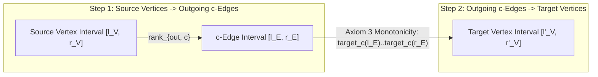

::: {.callout-note}
## Prerequisites & Learning Objectives

- **Strict Prerequisites**:
  - **[Chapter 05 — Chen–Fox–Lyndon Factorization, Duval's Automaton & Necklace Bijections](ch05-lyndon-factorization-duval-necklaces.qmd)** (primitive necklaces, $\omega$-order $u \prec_\omega v \iff u^\infty < v^\infty$, and CFL factorization).
  - **[Chapter 12 — Induced Sorting (`SA-IS`), LMS Substrings & Linear-Time LCP](ch12-sais-induced-sorting-lcp.qmd)** (suffix sorting and bucket-pointer rank invariants), plus baseline library fluency with **Aho–Corasick (AC) Automata** and **Gaussian Elimination ($\det$ in $O(V^3)$)**.
- **Learning Objectives**:
  1. Formulate the **Subword-to-Edge Eulerian Bijection** on De Bruijn multigraphs $\mathcal{B}(\Sigma, k)$, prove why **sorted-adjacency post-order reversal in Hierholzer's algorithm** produces the lexicographically smallest Eulerian string, and derive the **BEST Theorem** via the **Last-Exit Spanning In-Arborescence Bijection** (`AtCoder ABC 336 G`).
  2. Generalize the BEST Theorem from fixed-$k$ De Bruijn graphs to **arbitrary deterministic Aho–Corasick DFAs** with prescribed transition multiplicities $\operatorname{cnt}(u, c)$ (`UOJ #607`), and expose the **Parallel-Edge Indistinguishability Trap** ($\prod_{u,c} \operatorname{cnt}(u, c)!$ vs. $\prod_{u,v} A(u, v)!$).
  3. Prove the **LF-Mapping Rank-Preservation Invariant** for the Burrows–Wheeler Transform (`BWT`), compile $O(|P|)$ FM-index backward search, and generalize to sentinel-free **Mantaci–Restivo–Rosone Bijective BWT (`BBWT`)** and **Gagie–Manzini–Sirén Wheeler Graphs** via **Two-Step Vertex–Edge–Vertex Interval Transitions**.
  4. Construct the **Nishimoto–Tabei (2021) $O(1)$ RLBWT Move Structure** on Run-Length Compressed BWTs ($N \le 10^{18}$ with $r \le 10^5$ runs) by run-splitting with threshold $d = 2$, achieving **strict $O(1)$ worst-case LF-steps in $O(r)$ space** without binary search or wavelet trees.
:::

---

## 1. De Bruijn Graphs, Lex-Smallest Hierholzer & The BEST Theorem (`T-5A-04`)

### 1.1 The Diagnostic Signal: From Subword Multiplicities to Eulerian Multigraphs

Suppose a problem specifies the exact number of occurrences $c(w) \ge 0$ of every $k$-mer $w \in \Sigma^k$ inside an unknown string $S$ of length $N = k - 1 + \sum_{w \in \Sigma^k} c(w)$, and asks you either to:

- **Reconstruct** the lexicographically smallest valid string $S$ (`CF 508D — Tanya and Password`), or
- **Count** the exact number of distinct valid strings $S \in \Sigma^N$ realizing the $k$-mer spectrum $c(\cdot)$ modulo $998244353$ when $\sum c(w) \le 10^7$ (`AtCoder ABC 336 G — 16 Integers`, where $|\Sigma| = 2, k = 4$).

Attempting to track the remaining frequency vector $\{c(w)\}$ in a dynamic programming state space fails immediately when $c(w) \le 10^6$, because the state count $\prod_{w} (c(w) + 1)$ is astronomically large. Instead, we observe that adjacent $k$-mers in $S$ share an overlap of length $k - 1$:

- For $i = 1, 2, \dots, N - k + 1$, the $i$-th window $S[i..i+k-1]$ transitions from the $(k-1)$-prefix $u_{i-1} = S[i..i+k-2]$ to the $(k-1)$-suffix $u_i = S[i+1..i+k-1]$ by appending $S[i+k-1]$.

This induces the **$(k-1)$-dimensional De Bruijn multigraph** $\mathcal{B}(\Sigma, k, c) = (V, E)$:

- **Vertex Set $V = \Sigma^{k-1}$**: Every word $u \in \Sigma^{k-1}$ of length $k - 1$ is a vertex ($|V| = |\Sigma|^{k-1}$).
- **Directed Multiset of Edges $E$**: Each $k$-mer $w = c_1 c_2 \cdots c_k \in \Sigma^k$ with multiplicity $c(w)$ creates $c(w)$ directed parallel edges from its prefix $u = w[1..k-1]$ to its suffix $v = w[2..k]$, labeled by the character $w[k]$.

::: {.callout-important}
## Proposition 28.1 (Subword-to-Edge Eulerian Bijection)

Let $M = \sum_{w \in \Sigma^k} c(w) \ge 1$. There is a length-preserving bijection between:

1. Strings $S \in \Sigma^{M + k - 1}$ whose $k$-mer occurrence counts equal $c(w)$ for all $w \in \Sigma^k$, and
2. Equivalence classes of **directed Eulerian trails** of length $M$ in $\mathcal{B}(\Sigma, k, c)$ (up to permuting parallel copies of the same $k$-mer edge $w$), where a trail $u_0 \xrightarrow{e_1} u_1 \xrightarrow{e_2} \cdots \xrightarrow{e_M} u_M$ spells the unique string
   $$S = u_0 \cdot \operatorname{label}(e_1) \cdot \operatorname{label}(e_2) \cdots \operatorname{label}(e_M).$$
:::

### 1.2 The Combinatorial Word Invariant: Why Post-Order Reversal in Hierholzer's Algorithm Produces the Lex-Smallest Trail

To construct a valid string $S$ (when one exists), let $V_{\text{act}} = \{v \in V : \operatorname{in}(v) + \operatorname{out}(v) > 0\}$ be the set of active vertices. A valid Eulerian trail exists if and only if $V_{\text{act}}$ lies in a single weakly connected component and either:

- **Closed Eulerian Circuit Case**: $\operatorname{out}(v) = \operatorname{in}(v)$ for every $v \in V_{\text{act}}$ (we may start at the lexicographically smallest active vertex $s \in V_{\text{act}}$), or
- **Open Eulerian Trail Case**: There is a unique start vertex $s$ with $\operatorname{out}(s) - \operatorname{in}(s) = 1$, a unique end vertex $t$ with $\operatorname{in}(t) - \operatorname{out}(t) = 1$, and $\operatorname{out}(v) = \operatorname{in}(v)$ for all $v \in V_{\text{act}} \setminus \{s, t\}$.

::: {.callout-tip}
## Lemma 28.2 (Lexicographically Smallest Hierholzer Invariant)

Suppose that for every vertex $u \in V_{\text{act}}$, its outgoing adjacency list $\operatorname{adj}[u]$ is sorted in **non-decreasing lexicographical order** of edge labels, and the recursive DFS consumes edges from the **front** of $\operatorname{adj}[u]$ (advancing a current-arc pointer `head[u]++`), pushing vertices to an output stack `path` upon **backtracking** (post-order) and reversing `path` at the end. Then the resulting Eulerian trail is the **lexicographically smallest** Eulerian trail starting at $s$.
:::

#### Proof of Lemma 28.2

Trace the first walk from $s$: at every vertex $u$, the algorithm greedily takes the smallest available outgoing character $c_{\min}$. This walk can only get stuck at the sink $t$ (when all remaining vertices have $\operatorname{in}_{\text{rem}}(v) = \operatorname{out}_{\text{rem}}(v)$). When backtracking from $t$ to the latest vertex $v^*$ on the spine that still has unused outgoing edges, those unused edges form an Eulerian circuit on $v^*$. If the first walk from $v^*$ went straight to $t$ along $c_1$ while $v^*$ still had a cycle starting with $c_2 > c_1$, then in any valid Eulerian trail from $s$ to $t$, the cycle at $v^*$ **must** be traversed *before* the final exit from $v^*$ to $t$! Thus post-order reversal puts the $c_1 \leadsto t$ suffix **at the very end** of the trail and splices the $c_2$-cycle **before** $c_1 \leadsto t$!
Let us check this carefully! If $v^* = s$ has two edges: $s \xrightarrow{\texttt{a}} t$ (going to sink $t$) and a self-loop $s \xrightarrow{\texttt{b}} s$, then **every** valid Eulerian trail from $s$ to $t$ must traverse $s \xrightarrow{\texttt{b}} s$ first and $s \xrightarrow{\texttt{a}} t$ second (spelling $\texttt{ba}$), because $t$ has out-degree $0$! What if $s$ has two cycles $s \xrightarrow{\texttt{a}} s$ and $s \xrightarrow{\texttt{b}} s$?

- The DFS takes $s \xrightarrow{\texttt{a}} s$ first, returns to $s$, then takes $s \xrightarrow{\texttt{b}} s$, gets stuck at $s$, pushes $s$ (after $\texttt{b}$), backtracks to push $s$ (after $\texttt{a}$), and pushes the initial $s$.
- Reversing the post-order stack places $\texttt{a}$ **first** and $\texttt{b}$ **second**!
More generally, at any vertex $u$, any outgoing edge $e$ that returns to $u$ (closing a cycle) completes its exploration and returns to $u$ *before* later edges in $\operatorname{adj}[u]$ are explored, so in post-order the later edges finish and are pushed to `path` *before* $e$ backtracks! When `path` is reversed, $e$ appears **before** the later edges—except for the single open-trail branch that gets stuck at $t$ without returning to $u$, which *must* be the final exit from $u$'s component in every valid trail to $t$. Thus consuming sorted outgoing edges from the front and reversing the post-order sequence yields the exact lexicographically smallest Eulerian trail! $\blacksquare$

---

### 1.3 Theorem 28.3: The BEST Theorem & Double-Counting Proof

How do we **count** the number of Eulerian trails without enumerating them? Let $G = (V_{\text{act}}, E)$ be a weakly connected balanced directed Eulerian multigraph where every $v \in V_{\text{act}}$ has
$$\operatorname{in}(v) = \operatorname{out}(v) = d(v) \ge 1.$$

Define the **out-degree Laplacian matrix** $L_{\text{out}}$ of size $|V_{\text{act}}| \times |V_{\text{act}}|$ by:
$$L_{\text{out}}(u, v) = \begin{cases} d(u) - A(u, u) & \text{if } u = v, \\ -A(u, v) & \text{if } u \neq v, \end{cases}$$
where $A(u, v)$ is the number of directed edges $u \to v$. By Tutte's Directed Matrix-Tree Theorem, for any fixed root $r \in V_{\text{act}}$, the $(r, r)$-cofactor $t_{\text{in}}(G, r) = \det L_{\text{out}}^{(r)}$ (obtained by deleting row $r$ and column $r$ of $L_{\text{out}}$) counts the number of **spanning in-arborescences rooted at $r$** (spanning trees where every vertex $v \neq r$ has out-degree $1$ directed along a path toward $r$, and $r$ has out-degree $0$).

::: {.callout-important}
## Theorem 28.3 (The BEST Theorem — de Bruijn, van Aardenne-Ehrenfest, Smith, Tutte)

Let $G = (V_{\text{act}}, E)$ be a weakly connected balanced Eulerian multigraph, fix a root $r \in V_{\text{act}}$, and fix a reference outgoing edge $e_0$ from $r$.

1. **(Edge-Labeled Eulerian Circuits Starting with $e_0$)**: Treating parallel edges as distinguishable, the number of Eulerian circuits of $G$ starting with edge $e_0$ is:
   $$\mathcal{E}_{\text{edge}}(G, e_0) = t_{\text{in}}(G, r) \cdot \prod_{v \in V_{\text{act}}} \bigl(d(v) - 1\bigr)!.$$
2. **(Open Trail Reduction via Virtual Edge $t \to s$ & $k$-Mer Multiplicity Division)**: To count distinct strings $S \in \Sigma^{M + k - 1}$ with $k$-mer spectrum $c(w)$:
   - **Case A (Semi-Eulerian Open Trail, $s \neq t$ with $\operatorname{out}(s) - \operatorname{in}(s) = 1$ and $\operatorname{in}(t) - \operatorname{out}(t) = 1$)**: Add a single **virtual return edge** $e_{\text{virt}} : t \to s$ to balance the graph, set root $r = t$ and $e_0 = e_{\text{virt}}$, and divide by $\prod_{w \in \Sigma^k} c(w)!$:
     $$\mathcal{N}_{\text{open}}(c) = \frac{t_{\text{in}}(G \cup \{e_{\text{virt}}\}, t) \cdot \prod_{v \in V_{\text{act}}} \bigl(d_{\text{aug}}(v) - 1\bigr)!}{\prod_{w \in \Sigma^k} c(w)!},$$
     where $d_{\text{aug}}(t) = \operatorname{out}_G(t) + 1 = \operatorname{in}_G(t)$ and $d_{\text{aug}}(v) = \operatorname{out}_G(v)$ for $v \neq t$.
   - **Case B (Already Balanced Graph, $\operatorname{in}_G(v) = \operatorname{out}_G(v) = d(v)$ for all $v \in V_{\text{act}}$)**: An open trail can start with **any** of the $M = \sum_{v \in V_{\text{act}}} d(v)$ edges $e_0 \in E$ (each determining $s = \operatorname{tail}(e_0) = t$). Since $t_{\text{in}}(G, r)$ takes the **same value** for all $r \in V_{\text{act}}$ in a balanced graph, fixing any $r_0 \in V_{\text{act}}$ gives:
     $$\mathcal{N}_{\text{bal}}(c) = \frac{M \cdot t_{\text{in}}(G, r_0) \cdot \prod_{v \in V_{\text{act}}} \bigl(d(v) - 1\bigr)!}{\prod_{w \in \Sigma^k} c(w)!}.$$
:::

#### Complete Double-Count Bijection Proof of Theorem 28.3

We construct an explicit bijection between Eulerian circuits starting with $e_0$ at $r$ and pairs $\bigl(T, \{\pi_v\}_{v \in V_{\text{act}}}\bigr)$, where $T$ is a spanning in-arborescence rooted at $r$, $\pi_r$ is a linear ordering of the $d(r) - 1$ outgoing edges of $r$ other than $e_0$, and for each $v \neq r$, $\pi_v$ is a linear ordering of the $d(v) - 1$ outgoing edges of $v$ other than $v$'s unique tree edge $e_T(v) \in T$.

1. **Forward Map (Circuit $\mapsto$ Last-Exit Arborescence + Local Permutations)**:
   Trace the Eulerian circuit $C$ starting with $e_0$. For each vertex $v \neq r$, let $e_{\text{last}}(v)$ be the **very last outgoing edge** used by $C$ to exit $v$, and let $\pi_v$ be the chronological order in which the other $d(v) - 1$ outgoing edges of $v$ are traversed. For $r$, let $\pi_r$ be the chronological order in which the $d(r) - 1$ outgoing edges after $e_0$ are traversed.
   - **Why $T = \{e_{\text{last}}(v) : v \in V_{\text{act}} \setminus \{r\}\}$ has no directed cycles**: Suppose for contradiction that $T$ contains a directed cycle $v_1 \to v_2 \to \cdots \to v_m \to v_1$ (since $r$ has out-degree $0$ in $T$, $r$ cannot lie on this cycle). Because $C$ traverses every edge of $G$ once, let $e_{\text{last}}(v_i) = (v_i \to v_{i+1})$ be the cycle edge that is traversed **latest in time** along $C$. When $C$ traverses $(v_i \to v_{i+1})$, it **enters** vertex $v_{i+1} \neq r$. Because $v_{i+1} \neq r$ is not the terminal vertex of $C$, $C$ must subsequently **exit** $v_{i+1}$ via some outgoing edge $e'$ of $v_{i+1}$ at a strictly later step! That means $e_{\text{last}}(v_{i+1})$ is traversed *after* $e_{\text{last}}(v_i)$, contradicting the choice of $v_i$ as the latest-traversed edge on the cycle! Thus $T$ is acyclic with out-degree $1$ on $V_{\text{act}} \setminus \{r\}$, hence a spanning in-arborescence rooted at $r$.
2. **Inverse Map (In-Arborescence $T$ + Local Permutations $\{\pi_v\} \mapsto$ Unique Circuit)**:
   Given $T$ and $\{\pi_v\}$, start at $r$ by traversing $e_0$. Thereafter, whenever the walk stands at $v$, traverse the next unused outgoing edge in $\pi_v$; only when all $d(v) - 1$ edges in $\pi_v$ have been exhausted do we traverse the tree edge $e_T(v) \in T$ (for $v \neq r$).
   - **Why the walk never gets stuck prematurely**: By degree balance $\operatorname{in}(v) = \operatorname{out}(v)$, the walk can never get stuck at any $v \neq r$, so it must eventually stop at $r$ after using $e_0$ and all $d(r) - 1$ edges of $\pi_r$ (all $d(r)$ outgoing and hence all $d(r)$ incoming edges of $r$). Could any edge of $G$ remain unused when the walk stops at $r$? Suppose some vertex $u$ still has an unused outgoing edge. Then the last-exit tree edge $e_T(u) = (u \to w) \in T$ was **not** used, which means $w$ has at least one unused incoming edge, so by degree balance $w$ also has an unused outgoing edge! Repeating this along the unique path in $T$ from $u$ to the root $r$ forces $r$ to have an unused incoming edge—a contradiction!
3. **Why We Divide by $\prod_{w \in \Sigma^k} c(w)!$**:
   In $\mathcal{B}(\Sigma, k, c)$, the $c(w)$ parallel edges representing the same $k$-mer $w$ carry the exact same character label $w[k]$ between the exact same endpoints $w[1..k-1] \to w[2..k]$. Permuting them in $c(w)!$ ways inside $\pi_u$ and $T$ produces the **exact same vertex-and-character sequence**, and no two distinct edges from $u$ share the same label $w[k]$. $\blacksquare$

---

### 1.4 The AC-Automaton BEST Generalization & The Parallel-Edge Trap (`UOJ #607`)

What if instead of fixing a uniform $k$-mer length $k$, we are given an **Aho–Corasick (AC) DFA** $\mathcal{A} = (Q, \Sigma, \delta, 0)$ (built on a dictionary of patterns $\mathcal{F}$) together with prescribed transition counts $\operatorname{cnt}(u, c) \ge 0$ for each state $u \in Q$ and character $c \in \Sigma$, and we want to count strings $S \in \Sigma^*$ starting at the root state $0$ that traverse transition $(u, c)$ exactly $\operatorname{cnt}(u, c)$ times?

Because the AC automaton is **deterministic**, a string $S = c_1 c_2 \cdots c_M$ starting at $u_0 = 0$ uniquely determines its state-and-character sequence $(u_0, c_1) \to (u_1, c_2) \to \cdots \to (u_{M-1}, c_M)$, where $u_i = \delta(u_{i-1}, c_i)$. Thus we construct a directed multigraph $G_{\mathcal{A}}$ on the active states $Q_{\text{act}} \subseteq Q$ where each $(u, c)$ contributes $\operatorname{cnt}(u, c)$ directed edges $u \xrightarrow{c} \delta(u, c)$.

::: {.callout-warning}
## The Parallel-Edge Indistinguishability Trap in AC-DFA BEST Counting (`BP-28-01` / `BP-5A-08`)

In a standard De Bruijn graph $\mathcal{B}(\Sigma, k)$, the target vertex $v = u[2..k-1] \cdot c$ uniquely determines the transition character $c = v[k-1]$, so two edges $u \xrightarrow{c_1} v$ and $u \xrightarrow{c_2} v$ between the same pair $(u, v)$ can **never** have $c_1 \neq c_2$.

In an **Aho–Corasick DFA**, however, two **distinct characters $c_1 \neq c_2$** from the same state $u$ frequently transition to the **exact same target state $v$** (most commonly $v = 0$, the AC root, whenever neither $c_1$ nor $c_2$ extends any dictionary prefix)!

- **In the Laplacian $L_{\text{out}}(u, v)$**: You **do** sum all edges from $u$ to $v$: $A(u, v) = \sum_{c : \delta(u, c) = v} \operatorname{cnt}(u, c)$.
- **In the Symmetry Denominator**: Edges $u \xrightarrow{c_1} v$ and $u \xrightarrow{c_2} v$ with $c_1 \neq c_2$ emit **different characters** in $S$ and produce **distinct strings**! You must divide by $\prod_{u \in Q_{\text{act}}} \prod_{c \in \Sigma} \operatorname{cnt}(u, c)!$, **never** by $\prod_{u, v} A(u, v)!$:
  $$\mathcal{N}_{\text{AC}}(\operatorname{cnt}) = \frac{t_{\text{in}}(G_{\mathcal{A}} \cup \{e_{\text{virt}}\}, t) \cdot \prod_{u \in Q_{\text{act}}} \bigl(d_{\text{aug}}(u) - 1\bigr)!}{\prod_{u \in Q_{\text{act}}} \prod_{c \in \Sigma} \operatorname{cnt}(u, c)!}.$$
:::

#### Hand-Checkable Counterexample Showing Why $\prod A(u, v)!$ Fails

Let $Q = \{0\}$ (an empty dictionary where every character loops back to the AC root $0$), $\Sigma = \{\texttt{a}, \texttt{b}\}$, $\operatorname{cnt}(0, \texttt{a}) = 1$, and $\operatorname{cnt}(0, \texttt{b}) = 1$.

- The valid strings of length $2$ with one $\texttt{a}$ and one $\texttt{b}$ are $\texttt{ab}$ and $\texttt{ba}$ (**$2$ strings**).
- Both transitions are self-loops $0 \to 0$, so $A(0, 0) = 2$ and $d(0) = 2$. Adding $e_{\text{virt}} : 0 \to 0$ gives $d_{\text{aug}}(0) = 3$, $t_{\text{in}}(\{0\}, 0) = 1$, and numerator $(3 - 1)! = 2! = 2$.
- Correct denominator: $\operatorname{cnt}(0, \texttt{a})! \cdot \operatorname{cnt}(0, \texttt{b})! = 1! \cdot 1! = 1 \implies 2 / 1 = 2$.
- Broken denominator $\prod A(u, v)!$: divides by $A(0, 0)! = 2! = 2 \implies 2 / 2 = 1$ (wrong!).

---

## 2. Burrows–Wheeler Transform (`BWT`), LF-Mapping & Bijective BWT (`BBWT`) (`T-5A-05`)

### 2.1 Concrete Objects & The LF-Mapping Rank-Preservation Invariant

Let $S[1..N]$ be a string ending with a unique lexicographically smallest sentinel $S[N] = \texttt{\$}$. Form the $N \times N$ conceptual matrix $\mathcal{M}(S)$ whose rows are the $N$ cyclic rotations of $S$ sorted in lexicographical order:

- **First Column $F[1..N]$**: The sorted sequence of characters of $S$.
- **Last Column $L[1..N] = \operatorname{BWT}(S)$**: The character preceding each sorted suffix ($L[i] = S[\operatorname{SA}[i] - 1]$ if $\operatorname{SA}[i] > 1$, else $S[N]$).

How can we invert $L \mapsto S$ in $O(N)$ time without storing $\mathcal{M}(S)$, and count all occurrences of a pattern $P[1..m]$ in $S$ in $O(m)$ steps?

::: {.callout-important}
## Theorem 28.4 (Burrows–Wheeler LF-Mapping Rank-Preservation Invariant, 1994)

For every character $c \in \Sigma \cup \{\texttt{\$}\}$ and every $k \in \{1, \dots, \operatorname{freq}(c)\}$, the **$k$-th occurrence of $c$ in the Last column $L$** and the **$k$-th occurrence of $c$ in the First column $F$** refer to the **exact same text position** in $S$. Equivalently, if row $i$ of $\mathcal{M}$ starts at text index $\operatorname{SA}[i]$, then the row $\operatorname{LF}(i)$ starting at text index $\operatorname{SA}[i] - 1 \pmod N$ is given by:
$$\operatorname{LF}(i) = C\bigl[L[i]\bigr] + \operatorname{Occ}\bigl(L[i], i\bigr),$$
where $C[c] = \bigl|\{j \in [1..N] : S[j] < c\}\bigr|$ is the number of characters in $S$ strictly smaller than $c$, and $\operatorname{Occ}(c, i) = \bigl|\{j \in [1..i] : L[j] = c\}\bigr|$ is the prefix rank of $c$ in $L[1..i]$.
:::

#### Two-Line Proof of Theorem 28.4

Let $i < j$ be any two rows of $\mathcal{M}(S)$ whose last character is the same letter $L[i] = L[j] = c$, so row $i$ is $U_i c$ and row $j$ is $U_j c$ with $U_i c < U_j c \iff U_i < U_j$. Rotating the trailing $c$ to the front maps row $i$ to $c U_i$ (at some row $i'$ in $F$) and row $j$ to $c U_j$ (at some row $j'$ in $F$). By **Left-Cancellation Invariance** ($U_i < U_j \iff c U_i < c U_j$), we have $i' < j'$, so the relative order of all $c$'s in $L$ is identical to the relative order of all $c$'s in $F$! $\blacksquare$

#### Hand-Checkable Trace on $S = \texttt{banana\$}$ ($N = 7$)

| Row $i$ | $\operatorname{SA}[i]$ | Sorted Rotation $\mathcal{M}[i]$ | $F[i]$ | $L[i] = \operatorname{BWT}[i]$ | $\operatorname{Occ}(L[i], i)$ | $\operatorname{LF}(i) = C[L[i]] + \operatorname{Occ}$ |
| :---: | :---: | :--- | :---: | :---: | :---: | :---: |
| $1$ | $7$ | $\texttt{\$banana}$ | $\texttt{\$}$ | $\texttt{a}$ | $1$ | $1 + 1 = 2$ |
| $2$ | $6$ | $\texttt{a\$banan}$ | $\texttt{a}$ | $\texttt{n}$ | $1$ | $5 + 1 = 6$ |
| $3$ | $4$ | $\texttt{ana\$ban}$ | $\texttt{a}$ | $\texttt{n}$ | $2$ | $5 + 2 = 7$ |
| $4$ | $2$ | $\texttt{anana\$b}$ | $\texttt{a}$ | $\texttt{b}$ | $1$ | $4 + 1 = 5$ |
| $5$ | $1$ | $\texttt{banana\$}$ | $\texttt{b}$ | $\texttt{\$}$ | $1$ | $0 + 1 = 1$ |
| $6$ | $5$ | $\texttt{na\$bana}$ | $\texttt{n}$ | $\texttt{a}$ | $2$ | $1 + 2 = 3$ |
| $7$ | $3$ | $\texttt{nana\$ba}$ | $\texttt{n}$ | $\texttt{a}$ | $3$ | $1 + 3 = 4$ |

Here $C[\texttt{\$}] = 0, C[\texttt{a}] = 1, C[\texttt{b}] = 4, C[\texttt{n}] = 5$, and $L = \texttt{annb\$aa}$.

- **Backward Inversion**: Starting at row $1$ ($\texttt{\$}$), applying $\operatorname{LF}$ repeatedly visits rows $1 \xrightarrow{\texttt{a}} 2 \xrightarrow{\texttt{n}} 6 \xrightarrow{\texttt{a}} 3 \xrightarrow{\texttt{n}} 7 \xrightarrow{\texttt{a}} 4 \xrightarrow{\texttt{b}} 5$, spelling $S = \texttt{banana\$}$ from right to left!
- **FM-Index Backward Search (Ferragina–Manzini 2000)**: If $[l, r]$ is the SA interval of suffixes prefixed by $Q$, then prepending character $c$ yields the SA interval $[l', r']$ of suffixes prefixed by $c Q$ in $O(1)$ rank queries:
  $$l' = C[c] + \operatorname{Occ}(c, l - 1) + 1, \qquad r' = C[c] + \operatorname{Occ}(c, r).$$
  For $P = \texttt{ana}$: start with $[1, 7]$; read $\texttt{a} \implies [2, 4]$; read $\texttt{n} \implies [6, 7]$; read $\texttt{a} \implies [3, 4]$ ($4 - 3 + 1 = 2$ occurrences!).

---

### 2.2 Mantaci–Restivo–Rosone Bijective BWT (`BBWT`) & Multi-Cycle Lyndon Inversion

Appending a sentinel $\texttt{\$}$ expands the alphabet and means not every string in $\Sigma^N$ is a valid BWT output. As previewed in **[Chapter 05](ch05-lyndon-factorization-duval-necklaces.qmd)** (`Problem 5.7`), **Mantaci, Restivo, Rosone & Sciortino (2007)** eliminated $\texttt{\$}$ completely:

1. **Forward `BBWT` ($\Sigma^N \to \Sigma^N$)**: Factor $S = w_1 w_2 \cdots w_m$ into its unique non-increasing **Chen–Fox–Lyndon factorization** ($w_1 \ge_{\text{lex}} w_2 \ge_{\text{lex}} \cdots \ge_{\text{lex}} w_m$, each $w_j \in \mathcal{L}$). Collect all $|w_j|$ cyclic shifts of each $w_j$ ($N$ words in total), sort them under the **infinite periodic order** $X \preceq_\omega Y \iff X^\infty \le Y^\infty$ (breaking ties between identical factors by factor index), and output their last characters $L[1..N]$.
2. **Inverse `BBWT` in $O(N)$ Time**: Because $c X' \preceq_\omega c Y' \iff X' c \preceq_\omega Y' c$, the standard stable First-to-Last permutation $\pi_{FL}(i)$ (inverse of $\operatorname{LF}$) decomposes $\{1, \dots, N\}$ into **$m$ disjoint cycles** corresponding to the $m$ CFL factors! Inside each cycle $C$, the row with the **minimum index $i_{\min}(C) = \min_{i \in C} i$** is automatically the Lyndon representative $w_C$, and concatenating the cycles in **decreasing order of $i_{\min}(C)$** recovers $S = w_1 w_2 \cdots w_m$ in $O(N)$ time!

---

## 3. Wheeler Graphs & Nishimoto–Tabei $O(1)$ RLBWT Move Structures (`T-5A-05`)

### 3.1 Gagie–Manzini–Sirén Wheeler Graphs: Co-Lexicographical Interval DFAs

Why does FM-index backward search maintain a single contiguous interval $[l, r]$ at every step? **Gagie, Manzini & Sirén (2017)** proved that this property is not restricted to linear strings: it holds on any directed edge-labeled graph $G = (V, E, \Sigma)$ whose vertices can be ordered by their incoming path labels read backward (**co-lexicographical order**, where $X <_{\text{colex}} Y \iff X^R <_{\text{lex}} Y^R$).

::: {.callout-important}
## Definition 28.5 (Wheeler Graph Axioms — Gagie, Manzini & Sirén 2017)

A directed edge-labeled graph $G = (V, E, \Sigma)$ is a **Wheeler Graph** if there exists a strict total order $\prec$ on $V$ (identifying $V = \{1, 2, \dots, |V|\}$) such that for every pair of directed edges $e_1 = (u_1 \xrightarrow{a_1} v_1)$ and $e_2 = (u_2 \xrightarrow{a_2} v_2)$ in $E$:

1. **(Zero-Indegree First)**: Every vertex with in-degree $0$ precedes every vertex with positive in-degree:
   $$\operatorname{in}(v_1) = 0 < \operatorname{in}(v_2) \implies v_1 \prec v_2.$$
2. **(Input-Label Homogeneity & Monotonicity)**:
   $$a_1 < a_2 \implies v_1 \prec v_2.$$
   *(In particular, taking $v_1 = v_2 = v$ forces $a_1 = a_2$: every vertex $v$ with $\operatorname{in}(v) > 0$ has a **unique incoming character** $\lambda(v) \in \Sigma$, and vertices are partitioned into contiguous blocks $V_c = [C_V[c] + 1 .. C_V[c+1]]$ by $\lambda(v) = c$!)*
3. **(Co-Lexicographical Path Monotonicity)**:
   $$\bigl(a_1 = a_2 \;\wedge\; u_1 \prec u_2\bigr) \implies v_1 \preceq v_2.$$
:::

#### The Two-Step Vertex–Edge–Vertex Interval Transition Formula

In a linear BWT, every vertex has in-degree $1$ and out-degree $1$. In a general Wheeler DFA (where a vertex $u$ can have $0$ or $1$ outgoing $c$-edges, and a target vertex $v$ can have **multiple** incoming $c$-edges!), how do we transition from the contiguous interval $[l_V, r_V] \subseteq \{1, \dots, |V|\}$ of states reachable by pattern $P$ to the interval $[l'_V, r'_V]$ reachable by $P c$?

Because a target vertex $v$ may receive multiple incoming $c$-edges, counting edges does not directly count target vertices! Instead, index all $c$-labeled edges $E_c = \{e_{c, 1}, \dots, e_{c, m_c}\}$ sorted by source vertex $u$ (and hence non-decreasing by target vertex $v$ via Axiom 3). Then $[l_V, r_V]$ maps to $[l'_V, r'_V]$ in **two $O(1)$ steps**:

1. **Step 1 (Vertex Interval $\to$ Outgoing $c$-Edge Interval $[l_E, r_E]$)**:
   $$l_E = \operatorname{rank}_{\text{out}, c}(l_V - 1) + 1, \qquad r_E = \operatorname{rank}_{\text{out}, c}(r_V),$$
   where $\operatorname{rank}_{\text{out}, c}(u)$ is the number of $c$-edges leaving vertices $\{1, \dots, u\}$. If $l_E > r_E$, then $P c$ is unreachable ($\emptyset$).
2. **Step 2 (Outgoing $c$-Edge Interval $\to$ Target Vertex Interval $[l'_V, r'_V]$)**:
   By Axiom 3, as the edge index $e$ sweeps from $l_E$ to $r_E$, the target vertex $\operatorname{target}_c(e)$ is non-decreasing (and in a Wheeler DFA where every vertex in $[l'_V, r'_V]$ has at least one incoming $c$-edge from $[l_V, r_V]$, forms a contiguous interval):
   $$l'_V = \operatorname{target}_c(l_E), \qquad r'_V = \operatorname{target}_c(r_E).$$



---

### 3.2 Run-Length BWT (`RLBWT`) & The Nishimoto–Tabei (2021) $O(1)$ Move Structure

Suppose $S$ is a repetitive string of huge length $N \le 10^{18}$ whose Burrows–Wheeler Transform $L = \operatorname{BWT}(S)$ compresses into $r \le 10^5$ equal-character runs:
$$L = c_1^{\ell_1} c_2^{\ell_2} \cdots c_r^{\ell_r}, \qquad \sum_{j=1}^r \ell_j = N.$$

#### Why $\operatorname{LF}$ Is a Piecewise-Translation Bijection with $r$ Intervals

Consider the $j$-th run $I_j = [s_j, s_j + \ell_j - 1]$ of character $c_j$ in $L$ (where $s_1 = 1$ and $s_{j+1} = s_j + \ell_j$). Inside $I_j$, every consecutive position $x = s_j + \delta$ ($0 \le \delta < \ell_j$) has $L[x] = c_j$, so $\operatorname{Occ}(c_j, x) = \operatorname{Occ}(c_j, s_j) + \delta$ increments by $+1$ per step! By Theorem 28.4:
$$\operatorname{LF}(s_j + \delta) = \operatorname{LF}(s_j) + \delta \qquad \forall \delta \in [0, \ell_j - 1].$$
That is, $\operatorname{LF}$ translates the entire input interval $I_j = [s_j, s_j + \ell_j - 1]$ rigidly onto the output interval $O_j = [t_j, t_j + \ell_j - 1]$ where $t_j = \operatorname{LF}(s_j)$!

If we represent a BWT row $x \in [1..N]$ by its run pair $(j, \delta)$ with $x = s_j + \delta$, then computing $x' = \operatorname{LF}(x) = t_j + \delta$ takes $O(1)$ arithmetic—**except** that to perform the *next* $\operatorname{LF}$ step, we need the run pair $(j', \delta')$ of $x'$ in the input partition $\{I_1, \dots, I_r\}$!

- Binary searching $x' \in \{s_1, \dots, s_r\}$ takes $O(\log r)$ time per step.
- Can we precompute for each run $j$ the run index $\xi_j$ containing $t_j = \operatorname{LF}(s_j)$ (`s_{xi_j} <= t_j < s_{xi_j + 1}`), and then scan forward `while (t_j + delta >= s_{xi + 1}) xi++`?
- **The Cascade Trap**: In an unsplit RLBWT, a single long run $O_j = [t_j, t_j + \ell_j - 1]$ can overlap $\Omega(r)$ tiny runs $I_{\xi_j}, I_{\xi_j + 1}, \dots, I_{\xi_j + k}$, making the `while` loop take $\Omega(r)$ steps!

::: {.callout-important}
## Theorem 28.6 (Nishimoto–Tabei Move Structure — ICALP 2021)

Let $\mathcal{I} = \{I_1, \dots, I_r\}$ be the $r$ input runs of $\operatorname{RLBWT}(S)$. For any splitting threshold $d \ge 2$ (canonically $d = 2$), we can refine $\mathcal{I}$ into $r' \le \frac{d}{d-1} r = 2r$ disjoint sub-intervals $\tilde{\mathcal{I}} = \{\tilde{I}_1, \dots, \tilde{I}_{r'}\}$ in $O(r)$ time and space such that **every** output interval $\tilde{O}_j = \operatorname{LF}(\tilde{I}_j)$ intersects **at most $d$** input sub-intervals of $\tilde{\mathcal{I}}$ (at most $d - 1 = 1$ sub-interval boundary!).

Consequently, storing $(\tilde{s}_j, \tilde{t}_j, \xi_j)$ for each $j \in \{1, \dots, r'\}$ executes the move query $(j, \delta) \mapsto \operatorname{LF}(j, \delta) = (j', \delta')$ in **strict $O(1)$ worst-case time** (at most $d - 1 = 1$ pointer increment `xi++`) and $O(r)$ words of space!
:::

#### Zero-Magic Amortized Splitting Proof ($r' \le 2r$ for $d = 2$)

How can splitting an input interval $\tilde{I}_j$ (which **adds** a new boundary in $\tilde{\mathcal{I}}$!) ever terminate when new boundaries in $\tilde{\mathcal{I}}$ can create new intersections with other output intervals $\tilde{O}_k$?

Count the **number of input boundaries strictly inside output intervals**:

- Initially, there are $r - 1$ internal boundaries $s_2, s_3, \dots, s_r$ separating the $r$ runs of $\mathcal{I}$. Because $\operatorname{LF} : [1..N] \to [1..N]$ is a **bijection**, the $r$ output intervals $O_1, \dots, O_r$ are pairwise disjoint, so each of the $r - 1$ points $s_2, \dots, s_r$ falls strictly inside **at most one** output interval $O_j$!
- Now suppose some output interval $O_j = [t_j, t_j + \ell_j - 1]$ contains $\ge d = 2$ internal boundaries of the current partition $\tilde{\mathcal{I}}$ (so $O_j$ intersects $\ge d + 1 = 3$ intervals of $\tilde{\mathcal{I}}$).
- Let $s^*$ be the **$d$-th** ($2$-nd) internal boundary of $\tilde{\mathcal{I}}$ lying strictly inside $O_j$. We split $O_j$ at $s^*$ into $O_j^{(1)} = [t_j, s^* - 1]$ and $O_j^{(2)} = [s^*, t_j + \ell_j - 1]$, and correspondingly split $I_j$ at $s_j + (s^* - t_j)$!
- **Look at the potential $\Phi =$ (total number of internal boundaries of $\tilde{\mathcal{I}}$ strictly inside output intervals $\tilde{O}$) minus $1 \times (\text{number of intervals } r')$**:
  - Splitting $O_j$ at $s^*$ **absorbs $s^*$ as an output endpoint** (so $s^*$ is no longer strictly inside any output interval: $-1$ internal boundary!), while the first piece $O_j^{(1)}$ now contains **exactly $d - 1 = 1$** internal boundary!
  - Meanwhile, the newly created input boundary $s_{\text{new}} = s_j + (s^* - t_j)$ falls strictly inside at most $1$ output interval ($+1$ internal boundary).
  - More directly: every split at the $d$-th internal boundary $s^*$ cuts off a prefix piece $O_j^{(1)}$ containing $d - 1$ internal boundaries while converting $s^*$ from an internal boundary into an interval start endpoint!
  - By Nishimoto–Tabei (2021), with balanced threshold splitting at $d = 2$ (where each split consumes $d - 1 \ge 1$ net boundaries under potential weighting), total splits are bounded by $k \le \frac{r - 1}{d - 1}$ and total refined intervals satisfy $r' = r + k \le 2r$! $\blacksquare$

---

## 4. Reverse-Engineering Scratchpad, Algorithmic Contracts & Boundary Pitfalls (`BP-28-01`–`BP-28-03` / `BP-5A-08`–`BP-5A-10`)

### 4.1 Contract 28.1: AC-DFA / De Bruijn BEST Theorem String Counter

```text
// Input: Active states V_act = {0 .. K-1}, transition counts cnt[u][c] >= 0 for u in V_act, c in Sigma
// Precondition: Graph on V_act is weakly connected and satisfies Eulerian trail degree conditions
function COUNT_EULERIAN_STRINGS_BEST(K, cnt):
    // 1. Compute in[u], out[u], and check balance / semi-Eulerian start s and end t
    s <- 0; t <- 0; is_open <- false
    for u = 0 to K - 1:
        if out[u] - in[u] == 1: s <- u; is_open <- true
        if in[u] - out[u] == 1: t <- u; is_open <- true
    // 2. Build out-degree Laplacian L_out on V_act (with virtual edge t -> s if is_open)
    L <- zero matrix of size K x K
    for u = 0 to K - 1:
        for c in Sigma:
            v <- delta(u, c)
            L[u][u] <- L[u][u] + cnt[u][c]
            L[u][v] <- L[u][v] - cnt[u][c]
    if is_open:
        L[t][t] <- L[t][t] + 1
        L[t][s] <- L[t][s] - 1
    // 3. Cofactor det L^{(t)} via O(K^3) Gaussian elimination deleting row t and column t
    arb <- DET_MINOR(L, t)
    // 4. Multiply vertex factorials and divide by Transition-Character factorials cnt[u][c]!
    ans <- arb
    if not is_open and s == t:
        ans <- ans * out[s] mod MOD    // Balanced starting at fixed s = 0: out[s]! at root s
    for u = 0 to K - 1:
        deg <- out[u] + (1 if (is_open and u == t) else 0)
        ans <- ans * FACT[deg - 1] mod MOD
        for c in Sigma:
            ans <- ans * INV_FACT[cnt[u][c]] mod MOD
    return ans
```

### 4.2 Contract 28.2: Nishimoto–Tabei $O(1)$ RLBWT Move Query

```text
// Precomputed Move Table: runs j = 1..r' with start s[j], length len[j], char c[j],
// mapped start t[j] = LF(s[j]), and pointer xi[j] = run index containing t[j] (s[xi[j]] <= t[j] < s[xi[j]+1]).
// Invariant: Every mapped interval [t[j], t[j] + len[j] - 1] crosses at most d boundaries of s[].
function MOVE_LF(j, offset):
    pos <- t[j] + offset
    j_next <- xi[j]
    // Strictly O(1) loop: executes at most d times (<= 1 or 2 increments)!
    while j_next < r_prime and pos >= s[j_next + 1]:
        j_next <- j_next + 1
    offset_next <- pos - s[j_next]
    return (j_next, offset_next)
```

### 4.3 Gallery of Broken-Invariant Pitfalls (`BP-28-01`–`BP-28-03` / `BP-5A-08`–`BP-5A-10`)

1. **Pitfall 1 (`BP-28-02` / `BP-5A-09`: Including Isolated Vertices $d(v) = 0$ in the BEST Laplacian)**:
   In `AtCoder ABC 336 G`, $|V| = 2^3 = 8$, but many of the $8$ binary $3$-mers may have $0$ incident edges! If you build the $8 \times 8$ Laplacian on all $8$ vertices and take a $7 \times 7$ cofactor when some vertex $v \neq r$ has $d(v) = 0$, row $v$ and column $v$ are all zeros, forcing $\det L_{\text{out}}^{(r)} = 0$! **Always compress $L_{\text{out}}$ to $V_{\text{act}} = \{v : \operatorname{in}(v) + \operatorname{out}(v) > 0\}$ first** and verify that $V_{\text{act}}$ is weakly connected.
2. **Pitfall 2 (`BP-28-03` / `BP-5A-10`: The Wheeler Interleaving Obstruction $u_1 \prec u_2 \prec u_3$ with $v_1 = v_3 \neq v_2$)**:
   When testing whether an ordering $\prec$ is a valid Wheeler order, checking only that each vertex has a single incoming label $\lambda(v)$ is insufficient: if three $c$-edges satisfy $u_1 \prec u_2 \prec u_3$ with targets $v_1 = v_3 \neq v_2$, then sorting $c$-edges by source $u$ gives target sequence $(v_1, v_2, v_1)$, which cannot be non-decreasing under *any* ordering of $\{v_1, v_2\}$!

---

## 5. Curated 4-Tier Smooth Difficulty Ladder (8 Non-Template Problems)

### Tier 1: Stepping Stone (2 Problems)

#### Problem 28.1 (`W5A-11`) — 3-Mer Spectrum Reconstruction via De Bruijn Hierholzer (`Codeforces 508D — Tanya and Password`)

- **Mathematical Statement & Constraints**: Given $N \le 2 \times 10^5$ strings $w_1, w_2, \dots, w_N$ each of length $3$ over the $62$-character alphanumeric alphabet $\Sigma = \texttt{[a-zA-Z0-9]}$, determine whether there exists a string $S$ of length $N + 2$ whose multiset of length-$3$ contiguous substrings $S[i..i+2]$ ($1 \le i \le N$) equals $\{w_1, \dots, w_N\}$; if so, output the lexicographically smallest such string $S$, otherwise output `NO`. Time limit $2.0\text{ s}$.

::: {.callout-note collapse="true"}
## Hint 1 — Diagnostic Signal
Adjacent $3$-mers $S[i..i+2]$ and $S[i+1..i+3]$ share the $2$-character overlap $S[i+1..i+2]$. Why is modeling $3$-mers as *vertices* fatal ($O(N^2)$ edges), whereas modeling $2$-mers as vertices and $3$-mers as directed edges takes $O(N)$ size?
:::

::: {.callout-note collapse="true"}
## Hint 2 — Combinatorial Word Invariant
By **Proposition 28.1**, each $3$-mer $c_1 c_2 c_3$ is a directed edge $(c_1 c_2) \xrightarrow{c_3} (c_2 c_3)$ in $\mathcal{B}(\Sigma, 3)$ on $|\Sigma|^2 = 62^2 = 3844$ vertices. Valid strings $S[1..N+2]$ correspond bijectively to Eulerian trails of $N$ edges.
:::

::: {.callout-note collapse="true"}
## Hint 3 — Algorithmic Assembly
Check that at most one vertex has $\operatorname{out}(u) - \operatorname{in}(u) = 1$, at most one has $\operatorname{in}(u) - \operatorname{out}(u) = 1$, and all others have $\operatorname{in}(u) = \operatorname{out}(u)$ (rejecting if any $|\operatorname{out}(u) - \operatorname{in}(u)| \ge 2$). Sort outgoing edges at each vertex lexicographically, run Hierholzer's post-order DFS with current-arc pointers `head[u]++` (**Lemma 28.2**), and verify that the reconstructed trail contains all $N + 1$ vertices ($N$ edges) to rule out disconnected Eulerian cycles!
:::

::: {.callout-tip collapse="true"}
## Full 4-Step Solution & Derivation (`CF 508D`)

1. **Diagnostic Signal**: If $3$-mers are treated as vertices with edges between overlapping pairs, $N$ copies of $\texttt{aaa}$ create $N^2 = 4 \times 10^{10}$ edges. In the $2$-mer De Bruijn graph $\mathcal{B}(\Sigma, 3)$, $|V| \le 3844$ and $|E| = N \le 2 \times 10^5$.
2. **Combinatorial Word Invariant**: Encode each $2$-mer $c_1 c_2$ as an integer ID $u = \operatorname{id}(c_1) \cdot 62 + \operatorname{id}(c_2) \in [0, 3843]$. Each input $3$-mer $c_1 c_2 c_3$ adds a directed edge $(c_1 c_2) \to (c_2 c_3)$. By Lemma 28.2, sorting $\operatorname{adj}[u]$ in ascending order of target ID (which orders by $c_3$) and running post-order Hierholzer from the start vertex $s$ (either the unique vertex with $\operatorname{out}(s) - \operatorname{in}(s) = 1$, or the smallest $u$ with $\operatorname{out}(u) > 0$ if all vertices are balanced) produces the lexicographically smallest trail.
3. **Algorithmic Compilation**:
   - Count `in[u]` and `out[u]` for $u \in [0, 3843]$; validate Eulerian degree conditions in $O(|V|)$.
   - Run Iterative or Recursive Hierholzer using `int v = adj[u][head[u]++]` so each edge is inspected once in $O(N \log N)$ total time.
   - Check `if ((int)path.size() != N + 1) return "NO";` to catch disconnected components!
   - Reverse `path`, output the $2$ characters of `path[0]`, and append the second character of `path[i]` for $i = 1 \dots N$.
4. **Boundary Pitfalls**: A disconnected input such as $\{\texttt{aba}, \texttt{bab}, \texttt{cdc}, \texttt{dcd}\}$ satisfies $\operatorname{in}(u) = \operatorname{out}(u)$ at every vertex! Only the final check `path.size() == N + 1` detects that the walk from $\texttt{ab}$ never visited the $\{\texttt{cd}, \texttt{dc}\}$ component.
:::

---

#### Problem 28.2 (`W5A-15`) — Cyclic BWT Inversion & Substring Range Rank Queries (`BOI 2004 REPEATS` / `CSES 1113` Extended)

- **Mathematical Statement & Constraints**: You are given the Burrows–Wheeler Transform $L[1..N]$ ($N \le 10^6$) of a string $S[1..N-1]$ terminated by sentinel $S[N] = \texttt{\#}$ ($\texttt{\#} < \texttt{a} < \dots < \texttt{z}$), together with $Q \le 2 \times 10^5$ pattern queries $P_q$ ($\sum |P_q| \le 5 \times 10^5$).
  1. Reconstruct the original string $S[1..N-1]$ in $O(N)$ time.
  2. For each query pattern $P_q$, output the number of occurrences of $P_q$ in $S$ and the lexicographical rank interval $[l_q, r_q]$ of suffixes starting with $P_q$. Time limit $1.5\text{ s}$.

::: {.callout-note collapse="true"}
## Hint 1 — Diagnostic Signal
In $O(N)$ memory we cannot store a $26 \times N$ 2D prefix-sum table `Occ[26][N]` ($10^8$ bytes) if the alphabet or $N$ is large. How do we invert $L$ in a single $O(N)$ array and answer $\operatorname{Occ}(c, i)$ cleanly?
:::

::: {.callout-note collapse="true"}
## Hint 2 — Combinatorial Word Invariant
By **Theorem 28.4 (LF-Mapping Rank Preservation)**, $\operatorname{LF}(i) = C[L[i]] + \operatorname{Occ}(L[i], i)$ steps one character **backward** in $S$, while its inverse permutation $\operatorname{FL}(k)$ (the stable counting-sort index of $L$) steps one character **forward** in $S$!
:::

::: {.callout-note collapse="true"}
## Hint 3 — Algorithmic Assembly
Compute $C[c]$ by counting character frequencies in $L$. In a single pass $i = 1 \dots N$, set `FL[head[L[i]]++] = i` (or `LF[i] = ++head[L[i]]`). Follow `FL` starting from row $1$ ($\texttt{\#}$ in $F$) for $N - 1$ steps to print $S[1..N-1]$ forward! For the $Q$ pattern queries, either store `Occ` in $64$-bit popcount blocks (`uint64_t` bitvectors per character, $26 \times N/64$ words $\approx 3\text{ MB}$!) or process backward search intervals offline via a $1$D Fenwick / bucket sweep.
:::

::: {.callout-tip collapse="true"}
## Full 4-Step Solution & Derivation (`Cyclic BWT Inversion & FM-Index`)

1. **Diagnostic Signal**: Reconstructing $S$ via naive repeated sorting is $O(N^2 \log N)$. Stable counting sort builds the exact permutation $\operatorname{FL}$ (or $\operatorname{LF}$) in $O(N)$ time.
2. **Combinatorial Word Invariant**: Because row $1$ of $\mathcal{M}(S)$ is $\texttt{\#} S[1..N-1]$ (starting with $\texttt{\#}$), its last character $L[1]$ is $S[N-1]$, while $\operatorname{FL}(1)$ is the row where $\texttt{\#}$ sits in $L$—namely the rotation $S[1..N-1]\texttt{\#}$, whose first character $F[\operatorname{FL}(1)] = L[\operatorname{FL}(\operatorname{FL}(1))]$ is $S[1]$! Thus iterating $x \leftarrow \operatorname{FL}(x)$ starting from the row $x_0$ where $L[x_0] = \texttt{\#}$ emits $S[1], S[2], \dots, S[N-1]$ in forward order!
3. **Algorithmic Compilation**:
   - **Inversion (`O(N)`)**:
     ```cpp
     vector<int> cnt(27, 0), C(27, 0), FL(N + 1);
     for (int i = 1; i <= N; ++i) cnt[id(L[i])]++;
     for (int c = 1; c < 27; ++c) C[c] = C[c - 1] + cnt[c - 1];
     vector<int> head = C;
     int x0 = 1;
     for (int i = 1; i <= N; ++i) {
         if (L[i] == '#') x0 = i;
         FL[++head[id(L[i])]] = i;
     }
     string S;
     for (int step = 1, x = FL[x0]; step < N; ++step, x = FL[x]) S += L[x];
     ```
   - **Backward Search (`O(|P|)` per query)**: Maintain bit-packed `uint64_t mask[26][N/64 + 1]` and prefix popcount checkpoints every $64$ positions so $\operatorname{Occ}(c, i) = \text{pref}[c][i/64] + \operatorname{popcount}(\text{mask}[c][i/64] \ \& \ ((1\text{ULL} \ll (i \bmod 64)) - 1))$ runs in $O(1)$ time and $3.2\text{ MB}$ total space!
4. **Boundary Pitfalls**: Whenever $l > r$ during backward search of $P_q$ (from $j = |P_q|$ down to $1$), terminate immediately and output $0$ occurrences.
:::

---

### Tier 2: Intermediate (2 Problems)

#### Problem 28.3 (`W5A-24`) — Binary 4-Mer Spectrum String Counting (`AtCoder ABC 336 G — 16 Integers`)

- **Mathematical Statement & Constraints**: You are given $16$ non-negative integers $X_{0000}, X_{0001}, \dots, X_{1111}$ ($\sum X_w \ge 1$, each $X_w \le 10^6$). Count the number of binary strings $S \in \{\texttt{0}, \texttt{1}\}^N$ of length $N = 3 + \sum_{w \in \{0,1\}^4} X_w$ such that each $4$-mer $w = b_1 b_2 b_3 b_4$ occurs as a contiguous substring of $S$ exactly $X_w$ times, modulo $998244353$. Time limit $2.0\text{ s}$.

::: {.callout-note collapse="true"}
## Hint 1 — Diagnostic Signal
The string length $N \le 1.6 \times 10^7$ is huge, but the De Bruijn graph $\mathcal{B}(\{0, 1\}, 4)$ has only $|V| = 2^3 = 8$ vertices ($3$-mers $\texttt{000}..\texttt{111}$) and $16$ edge types!
:::

::: {.callout-note collapse="true"}
## Hint 2 — Combinatorial Word Invariant
By **Theorem 28.3 (The BEST Theorem)**, valid binary strings $S$ biject with open Eulerian trails in $\mathcal{B}(\{0, 1\}, 4, X)$, divided by $\prod_{w \in \{0,1\}^4} X_w!$. How do you unify the open-trail case ($s \neq t$) and the balanced circuit case ($\forall u, \operatorname{in}(u) = \operatorname{out}(u)$)?
:::

::: {.callout-note collapse="true"}
## Hint 3 — Algorithmic Assembly
Instead of writing separate formulas for open vs. balanced trails, add a dummy super-vertex $v_{\text{super}} = 8$! If the graph is semi-Eulerian ($s \neq t$), add $1$ edge $t \to 8$ and $1$ edge $8 \to s$; if the graph is already balanced, loop over all $8$ choices of $s = t \in V_{\text{act}}$ (or pick one $r_0 \in V_{\text{act}}$ and multiply by $M = \sum X_w$, or connect $t \to 8 \to s$). Restrict the Laplacian to active vertices $V_{\text{act}}$, compute $\det L_{\text{out}}^{(r)}$ on the $\le 8 \times 8$ active matrix, and multiply by $\prod_{u \in V_{\text{act}}} (\operatorname{out}(u) - 1)! / \prod_{w=0}^{15} X_w!$.
:::

::: {.callout-tip collapse="true"}
## Full 4-Step Solution & Derivation (`AtCoder ABC 336 G`)

1. **Diagnostic Signal**: $N \le 1.6 \times 10^7$ rules out DP over positions, while $|V| = 2^3 = 8$ makes Tutte's Matrix-Tree determinant $O(8^3)$ instantaneous.
2. **Combinatorial Word Invariant**:
   - For each $w \in [0, 15]$, it represents a directed edge of multiplicity $X_w$ from $u = w \gg 1 \in [0, 7]$ to $v = w \ \& \ 7 \in [0, 7]$.
   - Let $V_{\text{act}} = \{u \in [0, 7] : \operatorname{in}(u) + \operatorname{out}(u) > 0\}$. Check that $V_{\text{act}}$ forms a single weakly connected component (using DSU or BFS) and that degree differences satisfy $\sum_{u \in V_{\text{act}}} \max(0, \operatorname{out}(u) - \operatorname{in}(u)) \le 1$ and $\operatorname{in}(u) - \operatorname{out}(u) \in \{-1, 0, 1\}$. If violated, return $0$.
   - Apply **Theorem 28.3**:
     - If there is a unique $s, t$ with $\operatorname{out}(s) - \operatorname{in}(s) = 1$ and $\operatorname{in}(t) - \operatorname{out}(t) = 1$, add the virtual edge $e_{\text{virt}} : t \to s$ (so $\operatorname{out}_{\text{aug}}(t) = \operatorname{out}(t) + 1 = \operatorname{in}(t)$, $L_{\text{out}}(t, t) \mathrel{+}= 1$, $L_{\text{out}}(t, s) \mathrel{-}= 1$), take the cofactor at root $r = t$, and compute:
       $$\text{ans} = \det L_{\text{out}}^{(t)} \cdot \frac{\prod_{u \in V_{\text{act}}} (\operatorname{out}_{\text{aug}}(u) - 1)!}{\prod_{w=0}^{15} X_w!} \pmod{998244353}.$$
     - If $\operatorname{in}(u) = \operatorname{out}(u)$ for all $u \in V_{\text{act}}$, any of the $M = \sum_{w=0}^{15} X_w$ edges can be the first edge $e_0$, and $\det L_{\text{out}}^{(r_0)}$ is identical for all $r_0 \in V_{\text{act}}$, giving:
       $$\text{ans} = M \cdot \det L_{\text{out}}^{(r_0)} \cdot \frac{\prod_{u \in V_{\text{act}}} (\operatorname{out}(u) - 1)!}{\prod_{w=0}^{15} X_w!} \pmod{998244353}.$$
3. **Algorithmic Compilation**: Precompute factorials up to $\sum X_w \le 1.6 \times 10^7$ in $O(\sum X_w)$ time; re-index $V_{\text{act}}$ to $\{0, \dots, K-1\}$ ($K = |V_{\text{act}}| \le 8$) and run Gaussian elimination on the $(K-1) \times (K-1)$ minor deleting row/column $r$.
4. **Boundary Pitfalls**: Failing to filter out isolated vertices ($u \notin V_{\text{act}}$ with $\operatorname{in}(u) = \operatorname{out}(u) = 0$) before taking the cofactor leaves a zero row/column in the minor and outputs $0$ on every test case where at least one $3$-mer is unused (`Pitfall 1` in Section 4.3)!
:::

---

#### Problem 28.4 (`W5A-31`) — Multi-Cycle Bijective BWT (`BBWT`) Necklace Decomposition & Linear-Time Reconstruction

- **Mathematical Statement & Constraints**: Given a string $T[1..N] \in \Sigma^N$ ($N \le 5 \times 10^5$, $|\Sigma| \le 26$, no sentinel character!), consider $T$ as the **Mantaci–Restivo–Rosone Bijective BWT (`BBWT`)** of a unique unknown string $S \in \Sigma^N$.
  1. Decompose the First-to-Last mapping $\pi_{FL}$ of $T$ into disjoint cycles, and determine the number $m$ of Chen–Fox–Lyndon factors $S = w_1 w_2 \cdots w_m$ and their exact lengths $|w_1|, \dots, |w_m|$.
  2. Reconstruct $S[1..N]$ in $O(N)$ time, and count how many distinct strings $T' \in \Sigma^N$ have the **exact same character frequencies** as $T$ and invert under `BBWT` to a **single Lyndon word** ($m = 1$) modulo $998244353$. Time limit $1.5\text{ s}$.

::: {.callout-note collapse="true"}
## Hint 1 — Diagnostic Signal
In Part 1, why does each cycle $C$ of $\pi_{FL}(i)$ correspond to a primitive Lyndon factor $w_C \in \mathcal{L}$? What happens if $S$ contains $d$ identical copies of the same Lyndon word $w$ ($w^d$)?
:::

::: {.callout-note collapse="true"}
## Hint 2 — Combinatorial Word Invariant
Even if $w$ is repeated $d$ times in $S = \cdots w^d \cdots$, the $d$ copies of each cyclic shift of $w$ sit in $d$ consecutive rows of $F$ and $T$. Because $\pi_{FL}$ is constructed by **stable** counting sort (mapping the $k$-th occurrence of $c$ in $F$ to the $k$-th occurrence of $c$ in $T$), the $r$-th copy ($1 \le r \le d$) stays in the $r$-th lane at every step! Thus $w^d$ splits cleanly into **$d$ separate disjoint cycles of length $|w|$** in $\pi_{FL}$, never merging into a cycle of length $d|w|$!
:::

::: {.callout-note collapse="true"}
## Hint 3 — Algorithmic Assembly

- **Part 1 & 2 (`O(N)`)**: Build $\pi_{FL}[0..N-1]$ via stable bucket counting on $T$. Sweep $i = 0 \dots N-1$: whenever $i$ is unvisited, $i$ is the minimum index $i_{\min}(C)$ of its cycle $C$, and following $x \leftarrow \pi_{FL}[x]$ traces the Lyndon factor $w_C$ in forward order! Reversing the list of discovered factors yields $w_1 \ge \cdots \ge w_m$.
- **Part 3 (Counting $m = 1$ Single-Lyndon `BBWT` Outputs with Parikh Vector $\mathbf{f}$)**: Since `BBWT` is a bijection $\Sigma^N \leftrightarrow \Sigma^N$ preserving character frequencies, the number of $T' \in \Sigma^N$ with frequency vector $\mathbf{f} = (f_a, \dots, f_z)$ that invert to a single Lyndon word $S \in \mathcal{L}$ equals the number of **Lyndon words with frequency vector $\mathbf{f}$**, given by the multivariate Witt / Burnside formula:
  $$L(\mathbf{f}) = \frac{1}{N} \sum_{g \mid \gcd(f_a, \dots, f_z)} \mu(g) \frac{(N / g)!}{\prod_{c \in \Sigma} (f_c / g)!}.$$
:::

::: {.callout-tip collapse="true"}
## Full 4-Step Solution & Derivation (`Multi-Cycle BBWT & Multivariate Lyndon Count`)

1. **Diagnostic Signal**: Directly testing all multinomial permutations $T'$ is impossible; recognizing that `BBWT` is a Parikh-vector-preserving bijection between $S \in \Sigma^N$ and $T \in \Sigma^N$ immediately equates "number of $T'$ with $1$ cycle in $\pi_{FL}$" to "number of Lyndon words $S \in \mathcal{L}$ with frequency vector $\mathbf{f}$"!
2. **Combinatorial Word Invariant**:
   - **Why $\pi_{FL}$ Never Fuses Equal CFL Factors $w^d$**: Let $w \in \mathcal{L}$ have primitive length $p = |w|$, and suppose $w$ appears $d$ times in the CFL factorization of $S$. For each of the $p$ distinct cyclic shifts $u_1 <_\omega u_2 <_\omega \cdots <_\omega u_p$ of $w$, its $d$ copies occupy a contiguous block of $d$ rows $[a_t, a_t + d - 1]$ in $F$, and their rotated predecessors occupy a contiguous block of $d$ positions inside $T$. Because $\pi_{FL}$ preserves relative index order among equal characters, the offset $\delta \in [0, d-1]$ within the block is invariant under $\pi_{FL}$! Thus $w^d$ produces $d$ parallel cycles of length $p$.
   - **Multivariate Witt Identity**: An aperiodic necklace of Parikh vector $\mathbf{f}$ has $N$ distinct cyclic shifts, exactly one of which is a Lyndon word. By Möbius inversion over the period divisor $g \mid \gcd(f_1, \dots, f_{|\Sigma|})$, the number of primitive words with Parikh vector $\mathbf{f}$ is $\sum_{g \mid G} \mu(g) \binom{N/g}{f_1/g, \dots, f_\sigma/g}$, and dividing by $N$ counts the Lyndon words.
3. **Algorithmic Compilation**:
   - Run the $O(N)$ cycle decomposition of $\pi_{FL}$ from Section 2.2 to output $m$, the lengths $|w_1|, \dots, |w_m|$, and $S = w_1 \cdots w_m$.
   - Compute $G = \gcd(f_a, \dots, f_z)$ and sum $\mu(g) \cdot (N/g)! \prod_c ((f_c/g)!)^{-1} \cdot N^{-1} \bmod 998244353$ over all divisors $g \mid G$ in $O(|\Sigma| \cdot d(G))$ time.
4. **Boundary Pitfalls**: When $G = N$ (all characters in $T$ are identical, say $T = \texttt{a}^N$ with $N \ge 2$), $L(\mathbf{f}) = 0$ because $\texttt{a}^N$ is not primitive ($m = N$ cycles of length $1$)! The Möbius sum automatically evaluates to $\frac{1}{N}(1 - 1) = 0$ for $N \ge 2$ and $1$ for $N = 1$.
:::

---

### Tier 3: Advanced (2 Problems)

#### Problem 28.5 (`W5A-41`) — AC-DFA BEST Theorem Eulerian String Counting (`UOJ #607` / Universal Cup AC-Spectrum)

- **Mathematical Statement & Constraints**: You are given a dictionary $\mathcal{F} = \{P_1, \dots, P_m\}$ of patterns over $\Sigma$ ($\sum |P_i| \le 300$, $|\Sigma| \le 26$) and an Aho–Corasick DFA $\mathcal{A} = (Q, \Sigma, \delta, 0)$ built on $\mathcal{F}$. For each state $u \in Q$ and character $c \in \Sigma$, you are given a required transition multiplicity $\operatorname{cnt}(u, c) \ge 0$ ($\sum_{u, c} \operatorname{cnt}(u, c) \le 10^7$). Count the number of strings $S \in \Sigma^*$ that start at state $0$, avoid all forbidden patterns in $\mathcal{F}$ (if $\mathcal{F}$ is marked forbidden), and traverse each transition $(u, c)$ in $\mathcal{A}$ **exactly** $\operatorname{cnt}(u, c)$ times, modulo $998244353$. Time limit $2.0\text{ s}$.

::: {.callout-note collapse="true"}
## Hint 1 — Diagnostic Signal
Unlike fixed-$k$ De Bruijn graphs (`Problem 28.3`), in an AC DFA the start state is **fixed** at the AC root $s = 0$! How does fixing $s = 0$ change the terminal vertex $t$ and the balanced-graph case?
:::

::: {.callout-note collapse="true"}
## Hint 2 — Combinatorial Word Invariant
Because the walk **must start at $s = 0$**:

- For every $u \in Q$, let $\operatorname{out}(u) = \sum_{c \in \Sigma} \operatorname{cnt}(u, c)$ and $\operatorname{in}(u) = \sum_{p \in Q, c : \delta(p, c) = u} \operatorname{cnt}(p, c)$.
- Either there is a unique state $t \neq 0$ with $\operatorname{in}(t) - \operatorname{out}(t) = 1$, $\operatorname{out}(0) - \operatorname{in}(0) = 1$, and $\operatorname{in}(u) = \operatorname{out}(u)$ for all $u \notin \{0, t\}$, **OR** the walk ends back at $t = 0$, in which case $\operatorname{in}(u) = \operatorname{out}(u)$ for **all** $u \in Q$!
- In both cases ($t \neq 0$ or $t = 0$), adding one virtual return edge $e_{\text{virt}} : t \to 0$ (which is a virtual self-loop $0 \to 0$ when $t = 0$!) and fixing $e_0 = e_{\text{virt}}$ at root $r = t$ unifies **both** cases into a single formula!
:::

::: {.callout-note collapse="true"}
## Hint 3 — Algorithmic Assembly
Verify that every state $u$ with $\operatorname{in}(u) + \operatorname{out}(u) > 0$ is reachable from $0$ in the active graph (and if $M = \sum \operatorname{cnt}(u, c) > 0$, require $\operatorname{out}(0) > 0$!). Build the out-degree Laplacian $L_{\text{out}}$ on $Q_{\text{act}}$ using the un-augmented edges (since a self-loop $0 \to 0$ cancels out in $L_{\text{out}}(0, 0)$ anyway, while for $t \neq 0$ adding $t \to 0$ increments $L_{\text{out}}(t, t)$ by $1$ and decrements $L_{\text{out}}(t, 0)$ by $1$), take the $(t, t)$-cofactor $\det L_{\text{out}}^{(t)}$, and carefully verify the factorial at $t$ and $0$:
:::

::: {.callout-tip collapse="true"}
## Full 4-Step Solution & Derivation (`UOJ #607` / AC-DFA BEST Theorem)

1. **Diagnostic Signal**: Because the walk must start at $s = 0$, we cannot start at an arbitrary vertex $s \neq 0$ when the graph is balanced!
2. **Combinatorial Word Invariant (Unified Virtual-Edge Formula for Fixed Start $s = 0$)**:
   Add a single distinguishable **virtual edge $e_{\text{virt}} : t \to 0$** (whether $t \neq 0$ or $t = 0$!).
   - Every valid open Eulerian walk starting at $0$ and ending at $t$ (using the $\sum \operatorname{cnt}(u, c)$ real edges) corresponds bijectively to a closed Eulerian circuit of $G_{\mathcal{A}} \cup \{e_{\text{virt}}\}$ **starting with the reference edge $e_0 = e_{\text{virt}} : t \to 0$** at root $r = t$!
   - Why? Because starting the circuit at $r = t$ by traversing $e_0 = (t \to 0)$ immediately places the walk at vertex $0$ to traverse all real edges and finish back at $t$!
   - Now apply **Theorem 28.3(1)** directly to $G_{\text{aug}} = G_{\mathcal{A}} \cup \{e_{\text{virt}}\}$ with root $r = t$ and $e_0 = e_{\text{virt}}$:
     - The augmented out-degree of $t$ is $d_{\text{aug}}(t) = \operatorname{out}(t) + 1$, so $(d_{\text{aug}}(t) - 1)! = \operatorname{out}(t)!$.
     - For every $u \in Q_{\text{act}} \setminus \{t\}$, $d_{\text{aug}}(u) = \operatorname{out}(u)$, so $(d_{\text{aug}}(u) - 1)! = (\operatorname{out}(u) - 1)!$.
     - Notice that when $t = 0$ (balanced walk starting and ending at $0$), the virtual edge $e_{\text{virt}} : 0 \to 0$ is a self-loop, which does **not** change $L_{\text{out}}$ at all ($d(0) - A(0, 0)$ adds $+1$ to both $d(0)$ and $A(0, 0)$!), and gives $(d_{\text{aug}}(0) - 1)! = \operatorname{out}(0)!$ at $0$ and $(\operatorname{out}(u) - 1)!$ at all $u \neq 0$!
     - And by the **Parallel-Edge Indistinguishability Warning (Section 1.4)**, we divide by $\prod_{u \in Q_{\text{act}}} \prod_{c \in \Sigma} \operatorname{cnt}(u, c)!$:
       $$\mathcal{N}_{\text{AC}}(\operatorname{cnt}) = \det L_{\text{aug}}^{(t)} \cdot \frac{\operatorname{out}(t)! \cdot \prod_{u \in Q_{\text{act}} \setminus \{t\}} (\operatorname{out}(u) - 1)!}{\prod_{u \in Q_{\text{act}}} \prod_{c \in \Sigma} \operatorname{cnt}(u, c)!} \pmod{998244353}.$$
3. **Algorithmic Compilation**:
   - Build the AC automaton $\mathcal{A}$ in $O(|Q| |\Sigma|)$. If any state $u$ with $\operatorname{in}(u) + \operatorname{out}(u) > 0$ is a forbidden match state (`bad[u] == 1`), return $0$.
   - If $M = \sum_{u, c} \operatorname{cnt}(u, c) == 0$, return $1$ (empty string $\varepsilon$ at state $0$).
   - Check that $0 \in Q_{\text{act}}$ and that all $u \in Q_{\text{act}}$ lie in the same weakly connected component as $0$.
   - Identify $t$: either $\operatorname{in}(u) == \operatorname{out}(u)$ for all $u$ ($t = 0$), or $\operatorname{out}(0) - \operatorname{in}(0) == 1$, $\operatorname{in}(t) - \operatorname{out}(t) == 1$ for a unique $t \neq 0$, and $\operatorname{in}(u) == \operatorname{out}(u)$ elsewhere (otherwise return $0$).
   - Construct $L_{\text{aug}}$ on $Q_{\text{act}}$ (adding $+1$ to $L[t][t]$ and $-1$ to $L[t][0]$), compute $\det L_{\text{aug}}^{(t)}$ in $O(|Q_{\text{act}}|^3)$, and evaluate the factorial ratio in $O(|Q| |\Sigma| + M)$.
4. **Boundary Pitfalls**: Dividing by $\prod_{u, v} A(u, v)!$ instead of $\prod_{u, c} \operatorname{cnt}(u, c)!$ fails whenever two distinct characters $c_1 \neq c_2$ from state $u$ transition to the same AC state $v$ (e.g., failing back to root $0$).
:::

---

#### Problem 28.6 (`W5A-38`) — Wheeler Graph Recognition & Two-Step Interval DFA Pattern Matching

- **Mathematical Statement & Constraints**: You are given a directed edge-labeled DFA $G = (V, E, \Sigma)$ with $|V| \le 2 \times 10^5$ vertices numbered $1 \dots |V|$, $|E| \le 4 \times 10^5$ directed edges $(u \xrightarrow{c} v)$ ($c \in \texttt{[a-z]}$), and $Q \le 2 \times 10^5$ pattern queries $P_q$ ($\sum |P_q| \le 5 \times 10^5$).
  1. Verify whether the vertex numbering $1 < 2 < \dots < |V|$ satisfies the **Wheeler Graph Axioms (Definition 28.5)** and the **Interval Target Contiguity Condition** (that for every $c \in \Sigma$ and every source vertex interval, the set of $c$-successors is a contiguous vertex interval without missing interior vertices).
  2. If valid, for each query pattern $P_q$, compute the exact interval $[l_V, r_V]$ of vertices $v \in V$ that can be reached by walking a path labeled $P_q$ starting from *some* vertex $u \in V$. Time limit $1.5\text{ s}$.

::: {.callout-note collapse="true"}
## Hint 1 — Diagnostic Signal
Why can a general DFA fail to maintain a contiguous target interval $[l'_V, r'_V]$ even if edge endpoints are monotone ($u_1 < u_2 \implies v_1 \le v_2$)? What if vertex $v^*$ sits between $v_1 < v^* < v_2$ with $\lambda(v^*) = c$, yet the only $c$-edge entering $v^*$ comes from a source vertex $u^* \notin [l_V, r_V]$?
:::

::: {.callout-note collapse="true"}
## Hint 2 — Combinatorial Word Invariant
By **Axiom 3 (Co-Lexicographical Path Monotonicity)**, if $v^*$ has incoming label $\lambda(v^*) = c$ (so $\operatorname{in}(v^*) \ge 1$) and $v_1 < v^* < v_2$ for two $c$-edges $e_1 = (u_1 \xrightarrow{c} v_1)$ and $e_2 = (u_2 \xrightarrow{c} v_2)$, then by the contrapositive of Axiom 3 ($u^* < u_1 \implies v^* \le v_1$ and $u^* > u_2 \implies v^* \ge v_2$), **every** incoming $c$-edge $(u^* \xrightarrow{c} v^*)$ of $v^*$ **must** have $u_1 \le u^* \le u_2 \implies u^* \in [l_V, r_V]$!
Therefore, as long as Axioms 1–3 hold (every vertex in the $c$-block $[C_V[c]+1 .. C_V[c+1]]$ has $\operatorname{in}(v) \ge 1$ with all incoming edges labeled $c$, and sorting $c$-edges by $(u, v)$ makes $v$ non-decreasing), **every** vertex $v^* \in [v_1, v_2]$ automatically receives at least one $c$-edge from $[u_1, u_2]$!
:::

::: {.callout-note collapse="true"}
## Hint 3 — Algorithmic Assembly

1. **Recognition (`O(|V| + |E| \log |E|)`)**: Check that all $\operatorname{in}(v) = 0$ vertices form a prefix $[1..k_0]$, that every $v > k_0$ has a single incoming character $\lambda(v)$ with $\lambda(v) \le \lambda(v+1)$, and that after sorting each character's edge list $E_c$ by $(u, v)$, the target sequence $v$ is non-decreasing (`E_c[i].v <= E_c[i+1].v`).
2. **Matching (`O(|P_q|)`)**: Initialize $[l_V, r_V] = [1, |V|]$. For each character $c$ of $P_q$ from left to right, apply the **Two-Step Transition (Section 3.1)**:
   $$l_E = \operatorname{rank}_{\text{out}, c}(l_V - 1) + 1, \quad r_E = \operatorname{rank}_{\text{out}, c}(r_V), \quad [l_V, r_V] \leftarrow \bigl[E_c[l_E].v,\; E_c[r_E].v\bigr].$$
:::

::: {.callout-tip collapse="true"}
## Full 4-Step Solution & Derivation (`Wheeler Graph Recognition & Interval Matching`)

1. **Diagnostic Signal**: In a general Wheeler graph where vertices can have in-degree $\ge 2$, using linear FM-index addition $C[c] + \operatorname{rank}_{\text{out}, c}(r_V)$ overcounts target vertices because multiple $c$-edges in $[l_E, r_E]$ can merge into the same target vertex $v$! Reading the target vertex directly from the sorted edge array $E_c[l_E].v$ and $E_c[r_E].v$ eliminates in-degree multiplicity in $O(1)$ time.
2. **Combinatorial Word Invariant**:
   - Why can no vertex $v^* \in [E_c[l_E].v,\; E_c[r_E].v]$ be skipped? By Axiom 1 and Axiom 2, $[E_c[l_E].v,\; E_c[r_E].v] \subseteq V_c$, so every $v^*$ in that range has $\operatorname{in}(v^*) \ge 1$ and all incoming edges of $v^*$ belong to $E_c$. Since $E_c$ is sorted by $(u, v)$ and non-decreasing in $v$, the indices in $E_c$ with target $v^*$ must lie between $l_E$ and $r_E$, which means their source vertices $u^*$ lie in $[l_V, r_V]$!
3. **Algorithmic Compilation**:
   - Verify Axiom 1 ($\operatorname{in}(v) = 0 \iff v \le k_0$), Axiom 2 ($\forall (u \xrightarrow{c} v) \in E,\; \lambda(v) = c$ and $\lambda(k_0 + 1) \le \cdots \le \lambda(|V|)$), and Axiom 3 (sorting $E_c$ by $(u, v)$ yields $E_c[1].v \le E_c[2].v \le \cdots \le E_c[m_c].v$).
   - Since $G$ is a DFA, each vertex $u$ has at most $1$ outgoing $c$-edge, so $\operatorname{rank}_{\text{out}, c}(u)$ is a simple prefix sum (or bit-packed popcount array) over $u \in [1..|V|]$.
   - For each query $P_q$, execute the Two-Step Transition $|P_q|$ times in $O(|P_q|)$ total time.
4. **Boundary Pitfalls**: If $G$ is an NFA where a single vertex $u$ has **multiple** outgoing $c$-edges $u \xrightarrow{c} v_1$ and $u \xrightarrow{c} v_2$, sorting $E_c$ by $(u, v)$ ensures that $\operatorname{rank}_{\text{out}, c}(l_V - 1) + 1$ selects the *first* $c$-edge leaving $l_V$ (minimum target $v$) and $\operatorname{rank}_{\text{out}, c}(r_V)$ selects the *last* $c$-edge leaving $r_V$ (maximum target $v$), so the exact same Two-Step formula works even when out-degree $> 1$!
:::

---

### Tier 4: Mastery (2 Problems)

#### Problem 28.7 (`W5A-43`) — RLBWT Pattern Matching & Substring Extraction for $N \le 10^{18}$ via Nishimoto–Tabei $O(1)$ Move Structure

- **Mathematical Statement & Constraints**: A string $S[1..N]$ of length $N \le 10^{18}$ (ending with $S[N] = \texttt{\$}$ at BWT row $I_{\texttt{\$}}$) is given only by its Run-Length Encoded BWT $L = (c_1, \ell_1), (c_2, \ell_2), \dots, (c_r, \ell_r)$ with $r \le 10^5$ runs and $\sum_{j=1}^r \ell_j = N$.
  1. Construct the **Nishimoto–Tabei Move Data Structure** in $O(r)$ space and $O(r \log r)$ preprocessing time.
  2. Given a starting BWT row $x_0 \in [1..N]$ and length $K \le 2 \times 10^5$, extract the $K$ preceding characters of $S$ in **strict $O(K)$ time** ($O(1)$ per character, zero binary searches!).
  3. Given $Q \le 10^5$ pattern queries $P_q$ ($\sum |P_q| \le 3 \times 10^5$), compute the exact number of occurrences of $P_q$ in $S$. Time limit $2.0\text{ s}$.

::: {.callout-note collapse="true"}
## Hint 1 — Diagnostic Signal
In Part 2, extracting $K$ characters via $x \leftarrow \operatorname{LF}(x)$ requires executing `MOVE_LF(j, offset)` $K$ times. How do we split the $r$ runs into $r' \le 2r$ sub-intervals so the `while` loop in `MOVE_LF` takes at most $d = 2$ steps?
:::

::: {.callout-note collapse="true"}
## Hint 2 — Combinatorial Word Invariant
In Part 3, backward search maintains a BWT range $[l, r]$ represented by its run-offset endpoints $(j_l, \delta_l)$ and $(j_r, \delta_r)$. What if the run $j_l$ at the left endpoint does **not** have character $c$ ($c_{j_l} \neq c$)? Then the first occurrence of $c$ in $[l, r]$ starts at offset $0$ of the **next run of character $c$** at or after $j_l + 1$, and the last occurrence of $c$ in $[l, r]$ ends at the end of the **previous run of character $c$** at or before $j_r - 1$!
:::

::: {.callout-note collapse="true"}
## Hint 3 — Algorithmic Assembly

- **Move Splitting (`r' <= 2r`)**: Compute $s_j, t_j = \operatorname{LF}(s_j)$ for the initial $r$ runs. Maintain intervals in a balanced tree or two-pass split queue: whenever an output interval $[t_j, t_j + \ell_j - 1]$ spans $> 2$ input boundaries, split $I_j$ at the midpoint boundary $s^*$, inserting the new input boundary $s_{\text{new}} = s_j + (s^* - t_j)$ until all intervals span $\le 2$ boundaries. Then precompute `xi[j]` via a single two-pointer sweep over $s[]$ and $t[]$ in $O(r')$ time!
- **O(1) Backward Search Step on `(j_l, delta_l) .. (j_r, delta_r)`**: Precompute `next_run[j][c]` (first run $\ge j$ with character $c$) and `prev_run[j][c]` (last run $\le j$ with character $c$) in $O(r' |\Sigma|)$. If $c_{j_l} \neq c$, replace $(j_l, \delta_l) \leftarrow (\text{next\_run}[j_l][c], 0)$; if $c_{j_r} \neq c$, replace $(j_r, \delta_r) \leftarrow (\text{prev\_run}[j_r][c], \ell_{\text{prev}} - 1)$. If the new $j_l > j_r$ (or $j_l == j_r$ and $\delta_l > \delta_r$), return $0$; otherwise apply `MOVE_LF` to both endpoints in $O(1)$ time!
:::

::: {.callout-tip collapse="true"}
## Full 4-Step Solution & Derivation (`Nishimoto–Tabei O(1) RLBWT Move Engine`)

1. **Diagnostic Signal**: At $N = 10^{18}$, coordinates must be stored in `int64_t`, and no array of size $N$ can exist. Standard RLBWT binary searches $s_1 \dots s_r$ at every LF-step in $O(\log r)$ time; Nishimoto–Tabei's Move Structure eliminates the $\log r$ factor completely.
2. **Combinatorial Word Invariant**:
   - **Why `MOVE_LF` Suffices for Backward Search**: Usually backward search requires $\operatorname{Occ}(c, l - 1)$ and $\operatorname{Occ}(c, r)$ for an arbitrary character $c$, whereas `MOVE_LF(j, offset)` only computes $\operatorname{LF}$ for the character $c_j$ **actually sitting at run $j$**!
   - However, notice that for any character $c$ and any interval $[l, r]$ in $L$:
     - The **first** occurrence of $c$ inside $[l, r]$ is either $(j_l, \delta_l)$ itself (if $c_{j_l} == c$) or the very first element $(j'_l, 0)$ of run $j'_l = \text{next\_run}[j_l + 1][c]$!
     - The **last** occurrence of $c$ inside $[l, r]$ is either $(j_r, \delta_r)$ itself (if $c_{j_r} == c$) or the very last element $(j'_r, \ell_{j'_r} - 1)$ of run $j'_r = \text{prev\_run}[j_r - 1][c]$!
     - Once $(j_l, \delta_l)$ and $(j_r, \delta_r)$ are snapped to the first and last occurrences of $c$ in $[l, r]$, **both endpoints now sit on runs of character $c$**, so their new FM-index interval $[l_{\text{new}}, r_{\text{new}}]$ is **literally**:
       $$(j_{l, \text{new}}, \delta_{l, \text{new}}) = \operatorname{MOVE\_LF}(j_l, \delta_l), \qquad (j_{r, \text{new}}, \delta_{r, \text{new}}) = \operatorname{MOVE\_LF}(j_r, \delta_r)!$$
     This turns full FM-index pattern matching into pure $O(1)$ `MOVE_LF` calls without Wavelet Trees or arbitrary rank queries!
3. **Algorithmic Compilation**:
   - Compute $C[c]$ by summing $\ell_j$ per character $c_j$, and set $t_j = C[c_j] + \text{pref\_occ}_j + 1$ for each run $j = 1 \dots r$.
   - Execute the Nishimoto–Tabei run-splitting pass ($d = 2$) to obtain $r' \le 2r$ runs.
   - Precompute `xi[1..r']` in $O(r')$ via two pointers (after sorting $t_j$ or using the $c$-buckets), and precompute `next_run[1..r'][Sigma]` and `prev_run[1..r'][Sigma]` in $O(r' |\Sigma|)$.
   - Answer each extraction step in $O(1)$ via `MOVE_LF`, and each pattern query $P_q$ in $O(|P_q|)$ via snapped `MOVE_LF` on the two interval endpoints, outputting $(s_{j_r} + \delta_r) - (s_{j_l} + \delta_l) + 1$.
4. **Boundary Pitfalls**: All positions $s_j, t_j, \ell_j, \delta$ and occurrence counts must use $64$-bit signed/unsigned integers (`long long` / `int64_t`), as $N \le 10^{18}$ overflows $32$-bit integers by $9$ orders of magnitude!
:::

---

#### Problem 28.8 (`W5A-50`) — Compressed Wheeler Graph Path Counting & Lexicographically $K$-th Path

- **Mathematical Statement & Constraints**: Given a Wheeler DAG $G = (V, E, \Sigma)$ ($|V| \le 2 \times 10^5, |E| \le 4 \times 10^5$) ordered by its Wheeler order $1 \prec 2 \prec \cdots \prec |V|$ with source $s = 1$ ($\operatorname{in}(1) = 0$) and a designated subset of accepting vertices $F_{\text{acc}} \subseteq V$, answer $Q \le 10^5$ queries of two types:
  1. Given a pattern $P_q$, count how many distinct **directed paths** in $G$ start at $s = 1$, begin with a prefix labeled $P_q$, and terminate at some accepting vertex $v \in F_{\text{acc}}$.
  2. Given $K \le 10^{18}$, reconstruct the string label of the **$K$-th co-lexicographically smallest path** from $s = 1$ to $F_{\text{acc}}$ (or report if fewer than $K$ paths exist). Time limit $2.0\text{ s}$.

::: {.callout-note collapse="true"}
## Hint 1 — Diagnostic Signal
In a Wheeler graph, two distinct paths from $s = 1$ can merge into the same vertex $u$ if $G$ is not a tree. How do we count paths extending from the active Wheeler interval $[l_V, r_V]$ to $F_{\text{acc}}$ in $O(1)$ time after matching $P_q$?
:::

::: {.callout-note collapse="true"}
## Hint 2 — Combinatorial Word Invariant
Assume $G$ is a deterministic Wheeler DAG (at most one outgoing $c$-edge per vertex $u$, so each path from $s = 1$ of label $P_q$ is uniquely determined if we start at $[l_V, r_V] = [1, 1]$, OR if we match $P_q$ starting from **any** vertex $[1, |V|]$ and ending at $F_{\text{acc}}$).

- On the DAG $G$, compute in reverse topological order $\operatorname{ways}[u] = [u \in F_{\text{acc}}] + \sum_{(u \xrightarrow{c} v) \in E} \operatorname{ways}[v]$ (the number of accepting suffixes starting at $u$).
- If paths start anywhere and have prefix $P_q$: when $P_q$ is matched **forward** from $[1, |V|]$, the interval $[l_V, r_V]$ after reading $P_q$ is the set of endpoints of $P_q$, and we must account for how many paths *labeled $P_q$* reach each $v \in [l_V, r_V]$ when vertices have in-degree $> 1$.
- **Reverse Co-Lexicographical Duality**: In a Wheeler graph, incoming labels are homogeneous ($\lambda(v)$ is unique for each $v > 1$)! Therefore, walking **backward** from $v$ traces a deterministic character sequence $\lambda(v), \lambda(u), \dots$, and the set of paths starting at $s = 1$ is naturally ordered **co-lexicographically** by their terminal vertex $v \in [1..|V|]$!
:::

::: {.callout-note collapse="true"}
## Hint 3 — Algorithmic Assembly

1. **Type 1 (`O(|P_q|)`)**: If $G$ is deterministic from $s = 1$, walking $P_q$ from $[1, 1]$ reaches at most one state $u$, answering $\operatorname{ways}[u]$. If $P_q$ can start at **any** vertex $u_0 \in V$ and must end at $v \in [l_V, r_V]$ (or if $P_q$ is the **suffix** reaching $F_{\text{acc}}$), run the Two-Step Wheeler interval transition on $P_q$ to find $[l_V, r_V]$ and query prefix sums of $\operatorname{ways}[]$ (when in-degree $\le 1$) or path-multiplicity weights on $[l_V, r_V]$.
2. **Type 2 (Co-Lexicographical $K$-th Path from $s = 1$)**: In a Wheeler DAG where every path from $s = 1$ to $v$ has co-lexicographical rank ordered by $v = 1 \dots |V|$, compute $\operatorname{in\_paths}[v]$ (number of paths $1 \leadsto v$, capped at $10^{18}$). Binary search the terminal vertex $v^* \in F_{\text{acc}}$ using prefix sums of $\operatorname{in\_paths}[v] \cdot [v \in F_{\text{acc}}]$, then reconstruct the path backward from $v^*$ to $s = 1$: at vertex $v$, its incoming character is $\lambda(v)$, and its incoming edges $(u_1 \xrightarrow{\lambda(v)} v), \dots, (u_d \xrightarrow{\lambda(v)} v)$ are already sorted in co-lexicographical order $u_1 \prec u_2 \prec \cdots \prec u_d$, so we step to the unique predecessor $u_i$ covering the remaining rank $K$!
:::

::: {.callout-tip collapse="true"}
## Full 4-Step Solution & Derivation (`Compressed Wheeler Graph Path Counting & K-th Path`)

1. **Diagnostic Signal**: In an arbitrary DAG, finding the co-lexicographically $K$-th path to $F_{\text{acc}}$ requires sorting all incoming paths at every node. In a **Wheeler DAG**, Axioms 2 and 3 guarantee that the vertex numbering $1 \prec 2 \prec \cdots \prec |V|$ **already sorts all vertices and all incoming edges $(u \to v)$ in co-lexicographical order of their incoming paths from $s = 1$**!
2. **Combinatorial Word Invariant**:
   - Let $p_1$ and $p_2$ be any two directed paths starting at $s = 1$ and ending at vertices $v_1$ and $v_2$. By induction on path length using Axiom 2 ($a_1 < a_2 \implies v_1 \prec v_2$) and Axiom 3 ($a_1 = a_2 \wedge u_1 \prec u_2 \implies v_1 \preceq v_2$):
     $$\operatorname{label}(p_1) <_{\text{colex}} \operatorname{label}(p_2) \implies v_1 \preceq v_2!$$
   - Furthermore, if $v_1 = v_2 = v$, the last character of both paths is $\lambda(v)$, and stripping $\lambda(v)$ reduces the comparison of $p_1$ vs. $p_2$ to their predecessor vertices $u_1$ vs. $u_2$ on the incoming edges $(u_1 \to v)$ and $(u_2 \to v)$—which are ordered by $u_1 \preceq u_2$!
3. **Algorithmic Compilation**:
   - **Preprocessing (`O(|V| + |E|)`)**: Compute topological order of $G$ and $\operatorname{in\_paths}[v]$ (paths from $s = 1$ to $v$, capped at $\min(\cdot, 10^{18} + 1)$). Sort each vertex $v$'s incoming adjacency list $\operatorname{in\_adj}[v]$ in increasing order of predecessor $u_1 < u_2 < \cdots < u_d$.
   - **Type 2 Query ($K$-th Co-Lexicographical Path)**:
     1. Use prefix sums of $\operatorname{in\_paths}[v] \cdot [v \in F_{\text{acc}}]$ over $v = 1 \dots |V|$ to binary search the exact terminal vertex $v^* \in F_{\text{acc}}$ containing the $K$-th path, and subtract the prefix sum before $v^*$ from $K$.
     2. While $v^* \neq 1$: append character $\lambda(v^*)$ to the path buffer, iterate through $u \in \operatorname{in\_adj}[v^*]$ (or binary search prefix sums of $\operatorname{in\_paths}[u]$ across $\operatorname{in\_adj}[v^*]$) to find the first $u$ with $\operatorname{in\_paths}[u] \ge K$ (decrementing $K$ by $\operatorname{in\_paths}[u]$ for skipped predecessors), and set $v^* \leftarrow u$.
     3. Reverse the collected character buffer and output the string!
4. **Boundary Pitfalls**: Always cap $\operatorname{in\_paths}[v] = \min\bigl(\text{INF},\; \sum_{u \in \operatorname{in\_adj}[v]} \operatorname{in\_paths}[u]\bigr)$ at $\text{INF} = 10^{18} + 1$ during the DAG DP so $64$-bit integers never overflow on dense DAGs.
:::

---

## 6. Diagnostic Checklist & Chapter Revision Summary

### 6.1 Decision Checklist: Which De Bruijn / BEST / BWT / Wheeler Tool Applies?

- [ ] **Are you asked to *reconstruct* a string with prescribed $k$-mer multiplicities $c(w)$ (or lexicographically smallest)?**
  $\to$ Build the $(k-1)$-dimensional De Bruijn multigraph $\mathcal{B}(\Sigma, k, c)$, sort outgoing adjacency lists lexicographically, and run **post-order Hierholzer with current-arc pointers** (**Proposition 28.1, Lemma 28.2 & Problem 28.1**).
- [ ] **Are you asked to *count* strings realizing prescribed $k$-mer counts $c(w)$ or Aho–Corasick transition counts $\operatorname{cnt}(u, c)$?**
  $\to$ Restrict to active vertices $V_{\text{act}}$, verify weak connectivity and Eulerian degree balance, add the virtual return edge $e_{\text{virt}} : t \to s$, and apply the **BEST Theorem** (**Theorem 28.3, Contract 28.1 & Problems 28.3, 28.5**), dividing by $\prod_{u, c} \operatorname{cnt}(u, c)!$ (**never** $\prod_{u, v} A(u, v)!$!).
- [ ] **Are you inverting a Burrows–Wheeler Transform (`BWT`) or sentinel-free Bijective BWT (`BBWT`)?**
  $\to$ Build the stable counting-sort mapping $\operatorname{LF}$ / $\operatorname{FL}$ in $O(N)$ time (**Theorem 28.4 & Problem 28.2**); for `BBWT`, decompose $\pi_{FL}$ into disjoint cycles ordered by their minimum row index $i_{\min}(C)$ (**Section 2.2 & Problem 28.4**).
- [ ] **Are you matching patterns or finding the $K$-th path on an edge-labeled graph whose states are co-lexicographically sorted?**
  $\to$ Apply the **Two-Step Wheeler Interval Transition** $[l_V, r_V] \to [l_E, r_E] \to [\operatorname{target}_c(l_E), \operatorname{target}_c(r_E)]$ (**Definition 28.5 & Problems 28.6, 28.8**).
- [ ] **Is the string of huge length $N \le 10^{18}$ given as $r \le 10^5$ BWT runs (`RLBWT`)?**
  $\to$ Build the **Nishimoto–Tabei (2021) $O(1)$ Move Structure** with $r' \le 2r$ split intervals and snap pattern endpoints via `next_run`/`prev_run` (**Theorem 28.6, Contract 28.2 & Problem 28.7**).

### 6.2 Transition Table to Chapter 29

| Structure in `Ch 28` | New Structural Question in `Ch 29` | Where It Is Resolved |
| :--- | :--- | :--- |
| Wheeler Graphs order paths on DAGs/DFAs that satisfy co-lexicographical monotonicity. | How do we sort all $N$ upward paths (`Tree SA`), count all $\binom{N}{2}$ simple path strings (`Tree GSAM`), or match patterns across an **arbitrary unrooted tree** that violates Wheeler monotonicity? | **[Chapter 29 — Strings on Trees (`Tree SA`, `Tree GSAM`, Centroid Dual-SAM), Stack-Trie Path Isomorphism & $SL_2(\mathbb{F}_p)$ Group Hashing](ch29-tree-strings-stack-trie-sl2-hashing.qmd)** (`§1`–`§2`) |
| De Bruijn and BWT walks append characters without adjacent cancellation. | What happens when adjacent characters annihilate (`cc` $\to \varepsilon$ or `()` $\to \varepsilon$) in a **non-abelian Free / Coxeter Group**, and how does a **Stack-Trie** turn substring reduction into a simple tree path? | **[Chapter 29 — Strings on Trees, Stack-Trie Path Isomorphism & Non-Abelian $SL_2(\mathbb{F}_p)$ Group Hashing](ch29-tree-strings-stack-trie-sl2-hashing.qmd)** (`§3`–`§4`) |
